## Contrôleur numérique de fréquence variable pour alimentateur vibrant

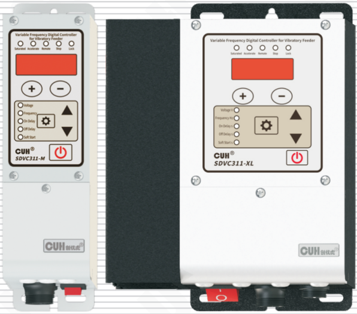

## Série SDVC311
Contrôleur numérique de fréquence variable pour alimentateur vibrant　　Série SDVC311
## Manuel d'utilisation

---

## Déclaration de droits d'auteur

Nanjing CUH Science & Technology CO., Ltd. se réserve tous les droits.

Toutes les informations contenues dans ce manuel d'utilisation constituent le savoir-faire de notre société et sont protégées par la loi sur le droit d'auteur et d'autres lois connexes. CUH jouit et se réserve tous les droits conférés par la loi sur le droit d'auteur et les autres lois. Sans le consentement écrit de CUH, aucune partie ni la totalité de ce manuel d'utilisation ne peut être copiée, traduite, imitée ni utilisée d'une autre manière.

## Clause de non-responsabilité

Le contenu de ce manuel d'utilisation décrit uniquement le mode d'emploi des produits connexes fabriqués par notre société, conformément à la technologie existante et à l'état fourni au moment de l'utilisation. Vous devez assumer les risques correspondants lors de l'utilisation de ce produit. Sauf obligation légale, la société n'assume aucune responsabilité expresse ou implicite concernant le produit du fait de ce manuel d'utilisation, y compris mais sans s'y limiter, les blessures corporelles, les dommages matériels, la perte d'opportunité, etc.

Vous comprenez clairement les risques ci-dessus et acceptez que, sauf obligation légale, la société n'est pas responsable de tout dommage ou perte direct ou indirect vous concernant (y compris mais sans s'y limiter, la perte tangible de personnel, de biens, de données, etc. et la perte intangible de réputation, d'opportunité, etc.)

La société se réserve le droit de modifier les produits concernés par ce manuel d'utilisation sans notification préalable ou ultérieure.

---

## Avant-propos

Merci d'avoir choisi le contrôleur d'alimentation vibratoire numérique à fréquence modulée de la série CUH SDVC311 (ci-après dénommé « le contrôleur »). Cette série de contrôleurs utilise des composants de haute qualité, intègre les dernières technologies électroniques et est soigneusement conçue avec des processeurs numériques de signal haute performance.

Ce manuel présente le mode opératoire de base, la description technique fonctionnelle et des exemples d'application typiques de ce produit. Il fournit aux utilisateurs les informations relatives à l'installation et au débogage, au réglage des paramètres, au diagnostic des anomalies, au dépannage et à l'entretien courant du contrôleur. Afin d'assurer l'installation et l'utilisation correctes de ce contrôleur, veuillez lire attentivement ce manuel d'utilisation avant l'installation et le conserver soigneusement.

Veillez à bien lire les symboles suivants qui vous alertent sur les précautions contre les blessures corporelles et les dommages au produit.

| | |
|---|---|
| ⚠ Danger | Le non-respect de cette consigne entraînera des blessures corporelles ou la mort. |
| ⚠ Avertissement | Le non-respect de cette consigne peut entraîner des blessures corporelles ou la mort. |
| ⚠ Attention | Le non-respect de cette consigne peut entraîner des blessures modérées ou légères. |
| Avis | Le non-respect de cette consigne entraînera des dommages au produit et des dommages matériels. |
| ❗ Obligatoire | Indique les précautions et restrictions d'utilisation à observer impérativement pendant l'utilisation. |

**Ce manuel est applicable aux modèles de contrôleurs suivants :**

- Contrôleur d'alimentation vibratoire numérique à fréquence modulée SDVC311-S (1.5A)
- Contrôleur d'alimentation vibratoire numérique à fréquence modulée SDVC311-M (3.0A)
- Contrôleur d'alimentation vibratoire numérique à fréquence modulée SDVC311-L (4.5A)
- Contrôleur d'alimentation vibratoire numérique à fréquence modulée SDVC311-XL (6.0A)

---

# Sécurité et précautions

1. **⚠ Danger** Ce produit est destiné uniquement à entraîner des équipements d'alimentation vibratoire à électroaimant ; ne l'utilisez pas à des fins de protection du corps humain ou de parties du corps humain, etc.

2. **⚠ Danger** Ce produit n'est pas conçu pour être utilisé comme produit antidéflagrant ; ne l'utilisez pas dans des zones dangereuses et/ou des environnements à gaz potentiellement explosifs.

3. **⚠ Avertissement** Ce produit est alimenté par le réseau CA ; veuillez ne pas appliquer une tension CA supérieure à 260Vac. Une tension d'entrée excessive, telle que 380Vac, peut provoquer l'explosion du produit ou un incendie, entraînant de graves accidents de sécurité.

4. **⚠ Avertissement** Ce produit est mis à la terre par le cordon d'alimentation. Veuillez vous assurer que les installations de distribution électrique du contrôleur sont bien mises à la terre, sinon le boîtier du contrôleur pourrait être sous tension, provoquant un accident d'électrocution.

5. **⚠ Avertissement** N'injectez pas de courant CA dans la sortie de ce contrôleur, cela endommagerait le contrôleur.

6. **⚠ Avertissement** Ne branchez ni ne débranchez le câblage sous tension et ne touchez pas les contacts des bornes de câblage dans le compartiment de câblage afin de prévenir tout risque d'électrocution.

7. **Avis** Évitez de commander la sortie de ce produit en coupant l'alimentation par des relais ou d'autres dispositifs, car cela réduirait considérablement la durée de vie du contrôleur.

8. **Avis** Le contrôleur est conçu pour fonctionner dans un environnement frais et sec. Ne l'utilisez jamais en extérieur afin d'éviter l'immersion et l'exposition au soleil. Utilisez le contrôleur dans la plage de température spécifiée par ses caractéristiques électriques.

9. **❗ Obligatoire** Veillez à fixer ce produit sur une plateforme solide, correctement mise à la terre et éloignée des équipements vibrants.

10. **❗ Obligatoire** N'utilisez jamais le contrôleur au-delà de ses limites de conception.

11. **❗ Obligatoire** Utilisez le contrôleur en stricte conformité avec ce manuel d'instructions. Nous n'assumerons aucune responsabilité civile ou pénale si des dommages matériels ou des blessures corporelles sont causés par une utilisation incorrecte.

12. **❗ Obligatoire** N'ouvrez jamais le boîtier du contrôleur afin d'éviter tout risque d'électrocution. Contactez CUH en cas de panne du contrôleur. N'essayez jamais de réparer vous-même le contrôleur, ce qui pourrait annuler la garantie.

---

# Environnement de fonctionnement et de stockage

## Inspection avant utilisation

Chaque contrôleur est soumis à une inspection qualité rigoureuse avant la livraison et est emballé dans un emballage anti-chocs. Veuillez vérifier les points suivants après le déballage :

1. Vérifiez si le contrôleur a été endommagé pendant le transport.
2. Vérifiez si le modèle du contrôleur correspond bien à celui que vous avez commandé.

## Environnement d'exécution

Veuillez respecter les consignes ci-dessous afin de garantir de meilleures performances et une durée de vie plus longue du contrôleur :

- ⚠ Environnement bien ventilé
- ⚠ Éloigné de l'eau, de la vapeur, de la poussière et surtout des poussières huileuses
- ⚠ Éloigné des gaz et liquides corrosifs ou inflammables
- ⚠ Éloigné des poussières en suspension et des particules métalliques
- ⚠ Fixation ferme pour éviter l'auto-vibration
- ⚠ Éloigné des interférences électromagnétiques
- ⚠ S'assurer que la température ambiante est de 0~40 ℃
- ⚠ À utiliser à une altitude de 2000 m ou moins

---

# Table des matières

- **Chapitre Ⅰ Avant utilisation — 1**
  - 1.1 Vérification du contenu de l'emballage — 1
  - 1.2 Description des indicateurs et des boutons — 2
  - 1.3 Description des parties externes — 3
  - 1.4 Description des ports de câblage — 4
  - 1.5 Description de la plaque signalétique — 4
- **Chapitre Ⅱ Fonctions principales — 5**
  - 2.1 Présentation du produit — 5
  - 2.2 Amélioration des performances du produit — 5
  - 2.3 Interface de paramètres moderne/traditionnelle — 6
- **Chapitre Ⅲ Guide d'installation — 7**
  - 3.1 Conditions d'utilisation du contrôleur — 7
  - 3.2 Méthode d'utilisation des boutons — 7
  - 3.3 Installation et utilisation — 8
- **Chapitre Ⅳ Description des fonctions de base — 12**
  - 4.1 Tension de sortie — 12
  - 4.2 Fréquence de sortie — 13
  - 4.3 Retard d'enclenchement/de déclenchement du capteur photoélectrique intelligent — 14
  - 4.4 Temps de démarrage progressif — 15
  - 4.5 Nombre de cycles de freinage/Temps d'arrêt progressif — 15
  - 4.6 Verrouillage du clavier — 17
- **Chapitre Ⅴ Description des fonctions avancées — 18**
  - 5.1 Contrôle de vitesse à distance — 18
  - 5.2 Détection photoélectrique intelligente — 20
  - 5.3 Capteur de commutation — 21
- 5.4 Sortie de contrôle — 22
  - 5.4.1 Méthode de câblage de la sortie de contrôle — 22
  - 5.4.2 Sources de signaux et diagramme logique de la sortie de contrôle — 23
  - 5.4.3 Description des modes de la sortie de contrôle — 25
  - 5.4.4 Direction logique de la sortie de contrôle — 26
  - 5.4.5 Fonction de contrôle du signal de sortie principale — 26
- 5.5 Limitation de la tension de sortie maximale — 27
- 5.6 Limite inférieure de fréquence — 27
- 5.7 Indice d'accélération — 28
- 5.8 Indice de forme d'onde — 29
- 5.9 Fonction de verrouillage par mot de passe des paramètres — 30
- 5.10 Restauration des réglages par défaut/Reprise du mode d'usine — 31
- 5.11 Fonction de surveillance des paramètres — 32

## Chapitre Ⅵ Caractéristiques techniques — 33

- 6.1 Dimensions — 33
- 6.2 Caractéristiques techniques — 35
- 6.3 Norme de référence — 36

## Chapitre Ⅶ Annexe — 37

- 7.1 Table des paramètres — 37
- 7.2 Schémas de circuit d'entrée et de sortie — 39
- 7.3 Suggestions de dépannage et explications des erreurs — 40

## Chapitre Ⅷ Informations de garantie du produit — 41

- 8.1 Période de garantie — 41
- 8.2 Couverture de la garantie — 41
- 8.3 Aptitude du produit — 41

---

# Chapitre Ⅰ Avant utilisation

Ce chapitre présente le contenu de l'emballage du produit, la description de l'apparence du contrôleur et les informations de sa plaque signalétique.

## 1.1 Vérification du contenu de l'emballage

Avant utilisation, veuillez vérifier l'intégrité du contrôleur et des accessoires. Si vous constatez que le produit est défectueux ou endommagé, que des accessoires sont manquants, etc., veuillez contacter notre société.

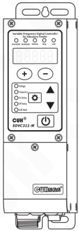

Contrôleur×1

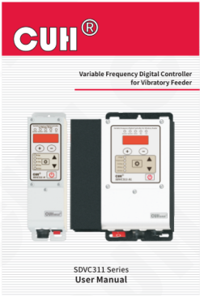

Manuel d'utilisation×1

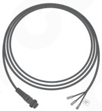

Câble de sortie×1

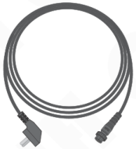

Cordon d'alimentation d'entrée×1

---

## 1.2 Description des indicateurs et des boutons

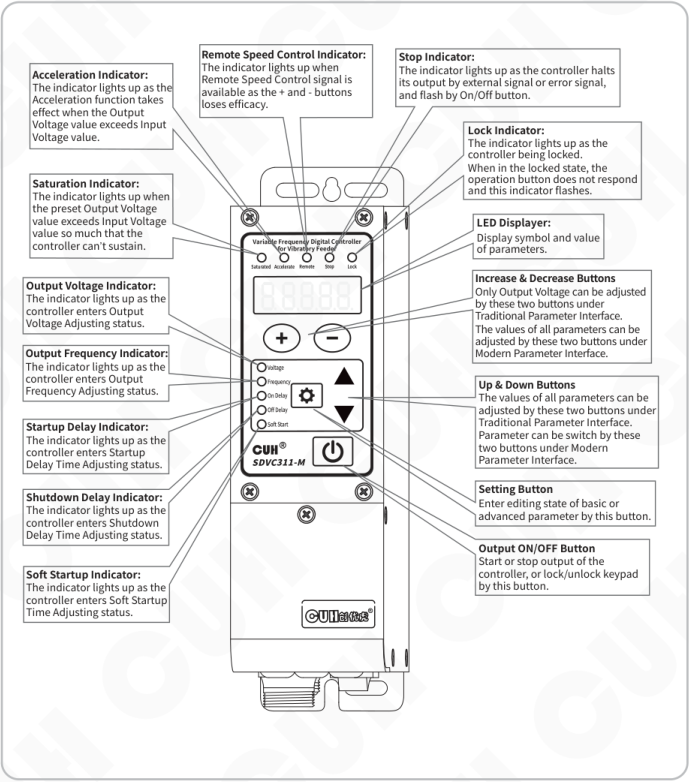

**Indicateur d'accélération :**  
L'indicateur s'allume lorsque la fonction d'accélération entre en vigueur, c'est-à-dire lorsque la valeur de tension de sortie dépasse la valeur de tension d'entrée.

**Indicateur de saturation :**  
L'indicateur s'allume lorsque la valeur de tension de sortie préréglée dépasse tellement la valeur de tension d'entrée que le contrôleur ne peut plus la maintenir.

**Indicateur de tension de sortie :**  
L'indicateur s'allume lorsque le contrôleur entre dans l'état de réglage de la tension de sortie.

**Indicateur de fréquence de sortie :**  
L'indicateur s'allume lorsque le contrôleur entre dans l'état de réglage de la fréquence de sortie.

**Indicateur de retard d'enclenchement :**  
L'indicateur s'allume lorsque le contrôleur entre dans l'état de réglage du temps de retard d'enclenchement.

**Indicateur de retard de déclenchement :**  
L'indicateur s'allume lorsque le contrôleur entre dans l'état de réglage du temps de retard de déclenchement.

**Indicateur de démarrage progressif :**  
L'indicateur s'allume lorsque le contrôleur entre dans l'état de réglage du temps de démarrage progressif.

**Indicateur de contrôle de vitesse à distance :**  
L'indicateur s'allume lorsque le signal de contrôle de vitesse à distance est disponible et que les boutons + et - perdent leur efficacité.

**Indicateur d'arrêt :**  
L'indicateur s'allume lorsque le contrôleur interrompt sa sortie sur signal externe ou signal d'erreur, et clignote lors d'une action sur le bouton On/Off.

**Indicateur de verrouillage :**  
L'indicateur s'allume lorsque le contrôleur est verrouillé.  
En état verrouillé, les boutons d'opération ne répondent pas et cet indicateur clignote.

**Afficheur LED :**  
Affiche le symbole et la valeur des paramètres.

**Boutons d'augmentation et de diminution**  
Seule la tension de sortie peut être réglée par ces deux boutons sous l'interface de paramètres traditionnelle.  
Les valeurs de tous les paramètres peuvent être réglées par ces deux boutons sous l'interface de paramètres moderne.

**Boutons haut et bas**  
Les valeurs de tous les paramètres peuvent être réglées par ces deux boutons sous l'interface de paramètres traditionnelle.  
Les paramètres peuvent être commutés par ces deux boutons sous l'interface de paramètres moderne.

**Bouton de réglage**  
Ce bouton permet d'entrer en état d'édition des paramètres de base ou avancés.

**Bouton ON/OFF de sortie**  
Ce bouton permet de démarrer ou d'arrêter la sortie du contrôleur, ou de verrouiller/déverrouiller le clavier.

---

## 1.3 Description des parties externes

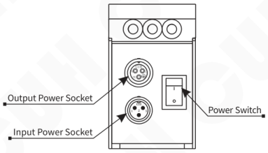

SDVC311-S (1.5A)  
SDVC311-M (3.0A)

- Prise de puissance de sortie
- Prise d'entrée d'alimentation
- Interrupteur d'alimentation

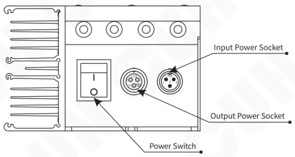

SDVC311-L (4.5A)  
SDVC311-XL (6.0A)

- Prise d'entrée d'alimentation
- Prise de puissance de sortie
- Interrupteur d'alimentation

---

## 1.4 Description des ports de câblage

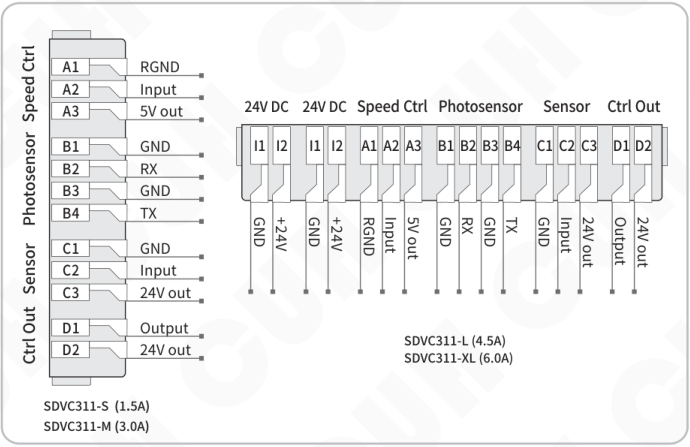

### SDVC311-S (1.5A) / SDVC311-M (3.0A)

| Groupe de ports | Borne | Description |
|---|---|---|
| Speed Ctrl | A1 | RGND |
| Speed Ctrl | A2 | Entrée |
| Speed Ctrl | A3 | Sortie 5V |
| Photosensor | B1 | GND |
| Photosensor | B2 | RX |
| Photosensor | B3 | GND |
| Photosensor | B4 | TX |
| Sensor | C1 | GND |
| Sensor | C2 | Entrée |
| Sensor | C3 | Sortie 24V |
| Ctrl Out | D1 | Sortie |
| Ctrl Out | D2 | Sortie 24V |

### SDVC311-L (4.5A) / SDVC311-XL (6.0A)

| Groupe de ports | Borne | Description |
|---|---|---|
| 24V DC | I1 | GND |
| 24V DC | I2 | +24V |
| 24V DC | I1 | GND |
| 24V DC | I2 | +24V |
| Speed Ctrl | A1 | RGND |
| Speed Ctrl | A2 | Entrée |
| Speed Ctrl | A3 | Sortie 5V |
| Photosensor | B1 | GND |
| Photosensor | B2 | RX |
| Photosensor | B3 | GND |
| Photosensor | B4 | TX |
| Sensor | C1 | GND |
| Sensor | C2 | Entrée |
| Sensor | C3 | Sortie 24V |
| Ctrl Out | D1 | Sortie |
| Ctrl Out | D2 | Sortie 24V |

## 1.5 Description de la plaque signalétique

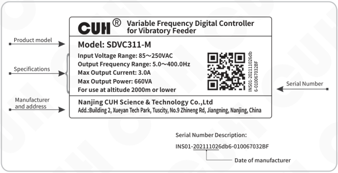

**CUH® — Contrôleur numérique de fréquence variable pour alimentateur vibrant**

**Modèle du produit**

Modèle : SDVC311-M

**Caractéristiques**

- Plage de tension d'entrée : 85~250VAC
- Plage de fréquence de sortie : 5.0~400.0Hz
- Courant de sortie maximal : 3.0A
- Puissance de sortie maximale : 660VA
- À utiliser à une altitude de 2000 m ou moins

**Fabricant et adresse**

Nanjing CUH Science & Technology Co.,Ltd

Add.:Building 2, Xueyan Tech Park, Tuscity, No.9 Zhineng Rd, Jiangning, Nanjing, China

**Numéro de série**

INS01-202111026db6-010067032BF

**Description du numéro de série :**

INS01-<u>20211102</u>6db6-010067032BF

Date de fabrication : 20211102

---

## Chapitre Ⅱ Fonctions principales

Ce chapitre comprend une brève présentation et les principales caractéristiques du contrôleur.

### 2.1 Présentation du produit

Le contrôleur d'alimentation vibratoire numérique à fréquence modulée de la série SDVC311 est un contrôleur de sortie FM compact et polyvalent qui offre des performances uniques grâce à l'utilisation des dernières technologies électroniques et à une conception soignée. Ses caractéristiques particulières comprennent :

- La plage de fréquence de sortie couvre 5.0Hz à 400.0Hz avec une précision de 0.1Hz.
- Fonction de freinage permettant d'arrêter rapidement l'alimentateur vibrant en décalant la phase du courant de 180° pendant le processus d'arrêt progressif.
- Les ports photoélectriques intelligents prennent en charge les photo-capteurs et les capteurs de commutation NPN ou PNP.
- Fonction de signal de disponibilité : émission d'un signal modulé ou d'un signal valide par le port de transmission B4 optoélectronique intelligent pour indiquer que le contrôleur est en état de disponibilité. Lorsque le contrôleur rencontre une erreur, le signal de disponibilité devient invalide.
- Le port de capteur de commutation prend en charge les types NPN, PNP ou auto-adaptatif.
- Le port de sortie de contrôle prend en charge les modes de sortie NPN, PNP ou push-pull.
- Fonctions de protection complètes : protection contre les courts-circuits de la sortie principale, protection contre les surintensités, protection contre la surchauffe, protection contre les sous-tensions/surtensions, protection contre les courts-circuits de la sortie de contrôle, protection contre les courts-circuits de la sortie 24V et protection contre les courts-circuits de la sortie 5V de régulation de vitesse.

### 2.2 Amélioration des performances du produit

Par rapport au contrôleur de la série SDVC31, la série SDVC311 a considérablement amélioré ses performances, notamment :

- La plage de fréquence de sortie est élargie de 40.0Hz~400.0Hz à 5.0Hz~400.0Hz.
- Le temps de retard d'enclenchement/déclenchement maximal est augmenté de 20.0 s à 99.9 s.
- Ajout de la fonction d'arrêt progressif, réglable de 0.0~10.0 s pour arrêter lentement la vibration de l'alimentateur vibrant.
- Ajout de la fonction de freinage, permettant de régler 0~100 cycles de freinage pour arrêter rapidement la vibration du plateau vibrant.
- Le port du capteur photoélectrique intelligent ajoute la prise en charge des capteurs PNP.
- Le port de capteur de commutation de matière pleine a été amélioré de NPN et PNP à un réglage logiciel, avec un mode automatique disponible.
- Le port de sortie de contrôle est amélioré de la sortie NPN à trois types réglables : NPN, PNP et push-pull.
- Ajout du retard d'enclenchement/déclenchement du port de sortie de contrôle, réglable de 0.0 à 99.9 s.
- Ajout du mode de sortie de contrôle, avec mode temporisé et mode maintenu réglables.
- Ajout de la fonction de mesure permettant de surveiller la température, la tension du bus, la tension d'ondulation du bus, le courant de sortie, la tension du port de contrôle de vitesse à distance, la tension du port du capteur photoélectrique intelligent, la tension du port du capteur de commutation, la tension du port de sortie de contrôle CC et la tension d'alimentation +24V.

---

## 2.3 Interface de paramètres moderne/traditionnelle

Toutes les nouvelles fonctions sont implémentées dans l'interface de paramètres moderne. Afin d'être compatible avec les habitudes d'utilisation des clients réguliers, les utilisateurs peuvent basculer entre l'interface de paramètres moderne et l'interface de paramètres traditionnelle via le clavier.

### Bascule de l'interface de paramètres moderne vers l'interface de paramètres traditionnelle

Sur l'interface LED du paramètre de restauration des réglages par défaut, appuyez longuement sur ⊕ jusqu'à ce que 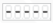 s'affiche sur l'écran LED pour basculer vers l'interface de paramètres traditionnelle, ou appuyez longuement sur ⊖ jusqu'à ce que 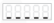 s'affiche sur l'écran LED pour basculer vers l'interface de paramètres moderne.

### Bascule de l'interface de paramètres traditionnelle vers l'interface de paramètres moderne

Sur l'interface LED du paramètre de restauration des réglages par défaut, appuyez longuement sur ▼ jusqu'à ce que 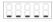 s'affiche sur l'écran LED pour basculer vers l'interface de paramètres moderne, ou appuyez longuement sur ▲ jusqu'à ce que  s'affiche sur l'écran LED pour basculer vers l'interface de paramètres traditionnelle.

Ce manuel d'utilisation présente le réglage des paramètres de l'interface moderne. Pour le réglage des paramètres de l'interface traditionnelle, veuillez vous référer au manuel d'utilisation du contrôleur de la série SDVC31.

---

# Chapitre Ⅲ Guide d'installation

Ce chapitre présente les conditions nécessaires à l'utilisation du contrôleur ainsi que la manière de l'installer et de le raccorder correctement.

## 3.1 Conditions d'utilisation du contrôleur

Le contrôleur est alimenté en CA 110/220V et la mise à la terre de protection est réalisée par la fiche du cordon d'alimentation. Veuillez fournir une alimentation secteur 110V ou 220V, 50Hz/60Hz et des installations de distribution conformes aux normes, et vous assurer que le fil de terre de protection est correctement raccordé.

**⚠ Avertissement** Ne connectez jamais le contrôleur à une alimentation CA de 380V, cela provoquerait des dommages graves et irréversibles au contrôleur, pouvant entraîner une explosion, un incendie et d'autres incidents de sécurité.

**⚠ Avertissement** Assurez-vous que le côté de l'alimentation est correctement mis à la terre. Le boîtier métallique du contrôleur est directement raccordé au fil de terre de protection. Une mise à la terre défectueuse mettrait le boîtier du contrôleur sous tension et provoquerait un accident d'électrocution.

**Avis** Un fonctionnement prolongé génère de la chaleur et élève la température du boîtier. Veuillez installer le contrôleur dans un environnement bien ventilé, bien le fixer et l'éloigner des sources de vibration.

**Avis** La sortie de ce produit est formée par redressement et inversion de l'alimentation secteur, sans isolation entre l'entrée et la sortie. Par conséquent, les pôles de sortie ne peuvent pas être raccordés à la terre de protection. Lors du raccordement de l'électroaimant, il faut s'assurer que la bobine de l'électroaimant et le boîtier possèdent une capacité d'isolation de base. Sinon, une fuite de courant pourrait se produire et provoquer une électrocution et endommager le contrôleur.

**Avis** Ce produit est un contrôleur destiné à entraîner l'électroaimant. Il ne doit pas être raccordé à un alimentateur vibrant piézoélectrique.

## 3.2 Méthode d'utilisation des boutons

a. Un appui court désigne une durée de pression supérieure à 0.1 et inférieure à 2 secondes, et un appui long désigne une durée de pression supérieure à 2 secondes.

a. Appuyez brièvement sur le bouton ⊕ ou ⊖ pour régler la tension de sortie du contrôleur dans l'interface de veille.

b. Entrez ou quittez l'interface des paramètres de base par un appui long sur le bouton ⚙, commmutez entre les paramètres de base par un appui court sur le bouton ▼ ou ▲, et réglez la valeur du paramètre par un appui court sur le bouton ⊕ ou ⊖.

c. Entrez ou quittez l'interface des paramètres avancés par un appui long sur les boutons ⚙ et ▲, commmutez entre les paramètres avancés par un appui court sur le bouton ▼ ou ▲, et réglez la valeur du paramètre par un appui court sur le bouton ⊕ ou ⊖.

d. Entrez ou quittez l'interface des paramètres de surveillance par un appui long sur les boutons ⚙ et ▼, commmutez entre les paramètres de surveillance par un appui court sur le bouton ▼ ou ▲, mais la valeur du paramètre ne peut pas être réglée.

e. Appuyez brièvement sur le bouton ⏻ pour démarrer ou arrêter la sortie du contrôleur, et appuyez longuement sur le bouton ⏻ pour verrouiller ou déverrouiller le clavier.

---

## 3.3 Installation et utilisation

### Étape un :

Ouvrez le carton d'emballage et vérifiez le contrôleur et tous les accessoires.

### Étape deux :

Raccordez les bornes de câblage du câble de sortie à la bobine électromagnétique du vibreur.

Alignez l'encoche de la fiche aviation du câble de sortie avec le repère triangulaire de la prise de sortie du contrôleur, puis resserrez l'écrou après avoir raccordé correctement le câble de sortie.

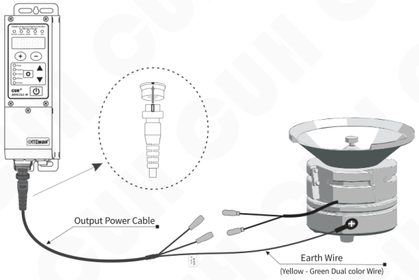

### Remarque

1. Assurez-vous que les bobines électromagnétiques du vibreur sont raccordées aux deux broches de sortie du câble de sortie et que le boîtier métallique du vibreur est correctement mis à la terre.
2. Il est interdit de raccorder des charges piézoélectriques à la sortie de puissance, sinon cela pourrait provoquer un accident d'électrocution !

---

### Étape trois :

Raccordez le connecteur du cordon d'alimentation d'entrée à la prise d'entrée d'alimentation du contrôleur.

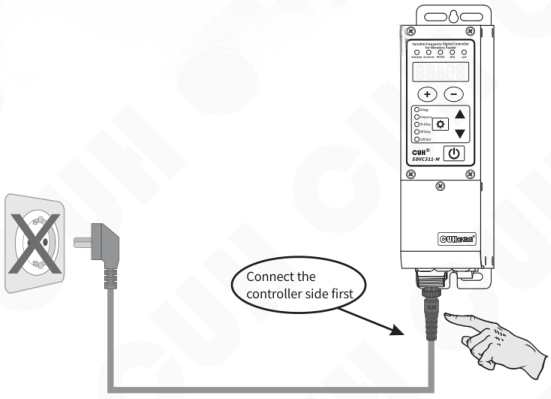

Raccordez d'abord le côté contrôleur

### Étape quatre :

Branchez la fiche du cordon d'alimentation d'entrée sur la prise secteur.

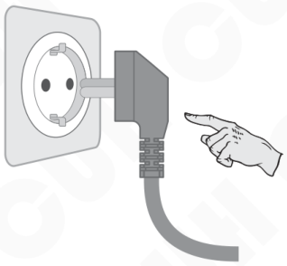

---

### Étape cinq :

Mettez en marche l'interrupteur d'alimentation du contrôleur : la tension « U 150 » doit s'afficher, le canal A doit s'allumer et l'alimentateur vibrant doit commencer à vibrer.

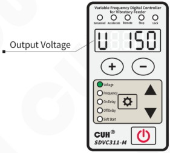

### Étape six :

Appuyez sur ⊖ pour régler la tension à 30~50V, puis maintenez le bouton ⚙ enfoncé pendant 2 secondes pour entrer dans l'état de réglage de la fréquence de sortie « E ». Utilisez ⊕ et ⊖ pour rechercher la fréquence naturelle de l'alimentateur vibrant, c'est-à-dire la fréquence de résonance.

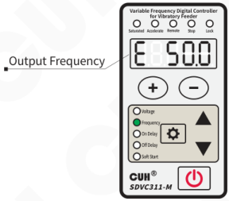

- La fréquence harmonique du vibreur désigne la valeur de fréquence qui produit l'amplitude maximale.
- Chaque alimentateur vibrant possède sa propre fréquence de résonance mécanique naturelle ; réglez la fréquence de sortie du contrôleur sur cette fréquence pour obtenir le meilleur état de fonctionnement.

---

## Étape sept :

Appuyez longuement sur ⚙ pour quitter la fréquence de sortie « E » et revenir au paramètre de réglage de la tension ; vous pouvez également appuyer sur ▲ pour basculer vers le paramètre de réglage de la tension. Utilisez ⊕ et ⊖ pour régler la tension jusqu'au meilleur débit d'alimentation.

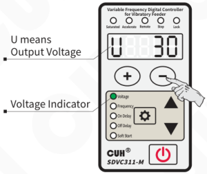

L'alimentateur vibrant devrait maintenant fonctionner. Pour des instructions de commande complémentaires, veuillez vous référer aux chapitres suivants.

---

## Chapitre Ⅳ Description des fonctions de base

Ce chapitre présente le réglage des paramètres de base dans l'interface de paramètres moderne (par défaut).

### 4.1 Tension de sortie

La valeur moyenne redressée de la tension de sortie du contrôleur peut être réglée directement et numériquement via le clavier. Grâce à la fonction unique de stabilisation de la tension, la tension de sortie du contrôleur ne fluctue pas avec la tension d'entrée, ce qui permet au vibreur de maintenir un fonctionnement stable en cas de tension réseau instable.

- Mettez en marche l'interrupteur d'alimentation du contrôleur.
- Le contrôleur entre dans le paramètre de tension de sortie. L'indicateur de tension s'allume et l'afficheur LED affiche le paramètre de tension de sortie U et la valeur par défaut 150.
- Appuyez sur **⊕** ou **⊖** pour régler la valeur du paramètre.

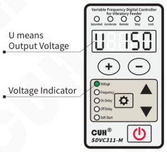

> - Le contrôleur ne dispose pas d'une fonction d'élévation de tension. Lorsque le contrôleur ne peut pas atteindre la tension réglée en raison de la limite de la tension d'alimentation d'entrée, l'indicateur de saturation s'allume et la compensation de la tension secteur échoue à ce moment.
> - Le contrôleur peut obtenir un certain effet d'accélération en sacrifiant les caractéristiques sinusoïdales de la forme d'onde de sortie, ce qui est déterminé par le paramètre « indice d'accélération y ». Lors de l'entrée en état d'accélération, la forme d'onde du courant de sortie passe d'une sinusoïde à une onde triangulaire et l'indicateur d'accélération s'allume.

---

## 4.2 Fréquence de sortie

Le contrôleur adopte la technologie de synthèse numérique directe de fréquence (DDS), qui offre une précision et une stabilité de fréquence très élevées et qui ne varie ni avec le temps ni avec la température.

- Maintenez ⚙ enfoncé pendant 2 secondes pour entrer dans l'interface des paramètres de base.
- L'afficheur LED affiche le paramètre de fréquence de sortie « E » et la valeur par défaut 50.0.
- Appuyez sur ⊕ ou ⊖ pour régler la valeur du paramètre.

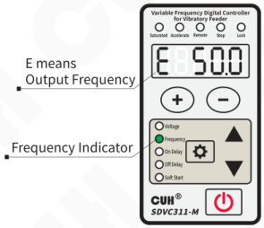

---

## 4.3 Retard d'enclenchement/de déclenchement du capteur photoélectrique intelligent

Lorsqu'un capteur ou un PLC est utilisé pour allumer ou éteindre la sortie principale du contrôleur, l'action peut être retardée pendant un certain temps après l'émission ou le rétablissement du signal de commande. Le temps de retard peut être réglé via les deux paramètres ci-dessous.

### Retard d'enclenchement ( J )

Durée écoulée entre la réception d'un signal de commande de démarrage par le contrôleur et sa sortie effective.

- Maintenez ⚙ enfoncé pendant 2 secondes pour entrer dans l'interface des paramètres de base.
- Appuyez sur ▲ ou ▼ pour basculer vers le paramètre de retard d'enclenchement « J » dont la valeur par défaut est 0.2.
- Appuyez sur ⊕ ou ⊖ pour régler la valeur du paramètre.

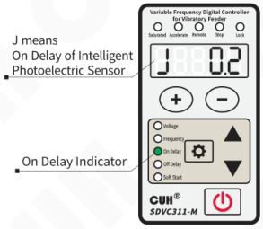

### Retard de déclenchement ( L )

Durée écoulée entre la réception d'un signal de commande d'arrêt par le contrôleur et la coupure effective de la sortie.

- Maintenez ⚙ enfoncé pendant 2 secondes pour entrer dans l'interface des paramètres de base.
- Appuyez sur ▲ ou ▼ pour basculer vers le paramètre de retard de déclenchement « L » dont la valeur par défaut est 0.2.
- Appuyez sur ⊕ ou ⊖ pour régler la valeur du paramètre.

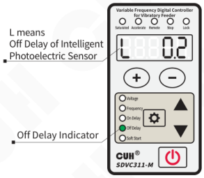

**Remarque :** Dans le réglage par défaut, le retard d'enclenchement/déclenchement photoélectrique intelligent commande le retard d'enclenchement/déclenchement de la sortie principale. Si la direction logique de la sortie principale est la même phase ou l'inversion de la source de signal, les significations du retard d'enclenchement/déclenchement photoélectrique intelligent sont interverties. Le retard d'enclenchement/déclenchement du port C est cohérent avec celui du capteur photoélectrique intelligent.

---

## 4.4 Temps de démarrage progressif

Afin d'éviter un choc brutal sur la bobine du vibreur, le contrôleur peut augmenter progressivement la tension de sortie de 0 à la valeur préréglée au démarrage

**Temps de démarrage progressif ( t ) :** durée nécessaire pour que le contrôleur élève progressivement sa tension de sortie de 0 à la valeur préréglée au démarrage.

- Maintenez ⚙ enfoncé pendant 2 secondes pour entrer dans l'interface des paramètres de base.
- Appuyez sur ▲ ou ▼ pour basculer vers le paramètre de démarrage progressif « t » dont la valeur par défaut est 0.5.
- Appuyez sur ⊕ ou ⊖ pour régler la valeur du paramètre.

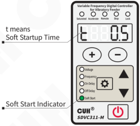

## 4.5 Nombre de cycles de freinage/Temps d'arrêt progressif

Comme l'alimentateur vibrant continue de vibrer librement pendant un certain temps après l'arrêt de la sortie du contrôleur, la matière continue de se déplacer pendant cette période. Cela provoque des erreurs pour certaines applications de dosage précis et d'emballage des matières ; il est donc nécessaire d'arrêter rapidement la vibration.

**Fonction de freinage :** arrêt rapide de la vibration en retardant de 180° le point de départ de l'arrêt progressif afin d'obtenir un effet opposé entre la force motrice et la phase de vibration libre de l'alimentateur vibrant. Elle est réalisée en réglant le temps d'arrêt progressif ( 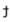 ) sur une valeur négative ; l'unité est le cycle, c'est-à-dire le nombre de cycles de courant de commande inverse lors du freinage.

Lorsque le contrôleur est arrêté depuis l'état de fonctionnement, la tension de sortie peut être réduite en douceur à 0 pour éviter que l'équipement vibrant ne subisse de choc.

**Temps d'arrêt progressif ( 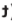 ) :** lorsque le contrôleur s'arrête depuis l'état de fonctionnement, temps nécessaire pour que la tension de sortie diminue en douceur de la valeur réglée à 0.

---

- Maintenez ⚙ enfoncé pendant 2 secondes pour entrer dans l'interface des paramètres de base.
- Appuyez sur ▲ ou ▼ pour basculer vers le paramètre cycles de freinage/arrêt progressif « t ».
- Appuyez sur ⊕ pour régler la valeur du paramètre d'arrêt progressif.
- Appuyez sur ⊖ pour régler la valeur du paramètre de cycles de freinage.

t signifie cycles de freinage/arrêt progressif.

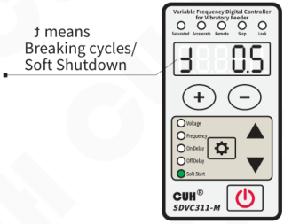

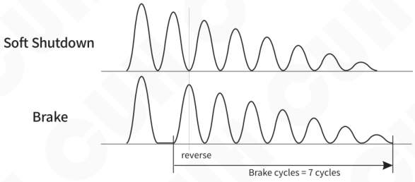

**Schéma du nombre de cycles de freinage**

---

## 4.6 Verrouillage du clavier

Lorsque les paramètres du contrôleur sont réglés, la fonction de verrouillage du clavier peut verrouiller tous les boutons du panneau pour éviter toute erreur de manipulation.

Même si le contrôleur est mis hors tension puis remis sous tension, l'état du verrouillage du clavier reste celui qu'il avait lors de la dernière mise hors tension.

- Maintenez ⏻ enfoncé pendant 2 secondes pour verrouiller tous les boutons du panneau. L'indicateur de verrouillage s'allume.
- Maintenez à nouveau ⏻ enfoncé pendant 2 secondes pour déverrouiller.

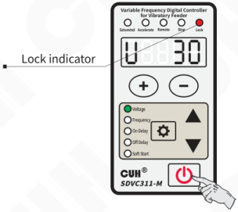

> L'état du verrouillage du clavier ne disparaît pas suite à une coupure d'alimentation.

---

# Chapitre Ⅴ Description des fonctions avancées

Ce chapitre présente le réglage des paramètres avancés dans l'interface de paramètres moderne (par défaut).

## 5.1 Contrôle de vitesse à distance

Le contrôleur prend en charge la commande de la tension de sortie par signal analogique externe ; le signal analogique prend en charge le potentiomètre, la tension 1~5V et le courant 4~20mA.

### Raccordement de commande par potentiomètre

**Recommandation :**

Veuillez utiliser un potentiomètre linéaire de 1K

Lorsque le signal de contrôle de vitesse à distance entre en vigueur, l'indicateur de contrôle de vitesse s'allume ; en même temps, le réglage de la tension sur le panneau devient inopérant.

---

## Raccordement de commande par tension 1~5V

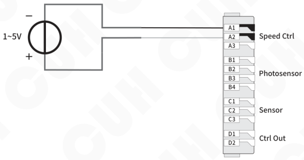

## Raccordement de commande par courant 4~20mA

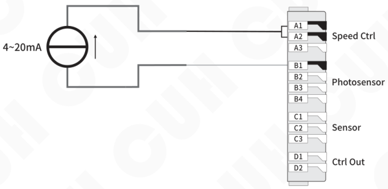

---

## 5.2 Détection photoélectrique intelligente

Le port photoélectrique intelligent de ce contrôleur prend en charge les capteurs photoélectriques à faisceau traversant ou à réflexion composés de diodes électroluminescentes et de phototransistors, et peut également être réglé pour prendre en charge les capteurs de commutation NPN ou PNP. Le schéma de câblage spécifique est le suivant :

### Méthode de raccordement du capteur photoélectrique

La distance de travail du capteur peut être ajustée en réglant le paramètre P ; plus le paramètre est petit, plus le capteur est sensible.

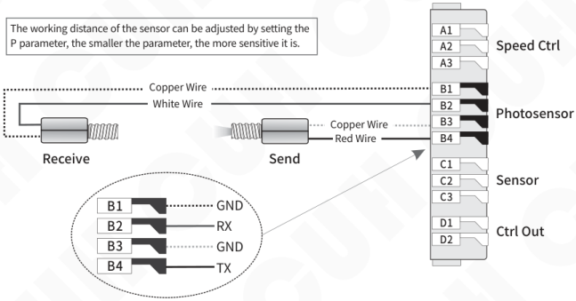

### Méthode de raccordement du capteur de commutation

Réglez le type NPN ou PNP par le paramètre P.

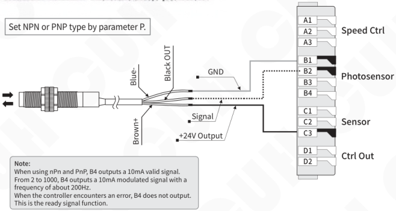

**Remarque :**

Lors de l'utilisation de nPn et PnP, B4 émet un signal valide de 10mA.

De 2 à 1000, B4 émet un signal modulé de 10mA avec une fréquence d'environ 200Hz.

Lorsque le contrôleur rencontre une erreur, B4 n'émet rien. Il s'agit de la fonction de signal de disponibilité.

---

## 5.3 Capteur de commutation

Le port de capteur de commutation peut prendre en charge les modes NPN, PNP, Ut1, Ut0.

**Le mode Ut1 est un balayage unique :** tant que le signal du capteur n'est pas invalide, les niveaux haut et bas sont alternés pour détecter si le port est valide. Après avoir trouvé un signal valide, le type de capteur du port est déterminé et le balayage cesse.

**Le mode Ut0 est un balayage continu :** quel que soit le type de capteur, il détecte en permanence si le port est raccordé à un signal valide en alternant les niveaux haut et bas.

### Méthode de raccordement du capteur de commutation

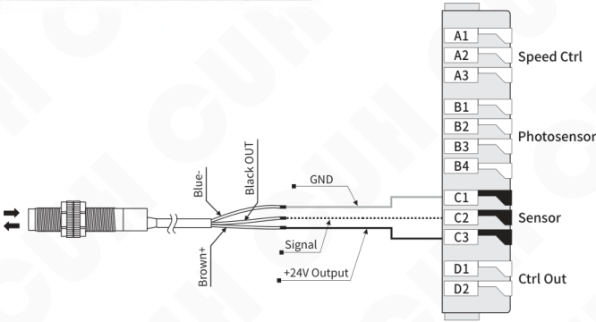

Réglez le type NPN ou PNP par le paramètre.

- Réglez le type de capteur via le paramètre avancé ΓA.
- Lorsque d'autres signaux externes tels que des capteurs sont utilisés pour des opérations de démarrage et d'arrêt via le port C du contrôleur, si l'opération doit être retardée pendant un certain temps après l'émission ou le rétablissement du signal, vous pouvez régler les paramètres avancés « retard d'enclenchement du port C du capteur » et « retard de déclenchement du port C du capteur ». Pour la méthode opératoire, veuillez vous référer au réglage du temps de retard d'enclenchement/déclenchement du capteur photoélectrique intelligent.

---

## 5.4 Sortie de contrôle

Le port de sortie de contrôle peut prendre en charge la sortie NPN, la sortie PNP et la sortie push-pull. À savoir :

- La sortie NPN est valide au niveau bas et invalide en état de haute impédance ;
- La sortie PNP est valide au niveau haut et invalide en état de haute impédance ;
- La sortie push-pull est valide au niveau haut et invalide au niveau bas.

### 5.4.1 Méthode de câblage de la sortie de contrôle

**Raccordement de la sortie NPN**

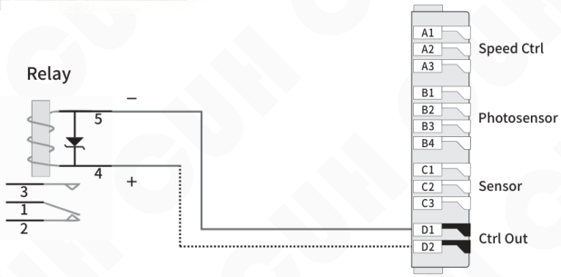

**Raccordement de la sortie PNP ou push-pull**

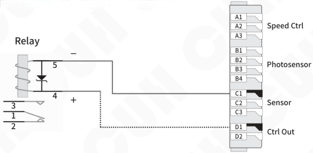

> Si vous raccordez un relais 24V, veillez à confirmer les pôles positif et négatif de la bobine afin de garantir un raccordement correct. Comme la capacité de courant de sortie de ce port est de 400mA, la diode de protection interne du relais court-circuiterait le port de ce contrôleur en cas de branchement inversé, déclenchant la protection contre les courts-circuits Err07.

---

## 5.4.2 Sources de signaux et diagramme logique de la sortie de contrôle

La commande de la sortie principale et de la sortie de contrôle est déterminée par le résultat de la relation logique entre les deux sources de signaux.

Réglez la relation logique des deux sources de signaux en définissant les valeurs des paramètres avancés Πd et Πq.

Sélectionnez les signaux suivants en définissant les valeurs des paramètres avancés E.d, Ed, E.q, Eq.

| Source de signal | Signification |
|---|---|
| 0 | signal invalide |
| 1 | signal valide |
| b | Signal du port de détection photoélectrique intelligente |
| -b | Signal du port de détection photoélectrique intelligente inversé |
| C | Signal du port de capteur de commutation |
| -C | Signal du port de capteur de commutation inversé |
| od | Signal du port de sortie de contrôle |
| -od | Signal du port de sortie de contrôle inversé |
| oq | Signal du port de sortie de puissance principale |
| -oq | Signal du port de sortie de puissance principale inversé |

---

## Diagramme logique de la sortie de contrôle

## 5.4.3 Description des modes de la sortie de contrôle

Les clients peuvent choisir parmi 4 modes de sortie de contrôle : mode temporisé, mode maintenu, modes de sortie de signal périodique Fn1/Fn2.

**Mode temporisé :** signifie qu'après le passage du signal d'entraînement de sortie du contrôleur de l'état valide à l'état invalide, la sortie de contrôle se coupe après le temps de retard de déclenchement.

**Mode maintenu :** après validation du signal d'entraînement de sortie du contrôleur, la sortie de contrôle reste active pendant le temps de retard de déclenchement, puis se coupe une fois ce temps dépassé.

**Modes de sortie de signal périodique Fn1/Fn2 :** la durée du signal de niveau haut est définie par le retard d'ouverture du port D de la sortie de contrôle, et la durée du signal de niveau bas est définie par le retard de fermeture du port D de la sortie de contrôle.

En mode Fn1, la touche marche/arrêt ne peut pas arrêter la commande de la sortie ; en mode Fn2, la touche marche/arrêt peut arrêter la commande de la sortie.

La différence entre les quatre modes est exprimée sous forme de diagramme temporel comme suit, où le signal d'entrée est le signal émis après le sélecteur de relation logique.

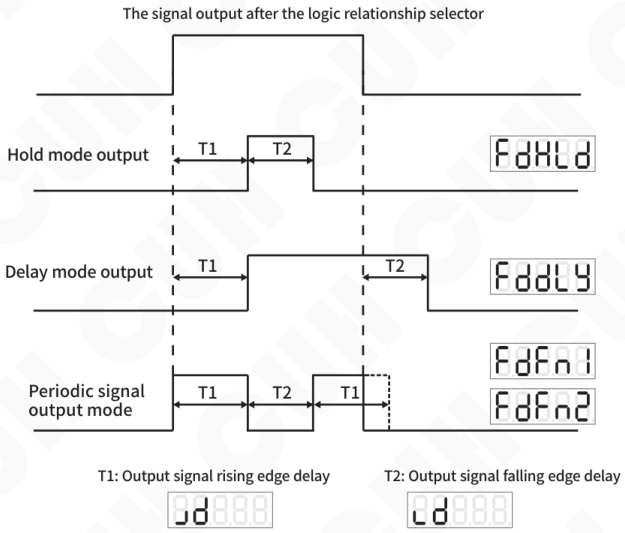

---

## 5.4.4 Direction logique de la sortie de contrôle

En réglant le paramètre avancé « ɔd », les clients peuvent choisir parmi 4 directions logiques de la sortie de contrôle :

**Même phase `___` :** indique que l'état valide du signal de sortie ne change pas.

**Inversé `_-_` :** indique que l'état valide du signal de sortie est inversé.

**Toujours actif :** indique que le signal est toujours actif et non commandé.

**Toujours inactif :** indique que le signal est toujours invalide et non commandé.

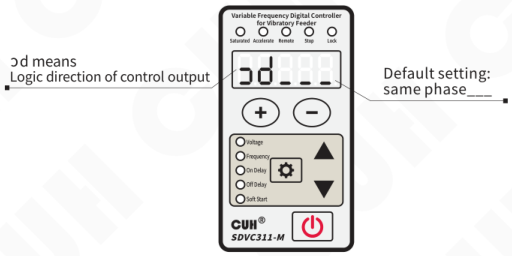

## 5.4.5 Fonction de contrôle du signal de sortie principale

La commande du signal de sortie principale est similaire à celle de la sortie de contrôle. Après la sélection de deux sources de signaux pour l'opération de relation logique, le signal de commande est obtenu par la sélection du mode de retard d'enclenchement/déclenchement et la commande de direction logique. Le signal de commande est combiné logiquement au signal marche/arrêt du panneau, puis envoyé à la carte de puissance pour commander la sortie principale.

La méthode de câblage, les sources de signaux et le diagramme logique de la commande du signal de sortie principale peuvent se référer à la fonction de sortie de contrôle.

---

## 5.5 Limitation de la tension de sortie maximale

Le contrôleur permet de régler le paramètre de limitation de la tension de sortie maximale h, ce qui évite qu'une erreur de manipulation de l'utilisateur ne produise une tension excessive et n'endommage l'équipement vibrant.

Ni la tension réglée sur le panneau ni la tension de commande à distance ne dépasseront cette valeur.

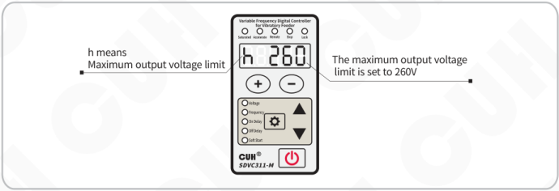

- En aucun cas, la tension de sortie du contrôleur ne peut et ne dépassera la valeur réglée de ce paramètre.
- Le réglage d'usine par défaut de ce paramètre correspond à la tension de sortie maximale possible de la machine.

## 5.6 Limite inférieure de fréquence

Ce contrôleur permet de régler le paramètre avancé « Limite inférieure de fréquence e » pour limiter la fréquence de sortie minimale, ce qui évite que les utilisateurs ne règlent accidentellement la fréquence de sortie trop bas et n'endommagent l'électroaimant.

La fréquence réglée sur le panneau ne sera pas inférieure à cette valeur.

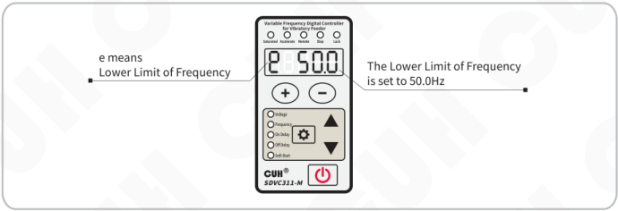

---

## 5.7 Indice d'accélération

Le contrôleur peut obtenir un certain effet d'accélération en sacrifiant les caractéristiques sinusoïdales de la forme d'onde de sortie. Lors de l'entrée en état d'accélération, la forme d'onde du courant de sortie passe d'une sinusoïde à une onde triangulaire et l'indicateur d'accélération s'allume. La fonction d'accélération peut être commandée en réglant la valeur du paramètre avancé « indice d'accélération y ».

**Indice d'accélération (y) :** exprime le pourcentage de la tension d'entrée que la tension de sortie maximale peut atteindre.

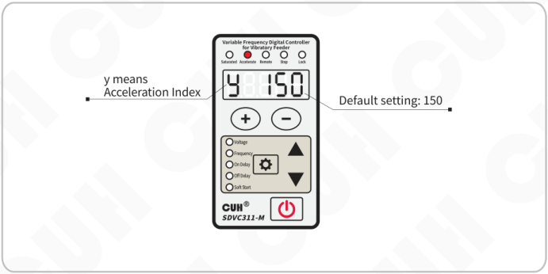

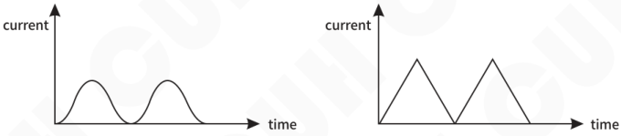

**Schéma de l'indice d'accélération réglé à 150**

---

## 5.8 Indice de forme d'onde

Le contrôleur peut équilibrer en permanence les performances entre l'efficacité maximale-puissance maximale et le bruit minimal afin de répondre aux exigences accrues des clients. Cela est réalisable en réglant la valeur du paramètre avancé « indice de forme d'onde r ».

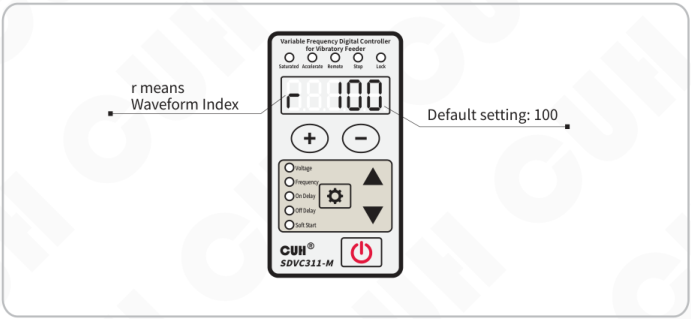

- Avec une valeur d'indice de forme d'onde de 0, l'efficacité est la plus élevée et la contrainte sur le ressort est minimale.
- Avec la valeur 100, la puissance de sortie nominale maximale et le bruit minimal sont obtenus, mais le ressort subit une contrainte plus importante.

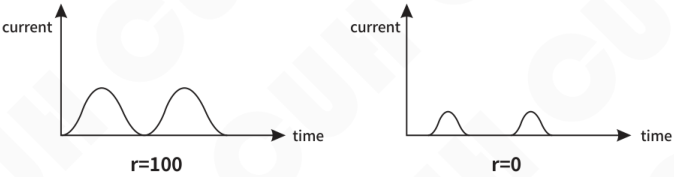

**Diagramme de l'indice de forme d'onde**

---

## 5.9 Fonction de verrouillage par mot de passe des paramètres

Le contrôleur peut verrouiller les paramètres clés pour éviter les erreurs de manipulation des utilisateurs. Les paramètres marqués d'un « * » dans la table des paramètres peuvent être verrouillés par le verrouillage par mot de passe des paramètres.

- Appuyez longuement sur ⚙ et ▲ pour entrer dans l'interface des paramètres avancés.
- Appuyez brièvement sur ▲ ou ▼ pour basculer vers 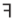, qui sert à définir le mot de passe.
- Appuyez sur ⊕ et ⊖ pour régler les valeurs du paramètre.
- Après avoir défini le mot de passe du paramètre, quittez l'interface actuelle puis entrez à nouveau : la valeur du paramètre disparaît.
- Entrez dans l'interface des paramètres avancés, basculez vers , saisissez le mot de passe défini précédemment : le paramètre de mot de passe disparu réapparaît et vous pouvez alors modifier le mot de passe.

La valeur du paramètre de verrouillage par mot de passe suit la règle du code 421 :

| Paramètre verrouillé | Indice de forme d'onde | Indice d'accélération | Limitation de la tension de sortie maximale | Opération logique des sources de signaux de la sortie principale | Seconde source de signal de la sortie principale | Première source de signal de la sortie principale | Opération logique des sources de signaux du port de contrôle D | Seconde source de signal du port de contrôle D | Première source de signal du port de contrôle D | Type de capteur du port C | Cycles de freinage/Arrêt progressif | Fréquence de sortie |
|---|---|---|---|---|---|---|---|---|---|---|---|---|
| 1 : Verrouillé | 1 | 1 | 1 | 1 | 1 | 1 | 1 | 1 | 1 | 1 | 1 | 1 |
| 0 : Déverrouillé | 0 | 0 | 0 | 0 | 0 | 0 | 0 | 0 | 0 | 0 | 0 | 0 |
| Facteur de multiplication | 4 | 2 | 1 | 4 | 2 | 1 | 4 | 2 | 1 | 4 | 2 | 1 |
| Plage de la valeur du mot de passe (somme) | 0~7 (1er chiffre de la valeur du mot de passe) | | | 0~7 (2e chiffre de la valeur du mot de passe) | | | 0~7 (3e chiffre de la valeur du mot de passe) | | | 0~7 (4e chiffre de la valeur du mot de passe) | | |
| Exemple 1 | 0 | 0 | 0 | 0 | 0 | 0 | 0 | 0 | 0 | 0 | 0 | 1 |
| | 0 | | | 0 | | | 0 | | | 1\*1=1 | | |
| Exemple 2 | 1 | 0 | 0 | 0 | 0 | 1 | 0 | 0 | 0 | 0 | 0 | 1 |
| | 1\*4=4 | | | 1\*1=1 | | | 0 | | | 1\*1=1 | | |
| Exemple 3 | 0 | 0 | 0 | 0 | 0 | 0 | 0 | 0 | 0 | 1 | 1 | 1 |
| | 0 | | | 0 | | | 0 | | | 1\*4+1\*2+1\*1=7 | | |

**Exemple 1 :** pour verrouiller la fréquence de sortie, les 12 groupes de codes binaires sont 000000000001 et la valeur du mot de passe définie est 0001.

**Exemple 2 :** verrouillez la fréquence de sortie, l'indice de forme d'onde et la première source de signal de la sortie principale : les 12 groupes de codes binaires sont 100001000001 et la valeur du mot de passe définie est 4101.

**Exemple 3 :** verrouillez la fréquence de sortie, le nombre de cycles de freinage/temps d'arrêt progressif et le type de capteur du port C : les 12 groupes de codes binaires sont 000000000111 et la valeur du mot de passe définie est 0007.

Lorsque la « plage du paramètre de verrouillage par mot de passe » est réglée sur 9999, tous les paramètres marqués d'un « * » sont verrouillés.

---

## 5.10 Restauration des réglages par défaut/Reprise du mode d'usine

L'utilisateur peut restaurer rapidement le contrôleur à son état d'usine par défaut.

En raison des fonctions puissantes du contrôleur, de nombreux paramètres peuvent être réglés. Pour les débutants, il peut être difficile de restaurer l'état de fonctionnement normal du contrôleur après plusieurs réglages et modifications. Utilisez cette fonction pour restaurer rapidement l'état désordonné des paramètres au réglage d'usine par défaut.

Pour restaurer les réglages d'usine, il est nécessaire d'utiliser le paramètre de reprise du mode d'usine (Pin) en combinaison. Le mode de reprise d'usine est décrit comme suit :

- **0 :** restaure le **groupe de paramètres de travail** sur le **groupe de paramètres utilisateur**.
- **5 :** enregistre le **groupe de paramètres de travail** dans le **groupe de paramètres utilisateur**.
- **35 :** restaure le **groupe de paramètres de travail** sur les **valeurs d'usine de CUH**.
- **55 :** restaure le **groupe de paramètres de travail** et le **groupe de paramètres utilisateur** sur les **valeurs d'usine de CUH**.

---

- Appuyez simultanément et longuement sur ⚙ et ▲ pour entrer dans l'interface des paramètres avancés.
- Appuyez brièvement sur ▼ pour basculer vers le clignotement complet de l'afficheur LED, c'est-à-dire le paramètre de « restauration des réglages par défaut ». Maintenez ensuite ⊖ enfoncé jusqu'à ce que le contrôleur affiche « ----- », indiquant que le contrôleur a été restauré.
- Relâchez ⊖ ; après l'affichage de « CUH » par le contrôleur, celui-ci entre dans l'état de réglage de la tension de sortie « U ». À ce stade, tous les paramètres ont été restaurés aux réglages d'usine par défaut.

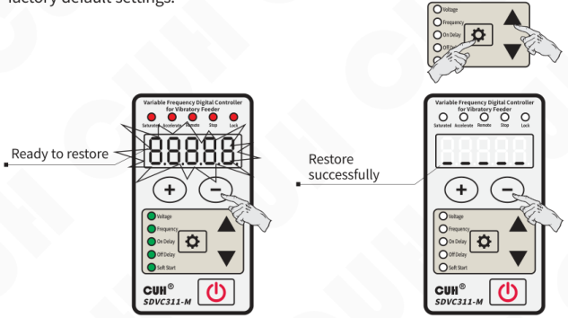

---

## 5.11 Fonction de surveillance des paramètres

Le contrôleur dispose d'un jeu de paramètres de surveillance spécialement conçu pour surveiller l'état du contrôleur.

- Appuyez simultanément et longuement sur ⚙ et ▼ pour entrer dans l'interface des paramètres de surveillance.
- Appuyez brièvement sur ▲ ou ▼ pour sélectionner le paramètre à surveiller.
- La valeur d'un paramètre de surveillance ne peut pas être modifiée.

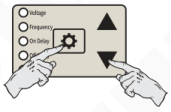

Exemple : C signifie paramètre d'affichage de la température

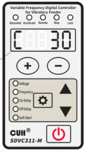

**Les paramètres de surveillance de ce contrôleur comprennent :**

Affichage de la température C, tension du bus PU, tension d'ondulation du bus rU, courant de sortie AC, tension du port A de régulation de vitesse analogique AU, tension du signal du port B bU, tension du signal du port C cU, tension de sortie du port D dU, tension de sortie 24V nU.

---

## Chapitre Ⅵ Caractéristiques techniques

### 6.1 Dimensions

(unité : mm)

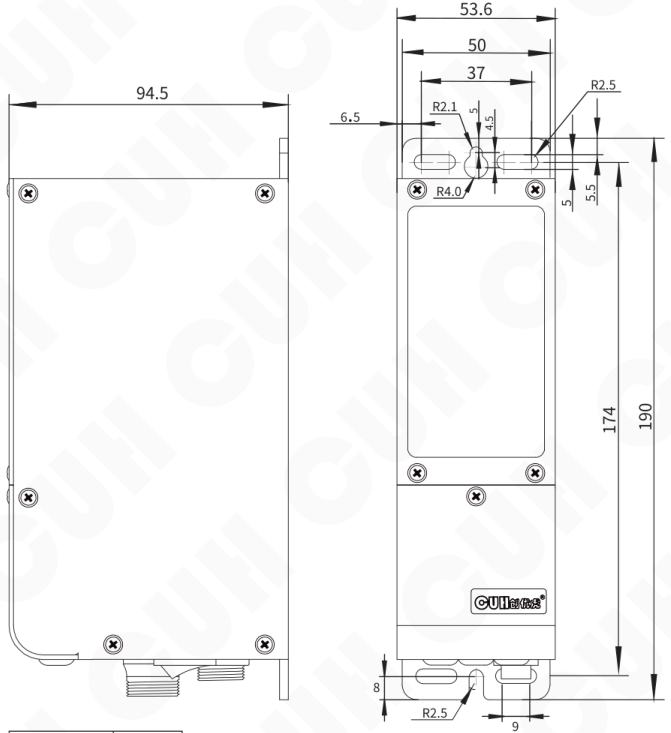

SDVC311-S (1.5A)  
SDVC311-M (3.0A)

| Plage de dimensions | tolérance |
|---|---|
| 0~3 | ±0.05 |
| 3~10 | ±0.1 |
| 10~30 | ±0.15 |
| 30~80 | ±0.2 |
| 80~180 | ±0.3 |
| >180 | ±0.5 |

Cette table de tolérances s'applique à tous les produits de cette série.

---

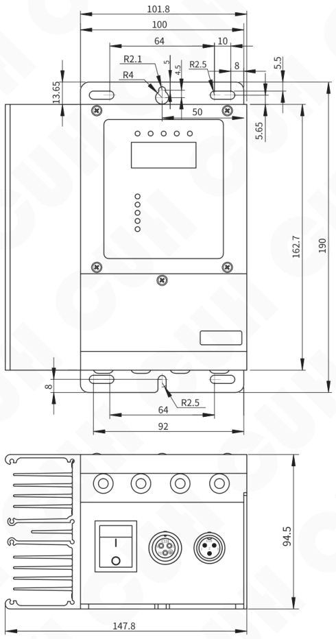

SDVC311-L (4.5A)  
SDVC311-XL (6.0A)

---

## 6.2 Caractéristiques techniques

| Élément | Min | Typique | Max | Unité | Remarque |
|---|---|---|---|---|---|
| Tension d'entrée | 85 | 220 | 250 | V | Valeur efficace CA |
| Plage de tension de sortie réglable | 0 | —— | 260 | V | Inférieure à 150 % de la tension d'entrée |
| Précision de réglage de la tension | | 1 | | V | |
| Précision de stabilisation de la tension | 0 | —— | 10 | % | ΔVout/ΔVin |
| Plage de courant de sortie réglable | 0 | —— | 1.5 | A | SDVC311-S |
| Plage de courant de sortie réglable | 0 | —— | 3.0 | A | SDVC311-M |
| Plage de courant de sortie réglable | 0 | —— | 4.5 | A | SDVC311-L |
| Plage de courant de sortie réglable | 0 | —— | 6.0 | A | SDVC311-XL |
| Puissance de sortie | 0 | —— | 330 | VA | SDVC311-S |
| Puissance de sortie | 0 | —— | 660 | VA | SDVC311-M |
| Puissance de sortie | 0 | —— | 990 | VA | SDVC311-L |
| Puissance de sortie | 0 | —— | 1320 | VA | SDVC311-XL |
| Fréquence de sortie | 5.0 | —— | 400.0 | Hz | |
| Précision de réglage de la fréquence | | 0.1 | | Hz | |
| Forme d'onde de sortie | | Sine | | | |
| Temps de démarrage progressif | 0 | —— | 10.0 | s | Valeur par défaut : 0.5 |
| Plage du temps de retard d'enclenchement/déclenchement | 0 | —— | 99.9 | s | Valeur par défaut : 0.2 |
| Précision du temps de retard d'enclenchement/déclenchement | | 0.1 | | s | |
| Température de déclenchement de la protection contre la surchauffe | 58 | 60 | 66 | °C | |
| Courant de sortie de contrôle CC | 0 | —— | 400 | mA | |
| Tension de sortie de contrôle CC | 22 | 24 | 26 | V | |
| Signal de commande analogique | | 1~5/4~20 | | V/mA | Signal de contrôle de vitesse à distance |
| Signal de commande numérique | | 24 | | V | Signal de commutation |
| Méthode de réglage | | 6 | | Bouton | |
| Consommation en veille | —— | 3 | —— | W | |
| Méthode d'affichage | | 5 | | Chiffre | LED |
| Température ambiante | 0 | 25 | 40 | °C | Sans condensation |
| Humidité ambiante | 10 | 60 | 85 | % | Sans condensation |
| Température ambiante de stockage | -20 | 25 | 65 | °C | Sans condensation |

## 6.3 Norme de référence

**Paramètres absolus :**  
Au-delà de ces normes, le contrôleur serait endommagé ; respectez-les strictement.

| Élément | Norme GB | Norme IEC | Degré | Exigence de la norme | Remarque |
|---|---|---|---|---|---|
| Décharge électrostatique | GB/T 17626.2-2006 | IEC 61000-4-2:2001 | 4 | ±8 kV | Décharge par contact |
| | | | 4 | ±15 kV | Décharge dans l'air |
| Test de transitoire électrique rapide | GB/T 17626.4-2008 | IEC 61000-4-4:2004 | 4 | ±4 kV | |
| Immunité aux ondulations de la ligne d'alimentation CC | GB/T 17626.17-2005 | IEC 61000-4-17:2002 | 4 | 15 % | Degré A |

> **Avertissement**  
> Dans un environnement résidentiel, ce produit peut provoquer des interférences radio, auquel cas des mesures d'atténuation complémentaires peuvent être nécessaires.

---

# Chapitre Ⅶ Annexe

## 7.1 Table des paramètres

| Catégorie | Définition | Symbole | Image du symbole | Plage | Valeur par défaut |
|---|---|---|---|---|---|
| Paramètre commun | Tension de sortie | U |  | 0~260 V | 150 |
| Paramètre de base | Fréquence de sortie * | E |  | 5.0~400.0 Hz | 50.0 |
| | Retard d'enclenchement du capteur photoélectrique intelligent | J |  | 0.0~99.9 s | 0.2 |
| | Retard de déclenchement du capteur photoélectrique intelligent | L |  | 0.0~99.9 s | 0.2 |
| | Démarrage progressif | t |  | 0.0~10.0 s | 0.5 |
| | Cycles de freinage/Arrêt progressif * | d |  | -100~0 cycle (nombre de cycles de freinage) 0.0~10.0 s (Arrêt progressif) | 0.0 |
| | Tension de sortie | U |  | 0~260 V | 150 |
| Paramètre avancé | Sensibilité du capteur photoélectrique intelligent | P |  | PnP, nPn, 2~1000 | 80 |
| | Type de capteur du port C * | ΓA |  | nPn, PnP ut1 (Balayage unique), ut0 (Balayage continu) | ut0 |
| | Retard d'enclenchement du port C | J- |  | 0.0~99.9 s |  identique à J |
| | Retard de déclenchement du port C | L- |  | 0.0~99.9 s |  identique à L |
| | Première source de signal de la sortie principale * | Cq |  | 0, 1, b, -b, C, -C, od, -od, oq, -oq | b |
| | Seconde source de signal de la sortie principale * | Eq |  | 0, 1, b, -b, C, -C, od, -od, oq, -oq | C |
| | Opération logique des sources de signaux de la sortie principale * | nq |  | And, or, Xor, rS | or |
| | Retard d'enclenchement de la sortie principale | Jq |  | 0.0~99.9 s | 0.0 |
| | Retard de déclenchement de la sortie principale | Lq |  | 0.0~99.9 s | 0.0 |
| | Mode de sortie de la sortie principale | Fq |  | dLy (Mode temporisé), HLd (Mode maintenu) | dLy |
| | Direction logique de la sortie principale | oq |  |  on (toujours actif), oFF (toujours inactif) |  |
| | Première source de signal du port de contrôle D * | Cd |  | 0, 1, b, -b, C, -C, od (État de sortie du port D), -od, oq (État de sortie de la sortie principale), -oq | 0 |
| | Seconde source de signal du port de contrôle D * | Ed |  | 0, 1, b, -b, C, -C, od (État de sortie du port D), -od, oq (État de sortie de la sortie principale), -oq | oq |
| | Opération logique des sources de signaux du port de contrôle D * | nd |  | And, or, Xor, rS | or |
| | Retard d'enclenchement du port D | Jd |  | 0.0~99.9 s | 0.0 |

| | Définition | Symbole | Image du symbole | Plage | Valeur par défaut |
|---|---|---|---|---|---|
| Paramètre avancé | Retard de déclenchement du port D | Ld |  | 0.0~99.9 s | 0.0 |
| Paramètre avancé | Mode de sortie du port D | Fd |  | dLy (Mode temporisé), HLd (Mode maintenu) Fn1 mode de sortie de signal périodique 1 Fn2 mode de sortie de signal périodique 2 | dLy |
| Paramètre avancé | Direction logique du port D | Sd |  | --- (Même phase), -⁻- (Inversé) on (toujours actif), oFF (toujours inactif) | --- |
| Paramètre avancé | Type de sortie de contrôle | Cd |  | nPn, PnP, PSP (Push & Pull) | nPn |
| Paramètre avancé | Limitation de la tension de sortie maximale \* | h |  | 0~260 V | 260 |
| Paramètre avancé | Limite inférieure de fréquence | E |  | 5.0~400.0 Hz | 40.0 |
| Paramètre avancé | Indice d'accélération \* | g |  | 100~150 | 150 |
| Paramètre avancé | Indice de forme d'onde \* | r |  | 0~100 | 100 |
| Paramètre avancé | Plage du paramètre de la fonction d'interdiction de réglage | Symbole spécial à 7 segments avec point décimal (voir figure) |  | 0~9999 | 0 |
| Paramètre avancé | Verrouillage de la fonction d'interdiction de réglage des paramètres | Symbole spécial à 7 segments (voir figure) |  | 0~9999 | 0 |
| Paramètre avancé | Restauration des réglages par défaut | 88888 |  | À utiliser en combinaison avec le paramètre Pin | —— |
| Paramètre avancé | Reprise du mode d'usine | Pin |  | 0 : Restaure le groupe de paramètres de travail sur le groupe de paramètres utilisateur 5 : Enregistre le groupe de paramètres de travail dans le groupe de paramètres utilisateur 35 : Restaure le groupe de paramètres de travail sur les valeurs d'usine de CUH 55 : Restaure le groupe de paramètres de travail et le groupe de paramètres utilisateur sur les valeurs d'usine de CUH | 0 |
| Paramètre de surveillance | Température | C |  | -20~85 °C | —— |
| Paramètre de surveillance | Tension interne du bus | PU |  | 0~400 V | —— |
| Paramètre de surveillance | Tension d'ondulation du bus | rU |  | 0~200 V | —— |
| Paramètre de surveillance | Courant de sortie | AC |  | 0.00~1.60 A -SDVC31S/SDVC311S 0.00~3.20 A -SDVC31M/SDVC311M | —— |
| Paramètre de surveillance | Tension du signal du port A | AU |  | 0.00~5.00 V | —— |
| Paramètre de surveillance | Tension du signal du port B | bU |  | 0~999 | —— |
| Paramètre de surveillance | Tension du signal du port C | cU |  | 0.0~28.0 V | —— |
| Paramètre de surveillance | Tension du signal du port D | dU |  | 0.0~28.0 V | —— |
| Paramètre de surveillance | Tension en temps réel du port 24V | nU |  | 0.0~28.0 V | —— |
| Paramètre de surveillance | Version du logiciel de la carte de contrôle | uc |  | —— | —— |
| Paramètre de surveillance | Version du logiciel de la carte de puissance | uP |  | —— | —— |

Remarque : le paramètre marqué du symbole \* peut être verrouillé par .  
Tous les paramètres marqués du symbole \* du contrôleur sont verrouillés lorsque  est réglé sur 9999.

## 7.2 Schémas de circuit d'entrée et de sortie

Port A de contrôle de vitesse à distance

Port B de photo-capteur intelligent

Port C de capteur de commutation

Port D de sortie de contrôle

---

## 7.3 Suggestions de dépannage et explications des erreurs

| Code d'erreur | Définition | Méthodes de dépannage | Image du symbole |
|---|---|---|---|
| Pas d'affichage après la mise sous tension | | Vérifiez que la prise de courant est sous tension Vérifiez que le cordon d'alimentation d'entrée est correctement raccordé à la prise de courant ? | |
| Affichage normal, mais pas de sortie | | Vérifiez que le câble de sortie est correctement raccordé au vibreur. Vérifiez que la tension de sortie n'est pas trop faible. Vérifiez que l'indicateur d'arrêt n'est pas allumé. Vérifiez si le paramètre Normal Close a été réglé, provoquant l'arrêt de la sortie du contrôleur. | |
| Perte d'efficacité du signal de commande | | Vérifiez que le signal de commande est correctement entré. Vérifiez que le fil de terre du signal de commande est correctement raccordé au contrôleur. Vérifiez que la relation logique des signaux de commande est réglée conformément à vos attentes. | |
| Phénomène de battement | | Évitez le couplage de vibration entre les vibreurs. Augmentez la fréquence de résonance des vibreurs. | |
| Affichage normal, pas de sortie, mais un son est audible | | Réglez tous les paramètres comme indiqué dans ce manuel. | |
| Err01 | Court-circuit | Vérifiez que la charge n'est pas en court-circuit, puis tentez de redémarrer la sortie du contrôleur en appuyant deux fois sur le bouton ON/OFF de sortie ou en réinitialisant le contrôleur. |  |
| Err02 | Surintensité | Réduisez convenablement la tension de sortie, puis redémarrez la sortie. |  |
| Err03 | Surchauffe | Installez le contrôleur dans un environnement bien ventilé. |  |
| Err04 | Surtension ou sous-tension | Vérifiez que la tension d'entrée est comprise entre 85~250 Vca. |  |
| Err05 | Anomalie de communication interne | Vérifiez qu'aucune alimentation externe n'est raccordée au port d'alimentation 24V ou contactez notre support technique. |  |
| Err06 | Anomalie du capteur de température | Vérifiez que la température de fonctionnement n'est pas inférieure à -20℃ ou contactez notre support technique. |  |
| Err07 | Protection contre les courts-circuits du port D | Vérifiez que la charge du port D n'est pas en court-circuit et que le courant ne dépasse pas 400mA, puis tentez de redémarrer la sortie du port D. |  |
| Err10 | Anomalie de la sortie d'alimentation 24V | Vérifiez que le port 24V n'est pas en court-circuit et que le courant ne dépasse pas 400mA. |  |
| Err11 | Anomalie de la sortie d'alimentation 5V du port A | Vérifiez que l'alimentation 5V du port A n'est pas en court-circuit ou raccordée à une tension externe supérieure à 5V. |  |

Remarque : en cas d'erreur, le TX du port B est coupé.

## Chapitre Ⅷ Informations de garantie du produit

### 8.1 Période de garantie

La période de garantie accordée par la société pour ce produit est de 3 ans à compter de la date de livraison du produit au lieu désigné par l'acheteur.

### 8.2 Couverture de la garantie

(1) En cas de panne causée par notre société pendant la période de garantie ci-dessus, nous réparerons le produit gratuitement. Toutefois, les situations suivantes ne sont pas couvertes par la garantie :

a. Non-respect des conditions spécifiées dans le manuel simplifié, le manuel d'utilisation ou les exigences techniques convenues spécifiquement entre l'acheteur et la société, utilisation incorrecte, ou panne causée par une mauvaise utilisation.

b. Panne non due à un défaut du produit, mais à la conception de l'équipement ou du logiciel de l'acheteur.

c. Dysfonctionnements causés par des modifications ou des réparations non effectuées par le personnel de la société.

d. Panne pouvant être entièrement évitée par un entretien correct ou le remplacement des pièces d'usure conformément au guide d'utilisation simplifié ou au manuel d'utilisation.

e. Panne causée, après l'expédition du produit par notre société, par des facteurs tels que des évolutions imprévues du niveau scientifique et technologique.

f. En cas de catastrophes naturelles telles qu'incendie, séisme, inondation, ou de facteurs externes tels qu'une tension anormale, la société n'assume pas la garantie.

(2) La portée de la garantie se limite aux situations stipulées en (1) ; pour les pertes indirectes (telles que dommages à l'équipement, opportunités, perte de profit, etc.) ou d'autres pertes, la société n'assume aucune responsabilité.

### 8.3 Aptitude du produit

Le contrôleur de notre société est conçu et fabriqué pour un usage général dans l'industrie de l'alimentation vibratoire. Par conséquent, ce contrôleur de notre société ne doit pas être utilisé pour les applications suivantes et ne convient pas à ces usages.

(1) Les installations ayant un impact grave sur la vie et les biens, telles que les centrales nucléaires, les aéroports, les chemins de fer, les navires, les dispositifs motorisés et les équipements médicaux.

(2) Les services publics, y compris l'électricité, le gaz, l'approvisionnement en eau, etc.

(3) L'utilisation en extérieur dans des conditions ou environnements similaires.

---

Nanjing CUH Science & Technology Co.,Ltd  
https://en.cuhnj.com  
Tel.:+86-25-84730411 / 84730415 / 84730416  
Fax:+86-25-84730426  
E-mail:sales@cuhnj.com  
Add.:Building 2, Xueyan Tech Park, Tuscity,  
No.9 Zhineng Rd, Jiangning, Nanjing, China

Document No.: IDP1000532

