# **Manuel d'instructions de la série CUH SDVC31**  
**Contrôleur numérique de fréquence variable pour alimentateur vibrant**

---
# Avant-propos

Merci d'avoir choisi les contrôleurs numériques intelligents pour alimentateur vibrant **CUH**.(Le contrôleur, ainsi abrégé dans la suite du texte)

Ce manuel couvre l'installation, le débogage, le réglage des paramètres, la maintenance et le dépannage du contrôleur. Veuillez lire attentivement ce manuel avant d'utiliser le contrôleur et le conserver soigneusement

## Ce manuel s'applique aux modèles suivants :

➡Contrôleur numérique de fréquence variable pour alimentateur vibrant  
SDVC31-S (courant de sortie 1.5A)

➡Contrôleur numérique de fréquence variable pour alimentateur vibrant  
SDVC31-M (courant de sortie 3.0A)

➡Contrôleur numérique de fréquence variable pour alimentateur vibrant  
SDVC31-L (courant de sortie 4.5A)

➡Contrôleur numérique de fréquence variable pour alimentateur vibrant  
SDVC31-XL (courant de sortie 6.0A)

➡Contrôleur numérique de fréquence variable pour alimentateur vibrant  
SDVC31-U (courant de sortie 10.0A)

➡Contrôleur numérique de fréquence variable pour alimentateur vibrant  
SDVC31-XU (courant de sortie 20.0A)

---

# Avertissement

➜ Ne jamais effectuer de connexion à chaud ni toucher les contacts, quel que soit le cas, afin d'éviter un choc électrique ou d'autres accidents.

➜ Le boîtier du contrôleur est mis à la terre via le câble d'alimentation d'entrée. Veuillez vous assurer que la prise de courant est correctement mise à la terre.

➜ Ne jamais raccorder le contrôleur à du 380V AC, ce qui pourrait causer des dommages irréparables.  
(Choisissez des produits conçus pour le 380V AC en cas de besoin)

➜ Ne jamais commuter l'entrée du contrôleur en coupant l'alimentation au moyen d'un relais, d'un PLC ou d'autres dispositifs, sinon la durée de vie du contrôleur risque d'être sévèrement réduite.

➜ Le contrôleur est conçu pour fonctionner dans un environnement frais et sec. Ne jamais l'utiliser en extérieur afin d'éviter l'immersion ou l'exposition au soleil. Faites fonctionner le contrôleur dans la plage de température requise par ses caractéristiques électriques.

➜ Ne jamais faire fonctionner le contrôleur dans des conditions dépassant ses limites de conception.

➜ Utilisez le contrôleur strictement conformément à ce manuel. Nous n'assumerons aucune responsabilité civile ou pénale si des dommages matériels ou des blessures corporelles sont causés par une utilisation incorrecte.

> [!CAUTION]
> **N'ouvrez jamais le boîtier du contrôleur afin d'éviter un choc électrique.** Contactez CUH en cas de panne du contrôleur.
>
> N'essayez jamais de modifier le contrôleur, car les cartes électroniques à état solide qu'il contient ne peuvent pas être réparées et ne comportent aucune pièce réglable.

---

# Environnement de fonctionnement

## Inspection avant utilisation

Chaque contrôleur subit un contrôle qualité rigoureux avant la livraison et est emballé  
dans un emballage anti-choc.

## Veuillez vérifier les points suivants après le déballage :

➜ Vérifier si l'aspect du contrôleur est endommagé

➜ Vérifier si le modèle du contrôleur correspond exactement à votre commande

## Environnement d'exécution

Veuillez respecter les consignes ci-dessous pour garantir de meilleures performances et une durée de vie  
plus longue du contrôleur

➜ Environnement bien ventilé

➜ Éloigner de l'eau, de la vapeur, de la poussière et en particulier de la poussière huileuse

➜ Éloigner des gaz et liquides corrosifs ou inflammables

➜ Éloigner de la poussière volante et des particules métalliques

➜ Fixer fermement pour éviter l'auto-vibration

➜ Éloigner des interférences électromagnétiques

➜ Fonctionner dans la plage de température de 0 °C à 40 °C

➜ Pour une utilisation à une altitude de 2000m ou moins

---

# Chapitre Ⅰ Caractéristiques

Le contrôleur est spécialement conçu pour piloter des alimentateurs vibratoires dans les systèmes d'automatisation. Combinant les dernières technologies électroniques et une conception soignée, le contrôleur offre les fonctions pratiques et utiles suivantes :

**Réglage de la fréquence :** La fréquence de sortie est comprise entre 40.0Hz et 400.0Hz.

**Réglage de la tension :** La tension de sortie est comprise entre 0V et 250V.

**Stabilisation automatique de la tension :** Le contrôleur peut éliminer les variations de vitesse d'alimentation causées par les fluctuations de la tension du secteur.

**Démarrage progressif :** Afin d'éviter les chocs brusques sur les pièces, le contrôleur peut augmenter progressivement la tension de sortie de 0 à la valeur préréglée au démarrage.

**Détection photoélectrique intelligente :** Notre capteur photoélectrique intelligent adaptatif peut arrêter le contrôleur lorsque les pièces sont pleines ou absentes et assurer les fonctions de réglage du temps de démarrage progressif, de retard d'enclenchement, de retard de déclenchement et de réglage de la relation logique.

**Arrêt lorsque les pièces sont pleines :** Un capteur de commutation NPN peut arrêter le contrôleur lorsque les pièces sont pleines et assurer les fonctions de réglage du temps de démarrage progressif, de retard d'enclenchement, de retard de déclenchement et de réglage de la relation logique.

**Accélération :** Grâce à cette fonction, la valeur maximale de la tension de sortie du contrôleur peut être portée jusqu'à 150% de la valeur de la tension d'entrée.

**Contrôle de vitesse à distance :** La tension de sortie du contrôleur peut être pilotée par un potentiomètre externe, un PLC ou un signal de contrôle en tension compris entre 1V et 5V.

**Sortie de contrôle :** Le signal de sortie de contrôle émis par le transistor permet de synchroniser un électroaimant ou d'autres dispositifs externes avec le contrôleur.

**Verrouillage du clavier :** Appuyez sur le bouton ON/OFF et maintenez-le 2 secondes pour verrouiller tous les boutons afin d'éviter les fausses manœuvres.

**Limitation de la tension de sortie maximale :** La valeur maximale de la tension de sortie peut être préréglée pour protéger l'équipement contre les dommages causés par une mauvaise utilisation.

**Réglage de l'indice de forme d'onde :** Les opérateurs peuvent pondérer le rendement et la capacité maximale en réglant ce paramètre.

**Restauration des réglages par défaut :** Cette fonction permet à l'utilisateur de rétablir tous les réglages de paramètres par défaut et de réinitialiser le contrôleur.

**CUH** attache une grande importance à la gestion de la qualité des produits et à la sécurité. Outre les composants de haute qualité que nous utilisons et notre système de contrôle qualité rigoureux, **CUH** a pris en compte les accidents possibles que les utilisateurs peuvent rencontrer et fournit les fonctions de protection suivantes pour maximiser la praticité du contrôleur.

**Protection contre les courts-circuits :** Si la sortie du contrôleur est en court-circuit, le contrôleur interrompt sa sortie jusqu'à son redémarrage.

**Protection contre les surintensités :** Le contrôleur interrompt sa sortie pour garantir la sécurité de fonctionnement des équipements lorsque le courant de fonctionnement dépasse sa valeur nominale.

**Protection contre la surchauffe :** Le contrôleur interrompt sa sortie pour se protéger lorsque la température de fonctionnement est trop élevée.

Les contrôleurs **CUH** sont strictement conformes à la certification CE.

---

# Chapitre Ⅱ Guide d'installation

## Étape un :

Ouvrez l'emballage et vérifiez l'aspect extérieur du contrôleur, puis assurez-vous que le modèle du contrôleur correspond exactement à votre commande.

## Étape deux :

Raccordez le câble d'alimentation de sortie fourni dans l'emballage aux bobines électromagnétiques du vibrateur.

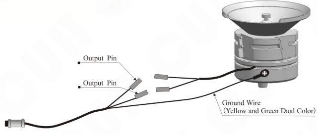

Légendes de la figure :

- Broche de sortie
- Broche de sortie
- Fil de terre (bicolore jaune et vert)

## ⚠ Avertissement

Assurez-vous que les bobines électromagnétiques du vibrateur sont raccordées aux deux broches de sortie du câble d'alimentation de sortie et qu'elles sont correctement mises à la terre, sinon de graves incidents de sécurité peuvent survenir.

---

---

## Étape trois :

Raccordez le câble d'alimentation d'entrée au contrôleur et verrouillez l'écrou d'alimentation.

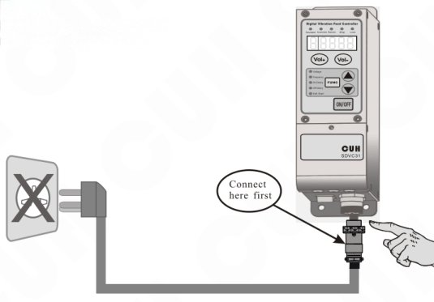

## Étape quatre :

Branchez la fiche du câble d'alimentation d'entrée sur la prise de courant.

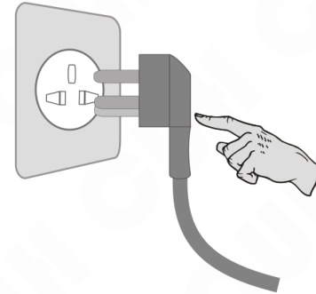

---

---

## Étape cinq :

Réglez la tension de sortie du contrôleur sur une valeur comprise entre 30 et 80 (représentée par la lettre U)

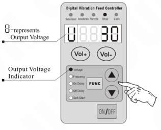

Légendes du schéma :

- U — représente la tension de sortie
- Indicateur de tension de sortie

## Étape six :

Appuyez sur le bouton <kbd>FUNC</kbd> et maintenez-le 2 secondes pour accéder au statut de réglage des paramètres de base.

L'indicateur de fréquence de sortie du panneau s'allume et le LED affiche la valeur de fréquence actuelle (E) Appuyez sur le bouton ▲ ou ▼ pour régler la valeur du paramètre de 400Hz à 40Hz afin de trouver la fréquence harmonique du vibrateur et maintenez cette valeur.

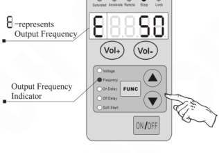

Légendes du schéma :

- E — représente la fréquence de sortie
- Indicateur de fréquence de sortie

> ● La fréquence harmonique du vibrateur désigne la valeur de fréquence qui génère l'amplitude maximale.
>
> ● Chaque vibrateur possède sa propre fréquence de résonance mécanique naturelle ; réglez la fréquence de sortie du contrôleur sur cette fréquence pour garantir les meilleures conditions de fonctionnement.

---

---

## Étape sept :

Après avoir réglé la fréquence de sortie du contrôleur sur la fréquence de résonance mécanique naturelle du vibrateur, ajustez la tension de sortie du contrôleur en appuyant sur le bouton **Vol+** ou **Vol-** pour modifier la vitesse d'alimentation.

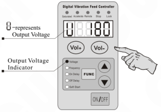

Après les sept étapes ci-dessus, le contrôleur peut fonctionner normalement. Veuillez consulter les autres chapitres si des fonctions de contrôle avancées sont nécessaires.

---

# Chapitre Ⅲ Description des composants

## 3.1 Description du panneau de commande

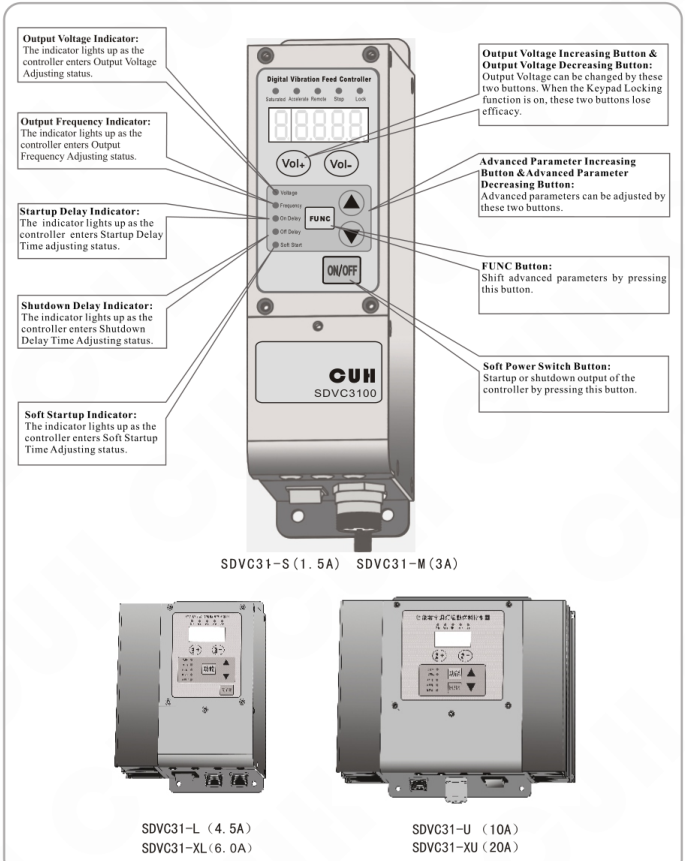

### Indicateurs et boutons du panneau de commande

| Élément | Description |
|---|---|
| Indicateur de tension de sortie | L'indicateur s'allume lorsque le contrôleur entre dans le statut de réglage de la tension de sortie. |
| Indicateur de fréquence de sortie | L'indicateur s'allume lorsque le contrôleur entre dans le statut de réglage de la fréquence de sortie. |
| Indicateur de retard d'enclenchement | L'indicateur s'allume lorsque le contrôleur entre dans le statut de réglage du temps de retard d'enclenchement. |
| Indicateur de retard de déclenchement | L'indicateur s'allume lorsque le contrôleur entre dans le statut de réglage du temps de retard de déclenchement. |
| Indicateur de démarrage progressif | L'indicateur s'allume lorsque le contrôleur entre dans le statut de réglage du temps de démarrage progressif. |
| Bouton d'augmentation de la tension de sortie & bouton de diminution de la tension de sortie | La tension de sortie peut être modifiée à l'aide de ces deux boutons. Lorsque la fonction de verrouillage du clavier est activée, ces deux boutons deviennent inopérants. |
| Bouton d'augmentation des paramètres avancés &bouton de diminution des paramètres avancés | Les paramètres avancés peuvent être réglés à l'aide de ces deux boutons. |
| Bouton FUNC | Permet de faire défiler les paramètres avancés en appuyant sur ce bouton. |
| Bouton de mise sous/hors tension | Permet d'activer ou de couper la sortie du contrôleur en appuyant sur ce bouton. |

### Modèles présentés

| Modèle | Courant |
|---|---:|
| SDVC31-S | 1.5A |
| SDVC31-M | 3A |
| SDVC31-L | 4.5A |
| SDVC31-XL | 6.0A |
| SDVC31-U | 10A |
| SDVC31-XU | 20A |

---

---

## 3.2 Description des indicateurs d'état

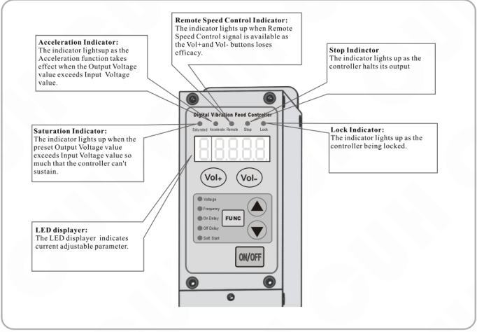

- **Indicateur d'accélération :** L'indicateur s'allume lorsque la fonction d'accélération prend effet, c'est-à-dire quand la valeur de la tension de sortie dépasse celle de la tension d'entrée.
- **Indicateur de contrôle de vitesse à distance :** L'indicateur s'allume lorsqu'un signal de contrôle de vitesse à distance est présent et que les boutons Vol+ et Vol- deviennent inopérants.
- **Indicateur d'arrêt :** L'indicateur s'allume lorsque le contrôleur interrompt sa sortie.
- **Indicateur de saturation :** L'indicateur s'allume lorsque la valeur préréglée de la tension de sortie dépasse tellement la valeur de la tension d'entrée que le contrôleur ne peut plus la maintenir.
- **Indicateur de verrouillage :** L'indicateur s'allume lorsque le contrôleur est verrouillé.
- **Afficheur LED :** L'afficheur LED indique le paramètre réglable actuel.

## 3.3 Description des interfaces d'entrée/sortie

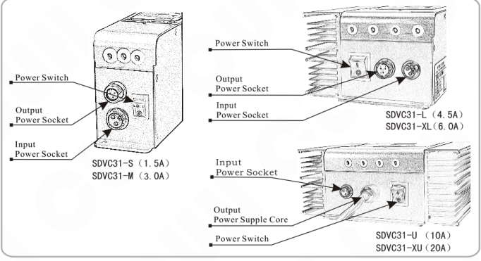

- **SDVC31-S（1.5A） / SDVC31-M（3.0A）**
  - Interrupteur d'alimentation
  - Prise d'alimentation de sortie
  - Prise d'alimentation d'entrée
- **SDVC31-L（4.5A） / SDVC31-XL（6.0A）**
  - Interrupteur d'alimentation
  - Prise d'alimentation de sortie
  - Prise d'alimentation d'entrée
- **SDVC31-U（10A） / SDVC31-XU（20A）**
  - Prise d'alimentation d'entrée
  - Borne d'alimentation de sortie
  - Interrupteur d'alimentation

---

# Chapitre Ⅳ Description des fonctions

## 4.1 Réglage de la tension de sortie

La tension de sortie peut être réglée directement et numériquement depuis le panneau de commande. Grâce à la fonction unique de stabilisation de la tension, la tension de sortie du contrôleur ne fluctue pas comme la tension d'entrée, et un vibrateur peut fonctionner de manière stable dans un environnement où la tension d'entrée est instable.

- Allumez l'interrupteur d'alimentation

- L'indicateur de tension de sortie s'allume lorsque le contrôleur entre dans le statut de réglage de la tension de sortie, le LED affichant le symbole de tension U et la valeur de tension précédemment réglée.

- Réglez la valeur de la tension de sortie en appuyant sur le bouton <kbd>Vol+</kbd> ou <kbd>Vol-</kbd>.

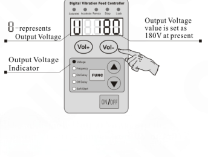

- U — représente la tension de sortie
- Indicateur de tension de sortie
- La tension de sortie est actuellement réglée sur 180V
- La tension de sortie réglable de cette série de contrôleurs est comprise entre 0V et 250V

> La tension de sortie peut être ajustée dans n'importe quel statut de réglage des paramètres de base ou des paramètres avancés en appuyant sur le bouton <kbd>Vol+</kbd> ou <kbd>Vol-</kbd>. Le contrôleur revient au statut de réglage précédent après l'ajustement de la tension de sortie.

## ☺ Accélération

Lorsque la valeur de tension de sortie souhaitée dépasse la valeur de la tension d'entrée, la fonction d'accélération du contrôleur agit et l'indicateur d'accélération s'allume.

Lorsque la valeur de tension de sortie souhaitée dépasse de trop la valeur de la tension d'entrée, le contrôleur ne peut pas fournir une telle tension et l'indicateur de saturation s'allume.

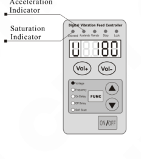

- Indicateur d'accélération
- Indicateur de saturation

---

---

## 4.2 Réglage de la fréquence de sortie

Le contrôleur est fabriqué avec la technologie DDS et sa sortie offre une précision et une stabilité de fréquence élevées qui ne varient ni avec le temps ni avec la température.

- Appuyez sur le bouton <kbd>FUNC</kbd> et maintenez-le 2 secondes pour accéder au statut de réglage des paramètres de base.

- L'indicateur de fréquence du panneau s'allume et le LED affiche le symbole de fréquence de sortie **E** ainsi que la valeur actuelle de la fréquence de sortie.

- Appuyez sur le bouton ▲ ou ▼ pour régler la valeur du paramètre.

La fréquence de sortie du contrôleur est comprise entre 40Hz et 400Hz.

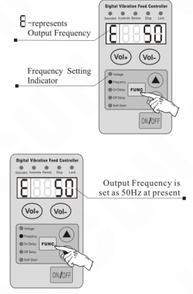

**Légendes de la figure :**

- **E** — représente la fréquence de sortie
- Indicateur de réglage de fréquence
- La fréquence de sortie est actuellement réglée sur 50Hz

> ☺
>
> ● La fréquence de sortie (E), le temps de retard d'enclenchement, le temps de retard de déclenchement et le temps de démarrage progressif peuvent être réglés après être entré dans le statut de réglage des paramètres de base en appuyant sur le bouton <kbd>FUNC</kbd> et en le maintenant 2 secondes.
>
> ● Le contrôleur reviendra automatiquement au statut de réglage de la tension de sortie 1 minute après l'opération de réglage.
>
> ● Appuyez à nouveau sur le bouton <kbd>FUNC</kbd> et maintenez-le 2 secondes pour quitter le statut de réglage des paramètres de base.

---

## 4.3 Démarrage progressif

Afin d'éviter les chocs brusques sur les pièces, le contrôleur peut augmenter progressivement la tension de sortie de 0 à la valeur préréglée au démarrage.

Temps de démarrage progressif ( t ) : Durée nécessaire au contrôleur pour augmenter progressivement la tension de sortie de 0 à la valeur préréglée au démarrage.

» Appuyez sur le bouton **FUNC** et maintenez-le 2 secondes pour accéder au statut de réglage des paramètres de base.

» Appuyez de manière répétée sur le bouton **FUNC** jusqu'à passer au statut de réglage du temps de démarrage progressif (t), l'indicateur de démarrage progressif s'allumant.

» Appuyez sur le bouton ▲ ou ▼ pour régler la valeur du paramètre. L'unité du paramètre est la seconde et la précision numérique est de 0.1.

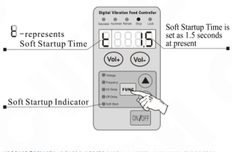

- **t** - représente le temps de démarrage progressif
- Indicateur de démarrage progressif
- Le temps de démarrage progressif est actuellement réglé sur 1.5 seconde

Le temps de démarrage progressif réglable est compris entre 0.1 seconde et 9.9 secondes.

## 4.4 Bouton de commutation de sortie

Le bouton de commutation tactile du panneau permet d'allumer/éteindre rapidement et facilement la sortie du contrôleur.

» Appuyez sur le bouton **ON/OFF** pour allumer/éteindre la sortie du contrôleur. L'indicateur d'arrêt s'allume lorsque la sortie du contrôleur est éteinte.

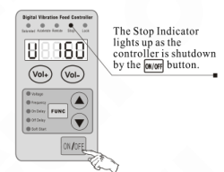

L'indicateur d'arrêt s'allume lorsque le contrôleur est arrêté par le bouton **ON/OFF**.

😊

Grâce à l'interrupteur tactile et à la technologie de contrôle par signal numérique, aucune étincelle ne se produit pour endommager le contact. Par conséquent, la durée de vie du contrôleur et du vibrateur sera considérablement prolongée.

---

## 4.5 Limitation de la tension de sortie maximale

La tension de sortie maximale du contrôleur peut être réglée pour éviter d'endommager le vibrateur. La fonction de contrôle de vitesse à distance est influencée par ce paramètre.

- Appuyez simultanément sur les boutons <kbd>FUNC</kbd> et ▲ et maintenez-les 2 secondes pour accéder au statut de réglage des paramètres avancés.
- Appuyez de manière répétée sur le bouton <kbd>FUNC</kbd> jusqu'à passer au statut de limitation de la tension de sortie maximale (h).
- Appuyez sur le bouton ▲ ou ▼ pour régler la valeur du paramètre.

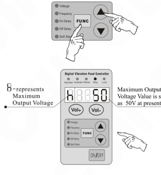

> ● En aucun cas la valeur de la tension de sortie ne peut dépasser la valeur de ce paramètre.  
> ● La valeur par défaut de ce paramètre correspond à la valeur maximale réglable de la tension de sortie.

## Méthode de sortie du statut de réglage des paramètres avancés

● Le contrôleur reviendra automatiquement au statut de réglage de la tension de sortie une minute après le réglage des paramètres avancés.  
● Appuyez sur les boutons <kbd>FUNC</kbd> et ▲ et maintenez-les 2 secondes pour revenir au statut de réglage de la tension de sortie.  
● Appuyez sur le bouton <kbd>FUNC</kbd> et maintenez-le 2 secondes pour revenir au statut de réglage des paramètres de base.

---

## 4.6 Réglage du paramètre d'accélération

Paramètre d'accélération (y) : Ce paramètre représente la tension de sortie maximale en pourcentage de la tension d'entrée. La fonction d'accélération est influencée par ce paramètre.

- Appuyez simultanément sur les boutons `FUNC` et ▲ et maintenez-les 2 secondes pour accéder au statut de réglage des paramètres avancés
- Appuyez de manière répétée sur le bouton `FUNC` jusqu'à passer au statut de réglage du paramètre d'accélération (y).
- Appuyez sur le bouton ▲ ou ▼ pour régler la valeur du paramètre.

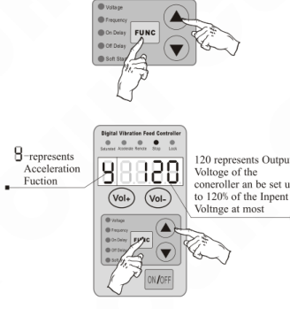

> ● La valeur d'accélération réglable (y) est comprise entre 100 et 150, la valeur par défaut étant 120.  
> ● L'indicateur de saturation s'allume lorsque la tension de sortie du contrôleur dépasse la limite.

---

---

## 4.7 Réglage de l'indice de forme d'onde

Les opérateurs peuvent pondérer le rendement de crête et la puissance maximale (bruit minimal) en réglant ce paramètre.

- Appuyez simultanément sur les boutons **FUNC** et **▲** et maintenez-les 2 secondes pour accéder au statut de réglage des paramètres avancés.
- Appuyez de manière répétée sur le bouton **FUNC** jusqu'à passer au statut de réglage de l'indice de forme d'onde (**r**).
- Appuyez sur le bouton **▲** ou **▼** pour régler la valeur du paramètre.

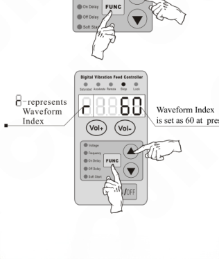

Légendes du schéma :

- **r** représente l'indice de forme d'onde
- L'indice de forme d'onde est actuellement réglé sur **60**

> ☺
>
> ●L'indice de forme d'onde réglable est compris entre 0 et 100.  
> ●La valeur 0 représente le rendement de crête lorsque les lamelles ressort supportent l'effort minimal.  
> ●La valeur 100 représente la puissance maximale (bruit minimal) lorsque les lamelles ressort supportent l'effort maximal.

---

## 4.8 Verrouillage du clavier

La fonction de verrouillage du clavier permet de verrouiller tous les boutons du panneau afin d'éviter les fausses manœuvres.

- Appuyez sur le bouton <kbd>ON/OFF</kbd> et maintenez-le 2 secondes pour verrouiller tous les boutons du panneau, l'indicateur de verrouillage du clavier s'allumant.
- Appuyez sur le bouton <kbd>ON/OFF</kbd> et maintenez-le 2 secondes en mode verrouillé pour déverrouiller le clavier.

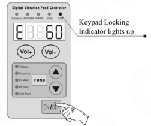

---

## 4.9 Restauration des réglages par défaut

Cette fonction permet à l'opérateur de rétablir tous les réglages de paramètres par défaut.

Le contrôleur offrant de nombreuses fonctions, de nombreux paramètres peuvent être réglés. Afin d'éviter qu'après trop de modifications successives effectuées par un débutant le contrôleur ne fonctionne plus correctement, cette fonction permet à l'opérateur de rétablir facilement les réglages par défaut du contrôleur.

- Appuyez simultanément sur les boutons **FUNC** et **▲** et maintenez-les 2 secondes pour accéder au statut de réglage des paramètres avancés.

  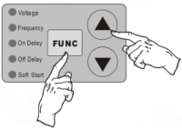

- Appuyez de manière répétée sur le bouton **FUNC** jusqu'à ce que `8888` clignote sur l'afficheur LED, puis appuyez sur le bouton **▲** et maintenez-le jusqu'à ce que `-----` s'affiche, ce qui signifie que les réglages par défaut ont été rétablis avec succès.

  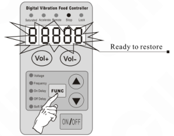

- Après avoir relâché le bouton **▲**, le contrôleur entre dans le statut de réglage de la tension de sortie (U). À ce moment, tous les paramètres ont été rétablis à leurs valeurs par défaut.

  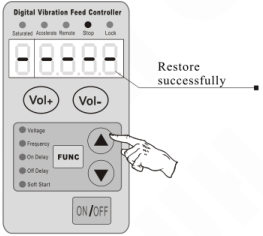

# Chapitre Ⅴ Capteurs et contrôle par signal

Le contrôleur peut être piloté par de nombreux types de signaux et de capteurs externes. Ce chapitre décrit principalement la méthode d'utilisation du capteur photoélectrique intelligent, des capteurs de proximité et du PLC.

## 5.1 Détection photoélectrique intelligente

Combiné au capteur photoélectrique SDVC-S1, la fonction de détection photoélectrique intelligente peut être réalisée. Le capteur SDVC-S1 peut filtrer les interférences de la lumière d'arrière-plan affectant la sensibilité du contrôleur. Par conséquent, le contrôleur peut fonctionner de manière fiable sans réglage manuel de la sensibilité.

### 5.1.1 Méthode de raccordement du capteur photoélectrique intelligent SDVC-S1

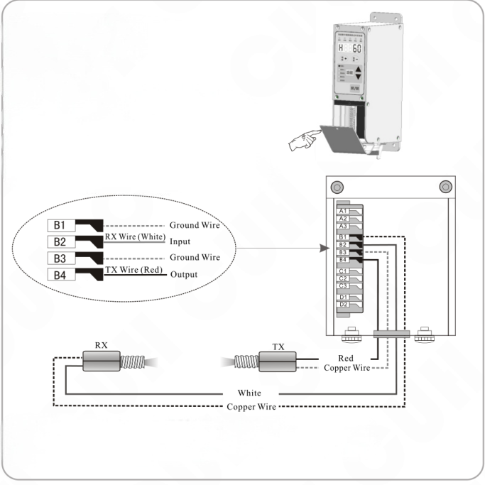

**Étape 1 :**  
Ouvrez le couvercle supérieur du contrôleur.

**Étape 2 :**  
Raccordez le capteur SDVC-S1 aux bornes du contrôleur conformément au schéma.

**Étape 3 :**  
Refermez le couvercle après avoir raccordé le capteur.

**Avertissement :**  
La relation logique par défaut du capteur est réglée sur pièces absentes.

---

## 5.1.2 Réglage du temps de retard d'enclenchement et du temps de retard de déclenchement du capteur photoélectrique intelligent

Dans la plupart des applications réelles, la sortie du contrôleur doit être différée d'une certaine durée lorsque la mise en marche ou l'arrêt du contrôleur est piloté par des signaux externes. Les fonctions de réglage du temps de retard d'enclenchement et du temps de retard de déclenchement rendent ce type d'application possible. En outre, les chocs sur les pièces au démarrage du contrôleur peuvent être éliminés en réglant le temps de démarrage progressif.

### Retard d'enclenchement ( J )

La durée qui s'écoule entre la réception d'un signal de contrôle de mise en marche et la sortie.

- Appuyez sur le bouton **FUNC** et maintenez-le 2 secondes pour accéder au statut de réglage des paramètres de base.
- Appuyez de manière répétée sur le bouton **FUNC** jusqu'à passer au statut de réglage du temps de retard d'enclenchement ( J ), l'indicateur de temps de retard d'enclenchement du panneau s'allumant.
- Réglez le paramètre en appuyant sur le bouton ▲ ou ▼. L'unité du paramètre est la seconde et la précision numérique est de 0.1.

*La plage réglable du paramètre est de 0.0 à 9.9 secondes*  
*La valeur par défaut du paramètre est de 0.2 seconde*

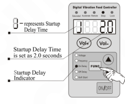

### Retard de déclenchement (L)

La durée qui s'écoule entre la réception d'un signal de contrôle d'arrêt et la coupure de la sortie

- Appuyez sur le bouton **FUNC** et maintenez-le 2 secondes pour accéder au statut de réglage des paramètres de base.
- Appuyez de manière répétée sur le bouton **FUNC** jusqu'à passer au statut de réglage du temps de retard de déclenchement (L), l'indicateur de temps de retard de déclenchement du panneau s'allumant.
- Réglez le paramètre en appuyant sur le bouton ▲ ou ▼. L'unité du paramètre est la seconde et la précision numérique est de 0.1.

*La plage réglable du paramètre est de 0.0 à 9.9 secondes*  
*La valeur par défaut du paramètre est de 0.2 seconde*

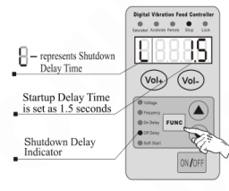

---

## 5.1.3 Réglage de la relation logique du capteur photoélectrique intelligent

En conditions normales, l'extrémité réceptrice ne reçoit aucun signal optique et le contrôleur fonctionne par défaut. Mais dans certaines applications particulières, le contrôleur doit être arrêté lorsque l'extrémité réceptrice ne reçoit aucun signal optique. Le réglage de ce paramètre permet de répondre à ce type d'application.

- Appuyez simultanément sur les boutons **FUNC** et ▲ et maintenez-les 2 secondes pour accéder au statut de réglage des paramètres avancés.

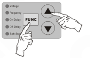

- Appuyez de manière répétée sur le bouton **FUNC** jusqu'à passer au statut de réglage de la relation logique du capteur photoélectrique intelligent.

  **08** — représente la relation logique du capteur photoélectrique intelligent  
  **Normal Open**

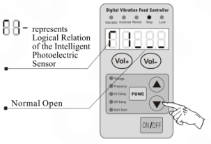

- Réglez le paramètre en appuyant sur le bouton ▲ ou ▼.

  **08** — représente la relation logique du capteur photoélectrique intelligent  
  **Normal Close**

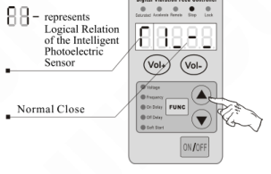

- Lorsque la relation logique est réglée sur Normal Open, c'est-à-dire aucun signal optique reçu, le contrôleur fonctionne.
- Lorsque la relation logique est réglée sur Normal Close, c'est-à-dire aucun signal optique reçu, le contrôleur s'arrête.

---

## 5.2 Méthode d'utilisation du capteur de commutation NPN

Le contrôleur peut fonctionner avec toutes sortes de capteurs, tels que des capteurs de commutation, des capteurs optiques de commutation et des capteurs à fibre optique.

### 5.2.1 Méthode de raccordement du capteur de proximité NPN

**Étape 1 :**  
Ouvrez le couvercle supérieur du contrôleur.

**Étape 2 :**  
Raccordez le capteur de proximité NPN aux bornes du contrôleur conformément au schéma.

**Étape 3 :**  
Refermez le couvercle après avoir raccordé le capteur.

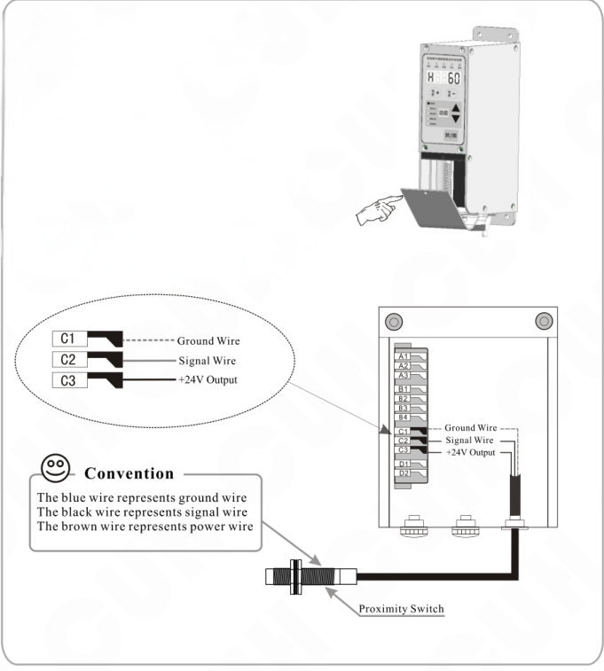

| Borne | Fil |
|---|---|
| C1 | Fil de terre |
| C2 | Fil de signal |
| C3 | Sortie +24V |

**Convention**

Le fil bleu représente le fil de terre  
Le fil noir représente le fil de signal  
Le fil marron représente le fil d'alimentation

Capteur de proximité

---

---

### 5.2.2 Méthode de raccordement du capteur de commutation NPN à contre-rayonnement

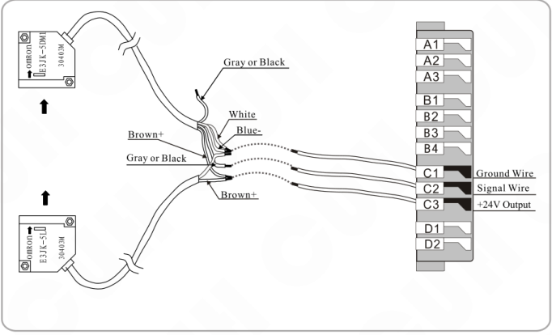

### 5.2.3 Méthode de raccordement du capteur photoélectrique à contre-rayonnement

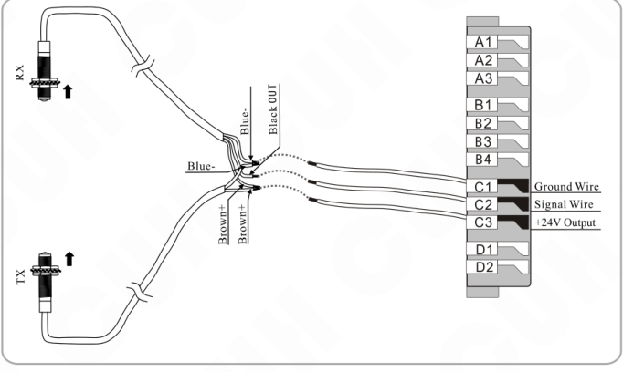

---

## 5.2.4 Méthode de raccordement du capteur à fibre optique à contre-rayonnement

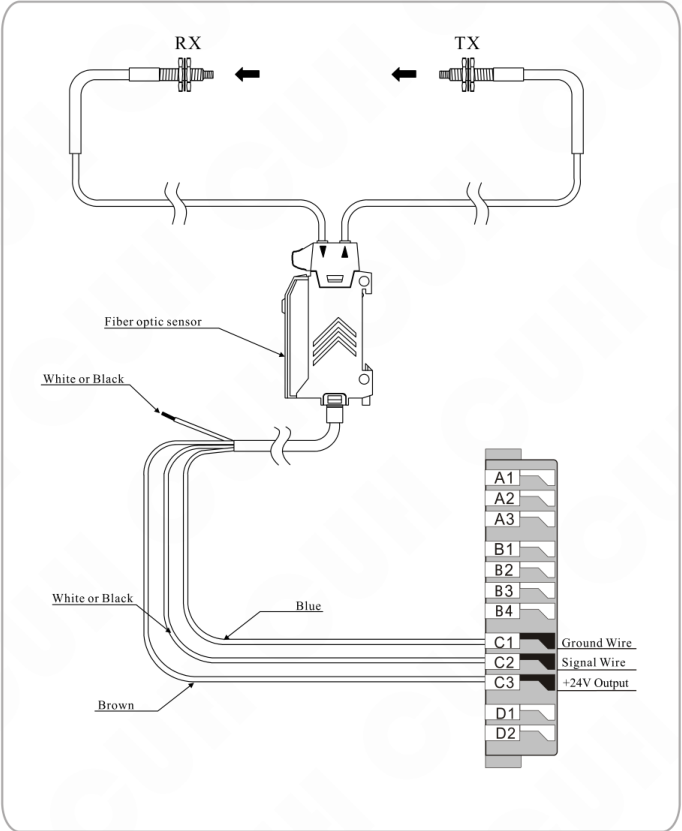

Les légendes du schéma comprennent : **RX**, **TX**, **Capteur à fibre optique**, **Blanc ou Noir**, **Bleu**, **Marron**.

Annotations de bornes présentées :

| Borne | Annotation |
|---|---|
| C1 | Fil de terre |
| C2 | Fil de signal |
| C3 | Sortie +24V |

---

## 5.2.5 Méthode de raccordement du capteur photoélectrique à réflexion

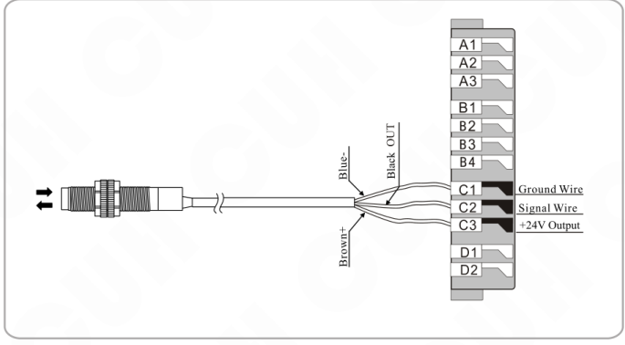

---

---

## 5.3 Réglage du temps de retard d'enclenchement et du temps de retard de déclenchement du capteur de commutation NPN

Par défaut, le capteur photoélectrique intelligent et le capteur de commutation partagent le même temps de retard d'enclenchement et le même temps de retard de déclenchement. Les opérateurs peuvent également régler de manière indépendante le temps de retard d'enclenchement et le temps de retard de déclenchement du capteur de commutation.

### Retard d'enclenchement (J-)

La durée qui s'écoule entre la réception d'un signal de contrôle de mise en marche et la sortie.

- Appuyez simultanément sur les boutons **FUNC** et ▲ et maintenez-les 2 secondes pour accéder au statut de réglage des paramètres avancés.
- Appuyez de manière répétée sur le bouton **FUNC** jusqu'à passer au statut de réglage du temps de retard d'enclenchement (`J---`), l'indicateur de temps de retard d'enclenchement du panneau s'allumant.
- Réglez le paramètre en appuyant sur le bouton ▲ ou ▼. L'unité du paramètre est la seconde et la précision numérique est de 0.1.

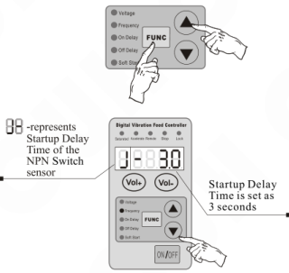

Le retard d'enclenchement est réglé sur `J---` par défaut

### Retard de déclenchement (L-)

La durée qui s'écoule entre la réception d'un signal de contrôle d'arrêt et la coupure de la sortie.

- Appuyez simultanément sur les boutons **FUNC** et ▲ et maintenez-les 2 secondes pour accéder au statut de réglage des paramètres avancés.
- Appuyez de manière répétée sur le bouton **FUNC** jusqu'à passer au statut de réglage du temps de retard de déclenchement (`L-`), l'indicateur de temps de retard de déclenchement du panneau s'allumant.
- Réglez le paramètre en appuyant sur le bouton ▲ ou ▼. L'unité du paramètre est la seconde et la précision numérique est de 0.1.

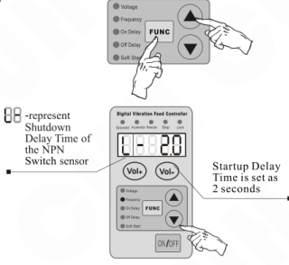

Le retard de déclenchement est réglé sur `L----` par défaut

> ➜ Lorsque les valeurs `J-` et `L-` sont réglées sur 0, le temps de retard d'enclenchement et le temps de retard de déclenchement du capteur de commutation seront identiques à ceux du capteur photoélectrique intelligent.  
> ➜ Le temps de retard d'enclenchement et le temps de retard de déclenchement du capteur photoélectrique intelligent ne sont pas affectés par le paramètre `J-` ou `L-`.

---

---

## 5.4 Réglage de la relation logique du capteur de commutation NPN (arrêt lorsque les pièces sont pleines)

En conditions normales, le contrôleur ne reçoit aucun signal du capteur de commutation NPN et fonctionne par défaut. Mais dans certaines applications particulières, le contrôleur doit être arrêté lorsqu'il ne reçoit aucun signal du capteur de commutation NPN. Le réglage de ce paramètre permet de répondre à cette application.

▶▶ Appuyez simultanément sur les boutons <kbd>FUNC</kbd> et ▲ et maintenez-les 2 secondes pour accéder au statut de réglage des paramètres avancés.

▶▶ Appuyez de manière répétée sur le bouton <kbd>FUNC</kbd> jusqu'à passer au statut de réglage de la relation logique du capteur de commutation NPN (`F2`).

▶▶ Réglez le paramètre en appuyant sur le bouton ▲ ou ▼.

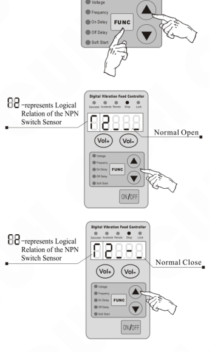

`F2`—représente la relation logique du capteur de commutation NPN.

- Normal Open
- Normal Close

> ●Lorsque la relation logique est réglée sur Normal Open, c'est-à-dire aucun signal reçu, le contrôleur fonctionne.  
> ●Lorsque la relation logique est réglée sur Normal Close, c'est-à-dire aucun signal reçu, le contrôleur s'arrête.

---

## 5.5 Réglage de la relation logique du signal de contrôle

Le contrôleur permet de régler la relation logique entre le capteur photoélectrique intelligent et le capteur de commutation lorsqu'ils fonctionnent simultanément.

▶ Appuyez simultanément sur les boutons **FUNC** et ▲ et maintenez-les 2 secondes pour accéder au statut de réglage des paramètres avancés.

▶ Appuyez de manière répétée sur le bouton **FUNC** jusqu'à passer au statut de réglage de la relation logique du signal de contrôle

▶ Réglez le paramètre en appuyant sur le bouton ▲ ou ▼.

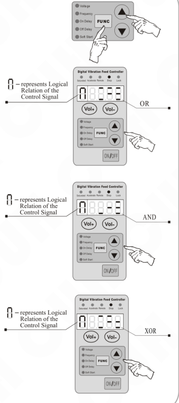

Ⅰ

●Relation logique AND : Le contrôleur ne fonctionne que lorsque le capteur photoélectrique intelligent et le capteur de commutation NPN le demandent tous les deux.

●Relation logique OR : Le contrôleur fonctionne lorsque le capteur photoélectrique intelligent ou le capteur de commutation NPN le demande.

●Relation logique NOR : Le contrôleur ne fonctionne que lorsque le capteur photoélectrique intelligent et le capteur de commutation NPN émettent le signal de contrôle opposé.

---

## 5.6 Méthode de raccordement du PLC supérieur pilotant le contrôleur d'alimentateur vibrant

### 5.6.1 Méthode de raccordement du PLC de contrôle

**Étape un :**  
Ouvrez le couvercle supérieur du contrôleur.

**Étape deux :**  
Raccordez le PLC aux bornes du contrôleur conformément au schéma.

**Étape trois :**  
Refermez le couvercle après avoir raccordé le capteur.

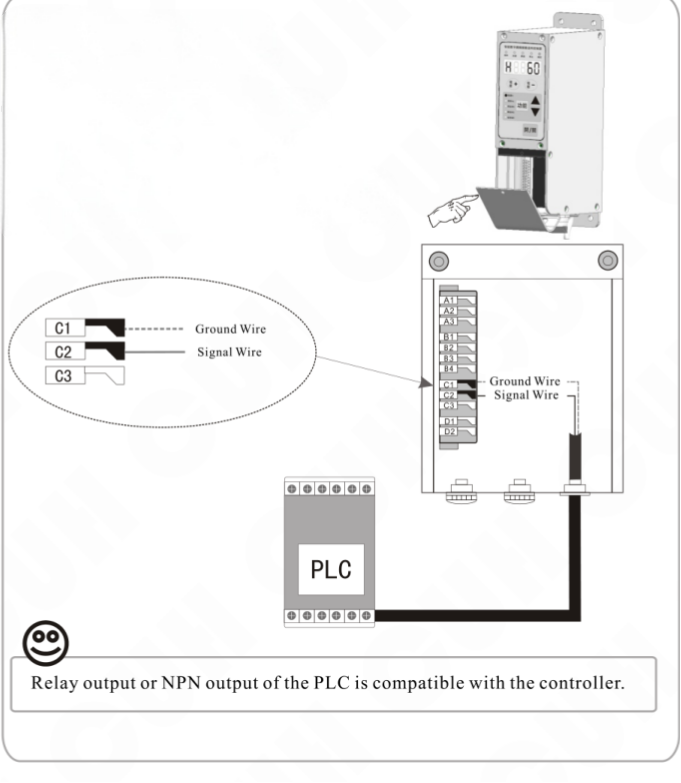

La sortie relais ou la sortie NPN du PLC est compatible avec le contrôleur.

---

---

## 5.7 Sortie de contrôle

Le contrôleur peut délivrer un signal de contrôle basse tension pour coopérer avec d'autres dispositifs tels qu'une électrovanne, un PLC ou un relais électrique.

### 5.7.1 Méthode de raccordement de la sortie de contrôle

**Méthode de raccordement de l'électrovanne**

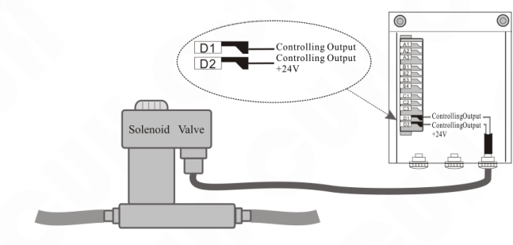

●Le contrôleur peut piloter directement une électrovanne dont la tension nominale est de 24V et la puissance nominale inférieure à 4W.  
●Utilisez une alimentation externe pour une électrovanne de forte puissance.

**Méthode de raccordement du relais électrique**

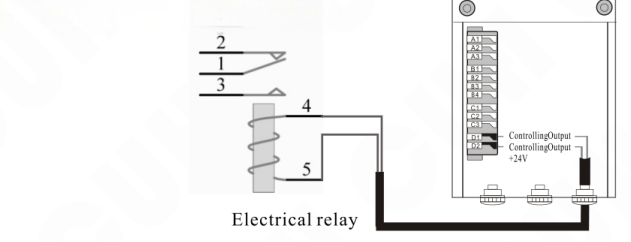

●Le contrôleur peut piloter directement un relais électrique dont la tension nominale est de 24V et la puissance nominale inférieure à 4W.

---

## 5.7.2 Réglage de la relation logique de la sortie de contrôle

- Appuyez simultanément sur les boutons **FUNC** et **▲** et maintenez-les 2 secondes pour accéder au statut de réglage des paramètres avancés.

- Appuyez de manière répétée sur le bouton **FUNC** jusqu'à passer au statut de réglage de la relation logique de la sortie de contrôle (F3).

- Réglez le paramètre en appuyant sur le bouton **▲** ou **▼**.

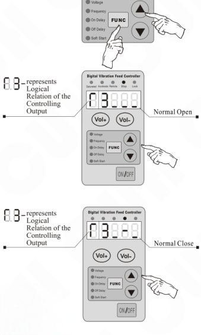

> ● Lorsque la relation logique est réglée sur Normal Open, la sortie de contrôle fonctionne lorsque le contrôleur fonctionne.  
> ● Lorsque la relation logique est réglée sur Normal Close, la sortie de contrôle ne fonctionne pas lorsque le contrôleur fonctionne.

---

---

## 5.8 Contrôle de vitesse à distance

La fonction de contrôle de vitesse à distance permet à l'opérateur de piloter la tension de sortie au moyen d'un potentiomètre externe ou d'un signal de contrôle compris entre 1V et 5V. Ainsi, un contrôle de vitesse à distance externe peut être facilement réalisé par un PLC, un DCS ou d'autres moyens.

La fonction de contrôle de vitesse à distance devient active sur le contrôleur lorsque le signal de contrôle dépasse 0.5V. Pendant ce temps, l'indicateur de contrôle de vitesse à distance du panneau s'allume et les boutons `Vol+` et `Vol-` deviennent inopérants. L'afficheur LED indique la tension de sortie actuelle si le contrôleur fonctionne dans le statut de réglage de la tension de sortie.

### Méthode de raccordement du potentiomètre externe

- A1 : Fil de terre du contrôle de vitesse à distance
- A2 : Entrée du contrôle de vitesse à distance
- A3 : Alimentation du contrôle de vitesse à distance

**Remarque :** Veuillez choisir un potentiomètre linéaire d'une résistance de 1k.

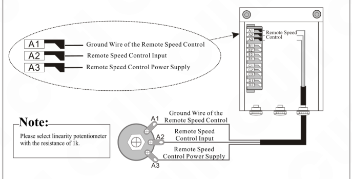

### Méthode de raccordement du PLC

- A1 : Fil de terre du contrôle de vitesse à distance
- A2 : Entrée du contrôle de vitesse à distance
- A3

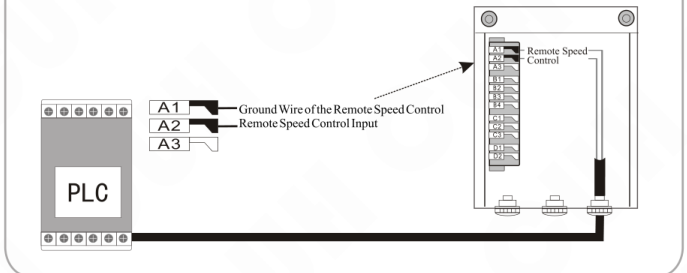

---

---

# Chapitre Ⅵ Fonctions de sécurité

## 6.1 Stabilisation automatique de la tension

La fonction intégrée de stabilisation numérique de la tension permet d'éliminer les variations de vitesse d'alimentation causées par les fluctuations de la tension du secteur.

## 6.2 Protection contre les courts-circuits

Si la sortie du contrôleur est en court-circuit, le contrôleur interrompt sa sortie jusqu'à son redémarrage.

## 6.3 Protection contre les surintensités

Le contrôleur interrompt sa sortie pour garantir la sécurité de fonctionnement des équipements lorsque le courant de fonctionnement dépasse sa valeur nominale.

## 6.4 Protection contre la surchauffe

Le contrôleur interrompt sa sortie pour se protéger lorsque la température de fonctionnement est trop élevée.

---

---

# Annexe

## Annexe A : Dimensions

Dimensions hors-tout du modèle de contrôleur : SDVC31-S et SDVC31-M (unité : mm)

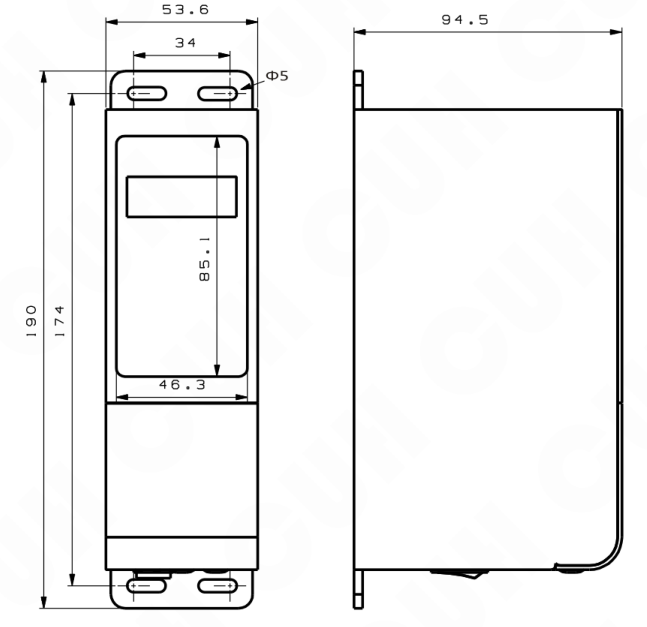

---

Dimensions hors-tout du modèle de contrôleur : SDVC31-L et SDVC31-XL (unité : mm)

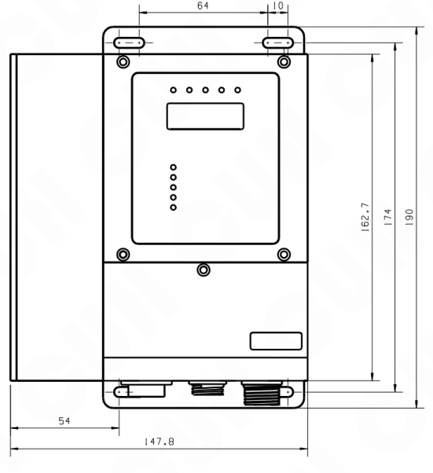

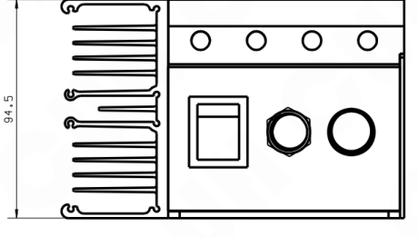

---

Dimensions hors-tout du modèle de contrôleur : SDVC31-U et SDVC31-XU (unité :mm)

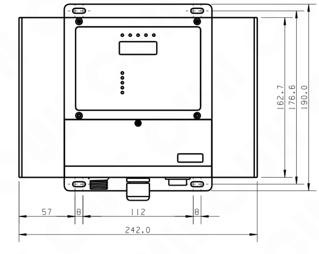

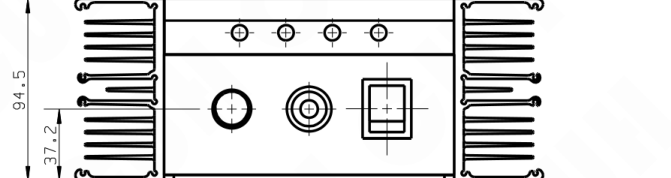

---

---

## Annexe B : Définition de l'interface de sortie

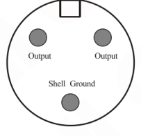

### ☺ Avertissement :

**A :** Assurez-vous que les bobines électromagnétiques du vibrateur sont raccordées aux deux broches de sortie de la prise du câble d'alimentation de sortie et que la carcasse du vibrateur est correctement mise à la terre, sinon de graves incidents de sécurité peuvent survenir.

**B :** Après soudage, assurez-vous que la partie dénudée est enveloppée d'un ruban isolant ou d'un manchon thermorétractable avant de l'insérer dans la prise du câble d'alimentation de sortie, afin d'éviter tout courant de fuite ou court-circuit.

## Annexe C : Définition de l'interface de signaux

| Borne | Définition |
|---|---|
| A1 | Fil de terre du contrôle de vitesse à distance |
| A2 | Entrée du contrôle de vitesse à distance |
| A3 | Alimentation du contrôle de vitesse à distance |
| B1 | Terre |
| B2 | Entrée de signal du capteur photoélectrique intelligent |
| B3 | Terre |
| B4 | Sortie de signal du capteur photoélectrique intelligent |
| C1 | GND +24V |
| C2 | Entrée de signal du capteur de commutation NPN |
| C3 | +24V |
| D1 | Sortie de contrôle |
| D2 | +24V |

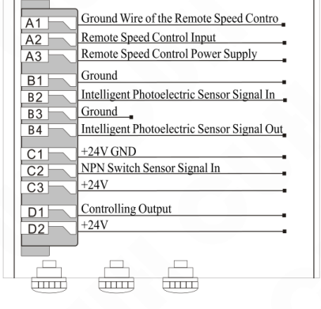

---

## **Annexe D :** Définition des caractères affichés sur le LED

| Contrôleur | Caractère affiché | Image du symbole |
|---|---|---|
| `U` | Tension de sortie |  |
| `F` | Fréquence de sortie |  |
| `d` | Temps de retard d'enclenchement du capteur photoélectrique intelligent | 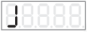 |
| `C` | Temps de retard de déclenchement du capteur photoélectrique intelligent |  |
| `E` | Démarrage progressif |  |
| `U-` | Arrêt D |  |
| `d-` | Temps de retard d'enclenchement du capteur de commutation NPN |  |
| `r1` | Relation logique du capteur photoélectrique intelligent |  |
| `r2` | Relation logique du capteur de commutation NPN |  |
| `r3` | Relation logique de la sortie de contrôle |  |
| `n` | Relation logique du signal de contrôle |  |
| `H` | Tension de sortie maximale |  |
| `A` | Indice d'accélération |  |
| `P` | Indice de forme d'onde |  |
| `88888` | Restauration des réglages par défaut |  |

---

## Annexe E : Caractéristiques électriques

| Élément | Plage Min | Plage Typique | Plage Max | Unité | Description |
|---|---:|---:|---:|:---:|---|
| Tension d'entrée | 85 | 220 | 250 | V | AC RMS |
| Plage de tension de sortie réglable | 0 | —— | 250 | V | Inférieure à 150% de la tension d'entrée |
| Précision du réglage de la tension |  | 1 |  | V |  |
| Précision de la régulation de la tension | 0 | —— | 10 | % | ΔVout/ΔVin |
| Temps de réponse de la régulation de la tension | 0.0025 | —— | 0.025 | s | 1/10 de la période de la tension de sortie |
| Plage de courant de sortie réglable | 0 | —— | 1.5 | A | SDVC31-S |
|  | 0 | —— | 3 | A | SDVC31-M |
|  | 0 | —— | 4.5 | A | SDVC31-L |
|  | 0 | —— | 6 | A | SDVC31-XL |
|  | 0 | —— | 10 | A | SDVC31-U |
|  | 0 | —— | 20 | A | SDVC31-XU |
| Puissance de sortie | 0 | —— | 330 | VA | SDVC31-S |
|  | 0 | —— | 660 | VA | SDVC31-M |
|  | 0 | —— | 990 | VA | SDVC31-L |
|  | 0 | —— | 1320 | VA | SDVC31-XL |
|  | 0 | —— | 2200 | VA | SDVC31-U |
|  | 0 | —— | 4400 | VA | SDVC31-XU |
| Fréquence de sortie | 40 | —— | 400 | Hz |  |
| Précision du réglage de la fréquence |  | 0.1 |  | Hz |  |
| Forme d'onde de sortie |  | sine |  |  |  |
| Temps de démarrage progressif | 0 | —— | 10 | s | Valeur par défaut d'usine :0.5 |
| Plage du temps de retard d'enclenchement/déclenchement | 0 | —— | 20 | s | Valeur par défaut d'usine :0.2 |
| Précision du temps de retard d'enclenchement/déclenchement |  | 0.1 |  | s |  |
| Température de déclenchement de la protection contre la surchauffe | 58 | 60 | 66 | ℃ | SDVC31-S\M |
|  | 60 | 65 | 65 | ℃ | SDVC31-L\XL\U\XU |
| Tension de sortie de contrôle CC | 22 | 24 | 26 | V |  |
| Courant de sortie de contrôle CC | 0 | —— | 200 | mA |  |
| Signal de contrôle analogique |  | 1-5 |  | V | Tension de contrôle de vitesse à distance |
| Signal de contrôle numérique |  | 24 |  | V | Signal de commutation |
| Méthode de réglage |  | 6 |  | Bouton |  |
| Consommation en veille | —— | 3 | —— | W |  |
| Méthode d'affichage |  | 5 |  | Chiffre | Tubes numériques LED |
| Température ambiante | 0 | 25 | 40 | ℃ | Pas de condensation |
| Humidité ambiante | 10 | 60 | 85 | % |  |

## Annexe F : Conseils de dépannage et explications des erreurs

Les conseils suivants peuvent vous aider à résoudre les problèmes que vous pourriez rencontrer

| N° | Problème / affichage | Image du symbole | Conseils de dépannage et explications des erreurs |
|---:|---|---|---|
| 1 | Pas d'affichage après la mise sous tension |  | ◆ Assurez-vous que la prise de courant est sous tension ◆ Assurez-vous que le câble d'alimentation d'entrée est correctement raccordé à la prise de courant |
| 2 | Affichage normal mais pas de sortie |  | ◆ Assurez-vous que le câble d'alimentation d'entrée et le câble d'alimentation de sortie sont fermement raccordés ◆ Assurez-vous que la valeur du paramètre de tension de sortie n'est pas trop faible ◆ Assurez-vous que le contrôleur n'est pas arrêté par le signal de contrôle ◆ Assurez-vous que le contrôleur n'est pas arrêté par des paramètres réglés sur normal off |
| 3 | Le signal de contrôle devient inopérant |  | ◆ Assurez-vous que le signal de contrôle est correctement entré ◆ Assurez-vous que le fil de terre du signal de contrôle est correctement raccordé au contrôleur ◆ Assurez-vous que la relation logique du signal de contrôle est réglée correctement selon vos attentes |
| 4 | Phénomène de battement |  | ◆ Évitez le couplage de vibration entre les vibrateurs ◆ Augmentez la fréquence de résonance des vibrateurs |
| 5 | Affichage normal, pas de sortie, mais un son est audible |  | ◆ Réglez tous les paramètres comme indiqué dans ce manuel |
| 6 | Err01 |  | ◆ Sortie en court-circuit, assurez-vous que le câble d'alimentation de sortie et la bobine ne sont pas en court-circuit |
| 7 | Err02 |  | ◆ Surintensité de sortie, réduisez la valeur de la tension de sortie et assurez-vous que l'entrefer de l'armature n'est pas trop grand |
| 8 | Err03 |  | ◆ Surchauffe, placez le contrôleur dans un environnement bien ventilé |
| 9 | Err04 |  | ◆ Réservé, veuillez nous contacter |
| 10 | Err05 |  | ◆ Réservé, veuillez nous contacter |

**Nanjing CUH Science & Technology Co., Ltd**

No. 1 Xiaodong Road, Chenguang Village, Qilin, Nanjing, Jiangsu, China  
Tel: +86-25-84730415  
Fax: +86-25-84730426  
Email: sales@cuhnj.com  
Website: en.cuhnj.com

