## Contrôleur numérique bi-canal de fréquence variable pour alimentateur vibrant

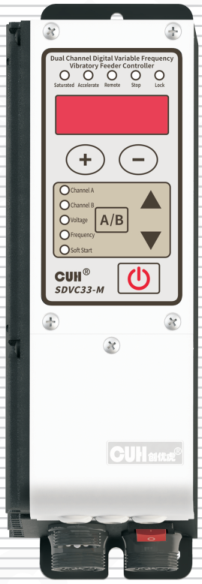

## Série SDVC33
Contrôleur numérique bi-canal de fréquence variable pour alimentateur vibrant　Série SDVC33
## Manuel d'utilisation

---

## Déclaration de droits d'auteur

Nanjing CUH Science & Technology CO., Ltd. Tous droits réservés.

Toutes les informations contenues dans ce manuel d'utilisation relèvent des connaissances de notre société et sont protégées par le droit d'auteur et toutes les autres lois. CUH jouit et se réserve tous les droits d'auteur et autres droits légaux en vertu de la loi sur le droit d'auteur et des autres lois. Sans l'accord écrit de CUH, aucune partie ni la totalité de ce manuel d'utilisation ne peut être copiée, traduite ou autrement exploitée sous quelque forme que ce soit.

## Clause de non-responsabilité

Tous les contenus du présent manuel d'utilisation décrivent uniquement la méthode d'utilisation des produits correspondants fabriqués par notre société et sont rédigés selon la technique existante et l'état dans lequel il vous est livré lors de votre utilisation. Vous devez assumer les risques correspondants lors de l'utilisation de ce produit. Sauf obligation légale, la société n'assume aucune responsabilité expresse ou implicite relative au produit du fait de ce manuel d'utilisation, y compris notamment les blessures corporelles, les dommages matériels, la perte d'opportunités, etc.

Vous comprenez clairement les risques ci-dessus et acceptez que, sauf disposition contraire imposée par la loi, la société n'est pas responsable de tout dommage ou perte direct ou indirect qui vous serait causé (y compris notamment la perte tangible de personnel, de biens, de données, etc. et la perte intangible de réputation, d'opportunités, etc.)

La société se réserve le droit de modifier les produits concernés par ce manuel d'utilisation sans préavis préalable ou ultérieur.

---

## Avant-propos

Merci d'avoir choisi le contrôleur numérique bi-canal de fréquence variable pour alimentateur vibrant de la série CUH SDVC33 (ci-après dénommé « le contrôleur »). Cette série de contrôleurs utilise des composants de haute qualité et intègre les dernières technologies électroniques ; elle est soigneusement conçue avec des processeurs de signaux numériques hautes performances.

Ce manuel comprend les instructions relatives à l'installation, à la mise en service, au réglage des paramètres, à la maintenance et au dépannage du contrôleur. Veuillez lire attentivement ce manuel avant d'utiliser le contrôleur et veillez à le conserver soigneusement.

Les symboles suivants attirent votre attention sur la prévention des blessures corporelles et des dommages au produit ; veillez à les lire.

| Symbole | Description |
|---|---|
| ⚠ Danger | Le non-respect de cette consigne entraînera des blessures corporelles ou le décès. |
| ⚠ Avertissement | Le non-respect de cette consigne peut entraîner des blessures corporelles ou le décès. |
| ⚠ Attention | Le non-respect de cette consigne peut entraîner des blessures modérées ou légères pour les personnes. |
| Avis | Le non-respect de cette consigne entraînera des dommages au produit et des dommages matériels. |
| ❗ Obligatoire | Indique les précautions et restrictions d'utilisation devant être impérativement observées pendant l'utilisation. |

**Ce manuel s'applique au modèle suivant**

- SDVC33-M ( courant combiné bi-canal pouvant atteindre 3.5A )

---

# Sécurité et précautions

1. **⚠ Danger** Ce produit sert uniquement à commander des équipements d'alimentation vibrants à électroaimants ; n'utilisez pas ce produit dans le but de protéger le corps humain ou des parties du corps humain, etc.

2. **⚠ Danger** Ce produit n'est pas destiné à être utilisé comme produit antidéflagrant ; ne l'utilisez pas dans des emplacements dangereux et/ou dans un environnement à gaz potentiellement explosif.

3. **⚠ Avertissement** Ce produit est alimenté par le secteur alternatif ; n'appliquez pas de tension alternative supérieure à 260Vac. Une tension d'entrée excessive, telle que 380Vac, peut provoquer l'explosion ou l'inflammation du produit et entraîner de graves accidents de sécurité.

4. **⚠ Avertissement** Ce produit est mis à la terre par l'intermédiaire du cordon d'alimentation. Veillez à ce que les installations de distribution électrique du contrôleur soient correctement mises à la terre, faute de quoi le boîtier du contrôleur pourrait être sous tension et provoquer une électrocution.

5. **⚠ Avertissement** N'appliquez pas d'alimentation alternative à la sortie de ce contrôleur, cela endommagerait le contrôleur.

6. **⚠ Avertissement** Ne branchez pas et ne débranchez pas le câblage sous tension et ne touchez pas les contacts des différentes bornes de câblage dans le compartiment de câblage afin d'éviter une électrocution.

7. **Avis** Évitez de commander la sortie de ce produit en coupant l'alimentation par l'intermédiaire de relais ou d'autres dispositifs, ce qui réduirait fortement la durée de vie du contrôleur.

8. **Avis** Le contrôleur est conçu pour fonctionner dans un environnement frais et sec. Ne faites jamais fonctionner le contrôleur en extérieur afin d'éviter l'immersion et l'exposition au soleil. Faites fonctionner le contrôleur dans les limites des caractéristiques électriques de température spécifiées.

9. **! Obligatoire** Veillez impérativement à fixer ce produit sur une plateforme solide, correctement mise à la terre et éloignée des équipements vibrants.

10. **! Obligatoire** Ne faites jamais fonctionner le contrôleur dans des conditions dépassant ses limites de conception.

11. **! Obligatoire** Faites fonctionner le contrôleur en respectant strictement ce manuel. Nous n'assumerons aucune responsabilité civile ou pénale si des dommages au matériel ou des blessures corporelles résultent d'une manipulation incorrecte.

12. **! Obligatoire** N'ouvrez jamais le boîtier du contrôleur afin d'éviter une électrocution. Contactez CUH en cas de panne du contrôleur. N'essayez jamais de réparer le contrôleur vous-même, cela pourrait annuler la garantie.

---

---

## Environnement de fonctionnement et de stockage

### Inspection avant utilisation

Chaque contrôleur subit un contrôle qualité rigoureux avant la livraison et est emballé dans un emballage anti-choc ; veuillez vérifier les points suivants après le déballage :

1. Vérifier si le contrôleur présente des dommages extérieurs.
2. Vérifier si le modèle du contrôleur correspond bien à celui que vous avez commandé.

### Environnement d'exécution

Veuillez suivre les remarques ci-dessous afin de garantir de meilleures performances et une durée de vie plus longue du contrôleur :

- ⚠ Environnement bien ventilé
- ⚠ Tenir à l'écart de l'eau, de la vapeur, de la poussière et en particulier de la poussière grasse
- ⚠ Tenir à l'écart des gaz et liquides corrosifs ou inflammables
- ⚠ Tenir à l'écart de la poussière en suspension et des particules métalliques
- ⚠ Fixer fermement pour éviter les vibrations propres
- ⚠ Tenir à l'écart des interférences électromagnétiques
- ⚠ Veiller à une température ambiante de 0~40 ℃
- ⚠ Utilisation à une altitude de 2000 m ou moins

---

---

# Table des matières

**Chapitre Ⅰ Avant utilisation — 1**

- 1.1 Vérification du contenu de l'emballage — 1
- 1.2 Description des indicateurs, des boutons et des parties externes — 2
- 1.3 Description des ports de câblage — 3
- 1.4 Description de la plaque signalétique — 3

**Chapitre Ⅱ Présentation du produit — 4**

- 2.1 Présentation du produit — 4
- 2.2 Amélioration des performances du produit — 4
- 2.3 Utilisation combinée des doubles sorties — 5

**Chapitre Ⅲ Guide d'installation — 6**

- 3.1 Conditions d'utilisation du contrôleur — 6
- 3.2 Méthode d'utilisation des boutons — 6
- 3.3 Installation et utilisation — 7

**Chapitre Ⅳ Description des fonctions de base — 11**

- 4.1 Réglage de la tension de sortie — 11
- 4.2 Réglage de la fréquence de sortie — 12
- 4.3 Démarrage progressif — 12
- 4.4 Arrêt progressif — 13
- 4.5 Fonction de freinage — 13
- 4.6 Interrupteur de sortie — 14
- 4.7 Verrouillage du clavier — 14
- 4.8 Restauration des réglages par défaut — 15

**Chapitre Ⅴ Description des fonctions avancées — 17**

- 5.1 Contrôle de vitesse à distance — 17
- 5.2 Détection photoélectrique intelligente — 19
- 5.3 Capteur de commutation — 20

---

---

- 5.4 Sortie de contrôle — 21
  - 5.4.1 Méthode de câblage de la sortie de contrôle — 21
  - 5.4.2 Sources de signaux et diagramme logique de la sortie de contrôle — 22
  - 5.4.3 Description des modes de la sortie de contrôle — 24
  - 5.4.4 Fonction de contrôle du signal de sortie principale — 24
- 5.5 Limitation de la tension de sortie maximale — 25
- 5.6 Protection réglable contre les surintensités — 25
- 5.7 Réglage de la luminosité du panneau — 26
- 5.8 Fonction de surveillance des sorties — 26
- 5.9 Contrôle conjoint bi-canal — 27
- 5.10 Sauvegarde et restauration des paramètres utilisateur — 28

## Chapitre Ⅵ Caractéristiques techniques — 29

- 6.1 Dimensions — 29
- 6.2 Caractéristiques techniques — 30
- 6.3 Norme de référence — 31

## Chapitre Ⅶ Annexe — 32

- 7.1 Table des paramètres — 32
- 7.2 Schémas de circuit d'entrée et de sortie — 35
- 7.3 Suggestions de dépannage et explications des erreurs — 36

## Chapitre Ⅷ Informations de garantie du produit — 37

- 8.1 Période de garantie — 37
- 8.2 Couverture de la garantie — 37
- 8.3 Aptitude du produit — 37

---

# Chapitre Ⅰ Avant utilisation

Ce chapitre présente le contenu de l'emballage du produit, la description de l'aspect du contrôleur et les informations de la plaque signalétique du contrôleur.

## 1.1 Vérification du contenu de l'emballage

Avant d'utiliser ce produit, veuillez vérifier l'intégrité du contrôleur et des accessoires. Si vous constatez que le produit est défectueux ou endommagé, que des accessoires manquent, etc., veuillez contacter notre société.

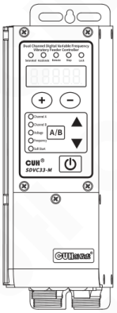

Contrôleur×1

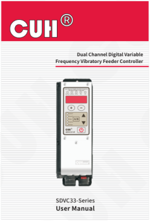

Manuel d'utilisation×1

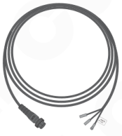

Câble de sortie×2

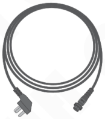

Cordon d'alimentation d'entrée×1

---

## 1.2 Description des indicateurs, des boutons et des parties externes

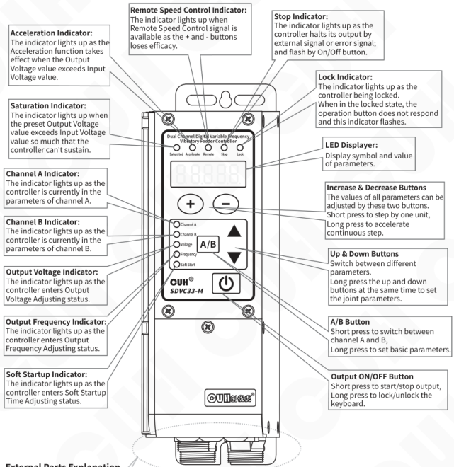

**Indicateur d'accélération :**  
Cet indicateur s'allume lorsque la fonction d'accélération prend effet, c'est-à-dire lorsque la valeur de la tension de sortie dépasse celle de la tension d'entrée.

**Indicateur de contrôle de vitesse à distance :**  
Cet indicateur s'allume lorsqu'un signal de contrôle de vitesse à distance est disponible et que les boutons + et - deviennent inopérants.

**Indicateur d'arrêt :**  
Cet indicateur s'allume lorsque le contrôleur interrompt sa sortie sur un signal externe ou un signal d'erreur ; il clignote lors de l'action du bouton Marche/Arrêt.

**Indicateur de saturation :**  
Cet indicateur s'allume lorsque la valeur de consigne de la tension de sortie dépasse tellement la tension d'entrée que le contrôleur ne peut plus la maintenir.

**Indicateur de verrouillage :**  
Cet indicateur s'allume lorsque le contrôleur est verrouillé.  
À l'état verrouillé, le bouton de commande ne répond pas et cet indicateur clignote.

**Afficheur LED :**  
Affiche le symbole et la valeur des paramètres.

**Indicateur du canal A :**  
Cet indicateur s'allume lorsque le contrôleur se trouve actuellement dans les paramètres du canal A.

**Indicateur du canal B :**  
Cet indicateur s'allume lorsque le contrôleur se trouve actuellement dans les paramètres du canal B.

**Indicateur de tension de sortie :**  
Cet indicateur s'allume lorsque le contrôleur entre dans l'état de réglage de la tension de sortie.

**Indicateur de fréquence de sortie :**  
Cet indicateur s'allume lorsque le contrôleur entre dans l'état de réglage de la fréquence de sortie.

**Indicateur de démarrage progressif :**  
Cet indicateur s'allume lorsque le contrôleur entre dans l'état de réglage du temps de démarrage progressif.

**Boutons d'augmentation et de diminution**  
Les valeurs de tous les paramètres peuvent être ajustées à l'aide de ces deux boutons.  
Un appui court fait évoluer la valeur d'un pas,  
un appui long accélère l'évolution continue.

**Boutons haut et bas**  
Permettent de basculer entre les différents paramètres.  
Un appui long simultané sur les boutons haut et bas permet de régler les paramètres conjoints.

**Bouton A/B**  
Un appui court permet de basculer entre le canal A et le canal B,  
un appui long permet d'accéder aux paramètres de base.

**Bouton Marche/Arrêt de sortie**  
Un appui court démarre/arrête la sortie,  
un appui long verrouille/déverrouille le clavier.

### Description des parties externes

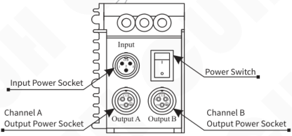

- Prise d'alimentation d'entrée
- Interrupteur d'alimentation
- Prise de puissance de sortie du canal A
- Prise de puissance de sortie du canal B

## 1.3 Description des ports de câblage

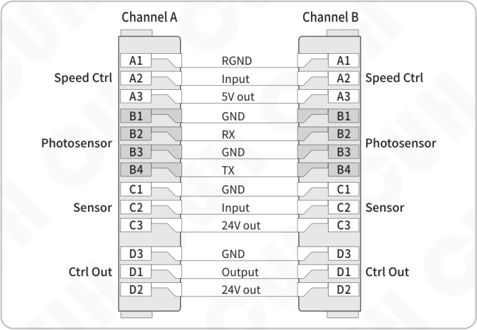

| Fonction | Canal A | Description | Canal B | Fonction |
|---|---|---|---|---|
| Speed Ctrl | A1 | RGND | A1 | Speed Ctrl |
| Speed Ctrl | A2 | Input | A2 | Speed Ctrl |
| Speed Ctrl | A3 | 5V out | A3 | Speed Ctrl |
| Photosensor | B1 | GND | B1 | Photosensor |
| Photosensor | B2 | RX | B2 | Photosensor |
| Photosensor | B3 | GND | B3 | Photosensor |
| Photosensor | B4 | TX | B4 | Photosensor |
| Sensor | C1 | GND | C1 | Sensor |
| Sensor | C2 | Input | C2 | Sensor |
| Sensor | C3 | 24V out | C3 | Sensor |
| Ctrl Out | D3 | GND | D3 | Ctrl Out |
| Ctrl Out | D1 | Output | D1 | Ctrl Out |
| Ctrl Out | D2 | 24V out | D2 | Ctrl Out |

## 1.4 Description de la plaque signalétique

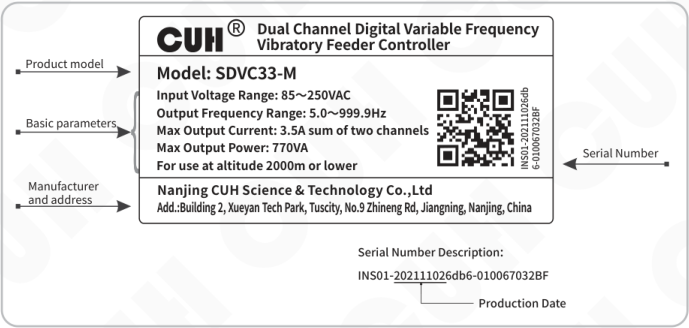

**CUH® — Contrôleur numérique bi-canal de fréquence variable pour alimentateur vibrant**

**Modèle de produit**

Modèle : SDVC33-M

**Paramètres de base**

- Plage de tension d'entrée : 85～250VAC
- Plage de fréquence de sortie : 5.0～999.9Hz
- Courant de sortie maximal : 3.5A somme des deux canaux
- Puissance de sortie maximale : 770VA
- Utilisation à une altitude de 2000 m ou moins

**Fabricant et adresse**

Nanjing CUH Science & Technology Co.,Ltd

Add.:Building 2, Xueyan Tech Park, Tuscity, No.9 Zhineng Rd, Jiangning, Nanjing, China

**Numéro de série**

INS01-202111026db6-010067032BF

**Description du numéro de série :**

INS01-**20211102**6db6-010067032BF

Date de production : **20211102**

---

# Chapitre Ⅱ Présentation du produit

Ce chapitre comprend une brève présentation et les principales caractéristiques du contrôleur.

## 2.1 Présentation du produit

Le contrôleur numérique à double modulation de fréquence pour alimentateur vibrant SDVC33 est un contrôleur compact universel à double sortie à modulation de fréquence offrant des performances uniques grâce à l'utilisation des dernières technologies électroniques et à une conception soignée. Ses caractéristiques particulières incluent :

- Alimentation bi-canal permettant une répartition arbitraire du courant, avec possibilité de régler le courant de protection contre les surintensités de chaque canal.
- Le mode de fonctionnement bi-canal permet de choisir le suivi de fréquence, le suivi de tension ou le double suivi fréquence-tension.
- Pendant le suivi de fréquence, le déphasage entre les deux sorties peut être réglé de -180°~180°.
- La plage de fréquence de sortie couvre 5Hz à 999.9Hz avec une précision de 0.1Hz.
- Fonction de freinage permettant d'arrêter rapidement l'alimentateur vibrant en décalant la phase du courant de 180° pendant le processus d'arrêt progressif.
- Les ports photoélectriques intelligents prennent en charge les capteurs photoélectriques ainsi que les capteurs de commutation NPN ou PNP.
- Fonction de signal de disponibilité : le port de transmission B4 de l'optoélectronique intelligente émet un signal modulé ou un signal valide pour indiquer que le contrôleur est en état de disponibilité. Lorsque le contrôleur rencontre une erreur, le signal de disponibilité devient invalide.
- Le port de contrôle de débordement prend en charge les types NPN, PNP ou auto-adaptatif.
- Le port de sortie de contrôle prend en charge les modes de sortie NPN, PNP ou push-pull.
- Le port de contrôle de vitesse à distance peut être sélectionné de manière croisée, permettant à un seul potentiomètre de commander deux sorties simultanément.
- La fonction de coefficient de télécommande peut amplifier ou réduire d'un facteur 1 l'effet de la tension de télécommande.
- La fonction de réglage de la luminosité de l'affichage LED prend en charge un réglage de la luminosité sur 32 niveaux.
- Fonction de sauvegarde et de restauration des paramètres utilisateur, permettant aux utilisateurs de définir des paramètres et de les enregistrer dans le groupe utilisateur pour une récupération aisée.
- La fonction de réinitialisation d'usine prend en charge la restauration par sous-canal A/B ou celle de l'ensemble du contrôleur.
- Les fonctions de protection complètes comprennent : protection contre les courts-circuits de la sortie principale, protection contre les surintensités, protection contre la surchauffe ou le refroidissement excessif, protection contre les sous-tensions/surtensions, protection contre les courts-circuits de la sortie de contrôle, protection contre les courts-circuits de la sortie 24V, protection contre les courts-circuits de la sortie 5V de régulation de vitesse.

## 2.2 Amélioration des performances du produit

Par rapport au contrôleur SDVC31-M, le SDVC33 présente des performances grandement améliorées, principalement :

- La fréquence de sortie est passée de 40.0Hz~400.0Hz à 5.0Hz~999.9Hz.
- Le temps maximal de retard d'enclenchement/déclenchement est passé de 20.0 s à 99.9 s.

---

- Ajout de la fonction d'arrêt progressif, réglable de 0.0~10.0 s pour arrêter progressivement la vibration de l'alimentateur vibrant.
- Ajout de la fonction de freinage : vous pouvez régler 0~10 cycles de freinage pour arrêter rapidement la vibration du bol vibrant.
- Le port du capteur photoélectrique intelligent ajoute la prise en charge des capteurs PNP.
- Le port du capteur de commutation lorsque la matière est pleine est passé de NPN et PNP à un réglage par logiciel, et un mode automatique est disponible.
- Le port de sortie de contrôle est passé d'une sortie NPN à trois types réglables : NPN, PNP et push-pull.
- Ajout du retard d'enclenchement/déclenchement du port de sortie de contrôle, réglable de 0.0 à 99.9 s.
- Ajout du mode de sortie de contrôle : vous pouvez régler le mode temporisé et le mode maintenu.
- Ajout du paramètre réglable de courant de protection contre les surintensités pour protéger l'électroaimant contre la destruction par surchauffe.
- Ajout du coefficient de télécommande, qui peut amplifier ou réduire l'effet de la tension de télécommande.
- Ajout de la fonction de réglage de la luminosité du panneau : vous pouvez régler séparément la luminosité d'affichage des groupes A/B.
- Ajout de la fonction de mesure, qui permet de surveiller le courant de sortie, la tension de régulation de vitesse, la tension du signal du port photoélectrique intelligent, la tension d'entrée du port du capteur de commutation, la tension de sortie du port de sortie de contrôle, l'affichage de la température, la tension du bus, la tension de sortie 24V.
- Ajout des fonctions de sauvegarde et de restauration des paramètres. En plus de la sauvegarde automatique des paramètres du groupe de travail, vous pouvez également enregistrer les paramètres du groupe de travail dans le groupe utilisateur, et les paramètres du groupe A et du groupe B peuvent être restaurés de manière flexible depuis le groupe utilisateur en cas de besoin.

## 2.3 Utilisation combinée des doubles sorties

Le contrôleur fournit les paramètres des canaux A/B en contrôle conjoint, qui peuvent être utilisés pour commander un alimentateur vibrant vectoriel bi-axe ou un système d'alimentation composé d'un bol vibrant et d'un alimentateur linéaire.

Par défaut, les canaux A et B fonctionnent de manière indépendante. En mode combiné, le canal B peut être réglé pour suivre le canal A, notamment en suivi de tension, en suivi de fréquence et en double suivi tension-fréquence. Lorsque les fréquences sont identiques, les phases des deux sorties sont verrouillées et l'utilisateur peut régler le déphasage de -180° à 180°.

Après avoir réglé la tension et la fréquence du canal B en double suivi du canal A, il suffit de régler la tension et la fréquence du canal A pour modifier simultanément la tension et la fréquence de sortie de A/B.

---

# Chapitre Ⅲ Guide d'installation

Ce chapitre présente les conditions nécessaires à l'utilisation du contrôleur ainsi que la manière de l'installer et de le raccorder correctement.

## 3.1 Conditions d'utilisation du contrôleur

Le contrôleur est alimenté en 110/220V AC et la mise à la terre de protection s'effectue par la fiche du cordon d'alimentation. Veuillez prévoir une alimentation secteur et des installations de distribution conformes aux normes en 110V ou 220V, 50Hz/60Hz, et veillez à ce que le fil de terre de protection soit correctement raccordé.

**⚠ Avertissement** Ne raccordez pas le contrôleur à une alimentation 380V AC : cela causerait des dommages graves et irréversibles au contrôleur, pouvant entraîner une explosion, un incendie et d'autres incidents de sécurité.

**⚠ Avertissement** Veillez à ce que le côté alimentation soit correctement mis à la terre. Le boîtier métallique du contrôleur est directement relié au fil de terre de protection. Une mise à la terre défectueuse entraînerait la mise sous tension du boîtier du contrôleur et pourrait provoquer une électrocution.

**Avis** Si le contrôleur fonctionne pendant longtemps, il chauffe et la température du boîtier augmente. Veuillez installer le contrôleur dans un environnement bien ventilé, le fixer solidement et l'éloigner des sources de vibration.

**Avis** La sortie des canaux A/B de ce produit est issue du redressement et de l'ondulement du courant secteur, sans transformateur d'isolation intermédiaire. Par conséquent, les pôles de sortie ne doivent pas être raccordés à la terre de protection. Lors du raccordement de l'électroaimant, il faut s'assurer que la bobine de l'électroaimant et le boîtier possèdent une capacité d'isolation principale. Sinon, des fuites de courant peuvent se produire et entraîner une électrocution ainsi que des dommages au contrôleur.

**Avis** Ce produit est un contrôleur destiné à commander un électroaimant. Il ne doit en aucun cas être raccordé à un alimentateur vibrant piézoélectrique.

## 3.2 Méthode d'utilisation des boutons

a. L'action des boutons se divise, selon la durée d'appui, en appui court et appui long (accélération de premier niveau, accélération de deuxième niveau).  
b. L'appui court correspond à une durée d'appui supérieure à 0.1 s et inférieure à 2 secondes ; l'appui long correspond à une durée d'appui supérieure à 2 secondes.  
f. Un appui long sur [A/B] permet d'entrer dans/de quitter l'interface des paramètres de base.  
g. Un appui long sur [A/B] et ▲ permet d'entrer dans/de quitter l'interface des paramètres avancés.  
h. Un appui long sur [A/B] et ▼ permet d'entrer dans/de quitter l'interface des paramètres de surveillance.  
I. Un appui long sur ▲ et ▼ permet d'entrer dans/de quitter l'interface des paramètres conjoints.  
j. Appuyez longuement sur ⊕ jusqu'à ce que 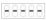 s'affiche sur le LED pour restaurer les paramètres d'usine ; relâchez : l'affichage de CUH signifie que les réglages d'usine sont restaurés.  
k. Sélectionnez uP1 lors de la sauvegarde des paramètres utilisateur ; appuyez longuement sur ⊕ et ⊖, SAU s'affiche après une sauvegarde réussie.  
l. Lors de la restauration des paramètres utilisateur, après avoir sélectionné le mode de restauration, appuyez longuement sur ⊕ et ⊖ ; rES s'affiche lorsque la restauration est réussie.

---

## 3.3 Installation et utilisation

### Étape un :

Ouvrez l'emballage et vérifiez le contrôleur et tous les accessoires.

### Étape deux :

Raccordez les bornes du câble de puissance de sortie à la bobine électromagnétique du vibrateur.

Alignez l'encoche de la fiche aéronautique du câble de sortie bi-canal A/B sur le repère triangulaire de la prise de sortie du contrôleur, puis serrez l'écrou après avoir correctement raccordé le câble de sortie.

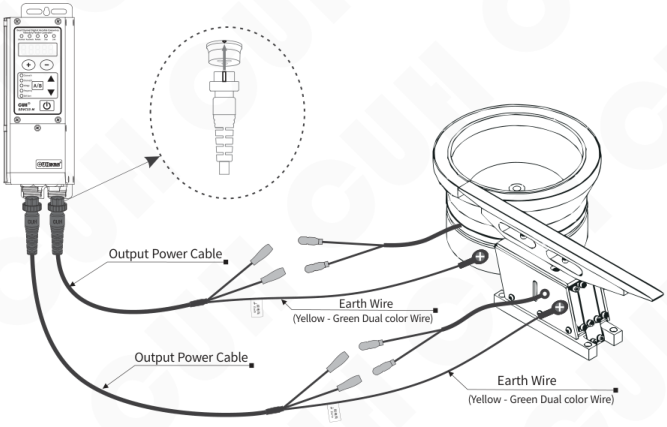

### Remarque

1. Assurez-vous que les bobines électromagnétiques du vibrateur sont raccordées aux deux broches de sortie du câble de puissance de sortie et que le boîtier métallique du vibrateur est correctement mis à la terre.
2. Il est interdit de raccorder des charges piézoélectriques à la sortie de puissance, sous peine de provoquer un accident d'électrocution !

---

### Étape trois :

Raccordez la fiche du cordon d'alimentation d'entrée à la prise d'alimentation d'entrée du contrôleur.

Raccordez d'abord le côté contrôleur

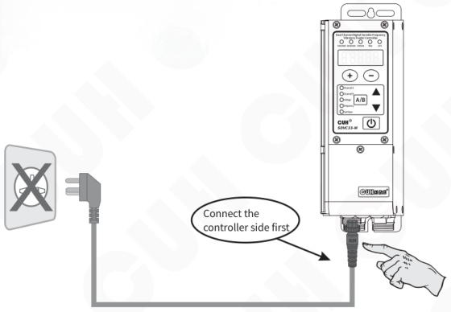

### Étape quatre :

Branchez la fiche du cordon d'alimentation d'entrée sur la prise secteur.

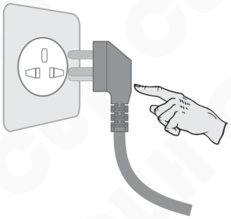

---

## Étape cinq :

Allumez l'interrupteur d'alimentation du contrôleur : la tension « U 150 » doit s'afficher, l'indicateur du canal A s'allume et les deux alimentateurs vibrants doivent vibrer.

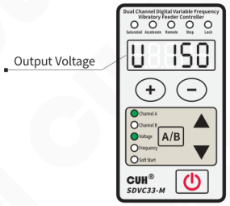

## Étape six :

Appuyez sur ⊖ pour régler la tension du canal A à 30~50V, puis appuyez sur `A/B` pendant 2 secondes pour entrer dans l'état de réglage de la fréquence de sortie « E ». Utilisez ⊕ et ⊖ pour trouver la fréquence propre de l'alimentateur vibrant, également appelée fréquence de résonance.

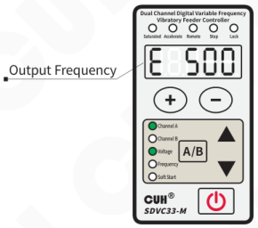

- La fréquence harmonique du vibrateur désigne la valeur de fréquence qui produit l'amplitude maximale.
- Chaque vibrateur possède sa fréquence de résonance mécanique propre ; réglez la fréquence de sortie du contrôleur sur cette fréquence pour atteindre le meilleur état de fonctionnement.

---

## Étape sept :

Un appui long sur **A/B** permet de quitter la fréquence de sortie « E » et de revenir au paramètre de réglage de la tension,
Utilisez **+** et **−** pour régler la tension jusqu'à obtenir le meilleur débit d'alimentation.

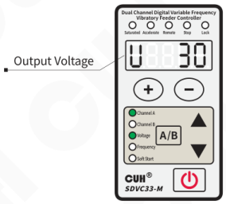

## Réglages du canal B :

Un appui court sur **A/B** permet de basculer sur le canal B. Répétez les étapes six et sept pour terminer le réglage du canal B.

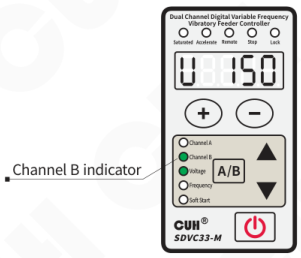

---

## Chapitre IV Description des fonctions de base

Ce chapitre présente comment utiliser les fonctions de base du contrôleur.

### 4.1 Réglage de la tension de sortie

Le contrôleur permet de régler numériquement la tension de sortie directement sur le panneau. Le contrôleur étant capable de compenser la tension du secteur, cette valeur correspond à la valeur moyenne du redressement de la tension de sortie ; elle n'est pas affectée par la tension d'entrée, de sorte que la sortie reste stable même en cas d'instabilité de la tension du secteur. En même temps, le réglage direct de la valeur de tension fournit également des données précises permettant à l'utilisateur de connaître le fonctionnement de l'équipement.

- Allumez l'interrupteur d'alimentation du contrôleur.
- Le contrôleur affiche la tension de sortie. Les indicateurs Canal A et tension du panneau sont allumés, et l'afficheur LED affiche le paramètre de tension de sortie U et la valeur de la tension.
- Appuyez sur ⊕ ou ⊖ pour ajuster la valeur du paramètre.

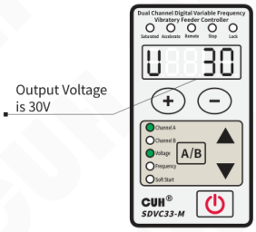

- Le contrôleur ne possède pas de fonction de survoltage. Lorsque le contrôleur ne peut pas atteindre la tension définie en raison de la limitation de la tension de l'alimentation d'entrée, l'indicateur de saturation s'allume et la compensation de la tension du secteur échoue alors.
- Le contrôleur peut obtenir un certain effet d'accélération en sacrifiant les caractéristiques sinusoïdales de la forme d'onde de sortie, ce qui est déterminé par le paramètre « indice d'accélération y ». À l'entrée dans l'état d'accélération, la forme d'onde du courant de sortie passe d'une onde sinusoïdale à une onde triangulaire et l'indicateur d'accélération s'allume.

---

## 4.2 Réglage de la fréquence de sortie

Le contrôleur adopte la technologie de synthèse directe de fréquence numérique (DDS), qui offre une précision et une stabilité de fréquence très élevées, sans variation avec le temps et la température.

- Appuyez sur **A/B** et maintenez pendant 2 secondes pour entrer dans l'interface des paramètres de base.
- L'afficheur LED affiche le paramètre de fréquence de sortie « E » et la valeur de la fréquence.
- Appuyez sur **+** ou **−** pour ajuster la valeur du paramètre.

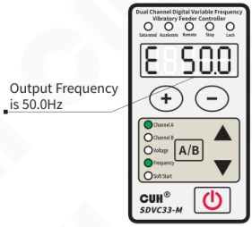

La plage de la fréquence de sortie est de 5.0～999.9Hz

## 4.3 Démarrage progressif

Lorsque le contrôleur démarre depuis l'état d'arrêt, la tension de sortie peut être progressivement augmentée jusqu'à la valeur définie afin d'éviter que l'alimentateur vibrant et le contrôleur ne subissent de choc.

Temps de démarrage progressif (t) : lorsque le contrôleur démarre depuis l'état d'arrêt, le temps nécessaire pour que la tension de sortie monte en douceur de 0V à la valeur définie est appelé temps de démarrage progressif.

- Appuyez sur **A/B** et maintenez pendant 2 secondes pour entrer dans l'interface des paramètres de base.
- Appuyez sur **▲** et **▼** pour basculer sur l'état de réglage du paramètre de démarrage progressif « t ».
- Appuyez sur **+** ou **−** pour ajuster la valeur du paramètre.

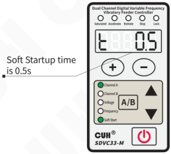

La plage du temps de démarrage progressif est de 0.0～10.0s

---

## 4.4 Arrêt progressif

Lorsque le contrôleur s'arrête depuis l'état de fonctionnement, la tension de sortie peut être doucement réduite à 0 afin d'éviter que l'équipement vibrant ne subisse de choc.

Temps d'arrêt progressif (J) : lorsque le contrôleur s'arrête depuis l'état de fonctionnement, le temps nécessaire pour que la tension de sortie diminue en douceur de la valeur définie à 0 est appelé temps d'arrêt progressif.

- Appuyez sur **A/B** et maintenez pendant 2 secondes pour entrer dans l'interface des paramètres de base.
- Appuyez sur **▲** et **▼** pour basculer sur l'état de réglage du paramètre d'arrêt progressif « J ».
- Appuyez sur **+** ou **−** pour ajuster la valeur du paramètre.

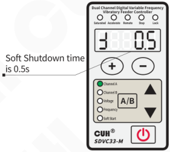

La plage du temps d'arrêt progressif est de 0.0～10.0s

## 4.5 Fonction de freinage

Étant donné que l'alimentateur vibrant continue de vibrer librement pendant un certain temps après l'arrêt de la sortie du contrôleur, le matériau continue d'avancer pendant ce temps. Cela provoque des erreurs pour certaines applications de dosage et de conditionnement de précision des matériaux, il est donc nécessaire d'arrêter rapidement la vibration.

La fonction de freinage consiste à arrêter rapidement la vibration en retardant de 180° le point de départ de l'arrêt progressif, afin d'obtenir un effet opposé entre la force d'entraînement et la phase de vibration libre de l'alimentateur vibrant. Elle est réalisée en définissant le temps d'arrêt progressif comme une valeur négative, l'unité étant le cycle, c'est-à-dire le nombre de cycles de courant d'entraînement inversé lors du freinage.

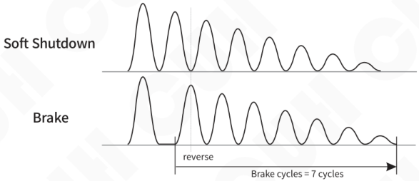

---

## 4.6 Interrupteur de sortie

L'interrupteur de sortie à contact léger sur le panneau permet de démarrer ou d'arrêter facilement et rapidement la sortie du contrôleur.

- Utilisez ⏻ sur le panneau du contrôleur pour commander le démarrage ou l'arrêt de la sortie de l'appareil. Lorsque l'indicateur d'arrêt est allumé, cela signifie que l'état d'arrêt est activé.

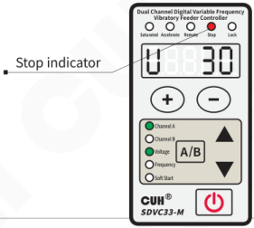

> Par défaut, ⏻ commande le démarrage/arrêt du canal A/B de manière indépendante. Si vous souhaitez commander simultanément le démarrage/arrêt des canaux A/B, définissez le mode de contrôle du bouton Marche/Arrêt (OF) dans les paramètres conjoints de Ind (indépendant) à Cob (combiné).
>
> Lorsque le contrôleur arrête lui-même la sortie, l'indicateur d'arrêt clignote ; mais lorsque le contrôleur est arrêté par un signal externe, le voyant d'arrêt reste allumé.

## 4.7 Verrouillage du clavier

Une fois les paramètres du contrôleur réglés, la fonction de verrouillage du clavier permet de verrouiller tous les boutons du panneau afin d'éviter les fausses manœuvres.

Même après une mise hors tension suivie d'une remise sous tension, l'état du verrouillage du clavier reste celui dans lequel il se trouvait lors de la dernière mise hors tension.

- Appuyez sur ⏻ et maintenez pendant 2 secondes pour verrouiller tous les boutons du panneau.
- Appuyez à nouveau sur ⏻ et maintenez pendant 2 secondes pour déverrouiller.

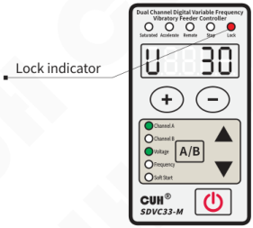

> Le verrouillage peut être effectué séparément pour les différents canaux : le fonctionnement du canal A et du canal B peut être réalisé de manière indépendante.

---

## 4.8 Restauration des réglages par défaut

L'utilisateur peut rapidement restaurer le contrôleur à l'état par défaut d'usine.

En raison des puissantes fonctions du contrôleur, de nombreux paramètres peuvent être ajustés. Pour les débutants, il est possible que l'état de fonctionnement normal du contrôleur ne puisse pas être rétabli après plusieurs réglages et modifications. Utilisez cette fonction pour restaurer rapidement l'état de paramètres désordonné vers le réglage par défaut d'usine.

Le contrôleur peut restaurer l'ensemble du contrôleur aux réglages d'usine, ainsi que restaurer individuellement un seul canal aux réglages d'usine.

### Restauration des réglages par défaut de l'ensemble du contrôleur :

- Appuyez longuement sur ▲ et ▼ simultanément pour entrer dans l'interface des paramètres conjoints.

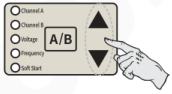

- Appuyez brièvement sur ▼ pour basculer sur l'affichage entièrement clignotant de l'afficheur LED, c'est-à-dire le paramètre « Restauration des réglages par défaut ». Appuyez ensuite sur ⊕ et maintenez jusqu'à ce que le contrôleur affiche « ----- », indiquant que le contrôleur a été restauré.

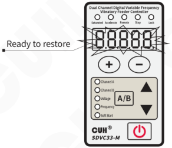

- Relâchez ⊕ ; après que le contrôleur a affiché « CUH », il entre alors dans l'état de réglage de la tension de sortie « U ». À ce moment, tous les paramètres ont été restaurés aux réglages par défaut d'usine.

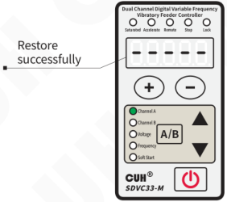

---

## Restauration individuelle des réglages par défaut des canaux A/B :

- Appuyez longuement sur **A/B** et **▲** simultanément pour entrer dans l'interface des paramètres avancés.

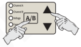

- Appuyez brièvement sur **▼** pour basculer sur le paramètre « Restauration des réglages par défaut du canal actuel ». Appuyez ensuite longuement sur **⊕** et maintenez jusqu'à ce que le contrôleur affiche « ----- », indiquant que le canal actuel a été restauré.

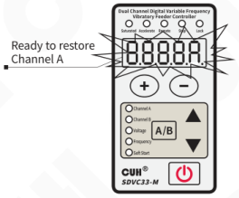

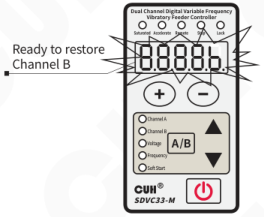

- Relâchez **⊕** ; après que le contrôleur a affiché « CUH », il entre alors dans l'état de réglage de la tension de sortie « U ». À ce moment, tous les paramètres du canal actuel ont été restaurés aux réglages par défaut d'usine.

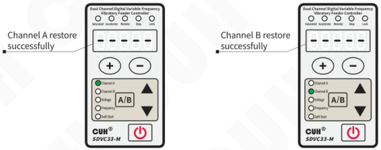

---

## Chapitre Ⅴ Description des fonctions avancées

Ce chapitre présente comment utiliser les fonctions avancées du contrôleur.

### 5.1 Contrôle de vitesse à distance

Le contrôleur prend en charge le contrôle de la tension de sortie par un signal analogique externe ; le signal analogique prend en charge le potentiomètre, la tension 1~5V et le courant 4~20mA. Il existe deux ports d'entrée analogiques AA et bA. Par défaut, AA commande le canal A et bA commande le canal B. Le paramètre cS permet également de régler un seul signal pour commander simultanément la tension de sortie des deux canaux.

Le contrôleur intègre également le paramètre de coefficient de télécommande c destiné à amplifier ou réduire l'effet de la tension de télécommande, réglable de 0.5 à 2.0. Lorsqu'il est réglé sur 0.5, l'effet de la tension de télécommande sur la commande de la tension de sortie est réduit de moitié, c'est-à-dire que la télécommande ne peut atteindre que la moitié de la tension de sortie maximale h. Lorsqu'il est réglé sur 2.0, l'effet de la tension de télécommande sur la commande de la tension de sortie est doublé, c'est-à-dire que lorsque la tension de télécommande atteint 3V, la tension de sortie a déjà atteint h ; si la tension de télécommande augmente davantage, la tension de sortie ne peut plus augmenter.

### Raccordement du contrôle par potentiomètre

Lorsque le signal de contrôle de vitesse à distance prend effet, l'indicateur de contrôle de vitesse s'allume et, en même temps, le réglage de la tension sur le panneau devient inopérant.

---

## Raccordement du contrôle par tension 1~5V

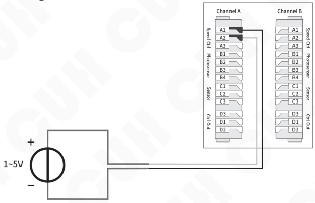

## Raccordement du contrôle par courant 4~20mA

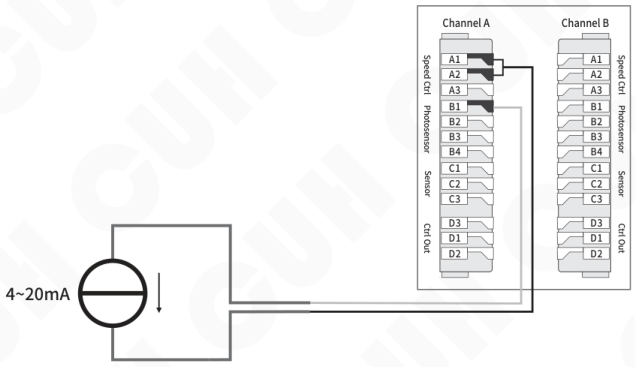

---

## 5.2 Détection photoélectrique intelligente

Le port photoélectrique intelligent de ce contrôleur prend en charge les capteurs photoélectriques à barrage ou à réflexion composés de diodes électroluminescentes et de phototransistors, et peut également être configuré pour prendre en charge les capteurs de commutation NPN ou PNP. Le schéma de câblage spécifique est le suivant :

### Méthode de raccordement du capteur photoélectrique

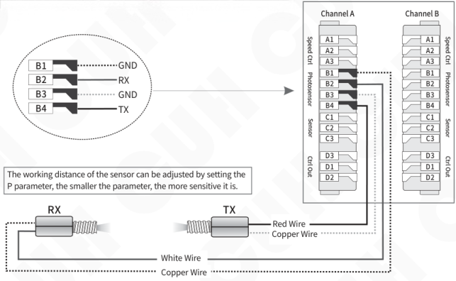

La distance de travail du capteur peut être ajustée en définissant le paramètre P ; plus le paramètre est petit, plus le capteur est sensible.

### Méthode de raccordement du capteur de commutation

Définissez le type NPN ou PNP par le paramètre P.

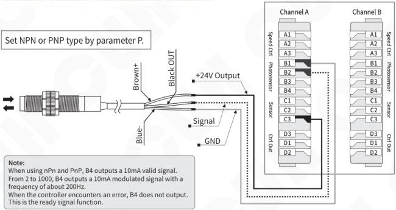

**Remarque :**

Lors de l'utilisation de nPn et PnP, B4 délivre un signal valide de 10mA.

De 2 à 1000, B4 délivre un signal modulé de 10mA à une fréquence d'environ 200Hz.

Lorsque le contrôleur rencontre une erreur, B4 ne délivre aucun signal. C'est la fonction du signal de disponibilité.

---

## 5.3 Capteur de commutation

Le port du capteur de commutation prend en charge les modes NPN, PNP, Ut1 et Ut0, les canaux A et B étant contrôlés indépendamment.

**Le mode Ut1 est un balayage unique :** avant que le signal du capteur ne devienne invalide, les niveaux haut et bas sont alternés pour détecter si le port est valide. Après avoir trouvé un signal valide, le type de capteur du port est déterminé et le balayage cesse.

**Le mode Ut0 est un balayage continu :** quel que soit le type de capteur, il détecte toujours si le port est raccordé à un signal valide en alternant les niveaux haut et bas.

### Méthode de raccordement du capteur de commutation

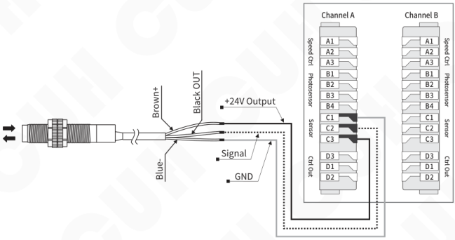

---

## 5.4 Sortie de contrôle

Le port de sortie de contrôle peut prendre en charge la sortie NPN, la sortie PNP et la sortie push-pull. À savoir :

- La sortie NPN est valide au niveau bas et la sortie est invalide à l'état haute impédance ;
- La sortie PNP est valide au niveau haut et la sortie est invalide à l'état haute impédance ;
- La sortie push-pull est valide au niveau haut et invalide au niveau bas.

### 5.4.1 Méthode de câblage de la sortie de contrôle

**Raccordement de la sortie NPN**

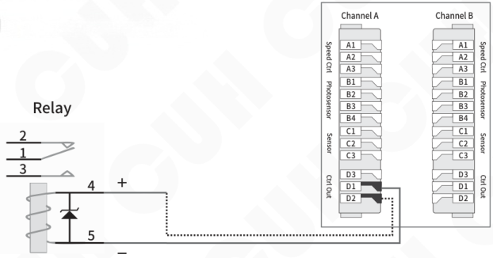

**Raccordement de la sortie PNP ou push-pull**

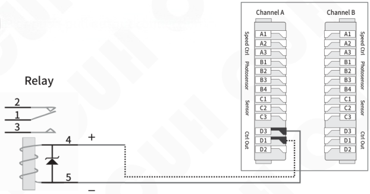

> Si vous raccordez un relais 24V, veillez à confirmer les pôles positif et négatif de la bobine pour garantir un raccordement correct. La capacité en courant de sortie de ce port étant de 350mA, la diode de protection interne du relais court-circuitera le port de ce contrôleur en cas d'inversion de polarité, déclenchant la protection contre les courts-circuits Er07.

---

## 5.4.2 Sources de signaux et diagramme logique de la sortie de contrôle

Le contrôle de la sortie principale et de la sortie de contrôle est déterminé par le résultat de la relation logique entre les deux sources de signaux. Les sources de signaux suivantes peuvent être sélectionnées dans la liste des sources de signaux.

| Source de signal | Signification |
|---|---|
| 0 | signal invalide |
| 1 | signal valide |
| Ab | Signal du port de détection photoélectrique intelligente du canal A |
| -Ab | Signal du port de détection photoélectrique intelligente du canal A, inversé |
| Ac | Signal du port du capteur de commutation du canal A |
| -Ac | Signal du port du capteur de commutation du canal A, inversé |
| Ad | Signal du port de sortie de contrôle du canal A |
| -Ad | Signal du port de sortie de contrôle du canal A, inversé |
| Aq | Signal du port de sortie de puissance principale du canal A |
| -Aq | Signal du port de sortie de puissance principale du canal A, inversé |
| bb | Signal du port de détection photoélectrique intelligente du canal B |
| -bb | Signal du port de détection photoélectrique intelligente du canal B, inversé |
| bc | Signal du port du capteur de commutation du canal B |
| -bc | Signal du port du capteur de commutation du canal B, inversé |
| bd | Signal du port de sortie de contrôle du canal B |
| -bd | Signal du port de sortie de contrôle du canal B, inversé |
| bq | Signal du port de sortie de puissance principale du canal B |
| -bq | Signal du port de sortie de puissance principale du canal B, inversé |

---

## Diagramme logique de la sortie de contrôle

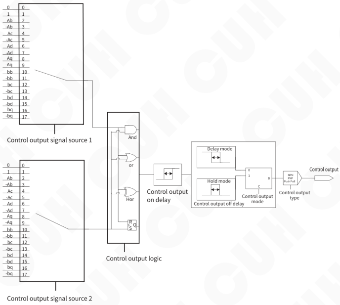

---

## 5.4.3 Description des modes de la sortie de contrôle

Le client peut choisir entre 2 modes de sortie de contrôle : le mode temporisé et le mode maintenu.

**Mode temporisé :** signifie qu'après le passage du signal d'entraînement de sortie du contrôleur de l'état valide à l'état invalide, la sortie de contrôle se coupe après le temps de retard de déclenchement.

**Mode maintenu :** après validation du signal d'entraînement de sortie du contrôleur, la sortie de contrôle reste active pendant le temps de retard de déclenchement, puis se coupe une fois ce temps dépassé.

La différence entre les deux modes est exprimée sous forme de diagramme temporel comme suit, où le signal d'entrée est le signal délivré après le sélecteur de relation logique.

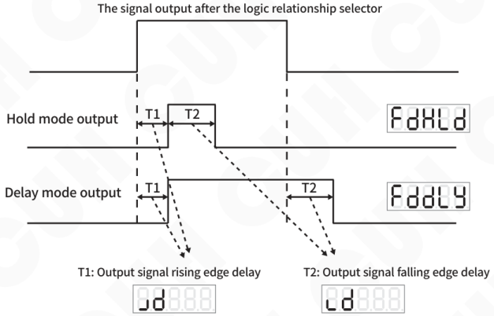

## 5.4.4 Fonction de contrôle du signal de sortie principale

La commande du signal de sortie principale est similaire à celle de la sortie de contrôle. Après la sélection de deux sources de signaux pour l'opération de relation logique, le signal de commande est obtenu par la sélection du mode de retard d'enclenchement/déclenchement et la commande de direction logique. Le signal de commande est combiné logiquement au signal marche/arrêt du panneau, puis envoyé à la carte de puissance pour commander la sortie principale.

La méthode de câblage, les sources de signaux et le diagramme logique du contrôle du signal de sortie principale peuvent se référer à la fonction de sortie de contrôle.

---

## 5.5 Limitation de la tension de sortie maximale

Chaque canal du contrôleur permet de définir le paramètre h de limitation de la tension de sortie maximale ; ni la tension définie sur le panneau ni la tension de télécommande ne dépasseront cette valeur.

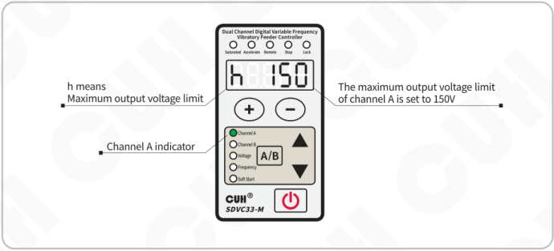

- h signifie limitation de la tension de sortie maximale
- Indicateur du canal A
- La limitation de la tension de sortie maximale du canal A est définie sur 150V

## 5.6 Protection réglable contre les surintensités

Afin de protéger la bobine électromagnétique, le contrôleur intègre le paramètre « oc » de courant de protection contre les surintensités réglable par l'utilisateur, ajustable dans la plage de 0.5A~3.5A.

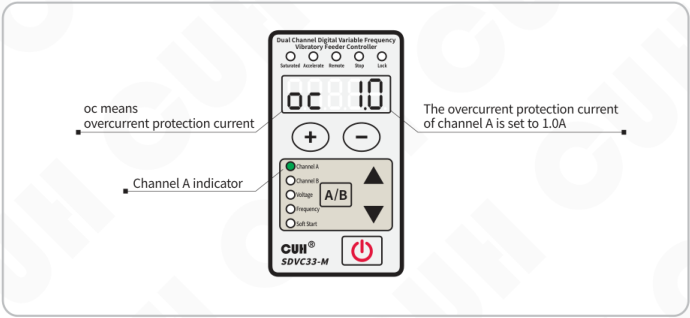

- oc signifie courant de protection contre les surintensités
- Indicateur du canal A
- Le courant de protection contre les surintensités du canal A est défini sur 1.0A

---

## 5.7 Réglage de la luminosité du panneau

Le contrôleur adopte une nouvelle puce pilote d'affichage numérique qui permet aux utilisateurs de régler la luminosité de l'affichage LED entre 1 et 32.

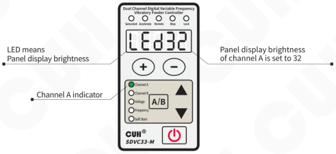

La luminosité du panneau peut être définie indépendamment pour le canal A et le canal B ; l'utilisateur peut définir des luminosités différentes à l'avance pour distinguer rapidement s'il se trouve actuellement sur le canal A ou le canal B.

## 5.8 Fonction de surveillance des sorties

Le contrôleur intègre spécialement un ensemble de paramètres de surveillance pour surveiller l'état du contrôleur.

**Les paramètres de surveillance qui différencient le canal A et le canal B comprennent :**

Courant de sortie AC, tension du port de contrôle de vitesse analogique AU, tension du signal du port photoélectrique intelligent bU, port du capteur de commutation cU, tension du port de sortie de contrôle dU.

**Les paramètres de surveillance qui ne différencient pas le canal A et le canal B comprennent :**

Affichage de la température C, tension du bus PU, tension de sortie 24V nU, version logicielle de la carte de contrôle uc, version logicielle de la carte de puissance uq.

---

## 5.9 Contrôle conjoint bi-canal

La sortie du canal A et la sortie du canal B du contrôleur peuvent être contrôlées conjointement ; le paramètre Cb permet de commander le canal B : fonctionnement indépendant, suivi de la fréquence du canal A, suivi de la tension du canal A, suivi de la tension et de la fréquence du canal A.

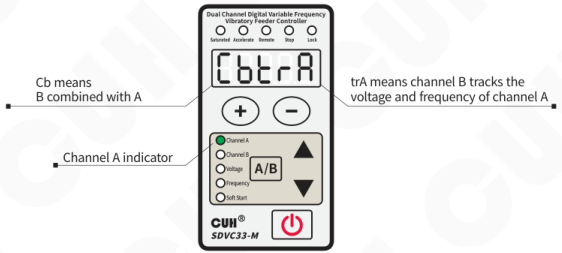

Remarque : après avoir défini le suivi, la tension et la fréquence du canal B peuvent toujours être ajustées, mais elles ne prennent pas effet. Elles redeviennent opérantes après le retour en mode autonome.

Que vous définissiez le canal A et le canal B pour une sortie à fréquence identique de manière indépendante, ou que vous définissiez la fréquence du canal B pour suivre le canal A, les phases des sorties des deux canaux restent toujours verrouillées. Le déphasage peut être contrôlé par le paramètre conjoint μ (B se réfère à la phase de A), la plage de réglage étant de -180°~180°. Cette fonction peut être utilisée pour commander un bol vibrant vectoriel ou des situations d'alimentation en relais d'un bol vibrant et d'un alimentateur linéaire/convoyeur.

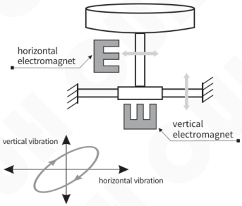

Schéma de principe du bol vibrant vectoriel

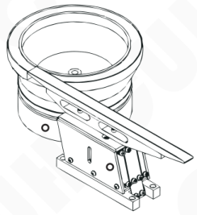

Schéma de principe du bol vibrant et de l'alimentateur linéaire

---

## 5.10 Sauvegarde et restauration des paramètres utilisateur

En plus de la sauvegarde automatique des paramètres de travail, le contrôleur intègre également un groupe de paramètres utilisateur destiné à enregistrer tous les paramètres définissables par l'utilisateur. Grâce à la sauvegarde et à la restauration des paramètres utilisateur, la récupération diffère de la fonction de restauration des réglages d'usine.

Réglez le paramètre SP dans les paramètres conjoints, l'affichage indique uP1 ; appuyez longuement sur ⊕ et ⊖ simultanément jusqu'à l'affichage de SAU, ce qui indique que la sauvegarde a réussi. Cette opération enregistre les paramètres du canal A, du canal B et les paramètres conjoints dans le groupe utilisateur.

Si vous souhaitez restaurer un groupe de travail à partir des paramètres du groupe utilisateur enregistrés, plusieurs méthodes de restauration sont disponibles :

**rP=1Ab :** les paramètres du groupe utilisateur restaurent simultanément les paramètres des groupes A et B.

**rP=1bA :** les paramètres du groupe utilisateur restaurent simultanément les paramètres du groupe A et du groupe B, mais avec sélection alternée lors de la restauration. C'est-à-dire que les données enregistrées dans le groupe A du groupe utilisateur sont restaurées dans le groupe de travail B, et que les données enregistrées dans le groupe B du groupe utilisateur sont restaurées dans le groupe de travail A.

**rP=1A0 :** les paramètres du groupe utilisateur restaurent uniquement le groupe A, en utilisant les données du groupe A du groupe utilisateur.

**rP=10A :** les paramètres du groupe utilisateur restaurent uniquement le groupe A, en utilisant les données du groupe B du groupe utilisateur.

**rP=1b0 :** les paramètres du groupe utilisateur restaurent uniquement le groupe B, en utilisant les données du groupe B du groupe utilisateur.

**rP=10b :** les paramètres du groupe utilisateur restaurent uniquement le groupe B, en utilisant les données du groupe A du groupe utilisateur.

Sélectionnez le mode à restaurer, appuyez longuement sur ⊕ et ⊖ simultanément jusqu'à l'affichage de rES, indiquant que la restauration a réussi.

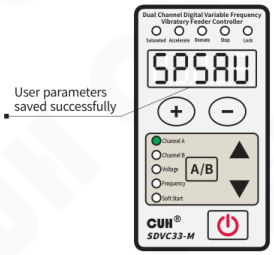

Schéma de sauvegarde réussie

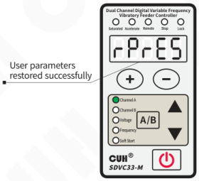

Schéma de restauration réussie

---

# Chapitre Ⅵ Caractéristiques techniques

## 6.1 Dimensions

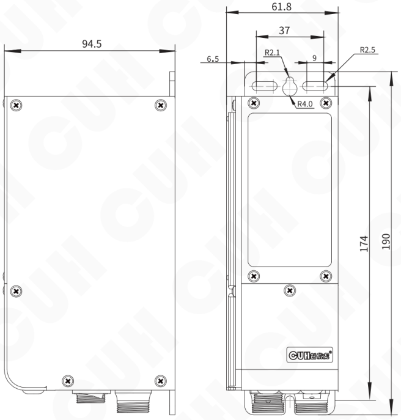

Dimensions (unité : mm)

| Plage de dimensions | Tolérance |
|---|---|
| 0~3 | ±0.05 |
| 3~10 | ±0.1 |
| 10~30 | ±0.15 |
| 30~80 | ±0.2 |
| 80~180 | ±0.3 |
| >180 | ±0.5 |

Ce tableau de tolérances s'applique à tous les produits de cette série.

---

## 6.2 Caractéristiques techniques

| Élément | Min | Typique | Max | Unité | Remarque |
|---|---|---|---|---|---|
| Tension d'entrée | 85 | 220 | 250 | V | AC RMS |
| Plage de tension de sortie réglable | 0 | —— | 260 | V | Inférieure à 150% de la tension d'entrée |
| Précision de réglage de la tension | | 1 | | V | |
| Précision de régulation de la tension | 0 | —— | 10 | % | ΔVout/ΔVin |
| Plage de courant de sortie réglable | 0 | —— | 3.5 | A | Le courant combiné peut être réparti arbitrairement. |
| Puissance de sortie | 0 | —— | 770 | VA | |
| Fréquence de sortie | 5.0 | —— | 999.9 | Hz | |
| Précision de réglage de la fréquence | | 0.1 | | Hz | |
| Forme d'onde de sortie | | Sinusoïdale | | | |
| Temps de démarrage progressif | 0 | —— | 10 | s | Valeur par défaut : 0.5 |
| Plage du temps de retard d'enclenchement/déclenchement | 0 | —— | 99.9 | s | Valeur par défaut : 0.2 |
| Précision du temps de retard d'enclenchement/déclenchement | | 0.1 | | s | |
| Température de déclenchement de la protection contre la surchauffe | —— | 65 | —— | °C | Retour à la normale à 60°C |
| Courant de sortie de contrôle DC | 0 | —— | 350 | mA | Les canaux A et B sont tous deux pris en charge |
| Courant de sortie 24V | —— | —— | 700 | mA | Somme des sorties des canaux A et B |
| Tension de sortie de contrôle DC | 22 | 24 | 26 | V | |
| Signal de contrôle analogique | | 4~20/1~5 | | mA/V | |
| Signal de contrôle numérique | | 24 | | V | Signal de commutation |
| Méthode de réglage | | 6 | | Bouton | |
| Consommation en veille | —— | 3 | —— | W | |
| Méthode d'affichage | | 5 | | Chiffre | LED |
| Poids | | 850 | | g | Sans accessoire |
| Dimensions | | 190\*61.8\*94.5 ( L\*l\*h ) | | mm | |
| Indice de protection | | IP20 | | | |
| Température ambiante | 0 | 25 | 40 | °C | Sans condensation |
| Humidité ambiante | 10 | 60 | 85 | % | Sans condensation |
| Température ambiante de stockage | -20 | 25 | 85 | °C | Sans condensation |
| Altitude d'utilisation | | <2000 | | m | |

## 6.3 Norme de référence

Paramètres absolus :  
Le non-respect de ces valeurs standard endommagerait le contrôleur ; veillez à les respecter strictement.

| Élément | Norme GB | Norme IEC | Niveau | Exigence de la norme | Remarque |
|---|---|---|---|---|---|
| Décharge électrostatique | GB/T 17626.2-2006 | IEC 61000-4-2:2001 | 4 | ±8 kV | Décharge par contact |
| | | | 4 | ±15 kV | Décharge dans l'air |
| Essai de transitoires électriques rapides | GB/T 17626.4-2008 | IEC 61000-4-4:2004 | 4 | ±4 kV | |
| Immunité aux ondes sur ligne d'alimentation DC | GB/T 17626.17-2005 | IEC 61000-4-17:2002 | 4 | 15% | Critère A |

> **Avertissement**  
> Dans un environnement résidentiel, ce produit peut provoquer des interférences radioélectriques, auquel cas des mesures d'atténuation supplémentaires peuvent être nécessaires.

---

## Chapitre Ⅶ Annexe

### 7.1 Table des paramètres

| Groupe de paramètres / Opération | Définition | Symbole | Image du symbole | Plage | Valeur par défaut |
|---|---|---|---|---|---|
| Paramètre de veille | Tension de sortie | U |  | 0~260 V | 150 |
| Paramètre de base Appui long sur A/B | Fréquence de sortie | E |  | 5.0~999.9 Hz | 50.0 |
| Paramètre de base | Retard d'enclenchement du capteur photoélectrique intelligent | J | 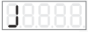 | 0.0~99.9 s | 0.2 |
| Paramètre de base | Retard de déclenchement du capteur photoélectrique intelligent | L |  | 0.0~99.9 s | 0.2 |
| Paramètre de base | Démarrage progressif | t |  | 0.0~10.0 s | 0.5 |
| Paramètre de base | Cycles de freinage / Arrêt progressif | d |  | -10~0 cycle (nombre de cycles de freinage) 0.0~10.0 s (arrêt progressif) | 0.0 |
| Paramètre avancé Appui long sur A/B et ▲ | Sensibilité du capteur photoélectrique intelligent | P |  | nPn, PnP, 2~1000 | 80 |
| Paramètre avancé | Type de capteur du port C | ΓA |  | nPn, PnP ut1 (balayage unique), ut0 (balayage continu) | ut0 |
| Paramètre avancé | Retard d'enclenchement du port C | J- |  | 0.0~99.9 s | 0.2 |
| Paramètre avancé | Retard de déclenchement du port C | L- |  | 0.0~99.9 s | 0.2 |
| Paramètre avancé | Première source de signal du port de contrôle D | E.d |  | 0, 1, Ab, -Ab, Ac, -Ac, Ad, -Ad, Aq, -Aq, bb, -bb, bc, -bc, bd, -bd, bq, -bq | A: 0 B: 0 |
| Paramètre avancé | Deuxième source de signal du port de contrôle D | Ed |  | 0, 1, Ab, -Ab, Ac, -Ac, Ad, -Ad, Aq, -Aq, bb, -bb, bc, -bc, bd, -bd, bq, -bq | A: Aq B: bq |
| Paramètre avancé | Opération logique des sources de signaux du port de contrôle D | ∩d |  | And, or, Hor, rS | or |
| Paramètre avancé | Retard d'enclenchement du port D | Jd |  | 0.0~99.9 s | 0.0 |
| Paramètre avancé | Retard de déclenchement du port D | Ld |  | 0.0~99.9 s | 0.0 |
| Paramètre avancé | Mode de sortie du port D | Fd |  | dLy (mode temporisé), HLd (mode maintenu) | dLy |
| Paramètre avancé | Direction logique du port D | ɔd |  | --- (en phase), -⁻- (en opposition de phase) on (normalement ouvert), oFF (normalement fermé)  | --- |
| Paramètre avancé | Type de sortie de contrôle | Γd |  | nPn, PnP, PSP (Push & Pull) | nPn |
| Paramètre avancé | Première source de signal de la sortie principale | E.q |  | 0, 1, Ab, -Ab, Ac, -Ac, Ad, -Ad, Aq, -Aq, bb, -bb, bc, -bc, bd, -bd, bq, -bq | A: Ab B: bb |
| Paramètre avancé | Deuxième source de signal de la sortie principale | Eq |  | 0, 1, Ab, -Ab, Ac, -Ac, Ad, -Ad, Aq, -Aq, bb, -bb, bc, -bc, bd, -bd, bq, -bq | A: Ac B: bc |
| Paramètre avancé | Opération logique des sources de signaux de la sortie principale | ∩q |  | And, or, Hor, rS | or |

| Paramètre | Définition | Symbole | Image du symbole | Plage | Valeur par défaut |
|---|---|---|---|---|---|
| Paramètre avancé Appui long sur A/B et ▲ | Retard d'enclenchement de la sortie principale | J9 |  | 0.0~99.9 s | 0.0 |
| | Retard de déclenchement de la sortie principale | L9 |  | 0.0~99.9 s | 0.0 |
| | Mode de sortie de la sortie principale | F9 |  | dLy (mode temporisé), HLd (mode maintenu) | dLy |
| | Direction logique de la sortie principale | Ↄ9 |  |  on (normalement ouvert), oFF (normalement fermé) |  |
| | Limitation de la tension de sortie maximale | h |  | 0~260 V | 260 |
| | Courant de protection contre les surintensités | bc |  | 0.5~3.5 A | 3.5 |
| | Indice d'accélération | y |  | 100~150 | 150 |
| | Indice de forme d'onde | r |  | 0~100 | 100 |
| | Source du contrôle de vitesse à distance | cS |  | AA (port A de A), bA (port A de B) | A: AA B: bA |
| | Coefficient du contrôle de vitesse à distance | c |  | 0.5~2.0 | 1.0 |
| | Luminosité d'affichage du panneau | LEd |  | 1~32 | 16 |
| | Restauration des réglages par défaut du canal actuel | 8.8.8.8.A. 8.8.8.8.b. |  | —— | —— |
| Paramètre de surveillance Appui long sur A/B et ▼ | Courant de sortie | AC |  | 0.00~3.50 A | —— |
| | Tension du signal du port A | AU |  | 0.00~5.00 V | —— |
| | Tension du signal du port B | bU |  | 0.00~5.00 V | —— |
| | Tension du signal du port C | cU |  | 0.0~28.0 V | —— |
| | Tension de sortie du port D | dU |  | 0.0~28.0 V | —— |
| | Affichage de la température # | C |  | -20.0~85.0 ℃ | —— |
| | Tension du bus interne # | PU |  | 0~400 V | —— |
| | Tension en temps réel du port 24V # | nU |  | 0.0~28.0 V | —— |
| | Version logicielle de la carte de contrôle # | uc |  | —— | —— |
| | Version logicielle de la carte de puissance # | u9 |  | —— | —— |

|  | Définition | Symbole | Image du symbole | Plage | Valeur par défaut |
|---|---|---|---|---|---|
| Paramètre conjoint  Appui long ▲ et ▼ | B combiné avec A # | Cb |  | Ind (indépendant), trF (B suit la fréquence de A), trU (B suit la tension de A), trA (B suit la tension et la fréquence de A) | Ind |
|  | # | Y |  | -180~180 ° | 0 |
|  | Mode de contrôle du bouton Marche/Arrêt # | OF |  | Ind (indépendant), Cob (combiné) | Ind |
|  | Sauvegarde des paramètres utilisateur # | SP |  | uP1 (sauvegarde du groupe utilisateur 1) | uP1 |
|  | Restauration des paramètres utilisateur # | rP |  | 1Ab (le groupe utilisateur 1 restaure les groupes A et B), 1bA (restauration croisée des groupes A et B par le groupe utilisateur 1), 1A0 (le groupe utilisateur 1 restaure uniquement le groupe A), 10A (le groupe utilisateur 1 restaure uniquement le groupe A de manière croisée), 1b0 (le groupe utilisateur 1 restaure uniquement le groupe B), 10b (le groupe utilisateur 1 restaure uniquement le groupe B de manière croisée) | 1Ab |
|  | Restauration des réglages par défaut # | 8.8.8.8.8. |  | —— | —— |

Remarque : les paramètres marqués « # » ne font pas la distinction entre les groupes A et B.

## 7.2 Schémas de circuit d'entrée et de sortie

**Port A du contrôle de vitesse à distance**

**Port B du photodétecteur intelligent**

**Port C du capteur de commutation**

**Port D de sortie de contrôle**

---

## 7.3 Suggestions de dépannage et explications des erreurs

| Code d'erreur | Définition (Phénomène) | Méthodes de dépannage |
|---|---|---|
| Er01A/Er01b | Court-circuit du canal A/B (les deux canaux arrêtent la sortie) | ◆ Assurez-vous que la charge n'est pas en court-circuit, puis essayez de redémarrer la sortie du contrôleur en appuyant deux fois sur le bouton Marche/Arrêt de sortie ou en réalimentant le contrôleur. |
| Er02 | Surintensité combinée des canaux A/B (les deux canaux suspendent la sortie, redémarrage après 2 s) | ◆ Réduisez la tension de sortie de manière appropriée, puis redémarrez la sortie. |
| Er02A/Er02b | Surintensité individuelle du canal A/B (le canal en surintensité arrête la sortie, redémarrage après 2 s) | |
| Er02A./Er02b. | La surintensité individuelle du canal A/B atteint le maximum défini | |
| Er03 | Surchauffe ou refroidissement excessif (les deux canaux arrêtent la sortie, récupération automatique entre -20℃~60℃) | ◆ Installez le contrôleur dans un environnement bien ventilé ou évitez le froid extrême. |
| Er041/Er042 | Sous-tension/surtension de l'alimentation (les deux canaux arrêtent la sortie, récupération automatique) | ◆ Assurez-vous que la tension d'entrée est comprise entre AC 85~250Vac. |
| Er05 | Communication interne anormale (les deux canaux arrêtent la sortie) | ◆ Assurez-vous qu'aucune alimentation externe n'est raccordée au port d'alimentation 24V ou contactez notre support technique. |
| Er06 | Anomalie du capteur de température (les deux canaux arrêtent la sortie) | ◆ Assurez-vous que la température de fonctionnement n'est pas inférieure à -20℃ ou contactez notre support technique. |
| Er07A/Er07b | Court-circuit du port D du canal A/B (la sortie de contrôle du canal A/B s'arrête, tentative de redémarrage après 2 s) | ◆ Assurez-vous que la charge du port D n'est pas en court-circuit et que le courant ne dépasse pas 350mA. |
| Er10 | Sortie d'alimentation 24V anormale (coupe la sortie 24V, tentative de redémarrage après 2 s) | ◆ Assurez-vous que le port 24V n'est pas en court-circuit et que le courant ne dépasse pas 700mA. |
| Er11 | Sortie d'alimentation 5V anormale (la fonction de contrôle de vitesse est temporairement désactivée, redémarrage automatique après restauration) | ◆ Assurez-vous que l'alimentation 5V du port A n'est pas en court-circuit et qu'elle n'est pas raccordée à une tension d'alimentation externe supérieure à 5V. |
| Er12 | Tension d'alimentation 24V anormale (les deux canaux arrêtent la sortie, sortie de contrôle à haute impédance, récupération automatique) | ◆ Assurez-vous qu'aucune alimentation externe n'est raccordée au port d'alimentation 24V. |

# Chapitre Ⅷ Informations de garantie du produit

## 8.1 Période de garantie

La période de garantie accordée par la société pour ce produit est de 3 ans à compter de la date de livraison du produit à l'emplacement désigné par l'acheteur.

## 8.2 Couverture de la garantie

(1) Si une défaillance causée par notre société survient pendant la période de garantie ci-dessus, nous réparerons le produit gratuitement. Toutefois, les situations suivantes ne sont pas couvertes par la garantie :

a. Non-respect des conditions spécifiées dans le manuel simplifié, le manuel d'utilisation ou les exigences techniques spécialement convenues entre l'acheteur et la société, mauvaise manipulation, ou défaillance causée par une utilisation impropre.

b. Défaillance non due à un défaut du produit, mais à la conception de l'équipement ou du logiciel de l'acheteur.

c. Dysfonctionnements causés par des modifications ou des réparations non effectuées par le personnel de notre société.

d. Défaillances qui peuvent être totalement évitées par une maintenance correcte ou le remplacement des pièces d'usure conformément au guide d'utilisation simplifié ou au manuel d'utilisation.

e. Défaillances causées, après l'expédition du produit depuis notre société, par des facteurs tels que des évolutions imprévisibles de l'état des sciences et technologies.

f. En cas de défaillance due à des catastrophes naturelles telles qu'incendie, séisme ou inondation, ou à des facteurs externes tels qu'une tension anormale, la société n'assume aucune responsabilité au titre de la garantie.

(2) La portée de la garantie est limitée aux situations stipulées au point (1) ; pour les pertes indirectes (telles que dommages aux équipements, opportunités perdues, pertes de profit, etc.) ou autres pertes, la société n'assume aucune responsabilité.

## 8.3 Aptitude du produit

Le contrôleur de notre société est conçu et fabriqué pour un usage général dans l'industrie de l'alimentation par vibration. Par conséquent, ce contrôleur de notre société ne doit pas être utilisé pour les applications suivantes et n'y est pas adapté.

(1) Installations ayant un impact grave sur la vie humaine et les biens, telles que les centrales nucléaires, les aéroports, les chemins de fer, les navires, les dispositifs motorisés et les équipements médicaux.

(2) Services publics, comprenant l'électricité, le gaz, l'approvisionnement en eau, etc.

(3) Utilisation en extérieur dans des conditions ou environnements similaires.

---

Nanjing CUH Science & Technology Co.,Ltd  
https://en.cuhnj.com  
Tel.:+86-25-84730411 / 84730415 / 84730416  
Fax:+86-25-84730426  
E-mail:sales@cuhnj.com  
Add.:Building 2, Xueyan Tech Park, Tuscity,  
No.9 Zhineng Rd, Jiangning, Nanjing, China

Document No.: IDP1000316

