## Contrôleur intelligent à fréquence variable pour alimentateur vibrant

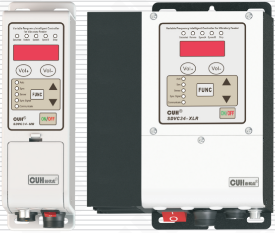

## Série SDVC34
Contrôleur intelligent à fréquence variable pour alimentateur vibrant — Série SDVC34
**Manuel d'utilisation**

---

## Déclaration de droits d'auteur

Nanjing CUH Science & Technology CO., Ltd. se réserve tous les droits.

Toutes les informations contenues dans ce manuel d'utilisation relèvent du savoir-faire de notre société et sont protégées par le droit d'auteur et d'autres lois apparentées. CUH jouit de tous les droits conférés par le droit d'auteur et d'autres lois et se les réserve. Sans l'accord écrit de CUH, ce manuel d'utilisation ne peut être copié, traduit, imité ou utilisé de quelque manière que ce soit, en tout ou en partie.

## Clause de non-responsabilité

Tout le contenu de ce manuel d'utilisation ne décrit que la méthode d'utilisation des produits fabriqués par notre société, et ce conformément à la technologie existante et à l'état dans lequel il vous est livré au moment de l'utilisation. Vous devez assumer les risques correspondants lors de l'utilisation de ce produit. Sauf obligation légale, la société n'assume aucune responsabilité expresse ou implicite concernant le produit du fait de ce manuel d'utilisation, y compris mais sans s'y limiter les blessures corporelles, les dommages matériels, la perte d'opportunité, etc.

Vous comprenez clairement les risques ci-dessus et acceptez que, sauf prescription légale, la société ne soit responsable d'aucun dommage ou perte, direct ou indirect, subi par vous (y compris mais sans s'y limiter la perte tangible de personnel, de biens, de données, etc. et la perte intangible de réputation, d'opportunité, etc.).

La société se réserve le droit de modifier les produits visés par ce manuel d'utilisation sans préavis préalable ou ultérieur.

---

## Avant-propos

Merci d'avoir choisi le contrôleur intelligent à fréquence variable pour alimentateur vibrant de la série CUH SDVC34 (ci-après dénommé « le contrôleur »). Cette série de contrôleurs utilise des composants de haute qualité, intègre les dernières technologies électroniques et est soigneusement conçue avec des processeurs de signaux numériques hautes performances.

Ce manuel présente la méthode d'utilisation de base, la description technique des fonctions et des exemples d'application typiques de ce produit. Il fournit aux utilisateurs les informations relatives à l'installation et à la mise en service, au réglage des paramètres, au diagnostic des anomalies, au dépannage et à la maintenance courante du contrôleur. Afin de garantir l'installation et l'utilisation correctes de ce contrôleur, veuillez lire attentivement ce manuel d'utilisation avant l'installation et le conserver soigneusement.

Veillez à bien lire les symboles suivants, qui vous alertent sur les précautions à prendre contre les blessures corporelles et les dommages au produit.

| | |
|---|---|
| ⚠ Danger | Le non-respect de cet item entraînera des blessures corporelles ou la mort. |
| ⚠ Avertissement | Le non-respect de cet item peut entraîner des blessures corporelles ou la mort. |
| ⚠ Attention | Le non-respect de cet item peut entraîner des blessures modérées ou légères des personnes. |
| Avis | Le non-respect de cet item entraînera des dommages au produit et des dommages matériels. |
| ❗ Obligatoire | Indique les précautions et restrictions d'utilisation à observer impérativement pendant l'utilisation. |

**Ce manuel convient aux modèles de contrôleurs suivants :**

Contrôleur intelligent à fréquence variable pour alimentateur vibrant

- SDVC34-MR　Courant de sortie 3.0A (RS485)
- SDVC34-MRJ　Courant de sortie 3.0A (RS485 & Comptage)
- SDVC34-XLR　Courant de sortie 6.0A (RS485)
- SDVC34-XLRJ　Courant de sortie 6.0A (RS485 & Comptage)

---

# Sécurité et précautions

1. **⚠ Danger** Ce produit sert uniquement à commander des équipements d'alimentation vibrante à électroaimant ; ne l'utilisez pas dans le but de protéger le corps humain ou des parties du corps humain, etc.

2. **⚠ Danger** Ce produit n'est pas conçu comme un produit antidéflagrant ; ne l'utilisez pas dans des emplacements dangereux et/ou dans un environnement de gaz potentiellement explosif.

3. **⚠ Avertissement** Ce produit est alimenté par le secteur alternatif ; n'appliquez pas de tension AC supérieure à 260Vac. Une tension d'entrée excessive, telle que 380Vac, peut provoquer l'explosion ou l'inflammation du produit et entraîner de graves accidents de sécurité.

4. **⚠ Avertissement** Ce produit est mis à la terre par le cordon d'alimentation. Veillez à ce que les installations de distribution électrique du contrôleur soient correctement mises à la terre, faute de quoi le boîtier du contrôleur pourrait être sous tension et provoquer un accident d'électrocution.

5. **⚠ Avertissement** N'appliquez pas d'alimentation AC à la sortie de ce contrôleur, cela l'endommagerait.

6. **⚠ Avertissement** Ne branchez et ne débranchez pas le câblage sous tension et ne touchez pas les contacts des bornes de câblage dans le compartiment de câblage afin d'éviter tout choc électrique.

7. **Avis** Évitez de commander la sortie de ce produit en coupant l'alimentation par des relais ou d'autres dispositifs, ce qui réduirait fortement la durée de vie du contrôleur.

8. **Avis** Le contrôleur est conçu pour fonctionner dans un environnement frais et sec. Ne faites jamais fonctionner le contrôleur à l'extérieur afin d'éviter l'immersion et l'exposition au soleil. Faites fonctionner le contrôleur dans la plage de température et de caractéristiques électriques spécifiée.

9. **❗ Obligatoire** Veillez à fixer solidement ce produit sur une plateforme stable, correctement mise à la terre et éloignée des équipements vibrants.

10. **❗ Obligatoire** Ne faites jamais fonctionner le contrôleur dans des conditions dépassant ses limites de conception.

11. **❗ Obligatoire** Utilisez le contrôleur en stricte conformité avec ce manuel. Nous n'assumerons aucune responsabilité civile ou pénale si des dommages aux équipements ou des blessures corporelles sont causés par une utilisation incorrecte.

12. **❗ Obligatoire** N'ouvrez jamais le boîtier du contrôleur afin d'éviter tout choc électrique. Contactez CUH en cas de panne du contrôleur. Ne tentez jamais de réparer vous-même le contrôleur, cela pourrait annuler la garantie.

---

# Environnement de fonctionnement et de stockage

## Inspection avant utilisation

Chaque contrôleur subit un contrôle qualité rigoureux avant la livraison et est emballé dans un emballage antichoc. Veuillez vérifier les points suivants après le déballage :

1. Si le contrôleur a été endommagé pendant le transport.
2. Si le modèle du contrôleur correspond bien à celui que vous avez commandé.

## Environnement d'exécution

Veuillez respecter les remarques ci-dessous afin de garantir de meilleures performances et une durée de vie plus longue du contrôleur :

- ⚠ Environnement bien ventilé
- ⚠ À tenir à l'écart de l'eau, de la vapeur, de la poussière et en particulier de la poussière grasse
- ⚠ À tenir à l'écart des gaz et liquides corrosifs ou inflammables
- ⚠ À tenir à l'écart de la poussière en suspension et des particules métalliques
- ⚠ Fixation ferme pour éviter les vibrations propres
- ⚠ À tenir à l'écart des interférences électromagnétiques
- ⚠ Veiller à une température ambiante de 0~40 °C
- ⚠ Utilisation à une altitude inférieure ou égale à 2000 m

---

# Table des matières

- **Chapitre Ⅰ Avant utilisation — 1**
  - 1.1 Vérification du contenu de l'emballage — 1
  - 1.2 Description des indicateurs — 2
  - 1.3 Description des boutons — 4
  - 1.4 Description des parties externes — 4
  - 1.5 Description des ports de câblage — 5
  - 1.6 Description de la plaque signalétique — 6
- **Chapitre Ⅱ Caractéristiques — 7**
  - 2.1 Présentation du produit — 7
  - 2.2 Guide de sélection — 8
    - 2.2.1 Explication des modèles — 8
    - 2.2.2 Explication des fonctions — 8
- **Chapitre Ⅲ Guide d'installation — 9**
  - 3.1 Conditions d'utilisation du contrôleur — 9
  - 3.2 Méthode d'utilisation des boutons — 9
  - 3.3 Installation et utilisation — 10
- **Chapitre Ⅳ Réglage des paramètres — 12**
  - 4.1 Paramètres communs — 12
  - 4.2 Paramètres de base — 12
  - 4.3 Paramètres avancés — 13
  - 4.4 Paramètres Auto/Sync — 18
- **Chapitre Ⅴ Mode de fonctionnement — 22**
  - 5.1 Mode manuel — 22
    - 5.1.1 Réglage de la tension de sortie en mode manuel — 23
    - 5.1.2 Réglage de la fréquence de sortie en mode manuel — 23
  - 5.2 Mode Auto — 24
    - 5.2.1 Installation du capteur de vibration — 24

---

---

- 5.2.2 Réglage de la vitesse d'alimentation en mode Auto — 26
- 5.2.3 Mesure automatique de la fréquence en mode Auto — 26
- 5.3 Mode semi-automatique — 27
  - 5.3.1 Installation du capteur de vibration — 27
  - 5.3.2 Configuration du mode semi-automatique — 27
  - 5.3.3 Réglage de la vitesse d'alimentation en mode semi-automatique — 28
  - 5.3.4 Réglage de la fréquence de sortie en mode semi-automatique — 28
- 5.4 Mode Sync — 29
  - 5.4.1 Méthode de raccordement du câble de signal de synchronisation — 30
  - 5.4.2 Applications du mode Sync — 31
- 5.5 Mode comptage — 35
  - 5.5.1 Méthode d'utilisation — 36
  - 5.5.2 Méthode de raccordement — 37
  - 5.5.3 Direction logique des impulsions de comptage — 38
  - 5.5.4 Direction logique de la réinitialisation du comptage — 38
  - 5.5.5 Explication des paramètres de comptage — 39

## Chapitre Ⅵ Contrôle par signal — 41

- 6.1 Commande marche/arrêt des ports C — 41
  - 6.1.1 Méthode de raccordement des ports C — 41
  - 6.1.2 Retard d'enclenchement/déclenchement des ports C — 46
  - 6.1.3 Relation logique de la commande marche/arrêt des ports C — 47
- 6.2 Commande marche/arrêt des ports E — 48
  - 6.2.1 Méthode de raccordement des ports E — 48
  - 6.2.2 Retard d'enclenchement/déclenchement des ports E — 49
  - 6.2.3 Relation logique de la commande marche/arrêt des ports E — 50
- 6.3 Paramètres communs des ports C et E — 51
  - 6.3.1 Relation logique des ports C et E — 51
  - 6.3.2 Type de capteur de commutation — 52
  - 6.3.3 Opération logique de la sortie principale — 53
- 6.4 Contrôle de vitesse à distance — 54

---

---

- 6.5 Sortie de contrôle — 56
  - 6.5.1 Méthode de raccordement de la sortie de contrôle — 56
  - 6.5.2 Relation logique de la sortie de contrôle — 57
  - 6.5.3 Opération logique de la sortie de contrôle — 58
- 6.6 Mémorisation et sortie des vitesses préréglées — 59
- 6.7 Communication RS485 — 61
  - 6.7.1 Adresse de communication RS485 — 61
  - 6.7.2 Débit en bauds de la communication RS485 — 61
  - 6.7.3 Protocole de communication RS485 — 62

**Chapitre Ⅶ Fonctions de sécurité — 63**

**Chapitre Ⅷ Annexe — 64**

- 8.1 Dimensions — 64
- 8.2 Schémas de circuit d'entrée et de sortie — 67
- 8.3 Caractéristiques techniques — 70
- 8.4 Suggestions de dépannage et explications des erreurs — 71

**Chapitre Ⅸ Informations de garantie du produit — 73**

- 9.1 Période de garantie — 73
- 9.2 Couverture de la garantie — 73
- 9.3 Aptitude du produit — 73

---

# Chapitre Ⅰ Avant utilisation

Ce chapitre présente le contenu de l'emballage du produit, la description de l'apparence du contrôleur et les informations de la plaque signalétique du contrôleur.

## 1.1 Vérification du contenu de l'emballage

Avant utilisation, veuillez vérifier l'intégrité du contrôleur et des accessoires. Si vous constatez que le produit est défectueux ou endommagé, que des accessoires manquent, etc., veuillez contacter notre société.

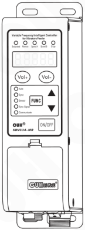

Contrôleur×1

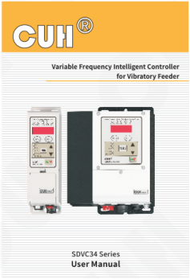

Manuel d'utilisation×1

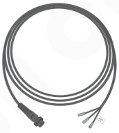

Câble de sortie×1

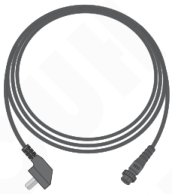

Cordon d'alimentation×1

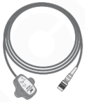

Capteur de vibration×1

---

## 1.2 Description des indicateurs

### Contrôleur avec fonction RS485

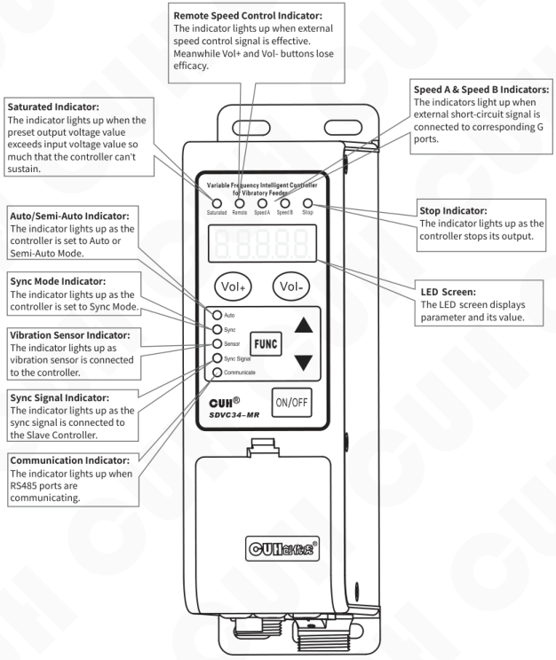

**Voyant de contrôle de vitesse à distance :**
Le voyant s'allume lorsqu'un signal externe de contrôle de vitesse est actif. En même temps, les boutons Vol+ et Vol- deviennent inopérants.

**Voyant de saturation :**
Le voyant s'allume lorsque la valeur de tension de sortie préréglée dépasse tellement la valeur de la tension d'entrée que le contrôleur ne peut plus la maintenir.

**Voyants Speed A et Speed B :**
Les voyants s'allument lorsqu'un signal externe de court-circuit est connecté aux ports G correspondants.

**Voyant Auto/Semi-Auto :**
Le voyant s'allume lorsque le contrôleur est réglé en mode Auto ou Semi-Auto.

**Voyant du mode Sync :**
Le voyant s'allume lorsque le contrôleur est réglé en mode Sync.

**Voyant du capteur de vibration :**
Le voyant s'allume lorsque le capteur de vibration est connecté au contrôleur.

**Voyant du signal de synchronisation :**
Le voyant s'allume lorsque le signal de synchronisation est connecté au contrôleur esclave.

**Voyant de communication :**
Le voyant s'allume lorsque les ports RS485 communiquent.

**Voyant d'arrêt :**
Le voyant s'allume lorsque le contrôleur arrête sa sortie.

**Écran LED :**
L'écran LED affiche le paramètre et sa valeur.

---

## Contrôleur avec fonction RS485 et comptage

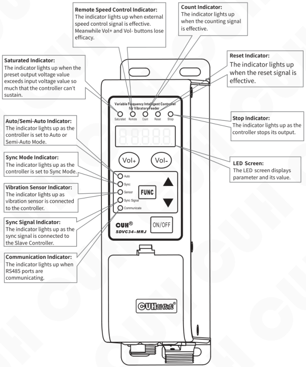

**Voyant de contrôle de vitesse à distance :**  
Le voyant s'allume lorsqu'un signal externe de contrôle de vitesse est actif. En même temps, les boutons Vol+ et Vol- deviennent inopérants.

**Voyant de comptage :**  
Le voyant s'allume lorsque le signal de comptage est actif.

**Voyant de saturation :**  
Le voyant s'allume lorsque la valeur de tension de sortie préréglée dépasse tellement la valeur de la tension d'entrée que le contrôleur ne peut plus la maintenir.

**Voyant de réinitialisation :**  
Le voyant s'allume lorsque le signal de réinitialisation est actif.

**Voyant Auto/Semi-Auto :**  
Le voyant s'allume lorsque le contrôleur est réglé en mode Auto ou Semi-Auto.

**Voyant d'arrêt :**  
Le voyant s'allume lorsque le contrôleur arrête sa sortie.

**Voyant du mode Sync :**  
Le voyant s'allume lorsque le contrôleur est réglé en mode Sync.

**Écran LED :**  
L'écran LED affiche le paramètre et sa valeur.

**Voyant du capteur de vibration :**  
Le voyant s'allume lorsque le capteur de vibration est connecté au contrôleur.

**Voyant du signal de synchronisation :**  
Le voyant s'allume lorsque le signal de synchronisation est connecté au contrôleur esclave.

**Voyant de communication :**  
Le voyant s'allume lorsque les ports RS485 communiquent.

---

## 1.3 Description des boutons

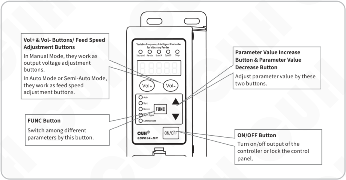

**Boutons Vol+ et Vol- / Boutons de réglage de la vitesse d'alimentation**

En mode manuel, ils servent de boutons de réglage de la tension de sortie.

En mode Auto ou Semi-Auto, ils servent de boutons de réglage de la vitesse d'alimentation.

**Bouton FUNC**

Permet de passer d'un paramètre à l'autre à l'aide de ce bouton.

**Bouton d'augmentation et bouton de diminution de la valeur du paramètre**

Réglez la valeur du paramètre à l'aide de ces deux boutons.

**Bouton marche/arrêt**

Active/désactive la sortie du contrôleur ou verrouille le panneau de commande.

## 1.4 Description des parties externes

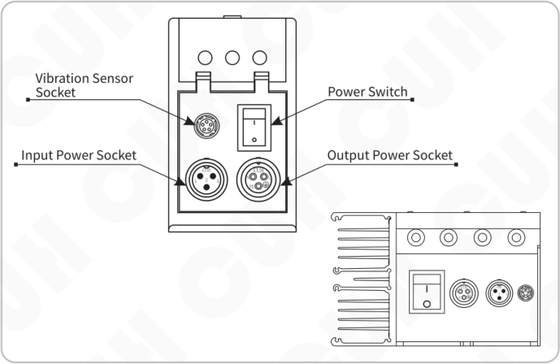

- Socket du capteur de vibration
- Socket d'alimentation d'entrée
- Interrupteur d'alimentation
- Socket de puissance de sortie

---

## 1.5 Description des ports de câblage

### SDVC34-MR :

### SDVC34-MRJ :

---

### SDVC34-XLR :

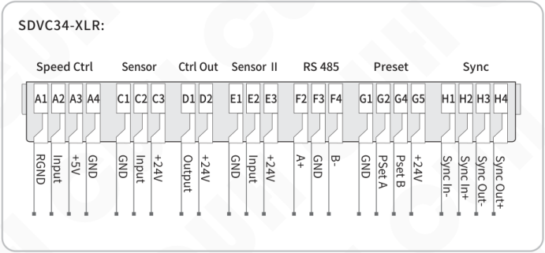

| Fonction | Port | Signal |
|---|---|---|
| Speed Ctrl | A1 | RGND |
| Speed Ctrl | A2 | Input |
| Speed Ctrl | A3 | +5V |
| Speed Ctrl | A4 | GND |
| Sensor | C1 | GND |
| Sensor | C2 | Input |
| Sensor | C3 | +24V |
| Ctrl Out | D1 | Output |
| Ctrl Out | D2 | +24V |
| Sensor Ⅱ | E1 | GND |
| Sensor Ⅱ | E2 | Input |
| Sensor Ⅱ | E3 | +24V |
| RS 485 | F2 | A+ |
| RS 485 | F3 | GND |
| RS 485 | F4 | B- |
| Preset | G1 | GND |
| Preset | G2 | PSet A |
| Preset | G4 | Pset B |
| Preset | G5 | +24V |
| Sync | H1 | Sync In- |
| Sync | H2 | Sync In+ |
| Sync | H3 | Sync Out- |
| Sync | H4 | Sync Out+ |

## 1.6 Description de la plaque signalétique

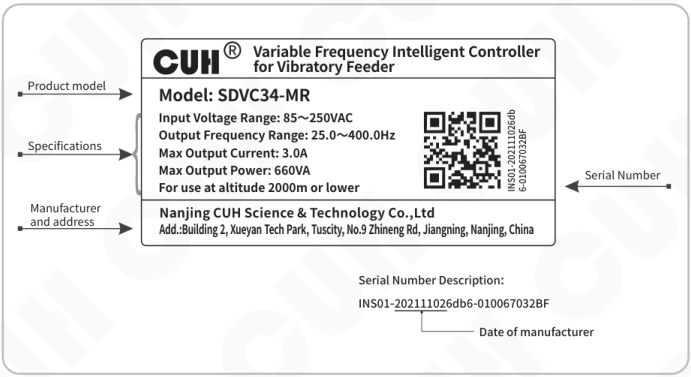

**CUH® — Contrôleur intelligent à fréquence variable pour alimentateur vibrant**

**Modèle de produit**

Modèle : SDVC34-MR

**Caractéristiques**

- Plage de tension d'entrée : 85～250VAC
- Plage de fréquence de sortie : 25.0～400.0Hz
- Courant de sortie maximal : 3.0A
- Puissance de sortie maximale : 660VA
- Utilisation à une altitude inférieure ou égale à 2000 m

**Fabricant et adresse**

Nanjing CUH Science & Technology Co.,Ltd

Add.:Building 2, Xueyan Tech Park, Tuscity, No.9 Zhineng Rd, Jiangning, Nanjing, China

**Numéro de série**

INS01-202111026db6-010067032BF

Description du numéro de série :

INS01-<u>20211102</u>6db6-010067032BF

20211102 → Date de fabrication

---

## ChapitreⅡ Caractéristiques

### 2.1 Présentation du produit

Le contrôleur est spécialement conçu pour commander un alimentateur vibrant dans des systèmes d'automatisation. Combinant les dernières technologies électroniques et une conception soignée, le contrôleur présente les fonctions pratiques et utiles suivantes :

**FM automatique :** modulation automatique de la fréquence de sortie en temps réel pour garantir que l'alimentateur vibrant fonctionne toujours à sa meilleure fréquence de vibration.

**Contrôle automatique à vitesse constante :** réglage automatique de la tension de sortie en temps réel pour garantir une vitesse d'alimentation préréglée constante, indépendamment de la variation du poids des matériaux dans l'alimentateur vibrant.

**Mesure automatique de la fréquence :** mesure et sortie automatiques de la meilleure fréquence de vibration de l'alimentateur vibrant.

**Régulation automatique de tension :** élimine à la fois la variation de la vitesse d'alimentation causée par les fluctuations de la tension du réseau et l'effet de battement causé par la fréquence AC industrielle.

**Synchronisation de forme d'onde :** synchronise la forme d'onde de sortie des contrôleurs esclaves avec celle du contrôleur maître, à la même fréquence et en phase, afin d'éviter l'effet de battement.

**Commande marche/arrêt à distance :** le contrôleur dispose de 2 groupes de ports de commande marche/arrêt. Des capteurs de commutation ou un PLC peuvent être connectés pour allumer/éteindre le contrôleur. Le temps de démarrage progressif, le retard d'enclenchement, le retard de déclenchement et la relation logique de la commande marche/arrêt peuvent également être réglés.

**Reconnaissance automatique du type de capteur de commutation :** le contrôleur peut reconnaître et s'adapter aussi bien aux capteurs de commutation de type NPN que PNP.

**Démarrage progressif :** afin d'éviter tout choc brutal sur les matériaux et sur l'alimentateur vibrant, le contrôleur peut augmenter progressivement la tension de sortie/la vitesse d'alimentation de 0 à la valeur préréglée au démarrage.

**Vitesses préréglées :** 4 vitesses d'alimentation préréglées peuvent être mémorisées et sorties par un signal externe de court-circuit.

**Accélération :** la valeur maximale de la tension de sortie du contrôleur peut être portée jusqu'à 150% de la valeur de la tension d'entrée.

**Tension de sortie maximale réglable :** la tension de sortie maximale réglable peut être préréglée pour protéger l'alimentateur vibrant contre les dommages causés par une tension élevée.

**Indice de forme d'onde :** les utilisateurs peuvent équilibrer rendement et puissance maximale en réglant ce paramètre.

**Contrôle de vitesse à distance :** la tension de sortie/la vitesse d'alimentation du contrôleur peut être réglée à distance par un potentiomètre externe, un PLC ou un signal DC 1~5V/4~20mA.

**Sortie de contrôle 24V DC :** le contrôleur peut fournir une alimentation 24V DC associée au réglage de la relation logique de la commande marche/arrêt pour commander une électrovanne, un relais électrique ou d'autres dispositifs externes.

**Comptage :** le contrôleur (uniquement SDVC34-MRJ) peut compter les pièces qui passent et ralentir ou arrêter automatiquement sa sortie lorsque la quantité de pièces qui passent atteint la valeur préréglée.

**Verrouillage du panneau de commande :** verrouillez tous les boutons du panneau de commande en appuyant sur le bouton marche/arrêt et en le maintenant enfoncé 2 secondes pour éviter toute erreur de manipulation.

**Verrouillage des paramètres :** verrouillez tous les paramètres excepté la tension de sortie/la vitesse d'alimentation par un mot de passe personnalisé pour empêcher toute opération non autorisée.

**Réinitialisation du contrôleur :** réinitialise tous les paramètres du contrôleur aux valeurs d'usine par défaut.

**Communication RS485 :** tous les paramètres peuvent être réglés via les ports de communication RS485.

---

## 2.2 Guide de sélection

### 2.2.1 Explication des modèles

| Modèle de contrôleur | Puissance (VA) | Fonction |
|---|---|---|
| SDVC34-MR | 660 | RS485 |
| SDVC34-MRJ | 660 | RS485 & Comptage |
| SDVC34-XLR | 1320 | RS485 |
| SDVC34-XLRJ | 1320 | RS485 & Comptage |

### 2.2.2 Explication des fonctions

| Fonction | Communes | Comptage | RS485 | RS485 & Comptage |
|---|---|---|---|---|
| Marche/Arrêt des ports C | √ | √ | √ | √ |
| Contrôle de vitesse à distance | √ | √ | √ | √ |
| Sortie de contrôle | √ | √ | √ | √ |
| Vitesses préréglées | √ | | √ | |
| Comptage | | √ | | √ |
| Marche/Arrêt des ports E | | | √ | √ |
| Synchronisation | | | √ | √ |
| RS 485 | | | √ | √ |
| Capteur de vibration | √ | √ | √ | √ |

---

# Chapitre Ⅲ Guide d'installation

Ce chapitre présente les conditions nécessaires à l'utilisation du contrôleur ainsi que la manière de l'installer et de le raccorder correctement.

## 3.1 Conditions d'utilisation du contrôleur

Le contrôleur est alimenté en AC 110/220V et la connexion de mise à la terre de protection s'effectue par la fiche du cordon d'alimentation. Veuillez fournir une alimentation de secteur 110V ou 220V, 50Hz/60Hz et des installations de distribution conformes à la norme, et veillez à ce que le fil de terre de protection soit correctement connecté.

**⚠ Avertissement** Ne connectez jamais le contrôleur à une alimentation AC 380V, cela causerait des dommages graves et irréversibles au contrôleur, pouvant entraîner une explosion, un incendie et d'autres incidents de sécurité.

**⚠ Avertissement** Veillez à ce que le côté alimentation soit correctement mis à la terre. Le boîtier métallique du contrôleur est directement relié au fil de terre de protection. Une mise à la terre défectueuse mettrait le boîtier du contrôleur sous tension et provoquerait un accident d'électrocution.

**Avis** Un fonctionnement prolongé génère de la chaleur et entraîne une élévation de la température du boîtier. Veuillez installer le contrôleur dans un environnement bien ventilé et le fixer solidement, à l'écart des sources de vibration.

**Avis** La sortie de ce produit est obtenue par redressement et inversion de l'alimentation du secteur, et il n'y a pas d'isolation entre son entrée et sa sortie. Par conséquent, les pôles de sortie ne peuvent pas être reliés à la terre de protection. Lors du raccordement de l'électroaimant, il faut s'assurer que la bobine de l'électroaimant et le boîtier possèdent une capacité d'isolation principale. Sinon, des fuites de courant peuvent se produire, ce qui peut provoquer une électrocution et endommager le contrôleur.

**Avis** Ce produit est un contrôleur destiné à commander un électroaimant. Il ne doit pas être raccordé à un alimentateur vibrant piézoélectrique.

## 3.2 Méthode d'utilisation des boutons

a. L'appui court désigne un temps d'appui supérieur à 0.1 s et inférieur à 2 secondes ; l'appui long désigne un temps d'appui supérieur à 2 secondes.

b. Appuyez brièvement sur `Vol+` ou `Vol-` pour régler la tension de sortie et la vitesse d'alimentation du contrôleur sur n'importe quelle interface LED. Le contrôleur revient au paramètre précédent après le réglage d'un paramètre commun.

c. Appuyez longuement sur `ON/OFF` pour verrouiller ou déverrouiller tous les boutons du panneau de commande. En état verrouillé, aucun bouton n'est réglable.

d. Entrez ou sortez de l'interface des paramètres de base par un appui long sur `FUNC`, passez d'un paramètre de base à l'autre par des appuis courts sur `FUNC` et réglez la valeur du paramètre par des appuis courts sur ▼ ou ▲.

e. Entrez ou sortez de l'interface des paramètres avancés par un appui long sur `FUNC` et ▲, passez d'un paramètre avancé à l'autre par des appuis courts sur `FUNC` et réglez la valeur du paramètre par des appuis courts sur ▼ ou ▲.

f. Entrez ou sortez de l'interface des paramètres Auto/Sync par un appui long sur `FUNC` et ▼, passez d'un paramètre Auto/Sync à l'autre par des appuis courts sur `FUNC` et réglez la valeur du paramètre par des appuis courts sur ▼ ou ▲.

---

## 3.3 Installation et utilisation

### Étape un :

Ouvrez l'emballage et vérifiez le contrôleur et tous les accessoires.

### Étape deux :

Raccordez les bornes du câble de puissance de sortie à la bobine électromagnétique du vibrateur.

Alignez l'encoche de la fiche aviation du câble de sortie sur le repère triangulaire du socket de sortie du contrôleur, puis serrez l'écrou après avoir correctement connecté le câble de sortie.

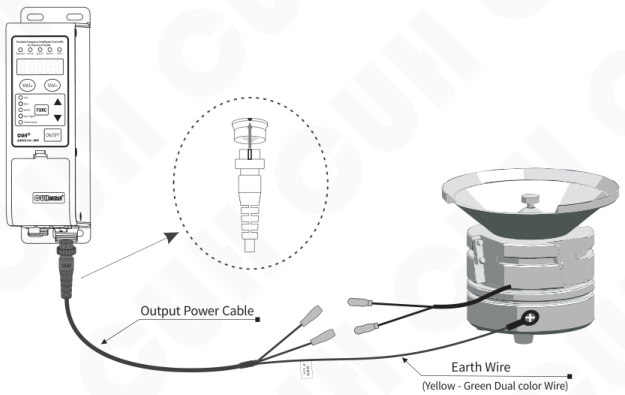

### Remarque

1. Assurez-vous que les bobines électromagnétiques du vibrateur sont connectées aux deux broches de sortie du câble de puissance de sortie et que la carcasse métallique du vibrateur est correctement mise à la terre.
2. Il est interdit de connecter des charges piézoélectriques à la sortie de puissance, sous peine de provoquer un accident de sécurité par électrocution !

---

### Étape trois :

Connectez le connecteur du câble d'alimentation d'entrée au socket d'alimentation d'entrée du contrôleur.

Connectez d'abord le côté contrôleur

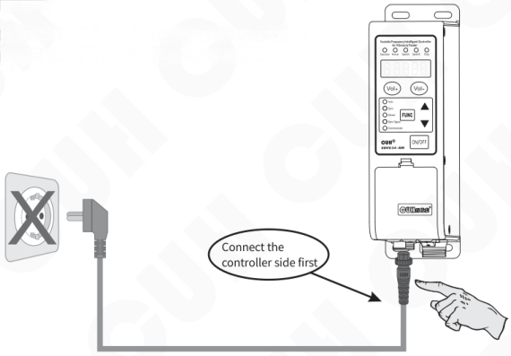

### Étape quatre :

Après avoir confirmé que l'interrupteur est en position d'arrêt, branchez la fiche du câble d'alimentation d'entrée sur la prise de courant.

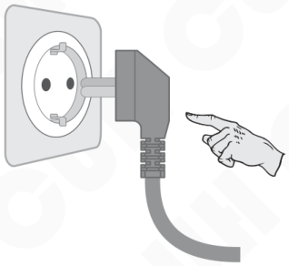

---

# Chapitre Ⅳ Réglage des paramètres

Les paramètres du contrôleur sont classés en 4 types selon les différentes méthodes de réglage : paramètres communs, paramètres de base, paramètres avancés et paramètres Auto/Sync.

## 4.1 Paramètres communs

- Appuyez sur `Vol+` ou `Vol-` pour régler les paramètres communs.
- Les touches `Vol+` et `Vol-` sont conçues pour régler uniquement les paramètres communs.
- Les paramètres communs peuvent être réglés en appuyant sur `Vol+` ou `Vol-` même lorsqu'un autre paramètre est affiché sur l'écran LED. Le contrôleur revient au paramètre précédent après le réglage d'un paramètre commun.

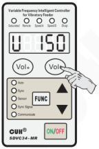

|  | Définition | Symbole | Image du symbole | Plage | Valeur par défaut |
|---|---|---|---|---|---|
| Paramètres communs | Tension de sortie | U | 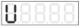 | 0~250 (V) | 150 |
| Paramètres communs | Vitesse d'alimentation | A | 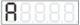 | 0~3200 | 200 |
| Paramètres communs | Verrouillage du clavier | a | 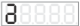 | —— | Valeur de tension actuelle/ Vitesse d'alimentation actuelle |

## 4.2 Paramètres de base

- Appuyez sur `FUNC` et maintenez 2 secondes pour entrer dans l'état de réglage des paramètres de base.
- Appuyez répétitivement sur `FUNC` pour passer cycliquement d'un paramètre à l'autre.
- Appuyez sur le bouton ▲ ou ▼ pour régler la valeur du paramètre.
- Appuyez à nouveau sur `FUNC` et maintenez 2 secondes pour sortir de l'état de réglage des paramètres de base.

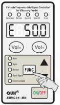

|  | Définition | Symbole | Image du symbole | Plage | Valeur par défaut |
|---|---|---|---|---|---|
| Paramètres de base Appui long sur `FUNC` | Fréquence de sortie | E | 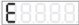 | 25.0~400.0 (Hz) | 50.0 |
| Paramètres de base Appui long sur `FUNC` | Retard d'enclenchement des ports C | J | 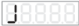 | 0.0~99.9 (s) | 0.2 |
| Paramètres de base Appui long sur `FUNC` | Retard de déclenchement des ports C | L | 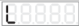 | 0.0~99.9 (s) | 0.2 |
| Paramètres de base Appui long sur `FUNC` | Temps de démarrage progressif | t | 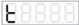 | 0.0~10.0 (s) | 0.5 |
| Paramètres de base Appui long sur `FUNC` | Limite maximale de comptage (Contrôleur avec fonction compteur, suffixe J) | 3 | 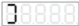 | 0~9999 | 0 |

---

## 4.3 Paramètres avancés

- Appuyez simultanément sur les boutons `FUNC` et ▲ et maintenez 2 secondes pour entrer dans l'état de réglage des paramètres avancés.
- Appuyez répétitivement sur `FUNC` pour passer cycliquement d'un paramètre à l'autre.
- Appuyez sur ▲ ou ▼ pour régler la valeur du paramètre.
- Appuyez à nouveau simultanément sur les boutons `FUNC` et ▲ et maintenez 2 secondes pour sortir de l'état de réglage des paramètres avancés.

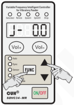

**Paramètres avancés**  
Appui long sur `FUNC` et ▲

| Définition | Symbole | Image du symbole | Plage | Valeur par défaut |
|---|---|---|---|---|
| Retard d'enclenchement du port E | J- |  | 0.0~99.9 (s) | 0.0 |
| Retard de déclenchement du port E | L- | 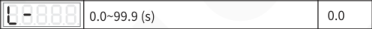 | 0.0~99.9 (s) | 0.0 |
| Retard d'enclenchement du port D | Jd | 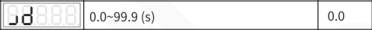 | 0.0~99.9 (s) | 0.0 |
| Retard de déclenchement du port D | Ld |  | 0.0~99.9 (s) | 0.0 |
| Type du port D | rd | 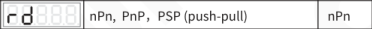 | nPn, PnP, PSP (push-pull) | nPn |
| Relation logique du port C | F2 | 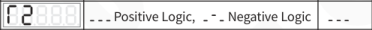 | Logique positive, Logique négative | Logique positive |
| Relation logique du port E | F1 | 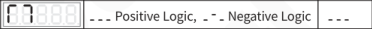 | Logique positive, Logique négative | Logique positive |
| Relation logique de Ctrl Out | F3 | 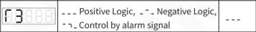 | Logique positive, Logique négative, Commande par signal d'alarme | Logique positive |
| Opération logique de la sortie principale | F4 | 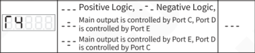 | Logique positive, Logique négative, La sortie principale est contrôlée par le port C, le port D est contrôlé par le port E La sortie principale est contrôlée par le port E, le port D est contrôlé par le port C | Logique positive |
| Opération logique de la sortie de contrôle | F8 | 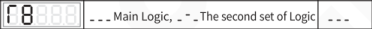 | Logique principale, Deuxième jeu de logique | Logique principale |
| Type de capteur de commutation (Contrôleur avec fonction RS485, suffixe R) | FA |  | Uto, nPn, PnP | Uto |
| Type de capteur de commutation (Contrôleur avec fonction comptage, suffixe J) | FA |  | nPn, PnP | nPn |
| Relation logique des ports C et E | ∩ | 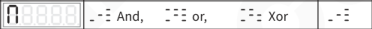 | And, or, Xor | And |
| Direction logique des impulsions de comptage (Contrôleur avec fonction comptage, suffixe J) | Fb | 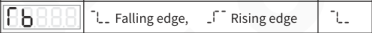 | Front descendant, Front montant | Front descendant |
| Direction logique de la réinitialisation du comptage (Contrôleur avec fonction comptage, suffixe J) | FC | 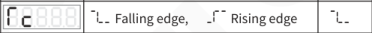 | Front descendant, Front montant | Front descendant |
| Pourcentage de vitesse en fin de comptage (Contrôleur avec fonction comptage, suffixe J) | u | 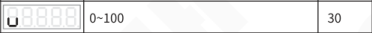 | 0~100 | 30 |
| Nombre de fins de comptage (Contrôleur avec fonction comptage, suffixe J) | n | 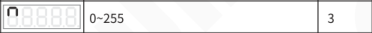 | 0~255 | 3 |
| Temps d'anti-rebond du comptage (Contrôleur avec fonction comptage, suffixe J) | U | 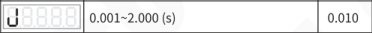 | 0.001~2.000 (s) | 0.010 |

### Paramètres avancés

Appui long sur **FUNC** et **▲**

| Définition | Symbole | Image du symbole | Plage | Valeur par défaut |
|---|---|---|---|---|
| Tension de sortie maximale réglable | h | 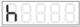 | 0~250 (V) | 250 |
| Limite inférieure de la fréquence de sortie | e | 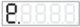 | 25.0~390.0 (Hz) | 40.0 |
| Indice d'accélération | y | 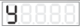 | 100~150 % | 120 |
| Indice de forme d'onde | r | 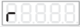 | 0~100 | 100 |
| Affichage de la température | C | 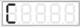 | -10.0~80.0 (°C) | Température actuelle |
| Protocole de communication | P | 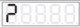 | ASC, rtu | rtu |
| Adresse de communication | Voir l'image du symbole | 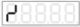 | 1~31 | 1 |
| Débit en bauds de communication | d | 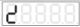 | 0.3~115.2 kbps | 9.6 |
| Mot de passe de verrouillage des paramètres | q- | 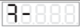 | 0~999 | - - - |
| État à la mise sous tension | rd | 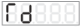 | Marche, Arrêt, Suivi de l'état avant la mise hors tension  | - - -  |
| Version logicielle | Ur |  | —— | Version actuelle |
| Temps de réinitialisation automatique après compteur rempli (Contrôleur avec fonction comptage, suffixe J) | rE |  | 0.0~99.9 (s) | 0.0 |
| Réinitialisation du contrôleur | 8.8.8.8.8. |  | —— | —— |

---

## Explication de certains paramètres avancés

### Tension de sortie maximale réglable : h

La plage de la tension de sortie est de 0 à 250 V. Le paramètre h limite la tension de sortie maximale à une certaine valeur afin de protéger l'alimentateur vibrant contre une tension élevée due à une erreur de manipulation.

La tension du contrôle de vitesse à distance est également affectée par ce paramètre.

### Limite inférieure de la fréquence de sortie : E.

La plage de la fréquence de sortie est de 25.0 à 390.0 (Hz). Le paramètre E. limite la fréquence de sortie minimale à une valeur déterminée afin de protéger l'alimentateur vibrant contre toute erreur de manipulation.

### Pourcentage de vitesse en fin de comptage : u

Signifie que lorsque le comptage entre dans l'état final de décélération, la vitesse d'alimentation du contrôleur descend au pourcentage indiqué de la vitesse initiale.

### Nombre de fins de comptage : n

Désigne le nombre total de comptages de distance. Une fois le « nombre de fins » atteint, le contrôleur passe en mode de décrément du comptage.

### Temps d'anti-rebond du comptage : J

Temps de validité du niveau haut ou du niveau bas en état de comptage.

### Indice d'accélération : y

Indique que la tension de sortie maximale peut atteindre le pourcentage indiqué de la tension d'entrée. Après réglage, la tension de sortie maximale ne dépassera malgré tout pas la valeur du paramètre h.

### Indice de forme d'onde : r

Le contrôleur peut équilibrer en continu les performances entre rendement maximal-puissance maximale et bruit minimal afin de répondre aux exigences les plus élevées des clients.

### Retard d'enclenchement/déclenchement du port D : Jd et Ld

La plage du retard d'enclenchement/déclenchement est de 0.0~99.9s, la valeur par défaut est 0.0s.

### Type du port D : rd

Le port de sortie de contrôle peut prendre en charge une sortie NPN, une sortie PNP et une sortie push-pull. À savoir :

La sortie NPN est valide à l'état de niveau bas, et la sortie est invalide à l'état de haute impédance ;

La sortie PNP est valide à l'état de niveau haut, et la sortie est invalide à l'état de haute impédance ;

La sortie push-pull est valide à l'état de niveau haut, et invalide à l'état de niveau bas.

---

### Opération logique de la sortie de contrôle : Γ8

Logique de la sortie principale et de la sortie de contrôle : l'utilisateur peut régler le signal de sortie de contrôle pour qu'il suive le signal de la sortie principale.

### Affichage de la température : C

Affiche en temps réel la température interne du contrôleur. Lecture seule.

### Mot de passe de verrouillage des paramètres : 

Verrouillez tous les paramètres excepté le paramètre de tension de sortie U/le paramètre de vitesse d'alimentation A par un mot de passe personnalisé afin d'empêcher toute opération non autorisée.

Activez la fonction de verrouillage des paramètres en définissant un mot de passe via  ; ce mot de passe reste actif après la mise hors tension. Lorsque l'utilisateur entre dans les paramètres avancés, l'afficheur LED montre  pour signaler la demande du mot de passe ; si le mot de passe est correct, un appui court sur `FUNC` donne accès aux réglages des paramètres avancés. Si le mot de passe est incorrect, l'appui court sur `FUNC` est ignoré.

### État à la mise sous tension : Γd

Indique l'état de fonctionnement du contrôleur après la mise sous tension.

### Version logicielle : Ur

Affiche la version logicielle actuelle du contrôleur. Lecture seule.

### Temps de réinitialisation automatique après compteur rempli : ΓE

Ce paramètre ΓE définit le temps de retard de réinitialisation automatique après remplissage du compteur ; lorsque le temps de retard est atteint, le compteur se remet à zéro et les voyants de comptage et de réinitialisation s'allument.

---

## Paramètre de réinitialisation du contrôleur : 8.8.8.8.8.

Réinitialisez tous les paramètres aux valeurs d'usine par défaut à l'aide de ce paramètre si nécessaire.

### Réinitialisation du contrôleur

**Étape 1 :** Appuyez simultanément sur les boutons **FUNC** et ▲ et maintenez 2 secondes pour entrer dans l'état de réglage des paramètres avancés.

**Étape 2 :** Appuyez sur **FUNC** pour passer au paramètre `8.8.8.8.8.` clignotant sur l'écran LED.

**Étape 3 :** Appuyez sur le bouton ▲ et maintenez-le jusqu'à ce que `-----` s'affiche sur l'écran LED.

**Étape 4 :** Relâchez le bouton ▲ pour terminer le processus de réinitialisation du contrôleur ; U150 s'affiche sur l'écran LED.

---

## 4.4 Paramètres Auto/Sync

- Appuyez simultanément sur les boutons **FUNC** et ▼ et maintenez 2 secondes pour entrer dans l'état de réglage des paramètres Auto/Sync.
- Appuyez répétitivement sur **FUNC** pour passer cycliquement d'un paramètre à l'autre.
- Appuyez sur ▲ ou ▼ pour régler la valeur du paramètre.
- Appuyez à nouveau simultanément sur les boutons **FUNC** et ▼ et maintenez 2 secondes pour sortir de l'état de réglage des paramètres Auto/Sync.

**Paramètres Auto/Sync**  
Appui long sur **FUNC** et **▼**

| Définition | Symbole | Image du symbole | Plage | Valeur par défaut |
|---|---|---|---|---|
| Fréquence centrale | F |  | 25.0~400.0 (Hz) | 100.0 |
| Décalage maximal en FM automatique | n |  | 0.0~180.0 (Hz) | 30.0 |
| Méthode de réglage de la tension de sortie | FS |  | Auto, Manual（symboles correspondants voir figure）  | - - - |
| Méthode de réglage de la fréquence de sortie | FG |  | Auto, Manual, Sync（symboles correspondants voir figure）  | - - - |
| Indice de réglage automatique de la fréquence de sortie | iF |  | 0~200 | 20 |
| Indice de réglage automatique de l'amplitude | PA |  | 0~999 | 60 |
| Indice de réglage automatique de l'amplitude | iA |  | 0~999 | 50 |
| Affichage de la vitesse d'alimentation | U |  | 0~H | 0 |
| Affichage de la tension de sortie | G |  | 0~h (V) | 150 |
| Limite inférieure de la tension | GL |  | 0~250 (V) | 0 |
| Limite inférieure de la fréquence | e |  | 25.0~400.0 (Hz) | 40.0 |
| Indice d'amplitude maximale | P |  | 0~500 | 500 |
| Vitesse d'alimentation maximale réglable | H |  | 0~3200 | 1500 |
| Déphasage | Y |  | -180~180 ° | 0 |
| Tension de sortie maximale pendant la mesure automatique de fréquence | b |  | 0~250 (V) | 100 |
| Vitesse de recherche de fréquence | SP |  | 1~7 | 5 |
| Pas de réglage minimal de la vitesse d'alimentation | c |  | 1~10 | 1 |
| Numéro du capteur de vibration | t |  | 0, 1, 2, 3, 4, 203, 204, 205, 206 | 205 |

---

## Explication des paramètres Auto/Sync

### Méthode de réglage de la tension de sortie : Γ5

Lorsque le paramètre Γ5 est réglé sur `_-_`, le paramètre de tension de sortie U est visible tandis que le paramètre A est masqué. Le paramètre de tension de sortie U peut être réglé manuellement.

Lorsque le paramètre Γ5 est réglé sur `___` et que le capteur de vibration est connecté au contrôleur, le paramètre de vitesse d'alimentation A est visible tandis que le paramètre U est masqué. La tension de sortie est réglée automatiquement en fonction du retour du capteur de vibration afin de garantir une vitesse d'alimentation préréglée constante.

> Lorsque le capteur de vibration n'est pas connecté au contrôleur, même si le paramètre Γ5 est réglé sur `___`, le paramètre U reste visible et réglable manuellement.

### Méthode de réglage de la fréquence de sortie : Γ6

Lorsque le paramètre Γ6 est réglé sur `_-_`, le paramètre de fréquence de sortie E peut être réglé manuellement.

Lorsque le paramètre Γ6 est réglé sur `___` et que le capteur de vibration est connecté au contrôleur, le paramètre de fréquence de sortie E est réglé automatiquement à la fréquence de résonance (meilleure fréquence de vibration) de l'alimentateur vibrant en fonction du retour du capteur de vibration. La fréquence de sortie ne peut pas être réglée manuellement.

Lorsque le paramètre Γ6 est réglé sur  et que le câble de signal de synchronisation est connecté entre les contrôleurs maître et esclave, la fréquence de sortie du contrôleur esclave est toujours identique à celle du contrôleur maître. La fréquence de sortie du contrôleur esclave ne peut pas être réglée manuellement.

> Lorsque le capteur de vibration n'est pas connecté au contrôleur, même si le paramètre Γ6 est réglé sur `___`, la fréquence de sortie reste réglable manuellement.

### Fréquence centrale : F

La fréquence centrale doit être réglée autour de la fréquence de résonance de l'alimentateur vibrant afin que le contrôleur puisse trouver la meilleure fréquence de vibration plus rapidement.

### Décalage maximal en FM automatique : n

La plage de la FM automatique est de (F ±n) Hz.

La valeur suggérée de n est d'environ 30.0Hz.

Si le paramètre n est réglé trop grand, l'alimentateur vibrant peut fonctionner à une fréquence de vibration inadaptée.

Si le paramètre n est réglé trop petit, la flexibilité de l'alimentateur vibrant peut être affectée.

---

### Indice de réglage automatique de la fréquence de sortie : 1F

Le processus de FM automatique s'exécute via un algorithme PID. « IF » est un indice d'intégration de fréquence.

Plus le paramètre « IF » est réglé grand, plus la fréquence de sortie est modulée rapidement automatiquement. Mais une valeur « IF » trop grande peut provoquer des oscillations de la fréquence de sortie.

### Indice de réglage automatique de l'amplitude : PA

Le contrôleur règle la tension de sortie automatiquement via un algorithme PID. PA est un indice de rapport de vitesse.

Plus le paramètre PA est réglé grand, plus la tension de sortie est réglée rapidement automatiquement. Mais une valeur PA trop grande peut provoquer des oscillations de la tension de sortie.

### Indice de réglage automatique de l'amplitude : 1A

Le contrôleur règle la tension de sortie automatiquement via un algorithme PID. IA est un indice d'intégration de vitesse.

Plus le paramètre IA est réglé grand, plus la tension de sortie est réglée rapidement automatiquement. Mais une valeur IA trop grande peut provoquer des oscillations de la tension de sortie.

### Affichage de la vitesse d'alimentation : 

Ce paramètre est conçu pour afficher la vitesse d'alimentation et n'est pas réglable.

### Affichage de la tension de sortie : G

Ce paramètre est conçu pour afficher la tension de sortie et n'est pas réglable.

### Limite inférieure de la tension et limite inférieure de la fréquence : GL et 

Lorsque Γ3 est réglé sur  (Commande par signal d'alarme), et que le contrôleur est en mode automatique (y compris automatique en tension seule, automatique en fréquence seule ou entièrement automatique) et fonctionne normalement (ni en arrêt manuel ni en signal externe, ni en démarrage progressif ni en état de défaut), si la tension de sortie est inférieure au paramètre de limite inférieure défini par GL, ou si la fréquence de sortie est inférieure au paramètre de limite inférieure défini par , alors la sortie de contrôle 24V est valide (la sortie du port D1 est à l'état bas). Si aucune de ces situations ne se produit, la sortie est invalide (la sortie du port D1 est à haute impédance).

Les trois paramètres ci-dessus Γ3, GL et  peuvent être sauvegardés automatiquement après réglage, et peuvent être définis et lus via la communication RS485.

### Indice d'amplitude maximale : P

Réglez l'indice P pour limiter l'amplitude maximale de l'alimentateur vibrant.

### Vitesse d'alimentation maximale réglable : H

La plage de la vitesse d'alimentation est de 0 à H. Le paramètre H limite la vitesse d'alimentation maximale à une certaine valeur afin de protéger l'alimentateur vibrant contre une tension élevée due à une erreur de manipulation.

La vitesse d'alimentation du contrôle de vitesse à distance est également affectée par ce paramètre.

### Déphasage : 

Réglez le paramètre  pour modifier la phase de l'onde de sortie ; le déphasage par défaut est de 0°.

---

## Tension de sortie maximale pendant la mesure automatique de fréquence : b

La tension de sortie ne dépassera pas la valeur du paramètre b pendant la mesure automatique de fréquence afin de protéger l'alimentateur vibrant contre tout dommage.

## Vitesse de recherche de fréquence : SP

Le paramètre SP représente la vitesse de recherche de fréquence. Plus cette valeur est élevée, plus la progression de la recherche de fréquence est rapide. Le paramètre SP est compris entre 1 et 7.

## Pas de réglage minimal de la vitesse d'alimentation : c

Le paramètre c représente le pas de réglage du paramètre de vitesse d'alimentation A à chaque pression sur le bouton Vol+ ou Vol-. Le paramètre c est compris entre 1 et 10.

## Numéro du capteur de vibration : ├

Le contrôleur s'adapte à 8 modèles différents de capteurs de vibration. Réglez le paramètre ├ en fonction du modèle de capteur, de sorte que, à vitesse d'alimentation définie identique, le contrôleur délivre la même valeur de tension quel que soit le modèle de capteur de vibration connecté.

| Valeur du paramètre | Modèle correspondant | Caractéristiques Accélération axes X/Y/Z |
|---|---|---|
| 1 | SDVS20-1 | 16g/16g/16g |
| 2 | SDVS20-2 | 35g/35g/—— |
| 3 | SDVS20-3 | 50g/50g/—— |
| 4 | SDVS20-4 | 70g/70g/—— |
| 203 | SDVS203 | 8g/8g/8g |
| 204 | SDVS204 | 16g/16g/16g |
| 205 | SDVS205 | 32g/32g/32g |
| 206 | SDVS206 | 64g/64g/64g |

---

# ChapitreⅤ Mode de fonctionnement

Le contrôleur peut être réglé pour fonctionner dans l'un des cinq modes de fonctionnement suivants selon les exigences d'application spécifiques.

- **Mode manuel :** la tension de sortie et la fréquence de sortie sont réglées manuellement.
- **Mode Auto :** la tension de sortie et la fréquence de sortie sont réglées automatiquement en fonction du retour du capteur de vibration afin de garantir une vitesse d'alimentation préréglée constante et la meilleure fréquence de vibration de l'alimentateur vibrant.
- **Mode semi-automatique :** la tension de sortie est réglée automatiquement en fonction du retour du capteur de vibration afin de garantir une vitesse d'alimentation préréglée constante. La fréquence de sortie est réglée manuellement.
- **Mode Sync :** en configuration de synchronisation, si la fréquence de sortie du contrôleur B est toujours identique à celle du contrôleur A, nous définissons le contrôleur A comme contrôleur maître, le contrôleur B comme contrôleur esclave et le mode de fonctionnement du contrôleur B comme mode Sync.
- **Mode comptage :** le contrôleur (uniquement SDVC34-MRJ) peut compter les pièces qui passent et ralentir ou arrêter automatiquement sa sortie lorsque la quantité de pièces qui passent atteint la valeur préréglée.

| Mode de fonctionnement | Tension de sortie U — Méthode de réglage | Tension de sortie U — Réglage Γ5 | Fréquence de sortie E — Méthode de réglage | Fréquence de sortie E — Réglage Γ6 | Image du symbole |
|---|---|---|---|---|---|
| Mode manuel | Manuel | `_ - _` | Manuel | `_ - _` |  |
| Mode Auto | Auto | `- - -` | Auto | `- - -` |  |
| Mode semi-automatique | Auto | `- - -` | Manuel | `_ - _` |  /  |
| Mode Sync | Manuel ou Auto | `_ - _` ou `- - -` | Synchronisation automatique avec le contrôleur maître |  |  /  /  |

## 5.1 Mode manuel

En mode manuel, la tension de sortie et la fréquence de sortie sont réglées manuellement.

| Mode de fonctionnement | Tension de sortie U — Méthode de réglage | Tension de sortie U — Réglage Γ5 | Fréquence de sortie E — Méthode de réglage | Fréquence de sortie E — Réglage Γ6 | Image du symbole |
|---|---|---|---|---|---|
| Mode manuel | Manuel | `_ - _` | Manuel | `_ - _` |  |

Pour simplifier l'utilisation, les paramètres Γ5 et Γ6 sont réglés sur `_ _ _` par défaut d'usine. Avec ce réglage, le contrôleur fonctionne en mode manuel si le capteur de vibration n'est pas connecté au contrôleur, ou en mode Auto si le capteur de vibration est connecté.

> - Si Γ5 et Γ6 sont tous deux réglés sur `_ - _`, le contrôleur fonctionne en mode manuel, que le capteur de vibration soit ou non connecté au contrôleur.
> - Si le capteur de vibration n'est pas connecté au contrôleur, le contrôleur fonctionne toujours en mode manuel.

## 5.1.1 Réglage de la tension de sortie en mode manuel

La valeur réelle de la tension de sortie du contrôleur peut être affichée sur l'écran LED de manière numérique et précise.

- Mettez l'interrupteur d'alimentation en marche lorsque le capteur de vibration n'est pas connecté au contrôleur.
- L'écran LED affiche le paramètre de tension de sortie U et sa valeur.
- Réglez la valeur de U en appuyant sur `Vol+` ou `Vol-`.

## 5.1.2 Réglage de la fréquence de sortie en mode manuel

Grâce à la technologie DDS, la fréquence de sortie du contrôleur est toujours stable et de haute précision, indépendamment du temps ou des variations de température.

- Appuyez sur `FUNC` et maintenez 2 secondes pour entrer dans l'état de réglage des paramètres de base.
- L'écran LED affiche le paramètre de fréquence de sortie E et sa valeur.
- Réglez la valeur de E en appuyant sur le bouton ▲ ou ▼ lorsque le capteur de vibration n'est pas connecté au contrôleur.

---

## 5.2 Mode Auto

En mode Auto, le capteur de vibration doit être connecté au contrôleur. La tension de sortie et la fréquence de sortie sont réglées automatiquement en fonction du retour du capteur de vibration afin de garantir une vitesse d'alimentation préréglée constante et la meilleure fréquence de vibration. La tension de sortie et la fréquence de sortie ne peuvent pas être réglées manuellement.

Par défaut d'usine, lorsque le capteur de vibration est connecté, le contrôleur fonctionne en mode Auto

| Mode de fonctionnement | Tension de sortie U — Méthode de réglage | Tension de sortie U — Réglage Γ5 | Fréquence de sortie E — Méthode de réglage | Fréquence de sortie E — Réglage Γ6 |
|---|---|---|---|---|
| Mode Auto | Auto | - - - | Auto | - - - |

> **Remarque :** Le contrôleur fonctionne toujours en mode manuel si le capteur de vibration n'est pas connecté.

### 5.2.1 Installation du capteur de vibration

#### 5.2.1.1 Méthode de raccordement du capteur de vibration

Connectez le connecteur du capteur de vibration au socket du capteur de vibration du contrôleur.

**Remarque : Branchez et débranchez le capteur de vibration lorsque le contrôleur est hors tension.**

---

## 5.2.1.2 Guide d'installation du capteur de vibration

Fixez le capteur de vibration sur la surface lisse du vibrateur, l'orientation d'installation étant quelconque ; les méthodes d'installation du capteur de vibration sont présentées ci-dessous :

- Méthode 1 : comme indiqué en Fig. 1

  Avantage : installation facile

- Méthode 2 : comme indiqué en Fig. 2

  Remarque : ne laissez pas le bol d'alimentation comprimer le capteur de vibration.

- Méthode 3 : soudez un support sur le vibrateur et fixez le capteur de vibration sur le support. Comme indiqué en Fig. 3

  Les dimensions recommandées du support du vibrateur sont indiquées en Fig. 4.

- Méthode d'installation non recommandée, comme indiqué en Fig. 5 et Fig. 6.

  Si l'emplacement d'installation n'est pas adapté, le capteur de vibration ne peut pas renvoyer la fréquence de résonance avec précision et le contrôleur recherche en permanence la fréquence de résonance.

---

## 5.2.2 Réglage de la vitesse d'alimentation en mode Auto

- Allumez l'interrupteur d'alimentation lorsque le capteur de vibration est raccordé au contrôleur. Le voyant du capteur de vibration s'allume.
- L'écran LED affiche le paramètre de vitesse d'alimentation A et sa valeur.
- Réglez la valeur de A en appuyant sur **Vol+** ou **Vol-** pour obtenir la vitesse d'alimentation souhaitée.

## 5.2.3 Mesure automatique de la fréquence en mode Auto

Par la mesure automatique de fréquence, le contrôleur détecte la meilleure fréquence de vibration de l'alimentateur vibrant et règle automatiquement tous les paramètres associés. La seule chose que l'utilisateur a à faire est de régler le paramètre de vitesse d'alimentation A ; le contrôleur fonctionnera alors dans le meilleur état.

- Le capteur de vibration étant raccordé au contrôleur, appuyez simultanément sur ▲ et ▼ et maintenez 3 secondes pour démarrer la mesure automatique de fréquence. Le paramètre de fréquence de sortie E et sa valeur s'affichent sur l'écran LED pendant le processus de mesure.
- Après le processus de mesure automatique de fréquence, le contrôleur règle automatiquement tous les paramètres associés, notamment le paramètre de fréquence centrale F, le paramètre de décalage maximal en mesure automatique de fréquence n, l'indice de réglage automatique de la fréquence de sortie IF, l'indice de réglage automatique d'amplitude PA, l'indice de réglage automatique d'amplitude IA, le paramètre d'écart de phase , le paramètre de méthode de réglage de la tension de sortie Γ5 et le paramètre de méthode de réglage de la fréquence de sortie Γ6, qui seront réglés sur \_\_\_.

> - Si l'écran LED affiche Err02 au moment où démarre le processus de mesure automatique de fréquence, c'est normal, car le paramètre b est réglé trop haut.
> - Si vous souhaitez annuler le processus de mesure automatique de fréquence, appuyez sur **ON/OFF**. Le contrôleur revient alors à l'état dans lequel il se trouvait avant la mesure automatique de fréquence.

**Après le réglage de la vitesse d'alimentation et la mesure automatique de fréquence, le contrôleur fonctionne dans le meilleur état à la vitesse d'alimentation souhaitée.**

---

## 5.3 Mode semi-automatique

En mode semi-automatique, le capteur de vibration doit être raccordé au contrôleur et le paramètre Γ6 doit être réglé sur `_-_`.

La tension de sortie est réglée automatiquement en fonction du retour du capteur de vibration afin de garantir une vitesse d'alimentation préréglée constante. La fréquence de sortie est réglée manuellement.

| Mode de fonctionnement | Tension de sortie U — Méthode de réglage | Tension de sortie U — Réglage Γ5 | Fréquence de sortie E — Méthode de réglage | Fréquence de sortie E — Réglage Γ6 | Image du symbole |
|---|---|---|---|---|---|
| Mode semi-automatique | Auto | `---` | Manuel | `_-_` | Γ5:  Γ6:  |

> **Remarque :** Le contrôleur continue de fonctionner en mode manuel si le capteur de vibration n'est pas raccordé.

### 5.3.1 Installation du capteur de vibration

Identique à la section 5.2.1.

### 5.3.2 Configuration du mode semi-automatique

- Allumez l'interrupteur d'alimentation lorsque le capteur de vibration est raccordé au contrôleur. Le voyant du capteur de vibration s'allume.
- Appuyez simultanément sur les boutons `FUNC` et ▼ et maintenez 2 secondes pour entrer dans l'état de réglage des paramètres Auto/Sync.
- Appuyez répétitivement sur `FUNC` pour passer au paramètre de méthode de réglage de la fréquence de sortie Γ6.
- Appuyez sur le bouton ▲ ou ▼ pour régler Γ6 sur `_-_`.

---

### 5.3.3 Réglage de la vitesse d'alimentation en mode semi-automatique

- Réglez la valeur de A en appuyant sur Vol+ ou Vol- pour obtenir la vitesse d'alimentation souhaitée.

### 5.3.4 Réglage de la fréquence de sortie en mode semi-automatique

- Appuyez sur **FUNC** et maintenez 2 secondes pour entrer dans l'état de réglage des paramètres de base.
- L'écran LED affiche le paramètre de fréquence de sortie E et sa valeur.
- Réglez la valeur de E en appuyant sur le bouton ▲ ou ▼.

---

## 5.4 Mode Sync

En mode Sync, le câble de signal de synchronisation doit être raccordé entre les contrôleurs maître et esclave. La fréquence de sortie du contrôleur (contrôleur esclave) est toujours identique à celle du contrôleur maître. La tension de sortie du contrôleur (contrôleur esclave) peut être réglée manuellement ou automatiquement.

| Mode de fonctionnement | Tension de sortie U — Méthode de réglage | Tension de sortie U — Réglage Γ5 | Fréquence de sortie E — Méthode de réglage | Fréquence de sortie E — Réglage Γ6 | Image du symbole |
|---|---|---|---|---|---|
| Mode Sync | Manuel ou Auto | Deux réglages de symboles (voir l'image, reliés par « or ») | Synchronisation automatique avec le contrôleur maître | Voir l'image | Γ5: ；Γ6:  |

Le mode Sync s'applique au cas où plusieurs contrôleurs commandent plusieurs alimentateurs vibrants dans le système d'alimentation et où les sorties des contrôleurs ne sont pas synchrones, de sorte qu'elles interfèrent entre elles (effet de battement). Le mode Sync est conçu pour éliminer l'effet de battement, les formes d'onde de sortie des contrôleurs maître et esclave étant parfaitement synchrones.

Le contrôleur S n'est pas configuré en mode de synchronisation et les formes d'onde de sortie des deux contrôleurs ne sont pas synchronisées.

Le contrôleur S est configuré en mode de synchronisation et les formes d'onde de sortie des deux contrôleurs sont parfaitement synchronisées.

---

## 5.4.1 Méthode de raccordement du câble de signal de synchronisation

### Étape un :

Ouvrez les couvercles des boîtiers de ports de commande de signal des deux contrôleurs.

### Étape deux :

Raccordez le câble de signal de synchronisation entre les contrôleurs maître et esclave conformément au schéma ci-dessous.

Un contrôleur maître peut piloter plusieurs contrôleurs esclaves.

> Le contrôleur esclave arrête sa sortie lorsque le signal de synchronisation est instable ou non raccordé. Le voyant de synchronisation s'éteint alors.

---

## 5.4.2 Applications du mode Sync

### • Sub-Pattern 1

| Contrôleur | Tension de sortie U — Méthode de réglage | Tension de sortie U — Réglage Γ5 | Fréquence de sortie E — Méthode de réglage | Fréquence de sortie E — Réglage Γ6 | Image du symbole |
|---|---|---|---|---|---|
| Contrôleur maître | Manuel | Voir l'image du symbole | Manuel | Voir l'image du symbole | Γ5：；Γ6： |
| Contrôleur esclave | Manuel | Voir l'image du symbole | Synchronisation automatique avec le contrôleur maître | Voir l'image du symbole | Γ5：；Γ6： |

### • Sub-Pattern 2

| Contrôleur | Tension de sortie U — Méthode de réglage | Tension de sortie U — Réglage Γ5 | Fréquence de sortie E — Méthode de réglage | Fréquence de sortie E — Réglage Γ6 | Image du symbole |
|---|---|---|---|---|---|
| Contrôleur maître | Auto | — — — | Auto | — — — | Γ5, Γ6： |
| Contrôleur esclave | Manuel | Voir l'image du symbole | Synchronisation automatique avec le contrôleur maître | Voir l'image du symbole | Γ5：；Γ6： |

### • Sub-Pattern 3

| Contrôleur | Tension de sortie U — Méthode de réglage | Tension de sortie U — Réglage Γ5 | Fréquence de sortie E — Méthode de réglage | Fréquence de sortie E — Réglage Γ6 | Image du symbole |
|---|---|---|---|---|---|
| Contrôleur maître | Auto | — — — | Manuel | Voir l'image du symbole | Γ5：；Γ6： |
| Contrôleur esclave | Manuel | Voir l'image du symbole | Synchronisation automatique avec le contrôleur maître | Voir l'image du symbole | Γ5：；Γ6： |

### • Sub-Pattern 4

| Contrôleur | Tension de sortie U — Méthode de réglage | Tension de sortie U — Réglage Γ5 | Fréquence de sortie E — Méthode de réglage | Fréquence de sortie E — Réglage Γ6 | Image du symbole |
|---|---|---|---|---|---|
| Contrôleur maître | Manuel | Voir l'image de Γ5 dans la colonne de droite | Manuel | Voir l'image de Γ6 dans la colonne de droite | Γ5： Γ6： |
| Contrôleur esclave | Auto | Voir l'image de Γ5 dans la colonne de droite | Synchronisation automatique avec le contrôleur maître | Voir l'image de Γ6 dans la colonne de droite | Γ5： Γ6： |

### • Sub-Pattern 5

| Contrôleur | Tension de sortie U — Méthode de réglage | Tension de sortie U — Réglage Γ5 | Fréquence de sortie E — Méthode de réglage | Fréquence de sortie E — Réglage Γ6 | Image du symbole |
|---|---|---|---|---|---|
| Contrôleur maître | Auto | --- | Auto | --- | Γ5, Γ6： |
| Contrôleur esclave | Auto | --- | Synchronisation automatique avec le contrôleur maître | Voir l'image du symbole | Γ5：；Γ6： |

### • Sub-Pattern 6

| Contrôleur | Tension de sortie U — Méthode de réglage | Tension de sortie U — Réglage Γ5 | Fréquence de sortie E — Méthode de réglage | Fréquence de sortie E — Réglage Γ6 | Image du symbole |
|---|---|---|---|---|---|
| Contrôleur maître | Auto | --- | Manuel | Voir l'image du symbole | Γ5：；Γ6： |
| Contrôleur esclave | Auto | --- | Synchronisation automatique avec le contrôleur maître | Voir l'image du symbole | Γ5：；Γ6： |

---

## 5.5 Mode comptage

Veuillez ignorer ce chapitre si le contrôleur ne dispose pas de la fonction de comptage.

Les modèles de la série SDVC34 avec suffixe J intègrent une fonction de comptage capable de compter les pièces qui passent et de décélérer ou d'arrêter automatiquement sa sortie lorsque la quantité de pièces passées atteint la valeur préréglée.

**Fonction de décélération avant arrêt :** Comme indiqué dans le diagramme ci-dessous, le contrôleur délivre la vitesse d'alimentation normale réglée par l'utilisateur jusqu'à ce que le nombre compté atteigne « J-C », moment où le contrôleur bascule instantanément sur une vitesse d'alimentation préréglée plus basse afin d'éviter la suralimentation. Lorsque le nombre compté atteint la valeur cible de comptage J, le contrôleur arrête immédiatement sa sortie.

La fonction super anti-rebond de la fonction de comptage a été spécialement conçue pour résoudre le problème de comptage erroné des pièces vibrantes en passant, en réglant la durée du signal de comptage. Seule une impulsion de comptage ayant duré au moins le temps b peut être validée. Cette fonction améliore efficacement la fiabilité du comptage.

Veuillez vous référer au diagramme ci-dessous.

**Remarque :**

Le temps de stabilisation anti-rebond désigne le temps de stabilisation du niveau haut et du niveau bas. Une impulsion valide se compose d'un niveau haut puis d'un niveau bas actifs en continu, le compteur s'incrémentant alors d'une unité.

---

## 5.5.1 Méthode d'utilisation

Si le signal de réinitialisation du compteur est mis brièvement à l'état invalide puis rétabli à l'état valide, la valeur du compteur est effacée et le comptage reprend : il s'agit d'une réinitialisation. Pendant la courte période (n'excédant pas 2 secondes) de sortie de l'état du compteur, le contrôleur coupe temporairement la sortie. Ce signal peut donc être utilisé en tant que signal de réinitialisation du compteur selon les besoins.

En état de comptage normal, le compteur peut être réinitialisé à l'aide des touches « ▲ » ou « ▼ » du panneau. Le signal d'impulsion de comptage est saisi par le port « N2 » de l'interface du contrôleur, et la valeur du compteur est affichée à l'état «  ». Si `FUNC` est utilisé pour entrer dans d'autres états de réglage des paramètres, le comptage ne s'arrête pas et la valeur de comptage n'est pas perdue.

> Il n'existe qu'une seule façon pour le contrôleur d'entrer dans l'état de comptage : maintenir valide le signal de commande de comptage (signal d'activation/réinitialisation « N3 »). Après l'entrée dans l'état de comptage, l'état initial s'affiche sous la forme «  », et le voyant de comptage et le voyant de réinitialisation s'allument simultanément, indiquant que le signal d'impulsion de comptage peut être accepté et que le comptage commence.

---

## 5.5.2 Méthode de raccordement

Méthode de câblage lorsque l'état de ΓA est NPN

Méthode de câblage lorsque l'état de ΓA est PNP

---

## 5.5.3 Direction logique des impulsions de comptage

- Appuyez simultanément sur les boutons `FUNC` et ▲ et maintenez 2 secondes pour entrer dans l'état de réglage des paramètres avancés.
- Appuyez répétitivement sur `FUNC` pour passer au paramètre Γb.
- Appuyez sur le bouton ▲ ou ▼ pour régler Γb.

> - Lorsque le front actif de Γb est réglé sur le front descendant, les impulsions de comptage sont comptées sur le front descendant qui fait passer le signal du « niveau haut » au « niveau bas ».
> - Lorsque le front actif de Γb est réglé sur le front montant, les impulsions de comptage sont comptées sur le front montant qui fait passer le signal du « niveau bas » au « niveau haut ».

## 5.5.4 Direction logique de la réinitialisation du comptage

- Appuyez simultanément sur les boutons `FUNC` et ▲ et maintenez 2 secondes pour entrer dans l'état de réglage des paramètres avancés.
- Appuyez répétitivement sur `FUNC` pour passer au paramètre Γc.
- Appuyez sur le bouton ▲ ou ▼ pour régler Γc.

> - Lorsque le front actif de Γc est réglé sur le front descendant et que la broche de commande de comptage n'est raccordée à aucun signal, le contrôleur n'entre pas dans l'état « comptage » ; lorsque le signal de cette broche est amené au « niveau bas », le contrôleur entre dans l'état « comptage ».
> - Lorsque le front actif de Γc est réglé sur le front montant et qu'aucun signal n'est raccordé à la broche de commande de comptage, le contrôleur entre dans l'état « comptage » ; lorsque le signal de cette broche est amené au « niveau bas », le contrôleur quitte l'état « comptage ».

---

## 5.5.5 Explication des paramètres de comptage

### Limite maximale de comptage : 

- En état de comptage, appuyez sur **FUNC** pour entrer dans le paramètre .
- Appuyez sur le bouton ▲ ou ▼ pour régler la valeur du paramètre.

Lorsque la valeur du compteur atteint cette valeur de seuil, le compteur sature : la sortie du contrôleur est arrêtée et l'alimentation est également arrêtée jusqu'à la réinitialisation du compteur. Après l'entrée dans l'état de saturation du comptage, si les impulsions de comptage continuent d'être envoyées, le comptage se poursuit, mais la sortie du contrôleur reste arrêtée.

### Nombre de fins de comptage : n

- Appuyez simultanément sur les boutons **FUNC** et ▲ et maintenez 2 secondes pour entrer dans l'état de réglage des paramètres avancés.
- Appuyez répétitivement sur **FUNC** pour passer au paramètre n.
- Appuyez sur le bouton ▲ ou ▼ pour régler la valeur du paramètre.

Lorsque le nombre de valeurs comptées depuis la limite de comptage atteint le nombre de fins de comptage, le contrôleur entre dans l'état de fin et la vitesse d'alimentation est réduite à la vitesse de fin.

Lorsque la fonction de décélération de fin n'est pas utilisée, régler ce paramètre sur 0 permet de rendre la fonction de décélération inopérante.

---

## Pourcentage de vitesse en fin de comptage : u

- Appuyez simultanément sur les boutons `FUNC` et ▲ et maintenez 2 secondes pour entrer dans l'état de réglage des paramètres avancés.
- Appuyez répétitivement sur `FUNC` pour passer au paramètre u.
- Appuyez sur le bouton ▲ ou ▼ pour régler la valeur du paramètre.

Lorsque le comptage entre dans l'état final de comptage, la vitesse d'alimentation du contrôleur diminue selon un pourcentage de la vitesse initiale.

## Temps d'anti-rebond du comptage : J

- Appuyez simultanément sur les boutons `FUNC` et ▲ et maintenez 2 secondes pour entrer dans l'état de réglage des paramètres avancés.
- Appuyez répétitivement sur `FUNC` pour passer au paramètre J.
- Appuyez sur le bouton ▲ ou ▼ pour régler la valeur du paramètre.

Étant donné que le temps d'anti-rebond est respectivement le temps de stabilisation du niveau haut et du niveau bas, la valeur de ce paramètre doit être inférieure à :

$$
\frac{1}{2} \times \frac{1}{\text{le nombre maximal de comptages par seconde}}
$$

Le nombre maximal de comptages par seconde doit être déterminé en fonction de la situation réelle et de la vitesse maximale possible de l'équipement concerné pendant le fonctionnement. Une surestimation de la vitesse empêchera la fonction anti-rebond d'atteindre l'effet souhaité, et une valeur trop basse entraînera des comptages manqués.

---

# Chapitre Ⅵ Contrôle par signal

Le contrôle par signal comprend : commande marche/arrêt des ports C, commande marche/arrêt des ports E, contrôle de vitesse à distance, mémorisation et sortie des vitesses préréglées, communication RS485 et sortie de commande 24V DC.

## 6.1 Commande marche/arrêt des ports C

La sortie du contrôleur peut être activée ou désactivée par tout type de capteur de commutation ou de PLC via les ports C.

### 6.1.1 Méthode de raccordement des ports C

**Méthode de raccordement du capteur de proximité**

**Étape 1 :**

Ouvrez les couvercles des boîtiers de ports de commande de signal du contrôleur.

**Étape 2 :**

Raccordez le capteur de proximité aux ports C conformément au schéma.

**Convention**

Le fil bleu représente le fil de terre  
Le fil noir représente le fil de signal  
Le fil brun représente le fil d'alimentation

---

## Méthode de raccordement du capteur photoélectrique de type barrage

---

## Méthode de raccordement du capteur photoélectrique à réflexion

---

## Méthode de raccordement du capteur à fibre optique de type barrage

---

## Méthode de raccordement du PLC

### Méthode de raccordement de la sortie NPN du PLC

### Méthode de raccordement de la sortie PNP du PLC

Remarque : sortie à relais, sortie NPN et sortie PNP du PLC — n'importe laquelle d'entre elles peut activer/désactiver le contrôleur.

Remarque : lorsque le PLC est utilisé pour activer et désactiver le contrôleur, veuillez utiliser un PLC à sortie 24V.

---

## 6.1.2 Retard d'enclenchement/déclenchement des ports C

Si vous souhaitez que le contrôleur commence à sortir après un certain délai suivant la réception du signal de commande de marche des ports C, réglez le paramètre J.

Si vous souhaitez que le contrôleur continue de sortir pendant un certain délai après la réception du signal de commande d'arrêt des ports C, réglez le paramètre L.

### Retard d'enclenchement des ports C

La période de temps entre la réception par le contrôleur du signal de commande de marche des ports C et le début de la sortie.

- Appuyez sur `FUNC` et maintenez 2 secondes pour entrer dans l'état de réglage des paramètres de base.
- Appuyez répétitivement sur `FUNC` pour passer au paramètre J.
- Appuyez sur le bouton ▲ ou ▼ pour régler la valeur. L'unité du paramètre est la seconde et la précision de réglage est de 0.1.

### Retard de déclenchement des ports C

La période de temps entre la réception par le contrôleur du signal de commande d'arrêt des ports C et la coupure de la sortie.

- Appuyez sur `FUNC` et maintenez 2 secondes pour entrer dans l'état de réglage des paramètres de base.
- Appuyez répétitivement sur `FUNC` pour passer au paramètre L.
- Appuyez sur le bouton ▲ ou ▼ pour régler la valeur. L'unité du paramètre est la seconde et la précision de réglage est de 0.1.

---

## 6.1.3 Relation logique de la commande marche/arrêt des ports C

Par défaut d'usine, le contrôleur fonctionne lorsque les ports C ne reçoivent aucun signal. Mais dans certaines autres applications, le contrôleur doit être à l'arrêt lorsque les ports C ne reçoivent aucun signal.

Réglez le paramètre Γ2 pour répondre à l'une ou l'autre de ces exigences.

- Appuyez simultanément sur les boutons **FUNC** et ▲ et maintenez 2 secondes pour entrer dans l'état de réglage des paramètres avancés.
- Appuyez répétitivement sur **FUNC** pour passer au paramètre Γ2.
- Appuyez sur le bouton ▲ ou ▼ pour modifier la relation logique.

Le paramètre Γ2 est réglé sur `___` par défaut.

- Lorsque le paramètre Γ2 est réglé sur `___`, la sortie du contrôleur est activée lorsque les ports C ne reçoivent aucun signal.
- Lorsque le paramètre Γ2 est réglé sur `_-_`, la sortie du contrôleur est désactivée lorsque les ports C ne reçoivent aucun signal.

---

## 6.2 Commande marche/arrêt des ports E

La sortie du contrôleur peut être activée ou désactivée par tout type de capteur de commutation ou de PLC via les ports E.

La commande marche/arrêt des ports C et la commande marche/arrêt des ports E sont indépendantes l'une de l'autre.

### 6.2.1 Méthode de raccordement des ports E

**Méthode de raccordement du capteur de proximité**

**Étape 1 :**

Ouvrez les couvercles des boîtiers de ports de commande de signal du contrôleur.

**Étape 2 :**

Raccordez le capteur de proximité aux ports E conformément au schéma.

**Convention**

- Le fil bleu représente le fil de terre
- Le fil noir représente le fil de signal
- Le fil brun représente le fil d'alimentation

La méthode de raccordement des autres types de capteurs de commutation et du PLC aux ports E est similaire à celle des ports C.

---

## 6.2.2 Retard d'enclenchement/déclenchement des ports E

Si vous souhaitez que le contrôleur commence à sortir après un certain délai suivant la réception du signal de commande de marche des ports E, réglez le paramètre J-.

Si vous souhaitez que le contrôleur continue de sortir pendant un certain délai après la réception du signal de commande d'arrêt des ports E, réglez le paramètre L-.

Le retard d'enclenchement/déclenchement des ports E est identique à celui des ports C par défaut d'usine.

Le retard d'enclenchement/déclenchement des ports E peut également être réglé indépendamment en ajustant les paramètres J- et L-.

### Retard d'enclenchement des ports E

La période de temps entre la réception par le contrôleur du signal de commande de marche des ports E et le début de la sortie.

- Appuyez simultanément sur les boutons **FUNC** et ▲ et maintenez 2 secondes pour entrer dans l'état de réglage des paramètres avancés.
- Appuyez sur **FUNC** pour passer au paramètre J-.
- Appuyez sur le bouton ▲ ou ▼ pour régler la valeur. L'unité du paramètre est la seconde et la précision de réglage est de 0.1.

### Retard de déclenchement des ports E

La période de temps entre la réception par le contrôleur du signal de commande d'arrêt des ports E et la coupure de la sortie.

- Appuyez simultanément sur les boutons **FUNC** et ▲ et maintenez 2 secondes pour entrer dans l'état de réglage des paramètres avancés.
- Appuyez sur **FUNC** pour passer au paramètre L-.
- Appuyez sur le bouton ▲ ou ▼ pour régler la valeur. L'unité du paramètre est la seconde et la précision de réglage est de 0.1.

> Les paramètres J- et L- sont réglés sur ___ , ce qui signifie la même valeur que celle des paramètres J et L.

---

## 6.2.3 Relation logique de la commande marche/arrêt des ports E

Par défaut d'usine, le contrôleur fonctionne lorsque les ports E ne reçoivent aucun signal. Mais dans certaines autres applications, le contrôleur doit être à l'arrêt lorsque les ports E ne reçoivent aucun signal.

Réglez le paramètre Γ7 pour répondre à l'une ou l'autre de ces exigences.

- Appuyez simultanément sur les boutons **FUNC** et ▲ et maintenez 2 secondes pour entrer dans l'état de réglage des paramètres avancés.
- Appuyez répétitivement sur **FUNC** pour passer au paramètre Γ7.
- Appuyez sur le bouton ▲ ou ▼ pour modifier la relation logique.

Le paramètre Γ7 est réglé sur `___` par défaut.

- Lorsque le paramètre Γ7 est réglé sur `___`, la sortie du contrôleur est activée lorsque les ports E ne reçoivent aucun signal.
- Lorsque le paramètre Γ7 est réglé sur `_-_`, la sortie du contrôleur est désactivée lorsque les ports E ne reçoivent aucun signal.

---

## 6.3 Paramètres communs des ports C et E

### 6.3.1 Relation logique des ports C et E

Le paramètre Π détermine la réaction du contrôleur lorsque les ports C et E sont tous deux actifs.

- Appuyez simultanément sur les boutons `FUNC` et ▲ et maintenez 2 secondes pour entrer dans l'état de réglage des paramètres avancés.
- Appuyez répétitivement sur `FUNC` pour passer au paramètre Π.
- Appuyez sur le bouton ▲ ou ▼ pour modifier la relation logique.

**Relation logique : AND** 

La sortie du contrôleur n'est activée que lorsque les deux ports demandent le fonctionnement du contrôleur.

**Relation logique : OR** 

La sortie du contrôleur est activée lorsque l'un des ports ou les deux demandent le fonctionnement du contrôleur.

**Relation logique : XOR** 

La sortie du contrôleur n'est activée que lorsque l'un des ports demande le fonctionnement du contrôleur et que l'autre demande son arrêt.

La relation logique par défaut est AND.

---

## 6.3.2 Type de capteur de commutation

Le contrôleur peut reconnaître automatiquement le type du capteur de commutation, NPN ou PNP.

Les utilisateurs peuvent également régler le type de capteur de commutation manuellement.

- Appuyez simultanément sur les boutons `FUNC` et ▲ et maintenez 2 secondes pour entrer dans l'état de réglage des paramètres avancés.
- Appuyez répétitivement sur `FUNC` pour passer au paramètre ΓA.
- Appuyez sur le bouton ▲ ou ▼ pour modifier la valeur.

> **Uto :** reconnaissance automatique du type de capteur de commutation
>
> **nPn :** capteur de commutation de type NPN
>
> **PnP :** capteur de commutation de type PNP

Remarque : dans les contrôleurs avec fonction de comptage, ΓA ne possède que deux états, nPn et PnP.

---

## 6.3.3 Opération logique de la sortie principale

- Appuyez simultanément sur les boutons `FUNC` et ▲ et maintenez 2 secondes pour entrer dans l'état de réglage des paramètres avancés.
- Appuyez répétitivement sur `FUNC` pour passer au paramètre Γ4.
- Appuyez sur le bouton ▲ ou ▼ pour modifier la valeur.

Le paramètre Γ4 est réglé sur ___ par défaut.

- Lorsque le paramètre Γ4 est réglé sur , la sortie principale et la sortie de contrôle sont liées. Elles sont pilotées par la relation logique entre le port C et le port E et par le bouton ON/OFF.
- Lorsque le paramètre Γ4 est réglé sur , la sortie principale et la sortie de contrôle sont séparées. La sortie principale est pilotée par le bouton ON/OFF. La sortie de contrôle est pilotée par la relation logique entre le port C et le port E.
- Lorsque le paramètre Γ4 est réglé sur , la sortie principale est pilotée par le bouton ON/OFF et le port C. La sortie de contrôle est pilotée par le port E.
- Lorsque le paramètre Γ4 est réglé sur , la sortie principale est pilotée par le bouton ON/OFF et le port E. La sortie de contrôle est pilotée par le port C.

---

## 6.4 Contrôle de vitesse à distance

La tension de sortie/la vitesse d'alimentation peut être commandée à distance par un potentiomètre ou un signal de commande DC 1~5V/4~20mA.

Lorsque la tension du contrôle de vitesse à distance dépasse 0.5V, elle devient effective pour le contrôleur tandis que les boutons « Vol+ » et « Vol- » perdent leur efficacité.

Pendant le processus de contrôle de vitesse à distance, le voyant de contrôle de vitesse à distance s'allume et l'écran LED affiche la tension de sortie/la vitesse d'alimentation et sa valeur.

### Méthode de raccordement du potentiomètre du contrôle de vitesse à distance

## Méthode de raccordement du PLC du contrôle de vitesse à distance

| Signal du contrôle de vitesse à distance | Tension de sortie U/Vitesse d'alimentation A |
|---|---|
| Inférieur à 0.5V | Commandée par les boutons Vol+ et Vol- |
| 0.5V~1V | Tension de sortie U=20V/Vitesse d'alimentation A=0 Commandée par le signal du contrôle de vitesse à distance |
| 1~5V/4~20mA | Tension de sortie U/Vitesse d'alimentation A est linéairement commandée par le signal du contrôle de vitesse à distance |

## 6.5 Sortie de contrôle

Le contrôleur peut délivrer une alimentation de contrôle 24V DC pour piloter une électrovanne, un relais électrique ou un PLC, etc., en coordination avec la commande marche/arrêt des ports C/ports E.

### 6.5.1 Méthode de raccordement de la sortie de contrôle

**Raccordement à une électrovanne**

- Le contrôleur peut piloter une électrovanne dont la tension nominale est de 24V et la puissance nominale pouvant atteindre 4W.

**Raccordement à un relais électrique**

- Le contrôleur peut piloter un relais électrique dont la tension nominale est de 24V et la puissance nominale pouvant atteindre 4W.

Remarque : veuillez raccorder correctement les pôles positif et négatif du relais ou de l'électrovanne : D2 est relié au pôle positif, D1 est relié au pôle négatif. Une inversion du raccordement peut provoquer un dommage par court-circuit de la sortie de contrôle.

---

## 6.5.2 Relation logique de la sortie de contrôle

- Appuyez simultanément sur les boutons **FUNC** et ▲ et maintenez 2 secondes pour entrer dans l'état de réglage des paramètres avancés.
- Appuyez répétitivement sur **FUNC** pour passer au paramètre Γ3.
- Appuyez sur le bouton ▲ ou ▼ pour modifier la relation logique.

Le paramètre Γ3 est réglé sur ___ par défaut.

- Si le paramètre Γ3 est réglé sur , la sortie de contrôle est activée lorsque la sortie du contrôleur est activée.
- Si le paramètre Γ3 est réglé sur , la sortie de contrôle est désactivée lorsque la sortie du contrôleur est activée.
- Si le paramètre Γ3 est réglé sur , la sortie de contrôle est uniquement liée au signal d'alarme défini par le paramètre « GL » limite basse de tension et « e » limite basse de fréquence. Voir le chapitre 4.4 pour plus de détails.

---

## 6.5.3 Opération logique de la sortie de contrôle

- Appuyez simultanément sur les boutons `FUNC` et ▲ et maintenez 2 secondes pour entrer dans l'état de réglage des paramètres avancés.
- Appuyez répétitivement sur `FUNC` pour passer au paramètre Γ8.
- Appuyez sur le bouton ▲ ou ▼ pour modifier la valeur.

Le paramètre Γ8 est réglé sur ___ par défaut.

- Lorsque Γ8 est réglé sur la logique principale, la sortie de contrôle et la sortie principale partagent les mêmes réglages logiques.
- Lorsque Γ8 est réglé sur la deuxième logique, la sortie de contrôle est pilotée par les réglages de la deuxième logique et la sortie principale par les réglages de la logique principale.

---

## 6.6 Mémorisation et sortie des vitesses préréglées

Cette fonction convient aux contrôleurs sans fonction de comptage.

Le contrôleur peut mémoriser et sortir 4 vitesses préréglées différentes. Les 4 combinaisons marche/arrêt du voyant Speed A et du voyant Speed B correspondent respectivement à la vitesse 1, à la vitesse 2, à la vitesse 3 et à la vitesse 4.

| Vitesse préréglée | Ports G1 & G2 — Voyant Speed A | Ports G1 & G2 — Interrupteur 1 | Ports G3 & G4 — Voyant Speed B | Ports G3 & G4 — Interrupteur 2 |
|---|---|---|---|---|
| Vitesse 1 | ON | Fermé | OFF | Ouvert |
| Vitesse 2 | OFF | Ouvert | ON | Fermé |
| Vitesse 3 | ON | Fermé | ON | Fermé |
| Vitesse 4 | OFF | Ouvert | OFF | Ouvert |

> Mode de tension manuel, 4 vitesses réglées associées à 4 réglages de tension U  
> Mode de fréquence manuel, 4 vitesses réglées associées à 4 fréquences de sortie E  
> Mode de tension Auto, 4 vitesses réglées associées à 4 vitesses d'alimentation A  
> Mode de fréquence Auto, 4 vitesses réglées associées à 4 fréquences centrales F

### Méthode de raccordement lorsque ΓA est réglé sur NPN

---

## Méthode de raccordement lorsque ΓA est réglé sur PNP

### Mémorisation des vitesses préréglées

Prenons pour exemple la mémorisation de la vitesse 1 :

- Fermez K1, le voyant Speed A s'allume ; ouvrez K2, le voyant Speed B s'éteint.
- Pour obtenir la vitesse d'alimentation souhaitée :
  - En mode manuel, réglez le paramètre de tension de sortie U et le paramètre de fréquence de sortie E.
  - En mode Auto, réglez le paramètre de vitesse d'alimentation A.
  - En mode semi-automatique, réglez le paramètre de vitesse d'alimentation A et le paramètre de fréquence de sortie E.
- Une fois la sortie du contrôleur stabilisée, appuyez simultanément sur les boutons `FUNC` et ▼ et maintenez 2 secondes ; « SAVE » s'affiche alors sur l'écran LED, ce qui indique que la vitesse 1 a été enregistrée.

### Sortie des vitesses préréglées

Prenons pour exemple la sortie de la vitesse 1 :

- Fermez à nouveau K1, le voyant Speed A s'allume ; ouvrez à nouveau K2, le voyant Speed B s'éteint.
- Le contrôleur sort instantanément la vitesse 1.

---

## 6.7 Communication RS485

Tous les paramètres du contrôleur peuvent être réglés à distance via les ports de communication RS485.

### 6.7.1 Adresse de communication RS485

Le paramètre  représente le numéro d'identification du contrôleur dans la communication RS485.  
Plage du paramètre : 1 à 31.  
Assurez-vous que les adresses de communication de tous les contrôleurs d'un même réseau soient différentes afin de distinguer les contrôleurs les uns des autres.

- Appuyez simultanément sur les boutons **FUNC** et ▲ et maintenez 2 secondes pour entrer dans l'état de réglage des paramètres avancés.
- Appuyez répétitivement sur **FUNC** pour passer au paramètre .
- Appuyez sur le bouton ▲ ou ▼ pour modifier la valeur.

### 6.7.2 Débit en bauds de la communication RS485

Le débit en bauds de la communication RS485 peut être : 3, 12, 24, 96, 192, 576 ou 1152.  
Unité : 0.1 Kbps.  
Valeur par défaut : 9.6 Kbps.  
Les contrôleurs d'un même réseau doivent utiliser le même débit en bauds.

- Appuyez simultanément sur les boutons **FUNC** et ▲ et maintenez 2 secondes pour entrer dans l'état de réglage des paramètres avancés.
- Appuyez répétitivement sur **FUNC** pour passer au paramètre .
- Appuyez sur le bouton ▲ ou ▼ pour modifier la valeur.

---

## 6.7.3 Protocole de communication RS485

Sélection du type de communication RS485 : type Modbus ASCII et type Modbus RTU.

RTU par défaut.

- Appuyez simultanément sur les boutons `FUNC` et ▲ et maintenez 2 secondes pour entrer dans l'état de réglage des paramètres avancés.
- Appuyez répétitivement sur `FUNC` pour passer au paramètre .
- Appuyez sur le bouton ▲ ou ▼ pour modifier la valeur.

Le protocole de communication RS485 est disponible dans la rubrique Téléchargement de notre site web officiel : **www.cuh-controller.com**

Remarque : le nombre d'effacements de la mémoire non volatile du contrôleur étant limité, l'instruction de sauvegarde 485 doit être exécutée manuellement après la modification des paramètres, afin d'éviter l'envoi fréquent d'instructions de sauvegarde par le programme.

---

# Chapitre Ⅶ Fonctions de sécurité

### Régulation automatique de la tension

Élimine à la fois la variation de la vitesse d'alimentation causée par les fluctuations de la tension du réseau et l'effet de battement causé par la fréquence AC industrielle.

### Protection contre les courts-circuits

Lorsque la sortie du contrôleur est en court-circuit, le contrôleur arrête sa sortie et affiche Err01 sur l'écran LED jusqu'à son redémarrage.

### Protection contre les surintensités

Si le courant de sortie dépasse sa valeur nominale par erreur de manipulation, le contrôleur arrête sa sortie afin de garantir la sécurité de fonctionnement et affiche Err02 sur l'écran LED.

### Protection contre la surchauffe

Si la température interne du contrôleur dépasse 65°C, le contrôleur arrête sa sortie pour se protéger et affiche Err03 sur l'écran LED jusqu'à ce que la température interne redescende en dessous de 60°C.

### Protection contre les surcharges

Lorsqu'un capteur de vibration est raccordé au contrôleur, si l'amplitude de vibration dépasse le réglage de l'indice d'amplitude maximale, le contrôleur réduit sa sortie afin de protéger l'alimentateur vibrant.

### Protection contre les surtensions

Si la tension d'entrée est bien supérieure à la plage de tension d'entrée nominale, le fusible interne du contrôleur fondra afin de protéger le contrôleur contre tout dommage supplémentaire. Veuillez nous contacter pour la réparation.

---

## Chapitre Ⅷ Annexe

### 8.1 Dimensions

SDVC34-MR/MRJ (unité : mm)

| Plage de dimensions | Tolérance |
|---|---|
| 0~3 | ±0.05 |
| 3~10 | ±0.1 |
| 10~30 | ±0.15 |
| 30~80 | ±0.2 |
| 80~180 | ±0.3 |
| >180 | ±0.5 |

Ce tableau de tolérances est applicable à tous les produits de cette série.

---

## Série SDVC34-XL (unité : mm)

## Série SDVC34-U (unité : mm)

## 8.2 Schémas des circuits d'entrée et de sortie

### Port A : Contrôle de vitesse à distance

### Port C : Capteur

### Port D : Sortie de contrôle

---

### Port E : Capteur Ⅱ

### Port F : RS485

### Port G : Vitesse préréglée

## Port H : Synchronisation

## Port N : Comptage

---

## 8.3 Caractéristiques techniques

| Élément | Min | Typique | Max | Unité | Remarque |
|---|---|---|---|---|---|
| Tension d'entrée | 85 | 220 | 250 | V | AC RMS |
| Plage de tension de sortie réglable | 0 | —— | 250 | V | Inférieure à 150 % de la tension d'entrée |
| Précision de réglage de la tension | | 1 | | V | |
| Précision de régulation de la tension | 0 | —— | 10 | % | ΔVout/ΔVin |
| Plage de courant de sortie réglable | 0 | —— | 3 | A | SDVC34-MR/MRJ |
| Plage de courant de sortie réglable | 0 | —— | 6 | A | SDVC34-XLR/XLRJ |
| Puissance de sortie | 0 | —— | 660 | VA | SDVC34-MR/MRJ |
| Puissance de sortie | 0 | —— | 1320 | VA | SDVC34-XLR/XLRJ |
| Fréquence de sortie | 25 | —— | 400 | Hz | |
| Précision de réglage de la fréquence | | 0.1 | | | |
| Forme d'onde de sortie | | Sinusoïdale | | | |
| Temps de démarrage progressif | 0 | —— | 10 | s | Valeur par défaut : 0.5 |
| Plage du temps de retard d'enclenchement/déclenchement | 0 | —— | 99.9 | s | Valeur par défaut : 0.2 |
| Précision du temps de retard d'enclenchement/déclenchement | | 0.1 | | s | |
| Température de déclenchement de la protection contre la surchauffe | 60 | 65 | 65 | °C | |
| Communication numérique | | ModBus 485 | | | |
| Tension de sortie de contrôle DC | 22 | 24 | 26 | V | |
| Courant de sortie de contrôle DC | 0 | —— | 350 | mA | |
| Signal de commande analogique | | 1~5/ 4~20 | | V/ mA | Contrôle de vitesse à distance |
| Signal de commande numérique | | 24 | | V | Signal de commutation |
| Méthode de réglage | | 6 | | Bouton | |
| Consommation en veille | —— | 5 | —— | W | |
| Méthode d'affichage | | 5 | | Chiffre | LED |
| Température ambiante | 0 | 25 | 40 | °C | Sans condensation |
| Humidité ambiante | 10 | 60 | 85 | % | Sans condensation |
| Température ambiante de stockage | -20 | 25 | 65 | °C | Sans condensation |

## 8.4 Suggestions de dépannage et explications des erreurs

| Phénomène de panne | Suggestions de dépannage | Image du symbole |
|---|---|---|
| Aucun affichage sur l'écran LED après la mise sous tension | ◆ Assurez-vous que la prise de courant est sous tension. ◆ Assurez-vous que le câble d'alimentation d'entrée est solidement raccordé. | |
| L'écran LED affiche normalement mais l'alimentateur vibrant n'a ni sortie ni son | ◆ Assurez-vous que le câble de puissance de sortie est solidement raccordé. ◆ Assurez-vous que la tension de sortie n'est pas trop basse. ◆ Assurez-vous que le contrôleur n'a pas été arrêté par le bouton ON/OFF alors que le voyant d'arrêt est allumé. ◆ Assurez-vous que le contrôleur n'a pas été arrêté par le réglage des paramètres Γ2 ou Γ7 alors que le voyant d'arrêt est allumé. ◆ Réinitialisez le contrôleur. | |
| La commande ON/OFF ne fonctionne pas | ◆ Assurez-vous que le signal de commande ON/OFF est correctement raccordé au contrôleur. ◆ Assurez-vous que les paramètres Γ2, Γ7 et Π sont correctement réglés conformément à vos attentes de commande. ◆ Réinitialisez le contrôleur. | |
| Effet de battement | ◆ Raccordez le câble de signal de synchronisation entre les contrôleurs et réglez le contrôleur esclave en mode Sync. | |
| L'écran LED affiche normalement, des sons sont audibles en provenance de l'alimentateur vibrant, mais il n'y a pas de sortie | ◆ Assurez-vous que la fréquence de sortie n'est pas trop éloignée de la fréquence de résonance de l'alimentateur vibrant. ◆ Réinitialisez le contrôleur. | |
| Err01 | **Protection contre les courts-circuits** ◆ Assurez-vous que le câble de puissance de sortie et l'électroaimant du vibrateur ne sont pas en court-circuit. ◆ Débranchez le câble de puissance de sortie du contrôleur et remettez l'interrupteur d'alimentation en position marche. Si Err01 s'affiche toujours, contactez-nous pour la réparation. |  |
| Err02 | **Protection contre les surintensités** ◆ Réduisez la tension de sortie du contrôleur. ◆ Assurez-vous que l'entrefer de l'électroaimant du vibrateur n'est pas trop grand. |  |
| Err03 | **Protection contre la surchauffe** ◆ Placez le contrôleur dans un environnement bien ventilé. |  |
| Err04 | ◆ Réservé, contactez-nous pour la réparation. |  |
| Err05 | ◆ Communication interne anormale, contactez-nous pour la réparation. |  |
| Err06 | ◆ Capteur de température anormal, contactez-nous pour la réparation. |  |
| Err07 | **Protection contre les courts-circuits du port D** ◆ Assurez-vous que la charge du port D n'est pas en court-circuit et que le courant ne dépasse pas 350mA |  |
| Err08 | ◆ Erreur de signal de synchronisation, contactez-nous pour la réparation. |  |

| Phénomène de panne | Image du symbole | Suggestions de dépannage |
|---|---|---|
| Err09 |  | Erreur de type de capteur de vibration ◆ Le type du capteur de vibration raccordé au contrôleur ne correspond pas au paramètre « type de capteur de vibration  » réglé dans le contrôleur. |
| Err10 |  | Sortie d'alimentation 24V anormale ◆ N'appliquez pas d'alimentation externe à la sortie d'alimentation 24V. ◆ Assurez-vous que le courant de charge 24V ne dépasse pas 350mA. |
| Err11 |  | Sortie d'alimentation 5V du port A anormale ◆ N'appliquez pas d'alimentation externe à la sortie d'alimentation 5V. ◆ Ne court-circuitez pas la sortie 5V avec le GND. |

## Chapitre Ⅸ Informations de garantie du produit

### 9.1 Période de garantie

La période de garantie accordée par la société pour ce produit est de 3 ans à compter de la date de livraison du produit au lieu désigné par l'acheteur.

### 9.2 Couverture de la garantie

(1) En cas de défaillance imputable à notre société pendant la période de garantie susmentionnée, nous réparerons le produit gratuitement. Toutefois, les situations suivantes ne sont pas couvertes par la garantie :

a. Non-respect des conditions spécifiées dans le manuel simplifié, le manuel d'utilisation ou les exigences techniques expressément convenues entre l'acheteur et la société, mauvaise manipulation, ou défaillance causée par une utilisation impropre.

b. La défaillance n'est pas due à un défaut du produit, mais à la conception de l'équipement ou du logiciel de l'acheteur.

c. Dysfonctionnements causés par des modifications ou des réparations non effectuées par le personnel de la société.

d. Défaillances qui peuvent être totalement évitées par un entretien correct ou le remplacement des pièces d'usure conformément au guide de fonctionnement simplifié ou au manuel d'utilisation.

e. Défaillances survenues après l'expédition du produit depuis notre société, causées par des facteurs tels que des évolutions imprévisibles de l'état de la science et des technologies.

f. En cas de défaillance due à des catastrophes naturelles telles qu'un incendie, un séisme ou une inondation, ou à des facteurs externes tels qu'une tension anormale, la société n'assume aucune responsabilité au titre de la garantie.

(2) La portée de la garantie est limitée à la situation stipulée au (1). Pour les pertes indirectes (telles que dommages aux équipements, opportunités perdues, pertes de profit, etc.) ou autres pertes, la société n'assume aucune responsabilité.

### 9.3 Aptitude du produit

Le contrôleur de notre société est conçu et fabriqué pour un usage général dans l'industrie des alimentateurs vibrants. Par conséquent, ce contrôleur de notre société ne doit pas être utilisé pour les applications suivantes, pour lesquelles il n'est pas adapté.

(1) Installations ayant une incidence grave sur la vie et les biens, telles que centrales nucléaires, aéroports, chemins de fer, navires, dispositifs motorisés et équipements médicaux.

(2) Services publics, notamment l'électricité, le gaz, l'approvisionnement en eau, etc.

(3) Utilisation en extérieur dans des conditions ou environnements similaires.

---

Nanjing CUH Science & Technology Co.,Ltd  
https://en.cuhnj.com  
Tel.:+86-25-84730411 / 84730415 / 84730416  
Fax:+86-25-84730426  
E-mail:sales@cuhnj.com  
Add.:Building 2, Xueyan Tech Park, Tuscity,  
No.9 Zhineng Rd, Jiangning, Nanjing, China

Document No.: IDP1000478

