## Contrôleur automatique intelligent pour alimentateur vibrant

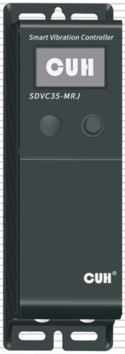

## SDVC35-Series
Contrôleur automatique intelligent pour alimentateur vibrant — SDVC35 Series
## Manuel d'utilisation

## Avant-propos

Merci d'avoir choisi le contrôleur numérique intelligent CUH pour alimentateur vibrant.

(ci-après dénommé « le contrôleur »).

Ce manuel contient des notes pour l'installation, le débogage, le réglage des paramètres, la maintenance et le dépannage du contrôleur. Veuillez lire attentivement ce manuel avant d'utiliser le contrôleur et conservez-le correctement.

**Ce manuel s'applique au modèle suivant**

- SDVC35-MRJ　( Courant de sortie 3A )
- SDVC35-LRJ　( Courant de sortie 4.5A )

---

## Consignes de sécurité :

1. Ne jamais brancher ni débrancher le câble, ni toucher les prises d'alimentation lorsque le contrôleur est sous tension, afin d'éviter tout choc électrique ou autre accident.
2. Ne jamais raccorder le contrôleur à une alimentation 380V AC, ce qui pourrait causer des dommages irréversibles. (nous proposons des produits conçus pour une alimentation 380V AC)
3. Ne jamais commuter l'entrée du contrôleur en coupant l'alimentation pour activer/désactiver la sortie, sinon la durée de vie du contrôleur pourrait être réduite.
4. Le contrôleur est conçu pour fonctionner dans un environnement frais et sec. Ne jamais l'utiliser à l'extérieur pour éviter l'immersion et l'ensoleillement. Utilisez le contrôleur dans la plage de température spécifiée par les caractéristiques électriques.
5. Ne jamais utiliser le contrôleur dans des conditions dépassant ses limites de conception.
6. Utilisez le contrôleur strictement conformément à ce manuel. Nous n'assumerons aucune responsabilité civile ou pénale si des dommages matériels ou corporels résultent d'une utilisation incorrecte.

> Ne jamais ouvrir le boîtier du contrôleur pour éviter un choc électrique. Contactez CUH si le contrôleur tombe en panne. Ne jamais tenter de réparer le contrôleur vous-même, sous peine d'annulation de la garantie.

---

## Environnement d'utilisation et de stockage

### Inspection avant utilisation

Chaque contrôleur subit un contrôle qualité rigoureux avant livraison et est emballé dans un emballage antichoc. Veuillez vérifier les points suivants après le déballage :

1. Vérifier si le contrôleur présente des dommages apparents.
2. Vérifier si le modèle du contrôleur correspond à celui commandé.

### Environnement d'utilisation

Veuillez respecter les consignes ci-dessous afin de garantir de meilleures performances et une durée de vie prolongée du contrôleur :

- ⚠ Environnement bien ventilé
- ⚠ Tenir à l'écart de l'eau, des ruissellements, de la poussière et surtout de la poussière huileuse
- ⚠ Tenir à l'écart des gaz et liquides corrosifs ou inflammables
- ⚠ Tenir à l'écart des poussières en suspension et des particules métalliques
- ⚠ Fixer fermement pour éviter les vibrations propres
- ⚠ Tenir à l'écart des interférences électromagnétiques
- ⚠ Assurer une température ambiante de 0~40 ℃
- ⚠ Pour une utilisation à une altitude de 2000 m ou moins

---

# Table des matières

- **Chapitre I　Caractéristiques — 1**
  - 1.1　Caractéristiques principales — 1
  - 1.2　Autres caractéristiques — 1
- **Chapitre II　Guide d'installation — 3**
  - 2.1　Description des parties externes — 3
  - 2.2　Description de l'installation — 5
  - 2.3　Installation du capteur de vibration — 7
  - 2.4　Recherche automatique de la fréquence de résonance — 9
- **Chapitre III　Description de l'IHM — 10**
  - 3.1　Interface de veille — 10
  - 3.2　Interface de saisie du mot de passe — 13
  - 3.3　Interface des groupes de fonctions — 14
  - 3.4　Interface d'affichage du processus de recherche de la fréquence de résonance — 16
- **Chapitre IV　Description des fonctions — 17**
  - 4.1　Commande marche/arrêt des ports d'entrée numériques C et E — 17
  - 4.2　Fonction de comptage — 20
  - 4.3　Signal de commande de la sortie principale — 24
  - 4.4　Sortie de commande CC : port D et port P — 28
  - 4.5　Commande de vitesse à distance — 33
  - 4.6　Mode principal — 35
  - 4.7　Mode Sync — 39
  - 4.8　Fonction de paramètres prédéfinis — 44
  - 4.9　Restauration des réglages par défaut — 45
  - 4.10　Communication RS485 — 46
  - 4.11　Communication Ethernet — 48
  - 4.12　Test de charge — 48
  - 4.13　Surveillance de l'état de fonctionnement — 49
- **Chapitre V　Fonctions de sécurité — 50**

---

---

Annexe A : Dimensions — 51

Annexe B : Description des ports électriques — 52

Annexe C : Spécifications électriques — 53

Annexe D : Suggestions de dépannage et explications des erreurs — 55

Annexe E : Description des avertissements et erreurs et suggestions de dépannage — 56

Annexe F : Description de l'état de fonctionnement et du type de carte réseau — 57

Annexe G : Méthode de raccordement des capteurs de commutation et de l'automate programmable aux ports d'entrée numériques — 58

Annexe H : Tableau des paramètres — 61

---

# Chapitre I Caractéristiques

## 1.1 Caractéristiques principales

**Affichage OLED :** Propose trois langues (chinois, anglais, allemand) et une interface de commande conviviale.

**Recherche automatique de la fréquence de résonance :** La recherche de la fréquence de résonance de la charge peut se faire avec ou sans capteur.

**Régulation automatique de vitesse constante :** Réglage automatique de la tension de sortie en temps réel pour garantir une vitesse d'alimentation constante telle que préréglée, quelles que soient les variations de poids des pièces dans l'alimentateur vibrant.

**Sortie synchronisée de plusieurs contrôleurs :** Synchroniser la forme d'onde de sortie des contrôleurs esclaves avec celle du contrôleur maître à la même fréquence et phase afin d'éviter l'effet de battement.

**Double sortie de commande push-pull :** Le contrôleur peut fournir une alimentation 24 V CC associée au réglage de relation logique de la commande marche/arrêt pour piloter une électrovanne, un relais électrique ou d'autres appareils externes.

**Communication Ethernet :** Régler tous les paramètres et surveiller les états de fonctionnement du contrôleur. Prend en charge les protocoles de communication Ethercat et Profinet.

**Mise à jour du firmware :** Prend en charge la mise à jour du firmware en ligne afin de fournir les derniers résultats de R&D de notre société.

**Détection de charge :** Mesure l'inductance, le courant maximal et la résistance de la charge.

## 1.2 Autres caractéristiques

Le contrôleur est spécialement conçu pour commander un alimentateur vibrant dans les systèmes d'automatisation. Associant les dernières technologies électroniques et une conception soignée, le contrôleur offre des fonctions pratiques et commodes :

**Régulation automatique de tension :** Élimine les variations de vitesse causées par les fluctuations de la tension secteur et l'effet de battement causé par la fréquence du secteur industriel.

**Commande marche/arrêt à deux capteurs de commutation :** 2 capteurs de commutation ou un automate programmable peuvent être raccordés pour activer/désactiver le contrôleur.

**Reconnaissance automatique du type de capteur de commutation :** Le contrôleur peut reconnaître automatiquement le type NPN/PNP du capteur de commutation.

**Démarrage progressif :** Afin d'éviter tout choc brutal à l'alimentateur vibrant, le contrôleur augmente progressivement la tension de sortie/la vitesse d'alimentation de 0 jusqu'à la valeur préréglée au démarrage.

---

---

**Préréglage des paramètres :** 4 jeux de paramètres prédéfinis peuvent être sélectionnés.

**Fonction d'accélération :** La valeur maximale de la tension de sortie du contrôleur peut être augmentée jusqu'à 150 % de la valeur de la tension d'entrée (sauf en état de suivi automatique sans capteur).

**Tension de sortie maximale réglable :** La tension de sortie maximale réglable peut être préréglée afin de protéger la charge contre les dommages causés par une tension trop élevée.

**Indice de forme d'onde :** Il représente le rapport cyclique équivalent du courant de sortie sinusoïdal sur un cycle. Une valeur de paramètre plus élevée correspond à un rapport cyclique équivalent plus grand. Ce paramètre peut être réglé pour équilibrer l'efficacité de fonctionnement et la puissance de sortie maximale du contrôleur.

**Courant continu :** Composante de décalage CC du signal de courant de sortie sinusoïdal.

**Commande de vitesse à distance :** La tension de sortie du contrôleur peut être réglée par un potentiomètre externe ou un signal CC 4~20mA, 0~5V, 1~5V, 0~10V.

**Comptage :** Lorsque le nombre de pièces comptées atteint la valeur préréglée, la vitesse d'alimentation est ralentie ou réduite à zéro.

**Sortie marche/arrêt :** Appuyez brièvement sur le bouton ON/OFF pour démarrer/arrêter le contrôleur.

**Verrouillage du clavier :** Appuyez longuement sur le bouton ON/OFF pour verrouiller le clavier.

**Mot de passe des paramètres :** L'utilisateur peut définir une autorisation par mot de passe interdisant le réglage de certains paramètres (comme la tension de sortie et la vitesse d'alimentation).

**Fonction d'enregistrement des paramètres :** L'utilisateur peut faire fonctionner le contrôleur avec l'un des quatre jeux de paramètres préréglés et enregistrés dans les données utilisateur, via les paramètres « SavedALLTo » et « ReadALLFrm » du groupe de fonctions 8 du contrôleur.

**Restauration des réglages par défaut :** Cette fonction permet à l'opérateur de restaurer tous les paramètres aux réglages d'usine par défaut.

**Communication RS485 :** Tous les paramètres peuvent être réglés et surveillés à distance.

**Interface de veille OLED personnalisable :** L'utilisateur peut sélectionner les paramètres à afficher sur l'interface de veille.

**Sortie de signal d'alarme :** Le signal d'alarme peut être émis par le port de sortie de commande ou le port de communication pour un traitement automatique.

---

# Chapitre Ⅱ Guide d'installation

## 2.1 Description des parties externes

### 2.1.1 Description de l'extérieur

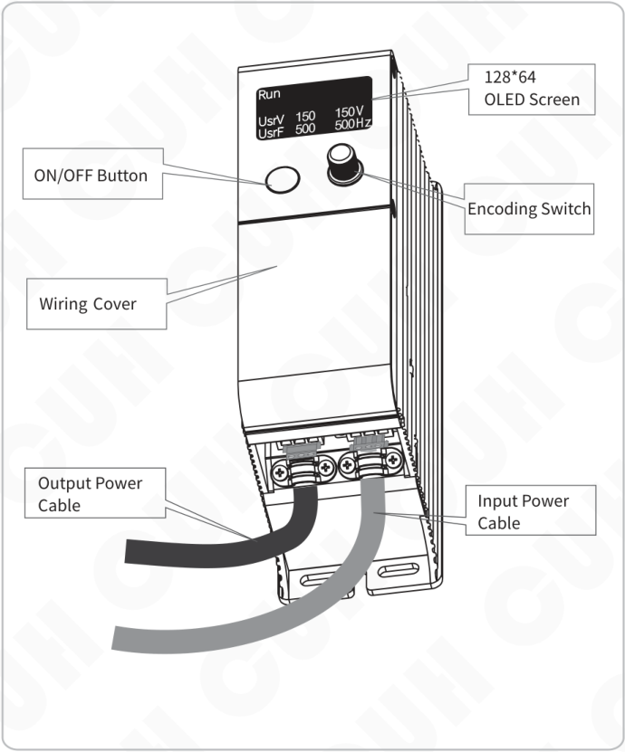

## 2.1.2 Description des bornes

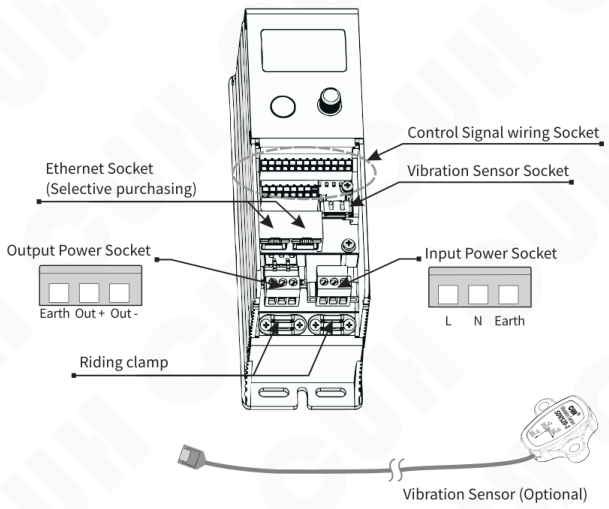

- Prise de câblage des signaux de commande
- Prise du capteur de vibration
- Prise Ethernet (achat en option)
- Prise d'alimentation de sortie : Terre / Out + / Out -
- Prise d'alimentation d'entrée : L / N / Terre
- Serre-câble
- Capteur de vibration (en option)

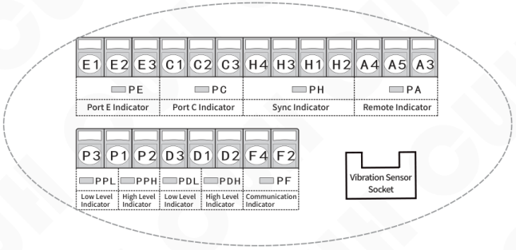

Rangée supérieure de bornes (de gauche à droite) : E1, E2, E3, C1, C2, C3, H4, H3, H1, H2, A4, A5, A3.

| PE | PC | PH | PA |
|---|---|---|---|
| Voyant du port E | Voyant du port C | Voyant Sync | Voyant de la commande à distance |

Rangée inférieure de bornes (de gauche à droite) : P3, P1, P2, D3, D1, D2, F4, F2.

| PPL | PPH | PDL | PDH | PF |
|---|---|---|---|---|
| Voyant de niveau bas | Voyant de niveau haut | Voyant de niveau bas | Voyant de niveau haut | Voyant de communication |

Prise du capteur de vibration

**Remarque :** Le port D ou le port P est en sortie à haute impédance lorsque le voyant de niveau haut et le voyant de niveau bas sont allumés.

---

## 2.2 Description de l'installation

### Étape un :

Ouvrez la boîte d'emballage et vérifiez le contrôleur ainsi que tous les accessoires.

### Étape deux :

Raccordez les bornes de câblage du câble d'alimentation de sortie à la bobine électromagnétique du vibrateur.

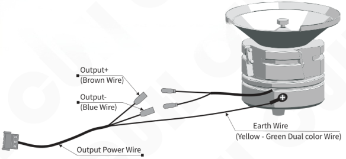

- Output+ (fil marron)
- Output- (fil bleu)
- Fil de terre (fil bicolore jaune - vert)
- Câble d'alimentation de sortie

> Remarque : Assurez-vous que la bobine électromagnétique du vibrateur est raccordée au fil de phase et au fil neutre du câble d'alimentation de sortie, et que le bâti du vibrateur est correctement mis à la terre.

### Étape trois :

Ouvrez le couvercle.

Raccordez le connecteur du câble d'alimentation de sortie à la prise du contrôleur et fixez le câble d'alimentation de sortie sur le boîtier du contrôleur à l'aide du serre-câble.

Ne l'utilisez pas sous tension afin d'éviter tout choc électrique.

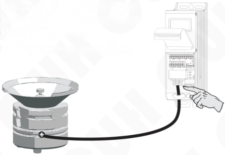

---

## Étape quatre :

Raccordez le connecteur du câble d'alimentation d'entrée à la prise d'alimentation d'entrée du contrôleur et fixez le câble d'alimentation d'entrée sur le boîtier du contrôleur à l'aide du serre-câble.

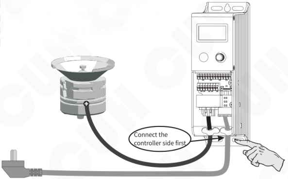

Connectez d'abord le côté contrôleur

## Étape cinq :

Raccordez la fiche du câble d'alimentation d'entrée à la prise secteur.

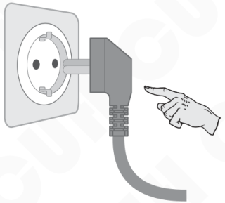

Le contrôleur s'allume, l'OLED affiche brièvement l'interface de démarrage, puis l'OLED affiche l'interface de veille.

---

## 2.3 Installation du capteur de vibration

### 2.3.1 Méthode de raccordement du capteur de vibration

- Mettez le contrôleur hors tension et raccordez le connecteur du capteur de vibration à la prise du capteur de vibration du contrôleur.
- Fixez le capteur de vibration près de l'armature du vibrateur. La méthode et l'emplacement d'installation sont indiqués ci-dessous :

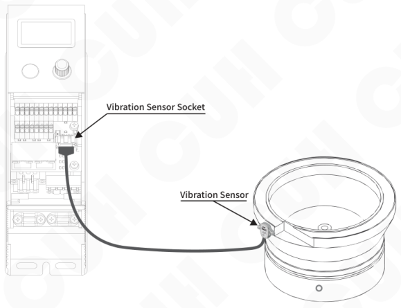

---

## 2.3.2 Installation du capteur de vibration sur le vibrateur

Fixez le capteur de vibration sur une surface lisse du vibrateur, le sens d'installation étant indifférent ; les méthodes d'installation du capteur de vibration sont illustrées ci-dessous :

- Méthode 1 : comme illustré à la Fig. 1

  Avantage : installation facile

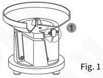

- Méthode 2 : comme illustré à la Fig. 2

  Remarque : ne laissez pas le bol d'alimentation comprimer le capteur de vibration.

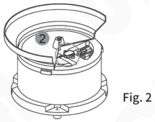

- Méthode 3 : soudez un support sur le vibrateur et fixez le capteur de vibration sur le support, comme illustré à la Fig. 3

  Les dimensions recommandées du support du capteur de vibration sont indiquées à la Fig. 4.

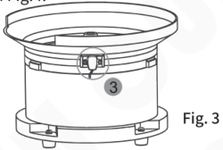

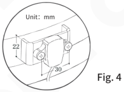

- Méthodes d'installation non recommandées, comme illustré aux Fig. 5 et Fig. 6.

  Si l'emplacement d'installation n'est pas approprié, le capteur de vibration ne peut pas fournir une fréquence de résonance précise et le contrôleur recherchera la fréquence de résonance en continu.

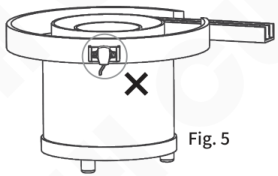

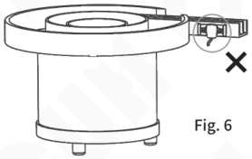

---

## 2.4 Recherche automatique de la fréquence de résonance

### 2.4.1 Recherche automatique de la fréquence de résonance sans capteur

Le contrôleur dispose d'une fonction de recherche automatique de la fréquence de résonance sans capteur ; l'utilisateur n'a qu'à régler le paramètre « Usr_Voltag » pour que le vibrateur fonctionne dans les meilleures conditions.

Démarrez la fonction de recherche automatique de la fréquence de résonance sans capteur en réglant le paramètre « AtoSnsrTyp » sur « Auto » dans le groupe de fonctions 3 et « AutoSerch_ » sur « Star » dans le groupe de fonctions 1.

Remarque : la fonction de recherche automatique de la fréquence de résonance sans capteur n'est valide que lorsque le contrôleur fonctionne en mode principal ; le capteur de vibration doit être raccordé lorsque le contrôleur fonctionne en mode Sync.

### 2.4.2 Recherche automatique de la fréquence de résonance avec capteur

Grâce à la fonction de recherche automatique de la fréquence de résonance avec capteur de vibration, le contrôleur peut faire fonctionner le vibrateur à la meilleure fréquence et les paramètres associés du contrôleur sont réglés automatiquement. L'utilisateur n'a qu'à régler le paramètre de vitesse d'alimentation pour optimiser le fonctionnement du vibrateur.

Après avoir raccordé le capteur de vibration, allumez le contrôleur : celui-ci vérifie automatiquement si la fréquence de résonance du vibrateur se situe dans la plage préréglée ; si ce n'est pas le cas, il lance la recherche automatique de la fréquence de résonance.

**Étapes de la recherche automatique de la fréquence de résonance :**

- Appuyez longuement sur l'encodeur rotatif depuis l'interface de veille pour accéder à l'interface des paramètres des groupes de fonctions.
- Réglez le paramètre « AutoSerch_ » du groupe de fonctions 1 sur « Start », puis appuyez brièvement sur l'encodeur rotatif pour lancer le processus de recherche automatique de la fréquence de résonance.
- Une fois le processus de recherche automatique de la fréquence de résonance terminé, le résultat de fréquence de résonance et « Save » affichés sur l'OLED indiquent que le paramètre est enregistré.

Après le processus de recherche automatique de la fréquence de résonance, le vibrateur peut fonctionner normalement. Appuyez brièvement sur l'encodeur rotatif ou tournez-le pour revenir à l'interface précédente.

> 1. Le processus de recherche automatique de la fréquence de résonance doit être effectué avec un bol d'alimentation vide.
> 2. Annulez l'opération de recherche de fréquence pendant le processus de recherche automatique de la fréquence de résonance en appuyant brièvement sur le bouton « ON/OFF ».
> 3. Si l'OLED affiche « OverCurrent » pendant le processus de recherche automatique de la fréquence de résonance, cela signifie que « AtoSrhVMax » est réglé trop haut, mais le processus de recherche automatique de la fréquence de résonance n'est pas affecté.

---

## Chapitre Ⅲ Description de l'IHM

### 3.1 Interface de veille

L'interface de veille est illustrée ci-dessous :

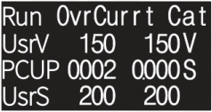

Le contrôleur passe à l'interface de veille lorsqu'il n'est pas utilisé pendant plus de 2 minutes.

L'interface de veille comporte 4 lignes d'affichage ; la première ligne sert à indiquer l'état de fonctionnement, les erreurs ou les alarmes du contrôleur.

1. La zone gauche de la première ligne d'affichage indique l'état marche/arrêt du contrôleur.
2. La zone droite de la première ligne d'affichage indique le type de carte réseau.
3. La zone centrale de la première ligne d'affichage indique les avertissements/erreurs du contrôleur.

Tous les éléments des trois zones sont expliqués respectivement aux annexes F et E.

Les 2e à 4e lignes d'affichage servent au réglage des paramètres ; l'utilisateur peut sélectionner jusqu'à trois paramètres affichés sur l'interface de veille.

Chaque ligne d'affichage de l'interface de veille comporte 4 éléments : nom du paramètre, valeur de réglage/état du paramètre, valeur de mesure actuelle/valeur de sortie, unité. Un exemple d'interface de veille est donné ci-dessous :

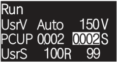

La deuxième ligne d'affichage est le paramètre de tension de sortie ; « Auto » signifie que ce paramètre est réglé automatiquement par le contrôleur, et la tension de sortie réelle est de 150V.

La troisième ligne d'affichage est le paramètre de retard d'enclenchement du port C ; la valeur de réglage est 0.002S et le troisième élément est la valeur en temps réel du processus de temporisation. Une fois la temporisation terminée, la valeur en temps réel s'affiche en inverse.

La quatrième ligne d'affichage est le paramètre de vitesse d'alimentation : la valeur de réglage est 100 et la vitesse d'alimentation en temps réel est 99. Le « R » derrière la valeur de réglage signifie que la vitesse d'alimentation est commandée par le port de commande à distance.

---

Les paramètres pouvant être affichés sur l'interface de veille sont indiqués ci-dessous.

| Élément | Description |
|---|---|
| UsrV | Tension de sortie |
| UsrF | Fréquence de sortie |
| UsrS | Vitesse d'alimentation |
| Cout | Valeur de comptage actuelle |
| PCUp | Retard d'enclenchement du port C |
| PCDn | Retard de déclenchement du port C |
| PEUp | Retard d'enclenchement du port E |
| PEDn | Retard de déclenchement du port E |
| PDUp | Retard d'enclenchement du port D |
| PDDn | Retard de déclenchement du port D |
| PPUp | Retard d'enclenchement du port P |
| PPDn | Retard de déclenchement du port P |
| MaUp | Retard d'enclenchement de la commande principale |
| MaDn | Retard de déclenchement de la commande principale |
| BusV | Tension du bus d'alimentation |
| CurE | Courant de sortie efficace |
| CurM | Courant de sortie maximal |
| PwrA | Puissance active |
| PwrR | Puissance réactive |
| Temp | Température |
| SynF | Fréquence du signal de synchronisation externe |
| Remo | Tension d'entrée de la commande à distance |
| PCV | Tension d'entrée du port C |
| PEV | Tension d'entrée du port E |
| PDV | Tension de sortie du port D |
| PPV | Tension de sortie du port P |

---

---

### 3.1.1 Méthode de réglage des paramètres de l'interface de veille

Lorsque l'utilisateur doit régler une valeur de paramètre, appuyez brièvement sur l'encodeur rotatif : la valeur de réglage de la deuxième ligne d'affichage s'affiche en inverse sur fond blanc ; tournez ensuite l'encodeur rotatif pour régler la valeur. Appuyez brièvement sur l'encodeur rotatif pour passer d'une ligne d'affichage à l'autre parmi les trois lignes de réglage et ajustez la valeur du paramètre en tournant l'encodeur rotatif.

Remarque :

Si la valeur de réglage est « Auto », la valeur du paramètre ne peut pas être réglée manuellement.

Si un « R » figure derrière la valeur de réglage, la valeur du paramètre ne peut pas être réglée manuellement, comme pour « Voltage » et « Feeding speed ».

Si le mot de passe est défini pour verrouiller le réglage des paramètres, aucun effet ne se produit lors d'un appui bref sur l'encodeur rotatif.

### 3.1.2 Économie d'énergie de l'OLED sur l'interface de veille

Si aucune opération n'est effectuée pendant plus de 2 minutes sur l'interface de veille, la luminosité de l'OLED diminue pour passer en mode économie d'énergie afin de prolonger la durée de vie de l'OLED. Appuyez brièvement sur l'encodeur rotatif ou tournez-le pour quitter l'état d'économie d'énergie.

---

## 3.2 Interface de saisie du mot de passe

Lorsque « Passsword 1 » ou « Passsword 2 » n'est pas nul, l'autorisation de réglage des paramètres est verrouillée. Appuyez longuement sur l'encodeur rotatif depuis l'interface de veille : l'OLED affiche l'interface de saisie du mot de passe pour inviter l'utilisateur à saisir le mot de passe.

L'interface de saisie du mot de passe est illustrée ci-dessous :

Réglez la valeur du mot de passe en tournant l'encodeur rotatif, puis appuyez brièvement dessus pour confirmer le mot de passe saisi. Si le mot de passe est correct, l'interface des groupes de fonctions s'affiche.

Les objets contrôlés par le mot de passe 1 et le mot de passe 2 sont indiqués ci-dessous :

| Objet contrôlé | Mot de passe 2 | Mot de passe 1 |
|---|---|---|
| bouton ON/OFF | ○ | ○ |
| Interface de veille | ○ | √ |
| Groupe de fonctions 1 et groupe de fonctions 9 | √ | √ |
| Autres groupes de fonctions | × | √ |
| Explication | en cas d'absence d'autorisation, le bouton ON/OFF et les paramètres de l'interface de veille peuvent être utilisés.  en cas d'autorisation, les paramètres du groupe de fonctions 1 et du groupe de fonctions 9, le bouton ON/OFF et les paramètres de l'interface de veille peuvent être utilisés. | en cas d'absence d'autorisation, le bouton ON/OFF peut être utilisé.  en cas d'autorisation, toutes les fonctions peuvent être utilisées. |

Remarque : ○ signifie non contrôlé, √ signifie contrôlé, × signifie aucune autorisation.

---

## 3.3 Interface des groupes de fonctions

L'interface des groupes de fonctions sert au réglage de tous les paramètres du contrôleur. Elle comprend 9 groupes de fonctions dont les paramètres peuvent être réglés et 1 groupe de fonctions dont les paramètres peuvent uniquement être lus.

La première ligne d'affichage de l'interface des groupes de fonctions indique l'état de fonctionnement, les erreurs ou les alarmes du contrôleur. Les 2e à 4e lignes d'affichage constituent la zone qui affiche les paramètres du groupe de fonctions ; l'interface est illustrée ci-dessous :

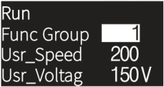

### 3.3.1 Sélection du groupe de fonctions

Après être entré dans l'interface des groupes de fonctions par un appui long sur l'encodeur rotatif depuis l'interface de veille, le curseur se place sur la valeur « Function Group » ; tournez l'encodeur rotatif pour régler la valeur et passer de « Function Group 0 » à « Function Group 9 ».

Tous les paramètres des groupes de fonctions sont expliqués à l'annexe H.

### 3.3.2 Méthode de réglage des paramètres des groupes de fonctions

Trois méthodes permettent de changer de paramètre dans l'interface des groupes de fonctions :

1. Appuyez brièvement sur l'encodeur rotatif pour passer d'un paramètre à l'autre.
2. Appuyez sur l'encodeur rotatif et maintenez-le pendant 2 s au maximum, tout en le tournant pour passer d'un paramètre à l'autre.

---

3.Appuyez sur l'encodeur rotatif et maintenez-le plus de 2.5 s jusqu'à ce que la ligne d'affichage du paramètre s'affiche en inverse, puis relâchez-le.

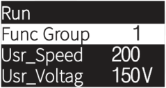

Tournez l'encodeur rotatif pour sélectionner le paramètre.

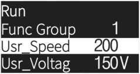

Après avoir sélectionné le paramètre, appuyez brièvement sur l'encodeur rotatif pour entrer dans l'état de réglage du paramètre.

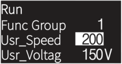

Cette méthode de réglage convient pour basculer entre plusieurs paramètres.

**Tous les paramètres des groupes de fonctions sont expliqués à l'annexe H.**

---

## 3.4 Interface d'affichage du processus de recherche de la fréquence de résonance

Lorsque le processus de recherche automatique de la fréquence de résonance est lancé, l'OLED affiche la courbe de la fréquence en fonction de l'accélération, comme illustré ci-dessous. L'axe horizontal de la courbe représente la fréquence, dont la plage va de 25Hz à 400Hz, et l'axe vertical représente l'accélération

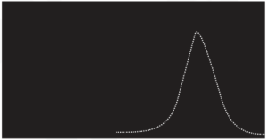

Une fois le processus de recherche automatique de la fréquence de résonance terminé, le résultat de fréquence de résonance et « Save » sont affichés sur l'OLED pour indiquer que les paramètres ont été enregistrés, comme illustré ci-dessous.

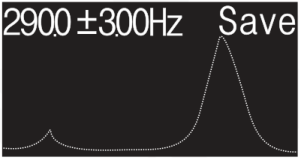

---

# Chapitre Ⅳ Description des fonctions

## 4.1 Commande marche/arrêt des ports d'entrée numériques C et E

Le contrôleur dispose de deux ports d'entrée numériques C et E qui reconnaissent automatiquement le type NPN/PNP du capteur raccordé pour activer/désactiver le contrôleur ; l'appareil raccordé aux ports peut être un capteur de proximité, un capteur photoélectrique, un capteur à fibre optique ou un automate programmable, etc.

### 4.1.1 Schéma du circuit électrique des ports C et E

Schéma du circuit électrique du port C

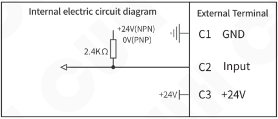

Le schéma du circuit électrique du port E est identique à celui du port C

### 4.1.2 Méthode d'utilisation

Prenons l'exemple du capteur de proximité ; sa méthode de câblage est indiquée ci-dessous :

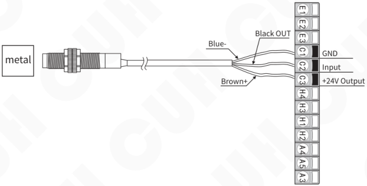

Les méthodes de câblage des autres capteurs de commutation sont indiquées à l'annexe G.

---

## 4.1.3 Schéma de flux de signal des ports C et E

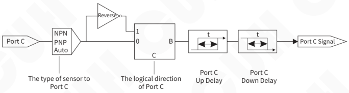

Le schéma de flux de signal du port E est identique à celui du port C

## 4.1.4 Description des paramètres associés

Les paramètres du port C sont réglés dans le groupe de fonctions 4 et ceux du port E dans le groupe de fonctions 5.

**Paramètre « PortCType_ »**

Le contrôleur peut reconnaître automatiquement le type NPN/PNP du capteur raccordé (réglage d'usine : Auto).

**Paramètre « PortCDir__ »**

Par défaut en usine, le contrôleur fonctionne lorsque le port C ne reçoit aucun signal. Dans certaines applications particulières, le contrôleur doit être arrêté lorsque le port C ne reçoit aucun signal, en réglant le paramètre « PortCDir__ ».

Lorsque « PortCDir__ » est réglé sur « Const » et que le port C ne reçoit aucun signal, le contrôleur est mis en marche.

Lorsque « PortCDir__ » est réglé sur « Revrs » et que le port C ne reçoit aucun signal, le contrôleur est arrêté.

---

---

### Paramètre « PortCUpDly »

Le retard d'enclenchement du port C désigne le temps écoulé entre le moment où le signal de démarrage reçu par le port C devient valide et le démarrage du contrôleur.

### Paramètre « PortCDnDly »

Le retard de déclenchement du port C désigne le temps écoulé entre le moment où le signal d'arrêt reçu par le port C devient valide et l'arrêt du contrôleur.

Remarque : lorsque le port C est utilisé pour démarrer/arrêter le contrôleur, le temps de retard du port C doit être réglé afin d'éliminer le rebond du signal.

---

## 4.2 Fonction de comptage

### 4.2.1 Schéma de flux de signal de la fonction de comptage

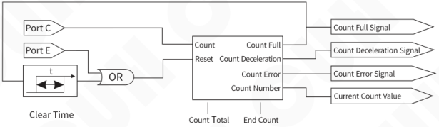

Le contrôleur intègre une fonction de comptage capable de compter les impulsions. Lorsque le nombre d'impulsions comptées atteint le total de comptage préréglé, la vitesse d'alimentation est ralentie ou réduite à zéro.

### 4.2.2 Fonction de décélération de fin

Afin d'éliminer le surcomptage de la fonction de comptage causé par une vitesse d'alimentation élevée impossible à arrêter immédiatement, il convient de régler la vitesse d'alimentation de fin et la fin de comptage. La vitesse d'alimentation est réduite à la vitesse d'alimentation de fin lorsque le nombre restant à compter approche la fin de comptage préréglée, valeur inférieure au total de comptage ; et lorsque le nombre compté atteint le total de comptage, la vitesse d'alimentation est arrêtée à temps pour un comptage précis.

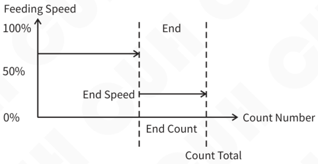

---

## 4.2.3 Fonction anti-rebond renforcée

La fonction anti-rebond renforcée est spécialement conçue pour résoudre les erreurs de comptage causées par les conditions d'alimentation vibrante. En réglant le temps de stabilisation du signal de comptage, la fonction anti-rebond renforcée considère l'impulsion de comptage comme valide après le temps de stabilisation du signal de comptage ; la précision du temps de stabilisation du signal de comptage est la milliseconde.

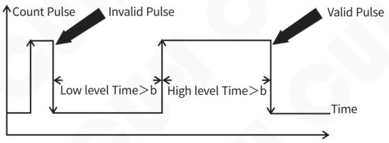

Remarque : le temps de stabilisation anti-rebond désigne le temps de stabilisation du niveau haut et du niveau bas. Une impulsion valide est constituée d'un niveau haut et d'un niveau bas actifs en continu ; le compteur est alors incrémenté de un.

### Méthode de réglage du temps de stabilisation du signal de comptage

Le port C sert de port d'entrée des impulsions de comptage du compteur. « PortCUpDly » et « PortCDnDly » correspondent respectivement au temps de stabilisation du niveau haut et du niveau bas de l'impulsion de comptage.

Le port E sert de port d'entrée des impulsions de réinitialisation du compteur. « PortEUpDly » et « PortEDnDly » correspondent respectivement au temps de stabilisation du niveau haut et du niveau bas de l'impulsion de réinitialisation.

---

## 4.2.4 Fonction de réinitialisation du compteur par minuterie

Lorsque le nombre compté atteint le total de comptage, après un temps de retard réglé par « Clear Time » dans le groupe de fonctions 1, le compteur est réinitialisé et recommence à compter.

Lorsque la valeur de « Clear Time » est 0.0s, la fonction de réinitialisation du compteur par minuterie est désactivée.

## 4.2.5 Méthode d'utilisation du comptage

Le contrôleur intègre un compteur : le port C sert de port de comptage du compteur et le port E de port de réinitialisation du compteur.

L'état du compteur peut commander la sortie de commande principale, la sortie du port D et la sortie du port P.

- Lorsque la valeur de « Main Logic » réglée dans le groupe de fonctions 2 est « Count », la sortie de commande principale est commandée par le signal de compteur plein.
- Lorsque la valeur de « Port D Logic » réglée dans le groupe de fonctions 6 est « END », la sortie du port D est commandée par le signal de compteur plein.  
  Lorsque la valeur de « Port P Logic » réglée dans le groupe de fonctions 7 est « END », la sortie du port P est commandée par le signal de compteur plein.
- Lorsque la valeur de « Port D Logic » réglée dans le groupe de fonctions 6 est « Near », la sortie du port D est commandée par le signal de décélération du comptage.  
  Lorsque la valeur de « Port P Logic » réglée dans le groupe de fonctions 7 est « Near », la sortie du port P est commandée par le signal de décélération du comptage.

---

## 4.2.6 Description des paramètres associés

### Paramètre « CountNumbr »

La valeur « CountNumbr » correspondant au nombre déjà compté par le compteur se consulte dans le groupe de fonctions 9.

### Paramètre « TotalCount »

Lorsque « CountNumbr » atteint « TotalCount » tel que réglé dans le groupe de fonctions 1, le signal de compteur plein du compteur est valide jusqu'à la réinitialisation du compteur ; le compteur peut continuer à compter jusqu'à sa réinitialisation.

### Paramètre « CountAhead »

« CountAhead » se règle dans le groupe de paramètres 2 ; il désigne le nombre restant à compter avant d'atteindre « TotalCount ». Lorsque « CountNumbr » atteint « CountAhead », la vitesse d'alimentation diminue jusqu'à la valeur « PrcntTrmnl » réglée dans le groupe de fonctions 2.

### Paramètre « PrcntTrmnl »

« PrcntTrmnl », réglé dans le groupe de fonctions 2, correspond au pourcentage appliqué lorsque « CountNumbr » atteint « CountAhead » : la vitesse d'alimentation diminue jusqu'à la vitesse initiale multipliée par « PrcntTrmnl ».

### Paramètre « Clear Time »

Lorsque le nombre compté atteint le total de comptage, après un temps de retard réglé par « Clear Time » dans le groupe de fonctions 1, le compteur est réinitialisé et recommence à compter.

Lorsque la valeur de « Clear Time » est 0.0s, la fonction de réinitialisation du compteur par minuterie est désactivée.

### Direction du port d'entrée des impulsions de comptage

La direction du port d'entrée des impulsions de comptage est la même que celle de « PortCDir_ » réglée dans le groupe de fonctions 4.

### Direction du port d'entrée des impulsions de réinitialisation

La direction du port d'entrée des impulsions de réinitialisation est la même que celle de « PortEDir_ » réglée dans le groupe de fonctions 5.

---

## 4.3 Signal de commande de la sortie principale

Le signal de commande de la sortie principale sert à activer/désactiver la sortie principale du contrôleur ; tous les paramètres de la commande de la sortie principale se règlent dans le groupe de fonctions 2.

### 4.3.1 Schéma de flux de signal de la commande de la sortie principale

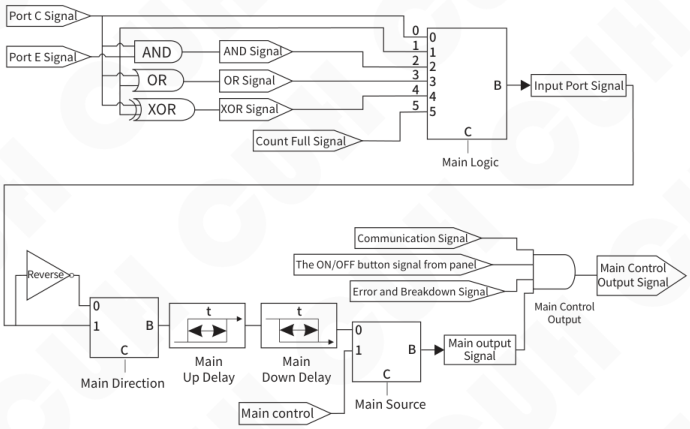

---

## 4.3.2 Description des signaux

### Signal de communication

Le signal de communication provient de la liaison RS485 ou Ethernet.

Lorsque le signal d'arrêt est envoyé au contrôleur via RS485 ou Ethernet, le contrôleur s'arrête.

Lorsque le signal de démarrage est envoyé au contrôleur via RS485 ou Ethernet, le contrôleur démarre.

### Signal du bouton ON/OFF sur le panneau

Le signal de commande provient du bouton ON/OFF sur le panneau. Activez ou désactivez le contrôleur en appuyant brièvement sur le bouton ON/OFF du panneau.

L'état de marche du contrôleur à la mise sous tension est défini par le paramètre « PowrOnStat » du groupe de fonctions 2.

Lorsque « PowrOnStat » est réglé sur « ON », le contrôleur démarre la sortie principale à la mise sous tension.

Lorsque « PowrOnStat » est réglé sur « OFF », le contrôleur arrête la sortie principale à la mise sous tension.

### Signal d'erreur et de panne

Lorsque l'une des pannes telles que surintensité, court-circuit, surchauffe, etc. se produit, le contrôleur s'arrête.

Lorsque les opérations d'effacement et d'incrémentation se produisent simultanément pendant le processus de comptage, le contrôleur s'arrête.

### Signal de sortie principale

Le signal de sortie principale est le signal du port d'entrée ajusté par « MainDir_ », « MainUpDely », « MainDwnDly » et « MainSrc_ ».

### Signal du port d'entrée

La source du signal du port d'entrée est sélectionnée en réglant la valeur de « MainLogic_ » dans le groupe de fonctions 2. Les valeurs de « MainLogic_ » sont « Port C », « Port E », « AND », « OR », « XOR », « Count ».

---

## 4.3.3 Description des paramètres associés

### Paramètre « MainLogic_ »

- Lorsque la valeur de « MainLogic_ » est « Port C », la source du signal du port d'entrée provient du signal du port C.

  Lorsque le signal du port C demande au contrôleur de passer à l'état de marche, le signal du port d'entrée demande de démarrer le contrôleur.

  Lorsque le signal du port C demande au contrôleur de passer à l'état d'arrêt, le signal du port d'entrée demande d'arrêter le contrôleur.

- Lorsque la valeur de « MainLogic_ » est « Port E », la source du signal du port d'entrée provient du signal du port E.

  Lorsque le signal du port E demande au contrôleur de passer à l'état de marche, le signal du port d'entrée demande de démarrer le contrôleur.

  Lorsque le signal du port E demande au contrôleur de passer à l'état d'arrêt, le signal du port d'entrée demande d'arrêter le contrôleur.

- Lorsque la valeur de « MainLogic_ » est « AND », « OR » ou « XOR », la source du signal du port d'entrée provient du résultat de l'opération logique entre le port C et le port E.

  « AND » signifie que les signaux du port C et du port E demandent tous deux d'arrêter le contrôleur, et le signal du port d'entrée arrête le contrôleur.

  « OR » signifie que le signal du port C ou du port E demande d'arrêter le contrôleur, et le signal du port d'entrée arrête le contrôleur.

  « XOR » signifie que les demandes d'opération du port C et du port E sont différentes, et le signal du port d'entrée arrête le contrôleur.

- Lorsque la valeur de « MainLogic_ » est « Count », le signal du port d'entrée provient du signal de compteur plein du compteur.

  Lorsque le signal de compteur plein est valide, le contrôleur arrête la sortie principale et « CND » s'affiche à l'écran.

  Lorsque le signal de compteur plein n'est pas valide, le contrôleur active la sortie principale.

---

### Paramètre « MainDir_ »

« Main Direction » indique si le signal du port d'entrée doit être inversé.

Lorsque la valeur de « Main Direction » est « Normal ON », le signal du port d'entrée n'a pas besoin d'être inversé.

Lorsque la valeur de « Main Direction » est « Normal OFF », le signal du port d'entrée doit être inversé.

### Paramètre « MainUpDely »

Le retard d'enclenchement principal désigne le temps écoulé entre la demande de démarrage du contrôleur et le moment où le signal de demande est considéré comme valide.

### Paramètre « MainDwnDly »

Le retard de déclenchement principal désigne le temps écoulé entre la demande d'arrêt du contrôleur et le moment où le signal de demande est considéré comme valide.

### Paramètre « MainSrc_ »

Le signal de sortie principale provient du « Signal du port d'entrée » ou de la « Commande principale ».

Lorsque la valeur de « MainSrc_ » est « Local », le signal de sortie principale provient du « Signal du port d'entrée ».

Lorsque la valeur de « MainSrc_ » est « Remot », le signal de sortie principale provient de « MainCtrl_ ».

### Paramètre « MainCtrl_ »

« MainCtrl_ » possède deux états : arrêter la sortie du contrôleur et démarrer la sortie du contrôleur.

lorsque la valeur de « MainCtrl_ » est « OFF », cela signifie arrêter la sortie du contrôleur.

lorsque la valeur de « MainCtrl_ » est « ON », cela signifie démarrer la sortie du contrôleur.

---

## 4.4 Sortie de commande CC : port D et port P

Il existe deux sorties 24 V CC : le port D et le port P, destinés à piloter une électrovanne, un automate programmable ou d'autres appareils externes.

Le principe de fonctionnement et la méthode de réglage des paramètres des ports P et D sont identiques.

### 4.4.1 Schéma du circuit électrique des ports D et P

Schéma du circuit électrique du port D

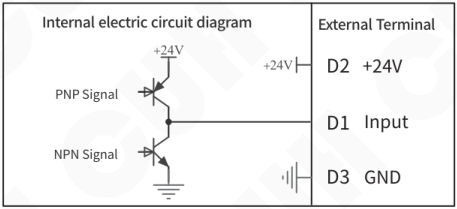

Le schéma du circuit électrique du port P est identique à celui du port D.

---

## 4.4.2 Méthode d'utilisation

Méthode de câblage de l'électrovanne

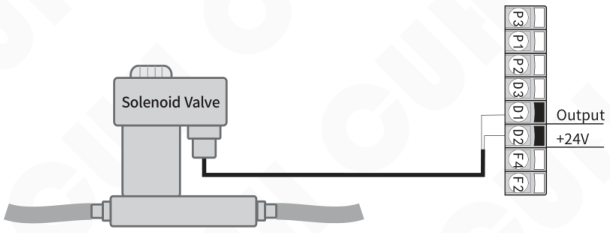

Méthode de câblage du relais électrique

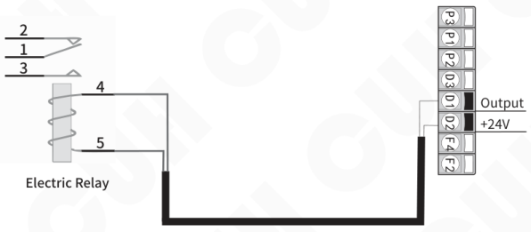

Les méthodes de câblage des ports D et P sont identiques.

---

## 4.4.3 Schéma de flux de signal des ports D et P

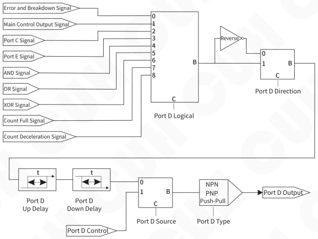

Les schémas de flux de signal des ports D et P sont identiques.

## 4.4.4 Description des paramètres associés

Les paramètres du port D sont réglés dans le groupe de fonctions 6 et ceux du port P dans le groupe de fonctions 7.

### Paramètre « PortDLogic »

La source du port D est sélectionnée en réglant la valeur de « PortDLogic » dans le groupe de fonctions 6. Les valeurs de « PortDLogic » sont « Error », « Main », « Port C », « Port E », « AND », « OR », « XOR », « Count », « Near ».

- Lorsque la valeur de « PortDLogic » est « Error », la source du signal du port D provient de l'état de panne du contrôleur ou de l'erreur de comptage du mode compteur.

Lorsque l'une des pannes telles que surintensité, court-circuit, surchauffe, etc. se produit, la désactivation du port D est demandée.

Lorsque les opérations d'effacement et d'incrémentation se produisent simultanément pendant le processus de comptage, la désactivation du port D est demandée.

Lorsqu'aucune panne ni erreur de comptage ne se produit, l'activation du port D est demandée.

---

---

- Lorsque la valeur de « PortDLogic » est « Main », la source du signal du port D provient de la commande principale.

  Lorsque le signal de la commande principale est à l'état de marche, l'activation du port D est demandée.

  Lorsque le signal de la commande principale est à l'état d'arrêt, la désactivation du port D est demandée.

- Lorsque la valeur de « PortDLogic » est « Port C », la source du signal du port D provient du signal du port C.

  Lorsque le signal du port C demande au contrôleur de passer à l'état de marche, l'activation du port D est demandée.

  Lorsque le signal du port C demande au contrôleur de passer à l'état d'arrêt, la désactivation du port D est demandée.

- Lorsque la valeur de « PortDLogic » est « Port E », la source du signal du port D provient du signal du port E.

  Lorsque le signal du port E demande au contrôleur de passer à l'état de marche, l'activation du port D est demandée.

  Lorsque le signal du port E demande au contrôleur de passer à l'état d'arrêt, la désactivation du port D est demandée.

- Lorsque la valeur de « PortDLogic » est « AND », « OR » ou « XOR », la source du signal du port D provient du résultat de l'opération logique entre le port C et le port E.

  « AND » signifie que les signaux du port C et du port E demandent tous deux d'arrêter le contrôleur, et la désactivation du signal d'entrée du port D est demandée.

  « OR » signifie que le signal du port C ou du port E demande d'arrêter le contrôleur, et la désactivation de la sortie du port D est demandée.

  « XOR » signifie que les demandes d'opération du port C et du port E sont différentes, et la désactivation de la sortie du port D est demandée.

- Lorsque la valeur de « PortDLogic » est « END », la source du signal du port D provient du signal de compteur plein du compteur.

  Lorsque le signal de compteur plein est valide, la désactivation de la sortie du port D est demandée.

- Lorsque la valeur de « PortDLogic » est « Near », la source du signal du port D provient du signal de décélération du comptage du compteur.

  Lorsque le signal de décélération du comptage est valide, la désactivation de la sortie du port D est demandée.

---

### Paramètre « PortDDir_ »

« PortDDir__ » indique si le signal du port D doit être inversé.
Lorsque la valeur de « PortDDir_ » est « Normal ON », le signal d'entrée du port D n'a pas besoin d'être inversé.

Lorsque la valeur de « PortDDir_ » est « Normal OFF », le signal d'entrée du port D doit être inversé.

### Paramètre « PortDUpDly »

Le retard d'enclenchement du port D désigne le temps écoulé entre la demande d'activation de la sortie du port D et le moment où le signal de demande est considéré comme valide.

### Paramètre « PortDDnDly »

Le retard de déclenchement du port D désigne le temps écoulé entre la demande d'activation de la sortie du port D et le moment où le signal de demande est considéré comme valide.

### Paramètre « PortDSrc_ »

La source du signal de sortie du port D provient du « Signal d'entrée du port D » ou de l'« État de sortie du port D ».

Lorsque la valeur de « PortDSrc__ » est « Local », la source du signal de sortie du port D provient du « Signal d'entrée du port D ».

Lorsque la valeur de « PortDSrc__ » est « Remot », la source du signal de sortie du port D provient de l'« État de sortie du port D ».

### Paramètre « PortDCtrl_ »

« PortDCtrl_ » possède deux états : arrêter et démarrer la sortie du port D.

lorsque la valeur de « PortDCtrl_ » est « OFF », cela signifie arrêter la sortie du port D.lorsque la valeur de « PortDCtrl_ » est « ON », cela signifie démarrer la sortie du port D.

### Paramètre « PortDType_ »

Le port D possède trois types : NPN, PNP et Ps&Pu.

- Le type NPN signifie que la sortie du port D délivre un niveau bas lorsqu'elle est valide et un état à haute impédance lorsqu'elle ne l'est pas.
- Le type Ps&Pu signifie que la sortie du port D délivre un niveau haut lorsqu'elle est valide et un niveau bas lorsqu'elle ne l'est pas.
- Le type PNP signifie que la sortie du port D délivre un niveau haut lorsqu'elle est valide et un état à haute impédance lorsqu'elle ne l'est pas.

---

## 4.5 Commande de vitesse à distance

La tension de sortie du contrôleur peut être réglée par un potentiomètre externe ou un signal CC 4~20mA, 0~5V, 1~5V, 0~10V ; l'utilisateur peut donc la régler facilement au moyen d'un potentiomètre, d'un automate programmable ou d'autres appareils externes.

### 4.5.1 Schéma du circuit électrique du port A de la commande de vitesse à distance

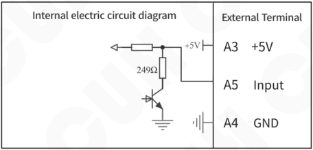

### 4.5.2 Type de signal de commande à distance

6 types de signal de commande à distance peuvent être définis : « Panel », 20mA, 1~5V, 0~5V, 0~10V, meter.

Le type de signal de commande à distance est réglé par la valeur de « control source » dans le groupe de fonctions 2 (la valeur par défaut est « Panel »).

---

| Type de signal de commande à distance | Signal de commande à distance | Tension de sortie/Vitesse d'alimentation |
|---|---|---|
| Panel | | La tension de sortie et la vitesse d'alimentation ne sont pas commandées par le signal de commande à distance |
| 20mA | <2mA | Lorsque le mode de tension est manuel, tension de sortie = 0 Lorsque le mode de tension est automatique, vitesse d'alimentation = 0 L'écran LCD affiche l'information d'erreur « <2mA Err » |
| | 2mA~4 mA | Tension de sortie = 0, vitesse d'alimentation = 0 |
| | 4 mA ~20mA | commande proportionnelle par le signal de commande à distance (0%~100%) Lorsque le mode de tension est manuel, tension de sortie = (courant d'entrée - 4mA)/16 × tension de sortie maximale Lorsque le mode de tension est automatique, vitesse d'alimentation = (courant d'entrée - 4mA)/16 × vitesse d'alimentation maximale |
| 1~5V | <0.5V | Tension de sortie = 0, vitesse d'alimentation = 0 L'écran LCD affiche l'information d'erreur « <0.5V Err » |
| | 0.5V~1V | Tension de sortie = 0, vitesse d'alimentation = 0 |
| | 1V~5V | commande proportionnelle par le signal de commande à distance (0%~100%) Lorsque le mode de tension est manuel, tension de sortie = (tension d'entrée 1V)/4 × tension de sortie maximale Lorsque le mode de tension est manuel, tension de sortie = (tension d'entrée 1V)/4 × tension de sortie maximale |
| 0~5V | 0V~5V | commande proportionnelle par le signal de commande à distance (0%~100%) Lorsque le mode de tension est manuel, tension de sortie = tension d'entrée/5 × tension de sortie maximale Lorsque le mode de tension est automatique, vitesse d'alimentation = tension d'entrée/5 × vitesse d'alimentation maximale |
| 0~10V | 0V~10V | commande proportionnelle par le signal de commande à distance (0%~100%) Lorsque le mode de tension est manuel, tension de sortie = tension d'entrée/10 × tension de sortie maximale Lorsque le mode de tension est automatique, vitesse d'alimentation = tension d'entrée/10 × vitesse d'alimentation maximale |
| Meter (potentiomètre) | Rapport de division du potentiomètre <4% | Tension de sortie = 0, vitesse d'alimentation = 0 |
| | Rapport de division du potentiomètre 4%~96% | commande proportionnelle par le signal de commande à distance (0%~100%) Lorsque le mode de tension est manuel, tension de sortie = ((rapport de division - 4%)/92%)× tension de sortie maximale Lorsque le mode de tension est automatique, vitesse d'alimentation =((tension d'entrée tension interne × 4%)/tension interne × 92%) × vitesse d'alimentation maximale |

## 4.6 Mode principal

Mode principal : cas où le contrôleur pilote le vibrateur de manière indépendante.

Le mode principal du contrôleur se définit en réglant les paramètres « Voltage mode » et « Frequency Mode » ; les combinaisons sont définies ci-dessous :

| Mode principal | Mode de tension | Mode de fréquence | Capteur de vibration raccordé |
|---|---|---|---|
| Mode entièrement manuel | Manuel | Manuel | Non |
| Mode entièrement automatique | Automatique | Automatique | Oui |
| Mode semi-automatique de tension | Automatique | Manuel | Oui |
| Mode semi-automatique de fréquence | Manuel | Automatique | Oui |

### 4.6.1 Mode entièrement manuel

La tension de sortie et la fréquence de sortie du contrôleur sont réglées manuellement.

**Méthode de réglage de la tension de sortie**

Placez le curseur sur la valeur « Usr_Voltag » du groupe de fonctions 1 et réglez la valeur de tension de sortie en tournant l'encodeur rotatif.

**Méthode de réglage de la fréquence de sortie**

Placez le curseur sur la valeur « Usr_Frqncy » du groupe de fonctions 1 et réglez la valeur de fréquence de sortie en tournant l'encodeur rotatif.

> Remarque :
>
> Sauf indication contraire dans ce manuel, la tension est la tension moyenne redressée.
>
> Ce contrôleur dispose d'une fonction de régulation automatique de tension.

---

## 4.6.2 Mode entièrement automatique

Le contrôleur règle automatiquement la tension de sortie et la fréquence de sortie d'après les données du capteur de vibration afin de stabiliser la vitesse d'alimentation du vibrateur réglée par « User_Speed » dans le groupe de fonctions 1.

### Méthode de réglage de la vitesse d'alimentation

Placez le curseur sur la valeur « User_Speed » du groupe de fonctions 1 et réglez la valeur de vitesse d'alimentation en tournant l'encodeur rotatif.

### Description des autres paramètres associés

**« AtoFCenter »**

La plage de réglage automatique de fréquence du contrôleur est « AtoFCenter ± AtoFRange_ » ; la fréquence centrale doit être réglée proche de la fréquence de résonance du vibrateur.

**« AtoFRange_ »**

La plage de réglage automatique de fréquence du contrôleur est « AtoFCenter ± AtoFRange_ » ; la plage de fréquence recommandée est 30.0Hz. Une valeur excessive de la plage de fréquence empêche le vibrateur de fonctionner à la meilleure fréquence, et une valeur trop petite peut réduire l'adaptabilité du vibrateur.

**« AtoFIntgrl »**

Règle automatiquement la fréquence de sortie du contrôleur au moyen de l'algorithme PID : plus la valeur d'intégrale de fréquence du PID est grande, plus la fréquence de sortie est ajustée rapidement, mais une valeur excessive peut faire osciller la fréquence de sortie.

**« AtoAProptn »**

Règle automatiquement la tension de sortie du contrôleur au moyen de l'algorithme PID : plus la valeur de proportion d'amplitude du PID est grande, plus la tension de sortie est ajustée rapidement, mais une valeur excessive peut faire osciller la tension de sortie.

**« AtoAIntgrl »**

Règle automatiquement la tension de sortie du contrôleur au moyen de l'algorithme PID : plus la valeur d'intégrale d'amplitude du PID est grande, plus la fréquence et l'amplitude des oscillations de la tension de sortie diminuent rapidement, mais une valeur excessive peut augmenter l'amplitude des oscillations de la tension de sortie.

---

### « AtoSnsrMax »

Limitez l'amplitude de sortie maximale en réglant « AtoSnsrMax » afin d'éviter d'endommager le vibrateur.

### « AutoPhase »

Réglez la phase de la forme d'onde au moyen du paramètre « AutoPhase ».

### « AtoSpedMax »

La plage de réglage de la vitesse d'alimentation va de 0 à « AtoSpedMax ».

### « AtoSrhVMax »

Limitez la tension de sortie pendant le processus de recherche automatique de la fréquence de résonance afin d'éviter d'endommager le dispositif vibrant.

### « AtoSnsrTyp »

Le contrôleur prend en charge plusieurs types de capteurs de vibration ; la tension de sortie du contrôleur diffère selon le type pour une même vitesse d'alimentation.

| Valeur technique | Type de capteur de vibration | Accélération dans les directions X/Y/Z |
|---|---|---|
| 16g | SDVS20-1 | 16g/16g/16g |
| 35g | SDVS20-2 | 35g/35g/- |
| 50g | SDVS20-3 | 50g/50g/- |
| 70g | SDVS20-4 | 70g/70g/- |
| Auto | Aucun | Aucun |

### « Speed_Now_ »

Indique la vitesse d'alimentation en temps réel « Speed_Now_ » du groupe de fonctions 9 pour aider l'utilisateur à observer les conditions de fonctionnement de l'appareil.

### « VoltagOut_ »

Indique la tension de sortie en temps réel du groupe de fonctions 9 pour aider l'utilisateur à observer les conditions de fonctionnement de l'appareil.

Remarque : le contrôleur est réglé en mode entièrement automatique par défaut, mais il fonctionne en mode entièrement manuel lorsque le capteur de vibration n'est pas raccordé ou est mal raccordé.

Vérifiez si la tension de sortie et la fréquence de sortie sont « auto » sur l'interface de veille pour confirmer que le contrôleur fonctionne en mode entièrement automatique.

---

## 4.6.3 Mode semi-automatique de tension

Le contrôleur règle automatiquement la tension de sortie d'après les données du capteur de vibration afin de garantir la vitesse d'alimentation, mais la fréquence de sortie est réglée manuellement.

**Méthode de réglage de la vitesse d'alimentation**

Placez le curseur sur la valeur « User_Speed » du groupe de fonctions 1 et réglez la valeur de fréquence de sortie en tournant l'encodeur rotatif.

**Méthode de réglage de la fréquence de sortie**

Placez le curseur sur la valeur « Usr_Frq ncy » du groupe de fonctions 1 et réglez la valeur de fréquence de sortie en tournant l'encodeur rotatif.

## 4.6.4 Mode semi-automatique de fréquence

Le contrôleur règle automatiquement la fréquence de sortie d'après les données du capteur de vibration afin que le dispositif vibrant fonctionne à la fréquence de résonance, mais la tension de sortie est réglée manuellement.

**Méthode de réglage de la tension de sortie**

Placez le curseur sur la valeur « Usr_Voltag » du groupe de fonctions 1 et réglez la valeur de tension de sortie en tournant l'encodeur rotatif.

---

## 4.7 Mode Sync

Mode Sync : lorsque plusieurs contrôleurs commandent plusieurs alimentateurs dans un système d'alimentation, leurs sorties doivent être synchronisées ; un seul contrôleur doit fonctionner en mode principal, les autres suivent en temps réel la fréquence de sortie du contrôleur en mode principal (contrôleur maître).

Le mode Sync s'applique aux situations où plusieurs contrôleurs commandent plusieurs alimentateurs dans un système d'alimentation. Les sorties des contrôleurs n'étant pas synchronisées, elles interfèrent entre elles (effet de battement). Le mode Sync est conçu pour éliminer l'effet de battement, la forme d'onde de sortie des contrôleurs maître et esclave étant parfaitement synchronisée.

Lorsque le contrôleur M fonctionne en mode principal et le contrôleur S en mode Sync, les formes d'onde de sortie des deux contrôleurs sont parfaitement synchronisées, comme illustré ci-dessous :

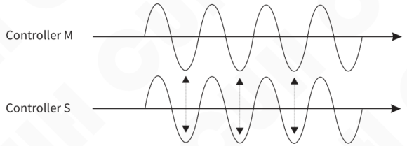

Le contrôleur S est réglé en mode Sync ; les formes d'onde de sortie des deux contrôleurs sont synchronisées.

Si le contrôleur S n'est pas réglé en mode Sync, les formes d'onde de sortie des deux contrôleurs ne sont pas synchronisées.

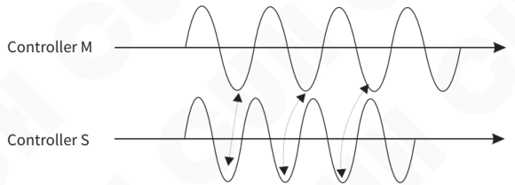

Le contrôleur S n'est pas réglé en mode Sync ; les formes d'onde de sortie des deux contrôleurs ne sont pas synchronisées.

---

## Méthode de câblage du mode Sync entre les contrôleurs maître et esclave

Raccordez le fil de signal de synchronisation entre les contrôleurs maître et esclave afin de garantir la synchronisation de leur fréquence de sortie.

### Schéma du circuit du port de signal de synchronisation

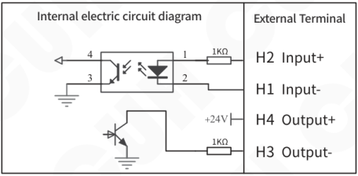

### Schéma de câblage du signal de synchronisation entre le contrôleur maître et le contrôleur esclave

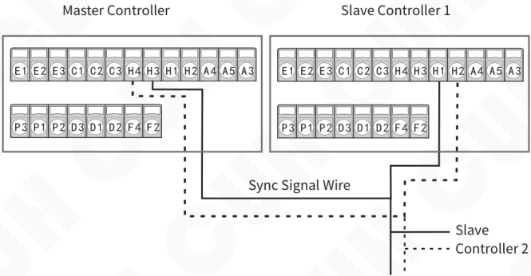

---

Le mode esclave du contrôleur se définit en réglant les paramètres « VoltagMode » et « FrqncyMode » du groupe de fonctions 3 ; les combinaisons sont définies ci-dessous :

| Mode Sync | Mode de tension | Mode de fréquence | Commande de phase | Capteur de vibration raccordé |
|---|---|---|---|---|
| Mode tension automatique et phase automatique | Manuel | Slave C | Manuel | Oui |
| Mode tension automatique et phase manuelle | Manuel | Slave M | Automatique | Oui |
| Mode tension manuelle et phase automatique | Automatique | Slave C | Manuel | Oui |
| Mode tension manuelle et phase manuelle | Automatique | Slave M | Automatique | Non |

> « Auto » du mode de tension signifie que la tension de sortie est réglée automatiquement pour stabiliser la « vitesse d'alimentation » du vibrateur que vous avez définie.
>
> « Slave C » du mode de fréquence signifie que la phase de la forme d'onde de sortie du contrôleur esclave est réglée automatiquement pour se synchroniser avec le contrôleur maître d'après les données de retour du capteur de vibration.
>
> « Slave M » du mode de fréquence signifie que le déphasage entre la forme d'onde de sortie du contrôleur esclave et celle du contrôleur maître est réglé manuellement.

---

Cas où le contrôleur maître et le contrôleur esclave ont tous deux raccordé les capteurs de vibration

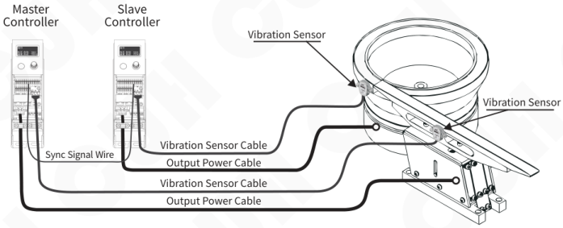

1. Si le contrôleur esclave fonctionne en mode tension manuelle et phase manuelle, il n'est pas nécessaire de raccorder le capteur de vibration.
2. Si le contrôleur maître fonctionne en mode entièrement manuel, il n'est pas nécessaire de raccorder le capteur de vibration.

## 4.7.1 Mode tension automatique et phase automatique

Le contrôleur règle automatiquement la tension de sortie d'après les données de retour du capteur de vibration afin de stabiliser la « vitesse d'alimentation » du vibrateur que vous avez définie ; la fréquence et la phase de la forme d'onde de sortie du contrôleur esclave sont identiques à celles du contrôleur maître.

### Méthode de réglage de la vitesse d'alimentation

Placez le curseur sur la valeur « User Speed » du groupe de fonctions 1 et réglez la valeur de vitesse d'alimentation en tournant l'encodeur rotatif.

---

## 4.7.2 Mode tension automatique et phase manuelle

Le contrôleur règle automatiquement la tension de sortie d'après les données de retour du capteur de vibration afin de stabiliser la vitesse d'alimentation du vibrateur que vous avez définie ; la fréquence de sortie du contrôleur esclave est identique à celle du contrôleur maître, et le déphasage entre la forme d'onde de sortie du contrôleur esclave et celle du contrôleur maître est fixe.

**Méthode de réglage de la vitesse d'alimentation**

Placez le curseur sur la valeur « User_Speed » du groupe de fonctions 1 et réglez la valeur de vitesse d'alimentation en tournant l'encodeur rotatif.

**Méthode de réglage de la phase manuelle**

Placez le curseur sur la valeur « UserPhase_ » du groupe de fonctions 3 et réglez la valeur « UserPhase_ » en tournant l'encodeur rotatif.

## 4.7.3 Mode tension manuelle et phase automatique

La tension de sortie du contrôleur est réglée manuellement, mais la fréquence et la phase de la forme d'onde de sortie du contrôleur esclave sont identiques à celles du contrôleur maître grâce au réglage automatique.

**Méthode de réglage de la tension de sortie**

Placez le curseur sur la valeur « Usr_Voltag » du groupe de fonctions 1 et réglez la valeur de tension de sortie en tournant l'encodeur rotatif.

## 4.7.4 Mode tension manuelle et phase manuelle

La tension de sortie du contrôleur est réglée manuellement ; la fréquence de sortie du contrôleur esclave est identique à celle du contrôleur maître et le déphasage de la forme d'onde de sortie du contrôleur esclave par rapport au contrôleur maître est fixe.

**Méthode de réglage de la tension de sortie**

Placez le curseur sur la valeur « Usr_Voltag » du groupe de fonctions 1 et réglez la valeur de tension de sortie en tournant l'encodeur rotatif.

**Méthode de réglage de la phase manuelle**

Placez le curseur sur la valeur « UserPhase_ » du groupe de fonctions 3 et réglez la valeur « User phase » en tournant l'encodeur rotatif.

**Remarque : même si « VoltagMode » et « FrqncyMode » sont réglés sur « Auto » et « Slave C », le contrôleur fonctionne en mode tension manuelle et phase manuelle car le capteur de vibration n'est pas raccordé.**

---

## 4.8 Fonction de paramètres prédéfinis

Le contrôleur peut enregistrer et restaurer tous ses paramètres dans « Work », « UsrD1 », « UsrD2 » et « UsrD3 ».

### 4.8.1 Restauration des paramètres prédéfinis

Restaurez les paramètres depuis « UsrD1 », « UsrD2 » ou « UsrD3 » en réglant la valeur de « ReadALLFrm » dans le groupe de fonctions 8, puis appuyez brièvement sur l'encodeur rotatif pour terminer l'opération de restauration.

### 4.8.2 Enregistrement des paramètres prédéfinis

Enregistrez les paramètres dans « Work », « UsrD1 », « UsrD2 » ou « UsrD3 » en réglant la valeur de « SavedALLTo » dans le groupe de fonctions 8, puis appuyez brièvement sur l'encodeur rotatif pour terminer l'opération d'enregistrement.

**Remarque :**

1. Tous les paramètres réglés sont enregistrés par défaut dans « Work » ; il n'est donc pas nécessaire d'effectuer l'opération d'enregistrement après chaque réglage de paramètre.
2. Après avoir sélectionné la valeur de « SavedALLTo », vous devez appuyer brièvement une fois sur l'encodeur rotatif pour terminer l'opération d'enregistrement.

---

## 4.9 Restauration des réglages par défaut

- Depuis l'interface de veille, appuyez longuement sur l'encodeur rotatif pour entrer dans l'interface des groupes de fonctions.
- Réglez la valeur de « RestorALL » dans le groupe de fonctions 8 sur « Work ».
- Appuyez brièvement une fois sur l'encodeur rotatif pour terminer l'opération de restauration des réglages par défaut.
- lorsque la valeur de « RestorALL » passe de « Work » à « None », cela signifie que l'opération de restauration des réglages par défaut est terminée.

---

## 4.10 Communication RS485

Le contrôleur prend en charge les modes RTU et ASCII du protocole Modbus pour la communication RS485 ; tous les paramètres du contrôleur peuvent être réglés et surveillés à distance.

### 4.10.1 Schéma du circuit électrique de la communication RS485 (port F)

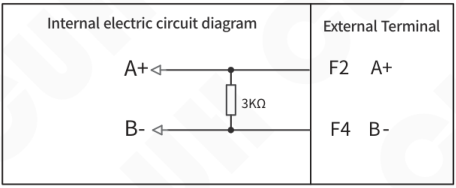

### 4.10.2 Adresse de communication RS485

L'adresse de communication réglée par la valeur de « Slave_ID » (valeur par défaut : 1) dans le groupe de fonctions 8 représente le numéro d'identification du contrôleur en communication RS485 ; sa plage est 1~31 afin que tous les contrôleurs puissent se distinguer les uns des autres dans le même réseau.

### 4.10.3 Débit en bauds de la communication RS485

Le débit en bauds de la communication RS485, réglé par la valeur de « Baud_Rate » dans le groupe de fonctions 8, peut être : 3, 12, 24, 96, 192, 576 ou 1152. Unité : 0.1Kbps. Valeur par défaut : 115.2 Kbps.

Les contrôleurs du même réseau doivent utiliser le même débit en bauds.

### 4.10.4 Protocole de communication RS485

« CUH Modbus Communication Protocol » et « Address Table of Coil and Register of SDVC35 series for Modbus protocol » peuvent être téléchargés depuis notre site Web officiel : en.cuhnj.com

---

### 4.10.5 Mise à jour du firmware

La mise à jour du firmware du contrôleur est prise en charge via l'interface de communication RS485.

**Le logiciel d'application exécuté sur ordinateur pour la mise à jour du firmware et le fichier de firmware sont les suivants :**

1. UpdateFirmwareUi.exe
2. Fichier de firmware : SDVC35K4.10_enc.script (version actuelle)

Le logiciel d'application et le fichier de firmware le plus récent peuvent être téléchargés sur notre site Web officiel : en.cuhnj.com

**Le convertisseur requis, raccordé entre l'ordinateur et le contrôleur, pour la mise à jour du firmware :**

Convertisseur USB vers RS485

**Étapes de la mise à jour du firmware :**

1. Raccordez le port RS485 du convertisseur au contrôleur et le port USB du convertisseur à l'ordinateur.
2. Consultez le port série USB (COM) qui a reconnu le convertisseur USB vers RS485.
3. Lancez UpdateFirmwareUi.exe.
4. Sélectionnez dans UpdateFirmwareUi.exe le port COM mémorisé à l'étape 2.
5. Sélectionnez le débit en bauds 115200.
6. Cliquez sur le bouton « Open » à droite du débit en bauds dans le logiciel d'application pour ouvrir le port série. L'état de réussite ou d'échec de l'ouverture du port série s'affichera dans la zone d'état.
7. Cliquez sur le bouton « Open » à droite de Firmware File dans le logiciel d'application pour charger le fichier de firmware le plus récent.
8. Appuyez sur le bouton ON/OFF du contrôleur jusqu'à ce que le contrôleur s'allume et que toutes les LED vertes du port de connexion s'allument.
9. Cliquez sur le bouton « Update » du logiciel d'application pour mettre à jour le firmware. La progression s'affichera dans la zone d'état. Une fois la mise à niveau terminée, « Firmware download OK! » s'affiche dans la zone d'état.
10. Une fois la mise à niveau terminée, effectuez une fois l'opération de restauration des réglages par défaut.

---

## 4.11 Communication Ethernet

Le contrôleur prend en charge EtherCat et Profinet ; tous les paramètres du contrôleur peuvent être réglés et surveillés à distance.

Les protocoles EtherCat et Profinet prennent en charge les modes de communication périodique et apériodique. Le temps de communication périodique Ethernet est de 5ms ou plus, et le temps de communication périodique typique est de 10ms.

La longueur de message en mode de communication périodique (longueur du tampon d'entrée-sortie) peut atteindre 5760 octets.

La longueur de message en mode de communication apériodique (longueur des tampons Send Mailbox et Receive Mailbox) peut atteindre 1596 octets.

Les fichiers de protocole de communication Ethernet « Hilscher NETX51 RE ECS V4.2.X-EtherCATSlave-20160520.xml » et « GSDML-V2.31-HILSCHER-NETX51-RE PNS-Profinet_20160912.xml » peuvent être téléchargés depuis notre site Web officiel : en.cuhnj.com

Lorsque l'Ethernet et le RS485 sont utilisés en même temps, le contrôleur répond à tour de rôle et l'état de la dernière instruction est conservé.

## 4.12 Test de charge

Le contrôleur peut tester l'inductance, le courant maximal et l'impédance du vibrateur.

Démarrez la fonction de test de charge en réglant le paramètre « Measure » sur « valid » ; le test de charge est terminé lorsque le paramètre « Measure » est automatiquement réglé sur « Invalid ».

L'utilisateur peut consulter le résultat du test de charge dans le groupe de fonctions 9.

---

## 4.13 Surveillance de l'état de fonctionnement

L'utilisateur peut consulter l'état de fonctionnement du contrôleur au moyen des paramètres du groupe de fonctions 9.

**Surveillance en temps réel des alimentations internes 5V et 24V :** Les tensions des alimentations 5V et 24V sont affichées par les paramètres « 5V_Power_ » et « 24V_Power_ ».

**Surveillance en temps réel de l'état de la sortie principale :** L'état de la sortie principale est affiché par le paramètre « MainOutPut ».

**Surveillance en temps réel de l'état des entrées numériques :** L'état et la tension des ports C et E sont affichés par les paramètres « PortC_ » et « PortCInput », « PortE_ » et « PortEInput ».

**Surveillance en temps réel de l'état des sorties de commande 24V CC :** L'état et la tension des ports D et P sont affichés par les paramètres « PortD_ » et « PortD_Out_ », « PortP_ » et « PortP_Out_ ».

**Surveillance en temps réel de la fréquence de synchronisation :** lorsque le contrôleur fonctionne en mode Sync, la fréquence de synchronisation suivant le contrôleur maître peut être affichée par le paramètre « SynchrFrqy ».

**Surveillance en temps réel de la température interne du contrôleur :** la température du contrôleur est affichée par le paramètre « Temperatur » et le contrôleur s'arrête lorsque la température dépasse 65 ℃.

**Surveillance en temps réel de l'état du capteur de vibration :** l'état du capteur de vibration est affiché par les paramètres « AtoSnsrVld » et « AtoSnsrOvr » pour vérifier si le capteur de vibration est valide et s'il est en surcharge.

---

## Chapitre Ⅴ Fonctions de sécurité

### Protection contre les courts-circuits

Lorsque la sortie du contrôleur est en court-circuit, le contrôleur arrête sa sortie et « ShortCircuit » s'affiche sur l'OLED jusqu'au redémarrage du contrôleur ou à un appui bref sur le bouton ON/OFF du panneau du contrôleur.

### Protection contre les surintensités

Lorsque le courant de sortie dépasse sa valeur nominale par erreur de manipulation, le contrôleur arrête la sortie pour garantir la sécurité de fonctionnement et « OverCurrent » s'affiche sur l'OLED.

### Protection contre la surchauffe

Lorsque la température interne du contrôleur dépasse 65 ℃, le contrôleur arrête sa sortie pour se protéger et « OverHot » s'affiche sur l'OLED jusqu'à ce que la température interne redescende en dessous de 60 ℃.

### Protection contre les surcharges

Lorsqu'un capteur de vibration est raccordé au contrôleur, si l'amplitude de vibration dépasse la valeur réglée par le paramètre « AtoSnsrMax » du groupe de fonctions 3, le contrôleur réduit sa sortie pour protéger l'alimentateur vibrant et « OverLoad » s'affiche sur l'OLED.

### Protection contre les surtensions

lorsque la tension d'entrée est supérieure à la valeur nominale, le contrôleur s'arrête automatiquement jusqu'à ce que la tension d'entrée revienne à la normale.

### Protection contre les surtensions extrêmes

Lorsque la tension d'entrée dépasse largement la tension limite de protection et que la tension de crête atteint 430 V, le fusible du contrôleur fond pour protéger le contrôleur de tout dommage supplémentaire. Veuillez nous contacter pour la réparation.

---

## Annexe A : Dimensions

Dimensions du SDVC35 (unité : mm)

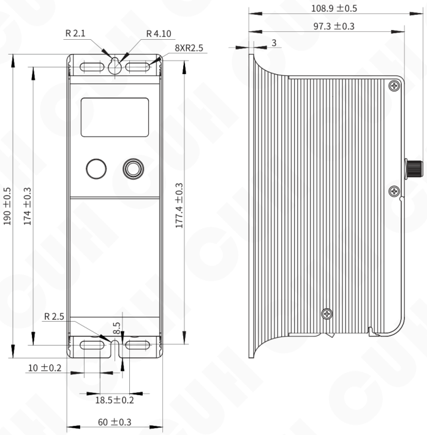

---

## Annexe B : Description des ports électriques

| Sensor | | | Sensor | | | Sync | | | | Speed Ctrl | | |
|---|---|---|---|---|---|---|---|---|---|---|---|---|
| PortE | | | PortC | | | PortH | | | | PortA | | |
| E1 | E2 | E3 | C1 | C2 | C3 | H4 | H3 | H1 | H2 | A4 | A5 | A3 |
| GND | Input | +24V | GND | Input | +24V | Sync Out+ | Sync Out- | Sync In- | Sync In+ | GND | Input | +5V |

| Ctrl Out | | | Ctrl Out | | | RS485 | |
|---|---|---|---|---|---|---|---|
| PortP | | | PortD | | | PortF | |
| P3 | P1 | P2 | D3 | D1 | D2 | F4 | F2 |
| GND | Output | +24V | GND | Output | +24V | B- | A+ |

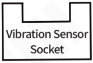

---

## Annexe C : Spécifications électriques

| Élément | Plage : min | Plage : typique | Plage : max | Unité | Remarque |
|---|---|---|---|---|---|
| Tension d'entrée | 85 | 220 | 250 | V | AC RMS |
| Plage de tension de sortie réglable | 0 | —— | 260 | V | Inférieure à 150 % de la tension d'entrée |
| Précision de réglage de la tension | | 1 | | V | |
| Précision de régulation de la tension | 0 | —— | 10 | % | ΔVout/ΔVin |
| Temps de réponse de la régulation de tension | | Temps réel | | s | Régulation de tension pour chaque forme d'onde |
| Plage de courant de sortie réglable | 0 | —— | 3 | A | SDVC35-MRJ |
| Plage de courant de sortie réglable | 0 | —— | 4.5 | A | SDVC35-LRJ |
| Puissance de sortie | 0 | —— | 660 | VA | SDVC35-MRJ |
| Puissance de sortie | 0 | —— | 990 | VA | SDVC35-LRJ |
| Fréquence de sortie | 25 | —— | 400 | Hz | |
| Précision de réglage de la fréquence | | 0.1 | | Hz | |
| Forme d'onde de sortie | | Sinusoïdale | | | |
| Temps de démarrage progressif | 0 | —— | 10 | s | Valeur par défaut : 0.5 |
| Plage de temps de retard marche/arrêt | 0 | —— | 20 | s | Valeur par défaut : 0.2 |
| Précision du temps de retard marche/arrêt | | 0.1 | | s | |
| Température de déclenchement de la protection contre la surchauffe | 60 | 65 | 65 | °C | |
| Communication numérique | | Communication ModBUS485 | | | |
| Communication numérique | | EtherCat | | | En option |
| Communication numérique | | Profinet | | | En option |
| Courant de sortie de commande CC | 0 | —— | 200 | mA | Double sortie 24V |
| Tension de sortie de commande CC | 22 | 24 | 26 | V | Double sortie 24V |
| Signal de commande analogique | | 4~20 | | mA | 1 canal de courant pour la commande de vitesse à distance |
| Signal de commande analogique | | 1~5/0~5/0~10 | | V | 3 canaux de tension pour la commande de vitesse à distance |
| Signal de commande numérique | | 24 | | V | Signal de commutation |
| Méthode de réglage | | 1 bouton + 1 encodeur rotatif | | | |
| Consommation en veille | —— | —— | 3 | W | |
| Méthode d'affichage | | 128\*64 | | | Afficheur matriciel OLED |
| Température ambiante | 0 | 25 | 40 | °C | Sans condensation |
| Humidité ambiante | 10 | 60 | 85 | % | Sans condensation |
| Température ambiante de stockage | -20 | 25 | 65 | °C | Sans condensation |

## Paramètres absolus :

Le dépassement des valeurs ci-dessus endommagera le contrôleur ; respectez-les strictement.

| Élément | Norme GB | Norme IEC | Exigence de la norme | Niveau atteint par le produit CUH | Remarque |
|---|---|---|---|---|---|
| Décharge électrostatique | GB/T 17626.2-2006 | IEC 61000-4-2:2001 | 4 kV | ±8 kV | Décharge par contact |
| | | | 8 kV | ±15 kV | Décharge dans l'air |
| Essai de transitoires électriques rapides | GB/T 17626.4-2008 | IEC 61000-4-4:2004 | 2 kV | ±4 kV | |
| Ondes de choc électriques | GB/T 17626.5-2008 | IEC 61000-4-5:2005 | 1 kV | ±4 kV | Couplage ligne-ligne |
| | | | 2 kV | ±2 kV | Couplage ligne-terre |

---

## Annexe D : Suggestions de dépannage et explication des erreurs

| | Phénomène de panne | Suggestions de dépannage |
|---|---|---|
| 1 | Aucun affichage après la mise sous tension | • Assurez-vous que la prise d'alimentation est alimentée • Assurez-vous que le câble d'alimentation d'entrée est correctement raccordé à la prise d'alimentation |
| 2 | Affichage normal, mais aucune sortie | • Assurez-vous que la tension de sortie n'est pas trop faible • Assurez-vous que l'état de fonctionnement du contrôleur n'est pas « Man », commandé par l'appui sur le bouton « ON/OFF » du panneau • Assurez-vous que l'état de fonctionnement du contrôleur n'est pas « STP », commandé par les ports C/E • Assurez-vous que l'état de fonctionnement du contrôleur n'est pas « STP », commandé par le paramètre de sens logique des ports C/E • Réinitialisez le contrôleur par la restauration des réglages par défaut réglée dans le groupe de fonctions 8 |
| 3 | Les ports C/E ne fonctionnent pas normalement | • Assurez-vous que le fil du signal de commande ON/OFF est correctement raccordé aux ports C/E • Assurez-vous que tous les paramètres des ports C/E que vous avez réglés sont corrects • Réinitialisez le contrôleur par la restauration des réglages par défaut réglée dans le groupe de fonctions 8 |
| 4 | Effet de battement | • Raccordez le fil de signal de synchronisation entre les contrôleurs et réglez le contrôleur esclave en mode Sync |
| 5 | Affichage normal, des sons sont audibles depuis l'alimentateur vibrant mais aucune sortie | • Assurez-vous que la fréquence de sortie n'est pas trop éloignée de la fréquence de résonance de l'alimentateur vibrant • Réinitialisez le contrôleur par la restauration des réglages par défaut réglée dans le groupe de fonctions 8 |

---

## Annexe E : Description des avertissements et erreurs et suggestions de dépannage

| Affichage de panne | Type de panne | Suggestions de dépannage |
|---|---|---|
| 24VErr | Erreur d'alimentation interne 24V | Défaillance de l'alimentation interne 24V du contrôleur, veuillez nous contacter pour la réparation |
| 5VErr | Erreur d'alimentation interne 5V | Défaillance de l'alimentation interne 5V du contrôleur, veuillez nous contacter pour la réparation |
| <2mA Err | Le courant d'entrée du signal de commande à distance est trop faible sur le port A | Le courant d'entrée du signal de commande à distance est trop faible sur le port A ; veillez à ce qu'il soit supérieur à 2mA |
| <0.5V Err | La tension d'entrée du signal de commande à distance est trop faible sur le port A | La tension d'entrée du signal de commande à distance est trop faible sur le port A ; veillez à ce qu'elle soit supérieure à 0.5V |
| CommErr(1~5) | Erreur de communication | Veuillez nous contacter pour la réparation |
| decline | Décélération du comptage | Lorsque le nombre compté atteint la « End Count » que vous avez réglée, la tension de sortie (ou la vitesse d'alimentation) diminue |
| EEPErr | Erreur d'enregistrement des paramètres prédéfinis | Veuillez nous contacter pour la réparation |
| FrqncyHi | Fréquence de référence de synchronisation trop élevée | La fréquence d'entrée du signal de synchronisation du contrôleur esclave est supérieure à 400Hz Assurez-vous que la fréquence du signal de synchronisation est comprise entre 25 Hz et 400 Hz |
| FrqncyLo | Fréquence de référence de synchronisation trop faible | La fréquence d'entrée du signal de synchronisation du contrôleur esclave est inférieure à 25Hz Assurez-vous que la fréquence du signal de synchronisation est comprise entre 25 Hz et 400 Hz |
| OverHot | Surchauffe | La température interne du contrôleur dépasse 65 ℃ Assurez-vous que le contrôleur fonctionne dans un environnement bien ventilé |
| OverLoad | Surcharge du capteur de vibration | Le capteur de vibration a détecté une accélération dépassant sa valeur d'amplitude absolue |
| OvrCurrt | Surintensité | Le courant de sortie du contrôleur dépasse 3A |
| OvrVoltg | Surtension | La tension de sortie du contrôleur dépasse 260V Assurez-vous que la plage de tension d'entrée est comprise entre 85V et 260V |
| PortDErr | Erreur du port D | L'écart de tension de sortie du port D dépasse 3V Assurez-vous que la puissance de charge du port D ne dépasse pas 4.8W |
| PortPErr | Erreur du port P | L'écart de tension de sortie du port P dépasse 3V Assurez-vous que la puissance de charge du port P ne dépasse pas 4.8W |
| Saturate | Saturation de sortie | Lorsque la tension de sortie du contrôleur est supérieure à la tension d'entrée, le contrôleur entre en état de saturation |
| Save | Enregistrement des paramètres prédéfinis | Après l'opération de recherche automatique de la fréquence de résonance, les paramètres associés sont enregistrés avec succès |
| SenorErr | Défaut du capteur de vibration | Le signal du capteur de vibration est anormal, veuillez nous contacter pour la réparation |
| SenTypEr | Erreur de type de capteur de vibration | Le type de capteur de vibration raccordé au contrôleur ne correspond pas au paramètre « type de capteur de vibration » réglé dans le contrôleur |
| Short | Court-circuit | La sortie du contrôleur est en court-circuit ; assurez-vous que la borne de sortie n'est pas court-circuitée |
| SynchErr | Erreur de signal de synchronisation | Le fil de signal de synchronisation n'est pas raccordé au contrôleur esclave Assurez-vous que le fil de signal de synchronisation est correctement raccordé au contrôleur |
| UndrVolt | Sous-tension | La tension d'entrée du contrôleur est inférieure à 85V. Assurez-vous que la plage de tension d'entrée est comprise entre 85V et 260V |
| UpgradeSlv | Mise à jour du firmware | Le firmware est en cours de mise à jour ; le contrôleur revient à la normale après la mise à jour |

## Annexe F : Description de l'état de fonctionnement et du type de carte réseau

Les états de fonctionnement du contrôleur sont indiqués ci-dessous :

| Affichage de l'état du contrôleur | Type d'état | Description |
|---|---|---|
| RUN | Le contrôleur est en marche | La sortie du contrôleur est valide |
| MAN | Le contrôleur est arrêté | Appuyez brièvement sur le bouton « ON/OFF » pour basculer l'état marche/arrêt de la sortie du contrôleur |
| CND | Le processus de comptage est terminé, arrêt du contrôleur | Lorsque le processus de comptage est terminé, la sortie du contrôleur est arrêtée |
| RMT | Arrêt à distance de la sortie du contrôleur | Arrêt à distance de la sortie du contrôleur par communication RS485 ou Ethernet |
| STP | Arrêt de la sortie du contrôleur par les ports C/E | Arrêt de la sortie du contrôleur par les entrées numériques des ports C/E |
| Lok | Verrouillage du clavier | Le bouton ON/OFF et l'encodeur sont désactivés ; appuyez longuement sur l'encodeur rotatif pour déverrouiller le clavier |
| ERR | Arrêt de la sortie du contrôleur causé par une erreur de comptage | Lorsque la valeur de « Main Logic » est « Count », si les opérations d'effacement et d'incrémentation se produisent simultanément pendant le processus de comptage, la sortie du contrôleur est arrêtée |

Les états du réseau sont indiqués ci-dessous :

| Affichage de l'état du contrôleur | Type d'état | Description |
|---|---|---|
| Wit | Aucune carte réseau n'est connectée | |
| Cat | La carte réseau EtherCat est connectée | |
| Pro | La carte réseau Profinet est connectée | |

---

## Annexe G : Méthode de raccordement des capteurs de commutation et de l'automate programmable aux ports d'entrée numériques

### Méthode de raccordement du capteur NPN

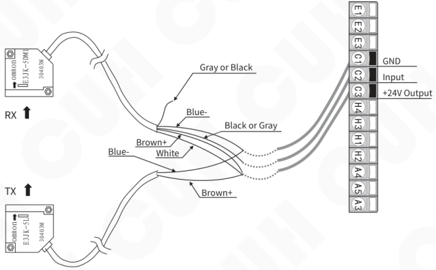

### Méthode de raccordement du capteur photoélectrique à faisceau

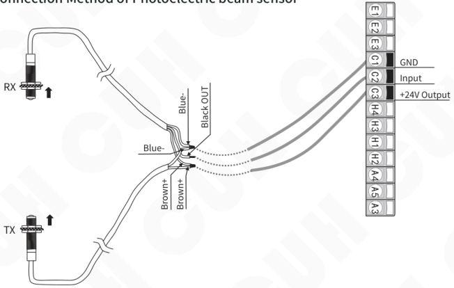

## Méthode de raccordement du capteur à fibre optique à faisceau

## Méthode de raccordement du capteur photoélectrique réflexif

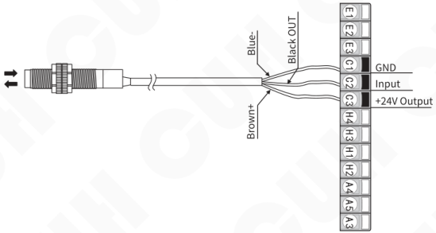

## Méthode de raccordement de la sortie NPN de l'automate programmable au port C

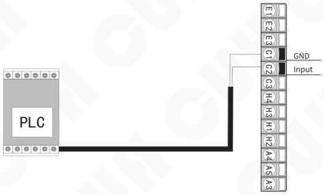

## Méthode de raccordement de la sortie PNP de l'automate programmable au port C

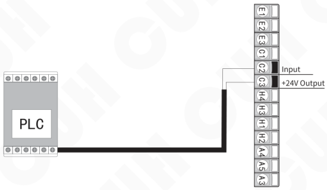

Parmi la sortie relais, la sortie NPN et la sortie PNP de l'automate programmable, l'une ou l'autre peut activer/désactiver le contrôleur.

**Remarque : lorsque le signal de commande de l'automate programmable est utilisé pour activer/désactiver le contrôleur, la tension du signal d'entrée ne doit pas dépasser 24V.**

## Annexe H : Tableau des paramètres

### Fonction de chaque groupe de paramètres

| Nom du groupe de paramètres | Description |
|---|---|
| Groupe de fonctions 0 | Les éléments pouvant être sélectionnés pour l'affichage sur l'interface de veille |
| Groupe de fonctions 1 | Paramètres de base |
| Groupe de fonctions 2 | Paramètres de la commande de sortie principale |
| Groupe de fonctions 3 | Paramètres des fonctions automatiques et Sync |
| Groupe de fonctions 4 | Paramètres de commande du port C |
| Groupe de fonctions 5 | Paramètres de commande du port E |
| Groupe de fonctions 6 | Paramètres de commande du port D |
| Groupe de fonctions 7 | Paramètres de commande du port P |
| Groupe de fonctions 8 | Paramètres avancés |
| Groupe de fonctions 9 | Paramètres de l'état de fonctionnement du contrôleur |

---

Tous les paramètres du groupe de fonctions 0 sont indiqués ci-dessous :

| Élément | Min | Défaut | Max | Unité/Énum | Description |
|---|---|---|---|---|---|
| MonitPart1 | —— | None | —— | None | La ligne d'affichage LCD correspondante reste vide sur l'interface de veille |
| | | | | UsrV | Tension de sortie |
| | | | | UsrF | Fréquence de sortie |
| | | | | UsrS | Vitesse d'alimentation |
| | | | | Cout | Valeur de comptage actuelle |
| | | | | PCUP | Retard d'enclenchement du port C |
| | | | | PCDn | Retard de déclenchement du port C |
| | | | | PEUp | Retard d'enclenchement du port E |
| | | | | PEDn | Retard de déclenchement du port E |
| | | | | PDUP | Retard d'enclenchement du port D |
| | | | | PDDn | Retard de déclenchement du port D |
| | | | | PPUP | Retard d'enclenchement du port P |
| | | | | PPDn | Retard de déclenchement du port P |
| | | | | MaUP | Retard d'enclenchement de la commande principale |
| | | | | MaDn | Retard de déclenchement de la commande principale |
| | | | | InV | Tension d'entrée |
| | | | | CurE | Courant de sortie efficace |
| | | | | CurM | Courant de sortie maximal |
| | | | | PwrA | Puissance active |
| | | | | PwrR | Puissance réactive |
| | | | | Temp | Température |
| | | | | SynF | Fréquence du signal de synchronisation externe |
| | | | | Remo | Tension d'entrée de la commande à distance |
| | | | | PCV | Tension de sortie du port C |
| | | | | PEV | Tension de sortie du port E |
| | | | | PDV | Tension de sortie du port D |
| | | | | PPV | Tension de sortie du port P |
| MonitPart2 | —— | UsrV | —— | Identique à MonitPart1 | |
| MonitPart3 | —— | UsrF | —— | Identique à MonitPart1 | |

Tous les paramètres du groupe de fonctions 1 sont indiqués ci-dessous :

| Élément | Min | Défaut | Max | Unité/Énum |
|---|---|---|---|---|
| User_Speed | 0 | 200 | 3200 | |
| Usr_Voltag | 0 | 150 | 260 | V |
| Usr_Frqncy | 25.0 | 50.0 | 400.0 | Hz |
| TotalCount | 1 | 1 | 9999 | |
| Clear Time | 0 | 0 | 999.9 | s |
| AutoSerch_ | —— | Idle | —— | Idle Start |
| PassWord2_ | 0 | 0 | 9999 | |
| Language | —— | Englsh | —— | Englsh 中文 dt |

---

Tous les paramètres du groupe de fonctions 2 sont indiqués ci-dessous :

| Élément | Min | Défaut | Max | Unité/Énum |
|---|---|---|---|---|
| SoftStart_ | 0 | 0.2 | 9.9 | s |
| SoftStop__ | 0 | 0.2 | 9.9 | s |
| MainUpDely | 0 | 0.2 | 9999 | 0.1s |
| MainDwnDly | 0 | 0.2 | 9999 | 0.1s |
| MainLogic_ | —— | AND | —— | PortC PortE AND OR XOR Count |
| MainDir___ | —— | Const | —— | Const Revrs |
| MainCtrl__ | —— | On | —— | On Off |
| MainSrc___ | —— | Local | —— | Local Remot |
| PowrOnStat | —— | On | —— | On Off Keep |
| PrcntTrmnl | 0 | 50 | 100 | % |
| CountAhead | 0 | 0 | 9999 | |
| CtrlSource | —— | Panel | —— | Panel 20mA 1~5V 0~5V 0~10V Meter |
| AccelrIndx | 100 | 100 | 150 | % |
| MaxVoltage | 0 | 150.0 | 260.0 | V |
| WavFomIndx | 50 | 100 | 100 | % |
| CmpnstCurt | —— | Valid | —— | Valid None |
| DCCurrent | 0 | 0.1 | 3 | A |

---

Tous les paramètres du groupe de fonctions 3 sont indiqués ci-dessous :

| Élément | Min | Défaut | Max | Unité/Énum |
|---|---|---|---|---|
| AtoFCenter | 25.0 | 100.0 | 400.0 | Hz |
| AtoFRange_ | 0 | 30.0 | 180.0 | Hz |
| VoltagMode | —— | Auto | —— | Manul Auto |
| FrqncyMode | —— | Auto | —— | Manul Auto SlavC SlavM |
| AtoFIntgrl | 0 | 20 | 2000 | 1 |
| AtoAIntgrl | 0 | 400 | 9999 | 1 |
| AtoAProptn | 0 | 500 | 9999 | 1 |
| AtoSnsrTyp | 16g | 16g | 70g | 16g 35g 50g 70g Auto |
| AtoSrhVMax | 0 | 100.0 | 260.0 | V |
| AtoSnsrMax | 0 | 100 | 100 | % |
| AtoSpedMax | 0 | 3200 | 4000 | |
| AutoPhase_ | -180 | 0 | 180 | ° |
| UserPhase_ | -180 | 0 | 180 | |
| Measure | —— | None | —— | None Valid |

Tous les paramètres du groupe de fonctions 4 sont indiqués ci-dessous :

| Élément | Min | Défaut | Max | Unité/Énum |
|---|---|---|---|---|
| PortCUpDly | 0 | 0.002 | 9.999 | s |
| PortCDnDly | 0 | 0.002 | 9.999 | s |
| PortCDir__ | —— | Const | —— | Const |
| | | | | Revrs |
| PortCType_ | —— | Auto | —— | NPN |
| | | | | Auto |
| | | | | PNP |

---

Tous les paramètres du groupe de fonctions 5 sont indiqués ci-dessous :

| Élément | Min | Défaut | Max | Unité/Énum |
|---|---|---|---|---|
| PortEUpDly | 0 | 0.002 | 9.999 | s |
| PortEDnDly | 0 | 0.002 | 9.999 | s |
| PortEDir__ | —— | Const | —— | Const |
| | | | | Revrs |
| PortEType__ | —— | Auto | —— | NPN |
| | | | | Auto |
| | | | | PNP |

---

Tous les paramètres du groupe de fonctions 6 sont indiqués ci-dessous :

| Élément | Min | Défaut | Max | Unité/Énum |
|---|---|---|---|---|
| PortDUpDly | 0 | 0.0 | 999.9 | s |
| PortDDnDly | 0 | 0.0 | 999.9 | s |
| PortDDir__ | —— | Const | —— | Const |
| | | | | Revrs |
| PortDLogic | —— | Error | —— | Error |
| | | | | Main |
| | | | | PortC |
| | | | | PortE |
| | | | | And |
| | | | | Or |
| | | | | Xor |
| | | | | End |
| | | | | Near |
| PortDCtrl_ | —— | On | —— | On |
| | | | | Off |
| PortDSrc__ | —— | Local | —— | Local |
| | | | | Remot |
| PortDType_ | —— | Ps&Pu | —— | NPN |
| | | | | Ps&Pu |
| | | | | PNP |

Tous les paramètres du groupe de fonctions 7 sont indiqués ci-dessous :

| Élément | Min | Défaut | Max | Unité/Énum |
|---|---|---|---|---|
| PortPUpDly | 0 | 0.0 | 999.9 | 0.1s |
| PortPDnDly | 0 | 0.0 | 999.9 | 0.1s |
| PortPDir__ | —— | Const | —— | Const |
| | | | | Revrs |
| PortPLogic | —— | Error | —— | Error |
| | | | | Main |
| | | | | PortC |
| | | | | PortE |
| | | | | And |
| | | | | Or |
| | | | | Xor |
| | | | | End |
| | | | | Near |
| PortPCtrl_ | —— | On | —— | On |
| | | | | Off |
| PortPSrc__ | —— | Local | —— | Local |
| | | | | Remot |
| PortPType_ | —— | Ps&Pu | —— | NPN |
| | | | | Ps&Pu |
| | | | | PNP |

---

Tous les paramètres du groupe de fonctions 8 sont indiqués ci-dessous :

| Élément | Min | Défaut | Max | Unité/Énum |
|---|---|---|---|---|
| Slave_ID | 1 | 1 | 31 | |
| Baud_Rate | 0.3K | 115.2 K | 115.2 K | 0.3 Kbps |
| | | | | 1.2 Kbps |
| | | | | 2.4 Kbps |
| | | | | 9.6 Kbps |
| | | | | 19.2 Kbps |
| | | | | 57.6 Kbps |
| | | | | 115.2 Kbps |
| ReadALLFrm | —— | None | —— | None |
| | | | | UsrD1 |
| | | | | UsrD2 |
| | | | | UsrD3 |
| SavedALLTo | —— | None | —— | None |
| | | | | Work |
| | | | | UsrD1 |
| | | | | UsrD2 |
| | | | | UsrD3 |
| RestorALL | —— | None | —— | None |
| | | | | RWork |
| PassWord1_ | 0 | 0 | 9999 | |

Tous les paramètres du groupe de fonctions 9 sont indiqués ci-dessous :

| Élément | Min | Max | Unité | Description |
|---|---|---|---|---|
| BusVoltage | 0 | 380.0 | V | Tension du bus (valeur moyenne) |
| Speed_Now_ | 0 | 4000 | 1 | Test réel |
| VoltagOut_ | 0 | 260.0 | V | Valeur moyenne du redressement |
| AtoVltgOut | 0 | 260.0 | V | Calcul automatique de la tension de sortie |
| SynchrFrqy | 25.0 | 400.0 | Hz | Fréquence du signal de synchronisation externe |
| AtoFrqyOut | 25.0 | 400.0 | Hz | Fréquence de sortie automatique |
| EffectCurt | 0 | 9.999 | A | |
| CurrentMax | 0 | 9.999 | A | |
| AtoPhasRem | -180 | 180 | ° | Résidu de phase automatique |
| MainOutPut | 0 | 1 | |
| RemotInput | 0 | 10.0 | V | |
| 5V_Power_ | 0 | 6.0 | V | |
| PortC_____ | 0 | 1 | |
| PortCInput | 0 | 26.0 | V | |
| PortE_____ | 0 | 1 | |
| PortEInput | 0 | 26.0 | V | |
| PortD_____ | 0 | 1 | |
| PortD_Out_ | 0 | 26.0 | V | |
| PortP_____ | 0 | 1 | |
| PortP_Out_ | 0 | 26.0 | V | |
| 24V_Power_ | 0 | 26.0 | V | |
| PowrAvtive | 0 | 9999 | W | |
| PowrReactv | 0 | 9999 | W | |
| Temperatur | 0 | 85.0 | °C | |
| Inductance | 0 | 9.999 | H | |
| Resistance | 0 | 9999 | Ω | |
| Saturatn | 0 | 9.999 | A | |
| AtoSnsrVld | —— | —— | |
| AtoSnsrOvr | —— | —— | |
| AtoDistrtn | 0 | 100 | % | |
| CountNumbr | 0 | 9999 | |
| Flag______ | 0 | FFFF | | HEX |
| FwVrsnMain | 0 | 9999 | |
| FwVrsnSlav | 0 | 9999 | |

Nanjing CUH Science & Technology Co.,Ltd  
https://en.cuhnj.com  
Tel.:+86-25-84730411 / 84730415 / 84730416  
Fax:+86-25-84730426  
E-mail:sales@cuhnj.com  
Add.:Building 2, Xueyan Tech Park, Tuscity,  
No.9 Zhineng Rd, Jiangning, Nanjing, China

Document No.: IDP1000482

