## Contrôleur numérique à fréquence variable pour alimentateur vibrant piézoélectrique

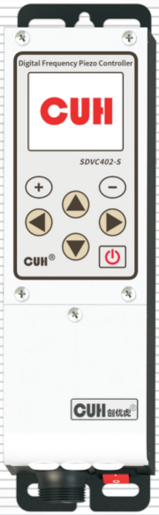

## SDVC402-S
Contrôleur numérique à fréquence variable pour alimentateur vibrant piézoélectrique　 SDVC402-S
## Manuel d'utilisation

---

## Déclaration de droits d'auteur

Nanjing CUH Science & Technology CO., Ltd. se réserve tous les droits.

Toutes les informations contenues dans ce manuel d'utilisation sont la propriété intellectuelle de notre société et sont protégées par la loi sur le droit d'auteur et les autres lois connexes. CUH jouit et se réserve tous les droits conférés par la loi sur le droit d'auteur et les autres lois. Sans le consentement écrit de CUH, ce manuel d'utilisation ne peut être copié, traduit, imité ou utilisé d'une autre manière, en partie ou en totalité.

## Clause de non-responsabilité

Tous les contenus de ce manuel d'utilisation décrivent uniquement la méthode d'utilisation des produits associés fabriqués par notre société et sont décrits selon la technologie existante et l'état dans lequel ils vous sont fournis lors de l'utilisation. Vous devez assumer les risques correspondants lors de l'utilisation de ce produit. Sauf si la loi l'exige, la société n'assume aucune responsabilité expresse ou implicite pour le produit du fait de ce manuel d'utilisation, y compris, mais sans s'y limiter, les dommages corporels, les dommages matériels, la perte d'opportunités, etc.

Vous comprenez clairement les risques ci-dessus et acceptez que, sauf si la loi l'exige, la société ne soit pas responsable des dommages ou pertes directs ou indirects que vous subissez (y compris, mais sans s'y limiter, les pertes tangibles de personnel, de biens, de données, etc. ainsi que les pertes immatérielles de réputation, d'opportunités, etc.)

La société se réserve le droit de modifier les produits concernés par ce manuel d'utilisation sans préavis ni notification ultérieure.

---

## Préface

Merci d'avoir choisi le contrôleur numérique à fréquence variable pour alimentateur vibrant piézoélectrique CUH SDVC402-S (ci-après dénommé « le contrôleur »). Cette série de contrôleurs utilise des composants de haute qualité, intègre les dernières technologies électroniques et est soigneusement conçue avec des processeurs de signaux numériques hautes performances.

Ce manuel présente la méthode d'utilisation de base, la description technique fonctionnelle et des exemples d'application typiques de ce produit. Il fournit aux utilisateurs les informations pertinentes sur l'installation et la mise au point, le réglage des paramètres, le diagnostic des anomalies, le dépannage et la maintenance de routine du contrôleur. Afin de garantir une installation et une utilisation correctes de ce contrôleur, veuillez lire attentivement ce manuel d'utilisation avant l'installation et le conserver correctement.

Veillez à lire les symboles suivants pour vous alerter des précautions contre les blessures corporelles et les dommages au produit.

| | |
|---|---|
| ⚠ Danger | Le non-respect de cet élément entraînera des blessures corporelles ou la mort. |
| ⚠ Avertissement | Le non-respect de cet élément peut entraîner des blessures corporelles ou la mort. |
| ⚠ Attention | Le non-respect de cet élément peut entraîner des blessures modérées ou mineures pour les personnes. |
| Avis | Le non-respect de cet élément entraînera des dommages au produit et des dommages matériels. |
| ❗ Essentiel | Indique les précautions et les restrictions d'utilisation à respecter impérativement pendant l'utilisation. |

**Ce manuel s'applique aux modèles de contrôleurs suivants :**

- Contrôleur numérique à fréquence variable pour alimentateur vibrant piézoélectrique  
  SDVC402-S (150mA)

---

# Sécurité et précautions

1. **⚠ Danger** Ce produit est uniquement destiné à entraîner des équipements d'alimentation vibrante piézoélectriques ; ne l'utilisez pas dans le but de protéger le corps humain ou des parties du corps humain, etc.

2. **⚠ Danger** Ce produit n'est pas destiné à être utilisé comme produit antidéflagrant ; ne l'utilisez pas dans des lieux dangereux et/ou des environnements de gaz potentiellement explosifs.

3. **⚠ Avertissement** Ce produit est alimenté par le secteur alternatif ; veuillez ne pas appliquer une tension alternative supérieure à 250Vac. Une tension d'entrée excessive, telle que 300Vac, peut faire exploser le produit ou provoquer un incendie, entraînant de graves accidents de sécurité.

4. **⚠ Avertissement** Ce produit est mis à la terre via le cordon d'alimentation. Veuillez vous assurer que les installations de distribution d'énergie du contrôleur sont correctement mises à la terre, sinon le boîtier du contrôleur pourrait être sous tension, entraînant un accident d'électrocution.

5. **⚠ Avertissement** N'injectez pas d'alimentation secteur sur la sortie de ce contrôleur, cela endommagerait le contrôleur.

6. **⚠ Avertissement** Ne branchez et ne débranchez pas les fils avec des objets pointus et ne touchez pas les contacts de chaque borne de câblage dans le compartiment de câblage pour éviter tout choc électrique.

7. **Avis** Veuillez éviter de contrôler la sortie de ce produit en coupant l'alimentation électrique par des relais et d'autres dispositifs, ce qui réduirait considérablement la durée de vie du contrôleur.

8. **Avis** Le contrôleur est conçu pour fonctionner dans un environnement frais et sec. Ne faites jamais fonctionner le contrôleur à l'extérieur pour éviter tout trempage et toute insolation. Faites fonctionner le contrôleur dans la plage de température spécifiée dans les caractéristiques électriques.

9. **❗ Essentiel** Veillez à fixer ce produit sur une plateforme solide, correctement mise à la terre et éloignée des équipements vibrants.

10. **❗ Essentiel** Ne faites jamais fonctionner le contrôleur dans des conditions dépassant ses limites de conception.

11. **❗ Essentiel** Faites fonctionner le contrôleur conformément à ce manuel d'instructions. Nous n'assumerons aucune responsabilité civile ou pénale si l'endommagement de l'équipement ou les blessures corporelles sont causés par une utilisation incorrecte.

12. **❗ Essentiel** N'ouvrez jamais le boîtier du contrôleur pour éviter tout choc électrique. Contactez CUH si le contrôleur tombe en panne. N'essayez jamais de réparer le contrôleur vous-même, ce qui pourrait annuler la garantie.

---

---

## Environnement d'utilisation et de stockage

### Inspection avant utilisation

Chaque contrôleur fait l'objet d'un contrôle qualité rigoureux avant livraison et est emballé dans un emballage anti-choc. Veuillez vérifier les éléments suivants après le déballage :

1. Si le contrôleur est endommagé pendant le transport.
2. Si le modèle du contrôleur correspond à votre commande.

### Environnement d'exécution

Veuillez suivre les notes ci-dessous pour garantir de meilleures performances et une durée de vie plus longue du contrôleur :

- ⚠ Environnement bien ventilé
- ⚠ Tenir à l'écart de l'eau, des ruisseaux, de la poussière et en particulier de la poussière huileuse
- ⚠ Tenir à l'écart des gaz et liquides corrosifs ou inflammables
- ⚠ Tenir à l'écart de la poussière flottante et des particules métalliques
- ⚠ Fixer fermement pour éviter les vibrations propres
- ⚠ Tenir à l'écart des interférences électromagnétiques
- ⚠ S'assurer que la température ambiante est de 0~40 °C
- ⚠ Pour une utilisation à une altitude de 2000 m ou moins

---

# Table des matières

- Chapitre Ⅰ Instructions avant utilisation — 1
  - 1.1 Vérification du contenu de l'emballage — 1
  - 1.2 Clavier et ports d'E/S — 2
  - 1.3 Description des paramètres de la page d'accueil — 3
  - 1.4 Explication des ports de câblage — 3
  - 1.5 Explication de la plaque signalétique — 4
- Chapitre Ⅱ Caractéristiques — 5
- Chapitre Ⅲ Guide d'installation — 7
  - 3.1 Conditions d'utilisation du contrôleur — 7
  - 3.2 Méthode d'utilisation des boutons — 7
  - 3.3 Installation et utilisation — 8
- Chapitre Ⅳ Brève description des fonctions — 12
  - 4.1 Tension de sortie — 12
  - 4.2 Fréquence de sortie — 13
  - 4.3 Temps de démarrage progressif — 14
  - 4.4 Sortie marche/arrêt — 14
  - 4.5 Limite de tension de sortie maximale — 15
  - 4.6 Verrouillage du clavier — 16
  - 4.7 Réglage de l'état de fonctionnement à la mise sous tension — 17
  - 4.8 Restauration des paramètres par défaut — 18
- Chapitre Ⅴ Capteurs et commande de signal — 19
  - 5.1 Détection photoélectrique intelligente — 19
    - 5.1.1 Méthode de raccordement du capteur photoélectrique intelligent — 19
    - 5.1.2 Retard d'enclenchement/de déclenchement du capteur photoélectrique intelligent — 20
    - 5.1.3 Direction logique du capteur photoélectrique intelligent — 21
  - 5.2 Mode d'utilisation du capteur de commutation — 22
    - 5.2.1 Méthode de raccordement du capteur de proximité NPN — 22
    - 5.2.2 Retard d'enclenchement/de déclenchement du capteur de commutation — 26
    - 5.2.3 Direction logique du capteur de commutation — 27
    - 5.2.4 Type de capteur de commutation — 28

---

---

- 5.3 Sortie de commande — 29
- 5.4 Commande de vitesse à distance — 30

## Chapitre Ⅵ Introduction détaillée des fonctions — 32

- 6.1 Personnaliser la page d'accueil — 33
- 6.2 Réglages des paramètres courants — 34
  - 6.2.1 Tension — 34
  - 6.2.2 Fréquence — 34
  - 6.2.3 Temps de démarrage progressif/Temps d'arrêt progressif — 35
  - 6.2.4 Tension de sortie maximale/Tension de sortie minimale — 35
  - 6.2.5 Fréquence de sortie maximale/Fréquence de sortie minimale — 35
  - 6.2.6 Délai d'extinction du rétroéclairage — 36
  - 6.2.7 Langue — 36
- 6.3 Paramètres de sortie — 37
  - 6.3.1 Paramètres de sortie principaux — 37
    - 6.3.1.1 Source principale 1/Source principale 2 — 37
    - 6.3.1.2 Logique principale — 39
    - 6.3.1.3 Retard d'enclenchement principal/Retard de déclenchement principal — 40
    - 6.3.1.4 Mode principal — 40
    - 6.3.1.5 Direction principale — 41
    - 6.3.1.6 État de mise sous tension — 41
  - 6.3.2 Paramètres de sortie de commande CC — 42
    - 6.3.2.1 Mode de sortie du port D — 44
    - 6.3.2.2 Type de port D — 45
- 6.4 Commande de signal — 46
  - 6.4.1 Sensibilité du port B — 47
  - 6.4.2 Direction logique du port B/du port C — 47
  - 6.4.3 Retard d'enclenchement/de déclenchement du port B et retard d'enclenchement/de déclenchement du port C — 47
- 6.5 Enregistrer les réglages — 48
  - 6.5.1 Réglages de rappel — 48
  - 6.5.2 Enregistrer les réglages — 48
  - 6.5.3 Restaurer les paramètres d'usine — 49

---

---

- 6.5.4 Type et numéro de la machine locale — 49
- 6.5.5 Mot de passe utilisateur — 49
- 6.6 Surveillance de l'état du contrôleur — 50

## Chapitre Ⅶ Annexe — 51

- 7.1 Dimensions — 51
- 7.2 Spécifications techniques — 52
- 7.3 Norme de référence — 53
- 7.4 Liste des paramètres — 54
- 7.5 Schémas de circuit d'entrée et de sortie — 56
- 7.6 Code d'erreur et d'avertissement — 57

## Chapitre Ⅷ Informations sur la garantie du produit — 58

- 8.1 Période de garantie — 58
- 8.2 Couverture de la garantie — 58
- 8.3 Aptitude du produit — 58

---

# Chapitre Ⅰ Instructions avant utilisation

Ce chapitre présente le contenu de l'emballage du produit, la description de l'apparence du contrôleur et les informations de la plaque signalétique du contrôleur.

## 1.1 Vérification du contenu de l'emballage

Avant utilisation, veuillez vérifier l'intégrité du contrôleur et des accessoires. Si vous constatez que le produit est défectueux ou endommagé, que des accessoires manquent, etc., veuillez contacter notre société.

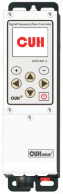

Contrôleur×1

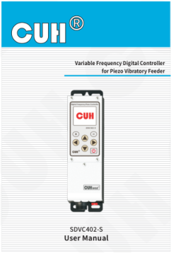

Manuel d'utilisation×1

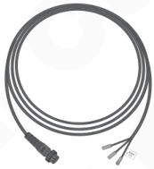

Câble de sortie×1

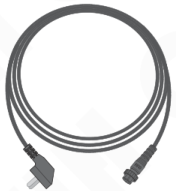

Cordon d'alimentation d'entrée×1

---

## 1.2 Clavier et ports d'E/S

### Explication de la fenêtre et des boutons

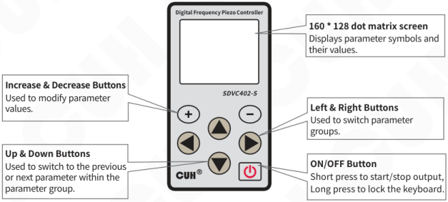

**Écran à matrice de points 160 * 128**  
Affiche les symboles de paramètres et leurs valeurs.

**Boutons d'augmentation et de diminution**  
Utilisés pour modifier les valeurs des paramètres.

**Boutons haut et bas**  
Utilisés pour passer au paramètre précédent ou suivant dans le groupe de paramètres.

**Boutons gauche et droite**  
Utilisés pour changer de groupe de paramètres.

**Bouton ON/OFF**  
Appui court pour démarrer/arrêter la sortie, appui long pour verrouiller le clavier.

### Explication des pièces externes

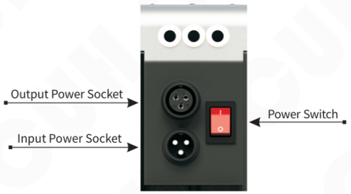

- Prise d'alimentation de sortie
- Prise d'alimentation d'entrée
- Interrupteur d'alimentation

---

## 1.3 Description des paramètres de la page d'accueil

Le contrôleur peut afficher l'état de sortie principal, l'état de verrouillage du clavier, l'état des ports, les paramètres de surveillance et le nom de l'interface sur la page d'accueil. Dans l'état des ports :

La mise en surbrillance de X indique que le port est valide. <u>X</u> indique que le port est valide à un niveau bas, et X̅ indique que le port est valide à un niveau haut.

## 1.4 Explication des ports de câblage

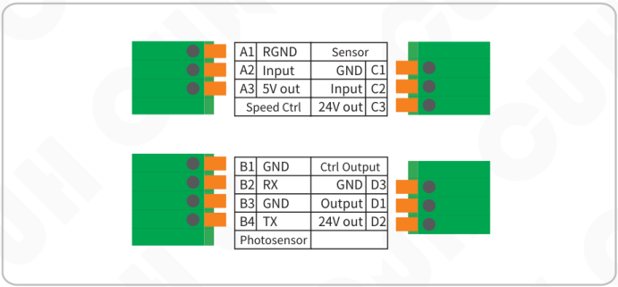

| | | | |
|---|---|---|---|
| A1 | RGND | Sensor | |
| A2 | Input | GND | C1 |
| A3 | 5V out | Input | C2 |
| Speed Ctrl | | 24V out | C3 |

| | | | |
|---|---|---|---|
| B1 | GND | Ctrl Output | |
| B2 | RX | GND | D3 |
| B3 | GND | Output | D1 |
| B4 | TX | 24V out | D2 |
| Photosensor | | | |

---

## 1.5 Explication de la plaque signalétique

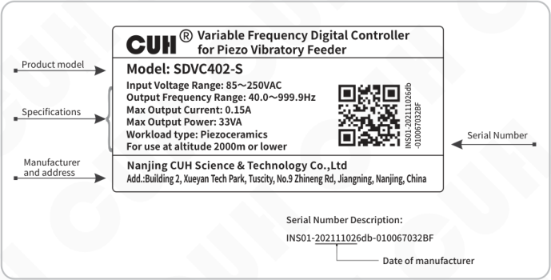

**CUH® Contrôleur numérique à fréquence variable pour alimentateur vibrant piézoélectrique**

**Modèle de produit**

Modèle : SDVC402-S

**Spécifications**

- Plage de tension d'entrée : 85~250VAC
- Plage de fréquence de sortie : 40.0~999.9Hz
- Courant de sortie max. : 0.15A
- Puissance de sortie max. : 33VA
- Type de charge : piézocéramiques
- Pour une utilisation à une altitude de 2000 m ou moins

**Fabricant et adresse**

Nanjing CUH Science & Technology Co.,Ltd

Add.:Building 2, Xueyan Tech Park, Tuscity, No.9 Zhineng Rd, Jiangning, Nanjing, China

**Numéro de série**

INS01-202111026db-010067032BF

**Description du numéro de série :**

INS01-<u>20211102</u>6db-010067032BF

Date de fabrication → 20211102

---

## Chapitre Ⅱ Caractéristiques

Le contrôleur est spécialement conçu pour contrôler l'alimentateur vibrant dans les systèmes d'automatisation. Associé aux dernières technologies électroniques et à une conception élaborée, le contrôleur offre les caractéristiques pratiques suivantes :

**Réglage de fréquence :** La fréquence de sortie va de 40.0Hz à 999.9Hz.

**Réglage de tension :** La tension de sortie va de 0V à 220V.

**Stabilisation automatique de la tension :** Le contrôleur peut éliminer les variations de vitesse d'alimentation causées par les fluctuations de la tension du secteur.

**Détection photoélectrique intelligente :** Notre capteur photoélectrique intelligent adaptatif peut aider à arrêter le contrôleur lorsque les pièces sont pleines ou qu'il n'y a pas de pièce, et remplir les fonctions de réglage du temps de démarrage progressif, de retard d'enclenchement, de retard de déclenchement et de réglage de la relation logique.

**Capteur de commutation :** Un capteur de commutation adaptatif ou un automate (PLC) peut être connecté pour activer/désactiver le contrôleur.

**Commande de vitesse à distance :** La tension de sortie du contrôleur peut être contrôlée par un potentiomètre externe, un automate (PLC) ou un signal CC de 1~5V/4~20mA.

**Sortie marche/arrêt :** Bouton ON/OFF sur le panneau qui permet un démarrage et un arrêt instantanés, facilitant le débogage des appareils de l'utilisateur.

**Verrouillage du clavier :** Appuyez sur le bouton ON/OFF et maintenez-le enfoncé pendant 2 secondes pour verrouiller tous les boutons afin d'éviter toute fausse manœuvre.

**État de mise sous tension :** En réglant ce paramètre, les utilisateurs peuvent déterminer facilement l'état de fonctionnement au démarrage du contrôleur.

**Sortie de commande :** Le signal de sortie de commande émis par le transistor peut coordonner un solénoïde ou d'autres dispositifs externes avec le contrôleur.

**Limitation de sortie maximale :** La valeur de tension de sortie maximale peut être préréglée pour protéger l'équipement contre les dommages causés par une mauvaise utilisation.

**Restauration des paramètres par défaut :** Cette fonction permet à l'utilisateur de restaurer tous les réglages de paramètres par défaut et de réinitialiser le contrôleur.

**Écran LCD :** Il adopte un écran couleur d'une résolution de 160* 128 et prend en charge les langues chinoise et anglaise.

**Enregistrement et lecture de groupes de paramètres :** Jusqu'à 4 groupes de paramètres utilisateur peuvent être enregistrés et lus.

---

---

CUH attache une grande importance à la gestion de la qualité des produits et aux performances de sécurité. Outre les composants de haute qualité que nous utilisons et notre système rigoureux de contrôle qualité, CUH a pris en compte les accidents possibles que les utilisateurs peuvent rencontrer et fournit les fonctions de protection suivantes afin de maximiser l'utilité pratique du contrôleur.

**Protection contre les courts-circuits :** Si la sortie du contrôleur est court-circuitée, le contrôleur arrête sa sortie jusqu'au redémarrage.

**Protection contre les surcharges de courant :** Le contrôleur arrête sa sortie pour garantir la sécurité de fonctionnement des équipements lorsque le courant de fonctionnement dépasse sa valeur nominale.

**Protection contre la surchauffe :** Le contrôleur arrête sa sortie pour se protéger lorsque la température de fonctionnement est trop élevée.

Les contrôleurs **CUH** sont strictement conformes à la certification CE.

---

# Chapitre Ⅲ Guide d'installation

Ce chapitre présente les conditions nécessaires à l'utilisation du contrôleur et la manière de l'installer et de le raccorder correctement.

## 3.1 Conditions d'utilisation du contrôleur

Le contrôleur est alimenté en courant alternatif 85V~250V et est relié à une terre de protection par la fiche du cordon d'alimentation. Veuillez utiliser une alimentation secteur standard et vous assurer que le fil de terre de protection est correctement raccordé.

**⚠ Avertissement** Ne connectez jamais le contrôleur à une alimentation secteur de 380V ; cela causerait des dommages graves et irréversibles au contrôleur, pouvant entraîner une explosion, un incendie et d'autres incidents de sécurité.

**⚠ Avertissement** Assurez-vous que le côté alimentation est correctement mis à la terre. Le boîtier métallique du contrôleur est directement relié au fil de terre de protection. Une mauvaise mise à la terre entraînera l'électrification du boîtier du contrôleur et provoquera un accident d'électrocution.

**Avis** Un fonctionnement prolongé génère de la chaleur et fait monter la température du boîtier. Veuillez installer le contrôleur dans un environnement bien ventilé et bien le fixer, à l'écart des sources de vibration.

**Avis** Ce produit est un contrôleur destiné à entraîner l'alimentateur vibrant piézoélectrique.

## 3.2 Méthode d'utilisation des boutons

a. Selon la durée d'appui sur le bouton, les actions des boutons sont divisées en appui court, appui long, première accélération et deuxième accélération.

b. L'appui court définit une durée d'appui supérieure à 0,1 et inférieure à 2 secondes, et l'appui long définit une durée d'appui supérieure à 2 secondes.

c. ⊕ et ⊖ servent à modifier les valeurs des paramètres. ▲ et ▼ servent à sélectionner différents paramètres.

d. Appuyez brièvement sur ◀ ou ▶ pour basculer entre les groupes de paramètres supérieur et inférieur dans l'interface de réglage des paramètres.

e. Appuyez brièvement sur ▲ ou ▼ pour passer entre les paramètres supérieur et inférieur de ce groupe dans l'interface de réglage des paramètres.

f. Appuyez brièvement sur ⏻ pour démarrer/arrêter la sortie principale, appuyez longuement sur ⏻ pour verrouiller/déverrouiller le clavier.

g. Si aucune action n'est effectuée pendant plus de 5 minutes sur une interface, celle-ci revient à la page d'accueil.

---

## 3.3 Installation et utilisation

### Première étape :

Ouvrez la boîte d'emballage et vérifiez le contrôleur et tous les accessoires.

### Deuxième étape :

Connectez les bornes de câblage du câble d'alimentation de sortie aux électrodes du vibrateur piézoélectrique.

Alignez l'encoche de la fiche aviation du câble de sortie sur le repère triangulaire de la prise de sortie du contrôleur, puis serrez l'écrou après avoir correctement raccordé le câble de sortie.

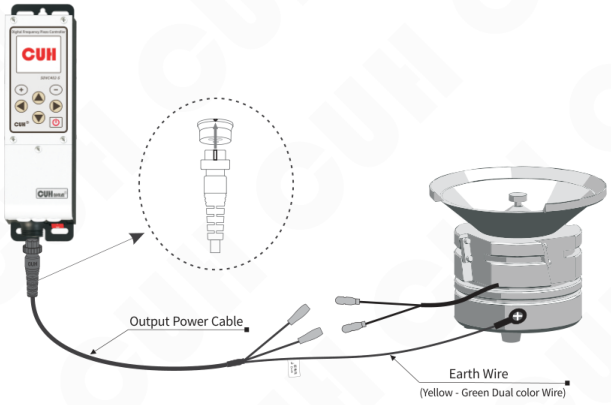

> **Remarque**
>
> Assurez-vous que les électrodes du vibrateur piézoélectrique sont connectées aux deux broches de sortie du câble d'alimentation de sortie et que le boîtier métallique du vibrateur est correctement mis à la terre.

---

### Troisième étape :

Connectez le connecteur du câble d'alimentation d'entrée à la prise d'alimentation d'entrée du contrôleur.

Connectez d'abord le côté contrôleur

### Quatrième étape :

Après avoir confirmé que l'interrupteur est en position d'arrêt, connectez la fiche du câble d'alimentation d'entrée à la prise secteur.

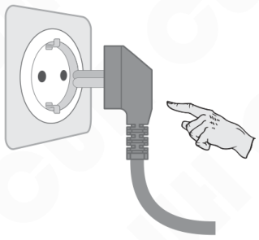

---

## Cinquième étape :

- Allumez l'interrupteur d'alimentation du contrôleur ; le contrôleur affiche l'interface d'accueil.
- Appuyez sur ⊕ ou ⊖ pour régler la valeur de la tension de sortie entre 30 et 80.

**Remarque :** L'affichage inversé indique que la valeur du paramètre est réglable.

## Sixième étape :

- Sur l'interface d'accueil, appuyez brièvement sur ▼ pour entrer dans l'état de réglage de la fréquence de sortie.
- Appuyez sur ⊕ ou ⊖ pour trouver la fréquence naturelle de l'alimentateur vibrant, également appelée fréquence de résonance.

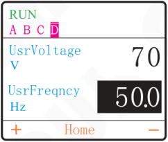

- La fréquence à laquelle la vibration atteint son maximum est la fréquence naturelle du corps vibrant.
- Chaque vibrateur possède sa propre fréquence de résonance mécanique naturelle ; réglez la fréquence de sortie du contrôleur sur cette fréquence pour obtenir le meilleur état de fonctionnement.

---

## Septième étape :

- Après avoir trouvé la fréquence naturelle de l'alimentateur vibrant, utilisez les boutons ⊕ et ⊖ pour régler la tension jusqu'à obtenir le meilleur débit d'alimentation.

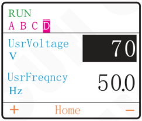

L'alimentateur vibrant devrait maintenant fonctionner. Pour des instructions de commande plus poussées, veuillez vous référer aux chapitres suivants.

---

## Chapitre Ⅳ Brève description des fonctions

Ce chapitre présente les réglages de paramètres de base.

### 4.1 Tension de sortie

Ce contrôleur peut régler directement la tension de sortie de manière numérique sur le panneau. Comme le contrôleur dispose d'une fonction de sortie stabilisée en tension, cette valeur correspond à la valeur moyenne redressée de la tension et n'est pas affectée par la tension d'entrée. La tension de sortie peut rester stable même lorsque la tension du réseau est instable. En même temps, le réglage direct de la valeur de tension fournit également des données précises aux utilisateurs pour comprendre le fonctionnement de l'équipement.

- Allumez l'interrupteur d'alimentation du contrôleur.
- Le contrôleur entre dans le paramètre de tension de sortie. L'écran LCD affiche le paramètre de tension de sortie et la valeur par défaut est 150.
- Appuyez sur ⊕ ou ⊖ pour régler la valeur du paramètre.

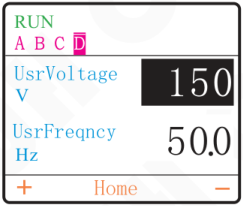

La plage de tension est de 0~220V, la précision de réglage est de 1V.

La valeur moyenne redressée de la tension de sortie du contrôleur peut être réglée directement et numériquement via le clavier. Grâce à la fonction unique de stabilisation de tension, la tension de sortie du contrôleur ne fluctue pas comme la tension d'entrée, de sorte que le vibrateur peut maintenir un fonctionnement stable en cas de tension de réseau instable.

---

## 4.2 Fréquence de sortie

Le contrôleur utilise la technologie de synthèse numérique directe de fréquence (DDS), qui offre une précision et une stabilité de fréquence très élevées, et ne varie ni avec le temps ni avec la température.

- Sur l'interface d'accueil, appuyez brièvement sur ▼ pour entrer dans l'état de réglage de la fréquence de sortie.
- L'écran LCD affiche le paramètre de fréquence et la valeur par défaut est 50.0.
- Appuyez sur ⊕ ou ⊖ pour régler la valeur du paramètre.

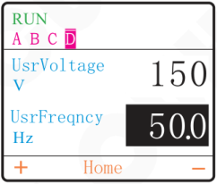

La plage de fréquence est de 40.0~999.9Hz, la précision de réglage est de 0.1Hz.

---

- Sur l'interface d'accueil, appuyez brièvement sur ◀ et ▶ pour passer à d'autres groupes de paramètres.
- Dans les groupes de paramètres non surveillés, le contrôleur revient automatiquement à l'interface d'accueil trois minutes après la fin de l'opération.
- Dans les groupes de paramètres surveillés, le contrôleur revient automatiquement à l'interface d'accueil dix minutes après la fin de l'opération.

---

## 4.3 Temps de démarrage progressif

Afin d'éviter tout choc soudain sur la bobine du vibrateur, le contrôleur peut augmenter progressivement la tension de sortie de 0 à la valeur prédéfinie lors du démarrage.

**Temps de démarrage progressif :** Durée nécessaire au contrôleur pour augmenter en douceur sa tension de sortie de 0 à la valeur prédéfinie lors du démarrage.

- Appuyez brièvement sur ▶ pour passer au groupe de paramètres « 2 Common ».
- Appuyez brièvement sur ▼ pour passer au paramètre de démarrage progressif ; la valeur par défaut est 0.5.
- Appuyez sur ⊕ ou ⊖ pour régler la valeur du paramètre.

**RUN**  
A B C **D**

| Paramètre | Valeur |
|---|---|
| 01.UsrVoltage | 150 V |
| 02.UsrFreqncy | 50.0 Hz |
| 03.SoftStarT | **0.5 s** |
| 04.SoftStopT | 0.0 s |
| 05.MaxVoltage | 220 V |

＋　2Common　－

La plage de démarrage progressif est de 0.0~10.0s, la précision de réglage est de 0.1s.

## 4.4 Interrupteur de sortie

L'interrupteur de sortie à effleurement sur le panneau permet de démarrer ou d'arrêter facilement et rapidement la sortie du contrôleur.

- Utilisez ⏻ sur le panneau du contrôleur pour commander le démarrage ou l'arrêt de la sortie de l'appareil. L'écran affiche le signe « MAN », ce qui signifie l'entrée dans l'état d'arrêt.

**MAN**  
A B C **D**

| Paramètre | Valeur |
|---|---|
| UsrVoltage | 150 V |
| UsrFreqncy | **50.0 Hz** |

＋　Home　－

> Grâce à l'interrupteur à effleurement et à la technologie de commande par signal numérique, aucune étincelle ne se produit pour détériorer le contact. Par conséquent, la durée de vie du contrôleur et du vibrateur est considérablement prolongée.

---

## 4.5 Limitation de la tension de sortie maximale

Le contrôleur permet de régler la tension de sortie maximale, ce qui évite à l'utilisateur, en cas de fausse manipulation, de délivrer une tension excessive et d'endommager l'équipement vibrant.

La tension de commande à distance ne dépassera pas cette valeur.

- Entrez dans le groupe de paramètres « 2 Common ».
- Appuyez brièvement sur ⏷ pour passer au paramètre de tension maximale ; la valeur par défaut est 220.
- Appuyez sur ⊕ ou ⊖ pour régler la valeur du paramètre.

**RUN**  
A　B　C　**D**

| Paramètre | Valeur |
|---|---|
| 01.UsrVoltage | 150 V |
| 02.UsrFreqncy | 50.0 Hz |
| 03.SoftStarT | 0.5 s |
| 04.SoftStopT | 0.0 s |
| 05.MaxVoltage | **220** V |

＋　　2Common　　－

La plage de tension maximale est de 0~220V, la précision de réglage est de 1V.

> - En aucun cas, la tension de sortie du contrôleur ne peut ni ne pourra dépasser la valeur réglée de ce paramètre.
> - Le réglage par défaut en usine de ce paramètre correspond à la tension de sortie maximale possible de l'appareil.

---

## 4.6 Verrouillage du clavier

Lorsque les paramètres du contrôleur sont réglés, la fonction de verrouillage du clavier peut verrouiller tous les boutons du panneau afin d'éviter toute fausse manipulation.

Même après une mise hors tension puis une remise sous tension, l'état du verrouillage du clavier reste celui dans lequel il se trouvait lors de la dernière mise hors tension.

- Appuyez sur ⏻ et maintenez-le enfoncé pendant 2 secondes pour verrouiller tous les boutons du panneau. L'écran affiche le signe « Lock ».
- Appuyez à nouveau sur ⏻ et maintenez-le enfoncé pendant 2 secondes pour déverrouiller.

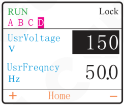

> L'état de verrouillage du clavier ne disparaît pas en cas de mise hors tension.

---

## 4.7 Réglage de l'état de fonctionnement à la mise sous tension

Afin de faire face aux coupures de courant soudaines dans des conditions normales et aux exigences particulières concernant l'état de mise sous tension du contrôleur, vous pouvez utiliser ce paramètre pour définir l'état de mise sous tension du contrôleur : marche, arrêt ou suivi de l'état de la dernière mise hors tension.

- Entrez dans le groupe de paramètres « 3 M_output ».
- Appuyez brièvement sur ⏷ pour passer au paramètre d'état de mise sous tension ; la valeur par défaut est On.
- Appuyez sur ⊕ ou ⊖ pour régler la valeur du paramètre.

RUN  
A B C D

| Paramètre | Valeur |
|---|---|
| 04.MainUpDly | 0.0 s |
| 05.MainDnDly | 0.0 s |
| 06.MainMode | Delay |
| 07.MainDirect | Revrs |
| 08.PowerOnSta | On |

＋　3M_output　－

**On :** Indique que l'état de mise sous tension est en marche.

**Off :** Indique que l'état de mise sous tension est à l'arrêt.

**Hold :** Indique que l'état de mise sous tension suit l'état de la dernière mise hors tension. (Si le contrôleur arrête la sortie lors de la dernière mise hors tension, le contrôleur sera à l'arrêt lors de la prochaine mise sous tension ; inversement, si le contrôleur est en sortie lors de la dernière mise hors tension, le contrôleur sera en marche lors de la prochaine mise sous tension)

---

## 4.8 Restauration des réglages par défaut

L'utilisateur peut rapidement restaurer le contrôleur à son état d'usine par défaut.

En raison des fonctions puissantes du contrôleur, de nombreux paramètres peuvent être ajustés. Les débutants peuvent avoir du mal à rétablir le contrôleur dans son état de fonctionnement normal après avoir modifié plusieurs paramètres. Utilisez cette fonction pour restaurer rapidement l'état désordonné des paramètres aux réglages par défaut d'usine.

- Entrez dans le groupe de paramètres « 7Save ».
- Appuyez brièvement sur ⏷ pour passer au paramètre RestorALL ; la valeur par défaut est « None ».
- Appuyez brièvement sur ⊕ pour changer la valeur du paramètre en « Work ».
- Appuyez simultanément sur ⊕ et ⊖ pendant 2 secondes ; le contrôleur réinitialise tous les paramètres et redémarre.

RUN  
A B C **D**

| Paramètre | Valeur |
|---|---|
| 01.ReadALLFrm | None |
| 02.SaveALLTo | None |
| 03.RestorALL | **None** |
| 04.LoadType | None |
| 05.MachineNum | None |

＋　7Save　－

RUN  
A B C **D**

| Paramètre | Valeur |
|---|---|
| 01.ReadALLFrm | None |
| 02.SaveALLTo | None |
| 03.RestorALL | **Work** |
| 04.LoadType | None |
| 05.MachineNum | None |

＋　7Save　－

---

# Chapitre Ⅴ Capteurs et commande de signal

Le contrôleur peut être commandé par de nombreux types de signaux externes et de capteurs. Ce chapitre décrit principalement la méthode d'utilisation du capteur photoélectrique intelligent, des capteurs de proximité et de l'automate (PLC).

## 5.1 Détection photoélectrique intelligente

Combiné au capteur photoélectrique SDVC-S1, la fonction de détection photoélectrique intelligente peut être réalisée. Le capteur SDVC-S1 peut filtrer l'interférence de la lumière ambiante affectant la sensibilité du contrôleur. Par conséquent, le contrôleur peut fonctionner de manière fiable sans réglage manuel de la sensibilité.

### 5.1.1 Méthode de câblage du capteur photoélectrique intelligent

**Étape 1 :**

Ouvrez les couvercles du contrôleur.

**Étape 2 :**

Raccordez le capteur SDVC-S1 aux bornes du contrôleur conformément au schéma.

> La distance de travail du capteur peut être ajustée en réglant le paramètre « PortBLimit » du groupe de paramètres 4PhotoSen ; plus la valeur du paramètre est petite, plus le capteur est sensible.

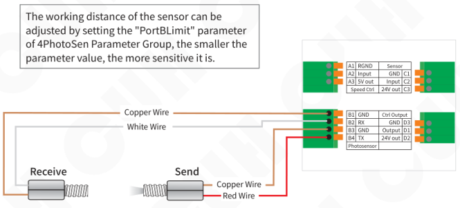

| | | | |
|---|---|---|---|
| A1 | RGND | Sensor | |
| A2 | Input | GND | C1 |
| A3 | 5V out | Input | C2 |
| Speed Ctrl | | 24V out | C3 |

| | | | |
|---|---|---|---|
| B1 | GND | Ctrl Output | |
| B2 | RX | GND | D3 |
| B3 | GND | Output | D1 |
| B4 | TX | 24V out | D2 |
| Photosensor | | | |

**Avis :**

Dans les réglages par défaut d'usine, la direction logique « PortBDirec » de ce capteur est normalement ouverte.

---

## 5.1.2 Retard d'enclenchement/de déclenchement du capteur photoélectrique intelligent

Lors de l'utilisation d'un capteur ou d'un automate (PLC) pour activer ou désactiver la sortie principale du contrôleur, l'action peut être retardée d'un certain temps après l'émission ou le rétablissement du signal de commande. Le temps de retard peut être défini via les deux paramètres ci-dessous.

**PortBUpDly :** Période que le contrôleur met entre la réception d'un signal de commande de démarrage et la sortie effective.

- Entrez dans le groupe de paramètres « 4PhotoSen ».
- Appuyez brièvement sur ⊖⃤ pour passer au paramètre de retard d'enclenchement de Port B ; la valeur par défaut est 0.2.
- Appuyez sur ⊕ ou ⊖ pour régler la valeur du paramètre.

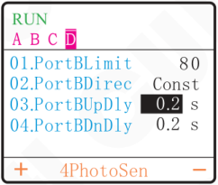

La plage du retard d'enclenchement de Port B est de 0.0~99.9s, la précision de réglage est de 0.1s.

**PortBDnDly :** Période que le contrôleur met entre la réception d'un signal de commande d'arrêt et la coupure effective de la sortie.

- Entrez dans le groupe de paramètres « 4PhotoSen ».
- Appuyez brièvement sur ⊖⃤ pour passer au paramètre de retard de déclenchement de Port B ; la valeur par défaut est 0.2.
- Appuyez sur ⊕ ou ⊖ pour régler la valeur du paramètre.

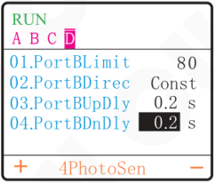

La plage du retard de déclenchement de Port B est de 0.0~99.9s, la précision de réglage est de 0.1s.

---

## 5.1.3 Direction logique du capteur photoélectrique intelligent

Dans des circonstances normales, l'extrémité réceptrice ne reçoit aucun signal optique et le contrôleur fonctionne par défaut. Mais dans certaines applications particulières, le contrôleur doit être arrêté lorsque l'extrémité réceptrice ne reçoit aucun signal optique. Le réglage de ce paramètre permet de répondre à ce type d'application.

- Entrez dans le groupe de paramètres « 4PhotoSen ».
- Appuyez brièvement sur ⏷ pour passer au paramètre de direction logique de Port B ; le réglage par défaut est « Const ».
- Appuyez sur ⊕ ou ⊖ pour ajuster les réglages du paramètre.

**RUN**  
A B C **D**

| Paramètre | Valeur |
|---|---|
| 01.PortBLimit | 80 |
| 02.PortBDirec | **Const** |
| 03.PortBUpDly | 0.2 s |
| 04.PortBDnDly | 0.2 s |

＋　4PhotoSen　−

**RUN**  
A B C **D**

| Paramètre | Valeur |
|---|---|
| 01.PortBLimit | 80 |
| 02.PortBDirec | **Inv** |
| 03.PortBUpDly | 0.2 s |
| 04.PortBDnDly | 0.2 s |

＋　4PhotoSen　−

- Lorsque le paramètre « PortBDirec » est réglé sur « Const », c'est-à-dire qu'aucun signal optique n'est reçu, le contrôleur fonctionne.
- Lorsque le paramètre « PortBDirec » est réglé sur « Inv », c'est-à-dire qu'aucun signal optique n'est reçu, le contrôleur s'arrête.

---

## 5.2 Méthode d'utilisation du capteur de commutation

Le contrôleur peut fonctionner avec toutes sortes de capteurs tels que les capteurs de commutation, les capteurs de commutation optiques et les capteurs à fibre optique.

### 5.2.1 Méthode de câblage du capteur de proximité NPN

**Étape 1 :**

Ouvrez les couvercles du contrôleur.

**Étape 2 :**

Raccordez le capteur de proximité NPN aux bornes du contrôleur conformément au schéma.

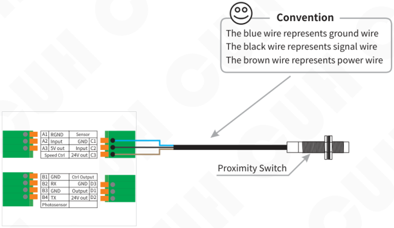

**Convention**

- Le fil bleu représente le fil de terre
- Le fil noir représente le fil de signal
- Le fil marron représente le fil d'alimentation

Capteur de proximité

| | | | |
|---|---|---|---|
| A1 | RGND | Sensor | |
| A2 | Input | GND | C1 |
| A3 | 5V out | Input | C2 |
| Speed Ctrl | | 24V out | C3 |

| | | | |
|---|---|---|---|
| B1 | GND | Ctrl Output | |
| B2 | RX | GND | D3 |
| B3 | GND | Output | D1 |
| B4 | TX | 24V out | D2 |
| Photosensor | | | |

---

## Méthode de câblage du capteur à barrière NPN

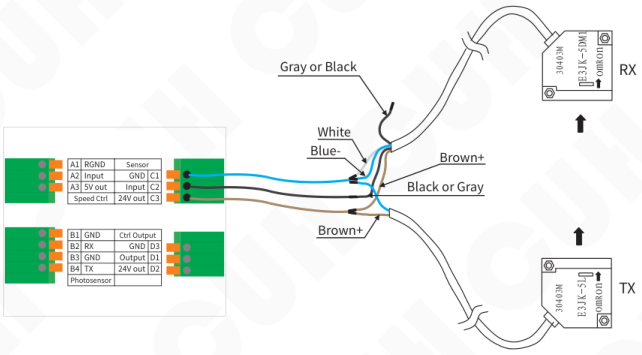

## Méthode de câblage du capteur à barrière

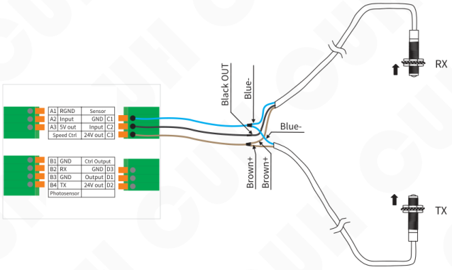

---

## Méthode de câblage du capteur à barrière à fibre optique

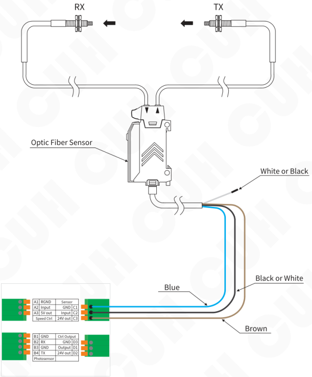

| | | | |
|---|---|---|---|
| A1 | RGND | Sensor | |
| A2 | Input | GND | C1 |
| A3 | 5V out | Input | C2 |
| Speed Ctrl | | 24V out | C3 |

| | | | |
|---|---|---|---|
| B1 | GND | Ctrl Output | |
| B2 | RX | GND | D3 |
| B3 | GND | Output | D1 |
| B4 | TX | 24V out | D2 |
| Photosensor | | | |

## Méthode de câblage du capteur à barrière

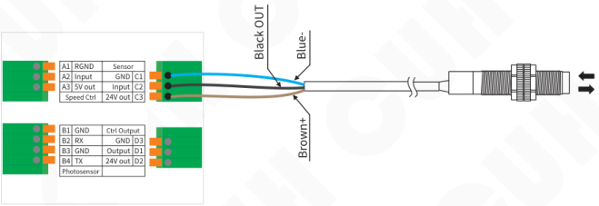

| | | | |
|---|---|---|---|
| A1 | RGND | Sensor | |
| A2 | Input | GND | C1 |
| A3 | 5V out | Input | C2 |
| Speed Ctrl | | 24V out | C3 |

| | | | |
|---|---|---|---|
| B1 | GND | Ctrl Output | |
| B2 | RX | GND | D3 |
| B3 | GND | Output | D1 |
| B4 | TX | 24V out | D2 |
| Photosensor | | | |

Marquage des fils : Black OUT, Blue-, Brown+.

## Méthode de câblage de l'automate (PLC)

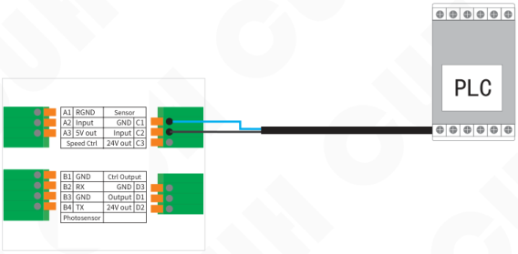

| | | | |
|---|---|---|---|
| A1 | RGND | Sensor | |
| A2 | Input | GND | C1 |
| A3 | 5V out | Input | C2 |
| Speed Ctrl | | 24V out | C3 |

| | | | |
|---|---|---|---|
| B1 | GND | Ctrl Output | |
| B2 | RX | GND | D3 |
| B3 | GND | Output | D1 |
| B4 | TX | 24V out | D2 |
| Photosensor | | | |

> Vous pouvez utiliser la sortie relais du PLC ou la sortie NPN du PLC.

---

## 5.2.2 Retard d'enclenchement/de déclenchement du capteur de commutation

Par défaut, le capteur photoélectrique intelligent et le capteur de commutation partagent le même temps de retard d'enclenchement et le même temps de retard de déclenchement. Les opérateurs peuvent également définir indépendamment le temps de retard d'enclenchement et le temps de retard de déclenchement pour le capteur de commutation.

**PortCUpDly :** Période que le contrôleur met entre la réception d'un signal de commande de démarrage et la sortie effective.

- Entrez dans le groupe de paramètres « 5On/Off ».
- Appuyez brièvement sur ⏷ pour passer au paramètre de retard d'enclenchement de Port C ; la valeur par défaut est 0.2.
- Appuyez sur ⊕ ou ⊖ pour régler la valeur du paramètre.

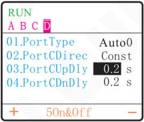

La plage du retard d'enclenchement de Port C est de 0.0~99.9s, la précision de réglage est de 0.1s.

**PortCDnDly :** Période que le contrôleur met entre la réception d'un signal de commande d'arrêt et la coupure effective de la sortie.

- Entrez dans le groupe de paramètres « 5On/Off ».
- Appuyez brièvement sur ⏷ pour passer au paramètre de retard de déclenchement de Port C ; la valeur par défaut est 0.2.
- Appuyez sur ⊕ ou ⊖ pour régler la valeur du paramètre.

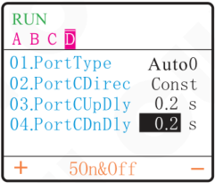

La plage du retard de déclenchement de Port C est de 0.0~99.9s, la précision de réglage est de 0.1s.

---

## 5.2.3 Direction logique du capteur de commutation

Dans des circonstances normales, le contrôleur ne reçoit aucun signal du capteur de commutation et fonctionne par défaut. Mais dans certaines applications particulières, le contrôleur doit être arrêté lorsqu'il ne reçoit aucun signal du capteur de commutation. Le réglage de ce paramètre permet de répondre à ce type d'application.

- Entrez dans le groupe de paramètres « 5On/Off ».
- Appuyez brièvement sur ⏷ pour passer au paramètre de direction logique de Port C ; le réglage par défaut est « Const ».
- Appuyez sur ⊕ ou ⊖ pour ajuster les réglages du paramètre.

RUN  
A B C **D**

| Paramètre | Valeur |
|---|---|
| 01.PortType | Auto0 |
| 02.PortCDirec | **Const** |
| 03.PortCUpDly | 0.2 s |
| 04.PortCDnDly | 0.2 s |

＋　5On&Off　－

RUN  
A B C **D**

| Paramètre | Valeur |
|---|---|
| 01.PortType | Auto0 |
| 02.PortCDirec | **Inv** |
| 03.PortCUpDly | 0.2 s |
| 04.PortCDnDly | 0.2 s |

＋　5On&Off　－

- Lorsque le paramètre « PortCDirec » est réglé sur « Const », c'est-à-dire qu'aucun signal n'est reçu, le contrôleur fonctionne.
- Lorsque le paramètre « PortCDirec » est réglé sur « Inv », c'est-à-dire qu'aucun signal n'est reçu, le contrôleur s'arrête.

---

## 5.2.4 Type de capteur de commutation

Le port du capteur de commutation peut prendre en charge les modes NPN, PNP, Auto1 et Auto0 ; il peut être réglé manuellement selon le type de capteur.

**NPN :** Capteur de commutation NPN.

**PNP :** Capteur de commutation PNP.

**Auto1 :** Balayage unique, c'est-à-dire qu'avant que le signal du capteur ne soit invalide, les niveaux haut et bas sont modifiés pour détecter si le port est valide. Après avoir trouvé un signal valide, le type de capteur du port est déterminé et le balayage cesse.

**Auto0 :** Balayage continu ; quel que soit le type de capteur, il détecte toujours si le port est connecté à un signal valide en modifiant les niveaux haut et bas.

- Entrez dans le groupe de paramètres « 5On/Off ».
- Sélectionnez le paramètre de type de capteur de Port C ; le réglage par défaut est « Auto0 ».
- Appuyez sur ⊕ ou ⊖ pour ajuster les réglages du paramètre.

RUN  
A B C **D**

| Paramètre | Réglage |
|---|---|
| 01.PortType | **Auto0** |
| 02.PortCDirec | Const |
| 03.PortCUpDly | 0.2 s |
| 04.PortCDnDly | 0.2 s |

＋　5On&Off　－

---

## 5.3 Sortie de commande

Le contrôleur peut émettre un signal de commande basse tension pour coopérer avec d'autres dispositifs tels qu'une électrovanne, un automate (PLC) ou un relais électrique.

Le port de sortie de commande peut prendre en charge la sortie NPN, la sortie PNP et la sortie push-pull. La méthode de câblage est la suivante.

### Méthode de câblage de la sortie NPN

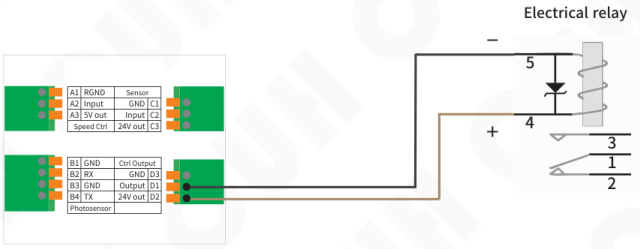

### Méthode de câblage de la sortie PNP ou push-pull

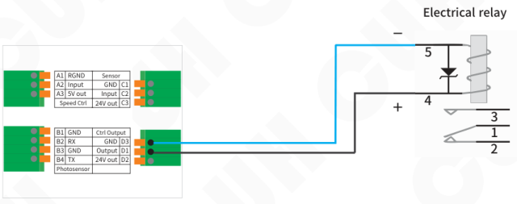

> Si vous connectez un relais 24V, veillez à confirmer les pôles positif et négatif de la bobine pour vous assurer qu'ils sont correctement raccordés. Comme la capacité de courant de sortie de ce port est limitée, la diode de protection interne du relais court-circuitera le port de ce contrôleur après un raccordement inversé, déclenchant la protection contre les courts-circuits.

---

## 5.4 Commande de vitesse à distance

Le contrôleur prend en charge un signal analogique externe pour contrôler la tension de sortie ; le signal analogique prend en charge le potentiomètre, la tension 1~5V et le courant 4~20mA. Ainsi, une commande de vitesse à distance externe peut être facilement réalisée par un automate (PLC), un DCS ou tout autre moyen.

- Lorsque l'entrée est inférieure à 0.5V, la commande de vitesse à distance est inefficace.
- Lorsque l'entrée est supérieure à 0.5V et inférieure à 1V, la commande de vitesse à distance est efficace et la tension de sortie est « MinVoltage » (par défaut : 0V).
- Lorsque l'entrée est supérieure à 1V et inférieure à 5V, la tension de sortie est contrôlée proportionnellement par le signal de commande à distance (0%~100%), et la tension maximale ne dépasse pas « MaxVoltage » (par défaut : 220V).

### Méthode de câblage de la commande par potentiomètre

**Suggestion :** Veuillez utiliser un potentiomètre linéaire de 1K

### Méthode de câblage de la commande par tension 1~5V

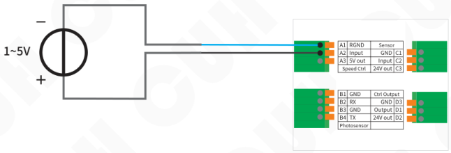

---

## Méthode de câblage de la commande par courant 4~20mA

- Lorsque l'entrée est inférieure à 2mA, la commande de vitesse à distance est inefficace.
- Lorsque l'entrée est supérieure à 2mA et inférieure à 4mA, la commande de vitesse à distance est efficace et la tension de sortie est « MinVoltage » (par défaut : 0V).
- Lorsque l'entrée est supérieure à 4mA et inférieure à 20mA, la tension de sortie est contrôlée proportionnellement par le signal de commande à distance (0%~100%), et la tension maximale ne dépasse pas « MaxVoltage » (par défaut : 220V).

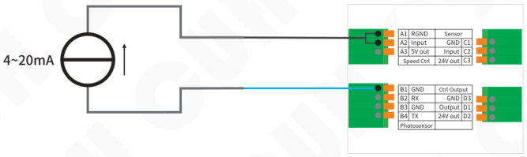

| | | | |
|---|---|---|---|
| A1 | RGND | Sensor | |
| A2 | Input | GND | C1 |
| A3 | 5V out | Input | C2 |
| Speed Ctrl | | 24V out | C3 |

| | | | |
|---|---|---|---|
| B1 | GND | Ctrl Output | |
| B2 | RX | GND | D3 |
| B3 | GND | Output | D1 |
| B4 | TX | 24V out | D2 |
| Photosensor | | | |

---

# Chapitre Ⅵ Introduction détaillée des fonctions

Ce chapitre présente les fonctions détaillées et les réglages du contrôleur.

Appuyez brièvement sur ▶ pour entrer dans l'interface de réglage des paramètres depuis l'interface d'accueil. L'interface de réglage des paramètres comprend les huit groupes de paramètres suivants. Appuyez brièvement sur ◀ ou ▶ pour passer d'un groupe de paramètres à un autre.

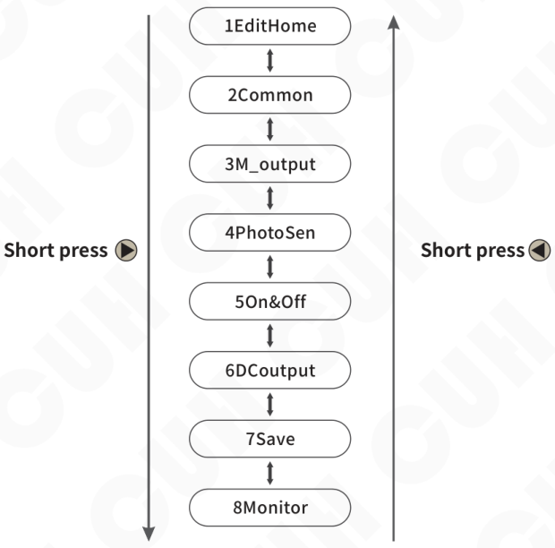

Diagramme de rotation des groupes de paramètres

---

## 6.1 Personnaliser la page d'accueil

Afin de permettre aux utilisateurs d'utiliser le contrôleur de manière efficace et rapide, les utilisateurs peuvent effectuer des opérations personnalisées dans le groupe de paramètres d'interface. En extrayant au maximum 16 paramètres parmi tous les paramètres, ceux-ci sont placés comme éléments de surveillance dans le groupe de paramètres d'interface, et l'utilisateur peut effectuer des opérations rapides sur l'interface principale.

Exemple : sélectionnez 1. UsrVoltage (P2.01), 2. UsrFreqncy (P2.02), 3. CurrentOut (P8.02), 4. SoftStarT (P2.03), SoftStopT (P2.04), soit cinq paramètres sur l'interface principale. Les étapes sont les suivantes :

- Sur l'interface d'accueil, appuyez brièvement sur ⏵ pour entrer directement dans le groupe de paramètres « 1EditHome ».
- Appuyez brièvement sur ▲ ou ▼ pour passer d'un élément de surveillance à un autre.
- Appuyez sur ⊕ ou ⊖ pour sélectionner respectivement les étiquettes de fonction à régler.

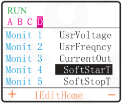

Remarque : Les étiquettes de fonction peuvent être consultées dans le chapitre « Liste des paramètres ».  
Si la valeur de l'élément de surveillance est vide, cela signifie qu'il n'y a pas d'élément de surveillance.

Une fois l'opération terminée, si l'utilisateur doit régler les valeurs de paramètres de tension, de fréquence, de courant de sortie, de temps de démarrage progressif et de temps d'arrêt progressif, il suffit d'entrer dans l'élément de surveillance spécifique du groupe de paramètres de l'interface « Home » et d'utiliser ⊕ ou ⊖ pour terminer le réglage du paramètre.

---

## 6.2 Réglages des paramètres courants

Ce chapitre présente principalement le réglage et l'ajustement des paramètres courants de base du contrôleur.

### 6.2.1 Tension

Ce contrôleur peut régler directement la tension de sortie de manière numérique sur le panneau. Cette fonction permet d'éliminer les variations de vitesse d'alimentation causées par les fluctuations de la tension d'alimentation. La régulation de tension peut également éliminer l'effet de battement de fréquence causé par le courant alternatif de fréquence industrielle.

- Entrez dans le groupe de paramètres « 2Common » et trouvez les paramètres de réglage de la tension.
- Appuyez sur ⊕ ou ⊖ pour régler la valeur du paramètre.

La plage de tension est de 0~220V, la valeur par défaut est 150V, la précision de réglage est de 1V.

RUN  
A B C **D**

| Paramètre | Valeur |
|---|---|
| 01.UsrVoltage | **150** V |
| 02.UsrFreqncy | 50.0 Hz |
| 03.SoftStarT | 0.5 s |
| 04.SoftStopT | 0.0 s |
| 05.MaxVoltage | 220 V |

＋　2Common　－

### 6.2.2 Fréquence

Le contrôleur présente une très haute précision et une grande stabilité de fréquence, qui ne changent ni avec le temps ni avec la température.

- Entrez dans le groupe de paramètres « 2Common » et trouvez les paramètres de réglage de la fréquence.
- Appuyez sur ⊕ ou ⊖ pour régler la valeur du paramètre.

La plage de fréquence est de 40.0~999.9Hz, la valeur par défaut est 50.0Hz, la précision de réglage est de 0.1Hz.

RUN  
A B C **D**

| Paramètre | Valeur |
|---|---|
| 01.UsrVoltage | 150 V |
| 02.UsrFreqncy | **50.0** Hz |
| 03.SoftStarT | 0.5 s |
| 04.SoftStopT | 0.0 s |
| 05.MaxVoltage | 220 V |

＋　2Common　－

**Les autres paramètres de ce groupe de paramètres peuvent être ajustés selon les étapes ci-dessus.**

---

## 6.2.3 Temps de démarrage progressif/Temps d'arrêt progressif

**Temps de démarrage progressif :** Temps nécessaire au contrôleur pour augmenter progressivement la tension de sortie de 0V à la tension de sortie définie lors du démarrage depuis un état d'arrêt.

La plage du temps de démarrage progressif est de 0.0~10.0s, la valeur par défaut est 0.5s et la précision de réglage est de 0.1s.

**Temps d'arrêt progressif :** Lorsque le contrôleur s'arrête, le temps nécessaire pour que la tension de sortie diminue progressivement de la tension de sortie définie jusqu'à 0V.

La plage du temps d'arrêt progressif est de 0.0~10.0s, la valeur par défaut est 0.5s et la précision de réglage est de 0.1s.

Lors du démarrage ou de l'arrêt de ce contrôleur, la tension de sortie peut être augmentée ou diminuée doucement afin d'éviter que l'équipement vibrant ne soit endommagé par les chocs.

## 6.2.4 Tension de sortie maximale/Tension de sortie minimale

**Tension de sortie maximale :** Valeur de tension maximale émise par le contrôleur.

La plage de tension maximale est de 0-220V, la valeur par défaut est 220V et la précision de réglage est de 1V.

**Tension de sortie minimale :** Valeur de tension minimale émise par le contrôleur.

La plage de tension minimale est de 0-220V, la valeur par défaut est 0V et la précision de réglage est de 1V.

Ce contrôleur peut définir des valeurs limites de tension de sortie maximale et minimale, ce qui peut empêcher les utilisateurs d'endommager l'équipement vibrant en émettant accidentellement une tension excessive.

## 6.2.5 Fréquence de sortie maximale/Fréquence de sortie minimale

**Fréquence de sortie maximale :** Limite la valeur supérieure du paramètre « UsrFreqncy ».

La plage de fréquence de sortie maximale est de 40.0~999.9Hz, la valeur par défaut est 999.9Hz et la précision de réglage est de 0.1Hz.

**Fréquence de sortie minimale :** Limite la valeur inférieure du paramètre « UsrFreqncy ».

La plage de fréquence de sortie minimale est de 40.0~999.9Hz, la valeur par défaut est 40.0Hz et la précision de réglage est de 0.1Hz.

---

## 6.2.6 Délai d'extinction du rétroéclairage

**Délai d'extinction du rétroéclairage :** Il s'agit du délai d'extinction du rétroéclairage. Lorsque le contrôleur n'effectue aucune opération pendant un certain temps, le contrôleur éteint le rétroéclairage de l'écran. Le rétroéclairage de l'écran peut être rallumé en appuyant sur n'importe quel bouton.

La plage d'extinction du rétroéclairage est de 1-30min, la valeur par défaut est On et la précision de réglage est de 1min.

## 6.2.7 Langue

**Langue :** Il s'agit de la langue affichée sur le panneau de commande du contrôleur. Le contrôleur dispose de deux langues intégrées : le chinois et l'anglais, ce qui facilite le changement pour les utilisateurs de différentes régions. Valeur par défaut : Chines.

| Paramètre | Signification |
|---|---|
| Englis | Interface en anglais. |
| Chines | Interface en chinois. |

---

## 6.3 Paramètres de sortie

Ce chapitre présente le réglage et l'utilisation des paramètres de sortie principale et des paramètres de sortie de commande du contrôleur afin d'obtenir la fonction de sortie idéale du contrôleur.

### 6.3.1 Paramètres de sortie principaux

Ce chapitre présente principalement les réglages des paramètres de sortie principaux du contrôleur.

- Appuyez brièvement sur ⏵ pour passer au groupe de paramètres « 3 M_output ».
- Appuyez brièvement sur ⏶ ou ⏷ pour changer de paramètre dans le groupe de paramètres de sortie principale.
- Appuyez sur ⊕ ou ⊖ pour régler la valeur du paramètre.

RUN  
A　B　C　**D**

| Paramètre | Valeur |
|---|---|
| 01.MainSourc1 | **PortB** |
| 02.MainSourc2 | PortC |
| 03.MainLogic | Or |
| 04.MainUpDly | 0.0 s |
| 05.MainDnDly | 0.0 s |

＋　3M_output　－

Les autres paramètres de ce groupe de paramètres peuvent être ajustés selon les étapes ci-dessus.

### 6.3.1.1 Source principale 1/Source principale 2

« MainSourc1 » et « MainSourc2 » désignent le « signal de la source principale 1 » et le « signal de la source logique principale 2 » ; vous pouvez définir le signal de source logique de sortie principale au moyen de ces deux paramètres. Les signaux de la source principale 1 et de la source principale 2 passent d'abord par la détermination du type de signal du port, puis par la détermination de la direction logique, et enfin, après le retard d'enclenchement et le retard de déclenchement, ils deviennent le signal de résultat de la source logique de sortie principale 1/2.

---

Le schéma de flux de signal est le suivant :

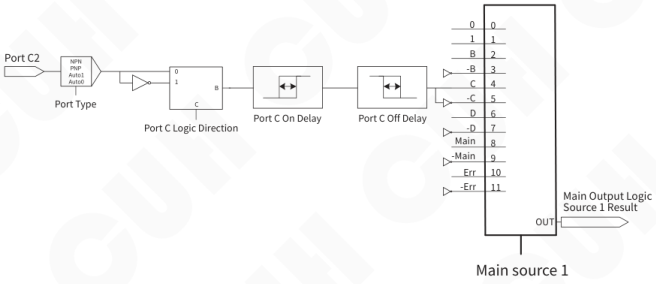

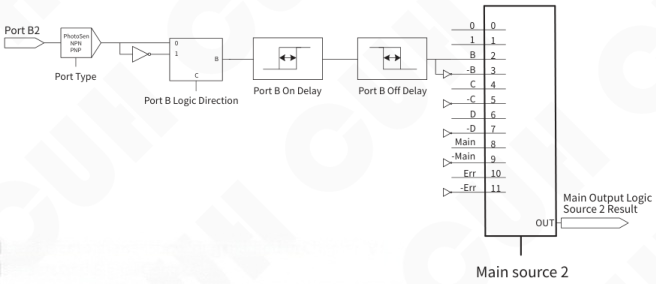

Remarque : Reportez-vous à la méthode de câblage des capteurs au chapitre Ⅴ « Capteurs et commande de signal ».

**Figure 6.3.1.1**

Remarque : L'état de la sortie principale est également contrôlé par le bouton de marche/arrêt ou par l'état de défaut du contrôleur lui-même. Le niveau de contrôle de défaut du bouton de marche/arrêt ou du contrôleur lui-même est supérieur au signal logique de sortie principale. C'est-à-dire : lorsque le bouton de marche/arrêt est réglé sur arrêt, le contrôleur entre immédiatement en état d'arrêt ; lorsqu'un défaut tel qu'un court-circuit, une surchauffe, une surintensité, etc. se produit, le contrôleur entre également immédiatement en état d'arrêt. À ce moment-là, le signal logique de sortie principale ne peut pas activer la sortie principale du contrôleur.

---

## 6.3.1.2 Logique principale

Les résultats de la source principale 1 et de la source 2 sont traités par l'opérateur logique, puis passent par le module de direction logique, puis par le retard d'enclenchement et le retard de déclenchement de la sortie principale, et enfin par le mode de sortie principale, afin de piloter l'état de marche/arrêt de la sortie principale.

Le schéma de flux de signal est le suivant :

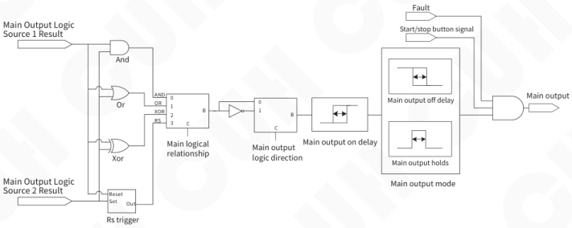

Figure 6.3.1.2

Ce contrôleur peut définir comme suit la table de relations logiques entre la source principale (logique) 1 et la source principale 2. Valeur par défaut : Or.

| Paramètre | Signification |
|---|---|
| And | ET logique ; la sortie est invalide lorsque la source principale 1 et la source principale 2 sont toutes deux valides. |
| Or | OU logique ; la sortie est invalide lorsqu'au moins l'une des sources principale 1 ou principale 2 est valide. |
| Xor | OU exclusif logique ; la sortie est invalide lorsque la source principale 1 et la source principale 2 sont dans des états différents, sinon valide. |
| RS | Bascule RS. |

## 6.3.1.3 Retard d'enclenchement principal/Retard de déclenchement principal

Lorsque d'autres signaux externes tels que des capteurs sont utilisés pour contrôler l'état de la sortie principale de l'appareil, dans la plupart des cas, un délai est nécessaire après l'émission ou le rétablissement du signal avant que l'opération puisse être effectuée. Pour de telles applications, cela peut être réalisé en réglant les valeurs de temps du retard d'enclenchement et du retard de déclenchement. Pour le schéma de flux de signal, reportez-vous à la Figure 6.3.1.2.

**Retard d'enclenchement principal :** C'est-à-dire que le retard d'enclenchement de la sortie principale est le temps de retard écoulé entre l'application d'un signal de commande qui fait entrer le contrôleur en état de marche et le démarrage effectif de la sortie du contrôleur. Le temps de retard écoulé pendant cette période est appelé retard d'enclenchement.

**Retard de déclenchement principal :** C'est-à-dire que le retard de déclenchement de la sortie principale ; à partir de l'application d'un signal de commande qui fait entrer le contrôleur en état d'arrêt, jusqu'à l'arrêt effectif de la sortie du contrôleur, le temps de retard écoulé pendant cette période est appelé retard de déclenchement.

La plage du retard d'enclenchement/de déclenchement principal est de 0.0~99.9s, la valeur par défaut est 0.0s et la précision de réglage est de 0.1s.

## 6.3.1.4 Mode principal

Deux modes de sortie principale sont disponibles : le mode retard et le mode maintien. Schéma de flux de signal : reportez-vous à la Figure 6.3.1.2. Valeur par défaut : Delay.

| Paramètre | Signification |
|---|---|
| Delay | Se réfère à l'état de la sortie principale après l'opération logique ; l'état de pilotage de la sortie principale après le retard d'enclenchement et le retard de déclenchement. |
| Hold | Se réfère à l'état après l'opération logique de la sortie principale. Après le retard d'enclenchement, l'état d'arrêt est maintenu pendant la durée du retard de déclenchement, puis passe immédiatement à l'état de sortie de marche. |

La différence entre les deux modes est représentée sous la forme d'un diagramme de temporisation comme suit, où le signal d'entrée est une sélection de relation logique.

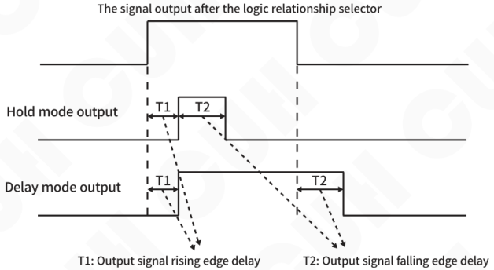

---

## 6.3.1.5 Direction principale

C'est-à-dire la direction logique de la sortie principale ; la direction de sortie spécifique peut être définie après la combinaison logique des signaux. Pour le schéma de flux de signal, reportez-vous à la Figure 6.3.1.2. Valeur par défaut : Revrs.

| Paramètre | Signification |
|---|---|
| Const | L'état n'est pas inversé après l'opération logique de la sortie principale. |
| Revrs | L'état est inversé après l'opération logique de la sortie principale. |
| On | L'état reste en marche après l'opération logique de la sortie principale. |
| Off | L'état est toujours arrêté après l'opération logique de la sortie principale. |

## 6.3.1.6 État de mise sous tension

Définit l'état de fonctionnement du contrôleur après la mise sous tension. Valeur par défaut : On.

| Paramètre | Signification |
|---|---|
| On | Après la mise sous tension de l'appareil, l'état de la touche de marche/arrêt est en marche. |
| Off | Après la mise sous tension de l'appareil, l'état de la touche de marche/arrêt est arrêté. |
| Hold | Après la mise sous tension de l'appareil, l'état de la touche de marche/arrêt reste le même qu'avant le dernier arrêt. |

---

## 6.3.2 Paramètres de sortie de commande CC

Ce chapitre présente principalement les réglages des paramètres de sortie de commande du contrôleur.
Le schéma de principe du flux de signal de sortie de commande est le suivant :

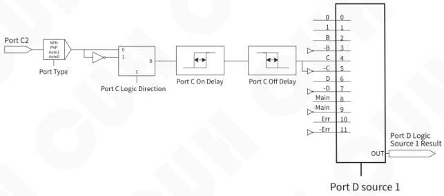

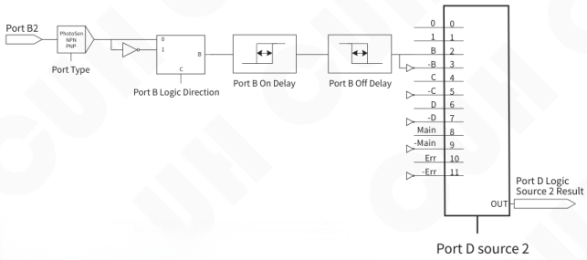

Remarque : Reportez-vous à la méthode de câblage des capteurs au chapitre Ⅴ « Capteurs et commande de signal ».

---

Le résultat de la source logique 1 du port D et le résultat de la source logique 2 du port D sont fusionnés après l'opération logique, puis passent par la direction de sortie du port D, puis par le retard d'enclenchement et le retard de déclenchement de la sortie du port D, puis par le mode du port D et enfin par le type de sortie du port D, afin de piloter l'état de marche/arrêt de la sortie de commande.

Le schéma de flux de signal est le suivant :

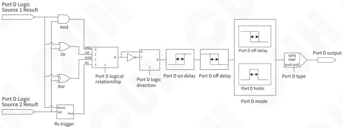

La méthode de réglage des paramètres de sortie de commande est la suivante :

- Appuyez brièvement sur ▶ pour passer au groupe de paramètres « 6DCoutput ».
- Appuyez brièvement sur ▲ ou ▼ pour changer de paramètre dans le groupe de paramètres de sortie de commande.
- Appuyez sur ⊕ ou ⊖ pour régler la valeur du paramètre.

**RUN**  
A　B　C　**D**

| Paramètre | Valeur |
|---|---|
| 01.PortDSour1 | 0 |
| 02.PortDSour2 | Main |
| 03.PortDLogic | Or |
| 04.PortDUpDly | 0.0 s |
| 05.PortDDnDly | 0.0 s |

＋　6DCoutput　－

**Les autres paramètres de ce groupe de paramètres peuvent être ajustés selon les étapes ci-dessus.**

« PortDSour1 », « PortDSour2 », « PortDLogic », « PortDDirec », « PortDUpDly » et « PortDDnDly », pour les paramètres ci-dessus, veuillez vous référer aux réglages des paramètres de sortie principale.

---

## 6.3.2.1 Mode de sortie du port D

Les clients peuvent choisir 4 modes de sortie de commande : le mode retard, le mode maintien, Cycle1 et Cycle2. Valeur par défaut : Delay.

| Paramètre | Signification |
|---|---|
| Delay | Se réfère à l'état de la sortie de commande après l'opération logique ; l'état de pilotage de la sortie de commande après le retard d'enclenchement et le retard de déclenchement. |
| Hold | Se réfère à l'état après l'opération logique de la sortie de commande. Après le retard d'enclenchement, l'état d'arrêt est maintenu pendant la durée du retard de déclenchement, puis passe immédiatement à l'état de sortie de marche. |
| Cycle1/Cycle2 | La durée du signal de niveau haut est définie par « PortDUpDly ». La durée du signal de niveau bas est définie par « PortDDnDly ». |

En mode Cycle1, la touche de marche/arrêt ne peut pas arrêter la sortie de commande, et en mode Cycle2, la touche de marche/arrêt peut arrêter la sortie de commande.

La différence entre les quatre modes est représentée sous la forme d'un diagramme de temporisation comme suit, où le signal d'entrée est le signal de sortie après le sélecteur de relation logique.

## 6.3.2.2 Type de port D

La sortie du port D peut prendre en charge trois types : sortie NPN, sortie PNP et sortie push-pull. Valeur par défaut : Ou_P&P (Push-Pull).

| Paramètre | Signification |
|---|---|
| Ou_NPN | Lorsque le signal de sortie du port D est valide, le port D émet un signal de niveau bas (0V) ; lorsqu'il est invalide, il est en haute impédance. |
| Ou_PNP | Lorsque le signal de sortie du port D est valide, le port D émet un signal de niveau haut (24V) ; lorsqu'il est invalide, il est en haute impédance. |
| Ou_P&P (Push Pull) | Lorsque le signal de sortie du port D est valide, le port D émet un signal de niveau haut (24V). Lorsque le signal de sortie du port D est invalide, le port D émet un signal de niveau bas (0V). |

Le schéma est le suivant :

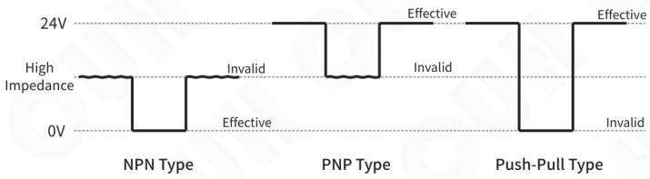

---

## 6.4 Commande de signal

Le contrôleur peut juger l'état du matériau dans l'alimentateur vibrant au moyen d'un capteur externe et réaliser l'« arrêt lorsque le matériau est plein » ou l'« arrêt lorsqu'il n'y a pas de matériau » du contrôleur. Le schéma de flux de signal des ports est le suivant :

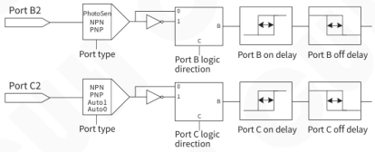

Figure 6.4

La méthode de réglage des paramètres du capteur photoélectrique intelligent est la suivante :

- Appuyez brièvement sur ▶ pour passer au groupe de paramètres « 4PhotoSen ».
- Appuyez brièvement sur ▲ ou ▼ pour changer de paramètre dans le groupe de paramètres du capteur photoélectrique intelligent.
- Appuyez sur ⊕ ou ⊖ pour régler la valeur du paramètre.

**RUN**  
A B C **D**

| Paramètre | Valeur |
|---|---|
| 01.PortBLimit | 80 |
| 02.PortBDirec | Const |
| 03.PortBUpDly | 0.2 s |
| 04.PortBDnDly | 0.2 s |

＋　4PhotoSen　－

La méthode de réglage des paramètres du capteur de commutation est la suivante :

- Appuyez brièvement sur ▶ pour passer au groupe de paramètres « 5On&Off ».
- Appuyez brièvement sur ▲ ou ▼ pour changer de paramètre dans le groupe de paramètres du capteur de commutation.
- Appuyez sur ⊕ ou ⊖ pour régler la valeur du paramètre.

**RUN**  
A B C **D**

| Paramètre | Valeur |
|---|---|
| 01.PortType | Auto0 |
| 02.PortCDirec | Const |
| 03.PortCUpDly | 0.2 s |
| 04.PortCDnDly | 0.2 s |

＋　5On&Off　－

**Les autres paramètres de ce groupe de paramètres peuvent être réglés selon les étapes ci-dessus.**

---

## 6.4.1 Sensibilité du port B

Le contrôleur peut régler le type de signal du port B sur 1~1000 (sensibilité du capteur photoélectrique intelligent), des capteurs de commutation de type « NPN » et de type « PNP ». La valeur par défaut est 80.

| Paramètre | Signification |
|---|---|
| 1~1000 | Le port B est connecté à des signaux de capteur photoélectrique intelligent, avec une plage de 1 à 1000. Plus la valeur est petite, plus l'intensité du signal optique reconnu est faible. Les extrémités d'émission et de réception peuvent être espacées davantage. |
| NPN | Capteur de type NPN. |
| PNP | Capteur de type PNP. |

## 6.4.2 Direction logique du port B/du port C

Ce paramètre est utilisé pour commuter le port d'entrée B et le port d'entrée C du contrôleur sur « Arrêt lorsque le matériau est plein » ou « Arrêt lorsque le matériau est vide ». Valeur par défaut : Const.

Lorsque le port d'entrée de commutation B/le port C ne reçoit aucun signal dans les réglages d'usine par défaut, le contrôleur est en état « marche » (c'est-à-dire arrêt lorsque le matériau est plein). Certaines applications particulières exigent que le contrôleur soit en état « arrêt » (c'est-à-dire arrêt lorsque le matériau est vide) lorsque le port B/le port C ne reçoit aucun signal. Cela peut être obtenu en modifiant ce paramètre. Reportez-vous à la Figure 6.4 pour le schéma de flux de signal.

| Paramètre | Signification |
|---|---|
| Const | Lorsqu'il n'y a pas de signal de commande, le contrôleur est en état de marche (arrêt lorsque le matériau est plein). |
| Inv | Lorsqu'il n'y a pas de signal de commande, le contrôleur est en état d'arrêt (arrêt lorsque le matériau est vide). |

## 6.4.3 Retard d'enclenchement/de déclenchement du port B et retard d'enclenchement/de déclenchement du port C

Le temps de retard entre l'application d'un signal qui met le contrôleur en état de marche et le moment où le signal est considéré comme valide par le contrôleur est appelé retard d'enclenchement.

Le temps de retard entre l'application d'un signal qui fait passer le contrôleur en état d'arrêt et le moment où le signal est considéré comme valide par le contrôleur est appelé retard de déclenchement.

Pour le schéma de flux de signal, reportez-vous à la Figure 6.4.

La plage du retard d'enclenchement/de déclenchement est de 0.0~99.9s, la valeur par défaut est 0.2s et la précision de réglage est de 0.1s.

**Remarque :** Lors de l'utilisation des ports B et C pour la commande de marche/arrêt, s'il est nécessaire de retarder l'opération pendant un certain temps après la réception du signal pour garantir que le signal est stable, cela peut être réalisé en réglant le retard d'enclenchement et le retard de déclenchement.

---

## 6.5 Enregistrer les réglages

Ce chapitre présente principalement comment utiliser les fonctions d'enregistrement des paramètres et de rappel des paramètres du contrôleur.

### 6.5.1 Réglages de rappel

Le contrôleur peut lire 3 ensembles différents de paramètres prédéfinis en plus du groupe de travail, nommés respectivement « UsrD1 », « UsrD2 » et « UsrD3 ». Valeur par défaut : None.

Lorsque l'utilisateur modifie les paramètres, les paramètres du contrôleur sont enregistrés par défaut dans le groupe de travail. Lorsque le contrôleur est remis sous tension, les paramètres sont automatiquement lus à partir du groupe de travail et les valeurs des paramètres avant la dernière mise hors tension sont restaurées. En même temps, les utilisateurs peuvent sélectionner manuellement parmi « UsrD1 », « UsrD2 », « UsrD3 » et lire un autre fichier enregistré manuellement par ces trois groupes. Les données sont envoyées au groupe de travail dans le contrôleur, ce qui permet au contrôleur de changer immédiatement d'état de fonctionnement.

| Paramètre | Signification |
|---|---|
| None | Invalide |
| UsrD1 | Paramètre défini par l'utilisateur 1 |
| UsrD2 | Paramètre défini par l'utilisateur 2 |
| UsrD3 | Paramètre défini par l'utilisateur 3 |

### 6.5.2 Enregistrer les réglages

Le contrôleur peut enregistrer 4 ensembles différents de paramètres prédéfinis, nommés « Work », « UsrD1 », « UsrD2 », « UsrD3 ». Valeur par défaut : None.

Lorsque l'utilisateur modifie les paramètres, les paramètres du contrôleur sont automatiquement enregistrés dans « Work » par défaut. Lorsque le contrôleur est remis sous tension, les paramètres sont automatiquement lus à partir du groupe de travail et les valeurs des paramètres avant la dernière mise hors tension sont restaurées. Les utilisateurs peuvent enregistrer manuellement les paramètres du groupe de travail dans « UsrD1 », « UsrD2 », « UsrD3 ».

| Paramètre | Signification |
|---|---|
| None | Invalide |
| Work | Groupe de travail par défaut |
| UsrD1 | Paramètre défini par l'utilisateur 1 |
| UsrD2 | Paramètre défini par l'utilisateur 2 |
| UsrD3 | Paramètre défini par l'utilisateur 3 |

---

## 6.5.3 Restaurer les paramètres d'usine

Utilisez la réinitialisation des paramètres pour restaurer tous les paramètres du groupe de travail aux valeurs d'usine par défaut. Valeur par défaut : None.

Après avoir sélectionné « Work » dans « RestorALL », appuyez simultanément sur ⊕ et ⊖ et maintenez-les enfoncés pendant plus de deux secondes ; l'interface d'affichage passe à l'interface de veille et les paramètres sont restaurés avec succès.

| Paramètre | Signification |
|---|---|
| None | Invalide |
| Work | Restaure les paramètres du groupe de travail aux réglages d'usine. (UsrD1, UsrD2 et UsrD3 ne seront pas restaurés) |

## 6.5.4 Type et numéro de la machine locale

**Identifiant de la machine locale :** Utilisé pour afficher l'identifiant de l'appareil sur la page d'accueil.

Les valeurs possibles pour l'identifiant de la machine locale sont « Circ  », « Line » et « Soli ». Valeur par défaut : None.

**Numéro d'identification :** Utilisé pour numéroter la machine locale.

La plage du numéro d'identification est de 1 à 1000. Valeur par défaut : None.

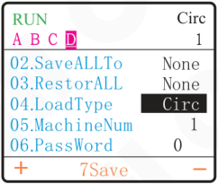

## 6.5.5 Mot de passe utilisateur

Les utilisateurs peuvent définir eux-mêmes le mot de passe des paramètres. Après le verrouillage, l'utilisateur ne peut opérer que sous « SetWord » et la « page d'accueil ».

Lorsque l'utilisateur définit un « mot de passe utilisateur » différent de 0, cela signifie que la fonction de verrouillage des paramètres avancés est activée. À ce moment, il est nécessaire de saisir le mot de passe lors de l'entrée dans le groupe de paramètres depuis la page d'accueil. Après que l'utilisateur a saisi « SetWord » et appuyé simultanément sur ⊕ et ⊖ pendant plus de 2 secondes, le mot de passe saisi est confirmé. Ce n'est qu'après que le mot de passe est correct que l'utilisateur peut entrer dans les autres groupes de paramètres.

La plage de sélection du mot de passe utilisateur est de 0~9999. Valeur par défaut : 0.

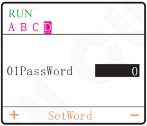

---

## 6.6 Surveillance de l'état du contrôleur

Dans le groupe de paramètres de surveillance, l'état de fonctionnement du contrôleur et les valeurs des paramètres peuvent être lus en temps réel.

Pour les entrées de paramètres lisibles, veuillez vous référer au chapitre « Liste des paramètres », groupe de paramètres « 8Monitor ».

RUN  
A B C **D**

| | |
|---|---:|
| 01.Temperatur | 50 ℃ |
| 02.CurrentOut | 20 mA |
| 03.Vol_Remote | **0.5 V** |
| 04.Vol_PortB | 100 |
| 05.Vol-PortC | 0.5 V |

＋　8Monitor　－

---

## Chapitre Ⅶ Annexe

### 7.1 Dimensions

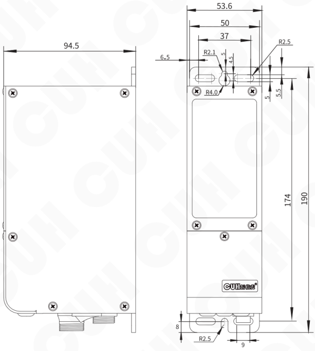

Dimensions (unité : mm)

| Plage de dimensions | Tolérance |
|---|---|
| 0~3 | ±0.05 |
| 3~10 | ±0.1 |
| 10~30 | ±0.15 |
| 30~80 | ±0.2 |
| 80~180 | ±0.3 |
| >180 | ±0.5 |

Ce tableau de tolérance s'applique à tous les produits de cette série.

---

## 7.2 Spécifications techniques

| Élément | Min | Typique | Max | Unité | Remarque |
|---|---|---|---|---|---|
| Tension d'entrée | 85 | 220 | 250 | V | AC RMS |
| Plage de tension de sortie réglable | 0 | —— | 220 | V | AC RMS |
| Précision de réglage de la tension | | 1 | | V | |
| Plage de courant de sortie réglable | 0 | —— | 150 | mA | |
| Puissance de sortie | 0 | —— | 33 | VA | |
| Fréquence de sortie | 40.0 | —— | 999.9 | Hz | |
| Précision de réglage de la fréquence | | 0.1 | | Hz | |
| Forme d'onde de sortie | | Sinusoïdale | | | |
| Temps de démarrage progressif | 0 | —— | 10.0 | s | Valeur par défaut : 0.5 |
| Plage du temps de retard d'enclenchement/de déclenchement | 0.0 | —— | 99.9 | s | Valeur par défaut : 0.2 |
| Précision du temps de retard d'enclenchement/de déclenchement | | 0.1 | | s | |
| Température de déclenchement de la protection contre la surchauffe | 60 | 65 | 65 | °C | |
| Courant de sortie de commande CC | 0 | —— | 350 | mA | |
| Tension de sortie de commande CC | 22 | 24 | 26 | V | |
| Signal de commande analogique | | 1~5 | | V | tension de commande de vitesse à distance |
| Signal de commande analogique | | 4~20 | | mA | courant de commande de vitesse à distance |
| Signal de commande numérique | | 24 | | V | Signal de commutation |
| Méthode de réglage | | 7 | | Bouton | |
| Consommation en veille | —— | —— | 5 | W | |
| Méthode d'affichage | | 160*128 | | | Afficheur matriciel |
| Indice de protection | | IP20 | | | |
| Température ambiante | 0 | 25 | 40 | °C | Sans condensation |
| Humidité ambiante | 10 | 60 | 85 | % | Sans condensation |
| Température ambiante de stockage | -20 | 25 | 65 | °C | Sans condensation |

## 7.3 Norme de référence

**Paramètres absolus :**  
Le dépassement de ces normes endommagera le contrôleur ; respectez-les strictement.

| Élément | Norme GB | Norme IEC | Niveau | Exigence de la norme | Remarque |
|---|---|---|---|---|---|
| Décharge électrostatique | GB/T 17626.2-2006 | IEC 61000-4-2:2001 | 4 | ±8 kV | Décharge par contact |
| | | | 4 | ±15 kV | Décharge dans l'air |
| Essai de transitoires rapides électriques | GB/T 17626.4-2008 | IEC 61000-4-4:2004 | 4 | ±4 kV | |
| Immunité aux ondulations de la ligne d'alimentation CC | GB/T 17626.17-2005 | IEC 61000-4-17:2002 | 4 | 15% | Classe A |

> **Avertissement**  
> Dans un environnement résidentiel, ce produit peut provoquer des interférences radio ; dans ce cas, des mesures d'atténuation supplémentaires peuvent être nécessaires.

---

## 7.4 Liste des paramètres

| | Paramètre | Affichage | Plage de valeurs/Élément d'énumération | Défaut |
|---|---|---|---|---|
| Groupe de paramètres 1EditHome | Élément de surveillance 1 | Monit 1 | Groupe de paramètres 2~Groupe de paramètres 8 | UsrVoltage |
| | Élément de surveillance 2 | Monit 2 | Groupe de paramètres 2~Groupe de paramètres 8 | UsrFreqncy |
| | Élément de surveillance 3 | Monit 3 | Groupe de paramètres 2~Groupe de paramètres 8 | CurrentOut |
| | Élément de surveillance 4 | Monit 4 | Groupe de paramètres 2~Groupe de paramètres 8 | |
| | Élément de surveillance 5 | Monit 5 | Groupe de paramètres 2~Groupe de paramètres 8 | |
| | Élément de surveillance 6 | Monit 6 | Groupe de paramètres 2~Groupe de paramètres 8 | |
| | Élément de surveillance 7 | Monit 7 | Groupe de paramètres 2~Groupe de paramètres 8 | |
| | Élément de surveillance 8 | Monit 8 | Groupe de paramètres 2~Groupe de paramètres 8 | |
| | Élément de surveillance 9 | Monit 9 | Groupe de paramètres 2~Groupe de paramètres 8 | |
| | Élément de surveillance 10 | Monit 10 | Groupe de paramètres 2~Groupe de paramètres 8 | |
| | Élément de surveillance 11 | Monit 11 | Groupe de paramètres 2~Groupe de paramètres 8 | |
| | Élément de surveillance 12 | Monit 12 | Groupe de paramètres 2~Groupe de paramètres 8 | |
| | Élément de surveillance 13 | Monit 13 | Groupe de paramètres 2~Groupe de paramètres 8 | |
| | Élément de surveillance 14 | Monit 14 | Groupe de paramètres 2~Groupe de paramètres 8 | |
| | Élément de surveillance 15 | Monit 15 | Groupe de paramètres 2~Groupe de paramètres 8 | |
| | Élément de surveillance 16 | Monit 16 | Groupe de paramètres 2~Groupe de paramètres 8 | |
| Groupe de paramètres 2Common | Tension définie par l'utilisateur | 01.UsrVoltage | 0~220 V | 150 |
| | Fréquence définie par l'utilisateur | 02.UsrFreqncy | 40.0~999.9 Hz | 50.0 |
| | Temps de démarrage progressif | 03.SoftStarT | 0.0~10.0 s | 0.5 |
| | Temps d'arrêt progressif | 04.SoftStopT | 0.0~10.0 s | 0.0 |
| | Tension de sortie maximale | 05.MaxVoltage | 0~220 V | 220 |
| | Tension de sortie minimale | 06.MinVoltage | 0~220 V | 0 |
| | Fréquence de sortie maximale | 07.MaxFreqncy | 40.0~999.9 Hz | 999.9 |
| | Fréquence de sortie minimale | 08.MinFreqncy | 40.0~999.9 Hz | 40.0 |
| | Délai d'extinction du rétroéclairage | 09.Off_time | On, 1~30 Mi | On |
| | Langue | 10.Language | Chines, Englis | Chines |
| Groupe de paramètres 3M_output | Source d'entrée logique de la sortie principale 1 | 01.MainSourc1 | 0, 1, PortB, -PortB, PortC, -PortC, PortD, -PortD, Main, -Main, Err, -Err | PortB |
| | Source d'entrée logique de la sortie principale 2 | 02.MainSourc2 | 0, 1, PortB, -PortB, PortC, -PortC, PortD, -PortD, Main, -Main, Err, -Err | PortC |
| | Logique du port de sortie principale | 03.MainLogic | And, Or, Xor, RS | Or |
| | Retard d'enclenchement de la sortie principale | 04.MainUpDly | 0.0~99.9 s | 0.0 |
| | Retard de déclenchement de la sortie principale | 05.MainDnDly | 0.0~99.9 s | 0.0 |
| | Mode de sortie principale | 06.MainMode | Delay, Hold | Delay |
| | Direction logique de la sortie principale | 07.MainDirect | Const, Revrs, On, Off | Revrs |
| | État de mise sous tension | 08.PowerOnSta | On, Off, Hold | On |

| | Paramètre | Affichage | Plage de valeurs/Élément d'énumération | Défaut |
|---|---|---|---|---|
| Groupe de paramètres 4PhotoSen | Sensibilité du capteur photoélectrique intelligent | 01.PortBLimit | PNP, NPN, 1~1000 | 80 |
| Groupe de paramètres 4PhotoSen | Direction logique du port B | 02.PortBDirec | Const, Inv | Const |
| Groupe de paramètres 4PhotoSen | Retard d'enclenchement du port B | 03.PortBUpDly | 0.0~99.9 s | 0.2 |
| Groupe de paramètres 4PhotoSen | Retard de déclenchement du port B | 04.PortBDnDly | 0.0~99.9 s | 0.2 |
| Groupe de paramètres 5On&Off | Type de capteur du port C | 01.PortType | NPN, PNP, Auto1, Auto0 | Auto0 |
| Groupe de paramètres 5On&Off | Direction logique du port C | 02.PortCDirec | Const, Inv | Const |
| Groupe de paramètres 5On&Off | Retard d'enclenchement du port C | 03.PortCUpDly | 0.0~99.9 s | 0.2 |
| Groupe de paramètres 5On&Off | Retard de déclenchement du port C | 04.PortCDnDly | 0.0~99.9 s | 0.2 |
| Groupe de paramètres 6DCoutput | Source d'entrée logique du port D 1 | 01.PortDSour1 | 0, 1, PortB, -PortB, PortC, -PortC, PortD, -PortD, Main, -Main, Err, -Err | 0 |
| Groupe de paramètres 6DCoutput | Source d'entrée logique du port D 2 | 02.PortDSour2 | 0, 1, PortB, -PortB, PortC, -PortC, PortD, -PortD, Main, -Main, Err, -Err | Main |
| Groupe de paramètres 6DCoutput | Relation logique du port D | 03.PortDLogic | And, Or, Xor, RS | Or |
| Groupe de paramètres 6DCoutput | Retard d'enclenchement du port D | 04.PortDUpDly | 0.0~99.9 s | 0.0 |
| Groupe de paramètres 6DCoutput | Retard de déclenchement du port D | 05.PortDDnDly | 0.0~99.9 s | 0.0 |
| Groupe de paramètres 6DCoutput | Mode de sortie du port D | 06.PortDMode | Delay, Hold, Cycle1, Cycle2 | Delay |
| Groupe de paramètres 6DCoutput | Direction logique du port D | 07.PortDDirec | Const, Revrs, On, Off | Const |
| Groupe de paramètres 6DCoutput | Type de sortie de commande | 08.PortDType | Ou_NPN, Ou_PNP, Ou_P&P | Ou_NPN |
| Groupe de paramètres 7Save | Lire tous les paramètres depuis le groupe utilisateur | 01.ReadALLFrm | None, UsrD1, UsrD2, UsrD3 | None |
| Groupe de paramètres 7Save | Enregistrer tous les paramètres dans le groupe utilisateur | 02.SaveALLTo | None, Work, UsrD1, UsrD2, UsrD3 | None |
| Groupe de paramètres 7Save | Restauration des réglages d'usine | 03.RestorALL | None, Work | None |
| Groupe de paramètres 7Save | Identifiant de la machine locale | 04.LoadType | None, Circ, Line, Soli | None |
| Groupe de paramètres 7Save | Numéro d'identification | 05.MachineNum | None, 1~1000 | None |
| Groupe de paramètres 7Save | Mot de passe utilisateur | 06.PassWord | 0~9999 | 0 |
| Groupe de paramètres 8Monitor | Température | 01.Temperatur | -20~85 ℃ | —— |
| Groupe de paramètres 8Monitor | Courant de sortie | 02.CurrentOut | 0.0~150 mA | —— |
| Groupe de paramètres 8Monitor | Tension du signal du port A | 03.Vol_Remote | 0.0~5.0 V | —— |
| Groupe de paramètres 8Monitor | Tension du signal du port B | 04.Vol_PortB | 0~999 | —— |
| Groupe de paramètres 8Monitor | Tension du signal du port C | 05.Vol-PortC | 0.0~26.0 V | —— |
| Groupe de paramètres 8Monitor | Tension du signal du port D | 06.Vol-PortD | 0.0~26.0 V | —— |
| Groupe de paramètres 8Monitor | Tension en temps réel du port 5V | 07.Vol-5V | 0.0~6.0 V | —— |
| Groupe de paramètres 8Monitor | Tension en temps réel du port 24V | 08.Vol-24V | 0.0~26.0 V | —— |
| Groupe de paramètres 8Monitor | Version logicielle de la carte de commande | 09.Version | 0~99.99 | —— |

| | Paramètre | Affichage | Plage de valeurs/Élément d'énumération | Défaut |
|---|---|---|---|---|
| SetWord | Mot de passe | 01PassWord | 0~9999 | 0 |

## 7.5 Schémas de circuit d'entrée et de sortie

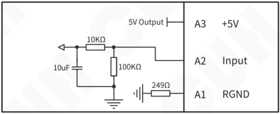

**Commande de vitesse à distance du port A**

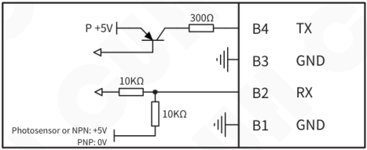

**Capteur photoélectrique intelligent du port B**

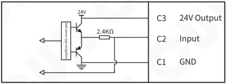

**Capteur de commutation du port C**

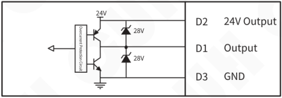

**Sortie de commande du port D**

---

## 7.6 Code d'erreur et d'avertissement

| Affichage d'erreur | Dépannage |
|---|---|
| Short | Confirmez si la ligne de sortie principale est en court-circuit et recâblez-la. |
| MainOrCu | Réduisez la tension de sortie ou augmentez la fréquence de sortie. |
| OverHot | Placez le contrôleur dans une zone bien ventilée et dissipant la chaleur. |
| OverCold | Placez le contrôleur dans un endroit où la température ambiante est supérieure à -20℃. |
| PotDOrCu | Assurez-vous que la charge du port D n'est pas en court-circuit et que le courant ne dépasse pas 350mA, puis essayez de redémarrer la sortie du port D. |
| 24VErr | Assurez-vous que le port 24V n'est pas en court-circuit et que le courant ne dépasse pas 400mA. |
| 5VErr | Assurez-vous que l'alimentation 5V du port A n'est pas en court-circuit ou n'est pas connectée à une tension d'alimentation externe supérieure à 5V. |
| MainRSEr | Assurez-vous que les deux signaux d'entrée de la bascule RS ne sont pas actifs simultanément. |
| PotDRSEr | Assurez-vous que les deux signaux d'entrée de la bascule RS ne sont pas actifs simultanément. |

---

## Chapitre Ⅷ Informations sur la garantie du produit

### 8.1 Période de garantie

La période de garantie offerte par l'entreprise pour ce produit est de 3 ans à compter de la date de livraison du produit au lieu désigné par l'acheteur.

### 8.2 Couverture de la garantie

(1) Si une défaillance causée par notre entreprise survient pendant la période de garantie ci-dessus, nous réparerons le produit gratuitement. Toutefois, les situations suivantes ne sont pas couvertes par la garantie :

 a. Le non-respect des conditions spécifiées dans le manuel simple, le manuel d'utilisation ou les exigences techniques spécialement convenues entre l'acheteur et l'entreprise, une opération incorrecte, ou une défaillance causée par une utilisation inappropriée.

 b. La défaillance n'est pas due à un défaut du produit, mais à la conception de l'équipement ou du logiciel de l'acheteur.

 c. Les dysfonctionnements causés par des modifications ou des réparations non effectuées par le personnel de l'entreprise.

 d. La défaillance qui peut être totalement évitée par un entretien correct ou le remplacement de pièces d'usure conformément au guide d'utilisation simple ou au manuel d'utilisation.

 e. Après l'expédition du produit depuis notre entreprise, les défaillances causées par des facteurs tels que des changements imprévisibles du niveau de la science et de la technologie.

 f. En raison de catastrophes naturelles telles qu'un incendie, un tremblement de terre, une inondation, ou de facteurs externes tels qu'une défaillance due à une tension anormale, l'entreprise n'est pas responsable de la garantie.

(2) La portée de la garantie est limitée aux situations stipulées au point (1) ; les pertes indirectes (telles que les dommages aux équipements, les opportunités, la perte de profit, etc.) ou d'autres pertes ne sont pas de la responsabilité de l'entreprise.

### 8.3 Aptitude du produit

Le contrôleur de notre entreprise est conçu et produit pour un usage général dans l'industrie de l'alimentation par vibration. Par conséquent, ce contrôleur de notre entreprise ne doit pas être utilisé pour les applications suivantes et ne convient pas à leur utilisation.

(1) Les installations ayant un impact grave sur la vie et les biens, telles que les centrales nucléaires, les aéroports, les chemins de fer, les navires, les dispositifs motorisés et les équipements médicaux.

(2) Les services publics, y compris l'électricité, le gaz, l'approvisionnement en eau, etc.

(3) L'utilisation en extérieur dans des conditions ou environnements similaires.

---

Nanjing CUH Science & Technology Co.,Ltd  
https://en.cuhnj.com  
Tel.:+86-25-84730411 / 84730415 / 84730416  
Fax:+86-25-84730426  
E-mail:sales@cuhnj.com  
Add.:Building 2, Xueyan Tech Park, Tuscity,  
No.9 Zhineng Rd, Jiangning, Nanjing, China

Document No.: IDP1000542

