Contrôleur numérique à fréquence variable pour alimentateur vibrant piézoélectrique

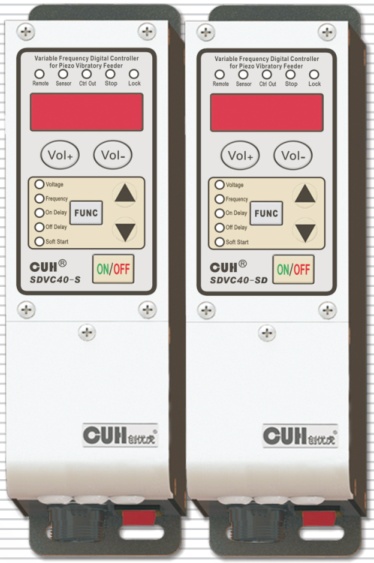

## Série SDVC40
Contrôleur numérique à fréquence variable pour alimentateur vibrant piézoélectrique　　**Série SDVC40**
## Manuel d'utilisation

---

## Préface

Merci d'avoir choisi les contrôleurs numériques intelligents pour alimentateur vibrant **CUH**.(Le contrôleur en abrégé dans la suite du texte.)

Ce manuel d'utilisation contient des notes pour l'installation, le débogage, le réglage des paramètres, la maintenance et le dépannage du contrôleur. Veuillez lire attentivement ce manuel d'utilisation avant d'utiliser le contrôleur et conservez-le correctement

### Ce manuel d'utilisation s'applique au modèle suivant :

- Contrôleur numérique à fréquence variable pour alimentateur vibrant piézoélectrique  
  SDVC40-S (Sortie 220V, 150mA)

- Contrôleur numérique à fréquence variable pour alimentateur vibrant piézoélectrique  
  SDVC40-SD (Sortie 50V, 600mA)

---

# Avis

- Ne jamais remplacer à chaud ni toucher les contacts en aucune circonstance afin d'éviter tout choc électrique ou autre accident.
- Ne jamais raccorder le contrôleur à une alimentation 380V CA, ce qui pourrait causer des dommages irréparables. (Choisir des produits conçus pour le 380V CA si nécessaire)
- Ne jamais couper l'entrée du contrôleur en coupant l'alimentation via un relais, un automate ou d'autres dispositifs, sinon la durée de vie du contrôleur pourrait être considérablement réduite.
- Le contrôleur est conçu pour fonctionner dans un environnement frais et sec. Ne jamais l'utiliser à l'extérieur afin d'éviter l'immersion ou l'exposition au soleil. Utiliser le contrôleur dans la plage de température requise par ses caractéristiques électriques.
- Ne jamais utiliser le contrôleur au-delà de ses limites de conception.
- Utiliser le contrôleur strictement conformément à ce manuel d'utilisation. Nous n'assumons aucune responsabilité civile ou pénale si des dommages matériels ou corporels résultent d'une utilisation incorrecte.

> **!**
>
> Ne jamais ouvrir le boîtier du contrôleur afin d'éviter tout choc électrique. Contacter CUH si le contrôleur tombe en panne.
>
> Ne jamais tenter de modifier le contrôleur, car les cartes de circuits à semi-conducteurs à l'intérieur du contrôleur ne peuvent pas être réparées et aucune pièce n'est réglable.

---

# Environnement d'utilisation

## Inspection avant utilisation

Chaque contrôleur subit une inspection qualité rigoureuse avant livraison et est emballé dans un conditionnement antichoc.

## Veuillez vérifier les éléments suivants après le déballage :

- Si le contrôleur présente des dommages extérieurs
- Si le modèle du contrôleur correspond exactement à votre commande

## Environnement de fonctionnement

Veuillez suivre les consignes ci-dessous pour garantir de meilleures performances et une durée de vie plus longue du contrôleur

- Environnement bien ventilé
- Tenir à l'écart de l'eau, de la vapeur, de la poussière et surtout de la poussière huileuse
- Tenir à l'écart des gaz et liquides corrosifs ou inflammables
- Tenir à l'écart des poussières en suspension et des particules métalliques
- Fixer fermement pour éviter les vibrations propres
- Tenir à l'écart des interférences électromagnétiques
- Utiliser dans la plage de température de 0 °C à 40 °C
- Pour une utilisation à une altitude de 2000m ou moins

---

# Sommaire

| Sommaire | Page |
|---|---:|
| **Chapitre I Caractéristiques** | 1 |
| **Chapitre II Guide d'installation** | 3 |
| **Chapitre III Description des composants** | 7 |
| 3.1 Description du panneau de commande | 7 |
| 3.2 Description des voyants d'état | 8 |
| 3.3 Description de l'interface E/S | 8 |
| **Chapitre IV Description des fonctions** | 9 |
| 4.1 Réglage de la tension de sortie | 9 |
| 4.2 Réglage de la fréquence de sortie | 10 |
| 4.3 Démarrage progressif | 11 |
| 4.4 Bouton de marche/arrêt de la sortie | 11 |
| 4.5 Limitation de la tension de sortie maximale | 12 |
| 4.6 Verrouillage du clavier | 13 |
| 4.7 Réglage de l'état de fonctionnement à la mise sous tension | 14 |
| 4.8 Restauration des paramètres par défaut | 15 |
| **Chapitre V Capteurs et commande de signal** | 16 |
| 5.1 Détection photoélectrique intelligente | 16 |
| 5.1.1 Méthode de raccordement du capteur photoélectrique intelligent | 16 |
| 5.1.2 Réglage du retard d'enclenchement et du retard de déclenchement du capteur photoélectrique intelligent | 17 |
| 5.1.3 Réglage de la relation logique du capteur photoélectrique intelligent | 18 |
| 5.2 Méthode d'utilisation du capteur de commutation NPN (Arrêt lorsque les pièces sont pleines) | 19 |
| 5.2.1 Méthode de raccordement du capteur de proximité NPN | 19 |
| 5.2.2 Méthode de raccordement du capteur de commutation NPN à barrière | 20 |
| 5.2.3 Méthode de raccordement du capteur photoélectrique à barrière | 20 |
| 5.2.4 Méthode de raccordement du capteur à fibre optique à barrière | 21 |
| 5.2.5 Méthode de raccordement du capteur photoélectrique à réflexion | 22 |
| 5.3 Réglage du retard d'enclenchement et du retard de déclenchement du capteur de commutation NPN | 23 |
| 5.4 Réglage de la relation logique du capteur de commutation NPN (Arrêt lorsque les pièces sont pleines) | 24 |
| 5.5 Réglage de la relation logique du signal de commande | 25 |
| 5.6 Méthode de raccordement de l'automate supérieur qui contrôle le contrôleur d'alimentateur vibrant | 26 |
| 5.7 Sortie de commande | 27 |
| 5.7.1 Méthode de raccordement de la sortie de commande | 27 |
| 5.7.2 Réglage de la relation logique de la sortie de commande | 28 |
| 5.8 Commande de vitesse à distance | 29 |
| **Chapitre VI Fonctions de sécurité** | 30 |
| 6.1 Stabilisation automatique de la tension | 30 |
| 6.2 Protection contre les courts-circuits | 30 |
| 6.3 Protection contre les surcharges de courant | 30 |
| 6.4 Protection contre la surchauffe | 30 |

---

---

## Annexe

- Annexe A : Dimensions — 31
- Annexe B : Définition de l'interface de sortie — 32
- Annexe C : Définition de l'interface de signal — 32
- Annexe D : Tableau des fonctions — 33
- Annexe E : Spécifications électriques — 34
- Annexe F : Conseils de dépannage et explications des erreurs — 35

---

# Chapitre I Caractéristiques

Le contrôleur est spécialement conçu pour commander l'alimentateur vibrant dans les systèmes d'automatisation. Alliant la technologie électronique la plus récente et une conception soignée, le contrôleur offre les fonctionnalités pratiques suivantes :

**Réglage de la fréquence :** La fréquence de sortie s'étend de 40.0Hz à 400.0Hz.

**Réglage de la tension :** SDVC40-S : la tension de sortie s'étend de 0V à 260V.  
SDVC40-SD : la tension de sortie s'étend de 0.0V à 50.0V.

**Stabilisation automatique de la tension :** Le contrôleur peut éliminer les variations de vitesse d'alimentation causées par les fluctuations de la tension du secteur.

**Démarrage progressif :** Afin d'éviter tout choc brusque sur les pièces, le contrôleur peut augmenter progressivement la tension de sortie de 0 à la valeur préréglée au démarrage.

**Détection photoélectrique intelligente :** Notre capteur photoélectrique intelligent adaptatif peut aider à arrêter le contrôleur lorsque les pièces sont pleines ou lorsqu'il n'y a pas de pièce, et assurer les fonctions de réglage du temps de démarrage progressif, de retard d'enclenchement, de retard de déclenchement et de réglage de la relation logique.

**Arrêt lorsque les pièces sont pleines :** Un capteur de commutation NPN peut aider à arrêter le contrôleur lorsque les pièces sont pleines et assurer les fonctions de réglage du temps de démarrage progressif, de retard d'enclenchement, de retard de déclenchement et de réglage de la relation logique.

**Commande de vitesse à distance :** La tension de sortie du contrôleur peut être contrôlée par un potentiomètre externe, un automate ou un signal de commande de tension allant de 1V à 5V.

**Sortie de commande :** Le signal de sortie de commande émis par le transistor peut coordonner un solénoïde ou d'autres dispositifs externes avec le contrôleur.

**Verrouillage du clavier :** Appuyez sur le bouton ON/OFF et maintenez-le enfoncé pendant 2 secondes pour verrouiller tous les boutons afin d'éviter toute fausse manipulation.

**Limitation de sortie maximale :** La valeur de tension de sortie maximale peut être préréglée pour protéger l'équipement contre les dommages causés par une mauvaise utilisation.

**Restauration des paramètres par défaut :** Cette fonction permet à l'utilisateur de restaurer tous les réglages de paramètres par défaut et de réinitialiser le contrôleur.

---

---

**CUH** attache une grande importance à la gestion de la qualité des produits et aux performances de sécurité. Outre les composants de haute qualité que nous utilisons et notre système rigoureux de contrôle qualité, **CUH** a pris en compte les accidents possibles que les utilisateurs peuvent rencontrer et fournit les fonctions de protection suivantes afin de maximiser l'utilité pratique du contrôleur.

**Protection contre les courts-circuits :** Si la sortie du contrôleur est court-circuitée, le contrôleur arrête sa sortie jusqu'au redémarrage.

**Protection contre les surcharges de courant :** Le contrôleur arrête sa sortie pour garantir la sécurité de fonctionnement des équipements lorsque le courant de fonctionnement dépasse sa valeur nominale.

**Protection contre la surchauffe :** Le contrôleur arrête sa sortie pour se protéger lorsque la température de fonctionnement est trop élevée.

Les contrôleurs **CUH** sont strictement conformes à la certification CE.

---

## Chapitre II Guide d'installation

### Première étape :

Ouvrez la boîte d'emballage et vérifiez l'aspect extérieur du contrôleur, puis assurez-vous que le modèle du contrôleur correspond exactement à votre commande.

### Deuxième étape :

Raccordez le câble d'alimentation de sortie contenu dans la boîte d'emballage aux bobines électromagnétiques du vibrateur.

Raccordez la fiche du câble d'alimentation de sortie à la prise de sortie du contrôleur.

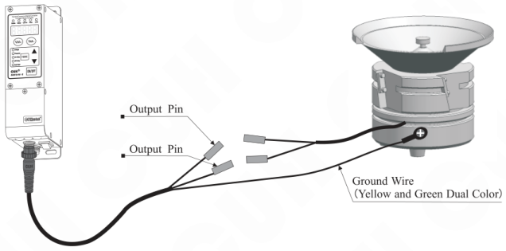

### Avis

Assurez-vous que les bobines électromagnétiques du vibrateur sont raccordées aux deux broches de sortie du câble d'alimentation de sortie et que les bobines sont correctement mises à la terre, sinon des incidents de sécurité graves pourraient survenir.

---

## Troisième étape :

Raccordez le câble d'alimentation d'entrée au contrôleur et serrez l'écrou d'alimentation.

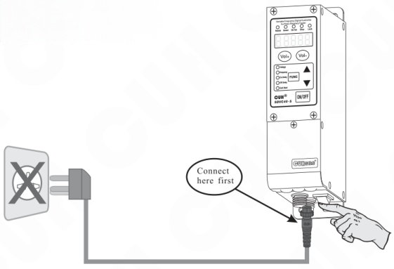

Raccorder ici en premier

## Quatrième étape :

Branchez la fiche du câble d'alimentation d'entrée sur la prise secteur.

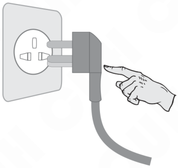

---

## Cinquième étape :

Réglez la tension de sortie du contrôleur sur une valeur comprise entre 30 et 80 (représentée par la lettre U)

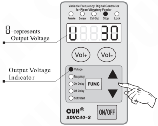

## Sixième étape :

Appuyez sur le bouton `FUNC` et maintenez-le enfoncé pendant 2 secondes pour entrer dans l'état de réglage des paramètres de base.

Le voyant de fréquence de sortie sur le panneau s'allume et l'afficheur LED indique la valeur de fréquence actuelle (E)Appuyez sur le bouton ▲ ou ▼ pour régler la valeur du paramètre de 400Hz à 40Hz afin de trouver la fréquence de résonance du vibrateur et conservez cette valeur.

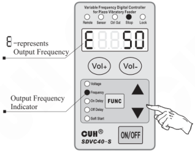

- La fréquence de résonance du vibrateur est la valeur de fréquence qui produit l'amplitude maximale.
- Chaque vibrateur possède sa propre fréquence de résonance mécanique naturelle ; réglez la fréquence de sortie du contrôleur sur cette fréquence pour garantir les meilleures conditions de fonctionnement.

---

## Septième étape :

Après avoir réglé la fréquence de sortie du contrôleur sur la fréquence de résonance mécanique naturelle du vibrateur, réglez la tension de sortie du contrôleur en appuyant sur le bouton **Vol+** ou **Vol-** pour modifier la vitesse d'alimentation.

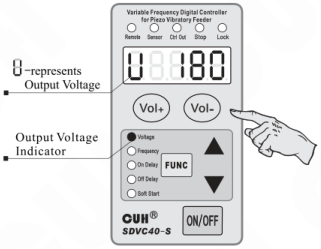

Après les sept étapes ci-dessus, le contrôleur peut fonctionner correctement. Veuillez vous référer aux autres chapitres si des fonctions de commande avancées sont nécessaires.

---

# Chapitre III Description des composants

## 3.1 Description du panneau de commande

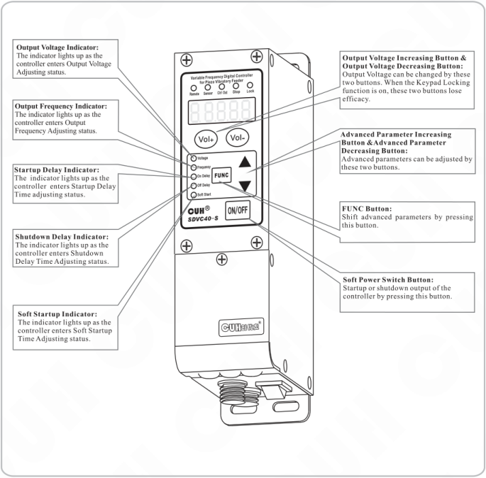

**Voyant de tension de sortie :**  
Le voyant s'allume lorsque le contrôleur entre dans l'état de réglage de la tension de sortie.

**Voyant de fréquence de sortie :**  
Le voyant s'allume lorsque le contrôleur entre dans l'état de réglage de la fréquence de sortie.

**Voyant de retard d'enclenchement :**  
Le voyant s'allume lorsque le contrôleur entre dans l'état de réglage du retard d'enclenchement.

**Voyant de retard de déclenchement :**  
Le voyant s'allume lorsque le contrôleur entre dans l'état de réglage du retard de déclenchement.

**Voyant de démarrage progressif :**  
Le voyant s'allume lorsque le contrôleur entre dans l'état de réglage du temps de démarrage progressif.

**Bouton d'augmentation de la tension de sortie et bouton de diminution de la tension de sortie :**  
La tension de sortie peut être modifiée à l'aide de ces deux boutons. Lorsque la fonction de verrouillage du clavier est activée, ces deux boutons deviennent inopérants.

**Bouton d'augmentation des paramètres avancés et bouton de diminution des paramètres avancés :**  
Les paramètres avancés peuvent être réglés à l'aide de ces deux boutons.

**Bouton FUNC :**  
Appuyez sur ce bouton pour passer d'un paramètre avancé à l'autre.

**Bouton d'interrupteur d'alimentation doux :**  
Appuyez sur ce bouton pour activer ou désactiver la sortie du contrôleur.

---

## 3.2 Description des voyants d'état

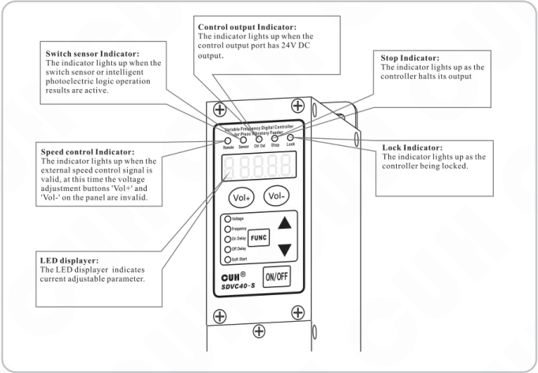

- **Voyant du capteur de commutation :** Le voyant s'allume lorsque les résultats de l'opération logique du capteur de commutation ou du capteur photoélectrique intelligent sont actifs.
- **Voyant de sortie de commande :** Le voyant s'allume lorsque le port de sortie de commande fournit une sortie 24V CC.
- **Voyant d'arrêt :** Le voyant s'allume lorsque le contrôleur arrête sa sortie
- **Voyant de commande de vitesse :** Le voyant s'allume lorsque le signal de commande de vitesse externe est valide ; à ce moment, les boutons de réglage de tension « Vol+ » et « Vol- » du panneau sont inopérants.
- **Voyant de verrouillage :** Le voyant s'allume lorsque le contrôleur est verrouillé.
- **Afficheur LED :** L'afficheur LED indique le paramètre réglable actuel.

## 3.3 Description de l'interface E/S

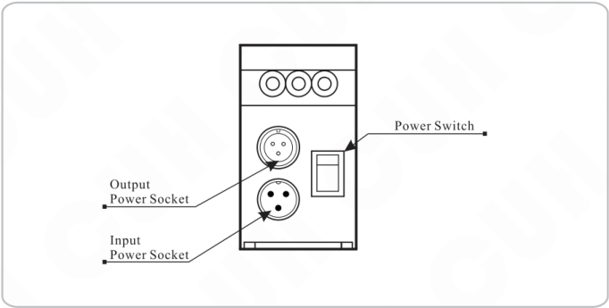

- Interrupteur d'alimentation
- Prise de sortie
- Prise d'alimentation d'entrée

---

# Chapitre IV Description des fonctions

## 4.1 Réglage de la tension de sortie

La tension de sortie peut être réglée directement et numériquement via le panneau de commande. Grâce à la fonction unique de stabilisation de la tension, la tension de sortie du contrôleur ne fluctue pas avec la tension d'entrée,et un vibrateur peut fonctionner de manière stable dans un environnement à tension d'entrée instable.

- Allumez l'interrupteur d'alimentation
- Le voyant de tension de sortie s'allume lorsque le contrôleur entre dans l'état de réglage de la tension de sortie, l'afficheur LED indique alors le symbole de tension U et la valeur de tension précédemment réglée.
- Réglez la valeur de la tension de sortie en appuyant sur le bouton **Vol+** ou **Vol-**.

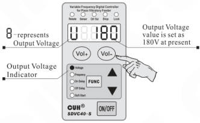

SDVC40-S : la tension de sortie s'étend de 0V à 260V  
SDVC40-SD : la tension de sortie s'étend de 0.0V à 50.0V

> La tension de sortie peut être réglée dans tout état de réglage des paramètres de base ou état de réglage des paramètres avancés en appuyant sur le bouton **Vol+** ou **Vol-**. Le contrôleur revient à l'état de réglage de paramètre précédent après le réglage de la tension de sortie.

---

## 4.2 Réglage de la fréquence de sortie

Le contrôleur est produit avec la technologie DDS et sa sortie présente une haute précision et une grande stabilité de fréquence, qui ne changent ni avec le temps ni avec la température.

- Appuyez sur le bouton **FUNC** et maintenez-le enfoncé pendant 2 secondes pour entrer dans l'état de réglage des paramètres de base.
- Le voyant de fréquence de sortie sur le panneau s'allume et l'afficheur LED indique le symbole de fréquence de sortie E et la valeur de fréquence de sortie actuelle.
- Appuyez sur le bouton ▲ ou ▼ pour régler la valeur du paramètre.

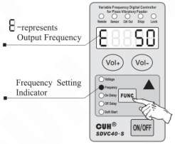

La fréquence de sortie du contrôleur s'étend de 40Hz à 400Hz.

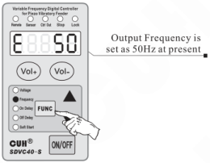

- La fréquence de sortie (E), le retard d'enclenchement, le retard de déclenchement et le temps de démarrage progressif peuvent être réglés après être entré dans l'état de réglage des paramètres de base en appuyant sur le bouton **FUNC** et en le maintenant enfoncé pendant 2 secondes.
- Le contrôleur revient automatiquement à l'état de réglage de la tension de sortie dans un délai d'une minute après l'opération de réglage.
- Appuyez à nouveau sur le bouton **FUNC** et maintenez-le enfoncé pendant 2 secondes pour quitter l'état de réglage des paramètres de base.

---

## 4.3 Démarrage progressif

Afin d'éviter tout choc brusque sur les pièces, le contrôleur peut augmenter progressivement la tension de sortie de 0 à la valeur préréglée au démarrage.

Temps de démarrage progressif ( t ) : le laps de temps nécessaire au contrôleur pour augmenter progressivement la tension de sortie de 0 à la valeur préréglée au démarrage.

- Appuyez sur le bouton `FUNC` et maintenez-le enfoncé pendant 2 secondes pour entrer dans l'état de réglage des paramètres de base.
- Appuyez plusieurs fois sur le bouton `FUNC` jusqu'à passer à l'état de réglage du temps de démarrage progressif (t), le voyant de démarrage progressif s'allume.
- Appuyez sur le bouton ▲ ou ▼ pour régler la valeur du paramètre. L'unité du paramètre est la seconde et la précision numérique est de 0,1.

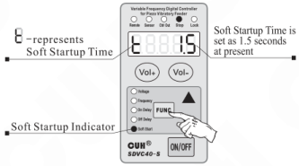

Le temps de démarrage progressif réglable s'étend de 0,1 seconde à 9,9 secondes.

## 4.4 Bouton de marche/arrêt de la sortie

Le bouton d'interrupteur à effleurement sur le panneau peut activer ou désactiver rapidement et facilement la sortie du contrôleur.

- Appuyez sur le bouton `ON/OFF` pour activer ou désactiver la sortie du contrôleur. Le voyant d'arrêt s'allume lorsque la sortie du contrôleur est désactivée.

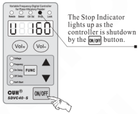

> Grâce à l'interrupteur à effleurement et à la technologie de commande par signal numérique, aucune étincelle ne se produit et ne détériore le contact. Par conséquent, la durée de vie du contrôleur et du vibrateur est considérablement prolongée.

---

## 4.5 Limitation de la tension de sortie maximale

La tension de sortie maximale du contrôleur peut être réglée pour éviter d'endommager le vibrateur. La fonction de commande de vitesse à distance est affectée par ce paramètre.

- Appuyez simultanément sur les boutons `FUNC` et ▲ et maintenez-les enfoncés pendant 2 secondes pour entrer dans l'état de réglage des paramètres avancés.
- Appuyez plusieurs fois sur le bouton `FUNC` jusqu'à passer à l'état de limitation de la tension de sortie maximale (h).
- Appuyez sur le bouton ▲ ou ▼ pour régler la valeur du paramètre.

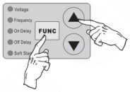

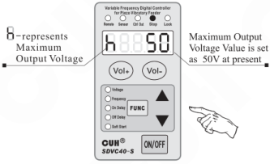

- La valeur de tension de sortie ne peut en aucun cas dépasser la valeur de ce paramètre.
- La valeur par défaut de ce paramètre est réglée sur la valeur de tension de sortie réglable maximale.

### Méthode de sortie de l'état de réglage des paramètres avancés

- Le contrôleur revient automatiquement à l'état de réglage de la tension de sortie dans un délai d'une minute après le réglage des paramètres avancés.
- Appuyez sur les boutons `FUNC` et ▲ et maintenez-les enfoncés pendant 2 secondes pour revenir à l'état de réglage de la tension de sortie.
- Appuyez sur le bouton `FUNC` et maintenez-le enfoncé pendant 2 secondes pour revenir à l'état de réglage des paramètres de base.

---

## 4.6 Verrouillage du clavier

La fonction de verrouillage du clavier peut verrouiller tous les boutons du panneau pour éviter toute fausse manipulation.

- Appuyez sur le bouton `ON/OFF` et maintenez-le enfoncé pendant 2 secondes pour verrouiller tous les boutons du panneau, le voyant de verrouillage du clavier s'allume.
- Appuyez sur le bouton `ON/OFF` et maintenez-le enfoncé pendant 2 secondes en mode verrouillage pour déverrouiller le clavier.

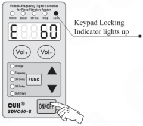

---

## 4.7 Réglage de l'état de fonctionnement à la mise sous tension

Afin d'éviter les problèmes liés aux coupures de courant soudaines en conditions normales suivies du retour de l'alimentation, ou de répondre à des exigences particulières concernant l'état de mise sous tension du contrôleur, vous pouvez régler ce paramètre pour définir l'état de mise sous tension du contrôleur comme étant en marche, à l'arrêt ou suivant l'état de la dernière mise hors tension.

- Appuyez simultanément sur les boutons **FUNC** et ▲ et maintenez-les enfoncés pendant 2 secondes pour entrer dans l'état de réglage des paramètres avancés.
- Appuyez plusieurs fois sur le bouton **FUNC** jusqu'à passer à l'état de fonctionnement à la mise sous tension (Γd).
- Appuyez sur le bouton ▲ ou ▼ pour régler la valeur du paramètre.

> 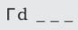 Indique que l'état de mise sous tension est en marche.
>
> 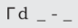 Indique que l'état de mise sous tension est à l'arrêt.
>
> 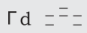 Indique que l'état de mise sous tension suit l'état de la dernière mise hors tension. (Si le contrôleur arrête la sortie lors de la dernière mise hors tension, le contrôleur sera à l'arrêt lors de la prochaine mise sous tension ; inversement, si le contrôleur est en sortie lors de la dernière mise hors tension, le contrôleur sera en marche lors de la prochaine mise sous tension)

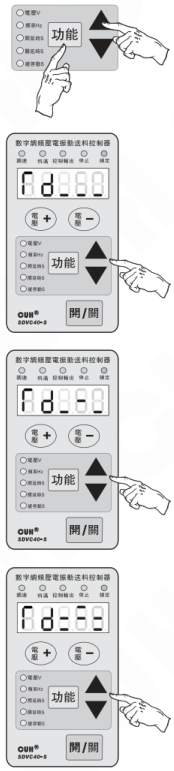

---

## 4.8 Restauration des paramètres par défaut

Cette fonction permet à l'opérateur de restaurer tous les réglages de paramètres par défaut.

En raison des nombreuses fonctions du contrôleur, de nombreux paramètres peuvent être réglés. Afin d'éviter la situation où, après un trop grand nombre de modifications par un débutant, le contrôleur ne peut plus fonctionner correctement, cette fonction permet à l'opérateur de restaurer facilement les paramètres par défaut du contrôleur.

- Appuyez simultanément sur les boutons **FUNC** et **▲** et maintenez-les enfoncés pendant 2 secondes pour entrer dans l'état de réglage des paramètres avancés.

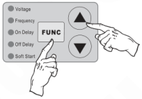

- Appuyez plusieurs fois sur le bouton **FUNC** jusqu'à ce que 88888 clignote sur l'afficheur LED, puis appuyez sur le bouton **▲** et maintenez-le enfoncé jusqu'à ce que ----- s'affiche, ce qui signifie que les paramètres par défaut ont été restaurés avec succès

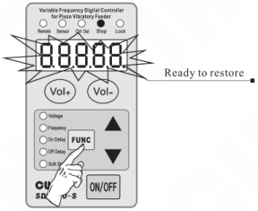

- Après avoir relâché le bouton **▲**, le contrôleur entre dans l'état de réglage de la tension de sortie (U). À ce moment, tous les paramètres ont été restaurés aux valeurs par défaut.

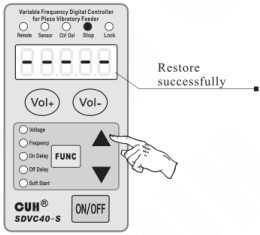

---

# Chapitre V Capteurs et commande de signal

Le contrôleur peut être commandé par de nombreux types de signaux externes et de capteurs. Ce chapitre décrit principalement la méthode d'utilisation du capteur photoélectrique intelligent, des capteurs de proximité et de l'automate (PLC).

## 5.1 Détection photoélectrique intelligente

Combiné au capteur photoélectrique SDVC-S1, la fonction de détection photoélectrique intelligente peut être réalisée. Le capteur SDVC-S1 peut filtrer l'interférence de la lumière ambiante qui affecte la sensibilité du contrôleur. Par conséquent, le contrôleur peut fonctionner de manière fiable sans réglage manuel de la sensibilité.

### 5.1.1 Méthode de raccordement du capteur photoélectrique intelligent SDVC-S1

**Étape 1 :**

Ouvrez le couvercle supérieur du contrôleur.

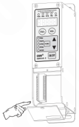

**Étape 2 :**

Raccordez le capteur SDVC-S1 aux bornes du contrôleur conformément au schéma.

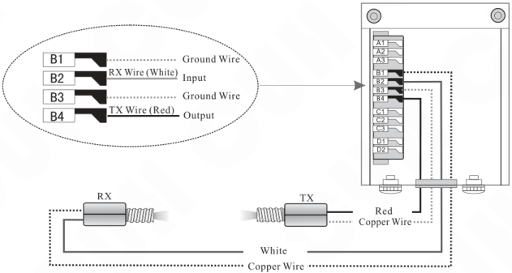

**Remarque :**

La relation logique par défaut du capteur est réglée sur « absence de pièces ».

---

## 5.1.2 Réglage du retard d'enclenchement et du retard de déclenchement du capteur photoélectrique intelligent

Dans la plupart des applications réelles, la sortie du contrôleur doit être retardée d'un certain temps lorsque le démarrage ou l'arrêt du contrôleur est commandé par des signaux externes. Les fonctions de réglage du retard d'enclenchement et du retard de déclenchement rendent ce type d'application possible. De plus, les chocs sur les pièces lors du démarrage du contrôleur peuvent être éliminés en réglant le temps de démarrage progressif.

### Retard d'enclenchement (J)

Le laps de temps qui s'écoule entre la réception d'un signal de commande de démarrage et le début de la sortie du contrôleur.

- Appuyez sur le bouton **FUNC** et maintenez-le enfoncé pendant 2 secondes pour entrer dans l'état de réglage des paramètres de base.
- Appuyez plusieurs fois sur le bouton **FUNC** jusqu'à passer à l'état de réglage du retard d'enclenchement (J), le voyant de retard d'enclenchement sur le panneau s'allume.
- Réglez le paramètre en appuyant sur le bouton ▲ ou ▼. L'unité du paramètre est la seconde et la précision numérique est de 0,1.

La plage réglable du paramètre s'étend de 0,0 à 9,9 secondes  
La valeur par défaut du paramètre est de 0,2 seconde

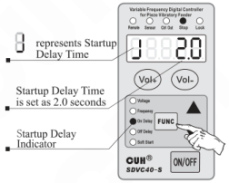

### Retard de déclenchement (L)

Le laps de temps qui s'écoule entre la réception d'un signal de commande d'arrêt et la coupure de la sortie du contrôleur.

- Appuyez sur le bouton **FUNC** et maintenez-le enfoncé pendant 2 secondes pour entrer dans l'état de réglage des paramètres de base.
- Appuyez plusieurs fois sur le bouton **FUNC** jusqu'à passer à l'état de réglage du retard de déclenchement (L), le voyant de retard de déclenchement sur le panneau s'allume.
- Réglez le paramètre en appuyant sur le bouton ▲ ou ▼. L'unité du paramètre est la seconde et la précision numérique est de 0,1.

La plage réglable du paramètre s'étend de 0,0 à 9,9 secondes  
La valeur par défaut du paramètre est de 0,2 seconde

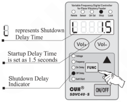

---

## 5.1.3 Réglage de la relation logique du capteur photoélectrique intelligent

Dans des conditions normales, l'extrémité réceptrice ne reçoit aucun signal optique et le contrôleur fonctionne par défaut. Mais dans certaines applications particulières, le contrôleur doit être arrêté lorsque l'extrémité réceptrice ne reçoit aucun signal optique. Le réglage de ce paramètre permet de répondre à ce type d'application.

- Appuyez simultanément sur les boutons **FUNC** et ▲ et maintenez-les enfoncés pendant 2 secondes pour entrer dans l'état de réglage des paramètres avancés.
- Appuyez plusieurs fois sur le bouton **FUNC** jusqu'à passer à l'état de réglage de la relation logique du capteur photoélectrique intelligent.
- Réglez le paramètre en appuyant sur le bouton ▲ ou ▼.

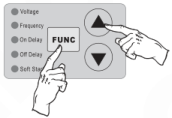

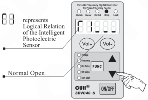

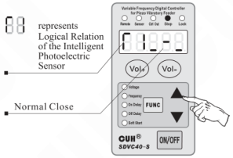

- Lorsque la relation logique est réglée sur Normal Open, c'est-à-dire qu'aucun signal optique n'est reçu, le contrôleur fonctionne.
- Lorsque la relation logique est réglée sur Normal Close, c'est-à-dire qu'aucun signal optique n'est reçu, le contrôleur s'arrête.

---

## 5.2 Méthode d'utilisation du capteur de commutation NPN

Le contrôleur peut fonctionner avec toutes sortes de capteurs tels que les capteurs de commutation, les capteurs photoélectriques et les capteurs à fibre optique.

### 5.2.1 Méthode de raccordement du capteur de proximité NPN

**Étape 1 :**

Ouvrez le couvercle supérieur du contrôleur.

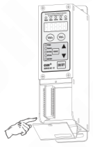

**Étape 2 :**

Raccordez le capteur de proximité NPN aux bornes du contrôleur conformément au schéma.

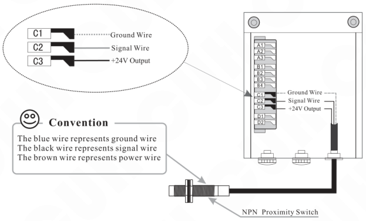

**Convention**

Le fil bleu représente le fil de terre  
Le fil noir représente le fil de signal  
Le fil marron représente le fil d'alimentation

---

### 5.2.2 Méthode de raccordement du capteur de commutation NPN à barrière

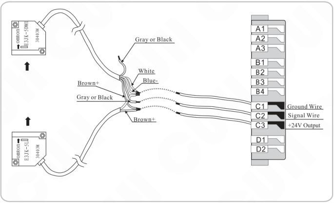

### 5.2.3 Méthode de raccordement du capteur photoélectrique à barrière

---

## 5.2.4 Méthode de raccordement du capteur à fibre optique à barrière

---

## 5.2.5 Méthode de raccordement du capteur photoélectrique à réflexion

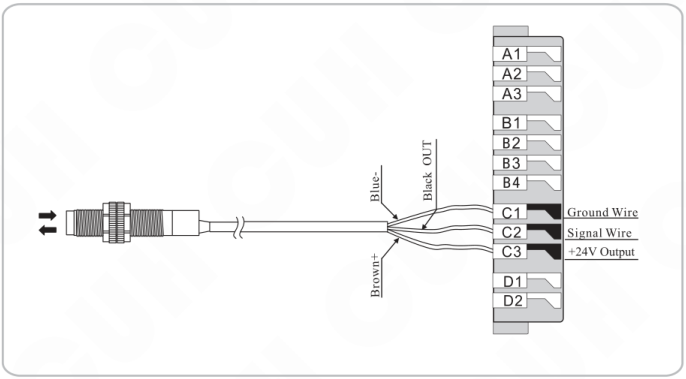

## 5.3 Réglage du retard d'enclenchement et du retard de déclenchement du capteur de commutation NPN

Par défaut, le capteur photoélectrique intelligent et le capteur de commutation partagent le même retard d'enclenchement et le même retard de déclenchement. Les opérateurs peuvent également régler indépendamment le retard d'enclenchement et le retard de déclenchement pour le capteur de commutation.

### Retard d'enclenchement (J-)

Le laps de temps qui s'écoule entre la réception d'un signal de commande de démarrage et le début de la sortie du contrôleur.

- Appuyez simultanément sur les boutons **FUNC** et **▲** et maintenez-les enfoncés pendant 2 secondes pour entrer dans l'état de réglage des paramètres avancés.
- Appuyez plusieurs fois sur le bouton **FUNC** jusqu'à passer à l'état de réglage du retard d'enclenchement (J- ---), le voyant de retard d'enclenchement sur le panneau s'allume.
- Réglez le paramètre en appuyant sur le bouton **▲** ou **▼**. L'unité du paramètre est la seconde et la précision numérique est de 0,1.

Le retard d'enclenchement est réglé sur J- --- par défaut

### Retard de déclenchement (L-)

Le laps de temps qui s'écoule entre la réception d'un signal de commande d'arrêt et la coupure de la sortie du contrôleur.

- Appuyez simultanément sur les boutons **FUNC** et **▲** et maintenez-les enfoncés pendant 2 secondes pour entrer dans l'état de réglage des paramètres avancés.
- Appuyez plusieurs fois sur le bouton **FUNC** jusqu'à passer à l'état de réglage du retard de déclenchement (L-), le voyant de retard de déclenchement sur le panneau s'allume.
- Réglez le paramètre en appuyant sur le bouton **▲** ou **▼**. L'unité du paramètre est la seconde et la précision numérique est de 0,1.

Le retard de déclenchement est réglé sur L- --- par défaut

> ➔ Lorsque les valeurs de J- et L- sont réglées sur 0, le retard d'enclenchement et le retard de déclenchement du capteur de commutation sont identiques au retard d'enclenchement et au retard de déclenchement du capteur photoélectrique intelligent.
>
> ➔ Le retard d'enclenchement et le retard de déclenchement du capteur photoélectrique intelligent ne sont pas affectés par le paramètre de J- ou L-.

---

## 5.4 Réglage de la relation logique du capteur de commutation NPN (Arrêt lorsque les pièces sont pleines)

Dans des conditions normales, le contrôleur ne reçoit aucun signal du capteur de commutation NPN et fonctionne par défaut. Mais dans certaines applications particulières, le contrôleur doit être arrêté lorsqu'il ne reçoit aucun signal du capteur de commutation NPN. Le réglage de ce paramètre permet de répondre à ce type d'application.

- Appuyez simultanément sur les boutons **FUNC** et ▲ et maintenez-les enfoncés pendant 2 secondes pour entrer dans l'état de réglage des paramètres avancés.
- Appuyez plusieurs fois sur le bouton **FUNC** jusqu'à passer à l'état de réglage de la relation logique du capteur de commutation NPN (Γ 2).
- Réglez le paramètre en appuyant sur le bouton ▲ ou ▼.

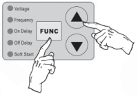

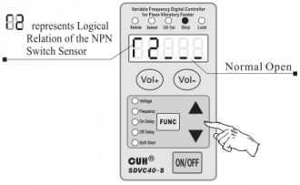

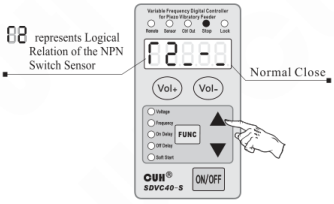

- Lorsque la relation logique est réglée sur Normal Open, c'est-à-dire qu'aucun signal n'est reçu, le contrôleur fonctionne.
- Lorsque la relation logique est réglée sur Normal Close, c'est-à-dire qu'aucun signal n'est reçu, le contrôleur s'arrête.

---

## 5.5 Réglage de la relation logique du signal de commande

Le contrôleur peut définir la relation logique du capteur photoélectrique intelligent et du capteur de commutation lorsqu'ils fonctionnent simultanément.

- Appuyez simultanément sur les boutons **FUNC** et ▲ et maintenez-les enfoncés pendant 2 secondes pour entrer dans l'état de réglage des paramètres avancés.
- Appuyez plusieurs fois sur le bouton **FUNC** jusqu'à passer à l'état de réglage de la relation logique du signal de commande
- Réglez le paramètre en appuyant sur le bouton ▲ ou ▼.

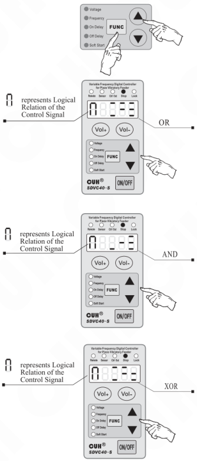

- Relation logique AND : le contrôleur fonctionne uniquement lorsque le capteur photoélectrique intelligent et le capteur de commutation NPN le demandent tous les deux.
- Relation logique OR : le contrôleur fonctionne lorsque le capteur photoélectrique intelligent ou le capteur de commutation NPN le demande.
- Relation logique NOR : le contrôleur fonctionne uniquement lorsque le capteur photoélectrique intelligent et le capteur de commutation NPN émettent un signal de commande opposé.

---

## 5.6 Méthode de raccordement de l'automate supérieur qui contrôle le contrôleur d'alimentateur vibrant

### Méthode de raccordement de l'automate de commande

### Première étape :
Ouvrez le couvercle supérieur du contrôleur.

### Deuxième étape :
Raccordez l'automate aux bornes du contrôleur conformément au schéma.

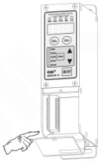

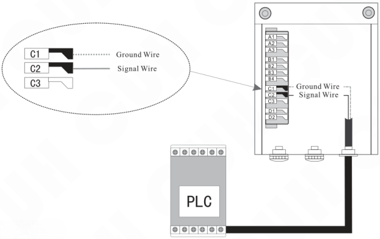

> La sortie à relais ou la sortie NPN de l'automate est compatible avec le contrôleur.

---

## 5.7 Sortie de commande

Le contrôleur peut émettre un signal de commande basse tension pour coopérer avec d'autres dispositifs tels qu'une électrovanne, un automate ou un relais électrique.

### 5.7.1 Méthode de raccordement de la sortie de commande

#### Méthode de raccordement de l'électrovanne

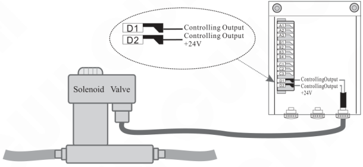

- Le contrôleur peut piloter directement une électrovanne dont la tension nominale est de 24V et la puissance nominale inférieure à 4W.
- Utilisez une alimentation externe pour l'électrovanne de forte puissance.

#### Méthode de raccordement du relais électrique

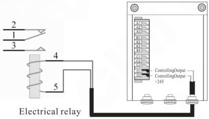

- Le contrôleur peut piloter directement un relais électrique dont la tension nominale est de 24V et la puissance nominale inférieure à 4W.

---

## 5.7.2 Réglage de la relation logique de la sortie de commande

- Appuyez simultanément sur les boutons **FUNC** et ▲ et maintenez-les enfoncés pendant 2 secondes pour entrer dans l'état de réglage des paramètres avancés.
- Appuyez plusieurs fois sur le bouton **FUNC** jusqu'à passer à l'état de réglage de la relation logique de la sortie de commande (Γ3).
- Réglez le paramètre en appuyant sur le bouton ▲ ou ▼.

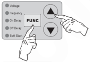

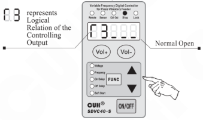

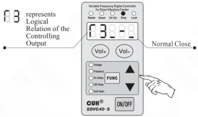

> - Lorsque la relation logique est réglée sur Normal Open, la sortie de commande fonctionne lorsque le contrôleur fonctionne.
> - Lorsque la relation logique est réglée sur Normal Close, la sortie de commande ne fonctionne pas lorsque le contrôleur fonctionne.

---

## 5.8 Commande de vitesse à distance

La fonction de commande de vitesse à distance permet à l'opérateur de contrôler la tension de sortie au moyen d'un potentiomètre externe ou d'un signal de commande allant de 1V à 5V. Ainsi, la commande de vitesse à distance externe peut être facilement réalisée par un automate, un DCS ou tout autre moyen.

La fonction de commande de vitesse à distance devient effective pour le contrôleur lorsque le signal de commande dépasse 0.5V. Pendant ce temps, le voyant de commande de vitesse à distance sur le panneau s'allume et les boutons Vol+ et Vol- deviennent inopérants. L'afficheur LED indique la tension de sortie actuelle si le contrôleur fonctionne dans l'état de réglage de la tension de sortie.

### Méthode de raccordement du potentiomètre externe

**Remarque :** Veuillez sélectionner un potentiomètre linéaire d'une résistance de 1k.

### Méthode de raccordement de l'automate (PLC)

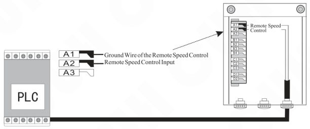

---

## Chapitre VI Fonctions de sécurité

### 6.1 Stabilisation automatique de la tension

La fonction de stabilisation numérique de la tension intégrée peut éliminer les variations de vitesse d'alimentation causées par les fluctuations de la tension du secteur.

### 6.2 Protection contre les courts-circuits

Si la sortie du contrôleur est court-circuitée, le contrôleur arrête sa sortie jusqu'au redémarrage.

### 6.3 Protection contre les surcharges de courant

Le contrôleur arrête sa sortie pour garantir la sécurité de fonctionnement des équipements lorsque le courant de fonctionnement dépasse sa valeur nominale.

### 6.4 Protection contre la surchauffe

Le contrôleur arrête sa sortie pour se protéger lorsque la température de fonctionnement est trop élevée.

---

# Annexe

## Annexe A : Dimensions

Dimensions extérieures du modèle de contrôleur : (Unité : mm)

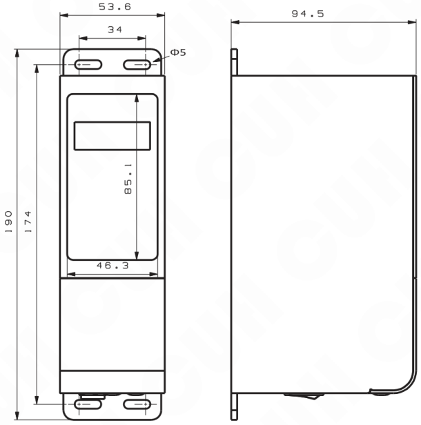

---

## Annexe B : Définition de l'interface de sortie

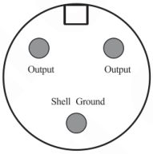

### Remarque :

A : Assurez-vous que les bobines électromagnétiques du vibrateur sont raccordées aux deux broches de sortie de la prise du câble d'alimentation de sortie et que le boîtier du vibrateur est correctement mis à la terre, sinon des incidents de sécurité graves pourraient survenir.

B : Après le soudage, assurez-vous que la zone nue est enveloppée de ruban isolant ou de gaine thermorétractable avant de l'insérer dans la prise du câble d'alimentation de sortie, afin d'éviter toute fuite électrique ou tout court-circuit.

## Annexe C : Définition de l'interface de signal

---

## Annexe D : Tableau des fonctions

| Contrôleur | Caractère affiché | Image du symbole |
|---|---|---|
| U | Tension de sortie |  |
| E | Fréquence de sortie |  |
| J | Retard d'enclenchement du capteur photoélectrique intelligent |  |
| L | Retard de déclenchement du capteur photoélectrique intelligent |  |
| t | Démarrage progressif |  |
| L- | Retard de déclenchement du capteur de commutation NPN |  |
| J- | Retard d'enclenchement du capteur de commutation NPN |  |
| r1 | Relation logique du capteur photoélectrique intelligent |  |
| r2 | Relation logique du capteur de commutation NPN |  |
| r3 | Relation logique de la sortie de commande |  |
| rd | État de fonctionnement à la mise sous tension |  |
| A | Relation logique du signal de commande |  |
| h | Tension de sortie maximale |  |
| 8.8.8.8.8. | Restauration des paramètres par défaut |  |

---

## Annexe E : Spécifications électriques

| Élément | Plage Min | Plage Typique | Plage Max | Unité | Description |
|---|---|---|---|---|---|
| Tension d'entrée | 85 | 220 | 260 | V | AC RMS |
| Plage de tension de sortie réglable | 0 | —— | 220 | V | SDVC40-S |
| Plage de tension de sortie réglable | 0.0 | —— | 50.0 | V | SDVC40-SD |
| Précision de réglage de la tension | | 1 | | V | SDVC40-S |
| Précision de réglage de la tension | | 0.1 | | V | SDVC40-SD |
| Précision de régulation de la tension | 0 | —— | 10 | % | ΔVout/ΔVin |
| Temps de réponse de la régulation de tension | 0.0025 | —— | 0.025 | s | la période de la tension de sortie |
| Plage de courant de sortie réglable | 0 | —— | 150 | mA | SDVC40-S |
| Plage de courant de sortie réglable | 0 | —— | 600 | mA | SDVC40-SD |
| Puissance de sortie | 0 | —— | 33 | VA | SDVC40-S |
| Puissance de sortie | 0 | —— | 30 | VA | SDVC40-SD |
| Fréquence de sortie | 40 | —— | 400 | Hz | |
| Précision de réglage de la fréquence | | 0.1 | | Hz | |
| Forme d'onde de sortie | | Onde sinusoïdale | | | |
| Temps de démarrage progressif | 0 | —— | 10 | s | Valeur par défaut en usine :0.5 |
| Plage de temps de retard de marche/arrêt | 0 | —— | 20 | s | Valeur par défaut en usine :0.2 |
| Précision du temps de retard de marche/arrêt | | 0.1 | | s | |
| Température de déclenchement de la protection contre la surchauffe | 60 | —— | 65 | °C | |
| Tension de sortie de commande CC | 22 | 24 | 26 | V | |
| Courant de sortie de commande CC | 0 | —— | 200 | mA | |
| Signal de commande analogique | | 1-5 | | V | Tension de commande de vitesse à distance |
| Signal de commande numérique | | 24 | | V | Signal de commutation |
| Méthode de réglage | | 6 | | Bouton | |
| Consommation en veille | —— | 4 | —— | W | |
| Méthode d'affichage | | 5 | | Digit | Tubes numériques LED |
| Température ambiante | 0 | 25 | 40 | °C | Sans condensation |
| Humidité ambiante | 10 | 60 | 85 | % | Sans condensation |

---

## Annexe F : Conseils de dépannage et explications des erreurs

Les conseils suivants peuvent aider à résoudre les problèmes que vous pouvez rencontrer

| | | | Image du symbole |
|---|---|---|---|
| 1 | Aucun affichage après la mise sous tension | ◆ Assurez-vous que la prise de courant est alimentée ◆ Assurez-vous que le câble d'alimentation d'entrée est correctement raccordé à la prise de courant | |
| 2 | Affichage normal mais aucune sortie | ◆ Assurez-vous que le câble d'alimentation d'entrée et le câble d'alimentation de sortie sont fermement raccordés ◆ Assurez-vous que la valeur du paramètre de tension de sortie n'est pas trop petite ◆ Assurez-vous que le contrôleur n'est pas arrêté par le signal de commande ◆ Assurez-vous que le contrôleur n'est pas arrêté par les paramètres réglés sur normal off | |
| 3 | Le signal de commande perd son efficacité | ◆ Assurez-vous que le signal de commande est correctement entré ◆ Assurez-vous que le fil de terre du signal de commande est correctement raccordé au contrôleur ◆ Assurez-vous que la relation logique du signal de commande est correctement réglée selon vos attentes | |
| 4 | Phénomènes de battement | ◆ Évitez le couplage de vibrations entre les vibrateurs ◆ Augmentez la fréquence de résonance des vibrateurs | |
| 5 | Affichage normal, aucune sortie, mais un son audible | ◆ Réglez tous les paramètres comme indiqué dans ce manuel | |
| 6 | Err01 | ◆ Sortie en court-circuit, assurez-vous que le câble d'alimentation de sortie et la bobine ne sont pas court-circuités |  |
| 7 | Err02 | ◆ Surcharge de courant en sortie, réduisez la valeur de la tension de sortie et assurez-vous que l'entrefer de l'armature n'est pas trop grand |  |
| 8 | Err03 | ◆ Surchauffe, placez le contrôleur dans un environnement bien ventilé |  |
| 9 | Err04 | ◆ Réservé, veuillez nous contacter |  |
| 10 | Err05 | ◆ Réservé, veuillez nous contacter |  |

---

Nanjing CUH Science & Technology Co.,Ltd  
https://en.cuhnj.com  
Tel.:+86-25-84730411 / 84730415 / 84730416  
Fax:+86-25-84730426  
E-mail:sales@cuhnj.com  
Add.:Building 2, Xueyan Tech Park, Tuscity,  
No.9 Zhineng Rd, Jiangning, Nanjing, China

