## Contrôleur intelligent à fréquence variable pour alimentateur vibrant piézoélectrique

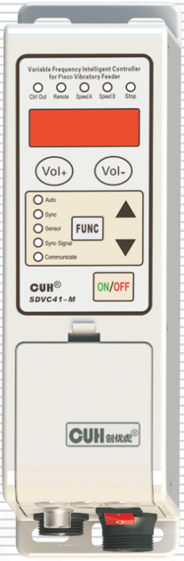

## Série SDVC41
Contrôleur intelligent à fréquence variable pour alimentateur vibrant piézoélectrique　 Série SDVC41
## Manuel d'utilisation

---

## Avant-propos

Merci d'avoir choisi le contrôleur intelligent numérique pour alimentateur vibrant CUH.

(ci-après dénommé « contrôleur »).

Ce manuel contient des notes pour l'installation, la mise en service, le réglage des paramètres, la maintenance et le dépannage du contrôleur. Veuillez lire attentivement ce manuel avant d'utiliser le contrôleur et conservez-le correctement.

---

---

## Consignes de sécurité

1. Ne branchez ou ne débranchez jamais les câbles et ne touchez jamais les prises de courant lorsque le contrôleur est sous tension, afin d'éviter tout choc électrique ou autre accident.
2. Ne connectez jamais le contrôleur à une alimentation 380 V CA, ce qui pourrait causer des dommages irréparables. (nous proposons le produit conçu pour 380 V CA)
3. Ne commutez jamais l'entrée du contrôleur en coupant l'alimentation pour activer/désactiver la sortie, sinon cela peut réduire la durée de vie du contrôleur.
4. Ne faites jamais fonctionner le contrôleur au-delà de ses limites de conception.
5. Utilisez le contrôleur strictement conformément à ce manuel. Nous n'assumons aucune responsabilité civile ou pénale si des dommages matériels ou corporels sont causés par une utilisation incorrecte.

> N'ouvrez jamais le boîtier du contrôleur pour éviter tout choc électrique. Contactez CUH en cas de panne du contrôleur. N'essayez jamais de réparer le contrôleur vous-même, ce qui annulerait la garantie.

---

## Environnement d'utilisation et de stockage

### Vérification avant utilisation

Chaque contrôleur subit un contrôle qualité rigoureux avant livraison et est emballé dans un emballage anti-choc. Veuillez vérifier les points suivants après le déballage :

1. Si le contrôleur est endommagé en apparence.
2. Si le modèle du contrôleur correspond à celui de votre commande.

### Environnement de fonctionnement

Veuillez suivre les instructions ci-dessous pour garantir de meilleures performances et une durée de vie plus longue du contrôleur :

- ⚠ Environnement bien ventilé
- ⚠ Tenir à l'écart de l'eau, de la vapeur, de la poussière et surtout de la poussière huileuse
- ⚠ Tenir à l'écart des gaz et liquides corrosifs ou inflammables
- ⚠ Tenir à l'écart de la poussière en suspension et des particules métalliques
- ⚠ Fixer solidement pour éviter les auto-vibrations
- ⚠ Tenir à l'écart des interférences électromagnétiques
- ⚠ Assurer une température ambiante de 0~40 ℃
- ⚠ Pour une utilisation à une altitude de 2000 m ou moins

---

# Table des matières

- Chapitre I Caractéristiques — 1
- Chapitre II Guide d'installation — 2
- Chapitre III Description des composants — 4
  - 3.1 Description des voyants — 4
  - 3.2 Description des boutons — 5
  - 3.3 Description des interfaces E/S et des accessoires — 5
  - 3.4 Description des ports de commande de signal — 6
- Chapitre IV Réglage des paramètres — 7
  - 4.1 Paramètres communs — 7
  - 4.2 Paramètres de base — 7
  - 4.3 Paramètres avancés — 8
  - 4.4 Paramètres Auto/Sync — 9
- Chapitre V Mode de fonctionnement — 10
  - 5.1 Mode manuel — 10
  - 5.2 Mode Auto — 12
  - 5.3 Mode semi-automatique — 18
  - 5.4 Mode Sync — 20
- Chapitre VI Contrôle des signaux — 27
  - 6.1 Commande marche/arrêt des ports C — 27
  - 6.2 Commande marche/arrêt des ports E — 34
  - 6.3 Paramètres communs des ports C et des ports E — 37
  - 6.4 Commande de vitesse à distance — 39
  - 6.5 Stockage et sortie des vitesses préréglées — 41
  - 6.6 Communication RS485 — 42
  - 6.7 Sortie de commande 24 V CC — 43
- Chapitre VII Fonctions de sécurité — 45

---

---

Annexe A : Dimensions ------------------------------------------------------46

Annexe B : Définition des ports de commande de signal -----------------------------47

Annexe C : Spécifications électriques ---------------------------------------50

Annexe D : Suggestions de dépannage et explications des erreurs -51

Réinitialisation du contrôleur -----------------------------------------------------------------52

---

# Chapitre Ⅰ Caractéristiques

Le contrôleur est spécialement conçu pour contrôler un alimentateur vibrant piézoélectrique dans les systèmes d'automatisation. Combinant les dernières technologies électroniques et une conception soignée, le contrôleur présente les caractéristiques pratiques et conviviales suivantes :

**Charge :** Le contrôleur s'adapte aux charges résistives, inductives et en particulier capacitives telles qu'un vibrateur piézoélectrique.

**Auto-FM :** Modulation automatique de la fréquence de sortie en temps réel pour garantir que l'alimentateur vibrant fonctionne toujours à sa meilleure fréquence de vibration.

**Contrôle automatique de vitesse constante :** Réglage automatique de la tension de sortie en temps réel pour garantir une vitesse d'alimentation préréglée constante, quelles que soient les variations de poids des produits dans l'alimentateur vibrant.

**Mesure automatique de fréquence :** Mesure et sortie automatiques de la meilleure fréquence de vibration de l'alimentateur vibrant.

**Régulation automatique de tension :** Élimine à la fois les variations de vitesse d'alimentation causées par les fluctuations de la tension secteur et l'effet de battement causé par la fréquence du courant alternatif industriel.

**Synchronisation de forme d'onde :** Synchronise la forme d'onde de sortie des contrôleurs esclaves avec celle du contrôleur maître sur la même fréquence et la même phase pour éviter l'effet de battement.

**Commande marche/arrêt à distance :** Le contrôleur dispose de 2 groupes de ports de commande marche/arrêt. Des capteurs de commutation ou un automate programmable peuvent être connectés pour activer/désactiver le contrôleur. Le temps de démarrage progressif, le retard d'enclenchement, le retard de déclenchement et la relation logique de la commande marche/arrêt peuvent également être réglés.

**Reconnaissance automatique du type de capteur de commutation :** Le contrôleur peut reconnaître et s'adapter aux capteurs de commutation de type NPN et PNP.

**Démarrage progressif :** Afin d'éviter un choc soudain sur le produit à alimenter et l'alimentateur vibrant, le contrôleur peut augmenter progressivement la tension de sortie/la vitesse d'alimentation de 0 à la valeur préréglée au démarrage.

**Vitesses préréglées :** 4 vitesses d'alimentation préréglées peuvent être stockées et émises par un signal de court-circuit externe.

**Tension de sortie maximale réglable :** La tension de sortie maximale réglable peut être préréglée pour protéger l'alimentateur vibrant des dommages causés par une tension élevée.

**Commande de vitesse à distance :** La tension de sortie/la vitesse d'alimentation du contrôleur peut être réglée à distance par un potentiomètre externe, un automate programmable ou un signal continu 1~5V/4~20mA.

**Sortie de commande 24 V CC :** Le contrôleur peut fournir une alimentation 24 V CC associée au réglage de la relation logique de la commande marche/arrêt pour piloter une électrovanne, un relais électrique ou d'autres appareils externes.

**Verrouillage du panneau de commande :** Verrouillez tous les boutons du panneau de commande en maintenant enfoncé le bouton ON/OFF pendant 2 secondes pour éviter les fausses manœuvres.

**Verrouillage des paramètres :** Verrouillez tous les paramètres sauf la tension de sortie/la vitesse d'alimentation à l'aide d'un mot de passe personnalisé pour empêcher toute utilisation non autorisée.

**Réinitialisation du contrôleur : Reset** remet tous les paramètres du contrôleur aux valeurs d'usine.

**Communication RS485 :** Tous les paramètres peuvent être réglés via les ports de communication RS485.

---

## Chapitre Ⅱ Guide d'installation

### Étape un :

Ouvrez la boîte d'emballage et vérifiez le contrôleur ainsi que tous les accessoires.

### Étape deux :

Connectez les bornes de câblage du cordon d'alimentation de sortie aux électrodes du bol vibrant piézoélectrique.

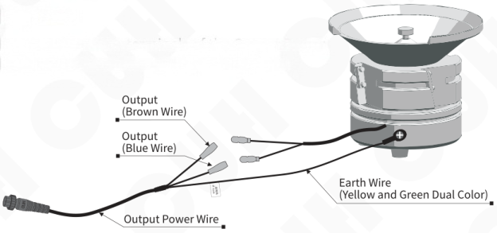

> **Remarque :** Assurez-vous que les électrodes du bol vibrant piézoélectrique sont connectées au fil de phase et au fil neutre du cordon d'alimentation de sortie et que le bâti de l'alimentateur est correctement mis à la terre, sinon un accident grave peut survenir.

### Étape trois :

Connectez le connecteur du cordon d'alimentation de sortie à la prise d'alimentation de sortie du contrôleur.

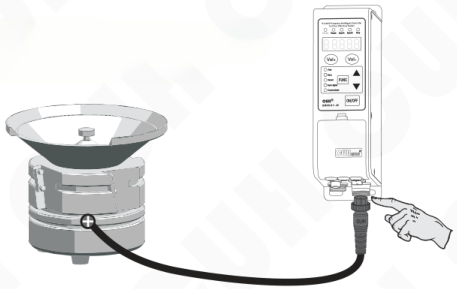

---

## Étape quatre :

Connectez le connecteur du cordon d'alimentation d'entrée à la prise d'alimentation d'entrée du contrôleur.

Connectez d'abord le côté contrôleur

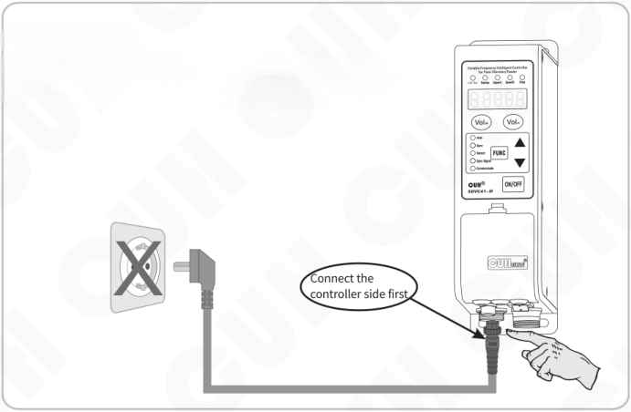

## Étape cinq :

Connectez la fiche du cordon d'alimentation d'entrée à la prise secteur.

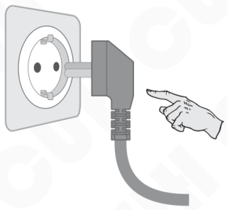

## Chapitre Ⅲ Description des composants

### 3.1 Description des voyants

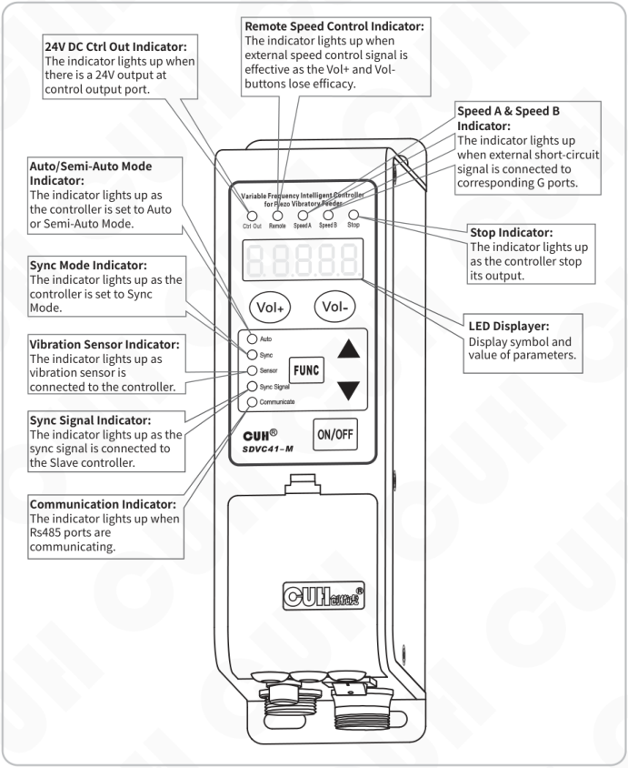

**Voyant de sortie de commande 24 V CC :**  
Le voyant s'allume lorsqu'une sortie 24 V est présente au port de sortie de commande.

**Voyant de commande de vitesse à distance :**  
Le voyant s'allume lorsque le signal externe de contrôle de vitesse est actif, car les boutons Vol+ et Vol- deviennent alors inopérants.

**Voyant de vitesse A et vitesse B :**  
Le voyant s'allume lorsqu'un signal de court-circuit externe est connecté aux ports G correspondants.

**Voyant de mode Auto/semi-automatique :**  
Le voyant s'allume lorsque le contrôleur est réglé en mode Auto ou semi-automatique.

**Voyant d'arrêt :**  
Le voyant s'allume lorsque le contrôleur arrête sa sortie.

**Voyant de mode Sync :**  
Le voyant s'allume lorsque le contrôleur est réglé en mode Sync.

**Afficheur LED :**  
Affiche le symbole et la valeur des paramètres.

**Voyant de capteur de vibration :**  
Le voyant s'allume lorsqu'un capteur de vibration est connecté au contrôleur.

**Voyant de signal de synchronisation :**  
Le voyant s'allume lorsque le signal de synchronisation est connecté au contrôleur esclave.

**Voyant de communication :**  
Le voyant s'allume lorsque les ports RS485 communiquent.

---

## 3.2 Description des boutons

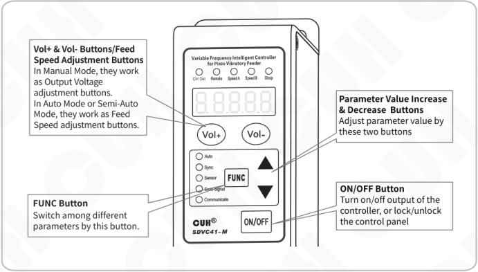

**Boutons Vol+ et Vol-/Boutons de réglage de la vitesse d'alimentation**  
En mode manuel, ils servent de boutons de réglage de la tension de sortie.  
En mode Auto ou semi-automatique, ils servent de boutons de réglage de la vitesse d'alimentation.

**Boutons d'augmentation et de diminution de la valeur des paramètres**  
Réglez la valeur des paramètres à l'aide de ces deux boutons

**Bouton FUNC**  
Permet de basculer entre les différents paramètres à l'aide de ce bouton.

**Bouton ON/OFF**  
Active/désactive la sortie du contrôleur, ou verrouille/déverrouille le panneau de commande

## 3.3 Description des interfaces E/S et des accessoires

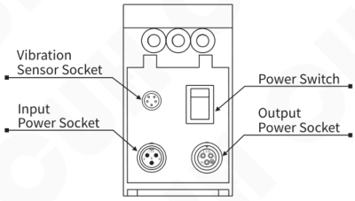

- Prise de capteur de vibration
- Prise d'alimentation d'entrée
- Interrupteur d'alimentation
- Prise d'alimentation de sortie

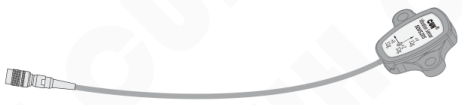

Capteur de vibration

---

## 3.4 Description des ports de commande de signal

### Description du câblage des ports de commande de signal

Pour la description du câblage des ports C -C1, C2 et C3-, veuillez vous référer au chapitre 6.1.

Pour la description du câblage des ports E -E1, E2 et E3-, veuillez vous référer au chapitre 6.2.

Pour la description du câblage des ports A -A1, A2, A3 et A4-, veuillez vous référer au chapitre 6.4.

Pour la description du câblage des ports H -H1, H2, H3 et H4-, veuillez vous référer au chapitre 5.4.1.

Pour la description du câblage des ports G -G1, G2, G3 et G4-, veuillez vous référer au chapitre 6.5.

Pour la description du câblage des ports F -F1, F2 et F3-, veuillez vous référer au chapitre 6.6.

Pour la description du câblage des ports D -D1 et D2-, veuillez vous référer au chapitre 6.7.

---

# Chapitre Ⅳ Réglage des paramètres

Les paramètres du contrôleur sont classés en 4 types selon les différentes méthodes de réglage : les paramètres communs, les paramètres de base, les paramètres avancés et les paramètres Auto/Sync.

## 4.1 Paramètres communs

- Appuyez sur le bouton « Vol+ » ou « Vol- » pour régler les paramètres communs.
- Les boutons « Vol+ » et « Vol- » sont conçus pour régler uniquement les paramètres communs.
- Les paramètres communs peuvent être réglés en appuyant sur le bouton « Vol+ » ou « Vol- » même lorsqu'un autre paramètre est affiché sur l'écran LED. Le contrôleur revient au paramètre précédent après le réglage du paramètre commun.

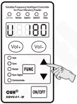

| Paramètres communs | Symbole | Image du symbole | Plage | Défaut |
|---|---|---|---|---|
| Tension de sortie | U | 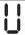 | 20~220 V | 150 |
| Vitesse d'alimentation | A |  | 0~3200 | 200 |
| Verrouillage du clavier | a |  | \ | Valeur de tension actuelle/Vitesse d'alimentation actuelle |

## 4.2 Paramètres de base

- Appuyez sur le bouton « FUNC » et maintenez-le enfoncé pendant 2 secondes pour entrer dans l'état de réglage des paramètres de base.
- Appuyez plusieurs fois sur le bouton « FUNC » pour passer cycliquement d'un paramètre à l'autre.
- Appuyez sur le bouton ▲ ou ▼ pour régler la valeur du paramètre.
- Appuyez à nouveau sur le bouton « FUNC » et maintenez-le enfoncé pendant 2 secondes pour quitter l'état de réglage des paramètres de base.

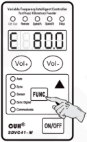

| Paramètres communs | Symbole | Image du symbole | Plage | Défaut |
|---|---|---|---|---|
| Fréquence de sortie | E | 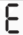 | 40.0~400.0 Hz | 50.0 |
| Retard d'enclenchement des ports C | J | 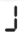 | 0.0~20.0 s | 0.2 |
| Retard de déclenchement des ports C | L | 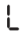 | 0.0~20.0 s | 0.2 |
| Temps de démarrage progressif | t | 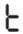 | 0.0~10.0 s | 0.5 |

---

## 4.3 Paramètres avancés

- Appuyez simultanément sur les boutons « FUNC » et ▲ et maintenez-les enfoncés pendant 2 secondes pour entrer dans l'état de réglage des paramètres avancés.
- Appuyez plusieurs fois sur le bouton « FUNC » pour passer cycliquement d'un paramètre à l'autre.
- Appuyez sur le bouton ▲ ou ▼ pour régler la valeur du paramètre.
- Appuyez à nouveau simultanément sur les boutons « FUNC » et ▲ et maintenez-les enfoncés pendant 2 secondes pour quitter l'état de réglage des paramètres avancés.

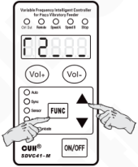

| Paramètres communs | Symbole | Image du symbole | Plage | Défaut |
|---|---|---|---|---|
| Retard d'enclenchement des ports E | J- |  | 0.0~20.0 s | --- |
| Retard de déclenchement des ports E | L- |  | 0.0~20.0 s | --- |
| Relation logique des ports C | Γ2 | 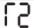 | `___` Logique positive `_-_` Logique négative | --- |
| Relation logique des ports E | Γ7 |  | `___` Logique positive `_-_` Logique négative | --- |
| Relation logique de la sortie de commande 24 V | Γ3 |  | `___` Logique positive `_-_` Logique négative Commande par signal d'alarme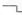 | --- |
| Sortie du contrôleur commandée ou non par le signal de commande marche/arrêt | Γ4 | 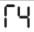 | `___` Pertinent, `_-_` Non pertinent | --- |
| Commutation du groupe de paramètres logiques par défaut/de réserve | Γ8 | 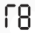 | `___` Groupe de paramètres logiques par défaut `_-_` Groupe de paramètres logiques de réserve `_=_` Touche de réglage des paramètres logiques de réserve | --- |
| Type de capteur de commutation | ΓA |  | Uto : Auto nPn : capteur de type NPN PnP : capteur de type PNP | Uto |
| Relation logique des ports C et des ports E | Π | 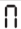 | OR, AND, XOR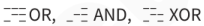 | AND |
| Tension de sortie maximale réglable | h | 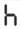 | 20~220 V | 220 |
| Affichage de la température | C | 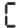 | -10.0~80.0 ℃ | Température actuelle |
| Protocole Modbus RS485 | Voir figure | 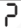 | ASC, rtu | rtu |
| Adresse de communication | Voir figure | 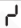 | 1~31 | 1 |
| Débit en bauds | Voir figure | 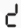 | 0.3, 1.2, 2.4, 9.6, 19.2, 57.6, 115.2 kbps | 9.6 |
| Mot de passe de verrouillage des paramètres | Voir figure | 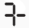 | 0~999 | --- |
| État de sortie du contrôleur après mise sous tension | Γd | 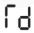 | `___` On, `_-_` Off, Keep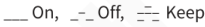 | --- |
| Version du micrologiciel | Ur |  | \ | Version actuelle |
| Réinitialisation du contrôleur | 8.8.8.8.8. | 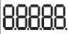 | Ready for Reset Reset Completed 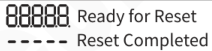 | \ |

---

## 4.4 Paramètres Auto/Sync

- Appuyez simultanément sur les boutons « FUNC » et ▼ et maintenez-les enfoncés pendant 2 secondes pour entrer dans l'état de réglage des paramètres Auto/Sync.
- Appuyez plusieurs fois sur le bouton « FUNC » pour passer cycliquement d'un paramètre à l'autre.
- Appuyez sur le bouton ▲ ou ▼ pour régler la valeur du paramètre.
- Appuyez à nouveau simultanément sur les boutons « FUNC » et ▼ et maintenez-les enfoncés pendant 2 secondes pour quitter l'état de réglage des paramètres Auto/Sync.

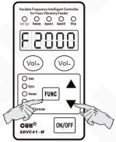

| Paramètres communs | Symbole | Image du symbole | Plage | Défaut |
|---|---|---|---|---|
| Fréquence centrale | F | 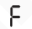 | 40.0~400.0 Hz | 100.0 |
| Décalage maximal en Auto FM | n | 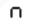 | 0.0~180.0 Hz | 30.0 |
| Méthode de réglage de la tension de sortie | r5 | 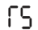 | ___Auto _-_Manual | ___ |
| Méthode de réglage de la fréquence de sortie | r6 | 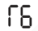 | ___Auto _-_Manual ☰ Sync | ___ |
| Indice de réglage automatique de la fréquence de sortie | IF |  | 0~200 | 20 |
| Indice de réglage automatique d'amplitude | PA |  | 0~999 | 60 |
| Indice de réglage automatique d'amplitude | IA | 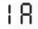 | 0~999 | 20 |
| Affichage de la vitesse d'alimentation | U | 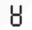 | 0~H | 0 |
| Affichage de la tension de sortie | G | 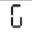 | 20~h V | 150 |
| Limite inférieure de tension | GL |  | 0~220 V | 0 |
| Limite inférieure de fréquence | e | 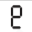 | 40.0~400.0 Hz | 40.0 |
| Indice d'amplitude maximale | P | 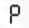 | 0~500 | 500 |
| Vitesse d'alimentation maximale réglable | H | 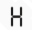 | 0~3200 | 1500 |
| Déphasage | γ | 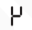 | -180~180 ° | 0 |
| Tension de sortie maximale lors de la mesure automatique de fréquence | b | 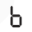 | 20~220 V | 100 |
| Vitesse de recherche de fréquence | SP | 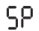 | 1~5 | 5 |
| Volume minimal de réglage de la vitesse d'alimentation | c | 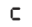 | 1~10 | 1 |
| Numéro de capteur de vibration | t | 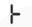 | 0, 1, 2, 3, 4, 203, 204, 205, 206 | 205 |

# Chapitre Ⅴ Mode de fonctionnement

Le contrôleur peut être configuré pour fonctionner selon l'un des quatre modes de fonctionnement suivants, en fonction des exigences spécifiques de l'application.

- **Mode manuel :** La tension de sortie et la fréquence de sortie sont toutes deux réglées manuellement.
- **Mode Auto :** La tension de sortie et la fréquence de sortie sont réglées automatiquement en fonction du retour du capteur de vibration afin de garantir une vitesse d'alimentation préréglée constante et la meilleure fréquence de vibration de l'alimentateur vibrant.
- **Mode semi-automatique :** La tension de sortie est réglée automatiquement en fonction du retour du capteur de vibration afin de garantir une vitesse d'alimentation préréglée constante. La fréquence de sortie est réglée manuellement.
- **Mode Sync :** Dans la configuration Sync, si la fréquence de sortie du contrôleur B est toujours constante avec celle du contrôleur A. Nous définissons le contrôleur A comme contrôleur maître, le contrôleur B comme contrôleur esclave et le mode de fonctionnement du contrôleur B comme mode Sync.

| Mode de fonctionnement | Tension de sortie U — Méthode de réglage | Tension de sortie U — Réglage Γ5 | Fréquence de sortie E — Méthode de réglage | Fréquence de sortie E — Réglage Γ6 | Image du symbole |
|---|---|---|---|---|---|
| Mode manuel | Manuel | ₋⁻₋ | Manuel | ₋⁻₋ | Γ5 / Γ6 : 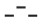 |
| Mode Auto | Auto | _ _ _ | Auto | _ _ _ | Γ5 / Γ6 :  |
| Mode semi-automatique | Auto | _ _ _ | Manuel | ₋⁻₋ | Γ5 :  ; Γ6 :  |
| Mode Sync | Manuel ou Auto | ₋⁻₋ ou _ _ _ | Synchronisation automatique avec le contrôleur maître |  | Γ5 :  ou  ; Γ6 :  |

## 5.1 Mode manuel

En mode manuel, la tension de sortie et la fréquence de sortie sont toutes deux réglées manuellement.

| Mode de fonctionnement | Tension de sortie U — Méthode de réglage | Tension de sortie U — Réglage Γ5 | Fréquence de sortie E — Méthode de réglage | Fréquence de sortie E — Réglage Γ6 | Image du symbole |
|---|---|---|---|---|---|
| Mode manuel | Manuel | ₋⁻₋ | Manuel | ₋⁻₋ | Γ5 / Γ6 :  |

Pour simplifier l'utilisation, les paramètres Γ5 et Γ6 sont réglés sur _ _ _ en configuration d'usine. Avec ce réglage, le contrôleur fonctionne en mode manuel si le capteur de vibration n'est pas connecté au contrôleur, ou en mode Auto si le capteur de vibration est connecté.

---

**Remarque :**

Si Γ5 et Γ6 sont tous deux réglés sur _ - _, le contrôleur fonctionne en mode manuel, que le capteur de vibration soit ou non connecté au contrôleur.

Si le capteur de vibration n'est pas connecté au contrôleur, le contrôleur fonctionne toujours en mode manuel.

### 5.1.1 Réglage du paramètre de tension de sortie U en mode manuel

La valeur réelle de la tension de sortie du contrôleur peut être affichée numériquement et précisément sur l'écran LED.

- Allumez l'interrupteur d'alimentation lorsque le capteur de vibration n'est pas connecté au contrôleur.
- L'écran LED affiche le paramètre de tension de sortie U et sa valeur.
- Réglez la valeur de U en appuyant sur le bouton « Vol+ » ou « Vol- ».

### 5.1.2 Réglage du paramètre de fréquence de sortie E en mode manuel

Grâce à la technologie DDS, la fréquence de sortie du contrôleur est toujours stable et de haute précision, quels que soient le temps ou les variations de température.

- Appuyez sur le bouton « FUNC » et maintenez-le enfoncé pendant 2 secondes pour entrer dans l'état de réglage des paramètres de base.
- L'écran LED affiche le paramètre de fréquence de sortie E et sa valeur.
- Réglez la valeur de E en appuyant sur le bouton ▲ ou ▼ lorsque le capteur de vibration n'est pas connecté au contrôleur.

## 5.2 Mode Auto

En mode Auto, le capteur de vibration doit être connecté au contrôleur. La tension de sortie et la fréquence de sortie sont réglées automatiquement en fonction du retour du capteur de vibration afin de garantir une vitesse d'alimentation préréglée constante et la meilleure fréquence de vibration. La tension de sortie et la fréquence de sortie ne peuvent pas être réglées manuellement.

Par défaut en usine, lorsque le capteur de vibration est connecté, le contrôleur fonctionne en mode Auto.

| Mode de fonctionnement | Tension de sortie U — Méthode de réglage | Tension de sortie U — Réglage Γ5 | Fréquence de sortie E — Méthode de réglage | Fréquence de sortie E — Réglage Γ6 |
|---|---|---|---|---|
| Mode Auto | Auto | --- | Auto | --- |

**Remarque :**

Le contrôleur fonctionne toujours en mode manuel si le capteur de vibration n'est pas connecté.

### 5.2.1 Installation du capteur de vibration

#### 5.2.1.1 Méthode de connexion du capteur de vibration

Connectez le connecteur du capteur de vibration à la prise de capteur de vibration du contrôleur.

Installez fermement la tête du capteur de vibration sur une surface sûre et plane de l'alimentateur vibrant.

**Remarque : veuillez brancher et débrancher le capteur de vibration lorsque le contrôleur est hors tension.**

---

## 5.2.1.2 Installation du capteur de vibration sur le vibrateur

Fixez le capteur de vibration sur la surface lisse du vibrateur, le sens d'installation est libre ; les méthodes d'installation du capteur de vibration sont présentées ci-dessous :

- Méthode 1 : comme illustré à la Fig. 1

  Avantage : installation facile

Fig. 1

- Méthode 2 : comme illustré à la Fig. 2

  Remarque : veillez à ce que le capteur de vibration ne soit pas pressé par le bol d'alimentation.

Fig. 2

- Méthode 3 : soudez un support sur le vibrateur et fixez le capteur de vibration sur le support. Comme illustré à la Fig. 3

  Les dimensions recommandées du support du capteur de vibration sont présentées à la Fig. 4.

Fig. 3

Fig. 4

- Méthode d'installation non recommandée, comme illustré à la Fig. 5 et à la Fig. 6.

  Si l'emplacement d'installation n'est pas approprié, le capteur de vibration ne peut pas renvoyer précisément la fréquence de résonance et le contrôleur recherche la fréquence de résonance en continu.

Fig. 5

Fig. 6

---

## 5.2.2 Réglage du paramètre de vitesse d'alimentation A en mode Auto

- Allumez l'interrupteur d'alimentation lorsque le capteur de vibration est connecté au contrôleur. Le voyant de capteur de vibration s'allume.
- L'écran LED affiche le paramètre de vitesse d'alimentation A et sa valeur.
- Réglez la valeur de A en appuyant sur le bouton « Vol+ » ou « Vol- » jusqu'à la vitesse d'alimentation souhaitée.

## 5.2.3 Mesure automatique de fréquence en mode Auto

Grâce à la mesure automatique de fréquence, le contrôleur détecte la meilleure fréquence de vibration de l'alimentateur vibrant et règle automatiquement tous les paramètres associés. La seule action nécessaire de l'utilisateur est de régler le paramètre de vitesse d'alimentation A ; le contrôleur fonctionnera alors dans les meilleures conditions.

- Lorsque le capteur de vibration est connecté au contrôleur, appuyez simultanément sur les boutons ▲ et ▼ et maintenez-les enfoncés pendant 3 secondes pour démarrer la mesure automatique de fréquence. Le paramètre de fréquence de sortie E et sa valeur seront affichés sur l'écran LED pendant le processus de mesure.
- Après le processus de mesure automatique de fréquence, le contrôleur réglera automatiquement tous les paramètres associés, notamment le paramètre de fréquence centrale F, le paramètre de décalage maximal en Auto FM n, l'indice de réglage automatique de la fréquence de sortie IF, l'indice de réglage automatique d'amplitude PA, l'indice de réglage automatique d'amplitude IA, le paramètre de déphasage μ, le paramètre de méthode de réglage de la tension de sortie Γ5 et le paramètre de méthode de réglage de la fréquence de sortie Γ6 seront réglés sur \_\_\_.

> - Si l'écran LED affiche Err02 au moment où démarre le processus de mesure automatique de fréquence, c'est normal, car le paramètre b est réglé trop haut.
> - Si vous souhaitez annuler le processus de mesure automatique de fréquence, appuyez sur le bouton ON/OFF. Le contrôleur revient alors à l'état dans lequel il se trouvait avant la mesure automatique de fréquence.

**Après le réglage de la vitesse d'alimentation et la mesure automatique de fréquence, le contrôleur fonctionnera dans les meilleures conditions à la vitesse d'alimentation souhaitée.**

---

## 5.2.4 Explication des paramètres Auto/Sync

(Concernant la méthode de réglage, la plage de valeurs et l'unité des paramètres Auto/Sync, veuillez vous référer à la section 4.4.)

### 5.2.4.1 Paramètre de méthode de réglage de la tension de sortie Γ5

Lorsque le paramètre Γ5 est réglé sur `_-_`, le paramètre de tension de sortie U est visible tandis que le paramètre A est masqué. Le paramètre de tension de sortie U peut être réglé manuellement.

Lorsque le paramètre Γ5 est réglé sur `___` et que le capteur de vibration est connecté au contrôleur, le paramètre de vitesse d'alimentation A est visible tandis que le paramètre U est masqué. La tension de sortie est réglée automatiquement en fonction du retour du capteur de vibration afin de garantir une vitesse d'alimentation préréglée constante.

**Remarque :**

Lorsque le capteur de vibration n'est pas connecté au contrôleur, même si le paramètre Γ5 est réglé sur `___`, le paramètre U reste visible et réglable manuellement.

### 5.2.4.2 Paramètre de méthode de réglage de la fréquence de sortie Γ6

Lorsque le paramètre Γ6 est réglé sur `_-_`, le paramètre de fréquence de sortie E peut être réglé manuellement.

Lorsque le paramètre Γ6 est réglé sur `___` et que le capteur de vibration est connecté au contrôleur, le paramètre de fréquence de sortie E est réglé automatiquement à la fréquence de résonance (meilleure fréquence de vibration) de l'alimentateur vibrant en fonction du retour du capteur de vibration. La fréquence de sortie ne peut pas être réglée manuellement.

Lorsque le paramètre Γ6 est réglé sur  et que le câble de signal de synchronisation est connecté entre les contrôleurs maître et esclave, la fréquence de sortie du contrôleur esclave est toujours cohérente avec celle du contrôleur maître. La fréquence de sortie du contrôleur esclave ne peut pas être réglée manuellement.

**Remarque :**

Lorsque le capteur de vibration n'est pas connecté au contrôleur, même si le paramètre Γ6 est réglé sur `___`, la fréquence de sortie reste réglable manuellement.

Si le paramètre n est réglé trop grand, l'alimentateur vibrant peut fonctionner à une fréquence de vibration inappropriée.

Si le paramètre n est réglé trop petit, la flexibilité de l'alimentateur vibrant peut être affectée.

### 5.2.4.3 Paramètre de fréquence centrale F

La fréquence centrale doit être réglée autour de la fréquence de résonance de l'alimentateur vibrant afin que le contrôleur puisse trouver plus rapidement la meilleure fréquence de vibration.

### 5.2.4.4 Indice de réglage automatique de la fréquence de sortie n

La plage Auto FM est (F ±n) Hz.  
La valeur suggérée pour n est d'environ 30.0Hz.  
Si le paramètre n est réglé trop grand, l'alimentateur vibrant peut fonctionner à une fréquence de vibration inappropriée.  
Si le paramètre n est réglé trop petit, la flexibilité de l'alimentateur vibrant peut être affectée.

---

### 5.2.4.5 Indice de réglage automatique de la fréquence de sortie IF

Le processus Auto FM fonctionne via un algorithme PID. « IF » est un indice d'intégration de fréquence.

Plus la valeur du paramètre « IF » est grande, plus la fréquence de sortie est modulée automatiquement rapidement. Mais une valeur « IF » trop grande peut provoquer une oscillation de la fréquence de sortie.

### 5.2.4.6 Indice de réglage automatique d'amplitude PA

Le contrôleur règle automatiquement la tension de sortie via un algorithme PID. PA est un indice de rapport de vitesse.

Plus la valeur du paramètre PA est grande, plus la tension de sortie est réglée automatiquement rapidement. Mais une valeur PA trop grande peut provoquer une oscillation de la tension de sortie.

### 5.2.4.7 Indice de réglage automatique d'amplitude IA

Le contrôleur règle automatiquement la tension de sortie via un algorithme PID. IA est un indice d'intégration de vitesse.

Plus la valeur du paramètre IA est grande, plus la tension de sortie est réglée automatiquement rapidement. Mais une valeur IA trop grande peut provoquer une oscillation de la tension de sortie.

### 5.2.4.8 Paramètre d'affichage de la vitesse d'alimentation 

Le paramètre  est conçu pour afficher la vitesse d'alimentation et n'est pas réglable.

### 5.2.4.9 Paramètre d'affichage de la tension de sortie G

Le paramètre G est conçu pour afficher la tension de sortie et n'est pas réglable.

### 5.2.4.10 Paramètre de limite inférieure de tension GL

Le paramètre GL est conçu pour déclencher une alarme lorsque la tension de sortie est inférieure à la valeur GL.

Si vrai et Γ3 réglé sur , le port D sera actif.

### 5.2.4.11 Paramètre de limite inférieure de fréquence 

Le paramètre  est conçu pour déclencher une alarme lorsque la fréquence de sortie est inférieure à la valeur .

Si vrai et Γ3 réglé sur , le port D sera actif.

### 5.2.4.12 Indice d'amplitude maximale P

Réglez l'indice P pour limiter l'amplitude maximale de l'alimentateur vibrant.

### 5.2.4.13 Paramètre de vitesse d'alimentation maximale réglable H

La plage de vitesse d'alimentation va de 0 à H. Le paramètre H limite la vitesse d'alimentation maximale à une certaine valeur afin de protéger l'alimentateur vibrant contre une tension élevée causée par une mauvaise utilisation.

La vitesse d'alimentation de la commande de vitesse à distance est également affectée par ce paramètre.

### 5.2.4.14 Paramètre de déphasage 

Réglez le paramètre  pour modifier la phase de l'onde de sortie ; le déphasage par défaut est de 0°.

---

### 5.2.4.15 Paramètre de tension de sortie maximale lors de la mesure automatique de fréquence b

La tension de sortie ne dépassera pas la valeur du paramètre b lors du processus de mesure automatique de fréquence afin de protéger l'alimentateur vibrant contre tout dommage.

### 5.2.4.16 Paramètre de vitesse de recherche de fréquence SP

Le paramètre SP représente la vitesse de recherche de fréquence. Plus cette valeur est élevée, plus la recherche de fréquence est rapide.

### 5.2.4.17 Paramètre de volume minimal de réglage de la vitesse d'alimentation c

Le paramètre c représente le volume de réglage du paramètre de vitesse d'alimentation A à chaque pression sur le bouton Vol+ ou Vol-. Le paramètre c va de 1 à 10.

### 5.2.4.18 Paramètre de numéro de capteur de vibration ├

Le contrôleur s'adapte à 8 modèles différents de capteurs de vibration. Réglez le paramètre ├ en fonction du modèle de capteur afin que, lorsque la vitesse d'alimentation est réglée, le contrôleur émette la même valeur de tension quel que soit le modèle de capteur de vibration connecté.

| Valeur du paramètre | Modèle | Spécification (accélération de l'axe x/axe y/axe z) |
|---|---|---|
| 1 | SDVS20-1 | 16g/16g/16g |
| 2 | SDVS20-2 | 35g/35g/—— |
| 3 | SDVS20-3 | 50g/50g/—— |
| 4 | SDVS20-4 | 70g/70g/—— |
| 203 | SDVS203 | 8g/8g/8g |
| 204 | SDVS204 | 16g/16g/16g |
| 205 | SDVS205 | 32g/32g/32g |
| 206 | SDVS206 | 64g/64g/64g |

---

## 5.3 Mode semi-automatique

En mode semi-automatique, le capteur de vibration doit être connecté au contrôleur et le paramètre Γ6 doit être réglé sur `_-_`.

La tension de sortie sera réglée automatiquement en fonction du retour du capteur de vibration afin de garantir une vitesse d'alimentation préréglée constante. La fréquence de sortie sera réglée manuellement.

| Mode de fonctionnement | Tension de sortie U — Méthode de réglage | Tension de sortie U — Réglage Γ5 | Fréquence de sortie E — Méthode de réglage | Fréquence de sortie E — Réglage Γ6 |
|---|---|---|---|---|
| Mode semi-automatique | Auto | `___` | Manuel | `_-_` |

**Remarque :**

Le contrôleur fonctionnera toujours en mode manuel si le capteur de vibration n'est pas connecté.

### 5.3.1 Installation du capteur de vibration

Identique à la section 5.2.1.

### 5.3.2 Configuration du mode semi-automatique

- Allumez l'interrupteur d'alimentation lorsque le capteur de vibration est connecté au contrôleur. L'indicateur du capteur de vibration s'allume.
- Appuyez simultanément sur les boutons « FUNC » et ▼ et maintenez-les enfoncés pendant 2 secondes pour entrer dans l'état de réglage des paramètres Auto/Sync.
- Appuyez plusieurs fois sur le bouton « FUNC » pour passer au paramètre Γ6 (méthode de réglage de la fréquence de sortie).
- Appuyez sur le bouton ▲ ou ▼ pour régler Γ6 sur `_-_`.

---

## 5.3.3 Réglage du paramètre de vitesse d'alimentation A en mode semi-automatique

- Réglez la valeur de A en appuyant sur le bouton « Vol+ » ou « Vol- » jusqu'à la vitesse d'alimentation souhaitée.

## 5.3.4 Réglage du paramètre de fréquence de sortie E en mode semi-automatique

- Appuyez sur le bouton « FUNC » et maintenez-le enfoncé pendant 2 secondes pour entrer dans l'état de réglage des paramètres de base.
- L'écran LED affiche le paramètre de fréquence de sortie E et sa valeur.
- Réglez la valeur de E en appuyant sur le bouton ▲ ou ▼.

---

## 5.4 Mode Sync

En mode Sync, le câble de signal de synchronisation doit être connecté entre les contrôleurs maître et esclave. La fréquence de sortie du contrôleur (contrôleur esclave) est toujours identique à celle du contrôleur maître. La tension de sortie du contrôleur (contrôleur esclave) peut être réglée manuellement ou automatiquement.

| Mode de fonctionnement | Tension de sortie U — Méthode de réglage | Tension de sortie U — Réglage Γ5 | Fréquence de sortie E — Méthode de réglage | Fréquence de sortie E — Réglage Γ6 |
|---|---|---|---|---|
| Mode Sync | Manuel ou Auto |  | Synchronisation automatique avec le contrôleur maître |  |

Le mode Sync s'applique à la situation où plusieurs contrôleurs commandent plusieurs alimentateurs vibrants dans le système d'alimentation, les sorties des contrôleurs n'étant pas synchrones et interférant donc entre elles (effet de battement). Le mode Sync est conçu pour éliminer l'effet de battement, les formes d'onde de sortie des contrôleurs maître et esclave étant parfaitement synchrones.

Le contrôleur B n'est pas configuré en mode Sync, les formes d'onde de sortie des deux contrôleurs ne sont pas synchronisées.

Le contrôleur B est configuré en mode Sync, les formes d'onde de sortie des deux contrôleurs sont synchronisées.

---

## 5.4.1 Méthode de connexion du câble de signal de synchronisation entre les contrôleurs maître et esclave

### Étape un :

Ouvrez les plaques de protection des boîtiers des ports de commande de signal des deux contrôleurs.

### Étape deux :

Connectez le câble de signal de synchronisation entre les contrôleurs maître et esclave selon le schéma ci-dessous.

> Le contrôleur esclave arrête sa sortie lorsque le signal de synchronisation est instable ou non connecté. Et l'indicateur de synchronisation s'éteint.

**Un contrôleur maître peut piloter plusieurs contrôleurs esclaves.**

---

## 5.4.2 Applications du mode Sync

### Sub-Pattern 1

| Contrôleur | Tension de sortie U — Méthode de réglage | Tension de sortie U — Réglage Γ5 | Fréquence de sortie E — Méthode de réglage | Fréquence de sortie E — Réglage Γ6 |
|---|---|---|---|---|
| Contrôleur maître | Manuel |  | Manuel |  |
| Contrôleur esclave | Manuel |  | Synchronisation automatique avec le contrôleur maître |  |

Lorsque le paramètre Γ6 est réglé sur , sa fréquence de sortie sera contrôlée par le contrôleur maître.

---

## Sub-Pattern 2

| Contrôleur | Tension de sortie U — Méthode de réglage | Tension de sortie U — Réglage Γ5 | Fréquence de sortie E — Méthode de réglage | Fréquence de sortie E — Réglage Γ6 | Image du symbole |
|---|---|---|---|---|---|
| Contrôleur maître | Auto | --- | Auto | --- | Γ5, Γ6 :  |
| Contrôleur esclave | Manuel | Voir l'image | Synchronisation automatique avec le contrôleur maître | Voir l'image | Γ5 :  ; Γ6 :  |

## Sub-Pattern 3

| Contrôleur | Tension de sortie U — Méthode de réglage | Tension de sortie U — Réglage Γ5 | Fréquence de sortie E — Méthode de réglage | Fréquence de sortie E — Réglage Γ6 |  |
|---|---|---|---|---|---|
| Contrôleur maître | Auto | --- | Manuel | Voir l'image | Γ5 :  ; Γ6 :  |
| Contrôleur esclave | Manuel | Voir l'image | Synchronisation automatique avec le contrôleur maître | Voir l'image | Γ5 :  ; Γ6 :  |

## Sub-Pattern 4

| Contrôleur | Tension de sortie U — Méthode de réglage | Tension de sortie U — Réglage Γ5 | Fréquence de sortie E — Méthode de réglage | Fréquence de sortie E — Réglage Γ6 | Image du symbole |
|---|---|---|---|---|---|
| Contrôleur maître | Manuel | Voir la colonne de droite Γ5 | Manuel | Voir la colonne de droite Γ6 | Γ5 :  ; Γ6 :  |
| Contrôleur esclave | Auto | Voir la colonne de droite Γ5 | Synchronisation automatique avec le contrôleur maître | Voir la colonne de droite Γ6 | Γ5 :  ; Γ6 :  |

## Sub-Pattern 5

| Contrôleur | Tension de sortie U — Méthode de réglage | Tension de sortie U — Réglage Γ5 | Fréquence de sortie E — Méthode de réglage | Fréquence de sortie E — Réglage Γ6 | Image du symbole |
|---|---|---|---|---|---|
| Contrôleur maître | Auto | --- | Auto | --- | Γ5, Γ6 :  |
| Contrôleur esclave | Auto | --- | Synchronisation automatique avec le contrôleur maître | Voir l'image du symbole graphique | Γ5 :  ; Γ6 :  |

## Sub-Pattern 6

| Contrôleur | Tension de sortie U — Méthode de réglage | Tension de sortie U — Réglage Γ5 | Fréquence de sortie E — Méthode de réglage | Fréquence de sortie E — Réglage Γ6 | Image du symbole |
|---|---|---|---|---|---|
| Contrôleur maître | Auto | --- | Manuel | Voir l'image du symbole graphique | Γ5 :  ; Γ6 :  |
| Contrôleur esclave | Auto | --- | Synchronisation automatique avec le contrôleur maître | Voir l'image du symbole graphique | Γ5 :  ; Γ6 :  |

## 5.4.3 Explication de certains paramètres avancés

### 5.4.3.1 Paramètre de tension de sortie maximale réglable 

La plage de tension de sortie est de 0 à h V. Le paramètre h limite la tension de sortie maximale à une certaine valeur afin de protéger l'alimentateur vibrant contre la haute tension causée par une mauvaise manipulation.

La tension de commande de vitesse à distance est également affectée par ce paramètre.

### 5.4.3.2 Paramètre d'affichage de la température 

Affiche la température interne du contrôleur en temps réel. Lecture seule.

### 5.4.3.3 Paramètre de réinitialisation du contrôleur 

Utilisez ce paramètre pour réinitialiser tous les paramètres aux valeurs d'usine lorsque cela est nécessaire.

### 5.4.3.4 Mot de passe de verrouillage des paramètres 

Verrouillez tous les paramètres sauf le paramètre de tension de sortie U / le paramètre de vitesse d'alimentation A à l'aide d'un mot de passe personnalisé pour empêcher toute opération non autorisée.

---

# Chapitre Ⅵ Contrôle des signaux

Le contrôle des signaux comprend : la commande marche/arrêt des ports C, la commande marche/arrêt des ports E, la commande de vitesse à distance, le stockage et la sortie des vitesses préréglées, la communication RS485 et la sortie de commande 24 V CC.

## 6.1 Commande marche/arrêt des ports C

La sortie du contrôleur peut être activée ou désactivée par tout type de capteur de commutation ou automate programmable via les ports C.

### 6.1.1 Méthode de connexion de différents types de capteurs de commutation et d'automates programmables aux ports C

#### 6.1.1.1 Méthode de connexion du capteur de proximité aux ports C

**Étape 1 :**

Ouvrez les plaques de protection des boîtiers des ports de commande de signal du contrôleur.

**Étape 2 :**

Connectez le capteur de proximité aux ports C selon le schéma.

**Convention**

Le fil bleu représente le fil de terre  
Le fil noir représente le fil de signal  
Le fil marron représente le fil d'alimentation

---

### 6.1.1.2 Méthode de connexion du capteur photoélectrique à faisceau traversant aux ports C

---

### 6.1.1.3 Méthode de connexion du capteur photoélectrique à réflexion aux ports C

---

### 6.1.1.4 Méthode de connexion du capteur à fibre optique à faisceau traversant aux ports C

---

### 6.1.1.5 Méthode de connexion de l'automate programmable aux ports C

Méthode de connexion de la sortie NPN de l'automate programmable aux ports C

Méthode de connexion de la sortie PNP de l'automate programmable aux ports C

> Remarque : la sortie relais, la sortie NPN et la sortie PNP de l'automate programmable, n'importe laquelle d'entre elles peut activer/désactiver le contrôleur.

## 6.1.2 Paramètre de retard d'enclenchement J et paramètre de retard de déclenchement L des ports C

Si vous souhaitez que le contrôleur commence à émettre après un certain temps suivant la réception du signal de commande d'enclenchement des ports C, réglez le paramètre J.

Si vous souhaitez que le contrôleur continue à émettre pendant un certain temps après la réception du signal de commande de déclenchement des ports C, réglez le paramètre L.

### Paramètre de retard d'enclenchement J des ports C

La durée entre la réception du signal de commande d'enclenchement des ports C par le contrôleur et le début de l'émission.

- Appuyez sur le bouton « FUNC » et maintenez-le enfoncé pendant 2 secondes pour entrer dans l'état de réglage des paramètres de base.
- Appuyez plusieurs fois sur le bouton « FUNC » pour passer au paramètre J.
- Appuyez sur le bouton ▲ ou ▼ pour régler la valeur de J. L'unité du paramètre est la seconde et la précision de réglage est de 0,1.

### Paramètre de retard de déclenchement L des ports C

La durée entre la réception du signal de commande de déclenchement des ports C par le contrôleur et la coupure de l'émission.

- Appuyez sur le bouton « FUNC » et maintenez-le enfoncé pendant 2 secondes pour entrer dans l'état de réglage des paramètres de base.
- Appuyez plusieurs fois sur le bouton « FUNC » pour passer au paramètre L.
- Appuyez sur le bouton ▲ ou ▼ pour régler la valeur de L. L'unité du paramètre est la seconde et la précision de réglage est de 0,1.

---

## 6.1.3 Paramètre Γ2 de la relation logique de la commande marche/arrêt des ports C

Par défaut en usine, le contrôleur fonctionne lorsque les ports C ne reçoivent aucun signal. Mais dans certaines autres applications, le contrôleur doit s'arrêter lorsque les ports C ne reçoivent aucun signal.

Réglez le paramètre Γ2 pour répondre à l'une ou l'autre de ces exigences.

- Appuyez simultanément sur les boutons « FUNC » et ▲ et maintenez-les enfoncés pendant 2 secondes pour entrer dans l'état de réglage des paramètres avancés.
- Appuyez plusieurs fois sur le bouton « FUNC » pour passer au paramètre Γ2.
- Appuyez sur le bouton ▲ ou ▼ pour modifier la relation logique.

Le paramètre Γ2 est réglé sur `___` par défaut.

- Lorsque le paramètre Γ2 est réglé sur `___`, la sortie du contrôleur est activée lorsque les ports C ne reçoivent aucun signal.
- Lorsque le paramètre Γ2 est réglé sur `_-_`, la sortie du contrôleur est désactivée lorsque les ports C ne reçoivent aucun signal.

---

## 6.2 Commande marche/arrêt des ports E

La sortie du contrôleur peut être activée ou désactivée par tout type de capteur de commutation ou automate programmable via les ports E.

La commande marche/arrêt des ports C et la commande marche/arrêt des ports E sont indépendantes l'une de l'autre.

### 6.2.1 Méthode de connexion de différents types de capteurs de commutation et d'automates programmables aux ports E

### 6.2.1.1 Méthode de connexion du capteur de proximité aux ports E

**Étape 1 :**

Ouvrez les plaques de protection des boîtiers des ports de commande de signal du contrôleur.

**Étape 2 :**

Connectez le capteur de proximité aux ports C selon le schéma.

**Convention**

Le fil bleu représente le fil de terre  
Le fil noir représente le fil de signal  
Le fil marron représente le fil d'alimentation

### 6.1.1.2 Les méthodes de connexion des autres types de capteurs de commutation et d'automates programmables aux ports E sont similaires à celles des ports C

---

## 6.2.2 Paramètre de retard d'enclenchement J- et paramètre de retard de déclenchement L- des ports E

Si vous souhaitez que le contrôleur commence à émettre après un certain temps suivant la réception du signal de commande d'enclenchement des ports E, réglez le paramètre J-.

Si vous souhaitez que le contrôleur continue à émettre pendant un certain temps après la réception du signal de commande de déclenchement des ports E, réglez le paramètre L-.

Par défaut en usine, le retard marche/arrêt des ports E est le même que le retard marche/arrêt des ports C.
Le retard marche/arrêt des ports E peut également être réglé indépendamment en ajustant le paramètre J- et le paramètre L-.

### Paramètre de retard d'enclenchement J- des ports E

La durée entre la réception du signal de commande d'enclenchement des ports E par le contrôleur et le début de l'émission.

- Appuyez simultanément sur les boutons « FUNC » et ▲ et maintenez-les enfoncés pendant 2 secondes pour entrer dans l'état de réglage des paramètres avancés.
- Appuyez sur le bouton « FUNC » pour passer au paramètre J-.
- Appuyez sur le bouton ▲ ou ▼ pour régler la valeur de J-. L'unité du paramètre est la seconde et la précision de réglage est de 0,1.

Le paramètre J- est réglé sur \_\_\_ par défaut, ce qui signifie la même valeur que celle du paramètre J.

### Paramètre de retard de déclenchement L- des ports E

La durée entre la réception du signal de commande de déclenchement des ports E par le contrôleur et la coupure de l'émission.

- Appuyez simultanément sur les boutons « FUNC » et ▲ et maintenez-les enfoncés pendant 2 secondes pour entrer dans l'état de réglage des paramètres avancés.
- Appuyez sur le bouton « FUNC » pour passer au paramètre L-.
- Appuyez sur le bouton ▲ ou ▼ pour régler la valeur de L-. L'unité du paramètre est la seconde et la précision de réglage est de 0,1.

Le paramètre L- est réglé sur \_\_\_ par défaut, ce qui signifie la même valeur que celle du paramètre L.

---

## 6.2.3 Paramètre Γ7 de la relation logique de la commande marche/arrêt des ports E

Par défaut en usine, le contrôleur fonctionne lorsque les ports E ne reçoivent aucun signal. Mais dans certaines autres applications, le contrôleur doit s'arrêter lorsque les ports E ne reçoivent aucun signal.

Réglez le paramètre Γ7 pour répondre à l'une ou l'autre de ces exigences.

- Appuyez simultanément sur les boutons « FUNC » et ▲ et maintenez-les enfoncés pendant 2 secondes pour entrer dans l'état de réglage des paramètres avancés.
- Appuyez plusieurs fois sur le bouton « FUNC » pour passer au paramètre Γ7.
- Appuyez sur le bouton ▲ ou ▼ pour modifier la relation logique.

Le paramètre Γ7 est réglé sur `___` par défaut.

> - Lorsque le paramètre Γ7 est réglé sur `___`, la sortie du contrôleur est activée lorsque les ports E ne reçoivent aucun signal.
> - Lorsque le paramètre Γ7 est réglé sur `_-_`, la sortie du contrôleur est désactivée lorsque les ports E ne reçoivent aucun signal.

---

## 6.3 Paramètres communs des ports C et des ports E

### 6.3.1 Paramètre de relation logique Π des ports C et des ports E

Le paramètre Π détermine la réaction du contrôleur lorsque les ports C et les ports E sont tous deux effectifs.

- Appuyez simultanément sur les boutons « FUNC » et ▲ et maintenez-les enfoncés pendant 2 secondes pour entrer dans l'état de réglage des paramètres avancés.
- Appuyez plusieurs fois sur le bouton « FUNC » pour passer au paramètre Π.
- Appuyez sur le bouton ▲ ou ▼ pour modifier la relation logique.

La relation logique par défaut est AND.

**Relation logique : AND** 

La sortie du contrôleur sera ON uniquement lorsque les deux ports demandent au contrôleur de fonctionner.

**Relation logique : OR** 

La sortie du contrôleur sera ON lorsque l'un ou les deux ports demandent au contrôleur de fonctionner.

**Relation logique : XOR** 

La sortie du contrôleur sera ON uniquement lorsqu'un des ports demande au contrôleur de fonctionner et que l'autre lui demande de s'arrêter.

---

## 6.3.2 Paramètre de type de capteur de commutation ΓA

Le contrôleur peut reconnaître automatiquement le type du capteur de commutation, NPN ou PNP.

Les utilisateurs peuvent également régler manuellement le type de capteur de commutation.

- Appuyez simultanément sur les boutons « FUNC » et ▲ et maintenez-les enfoncés pendant 2 secondes pour entrer dans l'état de réglage des paramètres avancés.
- Appuyez plusieurs fois sur le bouton « FUNC » pour passer au paramètre ΓA.
- Appuyez sur le bouton ▲ ou ▼ pour modifier la valeur de ΓA.

**Uto :** reconnaissance automatique du type de capteur de commutation

**nPn :** capteur de commutation de type NPN

**PnP :** capteur de commutation de type PNP

## 6.3.3 Paramètre Γ4 : sortie du contrôleur commandée ou non par le signal de commande marche/arrêt

- Appuyez simultanément sur les boutons « FUNC » et ▲ et maintenez-les enfoncés pendant 2 secondes pour entrer dans l'état de réglage des paramètres avancés.
- Appuyez plusieurs fois sur le bouton « FUNC » pour passer au paramètre Γ4.
- Appuyez sur le bouton ▲ ou ▼ pour modifier la valeur de Γ4.

`___` signifie corrélé

`_-_` signifie non corrélé

Le paramètre Γ4 est réglé sur `___` par défaut en usine.

---

## 6.4 Commande de vitesse à distance

La tension de sortie / la vitesse d'alimentation peuvent être commandées à distance par un potentiomètre ou un signal de commande continu de 1~5V/4~20mA.

Lorsque la tension de commande de vitesse à distance dépasse 0,5 V, elle devient effective pour le contrôleur tandis que les boutons « Vol+ » et « Vol- » deviennent inopérants.

Pendant le processus de commande de vitesse à distance, l'indicateur de commande de vitesse à distance s'allume et l'écran LED affiche la tension de sortie / la vitesse d'alimentation et sa valeur.

### Méthode de connexion du potentiomètre de commande de vitesse à distance

**Remarque :** Veuillez sélectionner un potentiomètre linéaire d'une résistance de 1 KΩ.

---

## Méthode de connexion de l'automate programmable de commande de vitesse à distance

| Signal de commande de vitesse à distance | Tension de sortie / vitesse d'alimentation |
|---|---|
| moins de 0,5 V | Commandé par les boutons Vol+ et Vol- |
| 0,5 V-1 V | Tension de sortie : 20 V/vitesse d'alimentation : 0 Commandé par le signal de commande de vitesse à distance |
| 1~5 V/4~20 mA | La tension de sortie / la vitesse d'alimentation est commandée linéairement par le signal de commande de vitesse à distance |

## 6.5 Stockage et sortie des vitesses préréglées

Le contrôleur peut stocker et émettre 4 vitesses préréglées différentes. Les 4 combinaisons ON/OFF de l'indicateur de vitesse A et de l'indicateur de vitesse B correspondent respectivement à la vitesse 1, la vitesse 2, la vitesse 3 et la vitesse 4.

| Vitesse préréglée | Ports G1 et G2 — Indicateur de vitesse A | Ports G1 et G2 — Interrupteur 1 | Ports G3 et G4 — Indicateur de vitesse B | Ports G3 et G4 — Interrupteur 2 |
|---|---|---|---|---|
| Vitesse 1 | ON | Fermé | OFF | Ouvert |
| Vitesse 2 | OFF | Ouvert | ON | Fermé |
| Vitesse 3 | ON | Fermé | ON | Fermé |
| Vitesse 4 | OFF | Ouvert | OFF | Ouvert |

### Méthode de connexion des vitesses préréglées

### Stockage des vitesses préréglées

- Prenons le stockage de la vitesse 1 comme exemple :
- Fermez S1, l'indicateur de vitesse A s'allume ; ouvrez S2, l'indicateur de vitesse B s'éteint.

Pour obtenir la vitesse d'alimentation souhaitée :

En mode manuel, réglez le paramètre de tension de sortie U et le paramètre de fréquence de sortie E.

En mode Auto, réglez le paramètre de vitesse d'alimentation A.

En mode semi-automatique, réglez le paramètre de vitesse d'alimentation A et le paramètre de fréquence de sortie E.

- La vitesse 1 est stockée automatiquement.

### Sortie des vitesses préréglées

- Prenons la sortie de la vitesse 1 comme exemple :
- Fermez à nouveau S1, l'indicateur de vitesse A s'allume ; ouvrez à nouveau S2, l'indicateur de vitesse B s'éteint.

Le contrôleur émettra la vitesse 1 instantanément.

---

## 6.6 Communication RS485

Tous les paramètres du contrôleur peuvent être réglés à distance via les ports de communication RS485.

### 6.6.1 Paramètre d'adresse de communication RS485 

Le paramètre  représente le numéro d'identification du contrôleur dans la communication RS485.  
Plage du paramètre : 1 à 31.  
Assurez-vous que les adresses de communication de tous les contrôleurs du même réseau sont différentes afin de distinguer les contrôleurs les uns des autres.

- Appuyez simultanément sur les boutons « FUNC » et ▲ et maintenez-les enfoncés pendant 2 secondes pour entrer dans l'état de réglage des paramètres avancés.
- Appuyez plusieurs fois sur le bouton « FUNC » pour passer au paramètre .
- Appuyez sur le bouton ▲ ou ▼ pour modifier la valeur .

### 6.6.2 Paramètre de débit en bauds de communication RS485 

Le débit en bauds de communication RS485 peut être : 3, 12, 24, 96, 192, 576 ou 1152.  
Unité : 0,1 Kbps.  
Valeur par défaut : 9,6 Kbps.  
Les contrôleurs du même réseau doivent utiliser le même débit en bauds.

- Appuyez simultanément sur les boutons « FUNC » et ▲ et maintenez-les enfoncés pendant 2 secondes pour entrer dans l'état de réglage des paramètres avancés.
- Appuyez plusieurs fois sur le bouton « FUNC » pour passer au paramètre .
- Appuyez sur le bouton ▲ ou ▼ pour modifier la valeur .

### 6.6.3 Protocole de communication RS485

Le protocole de communication RS485 est disponible dans la colonne Téléchargement de notre site web officiel : **www.cuh-controller.com**

Remarque : en raison du nombre limité d'effacements de la mémoire non volatile du contrôleur, l'instruction de sauvegarde 485 doit être exécutée manuellement après la modification des paramètres afin d'éviter d'envoyer fréquemment des instructions de sauvegarde via le programme.

---

## 6.7 Sortie de commande 24 V CC

Le contrôleur peut fournir une alimentation de commande de 24 V CC pour piloter une électrovanne, un relais électrique ou un automate programmable, etc., en coordination avec la commande marche/arrêt des ports C/E.

L'indicateur Ctrl Output sur le panneau avant s'allume lorsqu'un signal de 24 V est émis entre D1 et D2.

### 6.7.1 Méthode de connexion de la sortie de commande 24 V CC

Connexion à une électrovanne :

- Le contrôleur peut piloter une électrovanne dont la tension nominale est de 24 V et la puissance nominale jusqu'à 4 W.

Connexion à un relais électrique :

- Le contrôleur peut piloter un relais électrique dont la tension nominale est de 24 V et la puissance nominale jusqu'à 4 W.

Remarque : veuillez connecter correctement les pôles positif et négatif du relais ou de l'électrovanne : D2 est connecté au pôle positif, D1 est connecté au pôle négatif. L'inversion de la connexion peut provoquer un court-circuit endommageant la sortie de commande.

---

## 6.7.2 Relation logique de la sortie de commande 24 V CC

- Appuyez simultanément sur les boutons « FUNC » et ▲ et maintenez-les enfoncés pendant 2 secondes pour entrer dans l'état de réglage des paramètres avancés.
- Appuyez plusieurs fois sur le bouton « FUNC » pour passer au paramètre Γ3.
- Appuyez sur le bouton ▲ ou ▼ pour modifier la relation logique.

- Si le paramètre Γ3 est réglé sur `___`, la sortie de commande 24 V CC sera activée lorsque la sortie du contrôleur est activée.
- Si le paramètre Γ3 est réglé sur `_-_`, la sortie de commande 24 V CC sera désactivée lorsque la sortie du contrôleur est activée.

---

## Chapitre Ⅶ Fonctions de sécurité

### Régulation automatique de la tension

Élimine à la fois les variations de vitesse d'alimentation causées par les fluctuations de la tension du secteur et l'effet de battement causé par la fréquence du courant alternatif industriel.

### Protection contre les courts-circuits

Lorsque la sortie du contrôleur est en court-circuit, le contrôleur arrête sa sortie et affiche Err01 sur l'écran LED jusqu'au redémarrage.

### Protection contre les surintensités

Si le courant de sortie dépasse sa valeur nominale en raison d'une mauvaise manipulation, le contrôleur arrête sa sortie pour garantir la sécurité de fonctionnement et affiche Err02 sur l'écran LED.

### Protection contre la surchauffe

Si la température interne du contrôleur dépasse 65 °C, le contrôleur arrête sa sortie pour se protéger et affiche Err02 sur l'écran LED jusqu'à ce que la température interne descende en dessous de 60 °C.

### Protection contre les surcharges

Lorsqu'un capteur de vibration est connecté au contrôleur, si l'amplitude de vibration dépasse le réglage de l'indice d'amplitude maximale, le contrôleur réduit sa sortie pour protéger l'alimentateur vibrant.

### Protection contre les surtensions

Si la tension d'entrée est bien supérieure à la plage de tension d'entrée nominale, le fusible à l'intérieur du contrôleur fondra pour protéger le contrôleur de tout dommage supplémentaire. Veuillez nous contacter pour une réparation.

---

## Annexe A : Dimensions

SDVC41-M Unité : mm

## Annexe B : Définition des ports de commande de signal

### Port A : Commande de vitesse à distance

### Port C : Commande marche/arrêt

### Port D : Sortie de commande 24 V CC

---

## Port E : Commande marche/arrêt

| Port | Signal |
|---|---|
| E1 | GND |
| E2 | Input |
| E3 | +24V |

## Port F : Interface de communication RS485

| Port | Signal |
|---|---|
| F2 | A+ |
| F3 | GND |
| F4 | B- |

## Port G : Préréglage des vitesses

| Port | Signal |
|---|---|
| G1 | GND |
| G2 | Input |
| G5 | +24V |
| G4 | Input |
| G3 | GND |

---

## Port H : Synchronisation

---

## Annexe C : Spécifications électriques

| Élément | Plage : Min | Plage : Typique | Plage : Max | Unité | Remarque |
|---|---|---|---|---|---|
| Tension d'entrée | 85 | 220 | 250 | V | AC RMS |
| Plage de tension de sortie réglable | 20 | —— | 220 | V | |
| Précision de réglage de la tension | | 1 | | V | |
| Précision de régulation de la tension | 0 | —— | 10 | % | ΔVout/ΔVin |
| Temps de réponse de la régulation de tension | 0.0025 | —— | 0.025 | s | la période de la tension de sortie |
| Plage de courant de sortie réglable | 0 | —— | 300 | mA | |
| Puissance de sortie | 0 | —— | 66 | VA | |
| Fréquence de sortie | 40 | —— | 400 | Hz | |
| Précision de réglage de la fréquence | | 0.1 | | Hz | |
| Forme d'onde de sortie | | Sinusoïdale | | | |
| Temps de démarrage progressif | 0 | —— | 10 | s | Valeur par défaut : 0.5 |
| Plage de temps de retard marche/arrêt | 0 | —— | 20 | s | Valeur par défaut : 0.2 |
| Précision du temps de retard marche/arrêt | | 0.1 | | s | |
| Température de déclenchement de la protection contre la surchauffe | 60 | 65 | 65 | °C | |
| Communication numérique | | Communication ModBUS485 | | | |
| Courant de sortie de commande CC | 0 | —— | 200 | mA | |
| Tension de sortie de commande CC | 22 | 24 | 26 | V | |
| Signal de commande analogique | | 1~5/4~20 | | V/mA | Signal de commande de vitesse à distance |
| Signal de commande numérique | | 24 | | V | Signal de commutation |
| Méthode de réglage | | 6 | | Bouton | |
| Consommation en veille | —— | 3 | —— | W | |
| Méthode d'affichage | | 5 | | Digit | LED |
| Température ambiante | 0 | 25 | 40 | °C | Sans condensation |
| Humidité ambiante | 10 | 60 | 85 | % | Sans condensation |
| Température ambiante de stockage | -20 | 25 | 65 | °C | Sans condensation |

## Annexe D : Suggestions de dépannage et explications des erreurs

| Phénomène de défaut | Suggestions de dépannage | Image du symbole |
|---|---|---|
| Aucun affichage sur l'écran LED après la mise sous tension | ● Assurez-vous que la prise secteur est alimentée. ● Assurez-vous que le câble d'alimentation d'entrée est correctement connecté. | |
| L'écran LED affiche normalement mais l'alimentateur vibrant n'a aucune sortie ni son | ● Assurez-vous que le câble d'alimentation de sortie est correctement connecté. ● Assurez-vous que la tension de sortie n'est pas trop faible. ● Assurez-vous que le contrôleur n'est pas arrêté par le bouton ON/OFF lorsque l'indicateur d'arrêt est allumé. ● Assurez-vous que le contrôleur n'est pas arrêté par le signal de commande marche/arrêt lorsque l'indicateur d'arrêt est allumé. ● Assurez-vous que le contrôleur n'est pas arrêté par le réglage des paramètres Γ2 ou Γ7 lorsque l'indicateur d'arrêt est allumé. ● Réinitialisez le contrôleur. | |
| La commande marche/arrêt ne fonctionne pas | ● Assurez-vous que le signal de commande marche/arrêt est correctement connecté au contrôleur. ● Assurez-vous que les paramètres Γ2, Γ7 et Π sont réglés correctement selon vos attentes de commande. ● Réinitialisez le contrôleur. | |
| Effet de battement | ● Connectez le câble de signal de synchronisation entre les contrôleurs et réglez le contrôleur esclave en mode Sync. | |
| L'écran LED affiche normalement, des sons sont audibles depuis l'alimentateur vibrant, mais aucune sortie | ● Assurez-vous que la fréquence de sortie n'est pas éloignée de la fréquence de résonance de l'alimentateur vibrant. ● Réinitialisez le contrôleur. | |
| L'écran LED affiche Err01 | **Protection contre les courts-circuits** ● Assurez-vous que le câble d'alimentation de sortie et l'électro-aimant du vibreur ne sont pas en court-circuit. ● Débranchez le câble d'alimentation de sortie du contrôleur et rallumez l'interrupteur d'alimentation. Si Err01 est toujours affiché sur l'écran LED, veuillez nous contacter pour une réparation. |  |
| L'écran LED affiche Err02 | **Protection contre les surintensités** ● Réduisez la tension de sortie du contrôleur. ● Assurez-vous que l'entrefer de l'électro-aimant du vibreur n'est pas trop grand. |  |
| L'écran LED affiche Err03 | **Protection contre la surchauffe** ● Placez le contrôleur dans un environnement bien ventilé. |  |
| L'écran LED affiche Err04 | ● Réservé, veuillez nous contacter pour une réparation. |  |
| L'écran LED affiche Err05 | ● Réservé, veuillez nous contacter pour une réparation. |  |
| L'écran LED affiche Err06 | ● Réservé, veuillez nous contacter pour une réparation. |  |

## Réinitialisation du contrôleur

**Étape 1 :** Appuyez simultanément sur les boutons « FUNC » et ▲ et maintenez-les enfoncés pendant 2 secondes pour entrer dans l'état de réglage des paramètres avancés.

**Étape 2 :** Appuyez 16 fois sur le bouton « FUNC » pour passer au paramètre  clignotant sur l'écran LED.

**Étape 3 :** Appuyez sur le bouton ▲ et maintenez-le enfoncé jusqu'à ce que  s'affiche sur l'écran LED.

**Étape 4 :** Relâchez le bouton ▲ pour terminer le processus de réinitialisation du contrôleur, U150 s'affiche sur l'écran LED.

---

Nanjing CUH Science & Technology Co.,Ltd  
https://en.cuhnj.com  
Tel.:+86-25-84730411 / 84730415 / 84730416  
Fax:+86-25-84730426  
E-mail:sales@cuhnj.com  
Add.:Building 2, Xueyan Tech Park, Tuscity,  
No.9 Zhineng Rd, Jiangning, Nanjing, China

Document No.: IDP1000544

