## Contrôleur piézoélectrique automatique à haute fréquence

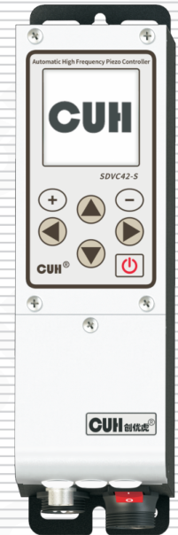

# SDVC42-S
Contrôleur piézoélectrique automatique à haute fréquence　SDVC42-S
# Manuel d'utilisation

　　　　　　　　　　　　　　　　　　　　　　

---

## Déclaration de droits d'auteur

Nanjing CUH Science & Technology CO., Ltd. détient tous les droits.

Toutes les informations contenues dans ce manuel d'utilisation constituent le savoir-faire de notre société et sont protégées par la loi sur le droit d'auteur et d'autres lois connexes. CUH jouit et se réserve tous les droits conférés par la loi sur le droit d'auteur et les autres lois. Sans le consentement écrit de CUH, aucune partie ou la totalité de ce manuel d'utilisation ne peut être copiée, traduite, imitée ou utilisée d'une autre manière.

## Clause de non-responsabilité

Tout le contenu de ce manuel d'utilisation ne décrit que la méthode d'utilisation des produits associés fabriqués par notre société, et est décrit selon la technologie existante et l'état fourni au moment de votre utilisation. Vous devez assumer les risques pertinents lorsque vous utilisez ce produit. Sauf disposition légale contraire, la société n'assume aucune responsabilité expresse ou implicite pour le produit en raison de ce manuel d'utilisation, y compris, mais sans s'y limiter, les blessures corporelles, les dommages matériels, la perte d'opportunités, etc.

Vous comprenez clairement les risques ci-dessus et acceptez que, sauf disposition légale impérative, la société ne soit pas responsable des dommages ou pertes directs ou indirects que vous subissez (y compris, mais sans s'y limiter, les pertes tangibles de personnel, de biens, de données, etc. et les pertes intangibles de réputation, d'opportunités, etc.)

La société se réserve le droit de modifier les produits applicables dans ce manuel d'utilisation sans préavis ni notification ultérieure.

---


---

# Préface

Merci d'avoir choisi le contrôleur piézoélectrique automatique à haute fréquence CUH SDVC42-S. (Ci-après dénommé « le contrôleur »). Cette série de contrôleurs utilise des composants de haute qualité et intègre la toute dernière technologie électronique ; elle est soigneusement conçue avec des processeurs de signaux numériques haute performance.

Ce manuel présente la méthode d'utilisation de base, la description technique fonctionnelle et des exemples d'application typiques de ce produit. Il fournit aux utilisateurs les informations pertinentes sur l'installation et le réglage, la configuration des paramètres, le diagnostic des anomalies, le dépannage et la maintenance de routine du contrôleur. Afin de garantir une installation et une utilisation correctes de ce contrôleur, veuillez lire attentivement ce manuel d'utilisation avant l'installation et le conserver correctement.

Veillez à lire les symboles suivants pour vous alerter des précautions contre les blessures corporelles et les dommages au produit.

| Symbole | Description |
|---|---|
| Danger | Le non-respect de cette consigne<br>entraînera des blessures corporelles ou la mort. |
| Avertissement | Le non-respect de cette consigne<br>peut entraîner des blessures corporelles ou la mort. |
| Attention | Le non-respect de cette consigne<br>peut entraîner des blessures modérées ou mineures. |
| Avis | Le non-respect de cette consigne<br>entraînera des dommages au produit et des dégâts matériels. |
| Impératif | Indique les précautions et restrictions d'utilisation qui doivent être<br>impérativement respectées pendant l'utilisation. |

**Ce manuel est adapté aux modèles de contrôleurs suivants :**

◆ Contrôleur piézoélectrique automatique à haute fréquence　　SDVC42-S (150mA)

---


---

# Sécurité et précautions

1. **[Danger]** Ce produit est uniquement destiné à entraîner des équipements d'alimentation vibrants piézoélectriques ; ne pas utiliser ce produit dans le but de protéger le corps humain ou des parties du corps humain, etc.

2. **[Danger]** Ce produit n'est pas destiné à être utilisé comme produit antidéflagrant ; ne pas l'utiliser dans des emplacements dangereux et/ou une atmosphère gazeuse potentiellement explosive.

3. **[Avertissement]** Ce produit est alimenté par le secteur AC ; veuillez ne pas appliquer une tension AC supérieure à 250 Vac. Une tension d'entrée excessive, telle que 300 Vac, peut faire exploser le produit ou provoquer un incendie, entraînant des accidents de sécurité graves.

4. **[Avertissement]** Ce produit est mis à la terre par le cordon d'alimentation. Veuillez vous assurer que les installations de distribution électrique du contrôleur sont bien mises à la terre, sinon le boîtier du contrôleur pourrait être chargé, entraînant un accident d'électrocution.

5. **[Avertissement]** Ne pas alimenter en courant AC la sortie de ce contrôleur, cela endommagerait le contrôleur.

6. **[Avertissement]** Ne pas brancher ou débrancher les câbles et ne pas toucher les contacts de chaque borne de câblage dans le compartiment de câblage pour éviter tout choc électrique.

7. **[Avis]** Veuillez éviter de contrôler la sortie de ce produit en coupant l'alimentation par des relais et d'autres dispositifs, ce qui réduirait sérieusement la durée de vie du contrôleur.

8. **[Avis]** Le contrôleur est conçu pour fonctionner dans un environnement frais et sec. Ne jamais faire fonctionner le contrôleur à l'extérieur pour éviter l'immersion et l'ensoleillement. Faire fonctionner le contrôleur dans la plage de température spécifiée par les caractéristiques électriques.

9. **[Impératif]** Veillez à fixer ce produit sur une plateforme solide, correctement mise à la terre et éloignée des équipements vibrants.

10. **[Impératif]** Ne jamais faire fonctionner le contrôleur dans des conditions dépassant ses limites de conception.

11. **[Impératif]** Utiliser le contrôleur conformément à ce manuel. Nous n'assumerons aucune responsabilité civile ou pénale si des dommages à l'équipement ou des blessures corporelles résultent d'une utilisation incorrecte.

12. **[Impératif]** Ne jamais ouvrir le boîtier du contrôleur pour éviter tout choc électrique. Contactez CUH si le contrôleur tombe en panne. N'essayez jamais de réparer le contrôleur vous-même, ce qui pourrait annuler la garantie.

---


---

# Environnement d'utilisation et de stockage

## Contrôle avant utilisation

Chaque contrôleur subit un contrôle qualité rigoureux avant la livraison  
et est emballé dans un emballage antichoc. Veuillez vérifier les éléments suivants  
après le déballage :

1. Si le contrôleur est endommagé pendant le transport.
2. Si le modèle du contrôleur est celui que vous avez commandé.

## Environnement d'exécution

Veuillez suivre les notes ci-dessous pour garantir de meilleures performances et une durée de vie plus longue  
du contrôleur :

- ❗ Environnement bien ventilé
- ❗ Tenir à l'écart de l'eau, des ruissellements, de la poussière et surtout de la poussière huileuse
- ❗ Tenir à l'écart des gaz et liquides corrosifs ou inflammables
- ❗ Tenir à l'écart des poussières flottantes et des particules métalliques
- ❗ Fixer fermement pour éviter les vibrations propres
- ❗ Tenir à l'écart des interférences électromagnétiques
- ❗ S'assurer que la température ambiante est de 0~40 °C
- ❗ Pour une utilisation à une altitude de 2000 m ou moins

---


---

# Sommaire

**Chapitre Ⅰ Instructions avant utilisation** --------------------------------------------------1

&nbsp;&nbsp;&nbsp;&nbsp;1.1 Vérification du contenu de l'emballage --------------------------------------------------------------1

&nbsp;&nbsp;&nbsp;&nbsp;1.2 Illustration de la plaque signalétique du fabricant --------------------------------------------------2

&nbsp;&nbsp;&nbsp;&nbsp;1.3 Conditions d'utilisation du contrôleur --------------------------------------------------------2

&nbsp;&nbsp;&nbsp;&nbsp;1.4 Remarques -----------------------------------------------------------------------------3

**Chapitre Ⅱ Présentation du produit** ----------------------------------------------------4

&nbsp;&nbsp;&nbsp;&nbsp;2.1 Présentation du produit ----------------------------------------------------------------4

&nbsp;&nbsp;&nbsp;&nbsp;2.2 Clavier et ports d'E/S ----------------------------------------------------------------5

&nbsp;&nbsp;&nbsp;&nbsp;2.3 Guide d'installation du capteur de vibration ------------------------------------------------6

&nbsp;&nbsp;&nbsp;&nbsp;2.4 Description des paramètres de la page d'accueil ----------------------------------------------------7

&nbsp;&nbsp;&nbsp;&nbsp;2.5 Définition des ports de commande de signal ----------------------------------------------------7

&nbsp;&nbsp;&nbsp;&nbsp;2.6 Utilisation du clavier --------------------------------------------------------------------8

&nbsp;&nbsp;&nbsp;&nbsp;2.7 Schéma de rotation de l'interface d'exploitation ----------------------------------------------8

**Chapitre Ⅲ Câblage d'alimentation et opérations de base** --------------------------------------9

&nbsp;&nbsp;&nbsp;&nbsp;3.1 Câblage d'alimentation -------------------------------------------------------------------------9

&nbsp;&nbsp;&nbsp;&nbsp;3.2 Opérations de base ---------------------------------------------------------------------11

**Chapitre Ⅳ Présentation détaillée des fonctions** ---------------------------------------13

&nbsp;&nbsp;&nbsp;&nbsp;4.1 Réglages des paramètres courants ---------------------------------------------------------14

&nbsp;&nbsp;&nbsp;&nbsp;&nbsp;&nbsp;&nbsp;&nbsp;4.1.1 Tension -----------------------------------------------------------------------14

&nbsp;&nbsp;&nbsp;&nbsp;&nbsp;&nbsp;&nbsp;&nbsp;4.1.2 Fréquence ---------------------------------------------------------------------14

&nbsp;&nbsp;&nbsp;&nbsp;&nbsp;&nbsp;&nbsp;&nbsp;4.1.3 Vitesse d'alimentation -----------------------------------------------------------------15

&nbsp;&nbsp;&nbsp;&nbsp;&nbsp;&nbsp;&nbsp;&nbsp;4.1.4 Temps de démarrage progressif/Temps d'arrêt progressif -----------------------------------------------15

&nbsp;&nbsp;&nbsp;&nbsp;&nbsp;&nbsp;&nbsp;&nbsp;4.1.5 Tension maximale/Courant maximal --------------------------------------------15

&nbsp;&nbsp;&nbsp;&nbsp;&nbsp;&nbsp;&nbsp;&nbsp;4.1.6 Fréquence de sortie maximale/Fréquence de sortie minimale --------------------------15

&nbsp;&nbsp;&nbsp;&nbsp;&nbsp;&nbsp;&nbsp;&nbsp;4.1.7 Détection de charge ----------------------------------------------------------------16

&nbsp;&nbsp;&nbsp;&nbsp;&nbsp;&nbsp;&nbsp;&nbsp;4.1.8 Alarme de manque de matière ----------------------------------------------------------------16

&nbsp;&nbsp;&nbsp;&nbsp;&nbsp;&nbsp;&nbsp;&nbsp;4.1.9 Alarme d'arrêt ---------------------------------------------------------------16

&nbsp;&nbsp;&nbsp;&nbsp;&nbsp;&nbsp;&nbsp;&nbsp;4.1.10 Luminosité du rétroéclairage --------------------------------------------------------16

&nbsp;&nbsp;&nbsp;&nbsp;&nbsp;&nbsp;&nbsp;&nbsp;4.1.11 Extinction du rétroéclairage ----------------------------------------------------------------17

&nbsp;&nbsp;&nbsp;&nbsp;&nbsp;&nbsp;&nbsp;&nbsp;4.1.12 Langue ---------------------------------------------------------------------17

&nbsp;&nbsp;&nbsp;&nbsp;4.2 Recherche automatique de la fréquence de résonance ----------------------------------------------17

&nbsp;&nbsp;&nbsp;&nbsp;&nbsp;&nbsp;&nbsp;&nbsp;4.2.1 Interface de recherche de fréquence --------------------------------------------------17

---


---

4.3 Vitesse d'alimentation constante ----------------------------------------------------------------18

&nbsp;&nbsp;&nbsp;&nbsp;4.3.1 Fréquence centrale -----------------------------------------------------------18

&nbsp;&nbsp;&nbsp;&nbsp;4.3.2 Décalage de fréquence ------------------------------------------------------------18

&nbsp;&nbsp;&nbsp;&nbsp;4.3.3 Intégration de fréquence -------------------------------------------------------18

&nbsp;&nbsp;&nbsp;&nbsp;4.3.4 Intégration d'amplitude -------------------------------------------------------19

&nbsp;&nbsp;&nbsp;&nbsp;4.3.5 Rapport d'amplitude -------------------------------------------------------------19

&nbsp;&nbsp;&nbsp;&nbsp;4.3.6 Phase automatique ------------------------------------------------------------------19

&nbsp;&nbsp;&nbsp;&nbsp;4.3.7 Courant pendant la recherche de fréquence ----------------------------------------19

&nbsp;&nbsp;&nbsp;&nbsp;4.3.8 Amplitude pendant la recherche de fréquence --------------------------------------19

&nbsp;&nbsp;&nbsp;&nbsp;4.3.9 Vitesse d'alimentation maximale ----------------------------------------------------------19

&nbsp;&nbsp;&nbsp;&nbsp;4.3.10 Décalage de phase du contrôleur esclave ---------------------------------------------19

&nbsp;&nbsp;&nbsp;&nbsp;4.3.11 Mode de contrôle de la tension de sortie -----------------------------------------------20

&nbsp;&nbsp;&nbsp;&nbsp;4.3.12 Mode de contrôle de la fréquence de sortie ---------------------------------------------20

&nbsp;&nbsp;&nbsp;&nbsp;4.3.13 Source de synchronisation ----------------------------------------------------------------20

&nbsp;&nbsp;&nbsp;&nbsp;4.3.14 Type de capteur de vibration ------------------------------------------------------20

&nbsp;&nbsp;&nbsp;&nbsp;4.3.15 Vitesse de recherche automatique de la fréquence de résonance ----------------------------------------20

4.4 Paramètres de sortie ------------------------------------------------------------------21

&nbsp;&nbsp;&nbsp;&nbsp;4.4.1 Paramètres de sortie principale ------------------------------------------------------21

&nbsp;&nbsp;&nbsp;&nbsp;4.4.2 Paramètres de sortie de commande CC ------------------------------------------------28

4.5 Commande de signal ---------------------------------------------------------------------30

&nbsp;&nbsp;&nbsp;&nbsp;4.5.1 Type de capteur -----------------------------------------------------------------30

&nbsp;&nbsp;&nbsp;&nbsp;4.5.2 Logique du port C/port E ---------------------------------------------------------31

&nbsp;&nbsp;&nbsp;&nbsp;4.5.3 Temporisation d'activation/désactivation du port C et du port E --------------------------------31

&nbsp;&nbsp;&nbsp;&nbsp;4.5.4 Logique de vitesse A/vitesse B -------------------------------------------------32

&nbsp;&nbsp;&nbsp;&nbsp;4.5.5 Temporisation d'activation/désactivation de vitesse A et vitesse B ------------------------------32

4.6 Comptage de la quantité de matière ---------------------------------------------------------33

&nbsp;&nbsp;&nbsp;&nbsp;4.6.1 Comptage de la quantité de matière (ou vitesse A/B) ----------------------------------33

&nbsp;&nbsp;&nbsp;&nbsp;4.6.2 Quantité cible -------------------------------------------------------------34

&nbsp;&nbsp;&nbsp;&nbsp;4.6.3 Vitesse finale --------------------------------------------------------------34

&nbsp;&nbsp;&nbsp;&nbsp;4.6.4 Quantité de vitesse finale -----------------------------------------------------35

&nbsp;&nbsp;&nbsp;&nbsp;4.6.5 Remise à zéro de la valeur de comptage ---------------------------------------------------35

&nbsp;&nbsp;&nbsp;&nbsp;4.6.6 Priorité RS -----------------------------------------------------------------35

---


---

4.7 Enregistrement des réglages ---------------------------------------------------------------- 36

&nbsp;&nbsp;&nbsp;&nbsp;4.7.1 Rappel des réglages ------------------------------------------------------ 36

&nbsp;&nbsp;&nbsp;&nbsp;4.7.2 Enregistrement des réglages ---------------------------------------------------------- 36

&nbsp;&nbsp;&nbsp;&nbsp;4.7.3 Restauration des réglages d'usine -------------------------------------------------------- 37

&nbsp;&nbsp;&nbsp;&nbsp;4.7.4 Copie des réglages ---------------------------------------------------------- 37

&nbsp;&nbsp;&nbsp;&nbsp;4.7.5 Mot de passe utilisateur ---------------------------------------------------------- 37

&nbsp;&nbsp;&nbsp;&nbsp;4.7.6 Saisie du mot de passe --------------------------------------------------------- 37

4.8 Communication RS485 ---------------------------------------------------------- 38

&nbsp;&nbsp;&nbsp;&nbsp;4.8.1 Type de communication ---------------------------------------------------- 38

&nbsp;&nbsp;&nbsp;&nbsp;4.8.2 Débit en bauds -------------------------------------------------------------- 39

&nbsp;&nbsp;&nbsp;&nbsp;4.8.3 Adresse du contrôleur esclave ---------------------------------------------- 39

&nbsp;&nbsp;&nbsp;&nbsp;4.8.4 Résistance de port/Résistance de synchronisation -------------------------------- 39

4.9 Réseau CUHBus-DS® -------------------------------------------------------- 40

&nbsp;&nbsp;&nbsp;&nbsp;4.9.1 Mise en réseau des appareils ----------------------------------------------------- 41

&nbsp;&nbsp;&nbsp;&nbsp;4.9.2 Fonction de synchronisation ---------------------------------------------------------- 45

&nbsp;&nbsp;&nbsp;&nbsp;4.9.3 Partage de signaux -------------------------------------------------------- 51

&nbsp;&nbsp;&nbsp;&nbsp;4.9.4 Sauvegarde des données ------------------------------------------------------------ 53

&nbsp;&nbsp;&nbsp;&nbsp;4.9.5 Données de contrôle à distance --------------------------------------------------- 54

4.10 Surveillance de l'état du contrôleur ------------------------------------------------ 54

4.11 Journal des erreurs ------------------------------------------------------------------- 55

4.12 Personnalisation de la page d'accueil ---------------------------------------------------------- 55

## Chapitre Ⅴ Applications typiques ---------------------------------------------- 56

5.1 Comment faire fonctionner deux alimentateurs vibrants à la même fréquence ? ------------ 56

5.2 Comment activer/désactiver le contrôleur B via un capteur connecté au contrôleur A ? ------ 57

5.3 Comment activer/désactiver deux contrôleurs simultanément ? --------------------------- 58

## Chapitre Ⅵ Questions fréquentes ---------------------------------------- 59

6.1 Aucun affichage à la mise sous tension ----------------------------------------------------- 59

6.2 Pas de vibration, pas de bruit, affichage du contrôleur normal ---------------------------- 59

6.3 Le signal de commande ne fonctionne pas ------------------------------------------------- 59

6.4 Pas de vibration, bruit normal, affichage du contrôleur normal --------------------- 59

6.5 Suivi instable de la fréquence de résonance ---------------------------------------- 59

6.6 Correction de vitesse lente en régulation de vitesse d'alimentation constante ------------------------- 60

---


---

6.7 Comment réinitialiser rapidement le contrôleur aux réglages d'usine ---------------------------60

**Chapitre Ⅶ Annexe** ----------------------------------------------------------------61

7.1 Dimensions -----------------------------------------------------------------------------61

7.2 Spécifications techniques -------------------------------------------------------------62

7.3 Norme de référence -------------------------------------------------------------------63

7.4 Liste des paramètres -------------------------------------------------------------------------64

&nbsp;&nbsp;&nbsp;&nbsp;7.4.1 Groupe de paramètres d'interface -----------------------------------------------64

&nbsp;&nbsp;&nbsp;&nbsp;7.4.2 Groupe de paramètres courants ------------------------------------------------65

&nbsp;&nbsp;&nbsp;&nbsp;7.4.3 Groupe de paramètres de sortie principale -------------------------------------------66

&nbsp;&nbsp;&nbsp;&nbsp;7.4.4 Groupe de paramètres de vitesse stable -----------------------------------------67

&nbsp;&nbsp;&nbsp;&nbsp;7.4.5 Groupe de paramètres d'entrée de signal -------------------------------------------68

&nbsp;&nbsp;&nbsp;&nbsp;7.4.6 Groupe de paramètres de sortie de commande ---------------------------------------69

&nbsp;&nbsp;&nbsp;&nbsp;7.4.7 Groupe de paramètres de comptage CC ------------------------------------------70

&nbsp;&nbsp;&nbsp;&nbsp;7.4.8 Groupe de paramètres de communication --------------------------------------71

&nbsp;&nbsp;&nbsp;&nbsp;7.4.9 Groupe de paramètres d'enregistrement ------------------------------------------------------72

&nbsp;&nbsp;&nbsp;&nbsp;7.4.10 Groupe de paramètres de surveillance -------------------------------------------73

&nbsp;&nbsp;&nbsp;&nbsp;7.4.11 Liste jointe -------------------------------------------------------------75

7.5 Schémas des circuits d'entrée et de sortie ------------------------------------------------76

7.6 Code d'erreur ------------------------------------------------------------------------------78

7.7 Code d'avertissement --------------------------------------------------------------------------79

**Chapitre Ⅷ Informations sur la garantie du produit** ----------------------------------------80

7.1 Période de garantie -----------------------------------------------------------------------80

8.2 Couverture de la garantie -------------------------------------------------------------------80

8.3 Aptitude du produit -------------------------------------------------------------------80

---


# Chapitre Ⅰ Instructions avant utilisation

Ce chapitre présente le contenu de l'emballage du produit, la description de l'apparence du contrôleur et les informations de la plaque signalétique du contrôleur.

## 1.1 Vérification du contenu de l'emballage

Avant l'utilisation, veuillez vérifier l'intégrité du contrôleur et de ses accessoires. Si vous constatez que le produit est défectueux ou endommagé, que des accessoires manquent, etc., veuillez contacter notre société.

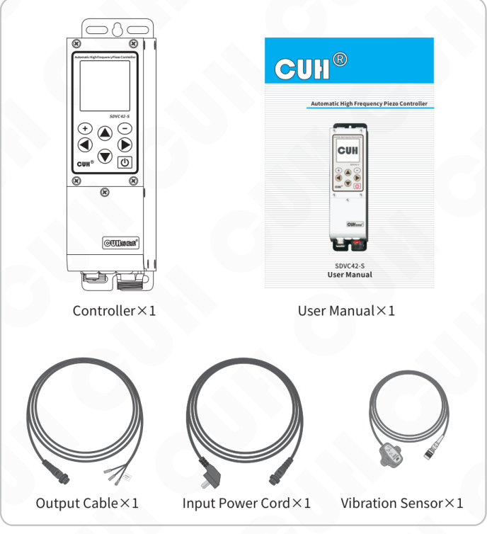

Contenu de l'emballage présenté :

| Élément | Quantité |
|---|---:|
| Contrôleur | ×1 |
| Manuel d'utilisation | ×1 |
| Câble de sortie | ×1 |
| Cordon d'alimentation d'entrée | ×1 |
| Capteur de vibration | ×1 |

---


---

## 1.2 Illustration de la plaque signalétique du fabricant

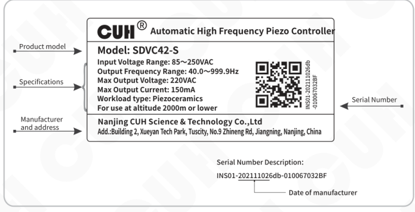

Informations de la plaque signalétique présentées dans l'illustration :

- **Modèle du produit :** SDVC42-S
- **Spécifications :**
  - Plage de tension d'entrée : 85~250VAC
  - Plage de fréquence de sortie : 40.0~999.9Hz
  - Tension de sortie max. : 220VAC
  - Courant de sortie max. : 150mA
  - Type de charge : Piézocéramiques
  - Pour une utilisation à une altitude de 2000m ou moins
- **Fabricant et adresse :**
  - Nanjing CUH Science & Technology Co.,Ltd
  - Add.: Building 2, Xueyan Tech Park, Tuscity, No.9 Zhineng Rd, Jiangning, Nanjing, China
- **Description du numéro de série :** INS01-202111026db-010067032BF

## 1.3 Conditions d'utilisation du contrôleur

Le contrôleur est alimenté en AC 85V~250V et est relié à une terre de protection par la fiche du cordon d'alimentation. Veuillez utiliser une alimentation secteur standard et vous assurer que le fil de terre de protection est correctement connecté.

> ⚠️ **Avertissement**  Ne jamais connecter le contrôleur à une alimentation AC 380V, cela causerait des dommages graves et irréversibles au contrôleur, pouvant entraîner une explosion, un incendie et d'autres incidents de sécurité.

> ⚠️ **Avertissement**  Assurez-vous que le côté alimentation est correctement mis à la terre. Le boîtier métallique du contrôleur est directement connecté au fil de terre de protection. Une mauvaise mise à la terre rendra le boîtier du contrôleur électrifié et provoquera un accident d'électrocution.

> **Avis**  Un fonctionnement prolongé génère de la chaleur et fait monter la température du boîtier. Veuillez installer le contrôleur dans un environnement bien ventilé et bien le fixer, à l'écart des sources de vibration.

> **Avis**  Ce produit est un contrôleur destiné à entraîner l'alimentateur vibrant piézoélectrique.

---


---

## 1.4 Remarques

◆ Le manuel d'utilisation compte environ 28000 mots et sa lecture devrait vous prendre une heure.

◆ Veuillez lire attentivement ce manuel avant utilisation afin d'éviter d'endommager le contrôleur par une mauvaise manipulation.

◆ Les utilisateurs peuvent localiser rapidement les fonctions et méthodes d'utilisation associées du contrôleur grâce au sommaire du manuel.

◆ Les sous-titres des chapitres et les textes mis en évidence dans le texte sont les éléments de paramètres réellement affichés par le contrôleur, tels que la tension.

◆ Les utilisateurs peuvent se référer au « Chapitre Ⅴ Applications typiques » pour prendre rapidement en main ce contrôleur.

◆ Les utilisateurs peuvent rechercher rapidement les codes d'étiquettes de fonction dans la section « 7.4 Liste des paramètres ».

◆ Appuyer simultanément sur ⊕ et ⊖ indique une confirmation.

◆

---


# Chapitre Ⅱ Présentation du produit

Le contenu principal de ce chapitre comprend une brève introduction et les principales caractéristiques de ce produit.

## 2.1 Présentation du produit

Le contrôleur piézoélectrique automatique à haute fréquence de la série SDVC42-S est un produit spécialement conçu pour les systèmes d'alimentation haut de gamme.

Des performances uniques sont offertes par l'utilisation des dernières technologies électroniques et méthodes de traitement du signal. Ses caractéristiques particulières comprennent :

- Disponible via la communication CUHBus-DS® : réalise la synchronisation, la sauvegarde et la restauration de la tension de contrôle à distance, de la fréquence, de la phase et d'autres paramètres de chaque contrôleur.
- Les signaux des ports d'autres contrôleurs peuvent être utilisés pour le contrôle logique via la communication CUHBus-DS®.
- La fonction d'alarme de manque de matière peut être réalisée sans installer de capteurs supplémentaires.
- Des signaux sonores pour des notes sélectionnables peuvent être émis via l'alimentateur vibrant.
- Étend la fréquence de sortie à 40.0Hz~999.9Hz.
- Le port de commande de vitesse analogique prend en charge les modes 0~5V, 1~5V, 0~10V, 4~20mA et autres.
- Équipé d'une fonction de comptage, incluant la décélération de comptage et l'arrêt de comptage.
- La recherche de fréquence à amplitude constante améliorée garantit que deux alimentateurs vibrants à faible écart ne se heurtent pas pendant le processus de recherche de fréquence.
- Prend en charge les protocoles RS485 Modbus ASCII et RS485 Modbus RTU.
- La mise à jour logicielle peut être effectuée via l'interface RS485.
- Il adopte un écran LCD de résolution 128 * 128 et prend en charge trois langues : chinois, anglais et allemand.
- Détecte les caractéristiques de courant de charge pour aider les utilisateurs à diagnostiquer les défaillances.
- Le code de défaut peut stocker les 64 derniers journaux de défaillance.


## 2.2 Clavier et ports d'E/S

### Explication de la fenêtre et des boutons

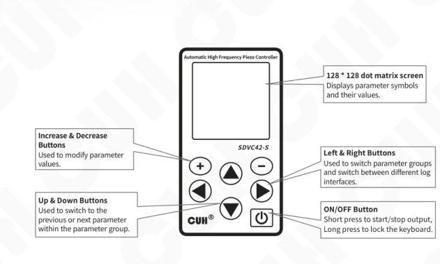

| Élément | Explication |
|---|---|
| Boutons d'augmentation et de diminution | Utilisés pour modifier les valeurs des paramètres. |
| Boutons haut et bas | Utilisés pour passer au paramètre précédent ou suivant dans le groupe de paramètres. |
| Boutons gauche et droite | Utilisés pour changer de groupe de paramètres et basculer entre les différentes interfaces de journal. |
| Écran matriciel 128 * 128 points | Affiche les symboles des paramètres et leurs valeurs. |
| Bouton ON/OFF | Appui court pour démarrer/arrêter la sortie, appui long pour verrouiller le clavier. |

### Explication des pièces externes

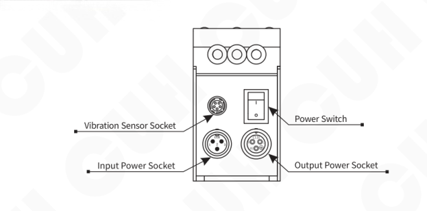

| Pièce externe | Étiquette indiquée sur la figure |
|---|---|
| Prise du capteur de vibration | Prise du capteur de vibration |
| Prise d'alimentation d'entrée | Prise d'alimentation d'entrée |
| Interrupteur d'alimentation | Interrupteur d'alimentation |
| Prise d'alimentation de sortie | Prise d'alimentation de sortie |


## 2.3 Guide d'installation du capteur de vibration

Fixez le capteur de vibration sur la surface lisse du vibrateur ; le sens d'installation est libre. Les méthodes d'installation du capteur de vibration sont présentées ci-dessous :

- **Méthode 1 :** comme illustré à la Fig. 2.3.1  
  Avantage : installation facile

  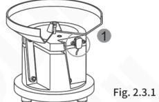

- **Méthode 2 :** comme illustré à la Fig. 2.3.2  
  Remarque : ne pas faire en sorte que le capteur de vibration soit pressé par la cuve d'alimentation.

  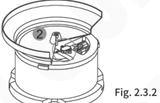

- **Méthode 3 :** souder un support sur le vibrateur et fixer le capteur de vibration sur le support. Comme illustré à la Fig. 2.3.3  
  Les dimensions recommandées du support de vibration sont illustrées à la Fig. 2.3.4.

  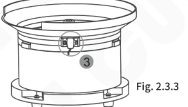

  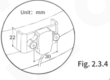

- **Méthode d'installation non recommandée**, comme illustré aux Fig. 2.3.5 et Fig. 2.3.6.  
  Si l'emplacement d'installation n'est pas approprié, le capteur de vibration ne peut pas renvoyer précisément la fréquence de résonance et le contrôleur exécutera en permanence la recherche de la fréquence de résonance.

  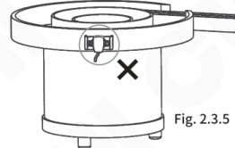

  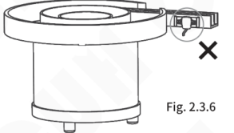


## 2.4 Description des paramètres de la page d'accueil

Le contrôleur peut afficher l'état de sortie principale, l'état de verrouillage du clavier, l'état des ports, les paramètres de surveillance et le nom de l'interface sur la page d'accueil. Dans l'état des ports : **X** en surbrillance indique que le port est valide. **X** indique que le port est valide au niveau bas, et **X** indique que le port est valide au niveau haut.

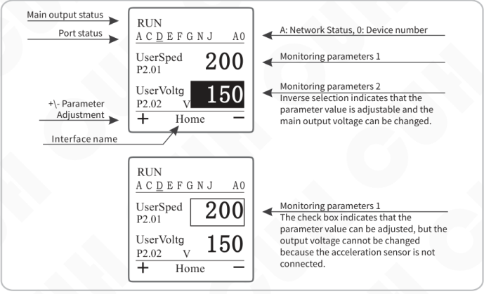

| Élément de la page d'accueil | Exemple affiché | Description |
|---|---|---|
| État de sortie principale | `RUN` | Affiche l'état actuel de la sortie principale. |
| État des ports | `A C D E F G N J    A0` | Affiche les états des ports. `A` : état du réseau ; `0` : numéro d'appareil. |
| Paramètres de surveillance 1 | `UserSped` / `P2.01` / `200` | Valeur du paramètre de surveillance affichée sur la page d'accueil. |
| Paramètres de surveillance 2 | `UserVoltg` / `P2.02` / `150` | La sélection inversée indique que la valeur du paramètre est réglable et que la tension de sortie principale peut être modifiée. |
| Paramètres de surveillance 1 | `UserSped` / `P2.01` / `200` dans une case à cocher | La case à cocher indique que la valeur du paramètre peut être ajustée, mais la tension de sortie ne peut pas être modifiée car le capteur d'accélération n'est pas connecté. |
| Réglage des paramètres +/- | `+` / `-` | Commandes de réglage des paramètres. |
| Nom de l'interface | `Home` | Nom de l'interface actuelle. |

## 2.5 Définition des ports de commande de signal

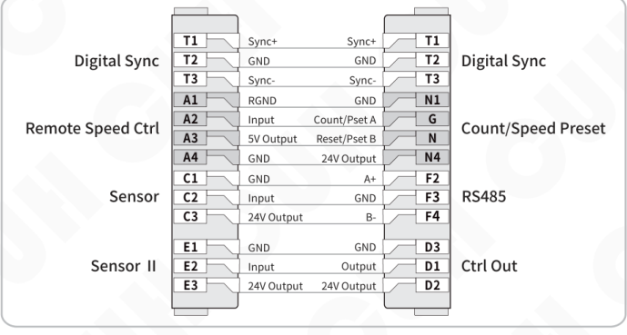

| Fonction gauche | Borne gauche | Définition gauche | Définition droite | Borne droite | Fonction droite |
|---|---:|---|---|---:|---|
| Digital Sync | T1 | Sync+ | Sync+ | T1 | Digital Sync |
| Digital Sync | T2 | GND | GND | T2 | Digital Sync |
| Digital Sync | T3 | Sync- | Sync- | T3 | Digital Sync |
| Remote Speed Ctrl | A1 | RGND | GND | N1 | Count/Speed Preset |
| Remote Speed Ctrl | A2 | Input | Count/Pset A | G | Count/Speed Preset |
| Remote Speed Ctrl | A3 | 5V Output | Reset/Pset B | N | Count/Speed Preset |
| Remote Speed Ctrl | A4 | GND | 24V Output | N4 | Count/Speed Preset |
| Sensor | C1 | GND | A+ | F2 | RS485 |
| Sensor | C2 | Input | GND | F3 | RS485 |
| Sensor | C3 | 24V Output | B- | F4 | RS485 |
| Sensor Ⅱ | E1 | GND | GND | D3 | Ctrl Out |
| Sensor Ⅱ | E2 | Input | Output | D1 | Ctrl Out |
| Sensor Ⅱ | E3 | 24V Output | 24V Output | D2 | Ctrl Out |


## 2.6 Utilisation du clavier

 a. Ce contrôleur utilise un écran matriciel 128 * 128 points pour afficher le contenu des paramètres.

 b. Selon la durée d'appui sur le bouton, les actions des boutons sont divisées en appui court, appui long, première accélération et seconde accélération.

 [Appui court] : appuyer pendant plus de 0,1 seconde mais moins de 0,5 seconde.

 [Appui long] : appuyer pendant plus de 2 secondes.

 [Accélération de niveau 1] : appuyer pendant plus de 0,5 seconde mais moins de 2 secondes.

 [Accélération de niveau 2] : appuyer pendant plus de 2 secondes.

 c. <kbd>⊕</kbd> et <kbd>⊖</kbd> ont pour fonction principale de modifier les valeurs des paramètres.

 d. Basculer entre les groupes de paramètres supérieur et inférieur dans l'interface de réglage des paramètres en appuyant brièvement sur ◀ ou ▶.

 e. Basculer entre les paramètres supérieur et inférieur de ce groupe dans l'interface de réglage des paramètres en appuyant brièvement sur ▲ ou ▼.

 f. Appuyer brièvement sur <kbd>⏻</kbd> pour démarrer/arrêter la sortie principale, appuyer longuement sur <kbd>⏻</kbd> pour verrouiller/déverrouiller le clavier.

 g. Accéder aux différents groupes de paramètres via la combinaison de boutons suivante :

 Appui long sur ▲+▼ : entrer ou sortir de l'interface de recherche de fréquence.

 Appui long sur ▲+◀ : entrer ou sortir de l'interface de réglage des paramètres.

 Appui long sur ▲+▶ : entrer ou sortir de l'interface de journal.

## 2.7 Schéma de rotation de l'interface d'exploitation

Sous n'importe quelle interface, un appui long sur <kbd>▲+▶</kbd> permet d'entrer dans l'**interface de journal** ; un nouvel appui long permet de revenir à l'**interface principale**.

Sous n'importe quelle interface, un appui long sur <kbd>▲+▼</kbd> permet d'entrer dans l'**interface de recherche de fréquence** ; un appui court sur le bouton d'arrêt permet de revenir à l'**interface principale**.

Sous n'importe quelle interface, un appui long sur <kbd>▲+◀</kbd> permet d'entrer dans l'**interface de réglage des paramètres** ; un nouvel appui long permet de revenir à l'**interface principale**.

Sous n'importe quelle interface, en l'absence d'action pendant plus de 5 minutes, l'**interface de veille** s'affiche ; appuyez à nouveau sur n'importe quelle touche pour revenir à l'**interface principale**.


# Chapitre Ⅲ Câblage d'alimentation et opérations de base

## 3.1 Câblage d'alimentation

**Étape un :**

Ouvrir la boîte d'emballage et vérifier le contrôleur et tous les accessoires.

**Étape deux :**

Connecter les bornes de câblage du câble d'alimentation de sortie aux électrodes du vibrateur piézoélectrique.

Alignez l'encoche du connecteur aviation du câble de sortie avec le repère triangulaire sur la prise de sortie du contrôleur, puis serrez l'écrou après avoir correctement connecté le câble de sortie.

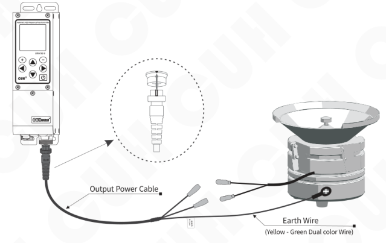

**Remarque**

Assurez-vous que les électrodes du vibrateur piézoélectrique sont connectées aux deux broches de sortie du câble d'alimentation de sortie, et que le boîtier métallique du vibrateur est correctement mis à la terre.


---

### Étape trois :

Connecter le connecteur du câble d'alimentation d'entrée  
à la prise d'alimentation d'entrée du contrôleur.

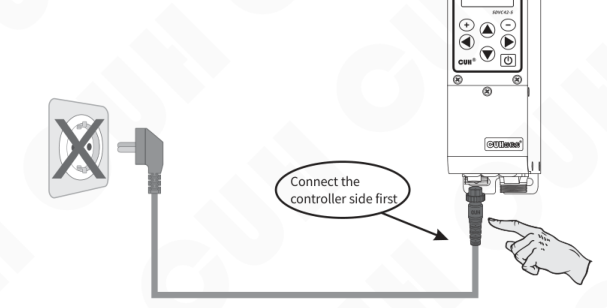

### Étape quatre :

Après avoir confirmé que l'interrupteur est en position arrêt, connecter la fiche du  
câble d'alimentation d'entrée à la prise secteur.

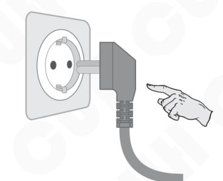

---


## 3.2 Opérations de base

### Étape cinq :

Allumer l'interrupteur d'alimentation du contrôleur ; le contrôleur affiche l'interface principale.

```text
RUN
A C D E F G N J      A0
──────────────────────
UserSped            200
P2.01

EffectCu              0
P10.05      A
+        Home        −
```

### Étape six :

L'alimentateur vibrant commence à fonctionner. Réglez les valeurs des paramètres de fréquence et de tension dans le groupe de paramètres « 2 Common » pour sélectionner la vitesse d'alimentation appropriée.

» Appui long sur ▲ et ◀ pour entrer dans l'interface de réglage des paramètres, appui court sur ▶ pour passer au groupe de paramètres « 2 Common ».

» Appui court sur ▲ ou ▼ pour placer le curseur sur la valeur du paramètre de tension.

» Appuyez sur ⊕ ou ⊖ pour ajuster la valeur du paramètre.

» Appui court sur ▲ ou ▼ pour placer le curseur sur la valeur du paramètre de fréquence.

» Appuyez sur ⊕ ou ⊖ pour ajuster la valeur du paramètre.

```text
RUN
A C D E F G N J      A0
──────────────────────
01.UserSped       200
02.UsrVoltg       150 V
03.UsrFrqnc      50.0 Hz
04.SoftStar       0.5 S
05.SoftStop       0.5 S
+       2Common     −
```

☺

- La fréquence à laquelle la vibration atteint son maximum est la fréquence naturelle du corps vibrant.
- Chaque vibrateur a sa propre fréquence de résonance mécanique naturelle ; réglez la fréquence de sortie du contrôleur sur cette fréquence pour obtenir le meilleur état de fonctionnement.


---

### Étape sept :

Les clients peuvent en outre connecter le capteur d'accélération pour réaliser la recherche automatique de fréquence du contrôleur. (Remarque : l'utilisateur n'a pas besoin de vider les matériaux dans la cuve de vibration)

Sortez le capteur, connectez la fiche du capteur au contrôleur et serrez l'écrou, puis fixez correctement le corps du capteur sur la cuve de vibration (voir chapitre 2.3)

### Étape huit :

» Appui long sur ▲ et ▼ pour entrer dans l'interface de recherche de fréquence.

» À ce moment, l'écran affiche la courbe d'amplitude de la cuve de vibration pendant le processus de recherche de fréquence (trois phases), et affiche simultanément les valeurs de tension de sortie, de courant et d'accélération à cet instant.

» Une fois la recherche de fréquence terminée, le contrôleur affiche « Save » pour indiquer que la recherche de fréquence a réussi et que la fréquence centrale est enregistrée. Le contrôleur reviendra automatiquement à la page d'accueil.

» Les utilisateurs peuvent ajuster davantage la vitesse d'alimentation de l'alimentateur vibrant via ⊕ ou ⊖.

| Exemples d'affichage de la recherche de fréquence | |
|---|---|
| 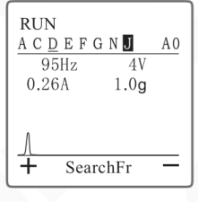 | 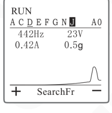 |
| 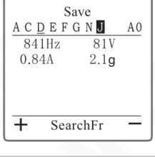 | 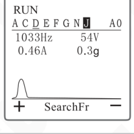 |

---


# Chapitre IV Présentation détaillée des fonctions

Ce chapitre présente les fonctions détaillées et les réglages du contrôleur.  
Appui long sur ▲ et ◀ pour entrer dans l'interface de réglage des paramètres depuis n'importe quelle interface.  
L'interface de réglage des paramètres comprend les dix groupes de paramètres suivants.  
Appuyez brièvement sur ◀ ou ▶ pour basculer entre les différents groupes de paramètres.

```text
                         ┌──────────────┐
                         │ 1EditHome    │
                         └──────────────┘
                                ↕
                         ┌──────────────┐
                         │ 2Common      │
                         └──────────────┘
                                ↕
                         ┌──────────────┐
                         │ 3M_output    │
                         └──────────────┘
                                ↕
                         ┌──────────────┐
                         │ 4Stabilize   │
                         └──────────────┘
                                ↕
Short press ▶     ↓     ┌──────────────┐      ↑     Short press ▶
                         │ 5On&Off      │
                         └──────────────┘
                                ↕
                         ┌──────────────┐
                         │ 6DCoutput    │
                         └──────────────┘
                                ↕
                         ┌──────────────┐
                         │ 7Counter     │
                         └──────────────┘
                                ↕
                         ┌──────────────┐
                         │ 8Comm        │
                         └──────────────┘
                                ↕
                         ┌──────────────┐
                         │ 9Save        │
                         └──────────────┘
                                ↕
                         ┌──────────────┐
                         │ 10Monitor    │
                         └──────────────┘
```

Schéma de rotation des groupes de paramètres

---


---

## 4.1 Réglages des paramètres courants

Ce chapitre présente principalement le réglage et l'ajustement des paramètres courants de base du contrôleur.

### 4.1.1 Tension

Ce contrôleur peut régler directement la tension de sortie numériquement sur le panneau. Comme le contrôleur dispose d'une fonction de sortie stabilisée en tension, cette valeur est la valeur moyenne de redressement de la tension et ne sera pas affectée par la tension d'entrée. La tension de sortie peut rester stable même lorsque la tension du réseau est instable. En même temps, le réglage direct de la valeur de tension fournit également des données précises aux utilisateurs pour comprendre le fonctionnement de l'équipement.

> » Entrez dans le groupe de paramètres courants et trouvez les paramètres de réglage de la tension.  
> » Appuyez sur `+` ou `−` pour ajuster la valeur du paramètre.  
>
> La plage de tension est de 0~220V, la valeur par défaut est 150V et la précision de réglage est de 1V.
>
> ```text
> RUN
> A C D E F G N J    A0
> 01.UserSped       200
> 02.UsrVoltg       150 V
> 03.UsrFrqnc       50.0 Hz
> 04.SoftStar       0.5 S
> 05.SoftStop       0.5 S
> +     2Common     −
> ```

### 4.1.2 Fréquence

Le contrôleur utilise la technologie de synthèse numérique directe de fréquence (DDS), qui présente une précision et une stabilité de fréquence très élevées, et ne change pas avec le temps et la température.

> » Entrez dans le groupe de paramètres courants et trouvez les paramètres de réglage de la fréquence.  
> » Appuyez sur `+` ou `−` pour ajuster la valeur du paramètre.  
>
> La plage de fréquence est de 40.0~999.9Hz, la valeur par défaut est 50.0Hz et la précision de réglage est de 0.1Hz.
>
> ```text
> RUN
> A C D E F G N J    A0
> 01.UserSped       200
> 02.UsrVoltg       150 V
> 03.UsrFrqnc       50.0 Hz
> 04.SoftStar       0.5 S
> 05.SoftStop       0.5 S
> +     2Common     −
> ```

Les autres paramètres de ce groupe de paramètres peuvent être ajustés selon les étapes ci-dessus.

---


---

### 4.1.3 Vitesse d'alimentation

**Vitesse d'alimentation :** La vitesse d'avancement des matériaux dans l'alimentateur vibrant. Lorsque le contrôleur est connecté au capteur d'accélération et que la valeur du paramètre « voltage mode » est « automatic », la vitesse d'avancement des matériaux peut être ajustée via le paramètre de vitesse d'alimentation, et la cuve de vibration peut fonctionner de manière stable à la vitesse d'alimentation définie.

La plage de vitesse d'alimentation est de 0~3200, la valeur par défaut est 200 et la précision de réglage est de 1.

### 4.1.4 Temps de démarrage progressif/Temps d'arrêt progressif

**Temps de démarrage progressif :** Le temps nécessaire au contrôleur pour augmenter progressivement la tension de sortie de 0V à la tension de sortie définie lors du démarrage depuis un état d'arrêt.

La plage du temps de démarrage progressif est de 0.0~40.0s, la valeur par défaut est 0.5 seconde et la précision de réglage est de 0.1 seconde.

**Temps d'arrêt progressif :** Lorsque le contrôleur s'arrête, la tension de sortie diminue progressivement depuis la tension de sortie définie jusqu'à atteindre le temps nécessaire pour 0V.

La plage du temps d'arrêt progressif est de 0.0~40.0s, la valeur par défaut est 0.5 seconde et la précision de réglage est de 0.1 seconde.

Lorsque ce contrôleur démarre ou s'arrête, la tension de sortie peut être augmentée ou diminuée en douceur pour éviter que l'équipement de vibration ne soit endommagé par les chocs.

### 4.1.5 Tension maximale/Courant maximal

**Tension maximale :** La valeur de tension maximale émise par le contrôleur.

La plage de tension maximale est de 0~220V, la valeur par défaut est 220V et la précision de réglage est de 1V.

**Courant maximal :** La valeur de courant maximal émise par le contrôleur.

La plage de courant maximal est de 0~150mA, la valeur par défaut est 150mA et la précision de réglage est de 1mA.

Ce contrôleur peut définir des valeurs limites de tension de sortie maximale et de courant de sortie maximal, ce qui permet d'éviter que les utilisateurs n'endommagent l'équipement de vibration en émettant accidentellement une tension ou un courant excessifs.

### 4.1.6 Fréquence de sortie maximale/Fréquence de sortie minimale

**Fréquence de sortie maximale :** Limite la valeur supérieure du paramètre « fréquence ». La limite supérieure de fréquence pendant la recherche de fréquence est également limitée par cette valeur de paramètre.

La plage de fréquence de sortie maximale est de 40.0~999.9Hz, la valeur par défaut est 999.9Hz et la précision de réglage est de 0.1Hz.

**Fréquence de sortie minimale :** Limite la valeur inférieure du paramètre « fréquence ». La limite inférieure de fréquence pendant la recherche de fréquence est également limitée par cette valeur de paramètre.

La plage de fréquence de sortie minimale est de 40.0~999.9Hz, la valeur par défaut est 40.0Hz et la précision de réglage est de 0.1Hz.

**Remarque :** La différence entre la fréquence de sortie maximale et la fréquence de sortie minimale ne doit pas être inférieure à 50.0Hz.

---


### 4.1.7 Détection de charge

Le contrôleur peut détecter la capacité et la valeur de résistance. Après avoir utilisé la fonction de détection de charge, les utilisateurs peuvent consulter les valeurs mesurées liées à la charge dans le groupe de paramètres de surveillance. Par défaut : None.

### 4.1.8 Alarme de manque de matière

Lorsque le contrôleur est connecté à un accéléromètre et que les valeurs des paramètres « voltage mode » et « frequency mode » sont toutes deux sur « automatic », la fonction d'alarme de manque de matière est activée. Les utilisateurs peuvent trouver le paramètre « Material Shortage Alarm » dans le groupe de paramètres de surveillance lorsque l'alimentateur vibrant est vide ou contient peu de matière ; en même temps, appuyez longuement sur ⊕ et ⊖ pour enregistrer la valeur mesurée de l'« Material Shortage Alarm » dans le groupe de paramètres de surveillance, et référez-vous à la valeur mesurée pour définir la valeur d'alarme de l'« Material Shortage Alarm ». Vous pouvez également ajuster davantage la valeur d'alarme via ⊕ ou ⊖.

Lorsque le contrôleur détecte que la valeur mesurée de l'alimentateur vibrant est inférieure à la valeur d'alarme, il déclenche sa fonction d'alarme.

La plage de l'alarme de manque de matière est de 0~3000, la valeur par défaut est 0 et la précision de réglage est de 1.

Remarque : Les utilisateurs peuvent utiliser les signaux d'alarme comme signaux sources de la sortie principale ou de la sortie du port D pour piloter différents états de sortie du contrôleur.

### 4.1.9 Alarme d'arrêt

**Alarme d'arrêt :** Lorsque le contrôleur arrête la sortie, le contrôleur émet différents effets sonores d'alarme en entraînant l'alimentateur vibrant, ce qui sert à émettre un avertissement d'arrêt à l'utilisateur dans les environnements bruyants. Trois effets sonores optionnels ou invalide (aucun son). Par défaut : None.

| Paramètre | Signification |
|---|---|
| None | Invalide |
| Sound 1 | Entraîne la cuve de vibration pour émettre le son d'alarme de l'effet sonore 1 |
| Sound 2 | Entraîne la cuve de vibration pour émettre le son d'alarme de l'effet sonore 2 |
| Sound 3 | Entraîne la cuve de vibration pour émettre le son d'alarme de l'effet sonore 3 |

### 4.1.10 Luminosité du rétroéclairage

**Luminosité du rétroéclairage :** C'est-à-dire la luminosité du rétroéclairage de l'écran du contrôleur. La luminosité du rétroéclairage de l'écran peut être ajustée pour s'adapter à différentes conditions d'éclairage ambiant.

La plage de luminosité du rétroéclairage est de 20~100, la valeur par défaut est 100 et la précision de réglage est de 1.


### 4.1.11 Extinction du rétroéclairage

**Extinction du rétroéclairage :** C'est-à-dire le temps d'extinction du rétroéclairage. Lorsque le contrôleur n'effectue aucune opération pendant un certain temps, le contrôleur éteint le rétroéclairage de l'écran. Le rétroéclairage de l'écran peut être rallumé en appuyant sur n'importe quel bouton.

La plage d'extinction du rétroéclairage est de 1-30min, la valeur par défaut est 5min et la précision de réglage est de 1min. Lorsqu'il est réglé sur 31, cela signifie une luminosité normale permanente.

### 4.1.12 Langue

**Langue :** C'est-à-dire la langue affichée sur le panneau de commande du contrôleur. Le contrôleur dispose de trois langues intégrées : chinois, anglais et allemand, ce qui permet aux utilisateurs de différentes régions de changer facilement. Par défaut : Englis.

| Paramètre | Signification |
|---|---|
| Englis | Interface anglaise |
| Chines | Interface chinoise |
| German | Interface allemande |

## 4.2 Recherche automatique de la fréquence de résonance

Ce chapitre présente comment localiser rapidement la fréquence de résonance de la cuve de vibration dans l'interface de recherche de fréquence de ce produit, et réaliser l'exploitation de la cuve de vibration.

### 4.2.1 Interface de recherche de fréquence

Lorsque le capteur d'accélération est correctement connecté à la cuve de vibration et que le « mode tension » et le « mode fréquence » sont tous deux réglés sur « Auto », vous pouvez localiser rapidement la valeur de fréquence de résonance de l'alimentateur vibrant en entrant dans l'interface de recherche de fréquence.

Reportez-vous à l'étape huit du chapitre 3.2 pour les étapes d'opération.


## 4.3 Vitesse d'alimentation constante

Ce chapitre présente principalement comment régler les paramètres pertinents du contrôleur et maintenir le bon fonctionnement des fonctions du contrôleur.

### 4.3.1 Fréquence centrale

La plage de fréquences que le contrôleur peut ajuster automatiquement est « fréquence centrale » ± « décalage de fréquence ». La fréquence centrale doit être ajustée près du point de résonance de l'équipement de vibration, afin que le contrôleur puisse s'ajuster au meilleur point de fonctionnement le plus rapidement possible lors de l'ajustement automatique de la fréquence.

- Appui long sur ▲ et ◀ pour entrer dans l'interface de réglage des paramètres, appui court sur ▶ pour passer au groupe de paramètres « 4 Stabilize ».
- Appui court sur ▲ ou ▼ pour passer au paramètre de fréquence centrale.
- Appuyez sur ⊕ ou ⊖ pour ajuster la valeur du paramètre.

```text
RUN
A C D E F G N J     A0
01.AutFCent 100.0 Hz
02.AutFRang  30.0 Hz
03.AutFIntg     20
04.AutAIntg    300
05.AutAProp    500
+   4Stabilize   −
```

La plage de fréquence centrale est de 40.0~999.9Hz, avec une valeur par défaut de 100.0Hz et une précision de réglage de 0.1Hz.

Les autres paramètres de ce groupe de paramètres peuvent être ajustés selon les étapes ci-dessus.

### 4.3.2 Décalage de fréquence

La plage de fréquences que le contrôleur peut ajuster automatiquement est « fréquence centrale » ± « décalage de fréquence ». Ceci est utilisé pour définir une plage de recherche automatique de fréquence relativement petite. La valeur générale du décalage de fréquence est d'environ 30.0Hz. S'il est trop grand, l'équipement de vibration peut fonctionner à un point de fonctionnement inapproprié, et s'il est trop petit, cela peut réduire l'adaptabilité de l'équipement de vibration.

La plage de décalage de fréquence est de 0.0~180.0Hz, la valeur par défaut est 30.0Hz et la précision de réglage est de 0.1Hz.

### 4.3.3 Intégration de fréquence

Le contrôleur ajuste automatiquement la fréquence de sortie via l'algorithme PID. Plus cette valeur est grande, plus le contrôleur peut ajuster rapidement la fréquence de sortie, mais si elle est trop grande, elle peut provoquer une oscillation de la fréquence de sortie.

La plage d'intégration de fréquence est de 0-2000, la valeur par défaut est 20 et la précision de réglage est de 1.

---


---

### 4.3.4 Intégration d'amplitude

Le contrôleur ajuste automatiquement la tension de sortie via le contrôle PID. Plus cette valeur est grande, plus le contrôleur peut ajuster rapidement la tension de sortie et réduire l'amplitude et la fréquence d'oscillation de la tension de sortie. Cependant, si elle est trop grande, l'amplitude d'oscillation de la tension de sortie augmentera.

La plage d'intégration d'amplitude est de 0~9999, la valeur par défaut est 300 et la précision de réglage est de 1.

### 4.3.5 Rapport d'amplitude

Le contrôleur ajuste automatiquement la tension de sortie via le contrôle PID. Plus cette valeur est grande, plus le contrôleur peut ajuster rapidement la tension de sortie, mais si elle est trop grande, elle provoquera des oscillations fréquentes de la tension de sortie.

La plage du rapport d'amplitude est de 0~9999, la valeur par défaut est 500 et la précision de réglage est de 1.

### 4.3.6 Phase automatique

Ce paramètre permet de modifier la différence de phase entre la forme d'onde du courant de sortie et le signal d'accélération du capteur d'accélération.

La plage de phase automatique est de -180 °~180 °, la valeur par défaut est 0 ° et la précision de réglage est de 1 °.

### 4.3.7 Tension pendant la recherche de fréquence

Définissez la tension de sortie maximale du contrôleur pendant la recherche automatique de fréquence, afin que la tension de sortie réelle de la cuve de vibration ne dépasse pas la tension de recherche de fréquence définie.

La plage de tension de recherche de fréquence est de 20~220V, la valeur par défaut est 100V et la précision de réglage est de 1V.

### 4.3.8 Amplitude pendant la recherche de fréquence

L'amplitude maximale du contrôleur ne dépassera pas cette valeur pendant la recherche automatique de fréquence afin de protéger la sécurité de l'équipement de vibration.

La plage d'amplitude de recherche de fréquence est de 0~3200, la valeur par défaut est 200 et la précision de réglage est de 1.

### 4.3.9 Vitesse d'alimentation maximale

Définissez ce paramètre pour limiter la vitesse d'alimentation maximale réglable afin d'éviter que les utilisateurs n'émettent accidentellement une tension excessive et n'endommagent l'équipement de vibration. Lors de l'utilisation de la commande de vitesse à distance, la limite supérieure de la vitesse d'alimentation est également affectée par ce paramètre.

La plage maximale de vitesse de matière est de 0-4000, la valeur par défaut est 3200 et la précision de réglage est de 1.

### 4.3.10 Décalage de phase du contrôleur esclave

La phase manuelle signifie que la phase de la forme d'onde de sortie du contrôleur esclave peut être réglée manuellement pour avoir une déviation de phase fixe par rapport au signal de synchronisation émis par le contrôleur maître.

La plage de phase manuelle est de -180 °~180 °, la valeur par défaut est 0 °, la précision de réglage est de 1 °.

---


## 4.3.11 Mode de contrôle de la tension de sortie

Ce paramètre est utilisé pour changer le mode de sortie de tension du contrôleur afin d'obtenir différentes formes de contrôle de la sortie. Par défaut : Auto.

| Paramètre | Signification |
|---|---|
| Manuel | La tension de sortie est contrôlée par la valeur du paramètre « tension », ou par l'entrée analogique DC de la régulation de vitesse à distance. |
| Auto | Lorsque le capteur d'accélération est correctement connecté au contrôleur, le contrôleur ajuste automatiquement la tension de sortie en fonction des données de rétroaction du capteur de vibration, garantissant que la vitesse d'alimentation de l'équipement de vibration reste stable à la valeur de « vitesse d'alimentation ». |

## 4.3.12 Mode de contrôle de la fréquence de sortie

Ce paramètre est utilisé pour changer le mode de sortie de fréquence du contrôleur. Par défaut : Auto.

| Paramètre | Signification |
|---|---|
| Manuel | La fréquence de sortie est contrôlée par la valeur du paramètre « fréquence » |
| Auto | Lorsque le capteur d'accélération est correctement connecté au contrôleur, le contrôleur ajuste automatiquement la fréquence de sortie en fonction des données de rétroaction du capteur de vibration, afin que la fréquence de vibration soit à la fréquence de travail optimale de l'équipement de vibration |
| SynV | Synchronisation de fréquence, capteur de vibration à synchronisation de phase |
| SynE | Synchronisation de fréquence, courant de sortie principal à synchronisation de phase |

## 4.3.13 Source de synchronisation

Lorsque l'utilisateur sélectionne le mode de fréquence comme manuel ou automatique, ce paramètre est utilisé pour sélectionner la source du signal de synchronisation de l'appareil. Par défaut : None.

| Paramètre | Signification |
|---|---|
| None | Hors synchronisation |
| PhaseV | Phase du capteur de vibration synchrone |
| PhaseE | Phase du courant de sortie principal synchrone |

## 4.3.14 Type de capteur de vibration

Le contrôleur prend en charge des capteurs de vibration de différentes plages. À la même vitesse d'alimentation, la tension de sortie des capteurs de vibration de différentes plages varie pour le contrôleur. Les utilisateurs doivent régler ce paramètre en fonction du modèle réel du capteur de vibration. Par défaut : 205.

| Paramètre | Modèle correspondant | Spécification accélération axe X/axe Y/axe Z |
|---|---|---|
| 20-1 | 16g | 16g/16g/16g |
| 20-2 | 35g | 35g/35g/—— |
| 20-3 | 50g | 50g/50g/—— |
| 20-4 | 70g | 70g/70g/—— |
| 203 | 8g | 8g/8g/8g |
| 204 | 16g | 16g/16g/16g |
| 205 | 32g | 32g/32g/32g |
| 206 | 64g | 64g/64g/64g |

## 4.3.15 Vitesse de recherche automatique de la fréquence de résonance

Le contrôleur prend en charge 6 vitesses de recherche de fréquence, de lent à rapide, allant de 0 à 5. La vitesse de recherche par défaut est 3.


## 4.4 Paramètres de sortie

Ce chapitre est utilisé pour présenter le réglage et l'utilisation des paramètres de sortie principale et des paramètres de sortie de commande du contrôleur afin d'obtenir la fonction de sortie idéale du contrôleur.

### 4.4.1 Paramètres de sortie principale

Ce résumé présente principalement les réglages des paramètres de sortie principale du contrôleur.

- Appui long sur ▲ et ◀ pour entrer dans l'interface de réglage des paramètres, appui court sur ▶ pour passer au groupe de paramètres « 3 M_output ».
- Appui court sur ▲ ou ▼ pour changer de paramètre dans le groupe de paramètres de sortie principale.
- Appuyez sur ⊕ ou ⊖ pour ajuster la valeur du paramètre.

```text
RUN
A C D E F G N J     A0
01.MainLogc        On
02.MainSor1        In_PtC
03.MainSor1        In_PtE
04.MainUpDy        0.2 S
05.MainDnDy        0.2 S
+   3M_output      -
```

Les autres paramètres de ce groupe de paramètres peuvent être ajustés selon les étapes ci-dessus.

### 4.4.1.1 Source principale 1/Source principale 2

« Source principale 1 » et « Source principale 2 » font référence aux « Main logic source 1 signal » et « Main logic source 2 signal » ; vous pouvez définir le signal source de logique de sortie principale via ces deux paramètres. Source principale 1 et source principale 2 sont des lettres. Le signal passe d'abord par le jugement du type de signal du port, puis par le jugement de la direction logique, et enfin, après avoir traversé la temporisation d'activation et la temporisation de désactivation, il devient le signal de résultat de la source logique 1/2 de sortie principale.


Le schéma de flux de signal est le suivant :

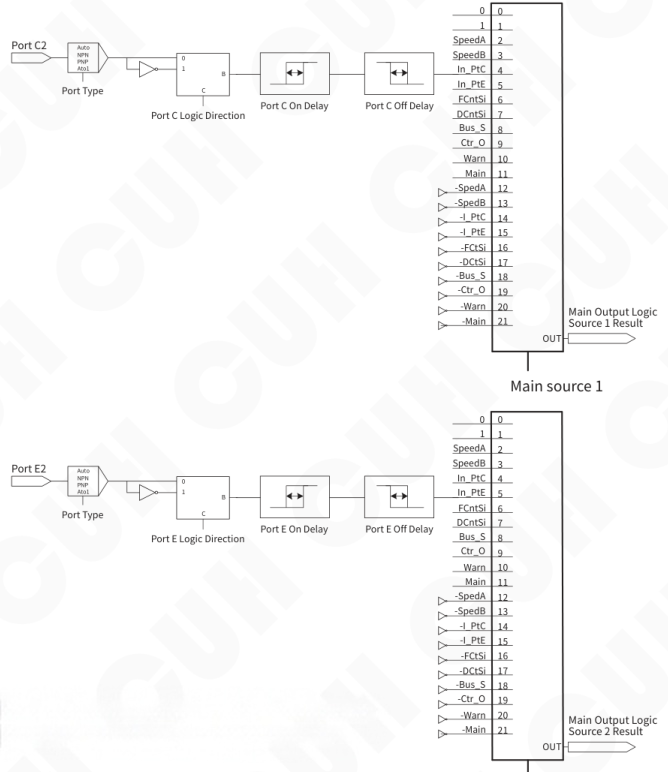

Pour les options de source de signal de la source principale ½,  
veuillez vous référer au chapitre 7.4.11 Annexe.

**Figure 4.4.1.1**

Remarque : L'état de sortie principale est également contrôlé par le bouton marche-arrêt ou par le fait que le contrôleur lui-même est en état de défaut. Le niveau de contrôle de défaut du bouton marche-arrêt ou du contrôleur lui-même est supérieur au signal logique de sortie principale. C'est-à-dire : lorsque le bouton marche-arrêt est réglé sur arrêt, le contrôleur entre immédiatement en état d'arrêt ; lorsqu'un défaut tel qu'un court-circuit, une surchauffe, une surintensité, etc. survient, le contrôleur entre également immédiatement en état d'arrêt. À ce moment, le signal logique de sortie principale ne peut pas activer la sortie principale du contrôleur.


## 4.4.1.2 Logique principale

Le résultat de la source logique de sortie principale 1 et la jonction de la source logique de sortie principale 2, après l'opération logique effectuée via la logique de sortie principale, passent par la direction de sortie principale, puis par la temporisation d'activation et de désactivation de la sortie principale, et enfin par le mode de sortie principale, et sont utilisés pour piloter l'état marche-arrêt de la sortie principale.

Le schéma de flux de signal est le suivant :


**Figure 4.4.1.2**

Ce contrôleur peut définir la table de relations logiques entre la source principale (logique) 1 et la source principale 2 comme suit. Par défaut : Or.

| Paramètre | Signification |
|---|---|
| And | ET logique, sortie valide lorsque la source principale 1 et la source principale 2 sont toutes deux valides |
| Or | OU logique, sortie valide lorsqu'au moins une des sources principale 1 ou principale 2 est valide |
| Xor | OU exclusif logique, valide lorsque la source principale 1 et la source principale 2 sont dans des états différents, sinon invalide |
| RS | Bascule RS |

## 4.4.1.3 Direction principale

C'est-à-dire la direction logique de sortie principale ; la direction de sortie spécifique peut être définie après la combinaison logique des signaux. Pour le schéma de flux de signal, se référer à la Figure 4.4.1.2. Par défaut : Const.

| Paramètre | Signification |
|---|---|
| Const | L'état après l'opération logique de sortie principale n'est pas inversé et revient par défaut à l'état normal |
| Inv | L'état est inversé après l'opération logique de sortie principale |
| On | L'état reste en marche après l'opération logique de sortie principale |
| Off | L'état est toujours arrêté après l'opération logique de sortie principale |


### 4.4.1.4 Temporisation d'activation/désactivation principale

Lors de l'utilisation d'autres signaux externes tels que des capteurs pour contrôler l'état de sortie principale de l'appareil, dans la plupart des cas, une temporisation est nécessaire après l'émission du signal ou la restauration du signal avant que l'opération puisse être effectuée. Pour de telles applications, cela peut être réalisé en définissant les valeurs de temps de la temporisation d'activation et de désactivation. Pour le schéma de flux de signal, se référer à la Figure 4.4.1.2.

**Temporisation d'activation principale :** C'est-à-dire la temporisation d'activation de la sortie principale ; c'est le temps de retard écoulé entre l'application d'un signal de commande qui fait entrer le contrôleur en état de marche et le démarrage effectif de la sortie du contrôleur. Le temps de retard écoulé pendant cette période est appelé temporisation d'activation.

**Temporisation de désactivation principale :** C'est-à-dire la temporisation de désactivation de la sortie principale ; à partir de l'application d'un signal de commande qui fait entrer le contrôleur en état d'arrêt, jusqu'à l'arrêt effectif de la sortie du contrôleur, le temps de retard écoulé pendant cette période est appelé temporisation de désactivation.

La plage de temporisation d'activation/désactivation principale est de 0.0~99.9s, la valeur par défaut est 0.2s et la précision de réglage est de 0.1s.

### 4.4.1.5 Mode principal

Deux modes de sortie principale sont disponibles : le mode retard et le mode maintien. Schéma de flux de signal : voir Figure 4.4.1.2. Par défaut : Delay.

| Paramètre | Signification |
|---|---|
| Delay | Désigne l'état de la sortie principale après l'opération logique, l'état de pilotage de la sortie principale après la temporisation d'activation et de désactivation |
| Hold | Désigne l'état après l'opération logique de sortie principale. Après la temporisation d'activation, l'état de marche est maintenu pendant la durée de la temporisation de désactivation, puis passe immédiatement à l'état de sortie arrêtée |

La différence entre les deux modes est exprimée sous la forme d'un diagramme de temporisation comme suit, où le signal d'entrée est une sélection de relation logique.

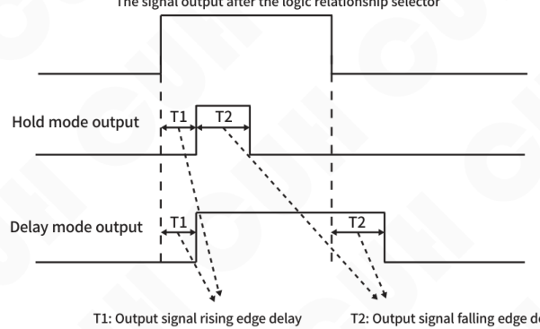


## 4.4.1.6 État à la mise sous tension

Définit l'état de fonctionnement du contrôleur après la mise sous tension. Par défaut : On.

| Paramètre | Signification |
|---|---|
| On | Après la mise sous tension de l'appareil, l'état de la touche marche/arrêt est en marche |
| Off | Après la mise sous tension de l'appareil, l'état de la touche marche/arrêt est arrêté |
| Keep | Après la mise sous tension de l'appareil, l'état de la touche marche/arrêt reste le même qu'avant le dernier arrêt |

## 4.4.1.7 Source de contrôle à distance

La tension de sortie et la vitesse d'alimentation du contrôleur peuvent être modifiées via les paramètres du panneau ou directement contrôlées par la taille du signal d'entrée de la source de contrôle à distance. Les méthodes de contrôle disponibles comprennent : le panneau, l'entrée DC 0-20mA, l'entrée DC 1-5V, l'entrée DC 0-5V, l'entrée DC 0-10V, ainsi que le signal de bus de synchronisation numérique. La valeur par défaut est Panel.

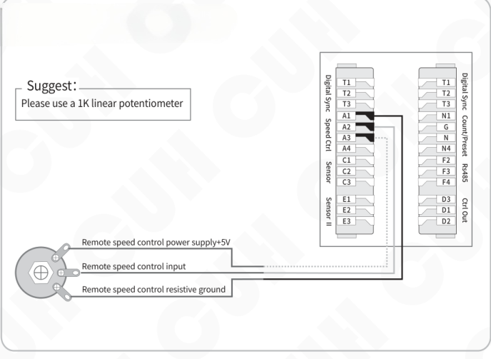


---

### Connexion de contrôle par PLC (entrée DC 1~5V/0~5V/0~10V)

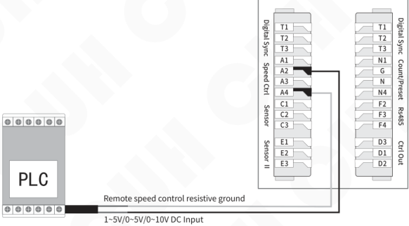

### Connexion de contrôle par PLC (entrée DC 4~20mA)

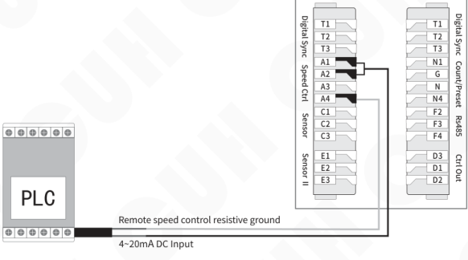

---


| Signal de contrôle à distance | Signal de contrôle à distance | Tension de sortie/Vitesse d'alimentation |
|---|---|---|
| Panel |  | La tension de sortie et la vitesse d'alimentation ne sont pas contrôlées par le signal de contrôle à distance |
| 20mA | &lt;2mA | Lorsque le mode tension est Manuel, tension de sortie = 0<br>Lorsque le mode tension est Auto, vitesse d'alimentation = 0<br>L'écran LCD affiche l'information d'erreur « Sous-tension de la commande à distance » |
| 20mA | 2mA~4mA | Tension de sortie = 0, vitesse d'alimentation = 0 |
| 20mA | 4mA~20mA | Contrôlé proportionnellement par le signal de contrôle à distance (0%~100%)<br>Lorsque le mode tension est Manuel, tension de sortie = (courant d'entrée - 4mA)/16 × tension de sortie max.<br>Lorsque le mode tension est Auto, vitesse d'alimentation = (courant d'entrée - 4mA)/16 × vitesse d'alimentation max. |
| 1~5V | Moins de 0.5V | Tension de sortie = 0, vitesse d'alimentation = 0<br>L'écran LCD affiche l'information d'erreur « Sous-tension de la commande à distance » |
| 1~5V | 0.5V~1V | Tension de sortie = 0, vitesse d'alimentation = 0 |
| 1~5V | 1V~5V | Contrôlé proportionnellement par le signal de contrôle à distance (0%~100%)<br>Lorsque le mode tension est Manuel, tension de sortie = (tension d'entrée - 1V)/4 × tension de sortie max.<br>Lorsque le mode tension est Auto, vitesse d'alimentation = (tension d'entrée - 1V)/4 × vitesse d'alimentation max. |
| 0~5V | 0V~5V | Contrôlé proportionnellement par le signal de contrôle à distance (0%~100%)<br>Lorsque le mode tension est Manuel, tension de sortie = tension d'entrée/5 × tension de sortie max.<br>Lorsque le mode tension est Auto, vitesse d'alimentation = tension d'entrée/5 × vitesse d'alimentation max. |
| 0~10V | 0V~10V | Contrôlé proportionnellement par le signal de contrôle à distance (0%~100%)<br>Lorsque le mode tension est Manuel, tension de sortie = tension d'entrée/10 × tension de sortie max.<br>Lorsque le mode tension est Auto, vitesse d'alimentation = tension d'entrée/10 × vitesse d'alimentation max. |
| DigSym | Digital Sync | La tension du signal de contrôle à distance est la tension d'entrée de contrôle à distance d'un appareil spécifié sur le bus (spécifié via les paramètres de synchronisation de contrôle à distance)<br>Contrôlé proportionnellement par le signal de tension d'entrée de contrôle à distance d'un appareil spécifié sur le bus, avec une plage de tension de 0% à 100%.<br>Lorsque le mode tension est Manuel, tension de sortie = tension d'entrée/10 × tension de sortie max.<br>Lorsque le mode tension est Auto, vitesse d'alimentation = tension d'entrée/10 × vitesse d'alimentation max. |

### 4.4.1.8 Coefficient de contrôle à distance

Lorsque la source de contrôle à distance sélectionnée n'est ni « panel » ni « sync », le coefficient de contrôle à distance peut être utilisé pour amplifier ou réduire la quantité de contrôle du signal d'entrée de contrôle à distance.

La plage du coefficient de contrôle à distance est de 0.5~2.0, la valeur par défaut est 1.0 et la précision de réglage est de 0.1.

Exemple : le coefficient de contrôle à distance est de 0.5 ; lorsque le signal d'entrée de contrôle à distance est de 2V, à ce moment, la tension d'entrée de contrôle à distance équivalente obtenue par le contrôleur est de 2V * 0.5=1V.


---

## 4.4.2 Paramètres de sortie de commande CC

Ce résumé présente principalement les réglages des paramètres de sortie de commande du contrôleur. Le schéma du flux de signal de sortie de commande est le suivant :

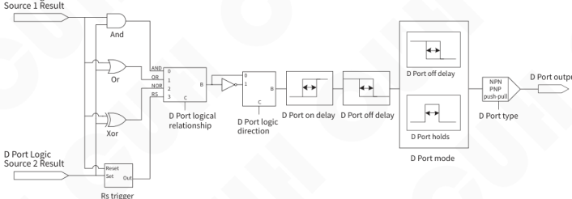

La méthode de réglage des paramètres de sortie de commande est la suivante :

> » Appui long sur ▲ et ◀ pour entrer dans l'interface de réglage des paramètres, appui court sur ▶ pour passer au groupe de paramètres « 6 DC output ».
>
> » Appui court sur ▲ ou ▼ pour changer de paramètre dans le groupe de paramètres de sortie de commande.
>
> » Appuyez sur ⊕ ou ⊖ pour ajuster la valeur du paramètre.
>
> ```text
> RUN
> A C D E F G N J      T0
> 01.PotDLogc        Or
> 02.PotDSor1      In_PtC
> 03.PotDSor2      In_PtE
> 04.PortDDir       Const
> 05.PtDUpDly       0.2 S
> +   6DCoutput        −
> ```

Les autres paramètres de ce groupe de paramètres peuvent être ajustés selon les étapes ci-dessus.

« Source du port D 1 », « Source du port D 2 », « Logique du port D », « Direction du port D », « Temporisation d'activation D »

« Temporisation de désactivation D » et « Mode du port D », les paramètres ci-dessus peuvent se référer aux réglages des paramètres de sortie principale.

---


## 4.4.2.1 Type de port D

La sortie du port D peut prendre en charge trois types : sortie NPN, sortie PNP et sortie push-pull.  
Par défaut : Ou_P&P (push-pull).

| Paramètre | Signification |
|---|---|
| Ou_NPN | Lorsque le signal de sortie du port D est valide, le port D émet un signal de niveau bas (0V) ; lorsqu'il est invalide, il est en haute impédance |
| Ou_PNP | Lorsque le signal de sortie du port D est valide, le port D émet un signal de niveau haut (24V) ; lorsqu'il est invalide, il est en haute impédance |
| Ou_P&P<br>(Push Pull) | Lorsque le signal de sortie du port D est valide, le port D émet un signal de niveau haut (24V).<br>Lorsque le signal de sortie du port D est invalide, le port D émet un signal de niveau bas (0V) |

Le schéma est le suivant :

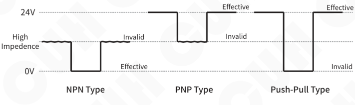


## 4.5 Commande de signal

Le contrôleur peut juger l'état de la matière dans l'alimentateur vibrant via un capteur externe, et réaliser la fonction « arrêt lorsque plein de matière » ou « arrêt lorsque vide de matière » du contrôleur. Le schéma de flux de signal des ports est le suivant :

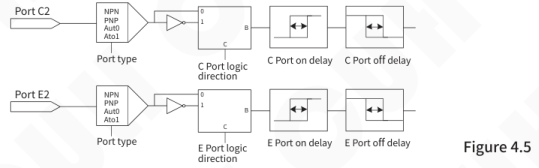

La méthode de réglage des paramètres d'entrée de signal est la suivante :

- Appui long sur ▲ et ◀ pour entrer dans l'interface de réglage des paramètres, appui court sur ▶ pour passer au groupe de paramètres « 5On&Off ».
- Appui court sur ▲ ou ▼ pour changer de paramètre dans le groupe de paramètres d'entrée de signal.
- Appuyez sur ⊕ ou ⊖ pour ajuster la valeur du paramètre.

```text
RUN
A C D E F G N J        A0
01.PortType        Auto
02.PortCDir        Const
03.PtCUpDly        0.2 S
04.PtCDnDly        0.2 S
05.PortEDir        Const
+   5On&Off        −
```

Les autres paramètres de ce groupe de paramètres peuvent être ajustés selon les étapes ci-dessus.

### 4.5.1 Type de capteur

Le contrôleur peut définir le type de capteur de commutation sur « Auto », « NPN », « PNP » ou « Ato1 », ou le définir manuellement en fonction du type de capteur.

| Paramètre | Signification |
|---|---|
| Auto | Quel que soit le type de capteur, il est toujours détecté si l'accès au port est valide par le changement des signaux de niveau haut et bas ; la valeur par défaut d'usine est la reconnaissance automatique |
| NPN | Capteur de type NPN |
| PNP | Capteur de type PNP |
| Ato1 | Avant que le signal du capteur ne soit invalide, il est détecté si le port est valide par le changement des niveaux haut et bas. Une fois qu'un signal valide est trouvé, le type de capteur du port est déterminé et n'est plus scanné |


### 4.5.2 Logique du port C/port E

Ce paramètre est utilisé pour commuter le port d'entrée C et le port d'entrée E du contrôleur entre « arrêt lorsque plein de matière » et « arrêt lorsque vide de matière ».

Lorsque le port d'entrée C/port E de commutation, dans les réglages d'usine par défaut, ne reçoit aucun signal, le contrôleur est en état « marche » (c'est-à-dire arrêt lorsque plein de matière). Certaines applications spéciales nécessitent que le contrôleur soit en état « arrêt » (c'est-à-dire arrêt lorsque vide de matière) lorsque le port C/port E ne reçoit aucun signal. Cela peut être réalisé en modifiant ce paramètre. Se référer à la Figure 4.5 pour le schéma de flux de signal.

| Paramètre | Signification |
|---|---|
| Const | Lorsqu'il n'y a pas de signal de commande, le contrôleur est en état de marche (arrêt lorsque plein de matière) |
| Inv | Lorsqu'il n'y a pas de signal de commande, le contrôleur est en état d'arrêt (arrêt lorsque vide) |

### 4.5.3 Temporisation d'activation/désactivation du port C et du port E

Le temps de retard entre le moment où un signal est appliqué pour mettre le contrôleur en état de marche et le moment où le signal est considéré comme valide par le contrôleur est appelé temporisation d'activation.

Le temps de retard entre l'application d'un signal qui fait entrer le contrôleur en état d'arrêt et le moment où le signal est considéré comme valide par le contrôleur est appelé temporisation de désactivation.

Pour le schéma de flux de signal, se référer à la Figure 4.5.

La plage de temporisation d'activation/désactivation est de 0.0~99.9s, la valeur par défaut est 0.2s et la précision de réglage est de 0.1s.

**Remarque :** Lors de l'utilisation des ports C, E pour effectuer un contrôle marche/arrêt, s'il est nécessaire de retarder l'opération pendant un certain temps après la réception du signal pour garantir la stabilité du signal, cela peut être réalisé en définissant la temporisation d'activation et la temporisation de désactivation.


## 4.5.4 Logique de vitesse A/Logique de vitesse B

Le schéma de flux de signal est le suivant :

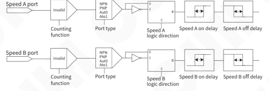

**Figure 4.5.4**

Ce paramètre est utilisé pour commuter l'état valide des ports d'entrée pour la vitesse A et la vitesse B du contrôleur. Ce paramètre doit être défini dans le groupe de paramètres de matière pleine. Par défaut : Const.

| Paramètre | Signification |
|---|---|
| Const | Lorsqu'il n'y a pas de signal de commande, la vitesse A et la vitesse B du contrôleur sont invalides |
| Inv | Lorsqu'il n'y a pas de signal de commande, la vitesse A et la vitesse B du contrôleur sont effectives |

## 4.5.5 Temporisation d'activation/désactivation de vitesse A et de vitesse B

Du moment où un signal valide est appliqué au port de vitesse A/B pour activer la vitesse, cette période est appelée temporisation d'activation.

Du moment où un signal invalide est appliqué au port de vitesse A/B pour désactiver la vitesse, cette période est appelée temporisation de désactivation.

Pour le schéma de flux de signal, se référer à la Figure 4.5.4.

La plage de temporisation d'activation/désactivation de vitesse A&B est de 0.0~99.9s, la valeur par défaut est 0.2s et la précision de réglage est de 0.1s.


## 4.6 Comptage de la quantité de matière

Ce contrôleur dispose d'une fonction de comptage intégrée qui peut compter les impulsions de comptage et ralentir ou s'arrêter automatiquement lorsque le nombre d'impulsions atteint le total défini. Il dispose également de fonctions spéciales telles qu'un super anti-rebond et une décélération finale pour éviter les dépassements. Le schéma de flux de signal est le suivant :

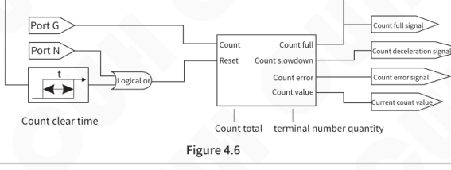

> » Appui long sur ▲ et ◀ pour entrer dans l'interface de réglage des paramètres, appui court sur ▶ pour passer au groupe de paramètres « 7Counter ».
>
> » Appui court sur ▲ ou ▼ pour changer de paramètre dans le groupe de paramètres de comptage.
>
> » Appuyez sur ⊕ ou ⊖ pour ajuster la valeur du paramètre.

```text
RUN
A C D E F G N J     A0
01.TotaCout       10
02.PrcntTrm       50 %
03.CotAhead        3
04.CotRstTm       0.0 S
05.CotPotSe       None
+     7Counter     −
```

Les autres paramètres de ce groupe de paramètres peuvent être ajustés selon les étapes ci-dessus.

### 4.6.1 Comptage de la quantité de matière (ou vitesse A/B)

Ce paramètre est utilisé pour activer et désactiver la fonction de comptage.

La valeur par défaut est None, c'est-à-dire que la fonction de comptage est désactivée, et la fonction vitesse A/B est activée à ce moment.

Lorsque le paramètre de fonction de comptage est valide (activé), la vitesse A et la vitesse B agissent comme contrôle de vitesse A/B ; le contrôleur peut effectuer davantage d'opérations pour la fonction de comptage. Pour le schéma de flux de signal, se référer à la Figure 4.6.

| Paramètre | Signification |
|---|---|
| None | Désactive la fonction de comptage et active la fonction vitesse A/B |
| Valid | Utilise le port de vitesse A comme port de comptage et le port de vitesse B comme port de remise à zéro du comptage |


## 4.6.2 Quantité cible

Une fois que la « valeur de comptage actuelle » atteint la limite, le signal de comptage complet est valide jusqu'à ce que le compteur soit réinitialisé. Après être entré dans l'état de comptage complet, si l'impulsion de comptage continue d'être envoyée, le comptage se poursuivra, mais le signal de comptage complet reste valide. Pour le schéma de flux de signal, se référer à la Figure 4.6.

La plage de comptage total est de 0~9999, la valeur par défaut est 10 et la précision de réglage est de 1.

## 4.6.3 Vitesse finale

**Vitesse finale** signifie que lorsque le comptage entre dans l'état de décélération finale, la vitesse d'alimentation et la tension du contrôleur chutent jusqu'au pourcentage de la vitesse et de la tension initiales, voir Figure 4.6.3.

Lorsque le numéro de comptage est proche du nombre total, le processus de comptage est sur le point d'être terminé. Afin d'éviter que le mouvement à grande vitesse du matériau ne puisse pas s'arrêter à temps et ne provoque un dépassement de comptage, le contrôleur réduit automatiquement la vitesse à la vitesse finale définie par l'utilisateur (le signal de décélération de comptage est valide) lorsque le nombre restant est inférieur au nombre final. Lorsque la valeur de comptage atteint le comptage total (le signal de comptage complet est valide), le contrôleur arrête immédiatement la sortie, et l'alimentateur peut obtenir un contrôle de comptage précis.

La plage de vitesse finale est de 0~100%, la valeur par défaut est 50% et la précision de réglage est de 1%.

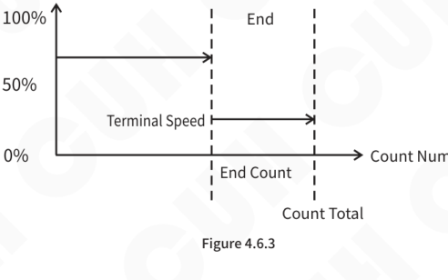


## 4.6.4 Quantité de vitesse finale

Nombre de sections finales : désigne le nombre total de comptages de distance. Après avoir atteint le « nombre final », le contrôleur entre en mode de décrémentation de comptage.

En état de vitesse, la vitesse d'alimentation et la tension chutent à la vitesse finale et à la tension finale. Lorsque la valeur de « Quantité de segment final » est 0, cela signifie que la fonction de décélération finale n'est pas utilisée. Pour le schéma de flux de signal, se référer à la Figure 4.6.

Le nombre de derniers segments va de 0 à 9999, la valeur par défaut est 3 et la précision de réglage est de 1.

## 4.6.5 Remise à zéro de la valeur de comptage

Lorsque le comptage est complet, le contrôleur efface automatiquement la valeur de comptage après le délai de « comptage clair ». Lorsque la valeur de « Count Clear » est 0.0s, cela signifie que le délai déclenche automatiquement la désactivation de la fonction de réinitialisation du comptage.

La plage de temps de réinitialisation du comptage est de 0.0~999.9s, la valeur par défaut est 0.0s et la précision de réglage est de 0.1s.

## 4.6.6 Priorité RS

Utilisé pour définir la priorité du port de déclenchement RS. Par défaut : Same.

| Paramètre | Signification |
|---|---|
| Same | Le port R et le port S ont la même priorité. Lorsqu'il y a des signaux sur les ports R et S, le contrôleur signale un avertissement de « main RS error » ou « control RS error » |
| Reset | Priorité à la réinitialisation. Lorsqu'il y a des signaux sur les ports R et S, le signal du port R est prioritaire, c'est-à-dire que le signal de réinitialisation est prioritaire |
| Set | Priorité à l'activation. Lorsqu'il y a des signaux sur les ports R et S, le signal du port S est prioritaire, c'est-à-dire que le signal d'activation est prioritaire |
| Revers | Lorsqu'il y a des signaux sur les ports R et S, le résultat de sortie logique actuel est inversé |


## 4.7 Enregistrement des réglages

Ce chapitre présente principalement comment utiliser les fonctions de stockage de paramètres et de rappel de paramètres du contrôleur.

### 4.7.1 Rappel des réglages

Le contrôleur peut lire 3 ensembles différents de paramètres prédéfinis en plus du groupe de travail, nommés respectivement « User 1 », « User 2 » et « User 3 ».

Lorsque l'utilisateur modifie les paramètres, les paramètres du contrôleur sont enregistrés par défaut dans le groupe de travail. Lorsque le contrôleur est remis sous tension, les paramètres sont automatiquement lus depuis le groupe de travail et les valeurs de paramètres précédant le dernier arrêt sont restaurées. En même temps, les utilisateurs peuvent sélectionner manuellement parmi « UsrD1 », « UsrD2 », « UsrD3 » pour lire un autre ensemble enregistré manuellement par les trois groupes. Les données sont envoyées au groupe de travail du contrôleur, ce qui permet au contrôleur de changer immédiatement d'état de travail.

| Paramètre | Signification |
|---|---|
| None | Invalide |
| UsrD1 | Paramètre défini par l'utilisateur 1 |
| UsrD2 | Paramètre défini par l'utilisateur 2 |
| UsrD3 | Paramètre défini par l'utilisateur 3 |

### 4.7.2 Enregistrement des réglages

Le contrôleur peut enregistrer 4 ensembles différents de paramètres prédéfinis, nommés « Work », « UsrD1 », « UsrD2 » et « UsrD3 ».

Lorsque l'utilisateur modifie les paramètres, les paramètres du contrôleur sont automatiquement enregistrés dans « Work » par défaut. Lorsque le contrôleur est remis sous tension, les paramètres seront automatiquement lus depuis le groupe de travail et les valeurs de paramètres précédant le dernier arrêt seront restaurées. Les utilisateurs peuvent enregistrer manuellement les paramètres du groupe de travail vers « UsrD1 », « UsrD2 », « UsrD3 ».

| Paramètre | Signification |
|---|---|
| None | Invalide |
| Work | Groupe de travail par défaut |
| UsrD1 | Paramètre défini par l'utilisateur 1 |
| UsrD2 | Paramètre défini par l'utilisateur 2 |
| UsrD3 | Paramètre défini par l'utilisateur 3 |


---

### 4.7.3 Restauration des réglages d'usine

Utilisez la réinitialisation des paramètres pour restaurer tous les paramètres du groupe de travail aux valeurs par défaut d'usine.

Après avoir sélectionné « RWork » dans « Reset Parameters », appuyez sur ⊕ et ⊖ et maintenez-les simultanément ; après plus de deux secondes, l'interface d'affichage passe à l'interface de veille et les paramètres sont restaurés avec succès.

| Paramètre | Signification |
|---|---|
| None | invalide |
| Rwork | Restaure les paramètres du groupe de travail aux réglages d'usine. (User 1, User 2 et User 3 ne seront pas restaurés) |

### 4.7.4 Copie des réglages

Le contrôleur peut remplacer le groupe de paramètres de ce contrôleur par les données des deux contrôleurs du réseau qu'il a sauvegardées, afin de copier rapidement les paramètres des deux contrôleurs.

Sélectionnez le numéro d'identification du contrôleur à copier pour réaliser la fonction de copie des données du contrôleur. La plage de sélection des paramètres de copie est de 1~8.

### 4.7.5 Mot de passe utilisateur

Les utilisateurs peuvent définir eux-mêmes le mot de passe des paramètres. Après le verrouillage, l'utilisateur ne peut opérer que dans le « groupe de paramètres de surveillance » et la « page d'accueil ».

Lorsque l'utilisateur définit que le « mot de passe utilisateur » est différent de 0, cela signifie que la fonction de verrouillage des paramètres avancés est activée. À ce moment, vous devez saisir le mot de passe pour entrer dans le groupe de paramètres depuis la page d'accueil. Après que l'utilisateur a « saisi le mot de passe » et appuyé sur ▶ + ▲, si la « saisie du mot de passe » et le « mot de passe utilisateur » sont différents, l'utilisateur ne peut accéder qu'au groupe de paramètres de surveillance. Ce n'est que si le mot de passe est correct que l'utilisateur peut accéder aux autres groupes de paramètres.

La plage de sélection du mot de passe utilisateur est de 0~9999.

### 4.7.6 Saisie du mot de passe

Si la « saisie du mot de passe » et le « mot de passe utilisateur » sont différents, l'utilisateur ne peut opérer que dans la « page d'accueil » et le « groupe de paramètres de surveillance ». Ce n'est que si le mot de passe est correct que l'utilisateur peut accéder aux autres groupes de paramètres.

La plage de sélection pour la saisie du mot de passe est de 0~9999.

---


## 4.8 Communication RS485

Ce contrôleur prend en charge la communication RS485. Selon le mode protocole Modbus de type ASCII et RTU, tous les paramètres et états du contrôleur peuvent être modifiés et lus à distance.

Le protocole de communication RS485 local « SDVC42-S Series 485 Register Address Table » peut être téléchargé dans la zone de téléchargement du site web de notre société : www.cuhnj.com.

> » Appui long sur ▲ et ◀ pour entrer dans l'interface de réglage des paramètres, appui court sur ▶ pour passer au groupe de paramètres « 8Comm ».
>
> » Appui court sur ▲ ou ▼ pour changer de paramètre dans le groupe de paramètres de communication.
>
> » Appuyez sur ⊕ ou ⊖ pour ajuster la valeur du paramètre.
>
> ```text
> RUN
> A C D E F G N J     A0
> 01.485type       RTU
> 02.BaudRate    115.2 K
> 03.485SlvID      1
> 04.Enab485R    None
> 05.DigSynAd      1
> +     8Comm       -
> ```

Les autres paramètres de ce groupe de paramètres peuvent être ajustés selon les étapes ci-dessus.

### 4.8.1 Type de communication

Sélection du type de communication RS485 : type Modbus ASCII et type Modbus RTU. Par défaut : RTU.

| Paramètre | Signification |
|---|---|
| ASCⅡ | Type Modbus ASCII |
| RTU | Type Modbus RTU |


## 4.8.2 Débit en bauds

Différentes options de débit en bauds pour la communication RS485. Par défaut : 115.2K.

| Paramètre | Signification |
|---|---|
| 0.3K | 0.3 Kbps |
| 1.2K | 1.2 Kbps |
| 2.4K | 2.4 Kbps |
| 9.6K | 9.6 Kbps |
| 19.2K | 19.2 Kbps |
| 57.6K | 57.6 Kbps |
| 115.2K | 115.2 Kbps |

## 4.8.3 Adresse du contrôleur esclave

Définit le numéro d'adresse esclave dans la communication RS485.

Le numéro d'esclave va de 1 à 31. Par défaut : 1.

## 4.8.4 Résistance de port/Résistance de synchronisation

Le port de communication RS485/port de synchronisation numérique intègre une fonction de résistance d'adaptation (120Ω). Par défaut : None.

| Paramètre | Signification |
|---|---|
| None | Ne pas utiliser la résistance d'adaptation (120Ω) |
| Valid | Utiliser la résistance d'adaptation (120Ω) |


## 4.9 Mise en réseau CUHBus-DS®

Le contrôleur SDVC42-S adopte le protocole de bus de communication série LAN (CUHBus-DS®). Il permet la mise en réseau de jusqu'à 8 appareils sur le même réseau. Les fonctions suivantes peuvent être mises en œuvre entre les contrôleurs après la mise en réseau :

**Fonctions de synchronisation :** La fréquence, la phase, le réglage de vitesse par contrôle à distance et d'autres paramètres de tout contrôleur du réseau peuvent être rendus cohérents ou décalés par rapport à la sortie de tout autre contrôleur du réseau.

**Partage de signaux :** Tout signal d'état de tout contrôleur du réseau peut être partagé comme source d'entrée de signal de tout autre contrôleur. Cela permet à tout contrôleur du réseau de disposer de sources de signaux plus riches en plus de l'unité locale et de les émettre après des opérations logiques afin de mettre en œuvre une logique de fonctionnement plus complexe sur le site de l'utilisateur.

**Sauvegarde des données :** Les données de tout contrôleur du réseau seront sauvegardées sur les deux autres contrôleurs du réseau. Tout contrôleur du réseau peut être parfaitement remplacé par remplacement et jonction, et il est possible de continuer à fonctionner avec les données du contrôleur remplacé.

> ☺
>
> **Ce système de réseau présente les caractéristiques suivantes :**
>
> - Il est facile à étendre et de nouveaux appareils peuvent être rapidement ajoutés au réseau.
> - Le réseau est équivalent, avec un ensemble de bornes de communication CUHBus-DS® équivalentes à gauche et à droite pour faciliter la connexion par l'utilisateur.
> - L'appareil prend en charge le remplacement à chaud ; l'extension du contrôleur peut être ajoutée ou supprimée sans coupure d'alimentation pendant le fonctionnement stable du système de contrôleurs.


## 4.9.1 Mise en réseau des appareils

Ce chapitre présente principalement la mise en réseau rapide entre plusieurs contrôleurs, comment ajouter un nouveau contrôleur au réseau établi et comment supprimer un contrôleur du réseau.

### 4.9.1.1 Mise en réseau des appareils

Un contrôleur seul constitue à lui seul un réseau. Lorsque les lignes de signal CUHBus-DS® des contrôleurs sont correctement connectées et que des opérations simples sont effectuées, plusieurs appareils peuvent former un nouveau réseau de communication synchrone numérique.

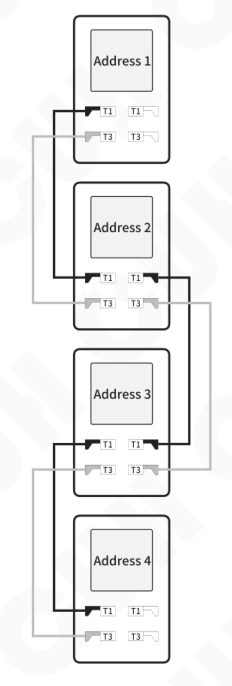


---

**Étapes :**

1. Connectez tous les signaux T1 des contrôleurs entre eux et tous les signaux T3 entre eux, comme indiqué sur la figure ci-dessus.

2. Lorsque le nouvel appareil est mis sous tension, le nouveau contrôleur entre automatiquement dans le « groupe de paramètres de communication ».

3. Dans le groupe de paramètres de communication, définissez le numéro d'appareil de communication de synchronisation numérique local ; « DigSynAd » peut prendre n'importe quelle valeur de [1~8]. Vous n'avez pas besoin de le définir, le programme génère automatiquement un numéro.

4. Dans le groupe de paramètres de communication, réglez la valeur du paramètre « EnNetwok » sur « Expand », puis maintenez ⊕ et ⊖ enfoncés simultanément pour confirmer.

5. Une fois l'ajout réussi, la valeur du paramètre « EnNetwok » du nouvel appareil passe automatiquement à « Online », indiquant que le nouvel appareil a été ajouté avec succès.

L'utilisateur peut vérifier si le réseau a été correctement constitué en consultant les paramètres d'état de mise en réseau des appareils, ainsi que le nombre total d'appareils du réseau et le nombre d'appareils en ligne.

Remarque : le simple fait de connecter la ligne de signal CUHBus-DS® sans effectuer les réglages ne compte pas comme une jonction au réseau.

**Méthode de vérification :**

1. Dans le groupe de paramètres de surveillance, la valeur du paramètre « DevicNum » est [1~8], indiquant le nombre total d'appareils du réseau.

2. Dans le groupe de paramètres de surveillance, la valeur du paramètre « OnlinNum » est [1~8], indiquant combien de contrôleurs sont actuellement en ligne dans le réseau.

**Résistance de synchronisation :**

Le port de communication CUHBus-DS® intègre une fonction de résistance d'adaptation (120Ω), qui peut être invalide ou valide.

| Paramètre | Signification |
|---|---|
| None | Ne pas utiliser la résistance d'adaptation (120Ω) |
| Valid | Utiliser la résistance d'adaptation (120Ω) |

---


---

## 4.9.1.2 Jonction d'un appareil

L'utilisateur peut suivre les étapes d'extension et d'ajout suivantes pour ajouter un nouveau contrôleur au réseau existant.

Une fois joint, le nouveau contrôleur peut appeler le signal de tout contrôleur du réseau et servir de source de signal à tout autre contrôleur du réseau. Cela enrichit les sources de signaux du système.

**Étapes :**

1. Connectez les interfaces CUHBus-DS® T1 et T3 du nouvel appareil au réseau complet d'origine ; les ports prennent en charge le remplacement à chaud.
2. Lorsque le nouvel appareil est mis sous tension, le nouveau contrôleur entre automatiquement dans le « groupe de paramètres de communication ».
3. Dans le groupe de paramètres de communication, définissez le numéro d'appareil de communication de synchronisation numérique local ; « DigSynAd » peut prendre n'importe quelle valeur de [1~8]. Vous n'avez pas besoin de le définir, le programme génère automatiquement un numéro.
4. Dans le groupe de paramètres de communication, réglez la valeur du paramètre « EnNetwok » sur « Expand », puis maintenez ⊕ et ⊖ enfoncés simultanément pour confirmer.
5. Une fois l'ajout réussi, la valeur du paramètre « EnNetwok » du nouvel appareil passe automatiquement à « Online », indiquant que le nouvel appareil a été ajouté avec succès.

L'utilisateur peut vérifier si le réseau a été correctement constitué en consultant les paramètres d'état de mise en réseau des appareils, ainsi que le nombre total d'appareils du réseau et le nombre d'appareils en ligne.

Remarque : le simple fait de connecter la ligne de signal CUHBus-DS® sans effectuer les réglages ne compte pas comme une jonction au réseau.


---


---

### 4.9.1.3 Retrait d'un appareil

Lorsque vous devez retirer définitivement un contrôleur du réseau, utilisez la fonction de suppression d'un contrôleur du réseau. La suppression d'un contrôleur du réseau peut être lancée depuis n'importe quel contrôleur du réseau. Les contrôleurs restants après la suppression se réorganisent en un nouveau réseau complet.

Toutefois, si le contrôleur est retiré directement (y compris en cas de coupure d'alimentation) sans le supprimer, les données du contrôleur restent conservées dans le réseau. À ce moment, le réseau est dans un état dégradé et de nouveaux contrôleurs ne peuvent pas être ajoutés. Il doit être supprimé manuellement via le contrôleur afin de maintenir l'intégrité du réseau et de permettre l'extension et l'ajout de nouveaux contrôleurs.

**Étapes de suppression d'un contrôleur :**

1. Entrez dans le « groupe de paramètres de communication » via n'importe quel contrôleur du réseau.
2. Modifiez la valeur du paramètre « DeltDevi » en l'adresse de l'appareil réseau à supprimer.
3. Après avoir modifié la valeur, maintenez ⊕ et ⊖ enfoncés pour confirmer la suppression de l'appareil.
4. Une fois la suppression terminée, la valeur du paramètre « DeltDevi » devient non sélectionnable, indiquant que l'appareil a été supprimé avec succès.
5. À ce moment, vérifiez le nouvel état du réseau sur l'appareil en fonctionnement et confirmez le nombre de contrôleurs du nouveau réseau.

Exemple : supprimer le contrôleur d'adresse 3 du réseau.

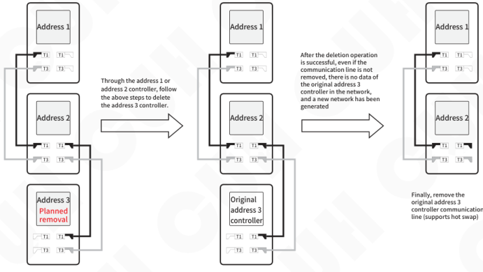

---


---

## 4.9.2 Fonction de synchronisation

La fréquence, la phase ou la vitesse contrôlée à distance de tout contrôleur du réseau peut suivre un autre contrôleur maître de manière cohérente ou avec un certain décalage. Toutefois, plusieurs contrôleurs ne peuvent pas se suivre mutuellement, sinon leurs sorties deviendront instables.

Exemple 1 : le contrôleur d'adresse 3 suit la fréquence de sortie du contrôleur d'adresse 1, de sorte que les deux alimentateurs vibrants qu'ils pilotent fonctionnent à la même fréquence.

Exemple 2 : si le contrôleur d'adresse 3 suit déjà la fréquence de sortie du contrôleur d'adresse 1, le contrôleur d'adresse 1 ne peut pas être réglé pour suivre la fréquence de sortie du contrôleur d'adresse 3. Cela signifie que les contrôleurs ne peuvent pas se suivre mutuellement.

➢ **Synchronisation de fréquence**

La méthode de réglage de la synchronisation de fréquence est la suivante :

1. Les deux ou plusieurs contrôleurs nécessitant une synchronisation de fréquence doivent former le même réseau de communication synchrone numérique ; veuillez vous référer au chapitre « Mise en réseau des appareils ».

2. Dans le groupe de paramètres de communication du contrôleur synchronisé en fréquence, réglez la valeur du paramètre « FrqncSyn » sur le numéro d'adresse « Digital Sync » du contrôleur de référence (fréquence).

3. Sur le contrôleur synchronisé en fréquence, accédez au groupe de paramètres de vitesse stable et réglez « FrqncMod » sur « SynV » ou « SynE ».

➢ **Synchronisation de la vitesse de contrôle à distance**

La méthode de réglage de la synchronisation de la vitesse de contrôle à distance est la suivante :

1. Les deux ou plusieurs contrôleurs nécessitant une synchronisation de contrôle à distance doivent former le même réseau de communication synchrone numérique ; veuillez vous référer au chapitre « Mise en réseau des appareils ».

2. Dans le groupe de paramètres de communication du contrôleur devant être synchronisé en contrôle à distance, réglez la valeur du paramètre « RemotSyn » sur le numéro d'adresse « Digital Sync » du contrôleur de référence (contrôle à distance).

3. Réglez la valeur du paramètre « CtrlSour » dans le groupe de paramètres de sortie principale sur « DigSym ».

➢ **Mode de fonctionnement Maître/Esclave**

L'utilisateur peut régler le contrôleur pour qu'il fonctionne dans l'un des deux modes de fonctionnement suivants selon les exigences de l'application :

Mode maître : un contrôleur contrôle indépendamment une cuve de vibration.

Mode esclave : lorsque deux contrôleurs ou plus doivent fonctionner de manière synchrone, un contrôleur est utilisé comme contrôleur maître et fonctionne en mode maître comme référence de fréquence. Tous les autres contrôleurs fonctionnent en mode esclave, en tant que contrôleurs esclaves, et fonctionnent de manière synchrone avec le contrôleur maître.

---


## Mode maître

Le contrôleur fonctionnant en mode maître, ci-après dénommé contrôleur maître, se règle via les paramètres du groupe de paramètres de vitesse stable. Les paramètres « mode tension » et « mode fréquence » permettent de définir le mode de fonctionnement correspondant du contrôleur. Le mode tension et le mode fréquence ont les combinaisons suivantes :

| Mode de fonctionnement | Tension<br>Méthode de contrôle | Fréquence<br>Méthode de contrôle | Capteur de vibration nécessaire |
|---|---|---|---|
| Entièrement manuel | Manuel | Manuel | Non |
| Entièrement automatique | Auto | Auto | Oui |
| Tension automatique | Auto | Manuel | Oui |
| Fréquence automatique | Manuel | Auto | Oui |

■ **Mode entièrement manuel**

Dans ce mode, la tension de sortie et la fréquence de sortie du contrôleur sont réglées manuellement.

**Remarque :** même si le paramètre « mode tension » ou « mode fréquence » est réglé sur « Auto », le contrôleur fonctionne toujours en mode entièrement manuel si le capteur de vibration n'est pas connecté.

■ **Mode entièrement automatique**

Le contrôleur ajuste automatiquement la tension de sortie et la fréquence de sortie en fonction des données renvoyées par le capteur de vibration afin que la vitesse d'alimentation de l'équipement vibrant soit stable autour de la valeur définie de « vitesse d'alimentation » et que la fréquence de vibration se situe à la fréquence de fonctionnement optimale de l'équipement vibrant. La tension de sortie et la fréquence de sortie ne sont pas contrôlées par les paramètres « voltage » et « frequency ».

**Remarque :** le réglage d'usine par défaut du contrôleur est le mode entièrement automatique, mais si le capteur de vibration n'est pas correctement inséré, le contrôleur reste en état entièrement manuel. Le contrôleur ne passe à l'état entièrement automatique que lorsque le capteur de vibration est correctement inséré.

■ **Mode tension automatique**

Dans ce mode, le contrôleur ajuste automatiquement la tension de sortie en fonction des données renvoyées par le capteur de vibration afin que la vitesse d'alimentation de l'équipement vibrant soit stable à la valeur définie. La fréquence de sortie est réglée manuellement par l'utilisateur. Le contrôleur doit être connecté à un capteur de vibration pour que ce mode fonctionne correctement.

■ **Mode fréquence automatique**

Dans ce mode, le contrôleur ajuste automatiquement la fréquence de sortie en fonction des données renvoyées par le capteur de vibration afin que la fréquence de vibration se situe à la fréquence de fonctionnement optimale de l'équipement vibrant ; la tension de sortie est réglée manuellement. Le contrôleur doit être connecté à un capteur de vibration pour que ce mode fonctionne correctement.


## Mode esclave

Lorsque plusieurs contrôleurs sont mis en réseau, l'un d'entre eux peut sélectionner le mode esclave. Dans ce mode, la fréquence de sortie du contrôleur esclave est toujours strictement identique à la fréquence de sortie du contrôleur maître. Le contrôleur fonctionnant en mode esclave est ci-après dénommé contrôleur esclave.

Le mode de synchronisation de fréquence est utilisé dans les situations où un système d'alimentation comporte plusieurs contrôleurs et où leurs fréquences et phases de sortie doivent être synchronisées. Grâce au mode synchrone, les contrôleurs maître et esclave peuvent émettre des formes d'onde parfaitement synchrones, éliminant ainsi les interférences mutuelles entre les sorties des contrôleurs.

Lorsque le contrôleur M fonctionne en mode maître et le contrôleur S en mode esclave (mode synchrone), les formes d'onde de sortie des deux contrôleurs sont complètement synchronisées. Comme indiqué ci-dessous :

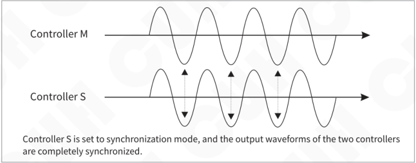

Si le contrôleur S n'est pas réglé en mode esclave (mode SynV ou SynE), les formes d'onde de sortie des deux contrôleurs ne sont pas synchronisées. Comme indiqué ci-dessous :

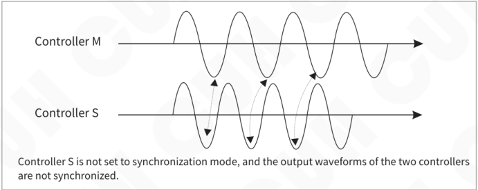


Pour les équipements mécaniques nécessitant un alignement précis, deux équipements vibrants ou plus peuvent devoir présenter des phases physiquement cohérentes, mais chaque équipement a une fréquence de résonance différente. En réglant le mode fréquence sur « SynV », le contrôleur peut ajuster automatiquement les phases de chaque équipement en fonction des conditions de vibration pour obtenir cette cohérence. Si le mode fréquence est « SynE », l'utilisateur définit manuellement la valeur de compensation de phase.

Modifiez les paramètres « mode tension » et « mode fréquence » du groupe de paramètres de vitesse stable pour que le contrôleur fonctionne dans le « mode de fonctionnement » correspondant. Le mode tension et le mode fréquence ont les combinaisons suivantes :

| Mode de fonctionnement | Méthode de tension | Méthode de fréquence | Contrôle de phase | Capteur de vibration nécessaire |
|---|---|---|---|---|
| Tension automatique<br>Phase automatique | Auto | SynV | Auto | Oui |
| Tension automatique<br>Phase manuelle | Auto | SynE | Réglage manuel | Oui |
| Tension manuelle<br>Phase automatique | Manuel | SynV | Auto | Oui |
| Tension manuelle<br>Phase manuelle | Manuel | SynE | Réglage manuel | Non |

☺

**Remarque :**

1. Même si les paramètres « mode tension » et « mode fréquence » sont réglés sur « Auto » et « SynV », si le capteur de vibration n'est pas connecté, le contrôleur fonctionne toujours en état tension manuelle et phase manuelle.

2. La tension automatique désigne un contrôleur esclave connecté à un capteur de vibration qui ajuste automatiquement la tension de sortie pour stabiliser la vitesse d'alimentation autour de la valeur définie par l'utilisateur.

3. La phase automatique signifie que le contrôleur esclave connecté au capteur de vibration corrige automatiquement la phase de la forme d'onde de sortie en fonction du signal de retour du capteur, afin que le signal de synchronisation émis par le contrôleur esclave et le contrôleur maître soient en phase.

4. La phase manuelle désigne la phase de la forme d'onde de sortie du contrôleur esclave, qui peut être définie manuellement pour présenter un décalage de phase fixe par rapport à la forme d'onde de sortie du contrôleur maître.


## Méthode de connexion du câble de synchronisation entre contrôleurs maître et esclave

Il suffit de connecter les contrôleurs maître et esclave au même réseau de communication synchrone numérique, puis de les mettre en réseau. Réglez la valeur du paramètre « synchronisation de fréquence » dans le groupe de paramètres de communication du contrôleur esclave sur le numéro d'adresse « synchronisation numérique » du contrôleur maître. Ensuite, réglez le « mode fréquence » du groupe de paramètres de vitesse stable sur « vibration synchronisée » ou « électrique synchronisée ».

### Scénarios d'application où les contrôleurs maître et esclave sont tous deux connectés à des capteurs de vibration

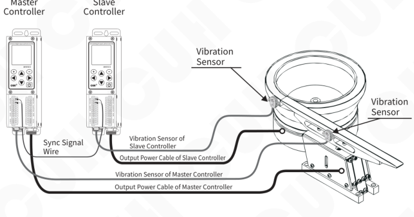

1. Si le contrôleur esclave fonctionne en mode tension manuelle et phase manuelle, il n'a pas besoin d'être connecté à un capteur de vibration.

2. Si le contrôleur maître fonctionne en mode entièrement manuel, il n'a pas besoin d'être connecté à un capteur de vibration.


---

■ **Mode tension automatique et phase automatique**

Dans ce mode, le contrôleur doit être connecté à un capteur de vibration. Le contrôleur ajuste automatiquement la tension de sortie en fonction des données renvoyées par le capteur de vibration afin que la vitesse d'alimentation de l'équipement vibrant soit stable à la valeur définie. La fréquence et la phase de la forme d'onde de sortie sont cohérentes avec le contrôleur maître, ou présentent un décalage de phase défini par le paramètre « Auto Phase ».

■ **Mode tension automatique et phase manuelle**

Dans ce mode, le contrôleur doit être connecté à un capteur de vibration. Le contrôleur ajuste automatiquement la tension de sortie en fonction des données renvoyées par le capteur de vibration afin que la vitesse d'alimentation de l'équipement vibrant soit stable à la valeur définie. La fréquence de sortie est cohérente avec le contrôleur maître. La forme d'onde de sortie diffère de celle du contrôleur maître d'une valeur de décalage de phase fixe, définie par le paramètre « Manual Phase ».

■ **Mode tension manuelle et phase automatique**

Dans ce mode, le contrôleur doit être connecté à un capteur de vibration. La tension de sortie du contrôleur est réglée manuellement. La fréquence et la phase de la forme d'onde de sortie sont cohérentes avec le contrôleur maître, ou présentent un décalage de phase défini par le paramètre « Auto Phase ».

■ **Mode tension manuelle et phase manuelle**

Dans ce mode, la tension de sortie du contrôleur est réglée manuellement et la fréquence de sortie est cohérente avec le contrôleur maître. La forme d'onde de sortie diffère de celle du contrôleur maître d'une valeur de décalage de phase fixe, définie par le paramètre « Manual Phase ».

> ☺
>
> 1. Le mode phase automatique nécessite de régler la valeur du paramètre « mode fréquence » du contrôleur esclave sur « SynV ».
>
> 2. Le mode phase manuelle nécessite de régler la valeur du paramètre « mode fréquence » du contrôleur esclave sur « SynE ».

---


---

## 4.9.3 Partage de signaux

Une fois l'appareil mis en réseau, le contrôleur peut appeler n'importe quel signal de tout autre contrôleur du réseau afin d'obtenir des possibilités d'appel de signaux plus riches.

La source de signal d'un contrôleur du réseau peut être choisie parmi n'importe quel port de n'importe quel contrôleur du réseau. Et peut réaliser un contrôle logique complexe via des opérations logiques AND, OR, XOR ou RS.

Étapes d'opération pour appeler d'autres sources de signaux depuis la sortie principale du contrôleur :

➢ **Sélectionnez le contrôleur qui doit obtenir le signal réseau, entrez dans le groupe de sortie principale et effectuez les réglages suivants :**

1. Réglez le paramètre « MainSor1 » ou le paramètre « MainSor2 » sur « Bus ».
2. Réglez le paramètre « MainLogc » sur l'une des valeurs « And », « Or », « Xor » et « RS ».
3. Réglez le paramètre « MainDire » de ce contrôleur sur l'une des valeurs « Const », « Inv », « On » ou « Off ».
4. Réglez les temps « MainUpDy » et « MainDnDy » de ce contrôleur.
5. Réglez le paramètre « MainMode » de ce contrôleur sur l'une des valeurs « Delay » ou « Hold ».

➢ **Passez au groupe de communication et effectuez les réglages suivants :**

6. Réglez « BSigMID1 » de ce contrôleur sur l'adresse du contrôleur à suivre (le numéro du contrôleur peut être consulté via la synchronisation numérique).
7. Réglez « BSigMID2 » de ce contrôleur sur l'adresse du contrôleur à suivre.
8. Réglez le numéro de bit d'état spécifique de « BSigM_B1 » de ce contrôleur. Vous devez consulter les « bits d'état 1~16 » du contrôleur suivi et sélectionner le numéro d'ordre du bit d'état requis.
9. Réglez le numéro de bit d'état spécifique de « BSigM_B2 » de ce contrôleur. Vous devez consulter les « bits d'état 1~16 » du contrôleur suivi et sélectionner le numéro d'ordre du bit d'état requis.

Tout contrôleur peut envoyer 16 de ses propres états sur le bus ; ils peuvent être définis indépendamment via « bit d'état 1 » ~ « bit d'état 16 », et par défaut, « bit d'état 1 » ~ « bit d'état 16 » correspondent aux 16 premiers bits du chapitre « 7.4.11 Annexe ».

Tout contrôleur peut appeler les signaux du bus (par défaut). Pour la signification et les détails, veuillez vous référer au chapitre « 7.4.11 Annexe ».

---


---

Exemple : après la mise en réseau, le contrôleur d'adresse 3 appelle le signal du port C du contrôleur d'adresse 1 et les signaux du port C du contrôleur d'adresse 2, effectue un OU logique, et lorsque l'un des signaux est détecté comme valide, la sortie principale du contrôleur d'adresse 3 s'arrête.

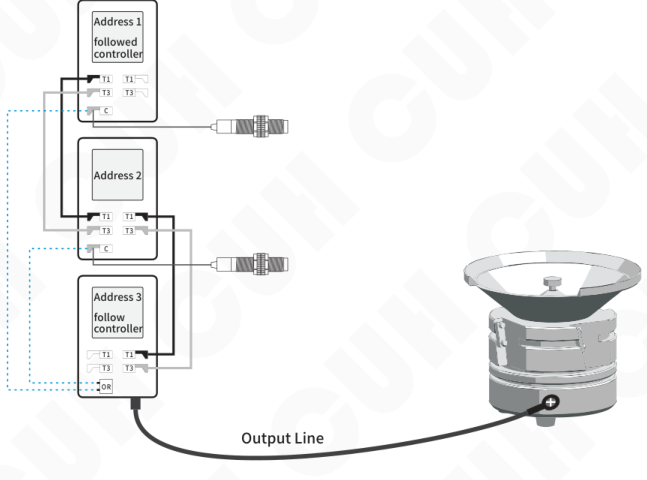

Étapes d'opération :

1. Réglez le groupe de paramètres de sortie principale du contrôleur d'adresse 3 : « MainSor1 » sur « bus » et « MainSor2 » sur « bus ».
2. Réglez le paramètre « MainLogc » du contrôleur d'adresse 3 sur « And ».
3. Réglez le paramètre « MainDire » (direction de sortie principale) du contrôleur d'adresse 3 sur « Const ».
4. Réglez les temps « MainUpDy » et « MainDnDy » du contrôleur d'adresse 3 sur la valeur de temps requise. La valeur par défaut est de 0,2 seconde.
5. Réglez le « MainMode » (mode de sortie principale) du contrôleur d'adresse 3 sur « Delay ».
6. Réglez « BSigMID1 » dans le « groupe de paramètres de communication » du contrôleur d'adresse 3 sur « 1 » (spécifie le contrôleur d'adresse 1).
7. Réglez « BSigMID2 » du contrôleur d'adresse 3 sur « 2 » (spécifie le contrôleur d'adresse 2).
8. Réglez « BSigM_B1 » du contrôleur d'adresse 3 sur « 4 » (spécifie le signal du port C).
9. Réglez « BSigM_B2 » du contrôleur d'adresse 3 sur « 4 » (spécifie le signal du port C).
10. Le réglage est terminé. Pour les réglages de sortie de commande du port D du contrôleur, reportez-vous aux réglages de sortie principale du contrôleur.

---


## 4.9.4 Sauvegarde des données

Lorsque tous les contrôleurs sont mis en réseau, tous les contrôleurs du réseau peuvent sauvegarder mutuellement leurs données. Chaque contrôleur sauvegarde les données de deux autres contrôleurs du réseau. Lorsqu'un contrôleur du réseau d'origine tombe en panne, l'utilisateur peut rapidement remplacer le contrôleur défectueux par un nouveau contrôleur. Tous les paramètres du nouveau contrôleur seront identiques à ceux du contrôleur avant remplacement.

Lorsque moins de 3 contrôleurs avec des numéros adjacents tombent en panne dans le réseau, l'opération de remplacement peut réussir. Toutefois, lorsque 3 contrôleurs ou plus tombent en panne, aucune donnée de machine ne peut être restaurée.

- Étapes de jonction d'un nouveau contrôleur au réseau en tant qu'appareil de remplacement :

1. Mettez hors tension l'appareil à remplacer et retirez le câble de communication CUHBus-DS®.
2. Connectez l'interface CUHBus-DS® du nouvel appareil au réseau d'origine.
3. Lorsque le nouvel appareil est mis sous tension, le nouveau contrôleur entrant entre automatiquement dans le « groupe de paramètres de communication ».
4. Réglez le paramètre « DigSynAd » (adresse de synchronisation numérique locale). Comme ce réseau est incomplet, la valeur de ce paramètre n'affichera que le numéro de l'appareil à remplacer.
5. Réglez la valeur du paramètre « EnNetwok » sur « Replace », puis maintenez ⊕ et ⊖ enfoncés simultanément pour confirmer.
6. Une fois le remplacement réussi, la valeur du paramètre « EnNetwok » du nouvel appareil passe automatiquement à « Online ».

Exemple 1 : le réseau d'origine est composé des contrôleurs d'adresse 1, d'adresse 2 et d'adresse 3. Comme l'adresse 3 est en panne, il est nécessaire de remplacer l'appareil d'origine par un nouvel appareil et de restaurer tous les réglages de l'appareil d'origine.

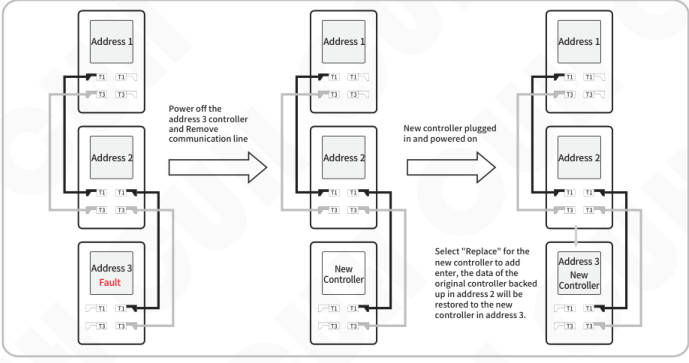

Exemple 2 : le réseau comporte quatre contrôleurs avec les adresses 1, 2, 3 et 4. Parmi eux, les contrôleurs d'adresses 2, 3 et 4 du réseau sont tombés en panne. Toutefois, comme chaque appareil du réseau sauvegarde les données d'au plus deux contrôleurs, le contrôleur d'adresse 4 ne peut pas terminer la récupération des données. Pour les réglages de remplacement des contrôleurs d'adresses 2 et 3, reportez-vous au cas ci-dessus.

Exemple 3 : le réseau comporte à l'origine cinq appareils avec les adresses 1, 2, 3, 4 et 5. Parmi eux, les adresses 1, 2 et 4 sont défectueuses (trois unités non consécutives). Vous pouvez restaurer les données des contrôleurs d'adresse 1 et d'adresse 2 depuis l'adresse 5, et restaurer les données du contrôleur d'adresse 4 depuis l'adresse 3, permettant ainsi de restaurer toutes les données des contrôleurs défaillants. Pour les réglages de remplacement des contrôleurs, reportez-vous au cas ci-dessus.


## 4.9.5 Données de contrôle à distance

L'utilisateur peut choisir les sources de données à envoyer au réseau de synchronisation : tension manuelle, tension de contrôle à distance, vitesse manuelle et vitesse de contrôle à distance.

| Paramètre | Signification |
|---|---|
| ManVol | La tension manuelle désigne la tension définie via le panneau utilisateur |
| RemVol | La tension de contrôle à distance désigne la tension ajustée via le port de régulation de vitesse à distance |
| ManSpd | La vitesse manuelle désigne la vitesse d'alimentation définie via le panneau utilisateur |
| RemSpd | La vitesse de contrôle à distance désigne la vitesse d'alimentation ajustée via le port de régulation de vitesse à distance |

## 4.10 Surveillance de l'état du contrôleur

Dans le groupe de paramètres de surveillance, l'état de fonctionnement et les valeurs des paramètres du contrôleur peuvent être lus en temps réel.

Pour les entrées de paramètres lisibles, veuillez vous référer au chapitre « Liste des paramètres », groupe de paramètres 10, groupe de paramètres de surveillance.

```text
RUN
A C D E F G N J      A0
01.Voltage       150 V
02.Frequenc     50.0 Hz
03.SpeedNow        0
04.VoltgOut     19.8 V
05.EffectCu     0.00 A
+   10Monitor      −
```


---

## 4.11 Journal des erreurs

Le contrôleur peut enregistrer 64 ensembles de journaux en boucle afin de faciliter la consultation ultérieure du moment où le problème est survenu et des informations spécifiques. Quelle que soit l'interface, maintenez ▲ et ▶ enfoncés pour entrer dans le groupe d'interfaces des journaux, qui s'affiche comme suit :

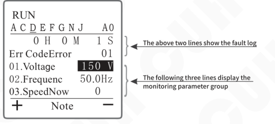

Contenu de l'affichage :

    RUN
    A C D E F G N J        A0
            0 H   0 M   1 S
    Err CodeError          01
    01.Voltage           150 V
    02.Frequenc          50.0Hz
    03.SpeedNow             0
    +        Note          −

- Les deux lignes ci-dessus affichent le journal des défauts.
- Les trois lignes suivantes affichent le groupe de paramètres de surveillance.

## 4.12 Personnalisation de la page d'accueil

Afin de permettre aux utilisateurs d'utiliser le contrôleur de manière efficace et rapide, l'utilisateur peut effectuer des opérations personnalisées dans le groupe de paramètres d'interface. En extrayant au maximum 16 paramètres parmi tous les paramètres, ils sont placés comme éléments de surveillance dans le groupe de paramètres d'interface, et l'utilisateur peut effectuer des opérations rapides sur l'interface principale.

Exemple : sélectionnez 1. UsrVoltg (P2.02), 2. UsrFrqnc (P2.03), 3. UserSped (P2.01), 4. SoftStar (P2.04), SoftStop (P2.05), soit cinq paramètres dans l'interface principale. Les étapes sont les suivantes :

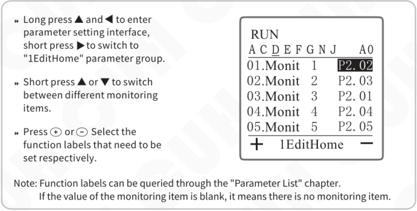

Étapes :

- Appui long sur ▲ et ◀ pour entrer dans l'interface de réglage des paramètres, appui court sur ▶ pour passer au groupe de paramètres « 1EditHome ».
- Appui court sur ▲ ou ▼ pour naviguer entre les différents éléments de surveillance.
- Appuyez sur ⊕ ou ⊖ pour sélectionner les libellés de fonction à définir.

Contenu de l'affichage :

    RUN
    A C D E F G N J      A0
    01.Monit  1      P2.02
    02.Monit  2      P2.03
    03.Monit  3      P2.01
    04.Monit  4      P2.04
    05.Monit  5      P2.05
    +     1EditHome     −

Remarque : les libellés de fonction peuvent être consultés via le chapitre « Liste des paramètres ».  
Si la valeur de l'élément de surveillance est vide, cela signifie qu'il n'y a pas d'élément de surveillance.

Une fois l'opération terminée, si l'utilisateur doit ajuster les valeurs des paramètres de tension, de fréquence, de vitesse d'alimentation, de temps de démarrage progressif et de temps d'arrêt progressif, entrez dans l'élément de surveillance spécifique du groupe de paramètres de l'interface « Home » et utilisez ⊕ ou ⊖ pour terminer le réglage des paramètres.

---


# Chapitre Ⅴ Applications typiques

## 5.1 Comment maintenir deux alimentateurs vibrants à la même fréquence ?

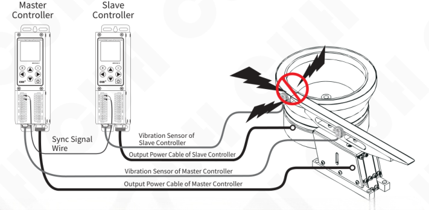

Cette section présente la mise en réseau de deux contrôleurs SDVC42-S permettant à un vibrateur direct et un vibrateur circulaire de fonctionner à la même fréquence, afin d'éviter une collision entre les plateaux due à des fréquences de fonctionnement incohérentes.

1. Le contrôleur raccorde correctement le câble d'alimentation et le câble de sortie.

2. Sortez le capteur associé au contrôleur suiveur, branchez la fiche du capteur sur le contrôleur et serrez l'écrou, puis fixez correctement le corps du capteur sur le plateau vibrant (voir « 2.3 Guide d'installation du capteur de vibration » pour plus de détails)

3. Ouvrez le couvercle du compartiment de câblage de l'équipement, connectez tous les signaux T1 des contrôleurs entre eux et tous les signaux T3 entre eux.

4. Après la mise sous tension des deux appareils, l'un des contrôleurs entre automatiquement dans le « groupe de paramètres de communication ».

5. Dans le groupe de paramètres de communication du contrôleur, le programme génère automatiquement un numéro d'appareil de communication de synchronisation numérique. La « synchronisation numérique » peut prendre n'importe quelle valeur de [1~8]. Les utilisateurs peuvent également modifier cette valeur eux-mêmes.

6. Dans le groupe de paramètres de communication, réglez le paramètre « EnNetwok » sur « Expand », puis maintenez ⊕ et ⊖ enfoncés simultanément pour confirmer.

7. Une fois le contrôleur suiveur ajouté avec succès, la valeur du paramètre « EnNetwok » passe automatiquement à « Online », indiquant que la mise en réseau a réussi.

8. L'utilisateur maintient ▲ et ◀ enfoncés pour entrer dans l'interface de réglage des paramètres, puis passe par un appui court sur ◀ ou ▶ au groupe de paramètres de communication afin de consulter et noter l'adresse de synchronisation numérique de chaque contrôleur.

9. Réglez la valeur du paramètre « FrqncSyn » du contrôleur suiveur dans le groupe de paramètres de communication sur le numéro d'adresse « DigSynAd » du contrôleur suivi.

Une fois les réglages ci-dessus terminés, un contrôleur peut suivre un autre contrôleur et émettre à la même fréquence.


## 5.2 Comment activer/désactiver le contrôleur B via un capteur connecté au contrôleur A ?

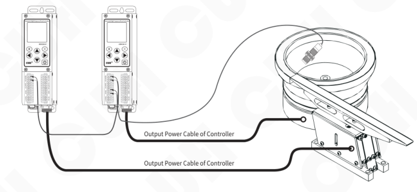

Cette section présente la mise en réseau de deux contrôleurs SDVC42-S : la sortie principale du contrôleur asservi est commandée en marche/arrêt par le signal du port C d'un autre contrôleur maître, de sorte que même si le capteur n'est pas directement connecté au contrôleur asservi, le contrôleur peut fonctionner via le signal du réseau. Les sources de signaux du contrôleur sont ainsi largement enrichies.

1. Le contrôleur raccorde correctement le câble d'alimentation et le câble de sortie.

2. Ouvrez le couvercle du compartiment de câblage de l'équipement, connectez tous les signaux T1 des contrôleurs entre eux et tous les signaux T3 entre eux.

3. Après la mise sous tension des deux appareils, l'un des contrôleurs entre automatiquement dans le « groupe de paramètres de communication ».

4. Dans le groupe de paramètres de communication du contrôleur, le programme génère automatiquement un numéro d'appareil de communication synchrone numérique ; la « synchronisation numérique » peut prendre n'importe quelle valeur de [1~8]. Les utilisateurs peuvent également modifier cette valeur eux-mêmes.

5. L'utilisateur maintient ▲ et ◀ enfoncés pour entrer dans l'interface de réglage des paramètres, puis passe par un appui court sur ◀ ou ▶ au groupe de paramètres de communication afin de consulter et noter l'adresse de synchronisation numérique de chaque contrôleur.

6. Le contrôleur asservi passe au groupe de paramètres de sortie principale selon la méthode ci-dessus, et les paramètres sont réglés comme suit :

   « MainSor1 » est « Bus », « MainSor2 » est « Bus », « MainLogc » est « And », « MainDire » est « Const », « MainUpDy » et « MainDnDy » sont réglés sur la valeur de temps requise, la valeur par défaut est de 0,2 seconde, « MainMode » est réglé sur « Delay ».

7. Le contrôleur asservi passe au groupe de paramètres de communication selon la méthode ci-dessus, et les paramètres sont réglés comme suit :

   « BSigMID1 » est réglé sur « X » (X : est le numéro de bit de synchronisation numérique du contrôleur dont le signal doit être appelé), « BSigM_B1 » est réglé sur « 4 » (signal du port C d'entrée de matière), « BSigM_B2 » est réglé sur « 0 » (0 indique un signal invalide).

Une fois les réglages ci-dessus terminés, la sortie d'un contrôleur est commandée par le signal du port C d'un autre contrôleur.


---

## 5.3 Comment activer/désactiver deux contrôleurs simultanément ?

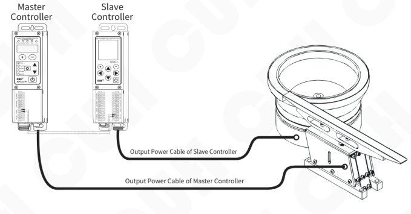

Cette section présente un contrôleur de vibration directe (utilisant un SDVC311) et un contrôleur de cuve (utilisant un SDVC42-S) qui démarrent et s'arrêtent de manière synchronisée. Des contrôleurs de séries différentes peuvent également réaliser la fonction de démarrage et d'arrêt synchronisés.

1. Le contrôleur raccorde correctement le câble d'alimentation et le câble de sortie.

2. Ouvrez le couvercle du compartiment de câblage de l'appareil, connectez D1 du SDVC42-S à C2 du SDVC311 et connectez D3 du SDVC42-S à C1 du SDVC311.

3. Après la mise sous tension des deux appareils, maintenez ▲ et ◀ enfoncés pour entrer dans l'interface de réglage des paramètres, puis passez par un appui court sur ◀ ou ▶ au groupe de paramètres de sortie de commande.

4. Dans le groupe de paramètres de sortie de commande, réglez les paramètres comme suit :

« PotDLogc » est réglé sur « Or », « PotDSor1 » est réglé sur « Main », « PotDType » est réglé sur « Ou_PNP », et les autres valeurs par défaut restent inchangées.

Les réglages ci-dessus permettent à un contrôleur de vibration directe (utilisant un SDVC311) et à un contrôleur d'alimentateur vibrant (utilisant un SDVC42-S) de maintenir un démarrage et un arrêt synchronisés.

---


# Chapitre Ⅵ Foire aux questions

## 6.1 Aucun affichage à la mise sous tension

Solution :

◆ Vérifiez si la prise d'alimentation est alimentée.

◆ Vérifiez si la fiche d'alimentation est correctement branchée sur la prise.

## 6.2 Pas de vibration, pas de bruit, affichage du contrôleur normal

Solution :

◆ Vérifiez si le câble d'alimentation de sortie est correctement connecté au contrôleur et à l'alimentateur vibrant.

◆ Vérifiez si les valeurs des paramètres de tension de sortie et de fréquence de sortie du contrôleur sont appropriées.

◆ Vérifiez si le contrôleur est arrêté par un signal de commande.

◆ Vérifiez si le contrôleur est arrêté par un réglage logique d'arrêt d'un paramètre.

## 6.3 Le signal de commande ne fonctionne pas

Solution :

◆ Vérifiez si le signal de commande est correctement connecté.

◆ Vérifiez si le fil de masse du signal de commande est connecté au port GND du contrôleur.

◆ Vérifiez si la logique du signal de commande est correctement réglée.

## 6.4 Pas de vibration, bruit normal, affichage du contrôleur normal

Solution :

◆ Ajustez les réglages des paramètres conformément à ce manuel d'utilisation.

## 6.5 Suivi instable de la fréquence de résonance

Solution :

◆ Augmentez de manière appropriée la valeur d'intégrale de fréquence, mais notez qu'une valeur trop élevée peut provoquer une oscillation de la fréquence de sortie.


---

## 6.6 Correction de vitesse lente en régulation de vitesse d'alimentation constante

Solution :

◆ Ajustez de manière appropriée la valeur d'intégrale d'amplitude, mais notez que si elle est trop grande, l'amplitude d'oscillation de la tension de sortie augmentera.

## 6.7 Comment réinitialiser rapidement le contrôleur aux réglages d'usine

En raison des fonctions puissantes de ce contrôleur, un grand nombre de paramètres de commande peuvent être définis par l'utilisateur. Pour les débutants, l'état de fonctionnement normal du contrôleur peut ne pas être restauré après de multiples modifications de réglages. Utilisez cette fonction pour restaurer rapidement un état de paramètres désordonné aux réglages d'usine.

Solution :

◆ Appuyez longuement sur ▲ et ◀ pour entrer dans l'interface de réglage des paramètres, puis appuyez brièvement sur ◀ ou ▶ pour passer au groupe de paramètres d'enregistrement.

◆ Passez aux paramètres de restauration des réglages et sélectionnez les paramètres du groupe de travail. Maintenez ⊕ et ⊖ enfoncés simultanément pendant plus de deux secondes pour passer à l'interface de veille. À ce moment, tous les paramètres du groupe de travail sont restaurés aux réglages d'usine (les réglages « User 1 », « User 2 » et « User 3 » restent inchangés).

Si l'utilisateur a précédemment enregistré des paramètres dans « User 1 », « User 2 » ou « User 3 », les réglages utilisateur peuvent également être restaurés.

---


# Chapitre Ⅶ Annexe

## 7.1 Dimensions

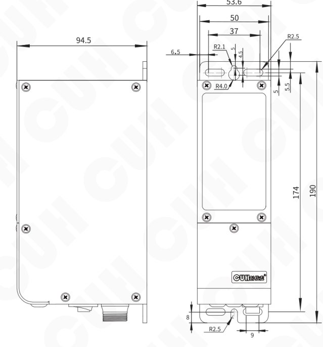

**Dimensions (unité : mm)**

| Plage de dimensions | tolérance |
|---|---|
| 0~3 | ±0.05 |
| 3~10 | ±0.1 |
| 10~30 | ±0.15 |
| 30~80 | ±0.2 |
| 80~180 | ±0.3 |
| >180 | ±0.5 |

Ce tableau de tolérance s'applique à tous les produits de cette série.


## 7.2 Spécifications techniques

| Élément | Min | Typique | Max | Unité | Remarque |
|---|---:|---:|---:|---|---|
| Tension d'entrée | 85 | 220 | 250 | V | AC RMS |
| Plage de tension de sortie réglable | 0 | —— | 220 | V | AC RMS |
| Précision de réglage de la tension |  | 1 |  | V |  |
| Précision de régulation de la tension | 0 | —— | 10 | % | ΔVout/ΔVin |
| Plage de courant de sortie réglable | 0 | —— | 150 | mA |  |
| Puissance de sortie | 0 | —— | 33 | VA |  |
| Fréquence de sortie | 40.0 | —— | 999.9 | Hz |  |
| Précision de réglage de la fréquence |  | 0.1 |  | Hz |  |
| Forme d'onde de sortie |  | Sine |  |  |  |
| Temps de démarrage progressif | 0 | —— | 40.0 | s | Valeur par défaut : 0.5 |
| Plage de temporisation marche/arrêt | 0.0 | —— | 99.9 | s | Valeur par défaut : 0.2 |
| Précision de temporisation marche/arrêt |  | 0.1 |  | s |  |
| Température de déclenchement de la protection contre la surchauffe | 60 | 65 | 65 | ℃ |  |
| Communication de synchronisation |  | CUHBus-DS® |  |  |  |
| Communication numérique |  | ModBUS485/Digital Sync |  |  |  |
| Courant de sortie de commande CC | 0 | —— | 350 | mA |  |
| Tension de sortie de commande CC | 22 | 24 | 26 | V |  |
| Signal de contrôle analogique |  | 1~5/0~5/0~10 |  | V | tension de régulation de vitesse à distance |
| Signal de contrôle analogique |  | 4~20 |  | mA | courant de régulation de vitesse à distance |
| Signal de contrôle numérique |  | 24 |  | V | Signal de commutation |
| Méthode de réglage |  | 7 |  | Bouton |  |
| Consommation en veille | —— | —— | 5 | W |  |
| Méthode d'affichage |  | 128*128 |  |  | Affichage matriciel |
| Indice de protection |  | IP20 |  |  |  |
| Température ambiante | 0 | 25 | 40 | ℃ |  |
| Humidité ambiante | 10 | 60 | 85 | % | Sans condensation |
| Température ambiante de stockage | -20 | 25 | 65 | ℃ |  |


## 7.3 Normes de référence

**Paramètres absolus :**  
Un dépassement des normes endommagera le contrôleur ; respectez-les strictement.

| Élément | Norme GB | Norme IEC | Niveau | Exigence de la norme | Remarque |
|---|---|---|---|---|---|
| Décharge<br>électrostatique | GB/T 17626.2-2006 | IEC 61000-4-2:2001 | 4 | ±8 kV | Décharge par<br>contact |
|  |  |  | 4 | ±15 kV | Décharge dans l'air |
| Test de transitoires<br>électriques rapides | GB/T 17626.4-2008 | IEC 61000-4-4:2004 | 4 | ±4 kV |  |
| Immunité aux ondes<br>de la ligne d'alimentation CC | GB/T 17626.17-2005 | IEC 61000-4-17:2002 | 4 | 15% | Classe A |

> **Avertissement**  
> Dans un environnement résidentiel, ce produit peut provoquer des interférences radio ; dans ce cas, des mesures d'atténuation supplémentaires peuvent être nécessaires.


## 7.4 Liste des paramètres

### 7.4.1 Groupe de paramètres d'interface

| Fonction | Paramètre | Affichage | Plage de valeurs/Élément d'énumération | Valeur par défaut |
|---|---|---|---|---|
| P1.01 | Élément de surveillance 1 | 01.Monit1 | Groupe de paramètres 2~Groupe de paramètres 10 | P2.01 |
| P1.02 | Élément de surveillance 2 | 02.Monit2 | Groupe de paramètres 2~Groupe de paramètres 10 | P10.05 |
| P1.03 | Élément de surveillance 3 | 03.Monit3 | Groupe de paramètres 2~Groupe de paramètres 10 | P2.02 |
| P1.04 | Élément de surveillance 4 | 04.Monit4 | Groupe de paramètres 2~Groupe de paramètres 10 | P2.03 |
| P1.05 | Élément de surveillance 5 | 05.Monit5 | Groupe de paramètres 2~Groupe de paramètres 10 |  |
| P1.06 | Élément de surveillance 6 | 06.Monit6 | Groupe de paramètres 2~Groupe de paramètres 10 |  |
| P1.07 | Élément de surveillance 7 | 07.Monit7 | Groupe de paramètres 2~Groupe de paramètres 10 |  |
| P1.08 | Élément de surveillance 8 | 08.Monit8 | Groupe de paramètres 2~Groupe de paramètres 10 |  |
| P1.09 | Élément de surveillance 9 | 09.Monit9 | Groupe de paramètres 2~Groupe de paramètres 10 |  |
| P1.10 | Élément de surveillance 10 | 10.Monit10 | Groupe de paramètres 2~Groupe de paramètres 10 |  |
| P1.11 | Élément de surveillance 11 | 11.Monit11 | Groupe de paramètres 2~Groupe de paramètres 10 |  |
| P1.12 | Élément de surveillance 12 | 12.Monit12 | Groupe de paramètres 2~Groupe de paramètres 10 |  |
| P1.13 | Élément de surveillance 13 | 13.Monit13 | Groupe de paramètres 2~Groupe de paramètres 10 |  |
| P1.14 | Élément de surveillance 14 | 14.Monit14 | Groupe de paramètres 2~Groupe de paramètres 10 |  |
| P1.15 | Élément de surveillance 15 | 15.Monit15 | Groupe de paramètres 2~Groupe de paramètres 10 |  |
| P1.16 | Élément de surveillance 16 | 16.Monit16 | Groupe de paramètres 2~Groupe de paramètres 10 |  |


## 7.4.2 Groupe de paramètres communs

| Fonction | Paramètre | Affichage | Plage de valeurs/Élément d'énumération | Valeur par défaut |
|---|---|---|---|---|
| P2.01 | Vitesse d'alimentation définie par l'utilisateur | 01.UserSped | 0~3200 | 200 |
| P2.02 | Tension définie par l'utilisateur | 02.UsrVoltg | 0~220 V | 150 |
| P2.03 | Fréquence définie par l'utilisateur | 03.UsrFrqnc | 40.0~999.9 Hz | 50.0 |
| P2.04 | Temps de démarrage progressif | 04.SoftStar | 0.0~40.0 s | 0.5 |
| P2.05 | Temps d'arrêt progressif | 05.SoftStop | 0.0~40.0 s | 0.5 |
| P2.06 | Tension de sortie maximale | 06.MaxVoltg | 0~220 V | 220 |
| P2.07 | Courant de sortie maximal | 07.MaxCurre | 0~150 mA | 150 |
| P2.08 | Fréquence de sortie maximale | 08.MaxFre | 40.0~999.9 Hz | 999.9 |
| P2.09 | Fréquence de sortie minimale | 09.MiniFre | 40.0~999.9 Hz | 40.0 |
| P2.10 | Détection de charge | 10.Measure | None, Valid | None |
| P2.11 | Alarme de manque de matière | 11.LowAlrm | 0~3000 | 0 |
| P2.12 | Alarme d'arrêt | 12.AlrmShut | None, Sound1, Sound2, Sound3 | None |
| P2.13 | Luminosité du rétroéclairage | 13.Brightne | 20~100 | 100 |
| P2.14 | Temps d'extinction du rétroéclairage | 14.Off_time | 1~30 Mi, 31(allumé en permanence) | 5 |
| P2.15 | Langue | 15.Language | Englis, Chines, German | Englis |


## 7.4.3 Groupe de paramètres de sortie principale

| Fonction | Paramètre | Affichage | Plage de valeurs/Élément d'énumération | Valeur par défaut |
|---|---|---|---|---|
| P3.01 | Logique du port de sortie principale | 01.MainLogc | And, Or, Xor, RS | Or |
| P3.02 | Source d'entrée 1 de la logique<br>du port de sortie principale | 02.MainSor1 | Voir Annexe 7.4.11 | In_PtC |
| P3.03 | Source d'entrée 2 de la logique<br>du port de sortie principale | 03.MainSor2 | Voir Annexe 7.4.11 | In_PtE |
| P3.04 | Temporisation de montée de la sortie principale | 04.MainUpDy | 0.0~99.9 s | 0.2 |
| P3.05 | Temporisation de descente de la sortie principale | 05.MainDnDy | 0.0~99.9 s | 0.2 |
| P3.06 | Direction logique<br>de la sortie principale | 06.MainDire | Const, Inv, On, Off | Const |
| P3.07 | Mode de sortie principale | 07.MainMode | Delay, Hold | Delay |
| P3.08 | État à la mise sous tension | 08.PowOnSta | On, Off, Keep | On |
| P3.09 | Source de contrôle à distance | 09.CtrlSour | Panel, 20mA, 1-5V, 0-5V, 0-10V, DigSym | Panel |
| P3.10 | Coefficient de contrôle à distance | 10.CtrlCoef | 0.5~2.0 | 1.0 |


---

## 7.4.4 Groupe de paramètres de vitesse stable

| Fonction | Paramètre | Affichage | Plage de valeurs/Élément d'énumération | Valeur par défaut |
|---|---|---|---|---|
| P4.01 | Fréquence centrale de<br>la fréquence automatique | 01.AutFCent | 40.0~999.9 Hz | 100.0 |
| P4.02 | Plage de réglage de<br>la fréquence automatique | 02.AutFRang | 0.0~180.0 Hz | 30.0 |
| P4.03 | Intégrale de réglage de<br>la fréquence automatique | 03.AutFIntg | 0~2000 | 20 |
| P4.04 | Intégrale de réglage<br>d'amplitude automatique | 04.AutAIntg | 0~9999 | 300 |
| P4.05 | Proportion de réglage<br>d'amplitude automatique | 05.AutAProp | 0~9999 | 500 |
| P4.06 | Phase automatique | 06.AutoPhas | -180~180 ° | 0 |
| P4.07 | Tension maximale de recherche<br>automatique de fréquence | 07.AutSrhVM | 20~220 V | 100 |
| P4.08 | Amplitude maximale de recherche<br>automatique de fréquence | 08.AutSrhAM | 0~3200 | 200 |
| P4.09 | Fréquence de recherche<br>automatique | 09.AutSpedM | 0~4000 | 3200 |
| P4.10 | Phase définie par l'utilisateur | 10.UserPhas | -180~180 ° | 0 |
| P4.11 | Mode tension | 11.VoltgMod | Manuel, Auto | Auto |
| P4.12 | Mode fréquence | 12.FrqncMod | Manuel, Auto, SynV, SynE | Auto |
| P4.13 | Source de synchronisation | 13.SynSourc | None, PhaseV, PhaseE | None |
| P4.14 | Type de capteur d'accélération | 14.AcSnsrTp | 20-1, 20-2, 20-3, 20-4, 203, 204, 205, 206 | 205 |
| P4.15 | Vitesse de recherche de fréquence | 15.SrhSpeed | 0~5 | 3 |

---


## 7.4.5 Groupe de paramètres d'entrée de signal

| Fonction | Paramètre | Affichage | Plage de valeurs/Élément d'énumération | Valeur par défaut |
|---|---|---|---|---|
| P5.01 | Type de capteur de commutation | 01.PortType | Auto, NPN, PNP, Ato1 (une seule reconnaissance automatique) | Auto |
| P5.02 | Direction logique du port C | 02.PortCDir | Const, Inv | Const |
| P5.03 | Temporisation de front montant du port C | 03.PtCUpDly | 0.0~99.9 s | 0.2 |
| P5.04 | Temporisation de front descendant du port C | 04.PtCDnDly | 0.0~99.9 s | 0.2 |
| P5.05 | Direction logique du port E | 05.PortEDir | Const, Inv | Const |
| P5.06 | Temporisation de front montant du port E | 06.PtEUpDly | 0.0~99.9 s | 0.2 |
| P5.07 | Temporisation de front descendant du port E | 07.PtEDnDly | 0.0~99.9 s | 0.2 |
| P5.08 | Direction logique de la vitesse A | 08.SpedADir | Const, Inv | Const |
| P5.09 | Temporisation de front montant de la vitesse A | 09.SpdAUpDy | 0.0~99.9 s | 0.2 |
| P5.10 | Temporisation de front descendant de la vitesse A | 10.SpdADnDy | 0.0~99.9 s | 0.2 |
| P5.11 | Direction logique de la vitesse B | 11.SpedBDir | Const, Inv | Const |
| P5.12 | Temporisation de front montant de la vitesse B | 12.SpdBUpDy | 0.0~99.9 s | 0.2 |
| P5.13 | Temporisation de front descendant de la vitesse B | 13.SpdBDnDy | 0.0~99.9 s | 0.2 |


## 7.4.6 Groupe de paramètres de sortie de commande CC

| Fonction | Paramètre | Affichage | Plage de valeurs/Élément d'énumération | Valeur par défaut |
|---|---|---|---|---|
| P6.01 | Relation logique du port D | 01.PotDLogc | And, Or, Xor, RS | Or |
| P6.02 | Source d'entrée 1 de la logique du port D | 02.PotDSor1 | Voir Annexe 7.4.11 | In_PtC |
| P6.03 | Source d'entrée 2 de la logique du port D | 03.PotDSor2 | Voir Annexe 7.4.11 | In_PtE |
| P6.04 | Direction logique du port D | 04.PortDDir | Const, Inv, On, Off | Const |
| P6.05 | Temporisation de front montant du port D | 05.PtDUpDly | 0.0~99.9 s | 0.2 |
| P6.06 | Temporisation de front descendant du port D | 06.PtDDnDly | 0.0~99.9 s | 0.2 |
| P6.07 | Type de sortie du port D | 07.PotDType | Ou_PNP, Ou_NPN, Ou_P&P (Push Pull) | Ou_P&P |
| P6.08 | Mode de sortie du port D | 08.PotDMode | Delay, Hold | Delay |


---

## 7.4.7 Groupe de paramètres de comptage

| Fonction | Paramètre | Affichage | Plage de valeurs/Élément d'énumération | Valeur par défaut |
|---|---|---|---|---|
| P7.01 | Comptage total | 01.TotaCout | 0~9999 | 10 |
| P7.02 | Pourcentage de la<br>vitesse finale | 02.PrcntTrm | 0~100 % | 50 |
| P7.03 | Avance sur la fin de comptage | 03.CotAhead | 0~9999 | 3 |
| P7.04 | Temps de réinitialisation<br>automatique du comptage | 04.CotRstTm | 0.0~999.9 s | 0.0 |
| P7.05 | Sélection du port de comptage | 05.CotPotSe | None, Valid | None |
| P7.06 | Priorité du port de déclenchement RS | 06.RSPriori | Same, Reset, Set, Revers | Same |

---


## 7.4.8 Groupe de paramètres de communication

| Fonction | Paramètre | Affichage | Plage de valeurs/Élément d'énumération | Valeur par défaut |
|---|---|---|---|---|
| P8.01 | Type de communication 485BUS | 01.485type | ASCII, RTU | RTU |
| P8.02 | Débit en bauds de la communication 485 | 02.BaudRate | 0.3, 1.2, 2.4, 9.6, 19.2, 57.6, 115.2 Kbps | 115.2 |
| P8.03 | Numéro d'identification de l'esclave de communication 485 | 03.485SlvID | 1~31 | 1 |
| P8.04 | Activation de la résistance d'adaptation du port de communication 485 | 04.Enab485R | None, Valid | None |
| P8.05 | Adresse de synchronisation numérique locale | 05.DigSynAd | 1~8 |  |
| P8.06 | Activation de la résistance d'adaptation du port de communication de synchronisation numérique | 06.EnabSynR | None, Valid | None |
| P8.07 | Adresse du signal de bus de la source d'entrée 1 de la logique du port de sortie principale | 07.BSigMID1 | 1~8 |  |
| P8.08 | Adresse du signal de bus de la source d'entrée 2 de la logique du port de sortie principale | 08.BSigMID2 | 1~8 |  |
| P8.09 | Adresse du signal de bus de la source d'entrée 1 de la logique du port D | 09.BSgD_ID1 | 1~8 |  |
| P8.10 | Adresse du signal de bus de la source d'entrée 2 de la logique du port D | 10.BSgD_ID2 | 1~8 |  |
| P8.11 | Adresse de bit du signal de bus de la source d'entrée 1 de la logique du port de sortie principale | 11.BSigM_B1 | 1~16 | 5 |
| P8.12 | Adresse de bit du signal de bus de la source d'entrée 2 de la logique du port de sortie principale | 12.BSigM_B2 | 1~16 | 6 |
| P8.13 | Adresse de bit du signal de bus de la source d'entrée 1 de la logique du port D | 13.BSigD_B1 | 1~16 | 5 |
| P8.14 | Adresse de bit du signal de bus de la source d'entrée 2 de la logique du port D | 14.BSigD_B2 | 1~16 | 6 |
| P8.15 | Signal de l'adresse de bit 1 du signal de bus local | 15.LBSig_B1 | Voir Annexe 7.4.11 | 0 |
| P8.16 | Signal de l'adresse de bit 2 du signal de bus local | 16.LBSig_B2 | Voir Annexe 7.4.11 | 1 |
| P8.17 | Signal de l'adresse de bit 3 du signal de bus local | 17.LBSig_B3 | Voir Annexe 7.4.11 | SpeedA |
| P8.18 | Signal de l'adresse de bit 4 du signal de bus local | 18.LBSig_B4 | Voir Annexe 7.4.11 | SpeedB |
| P8.19 | Signal de l'adresse de bit 5 du signal de bus local | 19.LBSig_B5 | Voir Annexe 7.4.11 | In_PtC |
| P8.20 | Signal de l'adresse de bit 6 du signal de bus local | 20.LBSig_B6 | Voir Annexe 7.4.11 | In_PtE |
| P8.21 | Signal de l'adresse de bit 7 du signal de bus local | 21.LBSig_B7 | Voir Annexe 7.4.11 | FCntSi |
| P8.22 | Signal de l'adresse de bit 8 du signal de bus local | 22.LBSig_B8 | Voir Annexe 7.4.11 | DCntSi |
| P8.23 | Signal de l'adresse de bit 9 du signal de bus local | 23.LBSig_B9 | Voir Annexe 7.4.11 | Ctr_O |
| P8.24 | Signal de l'adresse de bit 10 du signal de bus local | 24.LBSigB10 | Voir Annexe 7.4.11 | Warn |
| P8.25 | Signal de l'adresse de bit 11 du signal de bus local | 25.LBSigB11 | Voir Annexe 7.4.11 | Main |
| P8.26 | Signal de l'adresse de bit 12 du signal de bus local | 26.LBSigB12 | Voir Annexe 7.4.11 | -SpeedA |
| P8.27 | Signal de l'adresse de bit 13 du signal de bus local | 27.LBSigB13 | Voir Annexe 7.4.11 | -SpeedB |
| P8.28 | Signal de l'adresse de bit 14 du signal de bus local | 28.LBSigB14 | Voir Annexe 7.4.11 | -In_PtC |
| P8.29 | Signal de l'adresse de bit 15 du signal de bus local | 29.LBSigB15 | Voir Annexe 7.4.11 | -In_PtE |
| P8.30 | Signal de l'adresse de bit 16 du signal de bus local | 30.LBSigB16 | Voir Annexe 7.4.11 | -FCtSi |
| P8.31 | Activation de la fonction d'ajout au réseau | 31.EnNetwok | Online, Offlin, Expand, Replace |  |
| P8.32 | Numéro de l'appareil à retirer du réseau | 32.DeltDevi | 1~8 |  |
| P8.33 | Numéro de synchronisation de fréquence locale | 33.FrqncSyn | 1~8 |  |
| P8.34 | Numéro de synchronisation de la régulation de vitesse à distance locale | 34.RemotSyn | 1~8 |  |
| P8.35 | Données de contrôle à distance | 35.RemotDat | ManVol, RemVol, ManSpd, RemSpd | ManVol |


## 7.4.9 Groupe de paramètres d'enregistrement

| Fonction | Paramètre | Affichage | Plage de valeurs/Élément d'énumération | Valeur par défaut |
|---|---|---|---|---|
| P9.01 | Lire tous les paramètres depuis<br>le groupe utilisateur | 01.ReadALLF | None, UsrD1, UsrD2, UsrD3 | None |
| P9.02 | Enregistrer tous les paramètres dans<br>le groupe utilisateur | 02.SaveALLT | None, Work, UsrD1, UsrD2, UsrD3 | None |
| P9.03 | Numéro d'identification de l'esclave | 03.RestorAL | None, RWork (groupe de travail par défaut) | None |
| P9.04 | Restaurer les données locales<br>à l'aide de la sauvegarde<br>des données sur le bus | 04.RDatFrBs | 1~8 |  |
| P9.05 | Mot de passe utilisateur | 05.PassWord | 0~9999 | 0 |
| P9.06 | Définir le mot de passe | 06.SetWord | 0~9999 | 0 |


## 7.4.10 Groupe de paramètres de surveillance

| Fonction | Paramètre | Affichage | Plage de valeurs/Élément d'énumération | Valeur par défaut |
|---|---|---|---|---|
| P10.01 | Tension de sortie | 01.Voltage | 0~220 V |  |
| P10.02 | Fréquence de sortie | 02.Frequenc | 40.0~999.9 Hz |  |
| P10.03 | Vitesse d'alimentation actuellement mesurée | 03.SpeedNow | 0~4000 |  |
| P10.04 | Tension de sortie actuelle | 04.VoltgOut | 0.0~250.0 V |  |
| P10.05 | Valeur efficace du courant | 05.EffectCu | 0~999 mA |  |
| P10.06 | Courant maximal | 06.CurrentM | 0~999 mA |  |
| P10.07 | Puissance active | 07.PowActiv | 0.0~999.9 W |  |
| P10.08 | Puissance réactive | 08.PowReact | 0.0~999.9 Var |  |
| P10.09 | Température | 09.Temperat | -20.0~85.0 ℃ |  |
| P10.10 | Valeur de capacité | 10.Capacitance | 0.0~9.999 uF |  |
| P10.11 | Valeur de résistance | 11.Resistan | 0.0~999.9 Ω |  |
| P10.12 | Fréquence de synchronisation externe | 12.SynchrFr | 40.0~999.9 Hz |  |
| P10.13 | Numéro de comptage actuel | 13.CoutNumb | 0~999 |  |
| P10.14 | Distorsion harmonique totale de la tension de sortie | 14.VolTHD | 0.0~100.0 % |  |
| P10.15 | Distorsion harmonique totale du courant de sortie | 15.CurTHD | 0.0~100.0 % |  |
| P10.16 | État du signal d'entrée du port C | 16.Sig-PotC | 0~1 |  |
| P10.17 | État du signal d'entrée du port E | 17.Sig-PotE | 0~1 |  |
| P10.18 | État de sortie du port D | 18.Sig-PotD | 0~1 |  |
| P10.19 | État du signal d'entrée du port G | 19.Sig-PotG | 0~1 |  |
| P10.20 | État du signal d'entrée du port N | 20.Sig-PotN | 0~1 |  |
| P10.21 | État de la sortie principale | 21.Sig-Main | 0~1 |  |
| P10.22 | Tension d'entrée du port C | 22.Vol-PotC | 0.0~26.0 V |  |
| P10.23 | Tension d'entrée du port E | 23.Vol-PotE | 0.0~26.0 V |  |
| P10.24 | Tension de sortie du port D | 24.Vol-PotD | 0.0~26.0 V |  |
| P10.25 | Tension d'entrée du port G | 25.Vol-PotG | 0.0~26.0 V |  |
| P10.26 | Tension d'entrée du port N | 26.Vol-PotN | 0.0~26.0 V |  |
| P10.27 | Tension d'entrée de contrôle à distance | 27.Vol-Remo | 0.0~10.0 V |  |
| P10.28 | Tension d'alimentation 24V | 28.Vol-24V | 0.0~26.0 V |  |
| P10.29 | Tension d'alimentation 5V | 29.Vol-5V | 0.0~6.0 V |  |
| P10.30 | Tension du bus CC | 30.Vol-Bus | 0.0~28.0 V |  |
| P10.31 | Tension de sortie moyenne | 31.OUT-avg | 0~220 V |  |
| P10.32 | Valeur efficace de la tension d'entrée | 32.Vol-Inpt | 0.0~280.0 V |  |
| P10.33 | Valeur résiduelle de la phase automatique | 33.PhaseRem | -180~180 ° |  |
| P10.34 | Surcharge du capteur automatique | 34.Overload | 0~1 |  |
| P10.35 | Vitesse accélérée | 35.Accelera | 0~64 g |  |
| P10.36 | Numéro d'appareil | 36.DevicNum | 1~8 unités |  |
| P10.37 | Numéro en ligne | 37.OnlinNum | 1~8 unités |  |
| P10.38 | Alarme de manque de matière | 38.LowAlarm | 0~3000 |  |
| P10.39 | Heures de travail | 39.WorkHour | 0~9999 (unité : 8h) |  |


| Fonction | Paramètre | Affichage | Plage de valeurs/Élément d'énumération | Valeur par défaut |
|---|---|---|---|---|
| P10.40 | Amplitude X | 40.Amp-X | 0~9999 um |  |
| P10.41 | Amplitude Y | 41.Amp-Y | 0~9999 um |  |
| P10.42 | Amplitude Z | 42.Amp-Z | 0~9999 um |  |
| P10.43 | Somme des amplitudes | 43.Amp-Sum | 0~9999 um |  |
| P10.44 | Numéro de version du micrologiciel du maître | 44.Vr-Main | 0~9999 |  |
| P10.45 | Numéro de version du micrologiciel de l'esclave | 45.Vr-Slave | 0~9999 |  |

---


---

## 7.4.11 Liste annexe

La liste des définitions des sources de signal est la suivante :

| Numéro de série | Signification | Affichage |
|---:|---|---|
| 0 | 0 | 0 |
| 1 | 1 | 1 |
| 2 | Port de vitesse A | SpeedA |
| 3 | Port de vitesse B | SpeedB |
| 4 | Port d'entrée C | In_PtC |
| 5 | Port d'entrée E | In_PtE |
| 6 | Signal de comptage complet | FCntSi |
| 7 | Signal de comptage de décélération | DCntSi |
| 8 | Signal de bus | Bus_S |
| 9 | Sortie de commande | Ctr_O |
| 10 | Avertissement | Warn |
| 11 | Sortie principale | Main |
| 12 | Port de vitesse A inversé | -SpedA |
| 13 | Port de vitesse B inversé | -SpedB |
| 14 | Entrée C inversée | -I_PtC |
| 15 | Entrée E inversée | -I_PtE |
| 16 | Signal de comptage complet inversé | -FCtSi |
| 17 | Signal de comptage de décélération inversé | -DCtSi |
| 18 | Signal de bus inversé | -Bus_S |
| 19 | Sortie de commande inversée | -Ctr_O |
| 20 | Avertissement inversé | -Warn |
| 21 | Sortie principale inversée | -Main |

Le tableau de comparaison de l'état de mise en réseau des appareils est le suivant :

**Tableau de comparaison de l'état de mise en réseau des appareils**

| Affichage | État de mise en réseau de l'appareil |
|---|---|
| A | Tous les appareils du réseau sont en ligne |
| B | Au moins un appareil du réseau est hors ligne |
| C | Cet appareil n'est pas un appareil de ce réseau |
| D | Suppression de l'appareil |
| E | Extension pour rejoindre des appareils |
| F | Contrôle de réseau compétitif |
| R | Remplacement d'un appareil rejoignant le réseau |
| S | Cet appareil est déconnecté du réseau |

---


## 7.5 Schémas de circuit d'entrée et de sortie

### Port A de régulation de vitesse à distance

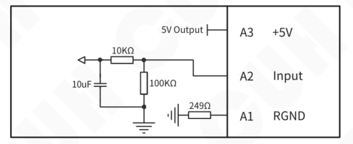

| Borne | Définition |
|---|---|
| A3 | +5V |
| A2 | Input |
| A1 | RGND |

### Port C du capteur de commutation


| Borne | Définition |
|---|---|
| C3 | 24V Output |
| C2 | Input |
| C1 | GND |

### Port E du capteur de commutation

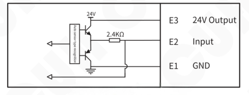

| Borne | Définition |
|---|---|
| E3 | 24V Output |
| E2 | Input |
| E1 | GND |

### Port D de sortie de commande

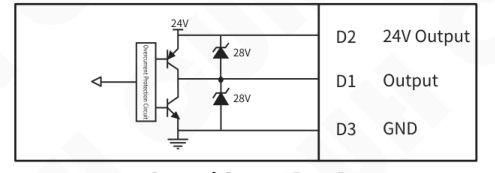

| Borne | Définition |
|---|---|
| D2 | 24V Output |
| D1 | Output |
| D3 | GND |


### Port de communication 485 F

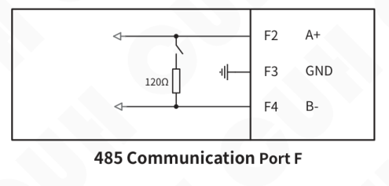

| Borne | Signal |
|---|---|
| F2 | A+ |
| F3 | GND |
| F4 | B- |

Terminaison interne indiquée : 120Ω.

### Port N de préréglage de comptage/vitesse

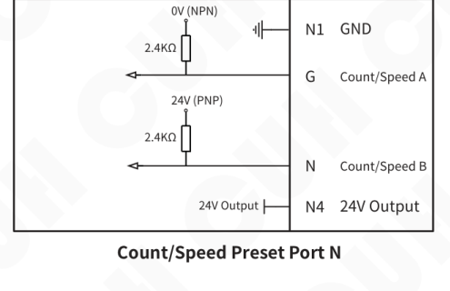

| Borne | Signal |
|---|---|
| N1 | GND |
| G | Count/Speed A |
| N | Count/Speed B |
| N4 | 24V Output |

Références d'entrée indiquées : 0V (NPN), 24V (PNP), résistances de tirage de 2.4kΩ.

### Port T de synchronisation numérique

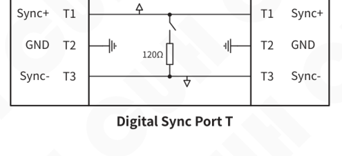

| Borne | Signal |
|---|---|
| T1 | Sync+ |
| T2 | GND |
| T3 | Sync- |

Terminaison interne indiquée : 120Ω.


---

## 7.6 Code d'erreur

Le diagnostic de défaut de ce contrôleur est divisé en codes d'erreur et codes d'avertissement. Les codes respectifs sont affichés l'un après l'autre.

**Code d'erreur :** La machine doit être arrêtée immédiatement ; attendez que le défaut disparaisse avant d'annuler l'affichage.

**Code d'avertissement :** Aucun arrêt n'est nécessaire. Attendez que le signe d'avertissement disparaisse avant d'annuler l'affichage.

### Tableau des codes d'erreur

| Code d'erreur | Affichage | Signification | Méthode d'élimination |
|---|---|---|---|
| Error01 | Short | Court-circuit | Vérifiez si la ligne de sortie principale est court-circuitée et recâblez-la |
| Error02 | OvrCurrt | Surintensité | Réduisez la tension de sortie ou augmentez la fréquence de sortie |
| Error03 | OverHot | Surchauffe | Placez le contrôleur dans une zone bien ventilée et dissipant la chaleur |
| Error04 | UndrCool | Sous-refroidissement | Placez le contrôleur dans un endroit où la température ambiante est supérieure à -20℃ |
| Error05 | CommErr | Erreur de communication | Contactez le support technique de l'entreprise |
| Error06 | TSnerErr | Erreur du capteur de température | Contactez le support technique de l'entreprise |
| Error07 | OverVolt | Surtension | La tension du secteur d'entrée ne peut pas dépasser la valeur efficace de 250V |
| Error08 | UndrVolt | Sous-tension | La tension du secteur d'entrée ne peut pas être inférieure à la valeur efficace de 85V |
| Error09 | LoadErr | Déconnexion de la charge | Vérifiez si la ligne de sortie est correctement connectée à la cuve de vibration |
| Error10 | Send_Seed | Échec de l'envoi de la graine | Contactez le support technique de l'entreprise |
| Error11 | Send_Exit | La commande pour quitter le mode boot n'a pas pu être exécutée | Contactez le support technique de l'entreprise |
| Error14 | SynchEr0 | Le bus CUHBus-DS® comporte 2 hôtes ou plus | 1. Si une alarme se produit, mettez l'appareil hors ligne puis remettez-le en ligne.<br>2. Après avoir mis hors tension l'appareil nouvellement ajouté, connectez le câble CUHBus-DS® à l'appareil du réseau. |
| Error15 | SynchEr1 | Erreur de bus | Vérifiez si la ligne de communication CUHBus-DS® est correctement connectée et organisez correctement le réseau |
| Error16 | SynchEr2 | L'appareil de synchronisation n'est pas en ligne | Le réseau de communication de synchronisation, l'appareil de synchronisation de fréquence ou l'appareil de synchronisation de contrôle à distance n'est pas en ligne |

---


## 7.7 Code d'avertissement

Tableau des codes d'avertissement

| Code d'avertissement | Affichage | Signification | Méthode d'élimination |
|---|---|---|---|
| Warn01 | Saturate | Saturation de sortie | Réduisez la tension de sortie |
| Warn02 | decline | Ralentissement du comptage | État de décélération du comptage |
| Warn03 | CND | Fin de comptage | État de fin de comptage |
| Warn04 | FrqncyLo | La fréquence de sortie est trop basse | Augmentez la valeur du paramètre de décalage de fréquence |
| Warn05 | FrqncyHi | La fréquence de sortie est trop élevée | Augmentez la valeur du paramètre de décalage de fréquence |
| Warn06 | LoMAlarm | Manque de matière | Réduisez la valeur du paramètre d'alarme de manque de matière, ou ajoutez de la matière dans le plateau |
| Warn07 | PortDErr | Surintensité de sortie du port D | Réduisez la charge de commande du port de sortie |
| Warn08 | RemotLow | La tension/le courant d'entrée de contrôle à distance est trop faible | Augmentez la tension ou le courant d'entrée de contrôle à distance |
| Warn09 | MRSErr | Erreur logique RS de la sortie principale | Lorsque la logique de sortie est une bascule RS, les signaux de la source principale 1 et de la source principale 2 ne peuvent pas être valides simultanément |
| Warn10 | 24VErr | Erreur 24V | Ne connectez pas l'alimentation externe 24V au port de sortie du contrôleur |
| Warn11 | 5VErr | Erreur 5V | Ne connectez pas l'alimentation externe 5V au port de sortie du contrôleur |
| Warn12 | CtrlRSErr | Erreur logique RS de la sortie de commande | Lorsque la logique du port D est une bascule RS, les signaux de la source 1 du port D et de la source 2 du port D ne peuvent pas être valides simultanément |
| Warn13 | OverLoad | Surcharge du capteur d'accélération | Remplacez le capteur d'accélération par un modèle de plage appropriée |
| Warn14 | AcceleEr | Défaillance du capteur d'accélération | Le capteur est endommagé, remplacez-le par un neuf |
| Warn15 | EEPErr | Erreur d'enregistrement des paramètres | Vérifiez que la ligne de communication CUHBus-DS® est correctement connectée et que la mise en réseau est correctement terminée. |


---

# Chapitre Ⅷ Informations sur la garantie du produit

## 8.1 Période de garantie

La période de garantie offerte par l'entreprise pour ce produit est de 3 ans à compter de la date de livraison du produit au lieu désigné par l'acheteur.

## 8.2 Étendue de la garantie

(1) Si une défaillance causée par notre entreprise survient pendant la période de garantie ci-dessus, nous réparons le produit gratuitement. Toutefois, les situations suivantes ne sont pas couvertes par la garantie :

&nbsp;&nbsp;&nbsp;&nbsp;a. Défaillance due au non-respect des conditions spécifiées dans le guide rapide, le manuel d'utilisation ou les exigences techniques spécifiquement convenues entre l'acheteur et l'entreprise, à une mauvaise manipulation ou à une utilisation inappropriée.

&nbsp;&nbsp;&nbsp;&nbsp;b. La défaillance n'est pas due à un défaut du produit, mais à la conception de l'équipement ou du logiciel de l'acheteur.

&nbsp;&nbsp;&nbsp;&nbsp;c. Dysfonctionnements causés par des modifications ou des réparations non effectuées par le personnel de l'entreprise.

&nbsp;&nbsp;&nbsp;&nbsp;d. Défaillance totalement évitable par un entretien correct ou le remplacement des pièces d'usure conformément au guide d'utilisation rapide ou au manuel d'utilisation.

&nbsp;&nbsp;&nbsp;&nbsp;e. Après l'expédition du produit de notre entreprise, défaillance causée par des facteurs tels que des changements imprévisibles du niveau de la science et de la technologie.

&nbsp;&nbsp;&nbsp;&nbsp;f. En raison de catastrophes naturelles telles qu'un incendie, un tremblement de terre ou une inondation, ou de facteurs externes tels qu'une défaillance due à une tension anormale, l'entreprise n'est pas responsable de la garantie.

(2) L'étendue de la garantie est limitée aux situations stipulées au point (1). Pour les pertes indirectes (telles que dommages matériels, opportunités perdues, pertes de profit, etc.) ou autres pertes, l'entreprise n'assume aucune responsabilité.

## 8.3 Aptitude du produit

Le contrôleur de notre entreprise est conçu et produit pour un usage général dans l'industrie de l'alimentation vibrante. Par conséquent, ce contrôleur de notre entreprise ne doit pas être utilisé pour les applications suivantes et n'est pas adapté à leur utilisation.

(1) Installations ayant un impact grave sur la vie et les biens, telles que les centrales nucléaires, les aéroports, les chemins de fer, les navires, les dispositifs motorisés et les équipements médicaux.

(2) Services publics, notamment l'électricité, le gaz, l'approvisionnement en eau, etc.

(3) Utilisation en extérieur dans des conditions ou environnements similaires.

---


Nanjing CUH Science & Technology Co.,Ltd  
https://en.cuhnj.com  
Tel.:+86-25-84730411 / 84730415 / 84730416  
Fax:+86-25-84730426  
E-mail:sales@cuhnj.com  
Add.:Building 2, Xueyan Tech Park, Tuscity,  
No.9 Zhineng Rd, Jiangning, Nanjing, China

Document No.: IDP1000480


