## 진동 피더용 가변 주파수 디지털 컨트롤러

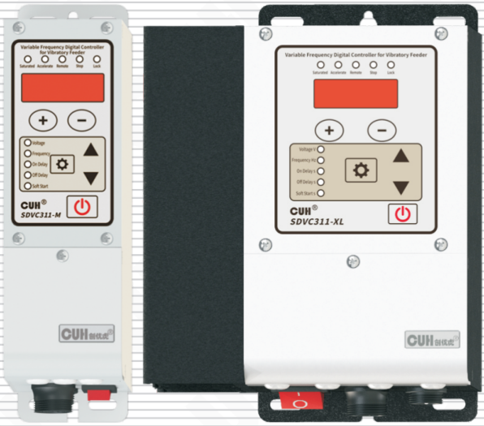

## SDVC311 시리즈
진동 피더용 가변 주파수 디지털 컨트롤러 — SDVC311 시리즈
## 사용자 매뉴얼

---

## 저작권 고지

난징 CUH 과학기술 유한공사(Nanjing CUH Science & Technology CO., Ltd.)는 모든 권리를 보유합니다.

본 사용 설명서에 포함된 모든 정보는 당사의 지식이며 저작권법 및 기타 관련 법률의 보호를 받습니다. CUH는 저작권법 및 기타 법률이 부여하는 모든 권리를 향유하고 보유합니다. CUH의 서면 동의 없이 본 사용 설명서의 일부 또는 전부를 복제, 번역, 모방 또는 기타 방식으로 이용하여서는 안 됩니다.

## 면책 조항

본 사용 설명서의 모든 내용은 당사가 생산하는 관련 제품의 사용 방법만을 설명하며, 기존 기술과 귀하가 사용 시 제공된 상태에 따라 서술됩니다. 본 제품을 사용할 때 관련 위험을 부담해야 합니다. 법률에서 요구하는 경우를 제외하고, 당사는 본 사용 설명서로 인해 제품에 대해 명시적 또는 묵시적 책임을 지지 않으며, 여기에는 신체 손상, 재산 손상, 기회 상실 등이 포함되나 이에 한정되지 않습니다.

귀하는 상기 위험을 명확히 이해하고, 법률에서 강제하는 경우를 제외하고, 당사가 귀하에게 발생한 직·간접적 손상 또는 손실(인적, 물질적, 데이터 등의 유형 손실 및 명성, 기회 등의 무형 손실을 포함하되 이에 한정되지 않음)에 대해 책임을 지지 않음에 동의합니다.

당사는 사전 또는 사후 통지 없이 본 사용 설명서에 적용되는 제품을 수정할 권리를 보유합니다.

---

## 머리말

CUH SDVC311 시리즈 디지털 주파수 변조 진동 공급 컨트롤러를 선택해 주셔서 감사합니다. (이하 "컨트롤러"라고 함) 본 시리즈 컨트롤러는 고품질 부품을 사용하고 최신 전자 기술을 도입하며, 고성능 디지털 신호 프로세서를 기반으로 신중하게 설계되었습니다.

본 설명서는 본 제품의 기본 조작 방법, 기능 기술 설명 및 전형적인 적용 사례를 소개합니다. 사용자에게 컨트롤러의 설치 및 디버깅, 파라미터 설정, 이상 진단, 고장 해결 및 일상 유지보수에 관한 관련 정보를 제공합니다. 본 컨트롤러의 정확한 설치와 사용을 위해 설치 전에 본 사용 설명서를 주의 깊게 읽고 잘 보관하십시오.

신체 손상 및 제품 손상에 대한 주의 사항을 알리기 위해 다음 기호를 반드시 읽어 주십시오.

| | |
|---|---|
| ⚠ 위험 | 본 항목을 준수하지 않으면 신체 손상 또는 사망에 이를 수 있습니다. |
| ⚠ 경고 | 본 항목을 준수하지 않으면 신체 손상 또는 사망에 이를 수 있습니다. |
| ⚠ 주의 | 본 항목을 준수하지 않으면 신체가 중등도 또는 경미하게 부상할 수 있습니다. |
| Notice | 본 항목을 준수하지 않으면 제품 손상 및 재산 피해가 발생합니다. |
| ❗ 필수 | 사용 중 반드시 준수해야 하는 주의 사항과 사용 제한을 나타냅니다. |

**본 설명서는 다음 모델의 컨트롤러에 적합합니다:**

- 디지털 FM 진동 공급 컨트롤러 SDVC311-S (1.5A)
- 디지털 FM 진동 공급 컨트롤러 SDVC311-M (3.0A)
- 디지털 FM 진동 공급 컨트롤러 SDVC311-L (4.5A)
- 디지털 FM 진동 공급 컨트롤러 SDVC311-XL (6.0A)

---

# 안전 및 주의 사항

1. **⚠ 위험** 본 제품은 전자석 기반 진동 공급 장비 구동에만 사용됩니다. 본 제품을 인체 또는 인체 부위의 보호 등을 목적으로 사용하지 마십시오.

2. **⚠ 위험** 본 제품은 방폭용으로 설계되지 않았습니다. 위험 장소 및/또는 잠재적 폭발성 가스 환경에서 사용하지 마십시오.

3. **⚠ 경고** 본 제품은 AC 전원으로 공급됩니다. 260Vac를 초과하는 AC 전압을 인가하지 마십시오. 과도한 입력 전압(예: 380Vac)은 제품의 폭발 또는 화재를 유발하여 중대한 안전 사고를 초래할 수 있습니다.

4. **⚠ 경고** 본 제품은 전원 코드를 통해 접지됩니다. 컨트롤러의 전원 배전 설비 시설이 잘 접지되어 있는지 확인하십시오. 그렇지 않으면 컨트롤러 하우징에 전기가 통하여 감전 사고가 발생할 수 있습니다.

5. **⚠ 경고** AC 전원을 본 컨트롤러의 출력단에 입력하지 마십시오. 컨트롤러가 손상됩니다.

6. **⚠ 경고** 감전을 방지하기 위해 전원 투입 상태에서 배선을 체결하거나 해체하거나 배전함 내 각 배선 단자의 접촉부를 만지지 마십시오.

7. **Notice** 릴레이 등의 기기로 전원 공급을 차단하여 본 제품의 출력을 제어하는 것은 피하십시오. 컨트롤러의 수명을 현저히 단축시킵니다.

8. **Notice** 컨트롤러는 서늘하고 건조한 환경에서 작동하도록 설계되었습니다. 침수 및 직사광선을 피하기 위해 컨트롤러를 옥외에서 운전하지 마십시오. 규격 전기 특성으로 지정된 온도 범위에서 컨트롤러를 작동하십시오.

9. **❗ 필수** 본 제품을 확실하게 접지된 견고한 플랫폼에 고정하고 진동 장비로부터 떨어진 곳에 설치하십시오.

10. **❗ 필수** 설계 한계를 초과하는 조건에서 컨트롤러를 절대 작동하지 마십시오.

11. **❗ 필수** 본 사용 설명서에 따라 엄격하게 컨트롤러를 작동하십시오. 잘못된 조작으로 인한 장비 손상 또는 신체 손상에 대해 당사는 민·형사상 책임을 지지 않습니다.

12. **❗ 필수** 감전 방지를 위해 컨트롤러 하우징을 절대 열지 마십시오. 컨트롤러 고장 시 CUH에 연락하십시오. 보증이 무효화될 수 있으므로 스스로 수리하려 시도하지 마십시오.

---

# 운전 및 보관 환경

## 사용 전 점검

모든 컨트롤러는 출하 전에 엄격한 품질 검사를 거치고 충격 방지 포장으로 포장됩니다. 개봉 후 다음 항목을 확인하십시오:

1. 운송 중 컨트롤러가 손상되지 않았는지.
2. 컨트롤러의 모델이 주문한 것과 일치하는지.

## 운전 환경

컨트롤러의 양호한 성능과 긴 수명을 위해 아래 주의 사항을 준수하십시오:

- ⚠ 환기가 잘 되는 환경
- ⚠ 물, 증기, 먼지 및 특히 유성 먼지에서 멀리 보관
- ⚠ 부식성 또는 인화성 가스·액체로부터 멀리 보관
- ⚠ 부유 먼지 및 금속 입자로부터 멀리 보관
- ⚠ 자체 진동을 방지하기 위해 견고하게 고정
- ⚠ 전자기 간섭으로부터 멀리 보관
- ⚠ 환경 온도 0~40 ℃ 유지
- ⚠ 해발 2000m 이하에서 사용

---

# 목차

- **제Ⅰ장 사용 전 — 1**
  - 1.1 패키지 내용물 확인 — 1
  - 1.2 표시등 및 버튼 설명 — 2
  - 1.3 외부 부품 설명 — 3
  - 1.4 배선 포트 설명 — 4
  - 1.5 명판 설명 — 4
- **제Ⅱ장 특징 기능 — 5**
  - 2.1 제품 소개 — 5
  - 2.2 제품 성능 향상 — 5
  - 2.3 현대식/전통식 파라미터 인터페이스 — 6
- **제Ⅲ장 설치 가이드 — 7**
  - 3.1 컨트롤러 사용 조건 — 7
  - 3.2 버튼 조작 방법 — 7
  - 3.3 설치 및 사용 — 8
- **제Ⅳ장 기본 기능 설명 — 12**
  - 4.1 출력 전압 — 12
  - 4.2 출력 주파수 — 13
  - 4.3 지능형 광전 센서 ON/OFF 지연 — 14
  - 4.4 소프트 시작 시간 — 15
  - 4.5 제동 사이클/소프트 정지 시간 — 15
  - 4.6 키보드 잠금 — 17
- **제Ⅴ장 고급 기능 설명 — 18**
  - 5.1 원거리 속도 제어 — 18
  - 5.2 지능형 광전 감지 — 20
  - 5.3 스위치 센서 — 21
- 5.4 제어 출력 — 22
  - 5.4.1 제어 출력 배선 방법 — 22
  - 5.4.2 제어 출력 신호원 및 논리 다이어그램 — 23
  - 5.4.3 제어 출력 모드 설명 — 25
  - 5.4.4 제어 출력 논리 방향 — 26
  - 5.4.5 메인 출력 신호 제어 기능 — 26
- 5.5 최대 출력 전압 제한 — 27
- 5.6 주파수 하한 — 27
- 5.7 가속 지수 — 28
- 5.8 파형 지수 — 29
- 5.9 파라미터 암호 잠금 기능 — 30
- 5.10 기본 설정 복원/공장 모드 복귀 — 31
- 5.11 파라미터 모니터링 기능 — 32

## 제Ⅵ장 기술 사양 — 33

- 6.1 외형 치수 — 33
- 6.2 기술 사양 — 35
- 6.3 참조 규격 — 36

## 제Ⅶ장 부록 — 37

- 7.1 파라미터 표 — 37
- 7.2 입력·출력 회로도 — 39
- 7.3 고장 해결 권고 및 오류 설명 — 40

## 제Ⅷ장 제품 보증 정보 — 41

- 8.1 보증 기간 — 41
- 8.2 보증 범위 — 41
- 8.3 제품 적용 적합성 — 41

---

# 제Ⅰ장 사용 전

본 장에서는 제품 패키지 내용물, 컨트롤러 외형 설명 및 컨트롤러 명판 정보를 소개합니다.

## 1.1 패키지 내용물 확인

사용 전에 컨트롤러 및 액세서리의 완전성을 확인하십시오. 제품에 결함이나 손상이 있거나 액세서리가 누락된 것을 발견하면 당사에 연락하십시오.

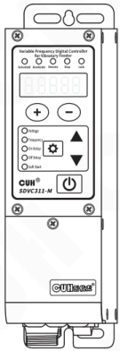

컨트롤러×1

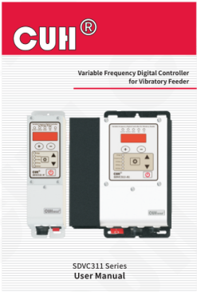

사용자 매뉴얼×1

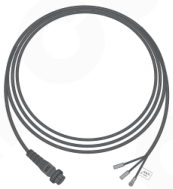

출력 케이블×1

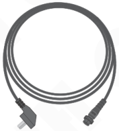

입력 전원 코드×1

---

## 1.2 표시등 및 버튼 설명

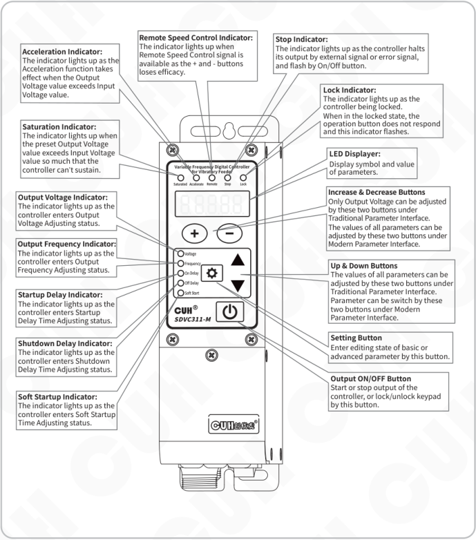

**가속 표시등:**  
출력 전압 값이 입력 전압 값을 초과하여 가속 기능이 작동할 때 표시등이 켜집니다.

**포화 표시등:**  
설정된 출력 전압 값이 입력 전압을 컨트롤러가 유지할 수 없을 정도로 크게 초과할 때 표시등이 켜집니다.

**출력 전압 표시등:**  
컨트롤러가 출력 전압 조정 상태로 진입하면 표시등이 켜집니다.

**출력 주파수 표시등:**  
컨트롤러가 출력 주파수 조정 상태로 진입하면 표시등이 켜집니다.

**시작 지연 표시등:**  
컨트롤러가 시작 지연 시간 조정 상태로 진입하면 표시등이 켜집니다.

**정지 지연 표시등:**  
컨트롤러가 정지 지연 시간 조정 상태로 진입하면 표시등이 켜집니다.

**소프트 시작 표시등:**  
컨트롤러가 소프트 시작 시간 조정 상태로 진입하면 표시등이 켜집니다.

**원거리 속도 제어 표시등:**  
원거리 속도 제어 신호가 유효하여 +/− 버튼이 무력화될 때 표시등이 켜집니다.

**정지 표시등:**  
컨트롤러가 외부 신호 또는 오류 신호로 출력을 정지할 때 표시등이 켜지고, ON/OFF 버튼으로 점멸합니다.

**잠금 표시등:**  
컨트롤러가 잠기면 표시등이 켜집니다.  
잠금 상태에서는 조작 버튼이 응답하지 않으며 이 표시등이 점멸합니다.

**LED 표시기:**  
파라미터의 기호 및 값을 표시합니다.

**증감 버튼(⊕/⊖)**  
전통식 파라미터 인터페이스에서는 이 두 버튼으로 출력 전압만 조정할 수 있습니다.  
현대식 파라미터 인터페이스에서는 이 두 버튼으로 모든 파라미터의 값을 조정할 수 있습니다.

**상하 버튼(▲/▼)**  
전통식 파라미터 인터페이스에서는 이 두 버튼으로 모든 파라미터의 값을 조정할 수 있습니다.  
현대식 파라미터 인터페이스에서는 이 두 버튼으로 파라미터를 전환할 수 있습니다.

**설정 버튼(⚙)**  
이 버튼으로 기본 또는 고급 파라미터의 편집 상태로 진입합니다.

**출력 ON/OFF 버튼(⏻)**  
이 버튼으로 컨트롤러의 출력을 시작·정지하거나 키패드를 잠금·해제합니다.

---

## 1.3 외부 부품 설명

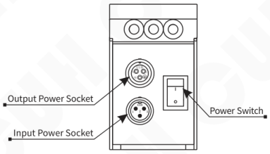

SDVC311-S (1.5A)  
SDVC311-M (3.0A)

- 출력 전원 소켓
- 입력 전원 소켓
- 전원 스위치

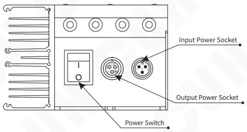

SDVC311-L (4.5A)  
SDVC311-XL (6.0A)

- 입력 전원 소켓
- 출력 전원 소켓
- 전원 스위치

---

## 1.4 배선 포트 설명

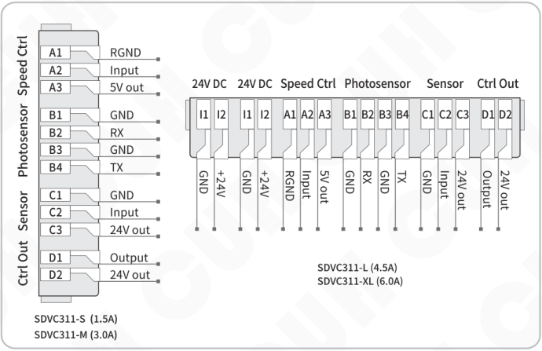

### SDVC311-S (1.5A) / SDVC311-M (3.0A)

| 포트 그룹 | 단자 | 설명 |
|---|---|---|
| 속도 제어 | A1 | RGND |
| 속도 제어 | A2 | 입력 |
| 속도 제어 | A3 | +5V 출력 |
| 광전 센서 | B1 | GND |
| 광전 센서 | B2 | RX |
| 광전 센서 | B3 | GND |
| 광전 센서 | B4 | TX |
| 센서 | C1 | GND |
| 센서 | C2 | 입력 |
| 센서 | C3 | +24V 출력 |
| 제어 출력 | D1 | 출력 |
| 제어 출력 | D2 | +24V 출력 |

### SDVC311-L (4.5A) / SDVC311-XL (6.0A)

| 포트 그룹 | 단자 | 설명 |
|---|---|---|
| 24V DC | I1 | GND |
| 24V DC | I2 | +24V |
| 24V DC | I1 | GND |
| 24V DC | I2 | +24V |
| 속도 제어 | A1 | RGND |
| 속도 제어 | A2 | 입력 |
| 속도 제어 | A3 | +5V 출력 |
| 광전 센서 | B1 | GND |
| 광전 센서 | B2 | RX |
| 광전 센서 | B3 | GND |
| 광전 센서 | B4 | TX |
| 센서 | C1 | GND |
| 센서 | C2 | 입력 |
| 센서 | C3 | +24V 출력 |
| 제어 출력 | D1 | 출력 |
| 제어 출력 | D2 | +24V 출력 |

## 1.5 명판 설명

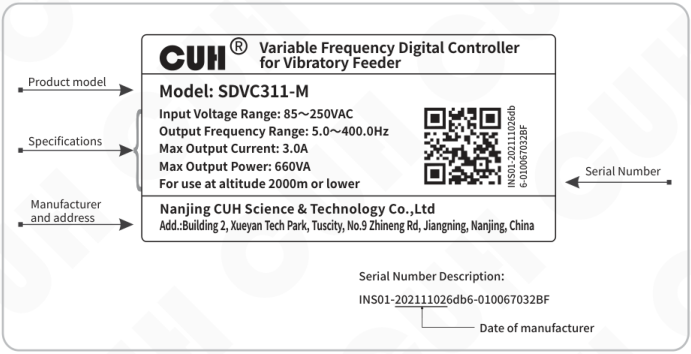

**CUH® — 진동 피더용 가변 주파수 디지털 컨트롤러**

**제품 모델**

Model: SDVC311-M

**규격**

- 입력 전압 범위: 85~250VAC
- 출력 주파수 범위: 5.0~400.0Hz
- 최대 출력 전류: 3.0A
- 최대 출력 용량: 660VA
- 해발 2000m 이하에서 사용

**제조사 및 주소**

Nanjing CUH Science & Technology Co.,Ltd

Add.:Building 2, Xueyan Tech Park, Tuscity, No.9 Zhineng Rd, Jiangning, Nanjing, China

**시리얼 번호**

INS01-202111026db6-010067032BF

**시리얼 번호 설명:**

INS01-<u>20211102</u>6db6-010067032BF

제조일: 20211102

---

## 제Ⅱ장 특징 기능

본 장에서는 컨트롤러의 간략한 소개와 주요 기능을 포함합니다.

### 2.1 제품 소개

SDVC311 시리즈 디지털 FM 진동 공급 컨트롤러는 최신 전자 기술과 신중한 설계를 통해 독특한 성능을 제공하는 컴팩트 범용 FM 출력 컨트롤러입니다. 주요 특징은 다음과 같습니다:

- 출력 주파수 범위가 5.0Hz~400.0Hz이며 0.1Hz 정밀도를 지원합니다.
- 소프트 정지 과정에서 전류 위상을 180° 이동하여 진동 피더를 빠르게 정지하는 제동 기능.
- 지능형 광전 포트는 광센서, NPN 또는 PNP 스위치 센서를 지원합니다.
- 준비 신호 기능: 컨트롤러가 준비 상태임을 나타내기 위해 지능형 광전 B4 송신 포트를 통해 변조 신호 또는 유효 신호를 출력합니다. 컨트롤러에 오류가 발생하면 준비 신호가 무효화됩니다.
- 스위치 센서 포트는 NPN, PNP 또는 자동 적응형을 지원합니다.
- 제어 출력 포트는 NPN, PNP 또는 푸시풀 출력 모드를 지원합니다.
- 완전한 보호 기능에는 다음이 포함됩니다: 메인 출력 단락 보호, 과전류 보호, 과열 보호, 저전압/과전압 보호, 제어 출력 단락 보호, 24V 출력 단락 보호, 속도 제어 5V 출력 단락 보호.

### 2.2 제품 성능 향상

SDVC31 시리즈 컨트롤러와 비교하여 SDVC311 시리즈는 성능이 대폭 향상되었습니다. 주로 다음을 포함합니다:

- 출력 주파수 범위가 40.0Hz~400.0Hz에서 5.0Hz~400.0Hz로 확장되었습니다.
- 최대 ON/OFF 지연 시간이 20.0s에서 99.9s로 증가했습니다.
- 소프트 정지 기능이 추가되어 0.0~10.0s로 설정하여 진동 피더의 진동을 서서히 정지할 수 있습니다.
- 제동 기능이 추가되어 0~100 제동 사이클을 설정하여 진동 디스크의 진동을 빠르게 정지할 수 있습니다.
- 지능형 광전 센서 포트에 PNP 센서 지원이 추가되었습니다.
- 재료가 가득 찼을 때 스위치 센서 포트가 NPN·PNP에서 소프트웨어 설정 가능 방식으로 업그레이드되었으며 자동 모드가 제공됩니다.
- 제어 출력 포트가 NPN 출력에서 NPN·PNP·푸시풀 3종 설정 가능 방식으로 업그레이드되었습니다.
- 제어 출력 포트 ON/OFF 지연이 추가되어 0.0~99.9s로 설정할 수 있습니다.
- 제어 출력 모드가 추가되어 지연 모드와 홀드 모드를 설정할 수 있습니다.
- 측정 기능이 추가되어 온도, 버스 전압, 버스 리플 전압, 출력 전류, 원거리 속도 제어 포트 전압, 지능형 광전 센서 포트 전압, 스위치 센서 포트 전압, DC 제어 출력 포트 전압, +24V 전원 전압을 모니터링할 수 있습니다.

---

## 2.3 현대식/전통식 파라미터 인터페이스

모든 신규 기능은 현대식 파라미터 인터페이스에서 구현됩니다. 기존 고객의 사용 습관과의 호환을 위해 사용자는 키판 조작으로 현대식 파라미터 인터페이스와 전통식 파라미터 인터페이스 간에 전환할 수 있습니다.

### 현대식 파라미터 인터페이스에서 전통식 파라미터 인터페이스로 전환

기본 설정 복원 파라미터의 LED 인터페이스에서 ⊕를 길게 눌러 전통식 파라미터 인터페이스로 전환하거나 이 LED에 표시되면 전통식 파라미터 인터페이스로 전환됩니다. 또는 ⊖를 길게 눌러 가 LED에 표시되면 현대식 파라미터 인터페이스로 전환됩니다.

### 전통식 파라미터 인터페이스에서 현대식 파라미터 인터페이스로 전환

기본 설정 복원 파라미터의 LED 인터페이스에서 ▼를 길게 눌러 가 LED에 표시되면 현대식 파라미터 인터페이스로 전환됩니다. 또는 ▲를 길게 눌러 가 LED에 표시되면 전통식 파라미터 인터페이스로 전환됩니다.

본 사용 설명서는 현대식 인터페이스 파라미터 설정을 소개합니다. 전통식 파라미터 인터페이스의 설정은 SDVC31 시리즈 컨트롤러의 사용자 매뉴얼을 참조하십시오.

---

# 제Ⅲ장 설치 가이드

본 장에서는 컨트롤러 사용에 필요한 조건과 이를 올바르게 설치하고 연결하는 방법을 소개합니다.

## 3.1 컨트롤러 사용 조건

컨트롤러는 AC 110/220V 전원으로 공급되며, 보호 접지 연결은 전원 코드의 플러그를 통해 이루어집니다. 110V 또는 220V, 50Hz/60Hz 전원 공급 및 규격에 맞는 배전 설비를 제공하고, 보호 접지선이 올바르게 연결되어 있는지 확인하십시오.

**⚠ 경고** 컨트롤러를 380V AC 전원에는 절대 연결하지 마십시오. 컨트롤러에 되돌릴 수 없는 심한 손상을 입히며, 폭발, 화재 등의 안전 사고를 초래할 수 있습니다.

**⚠ 경고** 전원 공급 측이 확실하게 접지되어 있는지 확인하십시오. 컨트롤러의 금속 하우징은 보호 접지선과 직접 연결됩니다. 불량한 접지는 컨트롤러 하우징에 전기가 통하게 하여 감전 사고를 일으킬 수 있습니다.

**Notice** 장시간 운전 시 열이 발생하여 하우징 온도가 상승합니다. 컨트롤러를 환기가 잘 되는 환경에 설치하고 잘 고정하며, 진동원으로부터 떨어뜨려 주십시오.

**Notice** 본 제품의 출력은 전원 공급의 정류 및 역변환으로 형성되며 입력과 출력 사이에 절연이 없습니다. 따라서 출력 극을 보호 접지에 연결할 수 없습니다. 전자석을 연결할 때는 전자석 코일과 하우징이 기본 절연 능력을 갖추어야 합니다. 그렇지 않으면 누전이 발생하여 감전 및 컨트롤러 손상을 일으킬 수 있습니다.

**Notice** 본 제품은 전자석을 구동하기 위한 컨트롤러입니다. 압전식 진동 피더에는 연결하지 마십시오.

## 3.2 버튼 조작 방법

a. 짧게 누르기는 누름 시간이 0.1초 초과 2초 미만으로 정의하고, 길게 누르기는 누름 시간이 2초 초과로 정의합니다.

a. 대기 인터페이스에서 ⊕ 또는 ⊖ 버튼을 짧게 눌러 컨트롤러의 출력 전압을 조정합니다.

b. ⚙ 버튼을 길게 눌러 기본 파라미터 인터페이스로 진입하거나 종료하고, ▼ 또는 ▲ 버튼을 짧게 눌러 기본 파라미터 간를 전환하며, ⊕ 또는 ⊖ 버튼을 짧게 눌러 파라미터 값을 조정합니다.

c. ⚙과 ▲ 버튼을 길게 눌러 고급 파라미터 인터페이스로 진입하거나 종료하고, ▼ 또는 ▲ 버튼을 짧게 눌러 고급 파라미터 간를 전환하며, ⊕ 또는 ⊖ 버튼을 짧게 눌러 파라미터 값을 조정합니다.

d. ⚙과 ▼ 버튼을 길게 눌러 모니터링 파라미터 인터페이스로 진입하거나 종료하고, ▼ 또는 ▲ 버튼을 짧게 눌러 모니터링 파라미터 간를 전환하되, 파라미터 값은 조정할 수 없습니다.

e. ⏻ 버튼을 짧게 눌러 컨트롤러 출력을 시작하거나 정지하고, ⏻ 버튼을 길게 눌러 키패드를 잠금 또는 해제합니다.

---

## 3.3 설치 및 사용

### 1단계:

포장 상자를 열고 컨트롤러 및 모든 액세서리를 확인하십시오.

### 2단계:

출력 전원 케이블의 배선 단자를 진동기의 전자석 코일에 연결하십시오.

출력 케이블 항공 플러그의 홈을 컨트롤러 출력 소켓의 삼각 표시와 정렬한 후, 출력 케이블을 올바르게 연결하고 너트를 조이십시오.

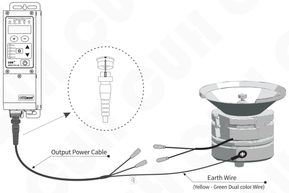

### 주의

1. 진동기의 전자석 코일이 출력 전원 케이블의 두 출력 핀에 연결되고 진동기의 금속 하우징이 확실하게 접지되어 있는지 확인하십시오.
2. 전력 출력에 압전 부하를 연결하는 것은 금지됩니다. 그렇지 않으면 감전 안전 사고를 초래할 수 있습니다!

---

### 3단계:

입력 전원 케이블의 커넥터를 컨트롤러의 입력 전원 소켓에 연결하십시오.

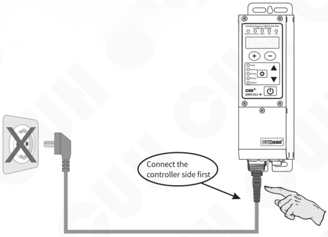

컨트롤러 측을 먼저 연결합니다

### 4단계:

입력 전원 케이블의 플러그를 콘센트에 연결하십시오.

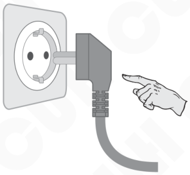

---

### 5단계:

컨트롤러의 전원 스위치를 켜면 전압 "U 150"이 표시되고 채널 A가 점등되며 진동 피더가 진동을 시작해야 합니다.

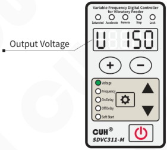

### 6단계:

⊖를 눌러 전압을 30~50V로 조정한 후 ⚙를 2초 동안 길게 눌러 출력 주파수 "E" 조정 상태로 진입합니다. ⊕와 ⊖를 사용하여 진동 피더의 고유 주파수, 즉 공진 주파수를 탐색합니다.

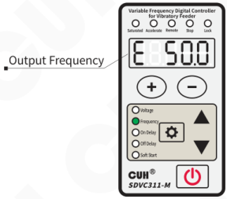

- 진동기의 고조파 주파수란 최대 진폭을 생성하는 주파수 값을 의미합니다.
- 각 진동기에는 고유한 기계적 공진 주파수가 있으며, 컨트롤러의 출력 주파수를 이 주파수로 조정하여 최상의 작동 상태를 달성합니다.

---

## 7단계:

⚙를 길게 눌러 출력 주파수 "E"를 종료하고 전압 조정 파라미터로 돌아가며, ▲를 눌러 전압 조정 파라미터로 전환할 수도 있습니다. ⊕와 ⊖를 사용하여 전압을 최적 공급 속도가 될 때까지 조정하십시오.

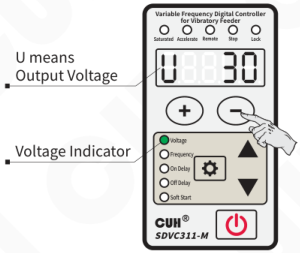

이제 진동 피더가 작동해야 합니다. 추가 제어 지침은 다음의 각 장을 참조하십시오.

---

## 제Ⅳ장 기본 기능 설명

본 장에서는 현대식 파라미터 인터페이스(기본값)의 기본 파라미터 설정을 소개합니다.

### 4.1 출력 전압

컨트롤러의 출력 전압 정류 평균값은 키판을 통해 직접 그리고 디지털로 설정할 수 있습니다. 독특한 안정화 기능 덕분에 컨트롤러의 출력 전압은 입력 전압이 변동해도 변동하지 않으므로, 계통 전압이 불안정한 경우에도 진동기가 안정적으로 운전할 수 있습니다.

- 컨트롤러의 전원 스위치를 켭니다.
- 컨트롤러가 출력 전압 파라미터로 진입합니다. 전압 표시등이 켜지고, LED에 출력 전압 파라미터 U와 기본값 150이 표시됩니다.
- **⊕** 또는 **⊖**를 눌러 파라미터 값을 조정합니다.

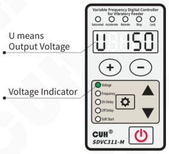

> - 본 컨트롤러에는 부스트 기능이 없습니다. 입력 전원 전압의 제한으로 컨트롤러가 설정 전압에 도달할 수 없을 때 포화 표시등이 켜지며, 이때 계통 전압 보상이 실패합니다.
> - 컨트롤러는 출력 파형의 정현파 특성을 희생하여 일정 수준의 가속 효과를 달성할 수 있으며, 이는 파라미터 "가속 지수 y"에 의해 결정됩니다. 가속 상태로 진입하면 출력 전류 파형이 정현파에서 삼각파로 변하고 가속 표시등이 켜집니다.

---

## 4.2 출력 주파수

컨트롤러는 직접 디지털 주파수 합성 기술(DDS)을 채택하여 매우 높은 주파수 정확도와 안정성을 가지며, 시간과 온도에 따라 변하지 않습니다.

- ⚙를 2초 동안 길게 눌러 기본 파라미터 인터페이스로 진입합니다.
- LED에 출력 주파수 파라미터 "E"와 기본값 50.0이 표시됩니다.
- ⊕ 또는 ⊖를 눌러 파라미터 값을 조정합니다.

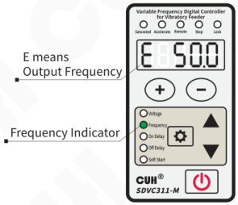

---

## 4.3 지능형 광전 센서 ON/OFF 지연

센서 또는 PLC를 사용하여 컨트롤러의 메인 출력을 켜거나 끌 때, 제어 신호가 인가되거나 복귀된 후 동작을 일정 시간 지연시킬 수 있습니다. 지연 시간은 아래 두 파라미터로 설정할 수 있습니다.

### ON 지연 ( J )

컨트롤러가 시작 제어 신호를 수신한 후 실제로 출력하기까지 경과하는 시간.

- ⚙를 2초 동안 길게 눌러 기본 파라미터 인터페이스로 진입합니다.
- ▲ 또는 ▼를 눌러 ON 지연 파라미터 "J"와 기본값 0.2로 전환합니다.
- ⊕ 또는 ⊖를 눌러 파라미터 값을 조정합니다.

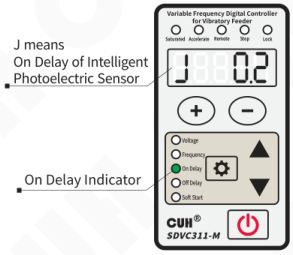

### OFF 지연 ( L )

컨트롤러가 정지 제어 신호를 수신한 후 실제로 출력을 차단하기까지 경과하는 시간.

- ⚙를 2초 동안 길게 눌러 기본 파라미터 인터페이스로 진입합니다.
- ▲ 또는 ▼를 눌러 OFF 지연 파라미터 "L"과 기본값 0.2로 전환합니다.
- ⊕ 또는 ⊖를 눌러 파라미터 값을 조정합니다.

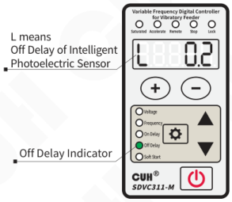

**주의:** 기본 설정에서는 지능형 광전 ON/OFF 지연이 메인 출력 ON/OFF 지연을 제어합니다. 메인 출력의 논리 방향이 동기 또는 반전 신호원이면 지능형 광전 ON/OFF 지연의 의미가 상호 교환됩니다. C 포트 ON/OFF 지연은 지능형 광전 ON/OFF 지연과 일치합니다.

---

## 4.4 소프트 시작 시간

진동기 코일에 급격한 충격을 피하기 위해 컨트롤러는 시작 시 출력 전압을 0에서 설정값까지 점차 상승시킬 수 있습니다.

**소프트 시작 시간 ( t ):** 컨트롤러가 시작 시 출력 전압을 0에서 설정값까지 매끄럽게 상승시키는 데 걸리는 시간.

- ⚙를 2초 동안 길게 눌러 기본 파라미터 인터페이스로 진입합니다.
- ▲ 또는 ▼를 눌러 소프트 시작 파라미터 "t"와 기본값 0.5로 전환합니다.
- ⊕ 또는 ⊖를 눌러 파라미터 값을 조정합니다.

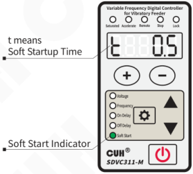

## 4.5 제동 사이클/소프트 정지 시간

컨트롤러 출력 정지 후 진동 피더는 일정 시간 자유 진동을 하여 그 동안 재료가 계속 이동합니다. 이는 재료의 정밀 계량 및 포장의 일부 적용에 오차를 발생시키므로 진동을 빠르게 정지시킬 필요가 있습니다.

**제동 기능:** 서서히 정지 시작점을 180° 지연시켜 진동 피더의 구동력과 자유 진동 위상이 반대 효과를 내도록 하여 진동을 빠르게 정지시킵니다. 소프트 정지 시간 (  )을 음의 값으로 설정하여 구현하며, 단위는 사이클, 즉 제동 시 역방향 구동의 전류 사이클 수입니다.

컨트롤러가 운전 상태에서 정지할 때 출력 전압을 0으로 완만하게 낮추어 진동 장비가 충격을 받는 것을 방지할 수 있습니다.

**소프트 정지 시간 (  ):** 컨트롤러가 운전 상태에서 정지할 때 출력 전압이 설정값에서 0으로 매끄럽게 감소하는 데 필요한 시간.

---

- ⚙를 2초 동안 길게 눌러 기본 파라미터 인터페이스로 진입합니다.
- ▲ 또는 ▼를 눌러 제동 사이클/소프트 정지 파라미터 "t"로 전환합니다.
- ⊕를 눌러 소프트 정지 파라미터 값을 조정합니다.
- ⊖를 눌러 제동 사이클 파라미터 값을 조정합니다.

t는 제동 사이클/소프트 정지를 의미합니다.

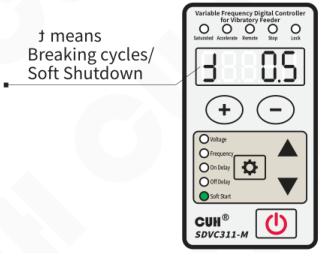

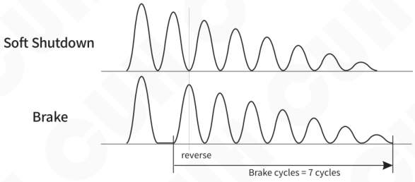

**제동 사이클 수 개략도**

---

## 4.6 키보드 잠금

컨트롤러의 파라미터가 설정되면 키보드 잠금 기능으로 패널의 모든 버튼을 잠가 오조작을 방지할 수 있습니다.

전원을 껐다가 다시 켜더라도 키보드 잠금 상태는 마지막에 전원을 껐을 때의 상태를 유지합니다.

- ⏻를 2초 동안 길게 눌러 패널의 모든 버튼을 잠급니다. 잠금 표시등이 켜집니다.
- ⏻를 다시 2초 동안 길게 눌러 잠금을 해제합니다.

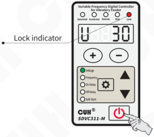

> 키보드 잠금 상태는 전원 차단으로 사라지지 않습니다.

---

# 제Ⅴ장 고급 기능 설명

본 장에서는 현대식 파라미터 인터페이스(기본값)의 고급 파라미터 설정을 소개합니다.

## 5.1 원거리 속도 제어

컨트롤러는 외부 아날로그 신호로 출력 전압을 제어하는 것을 지원하며, 아날로그 신호는 포텐셔미터, 1~5V 전압, 4~20mA 전류를 지원합니다.

### 포텐셔미터 제어 연결

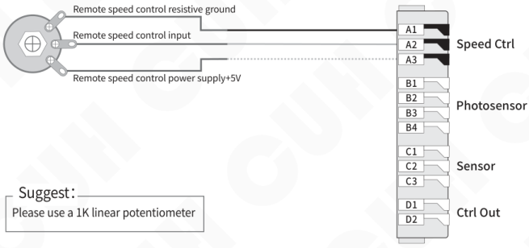

**권장:**

1K 리니어 포텐셔미터를 사용하십시오

원거리 속도 제어 신호가 유효해지면 속도 제어 표시등이 켜지며, 동시에 패널에서의 전압 조정은 무력화됩니다.

---

## 1~5V 전압 제어 연결

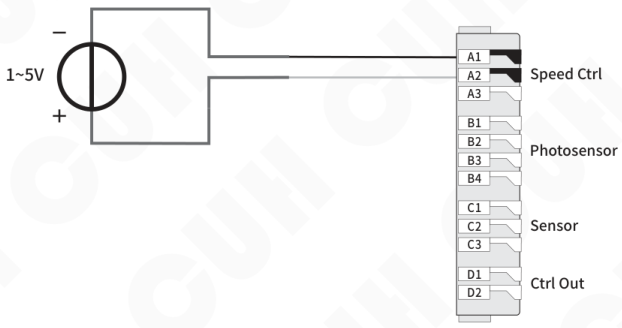

## 4~20mA 전류 제어 연결

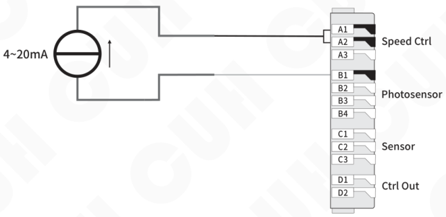

---

## 5.2 지능형 광전 감지

본 컨트롤러의 지능형 광전 포트는 발광 다이오드와 포토트랜지스터로 구성된 광전 관통형 또는 반사형 센서를 지원하며, NPN 또는 PNP 스위치 센서를 지원하도록 설정할 수도 있습니다. 구체적인 배선도는 다음과 같습니다:

### 광전 센서 연결 방법

센서의 작동 거리는 P 파라미터 설정으로 조정할 수 있으며, 파라미터가 작을수록 더 민감합니다.

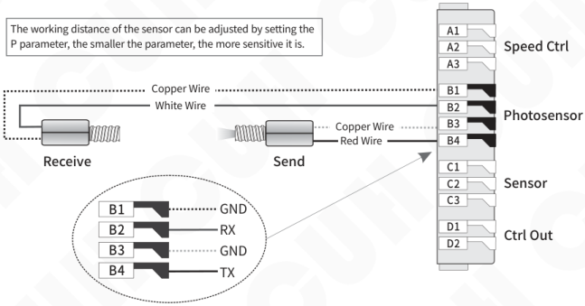

### 스위치 센서 연결 방법

파라미터 P로 NPN 또는 PNP 유형을 설정합니다.

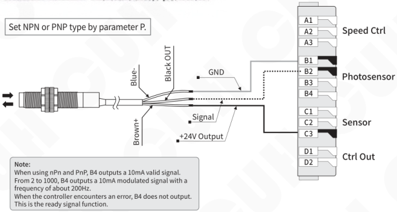

**주의:**

nPn 및 PnP 사용 시, B4는 10mA 유효 신호를 출력합니다.

2~1000일 때, B4는 약 200Hz 주파수의 10mA 변조 신호를 출력합니다.

컨트롤러에 오류가 발생하면 B4는 출력하지 않습니다. 이것이 준비 신호 기능입니다.

---

## 5.3 스위치 센서

스위치 센서 포트는 NPN, PNP, Ut1, Ut0 모드를 지원할 수 있습니다.

**Ut1 모드는 단일 스캔입니다,** 즉 센서 신호가 무효화되기 전에 고·저 레벨을 변경하여 포트가 유효한지 감지합니다. 유효 신호를 찾은 후 포트 센서 유형이 결정되어 더 이상 스캔하지 않습니다.

**Ut0 모드는 연속 스캔입니다,** 센서 유형과 관계없이 항상 고·저 레벨을 변경하여 포트에 유효 신호가 연결되어 있는지 감지합니다.

### 스위치 센서 연결 방법

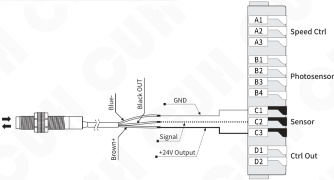

파라미터로 NPN 또는 PNP 유형을 설정합니다.

- 고급 파라미터 ΓA로 센서 유형을 설정합니다.
- 센서 등 기타 외부 신호를 컨트롤러의 C 포트를 통해 시동·정지 조작에 사용할 때, 신호 인가 또는 복귀 후 동작을 일정 시간 지연시킬 필요가 있으면 고급 파라미터 "센서 C 포트 ON 지연"과 "센서 C 포트 OFF 지연" 시간을 설정하여 구현할 수 있습니다. 조작 방법은 지능형 광전 센서 ON/OFF 지연 시간 설정을 참조하십시오.

---

## 5.4 제어 출력

제어 출력 포트는 NPN 출력, PNP 출력, 푸시풀 출력을 지원할 수 있습니다. 그중:

- NPN 출력은 저 레벨로 유효하며, 고임피던스 상태로 출력이 무효화됩니다;
- PNP 출력은 고 레벨로 유효하며, 고임피던스 상태로 출력이 무효화됩니다;
- 푸시풀 출력은 고 레벨로 유효하고, 저 레벨로 무효화됩니다.

### 5.4.1 제어 출력 배선 방법

**NPN 출력 연결**

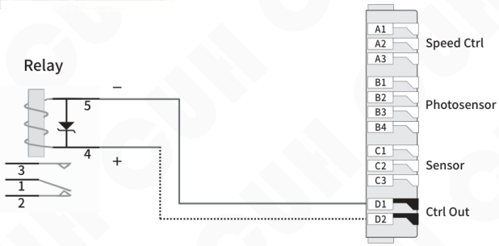

**PNP 또는 푸시풀 출력 연결**

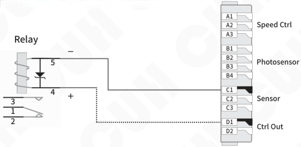

> 24V 릴레이를 연결할 때는 코일의 양극·음극을 반드시 확인하여 올바르게 연결되어 있는지 확인하십시오. 본 포트의 출력 전류 능력이 400mA이므로, 릴레이의 내부 보호 다이오드가 역접속 시 본 컨트롤러의 포트를 단락시켜 단락 보호 Err07을 트리거합니다.

---

## 5.4.2 제어 출력 신호원 및 논리 다이어그램

메인 출력과 제어 출력의 제어는 두 신호원 간의 논리적 관계 결과로 제어됩니다.

고급 파라미터 Πd와 Πq의 파라미터 값 설정으로 두 신호원의 논리적 관계를 설정합니다.

고급 파라미터 E.d, Ed, E.q, Eq의 파라미터 값 설정으로 다음 신호를 선택합니다.

| 신호원 | 의미 |
|---|---|
| 0 | 무효 신호 |
| 1 | 유효 신호 |
| b | 지능형 광전 감지 포트 신호 |
| -b | 지능형 광전 감지 포트 신호 반전 |
| C | 스위치 센서 포트 신호 |
| -C | 스위치 센서 포트 신호 반전 |
| od | 제어 출력 포트 신호 |
| -od | 제어 출력 포트 신호 반전 |
| oq | 메인 전원 출력 포트 신호 |
| -oq | 메인 전원 출력 포트 신호 반전 |

---

## 제어 출력 논리 다이어그램

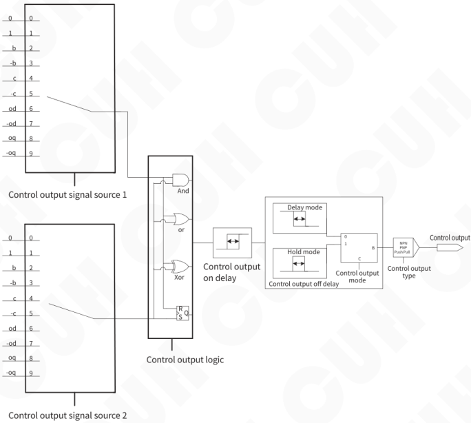

## 5.4.3 제어 출력 모드 설명

고객은 4가지 제어 출력 모드를 선택할 수 있습니다: 지연 모드, 홀드 모드, 주기 신호 출력 모드 Fn1/Fn2.

**지연 모드:** 컨트롤러 출력 구동 신호가 유효에서 무효로 바뀐 후, 제어 출력이 OFF 지연 시간만큼 경과한 뒤 꺼지는 것을 의미합니다.

**홀드 모드:** 컨트롤러 출력 구동 신호가 유효해진 후, 제어 출력이 OFF 지연 시간 동안 켜진 상태를 유지하다가 OFF 지연 시간을 초과하면 꺼집니다.

**주기 신호 출력 모드 Fn1/Fn2:** 고 레벨 신호의 지속 시간은 제어 출력 D 포트 개방 지연으로 설정하고, 저 레벨 신호의 지속 시간은 제어 출력 D 포트 폐쇄 지연으로 설정합니다.

Fn1 모드에서는 전환 키가 제어 출력을 정지시킬 수 없고, Fn2 모드에서는 전환 키가 제어 출력을 정지시킬 수 있습니다.

네 가지 모드의 차이점은 다음 타이밍 다이어그램 형태로 표현되며, 여기서 입력 신호는 논리적 관계 선택기 이후 출력되는 신호입니다.

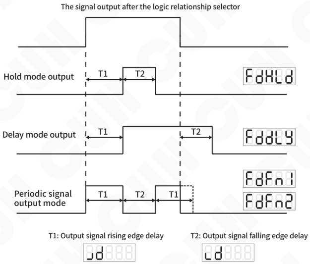

---

## 5.4.4 제어 출력 논리 방향

고급 파라미터 "ɔd" 설정으로 고객은 4가지 제어 출력 논리 방향을 선택할 수 있습니다:

**동기 `___`:** 출력 신호의 유효 상태가 변하지 않음을 나타냅니다.

**반전 `_-_`:** 출력 신호의 유효 상태가 반전됨을 나타냅니다.

**항상 활성(Always Active):** 신호가 항상 활성이며 제어되지 않음을 나타냅니다.

**항상 비활성(Always Inactive):** 신호가 항상 무효이며 제어되지 않음을 나타냅니다.

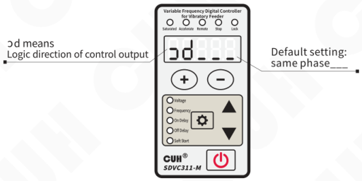

## 5.4.5 메인 출력 신호 제어 기능

메인 출력 신호 제어는 제어 출력과 유사합니다. 두 신호원을 논리적 관계 연산에 선택한 후, ON/OFF 지연 모드 선택과 논리 방향 제어를 통해 제어 신호를 얻습니다. 제어 신호는 패널의 ON/OFF 신호와 논리 연산된 후 전원 보드로 전송되어 메인 출력을 제어합니다.

메인 출력 신호 제어 배선 방법, 신호원 및 논리 다이어그램은 제어 출력 기능을 참조할 수 있습니다.

---

## 5.5 최대 출력 전압 제한

컨트롤러는 최대 출력 전압 제한 파라미터 h를 설정할 수 있으며, 사용자가 오조작으로 과도한 전압을 출력하여 진동 장비를 손상시키는 것을 방지할 수 있습니다.

패널 설정 전압과 원거리 제어 전압 모두 이 값을 초과하지 않습니다.

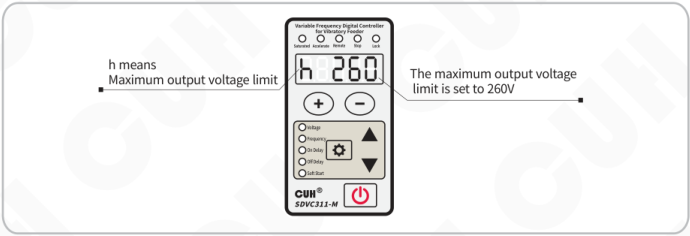

- 어떠한 경우에도 컨트롤러의 출력 전압은 이 파라미터 설정값을 초과할 수 없으며 초과하지 않습니다.
- 이 파라미터의 공장 기본 설정은 본 기기가 출력 가능한 최대 전압입니다.

## 5.6 주파수 하한

본 컨트롤러는 고급 파라미터 "주파수 하한 e"를 설정하여 최소 출력 주파수를 제한할 수 있으며, 사용자가 오조작으로 출력 주파수를 너무 낮게 하여 전자석을 손상시키는 것을 방지할 수 있습니다.

패널 설정 주파수는 이 값보다 낮아지지 않습니다.

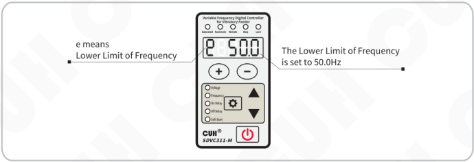

---

## 5.7 가속 지수

컨트롤러는 출력 파형의 정현파 특성을 희생하여 일정 수준의 가속 효과를 달성할 수 있습니다. 가속 상태로 진입하면 출력 전류 파형이 정현파에서 삼각파로 변하고 가속 표시등이 켜집니다. 가속 기능은 고급 파라미터 "가속 지수 y"의 파라미터 값 설정으로 제어할 수 있습니다.

**가속 지수(y):** 최대 출력 전압이 입력 전압에 도달할 수 있는 백분율을 나타냅니다.

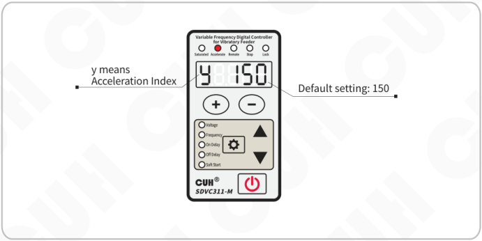

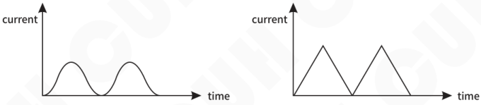

**가속 지수 150 설정 개략도**

---

## 5.8 파형 지수

컨트롤러는 최고 효율-최대 출력과 최소 소음의 성능을 연속적으로 균형 잡아 고객의 더 높은 요구를 충족할 수 있습니다. 이는 고급 파라미터 "파형 지수 r"의 파라미터 값 설정으로 달성할 수 있습니다.

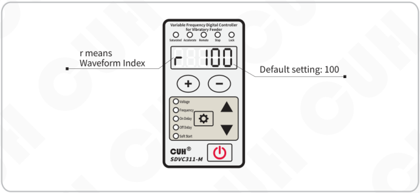

- 파형 지수 값 0은 최고 효율과 스프링에 최소 응력을 갖습니다.
- 값이 100일 때, 최대 정격 출력과 최소 소음을 얻을 수 있으나 스프링에 더 큰 응력이 가해집니다.

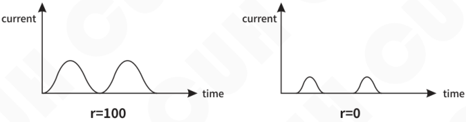

**파형 지수 다이어그램**

---

## 5.9 파라미터 암호 잠금 기능

컨트롤러는 주요 파라미터를 잠가 사용자가 오조작하는 것을 방지할 수 있습니다. 파라미터 표에서 "*"로 표시된 파라미터는 파라미터 암호 잠금으로 잠글 수 있습니다.

- ⚙과 ▲를 길게 눌러 고급 파라미터 인터페이스로 진입합니다.
- ▲ 또는 ▼를 짧게 눌러 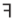로 전환하며, 이는 암호를 설정하는 데 사용됩니다.
- ⊕와 ⊖를 눌러 파라미터 값을 조정합니다.
- 파라미터 암호를 설정한 후 현재 인터페이스를 종료하고 다시 진입하면 파라미터 값이 사라진 것을 확인할 수 있습니다.
- 고급 파라미터 인터페이스로 진입하여 로 전환하고, 이전에 입력한 암호를 입력하면 사라진 설정 암호 파라미터를 확인할 수 있으며, 이후 암호를 변경할 수 있습니다.

암호 잠금 파라미터 값은 421 코드 규칙을 따릅니다:

| 잠금 파라미터 | 파형 지수 | 가속 지수 | 최대 출력 전압 제한 | 메인 출력 신호원 논리 연산 | 메인 출력 제2 신호원 | 메인 출력 제1 신호원 | 제어 포트 D 신호원 논리 연산 | 제어 포트 D 제2 신호원 | 제어 포트 D 제1 신호원 | 포트 C 센서 유형 | 제동 사이클/소프트 정지 | 출력 주파수 |
|---|---|---|---|---|---|---|---|---|---|---|---|---|
| 1: 잠김 | 1 | 1 | 1 | 1 | 1 | 1 | 1 | 1 | 1 | 1 | 1 | 1 |
| 0: 잠금 해제 | 0 | 0 | 0 | 0 | 0 | 0 | 0 | 0 | 0 | 0 | 0 | 0 |
| 곱셈 인자 | 4 | 2 | 1 | 4 | 2 | 1 | 4 | 2 | 1 | 4 | 2 | 1 |
| 암호 값 범위(합산) | 0~7 (암호 값 1자리) | | | 0~7 (암호 값 2자리) | | | 0~7 (암호 값 3자리) | | | 0~7 (암호 값 4자리) | | | 
| 예시 1 | 0 | 0 | 0 | 0 | 0 | 0 | 0 | 0 | 0 | 0 | 0 | 1 |
| | 0 | | | 0 | | | 0 | | | 1\*1=1 | | | 
| 예시 2 | 1 | 0 | 0 | 0 | 0 | 1 | 0 | 0 | 0 | 0 | 0 | 1 |
| | 1\*4=4 | | | 1\*1=1 | | | 0 | | | 1\*1=1 | | | 
| 예시 3 | 0 | 0 | 0 | 0 | 0 | 0 | 0 | 0 | 0 | 1 | 1 | 1 |
| | 0 | | | 0 | | | 0 | | | 1\*4+1\*2+1\*1=7 | | | 

**예시 1:** 출력 주파수를 잠그면, 12조 2진 코드는 000000000001이고, 설정 암호 값은 0001입니다.

**예시 2:** 출력 주파수, 파형 지수, 메인 출력 제1 신호원을 잠그면, 12조 2진 코드는 100001000001이고, 설정 암호 값은 4101입니다.

**예시 3:** 출력 주파수, 제동 사이클 수/서서히 닫는 시간, C 포트 센서 유형을 잠그면, 12조 2진 코드는 000000000111이고, 설정 암호 값은 0007입니다.

"암호 잠금 파라미터 범위"가 9999로 설정되면 "*"로 표시된 모든 파라미터가 잠깁니다.

---

## 5.10 기본 설정 복원/공장 모드 복귀

사용자는 컨트롤러를 공장 기본 상태로 빠르게 복원할 수 있습니다.

컨트롤러의 강력한 기능으로 인해 많은 파라미터를 조정할 수 있습니다. 초보자의 경우 몇 번의 설정과 수정 후 컨트롤러의 정상 작동 상태를 복원하지 못할 수 있습니다. 이 기능으로 뒤섞인 파라미터 상태를 공장 기본 설정으로 빠르게 복원할 수 있습니다.

공장 설정을 복원하려면 공장 모드 복귀 파라미터(Pin)를 조합하여 사용해야 합니다. 공장 모드 복귀에 대한 설명:

- **0:** **작동 파라미터 그룹**을 **사용자 파라미터 그룹**으로 복원.
- **5:** **작동 파라미터 그룹**을 **사용자 파라미터 그룹**에 저장.
- **35:** **작동 파라미터 그룹**을 **CUH 공장값**으로 복원.
- **55:** **작동 파라미터 그룹**과 **사용자 파라미터 그룹**을 **CUH 공장값**으로 복원.

---

- ⚙와 ▲를 동시에 길게 눌러 고급 파라미터 인터페이스로 진입합니다.
- ▼를 짧게 눌러 LED 표시기에서 전체 점멸로 전환하면, 이것이 "기본 설정 복원" 파라미터입니다. 그 후 ⊖를 길게 눌러 컨트롤러가 "-----"를 표시하면 컨트롤러가 복원된 것입니다.
- ⊖에서 손을 떼면, 컨트롤러가 "CUH"를 표시한 후 출력 전압 조정 상태 "U"로 진입합니다. 이때 모든 파라미터가 공장 기본 설정으로 복원됩니다.

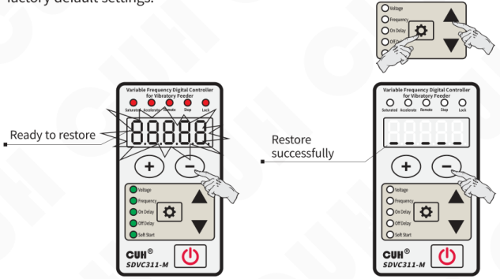

---

## 5.11 파라미터 모니터링 기능

컨트롤러는 컨트롤러 상태를 모니터링하기 위해 모니터링 파라미터 세트가 특별히 설계되었습니다.

- ⚙와 ▼를 동시에 길게 눌러 모니터링 파라미터 인터페이스로 진입합니다.
- ▲ 또는 ▼를 짧게 눌러 모니터링할 파라미터를 선택합니다.
- 모니터링 파라미터의 파라미터 값은 수정할 수 없습니다.

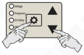

예시: C는 온도 표시 파라미터를 의미합니다

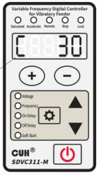

**본 컨트롤러의 모니터링 파라미터에는 다음이 포함됩니다:**

온도 표시 C, 버스 전압 PU, 버스 리플 전압 rU, 출력 전류 AC, 아날로그 속도 제어 A 포트 전압 AU, B 포트 신호 전압 bU, C 포트 신호 전압 cU, D 포트 출력 전압 dU, 24V 출력 전압 nU.

---

## 제Ⅵ장 기술 사양

### 6.1 외형 치수

(단위: mm)

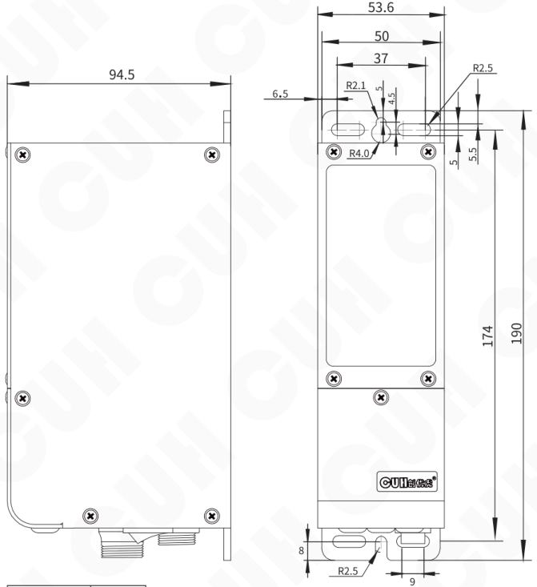

SDVC311-S (1.5A)  
SDVC311-M (3.0A)

| 치수 범위 | 공차 |
|---|---|
| 0~3 | ±0.05 |
| 3~10 | ±0.1 |
| 10~30 | ±0.15 |
| 30~80 | ±0.2 |
| 80~180 | ±0.3 |
| >180 | ±0.5 |

이 공차 표는 본 시리즈의 모든 제품에 적용됩니다.

---

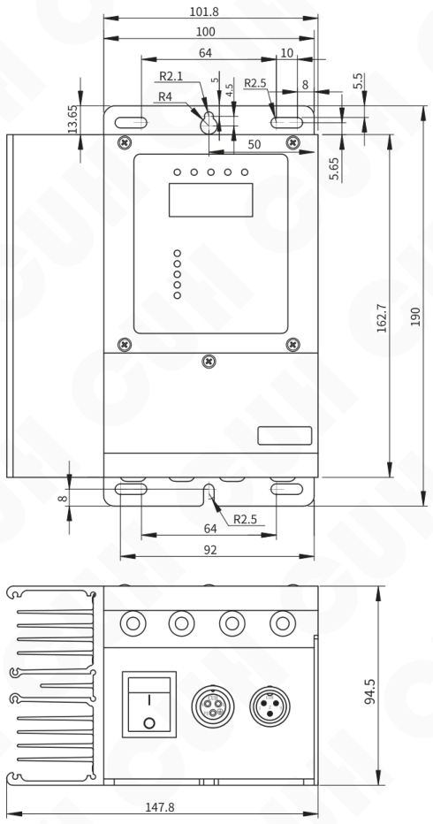

SDVC311-L (4.5A)  
SDVC311-XL (6.0A)

---

## 6.2 기술 사양

| 항목 | 최소 | 전형 | 최대 | 단위 | 비고 |
|---|---|---|---|---|---|
| 입력 전압 | 85 | 220 | 250 | V | AC RMS |
| 출력 전압 조정 가능 범위 | 0 | —— | 260 | V | 입력 전압의 150% 미만 |
| 전압 조정 정밀도 | | 1 | | V | | |
| 전압 안정도 정밀도 | 0 | —— | 10 | % | ΔVout/ΔVin |
| 출력 전류 조정 가능 범위 | 0 | —— | 1.5 | A | SDVC311-S |
| 출력 전류 조정 가능 범위 | 0 | —— | 3.0 | A | SDVC311-M |
| 출력 전류 조정 가능 범위 | 0 | —— | 4.5 | A | SDVC311-L |
| 출력 전류 조정 가능 범위 | 0 | —— | 6.0 | A | SDVC311-XL |
| 출력 용량 | 0 | —— | 330 | VA | SDVC311-S |
| 출력 용량 | 0 | —— | 660 | VA | SDVC311-M |
| 출력 용량 | 0 | —— | 990 | VA | SDVC311-L |
| 출력 용량 | 0 | —— | 1320 | VA | SDVC311-XL |
| 출력 주파수 | 5.0 | —— | 400.0 | Hz | | |
| 주파수 조정 정밀도 | | 0.1 | | Hz | | |
| 출력 파형 | | 정현파 | | | | |
| 소프트 시작 시간 | 0 | —— | 10.0 | s | 기본값: 0.5 |
| ON/OFF 지연 시간 범위 | 0 | —— | 99.9 | s | 기본값: 0.2 |
| ON/OFF 지연 시간 정밀도 | | 0.1 | | s | | |
| 과열 보호 트리거 온도 | 58 | 60 | 66 | °C | | |
| DC 제어 출력 전류 | 0 | —— | 400 | mA | | |
| DC 제어 출력 전압 | 22 | 24 | 26 | V | | |
| 아날로그 제어 신호 | | 1~5/4~20 | | V/mA | 원거리 속도 제어 신호 |
| 디지털 제어 신호 | | 24 | | V | 스위칭 신호 |
| 조정 방법 | | 6 | | 버튼 | | |
| 대기 전력을 | —— | 3 | —— | W | | |
| 표시 방법 | | 5 | | 자리 | LED | |
| 환경 온도 | 0 | 25 | 40 | °C | 결로 없음 | |
| 환경 습도 | 10 | 60 | 85 | % | 결로 없음 | |
| 보관 환경 온도 | -20 | 25 | 65 | °C | 결로 없음 | |

## 6.3 참조 규격

**절대 파라미터:**  
규격 초과 시 컨트롤러가 손상되므로 엄격히 준수하십시오.

| 항목 | GB 규격 | IEC 규격 | 등급 | 규격 요구 | 비고 |
|---|---|---|---|---|---|
| 정전기 방전 | GB/T 17626.2-2006 | IEC 61000-4-2:2001 | 4 | ±8 kV | 접촉 방전 |
| | | | 4 | ±15 kV | 공기 방전 |
| 전기적 빠른 과도 시험 | GB/T 17626.4-2008 | IEC 61000-4-4:2004 | 4 | ±4 kV | | |
| DC 전원선 파형 내성 | GB/T 17626.17-2005 | IEC 61000-4-17:2002 | 4 | 15% | 등급 A |

> **경고**  
> 주거 환경에서 본 제품은 라디오 간섭을 발생시킬 수 있으며, 이 경우 추가 완화 조치가 필요할 수 있습니다.

---

# 제Ⅶ장 부록

## 7.1 파라미터 표

| 카테고리 | 정의 | 기호 | 기호 이미지 | 범위 | 기본값 |
|---|---|---|---|---|---|
| 일반 파라미터 | 출력 전압 | U |  | 0~260 V | 150 |
| 기본 파라미터 | 출력 주파수 * | E |  | 5.0~400.0 Hz | 50.0 |
| | 지능형 광전 센서 ON 지연 | J |  | 0.0~99.9 s | 0.2 |
| | 지능형 광전 센서 OFF 지연 | L |  | 0.0~99.9 s | 0.2 |
| | 소프트 시작 | t |  | 0.0~10.0 s | 0.5 |
| | 제동 사이클/소프트 정지 * | d |  | -100~0 사이클(제동 사이클 수) 0.0~10.0 s(소프트 정지) | 0.0 |
| | 출력 전압 | U |  | 0~260 V | 150 |
| 고급 파라미터 | 지능형 광전 센서 감도 | P |  | PnP, nPn, 2~1000 | 80 |
| | 포트 C 센서 유형 * | ΓA |  | nPn, PnP ut1 (단일 스캔), ut0 (연속 스캔) | ut0 |
| | 포트 C ON 지연 | J- |  | 0.0~99.9 s |  J와 동일 |
| | 포트 C OFF 지연 | L- |  | 0.0~99.9 s |  L과 동일 |
| | 메인 출력 제1 신호원 * | Cq |  | 0, 1, b, -b, C, -C, od, -od, oq, -oq | b |
| | 메인 출력 제2 신호원 * | Eq |  | 0, 1, b, -b, C, -C, od, -od, oq, -oq | C |
| | 메인 출력 신호원 논리 연산 * | nq |  | And, or, Xor, rS | or |
| | 메인 출력 ON 지연 | Jq |  | 0.0~99.9 s | 0.0 |
| | 메인 출력 OFF 지연 | Lq |  | 0.0~99.9 s | 0.0 |
| | 메인 출력 출력 모드 | Fq |  | dLy (지연 모드), HLd (홀드 모드) | dLy |
| | 메인 출력 논리 방향 | oq |  |  on (항상 활성), oFF (항상 비활성) |  |
| | 제어 포트 D 제1 신호원 * | Cd |  | 0, 1, b, -b, C, -C, od (포트 D 출력 상태), -od, oq (메인 출력 출력 상태), -oq | 0 |
| | 제어 포트 D 제2 신호원 * | Ed |  | 0, 1, b, -b, C, -C, od (포트 D 출력 상태), -od, oq (메인 출력 출력 상태), -oq | oq |
| | 제어 포트 D 신호원 논리 연산 * | nd |  | And, or, Xor, rS | or |
| | 포트 D ON 지연 | Jd |  | 0.0~99.9 s | 0.0 |

| | 정의 | 기호 | 기호 이미지 | 범위 | 기본값 |
|---|---|---|---|---|---|
| 고급 파라미터 | 포트 D OFF 지연 | Ld |  | 0.0~99.9 s | 0.0 |
| 고급 파라미터 | 포트 D 출력 모드 | Fd |  | dLy (지연 모드), HLd (홀드 모드) Fn1 주기 신호 출력 모드 1 Fn2 주기 신호 출력 모드 2 | dLy |
| 고급 파라미터 | 포트 D 논리 방향 | Sd |  | --- (동기), -⁻- (반전) on (항상 활성), oFF (항상 비활성) | --- |
| 고급 파라미터 | 제어 출력 유형 | Cd |  | nPn, PnP, PSP (Push & Pull) | nPn |
| 고급 파라미터 | 최대 출력 전압 제한 \* | h |  | 0~260 V | 260 |
| 고급 파라미터 | 주파수 하한 | E |  | 5.0~400.0 Hz | 40.0 |
| 고급 파라미터 | 가속 지수 \* | g |  | 100~150 | 150 |
| 고급 파라미터 | 파형 지수 \* | r |  | 0~100 | 100 |
| 고급 파라미터 | 조정 불가 기능 파라미터 범위 | 소수점 포함 특수 7세그먼트 기호(그림 참조) |  | 0~9999 | 0 |
| 고급 파라미터 | 조정 불가 파라미터 기능 잠금 | 특수 7세그먼트 기호(그림 참조) |  | 0~9999 | 0 |
| 고급 파라미터 | 기본 설정 복원 | 88888 |  | 파라미터 Pin과 병용 | —— |
| 고급 파라미터 | 공장 모드 복귀 | Pin |  | 0 : 작동 파라미터 그룹을 사용자 파라미터 그룹으로 복원 5 : 작동 파라미터 그룹을 사용자 파라미터 그룹에 저장 35: 작동 파라미터 그룹을 CUH 공장값으로 복원 55: 작동 파라미터 그룹과 사용자 파라미터 그룹을 CUH 공장값으로 복원 | 0 |
| 모니터링 파라미터 | 온도 | C |  | -20~85 °C | —— |
| 모니터링 파라미터 | 내부 버스 전압 | PU |  | 0~400 V | —— |
| 모니터링 파라미터 | 버스 리플 전압 | rU |  | 0~200 V | —— |
| 모니터링 파라미터 | 출력 전류 | AC |  | 0.00~1.60 A -SDVC31S/SDVC311S 0.00~3.20 A -SDVC31M/SDVC311M | —— |
| 모니터링 파라미터 | 포트 A 신호 전압 | AU |  | 0.00~5.00 V | —— |
| 모니터링 파라미터 | 포트 B 신호 전압 | bU |  | 0~999 | —— |
| 모니터링 파라미터 | 포트 C 신호 전압 | cU |  | 0.0~28.0 V | —— |
| 모니터링 파라미터 | 포트 D 신호 전압 | dU |  | 0.0~28.0 V | —— |
| 모니터링 파라미터 | 24V 포트 실시간 전압 | nU |  | 0.0~28.0 V | —— |
| 모니터링 파라미터 | 제어 보드 소프트웨어 버전 | uc |  | —— | —— |
| 모니터링 파라미터 | 전원 보드 소프트웨어 버전 | uP |  | —— | —— |

비고: \* 기호가 있는 파라미터는 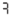로 잠글 수 있습니다.  
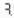가 9999이면 컨트롤러의 \* 기호가 있는 모든 파라미터가 잠깁니다.

## 7.2 입력·출력 회로도

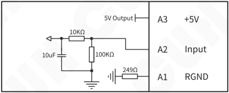

원거리 속도 제어 포트 A

지능형 광전 포트 B

스위치 센서 포트 C

제어 출력 포트 D

---

## 7.3 고장 해결 권고 및 오류 설명

| 오류 코드 | 정의 | 고장 해결 방법 | 기호 이미지 |
|---|---|---|---|
| 전원 투입 후 표시 없음 | | 전원 콘센트에 전기가 들어오는지 확인 입력 전원 코드가 전원 콘센트에 확실하게 연결되었는지 확인? | |
| 표시는 정상이나 출력 없음 | | 출력 케이블이 진동기에 확실하게 연결되었는지 확인. 출력 전압이 작지 않은지 확인. 정지 표시등이 켜지지 않았는지 확인. 파라미터 Normal Close가 설정되어 컨트롤러 출력이 정지되었는지 확인하십시오. | |
| 제어 신호 무력화 | | 제어 신호가 올바르게 입력되었는지 확인. 제어 신호의 접지선이 컨트롤러에 올바르게 연결되었는지 확인. 제어 신호의 논리적 관계가 예상대로 올바르게 설정되었는지 확인. | |
| 비트 현상 | | 진동기 간의 진동 결합을 피하십시오. 진동기의 공진 주파수를 높이십시오. | |
| 표시는 정상이나 출력 없음, 소리는 들림 | | 본 설명서가 지시하는 대로 모든 파라미터를 조정하십시오. | |
| Err01 | 단락 | 부하가 단락이 아닌지 확인한 후, 출력 ON/OFF 버튼을 두 번 누르거나 컨트롤러를 재투전하여 출력 재시동을 시도하십시오. |  |
| Err02 | 과전류 | 출력 전압을 적절히 낮춘 후 출력을 재시동하십시오. |  |
| Err03 | 과열 | 컨트롤러를 환기가 잘 되는 환경에 설치하십시오. |  |
| Err04 | 과전압 또는 저전압 | 입력 전압이 AC 85~250Vac 사이인지 확인하십시오. |  |
| Err05 | 내부 통신 이상 | 24V 전원 포트에 외부 전원 공급이 연결되지 않았는지 확인하거나 당사의 기술 지원에 연락하십시오. |  |
| Err06 | 온도 센서 이상 | 작업 온도가 -20℃ 이하가 아닌지 확인하거나 당사의 기술 지원에 연락하십시오. |  |
| Err07 | 포트 D 단락 보호 | 포트 D 부하가 단락이 아니고 전류가 400mA를 초과하지 않는지 확인한 후, 포트 D 출력 재시동을 시도하십시오. |  |
| Err10 | 24V 전원 출력 이상 | 24V 포트가 단락이 아니고 전류가 400mA를 초과하지 않는지 확인하십시오. |  |
| Err11 | 포트 A 5V 전원 출력 이상 | 포트 A의 5V 전원이 단락이 아니거나 5V를 초과하는 외부 전원 전압에 연결되지 않았는지 확인하십시오. |  |

비고: 오류가 발생하면 포트 B의 TX가 차단됩니다.

## 제Ⅷ장 제품 보증 정보

### 8.1 보증 기간

당사가 본 제품에 제공하는 보증 기간은 제품을 구매자가 지정한 위치로 인도한 날부터 3년입니다.

### 8.2 보증 범위

(1) 상기 보증 기간 내에 당사로 인해 고장이 발생한 경우, 당사는 무상으로 제품을 수리합니다. 그러나 다음 상황은 보증 대상이 아닙니다:

a. 간이 매뉴얼, 사용자 매뉴얼 또는 구매자와 당사 간 특별히 합의된 기술 요건에 명시된 조건을 준수하지 않은 경우, 부적절한 조작, 또는 부적절한 사용으로 인한 고장.

b. 고장이 제품 결함이 아닌 구매자의 장비 또는 소프트웨어 설계 인한 것인 경우.

c. 당사 직원이 수행하지 않은 개조 또는 수리로 인한 오작동.

d. 간이 조작 가이드 또는 사용자 매뉴얼에 따른 올바른 유지보수 또는 소모품 교체로 완전히 방지할 수 있었던 고장.

e. 제품이 당사에서 출하된 후, 예측할 수 없는 과학기술 수준 변화 등 고장의 발생으로 인한 원인.

f. 화재, 지진, 홍수 등 자연 재해 또는 비정상 전압 고장 등 외부 요인으로 인한 경우, 당사는 보증 책임을 지지 않습니다.

(2) 보증 범위는 (1)에 규정된 상황으로 한정되며, 간접 손실(장비 손상, 기회, 이익 상실 등) 또는 기타 손실에 대해 당사는 어떠한 책임도 지지 않습니다.

### 8.3 제품 적용 적합성

당사의 컨트롤러는 진동 공급 산업의 일반적인 사용을 위해 설계·생산되었습니다. 따라서 당사의 본 컨트롤러는 다음의 용도로 사용되어서는 아니 되며 사용에 적합하지 않습니다.

(1) 원자력 발전소, 공항, 철도, 선박, 동력 장치, 의료 기기 등 생명과 재산에 중대한 영향을 미치는 시설.

(2) 전기, 가스, 수도 공급 등 공공 설비.

(3) 유사한 조건 또는 환경에서의 옥외 사용.

---

Nanjing CUH Science & Technology Co.,Ltd  
https://en.cuhnj.com  
Tel.:+86-25-84730411 / 84730415 / 84730416  
Fax:+86-25-84730426  
E-mail:sales@cuhnj.com  
Add.:Building 2, Xueyan Tech Park, Tuscity,  
No.9 Zhineng Rd, Jiangning, Nanjing, China

문서 번호: IDP1000532

