## 이중 채널 디지털 가변 주파수 진동 공급 컨트롤러

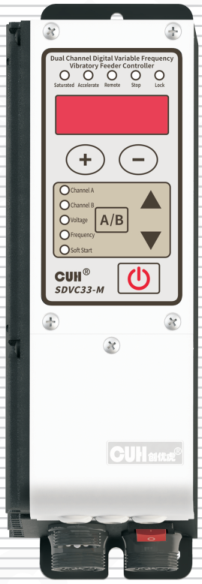

## SDVC33 시리즈
이중 채널 디지털 가변 주파수 진동 공급 컨트롤러 — SDVC33 시리즈
## 사용 설명서

---

## 저작권 고지

난징 CUH 과학기술 유한공사(Nanjing CUH Science & Technology CO., Ltd.)는 모든 권리를 보유합니다.

본 사용 설명서에 포함된 모든 정보는 당사의 지식이며 저작권법 및 기타 관련 법률의 보호를 받습니다. CUH는 저작권법 및 기타 법률이 부여하는 모든 저작권 및 기타 법적 권리를 향유하고 보유합니다. CUH의 서면 동의 없이 본 사용 설명서의 일부 또는 전부를 어떠한 형태로도 복제, 번역하거나 기타 방식으로 이용하여서는 안 됩니다.

## 면책 조항

본 사용 설명서의 모든 내용은 당사가 생산하는 관련 제품의 사용 방법만을 설명하며, 기존 기술과 귀하가 사용 시 제공된 상태에 따라 기술됩니다. 본 제품을 사용할 때 관련 위험을 부담해야 합니다. 법률에서 요구하는 경우를 제외하고, 당사는 본 사용 설명서로 인해 제품에 대해 명시적 또는 묵시적 책임을 지지 않으며, 여기에는 신체 손상, 재산 손상, 기회 상실 등이 포함되나 이에 한정되지 않습니다.

귀하는 상기 위험을 명확히 이해하고, 법률에서 강제하는 경우를 제외하고, 당사가 귀하에게 발생한 직·간접적 손상 또는 손실(인적, 물질적, 데이터 등의 유형 손실 및 명성, 기회 등의 무형 손실을 포함하되 이에 한정되지 않음)에 대해 책임을 지지 않음에 동의합니다.

당사는 사전 또는 사후 통지 없이 본 사용 설명서에 적용되는 제품을 수정할 권리를 보유합니다.

---

## 머리말

CUH SDVC33 시리즈 이중 채널 디지털 가변 주파수 진동 공급 컨트롤러를 선택해 주셔서 감사합니다. (이하 "컨트롤러"라고 함) 본 시리즈 컨트롤러는 고품질 부품을 사용하고 최신 전자 기술을 도입하며, 고성능 디지털 신호 프로세서를 기반으로 신중하게 설계되었습니다.

본 설명서에는 컨트롤러의 설치, 디버깅, 파라미터 설정, 유지보수 및 문제 해결에 관한 주의 사항이 포함되어 있습니다. 컨트롤러를 조작하기 전에 본 설명서를 주의 깊게 읽고 잘 보관하십시오.

다음 기호는 신체 손상 및 제품 손상을 방지하기 위해 주의를 환기하는 것이므로 반드시 읽어 주십시오.

| 기호 | 설명 |
|---|---|
| ⚠ 위험 | 본 항목을 준수하지 않으면 신체 손상 또는 사망에 이를 수 있습니다. |
| ⚠ 경고 | 본 항목을 준수하지 않으면 신체 손상 또는 사망에 이를 수 있습니다. |
| ⚠ 주의 | 본 항목을 준수하지 않으면 신체에 중등도 또는 경미한 부상을 입을 수 있습니다. |
| 주의(Notice) | 본 항목을 준수하지 않으면 제품 손상 및 재산 피해가 발생합니다. |
| ❗ 필수 | 사용 중 반드시 준수해야 하는 주의 사항과 사용 제한을 나타냅니다. |

**본 설명서는 다음 모델에 적용됩니다**

- SDVC33-M (이중 채널 합산 전류 최대 3.5A)

---

# 안전 및 주의 사항

1. **⚠ 위험** 본 제품은 전자기 기반 진동 공급 장비 구동에만 사용됩니다. 인체 또는 신체의 일부를 보호하는 목적으로 본 제품을 사용하지 마십시오.

2. **⚠ 위험** 본 제품은 방폭용으로 설계되지 않았으므로, 위험 지역 및/또는 폭발성 가스 환경에서 사용하지 마십시오.

3. **⚠ 경고** 본 제품은 AC 상용전원으로 공급됩니다. 260Vac를 초과하는 전압을 인가하지 마십시오. 380Vac와 같은 과도한 입력 전압은 제품 폭발 또는 화재를 유발하여 중대한 안전 사고로 이어질 수 있습니다.

4. **⚠ 경고** 본 제품은 전원 코드를 통해 접지됩니다. 컨트롤러에 전원을 공급하는 배전 설비가 올바르게 접지되어 있는지 확인하십시오. 그렇지 않으면 컨트롤러 외함에 전하가 유도되어 감전 사고를 유발할 수 있습니다.

5. **⚠ 경고** 컨트롤러 출력단에 AC 전원을 인가하지 마십시오. 컨트롤러가 손상됩니다.

6. **⚠ 경고** 전원 인가 상태에서 배선을 삽입·제거하거나 배선 단자함 내 각 접점 단자를 만지지 마십시오. 감전을 방지하기 위함입니다.

7. **주의** 릴레이 등 장치를 통해 전원 공급을 차단하는 방식으로 본 제품 출력을 제어하지 마십시오. 컨트롤러 수명이 크게 단축됩니다.

8. **주의** 컨트롤러는 서늘하고 건조한 환경에서 작동하도록 설계되었습니다. 침수 및 직사광선을 피하기 위해 컨트롤러를 야외에서 운전하지 마십시오. 전기가격에서 지정된 온도 범위 내에서 컨트롤러를 운전하십시오.

9. **! 필수** 본 제품은 반드시 접지가 확실하고 진동 장비에서 떨어진 견고한 플랫폼에 고정하십시오.

10. **! 필수** 설계 한계를 초과한 조건에서 컨트롤러를 절대 작동시키지 마십시오.

11. **! 필수** 본 설명서에 따라 컨트롤러를 엄격히 조작하십시오. 오작동으로 인한 장비 손상 또는 신체 손상에 대해 당사는 민·형사상 어떤 책임도 지지 않습니다.

12. **! 필수** 감전을 방지하기 위해 절대 컨트롤러 외함을 열지 마십시오. 컨트롤러 고장 시 CUH에 문의하십시오. 보증이 무효화될 수 있으므로 스스로 수리하려는 시도를 하지 마십시오.

---

---

## 운전 및 보관 환경

### 사용 전 점검

모든 컨트롤러는 출고 전 엄격한 품질 검사를 통과하고 충격 방지 포장이 되어 있습니다. 개봉 후 다음 항목을 확인하십시오:

1. 컨트롤러 외관에 손상이 있는지 여부.
2. 컨트롤러 모델이 귀하가 주문한 모델인지 여부.

### 운전 환경

컨트롤러의 우수한 성능과 긴 수명을 위해 아래 주의 사항을 준수하십시오:

- ⚠ 환기가 잘 되는 환경
- ⚠ 물, 증기, 먼지 및 특히 기름진 먼지에서 멀리 떨어뜨림
- ⚠ 부식성 또는 인화성 기체·액체에서 멀리 떨어뜨림
- ⚠ 떠다니는 먼지와 금속 입자에서 멀리 떨어뜨림
- ⚠ 자체 진동을 방지하기 위해 단단히 고정
- ⚠ 전자계 간섭에서 멀리 떨어뜨림
- ⚠ 주변 온도가 0~40 ℃인지 확인
- ⚠ 해발 2000m 이하에서 사용

---

---

# 목차

**제1장 사용 전 — 1**

- 1.1 포장 내용물 확인 — 1
- 1.2 표시등, 버튼 및 외부 부품 설명 — 2
- 1.3 배선 포트 설명 — 3
- 1.4 명판 설명 — 3

**제2장 제품 소개 — 4**

- 2.1 제품 소개 — 4
- 2.2 제품 성능 개선 — 4
- 2.3 이중 출력의 병합 사용 — 5

**제3장 설치 안내 — 6**

- 3.1 컨트롤러 사용 조건 — 6
- 3.2 버튼 조작 방법 — 6
- 3.3 설치 및 사용 — 7

**제4장 기본 기능 설명 — 11**

- 4.1 출력 전압 설정 — 11
- 4.2 출력 주파수 설정 — 12
- 4.3 소프트 시작 — 12
- 4.4 소프트 정지 — 13
- 4.5 제동 기능 — 13
- 4.6 출력 스위치 — 14
- 4.7 키보드 잠금 — 14
- 4.8 기본 설정 복원 — 15

**제5장 고급 기능 설명 — 17**

- 5.1 원격 속도 제어 — 17
- 5.2 지능형 광전 감지 — 19
- 5.3 스위치 센서 — 20

---

---

- 5.4 제어 출력 — 21
  - 5.4.1 제어 출력 배선 방법 — 21
  - 5.4.2 제어 출력 신호원 및 논리 도 — 22
  - 5.4.3 제어 출력 모드 설명 — 24
  - 5.4.4 메인 출력 신호 제어 기능 — 24
- 5.5 최대 출력 전압 제한 — 25
- 5.6 조절 가능한 과전류 보호 — 25
- 5.7 패널 밝기 조정 — 26
- 5.8 출력 모니터링 기능 — 26
- 5.9 이중 채널 병합 제어 — 27
- 5.10 사용자 파라미터 저장 및 복원 — 28

## 제6장 기술 사양 — 29

- 6.1 치수 — 29
- 6.2 기술 사양 — 30
- 6.3 참조 표준 — 31

## 제7장 부록 — 32

- 7.1 파라미터 표 — 32
- 7.2 입력·출력 회로도 — 35
- 7.3 문제 해결 제안 및 오류 설명 — 36

## 제8장 제품 보증 정보 — 37

- 8.1 보증 기간 — 37
- 8.2 보증 범위 — 37
- 8.3 제품 적합성 — 37

---

# 제1장 사용 전

본 장에서는 제품 포장 내용물, 컨트롤러 외형 설명 및 컨트롤러 명판 정보를 소개합니다.

## 1.1 포장 내용물 확인

본 제품을 사용하기 전에 컨트롤러 및 액세서리의 완전성을 확인하십시오. 제품에 결함이나 손상이 있거나 액세서리가 누락된 경우 당사에 문의하십시오.

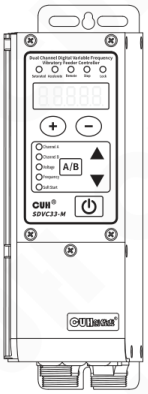

컨트롤러×1

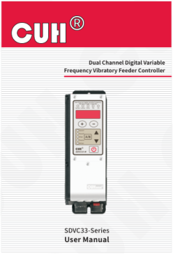

사용 설명서×1

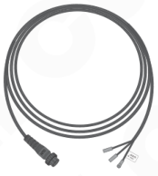

출력 케이블×2

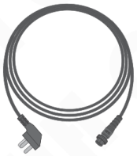

입력 전원 코드×1

---

## 1.2 표시등, 버튼 및 외부 부품 설명

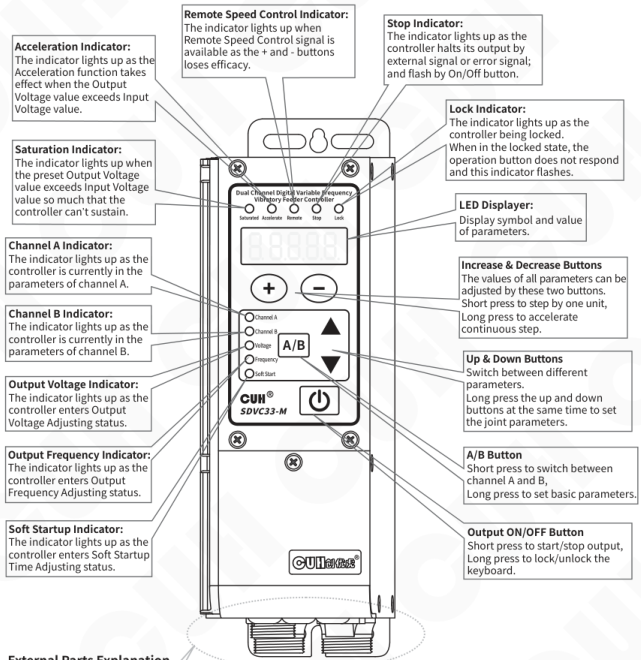

**가속 표시등:**  
출력 전압 값이 입력 전압 값을 초과하여 가속 기능이 활성화되면 표시등이 켜집니다.

**원격 속도 제어 표시등:**  
원격 속도 제어 신호가 유효하여 + 및 − 버튼이 무효화되면 표시등이 켜집니다.

**정지 표시등:**  
컨트롤러가 외부 신호 또는 오류 신호로 출력을 정지하면 표시등이 켜지고, On/Off 버튼에 의해 깜빡입니다.

**포화 표시등:**  
설정된 출력 전압 값이 입력 전압 값보다 컨트롤러가 유지할 수 없을 만큼 크게 초과하면 표시등이 켜집니다.

**잠금 표시등:**  
컨트롤러가 잠기면 표시등이 켜집니다.  
잠금 상태에서는 조작 버튼이 응답하지 않으며 이 표시등이 깜빡입니다.

**LED 표시기:**  
파라미터의 기호와 값을 표시합니다.

**채널 A 표시등:**  
컨트롤러가 현재 채널 A의 파라미터에 있으면 표시등이 켜집니다.

**채널 B 표시등:**  
컨트롤러가 현재 채널 B의 파라미터에 있으면 표시등이 켜집니다.

**출력 전압 표시등:**  
컨트롤러가 출력 전압 조정 상태로 진입하면 표시등이 켜집니다.

**출력 주파수 표시등:**  
컨트롤러가 출력 주파수 조정 상태로 진입하면 표시등이 켜집니다.

**소프트 시작 표시등:**  
컨트롤러가 소프트 시작 시간 조정 상태로 진입하면 표시등이 켜집니다.

**증가 및 감소 버튼**  
이 두 버튼으로 모든 파라미터 값을 조정할 수 있습니다.  
짧게 누르면 한 단위씩 조정되고,  
길게 누르면 가속되어 연속 조정됩니다.

**위·아래 버튼**  
서로 다른 파라미터 간에 전환합니다.  
위·아래 버튼을 동시에 길게 누르면 병합 파라미터를 설정합니다.

**A/B 버튼**  
짧게 누르면 채널 A와 B 간에 전환되고,  
길게 누르면 기본 파라미터를 설정합니다.

**출력 ON/OFF 버튼**  
짧게 누르면 출력을 시작/정지하고,  
길게 누르면 키보드를 잠금/잠금 해제합니다.

### 외부 부품 설명

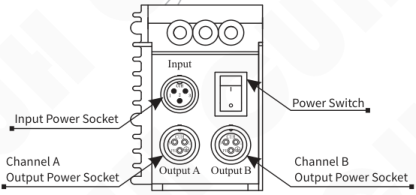

- 입력 전원 소켓
- 전원 스위치
- 채널 A 출력 전원 소켓
- 채널 B 출력 전원 소켓

## 1.3 배선 포트 설명

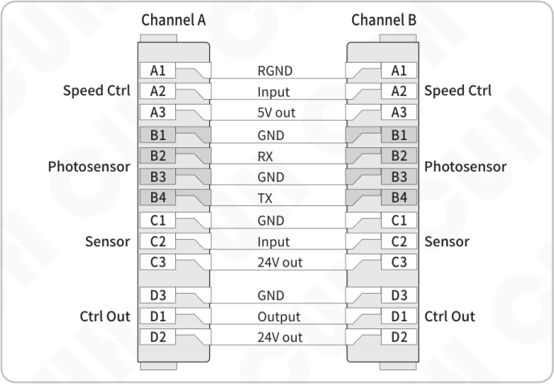

| 기능 | 채널 A | 설명 | 채널 B | 기능 |
|---|---|---|---|---|
| 속도 제어 | A1 | RGND | A1 | 속도 제어 |
| 속도 제어 | A2 | 입력 | A2 | 속도 제어 |
| 속도 제어 | A3 | 5V 출력 | A3 | 속도 제어 |
| 광전 센서 | B1 | GND | B1 | 광전 센서 |
| 광전 센서 | B2 | RX | B2 | 광전 센서 |
| 광전 센서 | B3 | GND | B3 | 광전 센서 |
| 광전 센서 | B4 | TX | B4 | 광전 센서 |
| 센서 | C1 | GND | C1 | 센서 |
| 센서 | C2 | 입력 | C2 | 센서 |
| 센서 | C3 | 24V 출력 | C3 | 센서 |
| 제어 출력 | D3 | GND | D3 | 제어 출력 |
| 제어 출력 | D1 | 출력 | D1 | 제어 출력 |
| 제어 출력 | D2 | 24V 출력 | D2 | 제어 출력 |

## 1.4 명판 설명

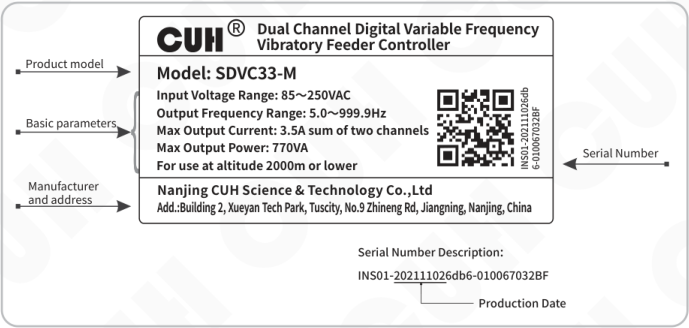

**CUH® — 이중 채널 디지털 가변 주파수 진동 공급 컨트롤러**

**제품 모델**

모델: SDVC33-M

**기본 파라미터**

- 입력 전압 범위: 85～250VAC
- 출력 주파수 범위: 5.0～999.9Hz
- 최대 출력 전류: 두 채널 합산 3.5A
- 최대 출력 전력: 770VA
- 해발 2000m 이하에서 사용

**제조업체 및 주소**

Nanjing CUH Science & Technology Co.,Ltd

Add.:Building 2, Xueyan Tech Park, Tuscity, No.9 Zhineng Rd, Jiangning, Nanjing, China

**일련번호**

INS01-202111026db6-010067032BF

**일련번호 설명:**

INS01-**20211102**6db6-010067032BF

생산 날짜: **20211102**

---

# 제2장 제품 소개

본 장에서는 컨트롤러의 간략한 소개와 주요 기능을 다룹니다.

## 2.1 제품 소개

SDVC33 이중 디지털 FM 진동 공급 컨트롤러는 최신 전자 기술과 꼼꼼한 설계를 통해 독특한 성능을 제공하는 컴팩트한 범용 이중 FM 출력 컨트롤러입니다. 주요 특징은 다음과 같습니다:

- 전류를 임의로 배분할 수 있는 이중 채널 전력 출력으로, 각 채널의 과전류 보호 전류 설정을 지원합니다.
- 이중 채널 작업 모드에서 주파수 추적, 전압 추적 또는 주파수·전압 이중 추적을 선택할 수 있습니다.
- 주파수 추적 시 두 출력 간 위상차를 -180°~180°로 설정할 수 있습니다.
- 출력 주파수 범위는 5Hz~999.9Hz이며 0.1Hz 정확도를 갖습니다.
- 소프트 정지 과정 전류 위상을 180° 이동시켜 진동 피더를 빠르게 정지하는 제동 기능.
- 지능형 광전 포트는 광전 센서, NPN 또는 PNP 스위치 센서를 지원합니다.
- 준비(Ready) 신호 기능: 컨트롤러가 준비 상태임을 나타내기 위해 지능형 광전 B4 전송 포트를 통해 변조 신호 또는 유효 신호를 출력합니다. 컨트롤러에 오류가 발생하면 준비 신호가 무효화됩니다.
- 오버플로 제어 포트는 NPN, PNP 또는 자동 적응형을 지원합니다.
- 제어 출력 포트는 NPN, PNP 또는 푸시풀 출력 모드를 지원합니다.
- 원격 속도 제어 포트를 교차 선택할 수 있어 하나의 포텐셔미터로 두 출력을 동시에 제어할 수 있습니다.
- 원격 제어 계수 기능으로 원격 제어 전압의 제어 효과를 1배로 확대하거나 축소할 수 있습니다.
- LED 표시 밝기 조정 기능은 32단계 밝기 조정을 지원합니다.
- 사용자 파라미터 저장 및 복원 기능으로, 사용자가 파라미터를 설정하고 사용자 그룹에 저장하여 손쉽게 복원할 수 있습니다.
- 공장 초기화 기능은 서브 채널 A/B 복원 또는 컨트롤러 전체 복원을 지원합니다.
- 완전한 보호 기능에는 다음이 포함됩니다: 메인 출력 단락 보호, 과전류 보호, 과열 또는 과냉 보호, 저전압/과전압 보호, 제어 출력 단락 보호, 24V 출력 단락 보호, 속도 제어 5V 출력 단락 보호.

## 2.2 제품 성능 개선

SDVC31-M 컨트롤러와 비교하여 SDVC33은 성능이 대폭 개선되었습니다. 주로 다음을 포함합니다:

- 출력 주파수가 40.0Hz~400.0Hz에서 5.0Hz~999.9Hz로 확대되었습니다.
- 최대 On/Off 지연 시간이 20.0초에서 99.9초로 확대되었습니다.

---

- 소프트 정지 기능이 추가되어 0.0~10.0초로 설정하고 진동 피더의 진동을 천천히 정지할 수 있습니다.
- 제동 기능이 추가되어 0~10개의 제동 사이클을 설정하고 진동 디스크의 진동을 빠르게 정지할 수 있습니다.
- 지능형 광전 센서 포트에 PNP 센서 지원이 추가되었습니다.
- 재료 가득 참 시 스위치 센서 포트가 NPN과 PNP에서 소프트웨어 설정 방식으로 업그레이드되고 자동 모드가 제공됩니다.
- 제어 출력 포트가 NPN 출력에서 NPN, PNP, 푸시풀 3종 설정 방식으로 업그레이드되었습니다.
- 제어 출력 포트 On/Off 지연이 추가되어 0.0~99.9초로 설정할 수 있습니다.
- 제어 출력 모드가 추가되어 지연 모드와 홀드 모드를 설정할 수 있습니다.
- 전자기 코일의 소손을 보호하기 위해 조절 가능한 과전류 보호 전류 파라미터가 추가되었습니다.
- 원격 제어 계수가 추가되어 원격 제어 전압의 제어 효과를 확대하거나 축소할 수 있습니다.
- 패널 밝기 조정 기능이 추가되어 A/B 그룹의 표시 밝기를 별도로 설정할 수 있습니다.
- 측정 기능이 추가되어 출력 전류, 속도 제어 전압, 지능형 광전 포트 신호 전압, 스위치 센서 포트 입력 전압, 제어 출력 포트 출력 전압, 온도 표시, 버스 전압, 24V 출력 전압을 모니터링할 수 있습니다.
- 파라미터 저장 및 복원 기능이 추가되었습니다. 작업 그룹 파라미터의 자동 저장 외에 작업 그룹 파라미터를 사용자 그룹에 저장할 수도 있으며, 필요 시 A 그룹과 B 그룹 파라미터를 사용자 그룹에서 유연하게 복원할 수 있습니다.

## 2.3 이중 출력의 병합 사용

컨트롤러는 병합 제어 채널 A/B 파라미터를 제공하며, 이를 이중 축 벡터 진동 피더 또는 볼 피더와 라인 피더의 공급 시스템을 제어하는 데 사용할 수 있습니다.

기본적으로 채널 A와 B는 독립적으로 작동합니다. 병합 시 채널 B를 채널 A를 추적하도록 설정할 수 있으며, 여기에는 전압 추적, 주파수 추적, 전압·주파수 이중 추적이 포함됩니다. 주파수가 동일하면 두 출력의 위상이 잠기며, 사용자는 위상차를 -180°에서 180°까지 조정할 수 있습니다.

채널 B의 전압과 주파수를 채널 A 이중 추적하도록 설정한 후에는 채널 A의 전압과 주파수만 조정하면 A/B 출력 전압과 출력 주파수가 동시에 변경됩니다.

---

# 제3장 설치 안내

본 장에서는 컨트롤러 사용에 필요한 조건과 이를 올바르게 설치하고 연결하는 방법을 소개합니다.

## 3.1 컨트롤러 사용 조건

컨트롤러는 AC 110/220V로 전원 공급되며, 보호 접지는 전원 코드의 플러그를 통해 이루어집니다. 표준을 충족하는 110V 또는 220V, 50Hz/60Hz 상용 전원 및 배전 설비를 제공하고 보호 접지선이 올바르게 연결되어 있는지 확인하십시오.

**⚠ 경고** 컨트롤러를 380V AC 전원에 연결하지 마십시오. 컨트롤러에 되돌릴 수 없는 심각한 손상을 유발하며, 폭발, 화재 등 안전 사고로 이어질 수 있습니다.

**⚠ 경고** 전원 공급 측이 확실히 접지되어 있는지 확인하십시오. 컨트롤러의 금속 외함은 보호 접지선과 직접 연결됩니다. 접지 불량 시 컨트롤러 외함에 전기가 통하여 감전 사고를 유발할 수 있습니다.

**주의** 컨트롤러가 장시간 작동하면 열이 발생하여 외함 온도가 상승합니다. 컨트롤러를 환기가 잘 되는 환경에 설치하고 잘 고정하여 진동원에서 멀리 떨어뜨리십시오.

**주의** 본 제품의 채널 A/B 출력은 상용전원의 정류 및 역변환으로 형성되며 그 사이에 절연 링이 없습니다. 따라서 출력 극을 보호 접지에 연결할 수 없습니다. 전자기 코일을 연결할 때 전자기 코일과 외함이 기본 절연 성능을 갖추고 있는지 확인해야 합니다. 그렇지 않으면 누전이 발생하여 감전 및 컨트롤러 손상을 유발할 수 있습니다.

**주의** 본 제품은 전자기 구동용 컨트롤러입니다. 압전식 진동 피더에 연결해서는 안 됩니다.

## 3.2 버튼 조작 방법

a. 버튼 동작은 누름 시간에 따라 짧게 누름과 길게 누름(1단계 가속, 2단계 가속)으로 나뉩니다.  
b. 짧게 누름은 누름 시간이 0.1초보다 크고 2초보다 작은 것으로 정의하고, 길게 누름은 누름 시간이 2초보다 큰 것으로 정의합니다.  
f. [A/B]를 길게 누르면 기본 파라미터 인터페이스에 진입/진출합니다.  
g. [A/B]와 ▲를 길게 누르면 고급 파라미터 인터페이스에 진입/진출합니다.  
h. [A/B]와 ▼를 길게 누르면 모니터링 파라미터 인터페이스에 진입/진출합니다.  
I. ▲와 ▼를 길게 누르면 병합 파라미터 인터페이스에 진입/진출합니다.  
j. ⊕를 길게 눌러 LED에 이 표시되면 공장 파라미터를 복원하며, 손을 놓으면 CUH가 표시되어 공장 설정 복원이 완료되었음을 나타냅니다.  
k. 사용자 파라미터 저장 시 uP1을 선택하고 ⊕와 ⊖를 길게 누르면, 저장 성공 후 SAU가 표시됩니다.  
l. 사용자 파라미터 복원 시 복원 방법을 선택한 후 ⊕와 ⊖를 길게 누르면, 복원 성공 시 rES가 표시됩니다.

---

## 3.3 설치 및 사용

### 단계 1:

포장 상자를 열고 컨트롤러 및 모든 액세서리를 확인합니다.

### 단계 2:

출력 전원 케이블의 배선 단자를 진동기의 전자기 코일에 연결합니다.

A/B 이중 채널 출력 케이블 항공 플러그의 홈을 컨트롤러 출력 소켓의 삼각 마크에 정렬한 후, 출력 케이블을 올바르게 연결하고 너트를 조입니다.

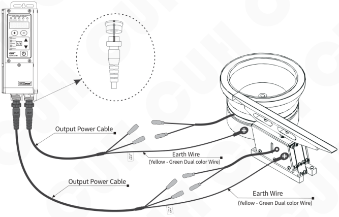

### 주의

1. 진동기의 전자기 코일이 출력 전원 케이블의 두 출력 핀에 연결되고, 진동기의 금속 외함이 확실히 접지되어 있는지 확인하십시오.
2. 전력 출력에 압전식 부하를 연결하는 것을 금지합니다! 그렇지 않으면 감전 안전 사고를 유발할 수 있습니다.

---

### 단계 3:

입력 전원 케이블의 커넥터를 컨트롤러의 입력 전원 소켓에 연결합니다.

컨트롤러 쪽을 먼저 연결합니다.

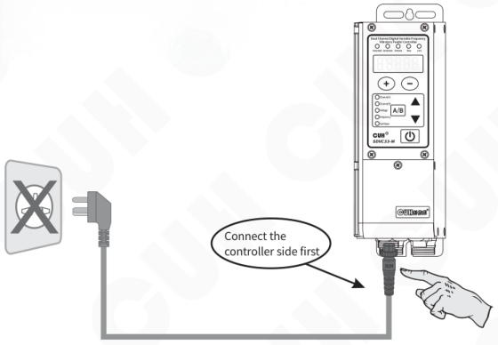

### 단계 4:

입력 전원 케이블의 플러그를 상용전원 콘센트에 연결합니다.

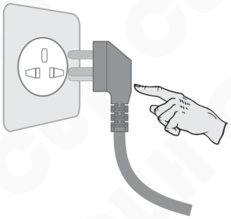

---

## 단계 5:

컨트롤러의 전원 스위치를 켜면 전압 "U 150"이 표시되고 채널 A 표시등이 켜지며 두 진동 피더가 모두 진동해야 합니다.

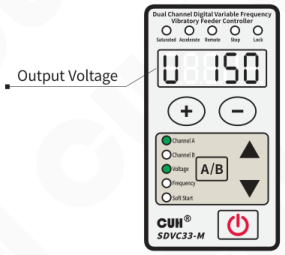

## 단계 6:

⊖를 눌러 채널 A의 전압을 30~50V로 조정한 후, `A/B`를 2초간 눌러 출력 주파수 "E" 조정 상태로 진입합니다. ⊕와 ⊖를 사용하여 진동 피더의 고유 주파수, 즉 공진 주파수를 찾습니다.

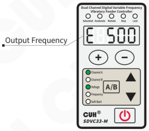

- 진동기의 조화 주파수란 최대 진폭을 생성하는 주파수 값을 의미합니다.
- 각 진동기에는 고유한 기계적 공진 주파수가 있으며, 컨트롤러의 출력 주파수를 이 주파수로 조정하여 최상의 작업 상태를 달성합니다.

---

## 단계 7:

**A/B**를 길게 눌러 출력 주파수 "E"를 종료하고 전압 조정 파라미터로 돌아갑니다.
**+**와 **−**를 사용하여 전압을 최적 공급 속도까지 조정합니다.

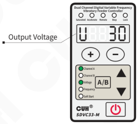

## 채널 B 설정:

**A/B**를 짧게 눌러 채널 B로 전환합니다. 단계 6과 7을 반복하여 채널 B 조정을 완료합니다.

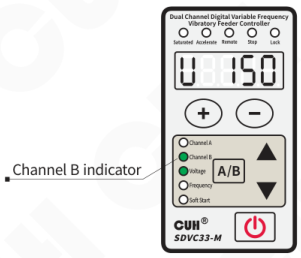

---

## 제4장 기본 기능 설명

본 장에서는 컨트롤러의 기본 기능을 사용하는 방법을 소개합니다.

### 4.1 출력 전압 설정

컨트롤러는 패널에서 출력 전압을 직접 디지털로 설정할 수 있습니다. 컨트롤러는 상용전압 보상을 수행할 수 있으므로 이 값은 출력 전압 정류의 평균값이며 입력 전압의 영향을 받지 않으므로, 상용전압이 불안정한 경우에도 안정적인 출력을 유지할 수 있습니다. 동시에 직접 전압 값 설정은 사용자가 장비 운전 상태를 이해하는 데 정확한 데이터를 제공합니다.

- 컨트롤러의 전원 스위치를 켭니다.
- 컨트롤러가 출력 전압을 표시합니다. 패널의 채널 A와 전압 표시등이 켜지고, LED가 출력 전압 파라미터 U와 전압 값을 표시합니다.
- ⊕ 또는 ⊖를 눌러 파라미터 값을 조정합니다.

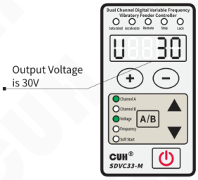

- 컨트롤러에는 승압 기능이 없습니다. 입력 전원 전압 한의로 인해 컨트롤러가 설정 전압에 도달할 수 없는 경우 포화 표시등이 켜지며, 이때 상용전압 보정이 실패합니다.
- 컨트롤러는 출력 파형의 정현파 특성을 일부 희생함으로써 일정 수준의 가속 효과를 달성할 수 있으며, 이는 파라미터 "가속 지수 y"에 의해 결정됩니다. 가속 상태로 진입하면 출력 전류 파형이 정현파에서 삼각파로 변하고 가속 표시등이 켜집니다.

---

## 4.2 출력 주파수 설정

컨트롤러는 직접 디지털 주파수 합성 기술(DDS)을 채택하여 매우 높은 주파수 정확도와 안정성을 가지며, 시간과 온도에 따라 변하지 않습니다.

- **A/B**를 2초간 눌러 기본 파라미터 인터페이스에 진입합니다.
- LED가 출력 주파수 파라미터 "E"와 주파수 값을 표시합니다.
- **+** 또는 **−**를 눌러 파라미터 값을 조정합니다.

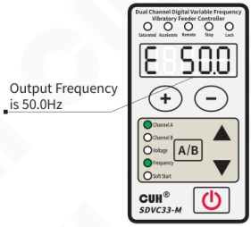

출력 주파수 범위는 5.0～999.9Hz입니다.

## 4.3 소프트 시작

컨트롤러가 정지 상태에서 시작될 때 출력 전압을 설정값까지 서서히 증가시켜 진동 피더와 컨트롤러가 충격을 받는 것을 방지할 수 있습니다.

소프트 시작 시간(t): 컨트롤러가 정지 상태에서 시작할 때 출력 전압이 0V에서 설정값까지 매끄럽게 상승하는 데 필요한 시간을 소프트 시작 시간이라고 합니다.

- **A/B**를 2초간 눌러 기본 파라미터 인터페이스에 진입합니다.
- **▲**와 **▼**를 눌러 소프트 시작 파라미터 조정 상태 "t"로 전환합니다.
- **+** 또는 **−**를 눌러 파라미터 값을 조정합니다.

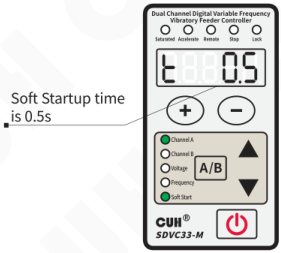

소프트 시작 시간 범위는 0.0～10.0초입니다.

---

## 4.4 소프트 정지

컨트롤러가 운전 상태에서 정지할 때 출력 전압을 0까지 부드럽게 감소시켜 진동 장비가 충격을 받는 것을 방지할 수 있습니다.

소프트 정지 시간(J): 컨트롤러가 운전 상태에서 정지할 때 출력 전압이 설정값에서 0까지 매끄럽게 감소하는 데 필요한 시간을 소프트 정지 시간이라고 합니다.

- **A/B**를 2초간 눌러 기본 파라미터 인터페이스에 진입합니다.
- **▲**와 **▼**를 눌러 소프트 정지 파라미터 조정 상태 "J"로 전환합니다.
- **+** 또는 **−**를 눌러 파라미터 값을 조정합니다.

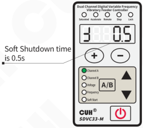

소프트 정지 시간 범위는 0.0～10.0초입니다.

## 4.5 제동 기능

컨트롤러가 출력 정지 후 진동 피더는 일정 시간 자유 진동을 하여 그 동안 재료가 계속 이동합니다. 이는 정밀 계량 및 포장 응용에서 오차를 발생시키므로 진동을 빠르게 정지해야 합니다.

제동 기능은 느린 정지의 시작점을 180° 지연시켜 구동력과 진동 피더의 자유 진동 위상이 반대 효과를 내도록 함으로써 진동을 빠르게 정지하는 것입니다. 소프트 정지 시간을 음수로 설정하여 구현하며, 단위는 사이클로, 제동 시 역방향 구동의 전류 사이클 수를 나타냅니다.

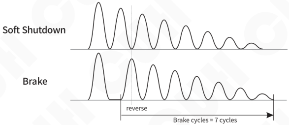

---

## 4.6 출력 스위치

패널의 라이트 터치 출력 스위치로 컨트롤러 출력을 손쉽고 빠르게 시작 또는 정지할 수 있습니다.

- 컨트롤러 패널의 ⏻를 사용하여 장치의 출력 시작 또는 정지를 제어합니다. 정지 표시등이 켜지면 정지 상태로 진입한 것입니다.

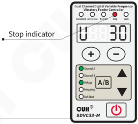

> 기본적으로 ⏻는 채널 A/B의 시작/정지를 독립적으로 제어합니다. 채널 A/B의 시작/정지를 동시에 제어하려면 병합 파라미터의 On/Off 버튼 제어 모드(OF)를 Ind(독립)에서 Cob(병합)으로 설정하십시오.
>
> 컨트롤러가 출력 정지 시 정지 표시등이 깜빡이지만, 외부 신호가 컨트롤러를 정지시킬 때는 정지 표시등이 계속 켜져 있습니다.

## 4.7 키보드 잠금

컨트롤러 파라미터 설정이 완료되면 키보드 잠금 기능으로 패널의 모든 버튼을 잠가 오조작을 피할 수 있습니다.

전원을 껐다가 다시 켜도 키보드 잠금 상태는 마지막으로 전원을 껐을 때의 상태를 유지합니다.

- ⏻를 2초간 눌러 패널의 모든 버튼을 잠급니다.
- ⏻를 다시 2초간 눌러 잠금을 해제합니다.

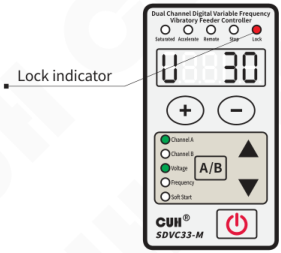

> 서로 다른 채널에 대해 잠금을 수행할 수 있으며, 채널 A와 채널 B의 조작을 독립적으로 수행할 수 있습니다.

---

## 4.8 기본 설정 복원

사용자는 컨트롤러를 공장 기본 상태로 빠르게 복원할 수 있습니다.

컨트롤러의 기능이 강력하여 조정할 수 있는 파라미터가 많습니다. 초보자의 경우 여러 차례 설정 및 수정 후에도 컨트롤러의 정상 작업 상태로 복원하지 못할 수 있습니다. 이 기능을 사용하여 뒤섞인 파라미터 상태를 공장 기본 설정으로 빠르게 복원하십시오.

컨트롤러는 전체 컨트롤러를 공장 설정으로 복원할 수 있으며, 단일 채널을 개별적으로 공장 설정으로 복원할 수도 있습니다.

### 전체 컨트롤러 기본 설정 복원:

- ▲와 ▼를 동시에 길게 눌러 병합 파라미터 인터페이스에 진입합니다.

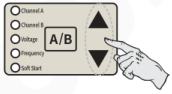

- ▼를 짧게 눌러 LED 표시기에서 전부 점등 상태로 전환하면 이것이 "기본 설정 복원" 파라미터입니다. 그런 다음 컨트롤러가 "-----"를 표시할 때까지 ⊕를 누르고 있으면 복원이 완료되었음을 나타냅니다.

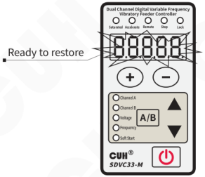

- ⊕를 놓고, 컨트롤러가 "CUH"를 표시한 후 출력 전압 조정 상태 "U"에 진입합니다. 이 시점에 모든 파라미터가 공장 기본 설정으로 복원됩니다.

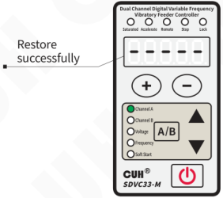

---

## 채널 A/B 개별 기본 설정 복원:

- **A/B**와 **▲**를 동시에 길게 눌러 고급 파라미터 인터페이스에 진입합니다.

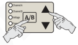

- **▼**를 짧게 눌러 "현재 채널 기본 설정 복원" 파라미터로 전환합니다. 그런 다음 컨트롤러가 "-----"를 표시할 때까지 **⊕**를 길게 누르면 현재 채널 복원이 완료되었음을 나타냅니다.

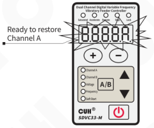

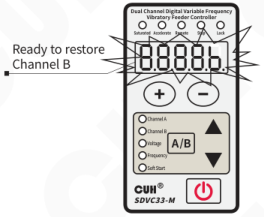

- **⊕**를 놓고, 컨트롤러가 "CUH"를 표시한 후 출력 전압 조정 상태 "U"에 진입합니다. 이 시점에 현재 채널의 모든 파라미터가 공장 기본 설정으로 복원됩니다.

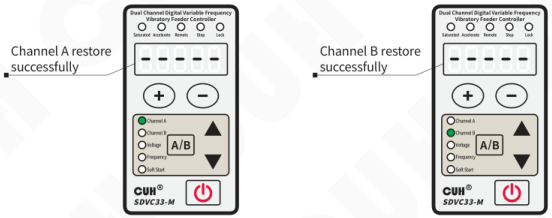

---

## 제5장 고급 기능 설명

본 장에서는 컨트롤러의 고급 기능을 사용하는 방법을 소개합니다.

### 5.1 원격 속도 제어

컨트롤러는 외부 아날로그 신호로 출력 전압을 제어하는 것을 지원하며, 아날로그 신호는 포텐셔미터, 1~5V 전압, 4~20mA 전류를 지원합니다. 두 개의 아날로그 입력 포트 AA와 bA가 있습니다. 기본적으로 AA는 채널 A를, bA는 채널 B를 제어합니다. 또한 파라미터 cS로 조정하여 하나의 신호가 두 채널의 출력 전압을 동시에 제어하도록 할 수 있습니다.

컨트롤러는 원격 제어 전압의 효과를 확대 또는 축소할 수 있는 원격 제어 계수 c 파라미터를 설계하여 0.5에서 2.0까지 조정할 수 있습니다. 0.5로 설정하면 원격 제어 전압이 출력 전압을 제어하는 효과가 절반으로 줄어든다는 의미이며, 즉 원격 제어가 최대 출력 전압 h의 절반까지만 도달할 수 있습니다. 2.0으로 설정하면 원격 제어 전압이 출력 전압을 제어하는 효과가 두 배가 된다는 의미이며, 즉 원격 제어 전압이 3V에 도달하면 출력 전압이 이미 h에 도달하고, 원격 제어 전압을 더 높여도 출력 전압을 더 높일 수 없습니다.

### 포텐셔미터 제어 연결

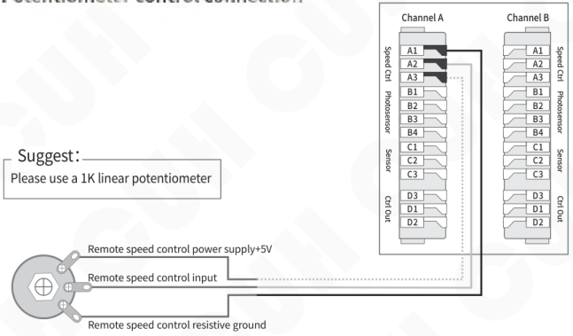

원격 속도 제어 신호가 활성화되면 속도 제어 표시등이 켜지고, 동시에 패널에서 전압 조정이 무효화됩니다.

---

## 1~5V 전압 제어 연결

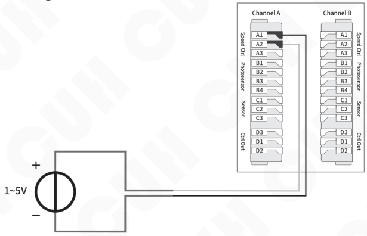

## 4~20mA 전류 제어 연결

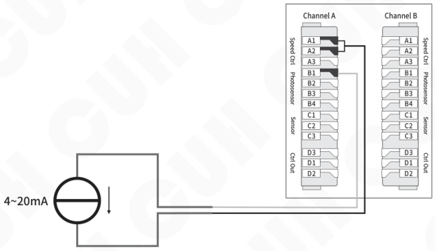

---

## 5.2 지능형 광전 감지

본 컨트롤러의 지능형 광전 포트는 발광 다이오드와 광트랜지스터로 구성된 광전 투과형 또는 반사형 센서를 지원하며, NPN 또는 PNP 스위치 센서를 지원하도록 설정할 수도 있습니다. 구체적인 배선도는 다음과 같습니다:

### 광전 센서 연결 방법

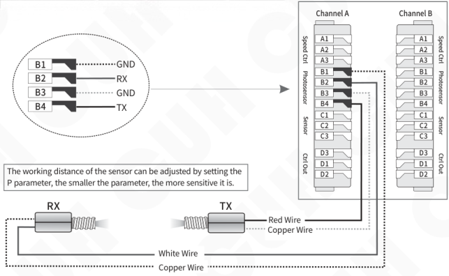

센서의 작동 거리는 P 파라미터를 설정하여 조정할 수 있으며, 파라미터가 작을수록 더 민감합니다.

### 스위치 센서 연결 방법

파라미터 P로 NPN 또는 PNP 유형을 설정합니다.

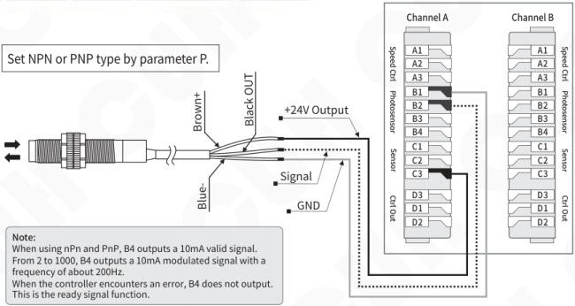

**주의:**

nPn과 PnP를 사용할 때 B4는 10mA 유효 신호를 출력합니다.

2에서 1000까지 B4는 약 200Hz 주파수의 10mA 변조 신호를 출력합니다.

컨트롤러에 오류가 발생하면 B4는 출력을 하지 않습니다. 이것이 준비(Ready) 신호 기능입니다.

---

## 5.3 스위치 센서

스위치 센서 포트는 NPN, PNP, Ut1, Ut0 모드를 지원하며, 채널 A와 B는 독립적으로 제어됩니다.

**Ut1 모드는 단일 스캔**으로, 센서 신호가 무효화되기 전에 포트의 유효 여부를 확인하기 위해_high_low 전위를 변경합니다. 유효 신호를 찾은 후 포트 센서 유형이 결정되고 더 이상 스캔하지 않습니다.

**Ut0 모드는 연속 스캔**으로, 센서 유형에 관계없이 항상_high_low 전위를 변경하여 포트에 유효 신호가 연결되어 있는지 감지합니다.

### 스위치 센서 연결 방법

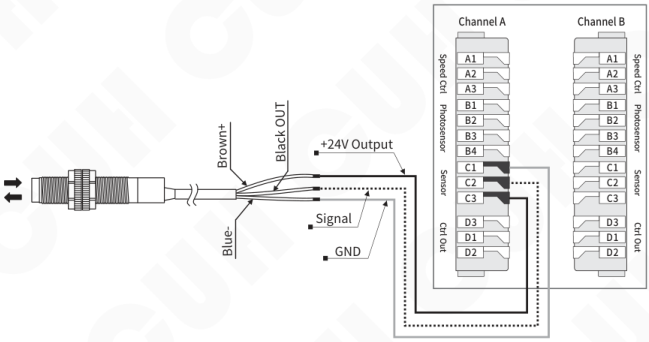

---

## 5.4 제어 출력

제어 출력 포트는 NPN 출력, PNP 출력 및 푸시풀 출력을 지원하며, 각각:

- NPN 출력은_low 전위에서 유효하고, 고임피던스 상태에서 출력이 무효화됩니다;
- PNP 출력은_high 전위에서 유효하고, 고임피던스 상태에서 출력이 무효화됩니다;
- 푸시풀 출력은_high 전위에서 유효하고,_low 전위에서 무효화됩니다.

### 5.4.1 제어 출력 배선 방법

**NPN 출력 연결**

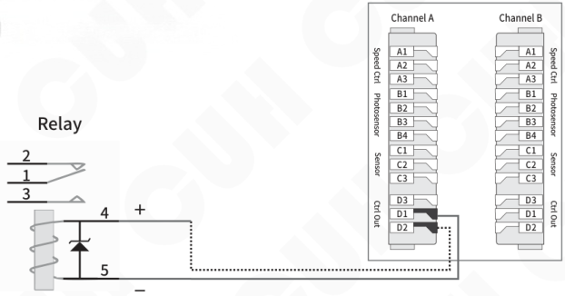

**PNP 또는 푸시풀 출력 연결**

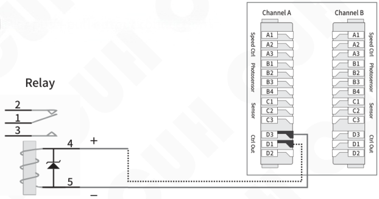

> 24V 릴레이를 연결할 때는 코일의 양극(+)·음극(-)을 반드시 확인하여 올바르게 연결되었는지 확인하십시오. 이 포트의 출력 전류 능력은 350mA이므로, 릴레이의 내부 보호 다이오드가 역방향 연결 시 본 컨트롤러의 포트를 단락시켜 단락 보호 Er07을 트리거합니다.

---

## 5.4.2 제어 출력 신호원 및 논리 도

메인 출력과 제어 출력의 제어는 두 신호원 간 논리 관계의 결과로 제어됩니다. 다음 신호원들을 신호원 목록에서 선택할 수 있습니다.

| 신호원 | 의미 |
|---|---|
| 0 | 무효 신호 |
| 1 | 유효 신호 |
| Ab | 채널 A의 지능형 광전 감지 포트 신호 |
| -Ab | 채널 A의 지능형 광전 감지 포트 신호 반전 |
| Ac | 채널 A의 스위치 센서 포트 신호 |
| -Ac | 채널 A의 스위치 센서 포트 신호 반전 |
| Ad | 채널 A의 제어 출력 포트 신호 |
| -Ad | 채널 A의 제어 출력 포트 신호 반전 |
| Aq | 채널 A의 메인 전력 출력 포트 신호 |
| -Aq | 채널 A의 메인 전력 출력 포트 신호 반전 |
| bb | 채널 B의 지능형 광전 감지 포트 신호 |
| -bb | 채널 B의 지능형 광전 감지 포트 신호 반전 |
| bc | 채널 B의 스위치 센서 포트 신호 |
| -bc | 채널 B의 스위치 센서 포트 신호 반전 |
| bd | 채널 B의 제어 출력 포트 신호 |
| -bd | 채널 B의 제어 출력 포트 신호 반전 |
| bq | 채널 B의 메인 전력 출력 포트 신호 |
| -bq | 채널 B의 메인 전력 출력 포트 신호 반전 |

---

## 제어 출력 논리 도

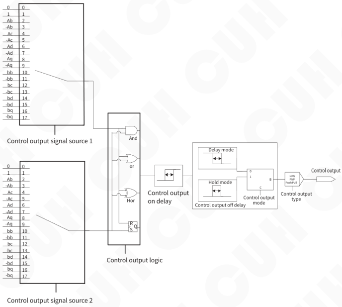

---

## 5.4.3 제어 출력 모드 설명

고객은 2가지 제어 출력 모드 중 선택할 수 있습니다: 지연 모드, 홀드 모드.

**지연 모드:** 컨트롤러 출력 구동 신호가 유효에서 무효로 변한 후, 제어 출력이 일정 Off 지연 시간 후에 꺼진다는 의미입니다.

**홀드 모드:** 컨트롤러 출력 구동 신호가 유효해진 후, 제어 출력은 Off 지연 시간 동안 켜진 상태를 유지하고, Off 지연 시간을 초과한 후 꺼집니다.

두 모드의 차이점은 타이밍 도 형태로 다음처럼 표현되며, 여기서 입력 신호는 논리 관계 선택기 후 출력된 신호입니다.

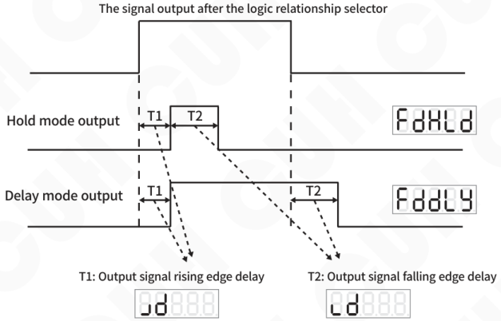

## 5.4.4 메인 출력 신호 제어 기능

메인 출력 신호 제어는 제어 출력과 유사합니다. 두 신호원을 선택하여 논리 관계 연산을 수행한 후, On/Off 지연 모드 선택 및 논리 방향 제어를 통해 제어 신호를 얻습니다. 제어 신호는 패널의 On/Off 신호와 논리 연산된 후 전력 보드로 전송되어 메인 출력을 제어합니다.

메인 출력 신호 제어의 배선 방법, 신호원 및 논리 도는 제어 출력 기능을 참조할 수 있습니다.

---

## 5.5 최대 출력 전압 제한

컨트롤러의 각 채널은 최대 출력 전압 제한 파라미터 h를 설정할 수 있으며, 패널 설정 전압과 원격 제어 전압 모두 이 값을 초과하지 않습니다.

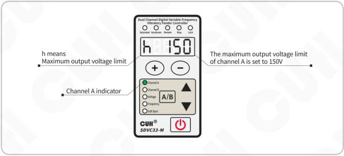

- h는 최대 출력 전압 제한을 의미합니다
- 채널 A 표시등
- 채널 A의 최대 출력 전압 제한이 150V로 설정되었습니다

## 5.6 조절 가능한 과전류 보호

전자기 코일을 보호하기 위해 컨트롤러는 사용자가 조절할 수 있는 과전류 보호 전류 파라미터 "oc"를 설계하였으며, 0.5A~3.5A 범위에서 조정할 수 있습니다.

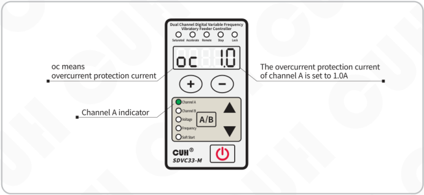

- oc는 과전류 보호 전류를 의미합니다
- 채널 A 표시등
- 채널 A의 과전류 보호 전류가 1.0A로 설정되었습니다

---

## 5.7 패널 밝기 조정

컨트롤러는 새로운 디지털 표시 드라이버 칩을 채택하여, 사용자가 LED 표시 밝기 값을 1과 32 사이에서 조정하는 것을 지원합니다.

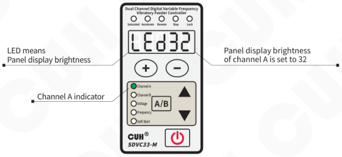

패널 밝기는 채널 A와 채널 B에 대해 독립적으로 설정할 수 있으며, 사용자는 현재 채널 A인지 채널 B인지 빠르게 구별하기 위해 미리 서로 다른 밝기를 설정할 수 있습니다.

## 5.8 출력 모니터링 기능

컨트롤러는 컨트롤러 상태를 모니터링하기 위해 일련의 모니터링 파라미터를 특별히 설계하였습니다.

**채널 A와 채널 B를 구분하는 모니터링 파라미터에는 다음이 포함됩니다:**

출력 전류 AC, 아날로그 속도 제어 포트 전압 AU, 지능형 광전 포트 신호 전압 bU, 스위치 센서 포트 cU, 제어 출력 포트 전압 dU.

**채널 A와 채널 B를 구분하지 않는 모니터링 파라미터에는 다음이 포함됩니다:**

온도 표시 C, 버스 전압 PU, 24V 출력 전압 nU, 제어 보드 소프트웨어 버전 uc, 전력 보드 소프트웨어 버전 uq.

---

## 5.9 이중 채널 병합 제어

컨트롤러의 채널 A와 채널 B 출력은 병합 제어될 수 있으며, Cb 파라미터를 사용하여 채널 B를 제어할 수 있습니다: 독립 작업, 채널 A 주파수 추적, 채널 A 전압 추적, 채널 A 전압 및 주파수 추적.

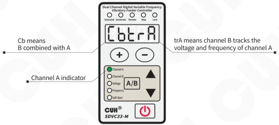

주의: 추적을 설정한 후에도 채널 B의 전압과 주파수를 여전히 조정할 수 있지만, 이들은 작동하지 않습니다. 독립 모드로 되돌린 후에야 작동할 수 있습니다.

채널 A와 채널 B가 동일한 주파수로 독립적으로 출력하도록 설정하든, 채널 B의 주파수가 채널 A를 추적하도록 설정하든, 두 채널 출력의 위상은 항상 잠혀 있습니다. 위상차는 병합 파라미터 μ(A를 기준으로 한 위상)로 제어할 수 있으며, 조정 범위는 -180°~180°입니다. 이 기능은 벡터 진동 볼 피더 또는 진동 볼 피더와 라인 피더/컨베이어 계층 공급 상황을 제어하는 데 사용할 수 있습니다.

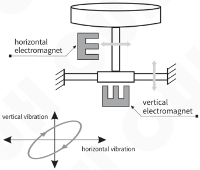

벡터 진동 피더 모식도

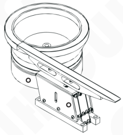

볼 피더와 라인 피더 모식도

---

## 5.10 사용자 파라미터 저장 및 복원

작업 파라미터의 자동 저장 외에, 컨트롤러는 모든 사용자 설정 파라미터를 저장하기 위한 일련의 사용자 파라미터 그룹을 설계하였습니다. 사용자 파라미터의 저장 및 복원을 통한 복원은 공장 설정 복원 기능과 다릅니다.

병합 파라미터에서 SP 파라미터로 조정하면 uP1이 표시되고, SAU가 표시되어 저장이 성공했음을 나타낼 때까지 ⊕와 ⊖를 동시에 길게 누릅니다. 이렇게 하면 채널 A, 채널 B, 병합 파라미터가 사용자 그룹에 저장됩니다.

저장된 사용자 그룹 파라미터에서 작업 그룹을 복원해야 하는 경우, 여러 가지 복원 방법이 있습니다:

**rP=1Ab:** 사용자 그룹 파라미터가 A 그룹과 B 그룹 파라미터를 동시에 복원합니다.

**rP=1bA:** 사용자 그룹 파라미터가 A 그룹과 B 그룹 파라미터를 동시에 복원하되, 복원 시 교대로 선택됩니다. 즉, 사용자 그룹의 A 그룹에 저장된 데이터가 작업 그룹 B에 복원되고, 사용자 그룹의 B 그룹에 저장된 데이터가 작업 그룹 A에 복원됩니다.

**rP=1A0:** 사용자 그룹 파라미터가 A 그룹만 복원하며, 사용자 그룹의 A 그룹 데이터를 사용하여 복원합니다.

**rP=10A:** 사용자 그룹 파라미터가 A 그룹만 복원하며, 사용자 그룹의 B 그룹 데이터를 사용하여 복원합니다.

**rP=1b0:** 사용자 그룹 파라미터가 B 그룹만 복원하며, 사용자 그룹의 B 그룹 데이터를 사용하여 복원합니다.

**rP=10b:** 사용자 그룹 파라미터가 B 그룹만 복원하며, 사용자 그룹의 A 그룹 데이터를 사용하여 복원합니다.

복원해야 할 모드를 선택하고, rES가 표시되어 복원이 성공했음을 나타낼 때까지 ⊕와 ⊖를 동시에 길게 누릅니다.

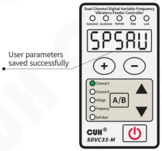

저장 성공 모식도

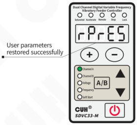

복원 성공 모식도

---

# 제6장 기술 사양

## 6.1 치수

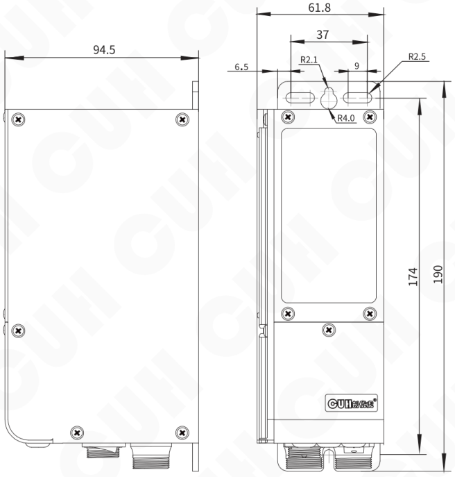

치수(단위: mm)

| 치수 범위 | 공차 |
|---|---|
| 0~3 | ±0.05 |
| 3~10 | ±0.1 |
| 10~30 | ±0.15 |
| 30~80 | ±0.2 |
| 80~180 | ±0.3 |
| >180 | ±0.5 |

본 공차 표는 본 시리즈의 모든 제품에 적용됩니다.

---

## 6.2 기술 사양

| 항목 | Min | Typical | Max | 단위 | 비고 |
|---|---|---|---|---|---|
| 입력 전압 | 85 | 220 | 250 | V | AC RMS |
| 조절 가능한 출력 전압 범위 | 0 | —— | 260 | V | 입력 전압의 150% 미만 |
| 전압 조정 정확도 | | 1 | | V | |
| 전압 조정률 정확도 | 0 | —— | 10 | % | ΔVout/ΔVin |
| 조절 가능한 출력 전류 범위 | 0 | —— | 3.5 | A | 합산 전류를 임의로 배분할 수 있습니다. |
| 출력 전력 | 0 | —— | 770 | VA | |
| 출력 주파수 | 5.0 | —— | 999.9 | Hz | |
| 주파수 조정 정확도 | | 0.1 | | Hz | |
| 출력 파형 | | 정현파 | | | |
| 소프트 시작 시간 | 0 | —— | 10 | s | 기본값: 0.5 |
| On/Off 지연 시간 범위 | 0 | —— | 99.9 | s | 기본값: 0.2 |
| On/Off 지연 시간 정확도 | | 0.1 | | s | |
| 과열 보호 트리거 온도 | —— | 65 | —— | °C | 60°C에서 정상 복귀 |
| DC 제어 출력 전류 | 0 | —— | 350 | mA | 채널 A 및 B 모두 지원 |
| 24V 출력 전류 | —— | —— | 700 | mA | 채널 A 및 B 출력 합산 |
| DC 제어 출력 전압 | 22 | 24 | 26 | V | |
| 아날로그 제어 신호 | | 4~20/1~5 | | mA/V | |
| 디지털 제어 신호 | | 24 | | V | 스위칭 신호 |
| 조정 방법 | | 6 | | 버튼 | |
| 대기 전력 소비 | —— | 3 | —— | W | |
| 표시 방식 | | 5 | | 자리 | LED |
| 무게 | | 850 | | g | 액세서리 제외 |
| 치수 | | 190\*61.8\*94.5 ( L\*W\*H ) | | mm | |
| 보호 등급 | | IP20 | | | |
| 주변 온도 | 0 | 25 | 40 | °C | 결로 없음 |
| 주변 습도 | 10 | 60 | 85 | % | 결로 없음 |
| 보관 주변 온도 | -20 | 25 | 85 | °C | 결로 없음 |
| 적용 해발 | | <2000 | | m | |

## 6.3 참조 표준

절대 파라미터:  
표준을 초과하면 컨트롤러가 손상되므로 엄격히 준수하십시오.

| 항목 | GB 표준 | IEC 표준 | 등급 | 표준 요구 사항 | 비고 |
|---|---|---|---|---|---|
| 정전기 방전 | GB/T 17626.2-2006 | IEC 61000-4-2:2001 | 4 | ±8 kV | 접촉 방전 |
| | | | 4 | ±15 kV | 공기 방전 |
| 전기적 고속 과도 현상 시험 | GB/T 17626.4-2008 | IEC 61000-4-4:2004 | 4 | ±4 kV | |
| DC 전원 라인 서지 내성 | GB/T 17626.17-2005 | IEC 61000-4-17:2002 | 4 | 15% | 정격 A |

> **경고**  
> 주거 환경에서 본 제품은 라디오 간섭을 유발할 수 있으며, 이 경우 추가 완화 조치가 필요할 수 있습니다.

---

## 제7장 부록

### 7.1 파라미터 표

| 파라미터 그룹 / 조작 | 정의 | 기호 | 기호 이미지 | 범위 | 기본값 |
|---|---|---|---|---|---|
| 대기 파라미터 | 출력 전압 | U |  | 0~260 V | 150 |
| 기본 파라미터 A/B 길게 누름 | 출력 주파수 | E |  | 5.0~999.9 Hz | 50.0 |
| 기본 파라미터 | 지능형 광전 센서 On 지연 | J |  | 0.0~99.9 s | 0.2 |
| 기본 파라미터 | 지능형 광전 센서 Off 지연 | L |  | 0.0~99.9 s | 0.2 |
| 기본 파라미터 | 소프트 시작 | t |  | 0.0~10.0 s | 0.5 |
| 기본 파라미터 | 제동 사이클/소프트 정지 | d |  | -10~0 사이클(제동 사이클 수) 0.0~10.0 s(소프트 정지) | 0.0 |
| 고급 파라미터 A/B와 ▲ 길게 누름 | 지능형 광전 센서 민감도 | P |  | nPn, PnP, 2~1000 | 80 |
| 고급 파라미터 | 포트 C 센서 유형 | ΓA |  | nPn, PnP ut1(단일 스캔), ut0(연속 스캔) | ut0 |
| 고급 파라미터 | 포트 C On 지연 | J- |  | 0.0~99.9 s | 0.2 |
| 고급 파라미터 | 포트 C Off 지연 | L- |  | 0.0~99.9 s | 0.2 |
| 고급 파라미터 | 제어 포트 D의 첫 번째 신호원 | E.d |  | 0, 1, Ab, -Ab, Ac, -Ac, Ad, -Ad, Aq, -Aq, bb, -bb, bc, -bc, bd, -bd, bq, -bq | A: 0 B: 0 |
| 고급 파라미터 | 제어 포트 D의 두 번째 신호원 | Ed |  | 0, 1, Ab, -Ab, Ac, -Ac, Ad, -Ad, Aq, -Aq, bb, -bb, bc, -bc, bd, -bd, bq, -bq | A: Aq B: bq |
| 고급 파라미터 | 제어 포트 D 신호원의 논리 연산 | ∩d |  | And, or, Hor, rS | or |
| 고급 파라미터 | 포트 D On 지연 | Jd |  | 0.0~99.9 s | 0.0 |
| 고급 파라미터 | 포트 D Off 지연 | Ld |  | 0.0~99.9 s | 0.0 |
| 고급 파라미터 | 포트 D 출력 모드 | Fd |  | dLy(지연 모드), HLd(홀드 모드) | dLy |
| 고급 파라미터 | 포트 D 논리 방향 | ɔd |  | --- (동위상), -⁻- (역위상) on (산호형), oFF (닫힘형)  | --- |
| 고급 파라미터 | 제어 출력 유형 | Γd |  | nPn, PnP, PSP(푸시풀) | nPn |
| 고급 파라미터 | 메인 출력의 첫 번째 신호원 | E.q |  | 0, 1, Ab, -Ab, Ac, -Ac, Ad, -Ad, Aq, -Aq, bb, -bb, bc, -bc, bd, -bd, bq, -bq | A: Ab B: bb |
| 고급 파라미터 | 메인 출력의 두 번째 신호원 | Eq |  | 0, 1, Ab, -Ab, Ac, -Ac, Ad, -Ad, Aq, -Aq, bb, -bb, bc, -bc, bd, -bd, bq, -bq | A: Ac B: bc |
| 고급 파라미터 | 메인 출력 신호원의 논리 연산 | ∩q |  | And, or, Hor, rS | or |

| 파라미터 | 정의 | 기호 | 기호 이미지 | 범위 | 기본값 |
|---|---|---|---|---|---|
| 고급 파라미터 A/B와 ▲ 길게 누름 | 메인 출력 On 지연 | J9 |  | 0.0~99.9 s | 0.0 |
| | 메인 출력 Off 지연 | L9 |  | 0.0~99.9 s | 0.0 |
| | 메인 출력 출력 모드 | F9 |  | dLy(지연 모드), HLd(홀드 모드) | dLy |
| | 메인 출력 논리 방향 | Ↄ9 |  |  on (산호형), oFF (닫힘형) |  |
| | 최대 출력 전압 제한 | h |  | 0~260 V | 260 |
| | 과전류 보호 전류 | bc |  | 0.5~3.5 A | 3.5 |
| | 가속 지수 | y |  | 100~150 | 150 |
| | 파형 지수 | r |  | 0~100 | 100 |
| | 원격 속도 제어 신호원 | cS |  | AA(A의 A 포트), bA(B의 A 포트) | A: AA B: bA |
| | 원격 속도 제어 계수 | c |  | 0.5~2.0 | 1.0 |
| | 패널 표시 밝기 | LEd |  | 1~32 | 16 |
| | 현재 채널 기본 설정 복원 | 8.8.8.8.A. 8.8.8.8.b. | 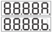 | —— | —— |
| 모니터링 파라미터 A/B와 ▼ 길게 누름 | 출력 전류 | AC |  | 0.00~3.50 A | —— |
| | 포트 A 신호 전압 | AU |  | 0.00~5.00 V | —— |
| | 포트 B 신호 전압 | bU |  | 0.00~5.00 V | —— |
| | 포트 C 신호 전압 | cU |  | 0.0~28.0 V | —— |
| | 포트 D 출력 전압 | dU |  | 0.0~28.0 V | —— |
| | 온도 표시 # | C |  | -20.0~85.0 ℃ | —— |
| | 내부 버스 전압 # | PU |  | 0~400 V | —— |
| | 24V 포트 실시간 전압 # | nU |  | 0.0~28.0 V | —— |
| | 제어 보드 소프트웨어 버전 # | uc |  | —— | —— |
| | 전력 보드 소프트웨어 버전 # | u9 |  | —— | —— |

|  | 정의 | 기호 | 기호 이미지 | 범위 | 기본값 |
|---|---|---|---|---|---|
| 병합 파라미터  ▲와 ▼ 길게 누름 | B가 A와 병합 # | Cb |  | Ind(독립), trF(B가 A 주파수 추적), trU(B가 A 전압 추적), trA(B가 A 전압·주파수 모두 추적) | Ind |
|  | # | Y |  | -180~180 ° | 0 |
|  | On/Off 버튼 제어 모드 # | OF |  | Ind(독립), Cob(병합) | Ind |
|  | 사용자 파라미터 저장 # | SP |  | uP1(사용자 그룹 1 저장) | uP1 |
|  | 사용자 파라미터 복원 # | rP |  | 1Ab(사용자 그룹 1이 A·B 그룹 복원), 1bA(사용자 그룹 1이 A·B 그룹 교차 복원), 1A0(사용자 그룹 1이 A 그룹만 복원), 10A(사용자 그룹 1이 A 그룹만 교차 복원), 1b0(사용자 그룹 1이 B 그룹만 복원), 10b(사용자 그룹 1이 B 그룹만 교차 복원) | 1Ab |
|  | 기본 설정 복원 # | 8.8.8.8.8. |  | —— | —— |

주의: "#"로 표시된 파라미터는 A 그룹과 B 그룹을 구분하지 않습니다.

## 7.2 입력·출력 회로도

**원격 속도 제어 포트 A**

**지능형 광전 센서 포트 B**

**스위치 센서 포트 C**

**제어 출력 포트 D**

---

## 7.3 문제 해결 제안 및 오류 설명

| 오류 코드 | 정의(현상) | 문제 해결 방법 |
|---|---|---|
| Er01A/Er01b | 채널 A/B 단락 (두 채널 모두 출력 정지) | ◆ 부하가 단락되지 않았는지 확인한 후, 출력 On/Off 버튼을 두 번 누르거나 컨트롤러의 전원을 다시 인가하여 출력을 재시동하십시오. |
| Er02 | 채널 AB 합산 과전류 (두 채널 모두 출력 일시 정지, 2초 후 재시동) | ◆ 출력 전압을 적절히 낮춘 후 출력을 재시동하십시오. |
| Er02A/Er02b | 채널 A/B 개별 과전류 (과전류 채널 출력 정지, 2초 후 재시동) | |
| Er02A./Er02b. | 채널 A/B 개별 과전류가 설정된 최대값에 도달 | |
| Er03 | 과열 또는 과냉 (두 채널 모두 출력 정지, -20℃~60℃에서 자동 복귀) | ◆ 컨트롤러를 환기가 잘 되는 환경에 설치하거나 극한의 한랭을 피하십시오. |
| Er041/Er042 | 전원 저전압/과전압 (두 채널 모두 출력 정지, 자동 복귀) | ◆ 입력 전압이 AC 85~250Vac 사이인지 확인하십시오. |
| Er05 | 내부 통신 이상 (두 채널 모두 출력 정지) | ◆ 24V 전원 포트에 외부 전원이 연결되지 않았는지 확인하거나 당사의 기술 지원에 문의하십시오. |
| Er06 | 온도 센서 이상 (두 채널 모두 출력 정지) | ◆ 작업 온도가 -20℃ 미만이 아닌지 확인하거나 당사의 기술 지원에 문의하십시오. |
| Er07A/Er07b | 채널 A/B 포트 D 단락 (채널 A/B 제어 출력 정지, 2초 후 재시동 시도) | ◆ 포트 D의 부하가 단락되지 않았고 전류가 350mA를 초과하지 않았는지 확인하십시오. |
| Er10 | 24V 전원 출력 이상 (24V 출력 차단, 2초 후 재시동 시도) | ◆ 24V 포트가 단락되지 않았고 전류가 700mA를 초과하지 않았는지 확인하십시오. |
| Er11 | 5V 전원 출력 이상 (속도 제어 기능 일시 차단, 자동 재시동으로 복귀) | ◆ 포트 A의 5V 전원이 단락되지 않았거나 5V를 초과하는 외부 전원 전압에 연결되지 않았는지 확인하십시오. |
| Er12 | 24V 전원 전압 이상 (두 채널 모두 출력 정지, 제어 출력 고임피던스, 자동 복귀) | ◆ 24V 전원 포트에 외부 전원이 연결되지 않았는지 확인하십시오. |

# 제8장 제품 보증 정보

## 8.1 보증 기간

당사가 본 제품에 제공하는 보증 기간은 제품을 구매자가 지정한 위치로 인도한 날부터 3년입니다.

## 8.2 보증 범위

(1) 상기 보증 기간 내에 당사로 인한 고장이 발생할 경우, 당사는 무상으로 제품을 수리합니다. 단 다음 상황은 보증 범위에 포함되지 않습니다:

a. 간단 매뉴얼, 사용 설명서 또는 구매자와 당사가 특별히 약정한 기술 요구 사항에 명시된 조건을 준수하지 않아 발생한 고장, 부적절한 조작 또는 부적절한 사용으로 인한 고장.

b. 고장이 제품 결함이 아니라 구매자의 장비 또는 소프트웨어 설계로 인한 경우.

c. 당사 직원이 수행하지 않은 개조 또는 수리로 인한 오작동.

d. 간단 조작 안내서 또는 사용 설명서에 따라 올바르게 유지보수하거나 소모품을 교체하면 완전히 피할 수 있었던 고장.

e. 제품이 당사에서 출고된 후, 예측할 수 없는 과학기술 수준의 변화 등으로 인한 고장.

f. 화재, 지진, 홍수 등 자연 재해 또는 이상 전압 등 외부 요인으로 인한 고장에 대해서는 당사가 보증 책임을 지지 않습니다.

(2) 보증 범위는 (1)에 규정된 상황으로 한정되며, 간접 손실(장비 손상, 기회, 이익 상실 등) 또는 기타 손실에 대해 당사는 어떠한 책임도 지지 않습니다.

## 8.3 제품 적합성

당사의 컨트롤러는 진동 공급 업계의 일반적인 사용을 위해 설계 및 생산되었습니다. 따라서 당사의 본 컨트롤러는 다음 용도로 사용되어서는 안 되며, 해당 사용에 적합하지 않습니다.

(1) 원자력 발전소, 공항, 철도, 선박, 동력 장치 및 의료 장비 등 생명과 재산에 중대한 영향을 미치는 시설.

(2) 전기, 가스, 급수 등 공공 시설.

(3) 유사한 조건 또는 환경에서의 야외 사용.

---

Nanjing CUH Science & Technology Co.,Ltd  
https://en.cuhnj.com  
Tel.:+86-25-84730411 / 84730415 / 84730416  
Fax:+86-25-84730426  
E-mail:sales@cuhnj.com  
Add.:Building 2, Xueyan Tech Park, Tuscity,  
No.9 Zhineng Rd, Jiangning, Nanjing, China

문서 번호: IDP1000316

