## ตัวควบคุมมอเตอร์อะซิงโครนัสสามเฟสแบบดิจิทัล

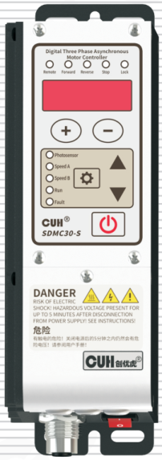

## SDMC30-S

## คู่มือการใช้งาน

---

## ข้อความสงวนลิขสิทธิ์

บริษัท Nanjing CUH Science & Technology CO., Ltd. สงวนสิทธิ์ทั้งหมด

ข้อมูลทั้งหมดที่ปรากฏในคู่มือการใช้งานฉบับนี้เป็นความรู้ของบริษัทเรา และได้รับการคุ้มครองตามกฎหมายลิขสิทธิ์และกฎหมายที่เกี่ยวข้องอื่น ๆ CUH มีและสงวนสิทธิ์ทั้งปวงตามที่กฎหมายลิขสิทธิ์และกฎหมายอื่นมอบให้ หากไม่ได้รับความยินยอมเป็นลายลักษณ์อักษรจาก CUH ห้ามคัดลอก แปล เลียนแบบ หรือนำไปใช้ประโยชน์อย่างอื่นไม่ว่าทั้งหมดหรือบางส่วนของคู่มือการใช้งานฉบับนี้

## ข้อจำกัดความรับผิด

เนื้อหาทั้งหมดในคู่มือการใช้งานฉบับนี้อธิบายเพียงวิธีการใช้งานของผลิตภัณฑ์ที่บริษัทเราผลิตเท่านั้น โดยอธิบายตามเทคโนโลยีที่มีอยู่ ณ วันที่ส่งมอบให้ท่านใช้งาน ท่านต้องยอมรับความเสี่ยงที่เกี่ยวข้องเมื่อใช้ผลิตภัณฑ์นี้ เว้นแต่ตามที่กฎหมายกำหนด บริษัทไม่มีความรับผิดชอบใด ๆ ทั้งสิ้นไม่ว่าโดยชัดแจ้งหรือโดยนัยต่อผลิตภัณฑ์อันเนื่องมาจากคู่มือการใช้งานฉบับนี้ รวมถึงแต่ไม่จำกัดเพียงการบาดเจ็บลงตัวบุคคล ความเสียหางต่อทรัพย์สิน การสูญเสียโอกาส ฯลฯ

ท่านรับทราบและเข้าใจความเสี่ยงข้างต้นเป็นอย่างดี และตกลงว่า เว้นแต่กรณีที่กฎหมายบังคับ บริษัทจะไม่รับผิดชอบต่อความเสียหายหรือความสูญเสียใด ๆ ไม่ว่าทางตรงหรือทางอ้อมที่เกิดกับท่าน (รวมถึงแต่ไม่จำกัดเพียงความสูญเสียที่จับต้องได้ เช่น ตัวบุคคล ทรัพย์สิน ข้อมูล และความสูญเสียที่จับต้องไม่ได้ เช่น ชื่อเสียง โอกาส ฯลฯ)

บริษัทสงวนสิทธิ์ในการแก้ไขผลิตภัณฑ์ที่ใช้ในคู่มือการใช้งานฉบับนี้ โดยไม่ต้องแจ้งให้ทราบล่วงหน้าหรือภายหลัง

---

# บทนำ

ขอขอบคุณที่ท่านเลือกใช้ตัวควบคุมมอเตอร์อะซิงโครนัสสามเฟสแบบดิจิทัล รุ่น CUH SDMC30 (ต่อไปในเอกสารนี้จะเรียกโดยย่อว่า "ตัวควบคุม") ตัวควบคุมรุ่นนี้ใช้ชิ้นส่วนอิเล็กทรอนิกส์คุณภาพสูง ผสานเทคโนโลยีอิเล็กทรอนิกส์ล่าสุด และได้รับการออกแบบมาอย่างพิถีพิถันด้วยตัวประมวลผลสัญญาณดิจิทัลประสิทธิภาพสูง

คู่มือฉบับนี้แนะนำวิธีการใช้งานพื้นฐาน คำอธิบายทางเทคนิคของฟังก์ชัน และตัวอย่างการใช้งานทั่วไปของผลิตภัณฑ์นี้ โดยให้ข้อมูลที่เกี่ยวข้องแก่ผู้ใช้เกี่ยวกับการติดตั้งและการทดสอบ การตั้งค่าพารามิเตอร์ การวินิจฉัยความผิดปกติ การแก้ไขปัญหา และการบำรุงรักษาตัวควบคุมเป็นประจำ เพื่อให้มั่นใจว่าจะติดตั้งและใช้งานตัวควบคุมนี้ได้อย่างถูกต้อง โปรดอ่านคู่มือการใช้งานฉบับนี้อย่างละเอียดก่อนการติดตั้ง และเก็บรักษาไว้ให้ถูกต้องเรียบร้อย

โปรดอ่านสัญลักษณ์ต่อไปนี้อย่างแน่นอน เพื่อเตือนให้ท่านระวังภัยอันอาจก่อให้เกิดอันตรายต่อตัวบุคคลและความเสียหางต่อผลิตภัณฑ์

|  |  |
|---|---|
| ⚠ อันตราย | การไม่ปฏิบัติตามข้อกำหนดนี้จะส่งผลให้เกิดการบาดเจ็บหรือเสียชีวิต |
| ⚠ คำเตือน | การไม่ปฏิบัติตามข้อกำหนดนี้อาจส่งผลให้เกิดการบาดเจ็บหรือเสียชีวิต |
| ⚠ ข้อควรระวัง | การไม่ปฏิบัติตามข้อกำหนดนี้อาจส่งผลให้เกิดการบาดเจ็บระดับปานกลางหรือเล็กน้อยต่อบุคคล |
| หมายเหตุ | การไม่ปฏิบัติตามข้อกำหนดนี้จะส่งผลให้เกิดความเสียหายต่อผลิตภัณฑ์และทรัพย์สิน |
| ❗ จำเป็นอย่างยิ่ง | ระบุข้อควรระวังและข้อจำกัดการใช้งานที่ต้องปฏิบัติตามอย่างเคร่งครัดระหว่างการใช้งาน |

**คู่มือฉบับนี้เหมาะสำหรับตัวควบคุมรุ่นต่อไปนี้:**

- ตัวควบคุมมอเตอร์อะซิงโครนัสสามเฟสแบบดิจิทัล SDMC30-S

  (อินพุตแบบเฟสเดียว 85~250 VAC, เอาต์พุตสามเฟส 0~220 Vrmn / 0.2 kW)

---

# สภาพแวดล้อมสำหรับการใช้งานและการจัดเก็บ

## การตรวจสอบก่อนใช้งาน

ตัวควบคุมทุกเครื่องจะผ่านการตรวจสอบคุณภาพอย่างเข้มงวดก่อนการส่งมอบ และบรรจุด้วยบรรจุภัณฑ์กันกระแทก โปรดตรวจสอบรายการต่อไปนี้หลังจากเปิดกล่อง:

1. ตัวควบคุมได้รับความเสียหางระหว่างการขนส่งหรือไม่
2. รุ่นของตัวควบคุมตรงกับที่ท่านสั่งซื้อหรือไม่

## สภาพแวดล้อมการทำงาน

โปรดปฏิบัติตามข้อแนะนำต่อไปนี้เพื่อให้ตัวควบคุมมีสมรรถนะและอายุการใช้งานยาวนานที่สุด:

- ⚠ สภาพแวดล้อมที่มีการระบายอากาศที่ดี
- ⚠ หลีกเลี่ยงน้ำ ไอน้ำ ฝุ่น และโดยเฉพาะฝุ่นที่ปนเปื้อนน้ำมัน
- ⚠ หลีกเลี่ยงแก๊สและของเหลวที่กัดกร่อนหรือไวไฟ
- ⚠ หลีกเลี่ยงฝุ่นลอยและอนุภาคโลหะ
- ⚠ ยึดติดอย่างมั่นคงเพื่อหลีกเลี่ยงการสั่นสะเทือนของตัวเครื่อง
- ⚠ หลีกเลี่ยงสัญญาณรบกวนแม่เหล็กไฟฟ้า
- ⚠ ควรใช้งานที่อุณหภูมิแวดล้อม 0~40 ℃
- ⚠ ใช้งานที่ระดับความสูงไม่เกิน 2000 เมตร

---

# สารบัญ

**บทที่ Ⅰ ก่อนการใช้งาน — 1**

- 1.1 ตรวจสอบเนื้อหาในกล่องบรรจุภัณฑ์ — 1
- 1.2 คำอธิบายไฟแสดงสถานะและปุ่มกด — 2
- 1.3 คำอธิบายชิ้นส่วนภายนอก — 3
- 1.4 คำอธิบายพอร์ตสัญญาณ — 3
- 1.5 คำอธิบายป้ายกำกับ (เนมเพลต) — 4

**บทที่ Ⅱ ข้อมูลผลิตภัณฑ์ — 5**

- 2.1 ข้อมูลผลิตภัณฑ์ — 5

**บทที่ Ⅲ คู่มือการติดตั้ง — 6**

- 3.1 เงื่อนไขการใช้งานตัวควบคุม — 6
- 3.2 วิธีใช้งานปุ่มกด — 6
- 3.3 การติดตั้งและใช้งาน — 7

**บทที่ Ⅳ คำอธิบายฟังก์ชันพื้นฐาน — 11**

- 4.1 การตั้งค่าความถี่ — 11
- 4.2 การหมุนไปข้างหน้าและการหมุนย้อนกลับ — 12
- 4.3 การหยุดฉุกเฉิน — 13
- 4.4 เวลาสตาร์ทแบบนุ่มนวล — 14
- 4.5 เวลาหยุดแบบนุ่มนวล/เบรกกระแสตรง — 14
- 4.6 การล็อกแผงปุ่มกด — 15
- 4.7 การคืนค่าการตั้งค่าจากโรงงาน — 16

**บทที่ Ⅴ คำอธิบายฟังก์ชันขั้นสูง — 17**

- 5.1 การควบคุมการสตาร์ท/หยุดและทิศทางการหมุนของมอเตอร์ — 17
- 5.2 การสลับทิศทางการหมุนและการห้ามหมุนย้อนกลับ — 18
- 5.3 การหยุดฉุกเฉินของมอเตอร์ — 19
- 5.4 การตั้งค่าเส้นโค้ง V/F ของมอเตอร์ — 21
- 5.5 การป้องกันกำลังเกินของมอเตอร์ — 22

---

# บทที่ Ⅰ ก่อนการใช้งาน

บทนี้แนะนำเนื้อหาของบรรจุภัณฑ์ผลิตภัณฑ์ คำอธิบายลักษณะภายนอกของตัวควบคุม และข้อมูลบนป้ายกำกับของตัวควบคุม

## 1.1 ตรวจสอบเนื้อหาในกล่องบรรจุภัณฑ์

ก่อนใช้งาน โปรดตรวจสอบความครบถ้วนสมบูรณ์ของตัวควบคุมและอุปกรณ์เสริม หากพบว่าผลิตภัณฑ์มีข้อบกพร่องหรือชำรุดเสียหาง อุปกรณ์เสริมไม่ครบถ้วน ฯลฯ โปรดติดต่อบริษัทของเรา

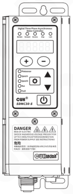

ตัวควบคุม ×1

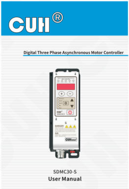

คู่มือการใช้งาน ×1

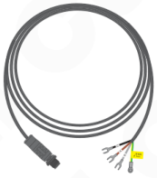

สายเอาต์พุต ×1

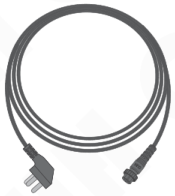

สายไฟฟ้าอินพุต ×1

---

## 1.2 คำอธิบายไฟแสดงสถานะและปุ่มกด

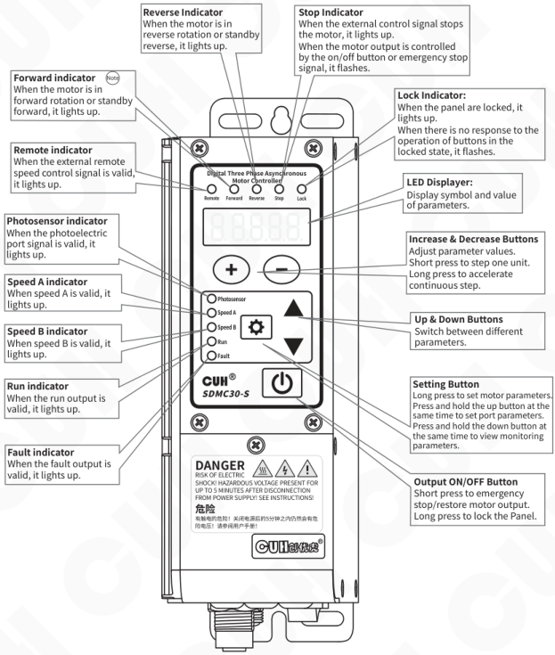

### ไฟแสดงสถานะ

- **ไฟแสดงการหมุนย้อนกลับ (Reverse Indicator)**  
  สว่างเมื่อมอเตอร์กำลังหมุนย้อนกลับหรืออยู่ในสถานะพร้อมหมุนย้อนกลับ
- **ไฟแสดงการหมุนไปข้างหน้า (Forward Indicator)** (หมายเหตุ)  
  สว่างเมื่อมอเตอร์กำลังหมุนไปข้างหน้าหรืออยู่ในสถานะพร้อมหมุนไปข้างหน้า
- **ไฟแสดงการควบคุมระยะไกล (Remote Indicator)**  
  สว่างเมื่อสัญญาณควบคุมความเร็วระยะไกลจากภายนอกมีสถานะ valid
- **ไฟแสดงเซนเซอร์โฟโต้ (Photosensor Indicator)**  
  สว่างเมื่อสัญญาณที่พอร์ตโฟโต้อิเล็กทริกมีสถานะ valid
- **ไฟแสดงความเร็ว A (Speed A Indicator)**  
  สว่างเมื่อความเร็ว A มีสถานะ valid
- **ไฟแสดงความเร็ว B (Speed B Indicator)**  
  สว่างเมื่อความเร็ว B มีสถานะ valid
- **ไฟแสดงการทำงาน (Run Indicator)**  
  สว่างเมื่อเอาต์พุตการทำงาน (Run Output) มีสถานะ valid
- **ไฟแสดงความผิดพลาด (Fault Indicator)**  
  สว่างเมื่อเอาต์พุตความผิดพลาด (Fault Output) มีสถานะ valid
- **ไฟแสดงการหยุด (Stop Indicator)**  
  สว่างเมื่อสัญญาณควบคุมภายนอกสั่งให้มอเตอร์หยุด  
  กะพริบเมื่อเอาต์พุตของมอเตอร์ถูกควบคุมโดยปุ่มเปิด/ปิด หรือสัญญาณหยุดฉุกเฉิน
- **ไฟแสดงการล็อก (Lock Indicator)**  
  สว่างเมื่อแผงหน้าปัดถูกล็อก  
  กะพริบเมื่อการกดปุ่มในสถานะล็อกไม่ได้รับการตอบสนอง

### จอแสดงผลและปุ่มกด

- **จอแสดงผล LED (LED Displayer)**  
  แสดงสัญลักษณ์และค่าของพารามิเตอร์
- **ปุ่มเพิ่ม/ลดค่า (Increase & Decrease Buttons)**  
  ใช้ปรับค่าพารามิเตอร์  
  กดสั้นเพื่อเลื่อนค่าทีละหนึ่งหน่วย  
  กดค้างเพื่อเร่งการปรับค่าแบบต่อเนื่อง
- **ปุ่มขึ้น/ลง (Up & Down Buttons)**  
  ใช้สลับไปมาระหว่างพารามิเตอร์ต่าง ๆ
- **ปุ่มตั้งค่า (Setting Button)**  
  กดค้างเพื่อตั้งค่าพารามิเตอร์มอเตอร์  
  กดพร้อมกดค้างปุ่มขึ้นเพื่อตั้งค่าพารามิเตอร์พอร์ต  
  กดพร้อมกดค้างปุ่มลงเพื่อดูพารามิเตอร์การเฝ้าติดตาม
- **ปุ่มเปิด/ปิดเอาต์พุต (Output ON/OFF Button)**  
  กดสั้นเพื่อหยุดฉุกเฉิน/คืนสถานะเอาต์พุตของมอเตอร์  
  กดค้างเพื่อล็อกแผงหน้าปัด

### คำเตือนบนแผงหน้าปัด

**อันตราย**  
อันตรายจากไฟฟ้า! ยังคงมีแรงดันไฟฟ้าอันตรายคงอยู่นานถึง 5 นาทีหลังจากตัดการเชื่อมต่อจากแหล่งจ่ายไฟ! โปรดดูคำแนะนำในคู่มือ!

### หมายเหตุ

1. คำนิยาม: ทิศทางการหมุนไปข้างหน้า หมายถึงทิศทางการหมุนเมื่อสังเกตจากด้านสายเทอร์มินัลตามแกนขับของมอเตอร์ โดยมาตรฐาน IEC60034-8 เป็นตัวกำหนดทิศทางการหมุนของมอเตอร์
2. หากสลับสายเฟสใดก็ได้สองเฟส มอเตอร์จะหมุนทวนเข็มนาฬิกา กล่าวคือทิศทางหมุนไปข้างหน้าและย้อนกลับจะสลับกัน

---

## 1.3 คำอธิบายชิ้นส่วนภายนอก

> ⚠️ **อันตราย**
>
> เมื่อติดตั้งสายเอาต์พุต ให้จัดแนวทิศทางขา PE ให้ถูกต้องก่อนเสียบปลั๊ก ห้ามออกแรงเสียบโดยไม่ยืนยันทิศทาง
>
> หากเสียบผิดทิศทาง จะมีแรงดันสูงคงค้างที่ตัวถังมอเตอร์ **ซึ่งอาจทำให้เสียชีวิตหรือบาดเจ็บสาหัสได้**

> ⚠️ **อันตราย**
>
> 1. ผลิตภัณฑ์นี้จัดอยู่ในชั้นป้องกันแบบ Class I โดยใช้ปลั๊กสามขาของสายไฟสำหรับการต่อลงดินเพื่อความปลอดภัย โปรดตรวจสอบให้แน่ใจว่าเต้ารับที่ใช้ต่อมีการต่อลงดินอย่างมั่นคง
> 2. หากไม่มีการต่อลงดินเพื่อความปลอดภัย หรือการต่อลงดินผิดพลาด จะมีแรงดันสูงคงค้างบนตัวถังตัวควบคุม การสัมผัสตัวควบคุม **อาจทำให้เสียชีวิตหรือบาดเจ็บสาหัสได้**

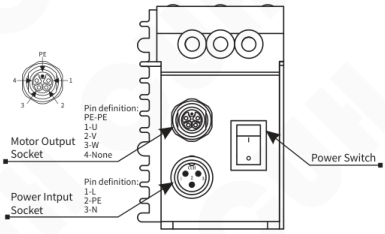

**ซ็อกเก็ตเอาต์พุตมอเตอร์ (Motor Output Socket)**

คำนิยามขา:
- PE-PE
- 1-U
- 2-V
- 3-W
- 4-ไม่ใช้งาน

**ซ็อกเก็ตอินพุตไฟเลี้ยง (Power Input Socket)**

คำนิยามขา:
- 1-L
- 2-PE
- 3-N

**สวิตช์ไฟ (Power Switch)**

## 1.4 คำอธิบายพอร์ตสัญญาณ

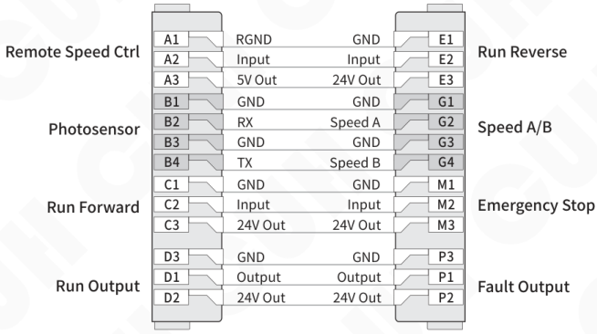

| ฟังก์ชัน | ขา | คำนิยาม | คำนิยาม | ขา | ฟังก์ชัน |
|---|---|---|---|---|---|
| ควบคุมความเร็วระยะไกล | A1 | RGND | GND | E1 | หมุนย้อนกลับ |
| | A2 | Input | Input | E2 | |
| | A3 | 5V Out | 24V Out | E3 | |
| เซนเซอร์โฟโต้ | B1 | GND | GND | G1 | ความเร็ว A/B |
| | B2 | RX | Speed A | G2 | |
| | B3 | GND | GND | G3 | |
| | B4 | TX | Speed B | G4 | |
| หมุนไปข้างหน้า | C1 | GND | GND | M1 | หยุดฉุกเฉิน |
| | C2 | Input | Input | M2 | |
| | C3 | 24V Out | 24V Out | M3 | |
| เอาต์พุตการทำงาน | D3 | GND | GND | P3 | เอาต์พุตความผิดพลาด |
| | D1 | Output | Output | P1 | |
| | D2 | 24V Out | 24V Out | P2 | |

---

## 1.5 คำอธิบายป้ายกำกับ (เนมเพลต)

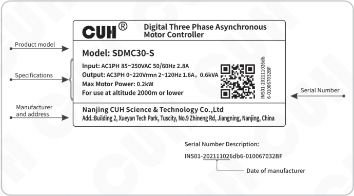

**CUH® — ตัวควบคุมมอเตอร์อะซิงโครนัสสามเฟสแบบดิจิทัล**

- **รุ่นผลิตภัณฑ์**
  - รุ่น: SDMC30-S
- **ข้อมูลจำเพาะ**
  - อินพุต: AC1PH 85~250VAC 50/60Hz 2.8A
  - เอาต์พุต: AC3PH 0~220Vrmn 2~120Hz 1.6A, 0.6kVA
  - กำลังมอเตอร์สูงสุด: 0.2kW
  - ใช้งานที่ระดับความสูงไม่เกิน 2000 เมตร
- **ผู้ผลิตและที่อยู่**
  - Nanjing CUH Science & Technology Co.,Ltd
  - Add.: Building 2, Xueyan Tech Park, Tuscity, No.9 Zhineng Rd, Jiangning, Nanjing, China
- **หมายเลขซีเรียล**
  - INS01-202111026db6-010067032BF

**คำอธิบายหมายเลขซีเรียล:**

INS01-202111026db6-010067032BF

- 20211102 → วันที่ผลิต

---

## บทที่ Ⅱ ข้อมูลผลิตภัณฑ์

เนื้อหาหลักของบทนี้ประกอบด้วยบทแนะนำโดยย่อและคุณสมบัติเด่นของผลิตภัณฑ์นี้

### 2.1 ข้อมูลผลิตภัณฑ์

ตัวควบคุมมอเตอร์อะซิงโครนัสสามเฟสแบบดิจิทัล ซีรีส์ SDMC30 เป็นตัวควบคุมอินเวอร์เตอร์แบบทึบ (solid-state) ทั้งหมด ไม่มีพัดลม ขนาดกะทัดรัด และเงียบ ซึ่งให้สมรรถนะเป็นเอกลักษณ์ด้วยการใช้เทคโนโลยีอิเล็กทรอนิกส์ล่าสุดและการออกแบบอย่างพิถีพิถัน เหมาะอย่างยิ่งสำหรับการใช้งานในสภาพแวดล้อมทางอุตสาหกรรม โดยมีคุณสมบัติดังนี้:

- รูปแบบเอาต์พุตคลื่นไซน์บริสุทธิ์สามเฟสด้วยการมอดูเลตความกว้างพัลส์แบบเวกเตอร์อวกาศ (SVPWM) ทำให้มอเตอร์มีประสิทธิภาพสูงและเสียงรบกวนต่ำ
- เส้นโค้ง V/F ปรับแต่งได้ เหมาะกับงานโหลดที่หลากหลายของมอเตอร์
- พอร์ตโฟโต้อิเล็กทริกรองรับเซนเซอร์โฟโต้ และเซนเซอร์สวิตช์แบบ NPN และ PNP
- เอาต์พุตการทำงาน (Run Output) และเอาต์พุตความผิดพลาด (Fault Output) ใช้บ่งบอกสถานะการทำงานและสถานะความผิดพลาดของตัวควบคุม
- พอร์ตเอาต์พุตรองรับโหมด NPN, PNP และ Push-Pull
- ฟังก์ชันป้องกันการห้อยหยุด (anti-stall) ป้องกันมอเตอร์ห้อยหยุดจากการโอเวอร์โหลดระหว่างเร่งความเร็ว ชะลอความเร็ว และการทำงาน
- ฟังก์ชันเบรกกระแสตรง (DC Braking) สามารถเบรกให้มอเตอร์หยุดหมุนได้อย่างรวดเร็วขณะหยุดทำงานหรือหยุดฉุกเฉิน
- รองรับฟังก์ชันป้องกันมอเตอร์อย่างครบครัน เช่น โอเวอร์โหลด/โอเวอร์ความเร็ว/ห้อยหยุด/เฟสขาด
- ฟังก์ชันปรับความสว่างของแผงหน้าปัด รองรับการปรับความสว่าง 32 ระดับ
- ฟังก์ชันห้ามหมุนย้อนกลับ สามารถล็อกไม่ให้มอเตอร์หมุนย้อนกลับได้
- ฟังก์ชันหยุดฉุกเฉิน เลือกได้ระหว่าง Safe Torque Off, Safe Brake Control และ Class 1 Safety Stop
- ฟังก์ชันสัญญาณพร้อมทำงาน (Ready Signal): ส่งสัญญาณมอดูเลตหรือสัญญาณ valid ผ่านพอร์ตส่งสัญญาณ B4 อัจฉริยะ เพื่อบ่งบอกว่าตัวควบคุมอยู่ในสถานะพร้อมทำงาน เมื่อตัวควบคุมพบข้อผิดพลาด สัญญาณพร้อมทำงานจะกลายเป็น invalid
- ฟังก์ชันควบคุมระยะไกลรองรับการเลือกสัญญาณ 1~5V, 0~5V, 0~10V, 4~20mA
- ฟังก์ชันสัมประสิทธิ์ควบคุมระยะไกล สามารถขยายผลของแรงดันควบคุมระยะไกล 1 เท่า หรือลดลง 1 เท่า
- ฟังก์ชันความเร็ว AB รองรับสัญญาณสวิตช์สองชุดเพื่อควบคุมความเร็วมอเตอร์ได้สูงสุดสี่ระดับ
- แหล่งสัญญาณควบคุมที่หลากหลาย ความสัมพันธ์เชิงตรรกะ การหน่วงเวลาสวิตช์ และโหมดเอาต์พุต สามารถนำไปใช้ในงานที่ซับซ้อนได้
- ฟังก์ชันเฝ้าติดตามที่ครบครัน สามารถเฝ้าติดตามอุณหภูมิ ความถี่เอาต์พุต กำลังเอาต์พุต และแรงดันพอร์ตสัญญาณ
- ฟังก์ชันป้องกันที่ครบถ้วน ยังรวมถึง: การป้องกัน short circuit ที่เอาต์พุตมอเตอร์ การป้องกันโอเวอร์โหลดของตัวควบคุม การป้องกันร้อนเกินและเย็นเกิน การป้องกันแรงดันไฟเลี้ยงต่ำเกิน/สูงเกิน การป้องกัน short circuit ที่เอาต์พุตการทำงานและเอาต์พุตความผิดพลาด การป้องกัน short circuit ของเอาต์พุต 24V และการป้องกัน short circuit ของเอาต์พุต 5V สำหรับวงจรปรับความเร็ว

---

# บทที่ Ⅲ คู่มือการติดตั้ง

บทนี้แนะนำเงื่อนไขที่จำเป็นสำหรับการใช้งานตัวควบคุม และวิธีการติดตั้งและเดินสายอย่างถูกต้อง

## 3.1 เงื่อนไขการใช้งานตัวควบคุม

ตัวควบคุมนี้ใช้ไฟเลี้ยง AC 220V โดยต่อลงดินเพื่อความปลอดภัยผ่านปลั๊กของสายไฟ โปรดจัดเตรียมไฟฟ้าสายไฟฟ้า 220V, 50Hz/60Hz และระบบจ่ายไฟที่เป็นไปตามมาตรฐาน พร้อมทั้งตรวจสอบให้แน่ใจว่าสายดินเพื่อความปลอดภัยต่อถูกต้อง

**⚠ คำเตือน** ห้ามต่อตัวควบคุมเข้ากับไฟฟ้า AC 380V เด็ดขาด เนื่องจากจะทำให้เกิดความเสียหายร้ายแรงต่อตัวควบคุมอย่างไม่อาจกู้คืนได้ และอาจนำไปสู่เหตุการณ์อันตราย เช่น การระเบิดหรือไฟไหม้

**⚠ คำเตือน** ต้องแน่ใจว่าด้านแหล่งจ่ายไฟมีการต่อลงดินอย่างน่าเชื่อถือ ตัวถังโลหะของตัวควบคุมต่อตรงกับสายดินเพื่อความปลอดภัย หากต่อลงดินไม่ดี จะทำให้ตัวถังตัวควบคุมมีไฟฟ้าค้าง และอาจทำให้เกิดอุบัติเหตุไฟฟ้าดูด

**หมายเหตุ** การทำงานต่อเนื่องเป็นเวลานานจะทำให้เกิดความร้อนและอุณหภูมิของตัวถังสูงขึ้น โปรดติดตั้งตัวควบคุมในสภาพแวดล้อมที่ระบายอากาศดี และยึดติวางอย่างมั่นคง ห่างจากแหล่งกำเนิดการสั่นสะเทือน

**หมายเหตุ** พอร์ตเอาต์พุตมอเตอร์ของผลิตภัณฑ์นี้เกิดจากการเรคติไฟและอินเวิร์ตไฟบ้าน โดยไม่มีวงจรแยกไฟอยู่ในระหว่าง ดังนั้นขั้วเอาต์พุตจึงต่อเข้ากับสายดินเพื่อความปลอดภัยไม่ได้ เมื่อต่อมอเตอร์ ต้องแน่ใจว่ามีฉนวนพื้นฐานระหว่างขดลวดมอเตอร์กับตัวถัง มิฉะนั้นจะเกิดการรั่วไหลของไฟฟ้า ซึ่งอาจทำให้เกิดไฟฟ้าดูดและความเสียหางต่อตัวควบคุมได้

## 3.2 วิธีใช้งานปุ่มกด

ตัวควบคุมรุ่นนี้ใช้จอแสดงผลดิจิทัล 5 หลัก แสดงสัญลักษณ์พารามิเตอร์ พร้อมไฟแสดงสถานะสีแดง 10 ดวง แสดงสถานะของตัวควบคุมหรือพอร์ตสัญญาณ

ตัวควบคุมรุ่นนี้ใช้การทำงานแบบ 6 ปุ่ม โดยมีวิธีใช้งานดังนี้:

 a. การกดปุ่มแบ่งเป็นการกดสั้นและกดค้าง (เร่งความเร็วระดับที่หนึ่ง และระดับที่สอง) ตามระยะเวลาการกด

 b. กดสั้นคือการกดที่มีระยะเวลามากกว่า 0.1 วินาทีแต่น้อยกว่า 2 วินาที ส่วนกดค้างคือการกดที่มีระยะเวลามากกว่า 2 วินาที

 c. ⊕ และ ⊖ ใช้สำหรับปรับค่าพารามิเตอร์ ส่วน ▼ และ ▲ ใช้สำหรับเลือกพารามิเตอร์ที่แตกต่างกัน

 d. กด ⏻ สั้นเพื่อหยุดฉุกเฉินเอาต์พุตมอเตอร์ กดค้างเพื่อล็อก/ปลดล็อกแผงหน้าปัด

 e. กด ⚙ ค้างเพื่อเข้า/ออกจากหน้าจอตั้งค่าพารามิเตอร์มอเตอร์

 f. กด ⚙ พร้อม ▲ ค้างไว้เพื่อเข้า/ออกจากหน้าจอตั้งค่าพารามิเตอร์พอร์ต

 g. กด ⚙ พร้อม ▼ ค้างไว้เพื่อเข้า/ออกจากหน้าจอพารามิเตอร์เฝ้าติดตาม ในหน้าจอนี้สามารถกด ⊕ และ ⊖ เพื่อปรับความถี่ที่ตั้งไว้ชั่วคราวได้

---

## 3.3 การติดตั้งและใช้งาน

### ขั้นตอนที่หนึ่ง:

เปิดกล่องบรรจุภัณฑ์และตรวจสอบตัวควบคุมพร้อมอุปกรณ์เสริมทั้งหมด

### ขั้นตอนที่สอง:

นำสายเอาต์พุตออกมา ต่อบล็อกเทอร์มินัลของสายเอาต์พุตเข้ากับขั้วยึดของมอเตอร์ และเลือกวิธีต่อแบบสามเหลี่ยม (Delta) หรือแบบดาว (Star) ตามป้ายกำกับของมอเตอร์ พร้อมยืนยันว่าสายดินสีเหลือง-เขียวต่อเข้ากับตัวถังโลหะของมอเตอร์อย่างมั่นคง

### การต่อแบบสามเหลี่ยม (Triangular/Delta Wiring)

เมื่อต่อตัวควบคุมกับมอเตอร์ △230V/Y 400V ให้ใช้การต่อแบบสามเหลี่ยม

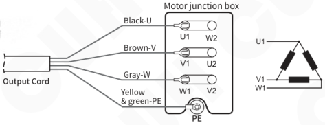

### การต่อแบบดาว (Star Wiring)

เมื่อต่อตัวควบคุมกับมอเตอร์ △120V/Y 230V ให้ใช้การต่อแบบดาว

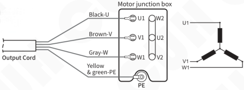

### หมายเหตุ

- ตามข้อกำหนดของมาตรฐาน IEC60446:
  1. สายเฟสของไฟ AC นิยมใช้สีดำ L1, สีน้ำตาล L2 และสีเทา L3
  2. สายนำป้องกัน PE ต้องใช้สีเหลือง-เขียวแบบสองสีเท่านั้น
- ตัวควบคุมนี้เอาต์พุตเป็นแรงดันไลน์สามเฟส 220V เหมาะกับมอเตอร์ต่อแบบสามเหลี่ยม 220~240V หรือมอเตอร์ต่อแบบดาว 220~240V หากต่อกับมอเตอร์แบบ 380V จะทำให้แรงบิดลดลงอย่างมาก

### ⚠ อันตราย

ต้องแน่ใจว่าตัวถังมอเตอร์ต่อเข้ากับสาย PE อย่างมั่นคง หากไม่เช่นนั้นตัวถังจะมีไฟฟ้าค้าง ซึ่งอาจทำให้เสียชีวิตหรือบาดเจ็บสาหัสได้

### ⚠ คำเตือน

โปรดต่อบล็อกเทอร์มินัลของมอเตอร์ตามลำดับ UVW หากลำดับไม่ถูกต้อง มอเตอร์อาจหมุนกลับทิศ และก่อให้เกิดอันตรายเชิงกลได้

---

## ขั้นตอนที่สาม:

เสียบปลั๊กเอาต์พุตเข้ากับซ็อกเก็ตเอาต์พุตมอเตอร์ของตัวควบคุมแล้วขันน็อตให้แน่น

จากนั้นนำสายไฟอินพุตออกมา เสียบปลั๊กกลม (aviation plug) ของสายไฟเข้ากับซ็อกเก็ตอินพุตไฟเลี้ยงของตัวควบคุม และขันน็อตของปลั๊กให้แน่น

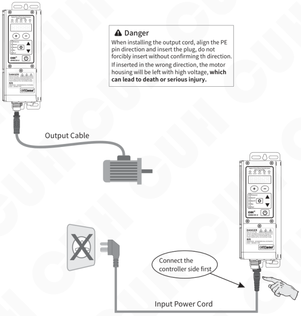

> ⚠ **อันตราย**
>
> เมื่อติดตั้งสายเอาต์พุต ให้จัดแนวทิศทางขา PE ให้ถูกต้องก่อนเสียบปลั๊ก ห้ามออกแรงเสียบโดยไม่ยืนยันทิศทาง
>
> หากเสียบผิดทิศทาง จะมีแรงดันสูงคงค้างที่ตัวถังมอเตอร์ **ซึ่งอาจทำให้เสียชีวิตหรือบาดเจ็บสาหัสได้**

> ⚠ **อันตราย**
>
> เพื่อป้องกันไฟฟ้าดูด ห้ามเดินสายขณะที่ไฟฟ้ายังเปิดอยู่ ต้องตัดไฟของเครื่องจักรก่อน และดำเนินการเดินสายหลังจากที่หลอดแสดงผลดิจิทัลดับไปแล้ว 5 นาที หากไม่ปฏิบัติให้ถูกต้อง **มีความเสี่ยงต่อการเสียชีวิตหรือบาดเจ็บสาหัส**

---

### ขั้นตอนที่สี่:

หลังยืนยันว่าสวิตช์อยู่ตำแหน่งปิดแล้ว ให้เสียบปลั๊กสายไฟอินพุตเข้ากับเต้ารับไฟบ้าน

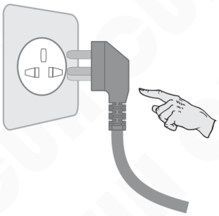

### ขั้นตอนที่ห้า:

เปิดสวิตช์ไฟ ขณะนี้ควรแสดงความถี่ที่ตั้งไว้ "F 50.0" และไฟแสดงการหมุนไปข้างหน้ากับไฟแสดงการหยุดจะสว่าง มอเตอร์ยังไม่หมุนในขั้นตอนนี้

F หมายถึงความถี่ที่ตั้งไว้

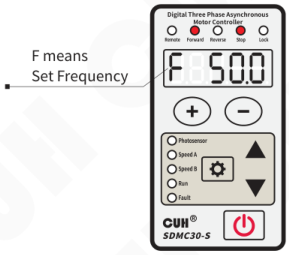

---

## ขั้นตอนที่หก:

ต่อสัญญาณควบคุมหมุนไปข้างหน้าหรือสัญญาณควบคุมหมุนย้อนกลับเข้ากับตัวควบคุม ขณะนี้ไฟแสดงการหยุดของตัวควบคุมจะดับ ไฟแสดงการทำงานจะสว่าง และมอเตอร์จะค่อย ๆ เร่งความเร็วขึ้นไปที่ความถี่ 50Hz

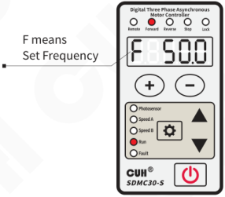

## ขั้นตอนที่เจ็ด:

ใช้ ⊕ และ ⊖ ปรับความถี่ไปยังความเร็วมอเตอร์ที่เหมาะสมที่สุด

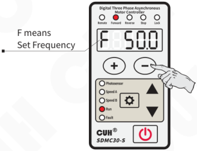

---

## บทที่ Ⅳ คำอธิบายฟังก์ชันพื้นฐาน

บทนี้แนะนำวิธีการใช้งานฟังก์ชันพื้นฐานของผลิตภัณฑ์นี้

### 4.1 การตั้งค่าความถี่

ตัวควบคุมรุ่นนี้สามารถตั้งค่าความถี่เอาต์พุตแบบดิจิทัลได้โดยตรงที่แผงหน้าปัด เนื่องจากใช้เทคโนโลยีสังเคราะห์ความถี่ดิจิทัลโดยตรง (DDS) จึงมีความแม่นยำและเสถียรภาพของความถี่สูงมาก และไม่เปลี่ยนแปลงตามกาลเวลาและอุณหภูมิ

- เปิดสวิตช์ไฟของตัวควบคุม
- ตัวควบคุมเข้าสู่สถานะพร้อมทำงานที่พารามิเตอร์ความถี่ที่ตั้งไว้ F ไฟแสดงการหมุนไปข้างหน้าและไฟแสดงการหยุดบนตัวควบคุมสว่างขึ้น และจอ LED แสดงพารามิเตอร์ F พร้อมค่าของพารามิเตอร์
- กด ⊕ หรือ ⊖ เพื่อปรับค่าพารามิเตอร์

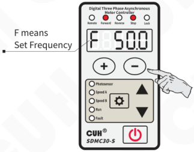

ช่วงของความถี่ที่ตั้งไว้คือ 2.0~120.0Hz

> - ช่วงที่สามารถตั้งค่าความถี่ F ได้จำกัดโดยความถี่ต่ำสุด "r" และความถี่สูงสุด "y"

---

## 4.2 การหมุนไปข้างหน้าและการหมุนย้อนกลับ

ตัวควบคุมรุ่นนี้มีพอร์ตสั่งหมุนไปข้างหน้า C และพอร์ตสั่งหมุนย้อนกลับ E เมื่อสัญญาณที่พอร์ตเป็น invalid มอเตอร์จะไม่ทำงาน และไฟแสดงการหยุดจะสว่าง

เมื่อสัญญาณที่พอร์ตสั่งหมุนไปข้างหน้า C เป็น valid มอเตอร์จะหมุนไปข้างหน้า ไฟแสดงการหยุดดับ ไฟแสดงการหมุนไปข้างหน้าสว่าง และไฟแสดงการทำงานสว่าง

- กด ⚙ ค้างไว้ 2 วินาที เพื่อเข้าสู่หน้าจอพารามิเตอร์มอเตอร์
- ใช้ ▲ และ ▼ สลับไปยังสถานะปรับแหล่งควบคุมสตาร์ท/หยุดการหมุนไปข้างหน้า 1 "P1"
- กด ⊕ หรือ ⊖ เพื่อปรับค่าพารามิเตอร์ ค่าที่ตั้งไว้ตั้งแต่โรงงานของพารามิเตอร์นี้คือ C

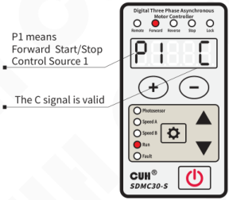

เมื่อสัญญาณที่พอร์ตสั่งหมุนย้อนกลับ E เป็น valid มอเตอร์จะหมุนย้อนกลับ ไฟแสดงการหยุดดับ ไฟแสดงการหมุนย้อนกลับสว่าง และไฟแสดงการทำงานสว่าง

- กด ⚙ ค้างไว้ 2 วินาที เพื่อเข้าสู่หน้าจอพารามิเตอร์มอเตอร์
- ใช้ ▲ และ ▼ สลับไปยังสถานะปรับแหล่งควบคุมการหมุนย้อนกลับ 1 "Π1"
- กด ⊕ หรือ ⊖ เพื่อปรับค่าพารามิเตอร์ ค่าที่ตั้งไว้ตั้งแต่โรงงานของพารามิเตอร์นี้คือ E

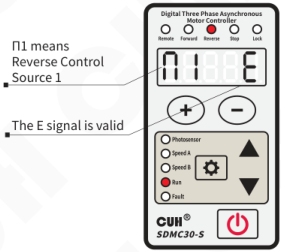

หมายเหตุ:

1. เมื่อสัญญาณที่พอร์ตสั่งหมุนไปข้างหน้าและพอร์ตสั่งหมุนย้อนกลับเป็น valid พร้อมกัน ตัวควบคุมจะรายงานข้อผิดพลาด Er15 การขัดกันของการหมุนไปข้างหน้า/ย้อนกลับ และมอเตอร์จะไม่ทำงาน
2. หากเดินสายตามคำแนะนำการต่อสายมอเตอร์ ตามคำนิยามทิศทางการหมุนของมอเตอร์ในมาตรฐาน IEC60034-8 ทิศทางหมุนไปข้างหน้าหมายถึงการหมุนตามเข็มนาฬิกาเมื่อสังเกตจากด้านขับของมอเตอร์

---

## 4.3 การหยุดฉุกเฉิน

ในสถานการณ์ฉุกเฉิน ตัวควบคุมสามารถเข้าสู่สถานะหยุดฉุกเฉินเพื่อหยุดการทำงานของมอเตอร์ได้อย่างรวดเร็ว โดยสามารถเข้าสู่สถานะหยุดฉุกเฉินได้จากการกดปุ่มไฟบนแผงหน้าปัด หรือจากการที่สัญญาณพอร์ตหยุดฉุกเฉินเป็น valid ขณะนั้นไฟแสดงการหยุดจะกะพริบและแสดง Ar02 หยุดฉุกเฉิน

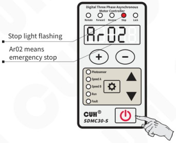

- สถานะหยุดฉุกเฉินที่เกิดจากการกดปุ่มไฟบนแผงหน้าปัด สามารถยกเลิกได้โดยกดปุ่มไฟอีกครั้ง
- สถานะหยุดฉุกเฉินที่เกิดจากสัญญาณพอร์ตหยุดฉุกเฉินเป็น valid นอกจากต้องยกเลิกสัญญาณพอร์ตหยุดฉุกเฉินแล้ว ยังต้องกดปุ่มไฟบนแผงหน้าปัดเพื่อยกเลิกสถานะหยุดฉุกเฉินด้วย

> สามารถเลือกโหมดหยุดฉุกเฉินผ่านพารามิเตอร์ Sq ได้แก่ Safe Torque Off, Safe Brake Control และ Class 1 Safety Stop สำหรับรายละเอียดโปรดดูที่คำอธิบายฟังก์ชันขั้นสูง

---

## 4.4 เวลาสตาร์ทแบบนุ่มนวล (Soft Start Time)

เมื่อตัวควบคุมรุ่นนี้สตาร์ทจากสถานะหยุด ความถี่เอาต์พุตของมอเตอร์สามารถเพิ่มขึ้นอย่างนุ่มนวลไปยังความถี่ที่ตั้งไว้ เพื่อป้องกันแรงกระแทกต่อมอเตอร์และเครื่องจักรที่ใช้งาน

เวลาสตาร์ทแบบนุ่มนวล (t): คือเวลาที่ความถี่เอาต์พุตของตัวควบคุมใช้ในการเพิ่มขึ้นอย่างนุ่มนวลจากความถี่ต่ำสุดไปยังความถี่ที่ตั้งไว้ เมื่อมอเตอร์สตาร์ทจากสถานะหยุด

- กด ⚙ ค้างไว้ 2 วินาที เพื่อเข้าสู่หน้าจอพารามิเตอร์มอเตอร์
- ใช้ ▲ และ ▼ สลับไปยังสถานะปรับเวลาสตาร์ทแบบนุ่มนวล "t"
- กด ⊕ หรือ ⊖ เพื่อปรับค่าพารามิเตอร์

ช่วงของเวลาสตาร์ทแบบนุ่มนวลคือ 0.0~99.9 วินาที

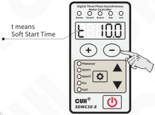

## 4.5 เวลาหยุดแบบนุ่มนวล/เบรกกระแสตรง (Soft Closing Time/DC Braking)

เมื่อตัวควบคุมรุ่นนี้หยุดจากสถานะทำงาน ความถี่เอาต์พุตของมอเตอร์สามารถลดลงอย่างนุ่มนวลไปยังความถี่ต่ำสุด เพื่อป้องกันแรงกระแทกต่อมอเตอร์และเครื่องจักรที่ใช้งาน

เวลาหยุดแบบนุ่มนวล (): คือเวลาที่ความถี่เอาต์พุตของตัวควบคุมใช้ในการลดลงอย่างนุ่มนวลจากความถี่ที่ตั้งไว้ไปยังความถี่ต่ำสุด เมื่อมอเตอร์หยุดจากสถานะทำงาน

- กด ⚙ ค้างไว้ 2 วินาที เพื่อเข้าสู่หน้าจอพารามิเตอร์มอเตอร์
- ใช้ ▲ และ ▼ สลับไปยังสถานะปรับเวลาหยุดแบบนุ่มนวล "[[vcrop:22:2]]"
- กด ⊕ หรือ ⊖ เพื่อปรับค่าพารามิเตอร์

ช่วงของเวลาหยุดแบบนุ่มนวลคือ 0.0~99.9 วินาที  
ช่วงของเวลาเบรกกระแสตรงคือ -0.0~-99.9 วินาที

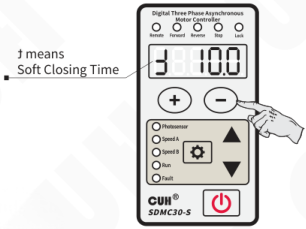

---

## 4.6 การล็อกแผงปุ่มกด (Keyboard Lock)

เมื่อตั้งค่าพารามิเตอร์ของตัวควบคุมเรียบร้อยแล้ว ฟังก์ชันล็อกแผงปุ่มกดสามารถล็อกปุ่มทั้งหมดบนแผงหน้าปัด เพื่อป้องกันการกดผิดพลาด

แม้จะปิดเครื่องแล้วเปิดใหม่อีกครั้ง สถานะการล็อกแผงปุ่มกดจะคงเป็นสถานะเดียวกับก่อนที่จะปิดเครื่องครั้งล่าสุด

- กด ⏻ ค้างไว้ 2 วินาที เพื่อล็อกปุ่มทั้งหมดบนแผงหน้าปัด ไฟแสดงการล็อกจะสว่างขึ้น
- กด ⏻ ค้างไว้ 2 วินาที อีกครั้ง เพื่อปลดล็อก

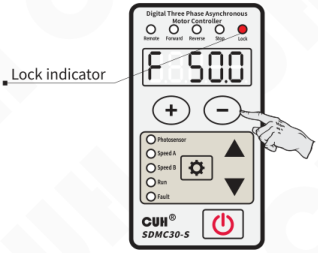

> เมื่อตัวควบคุมถูกล็อก การกดปุ่มต่าง ๆ จะไม่มีการตอบสนอง และไฟแสดงการล็อกจะกะพริบ

---

## 4.7 การคืนค่าการตั้งค่าจากโรงงาน (Restore Default Settings)

ผู้ใช้สามารถคืนค่าตัวควบคุมสู่สถานะค่าตั้งต้นจากโรงงานได้อย่างรวดเร็ว

เนื่องจากตัวควบคุมมีฟังก์ชันการทำงานที่หลากหลาย พารามิเตอร์จำนวนมากจึงสามารถปรับได้ สำหรับผู้ใช้มือใหม่ อาจไม่สามารถคืนสถานะการทำงานปกติของตัวควบคุมได้หลังจากการตั้งค่าและแก้ไขหลายครั้ง ใช้ฟังก์ชันนี้เพื่อคืนค่าพารามิเตอร์ที่สับสนกลับสู่ค่าตั้งต้นจากโรงงานได้อย่างรวดเร็ว

- กด ⚙ พร้อม ▲ ค้างไว้พร้อมกัน เพื่อเข้าสู่หน้าจอพารามิเตอร์พอร์ต

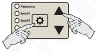

- กด ▲ สั้น ๆ เพื่อสลับไปยังการกะพริบทั้งหมดบนจอ LED ซึ่งก็คือพารามิเตอร์ "คืนค่าการตั้งค่าจากโรงงาน" จากนั้นกด ⊕ ค้างไว้จนกว่าตัวควบคุมจะแสดง "-----" แสดงว่าตัวควบคุมได้รับการคืนค่าแล้ว

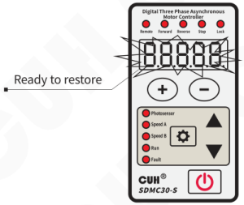

- ปล่อย ⊕ หลังจากตัวควบคุมแสดง "CUH" แล้ว จะเข้าสู่หน้าจอพร้อมทำงานปกติ ณ จุดนี้พารามิเตอร์ทั้งหมดได้รับการคืนค่าเป็นค่าตั้งต้นจากโรงงานแล้ว

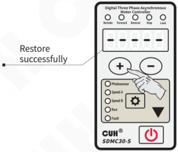

> ก่อนที่ผู้ใช้จะทำการรีเซ็ตค่าโรงงาน ต้องกด ⏻ เพื่อให้ตัวควบคุมเข้าสู่สถานะหยุดฉุกเฉินก่อน ซึ่งขณะนั้นไฟแสดงการหยุดจะกะพริบ

---

## บทที่ Ⅴ คำอธิบายฟังก์ชันขั้นสูง

บทนี้แนะนำหลัก ๆ ถึงวิธีการใช้งานฟังก์ชันขั้นสูงของผลิตภัณฑ์นี้

### 5.1 การควบคุมการสตาร์ท/หยุดและทิศทางการหมุนของมอเตอร์

ตัวควบคุมรุ่นนี้ออกแบบมาให้มีสัญญาณสตาร์ท/หยุดแบบหมุนไปข้างหน้าและแบบหมุนย้อนกลับ สำหรับควบคุมการสตาร์ท/หยุดและทิศทางการหมุนของมอเตอร์ สัญญาณสตาร์ท/หยุดแบบหมุนไปข้างหน้ามีแหล่งสัญญาณ 2 ชุดและหน่วยคำนวณตรรกะ สัญญาณแบบหมุนย้อนกลับก็เช่นกัน สัญญาณทั้งสองนี้เลือกใช้ควบคุมการสตาร์ท/หยุด รวมทั้งการหมุนไปข้างหน้า/ย้อนกลับของมอเตอร์ได้ ดูความสัมพันธ์เชิงตรรกะเฉพาะเจาะจงจากแผนภาพด้านล่าง

แหล่งควบคุมสตาร์ท/หยุดแบบหมุนไปข้างหน้าและแบบหมุนย้อนกลับประกอบด้วย: 0, 1, b, -b, C, -C, E, -E, SA, -SA, Sb, -Sb, ES, -ES, od, -od, oP, -oP

ความสัมพันธ์เชิงตรรกะประกอบด้วย: And, or, Xor, RS trigger

โหมดควบคุมการหมุนไปข้างหน้า/ย้อนกลับมีสองค่า:

- **Fr=0 หมายถึง:** สัญญาณสตาร์ท/หยุดแบบหมุนไปข้างหน้าใช้ควบคุมการสตาร์ทและหยุดของการหมุนไปข้างหน้า สัญญาณแบบหมุนย้อนกลับก็เช่นกัน
- **Fr=1 หมายถึง:** สัญญาณสตาร์ท/หยุดแบบหมุนไปข้างหน้าใช้ควบคุมการสตาร์ทและหยุด ส่วนสัญญาณแบบหมุนย้อนกลับใช้ควบคุมทิศทางการหมุน

หมายเหตุ: เมื่อ Fr=0 และสัญญาณหมุนไปข้างหน้าและย้อนกลับเป็น valid พร้อมกัน จะเกิดข้อผิดพลาด Er15 การขัดกันของการหมุนไปข้างหน้า/ย้อนกลับ และมอเตอร์จะหยุดทำงาน

---

## 5.2 การสลับทิศทางการหมุนและการห้ามหมุนย้อนกลับ

ในการใช้งานจริง หากจำเป็นต้องเปลี่ยนทิศทางการหมุนของมอเตอร์ หรือห้ามมอเตอร์หมุนในทิศทางใดทิศทางหนึ่ง เนื่องจากข้อจำกัดของระบบเชิงกลหรือเหตุผลด้านการเดินสาย สามารถใช้พารามิเตอร์ Ph (Phase) สำหรับสลับทิศทางได้

- **เมื่อ Ph=Abc** หมายถึงทิศทางมาตรฐาน กล่าวคือ การหมุนไปข้างหน้าคือการหมุนตามเข็มนาฬิกาเมื่อมองจากด้านขับของมอเตอร์
- **เมื่อ Ph=Acb** หมายถึงทิศทางถูกสลับ กล่าวคือ การหมุนไปข้างหน้าคือการหมุนทวนเข็มนาฬิกาเมื่อมองจากด้านขับของมอเตอร์
- **เมื่อ Ph=A.b.c.** หมายถึงทิศทางมาตรฐานโดยห้ามหมุนย้อนกลับ กล่าวคือ มอเตอร์หมุนได้เฉพาะตามเข็มนาฬิกา เมื่อมีคำสั่งหมุนย้อนกลับ จะไม่ตอบสนองและแสดงคำเตือน Ar08 ห้ามหมุนย้อนกลับ
- **เมื่อ Ph=A.c.b.** หมายถึงสลับทิศทางโดยห้ามหมุนไปข้างหน้า กล่าวคือ มอเตอร์หมุนได้เฉพาะทวนเข็มนาฬิกา เมื่อมีคำสั่งหมุนไปข้างหน้า จะไม่ตอบสนองและแสดงคำเตือน Ar08

แผนภาพด้านล่างแสดงมอเตอร์ที่หมุนตามเข็มนาฬิกา โดยเพลาหมุนตามเข็มนาฬิกาเมื่อมองจากด้านขับ และทิศทางการสังเกตคือจากด้านขับไปยังด้านไม่ขับ

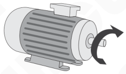

แผนภาพด้านล่างแสดงมอเตอร์ที่หมุนทวนเข็มนาฬิกา โดยเพลาหมุนทวนเข็มนาฬิกาเมื่อมองจากด้านขับ

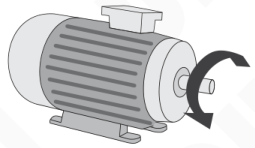

---

## 5.3 การหยุดฉุกเฉินของมอเตอร์

ตัวควบคุมรุ่นนี้สามารถสั่งหยุดฉุกเฉินมอเตอร์ได้ โดยแหล่งที่มาของการหยุดนี้สามารถเปิดใช้งานได้จากการกดปุ่มไฟบนแผงหน้าปัด หรือจากสวิตช์หยุดฉุกเฉินภายนอก

แหล่งที่มาของการหยุดฉุกเฉินเลือกแหล่งสัญญาณที่แตกต่างกันได้ โดยค่าตั้งต้นคือสัญญาณพอร์ตหยุดฉุกเฉิน ส่วนปุ่มไฟบนแผงหน้าปัดจะเป็นแหล่งหยุดฉุกเฉินที่มีผลเสมอ

โดยขึ้นอยู่กับโหมดหยุดฉุกเฉิน พารามิเตอร์ Sq สามารถเลือกกลยุทธ์การหยุดฉุกเฉินที่แตกต่างกันได้:

- **Sq=Sto** ตัวควบคุมจะตัดไฟเลี้ยงไปยังมอเตอร์ทันที และมอเตอร์จะชะลอความเร็วหยุดตามแรงเฉื่อย
- **Sq=Sbc** มอเตอร์หยุดโดยการเบรกกระแสตรง โดยเวลาเบรกกำหนดโดยเวลาหยุดแบบนุ่มนวล พอร์ตเอาต์พุตความผิดพลาดจะเอาต์พุตสถานะหยุดฉุกเฉินโดยไม่ขึ้นกับแหล่งสัญญาณ และต้องใช้รีเลย์เบรกความปลอดภัยเสมอ
- **Sq=SS1** มอเตอร์จะชะลอความเร็วหรือเบรกหยุดตามการทำงานที่กำหนดโดยเวลาหยุดแบบนุ่มนวล

### วิธีต่อสวิตช์หยุดฉุกเฉิน

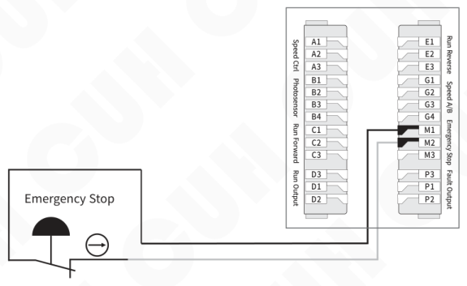

---

### Sto: ปิดโมเมนตัมอย่างปลอดภัย (Safe Torque Off)

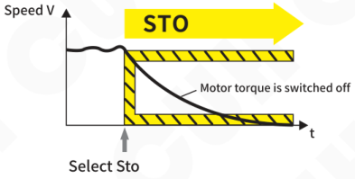

### Sbc: การควบคุมเบรกความปลอดภัย (Safety Brake Control)

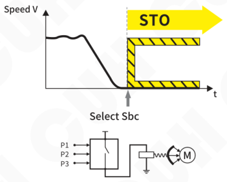

### SS1: การหยุดความปลอดภัยระดับชั้น 1 (Class 1 Safety Stop)

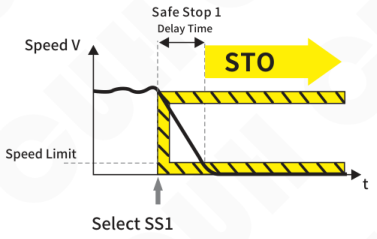

---

## 5.4 การตั้งค่าเส้นโค้ง V/F ของมอเตอร์

ตัวควบคุมรุ่นนี้สามารถปรับแต่งเส้นโค้ง V/F ได้ เพื่อให้เหมาะกับโหลดมอเตอร์ที่แตกต่างกัน

โดยกำหนดจากความถี่สูงสุด y, ความถี่พิกัด b, แรงดันพิกัด h, ความถี่กลาง n, แรงดันกลาง o, ความถี่ต่ำสุด r และแรงดันต่ำสุด u

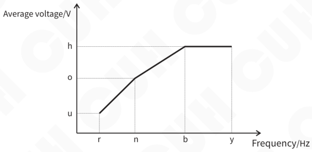

**หมายเหตุ:** เนื่องจากลักษณะเชิงเหนี่ยวนำของโหลดมอเตอร์ แรงดันไลน์เอาต์พุตจึงถูกสอบเทียบเป็นค่าเฉลี่ยหลังเรคติไฟ Vrmn เพื่อรักษากระแสไว้ในช่วงเชิงเส้นของเส้นโค้ง V/F โดยทั่วไปค่า RMS ของคลื่นไซน์มาตรฐาน Vrms จะมีค่าเป็น 1.11 เท่าของค่าเฉลี่ยหลังเรคติไฟ Vrmn

---

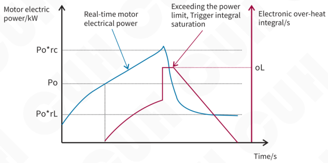

**แผนภาพการป้องกันกำลังมอเตอร์เกินขีดจำกัดบน**

ตัวควบคุมเฝ้าติดตามกำลังไฟฟ้าของมอเตอร์แบบเรียลไทม์ เมื่อกำลังเกินค่าที่ได้จากกำลังไฟฟ้าพิกัดของมอเตอร์ Po คูณกับสัมประสิทธิ์ส่วนเกินของกำลัง rc จะทำให้เกิดการป้องกันกำลังมอเตอร์เกินขีดจำกัด Er02P อินทิเกรเตอร์ความร้อนเกินแบบอิเล็กทรอนิกส์ของมอเตอร์จะเข้าสู่สถานะอิ่มตัวทันที ตัวควบคุมจะลดความถี่เอาต์พุตลงจนกว่ากำลังเอาต์พุตลดลงถึงกำลังที่กำหนดโดยสัมประสิทธิ์ลดกำลัง rL ขณะนั้นอินทิเกรเตอร์จะถูกรีเซ็ต เมื่อรีเซ็ตเสร็จสิ้น จะกลับไปทำงานที่ความถี่ที่ตั้งไว้ และเริ่มวงจรการป้องกันรอบใหม่

---

## 5.6 การควบคุมความเร็วมอเตอร์ระยะไกล

นอกเหนือจากการตั้งค่าความถี่ผ่านแผงหน้าปัดแล้ว ตัวควบคุมรุ่นนี้ยังสามารถควบคุมความถี่เอาต์พุตผ่านสัญญาณอะนาล็อกภายนอกได้ สัญญาณอะนาล็อกรองรับโพเทนชิออมิเตอร์, 1~5V, 4~20mA, 0~5V, 0~10V ซึ่งตั้งค่าได้โดยพารามิเตอร์แหล่งควบคุมระยะไกล A

- **A=PAd:** หมายถึงความถี่ที่ตั้งไว้ถูกควบคุมโดยปุ่มกดบนแผงหน้าปัดเท่านั้น
- **A=1-5V:** หมายถึงอินพุตภายนอก 1-5V ตั้งความถี่ที่ตั้งไว้ให้อยู่ระหว่างความถี่ต่ำสุด r และความถี่สูงสุด y เมื่อแรงดันอยู่ที่ 0-0.5V การควบคุมระยะไกลเป็น invalid และความถี่ที่ตั้งไว้จะถูกควบคุมโดยแผงหน้าปัด การควบคุมระยะไกลเป็น valid เมื่ออยู่ที่ 0.5-1V แต่ตัวควบคุมจะยังไม่ทำงาน
- **A=0-5V:** หมายถึงอินพุตภายนอก 0-5V ตั้งความถี่ที่ตั้งไว้ให้อยู่ระหว่างความถี่ต่ำสุด r และความถี่สูงสุด y
- **A=0-10:** หมายถึงอินพุตภายนอก 0-10V ตั้งความถี่ที่ตั้งไว้ให้อยู่ระหว่างความถี่ต่ำสุด r และความถี่สูงสุด y

ตัวควบคุมรุ่นนี้ยังออกแบบให้มีพารามิเตอร์สัมประสิทธิ์ควบคุมระยะไกล c เพื่อขยายหรือลดผลของแรงดันควบคุมระยะไกล โดยปรับได้ในช่วง 0.5~2.0 เมื่อตั้งเป็น 0.5 หมายถึงผลของการควบคุมระยะไกลต่อความถี่ที่ตั้งไว้ลดลงครึ่งหนึ่ง กล่าวคือสามารถปรับความถี่สูงสุด y ได้ทางระยะไกลเพียงครึ่งเดียว เมื่อตั้งเป็น 2.0 หมายถึงผลของแรงดันควบคุมระยะไกลต่อแรงดันเอาต์พุตเพิ่มเป็นสองเท่า กล่าวคือ ความถี่ที่ตั้งไว้จะถึง y เมื่อแรงดันควบคุมระยะไกลเพียงครึ่งเดียว หากเพิ่มแรงดันควบคุมระยะไกลต่อไปอีก แรงดันเอาต์พุตจะไม่สามารถเพิ่มขึ้นได้อีกแล้ว

### วิธีต่อโพเทนชิออมิเตอร์

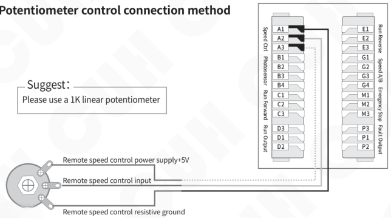

เมื่อต่อโพเทนชิออมิเตอร์แล้ว ไฟแสดงการควบคุมระยะไกลจะสว่างขึ้น การตั้งค่าความถี่จากแผงหน้าปัดจะเป็น invalid ในขณะนั้น

---

## วิธีต่อแบบควบคุมด้วยแรงดัน 1~5V

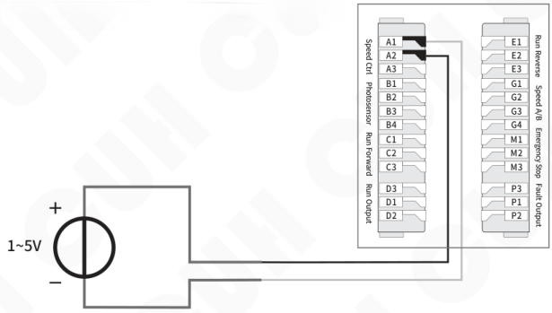

## วิธีต่อแบบควบคุมด้วยกระแส 4~20mA

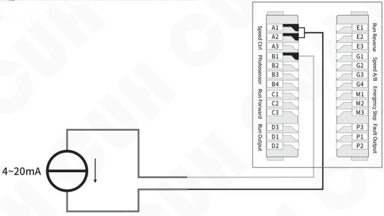

1. เลือก A=1-5V จะรองรับอินพุตแบบโพเทนชิออมิเตอร์, 1~5V, 4~20mA
2. เมื่อเลือก 0~5V หรือ 0~10V วิธีการต่อสายจะเหมือนกับแบบ 1-5V

---

## 5.7 การตั้งค่าความเร็วมอเตอร์ล่วงหน้าแบบดิจิทัล (Digital Preset)

ฟังก์ชันการตั้งความเร็วล่วงหน้าคือฟังก์ชันที่เลือกความเร็วที่กำหนดไว้ล่วงหน้าได้โดยตรงผ่านสัญญาณควบคุมภายนอกหรือภายใน โดยประกอบเป็นระบบควบคุมที่มีความเร็วได้สูงสุดสี่ระดับ

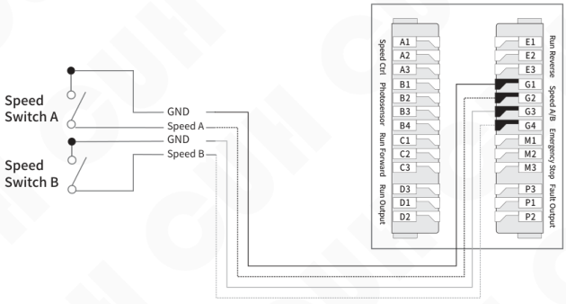

โดยค่าตั้งต้น แหล่งตั้งความเร็วล่วงหน้า 1 เลือกพอร์ตความเร็ว A ภายนอก SA และแหล่งตั้งความเร็วล่วงหน้า 2 เลือกพอร์ตความเร็ว B ภายนอก Sb ตามสถานการณ์การใช้งาน สามารถเปลี่ยนแหล่งสัญญาณเพื่อสลับไปมาระหว่างความเร็วที่ต่างกันได้

แหล่งตั้งความเร็วล่วงหน้าแต่ละชุดมีไฟแสดงสถานะที่สอดคล้องกันบนแผงหน้าปัด ซึ่งจะสว่างเมื่อแหล่งนั้นทำงานอยู่ การผสมผสานของสถานะไฟแสดงสถานะทั้งสองดวงทำให้เกิด 4 สถานะ (A และ B ดับ, A สว่าง B ดับ, A ดับ B สว่าง, A และ B สว่าง)

ผ่านการผสมผสานของสัญญาณ ตัวควบคุมจะเข้าสู่สถานะตั้งความเร็วล่วงหน้าที่สอดคล้องกัน และสามารถปรับความถี่ที่ตั้งไว้ของตัวควบคุมด้วย ⊕ และ ⊖ ความถี่นี้จะถูกจดจำโดยอัตโนมัติ และเมื่อสัญญาณควบคุมการตั้งความเร็วล่วงหน้าเข้าสู่สถานะนี้อีกครั้งเมื่อใดก็ตาม ตัวควบคุมจะสั่งตั้งค่าเป็นค่าความถี่ที่ตั้งไว้ที่จดจำไว้ทันที

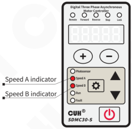

---

## 5.8 เซนเซอร์สวิตช์ (Switch Sensor)

ตัวควบคุมรุ่นนี้ออกแบบให้มีอินเทอร์เฟซเซนเซอร์สวิตช์สี่ชุด: การหมุนไปข้างหน้าและย้อนกลับ ความเร็ว AB และการหยุดฉุกเฉิน อินเทอร์เฟซเหล่านี้รองรับโหมด NPN, PNP, Ut1, Ut0 และตั้งค่าได้ผ่านพารามิเตอร์ชนิดเซนเซอร์สวิตช์ ΓA

- **โหมด Ut1 คือการสแกนครั้งเดียว** กล่าวคือ ก่อนที่สัญญาณเซนเซอร์จะเป็น invalid ระบบจะสลับระดับสูง-ต่ำเพื่อตรวจสอบว่าพอร์ตเป็น valid หรือไม่ หลังจากพบสัญญาณ valid จะกำหนดชนิดเซนเซอร์ของพอร์ตแล้วหยุดสแกน
- **โหมด Ut0 คือการสแกนต่อเนื่อง** โดยไม่คำนึงถึงชนิดของเซนเซอร์ ระบบจะตรวจสอบเสมอว่าพอร์ตเชื่อมต่อกับสัญญาณ valid หรือไม่ โดยการสลับระดับสูง-ต่ำ

การหน่วงเวลาสวิตช์ของสัญญาณดิจิทัลแต่ละชุดสามารถตั้งค่าได้ด้วยพารามิเตอร์ที่สอดคล้องกัน ดูรายละเอียดในตารางพารามิเตอร์

### วิธีต่อเซนเซอร์สวิตช์

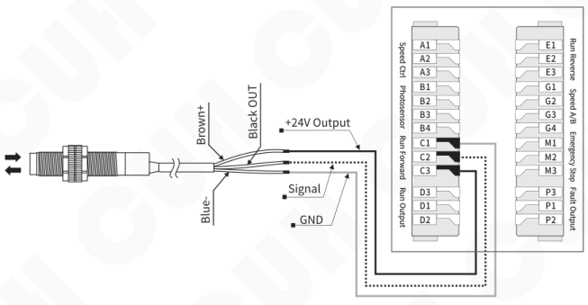

---

## 5.9 พอร์ตเซนเซอร์โฟโต้อิเล็กทริกอัจฉริยะ

พอร์ตโฟโต้อิเล็กทริกอัจฉริยะของตัวควบคุมรุ่นนี้รองรับเซนเซอร์แบบส่งผ่าน (through-beam) หรือแบบสะท้อน (reflective) ที่ประกอบด้วยไดโอดเปล่งแสงและโฟโต้ไทริสตอร์ และยังสามารถตั้งค่าให้รองรับเซนเซอร์สวิตช์แบบ NPN หรือ PNP ได้ผ่านพารามิเตอร์ความไวของโฟโต้อิเล็กทริกอัจฉริยะ P

### วิธีต่อเซนเซอร์โฟโต้

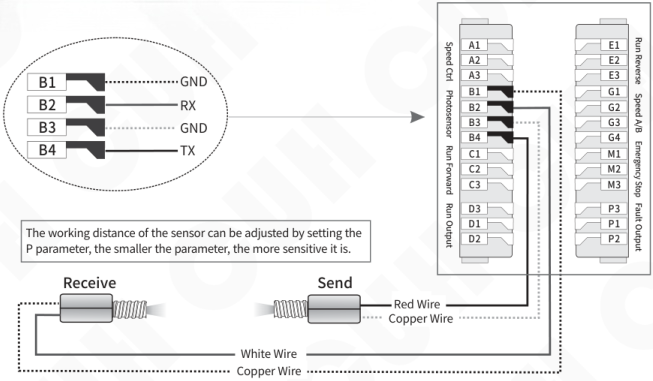

ระยะการทำงานของเซนเซอร์ปรับได้โดยการตั้งค่าพารามิเตอร์ P ค่าพารามิเตอร์ยิ่งน้อย ยิ่งไว (sensitive) มากขึ้น

### วิธีต่อเซนเซอร์สวิตช์

ตั้งค่าชนิด NPN หรือ PNP ด้วยพารามิเตอร์ P

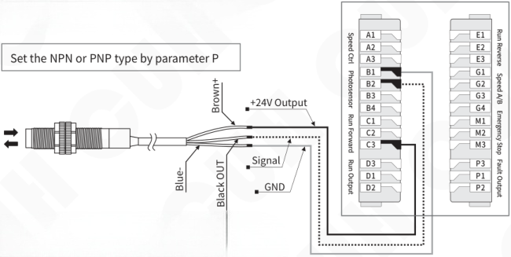

**หมายเหตุ:**

เมื่อค่า P เป็น nPn หรือ PnP, B4 จะเอาต์พุตสัญญาณ valid 10mA

ตั้งแต่ 2 ถึง 1000, B4 จะเอาต์พุตสัญญาณมอดูเลต 10mA ที่ความถี่ประมาณ 200Hz

เมื่อตัวควบคุมพบข้อผิดพลาด B4 จะไม่เอาต์พุต นี่คือฟังก์ชันสัญญาณพร้อมทำงาน (Ready Signal)

---

## 5.10 พอร์ตเอาต์พุตการทำงาน/เอาต์พุตความผิดพลาด

พอร์ตเอาต์พุตการทำงานและเอาต์พุตความผิดพลาดรองรับเอาต์พุตแบบ NPN, PNP และ Push-Pull โดยที่:

- เอาต์พุตแบบ NPN จะ valid ที่ระดับต่ำ (Low) และเป็นสถานะ high-impedance เมื่อ invalid
- เอาต์พุตแบบ PNP จะ valid ที่ระดับสูง (High) และเป็นสถานะ high-impedance เมื่อ invalid
- เอาต์พุตแบบ Push-Pull จะ valid ที่ระดับสูง (High) และ invalid ที่ระดับต่ำ (Low)

### 5.10.1 วิธีเดินสายของเอาต์พุตการทำงาน/เอาต์พุตความผิดพลาด

**วิธีต่อเอาต์พุตแบบ NPN**

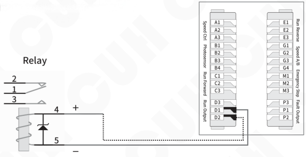

**วิธีต่อเอาต์พุตแบบ PNP หรือ Push-Pull**

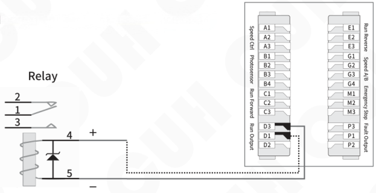

> หากต่อรีเลย์ 24V ต้องยืนยันขั้วบวกลบของขดลวดให้ถูกต้องเสมอ เนื่องจากความสามารถในการจ่ายกระแสของพอร์ตนี้คือ 350mA ไดโอดป้องกันภายในของรีเลย์จะทำให้พอร์ตของตัวควบคุมนี้เกิด short circuit เมื่อต่อกลับขั้ว และทำให้เกิดการป้องกัน short circuit Er07d/P

---

## 5.10.2 แหล่งสัญญาณและแผนภาพตรรกะของเอาต์พุตการทำงาน/เอาต์พุตความผิดพลาด

การควบคุมเอาต์พุตการทำงาน/เอาต์พุตความผิดพลาดเป็นผลลัพธ์ของความสัมพันธ์เชิงตรรกะระหว่างสองแหล่ง โดยสามารถเลือกได้จากรายการแหล่งต่อไปนี้

รายการความหมายของแหล่งสัญญาณ:

| แหล่งสัญญาณ | ความหมาย |
|---|---|
| 0 | สัญญาณ invalid |
| 1 | สัญญาณ valid |
| b | สัญญาณพอร์ตโฟโต้อิเล็กทริกอัจฉริยะ |
| -b | สัญญาณพอร์ตโฟโต้อิเล็กทริกอัจฉริยะแบบกลับด้าน |
| C | สัญญาณพอร์ตหมุนไปข้างหน้า |
| -C | สัญญาณพอร์ตหมุนไปข้างหน้าแบบกลับด้าน |
| E | สัญญาณพอร์ตหมุนย้อนกลับ |
| -E | สัญญาณพอร์ตหมุนย้อนกลับแบบกลับด้าน |
| SA | สัญญาณพอร์ตความเร็ว A |
| -SA | สัญญาณพอร์ตความเร็ว A แบบกลับด้าน |
| Sb | สัญญาณพอร์ตความเร็ว B |
| -Sb | สัญญาณพอร์ตความเร็ว B แบบกลับด้าน |
| ES | สัญญาณพอร์ตหยุดฉุกเฉิน |
| -ES | สัญญาณพอร์ตหยุดฉุกเฉินแบบกลับด้าน |
| od | สัญญาณพอร์ตเอาต์พุตการทำงาน |
| -od | สัญญาณพอร์ตเอาต์พุตการทำงานแบบกลับด้าน |
| oP | สัญญาณพอร์ตเอาต์พุตความผิดพลาด |
| -oP | สัญญาณพอร์ตเอาต์พุตความผิดพลาดแบบกลับด้าน |
| oq | สัญญาณเอาต์พุตมอเตอร์ |
| -oq | สัญญาณเอาต์พุตมอเตอร์แบบกลับด้าน |
| Er | สัญญาณความผิดพลาดใด ๆ |
| -Er | สัญญาณความผิดพลาดใด ๆ แบบกลับด้าน |
| Ar | สัญญาณคำเตือนใด ๆ |
| -Ar | สัญญาณคำเตือนใด ๆ แบบกลับด้าน |

---

## แผนภาพตรรกะของเอาต์พุตการทำงาน/เอาต์พุตความผิดพลาด:

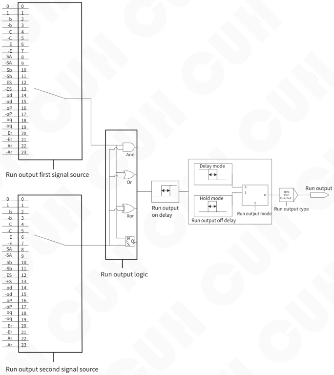

หมายเหตุ: แผนภาพตรรกะของเอาต์พุตความผิดพลาดเหมือนกับแผนภาพตรรกะของเอาต์พุตการทำงาน

---

## 5.10.3 คำอธิบายโหมดของเอาต์พุตการทำงาน/เอาต์พุตความผิดพลาด

เอาต์พุตการทำงาน/เอาต์พุตความผิดพลาดมี 2 โหมดให้เลือก: โหมดหน่วงเวลา (Delay) และโหมดคงไว้ (Hold)

**โหมดหน่วงเวลา (Delay):** หมายถึงหลังจากสัญญาณที่ขับเอาต์พุตการทำงาน/เอาต์พุตความผิดพลาดเปลี่ยนจาก valid เป็น invalid แล้ว เอาต์พุตการทำงาน/เอาต์พุตความผิดพลาดจะปิดหลังจากหน่วงเวลาปิดผ่านไป

**โหมดคงไว้ (Hold):** หมายถึงหลังจากสัญญาณที่ขับเอาต์พุตการทำงาน/เอาต์พุตความผิดพลาดกลายเป็น valid แล้ว เอาต์พุตการทำงาน/เอาต์พุตความผิดพลาดจะคงเปิดไว้ระหว่างเวลาหน่วงเวลาปิด และจะปิดหลังจากหน่วงเวลาปิดผ่านไปแล้ว

ความแตกต่างระหว่างสองโหมดแสดงในรูปแบบแผนภาพจังหวะเวลา (timing diagram) ดังต่อไปนี้ โดยสัญญาณอินพุตคือสัญญาณที่เอาต์พุตออกมาหลังจากตัวเลือกความสัมพันธ์เชิงตรรกะ

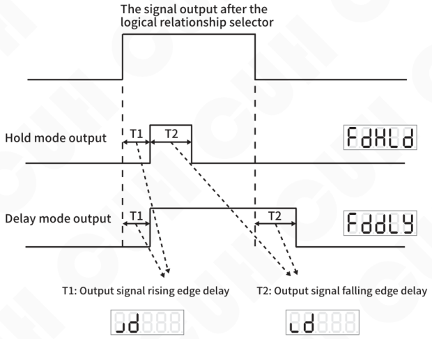

---

## 5.11 สถานะการเปิดเครื่องและการทำงาน

ฟังก์ชันตั้งค่าสถานะการเปิดเครื่องช่วยให้กำหนดสถานะของปุ่มไฟหลังจากเปิดเครื่องได้ โดยการปรับพารามิเตอร์สถานะการทำงาน PS

- **PS=run** หมายถึงปุ่มไฟของตัวควบคุมอยู่ในสถานะทำงานหลังจากเปิดเครื่อง
- **PS=stP** หมายถึงปุ่มไฟของตัวควบคุมอยู่ในสถานะหยุดหลังจากเปิดเครื่อง
- **PS=FoL** หมายถึงปุ่มไฟของตัวควบคุมอยู่ในสถานะเดียวกับก่อนปิดเครื่องครั้งล่าสุดหลังจากเปิดเครื่อง

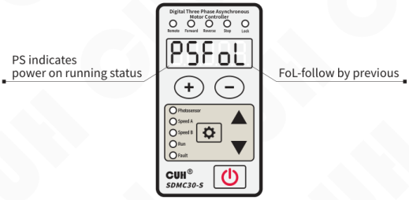

> FoL หมายถึงสถานะก่อนที่ตัวควบคุมจะปิดเครื่อง
>
> หากตัวควบคุมอยู่ในสถานะหยุดฉุกเฉินโดยไฟแสดงการหยุดกะพริบก่อนปิดเครื่อง เมื่อเปิดเครื่องใหม่ก็จะคงอยู่ในสถานะนั้น

---

## 5.12 การปรับความสว่างของแผงหน้าปัด

ตัวควบคุมรุ่นนี้ใช้ชิปขับจอแสดงผลดิจิทัลรุ่นใหม่ ซึ่งรองรับให้ผู้ใช้ปรับค่าความสว่างของจอแสดงผลได้ระหว่าง 1 ถึง 32 ผ่านพารามิเตอร์ LED

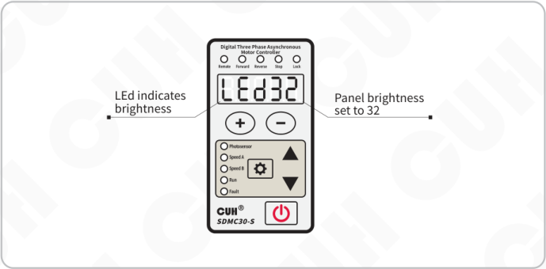

# บทที่ Ⅵ ข้อมูลทางเทคนิค

## 6.1 มิติ　(หน่วย: mm)

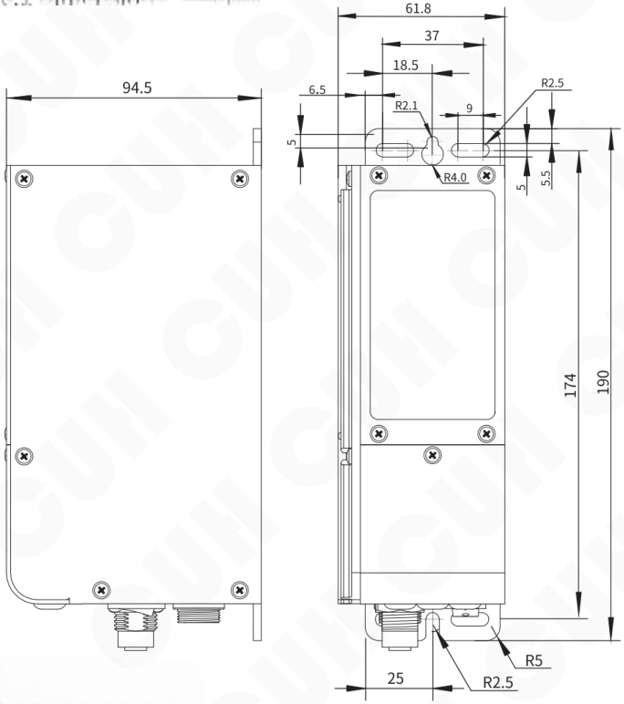

| ช่วงขนาด | ค่าคลาดเคลื่อน |
|---|---|
| 0~3 | ±0.05 |
| 3~10 | ±0.1 |
| 10~30 | ±0.15 |
| 30~80 | ±0.2 |
| 80~180 | ±0.3 |
| >180 | ±0.5 |

> **! จำเป็นอย่างยิ่ง**
>
> โปรดยึดผลิตภัณฑ์บนแท่นที่มั่นคงตามความจำเป็น และยึดรูบนและรูล่างของตัวควบคุมให้แน่น โปรดติดตั้งห่างจากพื้นที่ติดตั้งของเครื่องจักรที่สั่นสะเทือน

ตารางค่าคลาดเคลื่อนนี้ใช้กับผลิตภัณฑ์ทั้งหมดในซีรีส์นี้

---

## 6.2 ข้อมูลทางเทคนิค

| รายการ | ต่ำสุด | ทั่วไป | สูงสุด | หน่วย | หมายเหตุ |
|---|---|---|---|---|---|
| แรงดันอินพุต | 85 | 220 | 250 | V | 50/60Hz AC RMS |
| แรงดันไลน์เอาต์พุต | 0 | 200 | 220 | Vrmn | ค่าเฉลี่ยหลังเรคติไฟ |
| กระแสอินพุต RMS | —— | —— | 2.8 | A | |
| กระแสอินพุตพีค | —— | —— | 8.0 | A | |
| ช่วงปรับกระแสเอาต์พุต | 0 | —— | 1.6 | A | ค่าเฉลี่ยหลังเรคติไฟ |
| ความจุเอาต์พุต | 0 | —— | 600 | VA | |
| ความถี่เอาต์พุต | 2.0 | —— | 120.0 | Hz | |
| ความละเอียดการปรับความถี่ | | 0.1 | | Hz | |
| รูปคลื่นเอาต์พุต | | Vector Sine | | | |
| กำลังมอเตอร์ที่ใช้ได้ | —— | —— | 0.2 | kW | 1/4HP |
| อุณหภูมิทริกเกอร์การป้องกันร้อนเกิน | —— | 65 | —— | °C | กลับสู่ปกติที่ 60°C |
| กระแสเอาต์พุต DC ควบคุม | 0 | —— | 350 | mA | |
| กระแสเอาต์พุต 24V | —— | —— | 700 | mA | |
| แรงดันเอาต์พุต DC ควบคุม | 22 | 24 | 26 | V | |
| สัญญาณควบคุมอะนาล็อก | | 4~20 / 1~5、0~5、0~10 | | mA / V | ควบคุมโดยพารามิเตอร์ A |
| สัญญาณควบคุมดิจิทัล | | 24 | | V | สัญญาณสวิตช์ |
| วิธีปรับค่า | | 6 | | ปุ่ม | |
| กำลังสูญเสียขณะพร้อมทำงาน | —— | 3 | —— | W | |
| วิธีแสดงผล | | 5 | | หลัก | LED |
| น้ำหนัก | | 830 | | g | ไม่รวมอุปกรณ์เสริม |
| มิติ | | 190\*61.8\*94.5 ( L\*W\*H ) | | mm | |
| ระดับการป้องกัน | | IP20 | | | |
| อุณหภูมิแวดล้อม | -10 | 25 | 40 | °C | ไม่ควบแน่น |
| ความชื้นแวดล้อม | 10 | 60 | 85 | % | ไม่ควบแน่น |
| อุณหภูมิแวดล้อมการจัดเก็บ | -20 | 25 | 85 | °C | ไม่ควบแน่น |
| ระดับความสูงที่ใช้ได้ | | <2000 | | m | |

# บทที่ Ⅶ ภาคผนวก

## 7.1 ตารางพารามิเตอร์

| พารามิเตอร์ | คำนิยาม | สัญลักษณ์ | สัญลักษณ์บนจอ | ช่วง | ค่าตั้งต้น |
|---|---|---|---|---|---|
| พารามิเตอร์พร้อมทำงาน | ความถี่ที่ตั้งไว้ | F |  | 2.0~120.0 (Hz) (จำกัดโดย r และ y) | 50.0 |
| พารามิเตอร์มอเตอร์ — กด ⚙ ค้าง | แหล่งควบคุมสตาร์ท/หยุดการหมุนไปข้างหน้า 1 | F1 |  | 0, 1, b, -b, C, -C, E, -E, SA, -SA, Sb, -Sb, ES, -ES, od, -od, oP, -oP | C |
| พารามิเตอร์มอเตอร์ | แหล่งควบคุมสตาร์ท/หยุดการหมุนไปข้างหน้า 2 | F2 | 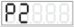 | 0, 1, b, -b, C, -C, E, -E, SA, -SA, Sb, -Sb, ES, -ES, od, -od, oP, -oP | -b |
| พารามิเตอร์มอเตอร์ | ความสัมพันธ์เชิงตรรกะสตาร์ท/หยุดการหมุนไปข้างหน้า | FA |  | And, or, Xor, rS | And |
| พารามิเตอร์มอเตอร์ | แหล่งควบคุมการหมุนย้อนกลับ 1 | A1 |  | 0, 1, b, -b, C, -C, E, -E, SA, -SA, Sb, -Sb, ES, -ES, od, -od, oP, -oP | E |
| พารามิเตอร์มอเตอร์ | แหล่งควบคุมการหมุนย้อนกลับ 2 | A2 |  | 0, 1, b, -b, C, -C, E, -E, SA, -SA, Sb, -Sb, ES, -ES, od, -od, oP, -oP | -b |
| พารามิเตอร์มอเตอร์ | ความสัมพันธ์เชิงตรรกะการหมุนย้อนกลับ | AA |  | And, or, Xor, rS | And |
| พารามิเตอร์มอเตอร์ | โหมดควบคุมการหมุนไปข้างหน้า/ย้อนกลับ | Fr |  | 0 (แหล่งควบคุมการหมุนไปข้างหน้าใช้สตาร์ทและหยุดการหมุนไปข้างหน้า และแหล่งควบคุมการหมุนย้อนกลับใช้ควบคุมสตาร์ทและหยุดการหมุนย้อนกลับ) 1 (แหล่งควบคุมการหมุนไปข้างหน้าใช้ควบคุมการสตาร์ทและหยุด และแหล่งควบคุมการหมุนย้อนกลับใช้ควบคุมการหมุนไปข้างหน้าและย้อนกลับ) | 0 |
| พารามิเตอร์มอเตอร์ | แหล่งหยุดฉุกเฉิน | Eq |  | 0, 1, b, -b, C, -C, E, -E, SA, -SA, Sb, -Sb, ES, -ES, od, -od, oP, -oP, oq, -oq, Er, -Er, Ar, -Ar | ES |
| พารามิเตอร์มอเตอร์ | ชนิดการหยุดฉุกเฉิน | Sq |  | Sto: ปิดโมเมนตัมอย่างปลอดภัย, Sbc: การควบคุมเบรกความปลอดภัย, SS1: การหยุดความปลอดภัยระดับชั้น 1　(หมายเหตุ 1) | Sto |
| พารามิเตอร์มอเตอร์ | เวลาสตาร์ทแบบนุ่มนวล | t |  | 0.0~99.9 (s) | 10.0 |
| พารามิเตอร์มอเตอร์ | เวลาหยุดแบบนุ่มนวล | d |  | เวลาเบรกกระแสตรง: -0.0~-99.9 (s) เวลาหยุดแบบนุ่มนวล: 0.0~99.9 (s) | 10.0 |
| พารามิเตอร์มอเตอร์ | ความถี่สูงสุด | y |  | 2.0~120.0 (Hz) | 50.0 |
| พารามิเตอร์มอเตอร์ | ความถี่พิกัด | b |  | 45.0~65.0 (Hz) | 50.0 |
| พารามิเตอร์มอเตอร์ | แรงดันพิกัด | h |  | 70~220 (Vrmn) | 200 |
| พารามิเตอร์มอเตอร์ | ความถี่กลาง | n |  | r~b (Hz) | 10.0 |
| พารามิเตอร์มอเตอร์ | แรงดันกลาง | o |  | u~h (Vrmn) | 40 |
| พารามิเตอร์มอเตอร์ | ความถี่ต่ำสุด | r |  | 2.0~n (Hz) | 2.0 |
| พารามิเตอร์มอเตอร์ | แรงดันต่ำสุด | u |  | 0~o (Vrmn) | 8 |
| พารามิเตอร์มอเตอร์ | กำลังไฟฟ้าพิกัดของมอเตอร์ | Pn |  | 0.01~0.20 (kW) | 0.20 |
| พารามิเตอร์มอเตอร์ | สัมประสิทธิ์ส่วนเกินของกำลัง | rc |  | 100~150 (%) | 150 |
| พารามิเตอร์มอเตอร์ | สัมประสิทธิ์กระแสเบรก | cb |  | 10~150 (%) | 100 |
| พารามิเตอร์มอเตอร์ | ค่าเกณฑ์ความร้อนเกินของกำลังไฟฟ้า | oL |  | 0~90 (ครั้ง*วินาที) หมายเหตุ: หากกำลังไฟฟ้าเกินกำลังพิกัดของมอเตอร์แต่ไม่เกินขีดจำกัดบนของกำลังมอเตอร์ หากปริมาณการเฉลี่ยต่อวินาทีเกินค่าที่ตั้งนี้ จะเข้าสู่สถานะการป้องกันความร้อนเกินแบบอิเล็กทรอนิกส์ | 30 |
| พารามิเตอร์มอเตอร์ | สัมประสิทธิ์ลดกำลัง | rL |  | 0~90(%) 0 หมายถึงหยุดทำงาน, 90 หมายถึงลดลงเหลือ 90% ของกำลังพิกัด | 0 |
| พารามิเตอร์มอเตอร์ | การสลับทิศทางการหมุน (หมายเหตุ 2) | Ph |  | Abc: ทิศทางมาตรฐาน, Acb: สลับทิศทาง, A.b.c.: ห้ามหมุนย้อนกลับของทิศทางมาตรฐาน (เฉพาะหมุนไปข้างหน้า), A.c.b.: สลับทิศทางห้ามหมุนไปข้างหน้า (เฉพาะหมุนย้อนกลับ) | AbC |
| พารามิเตอร์มอเตอร์ | สถานะการเปิดเครื่องและการทำงาน | PS |  | run: ทำงาน, stp: หยุด, FoL: จดจำครั้งล่าสุด | FoL |

**พารามิเตอร์พอร์ต**  
กด ⚙ พร้อม ▲ ค้างไว้

| คำนิยาม | สัญลักษณ์ | สัญลักษณ์บนจอ | ช่วง | ค่าตั้งต้น |
|---|---|---|---|---|
| ความไวของโฟโต้อิเล็กทริกอัจฉริยะ | P |  | nPn, PnP, 2~1000 | nPn |
| หน่วงเวลาเปิดของโฟโต้อิเล็กทริกอัจฉริยะ | J |  | 0.0~99.9 (s) | 0.2 |
| หน่วงเวลาปิดของโฟโต้อิเล็กทริกอัจฉริยะ | L |  | 0.0~99.9 (s) | 0.2 |
| ชนิดเซนเซอร์สวิตช์ | rA |  | nPn, PnP, Ut1: สแกนครั้งเดียว, Ut0: สแกนต่อเนื่อง | Ut0 |
| หน่วงเวลาเปิดการหมุนไปข้างหน้า | JC |  | 0.0~99.9 (s) | 0.2 |
| หน่วงเวลาปิดการหมุนไปข้างหน้า | LC |  | 0.0~99.9 (s) | 0.2 |
| หน่วงเวลาเปิดการหมุนย้อนกลับ | JE |  | 0.0~99.9 (s) | 0.2 |
| หน่วงเวลาปิดการหมุนย้อนกลับ | LE |  | 0.0~99.9 (s) | 0.2 |
| หน่วงเวลาเปิดความเร็ว A/B | JG |  | 0.0~99.9 (s) | 0.2 |
| หน่วงเวลาปิดความเร็ว A/B | LG |  | 0.0~99.9 (s) | 0.2 |
| หน่วงเวลาเปิดการหยุดฉุกเฉิน | JJ |  | 0.0~99.9 (s) | 0.2 |
| หน่วงเวลาปิดการหยุดฉุกเฉิน | LL |  | 0.0~99.9 (s) | 0.2 |
| แหล่งตั้งความเร็วล่วงหน้า 1 | S1 |  | 0, 1, b, -b, C, -C, E, -E, SA, -SA, Sb, -Sb, ES, -ES, od, -od, oP, -oP, oq, -oq, Er, -Er, Ar, -Ar | SA |
| แหล่งตั้งความเร็วล่วงหน้า 2 | S2 |  | 0, 1, b, -b, C, -C, E, -E, SA, -SA, Sb, -Sb, ES, -ES, od, -od, oP, -oP, oq, -oq, Er, -Er, Ar, -Ar | Sb |
| แหล่งสัญญาณเอาต์พุตการทำงาน 1 | Ed |  | 0, 1, b, -b, C, -C, E, -E, SA, -SA, Sb, -Sb, ES, -ES, od, -od, oP, -oP, oq, -oq, Er, -Er, Ar, -Ar | oq |
| แหล่งสัญญาณเอาต์พุตการทำงาน 2 | td |  | 0, 1, b, -b, C, -C, E, -E, SA, -SA, Sb, -Sb, ES, -ES, od, -od, oP, -oP, oq, -oq, Er, -Er, Ar, -Ar | 0 |
| ความสัมพันธ์เชิงตรรกะเอาต์พุตการทำงาน | Ad |  | And, or, Xor, rS | or |
| หน่วงเวลาเปิดเอาต์พุตการทำงาน | Jd |  | 0.0~99.9 (s) | 0.0 |
| หน่วงเวลาปิดเอาต์พุตการทำงาน | Ld |  | 0.0~99.9 (s) | 0.0 |
| โหมดเอาต์พุตการทำงาน | Fd |  | dLy (โหมดหน่วงเวลา), HLd (โหมดคงไว้) | dLy |
| ทิศทางตรรกะเอาต์พุตการทำงาน | Sd |  | `---` เฟสเดียวกัน, `-﹉-` กลับด้าน, on (normally open), oFF (normally close) | `---` |
| ชนิดเอาต์พุตการทำงาน | rd |  | nPn, PnP, PSP (push-pull) | nPn |
| แหล่งสัญญาณเอาต์พุตความผิดพลาด 1 | EP |  | 0, 1, b, -b, C, -C, E, -E, SA, -SA, Sb, -Sb, ES, -ES, od, -od, oP, -oP, oq, -oq, Er, -Er, Ar, -Ar | Er (สัญญาณความผิดพลาด) |
| แหล่งสัญญาณเอาต์พุตความผิดพลาด 2 | 2P |  | 0, 1, b, -b, C, -C, E, -E, SA, -SA, Sb, -Sb, ES, -ES, od, -od, oP, -oP, oq, -oq, Er, -Er, Ar, -Ar | Ar (สัญญาณคำเตือน) |
| ความสัมพันธ์เชิงตรรกะเอาต์พุตความผิดพลาด | AP |  | And, or, Xor, rS | or |
| หน่วงเวลาเปิดเอาต์พุตความผิดพลาด | JP |  | 0.0~99.9 (s) | 0.0 |
| หน่วงเวลาปิดเอาต์พุตความผิดพลาด | LP |  | 0.0~99.9 (s) | 0.0 |
| โหมดเอาต์พุตความผิดพลาด | FP |  | dLy (โหมดหน่วงเวลา), HLd (โหมดคงไว้) | dLy |
| ทิศทางตรรกะเอาต์พุตความผิดพลาด | SP |  | `---` เฟสเดียวกัน, `-﹉-` กลับด้าน, on (normally open), oFF (normally close) | `---` |
| ชนิดเอาต์พุตความผิดพลาด | rP |  | nPn, PnP, PSP (push-pull) | nPn |

สัญลักษณ์แสดงผลของทิศทางตรรกะ: 

| | คำนิยาม | สัญลักษณ์ | สัญลักษณ์บนจอ | ช่วง | ค่าตั้งต้น |
|---|---|---|---|---|---|
| พารามิเตอร์พอร์ต | แหล่งควบคุมระยะไกล | A |  | Pad (ควบคุมโดยปุ่มกด), 1-5V, 0-5V, 0-10 | 1-5V |
| พารามิเตอร์พอร์ต | สัมประสิทธิ์ควบคุมระยะไกล | r |  | 0.50~2.00 | 1.00 |
| พารามิเตอร์พอร์ต | ความสว่างของแผงหน้าปัด | LEd |  | 1~32 | 16 |
| พารามิเตอร์พอร์ต | คืนค่าการตั้งค่าจากโรงงาน | 8.8.8.8.8. |  | —— | —— |
| พารามิเตอร์เฝ้าติดตาม กด ⚙ พร้อม ▼ ค้างไว้ | อุณหภูมิตัวควบคุม | C |  | -20.0~85.0 (℃) | —— |
| พารามิเตอร์เฝ้าติดตาม | ความถี่เอาต์พุต | E |  | 2.0~120.0 (Hz) | —— |
| พารามิเตอร์เฝ้าติดตาม | กำลังจริงของระบบ (ตัวควบคุม + มอเตอร์) | qP |  | 0.00~0.40 (kW) | —— |
| พารามิเตอร์เฝ้าติดตาม | กระแสบัส | AC |  | 0.00~3.50 (A) | —— |
| พารามิเตอร์เฝ้าติดตาม | แรงดันเอาต์พุต | dU |  | 0~250 (V) | —— |
| พารามิเตอร์เฝ้าติดตาม | แรงดันบัส | PU |  | 0~400 (V) | —— |
| พารามิเตอร์เฝ้าติดตาม | แรงดันเอาต์พุต 24V | nU |  | 0.0~28.0 (V) | —— |
| พารามิเตอร์เฝ้าติดตาม | แรงดันพอร์ตควบคุมระยะไกล | AU |  | 0.0~10.0 (V) | —— |
| พารามิเตอร์เฝ้าติดตาม | แรงดันสัญญาณโฟโต้อิเล็กทริกอัจฉริยะ | bU |  | 0~999 | —— |
| พารามิเตอร์เฝ้าติดตาม | แรงดันสัญญาณหมุนไปข้างหน้า | tU |  | 0.0~28.0 (V) | —— |
| พารามิเตอร์เฝ้าติดตาม | แรงดันพอร์ตเอาต์พุตการทำงาน | dU |  | 0.0~28.0 (V) | —— |
| พารามิเตอร์เฝ้าติดตาม | แรงดันสัญญาณหมุนย้อนกลับ | EU |  | 0.0~28.0 (V) | —— |
| พารามิเตอร์เฝ้าติดตาม | แรงดันพอร์ตความเร็ว A | SA |  | 0.0~28.0 (V) | —— |
| พารามิเตอร์เฝ้าติดตาม | แรงดันพอร์ตความเร็ว B | Sb |  | 0.0~28.0 (V) | —— |
| พารามิเตอร์เฝ้าติดตาม | แรงดันพอร์ตหยุดฉุกเฉิน | SU |  | 0.0~28.0 (V) | —— |
| พารามิเตอร์เฝ้าติดตาม | แรงดันพอร์ตเอาต์พุตความผิดพลาด | FU |  | 0.0~28.0 (V) | —— |
| พารามิเตอร์เฝ้าติดตาม | เวอร์ชันบอร์ดควบคุม | uc |  | —— | —— |
| พารามิเตอร์เฝ้าติดตาม | เวอร์ชันบอร์ดกำลัง | uq |  | —— | —— |

หมายเหตุ 1: เมื่อ STo ตัวควบคุมจะตัดไฟเลี้ยงไปยังมอเตอร์ทันที และมอเตอร์จะชะลอความเร็วหยุดตามแรงเฉื่อย

เมื่อ Sbc มอเตอร์จะหยุดโดยการเบรกกระแสตรง โดยเวลาเบรกยืนยันโดยเวลาหยุดแบบนุ่มนวล พอร์ตเอาต์พุตความผิดพลาดจะเอาต์พุตสถานะหยุดฉุกเฉิน ซึ่งไม่ได้รับการควบคุมจากแหล่งสัญญาณ และต้องใช้รีเลย์เบรกความปลอดภัย

เมื่อ SS1 มอเตอร์จะชะลอความเร็วหรือเบรกหยุดตามการทำงานที่กำหนดโดยเวลาหยุดแบบนุ่มนวล

หมายเหตุ 2: ตามมาตรฐาน IEC60034-8 ทิศทางมาตรฐานถูกกำหนดเป็น: ทิศทางตามเข็มนาฬิกาเมื่อสังเกตจากด้านขับของมอเตอร์ โดยพารามิเตอร์นี้ไม่มีผลต่อสถานะของไฟแสดงการหมุนไปข้างหน้าและย้อนกลับ

---

## 7.2 แผนภาพวงจรอินพุตและเอาต์พุต

**พอร์ต A ควบคุมความเร็วระยะไกล**

**พอร์ต B เซนเซอร์โฟโต้อัจฉริยะ**

**พอร์ต D เอาต์พุตการทำงาน/พอร์ต P เอาต์พุตความผิดพลาด**

---

| พอร์ต | ฟังก์ชัน |
|---|---|
| C3/E3/M3 | เอาต์พุต 24V |
| C2/E2/M2/G2/G4 | อินพุต |
| C1/E1/M1/G1/G3 | GND |

**พอร์ต C หมุนไปข้างหน้า/พอร์ต E หมุนย้อนกลับ/**  
**พอร์ต M หยุดฉุกเฉิน/พอร์ต G ตั้งความเร็วล่วงหน้า**

---

## 7.3 รหัสข้อผิดพลาด

| รหัสข้อผิดพลาด | ความหมาย | เงื่อนไขที่เกิดขึ้น | การตอบสนองของตัวควบคุม | วิธีแก้ไขปัญหา |
|---|---|---|---|---|
| Er01 | เอาต์พุตหลัก short circuit | ขั้วเอาต์พุต short circuit ต่อกันเองหรือต่อ PE | หยุดเอาต์พุตหลัก กดปุ่ม ON/OFF สั้น ๆ เพื่อล้างค่า | ◆ Short circuit เอาต์พุต หรือปิดสวิตช์เอาต์พุตสองครั้งแล้วเปิดเครื่องใหม่ |
| Er02H | อิเล็กทรอนิกส์ของมอเตอร์ร้อนเกิน | มอเตอร์เกินค่าเกณฑ์ความร้อนของกำลังไฟฟ้า | หยุดและเริ่มทำงานใหม่อัตโนมัติ หรือทำงานที่กำลังลดลงตามการตั้งค่าสัมประสิทธิ์ลดกำลัง | ◆ ลดค่าความถี่การทำงานของมอเตอร์ที่ตั้งไว้ให้เหมาะสม |
| Er02P | กำลังมอเตอร์เกินขีดจำกัด | กำลังเอาต์พุตเกินสัมประสิทธิ์ส่วนเกินของกำลัง | หยุดและเริ่มทำงานใหม่อัตโนมัติ หรือทำงานที่กำลังลดลงตามการตั้งค่าสัมประสิทธิ์ลดกำลัง | ◆ ลดค่าความถี่การทำงานของมอเตอร์ที่ตั้งไว้ให้เหมาะสม |
| Er03L | เย็นเกิน | อุณหภูมิตัวควบคุมต่ำกว่า -20°C | หยุดเอาต์พุตหลัก เอาต์พุตจะเริ่มทำงานอัตโนมัติเมื่ออุณหภูมิกลับสู่ปกติ | ◆ หลีกเลี่ยงการเปิดใช้ตัวควบคุมในอุณหภูมิที่หนาวจัด |
| Er03H | ร้อนเกิน | อุณหภูมิตัวควบคุมสูงกว่า 65°C | หยุดเอาต์พุตหลัก เอาต์พุตจะเริ่มทำงานอัตโนมัติเมื่ออุณหภูมิกลับสู่ปกติ | ◆ ติดตั้งตัวควบคุมนี้ในสภาพแวดล้อมที่ระบายอากาศดี |
| Er04L | แรงดันต่ำ | แรงดันบัสเฉลี่ยต่ำกว่า 77V | หยุดเอาต์พุตหลัก เอาต์พุตจะกลับมาอัตโนมัติเมื่อแรงดันไฟเลี้ยงปกติ | ◆ ตรวจสอบให้แน่ใจว่าแรงดันอินพุตอยู่ระหว่าง 85V~250V |
| Er04H | แรงดันสูง | แรงดันบัสเฉลี่ยสูงกว่า 390V | หยุดเอาต์พุตหลัก เอาต์พุตจะกลับมาอัตโนมัติเมื่อแรงดันไฟเลี้ยงปกติ | ◆ ตรวจสอบให้แน่ใจว่าแรงดันอินพุตอยู่ระหว่าง 85V~250V |
| Er05 | การสื่อสารภายในผิดปกติ | ไม่ได้รับการตอบสนองจากบอร์ดกำลังเป็นเวลา 2 วินาทีติดต่อกัน | หยุดเอาต์พุตหลัก จะถูกกำจัดอัตโนมัติเมื่อการสื่อสารกลับมาปกติ | ◆ ตรวจสอบให้แน่ใจว่าพอร์ตไฟเลี้ยง 24V ไม่ได้ต่อกับแหล่งจ่ายไฟภายนอก หรือติดต่อฝ่ายสนับสนุนทางเทคนิคของเรา |
| Er06 | เซนเซอร์อุณหภูมิผิดปกติ | ไม่สามารถอ่านอุณหภูมิได้ | หยุดเอาต์พุตหลักและลองอ่านอุณหภูมิอีกครั้งเป็นเวลา 2 วินาที | ◆ ติดต่อฝ่ายสนับสนุนทางเทคนิคของเรา |
| Er07d/P | พอร์ตเอาต์พุตทำงาน/ความผิดพลาด short circuit | กระแสเอาต์พุตเกิน 350mA หรือ short circuit | ปิดเอาต์พุตทำงาน/ความผิดพลาดภายใน 5ms, ลองเริ่มเอาต์พุตใหม่หลัง 2 วินาที | ◆ ตรวจสอบให้แน่ใจว่าโหลดไม่ short circuit และกระแสไม่เกิน 350mA |
| Er10 | เอาต์พุต 24V short circuit | เอาต์พุต 24V short circuit หรือกระแสเกิน 700mA | หยุดเอาต์พุต 24V และเปิดเครื่องอีกครั้งเพื่อเริ่มเอาต์พุตใหม่ | ◆ ตรวจสอบให้แน่ใจว่าเอาต์พุต 24V ไม่ short circuit หรือเกิน 700mA |
| Er11 | เอาต์พุต 5V ผิดปกติ | เอาต์พุต 5V เกินช่วง ±10% | การควบคุมความเร็วระยะไกลล้มเหลว สามารถกลับมาอัตโนมัติได้ | ◆ ตรวจสอบให้แน่ใจว่าเอาต์พุต 5V ไม่ได้ short circuit หรือต่อกับแรงดันภายนอก |
| Er12 | แรงดัน 24V ผิดปกติ | ตรวจสอบว่าแรงดัน 24V ภายในอยู่ระหว่าง 22~26V หรือไม่ | พอร์ตเอาต์พุตควบคุมจะกลายเป็น high impedance สามารถกลับมาอัตโนมัติได้ | ◆ ตรวจสอบให้แน่ใจว่าพอร์ตเอาต์พุตไฟเลี้ยง 24V หรือพอร์ตเอาต์พุตควบคุม ไม่ได้ต่อกับแหล่งจ่ายไฟภายนอก |
| Er13 | เฟสอินพุตขาด (เฉพาะรุ่นอินพุต 3 เฟส) | ไฟฟ้าอินพุตสามเฟสขาดเฟส | หยุดเอาต์พุตหลัก | ◆ ปิดเครื่องเพื่อกำจัดการขาดเฟสของอินพุตแล้วเปิดเครื่องใหม่ |
| Er14 | เฟสเอาต์พุตขาด | กระแสเฟสเอาต์พุตไม่สมดุลเกิน 50% | หยุดเอาต์พุตหลัก | ◆ ปิดเครื่องเพื่อกำจัดการขาดเฟสของเอาต์พุตแล้วเปิดเครื่องใหม่ |
| Er15 | การขัดกันของการหมุนไปข้างหน้า/ย้อนกลับ | สัญญาณหมุนไปข้างหน้าและย้อนกลับถูกส่งพร้อมกัน | เอาต์พุตหลักหยุด จะกลับมาอัตโนมัติหลังจากยกเลิกการขัดกันแล้ว | ◆ ตรวจสอบให้แน่ใจว่าไม่ได้ส่งสัญญาณหมุนไปข้างหน้าและย้อนกลับพร้อมกัน |

## บทที่ Ⅷ ข้อมูลการรับประกันผลิตภัณฑ์

### 8.1 ระยะเวลารับประกัน

ระยะเวลารับประกันที่บริษัทมอบให้สำหรับผลิตภัณฑ์นี้คือ 3 ปี นับจากวันที่ส่งมอบผลิตภัณฑ์ถึงสถานที่ที่ผู้ซื้อกำหนด

### 8.2 ขอบเขตการรับประกัน

(1) หากมีความเสียหางที่เกิดจากบริษัทของเราภายในระยะเวลารับประกันข้างต้น เราจะซ่อมแซมผลิตภัณฑ์โดยไม่คิดค่าใช้จ่าย อย่างไรก็ตาม กรณีต่อไปนี้ไม่อยู่ในความคุ้มครองของการรับประกัน:

a. ไม่ปฏิบัติตามเงื่อนไขที่ระบุในคู่มือฉบับย่อ คู่มือการใช้งาน หรือข้อกำหนดทางเทคนิคที่ตกลงร่วมกันเป็นพิเศษระหว่างผู้ซื้อกับบริษัท การใช้งานที่ไม่ถูกต้อง หรือความเสียหางที่เกิดจากการใช้งานที่ไม่เหมาะสม

b. ความเสียหางไม่ได้เกิดจากความบกพร่องของผลิตภัณฑ์ แต่เกิดจากการออกแบบอุปกรณ์หรือซอฟต์แวร์ของผู้ซื้อ

c. ความผิดปกติที่เกิดจากการดัดแปลงหรือซ่อมแซมที่ไม่ได้ทำโดยบุคลากรของบริษัท

d. ความเสียหางที่สามารถหลีกเลี่ยงได้ทั้งหมดโดยการบำรุงรักษาที่ถูกต้อง หรือการเปลี่ยนชิ้นส่วนที่สึกหรอตามคู่มือการใช้งานฉบับย่อหรือคู่มือการใช้งาน

e. ความเสียหางที่เกิดขึ้นหลังจากผลิตภัณฑ์ถูกส่งออกจากบริษัทของเรา อันเนื่องจากปัจจัย เช่น ความเปลี่ยนแปลงทางวิทยาศาสตร์และเทคโนโลยีที่คาดไม่ถึง

f. เนื่องจากภัยพิบัติทางธรรมชาติ เช่น อัคคีภัย แผ่นดินไหว อุทกภัย หรือปัจจัยภายนอก เช่น ความเสียหางจากแรงดันไฟฟ้าผิดปกติ บริษัทไม่รับความรับผิดชอบในการรับประกัน

(2) ขอบเขตของการรับประกันจำกัดเฉพาะสถานการณ์ที่ระบุไว้ใน (1) สำหรับความเสียหางทางอ้อม (เช่น ความเสียหางของอุปกรณ์ โอกาสที่สูญเสีย กำไรที่สูญเสีย ฯลฯ) หรือความสูญเสียอื่น ๆ บริษัทไม่รับความรับผิดชอบใด ๆ ทั้งสิ้น

### 8.3 ความเหมาะสมของผลิตภัณฑ์

ตัวควบคุมของบริษัทเราได้รับการออกแบบและผลิตเพื่อการใช้งานทั่วไปในอุตสาหกรรมควบคุมมอเตอร์ ดังนั้น ตัวควบคุมของบริษัทเรานี้จึงไม่ควรใช้กับการใช้งานต่อไปนี้ และไม่เหมาะสมกับการใช้งานเหล่านั้น:

(1) สิ่งอำนวยความสะดวกที่มีผลกระทบอย่างร้ายแรงต่อชีวิตและทรัพย์สิน เช่น โรงไฟฟ้านิวเคลียร์ สนามบิน ระบบราง เรือ อุปกรณ์เคลื่อนที่ด้วยยนต์ และเครื่องมือแพทย์

(2) สาธารณูปโภค รวมถึงไฟฟ้า แก๊ส การประปา ฯลฯ

(3) การใช้งานกลางแจ้งในสภาพหรือสภาพแวดล้อมที่คล้ายคลึงกัน

---

Nanjing CUH Science & Technology Co.,Ltd  
https://en.cuhnj.com  
Tel.:+86-25-84730411 / 84730415 / 84730416  
Fax:+86-25-84730426  
E-mail:sales@cuhnj.com  
Add.:Building 2, Xueyan Tech Park, Tuscity,  
No.9 Zhineng Rd, Jiangning, Nanjing, China

เอกสารเลขที่: IDP1000330

