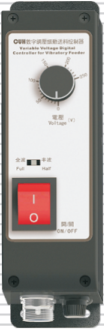
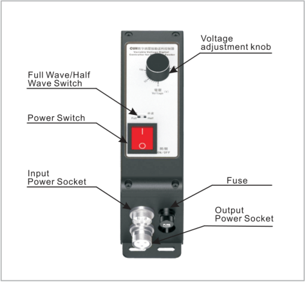
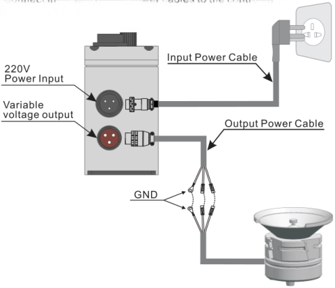
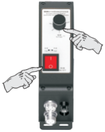

## ตัวควบคุมแรงดันดิจิทัลแบบปรับค่าได้สำหรับเครื่องป้อนวัสดุแบบสั่นสะเทือน

รุ่น: SDVC11-M

## ภาพรวม:

## การเดินสาย:

ขั้นตอนที่ 1:

เชื่อมต่อสายไฟอินพุตและเอาต์พุตเข้ากับตัวควบคุมตามแผนภาพ

### ขั้นตอนที่ 2:
หมุนปุ่มปรับแรงดันเพื่อตั้งค่าแรงดันเอาต์พุต

### ขั้นตอนที่ 3:
เปิดสวิตช์ไฟ  
ไฟแสดงสถานะจะสว่างขึ้น

## สวิตช์เต็มคลื่น/ครึ่งคลื่น:

สามารถสลับรูปคลื่นเอาต์พุต/ความถี่เอาต์พุตได้

หากความถี่ไฟเมนเป็น 50/60Hz ความถี่เอาต์พุตจะเป็น 100/120Hz เมื่อตั้งสวิตช์ตามที่แสดงในรูปที่ (1)

หากความถี่ไฟเมนเป็น 50/60Hz ความถี่เอาต์พุตจะเป็น 50/60Hz เมื่อตั้งสวิตช์ตามที่แสดงในรูปที่ (2)

## คุณสมบัติ:

**การควบคุมแรงดันอัตโนมัติ:** วงจรควบคุมแรงดันดิจิทัลภายในสามารถลดการแปรผันของความเร็วการป้อนที่เกิดจากความผันผวนของแรงดันไฟเมน

**การสตาร์ทแบบนุ่มนวล:** ตัวควบคุมจะค่อย ๆ เพิ่มแรงดันเอาต์พุตจาก 0 ไปจนถึงค่าที่ตั้งไว้ล่วงหน้าเมื่อเปิดเครื่อง เพื่อหลีกเลี่ยงการสั่นสะเทือนกะทันหัน

**การควบคุมแรงดันเชิงเส้น:** มุมหมุนของปุ่มปรับแรงดันเป็นเชิงเส้นกับแรงดันเอาต์พุตของตัวควบคุม

**การป้องกันความร้อนเกิน:** หากอุณหภูมิภายในของตัวควบคุมสูงเกินไป ตัวควบคุมจะหยุดเอาต์พุตเพื่อป้องกันตัวเอง

**การป้องกันกระแสเกิน:** หากกระแสเอาต์พุตเกินค่าพิกัด ตัวควบคุมจะหยุดเอาต์พุตเพื่อป้องกันตัวเองและโหลด

**การป้องกันการลัดวงจรด้วยฟิวส์:** หากเอาต์พุตของตัวควบคุมเกิดการลัดวงจร ฟิวส์ภายในจะขาดเพื่อป้องกันตัวควบคุมและโหลด

การออกแบบวงจรที่ปรับให้เหมาะสมเพื่อให้มั่นใจในความเสถียรและอายุการใช้งานที่ยาวนาน

## ข้อมูลจำเพาะ:

| รายการ | ช่วง: ต่ำสุด | ช่วง: ทั่วไป | ช่วง: สูงสุด | หน่วย | คำอธิบาย |
|---|---|---|---|---|---|
| แรงดันอินพุต | 150 | 220 | 260 | V | AC RMS |
| ช่วงแรงดันเอาต์พุตที่ปรับได้ | 35 | —— | Vin-10 | V | ครึ่งคลื่น |
| ช่วงแรงดันเอาต์พุตที่ปรับได้ | 45 | —— | Vin-5 | V | เต็มคลื่น |
| เวลาตอบสนองของการควบคุมแรงดัน | 0 | 0.01 | 0.02 | s | |
| ช่วงกระแสเอาต์พุตที่ปรับได้ | 0.1 | —— | 5 | A | |
| กำลังเอาต์พุต | 22 | —— | 1100 | VA | |
| ความถี่เอาต์พุต | 45 | 50/60 | 65 | Hz | ครึ่งคลื่น |
| ความถี่เอาต์พุต | 90 | 100/120 | 130 | Hz | เต็มคลื่น |
| รูปคลื่นเอาต์พุต | | ไซน์ตัดเฟส | | | |
| เวลาสตาร์ทแบบนุ่มนวล | 0.5 | 0.65 | 0.7 | s | |
| อุณหภูมิที่กระตุ้นการป้องกันความร้อนเกิน | 58 | 60 | 66 | °C | |
| ความจุฟิวส์ | | 6.3 | | A | |
| อุณหภูมิแวดล้อม | 0 | 25 | 40 | °C | ไม่มีการควบแน่น |
| ความชื้นแวดล้อม | 10 | 60 | 85 | % | ไม่มีการควบแน่น |

## ขนาดและน้ำหนัก:

ขนาด:154*53.6*109.3(L*W*H, mm)  
น้ำหนัก:430g (ไม่มีอุปกรณ์เสริม)

Nanjing CUH Science & Technology Co.,Ltd  
https://en.cuhnj.com  
Tel.:+86-25-84730411 / 84730415 / 84730416  
Fax:+86-25-84730426  
E-mail:sales@cuhnj.com  
Add.:Building 2, Xueyan Tech Park, Tuscity,  
No.9 Zhineng Rd, Jiangning, Nanjing, China

Document NO. : SDVC11MSMEN_1.01

