## ตัวควบคุมแรงดันดิจิทัลแบบปรับค่าได้สำหรับเครื่องป้อนวัสดุแบบสั่นสะเทือน

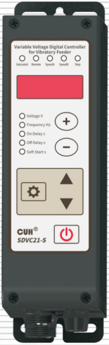

## SDVC21-S

## คู่มือการใช้งาน

---

## ข้อความสงวนลิขสิทธิ์

บริษัท Nanjing CUH Science & Technology CO., Ltd. สงวนสิทธิ์ทั้งหมด

ข้อมูลทั้งหมดที่ปรากฏในคู่มือการใช้งานฉบับนี้เป็นความรู้ของบริษัทและได้รับความคุ้มครองตามกฎหมายลิขสิทธิ์และกฎหมายที่เกี่ยวข้องอื่น ๆ CUH มีและสงวนสิทธิ์ทั้งปวงตามที่กฎหมายลิขสิทธิ์และกฎหมายอื่นให้ไว้ หากไม่ได้รับความยินยอมเป็นลายลักษณ์อักษรจาก CUH ห้ามคัดลอก แปล เลียนแบบ หรือนำไปใช้ประโยชน์อย่างอื่นทั้งสิ้นหรือบางส่วนของคู่มือการใช้งานฉบับนี้

## ข้อจำกัดความรับผิด

เนื้อหาทั้งหมดในคู่มือการใช้งานฉบับนี้อธิบายเพียงวิธีการใช้งานของผลิตภัณฑ์ที่บริษัทผลิตเท่านั้น โดยอธิบายตามเทคโนโลยีที่มีอยู่และสภาพที่ส่งมอบให้ ณ ขณะที่ท่านใช้งาน ท่านต้องรับความเสี่ยงที่เกี่ยวข้องเมื่อใช้ผลิตภัณฑ์นี้ เว้นแต่ที่กฎหมายกำหนด บริษัทไม่มีความรับผิดชอบใด ๆ ทั้งที่ระบุชัดหรือโดยนัยต่อผลิตภัณฑ์อันเนื่องมาจากคู่มือการใช้งานฉบับนี้ รวมถึงแต่ไม่จำกัดเพียงการบาดเจ็บต่อบุคคล ความเสียหายต่อทรัพย์สิน การสูญเสียโอกาส ฯลฯ

ท่านเข้าใจความเสี่ยงข้างต้นอย่างชัดเจน และตกลงว่า เว้นแต่ที่กฎหมายบังคับ บริษัทจะไม่รับผิดชอบต่อความเสียหายหรือความสูญเสียใด ๆ ทั้งทางตรงและทางอ้อมที่เกิดแก่ท่าน (รวมถึงแต่ไม่จำกัดเพียงความสูญเสียที่จับต้องได้ เช่น บุคคล ทรัพย์สิน ข้อมูล และความสูญเสียที่จับต้องไม่ได้ เช่น ชื่อเสียง โอกาส ฯลฯ)

บริษัทสงวนสิทธิ์ในการปรับเปลี่ยนผลิตภัณฑ์ที่ใช้ได้กับคู่มือการใช้งานฉบับนี้ โดยไม่ต้องแจ้งให้ทราบล่วงหน้าหรือภายหลัง

---

## บทนำ

ขอบคุณที่ท่านเลือกใช้ตัวควบคุมแรงดันดิจิทัลแบบปรับค่าได้สำหรับเครื่องป้อนวัสดุแบบสั่นสะเทือน CUH SDVC21-S (Variable Voltage Digital Controller for Vibratory Feeder) (ต่อไปจะเรียกโดยย่อว่า "ตัวควบคุม") ตัวควบคุมตระกูลนี้ใช้ชิ้นส่วนคุณภาพสูง ผสานเทคโนโลยีอิเล็กทรอนิกส์รุ่นล่าสุด และออกแบบมาอย่างพิถีพิถันด้วยตัวประมวลผลสัญญาณดิจิทัลประสิทธิภาพสูง

คู่มือฉบับนี้แนะนำวิธีการใช้งานพื้นฐาน คำอธิบายทางเทคนิคของฟังก์ชัน และตัวอย่างการใช้งานทั่วไปของผลิตภัณฑ์นี้ โดยให้ข้อมูลที่เกี่ยวข้องแก่ผู้ใช้เกี่ยวกับการติดตั้งและการทดสอบ การตั้งค่าพารามิเตอร์ การวินิจฉัยความผิดปกติ การแก้ไขปัญหา และการบำรุงรักษาตัวควบคุมเป็นประจำ เพื่อให้มั่นใจว่าจะติดตั้งและใช้งานตัวควบคุมนี้ได้อย่างถูกต้อง โปรดอ่านคู่มือการใช้งานฉบับนี้อย่างละเอียดก่อนการติดตั้ง และเก็บรักษาไว้ให้ถูกต้องเรียบร้อย

โปรดอ่านสัญลักษณ์ต่อไปนี้อย่างแน่นอน เพื่อเตือนให้ท่านระวังภัยอันอาจก่อให้เกิดอันตรายต่อตัวบุคคลและความเสียหายต่อผลิตภัณฑ์

|  |  |
|---|---|
| ⚠ อันตราย | การไม่ปฏิบัติตามข้อกำหนดนี้จะส่งผลให้เกิดการบาดเจ็บหรือเสียชีวิต |
| ⚠ คำเตือน | การไม่ปฏิบัติตามข้อกำหนดนี้อาจส่งผลให้เกิดการบาดเจ็บหรือเสียชีวิต |
| ⚠ ข้อควรระวัง | การไม่ปฏิบัติตามข้อกำหนดนี้อาจส่งผลให้เกิดการบาดเจ็บระดับปานกลางหรือเล็กน้อยต่อบุคคล |
| หมายเหตุ | การไม่ปฏิบัติตามข้อกำหนดนี้จะส่งผลให้เกิดความเสียหายต่อผลิตภัณฑ์และทรัพย์สิน |
| ❗ จำเป็นอย่างยิ่ง | ระบุข้อควรระวังและข้อจำกัดการใช้งานที่ต้องปฏิบัติตามอย่างเคร่งครัดระหว่างการใช้งาน |

**คู่มือฉบับนี้เหมาะสำหรับตัวควบคุมรุ่นต่อไปนี้:**

- ตัวควบคุมแรงดันดิจิทัลแบบปรับค่าได้สำหรับเครื่องป้อนวัสดุแบบสั่นสะเทือน　SDVC21-S (5A)

---

## ความปลอดภัยและข้อควรระวัง

1. **⚠ อันตราย** ผลิตภัณฑ์นี้ใช้เพื่อขับเคลื่อนอุปกรณ์ป้อนวัสดุแบบสั่นสะเทือนที่ทำงานด้วยคลื่นแม่เหล็กไฟฟ้าเท่านั้น ห้ามใช้ผลิตภัณฑ์นี้เพื่อวัตถุประสงค์ในการปกป้องร่างกายมนุษย์หรืออวัยวะส่วนใดส่วนหนึ่งของร่างกาย ฯลฯ

2. **⚠ อันตราย** ผลิตภัณฑ์นี้ไม่ได้ออกแบบให้เป็นผลิตภัณฑ์กันระเบิด ห้ามใช้ในพื้นที่อันตรายและ/หรือสภาพแวดล้อมที่มีแก๊สระเบิดได้

3. **⚠ คำเตือน** ผลิตภัณฑ์นี้ใช้พลังงานจากไฟฟ้ากระแสสลับจากระบบจ่ายไฟ โปรดอย่าใช้แรงดันไฟฟ้า AC เกิน 260Vac แรงดันอินพุตที่สูงเกินไป เช่น 380Vac อาจทำให้ผลิตภัณฑ์ระเบิดหรือไฟไหม้ ส่งผลให้เกิดอุบัติเหตุด้านความปลอดภัยร้ายแรง

4. **⚠ คำเตือน** ผลิตภัณฑ์นี้ทำการกราวนด์ผ่านสายไฟฟ้า โปรดตรวจสอบให้แน่ใจว่าระบบจ่ายไฟของตัวควบคุมมีการกราวนด์ที่เรียบร้อย มิฉะนั้นเปลือกตัวควบคุมอาจมีไฟฟ้า ทำให้เกิดอุบัติเหตุถูกไฟดูด

5. **⚠ คำเตือน** ห้ามป้อนไฟฟ้ากระแสสลับเข้าไปยังเอาต์พุตของตัวควบคุมนี้ เพราะจะทำให้ตัวควบคุมเสียหาย

6. **⚠ คำเตือน** ห้ามเสียบหรือถอดสายไฟขณะที่จุดต่อมีไฟฟ้า หรือสัมผัสขั้วต่อภายในช่องเดินสาย เพื่อป้องกันการถูกไฟดูด

7. **หมายเหตุ** โปรดหลีกเลี่ยงการควบคุมเอาต์พุตของผลิตภัณฑ์นี้ด้วยการตัดไฟฟ้าผ่านรีเลย์หรืออุปกรณ์อื่น เนื่องจากจะทำให้อายุการใช้งานของตัวควบคุมสั้นลงอย่างมาก

8. **หมายเหตุ** ตัวควบคุมออกแบบมาให้ทำงานในสภาพแวดล้อมที่เย็นและแห้ง ห้ามเด็ดขาดเปิดใช้งานตัวควบคุมกลางแจ้งเพื่อหลีกเลี่ยงการแช่น้ำและแดดเผา ให้ใช้งานตัวควบคุมภายในช่วงอุณหภูมิตามคุณลักษณะทางไฟฟ้าที่กำหนด

9. **❗ จำเป็นอย่างยิ่ง** ต้องยึดติดผลิตภัณฑ์นี้บนแท่นที่มั่นคง ซึ่งกราวนด์อย่างน่าเชื่อถือ และห่างไกลจากอุปกรณ์ที่สั่นสะเทือน

10. **❗ จำเป็นอย่างยิ่ง** ห้ามเด็ดขาดใช้งานตัวควบคุมในสภาวะที่เกินขีดจำกัดการออกแบบ

11. **❗ จำเป็นอย่างยิ่ง** ให้ใช้งานตัวควบคุมอย่างเคร่งครัดตามคู่มือฉบับนี้ บริษัทจะไม่รับความรับผิดทางแพ่งหรือทางอาญาใด ๆ หากอุปกรณ์เสียหายหรือเกิดการบาดเจ็บต่อบุคคลจากการใช้งานที่ไม่ถูกต้อง

12. **❗ จำเป็นอย่างยิ่ง** ห้ามเปิดเปลือกตัวควบคุมเพื่อหลีกเลี่ยงการถูกไฟดูด หากตัวควบคุมขัดข้องโปรดติดต่อ CUH ห้ามพยายามซ่อมแซมตัวควบคุมด้วยตนเอง เพราะอาจทำให้การรับประกันเป็นโมฆะ

---

## สภาพแวดล้อมสำหรับการใช้งานและการจัดเก็บ

### การตรวจสอบก่อนใช้งาน

ตัวควบคุมทุกเครื่องจะผ่านการตรวจสอบคุณภาพอย่างเข้มงวดก่อนส่งมอบ และบรรจุในกล่องกันกระแทก โปรดตรวจสอบรายการต่อไปนี้หลังจากเปิดกล่อง:

1. ตัวควบคุมได้รับความเสียหายระหว่างการขนส่งหรือไม่
2. รุ่นของตัวควบคุมตรงกับที่ท่านสั่งซื้อหรือไม่

### สภาพแวดล้อมการทำงาน

โปรดปฏิบัติตามข้อควรระวังต่อไปนี้เพื่อให้ตัวควบคุมมีสมรรถนะและอายุการใช้งานที่ดีที่สุด:

- ⚠ สภาพแวดล้อมที่มีการระบายอากาศที่ดี
- ⚠ ห่างไกลจากน้ำ ไอน้ำ ฝุ่น และโดยเฉพาะฝุ่นที่ปนเปื้อนน้ำมัน
- ⚠ ห่างไกลจากแก๊สหรือของเหลวที่กัดกร่อนหรือไวไฟ
- ⚠ ห่างไกลจากฝุ่นลอยและอนุภาคโลหะ
- ⚠ ยึดติดอย่างมั่นคงเพื่อหลีกเลี่ยงการสั่นสะเทือนของตัวเอง
- ⚠ ห่างไกลจากสัญญาณรบกวนแม่เหล็กไฟฟ้า
- ⚠ อุณหภูมิแวดล้อมอยู่ในช่วง 0~40 ℃
- ⚠ ใช้งานที่ระดับความสูง 2000 เมตร หรือต่ำกว่า

---

# สารบัญ

- **บทที่ Ⅰ ก่อนการใช้งาน — 1**
  - 1.1 ตรวจสอบเนื้อหาในกล่องบรรจุภัณฑ์ — 1
  - 1.2 คำอธิบายไฟแสดงสถานะ ปุ่มกด และชิ้นส่วนภายนอก — 2
  - 1.3 คำอธิบายพอร์ตการเดินสาย — 3
  - 1.4 คำอธิบายป้ายกำกับ (เนมเพลต) — 3
- **บทที่ Ⅱ คุณสมบัติ — 4**
- **บทที่ Ⅲ คู่มือการติดตั้ง — 6**
  - 3.1 เงื่อนไขการใช้งานตัวควบคุม — 6
  - 3.2 วิธีใช้งานปุ่มกด — 6
  - 3.3 การติดตั้งและใช้งาน — 7
- **บทที่ Ⅳ คำอธิบายฟังก์ชันพื้นฐาน — 9**
  - 4.1 แรงดันเอาต์พุต — 9
  - 4.2 ความถี่เอาต์พุต — 10
  - 4.3 เวลาสตาร์ทแบบนุ่มนวล — 11
  - 4.4 สวิตช์เปิด/ปิดเอาต์พุต — 11
  - 4.5 การจำกัดแรงดันเอาต์พุตสูงสุด — 12
  - 4.6 การล็อกแผงปุ่มกด — 12
  - 4.7 การคืนค่าการตั้งค่าจากโรงงาน — 13
- **บทที่ Ⅴ เซนเซอร์และการควบคุมสัญญาณ — 14**
  - 5.1 การตรวจจับแสงอัจฉริยะ — 14
    - 5.1.1 วิธีเดินสายของเซนเซอร์โฟโต้อิเล็กทริกอัจฉริยะ — 14
    - 5.1.2 เวลาหน่วงเปิด/ปิดของเซนเซอร์โฟโต้อิเล็กทริกอัจฉริยะ — 15
    - 5.1.3 การตั้งค่าทิศทางลอจิกของเซนเซอร์โฟโต้อิเล็กทริกอัจฉริยะ — 16
  - 5.2 วิธีใช้งานเซนเซอร์สวิตช์แบบ NPN — 17
    - 5.2.1 วิธีเดินสายของเซนเซอร์สวิตช์แบบ NPN — 17
    - 5.2.2 เวลาหน่วงเปิด/ปิดของเซนเซอร์สวิตช์แบบ NPN — 18
    - 5.2.3 การตั้งค่าทิศทางลอจิกของเซนเซอร์สวิตช์แบบ NPN — 19
  - 5.3 วิธีใช้งานเซนเซอร์สวิตช์แบบ NPN ตัวที่สอง — 20
    - 5.3.1 วิธีเดินสายของเซนเซอร์สวิตช์แบบ NPN ตัวที่สอง — 20
    - 5.3.2 เวลาหน่วงเปิด/ปิดของเซนเซอร์สวิตช์แบบ NPN ตัวที่สอง — 21
    - 5.3.3 การตั้งค่าทิศทางลอจิกของเซนเซอร์สวิตช์แบบ NPN ตัวที่สอง — 22
  - 5.4 การตั้งค่าความสัมพันธ์ลอจิกของสัญญาณควบคุม — 23
  - 5.5 เอาต์พุตควบคุม — 24
    - 5.5.1 วิธีเดินสายของเอาต์พุตควบคุม — 24
    - 5.5.2 การตั้งค่าทิศทางลอจิกของเอาต์พุตควบคุม — 26
  - 5.6 การควบคุมความเร็วระยะไกล — 27
  - 5.7 สวิตช์ความเร็วที่ตั้งไว้ล่วงหน้า — 28
- **บทที่ Ⅵ ฟังก์ชันความปลอดภัย — 29**
  - 6.1 การรักษาแรงดันดิจิทัลอัตโนมัติ — 29
  - 6.2 การป้องกันการลัดวงจร — 29
  - 6.3 การป้องกันกระแสเกินพิกัด — 29
  - 6.4 การป้องกันความร้อนสูงเกินไป — 29
- **บทที่ Ⅶ ข้อมูลทางเทคนิค — 30**
  - 7.1 มิติ — 30
  - 7.2 ข้อมูลทางเทคนิค — 31
  - 7.3 มาตรฐานอ้างอิง — 32
  - 7.4 ตารางพารามิเตอร์ — 33
  - 7.5 คำแนะนำการแก้ไขปัญหาและคำอธิบายรหัสข้อผิดพลาด — 34
- **บทที่ Ⅷ ข้อมูลการรับประกันผลิตภัณฑ์ — 35**
  - 8.1 ระยะเวลารับประกัน — 35
  - 8.2 ขอบเขตการรับประกัน — 35
  - 8.3 ความเหมาะสมของผลิตภัณฑ์ — 35

---

# บทที่ Ⅰ ก่อนการใช้งาน

บทนี้แนะนำเนื้อหาของกล่องบรรจุผลิตภัณฑ์ คำอธิบายลักษณะภายนอกของตัวควบคุม และข้อมูลบนป้ายกำกับของตัวควบคุม

## 1.1 ตรวจสอบเนื้อหาในกล่องบรรจุภัณฑ์

ก่อนใช้งาน โปรดตรวจสอบความสมบูรณ์ของตัวควบคุมและอุปกรณ์เสริม หากพบว่าผลิตภัณฑ์มีตำหนิหรือเสียหาย อุปกรณ์เสริมขาดหาย ฯลฯ โปรดติดต่อบริษัท

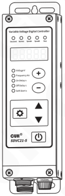

ตัวควบคุม ×1

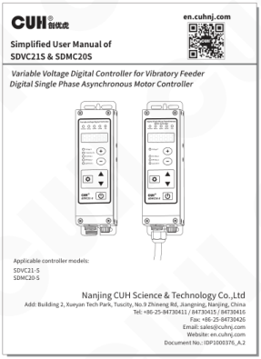

คู่มือการใช้งาน ×1

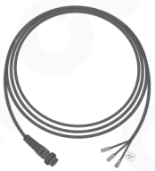

สายเอาต์พุต ×1

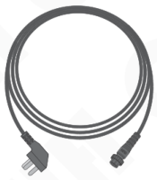

สายไฟฟ้าอินพุต ×1

---

## 1.2 คำอธิบายไฟแสดงสถานะ ปุ่มกด และชิ้นส่วนภายนอก

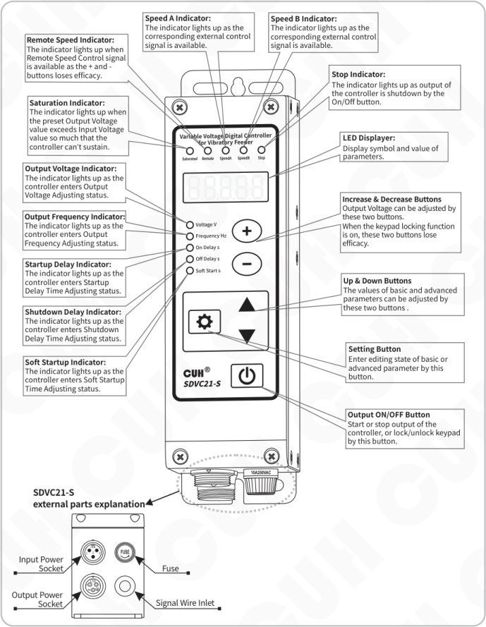

### ไฟแสดงสถานะและจอแสดงผล

**ไฟแสดงสถานะควบคุมความเร็วระยะไกล:**  
ไฟจะติดเมื่อมีสัญญาณควบคุมความเร็วระยะไกล ขณะที่ปุ่ม ⊕ และ ⊖ ไม่ทำงาน

**ไฟแสดงสถานะความเร็ว A:**  
ไฟจะติดเมื่อมีสัญญาณควบคุมภายนอกที่สอดคล้องกันเข้ามา

**ไฟแสดงสถานะความเร็ว B:**  
ไฟจะติดเมื่อมีสัญญาณควบคุมภายนอกที่สอดคล้องกันเข้ามา

**ไฟแสดงสถานะหยุดทำงาน:**  
ไฟจะติดเมื่อเอาต์พุตของตัวควบคุมถูกปิดโดยปุ่มเปิด/ปิด

**ไฟแสดงสถานะอิ่มตัว (Saturation):**  
ไฟจะติดเมื่อค่าแรงดันเอาต์พุตที่ตั้งไว้สูงกว่าค่าแรงดันอินพุตมากเกินกว่าที่ตัวควบคุมจะรักษาระดับไว้ได้

**จอแสดงผล LED:**  
แสดงสัญลักษณ์และค่าของพารามิเตอร์

**ไฟแสดงสถานะแรงดันเอาต์พุต:**  
ไฟจะติดเมื่อตัวควบคุมเข้าสู่สถานะปรับค่าแรงดันเอาต์พุต

**ไฟแสดงสถานะความถี่เอาต์พุต:**  
ไฟจะติดเมื่อตัวควบคุมเข้าสู่สถานะปรับค่าความถี่เอาต์พุต

**ไฟแสดงสถานะหน่วงเวลาเปิด:**  
ไฟจะติดเมื่อตัวควบคุมเข้าสู่สถานะปรับค่าเวลาหน่วงการเปิด

**ไฟแสดงสถานะหน่วงเวลาปิด:**  
ไฟจะติดเมื่อตัวควบคุมเข้าสู่สถานะปรับค่าเวลาหน่วงการปิด

**ไฟแสดงสถานะสตาร์ทแบบนุ่มนวล:**  
ไฟจะติดเมื่อตัวควบคุมเข้าสู่สถานะปรับค่าเวลาสตาร์ทแบบนุ่มนวล

### ปุ่มกด

**ปุ่มเพิ่มและลดค่า**  
สามารถปรับค่าแรงดันเอาต์พุตได้ด้วยปุ่มสองปุ่มนี้  
เมื่อฟังก์ชันล็อกแผงปุ่มกดทำงาน ปุ่มทั้งสองจะไม่ทำงาน

**ปุ่มขึ้นและลง**  
สามารถปรับค่าพารามิเตอร์พื้นฐานและขั้นสูงได้ด้วยปุ่มสองปุ่มนี้

**ปุ่มตั้งค่า**  
เข้าสู่สถานะแก้ไขพารามิเตอร์พื้นฐานหรือขั้นสูงด้วยปุ่มนี้

**ปุ่มเปิด/ปิดเอาต์พุต**  
เริ่มหรือหยุดเอาต์พุตของตัวควบคุม หรือล็อก/ปลดล็อกแผงปุ่มกดด้วยปุ่มนี้

### คำอธิบายชิ้นส่วนภายนอกของ SDVC21-S

- ซ็อกเก็ตจ่ายไฟเข้า
- ซ็อกเก็ตจ่ายไฟออก
- ฟิวส์
- ช่องเข้าสายสัญญาณ

---

## 1.3 คำอธิบายพอร์ตการเดินสาย

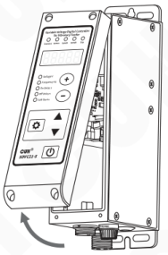

**ขั้นตอนที่ 1:** ถอดสกรูที่มุมทั้งสี่ของแผงหน้าปัด

**ขั้นตอนที่ 2:** เปิดแผงขึ้นด้านบน พอร์ตการเดินสายจะอยู่ด้านหลังของแผง

| พอร์ตการเดินสาย | ขั้วต่อ | สัญญาณ |
|---|---|---|
| SensorⅡ | A1 | GND |
| SensorⅡ | A2 | Input |
| SensorⅡ | A3 | +24V |
| Preset | B1 | GND |
| Preset | B2 | Pset A |
| Preset | B3 | GND |
| Preset | B4 | Pset B |
| Ctrl Out | C1 | Output |
| Ctrl Out | C2 | +24V |
| SensorⅠ | D1 | GND |
| SensorⅠ | D2 | Input |
| SensorⅠ | D3 | +24V |
| Photosensor | E1 | GND |
| Photosensor | E2 | Rx |
| Photosensor | E3 | GND |
| Photosensor | E4 | Tx |
| Speed Ctrl | F1 | +5V |
| Speed Ctrl | F2 | Input |
| Speed Ctrl | F3 | RGND |

## 1.4 คำอธิบายป้ายกำกับ (เนมเพลต)

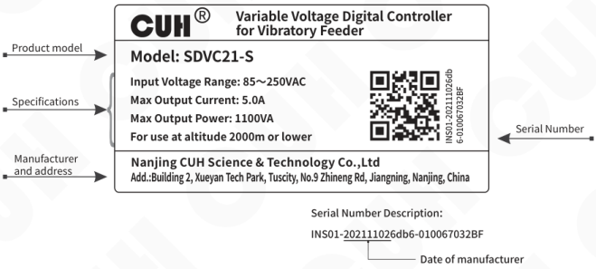

CUH® — **ตัวควบคุมแรงดันดิจิทัลแบบปรับค่าได้สำหรับเครื่องป้อนวัสดุแบบสั่นสะเทือน**

**รุ่นผลิตภัณฑ์**

รุ่น: SDVC21-S

**ข้อมูลจำเพาะ**

- ช่วงแรงดันอินพุต: 85～250VAC
- กระแสเอาต์พุตสูงสุด: 5.0A
- กำลังไฟฟ้าเอาต์พุตสูงสุด: 1100VA
- ใช้งานที่ระดับความสูง 2000 เมตร หรือต่ำกว่า

**ผู้ผลิตและที่อยู่**

Nanjing CUH Science & Technology Co.,Ltd

Add.:Building 2, Xueyan Tech Park, Tuscity, No.9 Zhineng Rd, Jiangning, Nanjing, China

**หมายเลขซีเรียล**

INS01-202111026db6-010067032BF

**คำอธิบายหมายเลขซีเรียล:**

INS01-**20211102**6db6-010067032BF

วันที่ผลิต: **20211102**

---

## บทที่ Ⅱ คุณสมบัติ

ตัวควบคุมนี้ออกแบบมาโดยเฉพาะสำหรับควบคุมเครื่องป้อนวัสดุแบบสั่นสะเทือนในระบบอัตโนมัติ ด้วยการผสานเทคโนโลยีอิเล็กทรอนิกส์รุ่นล่าสุดและการออกแบบที่ประณีต ตัวควบคุมมีคุณสมบัติที่สะดวกและใช้งานได้จริงดังต่อไปนี้:

**การรักษาแรงดันอัตโนมัติ:** ตัวควบคุมสามารถกำจัดความผันผวนของความเร็วในการป้อนวัสดุที่เกิดจากแรงดันไฟฟ้าที่ไม่นิ่ง

**สตาร์ทแบบนุ่มนวล:** เพื่อหลีกเลี่ยงแรงกระแทกกะทันหันต่อชิ้นงาน ตัวควบคุมสามารถเพิ่มแรงดันเอาต์พุตอย่างนุ่มนวลจาก 0 ไปยังค่าที่ตั้งไว้เมื่อสตาร์ท

**เซนเซอร์สวิตช์:** สามารถต่อเซนเซอร์สวิตช์แบบ NPN หรือ PLC เพื่อเปิด/ปิดตัวควบคุมได้

**เอาต์พุตควบคุม:** สัญญาณเอาต์พุตควบคุมที่ส่งออกจากทรานซิสเตอร์สามารถประสานการทำงานของวาล์วโซเลนอยด์หรืออุปกรณ์ภายนอกอื่น ๆ กับตัวควบคุมได้

### คุณสมบัติต่อไปนี้สั่งทำเฉพาะได้:

**อินพุตสัญญาณควบคุมคู่:** อินพุตสัญญาณควบคุมสองช่องของ "ชิ้นงานเต็ม" และ "ชิ้นงานว่าง" สามารถสร้างความสัมพันธ์การควบคุมแบบลอจิก AND, OR, NOT, XOR และแบบอื่นทั้งหมดได้

**ฟังก์ชันพรีเซ็ตแรงดันเอาต์พุต:** สามารถเลือกค่าแรงดันเอาต์พุตที่ตั้งไว้ล่วงหน้าได้สูงสุดสี่ค่า โดยใช้สัญญาณควบคุมภายนอก

**การตรวจจับแสงอัจฉริยะ:** เซนเซอร์โฟโต้อิเล็กทริกอัจฉริยะแบบปรับตัวของเราสามารถช่วยหยุดตัวควบคุมเมื่อชิ้นงานเต็มหรือชิ้นงานว่าง และรองรับฟังก์ชันการตั้งค่าเวลาสตาร์ทแบบนุ่มนวล เวลาหน่วงเปิด เวลาหน่วงปิด และการปรับความสัมพันธ์ลอจิก

**การควบคุมความเร็วระยะไกล:** แรงดันเอาต์พุตของตัวควบคุมสามารถควบคุมได้ด้วยโพเทนชิออมิเตอร์ภายนอก PLC หรือสัญญาณไฟฟ้ากระแสตรง 1~5V/4~20mA

---

CUH ให้ความสำคัญอย่างยิ่งกับการบริหารคุณภาพผลิตภัณฑ์และสมรรถนะด้านความปลอดภัย นอกเหนือจากชิ้นส่วนคุณภาพสูงและระบบควบคุมคุณภาพที่เข้มงวดแล้ว CUH ยังได้คำนึงถึงอุบัติเหตุที่ผู้ใช้อาจพบ และมอบฟังก์ชันการป้องกันต่อไปนี้เพื่อเพิ่มความเป็นประโยชน์ในทางปฏิบัติของตัวควบคุมให้สูงสุด

**การป้องกันการลัดวงจรด้วยฟิวส์:** หากเอาต์พุตของตัวควบคุมเกิดการลัดวงจร ฟิวส์ภายในจะขาดเพื่อปกป้องตัวควบคุมและโหลด

**การป้องกันกระแสเกินพิกัด:** ตัวควบคุมจะหยุดเอาต์พุตเพื่อรับประกันความปลอดภัยในการทำงานของอุปกรณ์ เมื่อกระแสทำงานเกินค่าพิกัด

**การป้องกันความร้อนสูงเกินไป:** ตัวควบคุมจะหยุดเอาต์พุตเพื่อปกป้องตัวเอง เมื่ออุณหภูมิทำงานสูงเกินไป

**การป้องกันแรงดันเกิน:** หากแรงดันอินพุตสูงเกินไป แหล่งจ่ายไฟของตัวควบคุมจะถูกตัดโดยอัตโนมัติเพื่อปกป้องตัวเอง

ตัวควบคุมของ CUH เป็นไปตามการรับรอง CE อย่างเคร่งครัด

---

# บทที่ Ⅲ คู่มือการติดตั้ง

บทนี้แนะนำเงื่อนไขที่จำเป็นสำหรับการใช้งานตัวควบคุม และวิธีการติดตั้งและต่อสายอย่างถูกต้อง

## 3.1 เงื่อนไขการใช้งานตัวควบคุม

ตัวควบคุมใช้พลังงานจากไฟฟ้า AC 110/220V และทำการต่อกราวนด์เพื่อความปลอดภัยผ่านปลั๊กของสายไฟ โปรดเตรียมระบบจ่ายไฟ 110V หรือ 220V 50Hz/60Hz พร้อมระบบจ่ายและจายไฟฟ้าที่เป็นไปตามมาตรฐาน และตรวจสอบให้แน่ใจว่าสายกราวนด์เพื่อความปลอดภัยถูกต่ออย่างถูกต้อง

**⚠ คำเตือน** ห้ามต่อตัวควบคุมเข้ากับไฟฟ้า AC 380V เด็ดขาด จะทำให้ตัวควบคุมเสียหายอย่างร้ายแรงไม่สามารถแก้ไขได้ อาจทำให้เกิดการระเบิด ไฟไหม้ และอุบัติเหตุด้านความปลอดภัยอื่น ๆ

**⚠ คำเตือน** ตรวจสอบให้แน่ใจว่าด้านแหล่งจ่ายไฟมีการกราวนด์อย่างน่าเชื่อถือ เปลือกโลหะของตัวควบคุมต่อตรงกับสายกราวนด์เพื่อความปลอดภัย การกราวนด์ที่ไม่ดีจะทำให้เปลือกตัวควบคุมมีไฟฟ้า และทำให้เกิดอุบัติเหตุถูกไฟดูด

**หมายเหตุ** การทำงานต่อเนื่องเป็นเวลานานจะทำให้เกิดความร้อนและอุณหภูมิของเปลือกเพิ่มสูงขึ้น โปรดติดตั้งตัวควบคุมในสภาพแวดล้อมที่ระบายอากาศดี และยึดติดอย่างมั่นคง ห่างจากแหล่งกำเนิดการสั่นสะเทือน

**หมายเหตุ** เอาต์พุตของผลิตภัณฑ์นี้เกิดจากการเปลี่ยนกระแสไฟฟ้าจากระบบจ่ายไฟให้เป็นกระแสตรงและกลับเป็นกระแสสลับ โดยไม่มีการแยกฉนวนระหว่างอินพุตและเอาต์พุต ดังนั้นขั้วเอาต์พุตจึงห้ามต่อเข้ากับสายกราวนด์เพื่อความปลอดภัย เมื่อต่อขดลวดแม่เหล็กไฟฟ้า ต้องตรวจสอบให้แน่ใจว่าขดลวดแม่เหล็กและเปลือกมีความสามารถในการเป็นฉนวนพื้นฐาน มิฉะนั้นอาจเกิดไฟฟ้ารั่วไหล ซึ่งอาจทำให้เกิดการถูกไฟดูดและความเสียหายต่อตัวควบคุมได้

**หมายเหตุ** ผลิตภัณฑ์นี้เป็นตัวควบคุมที่ใช้ขับเคลื่อนขดลวดแม่เหล็กไฟฟ้า ห้ามต่อกับเครื่องป้อนวัสดุแบบสั่นสะเทือนที่ใช้เพียโซอิเล็กทริก

## 3.2 วิธีใช้งานปุ่มกด

a. กดปุ่ม ⊕ หรือ ⊖ แบบกดสั้น เพื่อปรับค่าแรงดันเอาต์พุตของตัวควบคุมได้ที่หน้าจอ LED ใด ๆ

b. เข้าหรือออกจากหน้าจอพารามิเตอร์พื้นฐานด้วยการกดปุ่ม ⚙ แบบกดค้าง สลับระหว่างพารามิเตอร์พื้นฐานด้วยการกดปุ่ม ⚙ แบบกดสั้น และปรับค่าพารามิเตอร์ด้วยการกดปุ่ม ▼ หรือ ▲ แบบกดสั้น

c. เข้าหรือออกจากหน้าจอพารามิเตอร์ขั้นสูงด้วยการกดปุ่ม ⚙ และ ▲ พร้อมกันแบบกดค้าง สลับระหว่างพารามิเตอร์ขั้นสูงด้วยการกดปุ่ม ⚙ แบบกดสั้น และปรับค่าพารามิเตอร์ด้วยการกดปุ่ม ▼ หรือ ▲ แบบกดสั้น

d. กดปุ่ม ⏻ แบบกดสั้นเพื่อเริ่มหรือหยุดเอาต์พุตของตัวควบคุม และกดปุ่ม ⏻ แบบกดค้างเพื่อล็อกหรือปลดล็อกแผงปุ่มกด

e. ที่หน้าจอ LED ของพารามิเตอร์คืนค่าการตั้งค่าจากโรงงาน กดปุ่ม ▲ ค้างไว้จนกระทั่ง ปรากฏบน LED เพื่อคืนค่าจากโรงงาน หรือกดปุ่ม ▼ ค้างไว้จนกระทั่ง ปรากฏบน LED เพื่อสลับไปยังหน้าจอพารามิเตอร์โมเดิร์น

f. SDVC21S ตั้งค่าเริ่มต้นไว้ที่หน้าจอพารามิเตอร์แบบดั้งเดิม

---

## 3.3 การติดตั้งและใช้งาน

### ขั้นตอนที่หนึ่ง:

เปิดกล่องบรรจุภัณฑ์และตรวจสอบตัวควบคุมพร้อมอุปกรณ์เสริมทั้งหมด

### ขั้นตอนที่สอง:

ต่อขั้วต่อของสายไฟเอาต์พุตเข้ากับขดลวดแม่เหล็กไฟฟ้าของตัวสั่นสะเทือน

จัดแนวร่องบนปลั๊กอากาศของสายเอาต์พุตให้ตรงกับเครื่องหมายสามเหลี่ยมบนซ็อกเก็ตเอาต์พุตของตัวควบคุม จากนั้นขันน็อตให้แน่นหลังจากต่อสายเอาต์พุตเรียบร้อยแล้ว

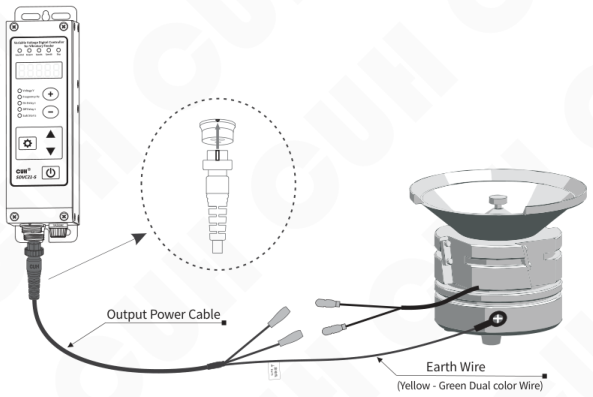

### หมายเหตุ

1. ตรวจสอบให้แน่ใจว่าขดลวดแม่เหล็กไฟฟ้าของตัวสั่นสะเทือนต่ออยู่กับขั้วเอาต์พุตสองขั้วของสายไฟเอาต์พุต และเปลือกโลหะของตัวสั่นสะเทือนมีการกราวนด์อย่างน่าเชื่อถือ
2. ห้ามต่อโหลดแบบเพียโซอิเล็กทริกเข้ากับเอาต์พุตพลังงาน มิฉะนั้นอาจทำให้เกิดอุบัติเหตุถูกไฟดูดได้!

---

### ขั้นตอนที่สาม:

ต่อขั้วต่อของสายไฟฟ้าอินพุตเข้ากับซ็อกเก็ตจ่ายไฟเข้าของตัวควบคุม

ให้ต่อที่ด้านตัวควบคุมก่อน

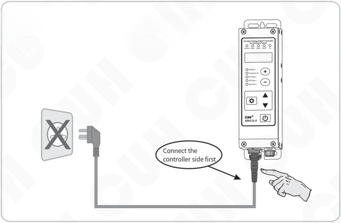

### ขั้นตอนที่สี่:

เสียบปลั๊กของสายไฟฟ้าอินพุตเข้ากับเต้ารับไฟบ้าน

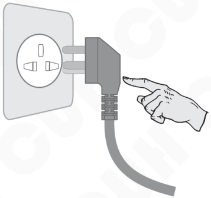

---

## บทที่ Ⅳ คำอธิบายฟังก์ชันพื้นฐาน

### 4.1 แรงดันเอาต์พุต

แรงดันเอาต์พุตสามารถตั้งค่าได้โดยตรงและแบบดิจิทัลผ่านแผงปุ่มกด ด้วยฟังก์ชันรักษาแรงดันที่เป็นเอกลักษณ์ แรงดันเอาต์พุตของตัวควบคุมจะไม่ผันผวนตามแรงดันอินพุต ทำให้ตัวสั่นสะเทือนทำงานได้อย่างนิ่งแม้แรงดันไฟฟ้าจากโครงข่ายไม่เสถียร

- เปิดสวิตช์ไฟฟ้าของตัวควบคุม
- ตัวควบคุมเข้าสู่พารามิเตอร์แรงดันเอาต์พุต ไฟแสดงสถานะแรงดันจะติด และ LED แสดงพารามิเตอร์แรงดันเอาต์พุต U พร้อมค่าเริ่มต้น 150
- กด ⊕ หรือ ⊖ เพื่อปรับค่าพารามิเตอร์

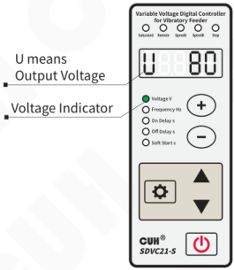

- ค่าแรงดันเอาต์พุตของตัวควบคุมต้องไม่เกินค่าแรงดันอินพุต หากตั้งค่าแรงดันเอาต์พุตใกล้เคียงกับค่าแรงดันอินพุตเกินไป ตัวควบคุมจะไม่สามารถรักษาระดับแรงดันเอาต์พุตไว้ได้ และไฟแสดงสถานะอิ่มตัวจะติด
- หากตั้งค่าแรงดันเอาต์พุตใกล้เคียงกับ 0 เกินไป ตัวควบคุมจะไม่สามารถรักษาระดับแรงดันเอาต์พุตไว้ได้ และไฟแสดงสถานะอิ่มตัวจะติด

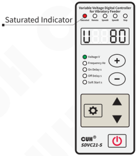

---

## 4.2 ความถี่เอาต์พุต

ตัวควบคุมสามารถเลือกให้ความถี่เอาต์พุตเป็นความถี่ของไฟบ้าน หรือเป็นสองเท่าของความถี่ไฟบ้านได้

- กดปุ่ม ⚙ ค้างไว้ 2 วินาที เพื่อเข้าสู่หน้าจอพารามิเตอร์พื้นฐาน
- LED แสดงพารามิเตอร์ความถี่เอาต์พุต "E" และไฟแสดงสถานะความถี่จะติด
- กด ▼ หรือ ▲ เพื่อปรับค่าพารามิเตอร์

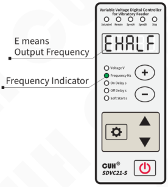

- หากความถี่ไฟบ้านเป็น 50Hz เมื่อปรับพารามิเตอร์ E เป็น HALF ความถี่เอาต์พุตของตัวควบคุมจะเป็น 50Hz และเมื่อปรับพารามิเตอร์ E เป็น FULL ความถี่เอาต์พุตจะเป็น 100Hz
- หากความถี่ไฟบ้านเป็น 60Hz เมื่อปรับพารามิเตอร์ E เป็น HALF ความถี่เอาต์พุตของตัวควบคุมจะเป็น 60Hz และเมื่อปรับพารามิเตอร์ E เป็น FULL ความถี่เอาต์พุตจะเป็น 120Hz

---

## 4.3 เวลาสตาร์ทแบบนุ่มนวล (Soft Startup Time)

เพื่อหลีกเลี่ยงแรงกระแทกกะทันหันต่อขดลวดตัวสั่นสะเทือน ตัวควบคุมสามารถเพิ่มแรงดันเอาต์พุตอย่างค่อยเป็นค่อยไปจาก 0 ไปยังค่าที่ตั้งไว้เมื่อสตาร์ท

**เวลาสตาร์ทแบบนุ่มนวล ( t ):** ช่วงเวลาที่ตัวควบคุมใช้ในการเพิ่มแรงดันเอาต์พุตอย่างนุ่มนวลจาก 0 ไปยังค่าที่ตั้งไว้เมื่อสตาร์ท

- กดปุ่ม ⚙ ค้างไว้ 2 วินาที เพื่อเข้าสู่หน้าจอพารามิเตอร์พื้นฐาน
- กดปุ่ม ⚙ แบบกดสั้นเพื่อสลับไปยังพารามิเตอร์เวลาสตาร์ทแบบนุ่มนวล "t" และไฟแสดงสถานะสตาร์ทแบบนุ่มนวลจะติด
- กด ▲ หรือ ▼ เพื่อปรับค่าพารามิเตอร์

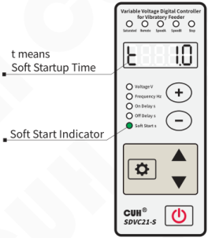

## 4.4 สวิตช์เปิด/ปิดเอาต์พุต

ปุ่ม ⏻ บนแผงหน้าปัดสามารถเริ่มหรือหยุดเอาต์พุตของตัวควบคุมได้อย่างง่ายดายและรวดเร็ว

- ใช้ปุ่ม ⏻ บนแผงหน้าปัดของตัวควบคุม ท่านสามารถควบคุมการเริ่มหรือหยุดได้ ไฟแสดงสถานะหยุดทำงานจะติดเมื่อเอาต์พุตของตัวควบคุมถูกปิด

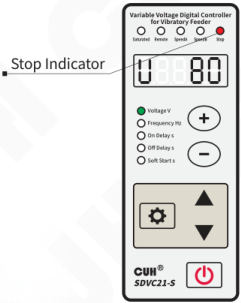

> ด้วยเทคโนโลยีสวิตช์แบบสัมผัสนุ่มนวลและการควบคุมสัญญาณดิจิทัล จะไม่เกิดประกายไฟที่ทำลายจุดสัมผัส ผลคืออายุการใช้งานของตัวควบคุมและตัวสั่นสะเทือนจะยาวนานขึ้นอย่างมาก

---

## 4.5 การจำกัดแรงดันเอาต์พุตสูงสุด

สามารถตั้งค่าแรงดันเอาต์พุตสูงสุดของตัวควบคุมได้ เพื่อป้องกันความเสียหายต่อตัวสั่นสะเทือน

ฟังก์ชันการควบคุมความเร็วระยะไกลได้รับผลกระทบจากพารามิเตอร์นี้

- กดปุ่ม ⚙ และ ▲ พร้อมกันแบบกดค้าง เพื่อเข้าสู่หน้าจอพารามิเตอร์ขั้นสูง
- กดปุ่ม ⚙ แบบกดสั้นเพื่อสลับไปยังพารามิเตอร์ h
- กด ▲ หรือ ▼ เพื่อปรับค่าพารามิเตอร์

ค่าเริ่มต้นของแรงดันเอาต์พุตสูงสุดคือ 250V

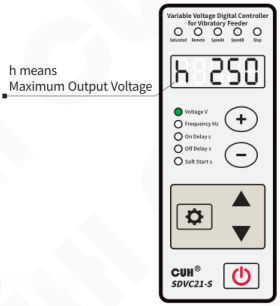

## 4.6 การล็อกแผงปุ่มกด (Keypad Lock)

- กดปุ่ม ⏻ ค้างไว้ 2 วินาที เพื่อล็อกปุ่มทั้งหมดบนแผงหน้าปัด ขณะที่ LED แสดง a
- กดปุ่ม ⏻ ค้างไว้ 2 วินาที อีกครั้ง เพื่อปลดล็อกแผงปุ่มกด

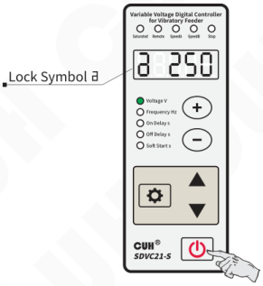

> ปุ่ม ⏻ จะไม่ได้รับผลกระทบจากฟังก์ชันล็อกแผงปุ่มกด

---

## 4.7 การคืนค่าการตั้งค่าจากโรงงาน

ผู้ใช้สามารถคืนค่าตัวควบคุมไปยังสถานะเริ่มต้นจากโรงงานได้อย่างรวดเร็ว

ด้วยฟังก์ชันที่หลากหลายของตัวควบคุม มีพารามิเตอร์จำนวนมากที่ปรับได้ สำหรับผู้ใช้มือใหม่ อาจไม่สามารถคืนสถานะการทำงานปกติของตัวควบคุมได้หลังจากตั้งค่าและแก้ไขหลายครั้ง ใช้ฟังก์ชันนี้เพื่อคืนค่าพารามิเตอร์ที่ปั่นป่วนกลับไปยังค่าเริ่มต้นจากโรงงานได้อย่างรวดเร็ว

- กดปุ่ม ⚙ และ ▲ พร้อมกันแบบกดค้าง เพื่อเข้าสู่หน้าจอพารามิเตอร์ขั้นสูง
- กดปุ่ม ⚙ แบบกดสั้นเพื่อสลับไปยังสถานะที่ LED แสดงผลส่วนทั้งหมดกะพริบ ซึ่งก็คือพารามิเตอร์ "คืนค่าการตั้งค่าจากโรงงาน" จากนั้นกดปุ่ม ▲ ค้างไว้จนกระทั่งตัวควบคุมแสดง "-----" แสดงว่าตัวควบคุมได้คืนค่าเรียบร้อยแล้ว

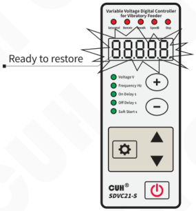

- ปล่อยปุ่ม ▲ หลังจากตัวควบคุมแสดง "CUH" แล้ว จะเข้าสู่สถานะปรับค่าแรงดันเอาต์พุต "U" ณ ขณะนี้พารามิเตอร์ทั้งหมดได้คืนค่าเป็นค่าเริ่มต้นจากโรงงานแล้ว

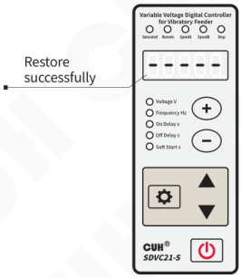

---

# บทที่ Ⅴ เซนเซอร์และการควบคุมสัญญาณ

ตัวควบคุมสามารถควบคุมได้ด้วยสัญญาณภายนอกและเซนเซอร์หลายชนิด บทนี้อธิบายหลัก ๆ ถึงวิธีใช้งานเซนเซอร์โฟโต้อิเล็กทริกอัจฉริยะ เซนเซอร์สวิตช์แบบ NPN และ PLC

## 5.1 การตรวจจับแสงอัจฉริยะ

ใช้ร่วมกับเซนเซอร์โฟโต้อิเล็กทริก SDVC-S1 สามารถทำให้เกิดฟังก์ชันการตรวจจับแสงอัจฉริยะได้ เซนเซอร์ SDVC-S1 สามารถกรองสัญญาณรบกวนจากแสงพื้นหลังที่กระทบความไวของตัวควบคุม ผลคือตัวควบคุมทำงานได้อย่างน่าเชื่อถือโดยไม่ต้องปรับความไวด้วยตนเอง

### 5.1.1 วิธีเดินสายของเซนเซอร์โฟโต้อิเล็กทริกอัจฉริยะ

**วิธีต่อเซนเซอร์โฟโต้อิเล็กทริก**

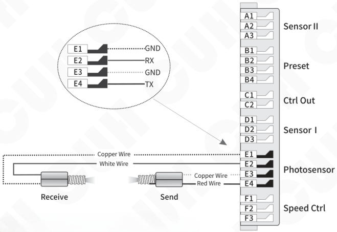

ระยะทำงานของเซนเซอร์ปรับได้โดยการตั้งค่าพารามิเตอร์ P ค่ายิ่งน้อยจะยิ่งไว

หมายเหตุ: ความสัมพันธ์ลอจิกเริ่มต้นของเซนเซอร์ตั้งไว้เป็นชิ้นงานว่าง

---

## 5.1.2 เวลาหน่วงเปิด/ปิดของเซนเซอร์โฟโต้อิเล็กทริกอัจฉริยะ

ในการใช้งานจริงส่วนใหญ่ เอาต์พุตของตัวควบคุมควรถูกหน่วงออกไประยะหนึ่ง เมื่อการเปิด/ปิดตัวควบคุมถูกควบคุมโดยสัญญาณภายนอก ฟังก์ชันปรับเวลาหน่วงเปิด/ปิดทำให้การใช้งานลักษณะนี้เป็นไปได้ นอกจากนี้ แรงกระแทกต่อชิ้นงานเมื่อตัวควบคุมสตาร์ทสามารถกำจัดได้ด้วยการปรับเวลาสตาร์ทแบบนุ่มนวล

### เวลาหน่วงเปิด ( J )

ช่วงเวลาที่ตัวควบคุมใช้ตั้งแต่รับสัญญาณควบคุมการเปิดจนถึงเอาต์พุตจริง

- กดปุ่ม ⚙ ค้างไว้ 2 วินาที เพื่อเข้าสู่หน้าจอพารามิเตอร์พื้นฐาน
- กดปุ่ม ⚙ แบบกดสั้นเพื่อสลับไปยังพารามิเตอร์เวลาหน่วงเปิด "J" และไฟแสดงสถานะเวลาหน่วงเปิดจะติด
- กด ▲ หรือ ▼ เพื่อปรับค่าพารามิเตอร์

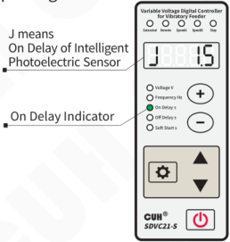

ช่วงค่าที่ปรับได้อยู่ระหว่าง 0.0 ถึง 9.9 วินาที  
ค่าเริ่มต้นของพารามิเตอร์คือ 0.2 วินาที

### เวลาหน่วงปิด ( L )

ช่วงเวลาที่ตัวควบคุมใช้ตั้งแต่รับสัญญาณควบคุมการปิดจนถึงการตัดเอาต์พุตจริง

- กดปุ่ม ⚙ ค้างไว้ 2 วินาที เพื่อเข้าสู่หน้าจอพารามิเตอร์พื้นฐาน
- กดปุ่ม ⚙ แบบกดสั้นเพื่อสลับไปยังพารามิเตอร์เวลาหน่วงปิด "L" และไฟแสดงสถานะเวลาหน่วงปิดจะติด
- กด ▲ หรือ ▼ เพื่อปรับค่าพารามิเตอร์

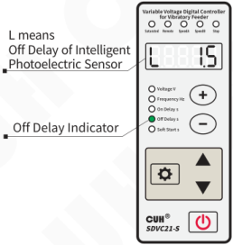

ช่วงค่าที่ปรับได้อยู่ระหว่าง 0.0 ถึง 9.9 วินาที  
ค่าเริ่มต้นของพารามิเตอร์คือ 0.2 วินาที

---

### 5.1.3 การตั้งค่าทิศทางลอจิกของเซนเซอร์โฟโต้อิเล็กทริกอัจฉริยะ

ภายใต้สภาวะปกติ ด้านรับจะไม่ได้รับสัญญาณแสง และตัวควบคุมจะทำงานตามค่าเริ่มต้น แต่ในบางการใช้งานพิเศษ ตัวควบคุมจำเป็นต้องหยุดเมื่อด้านรับไม่ได้รับสัญญาณแสง การปรับพารามิเตอร์นี้สามารถทำให้การใช้งานลักษณะนี้เป็นไปได้

- กดปุ่ม ⚙ และ ▲ พร้อมกันแบบกดค้าง เพื่อเข้าสู่หน้าจอพารามิเตอร์ขั้นสูง
- กดปุ่ม ⚙ แบบกดสั้นเพื่อสลับไปยังพารามิเตอร์ Γ1
- กด ▲ หรือ ▼ เพื่อปรับค่าพารามิเตอร์

Γ1 หมายถึงทิศทางลอจิกของเซนเซอร์โฟโต้อิเล็กทริกอัจฉริยะ

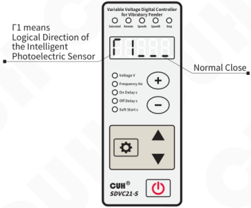

พารามิเตอร์ Γ1 ตั้งไว้ที่ `___` โดยค่าเริ่มต้น

- เมื่อพารามิเตอร์ Γ1 ตั้งเป็น `___` กล่าวคือไม่ได้รับสัญญาณแสง ตัวควบคุมจะทำงาน
- เมื่อพารามิเตอร์ Γ1 ตั้งเป็น `_-_` กล่าวคือไม่ได้รับสัญญาณแสง ตัวควบคุมจะหยุดทำงาน

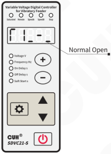

---

## 5.2 วิธีใช้งานเซนเซอร์สวิตช์แบบ NPN

ตัวควบคุมสามารถทำงานร่วมกับเซนเซอร์หลายชนิด เช่น เซนเซอร์สวิตช์ เซนเซอร์สวิตช์แสง และเซนเซอร์ใยแก้วนำแสง

### 5.2.1 วิธีเดินสายของเซนเซอร์สวิตช์แบบ NPN

**วิธีต่อเซนเซอร์สวิตช์**

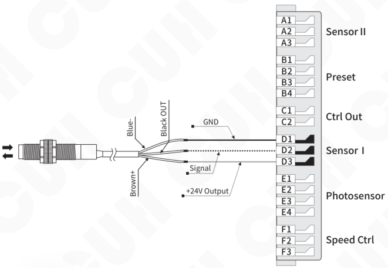

**ธรรมเนียมการต่อสาย**

- สายสีน้ำเงินแทนสายกราวนด์
- สายสีดำแทนสายสัญญาณ
- สายสีน้ำตาลแทนสายจ่ายไฟ

---

## 5.2.2 เวลาหน่วงเปิด/ปิดของเซนเซอร์สวิตช์แบบ NPN

โดยค่าเริ่มต้น เซนเซอร์โฟโต้อิเล็กทริกอัจฉริยะและเซนเซอร์สวิตช์จะใช้เวลาหน่วงเปิดและเวลาหน่วงปิดร่วมกัน ผู้ปฏิบัติงานยังสามารถตั้งค่าเวลาหน่วงเปิดและเวลาหน่วงปิดของเซนเซอร์สวิตช์แยกจากกันได้

### เวลาหน่วงเปิด ( J- )

ช่วงเวลาที่ตัวควบคุมใช้ตั้งแต่รับสัญญาณควบคุมการเปิดจนถึงเอาต์พุต

- กดปุ่ม ⚙ และ ▲ พร้อมกันแบบกดค้าง เพื่อเข้าสู่หน้าจอพารามิเตอร์ขั้นสูง
- กดปุ่ม ⚙ แบบกดสั้นเพื่อสลับไปยังพารามิเตอร์ J-
- กด ▲ หรือ ▼ เพื่อปรับค่าพารามิเตอร์

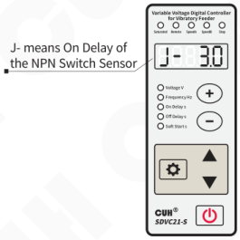

ช่วงค่าที่ปรับได้อยู่ระหว่าง 0.0 ถึง 9.9 วินาที ค่าเริ่มต้นของพารามิเตอร์คือ ---

เวลาหน่วงเปิดอิสระของเซนเซอร์สวิตช์แบบ NPN จะถูกปิดใช้งานเมื่อค่าพารามิเตอร์ถูกปรับเป็น 0

### เวลาหน่วงปิด ( L- )

ช่วงเวลาที่ตัวควบคุมใช้ตั้งแต่รับสัญญาณควบคุมการปิดจนถึงการตัดเอาต์พุต

- กดปุ่ม ⚙ และ ▲ พร้อมกันแบบกดค้าง เพื่อเข้าสู่หน้าจอพารามิเตอร์ขั้นสูง
- กดปุ่ม ⚙ แบบกดสั้นเพื่อสลับไปยังพารามิเตอร์ L-
- กด ▲ หรือ ▼ เพื่อปรับค่าพารามิเตอร์

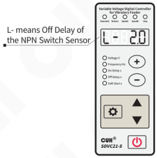

ช่วงค่าที่ปรับได้อยู่ระหว่าง 0.0 ถึง 9.9 วินาที ค่าเริ่มต้นของพารามิเตอร์คือ ---

เวลาหน่วงปิดอิสระของเซนเซอร์สวิตช์แบบ NPN จะถูกปิดใช้งานเมื่อค่าพารามิเตอร์ถูกปรับเป็น 0

- เมื่อค่า J- และ L- ถูกปรับเป็น 0 เวลาหน่วงเปิดและเวลาหน่วงปิดของเซนเซอร์สวิตช์จะเท่ากับของเซนเซอร์โฟโต้อิเล็กทริกอัจฉริยะ
- เวลาหน่วงเปิดและเวลาหน่วงปิดของเซนเซอร์โฟโต้อิเล็กทริกอัจฉริยะจะไม่ได้รับผลกระทบจากพารามิเตอร์ J- และ L-

---

## 5.2.3 การตั้งค่าทิศทางลอจิกของเซนเซอร์สวิตช์แบบ NPN

ภายใต้สภาวะปกติ ตัวควบคุมจะไม่ได้รับสัญญาณจากเซนเซอร์สวิตช์แบบ NPN และทำงานตามค่าเริ่มต้น แต่ในบางการใช้งานพิเศษ ตัวควบคุมจำเป็นต้องหยุดเมื่อไม่ได้รับสัญญาณจากเซนเซอร์สวิตช์แบบ NPN การปรับพารามิเตอร์นี้สามารถทำให้การใช้งานลักษณะนี้เป็นไปได้

- กดปุ่ม ⚙ และ ▲ พร้อมกันแบบกดค้าง เพื่อเข้าสู่หน้าจอพารามิเตอร์ขั้นสูง
- กดปุ่ม ⚙ แบบกดสั้นเพื่อสลับไปยังพารามิเตอร์ Γ2
- กด ▲ หรือ ▼ เพื่อปรับค่าพารามิเตอร์

Γ2 หมายถึงทิศทางลอจิกของเซนเซอร์สวิตช์แบบ NPN

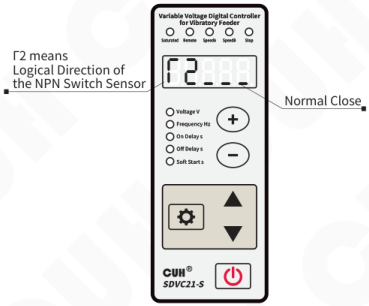

พารามิเตอร์ Γ2 ตั้งไว้ที่ `___` โดยค่าเริ่มต้น

- เมื่อพารามิเตอร์ Γ2 ตั้งเป็น `___` กล่าวคือไม่ได้รับสัญญาณ ตัวควบคุมจะทำงาน
- เมื่อพารามิเตอร์ Γ2 ตั้งเป็น `_-_` กล่าวคือไม่ได้รับสัญญาณ ตัวควบคุมจะหยุดทำงาน

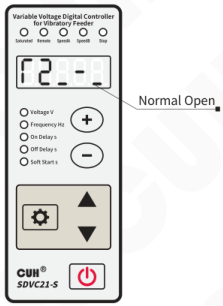

---

## 5.3 วิธีใช้งานเซนเซอร์สวิตช์แบบ NPN ตัวที่สอง

ตัวควบคุมอนุญาตให้ต่อเซนเซอร์ได้สามตัว ได้แก่ เซนเซอร์โฟโต้อิเล็กทริกอัจฉริยะหนึ่งตัวและเซนเซอร์สวิตช์แบบ NPN สองตัว ฟังก์ชัน "หยุดเมื่อชิ้นงานเต็ม" และ "หยุดเมื่อชิ้นงานว่าง" สามารถทำงานได้ด้วยความช่วยเหลือของเซนเซอร์เหล่านี้

### 5.3.1 วิธีเดินสายของเซนเซอร์สวิตช์แบบ NPN ตัวที่สอง

**วิธีต่อเซนเซอร์สวิตช์**

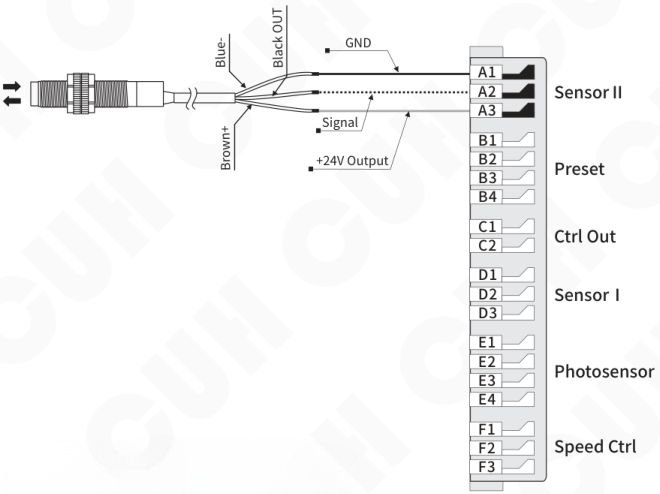

**ธรรมเนียมการต่อสาย**

สายสีน้ำเงินแทนสายกราวนด์  
สายสีดำแทนสายสัญญาณ  
สายสีน้ำตาลแทนสายจ่ายไฟ

---

## 5.3.2 เวลาหน่วงเปิด/ปิดของเซนเซอร์สวิตช์แบบ NPN ตัวที่สอง

โดยค่าเริ่มต้น เซนเซอร์โฟโต้อิเล็กทริกอัจฉริยะและเซนเซอร์สวิตช์แบบ NPN ทั้งสองตัวจะใช้เวลาหน่วงเปิดและเวลาหน่วงปิดร่วมกัน ผู้ปฏิบัติงานยังสามารถตั้งค่าเวลาหน่วงเปิดและเวลาหน่วงปิดของเซนเซอร์สวิตช์แบบ NPN ตัวที่สองแยกจากกันได้

### เวลาหน่วงเปิด (J_)

ช่วงเวลาที่ตัวควบคุมใช้ตั้งแต่รับสัญญาณควบคุมการเปิดจนถึงเอาต์พุต

- กดปุ่ม ⚙ และ ▲ พร้อมกันแบบกดค้าง เพื่อเข้าสู่หน้าจอพารามิเตอร์ขั้นสูง
- กดปุ่ม ⚙ แบบกดสั้นเพื่อสลับไปยังพารามิเตอร์ J_
- กด ▲ หรือ ▼ เพื่อปรับค่าพารามิเตอร์

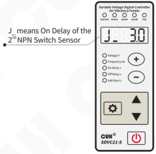

ช่วงค่าที่ปรับได้อยู่ระหว่าง 0.0 ถึง 9.9 วินาที ค่าเริ่มต้นของพารามิเตอร์คือ ---

เวลาหน่วงเปิดอิสระของเซนเซอร์สวิตช์แบบ NPN ตัวที่สองจะถูกปิดใช้งานเมื่อค่าพารามิเตอร์ถูกปรับเป็น 0

### เวลาหน่วงปิด (L_)

ช่วงเวลาที่ตัวควบคุมใช้ตั้งแต่รับสัญญาณควบคุมการปิดจนถึงการตัดเอาต์พุต

- กดปุ่ม ⚙ และ ▲ พร้อมกันแบบกดค้าง เพื่อเข้าสู่หน้าจอพารามิเตอร์ขั้นสูง
- กดปุ่ม ⚙ แบบกดสั้นเพื่อสลับไปยังพารามิเตอร์ L_
- กด ▲ หรือ ▼ เพื่อปรับค่าพารามิเตอร์

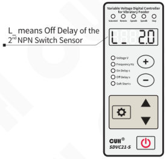

ช่วงค่าที่ปรับได้อยู่ระหว่าง 0.0 ถึง 9.9 วินาที ค่าเริ่มต้นของพารามิเตอร์คือ ---

เวลาหน่วงปิดอิสระของเซนเซอร์สวิตช์แบบ NPN ตัวที่สองจะถูกปิดใช้งานเมื่อค่าพารามิเตอร์ถูกปรับเป็น 0

---

- เมื่อค่า J_ และ L_ ถูกปรับเป็น 0 เวลาหน่วงเปิดและเวลาหน่วงปิดของเซนเซอร์สวิตช์แบบ NPN ตัวที่สองจะเท่ากับของเซนเซอร์โฟโต้อิเล็กทริกอัจฉริยะ
- เวลาหน่วงเปิดและเวลาหน่วงปิดของเซนเซอร์โฟโต้อิเล็กทริกอัจฉริยะจะไม่ได้รับผลกระทบจากพารามิเตอร์ J_ และ L_

---

## 5.3.3 การตั้งค่าทิศทางลอจิกของเซนเซอร์สวิตช์แบบ NPN ตัวที่สอง

ภายใต้สภาวะปกติ ตัวควบคุมจะไม่ได้รับสัญญาณจากเซนเซอร์สวิตช์แบบ NPN ตัวที่สอง และทำงานตามค่าเริ่มต้น แต่ในบางการใช้งานพิเศษ ตัวควบคุมจำเป็นต้องหยุดเมื่อไม่ได้รับสัญญาณจากเซนเซอร์สวิตช์แบบ NPN ตัวที่สอง การปรับพารามิเตอร์นี้สามารถทำให้การใช้งานลักษณะนี้เป็นไปได้

- กดปุ่ม ⚙ และ ▲ พร้อมกันแบบกดค้าง เพื่อเข้าสู่หน้าจอพารามิเตอร์ขั้นสูง
- กดปุ่ม ⚙ แบบกดสั้นเพื่อสลับไปยังพารามิเตอร์ Γ4
- กด ▲ หรือ ▼ เพื่อปรับค่าพารามิเตอร์

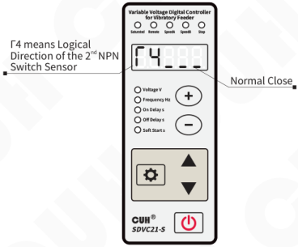

Γ4 หมายถึงทิศทางลอจิกของเซนเซอร์สวิตช์แบบ NPN ตัวที่สอง

Normal Close

พารามิเตอร์ Γ4 ตั้งไว้ที่ `___` โดยค่าเริ่มต้น

- เมื่อพารามิเตอร์ Γ4 ตั้งเป็น `___` กล่าวคือไม่ได้รับสัญญาณ ตัวควบคุมจะทำงาน
- เมื่อพารามิเตอร์ Γ4 ตั้งเป็น `_-_` กล่าวคือไม่ได้รับสัญญาณ ตัวควบคุมจะหยุดทำงาน

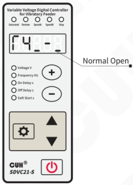

Normal Open

---

## 5.4 การตั้งค่าความสัมพันธ์ลอจิกของสัญญาณควบคุม

ตัวควบคุมสามารถตั้งค่าความสัมพันธ์ลอจิกของเซนเซอร์โฟโต้อิเล็กทริกอัจฉริยะและเซนเซอร์สวิตช์ เมื่อทั้งสองทำงานพร้อมกันได้

- กดปุ่ม ⚙ และ ▲ พร้อมกันแบบกดค้าง เพื่อเข้าสู่หน้าจอพารามิเตอร์ขั้นสูง
- กดปุ่ม ⚙ แบบกดสั้นเพื่อสลับไปยังพารามิเตอร์ Π
- กด ▲ หรือ ▼ เพื่อปรับค่าพารามิเตอร์

Π หมายถึงความสัมพันธ์ลอจิกของสัญญาณควบคุม

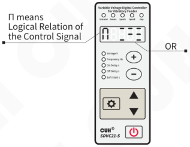

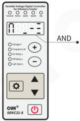

ความสัมพันธ์ลอจิกเริ่มต้นคือ AND

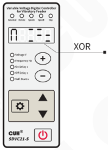

### ความสัมพันธ์ลอจิก: AND 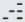:

ตัวควบคุมจะทำงานเมื่อเซนเซอร์โฟโต้อิเล็กทริกอัจฉริยะและเซนเซอร์สวิตช์แบบ NPN ต้องการให้ตัวควบคุมทำงานทั้งคู่เท่านั้น

### ความสัมพันธ์ลอจิก: OR 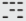:

ตัวควบคุมจะทำงานเมื่อเซนเซอร์โฟโต้อิเล็กทริกอัจฉริยะหรือเซนเซอร์สวิตช์แบบ NPN ต้องการให้ตัวควบคุมทำงาน

### ความสัมพันธ์ลอจิก: XOR 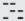:

ตัวควบคุมจะทำงานเมื่อเซนเซอร์โฟโต้อิเล็กทริกอัจฉริยะและเซนเซอร์สวิตช์แบบ NPN ส่งสัญญาณควบคุมที่ตรงข้ามกันเท่านั้น

---

## 5.5 เอาต์พุตควบคุม

ตัวควบคุมสามารถส่งสัญญาณควบคุมแรงดันต่ำออกมา เพื่อประสานการทำงานกับอุปกรณ์อื่น เช่น วาล์วโซเลนอยด์ PLC หรือรีเลย์ไฟฟ้า

### 5.5.1 วิธีเดินสายของเอาต์พุตควบคุม

**วิธีต่อ PLC**

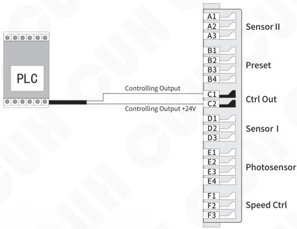

> เอาต์พุตแบบรีเลย์หรือเอาต์พุตแบบ NPN ของ PLC เข้ากันได้กับตัวควบคุม

วิธีการตั้งค่าพารามิเตอร์เหมือนกับของเซนเซอร์สวิตช์

---

## วิธีต่อวาล์วโซเลนอยด์

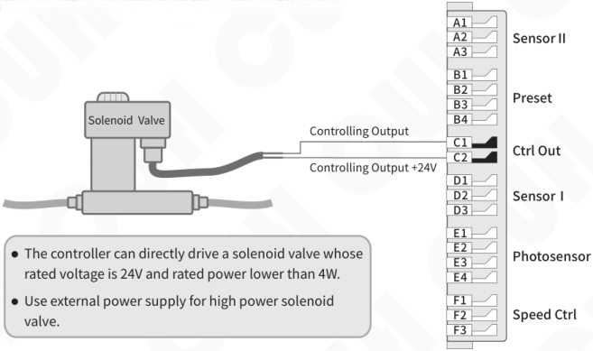

- ตัวควบคุมสามารถขับวาล์วโซเลนอยด์ที่มีแรงดันพิกัด 24V และกำลังไฟฟ้าพิกัดต่ำกว่า 4W ได้โดยตรง
- ใช้แหล่งจ่ายไฟภายนอกสำหรับวาล์วโซเลนอยด์กำลังสูง

## วิธีต่อรีเลย์ไฟฟ้า

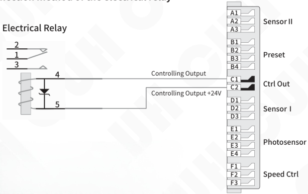

- ตัวควบคุมสามารถขับรีเลย์ไฟฟ้าที่มีแรงดันพิกัด 24V และกำลังไฟฟ้าพิกัดต่ำกว่า 4W ได้โดยตรง

---

## 5.5.2 การตั้งค่าทิศทางลอจิกของเอาต์พุตควบคุม

- กดปุ่ม ⚙ และ ▲ พร้อมกันแบบกดค้าง เพื่อเข้าสู่หน้าจอพารามิเตอร์ขั้นสูง
- กดปุ่ม ⚙ แบบกดสั้นเพื่อสลับไปยังพารามิเตอร์ Γ3
- กด ▲ หรือ ▼ เพื่อปรับค่าพารามิเตอร์

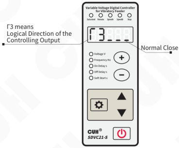

พารามิเตอร์ Γ3 ตั้งไว้ที่ `___` โดยค่าเริ่มต้น

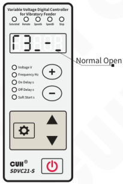

- เมื่อพารามิเตอร์ Γ3 ตั้งเป็น `___` เอาต์พุตควบคุมจะทำงานขณะที่ตัวควบคุมทำงาน
- เมื่อพารามิเตอร์ Γ3 ตั้งเป็น `_-_` เอาต์พุตควบคุมจะไม่ทำงานขณะที่ตัวควบคุมทำงาน

---

## 5.6 การควบคุมความเร็วระยะไกล

ฟังก์ชันการควบคุมความเร็วระยะไกลช่วยให้ผู้ปฏิบัติงานควบคุมแรงดันเอาต์พุตได้ด้วยโพเทนชิออมิเตอร์ภายนอก แรงดัน 1~5V หรือกระแส 4~20mA ทำให้การควบคุมความเร็วระยะไกลภายนอกทำได้ง่ายผ่าน PLC, DCS หรืออุปกรณ์อื่น ๆ

### วิธีต่อโพเทนชิออมิเตอร์ภายนอก

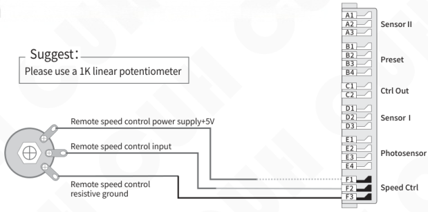

### วิธีต่อ PLC

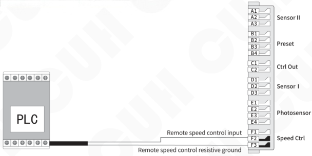

> เมื่อสัญญาณควบคุมความเร็วระยะไกลเริ่มมีผล ไฟแสดงสถานะควบคุมความเร็วจะติด ขณะเดียวกันการปรับแรงดันบนแผงหน้าปัดจะไม่ทำงาน

---

## 5.7 สวิตช์ความเร็วที่ตั้งไว้ล่วงหน้า

ฟังก์ชันสวิตช์ความเร็วที่ตั้งไว้ล่วงหน้าสามารถเลือกความเร็วที่ตั้งไว้ล่วงหน้าได้ โดยอาศัยสัญญาณควบคุมภายนอก เช่น PLC, PC, เซนเซอร์ หรือแหล่งสัญญาณอื่น เพื่อสร้างระบบควบคุมการป้อนวัสดุหลายระดับความเร็ว

ตัวควบคุมมีสัญญาณควบคุมสวิตช์ความเร็วที่ตั้งไว้ล่วงหน้าสองช่อง ซึ่งควบคุมสวิตช์ความเร็ว A และสวิตช์ความเร็ว B ทั้งสองทำงานแบบแอ็กทีฟโลว์ (Active Low)

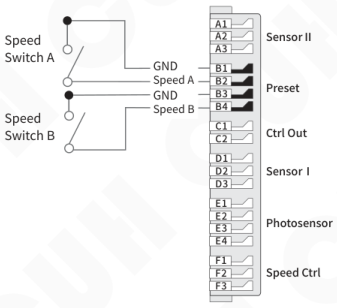

สถานะของสายควบคุมแต่ละเส้นจะแสดงด้วยไฟแสดงสถานะที่สอดคล้องกันบนแผงหน้าปัด เมื่อมีสัญญาณที่ถูกต้องเข้ามาที่สายควบคุม ไฟแสดงสถานะที่เกี่ยวข้องจะติด

การจัดเรียงสถานะเปิด/ปิดของไฟสองดวงมี 4 สถานะ (A ติด B ดับ, A ดับ B ติด, A และ B ติดทั้งคู่, A และ B ดับทั้งคู่)

เมื่อเลือกสัญญาณควบคุม ตัวควบคุมจะเข้าสู่ความเร็วที่ตั้งไว้ล่วงหน้าที่เกี่ยวข้อง ณ ขณะนั้นสามารถปรับแรงดันเอาต์พุตของตัวควบคุมได้ด้วย ⊕ หรือ ⊖ แรงดันจะถูกบันทึกอัตโนมัติ ทุกครั้งที่สัญญาณควบคุมความเร็วที่ตั้งไว้ล่วงหน้าตั้งค่าตัวควบคุมให้อยู่ในสถานะนี้ จะสลับไปยังแรงดันนี้ทันที

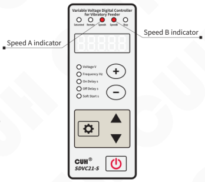

สถานะเมื่อมีสัญญาณที่ถูกต้องเข้ามาที่สายควบคุมทั้งสองเส้น

---

## บทที่ Ⅵ ฟังก์ชันความปลอดภัย

### 6.1 การรักษาแรงดันดิจิทัลอัตโนมัติ

ฟังก์ชันรักษาแรงดันดิจิทัลภายในของตัวควบคุมสามารถรักษาความเร็วในการป้อนวัสดุให้นิ่ง ไม่ว่าแรงดันไฟฟ้าจะผันผวนเพียงใด

### 6.2 การป้องกันการลัดวงจร

หากเอาต์พุตเกิดการลัดวงจร ตัวควบคุมจะหยุดเอาต์พุตและแสดง Err01 จนกว่าจะรีสตาร์ทตัวควบคุม

### 6.3 การป้องกันกระแสเกินพิกัด

ตัวควบคุมจะหยุดเอาต์พุตหากกระแสเอาต์พุตเกินกระแสพิกัดจากการใช้งานผิดพลาด และแสดง Err02 เพื่อปกป้องตัวควบคุมและอุปกรณ์ของลูกค้า

### 6.4 การป้องกันความร้อนสูงเกินไป

ตัวควบคุมจะหยุดเอาต์พุตหากอุณหภูมิการทำงานเกิน 65°C และแสดง Err03 เพื่อปกป้องตัวควบคุม จนกว่าอุณหภูมิการทำงานลดลงถึง 60°C

---

## บทที่ Ⅶ ข้อมูลทางเทคนิค

### 7.1 มิติ

มิติ (หน่วย: mm)

| ช่วงมิติ | ค่าเผื่อ (Tolerance) |
|---|---|
| 0~3 | ±0.05 |
| 3~10 | ±0.1 |
| 10~30 | ±0.15 |
| 30~80 | ±0.2 |
| 80~180 | ±0.3 |
| >180 | ±0.5 |

ตารางค่าเผื่อนี้ใช้ได้กับผลิตภัณฑ์ทุกรุ่นในตระกูลนี้

---

## 7.2 ข้อมูลทางเทคนิค

| รายการ | ต่ำสุด | ทั่วไป | สูงสุด | หน่วย | หมายเหตุ |
|---|---|---|---|---|---|
| แรงดันอินพุต | 85 | 220 | 250 | V | AC RMS |
| ช่วงปรับแรงดันเอาต์พุต | 35 | —— | Vin-10 | V | Half Wave |
| ช่วงปรับแรงดันเอาต์พุต | 45 | —— | Vin-5 | V | Full Wave |
| ความละเอียดการปรับแรงดัน | | 1 | | V | |
| ความแม่นยำการรักษาแรงดัน | —— | —— | 30 | V | Vset = 150V △Vin+ = 70V |
| เวลาตอบสนองการรักษาแรงดัน | 0 | 0.01 | 0.02 | s | |
| ช่วงปรับกระแสเอาต์พุต | 0 | —— | 5 | A | |
| กำลังไฟฟ้าเอาต์พุต | 0 | —— | 1100 | VA | |
| ความถี่เอาต์พุต | 45 | 50/60 | 65 | Hz | Half Wave |
| ความถี่เอาต์พุต | 90 | 100/120 | 130 | Hz | Full Wave |
| รูปคลื่นเอาต์พุต | | การควบคุมมุมเฟส (Phase Angle Control) | | | |
| เวลาสตาร์ทแบบนุ่มนวล | 0 | —— | 9.9 | s | ค่าเริ่มต้น: 1.0 |
| ช่วงเวลาหน่วงเปิด/ปิด | 0 | —— | 9.9 | s | ค่าเริ่มต้น: 0.2 |
| ความละเอียดเวลาหน่วงเปิด/ปิด | | 0.1 | | s | |
| อุณหภูมิจุดทำงานการป้องกันความร้อนสูงเกินไป | 58 | 60 | 66 | °C | |
| แรงดันเอาต์พุตควบคุมแบบ DC | 22 | 24 | 26 | V | |
| กระแสเอาต์พุตควบคุมแบบ DC | 0 | —— | 400 | mA | |
| สัญญาณควบคุมแบบแอนะล็อก | | 1~5/4~20 | | V/mA | สัญญาณควบคุมความเร็วระยะไกล |
| สัญญาณควบคุมแบบดิจิทัล | | 24 | | V | สัญญาณสวิตช์ |
| วิธีการปรับค่า | | 6 | | ปุ่ม | |
| ค่ากระแสฟิวส์ | | 6.3 | | A | |
| กำลังไฟฟ้าในโหมดสแตนด์บาย | —— | 2 | —— | W | |
| วิธีการแสดงผล | | 5 | | หลัก | LED |
| อุณหภูมิแวดล้อม | 0 | 25 | 40 | °C | ไม่ควบแน่น |
| ความชื้นสัมพัทธ์แวดล้อม | 10 | 60 | 85 | % | ไม่ควบแน่น |
| อุณหภูมิแวดล้อมการจัดเก็บ | -20 | 25 | 85 | °C | ไม่ควบแน่น |

## 7.3 มาตรฐานอ้างอิง

**พารามิเตอร์สัมบูรณ์:**  
ค่าที่เกินมาตรฐานจะทำให้ตัวควบคุมเสียหาย โปรดปฏิบัติตามอย่างเคร่งครัด

| รายการ | มาตรฐาน GB | มาตรฐาน IEC | ระดับ | ข้อกำหนดตามมาตรฐาน | หมายเหตุ |
|---|---|---|---|---|---|
| การคายประจุไฟฟ้าสถิต (ESD) | GB/T 17626.2-2006 | IEC 61000-4-2:2001 | 4 | ±8 kV | คายประจุแบบสัมผัส |
| | | | 4 | ±15 kV | คายประจุแบบอากาศ |
| การทดสอบทรานเซียนต์ไฟฟ้าเร็ว (Burst) | GB/T 17626.4-2008 | IEC 61000-4-4:2004 | 4 | ±4 kV | |
| ภูมิคุ้มกันคลื่นบนสายจ่ายไฟกระแสตรง | GB/T 17626.17-2005 | IEC 61000-4-17:2002 | 4 | 15% | ระดับ A |

> **คำเตือน**  
> ในสภาพแวดล้อมที่อยู่อาศัย ผลิตภัณฑ์นี้อาจก่อให้เกิดสัญญาณรบกวนวิทยุ ซึ่งในกรณีดังกล่าวอาจต้องใช้มาตรการบรรเทาเพิ่มเติม

---

## 7.4 ตารางพารามิเตอร์

| | คำจำกัดความ | สัญลักษณ์ | ภาพสัญลักษณ์บนจอ | ช่วงค่า | ค่าเริ่มต้น |
|---|---|---|---|---|---|
| พารามิเตอร์ทั่วไป | แรงดันเอาต์พุต | U |  | 0~250 V | 150 |
| พารามิเตอร์พื้นฐาน | ความถี่เอาต์พุต | E |  | FULL，HALF | FULL |
| พารามิเตอร์พื้นฐาน | เวลาหน่วงเปิดของเซนเซอร์โฟโต้อิเล็กทริกอัจฉริยะ | J |  | 0.0~9.9 s | 0.2 |
| พารามิเตอร์พื้นฐาน | เวลาหน่วงปิดของเซนเซอร์โฟโต้อิเล็กทริกอัจฉริยะ | L |  | 0.0~9.9 s | 0.2 |
| พารามิเตอร์พื้นฐาน | สตาร์ทแบบนุ่มนวล | t |  | 0.0~9.9 s | 1.0 |
| พารามิเตอร์ขั้นสูง | เวลาหน่วงเปิดของเซนเซอร์สวิตช์แบบ NPN | J- |  | 0.0~9.9 s | --- เท่ากับ J |
| พารามิเตอร์ขั้นสูง | เวลาหน่วงปิดของเซนเซอร์สวิตช์แบบ NPN | L- |  | 0.0~9.9 s | --- เท่ากับ L |
| พารามิเตอร์ขั้นสูง | เวลาหน่วงเปิดของเซนเซอร์สวิตช์แบบ NPN ตัวที่สอง | J_ |  | 0.0~9.9 s | --- เท่ากับ J |
| พารามิเตอร์ขั้นสูง | เวลาหน่วงปิดของเซนเซอร์สวิตช์แบบ NPN ตัวที่สอง | L_ |  | 0.0~9.9 s | --- เท่ากับ L |
| พารามิเตอร์ขั้นสูง | ทิศทางลอจิกของเซนเซอร์โฟโต้อิเล็กทริกอัจฉริยะ | F1 |  | Normal Close, Normal Open  | ___ |
| พารามิเตอร์ขั้นสูง | ทิศทางลอจิกของเซนเซอร์สวิตช์แบบ NPN | F2 |  | Normal Close, Normal Open [[vcrop:41:17]] | ___ |
| พารามิเตอร์ขั้นสูง | ทิศทางลอจิกของเอาต์พุตควบคุม | F3 |  | Normal Close, Normal Open [[vcrop:41:17]] | ___ |
| พารามิเตอร์ขั้นสูง | ทิศทางลอจิกของเซนเซอร์สวิตช์แบบ NPN ตัวที่สอง | F4 |  | Normal Close, Normal Open [[vcrop:41:17]] | ___ |
| พารามิเตอร์ขั้นสูง | ความสัมพันธ์ลอจิกของสัญญาณควบคุม | A |  | or, And, Hor  |  |
| พารามิเตอร์ขั้นสูง | แรงดันเอาต์พุตสูงสุด | h |  | 0~250 V | 220 |
| พารามิเตอร์ขั้นสูง | ความไวของเซนเซอร์โฟโต้อิเล็กทริกอัจฉริยะ | P |  | 0~1000 | 80 |
| พารามิเตอร์ขั้นสูง | คืนค่าการตั้งค่าจากโรงงาน | 8.8.8.8.8. |  | —— | —— |

## 7.5 คำแนะนำการแก้ไขปัญหาและคำอธิบายรหัสข้อผิดพลาด

| รหัสข้อผิดพลาด | คำจำกัดความ | วิธีแก้ไขปัญหา | ภาพสัญลักษณ์บนจอ |
|---|---|---|---|
| ไม่มีการแสดงผลหลังเปิดเครื่อง | | ตรวจสอบว่าเต้ารับไฟมีไฟฟ้า ตรวจสอบว่าสายไฟฟ้าอินพุตต่อกับเต้ารับไฟอย่างมั่นคงหรือไม่ | |
| แสดงผลปกติ แต่ไม่มีเอาต์พุต | | ตรวจสอบว่าสายเอาต์พุตต่อกับตัวสั่นสะเทือนอย่างมั่นคงหรือไม่ ตรวจสอบว่าแรงดันเอาต์พุตไม่ต่ำเกินไป ตรวจสอบว่าไฟแสดงสถานะหยุดทำงานไม่ติด โปรดตรวจสอบว่าได้ตั้งค่า Normal Close ของพารามิเตอร์ไว้หรือไม่ ซึ่งทำให้เอาต์พุตของตัวควบคุมหยุด | |
| สัญญาณควบคุมไม่มีผล | | ตรวจสอบว่าสัญญาณควบคุมถูกป้อนอย่างถูกต้องหรือไม่ ตรวจสอบว่าสายกราวนด์ของสัญญาณควบคุมต่อเข้าตัวควบคุมอย่างถูกต้องหรือไม่ ตรวจสอบว่าความสัมพันธ์ลอจิกของสัญญาณควบคุมถูกตั้งตามที่ต้องการหรือไม่ | |
| ปรากฏการณ์บีต (Beat) | | หลีกเลี่ยงการส่งผ่านการสั่นสะเทือนระหว่างตัวสั่นสะเทือน เพิ่มความถี่ความถี่สั่นพ้องของตัวสั่นสะเทือนให้สูงขึ้น | |
| แสดงผลปกติ ไม่มีเอาต์พุต แต่ได้ยินเสียง | | ปรับพารามิเตอร์ทั้งหมดตามที่คู่มือเล่มนี้แนะนำ | |
| Err01 | การลัดวงจร | ตรวจสอบว่าสายไฟเอาต์พุตและขดลวดไม่ถูกลัดวงจร |  |
| Err02 | กระแสเกิน | ลดแรงดันเอาต์พุตลงอย่างเหมาะสม แล้วรีสตาร์ทเอาต์พุต |  |
| Err03 | ความร้อนสูงเกินไป | ติดตั้งตัวควบคุมในสภาพแวดล้อมที่ระบายอากาศดี |  |
| Err04 | | สำรองไว้ โปรดติดต่อ CUH |  |
| Err05 | | สำรองไว้ โปรดติดต่อ CUH |  |

## บทที่ Ⅷ ข้อมูลการรับประกันผลิตภัณฑ์

### 8.1 ระยะเวลารับประกัน

ระยะเวลารับประกันที่บริษัทมอบให้ผลิตภัณฑ์นี้คือ 3 ปี นับจากวันที่ส่งมอบผลิตภัณฑ์ถึงสถานที่ที่ผู้ซื้อกำหนด

### 8.2 ขอบเขตการรับประกัน

(1) หากมีความขัดข้องที่เกิดจากบริษัทของเราภายในระยะเวลารับประกันข้างต้น เราจะซ่อมแซมผลิตภัณฑ์โดยไม่คิดค่าใช้จ่าย อย่างไรก็ตาม กรณีต่อไปนี้ไม่อยู่ในขอบเขตการรับประกัน:

a. ไม่ปฏิบัติตามเงื่อนไขที่ระบุในคู่มือฉบับย่อ คู่มือการใช้งาน หรือข้อกำหนดทางเทคนิคที่ตกลงกันเฉพาะระหว่างผู้ซื้อกับบริษัท การใช้งานที่ไม่ถูกต้อง หรือความขัดข้องที่เกิดจากการใช้งานที่ไม่เหมาะสม

b. ความขัดข้องไม่ได้เกิดจากตำหนิของผลิตภัณฑ์ แต่เกิดจากการออกแบบอุปกรณ์หรือซอฟต์แวร์ของผู้ซื้อ

c. ความผิดปกติที่เกิดจากการดัดแปลงหรือซ่อมแซมที่ไม่ได้ทำโดยบุคลากรของบริษัท

d. ความขัดข้องที่สามารถหลีกเลี่ยงได้ทั้งหมดด้วยการบำรุงรักษาที่ถูกต้องหรือการเปลี่ยนชิ้นส่วนที่สึกหรอตามคู่มือการปฏิบัติฉบับย่อหรือคู่มือการใช้งาน

e. หลังจากผลิตภัณฑ์ถูกส่งออกจากบริษัทของเรา ความขัดข้องที่เกิดจากปัจจัย เช่น การเปลี่ยนแปลงของระดับวิทยาศาสตร์และเทคโนโลยีที่คาดไม่ถึง

f. จากภัยพิบัติทางธรรมชาติ เช่น อัคคีภัย แผ่นดินไหว อุทกภัย หรือปัจจัยภายนอก เช่น ความขัดข้องจากแรงดันผิดปกติ บริษัทไม่รับผิดชอบการรับประกัน

(2) ขอบเขตการรับประกันจำกัดเฉพาะกรณีที่ระบุใน (1) สำหรับความสูญเสียทางอ้อม (เช่น ความเสียหายของอุปกรณ์ โอกาสที่สูญเสียไป กำไรที่สูญเสีย ฯลฯ) หรือความสูญเสียอื่น ๆ บริษัทไม่รับความรับผิดชอบใด ๆ

### 8.3 ความเหมาะสมของผลิตภัณฑ์

ตัวควบคุมของบริษัทเราออกแบบและผลิตเพื่อการใช้งานทั่วไปในอุตสาหกรรมการป้อนวัสดุแบบสั่นสะเทือน ดังนั้นตัวควบคุมของบริษัทเรารายนี้ห้ามใช้สำหรับการใช้งานต่อไปนี้และไม่เหมาะสมกับการใช้งานดังกล่าว:

(1) สิ่งอำนวยความสะดวกที่มีผลกระทบร้ายแรงต่อชีวิตและทรัพย์สิน เช่น โรงไฟฟ้านิวเคลียร์ สนามบิน รถไฟ เรือ อุปกรณ์เคลื่อนที่ และอุปกรณ์ทางการแพทย์

(2) สาธารณูปโภค รวมถึงไฟฟ้า แก๊ส การประปา ฯลฯ

(3) การใช้งานกลางแจ้งในสภาวะหรือสภาพแวดล้อมที่คล้ายคลึงกัน

---

Nanjing CUH Science & Technology Co.,Ltd  
https://en.cuhnj.com  
Tel.:+86-25-84730411 / 84730415 / 84730416  
Fax:+86-25-84730426  
E-mail:sales@cuhnj.com  
Add.:Building 2, Xueyan Tech Park, Tuscity,  
No.9 Zhineng Rd, Jiangning, Nanjing, China

เอกสารเลขที่: IDP1000378

