# ตัวควบคุมแรงดันดิจิทัลแบบปรับค่าได้สำหรับเครื่องป้อนวัสดุแบบสั่นสะเทือน

**IP67**

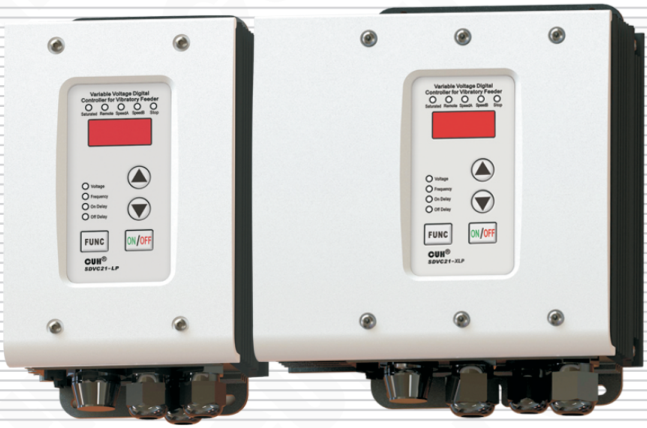

## คู่มือการใช้งานซีรีส์ SDVC21P

**ตัวควบคุมแรงดันดิจิทัลแบบปรับค่าได้สำหรับเครื่องป้อนวัสดุแบบสั่นสะเทือน**

---

## คำนำ

ขอขอบคุณที่เลือกใช้ตัวควบคุมเครื่องป้อนวัสดุแบบสั่นสะเทือนแบบดิจิทัลของ CUH (ต่อไปในเอกสารนี้เรียกว่า “ตัวควบคุม”)

คู่มือการใช้งานนี้ประกอบด้วยคำแนะนำสำหรับการติดตั้ง การปรับแต่ง การตั้งค่าพารามิเตอร์ การบำรุงรักษา และการแก้ไขปัญหาของตัวควบคุม โปรดอ่านคู่มือการใช้งานนี้อย่างละเอียดก่อนใช้งานตัวควบคุม และเก็บรักษาไว้อย่างเหมาะสม

### คู่มือการใช้งานนี้ใช้ได้กับรุ่นต่อไปนี้:

➔ตัวควบคุมเครื่องป้อนวัสดุแบบสั่นสะเทือนแบบดิจิทัลอัจฉริยะพร้อมระบบรักษาเสถียรภาพแรงดัน SDVC21-LP  
➔ตัวควบคุมเครื่องป้อนวัสดุแบบสั่นสะเทือนแบบดิจิทัลอัจฉริยะพร้อมระบบรักษาเสถียรภาพแรงดัน SDVC21-XLP

---

---

## ข้อควรทราบ

- ห้ามทำการสับเปลี่ยนแบบมีกระแสไฟหรือสัมผัสจุดสัมผัสในทุกกรณี เพื่อหลีกเลี่ยงไฟฟ้าช็อตหรืออุบัติเหตุอื่น ๆ
- ห้ามสลับอินพุตของตัวควบคุมโดยการตัดแหล่งจ่ายไฟผ่านรีเลย์หรืออุปกรณ์อื่น มิฉะนั้นอายุการใช้งานของตัวควบคุมอาจลดลงอย่างรุนแรง
- ห้ามเปิดฝาเครื่องโดยไม่ได้รับอนุญาต มิฉะนั้นคุณสมบัติกันน้ำ กันน้ำมัน และกันฝุ่นอาจล้มเหลว
- ห้ามใช้งานตัวควบคุมในสภาวะที่เกินขีดจำกัดที่ออกแบบไว้
- ใช้งานตัวควบคุมตามคู่มือนี้อย่างเคร่งครัด เราจะไม่รับผิดชอบใด ๆ ทั้งทางแพ่งและทางอาญาหากเกิดความเสียหายต่ออุปกรณ์หรือการบาดเจ็บส่วนบุคคลอันเนื่องมาจากการใช้งานที่ไม่ถูกต้อง

> **!**
>
> ห้ามเปิดฝาตัวควบคุมเพื่อหลีกเลี่ยงไฟฟ้าช็อต หากตัวควบคุมเสียหาย โปรดติดต่อ CUH
>
> ห้ามพยายามดัดแปลงตัวควบคุม เนื่องจากแผงวงจรโซลิดสเตตภายในตัวควบคุมไม่สามารถซ่อมแซมได้ และไม่มีชิ้นส่วนที่ปรับตั้งได้

---

# สภาพแวดล้อมการใช้งาน

## การตรวจสอบก่อนการใช้งาน

ตัวควบคุมทุกเครื่องจะผ่านการตรวจสอบคุณภาพอย่างเข้มงวดก่อนจัดส่ง และบรรจุด้วยบรรจุภัณฑ์กันกระแทก

## โปรดตรวจสอบรายการต่อไปนี้หลังแกะกล่อง:

- ตัวควบคุมมีความเสียหายภายนอกหรือไม่
- รุ่นของตัวควบคุมตรงกับที่คุณสั่งซื้อหรือไม่

## สภาพแวดล้อมในการทำงาน

โปรดปฏิบัติตามข้อควรทราบด้านล่างเพื่อให้มั่นใจถึงประสิทธิภาพที่ดีขึ้นและอายุการใช้งานที่ยาวนานขึ้นของตัวควบคุม

- สภาพแวดล้อมที่มีการระบายอากาศดี
- อยู่ห่างจากก๊าซและของเหลวที่มีฤทธิ์กัดกร่อนและไวไฟ
- ยึดให้แน่นเพื่อหลีกเลี่ยงการสั่นสะเทือน
- อยู่ห่างจากการรบกวนทางแม่เหล็กไฟฟ้า
- ใช้งานในช่วงอุณหภูมิ 0 °C ถึง 40 °C
- ใช้งานที่ระดับความสูง 2000 ม. หรือต่ำกว่า

---

# สารบัญ

| ส่วน | หน้า |
|---|---:|
| บทที่ Ⅰ คุณสมบัติ | 1 |
| บทที่ Ⅱ คู่มือการติดตั้ง | 3 |
| บทที่ Ⅲ คำอธิบายส่วนประกอบ | 4 |
| บทที่ Ⅳ คำอธิบายฟังก์ชัน | 6 |
| 4.1 การตั้งค่าแรงดันเอาต์พุต | 6 |
| 4.2 การตั้งค่าความถี่เอาต์พุต | 7 |
| 4.3 การตั้งค่าพารามิเตอร์ตัวอักษรแสดงความถี่ | 7 |
| 4.4 การตั้งค่าเวลาสตาร์ทแบบนุ่มนวล | 8 |
| 4.5 สวิตช์เอาต์พุต | 8 |
| 4.6 การจำกัดแรงดันเอาต์พุตสูงสุด | 9 |
| 4.7 การคืนค่าการตั้งค่าเริ่มต้น | 10 |
| บทที่ Ⅴ เซนเซอร์และการควบคุมสัญญาณ | 11 |
| 5.1 การตรวจจับด้วยโฟโตอิเล็กทริกอัจฉริยะ | 11 |
| 5.2 วิธีการใช้เซนเซอร์แบบสวิตช์ | 15 |
| 5.3 วิธีการใช้เซนเซอร์แบบสวิตช์ตัวที่ 2 | 18 |
| 5.4 การตั้งค่าความสัมพันธ์เชิงตรรกะของสัญญาณควบคุม | 21 |
| 5.5 เอาต์พุตควบคุม | 22 |
| 5.6 การควบคุมความเร็วจากระยะไกล | 26 |
| 5.7 สวิตช์ความเร็วที่ตั้งค่าไว้ล่วงหน้า | 27 |
| บทที่ Ⅵ ฟังก์ชันความปลอดภัย | 28 |
| 6.1 การรักษาเสถียรภาพแรงดันดิจิทัลอัตโนมัติ | 28 |
| 6.2 การป้องกันการลัดวงจร | 28 |
| 6.3 การป้องกันกระแสเกิน | 28 |
| 6.4 การป้องกันความร้อนเกิน | 28 |
| 6.5 เส้นโค้งการลดพิกัดตามอุณหภูมิแวดล้อม (ใช้เฉพาะ SDVC21-XLP) | 28 |

## ภาคผนวก

| ส่วน | หน้า |
|---|---:|
| ภาคผนวก A: ขนาด | 29 |
| ภาคผนวก B: คำจำกัดความของอินเทอร์เฟซเอาต์พุต | 31 |
| ภาคผนวก C: คำจำกัดความของอินเทอร์เฟซสัญญาณ | 31 |
| ภาคผนวก D: คำจำกัดความของตัวอักษรที่แสดงบน LED | 34 |
| ภาคผนวก E: ข้อกำหนดทางไฟฟ้า | 35 |
| ภาคผนวก F: เคล็ดลับการแก้ไขปัญหาและคำอธิบายข้อผิดพลาด | 36 |
| ภาคผนวก G: พารามิเตอร์สัมบูรณ์ | 37 |

---

# บทที่ Ⅰ คุณสมบัติ

ตัวควบคุมนี้ได้รับการออกแบบมาเป็นพิเศษสำหรับการควบคุมเครื่องป้อนวัสดุแบบสั่นสะเทือนในระบบอัตโนมัติ ด้วยเทคโนโลยีอิเล็กทรอนิกส์ล่าสุดและการออกแบบที่พิถีพิถัน ตัวควบคุมจึงมอบคุณสมบัติที่สะดวกและใช้งานได้จริงดังต่อไปนี้:

**ระดับการป้องกัน:** IP67 ตัวควบคุมนี้สามารถทำงานได้ในสภาพแวดล้อมที่เปียกชื้น มีน้ำมัน หรือมีฝุ่น

**ช่วงแรงดันใช้งานกว้างพิเศษ:** ช่วงแรงดันอินพุตของตัวควบคุมนี้อยู่ที่ AC 85V ถึง 440V

**การรักษาเสถียรภาพแรงดันอัตโนมัติ:** ตัวควบคุมสามารถขจัดความผันแปรของความเร็วการป้อนที่เกิดจากความผันผวนของแรงดันไฟฟ้าหลัก

**การปรับแรงดัน:** แรงดันเอาต์พุตอยู่ในช่วง 0V ถึง 440V

**การสตาร์ทแบบนุ่มนวล:** เพื่อหลีกเลี่ยงการกระแทกอย่างกระทันหันต่อชิ้นงาน ตัวควบคุมสามารถค่อย ๆ เพิ่มแรงดันเอาต์พุตจาก 0 ไปจนถึงค่าที่ตั้งไว้ล่วงหน้าเมื่อสตาร์ท

**การตั้งค่าเวลาสตาร์ทแบบนุ่มนวล:** เวลาสตาร์ทแบบนุ่มนวลสามารถตั้งค่าเป็นตัวเลขดิจิทัลได้อย่างแม่นยำ

**หยุดเมื่อชิ้นงานเต็ม:** เซนเซอร์แบบสวิตช์สามารถช่วยหยุดตัวควบคุมเมื่อชิ้นงานเต็ม และทำหน้าที่ตั้งค่าเวลาสตาร์ทแบบนุ่มนวล เวลาหน่วงการสตาร์ท เวลาหน่วงการหยุด และการปรับความสัมพันธ์เชิงตรรกะ

**เอาต์พุตควบคุม:** สัญญาณเอาต์พุตควบคุมที่ส่งออกจากทรานซิสเตอร์สามารถประสานการทำงานของโซลินอยด์หรืออุปกรณ์ภายนอกอื่น ๆ เข้ากับตัวควบคุม

**การป้องกันความร้อนเกิน:** ตัวควบคุมจะหยุดเอาต์พุตเพื่อป้องกันตัวเองเมื่ออุณหภูมิการทำงานสูงเกินไป

**การป้องกันกระแสเกิน:** ตัวควบคุมจะหยุดเอาต์พุตเพื่อรับประกันความปลอดภัยในการทำงานของอุปกรณ์เมื่อกระแสการทำงานเกินค่าพิกัด

## คุณสมบัติต่อไปนี้สามารถปรับแต่งได้:

**อินพุตสัญญาณควบคุมคู่:** อินพุตสัญญาณควบคุมคู่ของ “ชิ้นงานเต็ม” และ “ชิ้นงานว่าง” สามารถสร้างความสัมพันธ์เชิงตรรกะแบบ AND, OR, NOT, XOR และอื่น ๆ ได้ทั้งหมด

**ฟังก์ชันตั้งค่าแรงดันเอาต์พุตล่วงหน้า:** สามารถเลือกค่าแรงดันเอาต์พุตที่ตั้งไว้ล่วงหน้าได้สูงสุดสี่ค่าผ่านสัญญาณควบคุมภายนอก

**การตรวจจับด้วยโฟโตอิเล็กทริกอัจฉริยะ:** เซนเซอร์โฟโตอิเล็กทริกอัจฉริยะแบบปรับตัวได้ของเราสามารถช่วยหยุดตัวควบคุมเมื่อชิ้นงานเต็มหรือชิ้นงานว่าง และทำหน้าที่ตั้งค่าเวลาสตาร์ทแบบทีละน้อย เวลาหน่วงการสตาร์ท เวลาหน่วงการหยุด และการปรับความสัมพันธ์เชิงตรรกะ

**การควบคุมความเร็วจากระยะไกล:** แรงดันเอาต์พุตของตัวควบคุมสามารถควบคุมได้ด้วยโพเทนชิออมิเตอร์ภายนอก PLC หรือสัญญาณควบคุมแรงดันในช่วงตั้งแต่ 1V ถึง 5V

---

---

**CUH** ให้ความสำคัญอย่างยิ่งกับการจัดการคุณภาพผลิตภัณฑ์และสมรรถนะด้านความปลอดภัย นอกเหนือจากชิ้นส่วนคุณภาพสูงที่เราใช้และระบบควบคุมคุณภาพที่เข้มงวดแล้ว **CUH** ยังคำนึงถึงอุบัติเหตุที่ผู้ใช้อาจพบเจอ และได้จัดเตรียมฟังก์ชันป้องกันดังต่อไปนี้เพื่อเพิ่มประโยชน์ใช้สอยของตัวควบคุมให้สูงสุด

**การป้องกันการลัดวงจร:** หากเอาต์พุตของตัวควบคุมลัดวงจร ตัวควบคุมจะหยุดเอาต์พุตจนกว่าจะรีสตาร์ทใหม่

**การป้องกันกระแสเกิน:** ตัวควบคุมจะหยุดเอาต์พุตเพื่อรับประกันความปลอดภัยในการทำงานของอุปกรณ์เมื่อกระแสการทำงานเกินค่าพิกัด

**การป้องกันความร้อนเกิน:** ตัวควบคุมจะหยุดเอาต์พุตเพื่อป้องกันตัวเองเมื่ออุณหภูมิการทำงานสูงเกินไป

ตัวควบคุม **CUH** เป็นไปตามข้อกำหนดการรับรอง CE อย่างเคร่งครัด

---

# บทที่ Ⅱ คู่มือการติดตั้ง

## ขั้นตอนที่หนึ่ง:

เปิดกล่องบรรจุภัณฑ์และเชื่อมต่อสายไฟกำลังเอาต์พุตเข้ากับขดลวดแม่เหล็กไฟฟ้าของเครื่องสั่น

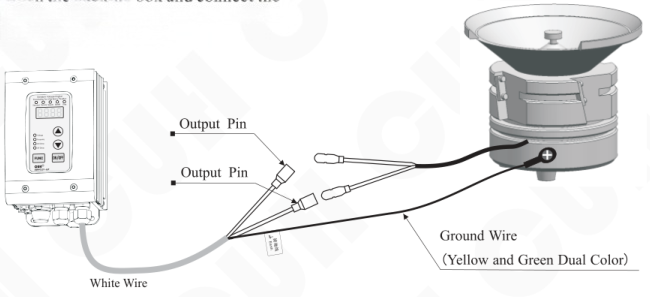

**⚠ หมายเหตุ:**

ตรวจสอบให้แน่ใจว่าขดลวดแม่เหล็กไฟฟ้าของเครื่องสั่นเชื่อมต่อกับขั้วเอาต์พุตสองขั้วของสายไฟกำลังเอาต์พุต และขดลวดแม่เหล็กไฟฟ้าได้รับการต่อสายดินอย่างน่าเชื่อถือ มิฉะนั้นอาจเกิดอุบัติการณ์ด้านความปลอดภัยตามมาได้

## ขั้นตอนที่สอง:

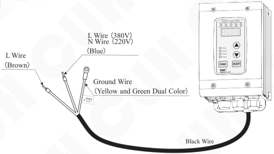

---

# บทที่ Ⅲ คำอธิบายส่วนประกอบ

บนแผงควบคุมมีปุ่ม 4 ปุ่ม ได้แก่ ปุ่ม `FUNC` สำหรับสลับระหว่างฟังก์ชันต่าง ๆ ปุ่ม ▲ สำหรับเพิ่มค่าพารามิเตอร์ ปุ่ม ▼ สำหรับลดค่าพารามิเตอร์ และปุ่ม `ON/OFF`

## คำอธิบายแป้นพิมพ์

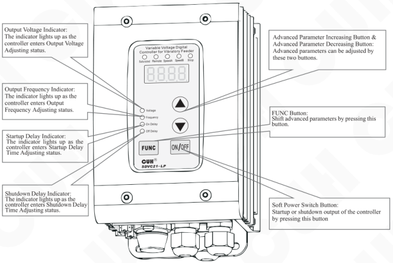

- **ไฟแสดงแรงดันเอาต์พุต:** ไฟแสดงจะสว่างขึ้นเมื่อตัวควบคุมเข้าสู่สถานะการปรับแรงดันเอาต์พุต
- **ไฟแสดงความถี่เอาต์พุต:** ไฟแสดงจะสว่างขึ้นเมื่อตัวควบคุมเข้าสู่สถานะการปรับความถี่เอาต์พุต
- **ไฟแสดงเวลาหน่วงการสตาร์ท:** ไฟแสดงจะสว่างขึ้นเมื่อตัวควบคุมเข้าสู่สถานะการปรับเวลาหน่วงการสตาร์ท
- **ไฟแสดงเวลาหน่วงการหยุด:** ไฟแสดงจะสว่างขึ้นเมื่อตัวควบคุมเข้าสู่สถานะการปรับเวลาหน่วงการหยุด
- **ปุ่มเพิ่มพารามิเตอร์ขั้นสูงและปุ่มลดพารามิเตอร์ขั้นสูง:** พารามิเตอร์ขั้นสูงสามารถปรับได้ด้วยปุ่มสองปุ่มนี้
- **ปุ่ม FUNC:** กดปุ่มนี้เพื่อสลับพารามิเตอร์ขั้นสูง
- **ปุ่มสวิตช์จ่ายไฟแบบสัมผัสนุ่ม:** กดปุ่มนี้เพื่อเปิดหรือปิดเอาต์พุตของตัวควบคุม

---

## คำอธิบายไฟแสดงสถานะ

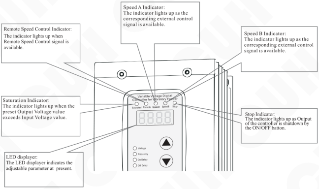

- **ไฟแสดงการควบคุมความเร็วจากระยะไกล:** ไฟแสดงจะสว่างขึ้นเมื่อมีสัญญาณการควบคุมความเร็วจากระยะไกล
- **ไฟแสดงความเร็ว A:** ไฟแสดงจะสว่างขึ้นเมื่อมีสัญญาณควบคุมภายนอกที่เกี่ยวข้อง
- **ไฟแสดงความเร็ว B:** ไฟแสดงจะสว่างขึ้นเมื่อมีสัญญาณควบคุมภายนอกที่เกี่ยวข้อง
- **ไฟแสดงอิ่มตัว:** ไฟแสดงจะสว่างขึ้นเมื่อค่าแรงดันเอาต์พุตที่ตั้งไว้ล่วงหน้าเกินค่าแรงดันอินพุต
- **ไฟแสดงหยุด:** ไฟแสดงจะสว่างขึ้นเมื่อเอาต์พุตของตัวควบคุมถูกปิดด้วยปุ่ม ON/OFF
- **จอแสดงผล LED:** จอแสดงผล LED แสดงพารามิเตอร์ที่ปรับได้ในปัจจุบัน

## คำอธิบายอินเทอร์เฟซ I/O

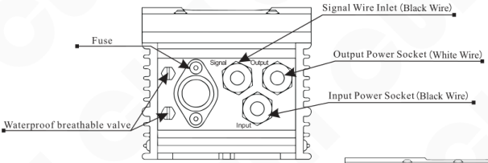

**SDVC21-LP (10A)**

- ฟิวส์
- วาล์วระบายอากาศกันน้ำ
- ช่องต่อสายสัญญาณ (สายสีดำ)
- เต้ารับกำลังเอาต์พุต (สายสีขาว)
- เต้ารับกำลังอินพุต (สายสีดำ)

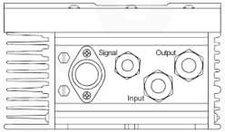

**SDVC21-XLP (25A)**

หมายเหตุ: เมื่อใช้งานในสภาพแวดล้อมที่มีน้ำมันปนเปื้อนสูง จำเป็นต้องตรวจสอบพื้นผิวของวาล์วระบายอากาศกันน้ำอย่างสม่ำเสมอ เพื่อป้องกันไม่ให้รูระบายอากาศของวาล์วระบายอากาศกันน้ำถูกอุดตันด้วยน้ำมัน

---

## บทที่ Ⅳ คำอธิบายฟังก์ชัน

### 4.1 การตั้งค่าแรงดันเอาต์พุต

แรงดันเอาต์พุตสามารถตั้งค่าได้โดยตรงและแบบดิจิทัลผ่านแผงควบคุม ด้วยฟังก์ชันรักษาเสถียรภาพแรงดันอันเป็นเอกลักษณ์ แรงดันเอาต์พุตของตัวควบคุมจะไม่ผันผวนไปตามแรงดันอินพุต ดังนั้นเครื่องสั่นจึงสามารถทำงานได้อย่างเสถียรในสภาพแวดล้อมที่มีแรงดันอินพุตไม่เสถียร

- เปิดตัวควบคุมโดยเชื่อมต่อสายไฟกำลังอินพุต
- ไฟแสดงแรงดันเอาต์พุตจะสว่างขึ้นเมื่อตัวควบคุมเข้าสู่สถานะการปรับแรงดันเอาต์พุต เมื่อจอ LED แสดงสัญลักษณ์แรงดัน H และค่าแรงดันที่ตั้งไว้ก่อนหน้านี้
- ปรับค่าแรงดันเอาต์พุตโดยกดปุ่ม ▲ หรือ ▼

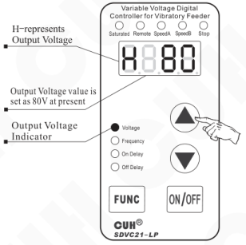

- ค่าแรงดันเอาต์พุตของตัวควบคุมต้องไม่เกินค่าแรงดันอินพุต หากตั้งค่าแรงดันเอาต์พุตไว้ใกล้กับค่าแรงดันอินพุต ตัวควบคุมจะไม่สามารถรักษาเสถียรภาพของแรงดันเอาต์พุตได้ และไฟแสดงอิ่มตัวจะสว่างขึ้น
- หากตั้งค่าแรงดันเอาต์พุตไว้ใกล้ศูนย์เกินไป ตัวควบคุมจะไม่สามารถรักษาเสถียรภาพของแรงดันเอาต์พุตได้ และไฟแสดงอิ่มตัวจะสว่างขึ้น

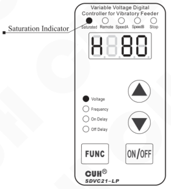

---

## 4.2 การตั้งค่าความถี่เอาต์พุต

สำหรับ SDVC21-LP มีความถี่เอาต์พุตสองแบบให้เลือก ได้แก่ คลื่นเต็มรูป–ความถี่อินพุตเป็นสองเท่า และครึ่งคลื่น–ความถี่อินพุต

สำหรับ SDVC21-XLP มีความถี่เอาต์พุตสี่แบบให้เลือก ได้แก่ คลื่นเต็มรูป ครึ่งคลื่น หนึ่งในสามของคลื่นเต็มรูป และหนึ่งในสี่ของคลื่นเต็มรูป

- กดปุ่ม **FUNC** ซ้ำ ๆ จนกระทั่งสลับไปยังสถานะการปรับความถี่เอาต์พุต (E) โดยไฟแสดงความถี่เอาต์พุตสว่างขึ้น
- กดปุ่ม ▲ หรือ ▼ เพื่อปรับความถี่เอาต์พุต

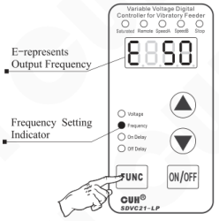

> ตัวอักษรที่แสดงของค่าความถี่เอาต์พุตสามารถตั้งค่าได้ผ่านพารามิเตอร์ตัวอักษรแสดงความถี่ โปรดดูหัวข้อ 4.3

## 4.3 การตั้งค่าพารามิเตอร์ตัวอักษรแสดงความถี่

- กดปุ่ม **FUNC** ค้างไว้สองวินาทีเพื่อเข้าสู่อินเทอร์เฟซการตั้งค่าพารามิเตอร์ขั้นสูง
- กดปุ่ม **FUNC** ซ้ำ ๆ เพื่อสลับไปยังพารามิเตอร์ “ΓE” ซึ่งกำหนดตัวอักษรแสดงความถี่
- กด ▲ หรือ ▼ เพื่อปรับค่าพารามิเตอร์นี้

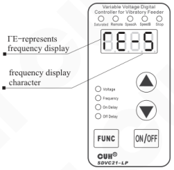

> เมื่อตั้งค่าพารามิเตอร์ “ΓE” เป็น “-5” ตัวอักษรที่แสดงจะเป็น 100, 50, 33 หรือ 25.  
> เมื่อตั้งค่าพารามิเตอร์ “ΓE” เป็น “-6” ตัวอักษรที่แสดงจะเป็น 120, 60, 40 หรือ 30.  
> เมื่อตั้งค่าพารามิเตอร์ “ΓE” เป็น “-E” ตัวอักษรที่แสดงจะเป็น “FUL”, “HAF”, “trd” หรือ “Foh”

---

## 4.4 การตั้งค่าเวลาสตาร์ทแบบนุ่มนวล

เพื่อหลีกเลี่ยงการกระแทกอย่างกระทันหันต่อชิ้นงาน ตัวควบคุมสามารถค่อย ๆ เพิ่มแรงดันเอาต์พุตจาก 0 ไปจนถึงค่าที่ตั้งไว้ล่วงหน้าเมื่อสตาร์ท

เวลาสตาร์ทแบบนุ่มนวล (t): ระยะเวลาที่ตัวควบคุมใช้ในการค่อย ๆ เพิ่มแรงดันเอาต์พุตจาก 0 ไปจนถึงค่าที่ตั้งไว้ล่วงหน้าเมื่อสตาร์ท

- กดปุ่ม **FUNC** ค้างไว้ 2 วินาทีเพื่อเข้าสู่สถานะการปรับพารามิเตอร์ขั้นสูง
- กดปุ่ม **FUNC** ซ้ำ ๆ จนกระทั่งสลับไปยังสถานะการปรับเวลาสตาร์ทแบบนุ่มนวล (t) โดยไฟแสดงการสตาร์ทแบบนุ่มนวลสว่างขึ้น
- กดปุ่ม ▲ หรือ ▼ เพื่อปรับค่าพารามิเตอร์ หน่วยของพารามิเตอร์คือวินาที และความละเอียดเชิงตัวเลขคือ 0.1

*ช่วงเวลาสตาร์ทแบบนุ่มนวลที่ปรับได้อยู่ระหว่าง 0.0 วินาที ถึง 9.9 วินาที*

*ค่าเริ่มต้นของพารามิเตอร์เวลาสตาร์ทแบบนุ่มนวลคือ 1 วินาที*

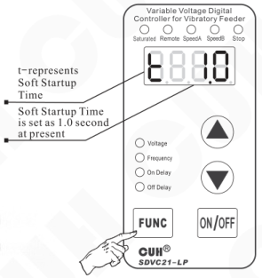

## 4.5 สวิตช์เอาต์พุต

ปุ่มสวิตช์เอาต์พุตแบบสัมผัสนุ่มบนแผงสามารถเปิด/ปิดเอาต์พุตของตัวควบคุมได้อย่างรวดเร็วและง่ายดาย

- กดปุ่ม **ON/OFF** เพื่อเปิด/ปิดเอาต์พุตของตัวควบคุม ไฟแสดงหยุดจะสว่างขึ้นเมื่อเอาต์พุตของตัวควบคุมถูกปิด

> ด้วยเทคโนโลยีสวิตช์แบบสัมผัสนุ่มและการควบคุมสัญญาณดิจิทัล จะไม่เกิดประกายไฟที่ทำให้จุดสัมผัสเสียหาย ส่งผลให้อายุการใช้งานของตัวควบคุมและเครื่องสั่นยาวนานขึ้นอย่างมาก

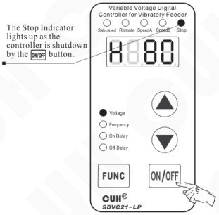

---

## 4.6 การจำกัดแรงดันเอาต์พุตสูงสุด

สามารถตั้งค่าแรงดันเอาต์พุตสูงสุดของตัวควบคุมได้เพื่อป้องกันความเสียหายต่อเครื่องสั่น ฟังก์ชันการควบคุมความเร็วจากระยะไกลได้รับผลกระทบจากพารามิเตอร์นี้

- กดปุ่ม **FUNC** ค้างไว้ 2 วินาทีเพื่อเข้าสู่สถานะการปรับพารามิเตอร์ขั้นสูง
- กดปุ่ม **FUNC** ซ้ำ ๆ จนกระทั่งสลับไปยังสถานะการจำกัดแรงดันเอาต์พุตสูงสุด (h)
- กดปุ่ม ▲ หรือ ▼ เพื่อปรับค่าพารามิเตอร์

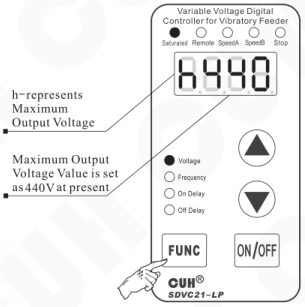

*ค่าเริ่มต้นของแรงดันเอาต์พุตสูงสุดคือ 380V*

---

## 4.7 การคืนค่าการตั้งค่าเริ่มต้น

ฟังก์ชันนี้ช่วยให้ผู้ปฏิบัติงานสามารถคืนค่าพารามิเตอร์เริ่มต้นทั้งหมดได้

เนื่องจากตัวควบคุมมีฟังก์ชันมากมาย จึงมีพารามิเตอร์จำนวนมากที่สามารถปรับได้ เพื่อหลีกเลี่ยงสถานการณ์ที่ผู้เริ่มต้นใช้งานปรับแก้หลายครั้งเกินไปแล้วทำให้ตัวควบคุมไม่สามารถทำงานได้อย่างถูกต้อง ฟังก์ชันนี้ช่วยให้ผู้ปฏิบัติงานคืนค่าการตั้งค่าเริ่มต้นให้กับตัวควบคุมได้อย่างง่ายดาย

- กดปุ่ม **FUNC** ค้างไว้ 2 วินาทีเพื่อเข้าสู่สถานะการปรับพารามิเตอร์ขั้นสูง
- กดปุ่ม **FUNC** ซ้ำ ๆ จนกระทั่งหน้าจอทั้งหน้าจอกะพริบ จากนั้นกดปุ่ม ▲ ค้างไว้จนกระทั่งแสดง “----” ซึ่งหมายความว่าค่าการตั้งค่าเริ่มต้นได้รับการคืนค่าแล้ว
- หลังจากปล่อยปุ่ม ▲ ตัวควบคุมจะเข้าสู่สถานะการปรับแรงดันเอาต์พุต (H) เมื่อถึงจุดนี้ พารามิเตอร์ทั้งหมดได้ถูกคืนค่าเป็นค่าเริ่มต้นแล้ว

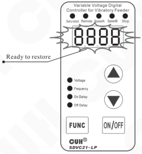

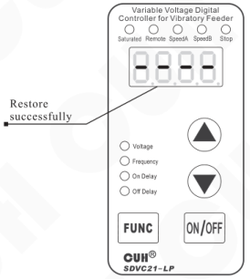

---

# บทที่ Ⅴ เซนเซอร์และการควบคุมสัญญาณ

ตัวควบคุมสามารถควบคุมได้ด้วยสัญญาณและเซนเซอร์ภายนอกหลายประเภท บทนี้จะอธิบายวิธีการใช้งานเซนเซอร์โฟโตอิเล็กทริกอัจฉริยะ เซนเซอร์แบบสวิตช์ และ PLC เป็นหลัก

## 5.1 การตรวจจับด้วยโฟโตอิเล็กทริกอัจฉริยะ

เมื่อใช้ร่วมกับเซนเซอร์โฟโตอิเล็กทริก SDVC-S1 จะสามารถใช้ฟังก์ชันการตรวจจับด้วยโฟโตอิเล็กทริกอัจฉริยะได้ เซนเซอร์ SDVC-S1 สามารถกรองการรบกวนจากแสงพื้นหลังที่ส่งผลต่อความไวของตัวควบคุมได้ ด้วยเหตุนี้ ตัวควบคุมจึงสามารถทำงานได้อย่างเชื่อถือได้โดยไม่ต้องปรับความไวด้วยมือ

### 5.1.1 วิธีการเชื่อมต่อเซนเซอร์โฟโตอิเล็กทริกอัจฉริยะ SDVC-S1

เชื่อมต่อเซนเซอร์ SDVC-S1 เข้ากับขั้วต่อของตัวควบคุมตามแผนภาพ

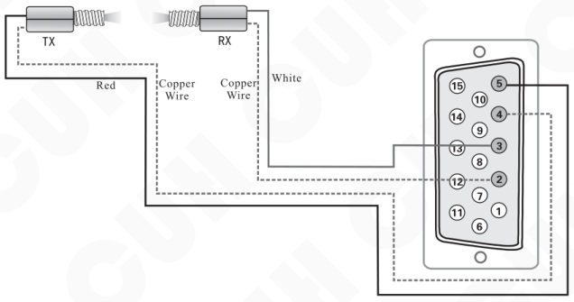

*ข้อควรทราบ:*  
*ความสัมพันธ์เชิงตรรกะเริ่มต้นของเซนเซอร์ถูกตั้งค่าเป็นชิ้นงานว่าง*

---

## 5.1.2 การปรับเวลาหน่วงการสตาร์ทและเวลาหน่วงการหยุดของเซนเซอร์โฟโตอิเล็กทริกอัจฉริยะ

ในการใช้งานจริงส่วนใหญ่ เอาต์พุตของตัวควบคุมควรถูกหน่วงเวลาไว้ช่วงหนึ่งเมื่อการสตาร์ทหรือการหยุดของตัวควบคุมถูกควบคุมด้วยสัญญาณภายนอก ฟังก์ชันการปรับเวลาหน่วงการสตาร์ทและเวลาหน่วงการหยุดทำให้การใช้งานลักษณะนี้เป็นไปได้ นอกจากนี้ การกระแทกต่อชิ้นงานขณะตัวควบคุมสตาร์ทสามารถขจัดได้ด้วยการปรับเวลาสตาร์ทแบบนุ่มนวล

### เวลาหน่วงการสตาร์ท (J)

ช่วงเวลาที่ตัวควบคุมใช้ตั้งแต่รับสัญญาณควบคุมการสตาร์ทจนถึงการส่งเอาต์พุต

- กดปุ่ม **FUNC** ซ้ำ ๆ จนกระทั่งเปลี่ยนไปสู่สถานะการปรับเวลาหน่วงการสตาร์ท (J) โดยที่ไฟแสดงเวลาหน่วงการสตาร์ทบนแผงควบคุมสว่างขึ้น
- ปรับพารามิเตอร์โดยกดปุ่ม ▲ หรือ ▼ หน่วยของพารามิเตอร์คือวินาที และความละเอียดเชิงตัวเลขคือ 0.1

*ช่วงที่ปรับได้ของพารามิเตอร์คือ 0.0 ถึง 9.9 วินาที*  
*ค่าเริ่มต้นของพารามิเตอร์คือ 0.2 วินาที*

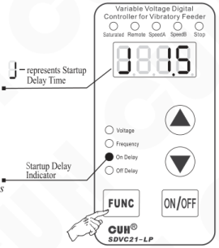

### เวลาหน่วงการหยุด (L)

ช่วงเวลาที่ตัวควบคุมใช้ตั้งแต่รับสัญญาณควบคุมการหยุดจนถึงการตัดเอาต์พุต

- กดปุ่ม **FUNC** ซ้ำ ๆ จนกระทั่งเปลี่ยนไปสู่สถานะการปรับเวลาหน่วงการหยุด (L) โดยที่ไฟแสดงเวลาหน่วงการหยุดบนแผงควบคุมสว่างขึ้น
- ปรับพารามิเตอร์โดยกดปุ่ม ▲ หรือ ▼ หน่วยของพารามิเตอร์คือวินาที และความละเอียดเชิงตัวเลขคือ 0.1

*ช่วงที่ปรับได้ของพารามิเตอร์คือ 0.0 ถึง 9.9 วินาที*  
*ค่าเริ่มต้นของพารามิเตอร์คือ 0.2 วินาที*

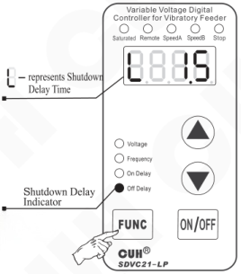

---

### 5.1.3 การปรับความสัมพันธ์เชิงตรรกะของเซนเซอร์โฟโตอิเล็กทริกอัจฉริยะ

ภายใต้สถานการณ์ปกติ ด้านรับของเซนเซอร์โฟโตอิเล็กทริกอัจฉริยะไม่ได้รับสัญญาณแสง และตัวควบคุมจะทำงานตามค่าเริ่มต้น แต่ในการใช้งานพิเศษบางกรณี ตัวควบคุมจำเป็นต้องหยุดเมื่อด้านรับไม่ได้รับสัญญาณแสง การปรับพารามิเตอร์นี้สามารถรองรับการใช้งานลักษณะดังกล่าวได้

- กดปุ่ม **FUNC** ค้างไว้ 2 วินาทีเพื่อเข้าสู่สถานะการปรับพารามิเตอร์ขั้นสูง
- กดปุ่ม **FUNC** ซ้ำ ๆ จนกระทั่งเปลี่ยนไปสู่สถานะการปรับความสัมพันธ์เชิงตรรกะของเซนเซอร์โฟโตอิเล็กทริกอัจฉริยะ
- ปรับพารามิเตอร์โดยกดปุ่ม ▲ หรือ ▼

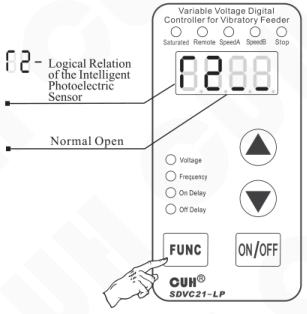

- เมื่อความสัมพันธ์เชิงตรรกะถูกตั้งค่าเป็นปกติเปิด นั่นคือไม่ได้รับสัญญาณแสง ตัวควบคุมจะทำงาน
- เมื่อความสัมพันธ์เชิงตรรกะถูกตั้งค่าเป็นปกติปิด นั่นคือไม่ได้รับสัญญาณแสง ตัวควบคุมจะหยุด

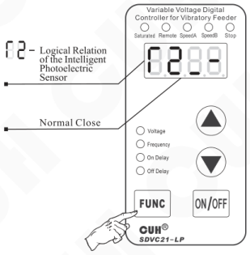

*พารามิเตอร์ถูกตั้งค่าเป็นปกติเปิดตามค่าเริ่มต้น*

---

## 5.1.4 การตั้งค่าพารามิเตอร์ความไวของเซนเซอร์โฟโตอิเล็กทริกอัจฉริยะ CUH

พารามิเตอร์ P หมายถึงความไวของเซนเซอร์โฟโตอิเล็กทริกอัจฉริยะ CUH นั่นคือระยะตรวจจับของเซนเซอร์โฟโตอิเล็กทริกอัจฉริยะ CUH

ค่ายิ่งของพารามิเตอร์ P น้อยลง เซนเซอร์จะยิ่งไวขึ้นและสามารถรับสัญญาณได้ในระยะทางที่ไกลขึ้น

- กดปุ่ม **FUNC** ค้างไว้สองวินาทีเพื่อเข้าสู่อินเทอร์เฟซการตั้งค่าพารามิเตอร์ขั้นสูง
- กดปุ่ม **FUNC** ซ้ำ ๆ เพื่อเข้าสู่อินเทอร์เฟซพารามิเตอร์การปรับความไวโฟโตอิเล็กทริกอัจฉริยะ สัญลักษณ์ LED ของพารามิเตอร์นี้คือ “P”
- กด ▲ หรือ ▼ เพื่อปรับค่าพารามิเตอร์นี้

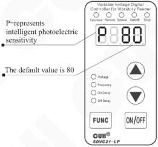

ช่วงค่าพารามิเตอร์คือ 0 ถึง 999 และค่าเริ่มต้นคือ 80

---

## 5.2 วิธีการใช้เซนเซอร์แบบสวิตช์

ตัวควบคุมสามารถทำงานร่วมกับเซนเซอร์หลายประเภท เช่น เซนเซอร์แบบสวิตช์ เซนเซอร์แบบสวิตช์เชิงแสง และเซนเซอร์ไฟเบอร์ออปติก

### 5.2.1 วิธีการเชื่อมต่อเซนเซอร์แบบสวิตช์

เชื่อมต่อเซนเซอร์สวิตช์แบบพร็อกซิมิตี้เข้ากับขั้วต่อของตัวควบคุมตามแผนภาพ

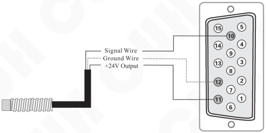

### ข้อกำหนด

สายสีน้ำเงินแทนสายกราวด์  
สายสีดำแทนสายสัญญาณ  
สายสีน้ำตาลแทนสายไฟเลี้ยง

---

## 5.2.2 การตั้งค่าเวลาหน่วงการสตาร์ทและเวลาหน่วงการหยุดของเซนเซอร์แบบสวิตช์

ตามค่าเริ่มต้น เซนเซอร์โฟโตอิเล็กทริกอัจฉริยะและเซนเซอร์แบบสวิตช์ใช้เวลาหน่วงการสตาร์ทและเวลาหน่วงการหยุดร่วมกัน ผู้ใช้งานยังสามารถตั้งค่าเวลาหน่วงการสตาร์ทและเวลาหน่วงการหยุดของเซนเซอร์แบบสวิตช์แยกต่างหากได้

### เวลาหน่วงการสตาร์ท (J-)

ช่วงเวลาที่ตัวควบคุมใช้ตั้งแต่รับสัญญาณควบคุมการสตาร์ทจนถึงการส่งเอาต์พุต

- กดปุ่ม **FUNC** ค้างไว้ 2 วินาทีเพื่อเข้าสู่สถานะการปรับพารามิเตอร์ขั้นสูง
- กดปุ่ม **FUNC** ซ้ำ ๆ จนกระทั่งเปลี่ยนไปสู่สถานะการปรับเวลาหน่วงการสตาร์ท (`J---`)
- ปรับพารามิเตอร์โดยกดปุ่ม ▲ หรือ ▼ หน่วยของพารามิเตอร์คือวินาที และความละเอียดเชิงตัวเลขคือ 0.1

*ช่วงที่ปรับได้ของพารามิเตอร์คือ 0.0 ถึง 9.9 วินาที*  
*ค่าเริ่มต้นของพารามิเตอร์คือ J---*  
*เวลาหน่วงการสตาร์ทอิสระของเซนเซอร์แบบสวิตช์จะถูกปิดเมื่อปรับค่าพารามิเตอร์เป็น 0*

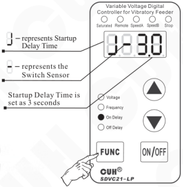

### เวลาหน่วงการหยุด (L-)

ช่วงเวลาที่ตัวควบคุมใช้ตั้งแต่รับสัญญาณควบคุมการหยุดจนถึงการตัดเอาต์พุต

- กดปุ่ม **FUNC** ค้างไว้ 2 วินาทีเพื่อเข้าสู่สถานะการปรับพารามิเตอร์ขั้นสูง
- กดปุ่ม **FUNC** ซ้ำ ๆ จนกระทั่งเปลี่ยนไปสู่สถานะการปรับเวลาหน่วงการหยุด (`L---`)
- ปรับพารามิเตอร์โดยกดปุ่ม ▲ หรือ ▼ หน่วยของพารามิเตอร์คือวินาที และความละเอียดเชิงตัวเลขคือ 0.1

*ช่วงที่ปรับได้ของพารามิเตอร์คือ 0.0 ถึง 9.9 วินาที*  
*ค่าเริ่มต้นของพารามิเตอร์คือ L---*  
*เวลาหน่วงการหยุดอิสระของเซนเซอร์แบบสวิตช์จะถูกปิดเมื่อปรับค่าพารามิเตอร์เป็น 0*

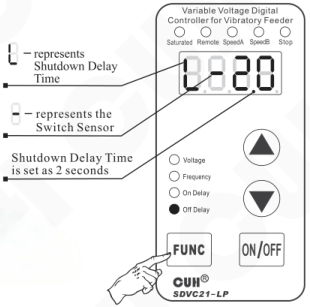

> ➔ เมื่อปรับค่า J- และ L- เป็น 0 เวลาหน่วงการสตาร์ทและเวลาหน่วงการหยุดของเซนเซอร์แบบสวิตช์จะเหมือนกับเวลาหน่วงการสตาร์ทและเวลาหน่วงการหยุดของเซนเซอร์โฟโตอิเล็กทริกอัจฉริยะ
>
> ➔ เวลาหน่วงการสตาร์ทและเวลาหน่วงการหยุดของเซนเซอร์โฟโตอิเล็กทริกอัจฉริยะจะไม่ได้รับผลกระทบจากพารามิเตอร์ J- หรือ L-

---

## 5.2.3 การตั้งค่าความสัมพันธ์เชิงตรรกะของเซนเซอร์แบบสวิตช์ (หยุดเมื่อชิ้นงานเต็ม)

ภายใต้สถานการณ์ปกติ ตัวควบคุมไม่ได้รับสัญญาณจากเซนเซอร์แบบสวิตช์และจะทำงานตามค่าเริ่มต้น แต่ในการใช้งานพิเศษบางกรณี ตัวควบคุมจำเป็นต้องหยุดเมื่อไม่ได้รับสัญญาณจากเซนเซอร์แบบสวิตช์ การปรับพารามิเตอร์นี้สามารถรองรับการใช้งานลักษณะดังกล่าวได้

- กดปุ่ม **FUNC** ค้างไว้ 2 วินาทีเพื่อเข้าสู่สถานะการปรับพารามิเตอร์ขั้นสูง
- กดปุ่ม **FUNC** ซ้ำ ๆ จนกระทั่งเปลี่ยนไปสู่สถานะการปรับความสัมพันธ์เชิงตรรกะของเซนเซอร์แบบสวิตช์ (Γ1)
- ปรับพารามิเตอร์โดยกดปุ่ม ▲ หรือ ▼

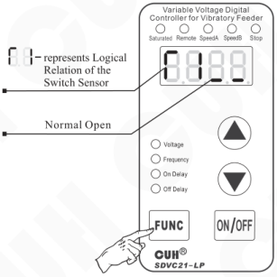

> ➔ เมื่อความสัมพันธ์เชิงตรรกะถูกตั้งค่าเป็นปกติเปิด นั่นคือไม่ได้รับสัญญาณ ตัวควบคุมจะทำงาน
>
> ➔ เมื่อความสัมพันธ์เชิงตรรกะถูกตั้งค่าเป็นปกติปิด นั่นคือไม่ได้รับสัญญาณ ตัวควบคุมจะหยุด

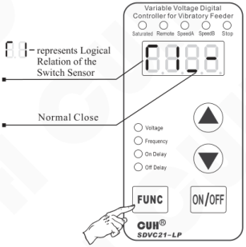

*พารามิเตอร์ถูกตั้งค่าเป็นปกติเปิดตามค่าเริ่มต้น*

---

## 5.3 วิธีการใช้เซนเซอร์แบบสวิตช์ตัวที่ 2

ตัวควบคุมรองรับการเชื่อมต่อเซนเซอร์สามตัว ได้แก่ เซนเซอร์โฟโตอิเล็กทริกอัจฉริยะหนึ่งตัวและเซนเซอร์แบบสวิตช์สองตัว ฟังก์ชันการหยุดเมื่อชิ้นงานเต็มและการหยุดเมื่อชิ้นงานว่างสามารถทำงานได้ด้วยเซนเซอร์เหล่านี้

### 5.3.1 วิธีการเชื่อมต่อเซนเซอร์แบบสวิตช์ตัวที่ 2

เชื่อมต่อเซนเซอร์สวิตช์แบบพร็อกซิมิตี้ตัวที่ 2 เข้ากับขั้วต่อของตัวควบคุมตามแผนภาพ

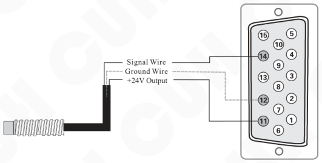

**โดยทั่วไป**

สายสีน้ำเงินแทนสายกราวด์  
สายสีดำแทนสายสัญญาณ  
สายสีน้ำตาลแทนสายไฟเลี้ยง

---

### 5.3.2 การตั้งค่าเวลาหน่วงการสตาร์ทและเวลาหน่วงการหยุดของเซนเซอร์แบบสวิตช์ตัวที่ 2

ตามค่าเริ่มต้น เซนเซอร์โฟโตอิเล็กทริกอัจฉริยะและเซนเซอร์แบบสวิตช์ทั้งสองตัวใช้เวลาหน่วงการสตาร์ทและเวลาหน่วงการหยุดร่วมกัน ผู้ใช้งานยังสามารถตั้งค่าเวลาหน่วงการสตาร์ทและเวลาหน่วงการหยุดสำหรับเซนเซอร์แบบสวิตช์ตัวที่ 2 แยกต่างหากได้

**เวลาหน่วงการสตาร์ท (J_):** ช่วงเวลาที่ตัวควบคุมใช้ตั้งแต่รับสัญญาณควบคุมการสตาร์ทจนถึงการส่งเอาต์พุต

- กดปุ่ม **FUNC** ค้างไว้ 2 วินาทีเพื่อเข้าสู่สถานะการปรับพารามิเตอร์ขั้นสูง
- กดปุ่ม **FUNC** ซ้ำ ๆ จนกระทั่งเปลี่ยนไปสู่สถานะการปรับเวลาหน่วงการสตาร์ท (`J_--`)
- ปรับพารามิเตอร์โดยกดปุ่ม ▲ หรือ ▼ หน่วยของพารามิเตอร์คือวินาที และความละเอียดเชิงตัวเลขคือ 0.1

*ช่วงที่ปรับได้ของพารามิเตอร์คือ 0.0 ถึง 9.9 วินาที*  
*ค่าเริ่มต้นของพารามิเตอร์คือ `J_--`*  
*เวลาหน่วงการสตาร์ทอิสระของเซนเซอร์แบบสวิตช์ตัวที่ 2 จะถูกปิดเมื่อปรับค่าพารามิเตอร์เป็น 0*

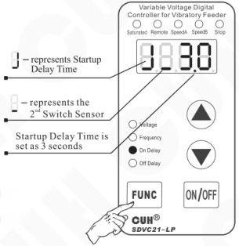

**เวลาหน่วงการหยุด (L_):** ช่วงเวลาที่ตัวควบคุมใช้ตั้งแต่รับสัญญาณควบคุมการหยุดจนถึงการตัดเอาต์พุต

- กดปุ่ม **FUNC** ค้างไว้ 2 วินาทีเพื่อเข้าสู่สถานะการปรับพารามิเตอร์ขั้นสูง
- กดปุ่ม **FUNC** ซ้ำ ๆ จนกระทั่งเปลี่ยนไปสู่สถานะการปรับเวลาหน่วงการหยุด (`L_--`)
- ปรับพารามิเตอร์โดยกดปุ่ม ▲ หรือ ▼ หน่วยของพารามิเตอร์คือวินาที และความละเอียดเชิงตัวเลขคือ 0.1

*ช่วงที่ปรับได้ของพารามิเตอร์คือ 0.0 ถึง 9.9 วินาที*  
*ค่าเริ่มต้นของพารามิเตอร์คือ `L_--`*  
*เวลาหน่วงการหยุดอิสระของเซนเซอร์แบบสวิตช์ตัวที่ 2 จะถูกปิดเมื่อปรับค่าพารามิเตอร์เป็น 0*

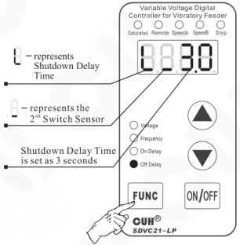

- เมื่อปรับค่า J_ และ L_ เป็น 0 เวลาหน่วงการสตาร์ทและเวลาหน่วงการหยุดของเซนเซอร์แบบสวิตช์ตัวที่ 2 จะเหมือนกับเวลาหน่วงการสตาร์ทและเวลาหน่วงการหยุดของเซนเซอร์โฟโตอิเล็กทริกอัจฉริยะ
- เวลาหน่วงการสตาร์ทและเวลาหน่วงการหยุดของเซนเซอร์โฟโตอิเล็กทริกอัจฉริยะจะไม่ได้รับผลกระทบจากพารามิเตอร์ J_ หรือ L_

---

## 5.3.3 การตั้งค่าความสัมพันธ์เชิงตรรกะของเซนเซอร์แบบสวิตช์ตัวที่ 2 (หยุดเมื่อชิ้นงานเต็ม)

ภายใต้สถานการณ์ปกติ ตัวควบคุมไม่ได้รับสัญญาณจากเซนเซอร์แบบสวิตช์ตัวที่ 2 และจะทำงานตามค่าเริ่มต้น แต่ในการใช้งานพิเศษบางกรณี ตัวควบคุมจำเป็นต้องหยุดเมื่อไม่ได้รับสัญญาณจากเซนเซอร์แบบสวิตช์ตัวที่ 2 การปรับพารามิเตอร์นี้สามารถรองรับการใช้งานลักษณะดังกล่าวได้

- กดปุ่ม **FUNC** ค้างไว้ 2 วินาทีเพื่อเข้าสู่สถานะการปรับพารามิเตอร์ขั้นสูง
- กดปุ่ม **FUNC** ซ้ำ ๆ จนกระทั่งเปลี่ยนไปสู่สถานะการปรับความสัมพันธ์เชิงตรรกะของเซนเซอร์แบบสวิตช์ตัวที่ 2 (Γ3)
- ปรับพารามิเตอร์โดยกดปุ่ม ▲ หรือ ▼

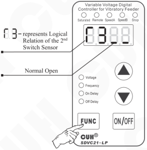

> - เมื่อความสัมพันธ์เชิงตรรกะถูกตั้งค่าเป็นปกติเปิด นั่นคือไม่ได้รับสัญญาณ ตัวควบคุมจะทำงาน
> - เมื่อความสัมพันธ์เชิงตรรกะถูกตั้งค่าเป็นปกติปิด นั่นคือไม่ได้รับสัญญาณ ตัวควบคุมจะหยุด

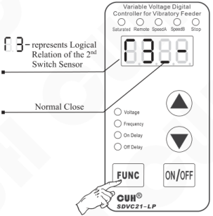

*พารามิเตอร์ถูกตั้งค่าเป็นปกติเปิดตามค่าเริ่มต้น*

---

## 5.4 การตั้งค่าความสัมพันธ์เชิงตรรกะของสัญญาณควบคุม

ตัวควบคุมสามารถตั้งค่าความสัมพันธ์เชิงตรรกะของเซนเซอร์โฟโตอิเล็กทริกอัจฉริยะและเซนเซอร์แบบสวิตช์เมื่อทำงานพร้อมกันได้

- กดปุ่ม **FUNC** ค้างไว้ 2 วินาทีเพื่อเข้าสู่สถานะการปรับพารามิเตอร์ขั้นสูง
- กดปุ่ม **FUNC** ซ้ำ ๆ จนกระทั่งเปลี่ยนไปสู่สถานะการปรับความสัมพันธ์เชิงตรรกะของสัญญาณควบคุม (Π)
- ปรับพารามิเตอร์โดยกดปุ่ม ▲ หรือ ▼

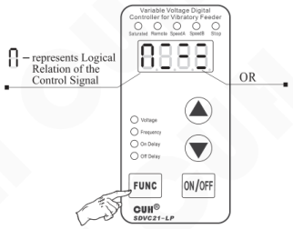

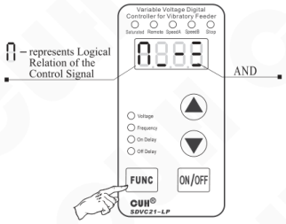

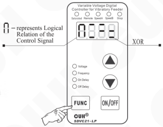

- **ความสัมพันธ์เชิงตรรกะ AND:** ตัวควบคุมจะทำงานก็ต่อเมื่อทั้งเซนเซอร์โฟโตอิเล็กทริกอัจฉริยะและเซนเซอร์แบบสวิตช์สั่งให้ตัวควบคุมทำงาน
- **ความสัมพันธ์เชิงตรรกะ OR:** ตัวควบคุมจะทำงานเมื่อเซนเซอร์โฟโตอิเล็กทริกอัจฉริยะหรือเซนเซอร์แบบสวิตช์สั่งให้ตัวควบคุมทำงาน
- **ความสัมพันธ์เชิงตรรกะ XOR:** ตัวควบคุมจะทำงานก็ต่อเมื่อเซนเซอร์โฟโตอิเล็กทริกอัจฉริยะและเซนเซอร์แบบสวิตช์ส่งสัญญาณควบคุมที่ตรงข้ามกัน

*ความสัมพันธ์เชิงตรรกะของพารามิเตอร์ถูกตั้งค่าเป็น AND ตามค่าเริ่มต้น*

---

## 5.5 เอาต์พุตควบคุม

ตัวควบคุมสามารถส่งสัญญาณควบคุมแรงดันต่ำเพื่อทำงานร่วมกับอุปกรณ์อื่น ๆ เช่น วาล์วโซลินอยด์ PLC หรือรีเลย์ไฟฟ้า

### 5.5.1 วิธีการเชื่อมต่อเอาต์พุตควบคุม

**วิธีการเชื่อมต่อ PLC ที่ถูกควบคุม**

เชื่อมต่อสายสัญญาณและสายกราวด์ของตัวควบคุมเข้ากับขั้วต่อของตัวควบคุมตามแผนภาพ

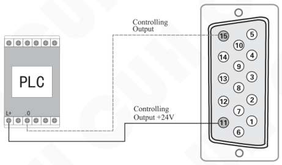

> พอร์ตเอาต์พุตของ PLC ชนิดรีเลย์หรือชนิดซอร์สสามารถเชื่อมต่อกับตัวควบคุมได้ และข้อกำหนดแรงดันของพอร์ตเอาต์พุตคือ 24V

---

### 5.5.2 วิธีการเชื่อมต่อวาล์วโซลินอยด์ที่ถูกควบคุม

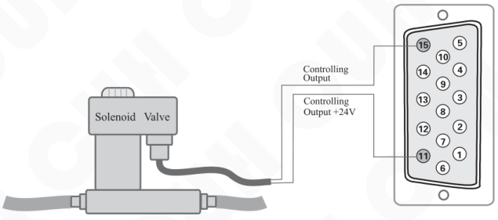

➔ ตัวควบคุมสามารถขับวาล์วโซลินอยด์ที่มีแรงดันพิกัด 24V และกำลังพิกัดต่ำกว่า 4W ได้โดยตรง

### 5.5.3 วิธีการเชื่อมต่อรีเลย์ไฟฟ้า

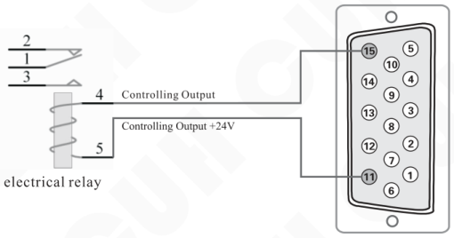

➔ ตัวควบคุมสามารถขับรีเลย์ไฟฟ้าที่มีแรงดันพิกัด 24V และกำลังพิกัดต่ำกว่า 4W ได้โดยตรง

---

## 5.5.4 การตั้งค่าความสัมพันธ์เชิงตรรกะของเอาต์พุตควบคุม

- กดปุ่ม **FUNC** ค้างไว้ 2 วินาทีเพื่อเข้าสู่สถานะการปรับพารามิเตอร์ขั้นสูง
- กดปุ่ม **FUNC** ซ้ำ ๆ จนกระทั่งเปลี่ยนไปสู่สถานะการปรับความสัมพันธ์เชิงตรรกะของเอาต์พุตควบคุม (Γ4)
- ปรับพารามิเตอร์โดยกดปุ่ม ▲ หรือ ▼

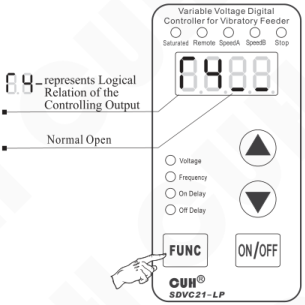

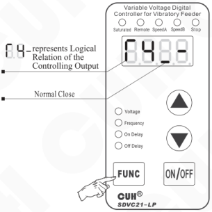

> - เมื่อความสัมพันธ์เชิงตรรกะถูกตั้งค่าเป็นปกติเปิด เอาต์พุตควบคุมจะทำงานเมื่อตัวควบคุมทำงาน
> - เมื่อความสัมพันธ์เชิงตรรกะถูกตั้งค่าเป็นปกติปิด เอาต์พุตควบคุมจะไม่ทำงานเมื่อตัวควบคุมทำงาน

---

## 5.5.5 การตั้งค่าพารามิเตอร์การจัดสรรสัญญาณควบคุมไปยังเอาต์พุตของตัวควบคุมหรือเอาต์พุต DC สำหรับการควบคุมแยกกัน

- กดปุ่ม **FUNC** ค้างไว้สองวินาทีเพื่อเข้าสู่อินเทอร์เฟซการตั้งค่าพารามิเตอร์ขั้นสูง
- กดปุ่ม **FUNC** ซ้ำ ๆ เพื่อเข้าสู่อินเทอร์เฟซพารามิเตอร์การปรับ สัญลักษณ์ LED ของพารามิเตอร์นี้คือ “Γ5”
- กด ▲ หรือ ▼ เพื่อปรับค่าพารามิเตอร์นี้

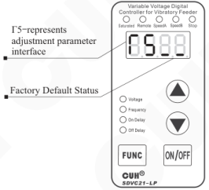

- เมื่อตั้งค่า Γ5 เป็น "" เอาต์พุตไปยังเครื่องสั่นและเอาต์พุต DC จะถูกควบคุมด้วยปุ่ม ON/OFF บนแผงควบคุมและผลการดำเนินการเชิงตรรกะของเซนเซอร์โฟโตอิเล็กทริกอัจฉริยะ CUH และเซนเซอร์แบบสวิตช์สองตัว
- เมื่อตั้งค่า Γ5 เป็น "" เอาต์พุตไปยังเครื่องสั่นถูกควบคุมด้วยปุ่ม ON/OFF บนแผงควบคุม เอาต์พุต DC ถูกควบคุมด้วยผลการดำเนินการเชิงตรรกะของเซนเซอร์โฟโตอิเล็กทริกอัจฉริยะ CUH และเซนเซอร์แบบสวิตช์สองตัว
- เมื่อตั้งค่า Γ5 เป็น "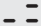" เอาต์พุตไปยังเครื่องสั่นถูกควบคุมด้วยปุ่ม ON/OFF บนแผงควบคุมและควบคุมด้วยผลการดำเนินการเชิงตรรกะของเซนเซอร์แบบสวิตช์สองตัว เอาต์พุต DC ถูกควบคุมด้วยเซนเซอร์โฟโตอิเล็กทริกอัจฉริยะ CUH
- เมื่อตั้งค่า Γ5 เป็น "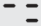" เอาต์พุตไปยังเครื่องสั่นถูกควบคุมด้วยปุ่ม ON/OFF บนแผงควบคุมและเซนเซอร์โฟโตอิเล็กทริกอัจฉริยะ CUH เอาต์พุต DC ถูกควบคุมด้วยผลการดำเนินการเชิงตรรกะของเซนเซอร์แบบสวิตช์สองตัว

---

## 5.6 การควบคุมความเร็วจากระยะไกล

ฟังก์ชันการควบคุมความเร็วจากระยะไกลช่วยให้ผู้ใช้งานควบคุมแรงดันเอาต์พุตได้ด้วยโพเทนชิออมิเตอร์ภายนอกหรือสัญญาณควบคุมในช่วง 1V ถึง 5V ดังนั้น การควบคุมความเร็วจากระยะไกลจากภายนอกจึงสามารถทำได้ง่ายด้วย PLC, DCS หรืออุปกรณ์อื่น ๆ

ฟังก์ชันการควบคุมความเร็วจากระยะไกลจะเริ่มมีผลกับตัวควบคุมเมื่อสัญญาณควบคุมเกิน 0.5V ในขณะเดียวกัน ไฟแสดงการควบคุมความเร็วจากระยะไกลบนแผงควบคุมจะสว่างขึ้น และปุ่ม ▲ และ ▼ จะไม่ทำงาน จอ LED จะแสดงแรงดันเอาต์พุตปัจจุบันหากตัวควบคุมกำลังทำงานในสถานะการปรับแรงดันเอาต์พุต

มีความสัมพันธ์เชิงเส้นระหว่างแรงดันควบคุม 1~5 V กับแรงดันเอาต์พุต 0~440V

### วิธีการเชื่อมต่อโพเทนชิออมิเตอร์ภายนอก

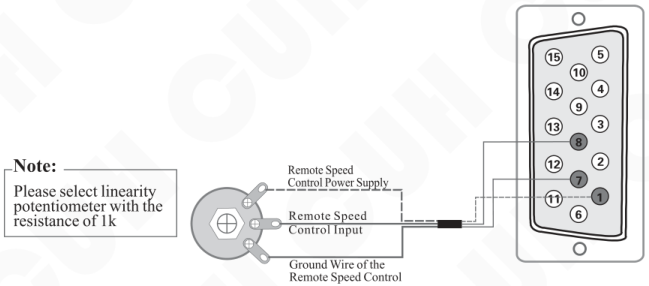

### วิธีการเชื่อมต่อ PLC

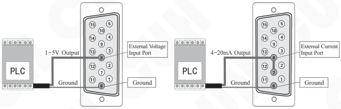

## 5.7 สวิตช์ความเร็วที่ตั้งค่าไว้ล่วงหน้า

ฟังก์ชันสวิตช์ความเร็วที่ตั้งค่าไว้ล่วงหน้าสามารถเลือกความเร็วที่ตั้งไว้ล่วงหน้าได้ด้วยสัญญาณควบคุมภายนอก เช่น PLC, PC, เซนเซอร์ หรือแหล่งสัญญาณอื่น ๆ เพื่อสร้างระบบควบคุมการป้อนแบบหลายความเร็ว

ตัวควบคุมรองรับสวิตช์ควบคุมความเร็วจากระยะไกลสองตัว สวิตช์ Speed A และสวิตช์ Speed B มีผลเมื่อระดับต่ำ (Low Level) ทั้งคู่

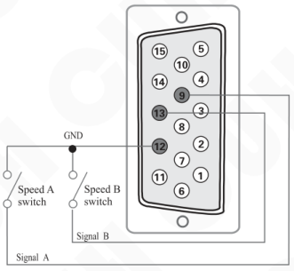

สวิตช์ควบคุมความเร็วแต่ละตัวมีไฟแสดงที่สอดคล้องกันบนแผงควบคุม เมื่อตัวควบคุมได้รับสัญญาณที่มีผล ไฟแสดงที่สอดคล้องกันจะสว่างขึ้น

ไฟแสดงสองดวงแสดง 4 สถานะ (A สว่างและ B ดับ, A ดับและ B สว่าง, สว่างทั้งคู่, ดับทั้งคู่) แผนภาพทางขวาแสดงสถานะที่สวิตช์ควบคุมความเร็วทั้งสองตัวได้รับสัญญาณที่มีผล

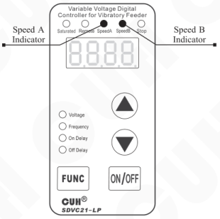

ด้วยสวิตช์ควบคุมความเร็ว ตัวควบคุมจะเปลี่ยนไปยังความเร็วที่สอดคล้องกัน แรงดันเอาต์พุตที่สอดคล้องกับความเร็วสามารถปรับได้โดยกดปุ่ม ▲ หรือ ▼ และแรงดันที่ปรับแล้วจะถูกบันทึกโดยอัตโนมัติ ทันทีที่ได้รับสัญญาณควบคุมความเร็ว ตัวควบคุมจะส่งแรงดันที่สอดคล้องกันออกทันที

---

## บทที่ Ⅵ ฟังก์ชันความปลอดภัย

### 6.1 การรักษาเสถียรภาพแรงดันดิจิทัลอัตโนมัติ

ฟังก์ชันการรักษาเสถียรภาพแรงดันดิจิทัลภายในตัวควบคุมสามารถรักษาความเร็วการป้อนให้คงที่ได้ไม่ว่าแรงดันไฟหลักจะผันผวน

### 6.2 การป้องกันการลัดวงจร

หากเอาต์พุตเกิดการลัดวงจร ตัวควบคุมจะหยุดเอาต์พุตและแสดง Err02 จนกว่าจะรีสตาร์ทตัวควบคุม

### 6.3 การป้องกันกระแสเกิน

ตัวควบคุมจะหยุดเอาต์พุตหากกระแสเอาต์พุตเกินกระแสพิกัดอันเนื่องมาจากการใช้งานที่ผิดพลาด และจะแสดง Err02 เพื่อปกป้องตัวควบคุมและอุปกรณ์ของลูกค้า

### 6.4 การป้องกันความร้อนเกิน

ตัวควบคุมจะหยุดเอาต์พุตหากอุณหภูมิการทำงานเกิน 65⁰C และจะแสดง Err03 เพื่อปกป้องตัวควบคุม จนกระทั่งอุณหภูมิการทำงานลดลงถึง 60⁰C

### 6.5 เส้นโค้งการลดพิกัดตามอุณหภูมิแวดล้อม (ใช้เฉพาะ SDVC21-XLP)

ภายใต้สภาวะการพาความร้อนตามธรรมชาติของอากาศ เมื่ออุณหภูมิแวดล้อมสูงขึ้น เนื่องจากข้อจำกัดของความสามารถในการระบายความร้อนของตัวควบคุม ตัวควบคุมจึงไม่สามารถส่งกระแส 25A อย่างต่อเนื่องได้ โปรดดูเส้นโค้งการลดพิกัดด้านล่างสำหรับการใช้งาน

หากต้องการให้ตัวควบคุมสามารถส่งกระแส 25A อย่างต่อเนื่อง โปรดจัดเตรียมสภาวะการระบายความร้อนที่ดีขึ้น

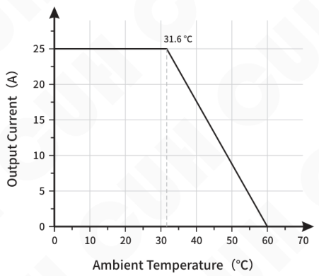

---

## ภาคผนวก A: ขนาด (มม.)

### SDVC21-LP

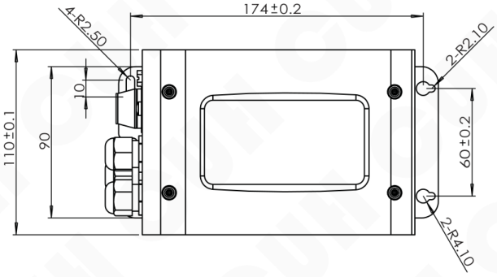

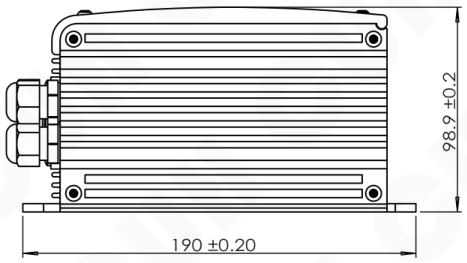

---

## SDVC21-XLP

---

## ภาคผนวก B: คำจำกัดความของอินเทอร์เฟซเอาต์พุต

### มุมมองภาคตัดขวาง:

**⚠ ข้อควรทราบ:**

A: ตรวจสอบให้แน่ใจว่าคอยล์แม่เหล็กไฟฟ้าของเครื่องสั่นเชื่อมต่อกับขาเอาต์พุตสองขาของเต้าเสียบสายไฟเอาต์พุต และเปลือกของเครื่องสั่นต่อสายดินอย่างเชื่อถือได้ มิฉะนั้นอาจเกิดอุบัติการณ์ด้านความปลอดภัยตามมา

B: หลังการเชื่อม ตรวจสอบให้แน่ใจว่าพื้นที่ว่างถูกห่อด้วยเทปฉนวนหรือท่อหดความร้อนก่อนเสียบเข้าไปในเต้าเสียบสายไฟเอาต์พุต เพื่อหลีกเลี่ยงไฟฟ้ารั่วหรือการลัดวงจร

## ภาคผนวก C: คำจำกัดความของอินเทอร์เฟซสัญญาณ

![แผนภาพคำจำกัดความของอินเทอร์เฟซสัญญาณ 15 ขา 1: การควบคุมความเร็วจากระยะไกล (+5V); 2: โฟโตเซนเซอร์ (GND); 3: โฟโตเซนเซอร์ Rx; 4: โฟโตเซนเซอร์ (GND); 5: โฟโตเซนเซอร์ Tx; 6: การควบคุมความเร็วจากระยะไกล (GND); 7: RGND; 8: การควบคุมความเร็วจากระยะไกล (อินพุต); 9: Pset A (ระดับแรงดันต่ำมีผล); 10: อินพุตเซนเซอร์แบบสวิตช์ (ชนิด NPN: ระดับแรงดันต่ำมีผล; ชนิด PNP: ระดับแรงดันสูงมีผล); 11: เอาต์พุตควบคุม (+24V); 12: เอาต์พุตควบคุม (GND); 13: Pset B (ระดับแรงดันต่ำมีผล); 14: อินพุตเซนเซอร์แบบสวิตช์ II (ชนิด NPN: ระดับแรงดันต่ำมีผล; ชนิด PNP: ระดับแรงดันสูงมีผล); 15: เอาต์พุตควบคุม](assets/images/cuh.sdvc21-lp.manual.v0.0/page-0037-vcrop-02.png)

---

## พอร์ต A: การควบคุมความเร็วจากระยะไกล

| พอร์ต | ขา | สัญญาณ |
|---|---|---|
| A3 | ① | +5V |
| A2 | ⑧ | อินพุต |
| A1 | ⑦ | RGND |

## พอร์ต B: โฟโตเซนเซอร์อัจฉริยะ

| พอร์ต | ขา | สัญญาณ |
|---|---|---|
| B4 | ⑤ | Tx |
| B3 | ④ | GND |
| B2 | ③ | Rx |
| B1 | ② | GND |

## พอร์ต C: เซนเซอร์แบบสวิตช์

| พอร์ต | ขา | สัญญาณ |
|---|---|---|
| C1 | ⑫ | GND |
| C2 | ⑩ | อินพุต |
| C3 | ⑪ | +24V |

## พอร์ต D: เอาต์พุตควบคุม

| พอร์ต | ขา | สัญญาณ |
|---|---|---|
| D1 | ⑮ | เอาต์พุต |
| D2 | ⑪ | +24V |
| D3 | ⑫ | GND |

---

## พอร์ต E: เซนเซอร์แบบสวิตช์ II

| พอร์ต | ขา DB | สัญญาณ |
|---|---|---|
| E1 | ⑫ | GND |
| E2 | ⑭ | อินพุต |
| E3 | ⑪ | +24V |

## พอร์ต G: ความเร็วที่ตั้งไว้ล่วงหน้า

| พอร์ต | ขา DB | สัญญาณ |
|---|---|---|
| G1 | ⑫ | GND |
| G2 | ⑨ | Pset A |
| G3 | ⑫ | GND |
| G4 | ⑬ | Pset B |

## พอร์ต I: ไฟเลี้ยง DC 24V

| พอร์ต | ขา DB | สัญญาณ |
|---|---|---|
| I1 | ⑫ | GND |
| I2 | ⑪ | +24V |

หมายเหตุ: ตัวเลขในวงกลมแทนขาของปลั๊ก DB

---

## ภาคผนวก D: คำจำกัดความของตัวอักษรที่แสดงบน LED

| ตัวอักษรที่แสดง | คำจำกัดความ | ภาพสัญลักษณ์ |
|---|---|---|
| H | แรงดันเอาต์พุต |  |
| E | ความถี่เอาต์พุต |  |
| t | การสตาร์ทแบบนุ่มนวล |  |
| J | เวลาหน่วงการสตาร์ทของเซนเซอร์โฟโตอิเล็กทริกอัจฉริยะ |  |
| J- | เวลาหน่วงการสตาร์ทของเซนเซอร์แบบสวิตช์ |  |
| J_ | เวลาหน่วงการสตาร์ทของเซนเซอร์แบบสวิตช์ตัวที่ 2 |  |
| L | เวลาหน่วงการหยุดของเซนเซอร์โฟโตอิเล็กทริกอัจฉริยะ |  |
| L- | เวลาหน่วงการหยุดของเซนเซอร์แบบสวิตช์ |  |
| L_ | เวลาหน่วงการหยุดของเซนเซอร์แบบสวิตช์ตัวที่ 2 |  |
| Γ1 | ความสัมพันธ์เชิงตรรกะของเซนเซอร์แบบสวิตช์ |  |
| Γ2 | ความสัมพันธ์เชิงตรรกะของเซนเซอร์โฟโตอิเล็กทริกอัจฉริยะ |  |
| Γ3 | ความสัมพันธ์เชิงตรรกะของเซนเซอร์แบบสวิตช์ตัวที่ 2 |  |
| Γ4 | ความสัมพันธ์เชิงตรรกะของเอาต์พุตควบคุม |  |
| Γ5 | การตั้งค่าพารามิเตอร์การจัดสรรสัญญาณควบคุมไปยังเอาต์พุตของตัวควบคุมหรือเอาต์พุต DC สำหรับการควบคุมแยกกัน |  |
| ΓE | การตั้งค่าพารามิเตอร์ตัวอักษรแสดงความถี่ |  |
| h | แรงดันเอาต์พุตสูงสุด |  |
| A | ความสัมพันธ์เชิงตรรกะของสัญญาณควบคุม |  |
| P | การตั้งค่าพารามิเตอร์ความไวของเซนเซอร์โฟโตอิเล็กทริกอัจฉริยะ CUH |  |
| 8.8.8.8. | การคืนค่าการตั้งค่าเริ่มต้น |  |
| ---- | การคืนค่าการตั้งค่าเริ่มต้นสำเร็จ |  |
| Err | ข้อมูลข้อผิดพลาด |  |

## ภาคผนวก E: ข้อกำหนดทางไฟฟ้า

| รายการ | ช่วง: ต่ำสุด | ช่วง: ทั่วไป | ช่วง: สูงสุด | หน่วย | คำอธิบาย |
|---|---|---|---|---|---|
| แรงดันอินพุต | 85 | 380 | 440 | V | AC RMS |
| ช่วงแรงดันเอาต์พุตที่ปรับได้ | 35 | —— | Vin-10 | V | ครึ่งคลื่น |
| ช่วงแรงดันเอาต์พุตที่ปรับได้ | 45 | —— | Vin-5 | V | เต็มคลื่น |
| ความแม่นยำในการปรับแรงดัน | | 1 | | V | |
| เวลาตอบสนองของการควบคุมแรงดัน | 0 | 0.01 | 0.02 | s | |
| ช่วงกระแสเอาต์พุตที่ปรับได้ | 0 | —— | 10 | A | SDVC21-LP |
| ช่วงกระแสเอาต์พุตที่ปรับได้ | 0 | —— | 25 | A | SDVC21-XLP |
| กำลังเอาต์พุต | 0 | —— | 3800 | VA | SDVC21-LP |
| กำลังเอาต์พุต | 0 | —— | 9500 | VA | SDVC21-XLP |
| ความถี่เอาต์พุต | 90 | 100/120 | 130 | Hz | เต็มคลื่น |
| ความถี่เอาต์พุต | 45 | 50/60 | 65 | Hz | ครึ่งคลื่น |
| ความถี่เอาต์พุต | 30 | 33/40 | 43 | Hz | เต็มคลื่น 1/3 SDVC21-XLP |
| ความถี่เอาต์พุต | 22 | 25/30 | 32 | Hz | เต็มคลื่น 1/4 SDVC21-XLP |
| รูปคลื่นเอาต์พุต | | ไซน์ตัดเฟส | | | |
| เวลาสตาร์ทแบบนุ่มนวล | 0.0 | —— | 9.9 | s | ค่าเริ่มต้นจากโรงงาน:0.5 |
| ช่วงเวลาหน่วงเปิด/ปิด | 0.0 | —— | 9.9 | s | ค่าเริ่มต้นจากโรงงาน:0.2 |
| ความแม่นยำของเวลาหน่วงเปิด/ปิด | | 0.1 | | s | |
| อุณหภูมิที่กระตุ้นการป้องกันความร้อนเกิน | 58 | 60 | 66 | ℃ | |
| แรงดันเอาต์พุตควบคุม DC | 22 | 24 | 26 | V | |
| กระแสเอาต์พุตควบคุม DC | 0 | —— | 200 | mA | |
| สัญญาณควบคุมแอนะล็อก | | 1-5 | | V | แรงดันควบคุมความเร็วจากระยะไกล |
| สัญญาณควบคุมดิจิทัล | | 24 | | V | สัญญาณสวิตช์ |
| วิธีการปรับ | | 4 | | ปุ่มกด | |
| ความจุฟิวส์ | | 16 | | A | SDVC21-LP |
| ความจุฟิวส์ | | 30 | | A | SDVC21-XLP |
| การใช้พลังงานในโหมดสแตนด์บาย | —— | 4 | —— | W | |
| วิธีการแสดงผล | | 4 | | หลัก | หลอดดิจิทัล LED |
| ระดับการป้องกันการเข้าฝุ่นและน้ำ | | IP67 | | | |
| น้ำหนัก | | 4600 | | g | SDVC21-LP |
| น้ำหนัก | | 5800 | | g | SDVC21-XLP |
| อุณหภูมิแวดล้อม | 0 | 25 | 40 | ℃ | |

---

## ภาคผนวก F: เคล็ดลับการแก้ไขปัญหาและคำอธิบายข้อผิดพลาด

เคล็ดลับต่อไปนี้สามารถช่วยแก้ไขปัญหาที่คุณอาจพบเจอ

| | | | ภาพสัญลักษณ์ |
|---|---|---|---|
| 1 | ไม่มีการแสดงผลหลังเปิดเครื่อง | ➔ตรวจสอบให้แน่ใจว่าเต้าเสียบจ่ายไฟมีไฟฟ้า ➔ตรวจสอบให้แน่ใจว่าสายไฟอินพุตเชื่อมต่อกับเต้าเสียบจ่ายไฟอย่างเชื่อถือได้ | |
| 2 | แสดงผลปกติแต่ไม่มีเอาต์พุต | ➔ตรวจสอบให้แน่ใจว่าสายไฟอินพุตและสายไฟเอาต์พุตเชื่อมต่อแน่นหนา ➔ตรวจสอบให้แน่ใจว่าค่าพารามิเตอร์แรงดันเอาต์พุตไม่น้อยเกินไป ➔ตรวจสอบให้แน่ใจว่าตัวควบคุมไม่ถูกหยุดด้วยสัญญาณควบคุม ➔ตรวจสอบให้แน่ใจว่าตัวควบคุมไม่ถูกหยุดด้วยพารามิเตอร์ที่ตั้งค่าเป็นปกติปิด | |
| 3 | สัญญาณควบคุมไม่มีผล | ➔ตรวจสอบให้แน่ใจว่าป้อนสัญญาณควบคุมอย่างถูกต้อง ➔ตรวจสอบให้แน่ใจว่าสายกราวด์ของสัญญาณควบคุมเชื่อมต่อกับตัวควบคุมอย่างถูกต้อง ➔ตรวจสอบให้แน่ใจว่าความสัมพันธ์เชิงตรรกะของสัญญาณควบคุมถูกตั้งค่าอย่างถูกต้องตามที่คุณต้องการ | |
| 4 | แสดงผลปกติ ไม่มีเอาต์พุต แต่ได้ยินเสียง | ➔ปรับพารามิเตอร์ทั้งหมดตามที่คู่มือนี้แนะนำ | |
| 5 | Err2 | ➔กระแสเอาต์พุตเกิน ตรวจสอบให้แน่ใจว่าข้อกำหนดของเครื่องสั่นไม่เกินขีดจำกัดของตัวควบคุม ➔เอาต์พุตลัดวงจร ตรวจสอบให้แน่ใจว่าสายไฟเอาต์พุตและขั้วต่อการบินของสายไฟเอาต์พุตไม่ลัดวงจร ➔ตรวจสอบให้แน่ใจว่าสายไฟเอาต์พุตเชื่อมต่ออย่างเชื่อถือได้ระหว่างตัวควบคุมกับเครื่องสั่น ➔ตรวจสอบให้แน่ใจว่าตัวควบคุมต่อสายดินอย่างเชื่อถือได้ |  |
| 6 | Err3 | ➔ความร้อนเกิน โปรดวางตัวควบคุมในสภาพแวดล้อมที่มีการระบายอากาศดี |  |

## ภาคผนวก G: พารามิเตอร์สัมบูรณ์

พารามิเตอร์สัมบูรณ์:
การเกินมาตรฐานจะทำให้ตัวควบคุมเสียหาย โปรดปฏิบัติตามอย่างเคร่งครัด

| รายการ | มาตรฐาน GB | มาตรฐาน IEC | ข้อกำหนดมาตรฐาน | ระดับที่ผลิตภัณฑ์ CUH ทำได้ | หมายเหตุ |
|---|---|---|---|---|---|
| การคายประจุไฟฟ้าสถิต | GB/T 17626.2-2006 | IEC 61000-4-2:2001 | 4 kV | ±8 kV | การคายประจุแบบสัมผัส |
| | | | 4 kV | ±15 kV | การคายประจุในอากาศ |
| การทดสอบทรานเซียนต์เร็วทางไฟฟ้า | GB/T 17626.4-2008 | IEC 61000-4-4:2004 | 4 kV | ±4 kV | การคัปปลิงโดยตรง |
| เซอร์จทางไฟฟ้า | GB/T 17626.5-2008 | IEC 61000-4-5:2005 | 4 kV | ±4 kV | การคัปปลิงระหว่างสาย |
| | | | 4 kV | ±4 kV | การคัปปลิงระหว่างสายกับดิน |

---

Nanjing CUH Science & Technology Co.,Ltd  
https://en.cuhnj.com  
Tel.:+86-25-84730411 / 84730415 / 84730416  
Fax:+86-25-84730426  
E-mail:sales@cuhnj.com  
Add.:Building 2, Xueyan Tech Park, Tuscity,  
No.9 Zhineng Rd, Jiangning, Nanjing, China

Document No.: IDP1000415

