## ตัวควบคุมดิจิทัลควบคุมความถี่สำหรับเครื่องป้อนวัสดุแบบสั่นสะเทือน

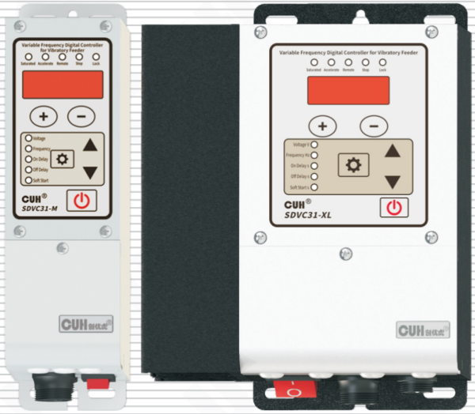

## ซีรีส์ SDVC31
ตัวควบคุมดิจิทัลควบคุมความถี่สำหรับเครื่องป้อนวัสดุแบบสั่นสะเทือน — ซีรีส์ SDVC31
**คู่มือการใช้งาน**

---

## คำชี้แจงลิขสิทธิ์

บริษัท Nanjing CUH Science & Technology CO., Ltd. ขอสงวนลิขสิทธิ์ทั้งหมด

ข้อมูลทั้งหมดที่ระบุในคู่มือการใช้งานฉบับนี้เป็นความรู้ของบริษัทของเราและได้รับความคุ้มครองตามกฎหมายลิขสิทธิ์และกฎหมายที่เกี่ยวข้องอื่นๆ CUH มีและสงวนสิทธิ์ทั้งหมดที่กฎหมายลิขสิทธิ์และกฎหมายอื่นๆ ให้ไว้ ห้ามคัดลอก แปล เลียนแบบ หรือใช้ประโยชน์จากคู่มือการใช้งานฉบับนี้ทั้งหมดหรือบางส่วนโดยไม่ได้รับความยินยอมเป็นลายลักษณ์อักษรจาก CUH

## ข้อจำกัดความรับผิด

เนื้อหาทั้งหมดของคู่มือการใช้งานฉบับนี้เป็นเพียงการอธิบายวิธีการใช้ผลิตภัณฑ์ที่ผลิตโดยบริษัทของเราเท่านั้น และอธิบายตามเทคโนโลยีที่มีอยู่ในปัจจุบันและสภาพที่ให้บริการแก่ท่านเมื่อใช้งาน ท่านต้องรับความเสี่ยงที่เกี่ยวข้องเมื่อใช้ผลิตภัณฑ์นี้ เว้นแต่จะกำหนดไว้โดยกฎหมาย บริษัทไม่มีความรับผิดใดๆ ไม่ว่าโดยชัดแจ้งหรือโดยปริยายต่อผลิตภัณฑ์เนื่องจากคู่มือการใช้งานฉบับนี้ รวมถึงแต่ไม่จำกัดเพียงการบาดเจ็บต่อบุคคล ความเสียหายต่อทรัพย์สิน การสูญเสียโอกาส ฯลฯ

ท่านเข้าใจความเสี่ยงข้างต้นอย่างชัดเจนและตกลงว่า เว้นแต่จะบังคับโดยกฎหมาย บริษัทไม่รับผิดต่อความเสียหายหรือการสูญเสียใดๆ ต่อท่านไม่ว่าโดยตรงหรือโดยอ้อม (รวมถึงแต่ไม่จำกัดเพียงการสูญเสียที่จับต้องได้ของบุคคล ทรัพย์สิน ข้อมูล ฯลฯ และการสูญเสียที่จับต้องไม่ได้เช่น ชื่อเสียง โอกาส ฯลฯ)

บริษัทขอสงวนสิทธิ์ในการปรับเปลี่ยนผลิตภัณฑ์ที่ใช้กับคู่มือการใช้งานฉบับนี้โดยไม่ต้องแจ้งให้ทราบล่วงหน้าหรือภายหลัง

---

# คำนำ

ขอขอบคุณที่เลือกใช้ตัวควบคุมการป้อนวัสดุแบบสั่นสะเทือนดิจิทัลปรับความถี่ซีรีส์ SDVC31 ของ CUH (ในข้อความต่อไปนี้เรียกสั้นๆ ว่า "ตัวควบคุม") ตัวควบคุมซีรีส์นี้ใช้ส่วนประกอบคุณภาพสูง ผสมผสานเทคโนโลยีอิเล็กทรอนิกส์ล่าสุด และออกแบบอย่างพิถีพิถันด้วยตัวประมวลผลสัญญาณดิจิทัลประสิทธิภาพสูง

คู่มือฉบับนี้แนะนำวิธีการใช้งานพื้นฐาน คำอธิบายเชิงเทคนิคของฟังก์ชัน และตัวอย่างการประยุกต์ใช้ทั่วไปของผลิตภัณฑ์ ให้ข้อมูลที่เกี่ยวข้องแก่ผู้ใช้เกี่ยวกับการติดตั้งและการปรับแต่ง การตั้งค่าพารามิเตอร์ การวินิจฉัยความผิดปกติ การแก้ไขปัญหา และการบำรุงรักษาประจำวันของตัวควบคุม เพื่อให้มั่นใจในการติดตั้งและใช้งานตัวควบคุมอย่างถูกต้อง โปรดอ่านคู่มือการใช้งานฉบับนี้อย่างละเอียดก่อนการติดตั้งและเก็บรักษาไว้ให้ดี

โปรดอ่านสัญลักษณ์ต่อไปนี้เพื่อเตือนท่านถึงข้อควรระวังต่อการบาดเจ็บต่อบุคคลและความเสียหายต่อผลิตภัณฑ์

| | |
|---|---|
| ⚠ อันตราย | การไม่ปฏิบัติตามข้อนี้ จะส่งผลให้เกิดการบาดเจ็บต่อบุคคลหรือเสียชีวิต |
| ⚠ คำเตือน | การไม่ปฏิบัติตามข้อนี้ อาจส่งผลให้เกิดการบาดเจ็บต่อบุคคลหรือเสียชีวิต |
| ⚠ ระวัง | การไม่ปฏิบัติตามข้อนี้ อาจส่งผลให้เกิดการบาดเจ็บระดับปานกลางหรือเล็กน้อยต่อบุคคล |
| ข้อสังเกต | การไม่ปฏิบัติตามข้อนี้ จะส่งผลให้เกิดความเสียหายต่อผลิตภัณฑ์และทรัพย์สิน |
| ❗ จำเป็น | ระบุข้อควรระวังและข้อจำกัดในการใช้งานที่ต้องปฏิบัติอย่างเคร่งครัด |

**คู่มือฉบับนี้เหมาะสำหรับตัวควบคุมรุ่นต่อไปนี้:**

- ตัวควบคุมการป้อนการสั่นสะเทือน FM ดิจิทัล SDVC31-S (1.5A)
- ตัวควบคุมการป้อนการสั่นสะเทือน FM ดิจิทัล SDVC31-M (3.0A)
- ตัวควบคุมการป้อนการสั่นสะเทือน FM ดิจิทัล SDVC31-L (4.5A)
- ตัวควบคุมการป้อนการสั่นสะเทือน FM ดิจิทัล SDVC31-XL (6.0A)

---

## ความปลอดภัยและข้อควรระวัง

1. **⚠ อันตราย** ผลิตภัณฑ์นี้ใช้เพื่อขับเครื่องป้อนวัสดุแบบสั่นสะเทือนที่ใช้แม่เหล็กไฟฟ้าเท่านั้น ห้ามใช้ผลิตภัณฑ์นี้เพื่อวัตถุประสงค์ในการป้องกันร่างกายมนุษย์หรือส่วนต่างๆ ของร่างกายมนุษย์ ฯลฯ

2. **⚠ อันตราย** ผลิตภัณฑ์นี้ไม่ได้ออกแบบมาเพื่อใช้เป็นผลิตภัณฑ์กันระเบิด ห้ามใช้ในบริเวณอันตรายและ/หรือสภาพแวดล้อมที่อาจมีก๊าซระเบิด

3. **⚠ คำเตือน** ผลิตภัณฑ์นี้ใช้ไฟ AC จากเครือข่าย โปรดอย่าใช้แรงดัน AC เกิน 260Vac แรงดันอินพุตที่สูงเกินไป เช่น 380Vac อาจทำให้ผลิตภัณฑ์ระเบิดหรือเกิดไฟไหม้ ส่งผลให้เกิดอุบัติเหตุร้ายแรง

4. **⚠ คำเตือน** ผลิตภัณฑ์นี้ต่อลงดินผ่านสายไฟ โปรดตรวจสอบให้แน่ใจว่าสถานีจ่ายไฟสำหรับตัวควบคุมมีการต่อดินที่ดี มิฉะนั้นเปลือกตัวควบคุมอาจมีไฟฟ้าแรง ส่งผลให้เกิดอุบัติเหตุไฟฟ้าดูด

5. **⚠ คำเตือน** ห้ามป้อนไฟ AC เข้าสู่เอาต์พุตของตัวควบคุมนี้ ซึ่งจะทำให้ตัวควบคุมเสียหาย

6. **⚠ คำเตือน** ห้ามเสียบหรือถอนสายไฟขณะมีไฟ หรือสัมผัสจุดเชื่อมต่อของขั้วสายต่างๆ ในช่องเดินสาย เพื่อป้องกันไฟฟ้าดูด

7. **ข้อสังเกต** โปรดหลีกเลี่ยงการควบคุมเอาต์พุตของผลิตภัณฑ์นี้โดยการตัดไฟผ่านรีเลย์หรืออุปกรณ์อื่นๆ ซึ่งจะทำให้อายุการใช้งานของตัวควบคุมลดลงอย่างมาก

8. **ข้อสังเกต** ตัวควบคุมออกแบบมาให้ทำงานในสภาพแวดล้อมที่เย็นและแห้ง ห้ามใช้งานตัวควบคุมกลางแจ้งเพื่อหลีกเลี่ยงการแช่น้ำและการถูกแดดส่อง ใช้งานตัวควบคุมภายในอุณหภูมิตามคุณลักษณะทางไฟฟ้าที่กำหนด

9. **❗ จำเป็น** ต้องยึดผลิตภัณฑ์นี้บนแพลตฟอร์มที่แข็งแรง ต่อดินอย่างน่าเชื่อถือ และห่างจากอุปกรณ์ที่สั่นสะเทือน

10. **❗ จำเป็น** ห้ามใช้งานตัวควบคุมในสภาพที่เกินขีดจำกัดที่ออกแบบไว้โดยเด็ดขาด

11. **❗ จำเป็น** ใช้งานตัวควบคุมตามคู่มือการใช้งานฉบับนี้อย่างเคร่งครัด เราจะไม่รับผิดในทางแพ่งหรืออาญาหากอุปกรณ์เสียหายหรือมีผู้ได้รับบาดเจ็บเนื่องจากการใช้งานที่ไม่ถูกต้อง

12. **❗ จำเป็น** ห้ามเปิดเปลือกตัวควบคุมเพื่อหลีกเลี่ยงไฟฟ้าดูด โปรดติดต่อ CUH หากตัวควบคุมขัดข้อง ห้ามพยายามซ่อมแซมตัวควบคุมด้วยตนเอง ซึ่งอาจทำให้การรับประกันเป็นโมฆะ

---

# สภาพแวดล้อมการใช้งานและการจัดเก็บ

## การตรวจสอบก่อนใช้งาน

ตัวควบคุมทุกตัวผ่านการตรวจสอบคุณภาพอย่างเข้มงวดก่อนจัดส่งและบรรจุด้วยบรรจุภัณฑ์กันกระแทก โปรดตรวจสอบรายการต่อไปนี้หลังจากแกะกล่อง:

1. ตรวจสอบว่าตัวควบคุมเสียหายระหว่างการขนส่งหรือไม่
2. ตรวจสอบว่ารุ่นของตัวควบคุมตรงกับที่ท่านสั่งซื้อหรือไม่

## สภาพแวดล้อมการใช้งาน

โปรดปฏิบัติตามข้อแนะนำต่อไปนี้เพื่อให้ตัวควบคุมมีประสิทธิภาพที่ดีขึ้นและมีอายุการใช้งานที่ยาวนานขึ้น:

- ⚠ สภาพแวดล้อมที่ระบายอากาศได้ดี
- ⚠ ห่างจากน้ำ ไอน้ำ ฝุ่น และโดยเฉพาะฝุ่นที่มีน้ำมัน
- ⚠ ห่างจากก๊าซและของเหลวที่กัดกร่อนหรือไวไฟ
- ⚠ ห่างจากฝุ่นลอยและอนุภาคโลหะ
- ⚠ ยึดให้แน่นเพื่อหลีกเลี่ยงการสั่นสะเทือนด้วยตนเอง
- ⚠ ห่างจากคลื่นแม่เหล็กไฟฟ้ารบกวน
- ⚠ ตรวจสอบให้แน่ใจว่าอุณหภูมิแวดล้อมอยู่ที่ 0~40 ℃
- ⚠ ใช้งานที่ระดับความสูงไม่เกิน 2000m

---

# สารบัญ

- **บทที่ Ⅰ ก่อนการใช้งาน — 1**
  - 1.1 ตรวจสอบรายการในกล่อง — 1
  - 1.2 คำอธิบายไฟแสดงสถานะและปุ่ม — 2
  - 1.3 คำอธิบายส่วนประกอบภายนอก — 3
  - 1.4 คำอธิบายพอร์ตการเดินสาย — 4
  - 1.5 คำอธิบายป้ายข้อมูลผลิตภัณฑ์ — 4
- **บทที่ Ⅱ คุณสมบัติ — 5**
- **บทที่ Ⅲ คู่มือการติดตั้ง — 7**
  - 3.1 เงื่อนไขการใช้งานตัวควบคุม — 7
  - 3.2 วิธีการใช้งานปุ่ม — 7
  - 3.3 การติดตั้งและใช้งาน — 8
- **บทที่ Ⅳ คำอธิบายฟังก์ชันพื้นฐาน — 12**
  - 4.1 แรงดันไฟฟ้าขาออก — 12
  - 4.2 ความถี่ขาออก — 13
  - 4.3 การหน่วงเปิด/ปิดของเซ็นเซอร์โฟโตอิเล็กทริกอัจฉริยะ — 14
  - 4.4 เวลาการสตาร์ทแบบนุ่มนวล — 15
  - 4.5 การล็อกแป้นพิมพ์ — 15
- **บทที่ Ⅴ คำอธิบายฟังก์ชันขั้นสูง — 16**
  - 5.1 การควบคุมความเร็วระยะไกล — 16
  - 5.2 การสัมผัสโฟโตอิเล็กทริกอัจฉริยะ — 18
    - 5.2.1 วิธีการเดินสายเซ็นเซอร์โฟโตอิเล็กทริกอัจฉริยะ — 18
    - 5.2.2 การตั้งค่าความสัมพันธ์เชิงตรรกะของเซ็นเซอร์โฟโตอิเล็กทริกอัจฉริยะ — 19
  - 5.3 เซ็นเซอร์สวิตช์ — 20
    - 5.3.1 วิธีการเดินสายเซ็นเซอร์สวิตช์ — 20
    - 5.3.2 การหน่วงเปิด/ปิดของเซ็นเซอร์สวิตช์ — 21
    - 5.3.3 การตั้งค่าความสัมพันธ์เชิงตรรกะของเซ็นเซอร์สวิตช์ — 22

---

---

- 5.4 การตั้งค่าความสัมพันธ์เชิงตรรกะของสัญญาณควบคุม — 23
- 5.5 เอาต์พุตควบคุม — 24
  - 5.5.1 วิธีการเดินสายเอาต์พุตควบคุม — 24
  - 5.5.2 การตั้งค่าความสัมพันธ์เชิงตรรกะของเอาต์พุตควบคุม — 25
  - 5.5.3 พารามิเตอร์การแยกควบคุมหลัก — 26
- 5.6 ขีดจำกัดแรงดันไฟฟ้าขาออกสูงสุด — 27
- 5.7 ขีดจำกัดความถี่ต่ำสุด — 27
- 5.8 ดัชนีการเร่งความเร็ว — 28
- 5.9 ดัชนีรูปคลื่น — 29
- 5.10 ฟังก์ชันการแสดงอุณหภูมิ — 30
- 5.11 คืนค่าการตั้งค่าเริ่มต้น/กลับสู่โหมดโรงงาน — 31

## บทที่ Ⅵ ข้อมูลจำเพาะทางเทคนิค — 32

- 6.1 ขนาดมิติ — 32
- 6.2 ข้อมูลจำเพาะทางเทคนิค — 34
- 6.3 มาตรฐานอ้างอิง — 35

## บทที่ Ⅶ ภาคผนวก — 36

- 7.1 ตารางพารามิเตอร์ — 36
- 7.2 ผังวงจรอินพุตและเอาต์พุต — 37
- 7.3 คำแนะนำการแก้ไขปัญหาและคำอธิบายข้อผิดพลาด — 38

## บทที่ Ⅷ ข้อมูลการรับประกันผลิตภัณฑ์ — 39

- 8.1 ระยะเวลาการรับประกัน — 39
- 8.2 ขอบเขตการรับประกัน — 39
- 8.3 ความเหมาะสมของผลิตภัณฑ์ — 39

---

# บทที่ Ⅰ ก่อนการใช้งาน

บทนี้แนะนำรายการในกล่องผลิตภัณฑ์ คำอธิบายลักษณะภายนอกของตัวควบคุม และข้อมูลป้ายข้อมูลผลิตภัณฑ์

## 1.1 ตรวจสอบรายการในกล่อง

ก่อนใช้งาน โปรดตรวจสอบความสมบูรณ์ของตัวควบคุมและอุปกรณ์เสริม หากพบว่าผลิตภัณฑ์มีข้อบกพร่องหรือเสียหาย อุปกรณ์เสริมไม่ครบ ฯลฯ โปรดติดต่อบริษัทของเรา

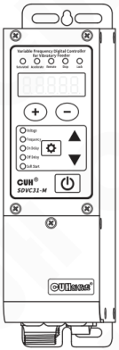

ตัวควบคุม×1

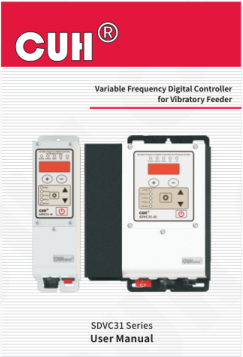

คู่มือการใช้งาน×1

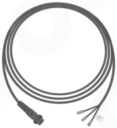

สายเคเบิลเอาต์พุต×1

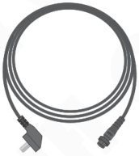

สายไฟอินพุต×1

---

## 1.2 คำอธิบายไฟแสดงสถานะและปุ่ม

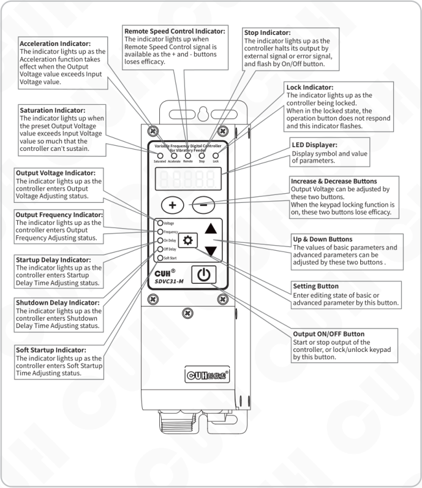

**ไฟแสดงสถานะการเร่งความเร็ว:**
ไฟแสดงสถานะจะสว่างขึ้นเมื่อฟังก์ชันการเร่งความเร็วมีผล ขณะที่ค่าแรงดันไฟฟ้าขาออกเกินค่าแรงดันไฟฟ้าอินพุต

**ไฟแสดงสถานะการควบคุมความเร็วระยะไกล:**
ไฟแสดงสถานะจะสว่างขึ้นเมื่อมีสัญญาณการควบคุมความเร็วระยะไกล ขณะที่ปุ่ม + และ - หยุดทำงาน

**ไฟแสดงสถานะหยุด:**
ไฟแสดงสถานะจะสว่างขึ้นเมื่อตัวควบคุมหยุดเอาต์พุตโดยสัญญาณภายนอกหรือสัญญาณข้อผิดพลาด และจะกะพริบเมื่อกดปุ่มเปิด/ปิด

**ไฟแสดงสถานะอิ่มตัว:**
ไฟแสดงสถานะจะสว่างขึ้นเมื่อค่าแรงดันไฟฟ้าขาออกที่ตั้งไว้เกินค่าแรงดันไฟฟ้าอินพุตมากจนตัวควบคุมไม่สามารถรักษาไว้ได้

**ไฟแสดงสถานะล็อก:**
ไฟแสดงสถานะจะสว่างขึ้นเมื่อตัวควบคุมถูกล็อก
เมื่ออยู่ในสถานะล็อก ปุ่มการใช้งานจะไม่ตอบสนองและไฟนี้จะกะพริบ

**จอแสดงผล LED:**
แสดงสัญลักษณ์และค่าของพารามิเตอร์

**ไฟแสดงสถานะแรงดันไฟฟ้าขาออก:**
ไฟแสดงสถานะจะสว่างขึ้นเมื่อตัวควบคุมเข้าสู่สถานะปรับแรงดันไฟฟ้าขาออก

**ไฟแสดงสถานะความถี่ขาออก:**
ไฟแสดงสถานะจะสว่างขึ้นเมื่อตัวควบคุมเข้าสู่สถานะปรับความถี่ขาออก

**ไฟแสดงสถานะดีเลย์การเริ่มทำงาน:**
ไฟแสดงสถานะจะสว่างขึ้นเมื่อตัวควบคุมเข้าสู่สถานะปรับเวลาดีเลย์การเริ่มทำงาน

**ไฟแสดงสถานะดีเลย์การหยุดทำงาน:**
ไฟแสดงสถานะจะสว่างขึ้นเมื่อตัวควบคุมเข้าสู่สถานะปรับเวลาดีเลย์การหยุดทำงาน

**ไฟแสดงสถานะสตาร์ทแบบนุ่มนวล:**
ไฟแสดงสถานะจะสว่างขึ้นเมื่อตัวควบคุมเข้าสู่สถานะปรับเวลาสตาร์ทแบบนุ่มนวล

**ปุ่มเพิ่มและลด**
สามารถปรับแรงดันไฟฟ้าขาออกด้วยปุ่มสองปุ่มนี้
เมื่อฟังก์ชันการล็อกแป้นพิมพ์เปิดอยู่ ปุ่มสองปุ่มนี้จะไม่มีผล

**ปุ่มขึ้นและลง**
สามารถปรับค่าพารามิเตอร์พื้นฐานและพารามิเตอร์ขั้นสูงด้วยปุ่มสองปุ่มนี้

**ปุ่มตั้งค่า**
เข้าสู่สถานะแก้ไขพารามิเตอร์พื้นฐานหรือพารามิเตอร์ขั้นสูงด้วยปุ่มนี้

**ปุ่มเปิด/ปิดเอาต์พุต**
เริ่มหรือหยุดเอาต์พุตของตัวควบคุม หรือล็อก/ปลดล็อกแป้นพิมพ์ด้วยปุ่มนี้

## 1.3 คำอธิบายส่วนประกอบภายนอก

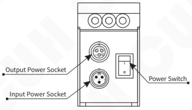

SDVC31-S (1.5A)  
SDVC31-M (3.0A)

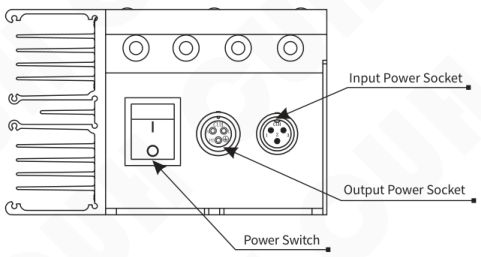

SDVC31-L (4.5A)  
SDVC31-XL (6.0A)

---

## 1.4 คำอธิบายพอร์ตการเดินสาย

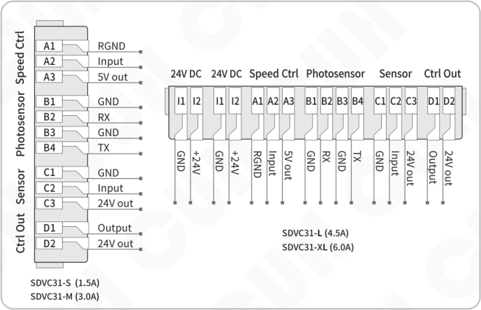

**SDVC31-S (1.5A)**  
**SDVC31-M (3.0A)**

| กลุ่มพอร์ต | เทอร์มินัล | คำอธิบาย |
|---|---|---|
| Speed Ctrl | A1 | RGND |
| Speed Ctrl | A2 | Input |
| Speed Ctrl | A3 | 5V out |
| Photosensor | B1 | GND |
| Photosensor | B2 | RX |
| Photosensor | B3 | GND |
| Photosensor | B4 | TX |
| Sensor | C1 | GND |
| Sensor | C2 | Input |
| Sensor | C3 | 24V out |
| Ctrl Out | D1 | Output |
| Ctrl Out | D2 | 24V out |

**SDVC31-L (4.5A)**  
**SDVC31-XL (6.0A)**

| กลุ่มพอร์ต | เทอร์มินัล | คำอธิบาย |
|---|---|---|
| 24V DC | I1 | GND |
| 24V DC | I2 | +24V |
| 24V DC | I1 | GND |
| 24V DC | I2 | +24V |
| Speed Ctrl | A1 | RGND |
| Speed Ctrl | A2 | Input |
| Speed Ctrl | A3 | 5V out |
| Photosensor | B1 | GND |
| Photosensor | B2 | RX |
| Photosensor | B3 | GND |
| Photosensor | B4 | TX |
| Sensor | C1 | GND |
| Sensor | C2 | Input |
| Sensor | C3 | 24V out |
| Ctrl Out | D1 | Output |
| Ctrl Out | D2 | 24V out |

## 1.5 คำอธิบายป้ายข้อมูลผลิตภัณฑ์

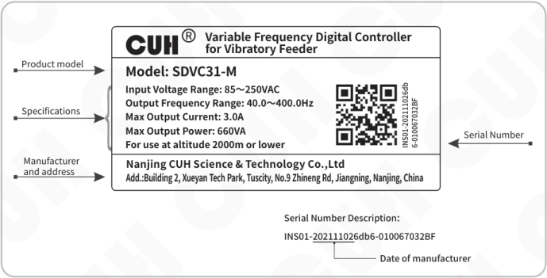

CUH® — ตัวควบคุมดิจิทัลควบคุมความถี่สำหรับเครื่องป้อนวัสดุแบบสั่นสะเทือน

| รายการป้ายข้อมูล | เนื้อหา |
|---|---|
| รุ่นผลิตภัณฑ์ | รุ่น: SDVC31-M |
| ข้อมูลจำเพาะ | ช่วงแรงดันอินพุต: 85～250VAC ช่วงความถี่ขาออก: 40.0～400.0Hz กระแสขาออกสูงสุด: 3.0A กำลังขาออกสูงสุด: 660VA ใช้งานที่ระดับความสูงไม่เกิน 2000m |
| ผู้ผลิตและที่อยู่ | Nanjing CUH Science & Technology Co.,Ltd Add.:Building 2, Xueyan Tech Park, Tuscity, No.9 Zhineng Rd, Jiangning, Nanjing, China |
| หมายเลขซีเรียล | INS01-202111026db6-010067032BF |

คำอธิบายหมายเลขซีเรียล:

INS01-<ins>20211102</ins>6db6-010067032BF

20211102 → วันที่ผลิต

---

## บทที่ Ⅱ คุณสมบัติ

ตัวควบคุมออกแบบมาโดยเฉพาะสำหรับการควบคุมเครื่องป้อนวัสดุแบบสั่นสะเทือนในระบบอัตโนมัติ ผสมผสานกับเทคโนโลยีอิเล็กทรอนิกส์ล่าสุดและการออกแบบที่ประณีต ตัวควบคุมจึงมีคุณสมบัติที่สะดวกและใช้งานได้จริงดังต่อไปนี้:

**การปรับความถี่:** ความถี่ขาออกมีตั้งแต่ 40.0Hz ถึง 400.0Hz

**การปรับแรงดัน:** แรงดันไฟฟ้าขาออกมีตั้งแต่ 0V ถึง 250V

**การรักษาแรงดันไฟฟ้าอัตโนมัติ:** ตัวควบคุมสามารถขจัดการเปลี่ยนแปลงของความเร็วการป้อนที่เกิดจากการแกว่งของแรงดันไฟฟ้าเครือข่าย

**การสตาร์ทแบบนุ่มนวล:** เพื่อหลีกเลี่ยงแรงกระแทกกะทันหันต่อชิ้นงาน ตัวควบคุมสามารถเพิ่มแรงดันไฟฟ้าขาออกจาก 0 ถึงค่าที่ตั้งไว้ล่วงหน้าได้อย่างนุ่มนวลเมื่อเริ่มทำงาน

**การสัมผัสโฟโตอิเล็กทริกอัจฉริยะ:** เซ็นเซอร์โฟโตอิเล็กทริกอัจฉริยะแบบปรับตัวได้ของเราสามารถช่วยหยุดตัวควบคุมเมื่อชิ้นงานเต็มหรือชิ้นงานหมด และสามารถทำฟังก์ชันการตั้งค่าเวลาสตาร์ทแบบนุ่มนวล การหน่วงเปิด การหน่วงปิด และการปรับความสัมพันธ์เชิงตรรกะได้

**ฟังก์ชันสัญญาณพร้อมทำงาน:** ส่งสัญญาณปรับหรือสัญญาณที่ใช้งานได้ผ่านพอร์ตส่งสัญญาณ B4 ของออปโตอิเล็กทรอนิกส์อัจฉริยะเพื่อแสดงว่าตัวควบคุมอยู่ในสถานะพร้อมทำงาน เมื่อตัวควบคุมพบข้อผิดพลาด สัญญาณพร้อมทำงานจะใช้งานไม่ได้

**เซ็นเซอร์สวิตช์:** สามารถเชื่อมต่อเซ็นเซอร์สวิตช์หรือ PLC แบบปรับตัวได้เพื่อเปิด/ปิดตัวควบคุม

**การเร่งความเร็ว:** ด้วยฟังก์ชันนี้ ค่าแรงดันไฟฟ้าขาออกสูงสุดของตัวควบคุมสามารถเพิ่มขึ้นได้ถึง 150% ของค่าแรงดันไฟฟ้าอินพุต

**การควบคุมความเร็วระยะไกล:** แรงดันไฟฟ้าขาออกของตัวควบคุมสามารถถูกควบคุมโดยโพเทนชิออมิเตอร์ภายนอก PLC หรือสัญญาณ DC 1~5V/4~20mA

**เอาต์พุตควบคุม:** สัญญาณเอาต์พุตควบคุมที่ส่งออกจากทรานซิสเตอร์สามารถประสานโซลินอยด์หรืออุปกรณ์ภายนอกอื่นๆ ให้ทำงานร่วมกับตัวควบคุมได้

**การล็อกแป้นพิมพ์:** กดปุ่ม ON/OFF ค้างไว้ 2 วินาทีเพื่อล็อกปุ่มทั้งหมดเพื่อป้องกันการใช้งานผิดพลาด เมื่ออยู่ในสถานะล็อก ปุ่มการใช้งานจะไม่ตอบสนองและไฟนี้จะกะพริบ

**ขีดจำกัดเอาต์พุตสูงสุด:** สามารถตั้งค่าแรงดันไฟฟ้าขาออกสูงสุดไว้ล่วงหน้าเพื่อป้องกันความเสียหายต่ออุปกรณ์ที่เกิดจากการใช้งานผิดพลาด

**การตั้งค่าดัชนีรูปคลื่น:** ผู้ใช้สามารถถ่วงดุลระหว่างประสิทธิภาพและกำลังสูงสุดได้โดยการปรับพารามิเตอร์นี้

**การคืนค่าการตั้งค่าเริ่มต้น:** ฟังก์ชันนี้อนุญาตให้ผู้ใช้คืนค่าการตั้งค่าพารามิเตอร์เริ่มต้นทั้งหมดและรีเซ็ตตัวควบคุม

---

---

CUH ให้ความสำคัญกับการจัดการคุณภาพผลิตภัณฑ์และประสิทธิภาพความปลอดภัยเป็นอย่างมาก นอกจากส่วนประกอบคุณภาพสูงที่เราใช้และระบบการควบคุมคุณภาพที่เข้มงวดแล้ว CUH ยังได้พิจารณาอุบัติเหตุที่ผู้ใช้อาจพบเจอ และให้ฟังก์ชันป้องกันต่อไปนี้เพื่อเพิ่มประโยชน์ใช้สอยของตัวควบคุมให้สูงสุด

**การป้องกันลัดวงจร:** หากเอาต์พุตของตัวควบคุมลัดวงจร ตัวควบคุมจะหยุดเอาต์พุตจนกว่าจะเริ่มทำงานใหม่

**การป้องกันกระแสเกิน:** ตัวควบคุมจะหยุดเอาต์พุตเพื่อให้มั่นใจในความปลอดภัยของอุปกรณ์เมื่อกระแสการทำงานเกินค่าที่กำหนด

**การป้องกันความร้อนสูงเกิน:** ตัวควบคุมจะหยุดเอาต์พุตเพื่อป้องตัวเองเมื่ออุณหภูมิการทำงานสูงเกินไป

**การป้องกันแรงดันไฟฟ้าสูง/ต่ำเกิน:** เมื่อแรงดันอินพุตสูง/ต่ำเกินไป แหล่งจ่ายไฟจะถูกตัดอัตโนมัติเพื่อป้องตัวเอง

ตัวควบคุม CUH เป็นไปตามการรับรอง CE อย่างเคร่งครัด

---

# บทที่ Ⅲ คู่มือการติดตั้ง

บทนี้แนะนำเงื่อนไขที่จำเป็นสำหรับการใช้งานตัวควบคุมและวิธีการติดตั้งและเชื่อมต่ออย่างถูกต้อง

## 3.1 เงื่อนไขการใช้งานตัวควบคุม

ตัวควบคุมใช้ไฟ AC 110/220V และการต่อลงดินป้องกันทำผ่านปลั๊กของสายไฟ โปรดจัดหาแหล่งจ่ายไฟเครือข่าย 110V หรือ 220V, 50Hz/60Hz และสถานีจ่ายไฟที่ตรงตามมาตรฐาน และตรวจสอบให้แน่ใจว่าสายดินป้องกันถูกต่ออย่างถูกต้อง

**⚠ คำเตือน** ห้ามเชื่อมต่อตัวควบคุมกับไฟ AC 380V ซึ่งจะส่งผลให้ตัวควบคุมเสียหายรุนแรงและย้อนกลับไม่ได้ อาจส่งผลให้เกิดการระเบิด ไฟไหม้ และอุบัติเหตุอื่นๆ

**⚠ คำเตือน** ตรวจสอบให้แน่ใจว่าด้านแหล่งจ่ายไฟต่อดินอย่างน่าเชื่อถือ เปลือกโลหะของตัวควบคุมเชื่อมต่อโดยตรงกับสายดินป้องกัน การต่อดินที่ไม่ดีจะทำให้เปลือกตัวควบคุมมีไฟฟ้าแรงและก่อให้เกิดอุบัติเหตุไฟฟ้าดูด

**ข้อสังเกต** การทำงานเป็นเวลานานจะสร้างความร้อนและทำให้อุณหภูมิของเปลือกสูงขึ้น โปรดติดตั้งตัวควบคุมในสภาพแวดล้อมที่ระบายอากาศได้ดีและยึดให้แน่น ห่างจากแหล่งสั่นสะเทือน

**ข้อสังเกต** เอาต์พุตของผลิตภัณฑ์นี้เกิดจากการเรียงกระแสและการกลับรางของไฟเครือข่าย และไม่มีการแยกระหว่างอินพุตและเอาต์พุต ดังนั้นขั้วเอาต์พุตจึงไม่สามารถเชื่อมต่อกับดินป้องกันได้ เมื่อเชื่อมต่อแม่เหล็กไฟฟ้า จำเป็นต้องตรวจสอบให้แน่ใจว่าขดลวดแม่เหล็กไฟฟ้าและเปลือกมีความสามารถในการฉนวนอย่างมีขั้นต่ำ มิฉะนั้นอาจเกิดการรั่วไฟซึ่งอาจทำให้เกิดไฟฟ้าดูดและความเสียหายต่อตัวควบคุม

**ข้อสังเกต** ผลิตภัณฑ์นี้เป็นตัวควบคุมที่ใช้ขับเครื่องแม่เหล็กไฟฟ้า ห้ามเชื่อมต่อกับเครื่องป้อนวัสดุแบบสั่นสะเทือนพิเอโซอิเล็กทริก

## 3.2 วิธีการใช้งานปุ่ม

a. กดสั้นหมายถึงเวลากดมากกว่า 0.1 และน้อยกว่า 2 วินาที และกดยาวหมายถึงเวลากดมากกว่า 2 วินาที

b. กดสั้นปุ่ม ⊕ หรือ ⊖ เพื่อปรับแรงดันไฟฟ้าขาออกของตัวควบคุมได้ที่อินเทอร์เฟซ LED ใดก็ได้

c. เข้าหรือออกจากอินเทอร์เฟซพารามิเตอร์พื้นฐานโดยกด ⚙ ค้าง และสลับระหว่างพารามิเตอร์พื้นฐานโดยกด ⚙ สั้น และปรับค่าพารามิเตอร์โดยกด ▼ หรือ ▲ สั้น

d. เข้าหรือออกจากอินเทอร์เฟซพารามิเตอร์ขั้นสูงโดยกด ⚙ และ ▲ ค้าง และสลับระหว่างพารามิเตอร์ขั้นสูงโดยกด ⚙ สั้น และปรับค่าพารามิเตอร์โดยกด ▼ หรือ ▲ สั้น

e. กดสั้นปุ่ม ⏻ เพื่อเริ่มหรือหยุดเอาต์พุตของตัวควบคุม และกดยาวปุ่ม ⏻ เพื่อล็อกหรือปลดล็อกแป้นพิมพ์

f. ที่อินเทอร์เฟซ LED ของพารามิเตอร์คืนค่าการตั้งค่าเริ่มต้น กด ▲ ค้างจนกระทั่ง  แสดงบน LED เพื่อเรียกคืนการตั้งค่าโรงงาน หรือกด ▼ ค้างจนกระทั่ง  แสดงบน LED เพื่อสลับไปยังอินเทอร์เฟซ SDVC311

---

## 3.3 การติดตั้งและใช้งาน

### ขั้นตอนที่หนึ่ง:

เปิดกล่องบรรจุและตรวจสอบตัวควบคุมและอุปกรณ์เสริมทั้งหมด

### ขั้นตอนที่สอง:

เชื่อมต่อขั้วสายของสายเคเบิลพลังงานเอาต์พุตกับขดลวดแม่เหล็กไฟฟ้าของตัวสั่น

จัดแนวรอยบากบนปลั๊กการบินของสายเอาต์พุตให้ตรงกับเครื่องหมายสามเหลี่ยมบนซ็อกเก็ตเอาต์พุตของตัวควบคุม จากนั้นขันถั่วให้แน่นหลังจากเชื่อมต่อสายเอาต์พุตอย่างถูกต้อง

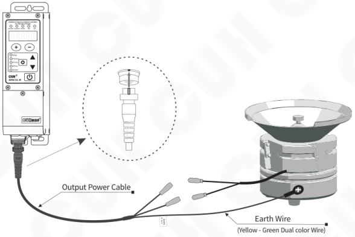

### หมายเหตุ

1. ตรวจสอบให้แน่ใจว่าขดลวดแม่เหล็กไฟฟ้าของตัวสั่นเชื่อมต่อกับขาออกสองขาของสายเคเบิลพลังงานเอาต์พุต และเปลือกโลหะของตัวสั่นต่อดินอย่างน่าเชื่อถือ
2. ห้ามเชื่อมต่อโหลดพิเอโซอิเล็กทริกกับเอาต์พุตพลังงาน มิฉะนั้นอาจทำให้เกิดอุบัติเหตุไฟฟ้าดูด!

---

### ขั้นตอนที่สาม:

เชื่อมต่อขั้วต่อของสายไฟอินพุตกับซ็อกเก็ตไฟอินพุตของตัวควบคุม

เชื่อมต่อฝั่งตัวควบคุมก่อน

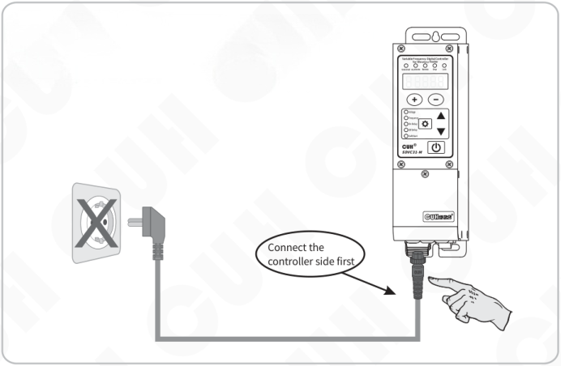

### ขั้นตอนที่สี่:

เชื่อมต่อปลั๊กของสายไฟอินพุตกับเต้ารับเครือข่ายไฟ

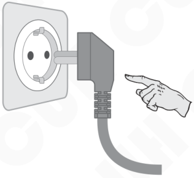

---

## ขั้นตอนที่ห้า:

เปิดสวิตช์ไฟของตัวควบคุม โดยจะต้องแสดงแรงดันไฟฟ้า "U 150 " และไฟแสดงสถานะแรงดันสว่างขึ้น และเครื่องป้อนวัสดุแบบสั่นสะเทือนควรเริ่มสั่น

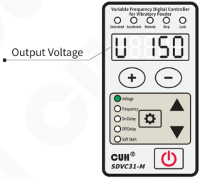

## ขั้นตอนที่หก:

กด ⊖ เพื่อปรับแรงดันไฟฟ้าเป็น 30~50V จากนั้นกด ⚙ ค้างไว้ 2 วินาทีเพื่อเข้าสู่สถานะปรับความถี่ขาออก "E" ใช้ ▼ หรือ ▲ เพื่อค้นหาความถี่เสียงสะท้อนของเครื่องป้อนวัสดุแบบสั่นสะเทือน ซึ่งเป็นความถี่การสั่นพ้อง

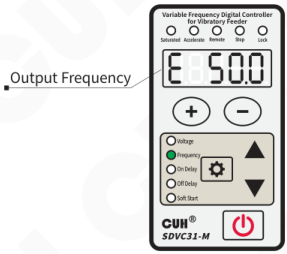

- ความถี่การสั่นพ้องของตัวสั่นหมายถึงค่าความถี่ที่สร้างแอมพลิจูดสูงสุด
- เครื่องสั่นแต่ละเครื่องมีความถี่การสั่นพ้องทางกลของตัวเอง ปรับความถี่ขาออกของตัวควบคุมให้ตรงกับความถี่นี้เพื่อให้ได้สถานะการทำงานที่ดีที่สุด

---

### ขั้นตอนที่เจ็ด:

ใช้ ⊕ และ ⊖ เพื่อปรับแรงดันไฟฟ้าจนกว่าจะได้อัตราการป้อนที่ดีที่สุด

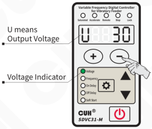

เครื่องป้อนวัสดุแบบสั่นสะเทือนควรทำงานแล้ว สำหรับคำสั่งควบคุมเพิ่มเติม โปรดดูบทต่อไปนี้

---

# บทที่ Ⅳ คำอธิบายฟังก์ชันพื้นฐาน

บทนี้แนะนำการตั้งค่าพารามิเตอร์พื้นฐาน

## 4.1 แรงดันไฟฟ้าขาออก

ค่าเฉลี่ยเรียงกระแสของแรงดันไฟฟ้าขาออกของตัวควบคุมสามารถตั้งค่าได้โดยตรงและเป็นดิจิทัลผ่านแป้นพิมพ์ ด้วยฟังก์ชันรักษาแรงดันไฟฟ้าอันเป็นเอกลักษณ์ แรงดันไฟฟ้าขาออกของตัวควบคุมจะไม่แกว่งตามแรงดันอินพุต ทำให้ตัวสั่นสามารถรักษาการทำงานที่เสถียรได้ในกรณีที่แรงดันไฟฟ้าเครือข่ายไม่เสถียร

- เปิดสวิตช์ไฟของตัวควบคุม
- ตัวควบคุมเข้าสู่พารามิเตอร์แรงดันไฟฟ้าขาออก ไฟแสดงสถานะแรงดันสว่างขึ้น และ LED แสดงพารามิเตอร์แรงดันไฟฟ้าขาออก U และค่าเริ่มต้น 150
- กด ⊕ หรือ ⊖ เพื่อปรับค่าพารามิเตอร์

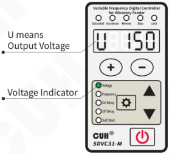

- ตัวควบคุมไม่มีฟังก์ชันเพิ่มแรงดัน เมื่อตัวควบคุมไม่สามารถทำแรงดันที่ตั้งไว้ได้เนื่องจากข้อจำกัดของแรงดันไฟฟ้าแหล่งจ่ายอินพุต ไฟแสดงสถานะอิ่มตัวจะสว่างขึ้น และการชดเชยแรงดันไฟฟ้าเครือข่ายจะล้มเหลวในขณะนี้
- ตัวควบคุมสามารถทำให้เกิดผลการเร่งความเร็วระดับหนึ่งได้โดยเสียสลักษณะไซน์ของรูปคลื่นเอาต์พุต ซึ่งกำหนดโดยพารามิเตอร์ "ดัชนีการเร่งความเร็ว y" เมื่อเข้าสู่สถานะเร่งความเร็ว รูปคลื่นกระแสเอาต์พุตจะเปลี่ยนจากคลื่นไซน์เป็นคลื่นสามเหลี่ยม และไฟแสดงสถานะการเร่งความเร็วจะสว่างขึ้น

---

## 4.2 ความถี่ขาออก

ตัวควบคุมใช้เทคโนโลยีการสังเคราะห์ความถี่ดิจิทัลโดยตรง (DDS) ซึ่งมีความแม่นยำและเสถียรภาพของความถี่สูงมาก และไม่เปลี่ยนแปลงตามเวลาและอุณหภูมิ

- กด ⚙ ค้างไว้ 2 วินาทีเพื่อเข้าสู่อินเทอร์เฟซพารามิเตอร์พื้นฐาน
- LED แสดงพารามิเตอร์ความถี่ขาออก "E" และค่าเริ่มต้น 50.0
- กด ▼ หรือ ▲ เพื่อปรับค่าพารามิเตอร์

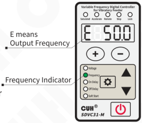

---

## 4.3 การหน่วงเปิด/ปิดของเซ็นเซอร์โฟโตอิเล็กทริกอัจฉริยะ

เมื่อใช้เซ็นเซอร์หรือ PLC เพื่อเปิดหรือปิดเอาต์พุตหลักของตัวควบคุม การกระทำสามารถหน่วงเวลาได้หนึ่งช่วงเวลาหลังจากให้หรือคืนสัญญาณควบคุม สามารถตั้งค่าเวลาหน่วงได้ผ่านพารามิเตอร์สองตัวด้านล่าง

**การหน่วงเปิด ( J ):** ช่วงเวลาที่ตัวควบคุมใช้จากการรับสัญญาณควบคุมการเริ่มทำงานจนถึงการเอาต์พุตจริง

- กด ⚙ ค้างไว้ 2 วินาทีเพื่อเข้าสู่อินเทอร์เฟซพารามิเตอร์พื้นฐาน
- กด ⚙ สั้นเพื่อสลับไปยังพารามิเตอร์การหน่วงเปิด "J" และค่าเริ่มต้น 0.2
- กด ▲ หรือ ▼ เพื่อปรับค่าพารามิเตอร์

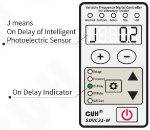

**การหน่วงปิด ( L ):** ช่วงเวลาที่ตัวควบคุมใช้จากการรับสัญญาณควบคุมการหยุดทำงานจนถึงการตัดเอาต์พุตจริง

- กด ⚙ ค้างไว้ 2 วินาทีเพื่อเข้าสู่อินเทอร์เฟซพารามิเตอร์พื้นฐาน
- กด ⚙ สั้นเพื่อสลับไปยังพารามิเตอร์การหน่วงปิด "L" และค่าเริ่มต้น 0.2
- กด ▲ หรือ ▼ เพื่อปรับค่าพารามิเตอร์

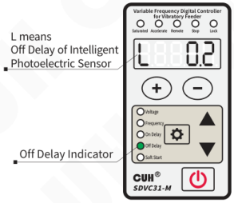

---

## 4.4 เวลาการสตาร์ทแบบนุ่มนวล

เพื่อหลีกเลี่ยงแรงกระแทกกะทันหันต่อขดลวดตัวสั่น ตัวควบคุมสามารถเพิ่มแรงดันไฟฟ้าขาออกจาก 0 ถึงค่าที่ตั้งไว้ล่วงหน้าได้อย่างค่อยเป็นค่อยไปเมื่อเริ่มทำงาน

**เวลาการสตาร์ทแบบนุ่มนวล ( t ):** ช่วงเวลาที่ตัวควบคุมใช้ในการเพิ่มแรงดันไฟฟ้าขาออกจาก 0 ถึงค่าที่ตั้งไว้ล่วงหน้าอย่างนุ่มนวลเมื่อเริ่มทำงาน

- กด ⚙ ค้างไว้ 2 วินาทีเพื่อเข้าสู่อินเทอร์เฟซพารามิเตอร์พื้นฐาน
- กด ⚙ สั้นเพื่อสลับไปยังพารามิเตอร์สตาร์ทแบบนุ่มนวล "t" และค่าเริ่มต้น 0.5
- กด ▲ หรือ ▼ เพื่อปรับค่าพารามิเตอร์

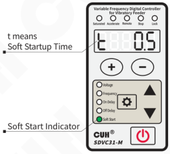

## 4.5 การล็อกแป้นพิมพ์

เมื่อตั้งค่าพารามิเตอร์ของตัวควบคุมแล้ว ฟังก์ชันการล็อกแป้นพิมพ์สามารถล็อกปุ่มทั้งหมดบนแผงหน้าปัดเพื่อหลีกเลี่ยงการใช้งานผิดพลาด

แม้จะปิดและเปิดใหม่อีกครั้ง สถานะการล็อกแป้นพิมพ์จะยังคงอยู่ในสถานะเดิมจากครั้งล่าสุดที่ปิด

- กด ⏻ ค้างไว้ 2 วินาทีเพื่อล็อกปุ่มทั้งหมดบนแผงหน้าปัด ไฟแสดงสถานะล็อกจะสว่างขึ้น
- กด ⏻ ค้างไว้ 2 วินาทีอีกครั้งเพื่อปลดล็อก

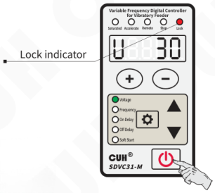

> สถานะการล็อกแป้นพิมพ์จะไม่หายไปเนื่องจากการปิดไฟ
>
> เมื่ออยู่ในสถานะล็อก ปุ่มการใช้งานจะไม่ตอบสนองและไฟนี้จะกะพริบ

---

# บทที่ Ⅴ คำอธิบายฟังก์ชันขั้นสูง

บทนี้แนะนำการตั้งค่าพารามิเตอร์ขั้นสูง

## 5.1 การควบคุมความเร็วระยะไกล

ตัวควบคุมรองรับสัญญาณอนาล็อกภายนอกในการควบคุมแรงดันไฟฟ้าขาออก โดยสัญญาณอนาล็อกรองรับโพเทนชิออมิเตอร์ แรงดันไฟฟ้า 1~5V และกระแสไฟฟ้า 4~20mA

### วิธีเชื่อมต่อการควบคุมด้วยโพเทนชิออมิเตอร์

**คำแนะนำ:**

โปรดใช้โพเทนชิออมิเตอร์แบบเชิงเส้น 1K

> เมื่อสัญญาณควบคุมความเร็วระยะไกลมีผล ไฟแสดงสถานะควบคุมความเร็วจะสว่างขึ้น ในเวลาเดียวกันการปรับแรงดันไฟฟ้าบนแผงหน้าปัดจะไม่ทำงาน

---

## วิธีเชื่อมต่อการควบคุมด้วยแรงดันไฟฟ้า 1~5V

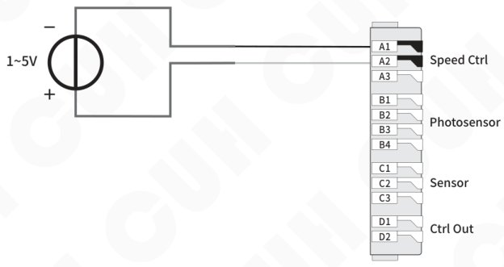

## วิธีเชื่อมต่อการควบคุมด้วยกระแสไฟฟ้า 4~20mA

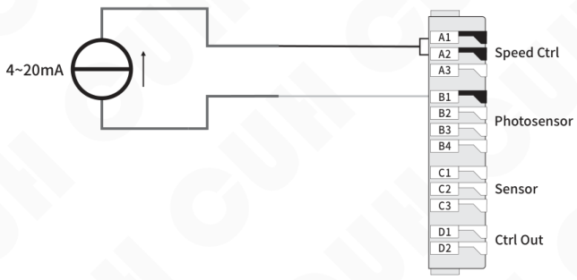

---

## 5.2 การสัมผัสโฟโตอิเล็กทริกอัจฉริยะ

พอร์ตโฟโตอิเล็กทริกอัจฉริยะของตัวควบคุมนี้รองรับเซ็นเซอร์โฟโตอิเล็กทริกแบบส่องผ่านหรือแบบสะท้อนแสงซึ่งประกอบด้วยไดโอดเปล่งแสงและโฟโททรานซิสเตอร์ และยังสามารถตั้งค่าให้รองรับเซ็นเซอร์สวิตช์แบบ NPN ได้อีกด้วย แผนผังการเดินสายโดยละเอียดมีดังนี้:

### 5.2.1 วิธีเดินสายของเซ็นเซอร์โฟโตอิเล็กทริกอัจฉริยะ

**วิธีเชื่อมต่อเซ็นเซอร์โฟโตอิเล็กทริก**

ระยะการทำงานของเซ็นเซอร์สามารถปรับได้โดยการตั้งค่าพารามิเตอร์ P ค่าพารามิเตอร์ยิ่งน้อยจะยิ่งมีความไวมากขึ้น

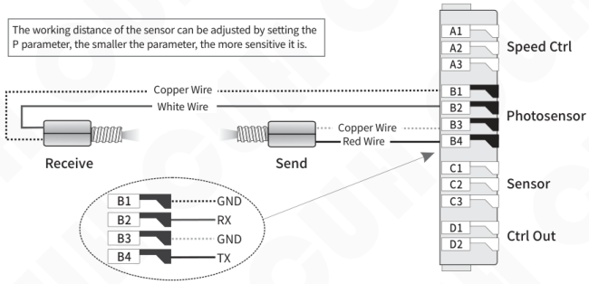

**วิธีเชื่อมต่อเซ็นเซอร์สวิตช์**

ตั้งค่าประเภท NPN โดยพารามิเตอร์ P = 0 ไม่รองรับเซ็นเซอร์แบบ PNP

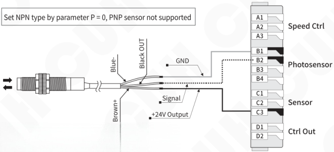

**หมายเหตุ:**

เมื่อพารามิเตอร์ P = 0 ขั้ว B4 จะส่งออกสัญญาณที่ถูกต้อง 10mA

ตั้งแต่ 1 ถึง 1000 ขั้ว B4 จะส่งออกสัญญาณมอดูเลต 10mA ที่มีความถี่ประมาณ 200Hz

เมื่อตัวควบคุมพบข้อผิดพลาด ขั้ว B4 จะไม่ส่งออก นี่คือฟังก์ชันสัญญาณพร้อมทำงาน

---

## 5.2.2 การตั้งค่าความสัมพันธ์เชิงตรรกะของเซ็นเซอร์โฟโตอิเล็กทริกอัจฉริยะ

ภายใต้สภาวะปกติ ปลายรับจะไม่ได้รับสัญญาณแสง และตัวควบคุมจะทำงานตามค่าเริ่มต้น แต่ในการใช้งานพิเศษบางกรณี จำเป็นต้องให้ตัวควบคุมหยุดทำงานเมื่อปลายรับไม่ได้รับสัญญาณแสง การปรับค่าพารามิเตอร์นี้สามารถตอบสนองการใช้งานลักษณะนี้ได้

- กดค้าง ⚙ และ ▲ พร้อมกันเพื่อเข้าสู่หน้าจอพารามิเตอร์ขั้นสูง
- กดสั้น ⚙ เพื่อสลับไปยังพารามิเตอร์ Γ1
- กด ▲ หรือ ▼ เพื่อปรับค่าพารามิเตอร์

พารามิเตอร์ Γ1 ถูกตั้งค่าเป็น `___` ตามค่าเริ่มต้น

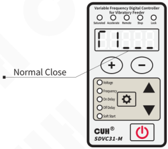

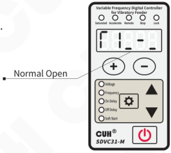

- เมื่อพารามิเตอร์ Γ1 ถูกตั้งค่าเป็น `___` กล่าวคือไม่ได้รับสัญญาณแสง ตัวควบคุมจะทำงาน
- เมื่อพารามิเตอร์ Γ1 ถูกตั้งค่าเป็น `_-_` กล่าวคือไม่ได้รับสัญญาณแสง ตัวควบคุมจะหยุดทำงาน

---

## 5.3 เซ็นเซอร์สวิตช์

พอร์ตเซ็นเซอร์สวิตช์สามารถรองรับโหมด NPN, PNP, Ut1, Ut0 ได้

**โหมด Ut1 คือการสแกนครั้งเดียว** กล่าวคือ ก่อนที่สัญญาณเซ็นเซอร์จะใช้งานไม่ได้ ระบบจะสลับระดับสูงและระดับต่ำเพื่อตรวจสอบว่าพอร์ตนั้นใช้งานได้หรือไม่ เมื่อพบสัญญาณที่ถูกต้องแล้ว ระบบจะกำหนดชนิดของเซ็นเซอร์ที่พอร์ตนั้นและจะไม่สแกนซ้ำอีก

**โหมด Ut0 คือการสแกนต่อเนื่อง** โดยไม่คำนึงถึงชนิดของเซ็นเซอร์ ระบบจะตรวจสอบเสมอว่าพอร์ตเชื่อมต่อกับสัญญาณที่ถูกต้องหรือไม่ โดยการสลับระดับสูงและระดับต่ำ

### 5.3.1 วิธีเดินสายของเซ็นเซอร์สวิตช์

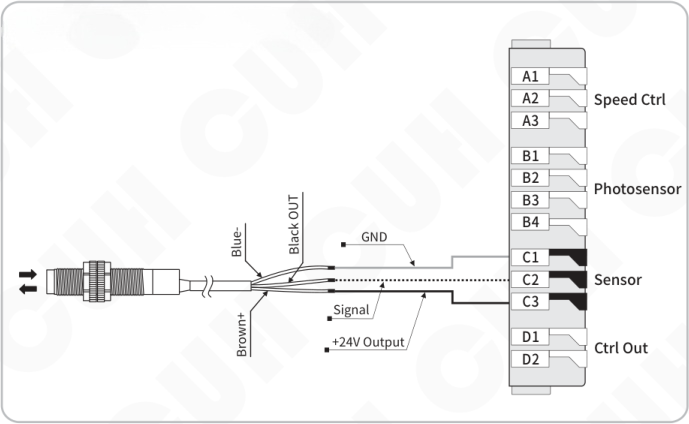

- ตั้งค่าชนิดของเซ็นเซอร์ผ่านพารามิเตอร์ขั้นสูง ΓA
- เมื่อใช้สัญญาณภายนอกอื่น เช่น เซ็นเซอร์ ในการเริ่มและหยุดการทำงานผ่านพอร์ต C ของตัวควบคุม หากการทำงานจำเป็นต้องหน่วงเวลาสักครู่หลังจากให้สัญญาณหรือหลังจากสัญญาณกลับคืนมา สามารถตั้งค่าเวลาผ่านพารามิเตอร์ขั้นสูง "J-" และ "L-" เพื่อทำให้เป็นจริงได้ สำหรับวิธีการใช้งาน โปรดดูที่ 5.3.2

---

## 5.3.2 การหน่วงเปิด/ปิดของเซ็นเซอร์สวิตช์

โดยค่าเริ่มต้น เซ็นเซอร์โฟโตอิเล็กทริกอัจฉริยะและเซ็นเซอร์สวิตช์จะใช้เวลาหน่วงเปิดและเวลาหน่วงปิดร่วมกัน ผู้ใช้งานยังสามารถตั้งค่าเวลาหน่วงเปิดและเวลาหน่วงปิดแยกอิสระสำหรับเซ็นเซอร์สวิตช์ได้อีกด้วย

### การหน่วงเปิด ( J- )

ช่วงเวลาที่ตัวควบคุมใช้ตั้งแต่ได้รับสัญญาณควบคุมการเริ่มทำงานจนถึงการส่งออก

- กดค้าง ⚙ และ ▲ พร้อมกันเพื่อเข้าสู่หน้าจอพารามิเตอร์ขั้นสูง
- กดสั้น ⚙ เพื่อสลับไปยังพารามิเตอร์ J-
- กด ▲ หรือ ▼ เพื่อปรับค่าพารามิเตอร์

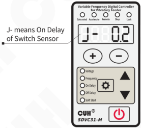

พารามิเตอร์ J- ถูกตั้งค่าเป็น --- ตามค่าเริ่มต้น หมายความว่าใช้ค่าเดียวกับพารามิเตอร์ J

### การหน่วงปิด ( L- )

ช่วงเวลาที่ตัวควบคุมใช้ตั้งแต่ได้รับสัญญาณควบคุมการหยุดทำงานจนถึงการตัดการส่งออก

- กดค้าง ⚙ และ ▲ พร้อมกันเพื่อเข้าสู่หน้าจอพารามิเตอร์ขั้นสูง
- กดสั้น ⚙ เพื่อสลับไปยังพารามิเตอร์ L-
- กด ▲ หรือ ▼ เพื่อปรับค่าพารามิเตอร์

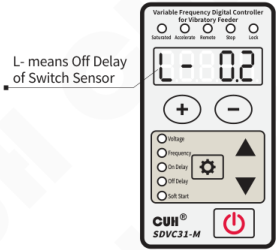

พารามิเตอร์ L- ถูกตั้งค่าเป็น --- ตามค่าเริ่มต้น หมายความว่าใช้ค่าเดียวกับพารามิเตอร์ L

> - เมื่อค่า J- และ L- ถูกปรับเป็น --- เวลาหน่วงเปิดและเวลาหน่วงปิดของเซ็นเซอร์สวิตช์จะเท่ากับเวลาหน่วงเปิดและเวลาหน่วงปิดของเซ็นเซอร์โฟโตอิเล็กทริกอัจฉริยะ
> - เวลาหน่วงเปิดและเวลาหน่วงปิดของเซ็นเซอร์โฟโตอิเล็กทริกอัจฉริยะจะไม่ได้รับผลกระทบจากพารามิเตอร์ J- และ L-

---

### 5.3.3 การตั้งค่าความสัมพันธ์เชิงตรรกะของเซ็นเซอร์สวิตช์

ภายใต้สภาวะปกติ ตัวควบคุมจะไม่ได้รับสัญญาณจากเซ็นเซอร์สวิตช์และจะทำงานตามค่าเริ่มต้น แต่ในการใช้งานพิเศษบางกรณี จำเป็นต้องให้ตัวควบคุมหยุดทำงานเมื่อไม่ได้รับสัญญาณจากเซ็นเซอร์สวิตช์ การปรับค่าพารามิเตอร์นี้สามารถตอบสนองการใช้งานลักษณะนี้ได้

- กดค้าง ⚙ และ ▲ พร้อมกันเพื่อเข้าสู่หน้าจอพารามิเตอร์ขั้นสูง
- กดสั้น ⚙ เพื่อสลับไปยังพารามิเตอร์ Γ2
- กด ▲ หรือ ▼ เพื่อปรับค่าพารามิเตอร์

พารามิเตอร์ Γ2 ถูกตั้งค่าเป็น `___` ตามค่าเริ่มต้น

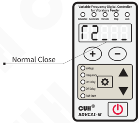

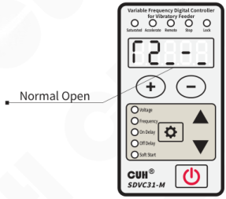

- เมื่อพารามิเตอร์ Γ2 ถูกตั้งค่าเป็น `___` กล่าวคือไม่ได้รับสัญญาณ ตัวควบคุมจะทำงาน
- เมื่อพารามิเตอร์ Γ2 ถูกตั้งค่าเป็น `_-_` กล่าวคือไม่ได้รับสัญญาณ ตัวควบคุมจะหยุดทำงาน

---

## 5.4 การตั้งค่าความสัมพันธ์เชิงตรรกะของสัญญาณควบคุม

ตัวควบคุมสามารถตั้งค่าความสัมพันธ์เชิงตรรกะของเซ็นเซอร์โฟโตอิเล็กทริกอัจฉริยะและเซ็นเซอร์สวิตช์เมื่อทำงานพร้อมกันได้

- กดค้าง ⚙ และ ▲ พร้อมกันเพื่อเข้าสู่หน้าจอพารามิเตอร์ขั้นสูง
- กดสั้น ⚙ เพื่อสลับไปยังพารามิเตอร์ Π
- กด ▲ หรือ ▼ เพื่อปรับค่าพารามิเตอร์

ความสัมพันธ์เชิงตรรกะเริ่มต้นคือ AND

**ความสัมพันธ์เชิงตรรกะ: AND :**

ตัวควบคุมจะทำงานเมื่อทั้งเซ็นเซอร์โฟโตอิเล็กทริกอัจฉริยะและเซ็นเซอร์สวิตช์ต้องการให้ตัวควบคุมทำงานเท่านั้น

**ความสัมพันธ์เชิงตรรกะ: OR :**

ตัวควบคุมจะทำงานเมื่อเซ็นเซอร์โฟโตอิเล็กทริกอัจฉริยะหรือเซ็นเซอร์สวิตช์ต้องการให้ตัวควบคุมทำงาน

**ความสัมพันธ์เชิงตรรกะ: XOR :**

ตัวควบคุมจะทำงานเมื่อเซ็นเซอร์โฟโตอิเล็กทริกอัจฉริยะและเซ็นเซอร์สวิตช์ส่งออกสัญญาณควบคุมที่ตรงข้ามกันเท่านั้น

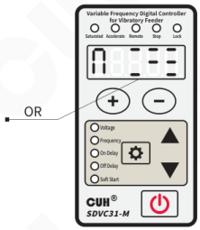

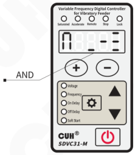

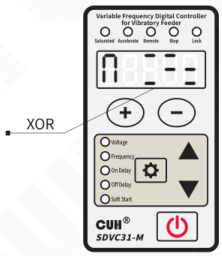

---

## 5.5 เอาต์พุตควบคุม

พอร์ตเอาต์พุตควบคุมสามารถรองรับเอาต์พุตแบบ NPN โดยเอาต์พุตแบบ NPN จะมีสถานะถูกต้องเมื่อเป็นระดับต่ำ และเอาต์พุตจะใช้ไม่ได้เมื่ออยู่ในสถานะอิมพีแดนซ์สูง

### 5.5.1 วิธีเดินสายของเอาต์พุตควบคุม

**วิธีเชื่อมต่อเอาต์พุตแบบ NPN**

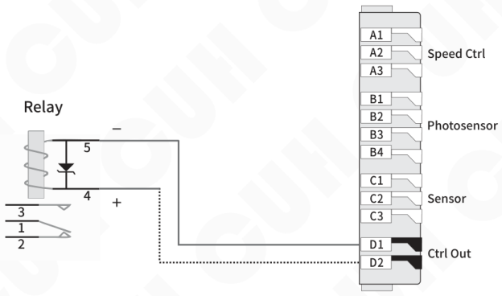

> หากเชื่อมต่อรีเลย์ 24V โปรดตรวจสอบให้แน่ใจว่าขั้วบวกและขั้วลบของขดลวดต่อถูกต้อง เนื่องจากความสามารถในการจ่ายกระแสขาออกของพอร์ตนี้มีจำกัด ไดโอดป้องกันภายในของรีเลย์จะทำให้พอร์ตของตัวควบคุมนี้เกิดการลัดวงจรเมื่อต่อกลับขั้ว ซึ่งจะทำให้การป้องกันการลัดวงจร Err07 ทำงาน

---

## 5.5.2 การตั้งค่าความสัมพันธ์เชิงตรรกะของเอาต์พุตควบคุม

- กดค้าง ⚙ และ ▲ พร้อมกันเพื่อเข้าสู่หน้าจอพารามิเตอร์ขั้นสูง
- กดสั้น ⚙ เพื่อสลับไปยังพารามิเตอร์ Γ3
- กด ▲ หรือ ▼ เพื่อปรับค่าพารามิเตอร์

พารามิเตอร์ Γ3 ถูกตั้งค่าเป็น `___` ตามค่าเริ่มต้น

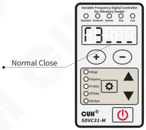

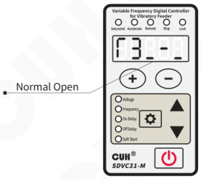

- เมื่อพารามิเตอร์ Γ3 ถูกตั้งค่าเป็น `___` เอาต์พุตควบคุมจะทำงานเมื่อตัวควบคุมทำงาน
- เมื่อพารามิเตอร์ Γ3 ถูกตั้งค่าเป็น `_-_` เอาต์พุตควบคุมจะไม่ทำงานเมื่อตัวควบคุมทำงาน

---

## 5.5.3 พารามิเตอร์แยกการควบคุมหลัก

โดยปกติ เอาต์พุตหลักจะตามมาด้วยเอาต์พุตควบคุม

ในการใช้งานพิเศษ แหล่งควบคุมและความสัมพันธ์สามารถเปลี่ยนได้ด้วยพารามิเตอร์นี้

- กดค้าง ⚙ และ ▲ พร้อมกันเพื่อเข้าสู่หน้าจอพารามิเตอร์ขั้นสูง
- กดสั้น ⚙ เพื่อสลับไปยังพารามิเตอร์ Γ4
- กด ▲ หรือ ▼ เพื่อปรับค่าพารามิเตอร์

พารามิเตอร์ Γ4 ถูกตั้งค่าเป็น `___` ตามค่าเริ่มต้น

- เมื่อพารามิเตอร์ Γ4 ถูกตั้งค่าเป็น  เอาต์พุตหลักและเอาต์พุตควบคุมจะเกี่ยวข้องสัมพันธ์กัน โดยควบคุมด้วยความสัมพันธ์เชิงตรรกะระหว่างเซ็นเซอร์โฟโตอิเล็กทริกอัจฉริยะกับเซ็นเซอร์สวิตช์ และปุ่มเปิด/ปิด
- เมื่อพารามิเตอร์ Γ4 ถูกตั้งค่าเป็น 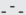 เอาต์พุตหลักและเอาต์พุตควบคุมจะแยกจากกัน เอาต์พุตหลักควบคุมโดยปุ่มเปิด/ปิด เอาต์พุตควบคุมควบคุมโดยความสัมพันธ์เชิงตรรกะระหว่างเซ็นเซอร์โฟโตอิเล็กทริกอัจฉริยะกับเซ็นเซอร์สวิตช์
- เมื่อพารามิเตอร์ Γ4 ถูกตั้งค่าเป็น 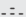 เอาต์พุตหลักควบคุมโดยปุ่มเปิด/ปิดและเซ็นเซอร์สวิตช์ เอาต์พุตควบคุมควบคุมโดยเซ็นเซอร์โฟโตอิเล็กทริกอัจฉริยะ
- เมื่อพารามิเตอร์ Γ4 ถูกตั้งค่าเป็น 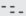 เอาต์พุตหลักควบคุมโดยปุ่มเปิด/ปิดและเซ็นเซอร์โฟโตอิเล็กทริกอัจฉริยะ เอาต์พุตควบคุมควบคุมโดยเซ็นเซอร์สวิตช์

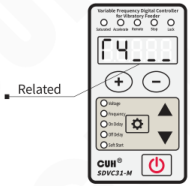

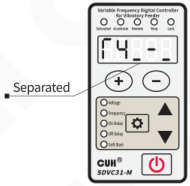

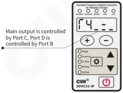

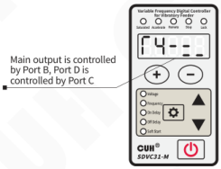

---

## 5.6 ขีดจำกัดแรงดันไฟฟ้าขาออกสูงสุด

ตัวควบคุมสามารถตั้งค่าพารามิเตอร์ขีดจำกัดแรงดันไฟฟ้าขาออกสูงสุด h ซึ่งสามารถป้องกันผู้ใช้จากการใช้งานผิดพลาดที่จะส่งออกแรงดันไฟฟ้าที่สูงเกินไปและทำให้อุปกรณ์แบบสั่นสะเทือนเสียหาย

ทั้งแรงดันไฟฟ้าที่ตั้งค่าจากแผงหน้าปัดและแรงดันไฟฟ้าควบคุมระยะไกลจะไม่เกินค่านี้

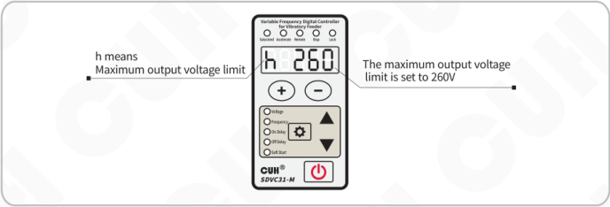

- ไม่ว่าในกรณีใด แรงดันไฟฟ้าขาออกของตัวควบคุมจะไม่สามารถและจะไม่เกินค่าที่ตั้งไว้ของพารามิเตอร์นี้
- ค่าเริ่มต้นจากโรงงานของพารามิเตอร์นี้คือแรงดันไฟฟ้าขาออกสูงสุดที่เครื่องสามารถส่งออกได้

## 5.7 ขีดจำกัดความถี่ต่ำสุด

ตัวควบคุมนี้สามารถตั้งค่าพารามิเตอร์ขั้นสูง "ขีดจำกัดความถี่ต่ำสุด e" เพื่อจำกัดความถี่ขาออกต่ำสุด ซึ่งสามารถป้องกันผู้ใช้จากการใช้งานโดยไม่ตั้งใจที่จะทำให้ความถี่ขาออกต่ำเกินไปจนทำให้แม่เหล็กไฟฟ้าเสียหาย

ความถี่ที่ตั้งค่าจากแผงหน้าปัดจะไม่ต่ำกว่าค่านี้

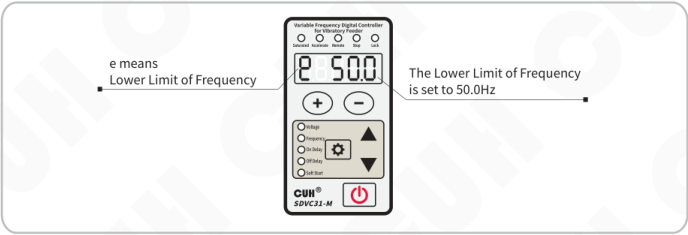

---

## 5.8 ดัชนีการเร่งความเร็ว

ตัวควบคุมสามารถบรรลุผลการเร่งความเร็วในระดับหนึ่งโดยการเสียสละคุณลักษณะรูปคลื่นไซน์ของรูปคลื่นขาออก เมื่อเข้าสู่สถานะการเร่งความเร็ว รูปคลื่นกระแสขาออกจะเปลี่ยนจากคลื่นไซน์เป็นคลื่นสามเหลี่ยม และไฟแสดงสถานะการเร่งความเร็วจะสว่างขึ้น ฟังก์ชันการเร่งความเร็วสามารถควบคุมได้โดยการตั้งค่าพารามิเตอร์ของพารามิเตอร์ขั้นสูง "ดัชนีการเร่งความเร็ว y"

**ดัชนีการเร่งความเร็ว (y):** แสดงถึงเปอร์เซ็นต์ของแรงดันไฟฟ้าขาเข้าที่แรงดันไฟฟ้าขาออกสูงสุดสามารถไปถึงได้

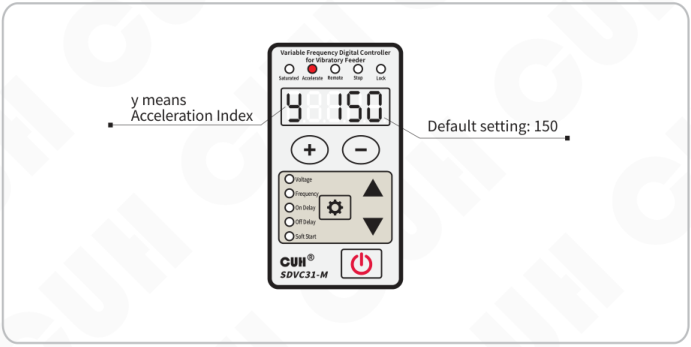

y หมายถึงดัชนีการเร่งความเร็ว  
ค่าเริ่มต้น: 150

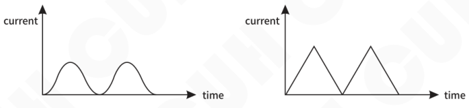

**แผนภาพค่าตั้งของดัชนีการเร่งความเร็วที่ 150**

---

## 5.9 ดัชนีรูปคลื่น

ตัวควบคุมสามารถปรับสมดุลประสิทธิภาพระหว่างประสิทธิภาพสูงสุด-กำลังขับสูงสุดกับเสียงรบกวนต่ำสุดได้อย่างต่อเนื่อง เพื่อตอบสนองความต้องการที่สูงขึ้นของลูกค้า ซึ่งสามารถทำได้โดยการตั้งค่าพารามิเตอร์ของพารามิเตอร์ขั้นสูง "ดัชนีรูปคลื่น r"

- ค่าดัชนีรูปคลื่นเป็น 0 จะได้ประสิทธิภาพสูงสุดและความเค้นบนสปริงน้อยที่สุด
- เมื่อค่าเป็น 100 จะได้กำลังขับขาออกตามค่าพิกัดสูงสุดและเสียงรบกวนต่ำสุด แต่สปริงจะรับความเค้นมากขึ้น

**แผนภาพดัชนีรูปคลื่น**

---

## 5.10 ฟังก์ชันการแสดงอุณหภูมิ

- กดค้าง ⚙ และ ▲ พร้อมกันเพื่อเข้าสู่หน้าจอพารามิเตอร์ขั้นสูง
- กดสั้น ⚙ เพื่อสลับไปยังพารามิเตอร์ C
- ค่าพารามิเตอร์ไม่สามารถแก้ไขได้

ตัวอย่างเช่น:  
C หมายถึงพารามิเตอร์แสดงอุณหภูมิ

## 5.11 คืนค่าการตั้งค่าเริ่มต้น/โหมดคืนค่าโรงงาน

ผู้ใช้สามารถคืนค่าตัวควบคุมไปสู่สถานะค่าเริ่มต้นจากโรงงานได้อย่างรวดเร็ว

เนื่องจากตัวควบคุมมีฟังก์ชันการใช้งานที่ทรงพลัง จึงมีพารามิเตอร์จำนวนมากที่สามารถปรับได้ สำหรับมือใหม่ อาจไม่สามารถคืนค่าสถานะการทำงานปกติของตัวควบคุมได้หลังจากการตั้งค่าและแก้ไขหลายครั้ง ใช้ฟังก์ชันนี้เพื่อคืนค่าสถานะพารามิเตอร์ที่สับสนกลับไปสู่ค่าเริ่มต้นจากโรงงานได้อย่างรวดเร็ว

ในการคืนค่าการตั้งค่าโรงงาน จำเป็นต้องใช้ร่วมกับพารามิเตอร์โหมดคืนค่าโรงงาน (Pin) โหมดคืนค่าโรงงานอธิบายไว้ดังนี้:

0: คืนค่า**กลุ่มพารามิเตอร์การทำงาน**ไปสู่**กลุ่มพารามิเตอร์ผู้ใช้**  
5: บันทึก**กลุ่มพารามิเตอร์การทำงาน**ไปยัง**กลุ่มพารามิเตอร์ผู้ใช้**  
35: คืนค่า**กลุ่มพารามิเตอร์การทำงาน**ไปสู่**ค่าจากโรงงานของ CUH**  
55: คืนค่า**กลุ่มพารามิเตอร์การทำงาน**และ**กลุ่มพารามิเตอร์ผู้ใช้**ไปสู่**ค่าจากโรงงานของ CUH**

- กดค้าง ⚙ และ ▲ พร้อมกันเพื่อเข้าสู่หน้าจอพารามิเตอร์ขั้นสูง
- กดสั้น ⚙ เพื่อสลับไปยังไฟ LED ติดทั้งหมด นั่นคือพารามิเตอร์ "การคืนค่าการตั้งค่าเริ่มต้น" จากนั้นกด ▲ ค้างไว้จนกว่าตัวควบคุมจะแสดง "" ซึ่งบ่งชี้ว่าตัวควบคุมได้รับการคืนค่าแล้ว
- ปล่อย ▲ หลังจากตัวควบคุมแสดง "CUH" แล้ว จะเข้าสู่สถานะปรับแรงดันไฟฟ้าขาออก "U" ณ เวลานี้ พารามิเตอร์ทั้งหมดได้รับการคืนค่าไปสู่การตั้งค่าเริ่มต้นจากโรงงานแล้ว

หมายเหตุ: กด ▼ ค้างไว้จนกว่า "" จะปรากฏบน LED เพื่อสลับไปยังหน้าจอ SDVC311

---

## บทที่ Ⅵ ข้อกำหนดทางเทคนิค

### 6.1 มิติ

(หน่วย: mm)

SDVC31-S (1.5A)  
SDVC31-M (3.0A)

| ช่วงมิติ | ค่าเผื่อ |
|---|---|
| 0~3 | ±0.05 |
| 3~10 | ±0.1 |
| 10~30 | ±0.15 |
| 30~80 | ±0.2 |
| 80~180 | ±0.3 |
| >180 | ±0.5 |

ตารางค่าเผื่อนี้ใช้ได้กับผลิตภัณฑ์ทั้งหมดในซีรีส์นี้

---

SDVC31-L (4.5A)  
SDVC31-XL (6.0A)

---

## 6.2 ข้อกำหนดทางเทคนิค

| รายการ | ต่ำสุด | ทั่วไป | สูงสุด | หน่วย | หมายเหตุ |
|---|---|---|---|---|---|
| แรงดันไฟฟ้าขาเข้า | 85 | 220 | 250 | V | AC RMS |
| ช่วงปรับแรงดันไฟฟ้าขาออก | 0 | —— | 260 | V | ต่ำกว่า 150% ของแรงดันไฟฟ้าขาเข้า |
| ความละเอียดการปรับแรงดันไฟฟ้า | | 1 | | V | |
| ความแม่นยำของการรักษาแรงดันไฟฟ้า | 0 | —— | 10 | % | ΔVout/ΔVin |
| ช่วงปรับกระแสขาออก | 0 | —— | 1.5 | A | SDVC31-S |
| ช่วงปรับกระแสขาออก | 0 | —— | 3.0 | A | SDVC31-M |
| ช่วงปรับกระแสขาออก | 0 | —— | 4.5 | A | SDVC31-L |
| ช่วงปรับกระแสขาออก | 0 | —— | 6.0 | A | SDVC31-XL |
| กำลังขับขาออก | 0 | —— | 330 | VA | SDVC31-S |
| กำลังขับขาออก | 0 | —— | 660 | VA | SDVC31-M |
| กำลังขับขาออก | 0 | —— | 990 | VA | SDVC31-L |
| กำลังขับขาออก | 0 | —— | 1320 | VA | SDVC31-XL |
| ความถี่ขาออก | 40.0 | —— | 400.0 | Hz | |
| ความละเอียดการปรับความถี่ | | 0.1 | | Hz | |
| รูปคลื่นขาออก | | ไซน์ | | | |
| เวลาสตาร์ทแบบนุ่มนวล | 0 | —— | 10.0 | s | ค่าเริ่มต้น: 0.5 |
| ช่วงเวลาหน่วงเปิด/ปิด | 0 | —— | 20.0 | s | ค่าเริ่มต้น: 0.2 |
| ความละเอียดของเวลาหน่วงเปิด/ปิด | | 0.1 | | s | |
| อุณหภูมิจุดกระตุ้นการป้องกันความร้อนสูงเกินไป | 58 | 60 | 66 | °C | |
| กระแสขาออกควบคุม DC | 0 | —— | 400 | mA | |
| แรงดันไฟฟ้าขาออกควบคุม DC | 22 | 24 | 26 | V | |
| สัญญาณควบคุมอนาล็อก | | 1~5/4~20 | | V/mA | สัญญาณควบคุมความเร็วระยะไกล |
| สัญญาณควบคุมดิจิทัล | | 24 | | V | สัญญาณสวิตช์ |
| วิธีการปรับค่า | | 6 | | ปุ่มกด | |
| การใช้พลังงานขณะสแตนด์บาย | —— | 3 | —— | W | |
| วิธีการแสดงผล | | 5 | | หลัก | LED |
| อุณหภูมิแวดล้อม | 0 | 25 | 40 | °C | ไม่เกิดการควบแน่น |
| ความชื้นแวดล้อม | 10 | 60 | 85 | % | ไม่เกิดการควบแน่น |
| อุณหภูมิแวดล้อมในการจัดเก็บ | -20 | 25 | 65 | °C | ไม่เกิดการควบแน่น |

## 6.3 มาตรฐานอ้างอิง

**พารามิเตอร์สัมบูรณ์:**
ค่าที่สูงกว่ามาตรฐานจะทำให้ตัวควบคุมเสียหาย โปรดปฏิบัติตามอย่างเคร่งครัด

| รายการ | มาตรฐาน GB | มาตรฐาน IEC | ระดับ | ข้อกำหนดมาตรฐาน | หมายเหตุ |
|---|---|---|---|---|---|
| การปล่อยประจุไฟฟ้าสถิต | GB/T 17626.2-2006 | IEC 61000-4-2:2001 | 4 | ±8 kV | การปล่อยแบบสัมผัส |
| | | | 4 | ±15 kV | การปล่อยแบบอากาศ |
| การทดสอบความทนต่อสัญญาณรบกวนชั่วขณะทางไฟฟ้า | GB/T 17626.4-2008 | IEC 61000-4-4:2004 | 4 | ±4 kV | |
| ความทนต่อระดับคลื่นกระแสตรงในสายจ่ายไฟ DC | GB/T 17626.17-2005 | IEC 61000-4-17:2002 | 4 | 15% | ระดับ A |

> **คำเตือน**  
> ในสภาพแวดล้อมที่อยู่อาศัยแบบทั่วไป ผลิตภัณฑ์นี้อาจก่อให้เกิดการรบกวนคลื่นวิทยุ ซึ่งในกรณีนั้นอาจจำเป็นต้องใช้มาตรการบรรเทาเพิ่มเติม

---

# บทที่ Ⅶ ภาคผนวก

## 7.1 ตารางพารามิเตอร์

| | คำจำกัดความ | สัญลักษณ์ | ภาพสัญลักษณ์ | ช่วง | ค่าเริ่มต้น |
|---|---|---|---|---|---|
| พารามิเตอร์ทั่วไป | แรงดันไฟฟ้าขาออก | U |  | 0~260 V | 150 |
| พารามิเตอร์พื้นฐาน | ความถี่ขาออก | E |  | 40.0~400.0 Hz | 50.0 |
| พารามิเตอร์พื้นฐาน | การหน่วงเปิดของเซ็นเซอร์โฟโตอิเล็กทริกอัจฉริยะ | J |  | 0.0~20.0 s | 0.2 |
| พารามิเตอร์พื้นฐาน | การหน่วงปิดของเซ็นเซอร์โฟโตอิเล็กทริกอัจฉริยะ | L |  | 0.0~20.0 s | 0.2 |
| พารามิเตอร์พื้นฐาน | การสตาร์ทแบบนุ่มนวล | t |  | 0.0~10.0 s | 0.5 |
| พารามิเตอร์ขั้นสูง | การหน่วงปิดของเซ็นเซอร์สวิตช์ NPN | L- |  | 0.0~20.0 s | L---- เท่ากับ L |
| พารามิเตอร์ขั้นสูง | การหน่วงเปิดของเซ็นเซอร์สวิตช์ NPN | J- |  | 0.0~20.0 s | J---- เท่ากับ J |
| พารามิเตอร์ขั้นสูง | ทิศทางเชิงตรรกะของเซ็นเซอร์โฟโตอิเล็กทริกอัจฉริยะ | F1 |  | ปกติปิด , ปกติเปิด  |  | |
| พารามิเตอร์ขั้นสูง | ทิศทางเชิงตรรกะของเซ็นเซอร์สวิตช์ | F2 |  | ปกติปิด , ปกติเปิด  |  | |
| พารามิเตอร์ขั้นสูง | ทิศทางเชิงตรรกะของเอาต์พุตควบคุม | F3 |  | ปกติปิด , ปกติเปิด  |  | |
| พารามิเตอร์ขั้นสูง | พารามิเตอร์แยกการควบคุมหลัก | F4 |  | เกี่ยวข้องกัน , เอาต์พุตหลักควบคุมโดยพอร์ต C, พอร์ต D ควบคุมโดยพอร์ต B  แยกจากกัน , เอาต์พุตหลักควบคุมโดยพอร์ต B, พอร์ต D ควบคุมโดยพอร์ต C  |  | |
| พารามิเตอร์ขั้นสูง | ความสัมพันธ์เชิงตรรกะของสัญญาณควบคุม | n |  | or , And , Xor  |  | |
| พารามิเตอร์ขั้นสูง | แรงดันไฟฟ้าขาออกสูงสุด | H |  | 0~260 V | 260 |
| พารามิเตอร์ขั้นสูง | ดัชนีการเร่งความเร็ว | y |  | 100~150 | 150 |
| พารามิเตอร์ขั้นสูง | ดัชนีรูปคลื่น | r |  | 0~100 | 100 |
| พารามิเตอร์ขั้นสูง | ความไวของเซ็นเซอร์โฟโตอิเล็กทริกอัจฉริยะ | P |  | 0~1000 | 80 |
| พารามิเตอร์ขั้นสูง | ชนิดเซ็นเซอร์พอร์ต C | FA |  | nPn, PnP ut1 (สแกนครั้งเดียว), ut0 (สแกนต่อเนื่อง) | nPn |
| พารามิเตอร์ขั้นสูง | อุณหภูมิ | C |  | -20~85 °C | —— |
| พารามิเตอร์ขั้นสูง | ขีดจำกัดความถี่ต่ำสุด | e |  | 40.0~400.0 Hz | 40.0 |
| พารามิเตอร์ขั้นสูง | การคืนค่าการตั้งค่าเริ่มต้น | 8.8.8.8.8. |  | ใช้ร่วมกับพารามิเตอร์ Pin | —— |
| พารามิเตอร์ขั้นสูง | โหมดคืนค่าโรงงาน | Pin |  | 0 : คืนค่ากลุ่มพารามิเตอร์การทำงานไปสู่กลุ่มพารามิเตอร์ผู้ใช้ 5 : บันทึกกลุ่มพารามิเตอร์การทำงานไปยังกลุ่มพารามิเตอร์ผู้ใช้ 35: คืนค่ากลุ่มพารามิเตอร์การทำงานไปสู่ค่าจากโรงงานของ CUH 55: คืนค่ากลุ่มพารามิเตอร์การทำงานและกลุ่มพารามิเตอร์ผู้ใช้ไปสู่ค่าจากโรงงานของ CUH | 0 |

## 7.2 แผนผังวงจรขาเข้าและขาออก

**พอร์ต A ควบคุมความเร็วระยะไกล**

**พอร์ต B เซ็นเซอร์โฟโตอิเล็กทริกอัจฉริยะ**

**พอร์ต C เซ็นเซอร์สวิตช์**

**พอร์ต D เอาต์พุตควบคุม**

---

## 7.3 คำแนะนำในการแก้ไขปัญหาและคำอธิบายข้อผิดพลาด

| รหัสข้อผิดพลาด | คำจำกัดความ | วิธีการแก้ไขปัญหา | ภาพสัญลักษณ์ |
|---|---|---|---|
| ไม่มีการแสดงผลหลังจากเปิดไฟ | | ตรวจสอบให้แน่ใจว่าเต้ารับไฟมีไฟฟ้า ตรวจสอบให้แน่ใจว่าสายไฟขาเข้าเสียบเข้าเต้ารับไฟอย่างมั่นคงหรือไม่? | | |
| แสดงผลตามปกติ แต่ไม่มีเอาต์พุต | | ตรวจสอบให้แน่ใจว่าสายเอาต์พุตเสียบเข้ากับตัวสั่นสะเทือนอย่างมั่นคง ตรวจสอบให้แน่ใจว่าแรงดันไฟฟ้าขาออกไม่ต่ำเกินไป ตรวจสอบให้แน่ใจว่าไฟแสดงสถานะหยุดทำงานไม่ได้สว่างขึ้น โปรดตรวจสอบว่ามีการตั้งค่าพารามิเตอร์แบบปกติปิดไว้หรือไม่ ซึ่งทำให้เอาต์พุตของตัวควบคุมหยุดทำงาน | | |
| สัญญาณควบคุมไม่มีผล | | ตรวจสอบให้แน่ใจว่าสัญญาณควบคุมถูกป้อนเข้าอย่างถูกต้อง ตรวจสอบให้แน่ใจว่าสายกราวด์ของสัญญาณควบคุมต่อเข้ากับตัวควบคุมอย่างถูกต้อง ตรวจสอบให้แน่ใจว่าความสัมพันธ์เชิงตรรกะของสัญญาณควบคุมถูกตั้งค่าถูกต้องตามที่คาดหวัง | | |
| ปรากฏการณ์บีต | | หลีกเลี่ยงการส่งผ่านการสั่นสะเทือนระหว่างตัวสั่นสะเทือน เพิ่มความถี่การสั่นพ้องของตัวสั่นสะเทือนให้สูงขึ้น | | |
| แสดงผลตามปกติ ไม่มีเอาต์พุต แต่ได้ยินเสียง | | ปรับพารามิเตอร์ทั้งหมดตามที่คู่มือเล่มนี้แนะนำ | | |
| Err01 | การลัดวงจร | ตรวจสอบให้แน่ใจว่าโหลดไม่ถูกลัดวงจร จากนั้นลองเริ่มเอาต์พุตของตัวควบคุมใหม่โดยกดปุ่มเปิด/ปิดเอาต์พุตสองครั้ง หรือจ่ายไฟใหม่ให้ตัวควบคุม |  |
| Err02 | กระแสเกิน | ลดแรงดันไฟฟ้าขาออกลงอย่างเหมาะสม แล้วเริ่มเอาต์พุตใหม่ |  |
| Err03 | ความร้อนสูงเกินไป | ติดตั้งตัวควบคุมไว้ในสภาพแวดล้อมที่มีการระบายอากาศที่ดี |  |
| Err04 | แรงดันไฟฟ้าสูงเกินไปหรือต่ำเกินไป | ตรวจสอบให้แน่ใจว่าแรงดันไฟฟ้าขาเข้าอยู่ระหว่าง AC 85~250Vac |  |
| Err05 | การสื่อสารภายในผิดปกติ | ตรวจสอบให้แน่ใจว่าไม่มีแหล่งจ่ายไฟภายนอกต่อเข้ากับพอร์ตจ่ายไฟ 24V หรือติดต่อฝ่ายสนับสนุนทางเทคนิคของเรา |  |
| Err06 | เซ็นเซอร์วัดอุณหภูมิผิดปกติ | ตรวจสอบให้แน่ใจว่าอุณหภูมิในการทำงานไม่ต่ำกว่า -20℃ หรือติดต่อฝ่ายสนับสนุนทางเทคนิคของเรา |  |
| Err07 | การป้องกันการลัดวงจรของพอร์ต D | ตรวจสอบให้แน่ใจว่าโหลดของพอร์ต D ไม่ถูกลัดวงจรและกระแสไม่เกิน 400mA จากนั้นลองเริ่มเอาต์พุตของพอร์ต D ใหม่ |  |
| Err10 | เอาต์พุตจ่ายไฟ 24V ผิดปกติ | ตรวจสอบให้แน่ใจว่าพอร์ต 24V ไม่ถูกลัดวงจรและกระแสไม่เกิน 400mA |  |
| Err11 | เอาต์พุตจ่ายไฟ 5V ของพอร์ต A ผิดปกติ | ตรวจสอบให้แน่ใจว่าแหล่งจ่ายไฟ 5V ของพอร์ต A ไม่ถูกลัดวงจร หรือไม่ได้ต่อเข้ากับแรงดันไฟฟ้าภายนอกที่สูงกว่า 5V |  |

หมายเหตุ: หากเกิดข้อผิดพลาดขึ้น TX ของพอร์ต B จะหยุดทำงาน

---

# บทที่ Ⅷ ข้อมูลการรับประกันผลิตภัณฑ์

## 8.1 ระยะเวลาการรับประกัน

ระยะเวลาการรับประกันที่บริษัทกำหนดไว้สำหรับผลิตภัณฑ์นี้คือ 3 ปี นับตั้งแต่วันที่ส่งมอบผลิตภัณฑ์ไปยังสถานที่ที่ผู้ซื้อกำหนด

## 8.2 ขอบเขตของการรับประกัน

(1) หากมีความเสียหายที่เกิดจากบริษัทของเราภายในระยะเวลารับประกันข้างต้น เราจะซ่อมแซมผลิตภัณฑ์ให้โดยไม่มีค่าใช้จ่าย อย่างไรก็ตาม กรณีต่อไปนี้ไม่อยู่ในขอบเขตของการรับประกัน:

a. ความเสียหายอันเนื่องมาจากการไม่ปฏิบัติตามเงื่อนไขที่ระบุไว้ในคู่มือฉบับย่อ คู่มือการใช้งาน หรือข้อกำหนดทางเทคนิคที่ตกลงร่วมกันเป็นพิเศษระหว่างผู้ซื้อกับบริษัท การใช้งานที่ไม่ถูกต้อง หรือความเสียหายที่เกิดจากการใช้งานที่ไม่เหมาะสม

b. ความเสียหายไม่ได้เกิดจากข้อบกพร่องของผลิตภัณฑ์ แต่เกิดจากการออกแบบอุปกรณ์หรือซอฟต์แวร์ของผู้ซื้อ

c. การทำงานผิดปกติที่เกิดจากการดัดแปลงหรือการซ่อมแซมที่ไม่ได้ดำเนินการโดยบุคลากรของบริษัท

d. ความเสียหายที่สามารถหลีกเลี่ยงได้ทั้งหมดโดยการบำรุงรักษาอย่างถูกต้องหรือการเปลี่ยนชิ้นส่วนที่สึกหรอตามคู่มือการใช้งานฉบับย่อหรือคู่มือการใช้งาน

e. ความเสียหายที่เกิดขึ้นหลังจากที่ผลิตภัณฑ์ถูกส่งออกจากบริษัทของเราแล้ว อันเนื่องมาจากปัจจัยต่าง ๆ เช่น ความเปลี่ยนแปลงของระดับวิทยาการที่คาดไม่ถึง

f. ความเสียหายที่เกิดจากภัยพิบัติทางธรรมชาติ เช่น อัคคีภัย แผ่นดินไหว อุทกภัย หรือปัจจัยภายนอก เช่น ความเสียหายจากแรงดันไฟฟ้าผิดปกติ บริษัทไม่รับผิดชอบในการรับประกัน

(2) ขอบเขตของการรับประกันจำกัดอยู่เฉพาะสถานการณ์ที่ระบุไว้ใน (1) สำหรับความเสียหายทางอ้อม (เช่น ความเสียหายของอุปกรณ์ โอกาสที่สูญเสียไป กำไรที่สูญเสีย ฯลฯ) หรือความเสียหายอื่น ๆ บริษัทไม่รับผิดชอบใด ๆ ทั้งสิ้น

## 8.3 ความเหมาะสมของผลิตภัณฑ์

ตัวควบคุมของบริษัทเราได้รับการออกแบบและผลิตมาเพื่อการใช้งานทั่วไปในอุตสาหกรรมการป้อนวัสดุแบบสั่นสะเทือน ดังนั้นตัวควบคุมของบริษัทเรานี้จึงไม่ควรใช้สำหรับการใช้งานต่อไปนี้และไม่เหมาะสมกับการใช้งานดังกล่าว

(1) สิ่งอำนวยความสะดวกที่มีผลกระทบอย่างร้ายแรงต่อชีวิตและทรัพย์สิน เช่น โรงไฟฟ้าพลังงานนิวเคลียร์ ท่าอากาศยาน เส้นทางรถไฟ เรือ อุปกรณ์เคลื่อนที่ด้วยเครื่องยนต์ และอุปกรณ์ทางการแพทย์

(2) สาธารณูปโภค รวมถึงไฟฟ้า ก๊าซ การประปา ฯลฯ

(3) การใช้งานกลางแจ้งในสภาพหรือสภาพแวดล้อมที่คล้ายคลึงกัน

---

Nanjing CUH Science & Technology Co.,Ltd  
https://en.cuhnj.com  
Tel.:+86-25-84730411 / 84730415 / 84730416  
Fax:+86-25-84730426  
E-mail:sales@cuhnj.com  
Add.:Building 2, Xueyan Tech Park, Tuscity,  
No.9 Zhineng Rd, Jiangning, Nanjing, China

Document No.: IDP1000530

