## ตัวควบคุมดิจิทัลควบคุมความถี่สำหรับเครื่องป้อนวัสดุแบบสั่นสะเทือน

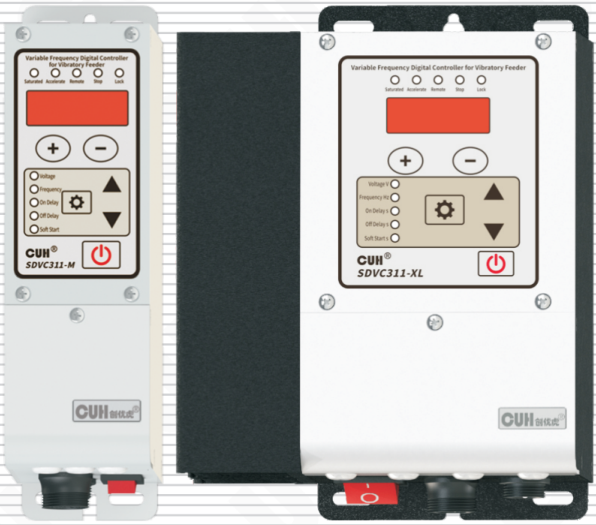

## ซีรีส์ SDVC311
ตัวควบคุมดิจิทัลควบคุมความถี่สำหรับเครื่องป้อนวัสดุแบบสั่นสะเทือน — ซีรีส์ SDVC311
## คู่มือการใช้งาน

---

## คำชี้แจงลิขสิทธิ์

บริษัท Nanjing CUH Science & Technology CO., Ltd. ขอสงวนลิขสิทธิ์ทั้งหมด

ข้อมูลทั้งหมดที่ระบุในคู่มือการใช้งานฉบับนี้เป็นความรู้ของบริษัทของเราและได้รับความคุ้มครองตามกฎหมายลิขสิทธิ์และกฎหมายที่เกี่ยวข้องอื่นๆ CUH มีและสงวนสิทธิ์ทั้งหมดที่กฎหมายลิขสิทธิ์และกฎหมายอื่นๆ ให้ไว้ ห้ามคัดลอก แปล เลียนแบบ หรือใช้ประโยชน์จากคู่มือการใช้งานฉบับนี้ทั้งหมดหรือบางส่วนโดยไม่ได้รับความยินยอมเป็นลายลักษณ์อักษรจาก CUH

## ข้อจำกัดความรับผิด

เนื้อหาทั้งหมดของคู่มือการใช้งานฉบับนี้เป็นเพียงการอธิบายวิธีการใช้ผลิตภัณฑ์ที่ผลิตโดยบริษัทของเราเท่านั้น และอธิบายตามเทคโนโลยีที่มีอยู่ในปัจจุบันและสภาพที่ให้บริการแก่ท่านเมื่อใช้งาน ท่านต้องรับความเสี่ยงที่เกี่ยวข้องเมื่อใช้ผลิตภัณฑ์นี้ เว้นแต่จะกำหนดไว้โดยกฎหมาย บริษัทไม่มีความรับผิดใดๆ ไม่ว่าโดยชัดแจ้งหรือโดยปริยายต่อผลิตภัณฑ์เนื่องจากคู่มือการใช้งานฉบับนี้ รวมถึงแต่ไม่จำกัดเพียงการบาดเจ็บต่อบุคคล ความเสียหายต่อทรัพย์สิน การสูญเสียโอกาส ฯลฯ

ท่านเข้าใจความเสี่ยงข้างต้นอย่างชัดเจนและตกลงว่า เว้นแต่กฎหมายจะกำหนดไว้ บริษัทจะไม่รับผิดชอบต่อความเสียหายหรือการสูญเสียใดๆ ไม่ว่าโดยตรงหรือโดยอ้อมต่อท่าน (รวมถึงแต่ไม่จำกัดเพียงความสูญเสียที่จับต้องได้ของบุคลากร ทรัพย์สิน ข้อมูล ฯลฯ และความสูญเสียที่จับต้องไม่ได้ของชื่อเสียง โอกาส ฯลฯ)

บริษัทขอสงวนสิทธิ์ในการแก้ไขผลิตภัณฑ์ที่ใช้บังคับในคู่มือการใช้งานฉบับนี้โดยไม่ต้องแจ้งให้ทราบล่วงหน้าหรือภายหลัง

---

## คำนำ

ขอขอบคุณที่ท่านเลือกใช้ตัวควบคุมการป้อนวัสดุแบบสั่นสะเทือนแบบปรับความถี่ดิจิทัลซีรีส์ CUH SDVC311 (ต่อไปนี้จะเรียกว่า "ตัวควบคุม") ตัวควบคุมซีรีส์นี้ใช้ชิ้นส่วนคุณภาพสูง ผสมผสานเทคโนโลยีอิเล็กทรอนิกส์ล่าสุด และได้รับการออกแบบอย่างพิถีพิถันด้วยตัวประมวลผลสัญญาณดิจิทัลประสิทธิภาพสูง

คู่มือนี้แนะนำวิธีการใช้งานพื้นฐาน คำอธิบายทางเทคนิคของฟังก์ชัน และตัวอย่างการใช้งานทั่วไปของผลิตภัณฑ์นี้ ให้ข้อมูลที่เกี่ยวข้องแก่ผู้ใช้เกี่ยวกับการติดตั้งและการปรับแต่ง การตั้งค่าพารามิเตอร์ การวินิจฉัยความผิดปกติ การแก้ไขปัญหา และการบำรุงรักษาตามปกติของตัวควบคุม เพื่อให้มั่นใจถึงการติดตั้งและการใช้งานตัวควบคุมนี้อย่างถูกต้อง โปรดอ่านคู่มือการใช้งานฉบับนี้อย่างละเอียดก่อนการติดตั้งและจัดเก็บไว้อย่างดี

โปรดอ่านสัญลักษณ์ต่อไปนี้เพื่อเตือนท่านถึงข้อควรระวังต่อการบาดเจ็บของบุคคลและการเสียหายของผลิตภัณฑ์

| | |
|---|---|
| ⚠ อันตราย | การไม่ปฏิบัติตามรายการนี้จะส่งผลให้เกิดการบาดเจ็บของบุคคลหรือเสียชีวิต |
| ⚠ คำเตือน | การไม่ปฏิบัติตามรายการนี้อาจส่งผลให้เกิดการบาดเจ็บของบุคคลหรือเสียชีวิต |
| ⚠ ข้อควรระวัง | การไม่ปฏิบัติตามรายการนี้อาจส่งผลให้เกิดการบาดเจ็บระดับปานกลางหรือเล็กน้อยต่อบุคคล |
| ข้อสังเกต | การไม่ปฏิบัติตามรายการนี้จะส่งผลให้เกิดความเสียหายต่อผลิตภัณฑ์และทรัพย์สิน |
| ❗ จำเป็น | ระบุข้อควรระวังและข้อจำกัดในการใช้งานที่ต้องปฏิบัติตามระหว่างการใช้งาน |

**คู่มือนี้เหมาะสำหรับรุ่นตัวควบคุมต่อไปนี้:**

- ตัวควบคุมการป้อนวัสดุแบบสั่นสะเทือนแบบปรับความถี่ดิจิทัล SDVC311-S (1.5A)
- ตัวควบคุมการป้อนวัสดุแบบสั่นสะเทือนแบบปรับความถี่ดิจิทัล SDVC311-M (3.0A)
- ตัวควบคุมการป้อนวัสดุแบบสั่นสะเทือนแบบปรับความถี่ดิจิทัล SDVC311-L (4.5A)
- ตัวควบคุมการป้อนวัสดุแบบสั่นสะเทือนแบบปรับความถี่ดิจิทัล SDVC311-XL (6.0A)

---

# ความปลอดภัยและข้อควรระวัง

1. **⚠ อันตราย** ผลิตภัณฑ์นี้ใช้สำหรับขับเคลื่อนอุปกรณ์ป้อนวัสดุแบบสั่นสะเทือนที่ใช้แม่เหล็กไฟฟ้าเท่านั้น ห้ามใช้ผลิตภัณฑ์นี้เพื่อวัตถุประสงค์ในการปกป้องร่างกายมนุษย์หรือส่วนหนึ่งส่วนใดของร่างกายมนุษย์ ฯลฯ

2. **⚠ อันตราย** ผลิตภัณฑ์นี้ไม่ได้มีไว้สำหรับใช้เป็นผลิตภัณฑ์กันการระเบิด ห้ามใช้งานในสถานที่อันตรายและ/หรือสภาพแวดล้อมที่มีก๊าซที่อาจเกิดการระเบิดได้

3. **⚠ คำเตือน** ผลิตภัณฑ์นี้ใช้พลังงานจากไฟ AC หลัก โปรดอย่าจ่ายแรงดันไฟฟ้ากระแสสลับเกิน 260Vac แรงดันขาเข้าที่สูงเกินไป เช่น 380Vac อาจทำให้ผลิตภัณฑ์ระเบิดหรือเกิดไฟไหม้ ส่งผลให้เกิดอุบัติเหตุด้านความปลอดภัยร้ายแรง

4. **⚠ คำเตือน** ผลิตภัณฑ์นี้ต่อสายดินผ่านสายไฟ โปรดตรวจสอบให้แน่ใจว่าอุปกรณ์จ่ายกระแสไฟฟ้าสำหรับตัวควบคุมมีการต่อสายดินอย่างดี มิฉะนั้นเปลือกตัวควบคุมอาจมีไฟฟ้ารั่ว ส่งผลให้เกิดอุบัติเหตุไฟฟ้าช็อต

5. **⚠ คำเตือน** ห้ามจ่ายไฟ AC เข้ากับเอาต์พุตของตัวควบคุมนี้ เพราะจะทำให้ตัวควบคุมเสียหาย

6. **⚠ คำเตือน** ห้ามถอดและเสียบสายไฟขณะมีไฟฟ้า หรือสัมผัสหน้าสัมผัสของขั้วต่อสายไฟแต่ละจุดในช่องเดินสาย เพื่อป้องกันไฟฟ้าช็อต

7. **ข้อสังเกต** โปรดหลีกเลี่ยงการควบคุมเอาต์พุตของผลิตภัณฑ์นี้โดยการตัดแหล่งจ่ายไฟผ่านรีเลย์และอุปกรณ์อื่นๆ ซึ่งจะลดอายุการใช้งานของตัวควบคุมอย่างรุนแรง

8. **ข้อสังเกต** ตัวควบคุมนี้ออกแบบมาให้ทำงานในสภาพแวดล้อมที่เย็นและแห้ง ห้ามใช้งานตัวควบคุมกลางแจ้งเพื่อหลีกเลี่ยงการเปียกน้ำและแสงแดด ใช้งานตัวควบคุมภายในอุณหภูมิที่ระบุในคุณสมบัติทางไฟฟ้า

9. **❗ จำเป็น** ต้องยึดผลิตภัณฑ์นี้บนแท่นที่มั่นคงซึ่งต่อสายดินอย่างเชื่อถือได้และห่างจากอุปกรณ์ที่สั่นสะเทือน

10. **❗ จำเป็น** ห้ามใช้งานตัวควบคุมในสภาวะที่เกินขีดจำกัดการออกแบบของตัวควบคุม

11. **❗ จำเป็น** ใช้งานตัวควบคุมตามคู่มือนี้อย่างเคร่งครัด เราจะไม่รับผิดชอบทางแพ่งหรือทางอาญาใดๆ หากเกิดความเสียหายต่ออุปกรณ์หรือการบาดเจ็บของบุคคลจากการใช้งานที่ไม่ถูกต้อง

12. **❗ จำเป็น** ห้ามเปิดเปลือกตัวควบคุมเพื่อหลีกเลี่ยงไฟฟ้าช็อต ติดต่อ CUH หากตัวควบคุมเสียหาย ห้ามพยายามซ่อมตัวควบคุมด้วยตนเอง ซึ่งอาจทำให้การรับประกันเป็นโมฆะ

---

# สภาพแวดล้อมการใช้งานและการจัดเก็บ

## การตรวจสอบก่อนการใช้งาน

ตัวควบคุมทุกเครื่องจะผ่านการตรวจสอบคุณภาพอย่างเข้มงวดก่อนการจัดส่งและบรรจุด้วยบรรจุภัณฑ์กันกระแทก โปรดตรวจสอบรายการต่อไปนี้หลังจากแกะกล่อง:

1. ตัวควบคุมเสียหายระหว่างการขนส่งหรือไม่
2. รุ่นของตัวควบคุมตรงกับรุ่นที่ท่านสั่งซื้อหรือไม่

## สภาพแวดล้อมในการใช้งาน

โปรดปฏิบัติตามข้อสังเกตด้านล่างเพื่อให้มั่นใจถึงประสิทธิภาพที่ดีขึ้นและอายุการใช้งานที่ยาวนานขึ้นของตัวควบคุม:

- ⚠ สภาพแวดล้อมที่มีการระบายอากาศดี
- ⚠ ห่างจากน้ำ ไอน้ำ ฝุ่น และโดยเฉพาะฝุ่นที่มีน้ำมัน
- ⚠ ห่างจากก๊าซและของเหลวที่มีฤทธิ์กัดกร่อนหรือติดไฟได้
- ⚠ ห่างจากฝุ่นลอยและอนุภาคโลหะ
- ⚠ ยึดแน่นเพื่อหลีกเลี่ยงการสั่นสะเทือนของตัวเอง
- ⚠ ห่างจากการรบกวนของคลื่นแม่เหล็กไฟฟ้า
- ⚠ ตรวจสอบให้แน่ใจว่าอุณหภูมิแวดล้อมอยู่ที่ 0~40 ℃
- ⚠ สำหรับการใช้งานที่ระดับความสูง 2000 ม. หรือต่ำกว่า

---

# สารบัญ

- **บทที่ Ⅰ ก่อนการใช้งาน — 1**
  - 1.1 ตรวจสอบรายการในกล่อง — 1
  - 1.2 คำอธิบายไฟแสดงสถานะและปุ่ม — 2
  - 1.3 คำอธิบายส่วนประกอบภายนอก — 3
  - 1.4 คำอธิบายพอร์ตการเดินสาย — 4
  - 1.5 คำอธิบายป้ายข้อมูลผลิตภัณฑ์ — 4
- **บทที่ Ⅱ คุณสมบัติ — 5**
  - 2.1 แนะนำผลิตภัณฑ์ — 5
  - 2.2 การปรับปรุงประสิทธิภาพของผลิตภัณฑ์ — 5
  - 2.3 อินเทอร์เฟซพารามิเตอร์แบบสมัยใหม่/แบบดั้งเดิม — 6
- **บทที่ Ⅲ คู่มือการติดตั้ง — 7**
  - 3.1 เงื่อนไขการใช้งานตัวควบคุม — 7
  - 3.2 วิธีการใช้งานปุ่ม — 7
  - 3.3 การติดตั้งและใช้งาน — 8
- **บทที่ Ⅳ คำอธิบายฟังก์ชันพื้นฐาน — 12**
  - 4.1 แรงดันไฟฟ้าขาออก — 12
  - 4.2 ความถี่ขาออก — 13
  - 4.3 การหน่วงเปิด/ปิดของเซ็นเซอร์โฟโตอิเล็กทริกอัจฉริยะ — 14
  - 4.4 เวลาการสตาร์ทแบบนุ่มนวล — 15
  - 4.5 รอบการเบรก/เวลาการปิดแบบนุ่มนวล — 15
  - 4.6 การล็อกแป้นพิมพ์ — 17
- **บทที่ Ⅴ คำอธิบายฟังก์ชันขั้นสูง — 18**
  - 5.1 การควบคุมความเร็วระยะไกล — 18
  - 5.2 การสัมผัสโฟโตอิเล็กทริกอัจฉริยะ — 20
  - 5.3 เซ็นเซอร์สวิตช์ — 21
- 5.4 เอาต์พุตควบคุม — 22
  - 5.4.1 วิธีเดินสายของเอาต์พุตควบคุม — 22
  - 5.4.2 แหล่งสัญญาณและแผนผังลอจิกของเอาต์พุตควบคุม — 23
  - 5.4.3 คำอธิบายโหมดเอาต์พุตควบคุม — 25
  - 5.4.4 ทิศทางลอจิกของเอาต์พุตควบคุม — 26
  - 5.4.5 ฟังก์ชันควบคุมสัญญาณเอาต์พุตหลัก — 26
- 5.5 ขีดจำกัดแรงดันไฟฟ้าขาออกสูงสุด — 27
- 5.6 ขีดจำกัดความถี่ต่ำสุด — 27
- 5.7 ดัชนีการเร่งความเร็ว — 28
- 5.8 ดัชนีรูปคลื่น — 29
- 5.9 ฟังก์ชันล็อกพารามิเตอร์ด้วยรหัสผ่าน — 30
- 5.10 คืนค่าการตั้งค่าเริ่มต้น/โหมดคืนค่าโรงงาน — 31
- 5.11 ฟังก์ชันตรวจสอบพารามิเตอร์ — 32

## บทที่ Ⅵ ข้อกำหนดทางเทคนิค — 33

- 6.1 มิติ — 33
- 6.2 ข้อกำหนดทางเทคนิค — 35
- 6.3 มาตรฐานอ้างอิง — 36

## บทที่ Ⅶ ภาคผนวก — 37

- 7.1 ตารางพารามิเตอร์ — 37
- 7.2 แผนผังวงจรขาเข้าและขาออก — 39
- 7.3 คำแนะนำในการแก้ไขปัญหาและคำอธิบายข้อผิดพลาด — 40

## บทที่ Ⅷ ข้อมูลการรับประกันผลิตภัณฑ์ — 41

- 8.1 ระยะเวลาการรับประกัน — 41
- 8.2 ขอบเขตของการรับประกัน — 41
- 8.3 ความเหมาะสมของผลิตภัณฑ์ — 41

---

# บทที่ Ⅰ ก่อนการใช้งาน

บทนี้อธิบายรายการบรรจุภัณฑ์ของผลิตภัณฑ์ คำอธิบายลักษณะภายนอกของตัวควบคุม และข้อมูลป้ายข้อมูลผลิตภัณฑ์ของตัวควบคุม

## 1.1 ตรวจสอบรายการในกล่อง

ก่อนการใช้งาน โปรดตรวจสอบความสมบูรณ์ของตัวควบคุมและอุปกรณ์เสริม หากพบว่าผลิตภัณฑ์ชำรุดหรือเสียหาย อุปกรณ์เสริมขาดหาย ฯลฯ โปรดติดต่อบริษัทของเรา

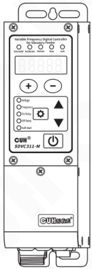

ตัวควบคุม×1

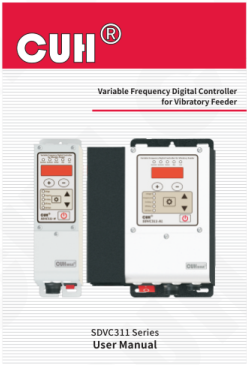

คู่มือการใช้งาน×1

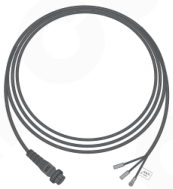

สายไฟขาออก×1

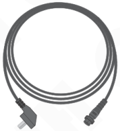

สายไฟขาเข้า×1

---

## 1.2 คำอธิบายไฟแสดงสถานะและปุ่ม

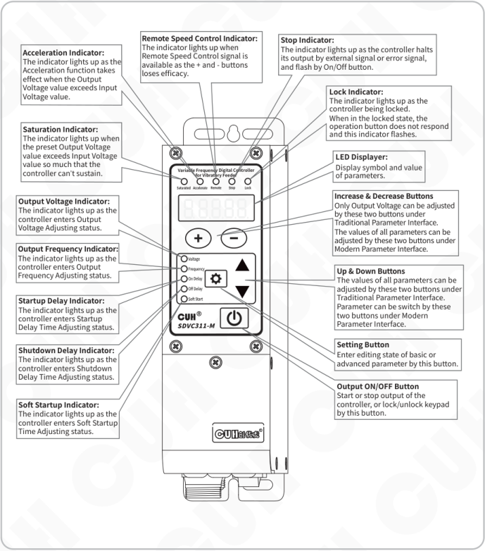

**ไฟแสดงการเร่งความเร็ว:**  
ไฟจะติดเมื่อฟังก์ชันการเร่งความเร็วมีผลเมื่อค่าแรงดันไฟฟ้าขาออกเกินค่าแรงดันไฟฟ้าขาเข้า

**ไฟแสดงการอิ่มตัว:**  
ไฟจะติดเมื่อค่าแรงดันไฟฟ้าขาออกที่ตั้งไว้เกินค่าแรงดันไฟฟ้าขาเข้ามากจนตัวควบคุมไม่สามารถรักษาไว้ได้

**ไฟแสดงแรงดันไฟฟ้าขาออก:**  
ไฟจะติดเมื่อตัวควบคุมเข้าสู่สถานะการปรับแรงดันไฟฟ้าขาออก

**ไฟแสดงความถี่ขาออก:**  
ไฟจะติดเมื่อตัวควบคุมเข้าสู่สถานะการปรับความถี่ขาออก

**ไฟแสดงการหน่วงการเริ่มต้น:**  
ไฟจะติดเมื่อตัวควบคุมเข้าสู่สถานะการปรับเวลาหน่วงการเริ่มต้น

**ไฟแสดงการหน่วงการปิด:**  
ไฟจะติดเมื่อตัวควบคุมเข้าสู่สถานะการปรับเวลาหน่วงการปิด

**ไฟแสดงการสตาร์ทแบบนุ่มนวล:**  
ไฟจะติดเมื่อตัวควบคุมเข้าสู่สถานะการปรับเวลาการสตาร์ทแบบนุ่มนวล

**ไฟแสดงการควบคุมความเร็วระยะไกล:**  
ไฟจะติดเมื่อสัญญาณการควบคุมความเร็วระยะไกลพร้อมใช้งาน เนื่องจากปุ่ม + และ - ไม่มีผล

**ไฟแสดงการหยุด:**  
ไฟจะติดเมื่อตัวควบคุมหยุดเอาต์พุตเนื่องจากสัญญาณภายนอกหรือสัญญาณข้อผิดพลาด และกะพริบเมื่อกดปุ่มเปิด/ปิด

**ไฟแสดงการล็อก:**  
ไฟจะติดเมื่อตัวควบคุมถูกล็อก  
เมื่ออยู่ในสถานะล็อก ปุ่มปฏิบัติการจะไม่ตอบสนองและไฟแสดงนี้จะกะพริบ

**จอแสดงผล LED:**  
แสดงสัญลักษณ์และค่าของพารามิเตอร์

**ปุ่มเพิ่มและลด**  
ภายใต้อินเทอร์เฟซพารามิเตอร์แบบดั้งเดิม สามารถปรับได้เฉพาะแรงดันไฟฟ้าขาออกด้วยสองปุ่มนี้  
ภายใต้อินเทอร์เฟซพารามิเตอร์แบบสมัยใหม่ สามารถปรับค่าของพารามิเตอร์ทั้งหมดได้ด้วยสองปุ่มนี้

**ปุ่มขึ้นและลง**  
ภายใต้อินเทอร์เฟซพารามิเตอร์แบบดั้งเดิม สามารถปรับค่าของพารามิเตอร์ทั้งหมดได้ด้วยสองปุ่มนี้  
ภายใต้อินเทอร์เฟซพารามิเตอร์แบบสมัยใหม่ สามารถสลับพารามิเตอร์ได้ด้วยสองปุ่มนี้

**ปุ่มตั้งค่า**  
ปุ่มนี้ใช้เข้าสู่สถานะแก้ไขของพารามิเตอร์พื้นฐานหรือพารามิเตอร์ขั้นสูง

**ปุ่มเปิด/ปิดเอาต์พุต**  
ปุ่มนี้ใช้เริ่มหรือหยุดเอาต์พุตของตัวควบคุม หรือล็อก/ปลดล็อกแป้นพิมพ์

---

## 1.3 คำอธิบายส่วนประกอบภายนอก

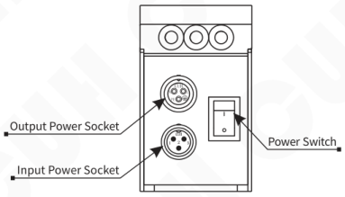

SDVC311-S (1.5A)  
SDVC311-M (3.0A)

- ซ็อกเก็ตพลังงานเอาต์พุต
- ซ็อกเก็ตพลังงานอินพุต
- สวิตช์ไฟ

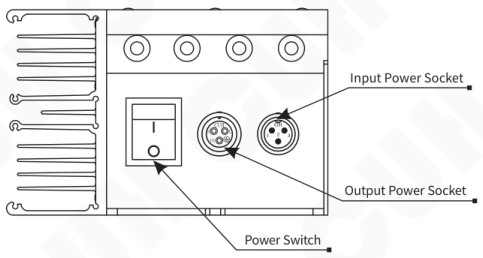

SDVC311-L (4.5A)  
SDVC311-XL (6.0A)

- ซ็อกเก็ตพลังงานอินพุต
- ซ็อกเก็ตพลังงานเอาต์พุต
- สวิตช์ไฟ

---

## 1.4 คำอธิบายพอร์ตการเดินสาย

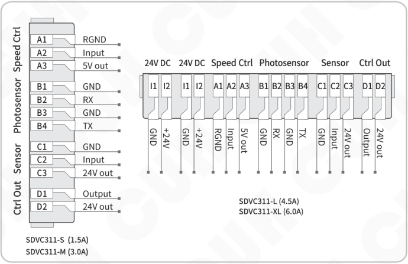

### SDVC311-S (1.5A) / SDVC311-M (3.0A)

| กลุ่มพอร์ต | เทอร์มินัล | คำอธิบาย |
|---|---|---|
| Speed Ctrl | A1 | RGND |
| Speed Ctrl | A2 | Input |
| Speed Ctrl | A3 | 5V out |
| Photosensor | B1 | GND |
| Photosensor | B2 | RX |
| Photosensor | B3 | GND |
| Photosensor | B4 | TX |
| Sensor | C1 | GND |
| Sensor | C2 | Input |
| Sensor | C3 | 24V out |
| Ctrl Out | D1 | Output |
| Ctrl Out | D2 | 24V out |

### SDVC311-L (4.5A) / SDVC311-XL (6.0A)

| กลุ่มพอร์ต | เทอร์มินัล | คำอธิบาย |
|---|---|---|
| 24V DC | I1 | GND |
| 24V DC | I2 | +24V |
| 24V DC | I1 | GND |
| 24V DC | I2 | +24V |
| Speed Ctrl | A1 | RGND |
| Speed Ctrl | A2 | Input |
| Speed Ctrl | A3 | 5V out |
| Photosensor | B1 | GND |
| Photosensor | B2 | RX |
| Photosensor | B3 | GND |
| Photosensor | B4 | TX |
| Sensor | C1 | GND |
| Sensor | C2 | Input |
| Sensor | C3 | 24V out |
| Ctrl Out | D1 | Output |
| Ctrl Out | D2 | 24V out |

## 1.5 คำอธิบายป้ายข้อมูลผลิตภัณฑ์

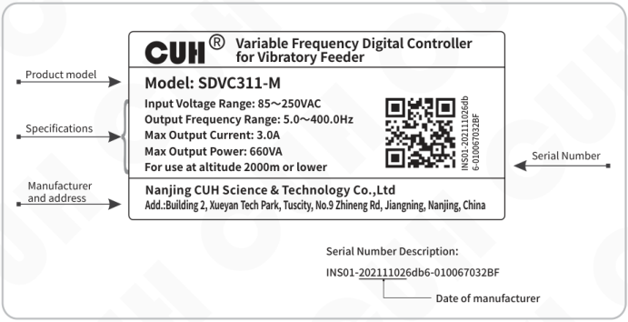

**CUH® — ตัวควบคุมดิจิทัลควบคุมความถี่สำหรับเครื่องป้อนวัสดุแบบสั่นสะเทือน**

**รุ่นผลิตภัณฑ์**

รุ่น: SDVC311-M

**ข้อกำหนด**

- ช่วงแรงดันไฟฟ้าขาเข้า: 85~250VAC
- ช่วงความถี่ขาออก: 5.0~400.0Hz
- กระแสขาออกสูงสุด: 3.0A
- กำลังขาออกสูงสุด: 660VA
- สำหรับการใช้งานที่ระดับความสูง 2000 ม. หรือต่ำกว่า

**ผู้ผลิตและที่อยู่**

Nanjing CUH Science & Technology Co.,Ltd

Add.:Building 2, Xueyan Tech Park, Tuscity, No.9 Zhineng Rd, Jiangning, Nanjing, China

**หมายเลขซีเรียล**

INS01-202111026db6-010067032BF

**คำอธิบายหมายเลขซีเรียล:**

INS01-<u>20211102</u>6db6-010067032BF

วันที่ผลิต: 20211102

---

## บทที่ Ⅱ คุณสมบัติ

บทนี้รวมถึงคำแนะนำโดยย่อและคุณสมบัติหลักของตัวควบคุม

### 2.1 แนะนำผลิตภัณฑ์

ตัวควบคุมการป้อนวัสดุแบบสั่นสะเทือนแบบปรับความถี่ดิจิทัลซีรีส์ SDVC311 เป็นตัวควบคุมเอาต์พุตแบบปรับความถี่ขนาดกะทัดรัดอเนกประสงค์ที่ให้ประสิทธิภาพโดดเด่นผ่านการใช้เทคโนโลยีอิเล็กทรอนิกส์ล่าสุดและการออกแบบอย่างพิถีพิถัน คุณสมบัติพิเศษประกอบด้วย:

- ช่วงความถี่ขาออกครอบคลุม 5.0Hz ถึง 400.0Hz ด้วยความแม่นยำ 0.1Hz
- ฟังก์ชันเบรกเพื่อหยุดเครื่องป้อนวัสดุแบบสั่นสะเทือนอย่างรวดเร็วโดยการเลื่อนเฟสกระแส 180° ระหว่างกระบวนการหยุดแบบนุ่มนวล
- พอร์ตโฟโตอิเล็กทริกอัจฉริยะรองรับโฟโตเซ็นเซอร์ เซ็นเซอร์สวิตช์ NPN หรือ PNP
- ฟังก์ชันสัญญาณพร้อม: ส่งออกสัญญาณมอดูเลตหรือสัญญาณที่ถูกต้องผ่านพอร์ตส่ง B4 ของระบบโฟโตอิเล็กทรอนิกส์อัจฉริยะ เพื่อบ่งชี้ว่าตัวควบคุมอยู่ในสถานะพร้อม เมื่อตัวควบคุมพบข้อผิดพลาด สัญญาณพร้อมจะไม่ถูกต้อง
- พอร์ตเซ็นเซอร์สวิตช์รองรับแบบ NPN, PNP หรือแบบปรับตัวอัตโนมัติ
- พอร์ตเอาต์พุตควบคุมรองรับโหมดเอาต์พุตแบบ NPN, PNP หรือพุช-พูล
- ฟังก์ชันป้องกันที่สมบูรณ์ประกอบด้วย: การป้องกันการลัดวงจรของเอาต์พุตหลัก การป้องกันกระแสเกิน การป้องกันความร้อนเกิน การป้องกันแรงดันต่ำ/แรงดันสูงเกิน การป้องกันการลัดวงจรของเอาต์พุตควบคุม การป้องกันการลัดวงจรของเอาต์พุต 24V และการป้องกันการลัดวงจรของเอาต์พุต 5V ของการปรับความเร็ว

### 2.2 การปรับปรุงประสิทธิภาพของผลิตภัณฑ์

เมื่อเทียบกับตัวควบคุมซีรีส์ SDVC31 ซีรีส์ SDVC311 มีประสิทธิภาพที่ดีขึ้นอย่างมาก โดยหลักประกอบด้วย:

- ช่วงความถี่ขาออกขยายจาก 40.0Hz~400.0Hz เป็น 5.0Hz~400.0Hz
- เวลาหน่วงเปิด/ปิดสูงสุดเพิ่มขึ้นจาก 20.0 s เป็น 99.9 s
- เพิ่มฟังก์ชันการปิดแบบนุ่มนวล ซึ่งสามารถตั้งค่าได้ที่ 0.0~10.0 s เพื่อหยุดการสั่นสะเทือนของเครื่องป้อนวัสดุแบบสั่นสะเทือนอย่างช้าๆ
- เพิ่มฟังก์ชันการเบรก ท่านสามารถตั้งค่าได้ 0~100 รอบการเบรก เพื่อหยุดการสั่นสะเทือนของจานสั่นอย่างรวดเร็ว
- พอร์ตเซ็นเซอร์โฟโตอิเล็กทริกอัจฉริยะเพิ่มการรองรับเซ็นเซอร์ PNP
- พอร์ตเซ็นเซอร์สวิตช์เมื่อวัสดุเต็มได้รับการอัปเกรดจาก NPN และ PNP เป็นแบบตั้งค่าได้ด้วยซอฟต์แวร์ และมีโหมดอัตโนมัติให้เลือก
- พอร์ตเอาต์พุตควบคุมได้รับการอัปเกรดจากเอาต์พุต NPN เป็นสามแบบที่ตั้งค่าได้: NPN, PNP และพุช-พูล
- เพิ่มการหน่วงเปิด/ปิดของพอร์ตเอาต์พุตควบคุม ซึ่งสามารถตั้งค่าได้ตั้งแต่ 0.0 ถึง 99.9 s
- เพิ่มโหมดเอาต์พุตควบคุม ท่านสามารถตั้งค่าโหมดหน่วงเวลาและโหมดคงไว้
- เพิ่มฟังก์ชันการวัด ซึ่งสามารถตรวจสอบอุณหภูมิ แรงดันบัส แรงดันไฟฟ้ากระเพื่อมของบัส กระแสขาออก แรงดันพอร์ตการควบคุมความเร็วระยะไกล แรงดันพอร์ตเซ็นเซอร์โฟโตอิเล็กทริกอัจฉริยะ แรงดันพอร์ตเซ็นเซอร์สวิตช์ แรงดันพอร์ตเอาต์พุตควบคุม DC และแรงดันไฟเลี้ยง +24V

---

## 2.3 อินเทอร์เฟซพารามิเตอร์แบบสมัยใหม่/แบบดั้งเดิม

ฟังก์ชันใหม่ทั้งหมดจะถูกดำเนินการในอินเทอร์เฟซพารามิเตอร์แบบสมัยใหม่ เพื่อให้เข้ากับนิสัยการใช้งานของลูกค้าประจำ ผู้ใช้สามารถสลับระหว่างอินเทอร์เฟซพารามิเตอร์แบบสมัยใหม่และอินเทอร์เฟซพารามิเตอร์แบบดั้งเดิมได้ผ่านการใช้งานแป้นพิมพ์

### การสลับจากอินเทอร์เฟซพารามิเตอร์แบบสมัยใหม่ไปเป็นแบบดั้งเดิม

ที่อินเทอร์เฟซ LED ของพารามิเตอร์คืนค่าการตั้งค่าเริ่มต้น กด ⊕ ค้างจนกระทั่ง  แสดงบน LED เพื่อสลับไปยังอินเทอร์เฟซพารามิเตอร์แบบดั้งเดิม หรือกด ⊖ ค้างจนกระทั่ง  แสดงบน LED เพื่อสลับไปยังอินเทอร์เฟซพารามิเตอร์แบบสมัยใหม่

### การสลับจากอินเทอร์เฟซพารามิเตอร์แบบดั้งเดิมไปเป็นแบบสมัยใหม่

ที่อินเทอร์เฟซ LED ของพารามิเตอร์คืนค่าการตั้งค่าเริ่มต้น กด ▼ ค้างจนกระทั่ง  แสดงบน LED เพื่อสลับไปยังอินเทอร์เฟซพารามิเตอร์แบบสมัยใหม่ หรือกด ▲ ค้างจนกระทั่ง  แสดงบน LED เพื่อสลับไปยังอินเทอร์เฟซพารามิเตอร์แบบดั้งเดิม

คู่มือการใช้งานฉบับนี้แนะนำการตั้งค่าพารามิเตอร์ของอินเทอร์เฟซแบบสมัยใหม่ สำหรับการตั้งค่าของอินเทอร์เฟซพารามิเตอร์แบบดั้งเดิม โปรดอ้างอิงคู่มือการใช้งานของตัวควบคุมซีรีส์ SDVC31

---

# บทที่ Ⅲ คู่มือการติดตั้ง

บทนี้แนะนำเงื่อนไขที่จำเป็นสำหรับการใช้งานตัวควบคุม และวิธีการติดตั้งและเชื่อมต่ออย่างถูกต้อง

## 3.1 เงื่อนไขการใช้งานตัวควบคุม

ตัวควบคุมใช้ไฟ AC 110/220V และการต่อสายดินป้องกันทำผ่านปลั๊กของสายไฟ โปรดจัดหาแหล่งจ่ายไฟหลัก 110V หรือ 220V, 50Hz/60Hz และอุปกรณ์จ่ายไฟฟ้าที่ได้มาตรฐาน และตรวจสอบให้แน่ใจว่าสายดินป้องกันเชื่อมต่ออย่างถูกต้อง

**⚠ คำเตือน** ห้ามเชื่อมต่อตัวควบคุมกับไฟ AC 380V เด็ดขาด เพราะจะทำให้ตัวควบคุมเสียหายร้ายแรงอย่างถาวร และอาจส่งผลให้เกิดการระเบิด ไฟไหม้ และอุบัติเหตุด้านความปลอดภัยอื่นๆ

**⚠ คำเตือน** ตรวจสอบให้แน่ใจว่าด้านแหล่งจ่ายไฟต่อสายดินอย่างเชื่อถือได้ เปลือกโลหะของตัวควบคุมเชื่อมต่อโดยตรงกับสายดินป้องกัน การต่อสายดินที่ไม่ดีจะทำให้เปลือกตัวควบคุมมีไฟฟ้าและเกิดอุบัติเหตุไฟฟ้าช็อต

**ข้อสังเกต** การทำงานเป็นเวลานานจะเกิดความร้อนและทำให้อุณหภูมิของเปลือกสูงขึ้น โปรดติดตั้งตัวควบคุมในสภาพแวดล้อมที่มีการระบายอากาศดีและยึดให้แน่น ห่างจากแหล่งสั่นสะเทือน

**ข้อสังเกต** เอาต์พุตของผลิตภัณฑ์นี้เกิดจากการแปลงกระแสสลับเป็นกระแสตรงและการแปลงกลับ และไม่มีการแยกกันระหว่างอินพุตและเอาต์พุต ดังนั้นขั้วเอาต์พุตจึงไม่สามารถเชื่อมต่อกับสายดินป้องกันได้ เมื่อเชื่อมต่อแม่เหล็กไฟฟ้า จำเป็นต้องตรวจสอบให้แน่ใจว่าขดลวดแม่เหล็กไฟฟ้าและเปลือกมีความสามารถในการเป็นฉนวนพื้นฐาน มิฉะนั้นอาจเกิดไฟฟ้ารั่ว ซึ่งอาจทำให้เกิดไฟฟ้าช็อตและความเสียหายต่อตัวควบคุม

**ข้อสังเกต** ผลิตภัณฑ์นี้เป็นตัวควบคุมที่ใช้ขับเคลื่อนแม่เหล็กไฟฟ้า ห้ามเชื่อมต่อกับเครื่องป้อนวัสดุแบบสั่นสะเทือนแบบเพียโซอิเล็กทริก

## 3.2 วิธีการใช้งานปุ่ม

a. การกดสั้นหมายถึงเวลากดมากกว่า 0.1 และน้อยกว่า 2 วินาที และการกดค้างหมายถึงเวลากดมากกว่า 2 วินาที

a. กดปุ่ม ⊕ หรือ ⊖ สั้นๆ เพื่อปรับแรงดันไฟฟ้าขาออกของตัวควบคุมในอินเทอร์เฟซสแตนด์บาย

b. เข้าหรือออกจากอินเทอร์เฟซพารามิเตอร์พื้นฐานโดยกดปุ่ม ⚙ ค้าง และสลับระหว่างพารามิเตอร์พื้นฐานโดยกดปุ่ม ▼ หรือ ▲ สั้นๆ และปรับค่าพารามิเตอร์โดยกดปุ่ม ⊕ หรือ ⊖ สั้นๆ

c. เข้าหรือออกจากอินเทอร์เฟซพารามิเตอร์ขั้นสูงโดยกดปุ่ม ⚙ และ ▲ ค้าง และสลับระหว่างพารามิเตอร์ขั้นสูงโดยกดปุ่ม ▼ หรือ ▲ สั้นๆ และปรับค่าพารามิเตอร์โดยกดปุ่ม ⊕ หรือ ⊖ สั้นๆ

d. เข้าหรือออกจากอินเทอร์เฟซพารามิเตอร์ตรวจสอบโดยกดปุ่ม ⚙ และ ▼ ค้าง และสลับระหว่างพารามิเตอร์ตรวจสอบโดยกดปุ่ม ▼ หรือ ▲ สั้นๆ แต่ไม่สามารถปรับค่าพารามิเตอร์ได้

e. กดปุ่ม ⏻ สั้นๆ เพื่อเริ่มหรือหยุดเอาต์พุตของตัวควบคุม และกดปุ่ม ⏻ ค้างเพื่อล็อกหรือปลดล็อกแป้นพิมพ์

---

## 3.3 การติดตั้งและใช้งาน

### ขั้นตอนที่หนึ่ง:

เปิดกล่องบรรจุภัณฑ์และตรวจสอบตัวควบคุมและอุปกรณ์เสริมทั้งหมด

### ขั้นตอนที่สอง:

เชื่อมต่อขั้วต่อสายไฟของสายไฟขาออกเข้ากับขดลวดแม่เหล็กไฟฟ้าของเครื่องสั่น

จัดแนวร่องบนปลั๊กการบินของสายไฟขาออกให้ตรงกับเครื่องหมายสามเหลี่ยมบนซ็อกเก็ตเอาต์พุตของตัวควบคุม แล้วขันน็อตให้แน่นหลังจากเชื่อมต่อสายไฟขาออกอย่างถูกต้อง

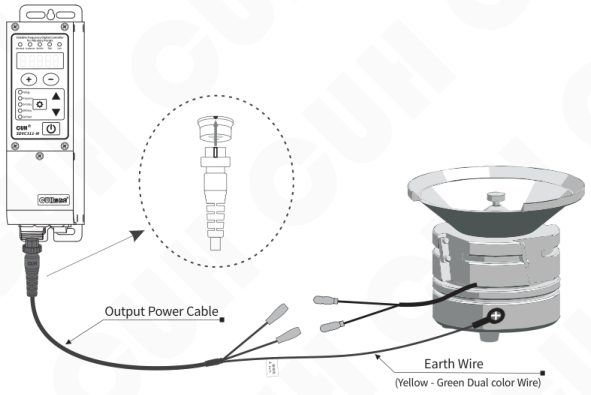

### ข้อสังเกต

1. ตรวจสอบให้แน่ใจว่าขดลวดแม่เหล็กไฟฟ้าของเครื่องสั่นเชื่อมต่อกับขั้วเอาต์พุตทั้งสองของสายไฟขาออก และเปลือกโลหะของเครื่องสั่นต่อสายดินอย่างเชื่อถือได้
2. ห้ามเชื่อมต่อโหลดเพียโซอิเล็กทริกกับเอาต์พุตกำลัง มิฉะนั้นอาจทำให้เกิดอุบัติเหตุไฟฟ้าช็อต!

---

### ขั้นตอนที่สาม:

เชื่อมต่อขั้วต่อของสายไฟขาเข้ากับซ็อกเก็ตพลังงานอินพุตของตัวควบคุม

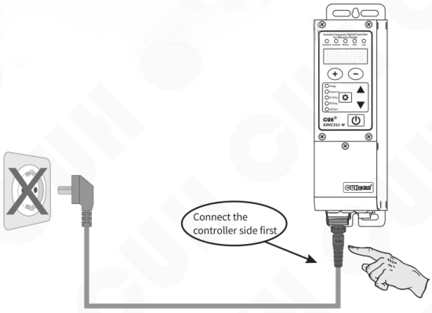

เชื่อมต่อด้านตัวควบคุมก่อน

### ขั้นตอนที่สี่:

เชื่อมต่อปลั๊กของสายไฟขาเข้ากับเต้ารับไฟหลัก

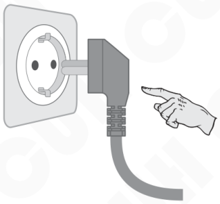

---

### ขั้นตอนที่ห้า:

เปิดสวิตช์ไฟของตัวควบคุม ควรแสดงแรงดันไฟฟ้า "U 150" และช่อง A ติดสว่าง และเครื่องป้อนวัสดุแบบสั่นสะเทือนควรเริ่มสั่นสะเทือน

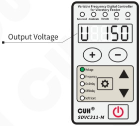

### ขั้นตอนที่หก:

กด ⊖ เพื่อปรับแรงดันไฟฟ้าเป็น 30~50V จากนั้นกด ⚙ ค้าง 2 วินาทีเพื่อเข้าสู่สถานะการปรับความถี่ขาออก "E" ใช้ ⊕ และ ⊖ ค้นหาความถี่ธรรมชาติของเครื่องป้อนวัสดุแบบสั่นสะเทือน ซึ่งก็คือความถี่เรโซแนนซ์

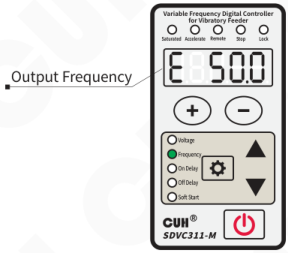

- ความถี่ฮาร์มอนิกของเครื่องสั่นหมายถึงค่าความถี่ที่สร้างแอมพลิจูดสูงสุด
- เครื่องสั่นแต่ละเครื่องมีความถี่เรโซแนนซ์ทางกลตามธรรมชาติของตัวเอง ปรับความถี่ขาออกของตัวควบคุมไปที่ความถี่นี้เพื่อให้ได้สภาวะการทำงานที่ดีที่สุด

---

## ขั้นตอนที่เจ็ด:

กด ⚙ ค้างเพื่อออกจากความถี่ขาออก "E" และกลับสู่พารามิเตอร์การปรับแรงดันไฟฟ้า หรือสามารถกด ▲ เพื่อสลับไปยังพารามิเตอร์การปรับแรงดันไฟฟ้า ใช้ ⊕ และ ⊖ ปรับแรงดันไฟฟ้าจนได้อัตราการป้อนที่ดีที่สุด

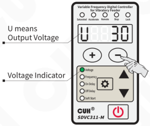

เครื่องป้อนวัสดุแบบสั่นสะเทือนควรทำงานแล้ว สำหรับคำแนะนำการควบคุมเพิ่มเติม โปรดดูบทต่อไปนี้

---

## บทที่ Ⅳ คำอธิบายฟังก์ชันพื้นฐาน

บทนี้อธิบายการตั้งค่าพารามิเตอร์พื้นฐานในอินเทอร์เฟซพารามิเตอร์แบบสมัยใหม่ (ค่าเริ่มต้น)

### 4.1 แรงดันไฟฟ้าขาออก

ค่าเฉลี่ยหลังการเรียงกระแสของแรงดันไฟฟ้าขาออกของตัวควบคุมสามารถตั้งค่าได้โดยตรงและแบบดิจิทัลผ่านแป้นพิมพ์ ด้วยฟังก์ชันรักษาเสถียรภาพแรงดันไฟฟ้าที่เป็นเอกลักษณ์ แรงดันไฟฟ้าขาออกของตัวควบคุมจะไม่ผันผวนตามแรงดันไฟฟ้าขาเข้า ทำให้เครื่องสั่นสามารถรักษาการทำงานที่เสถียรได้ในกรณีที่แรงดันไฟฟ้ากริดไม่เสถียร

- เปิดสวิตช์ไฟของตัวควบคุม
- ตัวควบคุมจะเข้าสู่พารามิเตอร์แรงดันไฟฟ้าขาออก ไฟแสดงแรงดันไฟฟ้าติดสว่าง และจอ LED แสดงพารามิเตอร์แรงดันไฟฟ้าขาออก U และค่าเริ่มต้น 150
- กด **⊕** หรือ **⊖** เพื่อปรับค่าพารามิเตอร์

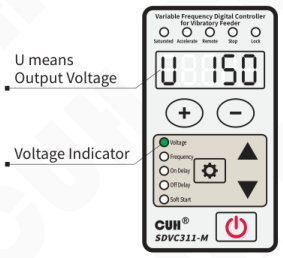

> - ตัวควบคุมไม่มีฟังก์ชันเพิ่มแรงดันไฟฟ้า เมื่อตัวควบคุมไม่สามารถไปถึงแรงดันไฟฟ้าที่ตั้งไว้ได้เนื่องจากข้อจำกัดของแรงดันไฟฟ้าจ่ายขาเข้า ไฟแสดงความอิ่มตัวจะติดสว่าง และการชดเชยแรงดันไฟฟ้าหลักจะล้มเหลวในขณะนั้น
> - ตัวควบคุมสามารถบรรลุผลการเร่งความเร็วในระดับหนึ่งโดยการลดทอนคุณลักษณะไซน์ของรูปคลื่นขาออก ซึ่งกำหนดโดยพารามิเตอร์ "ดัชนีการเร่งความเร็ว y" เมื่อเข้าสู่สถานะเร่งความเร็ว รูปคลื่นกระแสขาออกจะเปลี่ยนจากคลื่นไซน์เป็นคลื่นสามเหลี่ยม และไฟแสดงการเร่งความเร็วจะติดสว่าง

---

## 4.2 ความถี่ขาออก

ตัวควบคุมใช้เทคโนโลยีการสังเคราะห์ความถี่ดิจิทัลโดยตรง (DDS) ซึ่งมีความแม่นยำและเสถียรภาพของความถี่สูงมาก และไม่เปลี่ยนแปลงตามเวลาและอุณหภูมิ

- กด ⚙ ค้างไว้ 2 วินาทีเพื่อเข้าสู่อินเทอร์เฟซพารามิเตอร์พื้นฐาน
- จอ LED แสดงพารามิเตอร์ความถี่ขาออก "E" และค่าเริ่มต้น 50.0
- กด ⊕ หรือ ⊖ เพื่อปรับค่าพารามิเตอร์

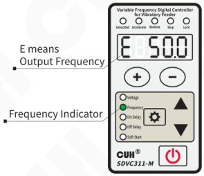

---

## 4.3 การหน่วงเปิด/ปิดของเซ็นเซอร์โฟโตอิเล็กทริกอัจฉริยะ

เมื่อใช้เซ็นเซอร์หรือ PLC ในการเปิดหรือปิดเอาต์พุตหลักของตัวควบคุม การทำงานสามารถหน่วงเวลาระยะหนึ่งได้หลังจากให้สัญญาณควบคุมหรือสัญญาณกลับคืนมา เวลาหน่วงสามารถตั้งค่าได้ผ่านพารามิเตอร์สองตัวด้านล่าง

### การหน่วงเปิด ( J )

ระยะเวลาที่ตัวควบคุมใช้ตั้งแต่รับสัญญาณควบคุมการเริ่มทำงานจนถึงการส่งออกจริง

- กด ⚙ ค้างไว้ 2 วินาทีเพื่อเข้าสู่อินเทอร์เฟซพารามิเตอร์พื้นฐาน
- กด ▲ หรือ ▼ เพื่อสลับไปยังพารามิเตอร์การหน่วงเปิด "J" และค่าเริ่มต้น 0.2
- กด ⊕ หรือ ⊖ เพื่อปรับค่าพารามิเตอร์

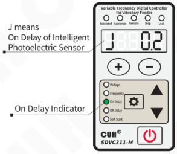

### การหน่วงปิด ( L )

ระยะเวลาที่ตัวควบคุมใช้ตั้งแต่รับสัญญาณควบคุมการปิดจนถึงการตัดเอาต์พุตจริง

- กด ⚙ ค้างไว้ 2 วินาทีเพื่อเข้าสู่อินเทอร์เฟซพารามิเตอร์พื้นฐาน
- กด ▲ หรือ ▼ เพื่อสลับไปยังพารามิเตอร์การหน่วงปิด "L" และค่าเริ่มต้น 0.2
- กด ⊕ หรือ ⊖ เพื่อปรับค่าพารามิเตอร์

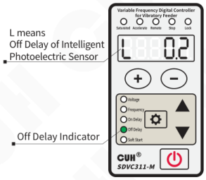

**หมายเหตุ:** ภายใต้การตั้งค่าเริ่มต้น การหน่วงเปิด/ปิดของโฟโตอิเล็กทริกอัจฉริยะจะควบคุมการหน่วงเปิด/ปิดของเอาต์พุตหลัก หากทิศทางลอจิกของเอาต์พุตหลักเป็นเฟสเดียวกันหรือแหล่งสัญญาณกลับด้าน ความหมายของการหน่วงเปิด/ปิดของโฟโตอิเล็กทริกอัจฉริยะจะสลับกัน การหน่วงเปิด/ปิดของพอร์ต C สอดคล้องกับการหน่วงเปิด/ปิดของโฟโตอิเล็กทริกอัจฉริยะ

---

## 4.4 เวลาการสตาร์ทแบบนุ่มนวล

เพื่อหลีกเลี่ยงการกระแทกอย่างฉับพลันต่อขดลวดเครื่องสั่น ตัวควบคุมสามารถค่อยๆ เพิ่มแรงดันไฟฟ้าขาออกจาก 0 ไปยังค่าที่ตั้งไว้ล่วงหน้าเมื่อเริ่มทำงาน

**เวลาการสตาร์ทแบบนุ่มนวล ( t ):** ระยะเวลาที่ตัวควบคุมใช้ในการเพิ่มแรงดันไฟฟ้าขาออกอย่างราบรื่นจาก 0 ไปยังค่าที่ตั้งไว้ล่วงหน้าเมื่อเริ่มทำงาน

- กด ⚙ ค้างไว้ 2 วินาทีเพื่อเข้าสู่อินเทอร์เฟซพารามิเตอร์พื้นฐาน
- กด ▲ หรือ ▼ เพื่อสลับไปยังพารามิเตอร์การสตาร์ทแบบนุ่มนวล "t" และค่าเริ่มต้น 0.5
- กด ⊕ หรือ ⊖ เพื่อปรับค่าพารามิเตอร์

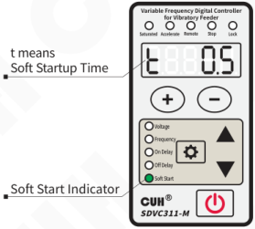

## 4.5 รอบการเบรก/เวลาการปิดแบบนุ่มนวล

เนื่องจากเครื่องป้อนวัสดุแบบสั่นสะเทือนจะสั่นอย่างอิสระระยะหนึ่งหลังจากตัวควบคุมหยุดส่งออก วัสดุจะยังคงเคลื่อนที่ต่อไปในช่วงเวลานี้ ซึ่งจะทำให้เกิดข้อผิดพลาดสำหรับการใช้งานบางประเภทที่ต้องการการชั่งตวงและการบรรจุวัสดุอย่างแม่นยำ จึงจำเป็นต้องหยุดการสั่นสะเทือนอย่างรวดเร็ว

**ฟังก์ชันการเบรก:** เพื่อหยุดการสั่นสะเทือนอย่างรวดเร็วโดยการหน่วงจุดเริ่มต้นของการหยุดแบบช้า 180° เพื่อให้ได้ผลตรงข้ามกับแรงขับเคลื่อนและเฟสการสั่นอิสระของเครื่องป้อนวัสดุแบบสั่นสะเทือน ทำได้โดยการตั้งค่าเวลาการปิดแบบนุ่มนวล (  ) เป็นค่าลบ หน่วยเป็นรอบ นั่นคือจำนวนรอบกระแสของการขับย้อนกลับเมื่อเบรก

เมื่อตัวควบคุมหยุดจากสถานะการทำงาน แรงดันไฟฟ้าขาออกสามารถลดลงอย่างนุ่มนวลจนถึง 0 เพื่อป้องกันไม่ให้อุปกรณ์สั่นสะเทือนได้รับการกระแทก

**เวลาการปิดแบบนุ่มนวล ( 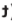 ):** เมื่อตัวควบคุมหยุดจากสถานะการทำงาน เวลาที่ต้องใช้สำหรับแรงดันไฟฟ้าขาออกในการลดลงอย่างราบรื่นจากค่าที่ตั้งไว้จนถึง 0

---

- กด ⚙ ค้างไว้ 2 วินาทีเพื่อเข้าสู่อินเทอร์เฟซพารามิเตอร์พื้นฐาน
- กด ▲ หรือ ▼ เพื่อสลับไปยังพารามิเตอร์รอบการเบรก/การปิดแบบนุ่มนวล "t"
- กด ⊕ เพื่อปรับค่าเวลาการปิดแบบนุ่มนวล
- กด ⊖ เพื่อปรับค่ารอบการเบรก

t หมายถึงรอบการเบรก/การปิดแบบนุ่มนวล

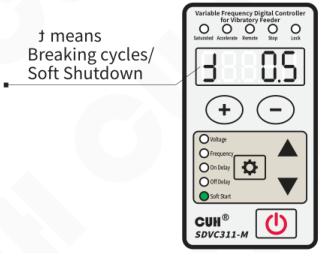

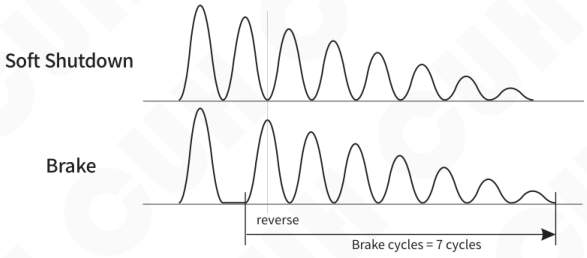

**แผนภาพจำนวนรอบการเบรก**

---

## 4.6 การล็อกแป้นพิมพ์

เมื่อตั้งค่าพารามิเตอร์ของตัวควบคุมแล้ว ฟังก์ชันการล็อกแป้นพิมพ์สามารถล็อกปุ่มทั้งหมดบนแผงควบคุมเพื่อหลีกเลี่ยงการใช้งานผิดพลาด

แม้ว่าจะปิดแล้วเปิดใหม่อีกครั้ง สถานะของการล็อกแป้นพิมพ์ก็ยังคงเป็นสถานะเดียวกับครั้งสุดท้ายที่ปิด

- กด ⏻ ค้างไว้ 2 วินาทีเพื่อล็อกปุ่มทั้งหมดบนแผงควบคุม ไฟแสดงการล็อกจะติดสว่าง
- กด ⏻ ค้างไว้อีกครั้ง 2 วินาทีเพื่อปลดล็อก

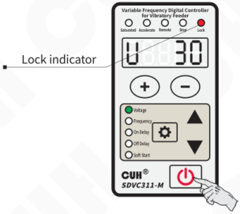

> สถานะการล็อกแป้นพิมพ์จะไม่หายไปเนื่องจากการปิดไฟ

---

# บทที่ Ⅴ คำอธิบายฟังก์ชันขั้นสูง

บทนี้อธิบายการตั้งค่าพารามิเตอร์ขั้นสูงในอินเทอร์เฟซพารามิเตอร์แบบสมัยใหม่ (ค่าเริ่มต้น)

## 5.1 การควบคุมความเร็วระยะไกล

ตัวควบคุมรองรับสัญญาณแอนะล็อกภายนอกเพื่อควบคุมแรงดันไฟฟ้าขาออก สัญญาณแอนะล็อกรองรับโพเทนชิออมิเตอร์ แรงดันไฟฟ้า 1~5V และกระแสไฟฟ้า 4~20mA

### การเชื่อมต่อการควบคุมด้วยโพเทนชิออมิเตอร์

**คำแนะนำ:**

โปรดใช้โพเทนชิออมิเตอร์แบบเชิงเส้น 1K

เมื่อสัญญาณควบคุมความเร็วระยะไกลมีผล ไฟแสดงการควบคุมความเร็วจะติดสว่าง ในขณะเดียวกันการปรับแรงดันไฟฟ้าบนแผงควบคุมจะไม่ทำงาน

---

## การเชื่อมต่อการควบคุมด้วยแรงดันไฟฟ้า 1~5V

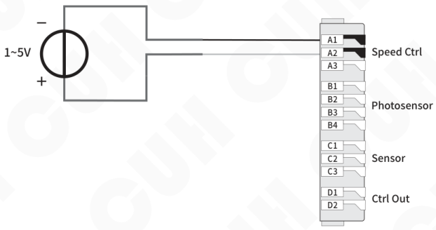

## การเชื่อมต่อการควบคุมด้วยกระแสไฟฟ้า 4~20mA

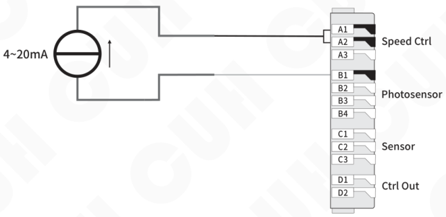

---

## 5.2 การสัมผัสโฟโตอิเล็กทริกอัจฉริยะ

พอร์ตโฟโตอิเล็กทริกอัจฉริยะของตัวควบคุมนี้รองรับเซ็นเซอร์แบบส่องผ่านหรือแบบสะท้อนที่ประกอบด้วยไดโอดเปล่งแสงและโฟโตทรานซิสเตอร์ และยังสามารถตั้งค่าให้รองรับเซ็นเซอร์สวิตช์ NPN หรือ PNP ได้ แผนผังการเดินสายเฉพาะมีดังนี้:

### วิธีการเชื่อมต่อเซ็นเซอร์โฟโตอิเล็กทริก

ระยะการทำงานของเซ็นเซอร์สามารถปรับได้โดยการตั้งค่าพารามิเตอร์ P ยิ่งค่าพารามิเตอร์น้อยเท่าไร ก็ยิ่งมีความไวมากขึ้นเท่านั้น

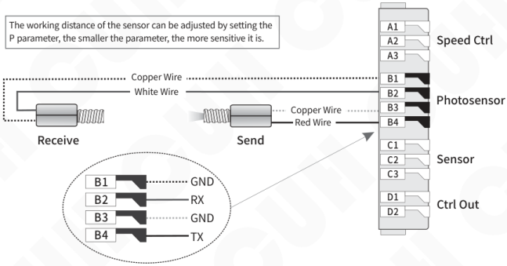

### วิธีการเชื่อมต่อเซ็นเซอร์สวิตช์

ตั้งค่าประเภท NPN หรือ PNP ด้วยพารามิเตอร์ P

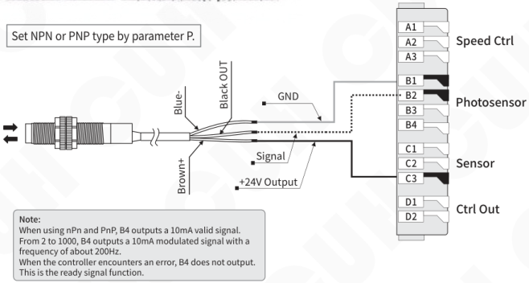

**หมายเหตุ:**

เมื่อใช้ nPn และ PnP, B4 จะส่งสัญญาณที่ถูกต้อง 10mA

ตั้งแต่ 2 ถึง 1000, B4 จะส่งสัญญาณมอดูเลต 10mA ที่มีความถี่ประมาณ 200Hz

เมื่อตัวควบคุมพบข้อผิดพลาด B4 จะไม่ส่งสัญญาณ นี่คือฟังก์ชันสัญญาณพร้อม

---

## 5.3 เซ็นเซอร์สวิตช์

พอร์ตเซ็นเซอร์สวิตช์สามารถรองรับโหมด NPN, PNP, Ut1, Ut0

**โหมด Ut1 คือการสแกนครั้งเดียว** นั่นคือ ก่อนที่สัญญาณเซ็นเซอร์จะไม่ถูกต้อง ระดับสูงและต่ำจะถูกสลับเพื่อตรวจจับว่าพอร์ตมีสัญญาณที่ถูกต้องหรือไม่ หลังจากพบสัญญาณที่ถูกต้องแล้ว ประเภทเซ็นเซอร์ของพอร์ตจะถูกกำหนดและจะไม่สแกนอีก

**โหมด Ut0 คือการสแกนต่อเนื่อง** ไม่ว่าประเภทเซ็นเซอร์จะเป็นแบบใด จะตรวจจับเสมอว่าพอร์ตเชื่อมต่อกับสัญญาณที่ถูกต้องหรือไม่โดยการสลับระดับสูงและต่ำ

### วิธีการเชื่อมต่อเซ็นเซอร์สวิตช์

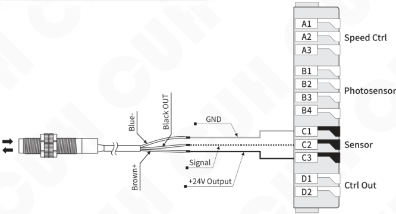

ตั้งค่าประเภท NPN หรือ PNP ด้วยพารามิเตอร์

- ตั้งค่าประเภทเซ็นเซอร์ผ่านพารามิเตอร์ขั้นสูง ΓA
- เมื่อใช้สัญญาณภายนอกอื่นๆ เช่นเซ็นเซอร์ ในการเริ่มและหยุดการทำงานผ่านพอร์ต C ของตัวควบคุม หากต้องการให้การทำงานหน่วงเวลาระยะหนึ่งหลังจากให้สัญญาณหรือสัญญาณกลับคืนมา สามารถตั้งค่าพารามิเตอร์ขั้นสูง "การหน่วงเปิดพอร์ต C ของเซ็นเซอร์" และ "การหน่วงปิดพอร์ต C ของเซ็นเซอร์" ได้ สำหรับวิธีการใช้งาน โปรดดูการตั้งค่าเวลาหน่วงเปิด/ปิดของเซ็นเซอร์โฟโตอิเล็กทริกอัจฉริยะ

---

## 5.4 เอาต์พุตควบคุม

พอร์ตเอาต์พุตควบคุมสามารถรองรับเอาต์พุต NPN, เอาต์พุต PNP และเอาต์พุตแบบพุชพูล โดยที่:

- เอาต์พุต NPN มีผลเมื่อเป็นระดับต่ำ และไม่ทำงานเมื่ออยู่ในสถานะอิมพีแดนซ์สูง
- เอาต์พุต PNP มีผลเมื่อเป็นระดับสูง และไม่ทำงานเมื่ออยู่ในสถานะอิมพีแดนซ์สูง
- เอาต์พุตแบบพุชพูลมีผลเมื่อเป็นระดับสูง และไม่ทำงานเมื่อเป็นระดับต่ำ

### 5.4.1 วิธีเดินสายของเอาต์พุตควบคุม

**การเชื่อมต่อเอาต์พุต NPN**

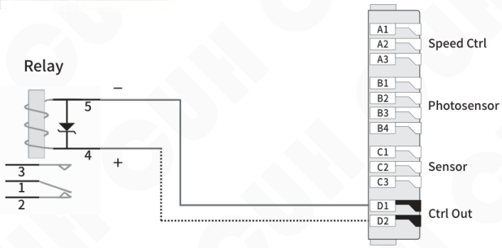

**การเชื่อมต่อเอาต์พุต PNP หรือแบบพุชพูล**

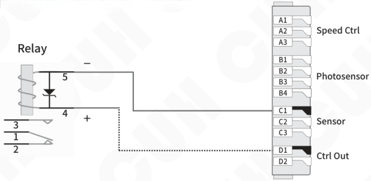

> หากเชื่อมต่อรีเลย์ 24V ต้องตรวจสอบให้แน่ใจว่าขั้วบวกและขั้วลบของขดลวดเชื่อมต่ออย่างถูกต้อง เนื่องจากความสามารถในการส่งกระแสของพอร์ตนี้คือ 400mA ไดโอดป้องกันภายในของรีเลย์จะลัดวงจรพอร์ตของตัวควบคุมนี้หลังการเชื่อมต่อกลับขั้ว ทำให้เกิดการป้องกันการลัดวงจร Err07

---

## 5.4.2 แหล่งสัญญาณและแผนผังลอจิกของเอาต์พุตควบคุม

การควบคุมของเอาต์พุตหลักและเอาต์พุตควบคุมถูกควบคุมโดยผลลัพธ์ของความสัมพันธ์ทางลอจิกระหว่างแหล่งสัญญาณสองแหล่ง

ตั้งค่าความสัมพันธ์ทางลอจิกของแหล่งสัญญาณทั้งสองโดยการตั้งค่าพารามิเตอร์ของพารามิเตอร์ขั้นสูง Πd และ Πq

เลือกสัญญาณต่อไปนี้โดยการตั้งค่าพารามิเตอร์ของพารามิเตอร์ขั้นสูง E.d, Ed, E.q, Eq

| แหล่งสัญญาณ | ความหมาย |
|---|---|
| 0 | สัญญาณไม่ถูกต้อง |
| 1 | สัญญาณถูกต้อง |
| b | สัญญาณพอร์ตตรวจจับโฟโตอิเล็กทริกอัจฉริยะ |
| -b | สัญญาณพอร์ตตรวจจับโฟโตอิเล็กทริกอัจฉริยะถูกกลับด้าน |
| C | สัญญาณพอร์ตเซ็นเซอร์สวิตช์ |
| -C | สัญญาณพอร์ตเซ็นเซอร์สวิตช์ถูกกลับด้าน |
| od | สัญญาณพอร์ตเอาต์พุตควบคุม |
| -od | สัญญาณพอร์ตเอาต์พุตควบคุมถูกกลับด้าน |
| oq | สัญญาณพอร์ตเอาต์พุตกำลังหลัก |
| -oq | สัญญาณพอร์ตเอาต์พุตกำลังหลักถูกกลับด้าน |

---

## แผนผังลอจิกของเอาต์พุตควบคุม

## 5.4.3 คำอธิบายโหมดเอาต์พุตควบคุม

ลูกค้าสามารถเลือกโหมดเอาต์พุตควบคุมได้ 4 โหมด: โหมดหน่วง โหมดคงค้าง โหมดส่งสัญญาณแบบคาบ Fn1/Fn2

**โหมดหน่วง:** หมายความว่าหลังจากสัญญาณขับเคลื่อนเอาต์พุตของตัวควบคุมเปลี่ยนจากถูกต้องเป็นไม่ถูกต้อง เอาต์พุตควบคุมจะปิดหลังจากเวลาหน่วงปิดระยะหนึ่ง

**โหมดคงค้าง:** หลังจากสัญญาณขับเคลื่อนเอาต์พุตของตัวควบคุมกลายเป็นถูกต้อง เอาต์พุตควบคุมจะคงสถานะเปิดไว้ตลอดเวลาหน่วงปิด และจะปิดหลังจากเกินเวลาหน่วงปิด

**โหมดส่งสัญญาณแบบคาบ Fn1/Fn2:** ระยะเวลาของสัญญาณระดับสูงถูกกำหนดโดยการหน่วงเปิดพอร์ต D ของเอาต์พุตควบคุม และระยะเวลาของสัญญาณระดับต่ำถูกกำหนดโดยการหน่วงปิดพอร์ต D ของเอาต์พุตควบคุม

ในโหมด Fn1 ปุ่มสวิตช์ไม่สามารถหยุดเอาต์พุตควบคุมได้ และในโหมด Fn2 ปุ่มสวิตช์สามารถหยุดเอาต์พุตควบคุมได้

ความแตกต่างระหว่างสี่โหมดแสดงในรูปแบบของแผนภาพเวลาดังต่อไปนี้ โดยสัญญาณขาเข้าคือสัญญาณที่ส่งออกหลังจากตัวเลือกความสัมพันธ์ทางลอจิก

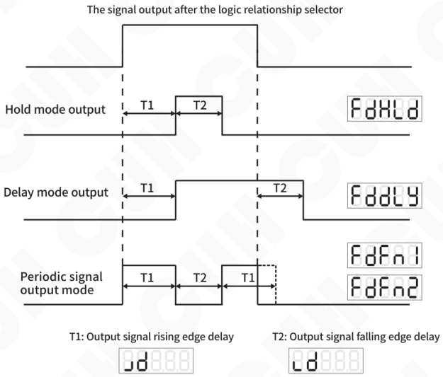

---

## 5.4.4 ทิศทางลอจิกของเอาต์พุตควบคุม

โดยการตั้งค่าพารามิเตอร์ขั้นสูง "ɔd" ลูกค้าสามารถเลือกทิศทางลอจิกของเอาต์พุตควบคุมได้ 4 ทิศทาง:

**เฟสเดียวกัน `___`:** หมายความว่าสถานะที่ถูกต้องของสัญญาณขาออกไม่เปลี่ยนแปลง

**กลับเฟส `_-_`:** หมายความว่าสถานะที่ถูกต้องของสัญญาณขาออกถูกกลับด้าน

**ทำงานตลอดเวลา:** หมายความว่าสัญญาณทำงานอยู่เสมอและไม่ถูกควบคุม

**ไม่ทำงานตลอดเวลา:** หมายความว่าสัญญาณไม่ถูกต้องอยู่เสมอและไม่ถูกควบคุม

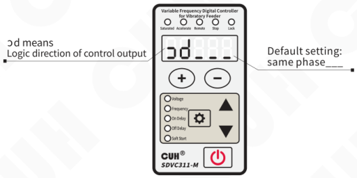

## 5.4.5 ฟังก์ชันควบคุมสัญญาณเอาต์พุตหลัก

การควบคุมสัญญาณเอาต์พุตหลักคล้ายกับการควบคุมเอาต์พุตควบคุม หลังจากเลือกแหล่งสัญญาณสองแหล่งสำหรับการดำเนินการความสัมพันธ์ทางลอจิก สัญญาณควบคุมจะได้มาจากการเลือกโหมดหน่วงเปิด/ปิดและการควบคุมทิศทางลอจิก สัญญาณควบคุมจะถูกนำไปดำเนินการทางลอจิกกับสัญญาณเปิด/ปิดของแผงควบคุม จากนั้นส่งไปยังบอร์ดจ่ายกำลังเพื่อควบคุมเอาต์พุตหลัก

วิธีการเดินสาย แหล่งสัญญาณ และแผนผังลอจิกของการควบคุมสัญญาณเอาต์พุตหลักสามารถอ้างอิงได้จากฟังก์ชันเอาต์พุตควบคุม

---

## 5.5 ขีดจำกัดแรงดันไฟฟ้าขาออกสูงสุด

ตัวควบคุมสามารถตั้งค่าพารามิเตอร์ขีดจำกัดแรงดันไฟฟ้าขาออกสูงสุด h ซึ่งสามารถป้องกันไม่ให้ผู้ใช้ใช้งานผิดพลาดจนส่งแรงดันไฟฟ้ามากเกินไปและทำให้อุปกรณ์สั่นสะเทือนเสียหาย

ทั้งแรงดันไฟฟ้าที่ตั้งบนแผงควบคุมและแรงดันไฟฟ้าจากการควบคุมระยะไกลจะไม่เกินค่านี้

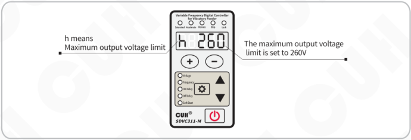

- ไม่ว่าในกรณีใด แรงดันไฟฟ้าขาออกของตัวควบคุมไม่สามารถและจะไม่เกินค่าที่ตั้งไว้ของพารามิเตอร์นี้
- การตั้งค่าเริ่มต้นจากโรงงานของพารามิเตอร์นี้คือแรงดันไฟฟ้าขาออกสูงสุดที่เป็นไปได้ของเครื่อง

## 5.6 ขีดจำกัดความถี่ต่ำสุด

ตัวควบคุมนี้สามารถตั้งค่าพารามิเตอร์ขั้นสูง "ขีดจำกัดความถี่ต่ำสุด e" เพื่อจำกัดความถี่ขาออกขั้นต่ำ ซึ่งสามารถป้องกันไม่ให้ผู้ใช้ตั้งความถี่ขาออกต่ำเกินไปโดยไม่ตั้งใจและทำให้แม่เหล็กไฟฟ้าเสียหาย

ความถี่ที่ตั้งบนแผงควบคุมจะไม่ต่ำกว่าค่านี้

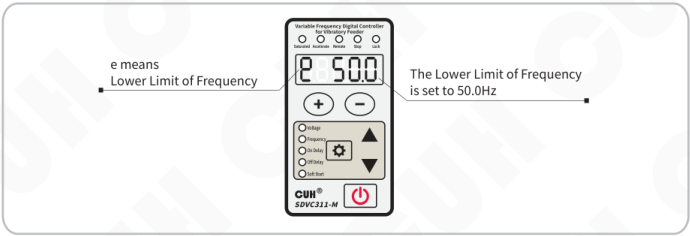

---

## 5.7 ดัชนีการเร่งความเร็ว

ตัวควบคุมสามารถบรรลุผลการเร่งความเร็วในระดับหนึ่งโดยการลดทอนคุณลักษณะไซน์ของรูปคลื่นขาออก เมื่อเข้าสู่สถานะเร่งความเร็ว รูปคลื่นกระแสขาออกจะเปลี่ยนจากคลื่นไซน์เป็นคลื่นสามเหลี่ยม และไฟแสดงการเร่งความเร็วจะติดสว่าง ฟังก์ชันการเร่งความเร็วสามารถควบคุมได้โดยการตั้งค่าพารามิเตอร์ของพารามิเตอร์ขั้นสูง "ดัชนีการเร่งความเร็ว y"

**ดัชนีการเร่งความเร็ว (y):** แสดงถึงเปอร์เซ็นต์ของแรงดันไฟฟ้าขาเข้าที่แรงดันไฟฟ้าขาออกสูงสุดสามารถไปถึงได้

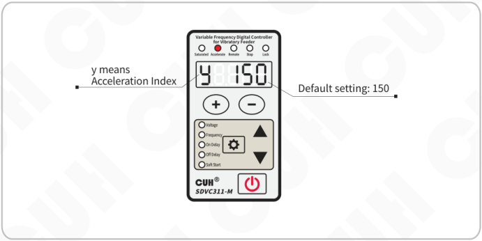

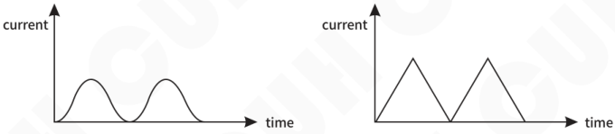

**แผนภาพดัชนีการเร่งความเร็วตั้งไว้ที่ 150**

---

## 5.8 ดัชนีรูปคลื่น

ตัวควบคุมสามารถปรับสมดุลประสิทธิภาพระหว่างประสิทธิภาพสูงสุด – กำลังสูงสุด – และเสียงรบกวนต่ำสุดได้อย่างต่อเนื่อง เพื่อตอบสนองความต้องการที่สูงขึ้นของลูกค้า ซึ่งสามารถทำได้โดยการตั้งค่าพารามิเตอร์ของพารามิเตอร์ขั้นสูง "ดัชนีรูปคลื่น r"

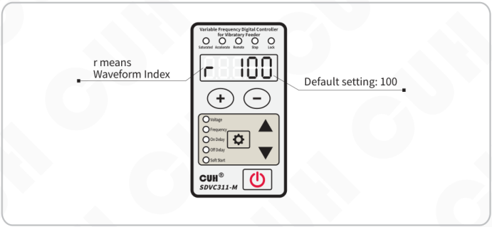

- ค่าดัชนีรูปคลื่น 0 ให้ประสิทธิภาพสูงสุดและความเค้นต่อสปริงน้อยที่สุด
- เมื่อค่าเป็น 100 จะได้กำลังขาออกพิกัดสูงสุดและเสียงรบกวนต่ำสุด แต่สปริงจะรับความเค้นมากขึ้น

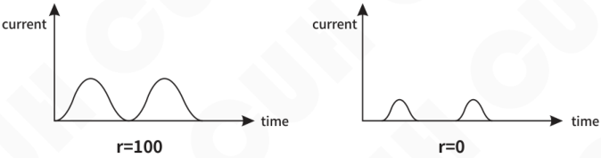

**แผนภาพดัชนีรูปคลื่น**

---

## 5.9 ฟังก์ชันล็อกพารามิเตอร์ด้วยรหัสผ่าน

ตัวควบคุมสามารถล็อกพารามิเตอร์สำคัญเพื่อป้องกันการใช้งานผิดพลาดของผู้ใช้ พารามิเตอร์ที่ทำเครื่องหมาย "*" ในตารางพารามิเตอร์สามารถล็อกได้ด้วยการล็อกพารามิเตอร์ด้วยรหัสผ่าน

- กด ⚙ และ ▲ ค้างไว้เพื่อเข้าสู่อินเทอร์เฟซพารามิเตอร์ขั้นสูง
- กด ▲ หรือ ▼ สั้นๆ เพื่อสลับไปยัง 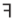 ซึ่งใช้สำหรับตั้งรหัสผ่าน
- กด ⊕ และ ⊖ เพื่อปรับค่าพารามิเตอร์
- หลังจากตั้งรหัสผ่านพารามิเตอร์แล้ว ออกจากอินเทอร์เฟซปัจจุบันแล้วเข้าใหม่ ท่านจะเห็นว่าค่าพารามิเตอร์หายไป
- เข้าสู่อินเทอร์เฟซพารามิเตอร์ขั้นสูง สลับไปยัง  ป้อนรหัสผ่านที่ป้อนไว้ก่อนหน้านี้ ท่านจะเห็นพารามิเตอร์รหัสผ่านที่ตั้งไว้ซึ่งหายไป จากนั้นจึงเปลี่ยนรหัสผ่านได้

ค่าพารามิเตอร์ล็อกรหัสผ่านเป็นไปตามกฎรหัส 421:

| พารามิเตอร์ล็อก | ดัชนีรูปคลื่น | ดัชนีการเร่งความเร็ว | ขีดจำกัดแรงดันไฟฟ้าขาออกสูงสุด | การดำเนินการทางลอจิกของแหล่งสัญญาณของเอาต์พุตหลัก | แหล่งสัญญาณที่สองของเอาต์พุตหลัก | แหล่งสัญญาณแรกของเอาต์พุตหลัก | การดำเนินการทางลอจิกของแหล่งสัญญาณของพอร์ตควบคุม D | แหล่งสัญญาณที่สองของพอร์ตควบคุม D | แหล่งสัญญาณแรกของพอร์ตควบคุม D | ประเภทเซ็นเซอร์พอร์ต C | รอบการเบรก/การปิดแบบนุ่มนวล | ความถี่ขาออก |
|---|---|---|---|---|---|---|---|---|---|---|---|---|
| 1: ล็อก | 1 | 1 | 1 | 1 | 1 | 1 | 1 | 1 | 1 | 1 | 1 | 1 |
| 0: ปลดล็อก | 0 | 0 | 0 | 0 | 0 | 0 | 0 | 0 | 0 | 0 | 0 | 0 |
| ตัวคูณ | 4 | 2 | 1 | 4 | 2 | 1 | 4 | 2 | 1 | 4 | 2 | 1 |
| ช่วงค่ารหัสผ่าน (การรวม) | 0~7 (หลักที่ 1 ของค่ารหัสผ่าน) | | | 0~7 (หลักที่ 2 ของค่ารหัสผ่าน) | | | 0~7 (หลักที่ 3 ของค่ารหัสผ่าน) | | | 0~7 (หลักที่ 4 ของค่ารหัสผ่าน) | | |
| ตัวอย่าง 1 | 0 | 0 | 0 | 0 | 0 | 0 | 0 | 0 | 0 | 0 | 0 | 1 |
| | 0 | | | 0 | | | 0 | | | 1\*1=1 | | |
| ตัวอย่าง 2 | 1 | 0 | 0 | 0 | 0 | 1 | 0 | 0 | 0 | 0 | 0 | 1 |
| | 1\*4=4 | | | 1\*1=1 | | | 0 | | | 1\*1=1 | | |
| ตัวอย่าง 3 | 0 | 0 | 0 | 0 | 0 | 0 | 0 | 0 | 0 | 1 | 1 | 1 |
| | 0 | | | 0 | | | 0 | | | 1\*4+1\*2+1\*1=7 | | |

**ตัวอย่าง 1:** เพื่อล็อกความถี่ขาออก รหัสไบนารี 12 กลุ่มคือ 000000000001 และค่ารหัสผ่านที่ตั้งไว้คือ 0001

**ตัวอย่าง 2:** ล็อกความถี่ขาออก ดัชนีรูปคลื่น และแหล่งสัญญาณแรกของเอาต์พุตหลัก รหัสไบนารี 12 กลุ่มคือ 100001000001 และค่ารหัสผ่านที่ตั้งไว้คือ 4101

**ตัวอย่าง 3:** ล็อกความถี่ขาออก จำนวนรอบการเบรก/เวลาการปิดแบบช้า และประเภทเซ็นเซอร์พอร์ต C รหัสไบนารี 12 กลุ่มคือ 000000000111 และค่ารหัสผ่านที่ตั้งไว้คือ 0007

เมื่อ "ช่วงพารามิเตอร์ล็อกรหัสผ่าน" ตั้งค่าเป็น 9999 พารามิเตอร์ทั้งหมดที่ทำเครื่องหมาย "*" จะถูกล็อก

---

## 5.10 คืนค่าการตั้งค่าเริ่มต้น/โหมดคืนค่าโรงงาน

ผู้ใช้สามารถคืนค่าตัวควบคุมกลับสู่สถานะเริ่มต้นจากโรงงานได้อย่างรวดเร็ว

เนื่องจากฟังก์ชันอันทรงพลังของตัวควบคุม พารามิเตอร์จำนวนมากสามารถปรับได้ สำหรับผู้เริ่มต้น อาจไม่สามารถคืนค่าสถานะการทำงานปกติของตัวควบคุมได้หลังจากตั้งค่าและแก้ไขหลายครั้ง ใช้ฟังก์ชันนี้เพื่อคืนค่าสถานะพารามิเตอร์ที่สับสนกลับสู่การตั้งค่าเริ่มต้นจากโรงงานอย่างรวดเร็ว

ในการคืนค่าการตั้งค่าเริ่มต้นจากโรงงาน จำเป็นต้องใช้พารามิเตอร์โหมดคืนค่าโรงงาน (Pin) ร่วมกัน โหมดคืนค่าโรงงานมีคำอธิบายดังนี้:

- **0:** คืนค่า **กลุ่มพารามิเตอร์การทำงาน** กลับเป็น **กลุ่มพารามิเตอร์ผู้ใช้**
- **5:** บันทึก **กลุ่มพารามิเตอร์การทำงาน** ลงใน **กลุ่มพารามิเตอร์ผู้ใช้**
- **35:** คืนค่า **กลุ่มพารามิเตอร์การทำงาน** กลับเป็น **ค่าโรงงานของ CUH**
- **55:** คืนค่า **กลุ่มพารามิเตอร์การทำงาน** และ **กลุ่มพารามิเตอร์ผู้ใช้** กลับเป็น **ค่าโรงงานของ CUH**

---

- กด ⚙ และ ▲ พร้อมกันค้างไว้เพื่อเข้าสู่อินเทอร์เฟซพารามิเตอร์ขั้นสูง
- กด ▼ สั้นๆ เพื่อสลับไปยังการกะพริบเต็มรูปแบบบนจอ LED นั่นคือพารามิเตอร์ "การคืนค่าการตั้งค่าเริ่มต้น" จากนั้นกด ⊖ ค้างไว้จนตัวควบคุมแสดง "-----" ซึ่งหมายความว่าตัวควบคุมได้รับการคืนค่าแล้ว
- ปล่อย ⊖ หลังจากตัวควบคุมแสดง "CUH" จะเข้าสู่สถานะการปรับแรงดันไฟฟ้าขาออก "U" ถึงตอนนี้พารามิเตอร์ทั้งหมดได้รับการคืนค่ากลับสู่การตั้งค่าเริ่มต้นจากโรงงานแล้ว

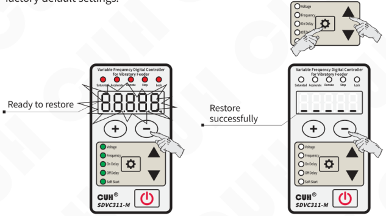

---

## 5.11 ฟังก์ชันตรวจสอบพารามิเตอร์

ตัวควบคุมได้รับการออกแบบชุดพารามิเตอร์ตรวจสอบโดยเฉพาะเพื่อตรวจสอบสถานะของตัวควบคุม

- กด ⚙ และ ▼ พร้อมกันค้างไว้เพื่อเข้าสู่อินเทอร์เฟซพารามิเตอร์ตรวจสอบ
- กด ▲ หรือ ▼ สั้นๆ เพื่อเลือกพารามิเตอร์ที่ต้องการตรวจสอบ
- ค่าพารามิเตอร์ของพารามิเตอร์ตรวจสอบไม่สามารถแก้ไขได้

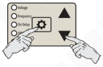

ตัวอย่าง: C หมายถึงพารามิเตอร์แสดงอุณหภูมิ

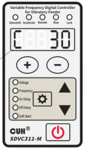

**พารามิเตอร์ตรวจสอบของตัวควบคุมนี้ประกอบด้วย:**

การแสดงอุณหภูมิ C, แรงดันบัส PU, แรงดันระลอกคลื่นบัส rU, กระแสขาออก AC, แรงดันพอร์ต A ของการปรับความเร็วแบบแอนะล็อก AU, แรงดันสัญญาณพอร์ต B bU, แรงดันสัญญาณพอร์ต C cU, แรงดันขาออกพอร์ต D dU, แรงดันขาออก 24V nU

---

## บทที่ Ⅵ ข้อกำหนดทางเทคนิค

### 6.1 มิติ

(หน่วย: mm)

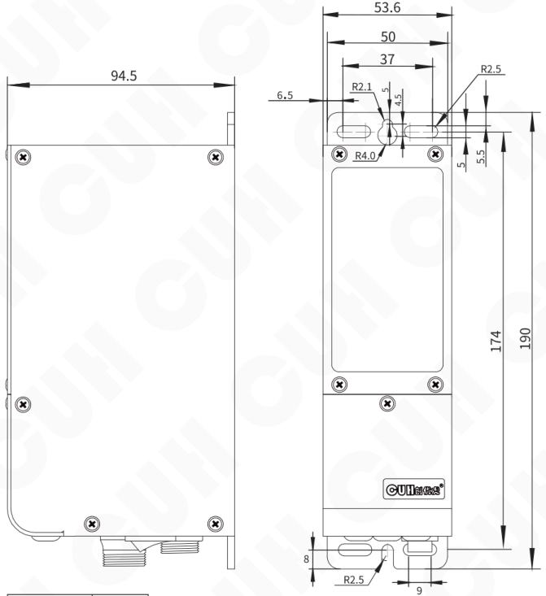

SDVC311-S (1.5A)  
SDVC311-M (3.0A)

| ช่วงมิติ | ค่าเผื่อความคลาดเคลื่อน |
|---|---|
| 0~3 | ±0.05 |
| 3~10 | ±0.1 |
| 10~30 | ±0.15 |
| 30~80 | ±0.2 |
| 80~180 | ±0.3 |
| >180 | ±0.5 |

ตารางค่าเผื่อความคลาดเคลื่อนนี้ใช้ได้กับผลิตภัณฑ์ทั้งหมดในซีรีส์นี้

---

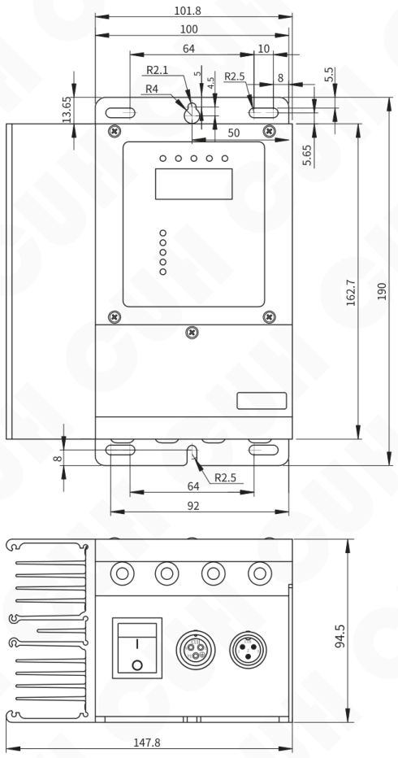

SDVC311-L (4.5A)  
SDVC311-XL (6.0A)

---

## 6.2 ข้อกำหนดทางเทคนิค

| รายการ | ต่ำสุด | ทั่วไป | สูงสุด | หน่วย | หมายเหตุ |
|---|---|---|---|---|---|
| แรงดันไฟฟ้าขาเข้า | 85 | 220 | 250 | V | AC RMS |
| ช่วงแรงดันไฟฟ้าขาออกที่ปรับได้ | 0 | —— | 260 | V | ต่ำกว่า 150% ของแรงดันไฟฟ้าขาเข้า |
| ความแม่นยำในการปรับแรงดันไฟฟ้า | | 1 | | V | |
| ความแม่นยำในการรักษาเสถียรภาพแรงดันไฟฟ้า | 0 | —— | 10 | % | ΔVout/ΔVin |
| ช่วงกระแสขาออกที่ปรับได้ | 0 | —— | 1.5 | A | SDVC311-S |
| ช่วงกระแสขาออกที่ปรับได้ | 0 | —— | 3.0 | A | SDVC311-M |
| ช่วงกระแสขาออกที่ปรับได้ | 0 | —— | 4.5 | A | SDVC311-L |
| ช่วงกระแสขาออกที่ปรับได้ | 0 | —— | 6.0 | A | SDVC311-XL |
| กำลังขาออก | 0 | —— | 330 | VA | SDVC311-S |
| กำลังขาออก | 0 | —— | 660 | VA | SDVC311-M |
| กำลังขาออก | 0 | —— | 990 | VA | SDVC311-L |
| กำลังขาออก | 0 | —— | 1320 | VA | SDVC311-XL |
| ความถี่ขาออก | 5.0 | —— | 400.0 | Hz | |
| ความแม่นยำในการปรับความถี่ | | 0.1 | | Hz | |
| รูปคลื่นขาออก | | ไซน์ | | | |
| เวลาสตาร์ทแบบนุ่มนวล | 0 | —— | 10.0 | s | ค่าเริ่มต้น: 0.5 |
| ช่วงเวลาหน่วงเปิด/ปิด | 0 | —— | 99.9 | s | ค่าเริ่มต้น: 0.2 |
| ความแม่นยำของเวลาหน่วงเปิด/ปิด | | 0.1 | | s | |
| อุณหภูมิทริกเกอร์การป้องกันความร้อนเกิน | 58 | 60 | 66 | °C | |
| กระแสเอาต์พุตควบคุม DC | 0 | —— | 400 | mA | |
| แรงดันเอาต์พุตควบคุม DC | 22 | 24 | 26 | V | |
| สัญญาณควบคุมแบบแอนะล็อก | | 1~5/4~20 | | V/mA | สัญญาณควบคุมความเร็วระยะไกล |
| สัญญาณควบคุมแบบดิจิทัล | | 24 | | V | สัญญาณสวิตช์ |
| วิธีการปรับ | | 6 | | ปุ่ม | |
| การใช้พลังงานในโหมดสแตนด์บาย | —— | 3 | —— | W | |
| วิธีการแสดงผล | | 5 | | หลัก | LED |
| อุณหภูมิแวดล้อม | 0 | 25 | 40 | °C | ไม่มีการควบแน่น |
| ความชื้นแวดล้อม | 10 | 60 | 85 | % | ไม่มีการควบแน่น |
| อุณหภูมิแวดล้อมในการจัดเก็บ | -20 | 25 | 65 | °C | ไม่มีการควบแน่น |

## 6.3 มาตรฐานอ้างอิง

**พารามิเตอร์สมบูรณ์:**  
การเกินมาตรฐานจะทำให้ตัวควบคุมเสียหาย ต้องปฏิบัติตามอย่างเคร่งครัด

| รายการ | มาตรฐาน GB | มาตรฐาน IEC | ระดับ | ข้อกำหนดมาตรฐาน | หมายเหตุ |
|---|---|---|---|---|---|
| การคายประจุไฟฟ้าสถิต | GB/T 17626.2-2006 | IEC 61000-4-2:2001 | 4 | ±8 kV | การคายประจุแบบสัมผัส |
| | | | 4 | ±15 kV | การคายประจุในอากาศ |
| การทดสอบทรานเซียนต์เร็วทางไฟฟ้า | GB/T 17626.4-2008 | IEC 61000-4-4:2004 | 4 | ±4 kV | |
| ความต้านทานระลอกคลื่นบนสายจ่ายไฟ DC | GB/T 17626.17-2005 | IEC 61000-4-17:2002 | 4 | 15% | ระดับ A |

> **คำเตือน**  
> ในสภาพแวดล้อมที่พักอาศัย ผลิตภัณฑ์นี้อาจก่อให้เกิดการรบกวนทางวิทยุ ซึ่งในกรณีนั้นอาจจำเป็นต้องมีมาตรการบรรเทาเพิ่มเติม

---

# บทที่ Ⅶ ภาคผนวก

## 7.1 ตารางพารามิเตอร์

| หมวดหมู่ | คำจำกัดความ | สัญลักษณ์ | ภาพสัญลักษณ์ | ช่วง | ค่าเริ่มต้น |
|---|---|---|---|---|---|
| พารามิเตอร์ทั่วไป | แรงดันไฟฟ้าขาออก | U |  | 0~260 V | 150 |
| พารามิเตอร์พื้นฐาน | ความถี่ขาออก * | E |  | 5.0~400.0 Hz | 50.0 |
| | การหน่วงเปิดของเซ็นเซอร์โฟโตอิเล็กทริกอัจฉริยะ | J |  | 0.0~99.9 s | 0.2 |
| | การหน่วงปิดของเซ็นเซอร์โฟโตอิเล็กทริกอัจฉริยะ | L |  | 0.0~99.9 s | 0.2 |
| | การสตาร์ทแบบนุ่มนวล | t |  | 0.0~10.0 s | 0.5 |
| | รอบการเบรก/การปิดแบบนุ่มนวล * | d |  | -100~0 รอบ (จำนวนรอบการเบรก) 0.0~10.0 s (การปิดแบบนุ่มนวล) | 0.0 |
| | แรงดันไฟฟ้าขาออก | U |  | 0~260 V | 150 |
| พารามิเตอร์ขั้นสูง | ความไวของเซ็นเซอร์โฟโตอิเล็กทริกอัจฉริยะ | P |  | PnP, nPn, 2~1000 | 80 |
| | ประเภทเซ็นเซอร์พอร์ต C * | ΓA |  | nPn, PnP ut1 (การสแกนครั้งเดียว), ut0 (การสแกนต่อเนื่อง) | ut0 |
| | การหน่วงเปิดของพอร์ต C | J- |  | 0.0~99.9 s | 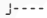 เหมือนกับ J |
| | การหน่วงปิดของพอร์ต C | L- |  | 0.0~99.9 s |  เหมือนกับ L |
| | แหล่งสัญญาณแรกของเอาต์พุตหลัก * | Cq | 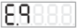 | 0, 1, b, -b, C, -C, od, -od, oq, -oq | b |
| | แหล่งสัญญาณที่สองของเอาต์พุตหลัก * | Eq |  | 0, 1, b, -b, C, -C, od, -od, oq, -oq | C |
| | การดำเนินการทางลอจิกของแหล่งสัญญาณของเอาต์พุตหลัก * | nq | 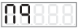 | And, or, Xor, rS | or |
| | การหน่วงเปิดของเอาต์พุตหลัก | Jq |  | 0.0~99.9 s | 0.0 |
| | การหน่วงปิดของเอาต์พุตหลัก | Lq | 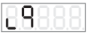 | 0.0~99.9 s | 0.0 |
| | โหมดเอาต์พุตของเอาต์พุตหลัก | Fq |  | dLy (โหมดหน่วง), HLd (โหมดคงค้าง) | dLy |
| | ทิศทางลอจิกของเอาต์พุตหลัก | oq |  |  on (ทำงานตลอดเวลา), oFF (ไม่ทำงานตลอดเวลา) |  |
| | แหล่งสัญญาณแรกของพอร์ตควบคุม D * | Cd |  | 0, 1, b, -b, C, -C, od (สถานะเอาต์พุตของพอร์ต D), -od, oq (สถานะเอาต์พุตของเอาต์พุตหลัก), -oq | 0 |
| | แหล่งสัญญาณที่สองของพอร์ตควบคุม D * | Ed |  | 0, 1, b, -b, C, -C, od (สถานะเอาต์พุตของพอร์ต D), -od, oq (สถานะเอาต์พุตของเอาต์พุตหลัก), -oq | oq |
| | การดำเนินการทางลอจิกของแหล่งสัญญาณของพอร์ตควบคุม D * | nd |  | And, or, Xor, rS | or |
| | การหน่วงเปิดของพอร์ต D | Jd |  | 0.0~99.9 s | 0.0 |

| | คำจำกัดความ | สัญลักษณ์ | ภาพสัญลักษณ์ | ช่วง | ค่าเริ่มต้น |
|---|---|---|---|---|---|
| พารามิเตอร์ขั้นสูง | การหน่วงปิดของพอร์ต D | Ld |  | 0.0~99.9 s | 0.0 |
| พารามิเตอร์ขั้นสูง | โหมดเอาต์พุตของพอร์ต D | Fd |  | dLy (โหมดหน่วง), HLd (โหมดคงค้าง) Fn1 โหมดส่งสัญญาณแบบคาบ 1 Fn2 โหมดส่งสัญญาณแบบคาบ 2 | dLy |
| พารามิเตอร์ขั้นสูง | ทิศทางลอจิกของพอร์ต D | Sd |  | --- (เฟสเดียวกัน), -⁻- (กลับเฟส) on (ทำงานตลอดเวลา), oFF (ไม่ทำงานตลอดเวลา) | --- |
| พารามิเตอร์ขั้นสูง | ประเภทเอาต์พุตควบคุม | Cd |  | nPn, PnP, PSP (พุช-พูล) | nPn |
| พารามิเตอร์ขั้นสูง | ขีดจำกัดแรงดันไฟฟ้าขาออกสูงสุด \* | h |  | 0~260 V | 260 |
| พารามิเตอร์ขั้นสูง | ขีดจำกัดความถี่ต่ำสุด | E |  | 5.0~400.0 Hz | 40.0 |
| พารามิเตอร์ขั้นสูง | ดัชนีการเร่งความเร็ว \* | g |  | 100~150 | 150 |
| พารามิเตอร์ขั้นสูง | ดัชนีรูปคลื่น \* | r |  | 0~100 | 100 |
| พารามิเตอร์ขั้นสูง | ช่วงพารามิเตอร์ของฟังก์ชันปิดการปรับพารามิเตอร์ | สัญลักษณ์แสดงผลเจ็ดส่วนแบบพิเศษที่มีจุดทศนิยม (ดูรูป) |  | 0~9999 | 0 |
| พารามิเตอร์ขั้นสูง | การล็อกของฟังก์ชันปิดการปรับพารามิเตอร์ | สัญลักษณ์แสดงผลเจ็ดส่วนแบบพิเศษ (ดูรูป) |  | 0~9999 | 0 |
| พารามิเตอร์ขั้นสูง | การคืนค่าการตั้งค่าเริ่มต้น | 88888 |  | ใช้ร่วมกับพารามิเตอร์ Pin | —— |
| พารามิเตอร์ขั้นสูง | โหมดคืนค่าโรงงาน | Pin |  | 0 : คืนค่ากลุ่มพารามิเตอร์การทำงานกลับเป็นกลุ่มพารามิเตอร์ผู้ใช้ 5 : บันทึกกลุ่มพารามิเตอร์การทำงานลงในกลุ่มพารามิเตอร์ผู้ใช้ 35: คืนค่ากลุ่มพารามิเตอร์การทำงานกลับเป็นค่าโรงงานของ CUH 55: คืนค่ากลุ่มพารามิเตอร์การทำงานและกลุ่มพารามิเตอร์ผู้ใช้กลับเป็นค่าโรงงานของ CUH | 0 |
| พารามิเตอร์ตรวจสอบ | อุณหภูมิ | C |  | -20~85 °C | —— |
| พารามิเตอร์ตรวจสอบ | แรงดันบัสภายใน | PU |  | 0~400 V | —— |
| พารามิเตอร์ตรวจสอบ | แรงดันระลอกคลื่นของบัส | rU |  | 0~200 V | —— |
| พารามิเตอร์ตรวจสอบ | กระแสขาออก | AC |  | 0.00~1.60 A -SDVC31S/SDVC311S 0.00~3.20 A -SDVC31M/SDVC311M | —— |
| พารามิเตอร์ตรวจสอบ | แรงดันสัญญาณของพอร์ต A | AU |  | 0.00~5.00 V | —— |
| พารามิเตอร์ตรวจสอบ | แรงดันสัญญาณของพอร์ต B | bU |  | 0~999 | —— |
| พารามิเตอร์ตรวจสอบ | แรงดันสัญญาณของพอร์ต C | cU |  | 0.0~28.0 V | —— |
| พารามิเตอร์ตรวจสอบ | แรงดันสัญญาณของพอร์ต D | dU |  | 0.0~28.0 V | —— |
| พารามิเตอร์ตรวจสอบ | แรงดันไฟฟ้าแบบเรียลไทม์ของพอร์ต 24V | nU |  | 0.0~28.0 V | —— |
| พารามิเตอร์ตรวจสอบ | เวอร์ชันซอฟต์แวร์ของบอร์ดควบคุม | uc |  | —— | —— |
| พารามิเตอร์ตรวจสอบ | เวอร์ชันซอฟต์แวร์ของบอร์ดจ่ายกำลัง | uP |  | —— | —— |

หมายเหตุ: พารามิเตอร์ที่มีเครื่องหมาย \* สามารถล็อกได้ด้วย   
พารามิเตอร์ทั้งหมดของตัวควบคุมที่มีเครื่องหมาย \* จะถูกล็อก เมื่อ  เป็น 9999

## 7.2 แผนผังวงจรขาเข้าและขาออก

พอร์ต A สำหรับการควบคุมความเร็วระยะไกล

พอร์ต B ของเซ็นเซอร์โฟโตอิเล็กทริกอัจฉริยะ

พอร์ต C ของเซ็นเซอร์สวิตช์

พอร์ต D ของเอาต์พุตควบคุม

---

## 7.3 คำแนะนำในการแก้ไขปัญหาและคำอธิบายข้อผิดพลาด

| รหัสข้อผิดพลาด | คำจำกัดความ | วิธีการแก้ไขปัญหา | ภาพสัญลักษณ์ |
|---|---|---|---|
| ไม่มีจอแสดงผลหลังเปิดเครื่อง | | ตรวจสอบว่าปลั๊กไฟมีไฟฟ้า ตรวจสอบว่าสายไฟขาเข้าเชื่อมต่อกับปลั๊กไฟอย่างแน่นหนาหรือไม่ | |
| จอแสดงผลปกติ แต่ไม่มีเอาต์พุต | | ตรวจสอบว่าสายไฟขาออกเชื่อมต่อกับเครื่องสั่นอย่างแน่นหนา ตรวจสอบว่าแรงดันไฟฟ้าขาออกไม่น้อยเกินไป ตรวจสอบว่าไฟแสดงการหยุดไม่ติดสว่าง โปรดตรวจสอบว่ามีการตั้งค่า Normal Close ของพารามิเตอร์หรือไม่ ซึ่งทำให้เอาต์พุตของตัวควบคุมหยุดลง | |
| สัญญาณควบคุมไม่ทำงาน | | ตรวจสอบว่าอินพุตสัญญาณควบคุมถูกต้อง ตรวจสอบว่าสายดินของสัญญาณควบคุมเชื่อมต่อกับตัวควบคุมอย่างถูกต้อง ตรวจสอบว่าความสัมพันธ์ทางลอจิกของสัญญาณควบคุมตั้งค่าไว้ตรงตามที่คาดหวังอย่างถูกต้อง | |
| ปรากฏการณ์บีต | | หลีกเลี่ยงการเชื่อมต่อการสั่นสะเทือนระหว่างเครื่องสั่น เพิ่มความถี่เรโซแนนซ์ของเครื่องสั่น | |
| จอแสดงผลปกติ ไม่มีเอาต์พุต แต่ได้ยินเสียง | | ปรับพารามิเตอร์ทั้งหมดตามคำแนะนำในคู่มือนี้ | |
| Err01 | ไฟฟ้าลัดวงจร | ตรวจสอบว่าโหลดไม่ได้ลัดวงจร จากนั้นลองรีสตาร์ทเอาต์พุตของตัวควบคุมโดยกดปุ่มเปิด/ปิดสองครั้งหรือเปิดเครื่องใหม่ |  |
| Err02 | กระแสเกิน | ลดแรงดันไฟฟ้าขาออกลงอย่างเหมาะสม จากนั้นรีสตาร์ทเอาต์พุต |  |
| Err03 | ความร้อนเกิน | ติดตั้งตัวควบคุมในสภาพแวดล้อมที่มีการระบายอากาศดี |  |
| Err04 | แรงดันไฟฟ้าเกินหรือต่ำเกิน | ตรวจสอบว่าแรงดันไฟฟ้าขาเข้าอยู่ระหว่าง AC 85~250Vac |  |
| Err05 | การสื่อสารภายในผิดปกติ | ตรวจสอบว่าไม่มีแหล่งจ่ายไฟภายนอกเชื่อมต่อกับพอร์ตจ่ายไฟ 24V หรือติดต่อฝ่ายสนับสนุนทางเทคนิคของเรา |  |
| Err06 | เซ็นเซอร์อุณหภูมิผิดปกติ | ตรวจสอบว่าอุณหภูมิการทำงานไม่ต่ำกว่า -20℃ หรือติดต่อฝ่ายสนับสนุนทางเทคนิคของเรา |  |
| Err07 | การป้องกันไฟฟ้าลัดวงจรของพอร์ต D | ตรวจสอบว่าโหลดของพอร์ต D ไม่ได้ลัดวงจรและกระแสไม่เกิน 400mA จากนั้นลองรีสตาร์ทเอาต์พุตของพอร์ต D |  |
| Err10 | เอาต์พุตจ่ายไฟ 24V ผิดปกติ | ตรวจสอบว่าพอร์ต 24V ไม่ได้ลัดวงจรและกระแสไม่เกิน 400mA |  |
| Err11 | เอาต์พุตจ่ายไฟ 5V ของพอร์ต A ผิดปกติ | ตรวจสอบว่าไฟ 5V ของพอร์ต A ไม่ได้ลัดวงจรหรือไม่ได้เชื่อมต่อกับแหล่งจ่ายแรงดันไฟฟ้าภายนอกที่มากกว่า 5V |  |

หมายเหตุ: หากเกิดข้อผิดพลาดใดๆ ขึ้น TX ของพอร์ต B จะหยุดทำงาน

## บทที่ Ⅷ ข้อมูลการรับประกันผลิตภัณฑ์

### 8.1 ระยะเวลาการรับประกัน

ระยะเวลาการรับประกันที่บริษัทมอบให้สำหรับผลิตภัณฑ์นี้คือ 3 ปีนับจากวันที่ส่งมอบผลิตภัณฑ์ไปยังสถานที่ที่ผู้ซื้อกำหนด

### 8.2 ขอบเขตของการรับประกัน

(1) หากเกิดความขัดข้องอันเนื่องมาจากบริษัทของเราภายในระยะเวลาการรับประกันข้างต้น เราจะซ่อมแซมผลิตภัณฑ์ให้โดยไม่มีค่าใช้จ่าย อย่างไรก็ตาม สถานการณ์ต่อไปนี้ไม่อยู่ในขอบเขตการรับประกัน:

a. การไม่ปฏิบัติตามเงื่อนไขที่ระบุไว้ในคู่มืออย่างง่าย คู่มือผู้ใช้ หรือข้อกำหนดทางเทคนิคที่ตกลงกันเป็นพิเศษระหว่างผู้ซื้อกับบริษัท การดำเนินการที่ไม่ถูกต้อง หรือความขัดข้องที่เกิดจากการใช้งานที่ไม่เหมาะสม

b. ความขัดข้องไม่ได้เกิดจากข้อบกพร่องของผลิตภัณฑ์ แต่เกิดจากการออกแบบอุปกรณ์หรือซอฟต์แวร์ของผู้ซื้อ

c. การทำงานผิดปกติที่เกิดจากการดัดแปลงหรือซ่อมแซมโดยบุคลากรที่ไม่ใช่ของบริษัท

d. ความขัดข้องที่สามารถหลีกเลี่ยงได้ทั้งหมดด้วยการบำรุงรักษาที่ถูกต้องหรือการเปลี่ยนชิ้นส่วนสึกหรอตามคู่มือการใช้งานอย่างง่ายหรือคู่มือผู้ใช้

e. ความขัดข้องที่เกิดจากปัจจัยต่างๆ เช่น การเปลี่ยนแปลงที่ไม่คาดคิดในระดับวิทยาศาสตร์และเทคโนโลยี หลังจากผลิตภัณฑ์จัดส่งออกจากบริษัทของเรา

f. ความขัดข้องอันเนื่องมาจากภัยพิบัติทางธรรมชาติ เช่น ไฟไหม้ แผ่นดินไหว น้ำท่วม หรือปัจจัยภายนอก เช่น แรงดันไฟฟ้าผิดปกติ บริษัทไม่รับผิดชอบต่อการรับประกัน

(2) ขอบเขตการรับประกันจำกัดอยู่เพียงสถานการณ์ที่กำหนดไว้ใน (1) ความสูญเสียทางอ้อม (เช่น ความเสียหายของอุปกรณ์ โอกาส สูญเสียกำไร ฯลฯ) หรือความสูญเสียอื่นๆ บริษัทไม่รับผิดชอบใดๆ

### 8.3 ความเหมาะสมของผลิตภัณฑ์

ตัวควบคุมของบริษัทของเราออกแบบและผลิตขึ้นสำหรับการใช้งานทั่วไปในอุตสาหกรรมการป้อนวัสดุแบบสั่นสะเทือน ดังนั้น ตัวควบคุมนี้ของบริษัทของเราจึงไม่ควรใช้สำหรับการใช้งานต่อไปนี้ และไม่เหมาะสมสำหรับการใช้งานดังกล่าว

(1) สิ่งอำนวยความสะดวกที่มีผลกระทบร้ายแรงต่อชีวิตและทรัพย์สิน เช่น โรงไฟฟ้านิวเคลียร์ สนามบิน ทางรถไฟ เรือ อุปกรณ์ขับเคลื่อนด้วยมอเตอร์ และอุปกรณ์ทางการแพทย์

(2) สาธารณูปโภค รวมถึงไฟฟ้า แก๊ส การจ่ายน้ำ ฯลฯ

(3) การใช้งานกลางแจ้งในสภาพหรือสภาพแวดล้อมที่ใกล้เคียงกัน

---

Nanjing CUH Science & Technology Co.,Ltd  
https://en.cuhnj.com  
Tel.:+86-25-84730411 / 84730415 / 84730416  
Fax:+86-25-84730426  
E-mail:sales@cuhnj.com  
Add.:Building 2, Xueyan Tech Park, Tuscity,  
No.9 Zhineng Rd, Jiangning, Nanjing, China

Document No.: IDP1000532

