# **คู่มือการใช้งาน CUH SDVC31-U ซีรีส์**  
**ตัวควบคุมดิจิทัลควบคุมความถี่สำหรับเครื่องป้อนวัสดุแบบสั่นสะเทือน**

---
# คำนำ

ขอขอบคุณที่เลือกใช้ตัวควบคุมเครื่องป้อนวัสดุแบบสั่นสะเทือนดิจิทัลอัจฉริยะของ **CUH** (ในข้อความต่อไปนี้เรียกสั้นๆ ว่า "ตัวควบคุม")

คู่มือการใช้งานฉบับนี้ประกอบด้วยข้อแนะนำสำหรับการติดตั้ง การปรับตั้ง การตั้งค่าพารามิเตอร์ การบำรุงรักษา และการแก้ไขปัญหาของตัวควบคุม โปรดอ่านคู่มือการใช้งานฉบับนี้อย่างละเอียดก่อนใช้งานตัวควบคุม และเก็บรักษาไว้ให้ดี

## คู่มือการใช้งานฉบับนี้ใช้สำหรับรุ่นต่อไปนี้:

➡ตัวควบคุมดิจิทัลควบคุมความถี่สำหรับเครื่องป้อนวัสดุแบบสั่นสะเทือน  
SDVC31-S (กระแสเอาต์พุต 1.5A)

➡ตัวควบคุมดิจิทัลควบคุมความถี่สำหรับเครื่องป้อนวัสดุแบบสั่นสะเทือน  
SDVC31-M (กระแสเอาต์พุต 3.0A)

➡ตัวควบคุมดิจิทัลควบคุมความถี่สำหรับเครื่องป้อนวัสดุแบบสั่นสะเทือน  
SDVC31-L (กระแสเอาต์พุต 4.5A)

➡ตัวควบคุมดิจิทัลควบคุมความถี่สำหรับเครื่องป้อนวัสดุแบบสั่นสะเทือน  
SDVC31-XL (กระแสเอาต์พุต 6.0A)

➡ตัวควบคุมดิจิทัลควบคุมความถี่สำหรับเครื่องป้อนวัสดุแบบสั่นสะเทือน  
SDVC31-U (กระแสเอาต์พุต 10.0A)

➡ตัวควบคุมดิจิทัลควบคุมความถี่สำหรับเครื่องป้อนวัสดุแบบสั่นสะเทือน  
SDVC31-XU (กระแสเอาต์พุต 20.0A)

---

# ข้อควรระวัง

➜ ห้ามถอดแทรกหรือสัมผัสหน้าสัมผัสไฟฟ้าในทุกกรณี เพื่อหลีกเลี่ยงอุบัติเหตุจากไฟฟ้าช็อตหรืออุบัติเหตุอื่นๆ

➜ ตัวถังของตัวควบคุมมีการต่อดินผ่านสายไฟเข้า โปรดตรวจสอบให้แน่ใจว่าเต้ารับไฟฟ้ามีการต่อดินที่ดี

➜ ห้ามต่อตัวควบคุมกับไฟฟ้า 380V AC ซึ่งอาจทำให้เกิดความเสียหายที่ไม่สามารถซ่อมแซมได้  
(เลือกใช้ผลิตภัณฑ์ที่ออกแบบสำหรับ 380V AC เมื่อจำเป็น)

➜ ห้ามสลับอินพุตของตัวควบคุมโดยการตัดไฟผ่านรีเลย์ PLC หรืออุปกรณ์อื่นๆ มิฉะนั้นอายุการใช้งานของตัวควบคุมอาจลดลงอย่างรุนแรง

➜ ตัวควบคุมออกแบบมาให้ทำงานในสภาพแวดล้อมที่เย็นและแห้ง ห้ามใช้งานกลางแจ้งเพื่อหลีกเลี่ยงการโดนน้ำหรือแสงแดด ใช้งานตัวควบคุมภายในช่วงอุณหภูมิที่คุณสมบัติทางไฟฟ้ากำหนด

➜ ห้ามใช้งานตัวควบคุมในสภาพที่เกินขีดจำกัดที่ออกแบบไว้

➜ ใช้งานตัวควบคุมตามคู่มือการใช้งานฉบับนี้อย่างเคร่งครัด เราจะไม่รับผิดชอบต่อความเสียหายของอุปกรณ์หรือการบาดเจ็บของบุคคลที่เกิดจากการใช้งานไม่ถูกต้องทั้งในทางแพ่งและทางอาญา

> [!CAUTION]
> **ห้ามเปิดฝาตัวควบคุมเพื่อหลีกเลี่ยงไฟฟ้าช็อต** หากตัวควบคุมเกิดขัดข้อง กรุณาติดต่อ CUH
>
> ห้ามพยายามดัดแปลงตัวควบคุม เนื่องจากแผงวงจรโซลิดสเตตภายในตัวควบคุมไม่สามารถซ่อมแซมได้ และไม่มีส่วนที่ปรับแต่งได้

---

# สภาพแวดล้อมการใช้งาน

## ตรวจสอบก่อนใช้งาน

ตัวควบคุมทุกเครื่องจะผ่านการตรวจสอบคุณภาพอย่างเข้มงวดก่อนจัดส่งและบรรจุ  
ด้วยบรรจุภัณฑ์กันกระแทก

## โปรดตรวจสอบรายการต่อไปนี้หลังจากแกะกล่อง:

➜ ตัวควบคุมมีความเสียหายภายนอกหรือไม่

➜ รุ่นของตัวควบคุมตรงกับที่คุณสั่งซื้อหรือไม่

## สภาพแวดล้อมขณะใช้งาน

โปรดปฏิบัติตามข้อแนะนำด้านล่างเพื่อให้ได้สมรรถนะที่ดีขึ้นและอายุการใช้งานที่ยาวนานขึ้น  
ของตัวควบคุม

➜ สภาพแวดล้อมที่ระบายอากาศได้ดี

➜ ห่างจากน้ำ ไอน้ำ ฝุ่น และโดยเฉพาะฝุ่นที่มีน้ำมัน

➜ ห่างจากก๊าซและของเหลวที่กัดกร่อนหรือไวไฟ

➜ ห่างจากฝุ่นปลิวและอนุภาคโลหะ

➜ ยึดติดตั้งให้แน่นเพื่อหลีกเลี่ยงการสั่นสะเทือนด้วยตัวเอง

➜ ห่างจากสัญญาณรบกวนแม่เหล็กไฟฟ้า

➜ ใช้งานภายในช่วงอุณหภูมิ 0 °C ถึง 40 °C

➜ สำหรับใช้งานที่ความสูงระดับน้ำทะเล 2000 ม. หรือต่ำกว่า

---

# บทที่ Ⅰ คุณสมบัติ

ตัวควบคุมออกแบบมาโดยเฉพาะสำหรับการควบคุมเครื่องป้อนวัสดุแบบสั่นสะเทือนในระบบอัตโนมัติ ผสมผสานกับเทคโนโลยีอิเล็กทรอนิกส์ล่าสุดและการออกแบบที่ประณีต ตัวควบคุมจึงมีคุณสมบัติที่สะดวกและใช้งานได้จริงดังต่อไปนี้:

**การปรับความถี่:** ความถี่ขาออกมีตั้งแต่ 40.0Hz ถึง 400.0Hz

**การปรับแรงดันไฟฟ้า:** แรงดันไฟฟ้าขาออกมีตั้งแต่ 0V ถึง 250V

**การควบคุมแรงดันไฟฟ้าอัตโนมัติ:** ตัวควบคุมสามารถขจัดความผันผวนของความเร็วในการป้อนวัสดุที่เกิดจากความผันผวนของแรงดันไฟฟ้า mains ได้

**การสตาร์ทนุ่มนวล:** เพื่อหลีกเลี่ยงแรงกระแทกกะทันหันต่อชิ้นงาน ตัวควบคุมสามารถเพิ่มแรงดันไฟฟ้าขาออกจาก 0 ไปยังค่าที่ตั้งไว้ล่วงหน้าได้อย่างนุ่มนวลเมื่อเริ่มสตาร์ท

**เซ็นเซอร์โฟโตอิเล็กทริกอัจฉริยะ:** เซ็นเซอร์โฟโตอิเล็กทริกอัจฉริยะแบบปรับตัวได้ของเราสามารถช่วยหยุดตัวควบคุมเมื่อชิ้นงานเต็มหรือชิ้นงานหมด และสามารถทำฟังก์ชันการตั้งค่าเวลาสตาร์ทนุ่มนวล การหน่วงเวลาสตาร์ท การหน่วงเวลาปิด และการปรับความสัมพันธ์เชิงตรรกะได้

**หยุดเมื่อชิ้นงานเต็ม:** เซ็นเซอร์สวิตช์ NPN สามารถช่วยหยุดตัวควบคุมเมื่อชิ้นงานเต็ม และสามารถทำฟังก์ชันการตั้งค่าเวลาสตาร์ทนุ่มนวล การหน่วงเวลาสตาร์ท การหน่วงเวลาปิด และการปรับความสัมพันธ์เชิงตรรกะได้

**การเร่งความเร็ว:** ด้วยฟังก์ชันนี้ ค่าแรงดันไฟฟ้าขาออกสูงสุดของตัวควบคุมสามารถเพิ่มขึ้นได้ถึง 150% ของค่าแรงดันไฟฟ้าเข้า

**การควบคุมความเร็วระยะไกล:** แรงดันไฟฟ้าขาออกของตัวควบคุมสามารถถูกควบคุมโดยโพเทนชิออมิเตอร์ภายนอก PLC หรือสัญญาณควบคุมแรงดันไฟฟ้าตั้งแต่ 1V ถึง 5V

**เอาต์พุตควบคุม:** สัญญาณเอาต์พุตควบคุมที่ส่งออกจากทรานซิสเตอร์สามารถประสานวาล์วโซลินอยด์หรืออุปกรณ์ภายนอกอื่นๆ กับตัวควบคุมได้

**การล็อกแป้นพิมพ์:** กดปุ่ม ON/OFF ค้างไว้ 2 วินาทีเพื่อล็อกปุ่มทั้งหมดเพื่อป้องกันการใช้งานผิดพลาด

**การจำกัดเอาต์พุตสูงสุด:** ค่าแรงดันไฟฟ้าขาออกสูงสุดสามารถตั้งไว้ล่วงหน้าเพื่อป้องกันอุปกรณ์จากความเสียหายที่เกิดจากการใช้งานผิดพลาด

**การตั้งค่าดัชนีรูปคลื่น:** ผู้ใช้สามารถถ่วงดุลระหว่างประสิทธิภาพสูงสุดและกำลังสูงสุดได้โดยการปรับพารามิเตอร์นี้

**การคืนค่ากำหนดเริ่มต้น:** ฟังก์ชันนี้อนุญาตให้ผู้ใช้คืนค่ากำหนดพารามิเตอร์เริ่มต้นทั้งหมดและรีเซ็ตตัวควบคุม

**CUH** ให้ความสำคัญอย่างยิ่งกับการจัดการคุณภาพผลิตภัณฑ์และสมรรถนะด้านความปลอดภัย นอกเหนือจากส่วนประกอบคุณภาพสูงที่เราใช้และระบบการควบคุมคุณภาพที่เข้มงวดแล้ว **CUH** ยังได้พิจารณาอุบัติเหตุที่อาจเกิดขึ้นกับผู้ใช้และให้ฟังก์ชันป้องกันต่อไปนี้เพื่อเพิ่มประโยชน์ใช้สอยของตัวควบคุมให้สูงสุด

**การป้องกันลัดวงจร:** หากเอาต์พุตของตัวควบคุมเกิดการลัดวงจร ตัวควบคุมจะหยุดเอาต์พุตจนกว่าจะเริ่มสตาร์ทใหม่

**การป้องกันกระแสเกิน:** ตัวควบคุมจะหยุดเอาต์พุตเพื่อให้มั่นใจในความปลอดภัยของอุปกรณ์ขณะใช้งานเมื่อกระแสการทำงานเกินค่าที่กำหนด

**การป้องกันความร้อนสูงเกิน:** ตัวควบคุมจะหยุดเอาต์พุตเพื่อป้องตัวเองเมื่ออุณหภูมิการทำงานสูงเกินไป

ตัวควบคุมของ **CUH** เป็นไปตามการรับรอง CE อย่างเคร่งครัด

---

# บทที่ Ⅱ คู่มือการติดตั้ง

## ขั้นตอนที่หนึ่ง:

เปิดกล่องบรรจุภัณฑ์และตรวจสอบลักษณะภายนอกของตัวควบคุม ตรวจสอบให้แน่ใจว่ารุ่นของตัวควบคุมตรงกับที่คุณสั่งซื้อ

## ขั้นตอนที่สอง:

เชื่อมต่อสายไฟเอาต์พุตในกล่องบรรจุภัณฑ์กับขดลวดแม่เหล็กไฟฟ้าของตัวสั่น

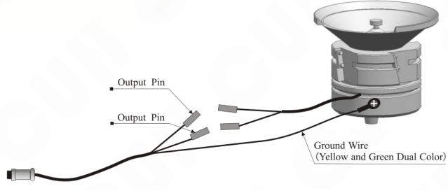

คำอธิบายภาพ:

- หน้าสัมผัสเอาต์พุต
- หน้าสัมผัสเอาต์พุต
- สายดิน (สีเหลือง-เขียวสองสี)

## ⚠ ข้อควรระวัง

ตรวจสอบให้แน่ใจว่าขดลวดแม่เหล็กไฟฟ้าของตัวสั่นเชื่อมต่อกับหน้าสัมผัสเอาต์พุตสองขั้วของสายไฟเอาต์พุต และขดลวดแม่เหล็กไฟฟ้ามีการต่อดินที่เชื่อถือได้ มิฉะนั้นอาจเกิดอุบัติเหตุร้ายแรงตามมา

---

---

## ขั้นตอนที่สาม:

เชื่อมต่อสายไฟเข้ากับตัวควบคุมและล็อกน็อตสายไฟ

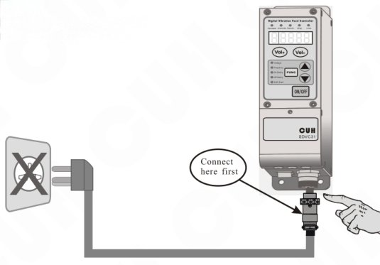

## ขั้นตอนที่สี่:

เสียบปลั๊กของสายไฟเข้ากับเต้ารับไฟฟ้า

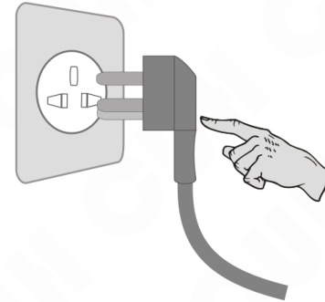

---

---

## ขั้นตอนที่ห้า:

ปรับแรงดันไฟฟ้าขาออกของตัวควบคุมเป็นค่าระหว่าง 30 ถึง 80 (แทนด้วยตัวอักษร U)

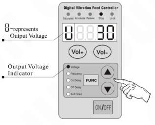

คำอธิบายภาพ:

- U—แทนแรงดันไฟฟ้าขาออก
- ตัวบ่งชี้แรงดันไฟฟ้าขาออก

## ขั้นตอนที่หก:

กดปุ่ม <kbd>FUNC</kbd> ค้างไว้ 2 วินาทีเพื่อเข้าสู่สถานะปรับพารามิเตอร์พื้นฐาน

ตัวบ่งชี้ความถี่ขาออกบนแผงหน้าปัดสว่างขึ้นและ LED แสดงค่าความถี่ปัจจุบัน (E) กดปุ่ม ▲ หรือ ▼ เพื่อปรับค่าพารามิเตอร์จาก 400Hz เป็น 40Hz เพื่อหาความถี่เสียงสะท้อนของตัวสั่นและคงค่านี้ไว้

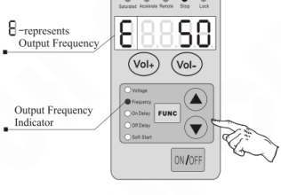

คำอธิบายภาพ:

- E—แทนความถี่ขาออก
- ตัวบ่งชี้ความถี่ขาออก

> ● ความถี่เสียงสะท้อนของตัวสั่นหมายถึงค่าความถี่ที่สร้างแอมพลิจูดสูงสุด
>
> ● ตัวสั่นทุกตัวมีความถี่เสียงสะท้อนกลเชิงกลของตัวเอง ปรับความถี่ขาออกของตัวควบคุมให้ตรงกับความถี่นี้เพื่อให้มั่นใจในสภาพการทำงานที่ดีที่สุด

---

---

## ขั้นตอนที่เจ็ด:

หลังจากตั้งค่าความถี่ขาออกของตัวควบคุมให้ตรงกับความถี่เสียงสะท้อนกลเชิงกลของตัวสั่นแล้ว ปรับแรงดันไฟฟ้าขาออกของตัวควบคุมโดยกดปุ่ม **Vol+** หรือ **Vol-** เพื่อเปลี่ยนความเร็วในการป้อนวัสดุ

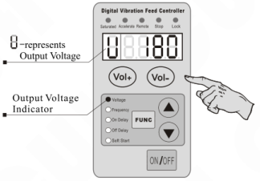

หลังจากเจ็ดขั้นตอนข้างต้น ตัวควบคุมสามารถทำงานได้อย่างถูกต้อง โปรดดูบทอื่นๆ หากต้องการฟังก์ชันควบคุมขั้นสูง

---

# บทที่ Ⅲ คำอธิบายส่วนประกอบ

## 3.1 คำอธิบายแผงควบคุม

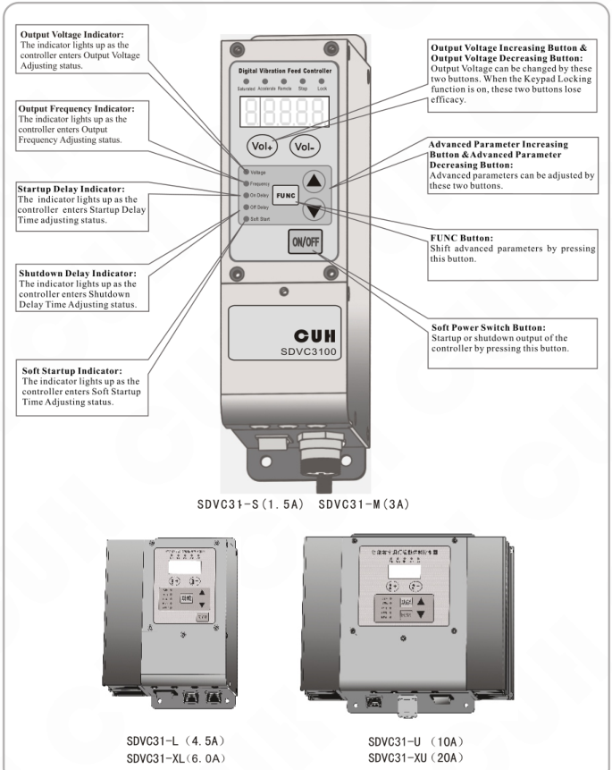

### ตัวบ่งชี้และปุ่มบนแผงควบคุม

| รายการ | คำอธิบาย |
|---|---|
| ตัวบ่งชี้แรงดันไฟฟ้าขาออก | ตัวบ่งชี้สว่างขึ้นเมื่อตัวควบคุมเข้าสู่สถานะปรับแรงดันไฟฟ้าขาออก |
| ตัวบ่งชี้ความถี่ขาออก | ตัวบ่งชี้สว่างขึ้นเมื่อตัวควบคุมเข้าสู่สถานะปรับความถี่ขาออก |
| ตัวบ่งชี้การหน่วงเวลาสตาร์ท | ตัวบ่งชี้สว่างขึ้นเมื่อตัวควบคุมเข้าสู่สถานะปรับเวลาหน่วงเวลาสตาร์ท |
| ตัวบ่งชี้การหน่วงเวลาปิด | ตัวบ่งชี้สว่างขึ้นเมื่อตัวควบคุมเข้าสู่สถานะปรับเวลาหน่วงเวลาปิด |
| ตัวบ่งชี้การสตาร์ทนุ่มนวล | ตัวบ่งชี้สว่างขึ้นเมื่อตัวควบคุมเข้าสู่สถานะปรับเวลาสตาร์ทนุ่มนวล |
| ปุ่มเพิ่มแรงดันไฟฟ้าขาออก & ปุ่มลดแรงดันไฟฟ้าขาออก | สามารถเปลี่ยนแรงดันไฟฟ้าขาออกได้ด้วยปุ่มสองปุ่มนี้ เมื่อฟังก์ันการล็อกแป้นพิมพ์เปิดอยู่ ปุ่มสองปุ่มนี้จะไม่มีผล |
| ปุ่มเพิ่มพารามิเตอร์ขั้นสูง & ปุ่มลดพารามิเตอร์ขั้นสูง | สามารถปรับพารามิเตอร์ขั้นสูงได้ด้วยปุ่มสองปุ่มนี้ |
| ปุ่ม FUNC | สลับพารามิเตอร์ขั้นสูงโดยกดปุ่มนี้ |
| ปุ่มสวิตช์เปิด-ปิดแบบสัมผัส | เริ่มหรือปิดเอาต์พุตของตัวควบคุมโดยกดปุ่มนี้ |

### รุ่นที่แสดง

| รุ่น | กระแส |
|---|---:|
| SDVC31-S | 1.5A |
| SDVC31-M | 3A |
| SDVC31-L | 4.5A |
| SDVC31-XL | 6.0A |
| SDVC31-U | 10A |
| SDVC31-XU | 20A |

---

---

## 3.2 คำอธิบายตัวบ่งชี้สถานะ

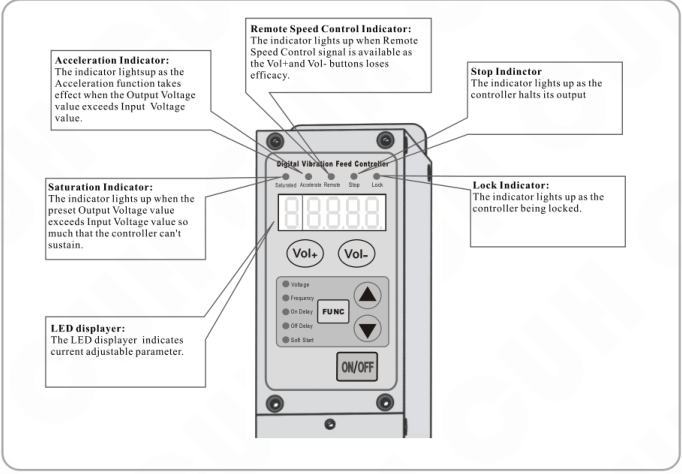

- **ตัวบ่งชี้การเร่งความเร็ว:** ตัวบ่งชี้สว่างขึ้นเมื่อฟังก์ชันการเร่งความเร็วมีผล เมื่อค่าแรงดันไฟฟ้าขาออกเกินค่าแรงดันไฟฟ้าเข้า
- **ตัวบ่งชี้การควบคุมความเร็วระยะไกล:** ตัวบ่งชี้สว่างขึ้นเมื่อมีสัญญาณการควบคุมความเร็วระยะไกล ขณะที่ปุ่ม Vol+ และ Vol- หยุดทำงาน
- **ตัวบ่งชี้หยุด:** ตัวบ่งชี้สว่างขึ้นเมื่อตัวควบคุมหยุดเอาต์พุต
- **ตัวบ่งชี้อิ่มตัว:** ตัวบ่งชี้สว่างขึ้นเมื่อค่าแรงดันไฟฟ้าขาออกที่ตั้งไว้ล่วงหน้าเกินค่าแรงดันไฟฟ้าเข้ามากจนตัวควบคุมไม่สามารถรักษาได้
- **ตัวบ่งชี้ล็อก:** ตัวบ่งชี้สว่างขึ้นเมื่อตัวควบคุมถูกล็อก
- **จอแสดงผล LED:** จอแสดงผล LED แสดงพารามิเตอร์ที่สามารถปรับได้ในปัจจุบัน

## 3.3 คำอธิบายอินเทอร์เฟซ I/O

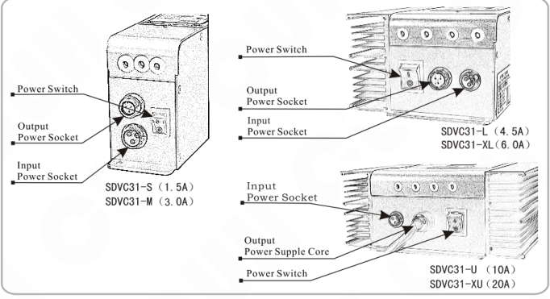

- **SDVC31-S（1.5A） / SDVC31-M（3.0A）**
  - สวิตช์ไฟ
  - เต้ารับไฟขาออก
  - เต้ารับไฟเข้า
- **SDVC31-L（4.5A） / SDVC31-XL（6.0A）**
  - สวิตช์ไฟ
  - เต้ารับไฟขาออก
  - เต้ารับไฟเข้า
- **SDVC31-U（10A） / SDVC31-XU（20A）**
  - เต้ารับไฟเข้า
  - ขั้วต่อไฟขาออก
  - สวิตช์ไฟ

---

# บทที่ Ⅳ คำอธิบายฟังก์ชัน

## 4.1 การตั้งค่าแรงดันไฟฟ้าขาออก

สามารถตั้งค่าแรงดันไฟฟ้าขาออกได้โดยตรงและเป็นดิจิทัลผ่านแผงควบคุม ด้วยประโยชน์จากฟังก์ชันควบคุมแรงดันไฟฟ้าอัตโนมัติที่ไม่ซ้ำใคร แรงดันไฟฟ้าขาออกของตัวควบคุมจะไม่ผันผวนตามแรงดันไฟฟ้าเข้า และตัวสั่นสามารถทำงานได้อย่างเสถียรในสภาพแวดล้อมแรงดันไฟฟ้าเข้าที่ไม่เสถียร

- เปิดสวิตช์ไฟ

- ตัวบ่งชี้แรงดันไฟฟ้าขาออกสว่างขึ้นเมื่อตัวควบคุมเข้าสู่สถานะปรับแรงดันไฟฟ้าขาออก ขณะที่ LED แสดงสัญลักษณ์แรงดัน U และค่าแรงดันที่ตั้งไว้ก่อนหน้า

- ปรับค่าแรงดันไฟฟ้าขาออกโดยกดปุ่ม <kbd>Vol+</kbd> หรือ <kbd>Vol-</kbd>

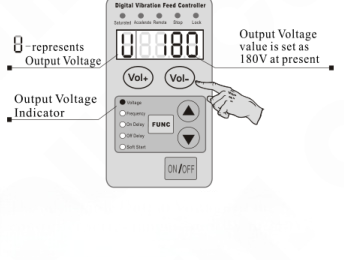

- U — แทนแรงดันไฟฟ้าขาออก
- ตัวบ่งชี้แรงดันไฟฟ้าขาออก
- ค่าแรงดันไฟฟ้าขาออกตั้งไว้ที่ 180V ในปัจจุบัน
- แรงดันไฟฟ้าขาออกที่ปรับได้ของซีรีส์ตัวควบคุมมีตั้งแต่ 0V ถึง 250V

> สามารถปรับแรงดันไฟฟ้าขาออกได้ในสถานะปรับพารามิเตอร์พื้นฐานหรือสถานะปรับพารามิเตอร์ขั้นสูงใดๆ โดยกดปุ่ม <kbd>Vol+</kbd> หรือ <kbd>Vol-</kbd> ตัวควบคุมจะกลับไปยังสถานะปรับพารามิเตอร์ก่อนหน้าหลังจากปรับแรงดันไฟฟ้าขาออก

## ☺ การเร่งความเร็ว

เมื่อค่าแรงดันไฟฟ้าขาออกที่ต้องการเกินค่าแรงดันไฟฟ้าเข้า ฟังก์ชันการเร่งความเร็วของตัวควบคุมจะทำงานขณะที่ตัวบ่งชี้การเร่งความเร็วสว่างขึ้น

เมื่อค่าแรงดันไฟฟ้าขาออกที่ต้องการเกินค่าแรงดันไฟฟ้าเข้ามากเกินไป ตัวควบคุมจะไม่สามารถส่งออกค่าแรงดันไฟฟ้าดังกล่าวได้ ขณะที่ตัวบ่งชี้อิ่มตัวสว่างขึ้น

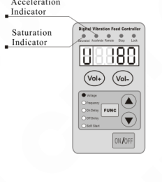

- ตัวบ่งชี้การเร่งความเร็ว
- ตัวบ่งชี้อิ่มตัว

---

---

## 4.2 การปรับความถี่ขาออก

ตัวควบคุมผลิตด้วยเทคโนโลยี DDS และเอาต์พุตมีความแม่นยำและเสถียรภาพของความถี่สูงซึ่งไม่เปลี่ยนแปลงตามเวลาหรืออุณหภูมิ

- กดปุ่ม <kbd>FUNC</kbd> ค้างไว้ 2 วินาทีเพื่อเข้าสู่สถานะปรับพารามิเตอร์พื้นฐาน

- ตัวบ่งชี้ความถี่บนแผงหน้าปัดสว่างขึ้นและ LED แสดงสัญลักษณ์ความถี่ขาออก **E** และค่าความถี่ขาออกปัจจุบัน

- กดปุ่ม ▲ หรือ ▼ เพื่อปรับค่าพารามิเตอร์

ความถี่ขาออกของตัวควบคุมมีตั้งแต่ 40Hz ถึง 400Hz

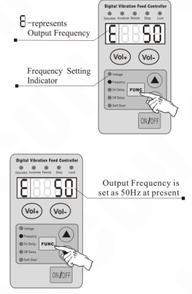

**คำอธิบายภาพ:**

- **E** — แทนความถี่ขาออก
- ตัวบ่งชี้การตั้งค่าความถี่
- ความถี่ขาออกตั้งไว้ที่ 50Hz ในปัจจุบัน

> ☺
>
> ● ความถี่ขาออก (E) เวลาหน่วงเวลาสตาร์ท เวลาหน่วงเวลาปิด และเวลาสตาร์ทนุ่มนวลสามารถตั้งค่าได้หลังจากเข้าสู่สถานะปรับพารามิเตอร์พื้นฐานโดยกดปุ่ม <kbd>FUNC</kbd> ค้างไว้ 2 วินาที
>
> ● ตัวควบคุมจะกลับสู่สถานะปรับแรงดันไฟฟ้าขาออกโดยอัตโนมัติใน 1 นาทีหลังจากการปรับตั้ง
>
> ● กดปุ่ม <kbd>FUNC</kbd> ค้างไว้ 2 วินาทีอีกครั้งเพื่อออกจากสถานะปรับพารามิเตอร์พื้นฐาน

---

## 4.3 การสตาร์ทนุ่มนวล

เพื่อหลีกเลี่ยงแรงกระแทกกะทันหันต่อชิ้นงาน ตัวควบคุมสามารถเพิ่มแรงดันไฟฟ้าขาออกจาก 0 ไปยังค่าที่ตั้งไว้ล่วงหน้าได้อย่างนุ่มนวลเมื่อเริ่มสตาร์ท

เวลาสตาร์ทนุ่มนวล ( t ): ช่วงเวลาที่ตัวควบคุมใช้ในการเพิ่มแรงดันไฟฟ้าขาออกจาก 0 ไปยังค่าที่ตั้งไว้ล่วงหน้าอย่างนุ่มนวลเมื่อเริ่มสตาร์ท

» กดปุ่ม **FUNC** ค้างไว้ 2 วินาทีเพื่อเข้าสู่สถานะปรับพารามิเตอร์พื้นฐาน

» กดปุ่ม **FUNC** ซ้ำๆ จนกว่าจะสลับไปยังสถานะปรับเวลาสตาร์ทนุ่มนวล (t) ขณะที่ตัวบ่งชี้การสตาร์ทนุ่มนวลสว่างขึ้น

» กดปุ่ม ▲ หรือ ▼ เพื่อปรับค่าพารามิเตอร์ หน่วยของพารามิเตอร์เป็นวินาที และความละเอียดเชิงตัวเลขคือ 0.1

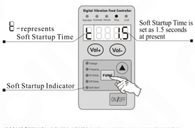

- **t** - แทนเวลาสตาร์ทนุ่มนวล
- ตัวบ่งชี้การสตาร์ทนุ่มนวล
- เวลาสตาร์ทนุ่มนวลตั้งไว้ที่ 1.5 วินาทีในปัจจุบัน

เวลาสตาร์ทนุ่มนวลที่ปรับได้มีตั้งแต่ 0.1 วินาที ถึง 9.9 วินาที

## 4.4 ปุ่มสวิตช์เอาต์พุต

ปุ่มสวิตช์แบบสัมผัสนุ่มบนแผงหน้าปัดสามารถเปิด/ปิดเอาต์พุตของตัวควบคุมได้อย่างรวดเร็วและง่ายดาย

» กดปุ่ม **ON/OFF** เพื่อเปิด/ปิดเอาต์พุตของตัวควบคุม ตัวบ่งชี้หยุดสว่างขึ้นเมื่อเอาต์พุตของตัวควบคุมถูกปิด

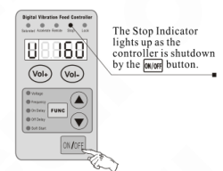

ตัวบ่งชี้หยุดสว่างขึ้นเมื่อตัวควบคุมถูกปิดโดยปุ่ม **ON/OFF**

😊

เนื่องจากเทคโนโลยีสวิตช์สัมผัสนุ่มและการควบคุมสัญญาณดิจิทัล จะไม่มีประกายไฟเกิดขึ้นทำลายหน้าสัมผัส ผลที่ตามมาคืออายุการใช้งานของตัวควบคุมและตัวสั่นจะยาวนานขึ้นอย่างมาก

---

## 4.5 การจำกัดแรงดันไฟฟ้าขาออกสูงสุด

สามารถตั้งค่าแรงดันไฟฟ้าขาออกสูงสุดของตัวควบคุมเพื่อป้องกันความเสียหายต่อตัวสั่น ฟังก์ชันการควบคุมความเร็วระยะไกลได้รับผลกระทบจากพารามิเตอร์นี้

- กดปุ่ม <kbd>FUNC</kbd> และ ▲ พร้อมกันค้างไว้ 2 วินาทีเพื่อเข้าสู่สถานะปรับพารามิเตอร์ขั้นสูง
- กดปุ่ม <kbd>FUNC</kbd> ซ้ำๆ จนกว่าจะสลับไปยังสถานะการจำกัดแรงดันไฟฟ้าขาออกสูงสุด (h)
- กดปุ่ม ▲ หรือ ▼ เพื่อปรับค่าพารามิเตอร์

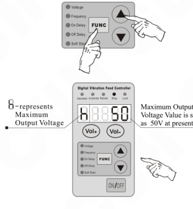

> ● ค่าแรงดันไฟฟ้าขาออกไม่สามารถเกินค่าพารามิเตอร์นี้ได้ในทุกกรณี  
> ● ค่าเริ่มต้นของพารามิเตอร์นี้ตั้งไว้ที่ค่าแรงดันไฟฟ้าขาออกที่ปรับได้สูงสุด

## วิธีออกจากสถานะปรับพารามิเตอร์ขั้นสูง

● ตัวควบคุมจะกลับสู่สถานะปรับแรงดันไฟฟ้าขาออกโดยอัตโนมัติใน 1 นาทีหลังจากการปรับพารามิเตอร์ขั้นสูง  
● กดปุ่ม <kbd>FUNC</kbd> และ ▲ ค้างไว้ 2 วินาทีเพื่อกลับสู่สถานะปรับแรงดันไฟฟ้าขาออก  
● กดปุ่ม <kbd>FUNC</kbd> ค้างไว้ 2 วินาทีเพื่อกลับสู่สถานะปรับพารามิเตอร์พื้นฐาน

---

## 4.6 การปรับพารามิเตอร์การเร่งความเร็ว

พารามิเตอร์การเร่งความเร็ว (y): พารามิเตอร์นี้หมายถึงแรงดันไฟฟ้าขาออกสูงสุดเป็นเปอร์เซ็นต์ของแรงดันไฟฟ้าเข้า ฟังก์ชันการเร่งความเร็วได้รับผลกระทบจากพารามิเตอร์นี้

- กดปุ่ม `FUNC` และ ▲ พร้อมกันค้างไว้ 2 วินาทีเพื่อเข้าสู่สถานะปรับพารามิเตอร์ขั้นสูง
- กดปุ่ม `FUNC` ซ้ำๆ จนกว่าจะสลับไปยังสถานะปรับพารามิเตอร์การเร่งความเร็ว (y)
- กดปุ่ม ▲ หรือ ▼ เพื่อปรับค่าพารามิเตอร์

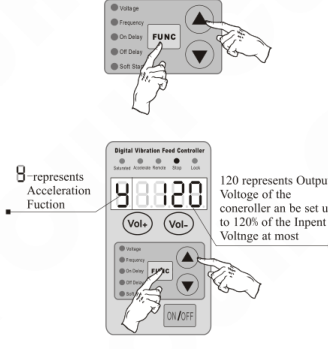

> ● ค่าการเร่งความเร็ว (y) ที่ปรับได้มีตั้งแต่ 100 ถึง 150 และค่าเริ่มต้นคือ 120  
> ● ตัวบ่งชี้อิ่มตัวสว่างขึ้นเมื่อแรงดันไฟฟ้าขาออกของตัวควบคุมเกินขีดจำกัด

---

---

## 4.7 การปรับดัชนีรูปคลื่น

ผู้ใช้สามารถถ่วงดุลระหว่างประสิทธิภาพจุดสูงสุดและกำลังสูงสุด (เสียงรบกวนต่ำสุด) ได้โดยการปรับพารามิเตอร์นี้

- กดปุ่ม **FUNC** และ **▲** พร้อมกันค้างไว้ 2 วินาทีเพื่อเข้าสู่สถานะปรับพารามิเตอร์ขั้นสูง
- กดปุ่ม **FUNC** ซ้ำๆ จนกว่าจะสลับไปยังสถานะปรับดัชนีรูปคลื่น (**r**)
- กดปุ่ม **▲** หรือ **▼** เพื่อปรับค่าพารามิเตอร์

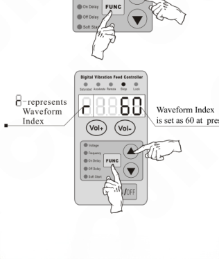

คำอธิบายภาพ:

- **r** แทนดัชนีรูปคลื่น
- ดัชนีรูปคลื่นตั้งไว้ที่ **60** ในปัจจุบัน

> ☺
>
> ●ดัชนีรูปคลื่นที่ปรับได้มีตั้งแต่ 0 ถึง 100  
> ●ค่า 0 แทนประสิทธิภาพจุดสูงสุดเมื่อแผ่นสปริงรับแรงกดต่ำสุด  
> ●ค่า 100 แทนกำลังสูงสุด (เสียงรบกวนต่ำสุด) เมื่อแผ่นสปริงรับแรงกดสูงสุด

---

## 4.8 การล็อกแป้นพิมพ์

ฟังก์ชันการล็อกแป้นพิมพ์สามารถล็อกปุ่มทั้งหมดบนแผงหน้าปัดเพื่อหลีกเลี่ยงการใช้งานผิดพลาด

- กดปุ่ม <kbd>ON/OFF</kbd> ค้างไว้ 2 วินาทีเพื่อล็อกปุ่มทั้งหมดบนแผงหน้าปัด ขณะที่ตัวบ่งชี้การล็อกแป้นพิมพ์สว่างขึ้น
- กดปุ่ม <kbd>ON/OFF</kbd> ค้างไว้ 2 วินาทีในโหมดล็อกเพื่อปลดล็อกแป้นพิมพ์

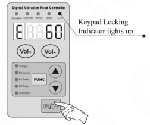

---

## 4.9 การคืนค่ากำหนดเริ่มต้น

ฟังก์ชันนี้อนุญาตให้ผู้ใช้คืนค่ากำหนดพารามิเตอร์เริ่มต้นทั้งหมด

เนื่องจากตัวควบคุมมีฟังก์ชันหลากหลาย จึงสามารถปรับพารามิเตอร์ได้มากมาย เพื่อหลีกเลี่ยงสถานการณ์ที่ตัวควบคุมไม่สามารถทำงานได้อย่างถูกต้องหลังจากการปรับเปลี่ยนหลายครั้งโดยผู้เริ่มต้น ฟังก์ชันนี้จึงอนุญาตให้ผู้ใช้คืนค่ากำหนดเริ่มต้นสู่ตัวควบคุมได้อย่างง่ายดาย

- กดปุ่ม **FUNC** และ **▲** พร้อมกันค้างไว้ 2 วินาทีเพื่อเข้าสู่สถานะปรับพารามิเตอร์ขั้นสูง

  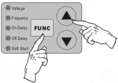

- กดปุ่ม **FUNC** ซ้ำๆ จนกว่า `8888` จะกะพริบบนจอแสดงผล LED จากนั้นกดปุ่ม **▲** ค้างไว้จนกว่า `-----` จะแสดงผล ซึ่งหมายความว่าค่ากำหนดเริ่มต้นได้ถูกคืนค่าสำเร็จแล้ว

  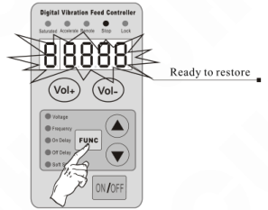

- หลังจากปล่อยปุ่ม **▲** ตัวควบคุมจะเข้าสู่สถานะปรับแรงดันไฟฟ้าขาออก (U) ณ เวลานี้ พารามิเตอร์ทั้งหมดได้ถูกคืนค่าเป็นค่าเริ่มต้นแล้ว

  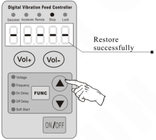

# บทที่ Ⅴ เซ็นเซอร์และการควบคุมสัญญาณ

ตัวควบคุมสามารถถูกควบคุมโดยสัญญาณภายนอกและเซ็นเซอร์หลายชนิด บทนี้จะอธิบายหลักการใช้งานของเซ็นเซอร์โฟโตอิเล็กทริกอัจฉริยะ เซ็นเซอร์สวิตช์โปรซิมิตี้ และ PLC

## 5.1 เซ็นเซอร์โฟโตอิเล็กทริกอัจฉริยะ

เมื่อใช้ร่วมกับเซ็นเซอร์โฟโตอิเล็กทริก SDVC-S1 จะสามารถทำฟังก์ชันเซ็นเซอร์โฟโตอิเล็กทริกอัจฉริยะได้ เซ็นเซอร์ SDVC-S1 สามารถกรองสัญญาณรบกวนจากแสงพื้นหลังที่มีผลต่อความไวของตัวควบคุม ผลที่ตามมาคือตัวควบคุมสามารถทำงานได้อย่างเชื่อถือได้โดยไม่ต้องปรับความไวด้วยตนเอง

### 5.1.1 วิธีการต่อเซ็นเซอร์โฟโตอิเล็กทริกอัจฉริยะ SDVC-S1

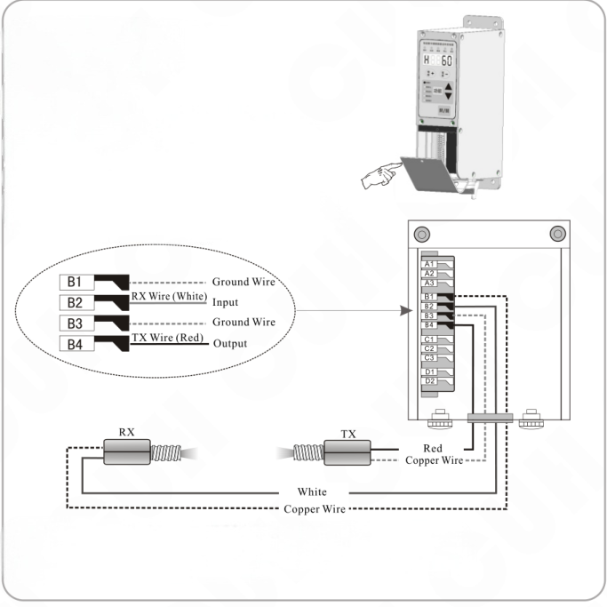

**ขั้นตอนที่ 1:**  
เปิดแผ่นปิดด้านบนของตัวควบคุม

**ขั้นตอนที่ 2:**  
เชื่อมต่อเซ็นเซอร์ SDVC-S1 เข้ากับขั้วต่อของตัวควบคุมตามภาพ

**ขั้นตอนที่ 3:**  
ปิดแผ่นปิดหลังจากเชื่อมต่อเซ็นเซอร์แล้ว

**ข้อควรระวัง:**  
ความสัมพันธ์เชิงตรรกะเริ่มต้นของเซ็นเซอร์ตั้งไว้ที่ชิ้นงานหมด

---

## 5.1.2 การตั้งค่าเวลาหน่วงเวลาสตาร์ทและเวลาหน่วงเวลาปิดของเซ็นเซอร์โฟโตอิเล็กทริกอัจฉริยะ

ในการใช้งานจริงส่วนใหญ่ เอาต์พุตของตัวควบคุมควรถูกหน่วงเวลาไว้ชั่วครู่เมื่อสตาร์ทหรือปิดตัวควบคุมโดยสัญญาณภายนอก ฟังก์ชันการปรับเวลาหน่วงเวลาสตาร์ทและเวลาหน่วงเวลาปิดทำให้การใช้งานลักษณะนี้เป็นไปได้ นอกจากนี้ แรงกระแทกต่อชิ้นงานเมื่อตัวควบคุมเริ่มสตาร์ทสามารถขจัดได้โดยการตั้งค่าเวลาสตาร์ทนุ่มนวล

### การหน่วงเวลาสตาร์ท( J )

ช่วงเวลาที่ตัวควบคุมใช้ตั้งแต่รับสัญญาณควบคุมสตาร์ทจนถึงการส่งออก

- กดปุ่ม **FUNC** ค้างไว้ 2 วินาทีเพื่อเข้าสู่สถานะปรับพารามิเตอร์พื้นฐาน
- กดปุ่ม **FUNC** ซ้ำๆ จนกว่าจะสลับไปยังสถานะปรับเวลาหน่วงเวลาสตาร์ท ( J ) ขณะที่ตัวบ่งชี้เวลาหน่วงเวลาสตาร์ทบนแผงหน้าปัดสว่างขึ้น
- ปรับพารามิเตอร์โดยกดปุ่ม ▲ หรือ ▼ หน่วยของพารามิเตอร์เป็นวินาที และความละเอียดเชิงตัวเลขคือ 0.1

*ช่วงที่ปรับได้ของพารามิเตอร์มีตั้งแต่ 0.0 ถึง 9.9 วินาที*  
*ค่าเริ่มต้นของพารามิเตอร์คือ 0.2 วินาที*

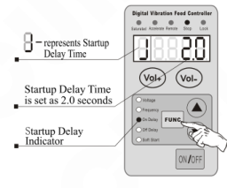

### การหน่วงเวลาปิด (L)

ช่วงเวลาที่ตัวควบคุมใช้ตั้งแต่รับสัญญาณควบคุมปิดจนถึงการตัดเอาต์พุต

- กดปุ่ม **FUNC** ค้างไว้ 2 วินาทีเพื่อเข้าสู่สถานะปรับพารามิเตอร์พื้นฐาน
- กดปุ่ม **FUNC** ซ้ำๆ จนกว่าจะสลับไปยังสถานะปรับเวลาหน่วงเวลาปิด (L) ขณะที่ตัวบ่งชี้เวลาหน่วงเวลาปิดบนแผงหน้าปัดสว่างขึ้น
- ปรับพารามิเตอร์โดยกดปุ่ม ▲ หรือ ▼ หน่วยของพารามิเตอร์เป็นวินาที และความละเอียดเชิงตัวเลขคือ 0.1

*ช่วงที่ปรับได้ของพารามิเตอร์มีตั้งแต่ 0.0 ถึง 9.9 วินาที*  
*ค่าเริ่มต้นของพารามิเตอร์คือ 0.2 วินาที*

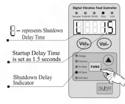

---

## 5.1.3 การตั้งค่าความสัมพันธ์เชิงตรรกะของเซ็นเซอร์โฟโตอิเล็กทริกอัจฉริยะ

ในสภาวะปกติ ปลายรับจะไม่ได้รับสัญญาณแสง และตัวควบคุมจะทำงานตามค่าเริ่มต้น แต่ในบางการใช้งานพิเศษ ตัวควบคุมจำเป็นต้องหยุดเมื่อปลายรับไม่ได้รับสัญญาณแสง การปรับพารามิเตอร์นี้สามารถทำให้การใช้งานลักษณะนี้เป็นไปได้

- กดปุ่ม **FUNC** และ ▲ พร้อมกันค้างไว้ 2 วินาทีเพื่อเข้าสู่สถานะปรับพารามิเตอร์ขั้นสูง

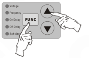

- กดปุ่ม **FUNC** ซ้ำๆ จนกว่าจะสลับไปยังสถานะปรับความสัมพันธ์เชิงตรรกะของเซ็นเซอร์โฟโตอิเล็กทริกอัจฉริยะ

  **08** — แทนความสัมพันธ์เชิงตรรกะของเซ็นเซอร์โฟโตอิเล็กทริกอัจฉริยะ  
  **ปกติเปิด (Normal Open)**

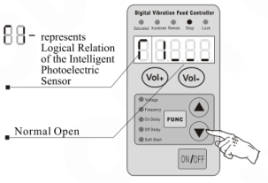

- ปรับพารามิเตอร์โดยกดปุ่ม ▲ หรือ ▼

  **08** — แทนความสัมพันธ์เชิงตรรกะของเซ็นเซอร์โฟโตอิเล็กทริกอัจฉริยะ  
  **ปกติปิด (Normal Close)**

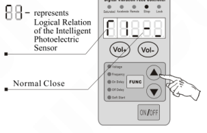

- เมื่อความสัมพันธ์เชิงตรรกะตั้งไว้ที่ปกติเปิด หมายความว่าไม่ได้รับสัญญาณแสง ตัวควบคุมจะทำงาน
- เมื่อความสัมพันธ์เชิงตรรกะตั้งไว้ที่ปกติปิด หมายความว่าไม่ได้รับสัญญาณแสง ตัวควบคุมจะหยุด

---

## 5.2 วิธีการใช้งานเซ็นเซอร์สวิตช์ NPN

ตัวควบคุมสามารถทำงานร่วมกับเซ็นเซอร์ทุกชนิด เช่น เซ็นเซอร์สวิตช์ เซ็นเซอร์สวิตช์แสง และเซ็นเซอร์ใยแก้วนำแสง

### 5.2.1 วิธีการต่อเซ็นเซอร์สวิตช์โปรซิมิตี้ NPN

**ขั้นตอนที่ 1:**  
เปิดแผ่นปิดด้านบนของตัวควบคุม

**ขั้นตอนที่ 2:**  
เชื่อมต่อเซ็นเซอร์สวิตช์โปรซิมิตี้ NPN เข้ากับขั้วต่อของตัวควบคุมตามภาพ

**ขั้นตอนที่ 3:**  
ปิดแผ่นปิดหลังจากเชื่อมต่อเซ็นเซอร์แล้ว

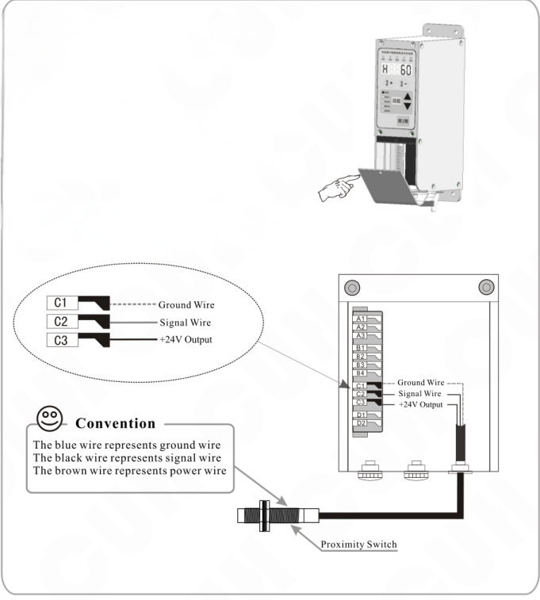

| ขั้วต่อ | สาย |
|---|---|
| C1 | สายดิน |
| C2 | สายสัญญาณ |
| C3 | เอาต์พุต +24V |

**มาตรฐานสี**

สายสีน้ำเงินแทนสายดิน  
สายสีดำแทนสายสัญญาณ  
สายสีน้ำตาลแทนสายไฟ

สวิตช์โปรซิมิตี้

---

---

### 5.2.2 วิธีการต่อเซ็นเซอร์สวิตช์รังสีสะท้อน NPN

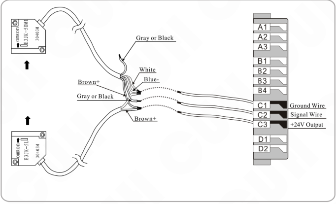

### 5.2.3 วิธีการต่อเซ็นเซอร์รังสีสะท้อนโฟโตอิเล็กทริก

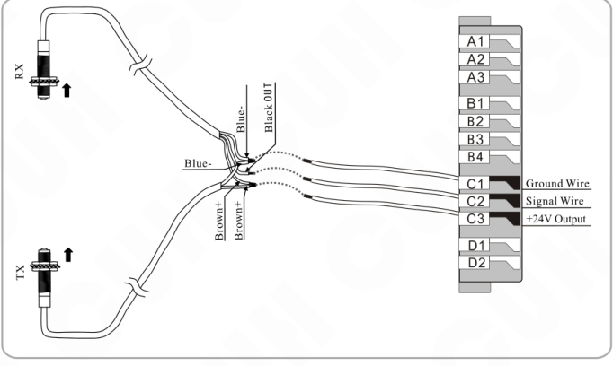

---

## 5.2.4 วิธีการต่อเซ็นเซอร์รังสีสะท้อนใยแก้วนำแสง

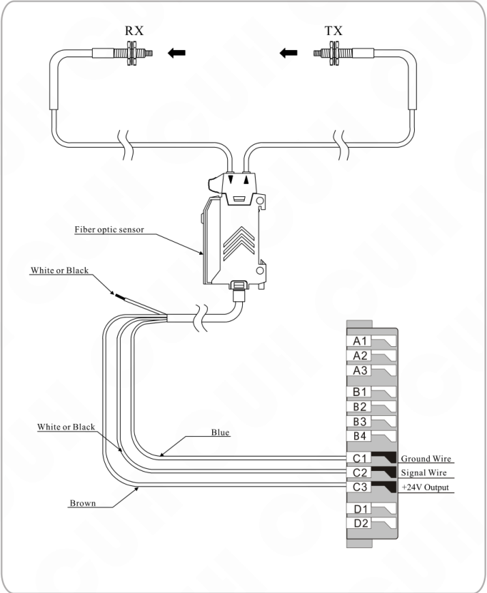

ป้ายกำกับในภาพ ได้แก่: **RX**, **TX**, **เซ็นเซอร์ใยแก้วนำแสง**, **ขาวหรือดำ**, **น้ำเงิน**, **น้ำตาล**

คำอธิบายขั้วต่อที่แสดง:

| ขั้วต่อ | คำอธิบาย |
|---|---|
| C1 | สายดิน |
| C2 | สายสัญญาณ |
| C3 | เอาต์พุต +24V |

---

## 5.2.5 วิธีการต่อเซ็นเซอร์สะท้อนแสงโฟโตอิเล็กทริก

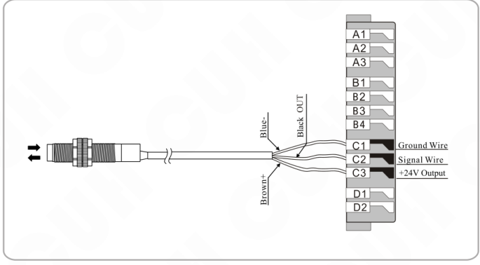

---

---

## 5.3 การตั้งค่าเวลาหน่วงเวลาสตาร์ทและเวลาหน่วงเวลาปิดของเซ็นเซอร์สวิตช์ NPN

โดยค่าเริ่มต้น เซ็นเซอร์โฟโตอิเล็กทริกอัจฉริยะและเซ็นเซอร์สวิตช์ใช้เวลาหน่วงเวลาสตาร์ทและเวลาหน่วงเวลาปิดเดียวกัน ผู้ใช้ยังสามารถตั้งค่าเวลาหน่วงเวลาสตาร์ทและเวลาหน่วงเวลาปิดแยกกันสำหรับเซ็นเซอร์สวิตช์ได้

### การหน่วงเวลาสตาร์ท (J-)

ช่วงเวลาที่ตัวควบคุมใช้ตั้งแต่รับสัญญาณควบคุมสตาร์ทจนถึงการส่งออก

- กดปุ่ม **FUNC** และ ▲ พร้อมกันค้างไว้ 2 วินาทีเพื่อเข้าสู่สถานะปรับพารามิเตอร์ขั้นสูง
- กดปุ่ม **FUNC** ซ้ำๆ จนกว่าจะสลับไปยังสถานะปรับเวลาหน่วงเวลาสตาร์ท (`J---`) ขณะที่ตัวบ่งชี้เวลาหน่วงเวลาสตาร์ทบนแผงหน้าปัดสว่างขึ้น
- ปรับพารามิเตอร์โดยกดปุ่ม ▲ หรือ ▼ หน่วยของพารามิเตอร์เป็นวินาที และความละเอียดเชิงตัวเลขคือ 0.1

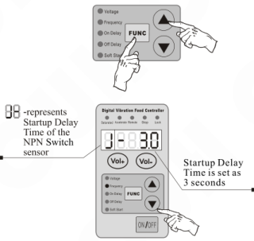

การหน่วงเวลาสตาร์ทตั้งไว้ที่ `J---` ตามค่าเริ่มต้น

### การหน่วงเวลาปิด (L-)

ช่วงเวลาที่ตัวควบคุมใช้ตั้งแต่รับสัญญาณควบคุมปิดจนถึงการตัดเอาต์พุต

- กดปุ่ม **FUNC** และ ▲ พร้อมกันค้างไว้ 2 วินาทีเพื่อเข้าสู่สถานะปรับพารามิเตอร์ขั้นสูง
- กดปุ่ม **FUNC** ซ้ำๆ จนกว่าจะสลับไปยังสถานะปรับเวลาหน่วงเวลาปิด (`L-`) ขณะที่ตัวบ่งชี้เวลาหน่วงเวลาปิดบนแผงหน้าปัดสว่างขึ้น
- ปรับพารามิเตอร์โดยกดปุ่ม ▲ หรือ ▼ หน่วยของพารามิเตอร์เป็นวินาที และความละเอียดเชิงตัวเลขคือ 0.1

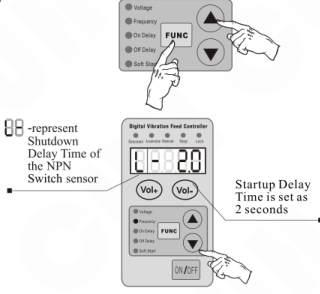

การหน่วงเวลาปิดตั้งไว้ที่ `L----` ตามค่าเริ่มต้น

> ➜ เมื่อค่า `J-` และ `L-` ถูกปรับเป็น 0 เวลาหน่วงเวลาสตาร์ทและเวลาหน่วงเวลาปิดของเซ็นเซอร์สวิตช์จะเหมือนกับเวลาหน่วงเวลาสตาร์ทและเวลาหน่วงเวลาปิดของเซ็นเซอร์โฟโตอิเล็กทริกอัจฉริยะ  
> ➜ เวลาหน่วงเวลาสตาร์ทและเวลาหน่วงเวลาปิดของเซ็นเซอร์โฟโตอิเล็กทริกอัจฉริยะจะไม่ได้รับผลกระทบจากพารามิเตอร์ `J-` หรือ `L-`

---

---

## 5.4 การตั้งค่าความสัมพันธ์เชิงตรรกะของเซ็นเซอร์สวิตช์ NPN (หยุดเมื่อชิ้นงานเต็ม)

ในสภาวะปกติ ตัวควบคุมจะไม่ได้รับสัญญาณจากเซ็นเซอร์สวิตช์ NPN และทำงานตามค่าเริ่มต้น แต่ในบางการใช้งานพิเศษ ตัวควบคุมจำเป็นต้องหยุดเมื่อไม่ได้รับสัญญาณจากเซ็นเซอร์สวิตช์ NPN การปรับพารามิเตอร์นี้สามารถทำให้การใช้งานลักษณะนี้เป็นไปได้

▶▶ กดปุ่ม <kbd>FUNC</kbd> และ ▲ พร้อมกันค้างไว้ 2 วินาทีเพื่อเข้าสู่สถานะปรับพารามิเตอร์ขั้นสูง

▶▶ กดปุ่ม <kbd>FUNC</kbd> ซ้ำๆ จนกว่าจะสลับไปยังสถานะปรับความสัมพันธ์เชิงตรรกะของเซ็นเซอร์สวิตช์ NPN (`F2`)

▶▶ ปรับพารามิเตอร์โดยกดปุ่ม ▲ หรือ ▼

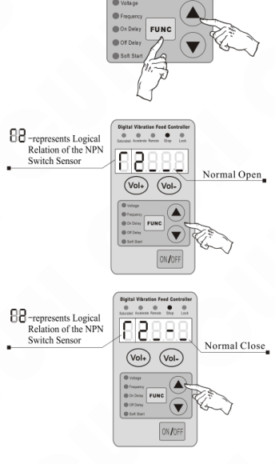

`F2`—แทนความสัมพันธ์เชิงตรรกะของเซ็นเซอร์สวิตช์ NPN

- ปกติเปิด (Normal Open)
- ปกติปิด (Normal Close)

> ●เมื่อความสัมพันธ์เชิงตรรกะตั้งไว้ที่ปกติเปิด หมายความว่าไม่ได้รับสัญญาณ ตัวควบคุมจะทำงาน  
> ●เมื่อความสัมพันธ์เชิงตรรกะตั้งไว้ที่ปกติปิด หมายความว่าไม่ได้รับสัญญาณ ตัวควบคุมจะหยุด

---

## 5.5 การตั้งค่าความสัมพันธ์เชิงตรรกะของสัญญาณควบคุม

ตัวควบคุมสามารถตั้งค่าความสัมพันธ์เชิงตรรกะของเซ็นเซอร์โฟโตอิเล็กทริกอัจฉริยะและเซ็นเซอร์สวิตช์เมื่อทำงานพร้อมกัน

▶ กดปุ่ม **FUNC** และ ▲ พร้อมกันค้างไว้ 2 วินาทีเพื่อเข้าสู่สถานะปรับพารามิเตอร์ขั้นสูง

▶ กดปุ่ม **FUNC** ซ้ำๆ จนกว่าจะสลับไปยังสถานะปรับความสัมพันธ์เชิงตรรกะของสัญญาณควบคุม

▶ ปรับพารามิเตอร์โดยกดปุ่ม ▲ หรือ ▼

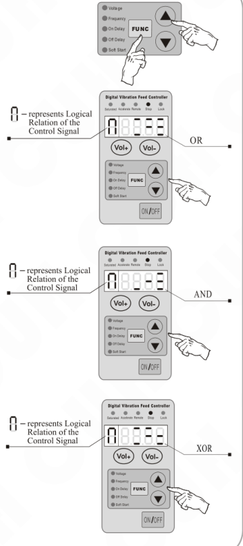

Ⅰ

●ความสัมพันธ์เชิงตรรกะ AND: ตัวควบคุมจะทำงานเฉพาะเมื่อทั้งเซ็นเซอร์โฟโตอิเล็กทริกอัจฉริยะและเซ็นเซอร์สวิตช์ NPN สั่งให้ตัวควบคุมทำงาน

●ความสัมพันธ์เชิงตรรกะ OR: ตัวควบคุมจะทำงานเมื่อเซ็นเซอร์โฟโตอิเล็กทริกอัจฉริยะหรือเซ็นเซอร์สวิตช์ NPN สั่งให้ตัวควบคุมทำงาน

●ความสัมพันธ์เชิงตรรกะ NOR: ตัวควบคุมจะทำงานเฉพาะเมื่อเซ็นเซอร์โฟโตอิเล็กทริกอัจฉริยะและเซ็นเซอร์สวิตช์ NPN ส่งสัญญาณควบคุมที่ตรงข้ามกัน

---

## 5.6 วิธีการต่อ PLC ระดับบนที่ควบคุมตัวควบคุมเครื่องป้อนวัสดุแบบสั่นสะเทือน

### 5.6.1 วิธีการต่อ PLC ที่ทำการควบคุม

**ขั้นตอนที่หนึ่ง:**  
เปิดแผ่นปิดด้านบนของตัวควบคุม

**ขั้นตอนที่สอง:**  
เชื่อมต่อ PLC เข้ากับขั้วต่อของตัวควบคุมตามภาพ

**ขั้นตอนที่สาม:**  
ปิดแผ่นปิดหลังจากเชื่อมต่อเซ็นเซอร์แล้ว

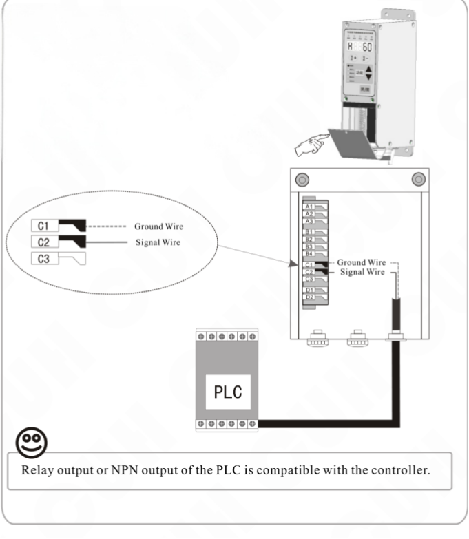

เอาต์พุตรีเลย์หรือเอาต์พุต NPN ของ PLC เข้ากันได้กับตัวควบคุม

---

---

## 5.7 เอาต์พุตควบคุม

ตัวควบคุมสามารถส่งสัญญาณควบคุมแรงดันต่ำเพื่อทำงานร่วมกับอุปกรณ์อื่นๆ เช่น วาล์วโซลินอยด์ PLC หรือรีเลย์ไฟฟ้า

### 5.7.1 วิธีการต่อเอาต์พุตควบคุม

**วิธีการต่อวาล์วโซลินอยด์**

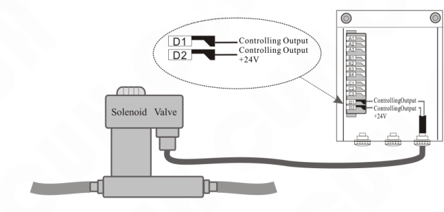

●ตัวควบคุมสามารถขับวาล์วโซลินอยด์ที่มีแรงดันไฟฟ้ารับ 24V และกำลังไฟฟ้ารับต่ำกว่า 4W ได้โดยตรง  
●ใช้แหล่งจ่ายไฟภายนอกสำหรับวาล์วโซลินอยด์กำลังสูง

**วิธีการต่อรีเลย์ไฟฟ้า**

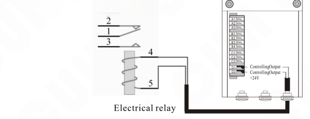

●ตัวควบคุมสามารถขับรีเลย์ไฟฟ้าที่มีแรงดันไฟฟ้ารับ 24V และกำลังไฟฟ้ารับต่ำกว่า 4W ได้โดยตรง

---

## 5.7.2 การตั้งค่าความสัมพันธ์เชิงตรรกะของเอาต์พุตควบคุม

- กดปุ่ม **FUNC** และ **▲** พร้อมกันค้างไว้ 2 วินาทีเพื่อเข้าสู่สถานะปรับพารามิเตอร์ขั้นสูง

- กดปุ่ม **FUNC** ซ้ำๆ จนกว่าจะสลับไปยังสถานะปรับความสัมพันธ์เชิงตรรกะของเอาต์พุตควบคุม (F3)

- ปรับพารามิเตอร์โดยกดปุ่ม **▲** หรือ **▼**

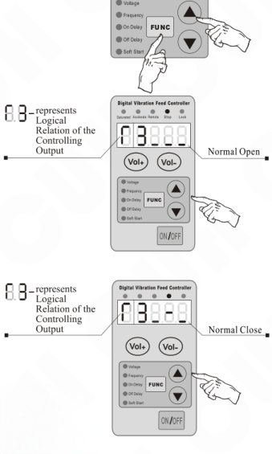

> ● เมื่อความสัมพันธ์เชิงตรรกะตั้งไว้ที่ปกติเปิด เอาต์พุตควบคุมจะทำงานขณะที่ตัวควบคุมทำงาน  
> ● เมื่อความสัมพันธ์เชิงตรรกะตั้งไว้ที่ปกติปิด เอาต์พุตควบคุมจะไม่ทำงานขณะที่ตัวควบคุมทำงาน

---

---

## 5.8 การควบคุมความเร็วระยะไกล

ฟังก์ชันการควบคุมความเร็วระยะไกลอนุญาตให้ผู้ใช้ควบคุมแรงดันไฟฟ้าขาออกด้วยโพเทนชิออมิเตอร์ภายนอกหรือสัญญาณควบคุมตั้งแต่ 1V ถึง 5V ดังนั้น การควบคุมความเร็วระยะไกลภายนอกสามารถทำได้อย่างง่ายดายผ่าน PLC, DCS หรือวิธีอื่นๆ

ฟังก์ชันการควบคุมความเร็วระยะไกลจะมีผลกับตัวควบคุมเมื่อสัญญาณควบคุมเกิน 0.5V ในขณะเดียวกัน ตัวบ่งชี้การควบคุมความเร็วระยะไกลบนแผงหน้าปัดจะสว่างขึ้นและปุ่ม `Vol+` และ `Vol-` จะหยุดทำงาน จอแสดงผล LED จะแสดงแรงดันไฟฟ้าขาออกปัจจุบันหากตัวควบคุมกำลังทำงานในสถานะปรับแรงดันไฟฟ้าขาออก

### วิธีการต่อโพเทนชิออมิเตอร์ภายนอก

- A1: สายดินของการควบคุมความเร็วระยะไกล
- A2: อินพุตการควบคุมความเร็วระยะไกล
- A3: แหล่งจ่ายไฟการควบคุมความเร็วระยะไกล

**หมายเหตุ:** โปรดเลือกโพเทนชิออมิเตอร์แบบเชิงเส้นที่มีความต้านทาน 1k

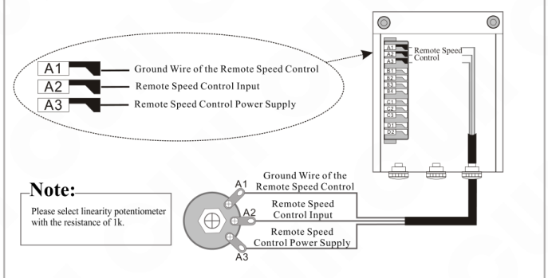

### วิธีการต่อ PLC

- A1: สายดินของการควบคุมความเร็วระยะไกล
- A2: อินพุตการควบคุมความเร็วระยะไกล
- A3

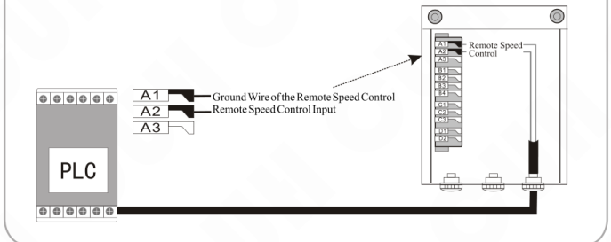

---

---

# บทที่ Ⅵ ฟังก์ชันความปลอดภัย

## 6.1 การควบคุมแรงดันไฟฟ้าอัตโนมัติ

ฟังก์ชันควบคุมแรงดันไฟฟ้าอัตโนมัติดิจิทัลในตัวสามารถขจัดความผันผวนของความเร็วในการป้อนวัสดุที่เกิดจากความผันผวนของแรงดันไฟฟ้า mains ได้

## 6.2 การป้องกันลัดวงจร

หากเอาต์พุตของตัวควบคุมเกิดการลัดวงจร ตัวควบคุมจะหยุดเอาต์พุตจนกว่าจะเริ่มสตาร์ทใหม่

## 6.3 การป้องกันกระแสเกิน

ตัวควบคุมจะหยุดเอาต์พุตเพื่อให้มั่นใจในความปลอดภัยของอุปกรณ์ขณะใช้งานเมื่อกระแสการทำงานเกินค่าที่กำหนด

## 6.4 การป้องกันความร้อนสูงเกิน

ตัวควบคุมจะหยุดเอาต์พุตเพื่อป้องตัวเองเมื่ออุณหภูมิการทำงานสูงเกินไป

---

---

# ภาคผนวก

## ภาคผนวก A: ขนาดมิติ

ขนาดภายนอกของรุ่นตัวควบคุม: SDVC31-S และ SDVC31-M (หน่วย: มม.)

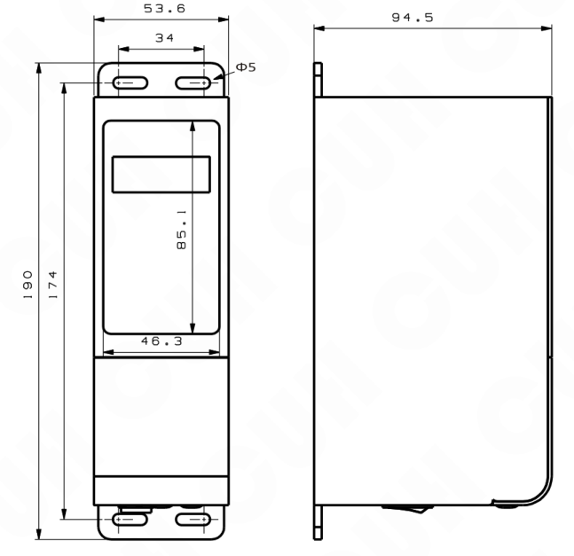

---

ขนาดภายนอกของรุ่นตัวควบคุม: SDVC31-L และ SDVC31-XL (หน่วย: มม.)

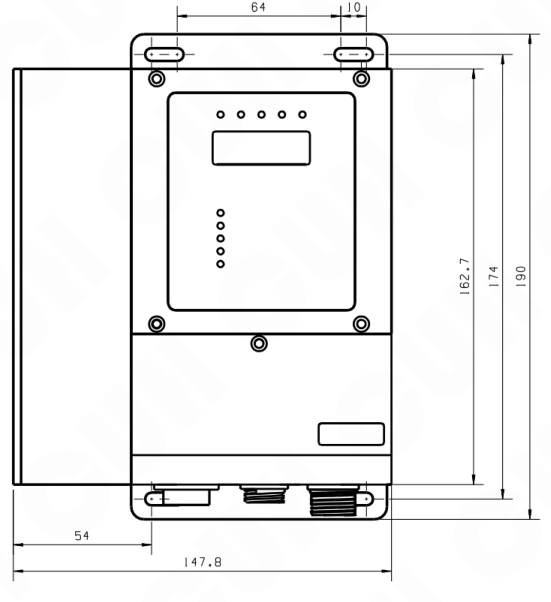

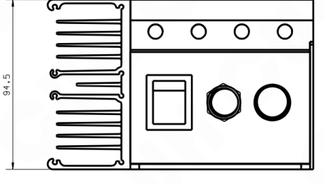

---

ขนาดภายนอกของรุ่นตัวควบคุม: SDVC31-U และ SDVC31-XU (หน่วย: มม.)

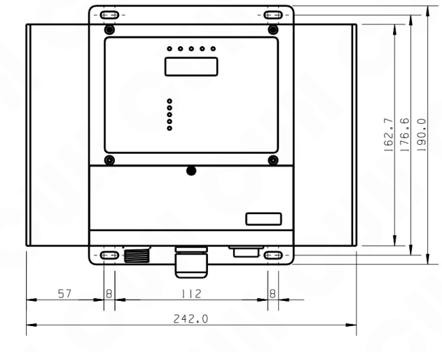

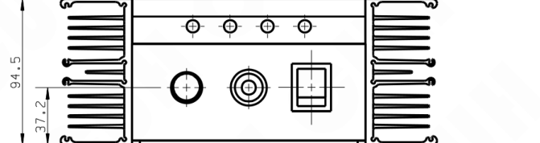

---

---

## ภาคผนวก B: นิยามอินเทอร์เฟซเอาต์พุต

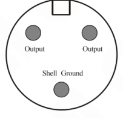

### ☺ ข้อควรระวัง:

**A:** ตรวจสอบให้แน่ใจว่าขดลวดแม่เหล็กไฟฟ้าของตัวสั่นเชื่อมต่อกับหน้าสัมผัสเอาต์พุตสองขั้วของเต้ารับสายไฟเอาต์พุต และตัวถังของตัวสั่นมีการต่อดินที่เชื่อถือได้ มิฉะนั้นอาจเกิดอุบัติเหตุร้ายแรงตามมา

**B:** หลังจากการเชื่อม ตรวจสอบให้แน่ใจว่าบริเวณที่เว้นว่างถูกหุ้มด้วยเทปฉนวนหรือท่อหดก่อนเสียบเข้ากับเต้ารับสายไฟเอาต์พุต เพื่อหลีกเลี่ยงการรั่วไหลของไฟฟ้าหรือการลัดวงจร

## ภาคผนวก C: นิยามอินเทอร์เฟซสัญญาณ

| ขั้วต่อ | นิยาม |
|---|---|
| A1 | สายดินของการควบคุมความเร็วระยะไกล |
| A2 | อินพุตการควบคุมความเร็วระยะไกล |
| A3 | แหล่งจ่ายไฟการควบคุมความเร็วระยะไกล |
| B1 | ดิน |
| B2 | อินพุตสัญญาณเซ็นเซอร์โฟโตอิเล็กทริกอัจฉริยะ |
| B3 | ดิน |
| B4 | เอาต์พุตสัญญาณเซ็นเซอร์โฟโตอิเล็กทริกอัจฉริยะ |
| C1 | +24V GND |
| C2 | อินพุตสัญญาณเซ็นเซอร์สวิตช์ NPN |
| C3 | +24V |
| D1 | เอาต์พุตควบคุม |
| D2 | +24V |

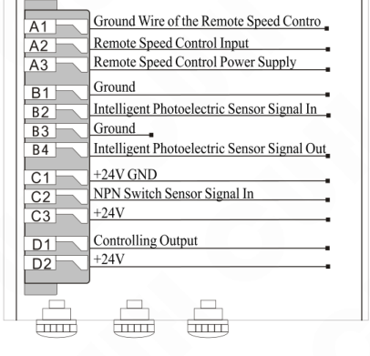

---

## **ภาคผนวก D:** นิยามอักขระแสดงผล LED

| ตัวควบคุม | อักขระแสดงผล | ภาพสัญลักษณ์ |
|---|---|---|
| `U` | แรงดันไฟฟ้าขาออก |  |
| `F` | ความถี่ขาออก |  |
| `d` | เวลาหน่วงเวลาสตาร์ทของเซ็นเซอร์โฟโตอิเล็กทริกอัจฉริยะ |  |
| `C` | เวลาหน่วงเวลาปิดของเซ็นเซอร์โฟโตอิเล็กทริกอัจฉริยะ |  |
| `E` | การสตาร์ทนุ่มนวล |  |
| `U-` | การหน่วงเวลาปิด |  |
| `d-` | เวลาหน่วงเวลาสตาร์ทของเซ็นเซอร์สวิตช์ NPN |  |
| `r1` | ความสัมพันธ์เชิงตรรกะของเซ็นเซอร์โฟโตอิเล็กทริกอัจฉริยะ |  |
| `r2` | ความสัมพันธ์เชิงตรรกะของเซ็นเซอร์สวิตช์ NPN |  |
| `r3` | ความสัมพันธ์เชิงตรรกะของเอาต์พุตควบคุม |  |
| `n` | ความสัมพันธ์เชิงตรรกะของสัญญาณควบคุม |  |
| `H` | แรงดันไฟฟ้าขาออกสูงสุด |  |
| `A` | ดัชนีการเร่งความเร็ว |  |
| `P` | ดัชนีรูปคลื่น |  |
| `88888` | คืนค่ากำหนดเริ่มต้น |  |

---

## ภาคผนวก E: ข้อมูลจำเพาะทางไฟฟ้า

| รายการ | ต่ำสุด | ปกติ | สูงสุด | หน่วย | คำอธิบาย |
|---|---:|---:|---:|:---:|---|
| แรงดันไฟฟ้าเข้า | 85 | 220 | 250 | V | AC RMS |
| ช่วงแรงดันไฟฟ้าขาออก ที่ปรับได้ | 0 | —— | 250 | V | ต่ำกว่า 150% ของ แรงดันไฟฟ้าเข้า |
| ความแม่นยำการปรับ แรงดันไฟฟ้า |  | 1 |  | V |  |
| ความแม่นยำการควบคุม แรงดันไฟฟ้า | 0 | —— | 10 | % | ΔVout/ΔVin |
| เวลาตอบสนองการควบคุม แรงดันไฟฟ้า | 0.0025 | —— | 0.025 | s | 1/10 ของคาบของ แรงดันไฟฟ้าขาออก |
| ช่วงกระแสขาออก ที่ปรับได้ | 0 | —— | 1.5 | A | SDVC31-S |
|  | 0 | —— | 3 | A | SDVC31-M |
|  | 0 | —— | 4.5 | A | SDVC31-L |
|  | 0 | —— | 6 | A | SDVC31-XL |
|  | 0 | —— | 10 | A | SDVC31-U |
|  | 0 | —— | 20 | A | SDVC31-XU |
| กำลังไฟฟ้าขาออก | 0 | —— | 330 | VA | SDVC31-S |
|  | 0 | —— | 660 | VA | SDVC31-M |
|  | 0 | —— | 990 | VA | SDVC31-L |
|  | 0 | —— | 1320 | VA | SDVC31-XL |
|  | 0 | —— | 2200 | VA | SDVC31-U |
|  | 0 | —— | 4400 | VA | SDVC31-XU |
| ความถี่ขาออก | 40 | —— | 400 | Hz |  |
| ความแม่นยำการปรับ ความถี่ |  | 0.1 |  | Hz |  |
| รูปคลื่นขาออก |  | ไซน์ |  |  |  |
| เวลาสตาร์ทนุ่มนวล | 0 | —— | 10 | s | ค่าเริ่มต้นจากโรงงาน 0.5 |
| ช่วงเวลาหน่วงเปิด/ปิด | 0 | —— | 20 | s | ค่าเริ่มต้นจากโรงงาน 0.2 |
| ความแม่นยำเวลาหน่วง เปิด/ปิด |  | 0.1 |  | s |  |
| อุณหภูมิทำงานของการป้องกัน ความร้อนสูงเกิน | 58 | 60 | 66 | ℃ | SDVC31-S\M |
|  | 60 | 65 | 65 | ℃ | SDVC31-L\XL\U\XU |
| แรงดันไฟฟ้าเอาต์พุตควบคุม DC | 22 | 24 | 26 | V |  |
| กระแสเอาต์พุตควบคุม DC | 0 | —— | 200 | mA |  |
| สัญญาณควบคุมอนาล็อก |  | 1-5 |  | V | แรงดันการควบคุม ความเร็วระยะไกล |
| สัญญาณควบคุมดิจิทัล |  | 24 |  | V | สัญญาณสวิตชิง |
| วิธีการปรับ |  | 6 |  | ปุ่ม |  |
| การใช้พลังงานสแตนด์บาย | —— | 3 | —— | W |  |
| วิธีการแสดงผล |  | 5 |  | หลัก | หลอดแสดงตัวเลข LED |
| อุณหภูมิแวดล้อม | 0 | 25 | 40 | ℃ | ไม่มีการควบแน่น |
| ความชื้นแวดล้อม | 10 | 60 | 85 | % |  |

## ภาคผนวก F: เคล็ดลับการแก้ไขปัญหาและคำอธิบายข้อผิดพลาด

เคล็ดลับต่อไปนี้สามารถช่วยแก้ไขปัญหาที่คุณอาจพบเจอได้

| ลำดับ | ปัญหา / การแสดงผล | ภาพสัญลักษณ์ | เคล็ดลับการแก้ไขปัญหาและคำอธิบายข้อผิดพลาด |
|---:|---|---|---|
| 1 | ไม่มีการแสดงผลหลัง เปิดเครื่อง |  | ◆ ตรวจสอบให้แน่ใจว่าเต้ารับไฟฟ้ามีกระแส ◆ ตรวจสอบให้แน่ใจว่าสายไฟเข้าเชื่อมต่อกับเต้ารับไฟฟ้าอย่างเชื่อถือได้ |
| 2 | แสดงผลปกติ แต่ไม่มีเอาต์พุต |  | ◆ ตรวจสอบให้แน่ใจว่าสายไฟเข้าและสายไฟเอาต์พุตเชื่อมต่อแน่น ◆ ตรวจสอบให้แน่ใจว่าค่าพารามิเตอร์แรงดันไฟฟ้าขาออกไม่เล็กเกินไป ◆ ตรวจสอบให้แน่ใจว่าตัวควบคุมไม่ได้ถูกหยุดโดยสัญญาณควบคุม ◆ ตรวจสอบให้แน่ใจว่าตัวควบคุมไม่ได้ถูกหยุดโดยพารามิเตอร์ที่ตั้งเป็นการปิดปกติ |
| 3 | สัญญาณควบคุม สูญเสียประสิทธิภาพ |  | ◆ ตรวจสอบให้แน่ใจว่าสัญญาณควบคุมถูกป้อนเข้าอย่างถูกต้อง ◆ ตรวจสอบให้แน่ใจว่าสายดินของสัญญาณควบคุมเชื่อมต่อกับตัวควบคุมอย่างถูกต้อง ◆ ตรวจสอบให้แน่ใจว่าความสัมพันธ์เชิงตรรกะของสัญญาณควบคุมตั้งค่าถูกต้องตามที่คุณต้องการ |
| 4 | ปรากฏการณ์เต้น (Beat) |  | ◆ หลีกเลี่ยงการสั่นสะเทือนส่งผ่านระหว่างตัวสั่น ◆ เพิ่มความถี่เสียงสะท้อนของตัวสั่น |
| 5 | แสดงผลปกติ ไม่มีเอาต์พุต แต่ ได้ยินเสียง |  | ◆ ปรับพารามิเตอร์ทั้งหมดตามที่คู่มือเล่มนี้แนะนำ |
| 6 | Err01 |  | ◆ เอาต์พุตลัดวงจร ตรวจสอบให้แน่ใจว่าสายไฟเอาต์พุตและขดลวดไม่ลัดวงจร |
| 7 | Err02 |  | ◆ กระแสขาออกเกิน ลดค่าแรงดันไฟฟ้าขาออกและตรวจสอบให้แน่ใจว่าช่องว่างอาร์เมเจอร์ไม่ใหญ่เกินไป |
| 8 | Err03 |  | ◆ ความร้อนสูงเกิน วางตัวควบคุมในสภาพแวดล้อมที่ระบายอากาศได้ดี |
| 9 | Err04 |  | ◆ สงวนไว้ กรุณาติดต่อเรา |
| 10 | Err05 |  | ◆ สงวนไว้ กรุณาติดต่อเรา |

**Nanjing CUH Science & Technology Co., Ltd**

No. 1 Xiaodong Road, Chenguang Village, Qilin, Nanjing, Jiangsu, China  
Tel: +86-25-84730415  
Fax: +86-25-84730426  
Email: sales@cuhnj.com  
Website: en.cuhnj.com

