## ตัวควบคุมความถี่แปรผันแบบดิจิทัลสองช่องสัญญาณสำหรับเครื่องป้อนวัสดุแบบสั่นสะเทือน

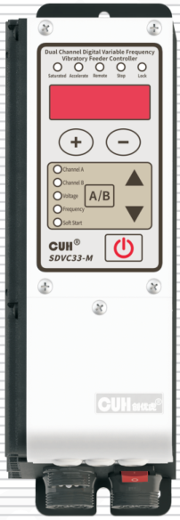

## ซีรีส์ SDVC33
ตัวควบคุมความถี่แปรผันแบบดิจิทัลสองช่องสัญญาณสำหรับเครื่องป้อนวัสดุแบบสั่นสะเทือน　ซีรีส์ SDVC33
## คู่มือการใช้งาน

---

## ข้อความลิขสิทธิ์

บริษัท Nanjing CUH Science & Technology CO., Ltd. ขอสงวนสิทธิ์ทั้งหมด

ข้อมูลทั้งหมดในคู่มือการใช้งานฉบับนี้เป็นทรัพย์สินทางปัญญาของบริษัทของเรา และได้รับความคุ้มครองตามกฎหมายลิขสิทธิ์และกฎหมายอื่นที่เกี่ยวข้อง CUH ได้รับและขอสงวนสิทธิ์ทั้งหมดตามที่กฎหมายลิขสิทธิ์และกฎหมายอื่น ๆ กำหนด โดยไม่ได้รับความยินยอมเป็นลายลักษณ์อักษรจาก CUH ห้ามคัดลอก แปล ลอกเลียน หรือนำคู่มือการใช้งานฉบับนี้ไปใช้ประโยชน์ไม่ว่าบางส่วนหรือทั้งหมด

## ข้อจำกัดความรับผิด

เนื้อหาทั้งหมดของคู่มือการใช้งานฉบับนี้อธิบายเฉพาะวิธีการใช้งานผลิตภัณฑ์ที่เกี่ยวข้องของบริษัทของเรา โดยอธิบายตามเทคโนโลยีที่มีอยู่ในปัจจุบันและสภาพที่ส่งมอบให้ท่านเมื่อใช้งาน ท่านต้องรับความเสี่ยงที่เกี่ยวข้องเมื่อใช้งานผลิตภัณฑ์นี้ เว้นแต่กฎหมายจะกำหนดไว้เป็นอย่างอื่น บริษัทไม่มีความรับผิดไม่ว่าด้วยการแสดงออกหรือโดยนัยใด ๆ ต่อผลิตภัณฑ์อันเนื่องมาจากคู่มือการใช้งานฉบับนี้ รวมถึงแต่ไม่จำกัดเพียงการบาดเจ็บต่อบุคคล ความเสียหายต่อทรัพย์สิน การสูญเสียโอกาส เป็นต้น

ท่านเข้าใจความเสี่ยงข้างต้นอย่างชัดเจนและตกลงว่า เว้นแต่กฎหมายจะบังคับไว้ บริษัทจะไม่รับผิดชอบต่อความเสียหายหรือการสูญเสียโดยตรงหรือโดยอ้อมต่อท่าน (รวมถึงแต่ไม่จำกัดเพียงการสูญเสียที่จับต้องได้ของบุคลากร ทรัพย์สิน ข้อมูล เป็นต้น และการสูญเสียที่จับต้องไม่ได้ เช่น ชื่อเสียง โอกาส เป็นต้น)

บริษัทขอสงวนสิทธิ์ในการแก้ไขผลิตภัณฑ์ที่เกี่ยวข้องในคู่มือการใช้งานฉบับนี้โดยไม่ต้องแจ้งให้ทราบล่วงหน้าหรือภายหลัง

---

## บทนำ

ขอบคุณที่ท่านเลือกใช้ตัวควบคุมความถี่แปรผันแบบดิจิทัลสองช่องสัญญาณสำหรับเครื่องป้อนวัสดุแบบสั่นสะเทือน ซีรีส์ SDVC33 ของ CUH (ต่อไปนี้จะเรียกว่า "ตัวควบคุม") ตัวควบคุมซีรีส์นี้ใช้ส่วนประกอบคุณภาพสูง ผสมผสานเทคโนโลยีอิเล็กทรอนิกส์ล่าสุด และออกแบบอย่างพิถีพิถันด้วยตัวประมวลผลสัญญาณดิจิทัลประสิทธิภาพสูง

คู่มือฉบับนี้ประกอบด้วยคำแนะนำสำหรับการติดตั้ง การปรับแต่ง การตั้งค่าพารามิเตอร์ การบำรุงรักษา และการแก้ไขปัญหาของตัวควบคุม โปรดอ่านคู่มือฉบับนี้อย่างละเอียดก่อนใช้งานตัวควบคุมและเก็บรักษาไว้อย่างถูกต้อง

สัญลักษณ์ต่อไปนี้เตือนท่านให้ระวังการบาดเจ็บต่อบุคคลและความเสียหายต่อผลิตภัณฑ์ โปรดอ่านให้แน่ใจ

| สัญลักษณ์ | คำอธิบาย |
|---|---|
| ⚠ อันตราย | การไม่ปฏิบัติตามข้อนี้จะทำให้เกิดการบาดเจ็บต่อบุคคลหรือเสียชีวิต |
| ⚠ คำเตือน | การไม่ปฏิบัติตามข้อนี้จะทำให้เกิดการบาดเจ็บต่อบุคคลหรือเสียชีวิต |
| ⚠ ข้อควรระวัง | การไม่ปฏิบัติตามข้อนี้จะทำให้เกิดการบาดเจ็บระดับปานกลางหรือเล็กน้อยต่อบุคคล |
| ข้อสังเกต | การไม่ปฏิบัติตามข้อนี้จะทำให้เกิดความเสียหายต่อผลิตภัณฑ์และทรัพย์สิน |
| ❗ จำเป็น | ระบุข้อควรระวังและข้อจำกัดการใช้งานที่ต้องปฏิบัติตามระหว่างการใช้งาน |

**คู่มือฉบับนี้เหมาะสำหรับรุ่นต่อไปนี้**

- SDVC33-M ( กระแสรวมสองช่องสัญญาณสูงสุด 3.5A )

---

# ความปลอดภัยและข้อควรระวัง

1. **⚠ อันตราย** ผลิตภัณฑ์นี้ใช้สำหรับขับเคลื่อนอุปกรณ์ป้อนวัสดุแบบสั่นสะเทือนที่ใช้แม่เหล็กไฟฟ้าเท่านั้น ห้ามใช้ผลิตภัณฑ์นี้เพื่อวัตถุประสงค์ในการปกป้องร่างกายมนุษย์หรือส่วนหนึ่งส่วนใดของร่างกายมนุษย์ เป็นต้น

2. **⚠ อันตราย** ผลิตภัณฑ์นี้ไม่ได้ออกแบบมาให้ใช้เป็นผลิตภัณฑ์กันระเบิด ห้ามใช้งานในพื้นที่อันตรายและ/หรือสภาพแวดล้อมที่มีก๊าซที่อาจเกิดการระเบิดได้

3. **⚠ คำเตือน** ผลิตภัณฑ์นี้ใช้พลังงานจากไฟฟ้ากระแสสลับ โปรดอย่าจ่ายแรงดันไฟฟ้ากระแสสลับเกิน 260Vac แรงดันอินพุตที่สูงเกินไป เช่น 380Vac อาจทำให้ผลิตภัณฑ์ระเบิดหรือเกิดเพลิงไหม้ ก่อให้เกิดอุบัติเหตุด้านความปลอดภัยร้ายแรง

4. **⚠ คำเตือน** ผลิตภัณฑ์นี้ต่อสายดินผ่านสายไฟ โปรดตรวจสอบให้แน่ใจว่าอุปกรณ์จ่ายไฟสำหรับตัวควบคุมมีการต่อสายดินที่ดี มิฉะนั้นเปลือกตัวควบคุมอาจมีไฟฟ้ารั่วและทำให้เกิดอุบัติเหตุไฟดูด

5. **⚠ คำเตือน** ห้ามจ่ายไฟ AC เข้าที่เอาต์พุตของตัวควบคุมนี้ เพราะจะทำให้ตัวควบคุมเสียหาย

6. **⚠ คำเตือน** ห้ามเสียบหรือถอดสายไฟขณะมีกระแสไฟฟ้า และห้ามสัมผัสจุดสัมผัสของขั้วต่อต่าง ๆ ในช่องเดินสาย เพื่อป้องกันไฟฟ้าดูด

7. **ข้อสังเกต** โปรดหลีกเลี่ยงการควบคุมเอาต์พุตของผลิตภัณฑ์นี้โดยการตัดแหล่งจ่ายไฟผ่านรีเลย์และอุปกรณ์อื่น ๆ ซึ่งจะลดอายุการใช้งานของตัวควบคุมอย่างรุนแรง

8. **ข้อสังเกต** ตัวควบคุมออกแบบมาให้ทำงานในสภาพแวดล้อมที่เย็นและแห้ง ห้ามใช้งานตัวควบคุมกลางแจ้งเพื่อหลีกเลี่ยงการแช่น้ำและการถูกแดดส่อง ให้ใช้งานตัวควบคุมภายในอุณหภูมิตามคุณลักษณะทางไฟฟ้าที่กำหนด

9. **! จำเป็น** ต้องยึดผลิตภัณฑ์นี้บนแท่นที่มั่นคงซึ่งต่อสายดินอย่างน่าเชื่อถือและอยู่ห่างจากอุปกรณ์ที่สั่นสะเทือน

10. **! จำเป็น** ห้ามใช้งานตัวควบคุมในสภาวะที่เกินขีดจำกัดการออกแบบ

11. **! จำเป็น** ให้ใช้งานตัวควบคุมอย่างเคร่งครัดตามคู่มือฉบับนี้ เราจะไม่รับผิดชอบทางแพ่งหรือทางอาญาใด ๆ หากเกิดความเสียหายต่ออุปกรณ์หรือการบาดเจ็บต่อบุคคลจากการใช้งานที่ไม่ถูกต้อง

12. **! จำเป็น** ห้ามเปิดเปลือกตัวควบคุมเพื่อหลีกเลี่ยงไฟฟ้าดูด โปรดติดต่อ CUH หากตัวควบคุมขัดข้อง ห้ามพยายามซ่อมแซมตัวควบคุมด้วยตนเอง ซึ่งอาจทำให้การรับประกันเป็นโมฆะ

---

---

## สภาพแวดล้อมในการใช้งานและการจัดเก็บ

### การตรวจสอบก่อนการใช้งาน

ตัวควบคุมทุกเครื่องจะผ่านการตรวจสอบคุณภาพอย่างเข้มงวดก่อนการจัดส่ง และบรรจุในบรรจุภัณฑ์กันกระแทก โปรดตรวจสอบรายการต่อไปนี้หลังจากเปิดกล่อง:

1. ตัวควบคุมเสียหายในด้านรูปลักษณ์หรือไม่
2. รุ่นของตัวควบคุมตรงกับที่ท่านสั่งซื้อหรือไม่

### สภาพแวดล้อมในการทำงาน

โปรดปฏิบัติตามข้อควรระวังต่อไปนี้เพื่อให้มั่นใจในประสิทธิภาพที่ดีขึ้นและอายุการใช้งานที่ยาวนานขึ้นของตัวควบคุม:

- ⚠ สภาพแวดล้อมที่มีการระบายอากาศดี
- ⚠ อยู่ห่างจากน้ำ ความชื้น ฝุ่น และโดยเฉพาะฝุ่นมัน
- ⚠ อยู่ห่างจากก๊าซและของเหลวที่กัดกร่อนหรือติดไฟได้
- ⚠ อยู่ห่างจากฝุ่นที่ฟุ้งกระจายและเศษโลหะ
- ⚠ ยึดติดแน่นเพื่อหลีกเลี่ยงการสั่นสะเทือนของตัวเอง
- ⚠ อยู่ห่างจากการรบกวนทางแม่เหล็กไฟฟ้า
- ⚠ ตรวจสอบให้แน่ใจว่าอุณหภูมิแวดล้อมอยู่ที่ 0~40 ℃
- ⚠ สำหรับใช้งานที่ระดับความสูง 2000 ม. หรือต่ำกว่า

---

---

# สารบัญ

**บทที่ Ⅰ คำแนะนำก่อนการใช้งาน — 1**

- 1.1 การตรวจสอบรายการในบรรจุภัณฑ์ — 1
- 1.2 คำอธิบายไฟแสดงสถานะ ปุ่มกด และชิ้นส่วนภายนอก — 2
- 1.3 คำอธิบายพอร์ตการเชื่อมต่อสายไฟ — 3
- 1.4 คำอธิบายป้ายข้อมูล — 3

**บทที่ Ⅱ บทนำผลิตภัณฑ์ — 4**

- 2.1 บทนำผลิตภัณฑ์ — 4
- 2.2 การปรับปรุงประสิทธิภาพของผลิตภัณฑ์ — 4
- 2.3 การใช้งานเอาต์พุตคู่ร่วมกัน — 5

**บทที่ Ⅲ คำแนะนำการติดตั้ง — 6**

- 3.1 เงื่อนไขการใช้งานตัวควบคุม — 6
- 3.2 วิธีการใช้งานปุ่ม — 6
- 3.3 การติดตั้งและการใช้งาน — 7

**บทที่ Ⅳ คำอธิบายฟังก์ชันพื้นฐาน — 11**

- 4.1 การตั้งค่าแรงดันเอาต์พุต — 11
- 4.2 การตั้งค่าความถี่เอาต์พุต — 12
- 4.3 การสตาร์ทแบบนุ่มนวล — 12
- 4.4 การหยุดแบบนุ่มนวล — 13
- 4.5 ฟังก์ชันเบรก — 13
- 4.6 สวิตช์เอาต์พุต — 14
- 4.7 การล็อกคีย์บอร์ด — 14
- 4.8 การคืนค่าการตั้งค่าเริ่มต้น — 15

**บทที่ Ⅴ คำอธิบายฟังก์ชันขั้นสูง — 17**

- 5.1 การควบคุมความเร็วระยะไกล — 17
- 5.2 การตรวจจับด้วยโฟโตอิเล็กทริกอัจฉริยะ — 19
- 5.3 เซ็นเซอร์แบบสวิตช์ — 20

---

---

- 5.4 เอาต์พุตควบคุม — 21
  - 5.4.1 วิธีการเดินสายของเอาต์พุตควบคุม — 21
  - 5.4.2 แหล่งสัญญาณเอาต์พุตควบคุมและแผนภาพตรรกะ — 22
  - 5.4.3 คำอธิบายโหมดเอาต์พุตควบคุม — 24
  - 5.4.4 ฟังก์ชันควบคุมสัญญาณเอาต์พุตหลัก — 24
- 5.5 ขีดจำกัดแรงดันเอาต์พุตสูงสุด — 25
- 5.6 การป้องกันกระแสเกินแบบปรับได้ — 25
- 5.7 การปรับความสว่างของแผงควบคุม — 26
- 5.8 ฟังก์ชันตรวจสอบเอาต์พุต — 26
- 5.9 การควบคุมร่วมแบบสองช่องสัญญาณ — 27
- 5.10 การบันทึกและคืนค่าพารามิเตอร์ผู้ใช้ — 28

## บทที่ Ⅵ ข้อมูลจำเพาะทางเทคนิค — 29

- 6.1 ขนาด — 29
- 6.2 ข้อมูลจำเพาะทางเทคนิค — 30
- 6.3 มาตรฐานอ้างอิง — 31

## บทที่ Ⅶ ภาคผนวก — 32

- 7.1 ตารางพารามิเตอร์ — 32
- 7.2 แผนภาพวงจรอินพุตและเอาต์พุต — 35
- 7.3 คำแนะนำการแก้ไขปัญหาและคำอธิบายข้อผิดพลาด — 36

## บทที่ Ⅷ ข้อมูลการรับประกันผลิตภัณฑ์ — 37

- 8.1 ระยะเวลาการรับประกัน — 37
- 8.2 ขอบเขตการรับประกัน — 37
- 8.3 ความเหมาะสมของผลิตภัณฑ์ — 37

---

# บทที่ Ⅰ คำแนะนำก่อนการใช้งาน

บทนี้อธิบายรายการบรรจุภัณฑ์ของผลิตภัณฑ์ คำอธิบายรูปลักษณ์ของตัวควบคุม และข้อมูลป้ายข้อมูลของตัวควบคุม

## 1.1 การตรวจสอบรายการในบรรจุภัณฑ์

ก่อนใช้งานผลิตภัณฑ์นี้ โปรดตรวจสอบความสมบูรณ์ของตัวควบคุมและอุปกรณ์เสริม หากพบว่าผลิตภัณฑ์มีข้อบกพร่องหรือเสียหาย อุปกรณ์เสริมขาดหาย ฯลฯ โปรดติดต่อบริษัทของเรา

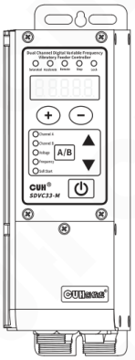

ตัวควบคุม×1

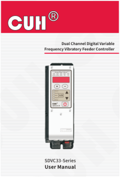

คู่มือการใช้งาน×1

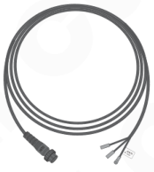

สายเอาต์พุต×2

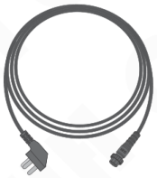

สายไฟอินพุต×1

---

## 1.2 คำอธิบายไฟแสดงสถานะ ปุ่มกด และชิ้นส่วนภายนอก

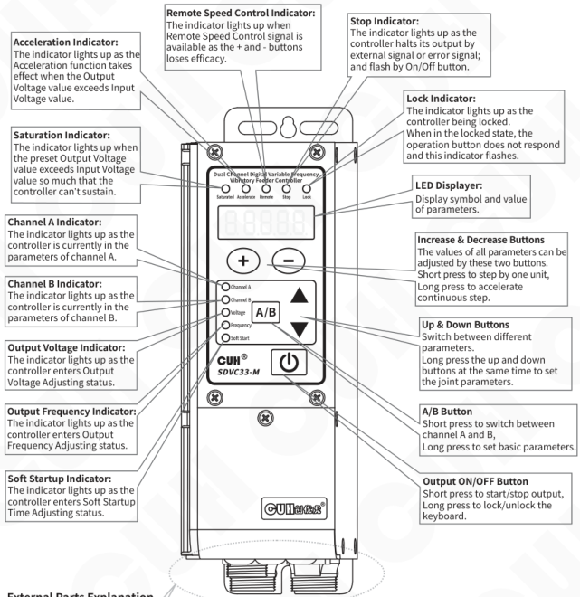

**ไฟแสดงสถานะเร่งความเร็ว:**  
ไฟแสดงสถานะจะสว่างขึ้นเมื่อฟังก์ชันเร่งความเร็วทำงาน ขณะที่ค่าแรงดันเอาต์พุตเกินค่าแรงดันอินพุต

**ไฟแสดงสถานะควบคุมความเร็วระยะไกล:**  
ไฟแสดงสถานะจะสว่างขึ้นเมื่อมีสัญญาณควบคุมความเร็วระยะไกล ขณะที่ปุ่ม + และ - ไม่สามารถใช้งานได้

**ไฟแสดงสถานะหยุด:**  
ไฟแสดงสถานะจะสว่างขึ้นเมื่อตัวควบคุมหยุดเอาต์พุตเนื่องจากสัญญาณภายนอกหรือสัญญาณข้อผิดพลาด และจะกะพริบเมื่อกดปุ่มเปิด/ปิด

**ไฟแสดงสถานะอิ่มตัว:**  
ไฟแสดงสถานะจะสว่างขึ้นเมื่อค่าแรงดันเอาต์พุตที่ตั้งไว้เกินค่าแรงดันอินพุตมากจนตัวควบคุมไม่สามารถรักษาไว้ได้

**ไฟแสดงสถานะล็อก:**  
ไฟแสดงสถานะจะสว่างขึ้นเมื่อตัวควบคุมถูกล็อก  
เมื่ออยู่ในสถานะล็อก ปุ่มกดจะไม่ตอบสนองและไฟแสดงสถานะนี้จะกะพริบ

**จอแสดงผล LED:**  
แสดงสัญลักษณ์และค่าของพารามิเตอร์

**ไฟแสดงสถานะช่องสัญญาณ A:**  
ไฟแสดงสถานะจะสว่างขึ้นเมื่อตัวควบคุมอยู่ในพารามิเตอร์ของช่องสัญญาณ A ในปัจจุบัน

**ไฟแสดงสถานะช่องสัญญาณ B:**  
ไฟแสดงสถานะจะสว่างขึ้นเมื่อตัวควบคุมอยู่ในพารามิเตอร์ของช่องสัญญาณ B ในปัจจุบัน

**ไฟแสดงสถานะแรงดันเอาต์พุต:**  
ไฟแสดงสถานะจะสว่างขึ้นเมื่อตัวควบคุมเข้าสู่สถานะปรับแรงดันเอาต์พุต

**ไฟแสดงสถานะความถี่เอาต์พุต:**  
ไฟแสดงสถานะจะสว่างขึ้นเมื่อตัวควบคุมเข้าสู่สถานะปรับความถี่เอาต์พุต

**ไฟแสดงสถานะการสตาร์ทแบบนุ่มนวล:**  
ไฟแสดงสถานะจะสว่างขึ้นเมื่อตัวควบคุมเข้าสู่สถานะปรับเวลาสตาร์ทแบบนุ่มนวล

**ปุ่มเพิ่มและลด**  
ค่าของพารามิเตอร์ทั้งหมดสามารถปรับได้ด้วยสองปุ่มนี้  
กดสั้นเพื่อเพิ่มหรือลดทีละหนึ่งหน่วย,  
กดค้างเพื่อเร่งการปรับต่อเนื่อง

**ปุ่มขึ้นและลง**  
สลับระหว่างพารามิเตอร์ต่าง ๆ  
กดปุ่มขึ้นและลงค้างไว้พร้อมกันเพื่อตั้งค่าพารามิเตอร์ร่วม

**ปุ่ม A/B**  
กดสั้นเพื่อสลับระหว่างช่องสัญญาณ A และ B,  
กดค้างเพื่อตั้งค่าพารามิเตอร์พื้นฐาน

**ปุ่มเปิด/ปิดเอาต์พุต**  
กดสั้นเพื่อเริ่ม/หยุดเอาต์พุต,  
กดค้างเพื่อล็อก/ปลดล็อกคีย์บอร์ด

### คำอธิบายชิ้นส่วนภายนอก

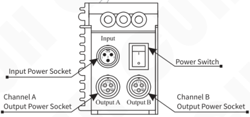

- เต้ารับพลังงานอินพุต
- สวิตช์ไฟ
- เต้ารับพลังงานเอาต์พุตช่องสัญญาณ A
- เต้ารับพลังงานเอาต์พุตช่องสัญญาณ B

## 1.3 คำอธิบายพอร์ตการเชื่อมต่อสายไฟ

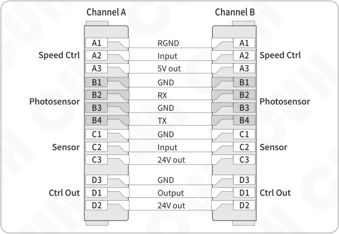

| ฟังก์ชัน | ช่องสัญญาณ A | คำอธิบาย | ช่องสัญญาณ B | ฟังก์ชัน |
|---|---|---|---|---|
| Speed Ctrl | A1 | RGND | A1 | Speed Ctrl |
| Speed Ctrl | A2 | Input | A2 | Speed Ctrl |
| Speed Ctrl | A3 | 5V out | A3 | Speed Ctrl |
| Photosensor | B1 | GND | B1 | Photosensor |
| Photosensor | B2 | RX | B2 | Photosensor |
| Photosensor | B3 | GND | B3 | Photosensor |
| Photosensor | B4 | TX | B4 | Photosensor |
| Sensor | C1 | GND | C1 | Sensor |
| Sensor | C2 | Input | C2 | Sensor |
| Sensor | C3 | 24V out | C3 | Sensor |
| Ctrl Out | D3 | GND | D3 | Ctrl Out |
| Ctrl Out | D1 | Output | D1 | Ctrl Out |
| Ctrl Out | D2 | 24V out | D2 | Ctrl Out |

## 1.4 คำอธิบายป้ายข้อมูล

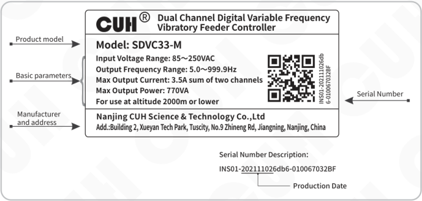

**CUH® — ตัวควบคุมความถี่แปรผันแบบดิจิทัลสองช่องสัญญาณสำหรับเครื่องป้อนวัสดุแบบสั่นสะเทือน**

**รุ่นผลิตภัณฑ์**

รุ่น: SDVC33-M

**พารามิเตอร์พื้นฐาน**

- ช่วงแรงดันอินพุต: 85～250VAC
- ช่วงความถี่เอาต์พุต: 5.0～999.9Hz
- กระแสเอาต์พุตสูงสุด: 3.5A รวมสองช่องสัญญาณ
- กำลังเอาต์พุตสูงสุด: 770VA
- สำหรับใช้งานที่ระดับความสูง 2000 ม. หรือต่ำกว่า

**ผู้ผลิตและที่อยู่**

Nanjing CUH Science & Technology Co.,Ltd

ที่อยู่: Building 2, Xueyan Tech Park, Tuscity, No.9 Zhineng Rd, Jiangning, Nanjing, China

**หมายเลขเครื่อง**

INS01-202111026db6-010067032BF

**คำอธิบายหมายเลขเครื่อง:**

INS01-**20211102**6db6-010067032BF

วันที่ผลิต: **20211102**

---

# บทที่ Ⅱ บทนำผลิตภัณฑ์

บทนี้ประกอบด้วยคำแนะนำโดยย่อและคุณสมบัติหลักของตัวควบคุม

## 2.1 บทนำผลิตภัณฑ์

SDVC33 ตัวควบคุมเครื่องป้อนวัสดุแบบสั่นสะเทือนชนิด FM ดิจิทัลแบบสองช่องสัญญาณ เป็นตัวควบคุมเอาต์พุต FM คู่ขนาดกะทัดรัดอเนกประสงค์ ที่มอบประสิทธิภาพอันเป็นเอกลักษณ์ด้วยการใช้เทคโนโลยีอิเล็กทรอนิกส์ล่าสุดและการออกแบบอย่างพิถีพิถัน คุณสมบัติพิเศษประกอบด้วย:

- เอาต์พุตกำลังสองช่องสัญญาณที่สามารถกระจายกระแสได้ตามต้องการ รองรับการตั้งค่ากระแสป้องกันกระแสเกินของแต่ละช่องสัญญาณ
- โหมดการทำงานสองช่องสัญญาณสามารถเลือกการติดตามความถี่ การติดตามแรงดัน หรือการติดตามคู่แรงดัน-ความถี่
- ในระหว่างการติดตามความถี่ สามารถตั้งค่าความต่างเฟสระหว่างเอาต์พุตทั้งสองได้ตั้งแต่ -180°~180°
- ช่วงความถี่เอาต์พุตครอบคลุม 5Hz ถึง 999.9Hz ด้วยความแม่นยำ 0.1Hz
- ฟังก์ชันเบรกเพื่อหยุดเครื่องป้อนวัสดุแบบสั่นสะเทือนอย่างรวดเร็วโดยการเลื่อนเฟสกระแส 180° ในระหว่างกระบวนการหยุดแบบนุ่มนวล
- พอร์ตโฟโตอิเล็กทริกอัจฉริยะรองรับโฟโตเซ็นเซอร์ เซ็นเซอร์แบบสวิตช์ NPN หรือ PNP
- ฟังก์ชันสัญญาณพร้อมใช้งาน: ส่งสัญญาณมอดูเลตหรือสัญญาณที่ถูกต้องผ่านพอร์ตส่งสัญญาณโฟโตอิเล็กทรอนิกส์ B4 อัจฉริยะ เพื่อบ่งชี้ว่าตัวควบคุมอยู่ในสถานะพร้อมใช้งาน เมื่อตัวควบคุมพบข้อผิดพลาด สัญญาณพร้อมใช้งานจะไม่ถูกต้อง
- พอร์ตควบคุมการล้นรองรับแบบ NPN, PNP หรือแบบปรับตัวอัตโนมัติ
- พอร์ตเอาต์พุตควบคุมรองรับโหมดเอาต์พุต NPN, PNP หรือแบบพุช-พูล
- พอร์ตควบคุมความเร็วระยะไกลสามารถเลือกข้ามได้ ทำให้โพเทนชิโอมิเตอร์ตัวเดียวควบคุมเอาต์พุตสองช่องพร้อมกันได้
- ฟังก์ชันสัมประสิทธิ์การควบคุมระยะไกลสามารถขยายหรือลดผลการควบคุมของแรงดันควบคุมระยะไกลได้ 1 เท่า
- ฟังก์ชันปรับความสว่างของจอแสดงผล LED รองรับการปรับความสว่าง 32 ระดับ
- ฟังก์ชันบันทึกและเรียกคืนพารามิเตอร์ผู้ใช้ ช่วยให้ผู้ใช้ตั้งค่าพารามิเตอร์และบันทึกไว้ในกลุ่มผู้ใช้เพื่อการเรียกคืนที่ง่ายดาย
- ฟังก์ชันรีเซ็ตเป็นค่าโรงงานรองรับการเรียกคืนแยกช่องสัญญาณ A/B หรือการเรียกคืนตัวควบคุมทั้งหมด
- ฟังก์ชันป้องกันที่สมบูรณ์ประกอบด้วย: การป้องกันการลัดวงจรของเอาต์พุตหลัก การป้องกันกระแสเกิน การป้องกันความร้อนเกินหรือความเย็นเกิน การป้องกันแรงดันต่ำ/แรงดันเกิน การป้องกันการลัดวงจรของเอาต์พุตควบคุม การป้องกันการลัดวงจรของเอาต์พุต 24V การป้องกันการลัดวงจรของเอาต์พุต 5V สำหรับปรับความเร็ว

## 2.2 การปรับปรุงประสิทธิภาพของผลิตภัณฑ์

เมื่อเทียบกับตัวควบคุม SDVC31-M, SDVC33 มีประสิทธิภาพที่ดีขึ้นอย่างมาก ซึ่งส่วนใหญ่ประกอบด้วย:

- ความถี่เอาต์พุตเพิ่มขึ้นจาก 40.0Hz~400.0Hz เป็น 5.0Hz~999.9Hz
- เวลาหน่วงเปิด/ปิดสูงสุดเพิ่มขึ้นจาก 20.0 s เป็น 99.9 s

---

- เพิ่มฟังก์ชันหยุดแบบนุ่มนวล ซึ่งสามารถตั้งค่าได้ 0.0~10.0 s เพื่อหยุดการสั่นสะเทือนของเครื่องป้อนวัสดุแบบสั่นสะเทือนอย่างช้า ๆ
- เพิ่มฟังก์ชันเบรก สามารถตั้งค่าจำนวนรอบการเบรก 0~10 รอบ เพื่อหยุดการสั่นสะเทือนของจานสั่นอย่างรวดเร็ว
- พอร์ตเซ็นเซอร์โฟโตอิเล็กทริกอัจฉริยะเพิ่มการรองรับเซ็นเซอร์ PNP
- พอร์ตเซ็นเซอร์แบบสวิตช์เมื่อวัสดุเต็มได้รับการอัปเกรดจาก NPN และ PNP เป็นแบบที่ตั้งค่าด้วยซอฟต์แวร์ได้ และมีโหมดอัตโนมัติให้
- พอร์ตเอาต์พุตควบคุมได้รับการอัปเกรดจากเอาต์พุต NPN เป็นสามประเภทที่ตั้งค่าได้: NPN, PNP และพุช-พูล
- เพิ่มการหน่วงเปิด/ปิดของพอร์ตเอาต์พุตควบคุม ซึ่งสามารถตั้งค่าได้ตั้งแต่ 0.0 ถึง 99.9 s
- เพิ่มโหมดเอาต์พุตควบคุม สามารถตั้งค่าโหมดหน่วงและโหมดคงไว้ได้
- เพิ่มพารามิเตอร์กระแสป้องกันกระแสเกินแบบปรับได้เพื่อป้องกันแม่เหล็กไฟฟ้าไหม้
- เพิ่มสัมประสิทธิ์การควบคุมระยะไกล ซึ่งสามารถขยายหรือลดผลการควบคุมของแรงดันควบคุมระยะไกลได้
- เพิ่มฟังก์ชันปรับความสว่างของแผงควบคุม สามารถตั้งค่าความสว่างของจอแสดงผลของกลุ่ม A/B แยกกันได้
- เพิ่มฟังก์ชันการวัด ซึ่งสามารถตรวจสอบกระแสเอาต์พุต แรงดันปรับความเร็ว แรงดันสัญญาณของพอร์ตโฟโตอิเล็กทริกอัจฉริยะ แรงดันอินพุตของพอร์ตเซ็นเซอร์แบบสวิตช์ แรงดันเอาต์พุตของพอร์ตเอาต์พุตควบคุม การแสดงอุณหภูมิ แรงดันบัส แรงดันเอาต์พุต 24V
- เพิ่มฟังก์ชันบันทึกและเรียกคืนพารามิเตอร์ นอกจากการบันทึกอัตโนมัติของพารามิเตอร์กลุ่มทำงานแล้ว ยังสามารถบันทึกพารามิเตอร์กลุ่มทำงานในกลุ่มผู้ใช้ และเรียกคืนพารามิเตอร์ของกลุ่ม A และกลุ่ม B จากกลุ่มผู้ใช้ได้อย่างยืดหยุ่นเมื่อจำเป็น

## 2.3 การใช้งานเอาต์พุตคู่ร่วมกัน

ตัวควบคุมจัดเตรียมพารามิเตอร์ของช่องสัญญาณควบคุมร่วม A/B ซึ่งสามารถใช้ควบคุมเครื่องป้อนวัสดุแบบสั่นสะเทือนแบบเวกเตอร์สองแกน หรือระบบป้อนของถ้วยป้อนและเครื่องป้อนแบบเส้นตรง

โดยค่าเริ่มต้น ช่องสัญญาณ A และ B ทำงานแยกกัน เมื่อรวมกัน ช่องสัญญาณ B สามารถตั้งค่าให้ติดตามช่องสัญญาณ A ได้ รวมถึงการติดตามแรงดัน การติดตามความถี่ และการติดตามคู่แรงดัน-ความถี่ เมื่อความถี่เท่ากัน เฟสของเอาต์พุตทั้งสองจะถูกล็อก และผู้ใช้สามารถปรับความต่างเฟสได้ตั้งแต่ -180° ถึง 180°

หลังจากตั้งค่าแรงดันและความถี่ของช่องสัญญาณ B ให้ติดตามคู่กับช่องสัญญาณ A แล้ว เพียงปรับแรงดันและความถี่ของช่องสัญญาณ A ก็สามารถเปลี่ยนแรงดันเอาต์พุตและความถี่เอาต์พุต A/B ได้พร้อมกัน

---

# บทที่ Ⅲ คำแนะนำการติดตั้ง

บทนี้แนะนำเงื่อนไขที่จำเป็นสำหรับการใช้งานตัวควบคุม และวิธีการติดตั้งและเชื่อมต่ออย่างถูกต้อง

## 3.1 เงื่อนไขการใช้งานตัวควบคุม

ตัวควบคุมใช้พลังงานจากไฟฟ้ากระแสสลับ 110/220V และการต่อสายดินป้องกันทำผ่านปลั๊กของสายไฟ โปรดจัดหาอุปกรณ์จ่ายไฟและจำหน่ายไฟหลัก 110V หรือ 220V, 50Hz/60Hz ที่ได้มาตรฐาน และตรวจสอบให้แน่ใจว่าสายดินป้องกันเชื่อมต่ออย่างถูกต้อง

**⚠ คำเตือน** ห้ามเชื่อมต่อตัวควบคุมกับไฟฟ้ากระแสสลับ 380V ซึ่งจะทำให้ตัวควบคุมเสียหายอย่างรุนแรงและไม่สามารถแก้ไขได้ อาจส่งผลให้เกิดการระเบิด ไฟไหม้ และอุบัติเหตุด้านความปลอดภัยอื่น ๆ

**⚠ คำเตือน** ตรวจสอบให้แน่ใจว่าด้านจ่ายไฟมีการต่อสายดินอย่างน่าเชื่อถือ เปลือกโลหะของตัวควบคุมเชื่อมต่อโดยตรงกับสายดินป้องกัน การต่อสายดินที่ไม่ดีจะทำให้เปลือกตัวควบคุมมีไฟฟ้าและเกิดอุบัติเหตุไฟดูด

**ข้อสังเกต** หากตัวควบคุมทำงานเป็นเวลานาน จะเกิดความร้อนและทำให้อุณหภูมิของเปลือกสูงขึ้น โปรดติดตั้งตัวควบคุมในสภาพแวดล้อมที่มีการระบายอากาศดีและยึดให้แน่น ห่างจากแหล่งสั่นสะเทือน

**ข้อสังเกต** เอาต์พุตช่องสัญญาณ A/B ของผลิตภัณฑ์นี้เกิดจากการแปลงและการสลับของไฟหลัก โดยไม่มีวงแหวนแยกในระหว่างกลาง ดังนั้นขั้วเอาต์พุตจึงไม่สามารถเชื่อมต่อกับสายดินป้องกันได้ เมื่อเชื่อมต่อแม่เหล็กไฟฟ้า จำเป็นต้องตรวจสอบให้แน่ใจว่าขดลวดแม่เหล็กไฟฟ้าและเปลือกมีความสามารถในการเป็นฉนวนขั้นพื้นฐาน มิฉะนั้นอาจเกิดการรั่วไหลของไฟฟ้า ซึ่งอาจทำให้เกิดไฟดูดและความเสียหายต่อตัวควบคุม

**ข้อสังเกต** ผลิตภัณฑ์นี้เป็นตัวควบคุมที่ใช้ขับเคลื่อนแม่เหล็กไฟฟ้า ห้ามเชื่อมต่อกับเครื่องป้อนวัสดุแบบสั่นสะเทือนแบบเพียโซอิเล็กทริกโดยเด็ดขาด

## 3.2 วิธีการใช้งานปุ่ม

a. การทำงานของปุ่มแบ่งออกเป็นการกดสั้นและการกดยาว (การเร่งระดับที่หนึ่ง การเร่งระดับที่สอง) ตามระยะเวลาการกด  
b. กดสั้นกำหนดระยะเวลาการกดมากกว่า 0.1 และน้อยกว่า 2 วินาที และกดยาวกำหนดระยะเวลาการกดมากกว่า 2 วินาที  
f. กด [A/B] ค้างเพื่อเข้า/ออกจากอินเทอร์เฟซพารามิเตอร์พื้นฐาน  
g. กด [A/B] และ ▲ ค้างเพื่อเข้า/ออกจากอินเทอร์เฟซพารามิเตอร์ขั้นสูง  
h. กด [A/B] และ ▼ ค้างเพื่อเข้า/ออกจากอินเทอร์เฟซพารามิเตอร์ตรวจสอบ  
I. กด ▲ และ ▼ ค้างเพื่อเข้า/ออกจากอินเทอร์เฟซพารามิเตอร์ร่วม  
j. กด ⊕ ค้างจนกระทั่ง  แสดงบน LED เพื่อเรียกคืนพารามิเตอร์โรงงาน ปล่อยแล้วแสดง CUH หมายถึงเรียกคืนการตั้งค่าโรงงานสำเร็จ  
k. เลือก uP1 เมื่อบันทึกพารามิเตอร์ผู้ใช้ กด ⊕ และ ⊖ ค้าง หลังบันทึกสำเร็จจะแสดง SAU  
l. เมื่อเรียกคืนพารามิเตอร์ผู้ใช้ หลังจากเลือกวิธีการเรียกคืนแล้ว ให้กด ⊕ และ ⊖ ค้าง เมื่อเรียกคืนสำเร็จจะแสดง rES

---

## 3.3 การติดตั้งและการใช้งาน

### ขั้นตอนที่หนึ่ง:

เปิดกล่องบรรจุภัณฑ์และตรวจสอบตัวควบคุมและอุปกรณ์เสริมทั้งหมด

### ขั้นตอนที่สอง:

เชื่อมต่อขั้วต่อสายไฟของสายเอาต์พุตเข้ากับขดลวดแม่เหล็กไฟฟ้าของเครื่องสั่น

จัดแนวรอยบากบนปลั๊กแบบการบินของสายเอาต์พุตสองช่อง A/B ให้ตรงกับเครื่องหมายสามเหลี่ยมบนเต้ารับเอาต์พุตของตัวควบคุม จากนั้นขันน็อตให้แน่นหลังจากเชื่อมต่อสายเอาต์พุตอย่างถูกต้อง

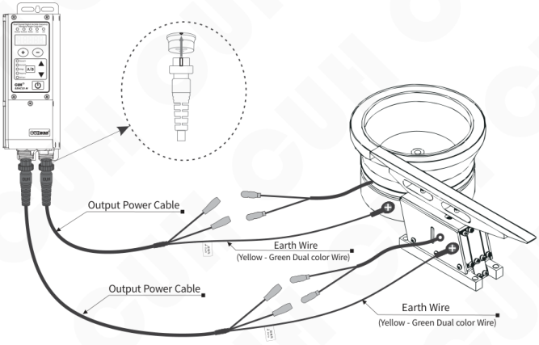

### หมายเหตุ

1. ตรวจสอบให้แน่ใจว่าขดลวดแม่เหล็กไฟฟ้าของเครื่องสั่นเชื่อมต่อกับขั้วเอาต์พุตสองขั้วของสายเอาต์พุต และเปลือกโลหะของเครื่องสั่นมีการต่อสายดินอย่างน่าเชื่อถือ
2. ห้ามเชื่อมต่อโหลดเพียโซอิเล็กทริกกับเอาต์พุตกำลังโดยเด็ดขาด มิฉะนั้นอาจเกิดอุบัติเหตุไฟดูด!

---

### ขั้นตอนที่สาม:

เชื่อมต่อขั้วต่อของสายไฟอินพุตเข้ากับเต้ารับพลังงานอินพุตของตัวควบคุม

เชื่อมต่อด้านตัวควบคุมก่อน

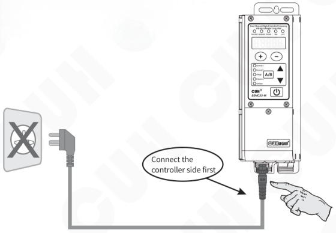

### ขั้นตอนที่สี่:

เชื่อมต่อปลั๊กของสายไฟอินพุตเข้ากับเต้าเสียบไฟหลัก

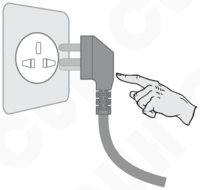

---

## ขั้นตอนที่ห้า:

เปิดสวิตช์ไฟของตัวควบคุม และควรแสดงแรงดัน "U 150" พร้อมไฟแสดงสถานะช่องสัญญาณ A สว่าง และเครื่องป้อนวัสดุแบบสั่นสะเทือนทั้งสองเครื่องควรสั่น

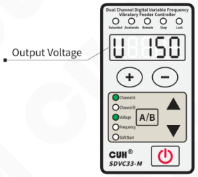

## ขั้นตอนที่หก:

กด ⊖ เพื่อปรับแรงดันของช่องสัญญาณ A เป็น 30~50V จากนั้นกด `A/B` 2 วินาทีเพื่อเข้าสู่สถานะปรับความถี่เอาต์พุต "E" ใช้ ⊕ และ ⊖ เพื่อค้นหาความถี่ธรรมชาติของเครื่องป้อนวัสดุแบบสั่นสะเทือน ซึ่งเรียกว่าความถี่เรโซแนนซ์ด้วย

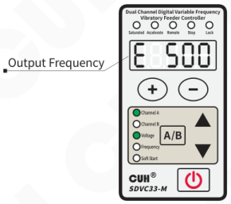

- ความถี่ฮาร์มอนิกของเครื่องสั่นหมายถึงค่าความถี่ที่สร้างแอมพลิจูดสูงสุด
- เครื่องสั่นแต่ละเครื่องมีความถี่เรโซแนนซ์ทางกลตามธรรมชาติของตัวเอง ปรับความถี่เอาต์พุตของตัวควบคุมเป็นความถี่นี้เพื่อให้ได้สภาวะการทำงานที่ดีที่สุด

---

## ขั้นตอนที่เจ็ด:

กด **A/B** ค้างเพื่อออกจากความถี่เอาต์พุต "E" และกลับสู่พารามิเตอร์ปรับแรงดัน
ใช้ **+** และ **−** เพื่อปรับแรงดันจนถึงอัตราการป้อนที่ดีที่สุด

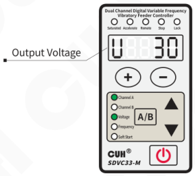

## การตั้งค่าช่องสัญญาณ B:

กด **A/B** สั้นเพื่อสลับไปยังช่องสัญญาณ B ทำซ้ำขั้นตอนที่หกและเจ็ดเพื่อทำการปรับช่องสัญญาณ B ให้เสร็จสมบูรณ์

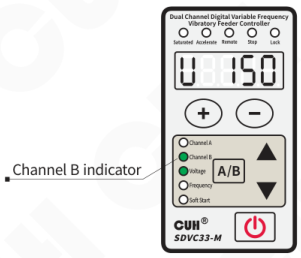

---

## บทที่ IV คำอธิบายฟังก์ชันพื้นฐาน

บทนี้แนะนำวิธีการใช้ฟังก์ชันพื้นฐานของตัวควบคุม

### 4.1 การตั้งค่าแรงดันเอาต์พุต

ตัวควบคุมสามารถตั้งค่าแรงดันเอาต์พุตแบบดิจิทัลได้โดยตรงบนแผง เนื่องจากตัวควบคุมสามารถชดเชยแรงดันไฟหลักได้ ค่านี้จึงเป็นค่าเฉลี่ยของการแปลงแรงดันเอาต์พุต และจะไม่ได้รับผลกระทบจากแรงดันอินพุต จึงสามารถรักษาเอาต์พุตให้เสถียรได้แม้ในกรณีที่แรงดันไฟหลักไม่เสถียร ในเวลาเดียวกัน การตั้งค่าแรงดันโดยตรงยังให้ข้อมูลที่แม่นยำสำหรับผู้ใช้ในการทำความเข้าใจการทำงานของอุปกรณ์

- เปิดสวิตช์ไฟของตัวควบคุม
- ตัวควบคุมจะแสดงแรงดันเอาต์พุต ไฟแสดงสถานะช่องสัญญาณ A และไฟแสดงสถานะแรงดันบนแผงจะสว่าง และจอแสดงผล LED จะแสดงสัญลักษณ์พารามิเตอร์แรงดันเอาต์พุต U และค่าแรงดัน
- กด ⊕ หรือ ⊖ เพื่อปรับค่าพารามิเตอร์

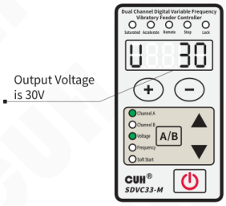

- ตัวควบคุมไม่มีฟังก์ชันเพิ่มแรงดัน เมื่อตัวควบคุมไม่สามารถไปถึงแรงดันที่ตั้งไว้ได้เนื่องจากข้อจำกัดของแรงดันจ่ายไฟอินพุต ไฟแสดงสถานะอิ่มตัวจะสว่างขึ้น และการชดเชยแรงดันไฟหลักจะล้มเหลวในเวลานี้
- ตัวควบคุมสามารถบรรลุผลการเร่งความเร็วในระดับหนึ่งโดยการเสียสละลักษณะคลื่นไซน์ของรูปคลื่นเอาต์พุต ซึ่งกำหนดโดยพารามิเตอร์ "ดัชนีการเร่งความเร็ว y" เมื่อเข้าสู่สถานะเร่งความเร็ว รูปคลื่นกระแสเอาต์พุตจะเปลี่ยนจากคลื่นไซน์เป็นคลื่นสามเหลี่ยม และไฟแสดงสถานะเร่งความเร็วจะสว่างขึ้น

---

## 4.2 การตั้งค่าความถี่เอาต์พุต

ตัวควบคุมใช้เทคโนโลยีการสังเคราะห์ความถี่ดิจิทัลโดยตรง (DDS) ซึ่งมีความแม่นยำและความเสถียรของความถี่สูงมาก และไม่เปลี่ยนแปลงตามเวลาและอุณหภูมิ

- กด **A/B** ค้าง 2 วินาทีเพื่อเข้าสู่อินเทอร์เฟซพารามิเตอร์พื้นฐาน
- จอ LED แสดงพารามิเตอร์ความถี่เอาต์พุต "E" และค่าความถี่
- กด **+** หรือ **−** เพื่อปรับค่าพารามิเตอร์

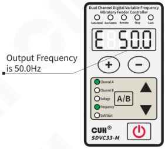

ช่วงความถี่เอาต์พุตคือ 5.0～999.9Hz

## 4.3 การสตาร์ทแบบนุ่มนวล

เมื่อตัวควบคุมเริ่มทำงานจากสถานะหยุด สามารถค่อย ๆ เพิ่มแรงดันเอาต์พุตไปยังค่าที่ตั้งไว้ เพื่อป้องกันไม่ให้เครื่องป้อนวัสดุแบบสั่นสะเทือนและตัวควบคุมได้รับการกระแทก

เวลาสตาร์ทแบบนุ่มนวล (t): เมื่อตัวควบคุมเริ่มจากสถานะหยุด เวลาที่ใช้สำหรับแรงดันเอาต์พุตเพิ่มขึ้นอย่างราบรื่นจาก 0V ไปยังค่าที่ตั้งไว้ เรียกว่าเวลาสตาร์ทแบบนุ่มนวล

- กด **A/B** ค้าง 2 วินาทีเพื่อเข้าสู่อินเทอร์เฟซพารามิเตอร์พื้นฐาน
- กด **▲** และ **▼** เพื่อสลับไปยังสถานะปรับพารามิเตอร์สตาร์ทแบบนุ่มนวล "t"
- กด **+** หรือ **−** เพื่อปรับค่าพารามิเตอร์

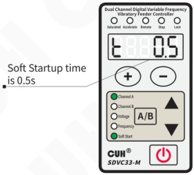

ช่วงเวลาสตาร์ทแบบนุ่มนวลคือ 0.0～10.0s

---

## 4.4 การหยุดแบบนุ่มนวล

เมื่อตัวควบคุมหยุดจากสถานะทำงาน สามารถค่อย ๆ ลดแรงดันเอาต์พุตลงเหลือ 0 เพื่อป้องกันไม่ให้อุปกรณ์สั่นสะเทือนได้รับการกระแทก

เวลาหยุดแบบนุ่มนวล (J): เมื่อตัวควบคุมเริ่มจากสถานะทำงาน เวลาที่ใช้สำหรับแรงดันเอาต์พุตลดลงอย่างราบรื่นจากค่าที่ตั้งไว้เป็น 0 เรียกว่าเวลาหยุดแบบนุ่มนวล

- กด **A/B** ค้าง 2 วินาทีเพื่อเข้าสู่อินเทอร์เฟซพารามิเตอร์พื้นฐาน
- กด **▲** และ **▼** เพื่อสลับไปยังสถานะปรับพารามิเตอร์หยุดแบบนุ่มนวล "J"
- กด **+** หรือ **−** เพื่อปรับค่าพารามิเตอร์

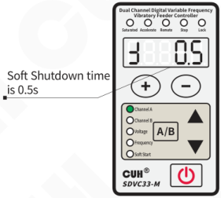

ช่วงเวลาหยุดแบบนุ่มนวลคือ 0.0～10.0s

## 4.5 ฟังก์ชันเบรก

เนื่องจากเครื่องป้อนวัสดุแบบสั่นสะเทือนจะสั่นอย่างอิสระระยะเวลาหนึ่งหลังจากตัวควบคุมหยุดเอาต์พุต วัสดุจะยังคงเคลื่อนที่ในช่วงเวลานี้ ซึ่งจะทำให้เกิดข้อผิดพลาดสำหรับการใช้งานบางอย่าง เช่น การวัดที่แม่นยำและการบรรจุวัสดุ ดังนั้นจึงจำเป็นต้องหยุดการสั่นสะเทือนอย่างรวดเร็ว

ฟังก์ชันเบรกคือการหยุดการสั่นสะเทือนอย่างรวดเร็วโดยการหน่วงจุดเริ่มต้นของการหยุดอย่างช้า ๆ ไป 180° เพื่อให้ได้ผลตรงกันข้ามระหว่างแรงขับและเฟสการสั่นอิสระของเครื่องป้อนวัสดุแบบสั่นสะเทือน ทำได้โดยการตั้งค่าเวลาหยุดแบบนุ่มนวลเป็นค่าลบ หน่วยเป็นรอบ นั่นคือจำนวนรอบกระแสของการขับย้อนกลับเมื่อเบรก

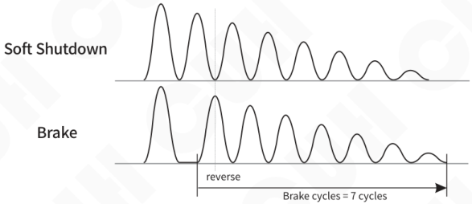

---

## 4.6 สวิตช์เอาต์พุต

สวิตช์เอาต์พุตแบบสัมผัสเบาบนแผงสามารถเริ่มหรือหยุดเอาต์พุตของตัวควบคุมได้อย่างง่ายดายและรวดเร็ว

- ใช้ ⏻ บนแผงตัวควบคุมเพื่อควบคุมเครื่องให้เริ่มหรือหยุดเอาต์พุต เมื่อไฟแสดงสถานะหยุดสว่าง หมายถึงเข้าสู่สถานะหยุด

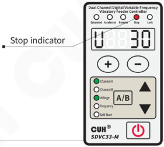

> โดยค่าเริ่มต้น ⏻ ควบคุมการเริ่ม/หยุดของช่องสัญญาณ A/B แยกกัน หากต้องการควบคุมการเริ่ม/หยุดของช่องสัญญาณ A/B พร้อมกัน โปรดตั้งค่าโหมดควบคุมปุ่มเปิด/ปิด (OF) ในพารามิเตอร์ร่วมจาก Ind (แยกอิสระ) เป็น Cob (รวมกัน)
>
> เมื่อตัวควบคุมหยุดเอาต์พุต ไฟแสดงสถานะหยุดจะกะพริบ แต่เมื่อสัญญาณภายนอกหยุดตัวควบคุม ไฟหยุดจะสว่างตลอดเวลา

## 4.7 การล็อกคีย์บอร์ด

เมื่อตั้งค่าพารามิเตอร์ของตัวควบคุมแล้ว ฟังก์ชันล็อกคีย์บอร์ดสามารถล็อกปุ่มทั้งหมดบนแผงเพื่อหลีกเลี่ยงการใช้งานผิดพลาด

แม้ว่าจะปิดแล้วเปิดใหม่ สถานะของการล็อกคีย์บอร์ดจะยังคงอยู่ในสถานะเดียวกับครั้งสุดท้ายที่ปิด

- กด ⏻ ค้าง 2 วินาทีเพื่อล็อกปุ่มทั้งหมดบนแผง
- กด ⏻ ค้าง 2 วินาทีอีกครั้งเพื่อปลดล็อก

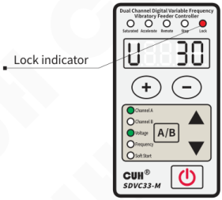

> การล็อกสามารถทำได้สำหรับช่องสัญญาณต่าง ๆ การทำงานของช่องสัญญาณ A และช่องสัญญาณ B สามารถทำได้อย่างอิสระต่อกัน

---

## 4.8 การคืนค่าการตั้งค่าเริ่มต้น

ผู้ใช้สามารถคืนค่าตัวควบคุมกลับสู่สถานะค่าเริ่มต้นจากโรงงานได้อย่างรวดเร็ว

เนื่องจากตัวควบคุมมีฟังก์ชันที่ทรงพลัง จึงมีพารามิเตอร์จำนวนมากที่สามารถปรับได้ สำหรับผู้เริ่มต้น อาจไม่สามารถคืนค่าสถานะการทำงานปกติของตัวควบคุมได้หลังจากตั้งค่าและแก้ไขหลายครั้ง ใช้ฟังก์ชันนี้เพื่อคืนค่าสถานะพารามิเตอร์ที่สับสนกลับสู่การตั้งค่าเริ่มต้นจากโรงงานอย่างรวดเร็ว

ตัวควบคุมสามารถคืนค่าตัวควบคุมทั้งหมดกลับสู่การตั้งค่าโรงงาน รวมถึงคืนค่าแต่ละช่องสัญญาณกลับสู่การตั้งค่าโรงงานแยกกันได้

### การคืนค่าการตั้งค่าเริ่มต้นสำหรับตัวควบคุมทั้งหมด:

- กด ▲ และ ▼ ค้างพร้อมกันเพื่อเข้าสู่อินเทอร์เฟซพารามิเตอร์ร่วม

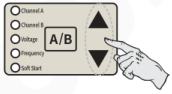

- กด ▼ สั้นเพื่อสลับไปยังการกะพริบเต็มรูปแบบบนจอแสดงผล LED นั่นคือพารามิเตอร์ของ "การคืนค่าการตั้งค่าเริ่มต้น" จากนั้นกด ⊕ ค้างจนกระทั่งตัวควบคุมแสดง "-----" ซึ่งบ่งชี้ว่าตัวควบคุมได้รับการคืนค่าแล้ว

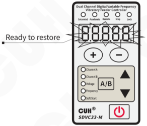

- ปล่อย ⊕ หลังจากตัวควบคุมแสดง "CUH" จากนั้นเข้าสู่สถานะปรับแรงดันเอาต์พุต "U" เมื่อถึงเวลานี้ พารามิเตอร์ทั้งหมดได้รับการคืนค่ากลับสู่การตั้งค่าเริ่มต้นจากโรงงานแล้ว

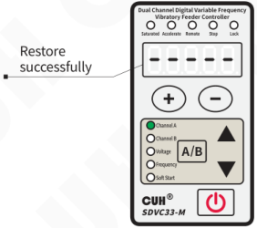

---

## การคืนค่าการตั้งค่าเริ่มต้นแยกสำหรับช่องสัญญาณ A/B:

- กด **A/B** และ **▲** ค้างพร้อมกันเพื่อเข้าสู่อินเทอร์เฟซพารามิเตอร์ขั้นสูง

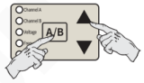

- กด **▼** สั้นเพื่อสลับไปยังพารามิเตอร์ "คืนค่าการตั้งค่าเริ่มต้นของช่องสัญญาณปัจจุบัน" จากนั้นกด **⊕** ค้างจนกระทั่งตัวควบคุมแสดง "-----" ซึ่งบ่งชี้ว่าช่องสัญญาณปัจจุบันได้รับการคืนค่าแล้ว

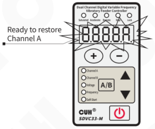

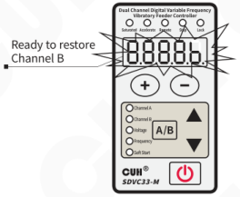

- ปล่อย **⊕** หลังจากตัวควบคุมแสดง "CUH" จากนั้นเข้าสู่สถานะปรับแรงดันเอาต์พุต "U" เมื่อถึงเวลานี้ พารามิเตอร์ทั้งหมดของช่องสัญญาณปัจจุบันได้รับการคืนค่ากลับสู่การตั้งค่าเริ่มต้นจากโรงงานแล้ว

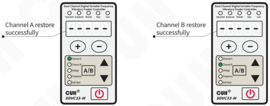

---

## บทที่ Ⅴ คำอธิบายฟังก์ชันขั้นสูง

บทนี้แนะนำวิธีการใช้ฟังก์ชันขั้นสูงของตัวควบคุม

### 5.1 การควบคุมความเร็วระยะไกล

ตัวควบคุมรองรับสัญญาณอนาล็อกภายนอกเพื่อควบคุมแรงดันเอาต์พุต สัญญาณอนาล็อกรองรับโพเทนชิโอมิเตอร์ แรงดัน 1~5V กระแส 4~20mA มีพอร์ตอนาล็อกอินพุตสองพอร์ต AA และ bA โดยค่าเริ่มต้น AA ควบคุมช่องสัญญาณ A และ bA ควบคุมช่องสัญญาณ B นอกจากนี้ยังสามารถปรับได้ด้วยพารามิเตอร์ cS เพื่อให้สัญญาณหนึ่งสามารถควบคุมแรงดันเอาต์พุตของสองช่องสัญญาณพร้อมกันได้

ตัวควบคุมยังออกแบบพารามิเตอร์สัมประสิทธิ์การควบคุมระยะไกล c เพื่อขยายหรือลดผลของแรงดันควบคุมระยะไกล ซึ่งสามารถปรับได้ตั้งแต่ 0.5 ถึง 2.0 เมื่อตั้งค่าเป็น 0.5 หมายความว่าผลของแรงดันควบคุมระยะไกลในการควบคุมแรงดันเอาต์พุตลดลงครึ่งหนึ่ง นั่นคือการควบคุมระยะไกลสูงสุดสามารถเข้าถึงได้เพียงครึ่งหนึ่งของแรงดันเอาต์พุตสูงสุด h เมื่อตั้งค่าเป็น 2.0 หมายความว่าผลของแรงดันควบคุมระยะไกลในการควบคุมแรงดันเอาต์พุตเพิ่มขึ้นเป็นสองเท่า นั่นคือเมื่อแรงดันควบคุมระยะไกลถึง 3V แรงดันเอาต์พุตได้ถึง h แล้ว และหากเพิ่มแรงดันควบคุมระยะไกล แรงดันเอาต์พุตจะไม่สามารถเพิ่มขึ้นได้

### การเชื่อมต่อควบคุมด้วยโพเทนชิโอมิเตอร์

เมื่อสัญญาณควบคุมความเร็วระยะไกลมีผล ไฟแสดงสถานะควบคุมความเร็วจะสว่างขึ้น ในทางเดียวกันการปรับแรงดันบนแผงจะไม่ทำงาน

---

## การเชื่อมต่อควบคุมด้วยแรงดัน 1~5V

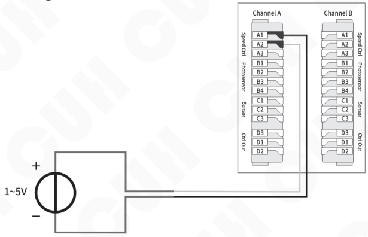

## การเชื่อมต่อควบคุมด้วยกระแส 4~20mA

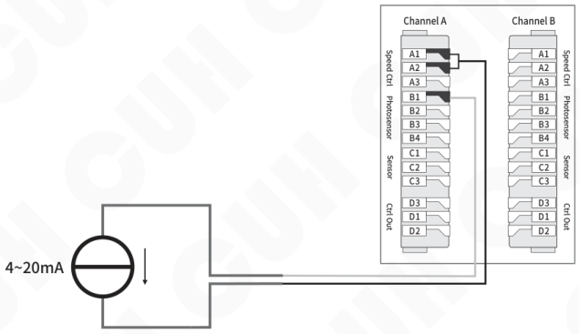

---

## 5.2 การตรวจจับด้วยโฟโตอิเล็กทริกอัจฉริยะ

พอร์ตโฟโตอิเล็กทริกอัจฉริยะของตัวควบคุมนี้รองรับเซ็นเซอร์แบบทะลุหรือแบบสะท้อนที่ประกอบด้วยไดโอดเปล่งแสงและโฟโตทรานซิสเตอร์ และยังสามารถตั้งค่าให้รองรับเซ็นเซอร์แบบสวิตช์ NPN หรือ PNP ได้ แผนภาพการเดินสายเฉพาะมีดังนี้:

### วิธีการเชื่อมต่อเซ็นเซอร์โฟโตอิเล็กทริก

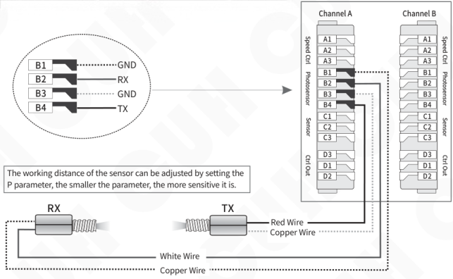

ระยะการทำงานของเซ็นเซอร์สามารถปรับได้โดยการตั้งค่าพารามิเตอร์ P ยิ่งพารามิเตอร์เล็ก ยิ่งไวขึ้น

### วิธีการเชื่อมต่อเซ็นเซอร์แบบสวิตช์

ตั้งค่าประเภท NPN หรือ PNP ด้วยพารามิเตอร์ P

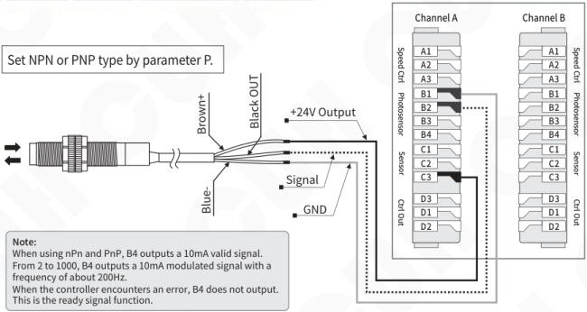

**หมายเหตุ:**

เมื่อใช้ nPn และ PnP, B4 จะส่งสัญญาณที่ถูกต้อง 10mA

ตั้งแต่ 2 ถึง 1000, B4 จะส่งสัญญาณมอดูเลต 10mA ที่มีความถี่ประมาณ 200Hz

เมื่อตัวควบคุมพบข้อผิดพลาด B4 จะไม่ส่งสัญญาณ นี่คือฟังก์ชันสัญญาณพร้อมใช้งาน

---

## 5.3 เซ็นเซอร์แบบสวิตช์

พอร์ตเซ็นเซอร์แบบสวิตช์สามารถรองรับโหมด NPN, PNP, Ut1, Ut0 และช่องสัญญาณ A และ B ถูกควบคุมอย่างอิสระ

**โหมด Ut1 คือการสแกนครั้งเดียว** นั่นคือก่อนที่สัญญาณเซ็นเซอร์จะไม่ถูกต้อง ระดับสูงและต่ำจะถูกสลับเพื่อตรวจจับว่าพอร์ตใช้งานได้หรือไม่ หลังจากพบสัญญาณที่ถูกต้อง ประเภทเซ็นเซอร์ของพอร์ตจะถูกกำหนดและไม่สแกนอีกต่อไป

**โหมด Ut0 คือการสแกนต่อเนื่อง** โดยไม่คำนึงถึงประเภทเซ็นเซอร์ จะตรวจจับเสมอว่าพอร์ตเชื่อมต่อกับสัญญาณที่ถูกต้องหรือไม่โดยการเปลี่ยนระดับสูงและต่ำ

### วิธีการเชื่อมต่อเซ็นเซอร์แบบสวิตช์

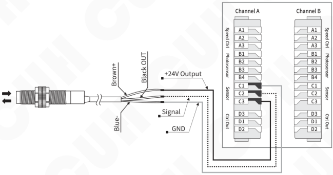

---

## 5.4 เอาต์พุตควบคุม

พอร์ตเอาต์พุตควบคุมสามารถรองรับเอาต์พุต NPN, เอาต์พุต PNP และเอาต์พุตแบบพุช-พูล โดยที่:

- เอาต์พุต NPN ใช้งานได้ที่ระดับต่ำ และเอาต์พุตไม่ใช้งานอยู่ในสถานะความต้านทานสูง;
- เอาต์พุต PNP ใช้งานได้ที่ระดับสูง และเอาต์พุตไม่ใช้งานอยู่ในสถานะความต้านทานสูง;
- เอาต์พุตแบบพุช-พูลใช้งานได้ที่ระดับสูง และไม่ใช้งานที่ระดับต่ำ

### 5.4.1 วิธีการเดินสายของเอาต์พุตควบคุม

**การเชื่อมต่อเอาต์พุต NPN**

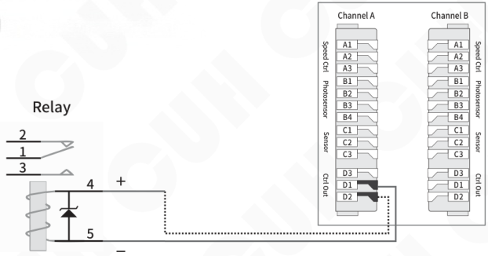

**การเชื่อมต่อเอาต์พุต PNP หรือพุช-พูล**

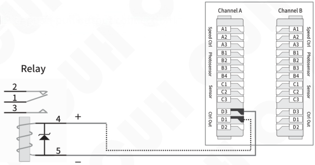

> หากเชื่อมต่อรีเลย์ 24V ต้องตรวจสอบขั้วบวกและขั้วลบของขดลวดให้แน่ใจว่าเชื่อมต่อถูกต้อง เนื่องจากความสามารถกระแสเอาต์พุตของพอร์ตนี้คือ 350mA ไดโอดป้องกันภายในของรีเลย์จะลัดวงจรพอร์ตของตัวควบคุมนี้หลังการเชื่อมต่อกลับขั้ว ทำให้เกิดการป้องกันการลัดวงจร Er07

---

## 5.4.2 แหล่งสัญญาณเอาต์พุตควบคุมและแผนภาพตรรกะ

การควบคุมของเอาต์พุตหลักและเอาต์พุตควบคุมถูกควบคุมโดยผลลัพธ์ของความสัมพันธ์ทางตรรกะระหว่างแหล่งสัญญาณสองแหล่ง แหล่งสัญญาณต่อไปนี้สามารถเลือกได้จากรายการแหล่งสัญญาณ

| แหล่งสัญญาณ | ความหมาย |
|---|---|
| 0 | สัญญาณไม่ถูกต้อง |
| 1 | สัญญาณที่ถูกต้อง |
| Ab | สัญญาณพอร์ตตรวจจับโฟโตอิเล็กทริกอัจฉริยะของช่องสัญญาณ A |
| -Ab | สัญญาณพอร์ตตรวจจับโฟโตอิเล็กทริกอัจฉริยะของช่องสัญญาณ A ถูกกลับค่า |
| Ac | สัญญาณพอร์ตเซ็นเซอร์แบบสวิตช์ของช่องสัญญาณ A |
| -Ac | สัญญาณพอร์ตเซ็นเซอร์แบบสวิตช์ของช่องสัญญาณ A ถูกกลับค่า |
| Ad | สัญญาณพอร์ตเอาต์พุตควบคุมของช่องสัญญาณ A |
| -Ad | สัญญาณพอร์ตเอาต์พุตควบคุมของช่องสัญญาณ A ถูกกลับค่า |
| Aq | สัญญาณพอร์ตเอาต์พุตกำลังหลักของช่องสัญญาณ A |
| -Aq | สัญญาณพอร์ตเอาต์พุตกำลังหลักของช่องสัญญาณ A ถูกกลับค่า |
| bb | สัญญาณพอร์ตตรวจจับโฟโตอิเล็กทริกอัจฉริยะของช่องสัญญาณ B |
| -bb | สัญญาณพอร์ตตรวจจับโฟโตอิเล็กทริกอัจฉริยะของช่องสัญญาณ B ถูกกลับค่า |
| bc | สัญญาณพอร์ตเซ็นเซอร์แบบสวิตช์ของช่องสัญญาณ B |
| -bc | สัญญาณพอร์ตเซ็นเซอร์แบบสวิตช์ของช่องสัญญาณ B ถูกกลับค่า |
| bd | สัญญาณพอร์ตเอาต์พุตควบคุมของช่องสัญญาณ B |
| -bd | สัญญาณพอร์ตเอาต์พุตควบคุมของช่องสัญญาณ B ถูกกลับค่า |
| bq | สัญญาณพอร์ตเอาต์พุตกำลังหลักของช่องสัญญาณ B |
| -bq | สัญญาณพอร์ตเอาต์พุตกำลังหลักของช่องสัญญาณ B ถูกกลับค่า |

---

## แผนภาพตรรกะเอาต์พุตควบคุม

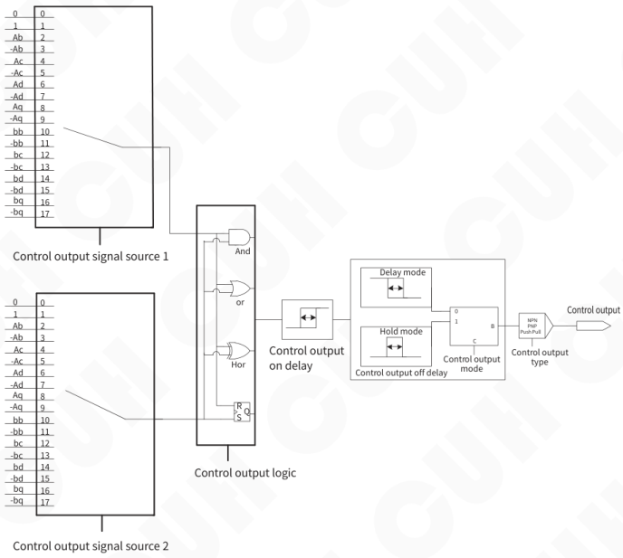

---

## 5.4.3 คำอธิบายโหมดเอาต์พุตควบคุม

ลูกค้าสามารถเลือกโหมดเอาต์พุตควบคุมได้ 2 โหมด: โหมดหน่วง โหมดคงไว้

**โหมดหน่วง:** หมายความว่าหลังจากสัญญาณขับเคลื่อนเอาต์พุตของตัวควบคุมเปลี่ยนจากถูกต้องเป็นไม่ถูกต้อง เอาต์พุตควบคุมจะปิดหลังจากผ่านระยะเวลาหน่วงปิดช่วงหนึ่ง

**โหมดคงไว้:** หลังจากสัญญาณขับเคลื่อนเอาต์พุตของตัวควบคุมกลายเป็นถูกต้อง เอาต์พุตควบคุมจะคงเปิดอยู่ระหว่างเวลาหน่วงปิด และจะปิดหลังจากเกินเวลาหน่วงปิด

ความแตกต่างระหว่างสองโหมดแสดงในรูปแบบของแผนภาพเวลา ดังนี้ โดยสัญญาณอินพุตคือสัญญาณเอาต์พุตหลังตัวเลือกความสัมพันธ์ทางตรรกะ

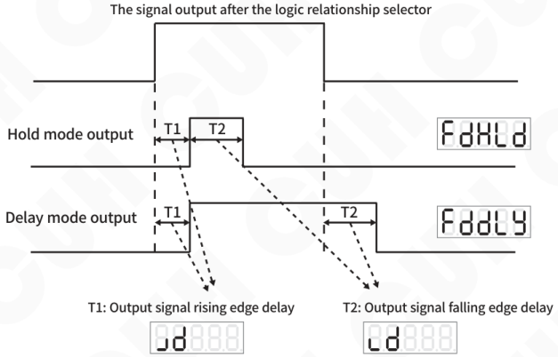

## 5.4.4 ฟังก์ชันควบคุมสัญญาณเอาต์พุตหลัก

การควบคุมสัญญาณเอาต์พุตหลักคล้ายกับการควบคุมเอาต์พุตควบคุม หลังจากเลือกแหล่งสัญญาณสองแหล่งสำหรับการดำเนินการความสัมพันธ์ทางตรรกะ สัญญาณควบคุมจะได้มาจากการเลือกโหมดหน่วงเปิด/ปิดและการควบคุมทิศทางตรรกะ สัญญาณควบคุมจะรวมทางตรรกะกับสัญญาณเปิด/ปิดของแผง จากนั้นส่งไปยังบอร์ดกำลังเพื่อควบคุมเอาต์พุตหลัก

วิธีการเดินสายของสัญญาณเอาต์พุตหลัก แหล่งสัญญาณ และแผนภาพตรรกะสามารถอ้างอิงฟังก์ชันเอาต์พุตควบคุม

---

## 5.5 ขีดจำกัดแรงดันเอาต์พุตสูงสุด

แต่ละช่องสัญญาณของตัวควบคุมสามารถตั้งค่าพารามิเตอร์ขีดจำกัดแรงดันเอาต์พุตสูงสุด h และทั้งแรงดันที่ตั้งบนแผงและแรงดันควบคุมระยะไกลจะไม่เกินค่านี้

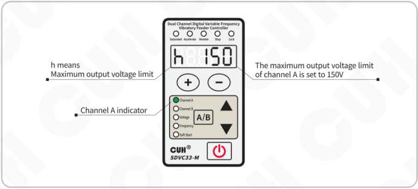

- h หมายถึง ขีดจำกัดแรงดันเอาต์พุตสูงสุด
- ไฟแสดงสถานะช่องสัญญาณ A
- ขีดจำกัดแรงดันเอาต์พุตสูงสุดของช่องสัญญาณ A ถูกตั้งเป็น 150V

## 5.6 การป้องกันกระแสเกินแบบปรับได้

เพื่อป้องกันขดลวดแม่เหล็กไฟฟ้า ตัวควบคุมได้ออกแบบพารามิเตอร์กระแสป้องกันกระแสเกิน "oc" ที่ผู้ใช้ปรับได้ ซึ่งสามารถปรับได้ในช่วง 0.5A~3.5A

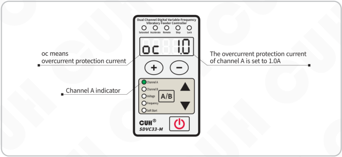

- oc หมายถึง กระแสป้องกันกระแสเกิน
- ไฟแสดงสถานะช่องสัญญาณ A
- กระแสป้องกันกระแสเกินของช่องสัญญาณ A ถูกตั้งเป็น 1.0A

---

## 5.7 การปรับความสว่างของแผงควบคุม

ตัวควบคุมใช้ชิปขับจอแสดงผลดิจิทัลใหม่ ซึ่งรองรับให้ผู้ใช้ปรับค่าความสว่างของจอแสดงผล LED ระหว่าง 1 ถึง 32

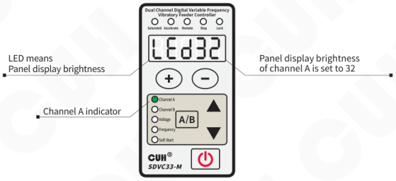

ความสว่างของแผงสามารถตั้งค่าแยกสำหรับช่องสัญญาณ A และช่องสัญญาณ B ผู้ใช้สามารถตั้งค่าความสว่างที่แตกต่างกันล่วงหน้าเพื่อแยกแยะอย่างรวดเร็วว่าปัจจุบันอยู่ในช่องสัญญาณ A หรือช่องสัญญาณ B

## 5.8 ฟังก์ชันตรวจสอบเอาต์พุต

ตัวควบคุมได้ออกแบบชุดพารามิเตอร์ตรวจสอบเป็นพิเศษเพื่อตรวจสอบสถานะของตัวควบคุม

**พารามิเตอร์ตรวจสอบที่แยกความแตกต่างระหว่างช่องสัญญาณ A และช่องสัญญาณ B ประกอบด้วย:**

กระแสเอาต์พุต AC, แรงดันพอร์ตควบคุมความเร็วแบบอนาล็อก AU, แรงดันสัญญาณพอร์ตโฟโตอิเล็กทริกอัจฉริยะ bU, พอร์ตเซ็นเซอร์แบบสวิตช์ cU, แรงดันพอร์ตเอาต์พุตควบคุม dU

**พารามิเตอร์ตรวจสอบที่ไม่แยกความแตกต่างระหว่างช่องสัญญาณ A และช่องสัญญาณ B ประกอบด้วย:**

การแสดงอุณหภูมิ C, แรงดันบัส PU, แรงดันเอาต์พุต 24V nU, เวอร์ชันซอฟต์แวร์บอร์ดควบคุม uc, เวอร์ชันซอฟต์แวร์บอร์ดกำลัง uq

---

## 5.9 การควบคุมร่วมแบบสองช่องสัญญาณ

เอาต์พุตของช่องสัญญาณ A และช่องสัญญาณ B ของตัวควบคุมสามารถควบคุมร่วมกันได้ และพารามิเตอร์ Cb สามารถใช้ควบคุมช่องสัญญาณ B: ทำงานอิสระ ติดตามความถี่ของช่องสัญญาณ A ติดตามแรงดันของช่องสัญญาณ A ติดตามแรงดันและความถี่ของช่องสัญญาณ A

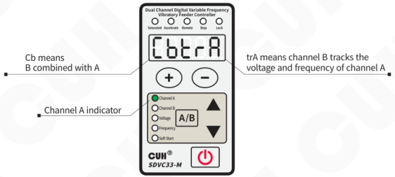

หมายเหตุ: หลังจากตั้งค่าการติดตามแล้ว แรงดันและความถี่ของช่องสัญญาณ B ยังสามารถปรับได้ แต่จะไม่ทำงาน จะทำงานได้หลังจากกลับสู่โหมดอิสระ

ไม่ว่าคุณจะตั้งช่องสัญญาณ A และช่องสัญญาณ B ให้ส่งออกความถี่เดียวกันโดยอิสระ หรือตั้งความถี่ของช่องสัญญาณ B ให้ติดตามช่องสัญญาณ A เฟสของเอาต์พุตทั้งสองช่องจะถูกล็อกเสมอ ความต่างเฟสสามารถควบคุมได้ด้วยพารามิเตอร์ร่วม μ (B อ้างอิงเฟสของ A) และช่วงการปรับคือ -180°~180° ฟังก์ชันนี้สามารถใช้ควบคุมเครื่องป้อนวัสดุแบบสั่นสะเทือนแบบเวกเตอร์ หรือถ้วยป้อนแบบสั่นสะเทือนกับเครื่องป้อนแบบเส้นตรง/สายพานลำเลียงในโอกาสการป้อนแบบรีเลย์

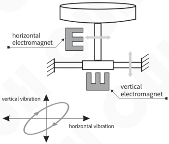

แผนภาพเครื่องป้อนวัสดุแบบสั่นสะเทือนแบบเวกเตอร์

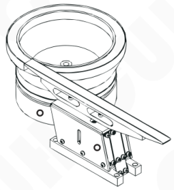

แผนภาพของถ้วยป้อนและเครื่องป้อนแบบเส้นตรง

---

## 5.10 การบันทึกและเรียกคืนพารามิเตอร์ผู้ใช้

นอกเหนือจากการบันทึกพารามิเตอร์การทำงานโดยอัตโนมัติแล้ว ตัวควบคุมยังได้ออกแบบชุดกลุ่มพารามิเตอร์ผู้ใช้เพื่อบันทึกพารามิเตอร์ทั้งหมดที่ผู้ใช้ตั้งค่าได้ ผ่านการบันทึกและเรียกคืนพารามิเตอร์ผู้ใช้ การเรียกคืนจะแตกต่างจากฟังก์ชันการคืนค่าการตั้งค่าโรงงาน

ปรับไปที่พารามิเตอร์ SP ในพารามิเตอร์ร่วม แสดง uP1 กด ⊕ และ ⊖ ค้างพร้อมกันจนกระทั่งแสดง SAU ซึ่งบ่งชี้ว่าการบันทึกสำเร็จ การดำเนินการนี้จะบันทึกช่องสัญญาณ A ช่องสัญญาณ B และพารามิเตอร์ร่วมในกลุ่มผู้ใช้

หากต้องการเรียกคืนกลุ่มทำงานจากพารามิเตอร์กลุ่มผู้ใช้ที่บันทึกไว้ มีหลายวิธีในการเรียกคืน:

**rP=1Ab:** พารามิเตอร์กลุ่มผู้ใช้เรียกคืนพารามิเตอร์ของกลุ่ม A และ B พร้อมกัน

**rP=1bA:** พารามิเตอร์กลุ่มผู้ใช้เรียกคืนพารามิเตอร์ของกลุ่ม A และกลุ่ม B พร้อมกัน แต่จะถูกเลือกสลับกันในระหว่างการเรียกคืน นั่นคือ ข้อมูลที่บันทึกในกลุ่ม A ของกลุ่มผู้ใช้จะถูกเรียกคืนไปยังกลุ่มทำงาน B และข้อมูลที่บันทึกในกลุ่ม B ของกลุ่มผู้ใช้จะถูกเรียกคืนไปยังกลุ่มทำงาน A

**rP=1A0:** พารามิเตอร์กลุ่มผู้ใช้เรียกคืนเฉพาะกลุ่ม A และใช้ข้อมูลของกลุ่ม A ในกลุ่มผู้ใช้ในการเรียกคืน

**rP=10A:** พารามิเตอร์กลุ่มผู้ใช้เรียกคืนเฉพาะกลุ่ม A และใช้ข้อมูลของกลุ่ม B ในกลุ่มผู้ใช้ในการเรียกคืน

**rP=1b0:** พารามิเตอร์กลุ่มผู้ใช้เรียกคืนเฉพาะกลุ่ม B และใช้ข้อมูลของกลุ่ม B ในกลุ่มผู้ใช้ในการเรียกคืน

**rP=10b:** พารามิเตอร์กลุ่มผู้ใช้เรียกคืนเฉพาะกลุ่ม B และใช้ข้อมูลของกลุ่ม A ในกลุ่มผู้ใช้ในการเรียกคืน

เลือกโหมดที่ต้องการเรียกคืน กด ⊕ และ ⊖ ค้างพร้อมกันจนกระทั่งแสดง rES ซึ่งบ่งชี้ว่าการเรียกคืนสำเร็จ

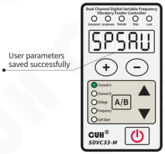

แผนภาพการบันทึกสำเร็จ

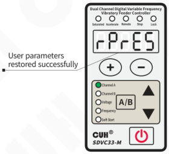

แผนภาพการเรียกคืนสำเร็จ

---

# บทที่ Ⅵ ข้อมูลจำเพาะทางเทคนิค

## 6.1 ขนาด

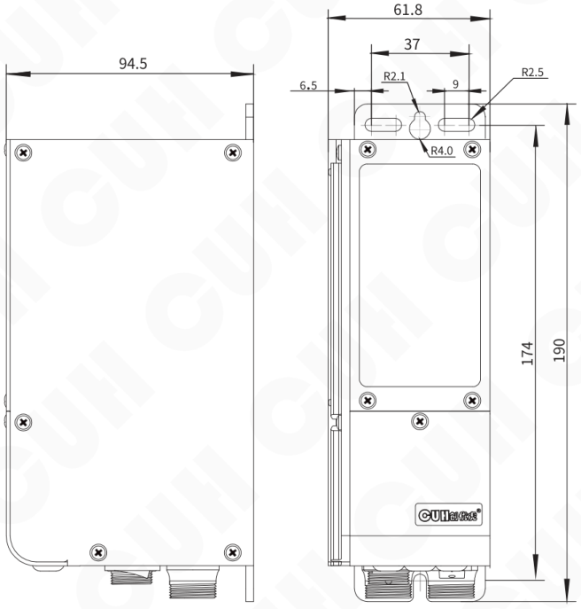

ขนาด (หน่วย: mm)

| ช่วงขนาด | ค่าเผื่อ |
|---|---|
| 0~3 | ±0.05 |
| 3~10 | ±0.1 |
| 10~30 | ±0.15 |
| 30~80 | ±0.2 |
| 80~180 | ±0.3 |
| >180 | ±0.5 |

ตารางค่าเผื่อนี้ใช้ได้กับผลิตภัณฑ์ทั้งหมดในซีรีส์นี้

---

## 6.2 ข้อมูลจำเพาะทางเทคนิค

| รายการ | ต่ำสุด | ทั่วไป | สูงสุด | หน่วย | หมายเหตุ |
|---|---|---|---|---|---|
| แรงดันอินพุต | 85 | 220 | 250 | V | AC RMS |
| ช่วงแรงดันเอาต์พุตที่ปรับได้ | 0 | —— | 260 | V | ต่ำกว่า 150% ของแรงดันอินพุต |
| ความแม่นยำในการปรับแรงดัน | | 1 | | V | |
| ความแม่นยำในการควบคุมแรงดัน | 0 | —— | 10 | % | ΔVout/ΔVin |
| ช่วงกระแสเอาต์พุตที่ปรับได้ | 0 | —— | 3.5 | A | กระแสรวมสามารถกระจายได้ตามต้องการ |
| กำลังเอาต์พุต | 0 | —— | 770 | VA | |
| ความถี่เอาต์พุต | 5.0 | —— | 999.9 | Hz | |
| ความแม่นยำในการปรับความถี่ | | 0.1 | | Hz | |
| รูปคลื่นเอาต์พุต | | Sine | | | |
| เวลาสตาร์ทแบบนุ่มนวล | 0 | —— | 10 | s | ค่าเริ่มต้น: 0.5 |
| ช่วงเวลาหน่วงเปิด/ปิด | 0 | —— | 99.9 | s | ค่าเริ่มต้น: 0.2 |
| ความแม่นยำของเวลาหน่วงเปิด/ปิด | | 0.1 | | s | |
| อุณหภูมิที่ทำให้การป้องกันความร้อนเกินทำงาน | —— | 65 | —— | °C | กลับสู่ปกติที่ 60°C |
| กระแสเอาต์พุตควบคุม DC | 0 | —— | 350 | mA | รองรับทั้งช่องสัญญาณ A และ B |
| กระแสเอาต์พุต 24V | —— | —— | 700 | mA | ผลรวมเอาต์พุตช่องสัญญาณ A และ B |
| แรงดันเอาต์พุตควบคุม DC | 22 | 24 | 26 | V | |
| สัญญาณควบคุมอนาล็อก | | 4~20/1~5 | | mA/V | |
| สัญญาณควบคุมดิจิทัล | | 24 | | V | สัญญาณสวิตช์ |
| วิธีการปรับ | | 6 | | ปุ่ม | |
| การใช้พลังงานขณะสแตนด์บาย | —— | 3 | —— | W | |
| วิธีการแสดงผล | | 5 | | หลัก | LED |
| น้ำหนัก | | 850 | | g | ไม่รวมอุปกรณ์เสริม |
| ขนาด | | 190\*61.8\*94.5 ( L\*W\*H ) | | mm | |
| ระดับการป้องกันการเข้า | | IP20 | | | |
| อุณหภูมิแวดล้อม | 0 | 25 | 40 | °C | ไม่มีการควบแน่น |
| ความชื้นแวดล้อม | 10 | 60 | 85 | % | ไม่มีการควบแน่น |
| อุณหภูมิแวดล้อมในการจัดเก็บ | -20 | 25 | 85 | °C | ไม่มีการควบแน่น |
| ระดับความสูงที่ใช้งานได้ | | <2000 | | m | |

## 6.3 มาตรฐานอ้างอิง

พารามิเตอร์สัมบูรณ์:  
การเกินมาตรฐานจะทำให้ตัวควบคุมเสียหาย ต้องปฏิบัติตามอย่างเคร่งครัด

| รายการ | มาตรฐาน GB | มาตรฐาน IEC | ระดับ | ข้อกำหนดมาตรฐาน | หมายเหตุ |
|---|---|---|---|---|---|
| การคายประจุไฟฟ้าสถิต | GB/T 17626.2-2006 | IEC 61000-4-2:2001 | 4 | ±8 kV | การคายประจุแบบสัมผัส |
| | | | 4 | ±15 kV | การคายประจุทางอากาศ |
| การทดสอบทรานเซียนต์ไฟฟ้าด่วน | GB/T 17626.4-2008 | IEC 61000-4-4:2004 | 4 | ±4 kV | |
| การต้านทานคลื่นบนสายไฟ DC | GB/T 17626.17-2005 | IEC 61000-4-17:2002 | 4 | 15% | เรตติ้ง A |

> **คำเตือน**  
> ในสภาพแวดล้อมที่พักอาศัย ผลิตภัณฑ์นี้อาจก่อให้เกิดการรบกวนทางวิทยุ ซึ่งในกรณีนี้จำเป็นต้องมีมาตรการบรรเทาเพิ่มเติม

---

## บทที่ Ⅶ ภาคผนวก

### 7.1 ตารางพารามิเตอร์

| กลุ่มพารามิเตอร์ / การดำเนินการ | คำจำกัดความ | สัญลักษณ์ | ภาพสัญลักษณ์ | ช่วง | ค่าเริ่มต้น |
|---|---|---|---|---|---|
| พารามิเตอร์สแตนด์บาย | แรงดันเอาต์พุต | U |  | 0~260 V | 150 |
| พารามิเตอร์พื้นฐาน กด A/B ค้าง | ความถี่เอาต์พุต | E |  | 5.0~999.9 Hz | 50.0 |
| พารามิเตอร์พื้นฐาน | ความหน่วงเปิดของเซ็นเซอร์โฟโตอิเล็กทริกอัจฉริยะ | J |  | 0.0~99.9 s | 0.2 |
| พารามิเตอร์พื้นฐาน | ความหน่วงปิดของเซ็นเซอร์โฟโตอิเล็กทริกอัจฉริยะ | L |  | 0.0~99.9 s | 0.2 |
| พารามิเตอร์พื้นฐาน | การสตาร์ทแบบนุ่มนวล | t |  | 0.0~10.0 s | 0.5 |
| พารามิเตอร์พื้นฐาน | รอบการเบรก/การหยุดแบบนุ่มนวล | d |  | -10~0 cycle (จำนวนรอบการเบรก) 0.0~10.0 s (การหยุดแบบนุ่มนวล) | 0.0 |
| พารามิเตอร์ขั้นสูง กด A/B และ ▲ ค้าง | ความไวของเซ็นเซอร์โฟโตอิเล็กทริกอัจฉริยะ | P |  | nPn, PnP, 2~1000 | 80 |
| พารามิเตอร์ขั้นสูง | ประเภทเซ็นเซอร์พอร์ต C | ΓA |  | nPn, PnP ut1 (สแกนครั้งเดียว), ut0 (สแกนต่อเนื่อง) | ut0 |
| พารามิเตอร์ขั้นสูง | ความหน่วงเปิดของพอร์ต C | J- |  | 0.0~99.9 s | 0.2 |
| พารามิเตอร์ขั้นสูง | ความหน่วงปิดของพอร์ต C | L- |  | 0.0~99.9 s | 0.2 |
| พารามิเตอร์ขั้นสูง | แหล่งสัญญาณที่หนึ่งของพอร์ตควบคุม D | E.d |  | 0, 1, Ab, -Ab, Ac, -Ac, Ad, -Ad, Aq, -Aq, bb, -bb, bc, -bc, bd, -bd, bq, -bq | A: 0 B: 0 |
| พารามิเตอร์ขั้นสูง | แหล่งสัญญาณที่สองของพอร์ตควบคุม D | Ed |  | 0, 1, Ab, -Ab, Ac, -Ac, Ad, -Ad, Aq, -Aq, bb, -bb, bc, -bc, bd, -bd, bq, -bq | A: Aq B: bq |
| พารามิเตอร์ขั้นสูง | การดำเนินการตรรกะของแหล่งสัญญาณของพอร์ตควบคุม D | ∩d |  | And, or, Hor, rS | or |
| พารามิเตอร์ขั้นสูง | ความหน่วงเปิดของพอร์ต D | Jd |  | 0.0~99.9 s | 0.0 |
| พารามิเตอร์ขั้นสูง | ความหน่วงปิดของพอร์ต D | Ld |  | 0.0~99.9 s | 0.0 |
| พารามิเตอร์ขั้นสูง | โหมดเอาต์พุตของพอร์ต D | Fd |  | dLy (โหมดหน่วง), HLd (โหมดคงไว้) | dLy |
| พารามิเตอร์ขั้นสูง | ทิศทางตรรกะของพอร์ต D | ɔd |  | --- (เฟสเดียวกัน), -⁻- (ย้อนกลับ) on (ปกติเปิด), oFF (ปกติปิด)  | --- |
| พารามิเตอร์ขั้นสูง | ประเภทเอาต์พุตควบคุม | Γd |  | nPn, PnP, PSP (พุชแอนด์พูล) | nPn |
| พารามิเตอร์ขั้นสูง | แหล่งสัญญาณที่หนึ่งของเอาต์พุตหลัก | E.q |  | 0, 1, Ab, -Ab, Ac, -Ac, Ad, -Ad, Aq, -Aq, bb, -bb, bc, -bc, bd, -bd, bq, -bq | A: Ab B: bb |
| พารามิเตอร์ขั้นสูง | แหล่งสัญญาณที่สองของเอาต์พุตหลัก | Eq |  | 0, 1, Ab, -Ab, Ac, -Ac, Ad, -Ad, Aq, -Aq, bb, -bb, bc, -bc, bd, -bd, bq, -bq | A: Ac B: bc |
| พารามิเตอร์ขั้นสูง | การดำเนินการตรรกะของแหล่งสัญญาณของเอาต์พุตหลัก | ∩q | 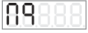 | And, or, Hor, rS | or |

| พารามิเตอร์ | คำจำกัดความ | สัญลักษณ์ | ภาพสัญลักษณ์ | ช่วง | ค่าเริ่มต้น |
|---|---|---|---|---|---|
| พารามิเตอร์ขั้นสูง กด A/B และ ▲ ค้าง | ความหน่วงเปิดของเอาต์พุตหลัก | J9 |  | 0.0~99.9 s | 0.0 |
| | ความหน่วงปิดของเอาต์พุตหลัก | L9 |  | 0.0~99.9 s | 0.0 |
| | โหมดเอาต์พุตของเอาต์พุตหลัก | F9 |  | dLy (โหมดหน่วง), HLd (โหมดคงไว้) | dLy |
| | ทิศทางตรรกะของเอาต์พุตหลัก | Ↄ9 |  |  on (ปกติเปิด), oFF (ปกติปิด) | 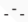 |
| | ขีดจำกัดแรงดันเอาต์พุตสูงสุด | h |  | 0~260 V | 260 |
| | กระแสป้องกันกระแสเกิน | bc |  | 0.5~3.5 A | 3.5 |
| | ดัชนีการเร่งความเร็ว | y |  | 100~150 | 150 |
| | ดัชนีรูปคลื่น | r |  | 0~100 | 100 |
| | แหล่งควบคุมความเร็วระยะไกล | cS |  | AA (พอร์ต A ของ A), bA (พอร์ต A ของ B) | A: AA B: bA |
| | สัมประสิทธิ์การควบคุมความเร็วระยะไกล | c |  | 0.5~2.0 | 1.0 |
| | ความสว่างของจอแสดงผลแผง | LEd |  | 1~32 | 16 |
| | คืนค่าการตั้งค่าเริ่มต้นของช่องสัญญาณปัจจุบัน | 8.8.8.8.A. 8.8.8.8.b. |  | —— | —— |
| พารามิเตอร์ตรวจสอบ กด A/B และ ▼ ค้าง | กระแสเอาต์พุต | AC |  | 0.00~3.50 A | —— |
| | แรงดันสัญญาณของพอร์ต A | AU |  | 0.00~5.00 V | —— |
| | แรงดันสัญญาณของพอร์ต B | bU |  | 0.00~5.00 V | —— |
| | แรงดันสัญญาณของพอร์ต C | cU |  | 0.0~28.0 V | —— |
| | แรงดันเอาต์พุตของพอร์ต D | dU |  | 0.0~28.0 V | —— |
| | การแสดงอุณหภูมิ # | C |  | -20.0~85.0 ℃ | —— |
| | แรงดันบัสภายใน # | PU |  | 0~400 V | —— |
| | แรงดันเรียลไทม์ของพอร์ต 24V # | nU |  | 0.0~28.0 V | —— |
| | เวอร์ชันซอฟต์แวร์บอร์ดควบคุม # | uc |  | —— | —— |
| | เวอร์ชันซอฟต์แวร์บอร์ดกำลัง # | u9 |  | —— | —— |

|  | คำจำกัดความ | สัญลักษณ์ | ภาพสัญลักษณ์ | ช่วง | ค่าเริ่มต้น |
|---|---|---|---|---|---|
| พารามิเตอร์ร่วม  กด ▲ และ ▼ ค้าง | B รวมกับ A # | Cb |  | Ind (อิสระ), trF (B ติดตามความถี่ A), trU (B ติดตามแรงดัน A), trA (B ติดตามทั้งแรงดันและความถี่ A) | Ind |
|  | # | Y |  | -180~180 ° | 0 |
|  | โหมดควบคุมปุ่มเปิด/ปิด # | OF |  | Ind (อิสระ), Cob (รวมกัน) | Ind |
|  | การบันทึกพารามิเตอร์ผู้ใช้ # | SP |  | uP1 (บันทึกกลุ่มผู้ใช้ 1) | uP1 |
|  | การเรียกคืนพารามิเตอร์ผู้ใช้ # | rP |  | 1Ab (กลุ่มผู้ใช้ 1 เรียกคืนกลุ่ม A และ B), 1bA (กลุ่มผู้ใช้ 1 เรียกคืนสลับกลุ่ม A และ B), 1A0 (กลุ่มผู้ใช้ 1 เรียกคืนเฉพาะกลุ่ม A), 10A (กลุ่มผู้ใช้ 1 เรียกคืนสลับเฉพาะกลุ่ม A), 1b0 (กลุ่มผู้ใช้ 1 เรียกคืนเฉพาะกลุ่ม B), 10b (กลุ่มผู้ใช้ 1 เรียกคืนสลับเฉพาะกลุ่ม B) | 1Ab |
|  | การคืนค่าการตั้งค่าเริ่มต้น # | 8.8.8.8.8. |  | —— | —— |

หมายเหตุ: พารามิเตอร์ที่ทำเครื่องหมาย "#" ไม่แยกความแตกต่างระหว่างกลุ่ม A และ B

## 7.2 แผนภาพวงจรอินพุตและเอาต์พุต

**Remote Speed Control Port A**

**Intelligent Photosensor Port B**

**Switch Sensor Port C**

**Control Output Port D**

---

## 7.3 คำแนะนำการแก้ไขปัญหาและคำอธิบายข้อผิดพลาด

| รหัสข้อผิดพลาด | คำจำกัดความ (ปรากฏการณ์) | วิธีการแก้ไขปัญหา |
|---|---|---|
| Er01A/Er01b | ช่องสัญญาณ A/B ลัดวงจร (ทั้งสองช่องหยุดเอาต์พุต) | ◆ ตรวจสอบให้แน่ใจว่าโหลดไม่ลัดวงจร จากนั้นลองเริ่มเอาต์พุตของตัวควบคุมใหม่โดยกดปุ่มเปิด/ปิดเอาต์พุตสองครั้ง หรือจ่ายไฟให้ตัวควบคุมใหม่ |
| Er02 | ช่อง AB รวมกันกระแสเกิน (ทั้งสองช่องหยุดเอาต์พุตชั่วคราว รีสตาร์ทหลัง 2 วินาที) | ◆ ลดแรงดันเอาต์พุตลงอย่างเหมาะสม จากนั้นรีสตาร์ทเอาต์พุต |
| Er02A/Er02b | ช่องสัญญาณ A/B กระแสเกินแยกกัน (ช่องที่กระแสเกินหยุดเอาต์พุต รีสตาร์ทหลัง 2 วินาที) | |
| Er02A./Er02b. | ช่องสัญญาณ A/B กระแสเกินแยกกันถึงค่าสูงสุดที่ตั้งไว้ | |
| Er03 | ความร้อนเกินหรือความเย็นเกิน (ทั้งสองช่องหยุดเอาต์พุต กู้คืนอัตโนมัติที่ -20℃~60℃) | ◆ ติดตั้งตัวควบคุมในสภาพแวดล้อมที่มีการระบายอากาศดี หรือหลีกเลี่ยงความเย็นจัด |
| Er041/Er042 | แรงดันจ่ายไฟต่ำ/เกิน (ทั้งสองช่องหยุดเอาต์พุต กู้คืนอัตโนมัติ) | ◆ ตรวจสอบให้แน่ใจว่าแรงดันอินพุตอยู่ระหว่าง AC 85~250Vac |
| Er05 | การสื่อสารภายในผิดปกติ (ทั้งสองช่องหยุดเอาต์พุต) | ◆ ตรวจสอบให้แน่ใจว่าไม่มีแหล่งจ่ายไฟภายนอกเชื่อมต่อกับพอร์ตไฟ 24V หรือติดต่อฝ่ายสนับสนุนทางเทคนิคของเรา |
| Er06 | เซ็นเซอร์อุณหภูมิผิดปกติ (ทั้งสองช่องหยุดเอาต์พุต) | ◆ ตรวจสอบให้แน่ใจว่าอุณหภูมิการทำงานไม่ต่ำกว่า -20℃ หรือติดต่อฝ่ายสนับสนุนทางเทคนิคของเรา |
| Er07A/Er07b | ช่องสัญญาณ A/B พอร์ต D ลัดวงจร (เอาต์พุตควบคุมช่องสัญญาณ A/B หยุด ลองรีสตาร์ทหลัง 2 วินาที) | ◆ ตรวจสอบให้แน่ใจว่าโหลดของพอร์ต D ไม่ลัดวงจรและกระแสไม่เกิน 350mA |
| Er10 | เอาต์พุตไฟ 24V ผิดปกติ (ปิดเอาต์พุต 24V ลองรีสตาร์ทหลัง 2 วินาที) | ◆ ตรวจสอบให้แน่ใจว่าพอร์ต 24V ไม่ลัดวงจรและกระแสไม่เกิน 700mA |
| Er11 | เอาต์พุตไฟ 5V ผิดปกติ (ฟังก์ชันควบคุมความเร็วถูกปิดชั่วคราว และกู้คืนเมื่อรีสตาร์ทอัตโนมัติ) | ◆ ตรวจสอบให้แน่ใจว่าไฟ 5V ของพอร์ต A ไม่ลัดวงจรหรือไม่ได้เชื่อมต่อกับแรงดันไฟภายนอกที่เกิน 5V |
| Er12 | แรงดันจ่ายไฟ 24V ผิดปกติ (ทั้งสองช่องหยุดเอาต์พุต เอาต์พุตควบคุมมีความต้านทานสูง กู้คืนอัตโนมัติ) | ◆ ตรวจสอบให้แน่ใจว่าไม่มีแหล่งจ่ายไฟภายนอกเชื่อมต่อกับพอร์ตไฟ 24V |

# บทที่ Ⅷ ข้อมูลการรับประกันผลิตภัณฑ์

## 8.1 ระยะเวลาการรับประกัน

ระยะเวลาการรับประกันที่บริษัทมอบให้สำหรับผลิตภัณฑ์นี้คือ 3 ปีนับจากวันที่ส่งมอบผลิตภัณฑ์ไปยังสถานที่ที่ผู้ซื้อกำหนด

## 8.2 ขอบเขตการรับประกัน

(1) หากเกิดความขัดข้องที่เกิดจากบริษัทของเราในช่วงระยะเวลาการรับประกันข้างต้น เราจะซ่อมแซมผลิตภัณฑ์ให้ฟรี แต่สถานการณ์ต่อไปนี้ไม่อยู่ภายใต้การรับประกัน:

a. ไม่ปฏิบัติตามเงื่อนไขที่ระบุไว้ในคู่มืออย่างง่าย คู่มือการใช้งาน หรือข้อกำหนดทางเทคนิคที่ผู้ซื้อและบริษัทตกลงกันเป็นพิเศษ การใช้งานที่ไม่เหมาะสม หรือความขัดข้องที่เกิดจากการใช้งานที่ไม่เหมาะสม

b. ความขัดข้องไม่ได้เกิดจากข้อบกพร่องของผลิตภัณฑ์ แต่เกิดจากการออกแบบอุปกรณ์หรือซอฟต์แวร์ของผู้ซื้อ

c. ความขัดข้องที่เกิดจากการดัดแปลงหรือซ่อมแซมที่ไม่ได้ดำเนินการโดยบุคลากรของบริษัทของเรา

d. ความขัดข้องที่สามารถหลีกเลี่ยงได้ทั้งหมดโดยการบำรุงรักษาที่ถูกต้องหรือการเปลี่ยนชิ้นส่วนที่สึกหรอตามคู่มือการใช้งานอย่างง่ายหรือคู่มือการใช้งาน

e. หลังจากผลิตภัณฑ์จัดส่งออกจากบริษัทของเราแล้ว เกิดจากปัจจัยต่าง ๆ เช่น การเปลี่ยนแปลงระดับวิทยาศาสตร์และเทคโนโลยีที่ไม่คาดคิด

f. เนื่องจากภัยธรรมชาติ เช่น ไฟไหม้ แผ่นดินไหว น้ำท่วม หรือปัจจัยภายนอก เช่น แรงดันไฟฟ้าผิดปกติ บริษัทไม่รับผิดชอบต่อการรับประกัน

(2) ขอบเขตการรับประกันจำกัดอยู่ที่สถานการณ์ที่กำหนดไว้ใน (1) ความสูญเสียทางอ้อม (เช่น ความเสียหายต่ออุปกรณ์ โอกาส การสูญเสียกำไร เป็นต้น) หรือความสูญเสียอื่น ๆ บริษัทไม่รับผิดชอบใด ๆ

## 8.3 ความเหมาะสมของผลิตภัณฑ์

ตัวควบคุมของบริษัทของเราถูกออกแบบและผลิตสำหรับการใช้งานทั่วไปในอุตสาหกรรมการป้อนวัสดุแบบสั่นสะเทือน ดังนั้นตัวควบคุมนี้ของบริษัทของเราจึงไม่ควรใช้สำหรับการใช้งานต่อไปนี้และไม่เหมาะสมสำหรับการใช้งาน:

(1) สิ่งอำนวยความสะดวกที่ส่งผลกระทบรุนแรงต่อชีวิตและทรัพย์สิน เช่น โรงไฟฟ้านิวเคลียร์ สนามบิน ทางรถไฟ เรือ อุปกรณ์ยนต์ และอุปกรณ์ทางการแพทย์

(2) สาธารณูปโภค รวมถึงไฟฟ้า แก๊ส การประปา เป็นต้น

(3) การใช้งานกลางแจ้งในสภาพหรือสภาพแวดล้อมที่คล้ายคลึงกัน

---

Nanjing CUH Science & Technology Co.,Ltd  
https://en.cuhnj.com  
Tel.:+86-25-84730411 / 84730415 / 84730416  
Fax:+86-25-84730426  
E-mail:sales@cuhnj.com  
Add.:Building 2, Xueyan Tech Park, Tuscity,  
No.9 Zhineng Rd, Jiangning, Nanjing, China

Document No.: IDP1000316

