## ตัวควบคุมอัจฉริยะแบบปรับความถี่ได้สำหรับเครื่องป้อนวัสดุแบบสั่นสะเทือน

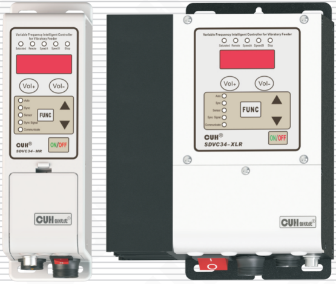

## SDVC34 Series
ตัวควบคุมอัจฉริยะแบบปรับความถี่ได้สำหรับเครื่องป้อนวัสดุแบบสั่นสะเทือน — SDVC34 Series
**คู่มือการใช้งาน**

---

## ข้อความลิขสิทธิ์

บริษัท Nanjing CUH Science & Technology CO., Ltd. ขอสงวนสิทธิ์ทั้งหมด

ข้อมูลทั้งหมดในคู่มือการใช้งานฉบับนี้เป็นทรัพย์สินทางปัญญาของบริษัทของเรา และได้รับความคุ้มครองตามกฎหมายลิขสิทธิ์และกฎหมายอื่นที่เกี่ยวข้อง CUH ได้รับและขอสงวนสิทธิ์ทั้งหมดตามที่กฎหมายลิขสิทธิ์และกฎหมายอื่น ๆ กำหนด โดยไม่ได้รับความยินยอมเป็นลายลักษณ์อักษรจาก CUH ห้ามคัดลอก แปล ลอกเลียน หรือนำคู่มือการใช้งานฉบับนี้ไปใช้ประโยชน์ไม่ว่าบางส่วนหรือทั้งหมด

## ข้อจำกัดความรับผิด

เนื้อหาทั้งหมดของคู่มือการใช้งานฉบับนี้อธิบายเฉพาะวิธีการใช้งานผลิตภัณฑ์ที่เกี่ยวข้องของบริษัทของเรา โดยอธิบายตามเทคโนโลยีที่มีอยู่ในปัจจุบันและสภาพที่ส่งมอบให้ท่านเมื่อใช้งาน ท่านต้องรับความเสี่ยงที่เกี่ยวข้องเมื่อใช้งานผลิตภัณฑ์นี้ เว้นแต่กฎหมายจะกำหนดไว้เป็นอย่างอื่น บริษัทไม่มีความรับผิดไม่ว่าด้วยการแสดงออกหรือโดยนัยใด ๆ ต่อผลิตภัณฑ์อันเนื่องมาจากคู่มือการใช้งานฉบับนี้ รวมถึงแต่ไม่จำกัดเพียงการบาดเจ็บต่อบุคคล ความเสียหายต่อทรัพย์สิน การสูญเสียโอกาส เป็นต้น

ท่านเข้าใจความเสี่ยงข้างต้นอย่างชัดเจนและตกลงว่า เว้นแต่กฎหมายจะบังคับไว้ บริษัทจะไม่รับผิดชอบต่อความเสียหายหรือการสูญเสียโดยตรงหรือโดยอ้อมต่อท่าน (รวมถึงแต่ไม่จำกัดเพียงการสูญเสียที่จับต้องได้ของบุคลากร ทรัพย์สิน ข้อมูล เป็นต้น และการสูญเสียที่จับต้องไม่ได้ เช่น ชื่อเสียง โอกาส เป็นต้น)

บริษัทขอสงวนสิทธิ์ในการแก้ไขผลิตภัณฑ์ที่เกี่ยวข้องในคู่มือการใช้งานฉบับนี้โดยไม่ต้องแจ้งให้ทราบล่วงหน้าหรือภายหลัง

---

## บทนำ

ขอบคุณที่ท่านเลือกใช้ตัวควบคุมอัจฉริยะแบบปรับความถี่ได้สำหรับเครื่องป้อนวัสดุแบบสั่นสะเทือน ซีรีส์ SDVC34 ของ CUH (ต่อไปนี้จะเรียกว่า "ตัวควบคุม") ตัวควบคุมซีรีส์นี้ใช้ส่วนประกอบคุณภาพสูง ผสมผสานเทคโนโลยีอิเล็กทรอนิกส์ล่าสุด และออกแบบอย่างพิถีพิถันด้วยตัวประมวลผลสัญญาณดิจิทัลประสิทธิภาพสูง

คู่มือฉบับนี้แนะนำวิธีการใช้งานพื้นฐาน คำอธิบายทางเทคนิคของฟังก์ชัน และตัวอย่างการใช้งานทั่วไปของผลิตภัณฑ์นี้ ให้ข้อมูลที่เกี่ยวข้องแก่ผู้ใช้เกี่ยวกับการติดตั้งและการปรับแต่ง การตั้งค่าพารามิเตอร์ การวินิจฉัยความผิดปกติ การแก้ไขปัญหา และการบำรุงรักษาตามปกติของตัวควบคุม เพื่อให้มั่นใจว่าการติดตั้งและการใช้งานตัวควบคุมนี้ถูกต้อง โปรดอ่านคู่มือการใช้งานฉบับนี้อย่างละเอียดก่อนการติดตั้งและเก็บรักษาไว้อย่างถูกต้อง

โปรดอ่านสัญลักษณ์ต่อไปนี้เพื่อเตือนท่านเกี่ยวกับข้อควรระวังต่อการบาดเจ็บของบุคคลและความเสียหายต่อผลิตภัณฑ์

| | |
|---|---|
| ⚠ อันตราย | การไม่ปฏิบัติตามข้อนี้จะทำให้เกิดการบาดเจ็บต่อบุคคลหรือเสียชีวิต |
| ⚠ คำเตือน | การไม่ปฏิบัติตามข้อนี้อาจทำให้เกิดการบาดเจ็บต่อบุคคลหรือเสียชีวิต |
| ⚠ ข้อควรระวัง | การไม่ปฏิบัติตามข้อนี้อาจทำให้เกิดการบาดเจ็บระดับปานกลางหรือเล็กน้อยต่อบุคคล |
| ข้อสังเกต | การไม่ปฏิบัติตามข้อนี้จะทำให้เกิดความเสียหายต่อผลิตภัณฑ์และทรัพย์สิน |
| ❗ จำเป็น | ระบุข้อควรระวังและข้อจำกัดการใช้งานที่ต้องปฏิบัติตามระหว่างการใช้งาน |

**คู่มือฉบับนี้เหมาะสำหรับตัวควบคุมรุ่นต่อไปนี้:**

ตัวควบคุมอัจฉริยะแบบปรับความถี่ได้สำหรับเครื่องป้อนวัสดุแบบสั่นสะเทือน

- SDVC34-MR　3.0A กระแสเอาต์พุต (RS485)
- SDVC34-MRJ　3.0A กระแสเอาต์พุต (RS485 และการนับ)
- SDVC34-XLR　6.0A กระแสเอาต์พุต (RS485)
- SDVC34-XLRJ　6.0A กระแสเอาต์พุต (RS485 และการนับ)

---

# ความปลอดภัยและข้อควรระวัง

1. **⚠ อันตราย** ผลิตภัณฑ์นี้ใช้สำหรับขับเคลื่อนอุปกรณ์ป้อนวัสดุแบบสั่นสะเทือนที่ใช้แม่เหล็กไฟฟ้าเท่านั้น ห้ามใช้ผลิตภัณฑ์นี้เพื่อวัตถุประสงค์ในการปกป้องร่างกายมนุษย์หรือส่วนหนึ่งส่วนใดของร่างกายมนุษย์ เป็นต้น

2. **⚠ อันตราย** ผลิตภัณฑ์นี้ไม่ได้ออกแบบมาให้ใช้เป็นผลิตภัณฑ์กันระเบิด ห้ามใช้งานในพื้นที่อันตรายและ/หรือสภาพแวดล้อมที่มีก๊าซที่อาจเกิดการระเบิดได้

3. **⚠ คำเตือน** ผลิตภัณฑ์นี้ใช้พลังงานจากไฟฟ้ากระแสสลับ โปรดอย่าจ่ายแรงดันไฟฟ้ากระแสสลับเกิน 260Vac แรงดันอินพุตที่สูงเกินไป เช่น 380Vac อาจทำให้ผลิตภัณฑ์ระเบิดหรือเกิดเพลิงไหม้ ก่อให้เกิดอุบัติเหตุด้านความปลอดภัยร้ายแรง

4. **⚠ คำเตือน** ผลิตภัณฑ์นี้ต่อสายดินผ่านสายไฟ โปรดตรวจสอบให้แน่ใจว่าอุปกรณ์จ่ายไฟสำหรับตัวควบคุมมีการต่อสายดินที่ดี มิฉะนั้นเปลือกตัวควบคุมอาจมีไฟฟ้ารั่วและทำให้เกิดอุบัติเหตุไฟดูด

5. **⚠ คำเตือน** ห้ามจ่ายไฟ AC เข้าที่เอาต์พุตของตัวควบคุมนี้ เพราะจะทำให้ตัวควบคุมเสียหาย

6. **⚠ คำเตือน** ห้ามเสียบหรือถอดสายไฟขณะมีกระแสไฟฟ้า และห้ามสัมผัสจุดสัมผัสของขั้วต่อต่าง ๆ ในช่องเดินสาย เพื่อป้องกันไฟฟ้าดูด

7. **ข้อสังเกต** โปรดหลีกเลี่ยงการควบคุมเอาต์พุตของผลิตภัณฑ์นี้โดยการตัดแหล่งจ่ายไฟผ่านรีเลย์และอุปกรณ์อื่น ๆ ซึ่งจะลดอายุการใช้งานของตัวควบคุมอย่างรุนแรง

8. **ข้อสังเกต** ตัวควบคุมออกแบบมาให้ทำงานในสภาพแวดล้อมที่เย็นและแห้ง ห้ามใช้งานตัวควบคุมกลางแจ้งเพื่อหลีกเลี่ยงการแช่น้ำและการถูกแดดส่อง ให้ใช้งานตัวควบคุมภายในอุณหภูมิตามคุณลักษณะทางไฟฟ้าที่กำหนด

9. **❗ จำเป็น** ต้องยึดผลิตภัณฑ์นี้บนแท่นที่มั่นคงซึ่งต่อสายดินอย่างน่าเชื่อถือและอยู่ห่างจากอุปกรณ์ที่สั่นสะเทือน

10. **❗ จำเป็น** ห้ามใช้งานตัวควบคุมในสภาวะที่เกินขีดจำกัดการออกแบบ

11. **❗ จำเป็น** ให้ใช้งานตัวควบคุมอย่างเคร่งครัดตามคู่มือฉบับนี้ เราจะไม่รับผิดชอบทางแพ่งหรือทางอาญาใด ๆ หากเกิดความเสียหายต่ออุปกรณ์หรือการบาดเจ็บต่อบุคคลจากการใช้งานที่ไม่ถูกต้อง

12. **❗ จำเป็น** ห้ามเปิดเปลือกตัวควบคุมเพื่อหลีกเลี่ยงไฟฟ้าดูด โปรดติดต่อ CUH หากตัวควบคุมขัดข้อง ห้ามพยายามซ่อมแซมตัวควบคุมด้วยตนเอง ซึ่งอาจทำให้การรับประกันเป็นโมฆะ

---

# สภาพแวดล้อมในการใช้งานและการจัดเก็บ

## การตรวจสอบก่อนการใช้งาน

ตัวควบคุมทุกเครื่องจะผ่านการตรวจสอบคุณภาพอย่างเข้มงวดก่อนการจัดส่ง และบรรจุในบรรจุภัณฑ์กันกระแทก โปรดตรวจสอบรายการต่อไปนี้หลังจากเปิดกล่อง:

1. ตัวควบคุมเสียหายระหว่างการขนส่งหรือไม่
2. รุ่นของตัวควบคุมตรงกับที่ท่านสั่งซื้อหรือไม่

## สภาพแวดล้อมในการทำงาน

โปรดปฏิบัติตามข้อควรระวังต่อไปนี้เพื่อให้มั่นใจในประสิทธิภาพที่ดีขึ้นและอายุการใช้งานที่ยาวนานขึ้นของตัวควบคุม:

- ⚠ สภาพแวดล้อมที่มีการระบายอากาศดี
- ⚠ อยู่ห่างจากน้ำ ความชื้น ฝุ่น และโดยเฉพาะฝุ่นมัน
- ⚠ อยู่ห่างจากก๊าซและของเหลวที่กัดกร่อนหรือติดไฟได้
- ⚠ อยู่ห่างจากฝุ่นที่ฟุ้งกระจายและเศษโลหะ
- ⚠ ยึดติดแน่นเพื่อหลีกเลี่ยงการสั่นสะเทือนของตัวเอง
- ⚠ อยู่ห่างจากการรบกวนทางแม่เหล็กไฟฟ้า
- ⚠ ตรวจสอบให้แน่ใจว่าอุณหภูมิแวดล้อมอยู่ที่ 0~40 °C
- ⚠ สำหรับใช้งานที่ระดับความสูง 2000 ม. หรือต่ำกว่า

---

# สารบัญ

- **บทที่ Ⅰ คำแนะนำก่อนการใช้งาน — 1**
  - 1.1 การตรวจสอบรายการในบรรจุภัณฑ์ — 1
  - 1.2 คำอธิบายไฟแสดงสถานะ — 2
  - 1.3 คำอธิบายปุ่มกด — 4
  - 1.4 คำอธิบายส่วนประกอบภายนอก — 4
  - 1.5 คำอธิบายพอร์ตการต่อสาย — 5
  - 1.6 คำอธิบายป้ายข้อมูล — 6
- **บทที่ Ⅱ คุณสมบัติ — 7**
  - 2.1 บทนำผลิตภัณฑ์ — 7
  - 2.2 คู่มือการเลือก — 8
    - 2.2.1 คำอธิบายรุ่น — 8
    - 2.2.2 คำอธิบายฟังก์ชัน — 8
- **บทที่ Ⅲ คู่มือการติดตั้ง — 9**
  - 3.1 เงื่อนไขการใช้งานตัวควบคุม — 9
  - 3.2 วิธีการใช้งานปุ่มกด — 9
  - 3.3 การติดตั้งและการใช้งาน — 10
- **บทที่ Ⅳ การปรับพารามิเตอร์ — 12**
  - 4.1 พารามิเตอร์ทั่วไป — 12
  - 4.2 พารามิเตอร์พื้นฐาน — 12
  - 4.3 พารามิเตอร์ขั้นสูง — 13
  - 4.4 พารามิเตอร์ออโต้/ซิงค์ — 18
- **บทที่ Ⅴ โหมดการทำงาน — 22**
  - 5.1 โหมดแมนนวล — 22
    - 5.1.1 การปรับแรงดันเอาต์พุตในโหมดแมนนวล — 23
    - 5.1.2 การปรับความถี่เอาต์พุตในโหมดแมนนวล — 23
  - 5.2 โหมดออโต้ — 24
    - 5.2.1 การติดตั้งเซ็นเซอร์สั่นสะเทือน — 24

---

---

- 5.2.2 การปรับความเร็วป้อนในโหมดออโต้ — 26
- 5.2.3 การวัดความถี่อัตโนมัติในโหมดออโต้ — 26
- 5.3 โหมดกึ่งอัตโนมัติ — 27
  - 5.3.1 การติดตั้งเซ็นเซอร์สั่นสะเทือน — 27
  - 5.3.2 การตั้งค่าโหมดกึ่งอัตโนมัติ — 27
  - 5.3.3 การปรับความเร็วป้อนในโหมดกึ่งอัตโนมัติ — 28
  - 5.3.4 การปรับความถี่เอาต์พุตในโหมดกึ่งอัตโนมัติ — 28
- 5.4 โหมดซิงค์ — 29
  - 5.4.1 วิธีการเชื่อมต่อสายสัญญาณซิงค์ — 30
  - 5.4.2 การประยุกต์ใช้โหมดซิงค์ — 31
- 5.5 โหมดการนับ — 35
  - 5.5.1 วิธีการใช้งาน — 36
  - 5.5.2 วิธีการเชื่อมต่อ — 37
  - 5.5.3 ทิศทางลอจิกของพัลส์นับ — 38
  - 5.5.4 ทิศทางลอจิกของการรีเซ็ตการนับ — 38
  - 5.5.5 คำอธิบายพารามิเตอร์การนับ — 39

## บทที่ Ⅵ การควบคุมสัญญาณ — 41

- 6.1 การควบคุมเปิด/ปิดของพอร์ต C — 41
  - 6.1.1 วิธีการเชื่อมต่อของพอร์ต C — 41
  - 6.1.2 เวลาหน่วงเปิด/ปิดของพอร์ต C — 46
  - 6.1.3 ความสัมพันธ์ทางลอจิกของการควบคุมเปิด/ปิดของพอร์ต C — 47
- 6.2 การควบคุมเปิด/ปิดของพอร์ต E — 48
  - 6.2.1 วิธีการเชื่อมต่อของพอร์ต E — 48
  - 6.2.2 เวลาหน่วงเปิด/ปิดของพอร์ต E — 49
  - 6.2.3 ความสัมพันธ์ทางลอจิกของการควบคุมเปิด/ปิดของพอร์ต E — 50
- 6.3 พารามิเตอร์ทั่วไปของพอร์ต C และพอร์ต E — 51
  - 6.3.1 ความสัมพันธ์ทางลอจิกของพอร์ต C และพอร์ต E — 51
  - 6.3.2 ประเภทเซ็นเซอร์สวิตช์ — 52
  - 6.3.3 การดำเนินการทางลอจิกของเอาต์พุตหลัก — 53
- 6.4 การควบคุมความเร็วระยะไกล — 54

---

---

- 6.5 เอาต์พุตควบคุม — 56
  - 6.5.1 วิธีการเชื่อมต่อเอาต์พุตควบคุม — 56
  - 6.5.2 ความสัมพันธ์ทางลอจิกของเอาต์พุตควบคุม — 57
  - 6.5.3 การดำเนินการทางลอจิกของเอาต์พุตควบคุม — 58
- 6.6 การบันทึกและเอาต์พุตความเร็วที่ตั้งไว้ล่วงหน้า — 59
- 6.7 การสื่อสาร RS485 — 61
  - 6.7.1 ที่อยู่การสื่อสาร RS485 — 61
  - 6.7.2 อัตราบอดการสื่อสาร RS485 — 61
  - 6.7.3 โปรโตคอลการสื่อสาร RS485 — 62

**บทที่ Ⅶ ฟังก์ชันความปลอดภัย — 63**

**บทที่ Ⅷ ภาคผนวก — 64**

- 8.1 มิติ — 64
- 8.2 แผนภาพวงจรอินพุตและเอาต์พุต — 67
- 8.3 ข้อมูลจำเพาะทางเทคนิค — 70
- 8.4 ข้อเสนอแนะการแก้ไขปัญหาและคำอธิบายข้อผิดพลาด — 71

**บทที่ Ⅸ ข้อมูลการรับประกันผลิตภัณฑ์ — 73**

- 9.1 ระยะเวลารับประกัน — 73
- 9.2 ขอบเขตการรับประกัน — 73
- 9.3 ความเหมาะสมของผลิตภัณฑ์ — 73

---

# บทที่ I คำแนะนำก่อนการใช้งาน

บทนี้แนะนำรายการบรรจุภัณฑ์ของผลิตภัณฑ์ คำอธิบายรูปลักษณ์ภายนอกของตัวควบคุม และข้อมูลป้ายข้อมูลของตัวควบคุม

## 1.1 การตรวจสอบรายการในบรรจุภัณฑ์

ก่อนการใช้งาน โปรดตรวจสอบความสมบูรณ์ของตัวควบคุมและอุปกรณ์เสริม หากพบว่าผลิตภัณฑ์ชำรุดหรือเสียหาย อุปกรณ์เสริมขาดหาย เป็นต้น โปรดติดต่อบริษัทของเรา

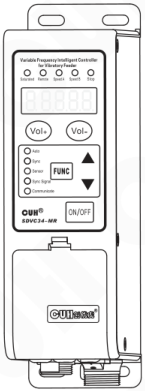

ตัวควบคุม×1

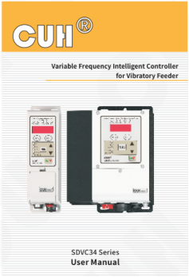

คู่มือการใช้งาน×1

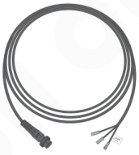

สายเอาต์พุต×1

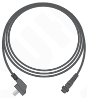

สายไฟอินพุต×1

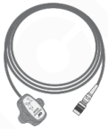

เซ็นเซอร์สั่นสะเทือน×1

---

## 1.2 คำอธิบายไฟแสดงสถานะ

### ตัวควบคุมที่มีฟังก์ชัน RS485

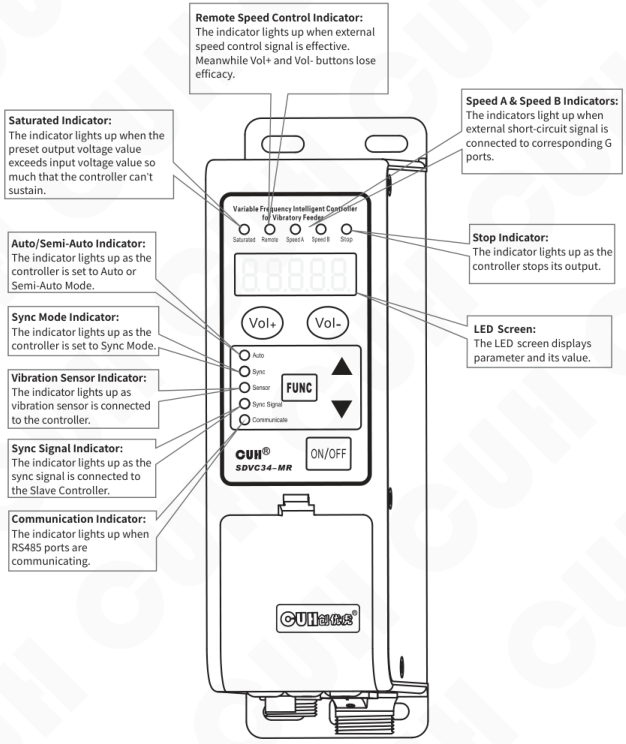

**ไฟแสดงการควบคุมความเร็วระยะไกล:**
ไฟจะติดเมื่อสัญญาณควบคุมความเร็วภายนอกมีผล ในขณะเดียวกันปุ่ม Vol+ และ Vol- จะไม่ทำงาน

**ไฟแสดงการอิ่มตัว:**
ไฟจะติดเมื่อค่าแรงดันเอาต์พุตที่ตั้งไว้เกินค่าแรงดันอินพุตมากจนตัวควบคุมไม่สามารถรักษาไว้ได้

**ไฟแสดง Speed A และ Speed B:**
ไฟจะติดเมื่อสัญญาณลัดวงจรภายนอกเชื่อมต่อกับพอร์ต G ที่เกี่ยวข้อง

**ไฟแสดงออโต้/กึ่งอัตโนมัติ:**
ไฟจะติดเมื่อตัวควบคุมถูกตั้งเป็นโหมดออโต้หรือกึ่งอัตโนมัติ

**ไฟแสดงโหมดซิงค์:**
ไฟจะติดเมื่อตัวควบคุมถูกตั้งเป็นโหมดซิงค์

**ไฟแสดงเซ็นเซอร์สั่นสะเทือน:**
ไฟจะติดเมื่อเซ็นเซอร์สั่นสะเทือนเชื่อมต่อกับตัวควบคุม

**ไฟแสดงสัญญาณซิงค์:**
ไฟจะติดเมื่อสัญญาณซิงค์เชื่อมต่อกับ Slave Controller

**ไฟแสดงการสื่อสาร:**
ไฟจะติดเมื่อพอร์ต RS485 กำลังสื่อสาร

**ไฟแสดงการหยุด:**
ไฟจะติดเมื่อตัวควบคุมหยุดเอาต์พุต

**จอ LED:**
จอ LED จะแสดงพารามิเตอร์และค่าของพารามิเตอร์

---

## ตัวควบคุมที่มีฟังก์ชัน RS485&การนับ

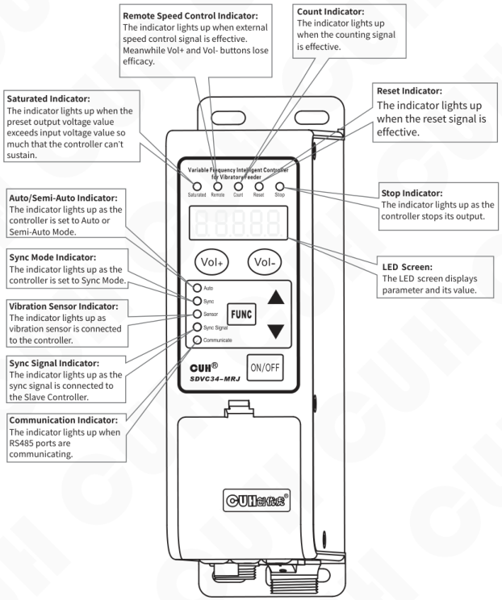

**ไฟแสดงการควบคุมความเร็วระยะไกล:**  
ไฟจะติดเมื่อสัญญาณควบคุมความเร็วภายนอกมีผล ในขณะเดียวกันปุ่ม Vol+ และ Vol- จะไม่ทำงาน

**ไฟแสดงการนับ:**  
ไฟจะติดเมื่อสัญญาณการนับมีผล

**ไฟแสดงการอิ่มตัว:**  
ไฟจะติดเมื่อค่าแรงดันเอาต์พุตที่ตั้งไว้เกินค่าแรงดันอินพุตมากจนตัวควบคุมไม่สามารถรักษาไว้ได้

**ไฟแสดงการรีเซ็ต:**  
ไฟจะติดเมื่อสัญญาณรีเซ็ตมีผล

**ไฟแสดงออโต้/กึ่งอัตโนมัติ:**  
ไฟจะติดเมื่อตัวควบคุมถูกตั้งเป็นโหมดออโต้หรือกึ่งอัตโนมัติ

**ไฟแสดงการหยุด:**  
ไฟจะติดเมื่อตัวควบคุมหยุดเอาต์พุต

**ไฟแสดงโหมดซิงค์:**  
ไฟจะติดเมื่อตัวควบคุมถูกตั้งเป็นโหมดซิงค์

**จอ LED:**  
จอ LED จะแสดงพารามิเตอร์และค่าของพารามิเตอร์

**ไฟแสดงเซ็นเซอร์สั่นสะเทือน:**  
ไฟจะติดเมื่อเซ็นเซอร์สั่นสะเทือนเชื่อมต่อกับตัวควบคุม

**ไฟแสดงสัญญาณซิงค์:**  
ไฟจะติดเมื่อสัญญาณซิงค์เชื่อมต่อกับ Slave Controller

**ไฟแสดงการสื่อสาร:**  
ไฟจะติดเมื่อพอร์ต RS485 กำลังสื่อสาร

---

## 1.3 คำอธิบายปุ่มกด

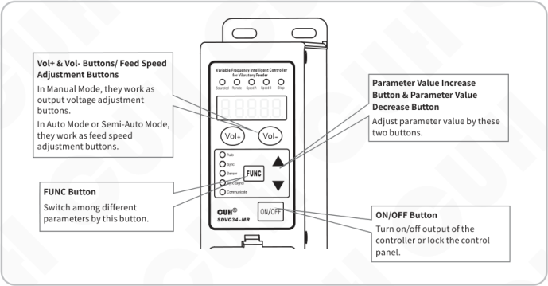

**ปุ่ม Vol+ & Vol-/ ปุ่มปรับความเร็วป้อน**

ในโหมดแมนนวล ปุ่มเหล่านี้ทำหน้าที่เป็นปุ่มปรับแรงดันเอาต์พุต

ในโหมดออโต้หรือโหมดกึ่งอัตโนมัติ ปุ่มเหล่านี้ทำหน้าที่เป็นปุ่มปรับความเร็วป้อน

**ปุ่ม FUNC**

ใช้ปุ่มนี้สลับระหว่างพารามิเตอร์ต่าง ๆ

**ปุ่มเพิ่มค่าพารามิเตอร์ & ปุ่มลดค่าพารามิเตอร์**

ใช้ปุ่มสองปุ่มนี้ปรับค่าพารามิเตอร์

**ปุ่ม ON/OFF**

เปิด/ปิดเอาต์พุตของตัวควบคุม หรือล็อกแผงควบคุม

## 1.4 คำอธิบายส่วนประกอบภายนอก

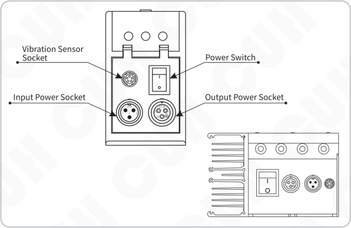

- เต้ารับเซ็นเซอร์สั่นสะเทือน
- เต้ารับไฟอินพุต
- สวิตช์ไฟ
- เต้ารับไฟเอาต์พุต

---

## 1.5 คำอธิบายพอร์ตการต่อสาย

### SDVC34-MR:

### SDVC34-MRJ:

---

### SDVC34-XLR:

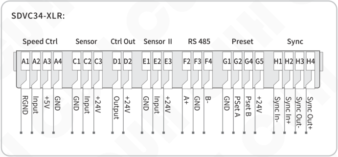

| ฟังก์ชัน | พอร์ต | สัญญาณ |
|---|---|---|
| Speed Ctrl | A1 | RGND |
| Speed Ctrl | A2 | Input |
| Speed Ctrl | A3 | +5V |
| Speed Ctrl | A4 | GND |
| Sensor | C1 | GND |
| Sensor | C2 | Input |
| Sensor | C3 | +24V |
| Ctrl Out | D1 | Output |
| Ctrl Out | D2 | +24V |
| Sensor Ⅱ | E1 | GND |
| Sensor Ⅱ | E2 | Input |
| Sensor Ⅱ | E3 | +24V |
| RS 485 | F2 | A+ |
| RS 485 | F3 | GND |
| RS 485 | F4 | B- |
| Preset | G1 | GND |
| Preset | G2 | PSet A |
| Preset | G4 | Pset B |
| Preset | G5 | +24V |
| Sync | H1 | Sync In- |
| Sync | H2 | Sync In+ |
| Sync | H3 | Sync Out- |
| Sync | H4 | Sync Out+ |

## 1.6 คำอธิบายป้ายข้อมูล

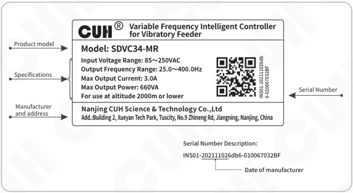

**CUH® — ตัวควบคุมอัจฉริยะแบบปรับความถี่ได้สำหรับเครื่องป้อนวัสดุแบบสั่นสะเทือน**

**รุ่นผลิตภัณฑ์**

รุ่น: SDVC34-MR

**ข้อมูลจำเพาะ**

- ช่วงแรงดันอินพุต: 85～250VAC
- ช่วงความถี่เอาต์พุต: 25.0～400.0Hz
- กระแสเอาต์พุตสูงสุด: 3.0A
- กำลังเอาต์พุตสูงสุด: 660VA
- สำหรับใช้งานที่ระดับความสูง 2000 ม. หรือต่ำกว่า

**ผู้ผลิตและที่อยู่**

Nanjing CUH Science & Technology Co.,Ltd

Add.:Building 2, Xueyan Tech Park, Tuscity, No.9 Zhineng Rd, Jiangning, Nanjing, China

**หมายเลขเครื่อง**

INS01-202111026db6-010067032BF

คำอธิบายหมายเลขเครื่อง:

INS01-<u>20211102</u>6db6-010067032BF

20211102 → วันที่ผลิต

---

## บทที่Ⅱ คุณสมบัติ

### 2.1 บทนำผลิตภัณฑ์

ตัวควบคุมนี้ได้รับการออกแบบมาเป็นพิเศษสำหรับควบคุมเครื่องป้อนวัสดุแบบสั่นสะเทือนในระบบอัตโนมัติ ผสมผสานกับเทคโนโลยีอิเล็กทรอนิกส์ล่าสุดและการออกแบบอย่างพิถีพิถัน ตัวควบคุมมีคุณสมบัติที่สะดวกและใช้งานได้จริงดังต่อไปนี้:

**Auto FM:** ปรับความถี่เอาต์พุตอัตโนมัติแบบเรียลไทม์ เพื่อให้มั่นใจว่าเครื่องป้อนวัสดุแบบสั่นสะเทือนจะทำงานที่ความถี่สั่นสะเทือนที่ดีที่สุดเสมอ

**การควบคุมความเร็วคงที่อัตโนมัติ:** ปรับแรงดันเอาต์พุตอัตโนมัติแบบเรียลไทม์ เพื่อรักษาความเร็วป้อนที่ตั้งไว้ให้คงที่ โดยไม่คำนึงถึงการเปลี่ยนแปลงน้ำหนักของวัสดุในเครื่องป้อนวัสดุแบบสั่นสะเทือน

**การวัดความถี่อัตโนมัติ:** วัดและส่งออกความถี่สั่นสะเทือนที่ดีที่สุดของเครื่องป้อนวัสดุแบบสั่นสะเทือนโดยอัตโนมัติ

**การควบคุมแรงดันอัตโนมัติ:** ขจัดทั้งการเปลี่ยนแปลงความเร็วป้อนที่เกิดจากความผันผวนของแรงดันไฟฟ้า และปรากฏการณ์บีตที่เกิดจากความถี่ AC ในอุตสาหกรรม

**การซิงค์รูปคลื่น:** ซิงค์รูปคลื่นเอาต์พุตของตัวควบคุมทาสให้ตรงกับความถี่และเฟสเดียวกับตัวควบคุมหลัก เพื่อหลีกเลี่ยงปรากฏการณ์บีต

**การควบคุมเปิด/ปิดระยะไกล:** ตัวควบคุมมีพอร์ตควบคุมเปิด/ปิด 2 กลุ่ม สามารถเชื่อมต่อเซ็นเซอร์สวิตช์หรือ PLC เพื่อเปิด/ปิดตัวควบคุมได้ นอกจากนี้ยังสามารถตั้งเวลาสตาร์ทแบบนุ่มนวล เวลาหน่วงเปิด เวลาหน่วงปิด และความสัมพันธ์ทางลอจิกของการควบคุมเปิด/ปิดได้

**การตรวจจับประเภทเซ็นเซอร์สวิตช์อัตโนมัติ:** ตัวควบคุมสามารถตรวจจับและปรับตัวเข้ากับเซ็นเซอร์สวิตช์ทั้งแบบ NPN และ PNP ได้

**การสตาร์ทแบบนุ่มนวล:** เพื่อหลีกเลี่ยงการกระแทกอย่างกระทันหันต่อวัสดุและเครื่องป้อนวัสดุแบบสั่นสะเทือน ตัวควบคุมสามารถค่อย ๆ เพิ่มแรงดันเอาต์พุต/ความเร็วป้อนจาก 0 ไปยังค่าที่ตั้งไว้เมื่อเริ่มทำงาน

**ความเร็วที่ตั้งไว้ล่วงหน้า:** สามารถบันทึกและส่งออกความเร็วป้อนที่ตั้งไว้ล่วงหน้า 4 ระดับผ่านสัญญาณลัดวงจรภายนอก

**การเร่งความเร็ว:** ค่าแรงดันเอาต์พุตสูงสุดของตัวควบคุมสามารถเพิ่มได้ถึง 150% ของค่าแรงดันอินพุต

**แรงดันเอาต์พุตสูงสุดที่ปรับได้:** สามารถตั้งค่าแรงดันเอาต์พุตสูงสุดที่ปรับได้ล่วงหน้า เพื่อปกป้องเครื่องป้อนวัสดุแบบสั่นสะเทือนจากความเสียหายที่เกิดจากแรงดันสูง

**ดัชนีรูปคลื่น:** ผู้ใช้สามารถสร้างสมดุลระหว่างประสิทธิภาพและกำลังสูงสุดได้โดยการปรับพารามิเตอร์นี้

**การควบคุมความเร็วระยะไกล:** แรงดันเอาต์พุต/ความเร็วป้อนของตัวควบคุมสามารถปรับได้จากระยะไกลด้วยโพเทนชิโอมิเตอร์ภายนอก PLC หรือสัญญาณ DC 1~5V/4~20mA

**เอาต์พุตควบคุม 24V DC:** ตัวควบคุมสามารถจ่ายไฟ 24V DC ที่สัมพันธ์กับการตั้งค่าความสัมพันธ์ทางลอจิกของการควบคุมเปิด/ปิด เพื่อขับโซลินอยด์ รีเลย์ไฟฟ้า หรืออุปกรณ์ภายนอกอื่น ๆ

**การนับ:** ตัวควบคุม (เฉพาะ SDVC34-MRJ) สามารถนับชิ้นงานที่ผ่าน และลดความเร็วหรือหยุดเอาต์พุตโดยอัตโนมัติเมื่อจำนวนชิ้นงานที่ผ่านถึงค่าที่ตั้งไว้ล่วงหน้า

**การล็อกแผงควบคุม:** ล็อกปุ่มทั้งหมดบนแผงควบคุมโดยกดปุ่ม ON/OFF ค้างไว้ 2 วินาที เพื่อป้องกันการใช้งานผิดพลาด

**การล็อกพารามิเตอร์:** ล็อกพารามิเตอร์ทั้งหมดยกเว้นแรงดันเอาต์พุต/ความเร็วป้อนด้วยรหัสผ่านที่กำหนดเอง เพื่อป้องกันการใช้งานโดยไม่ได้รับอนุญาต

**การรีเซ็ตตัวควบคุม:** รีเซ็ตพารามิเตอร์ทั้งหมดของตัวควบคุมกลับเป็นค่าเริ่มต้นจากโรงงาน

**การสื่อสาร RS485:** พารามิเตอร์ทั้งหมดสามารถปรับได้ผ่านพอร์ตการสื่อสาร RS485

---

## 2.2 คู่มือการเลือก

### 2.2.1 คำอธิบายรุ่น

| รุ่นตัวควบคุม | กำลัง (VA) | ฟังก์ชัน |
|---|---|---|
| SDVC34-MR | 660 | RS485 |
| SDVC34-MRJ | 660 | RS485 และการนับ |
| SDVC34-XLR | 1320 | RS485 |
| SDVC34-XLRJ | 1320 | RS485 และการนับ |

### 2.2.2 คำอธิบายฟังก์ชัน

| ฟังก์ชัน | ทั่วไป | การนับ | RS485 | RS485 และการนับ |
|---|---|---|---|---|
| การควบคุมเปิด/ปิดของพอร์ต C | √ | √ | √ | √ |
| การควบคุมความเร็วระยะไกล | √ | √ | √ | √ |
| เอาต์พุตควบคุม | √ | √ | √ | √ |
| ความเร็วที่ตั้งไว้ล่วงหน้า | √ | | √ | |
| การนับ | | √ | | √ |
| การควบคุมเปิด/ปิดของพอร์ต E | | | √ | √ |
| การซิงค์ | | | √ | √ |
| RS 485 | | | √ | √ |
| เซ็นเซอร์สั่นสะเทือน | √ | √ | √ | √ |

---

# บทที่ Ⅲ คู่มือการติดตั้ง

บทนี้แนะนำเงื่อนไขที่จำเป็นสำหรับการใช้งานตัวควบคุม และวิธีการติดตั้งและเชื่อมต่ออย่างถูกต้อง

## 3.1 เงื่อนไขการใช้งานตัวควบคุม

ตัวควบคุมใช้พลังงานจากไฟ AC 110/220V และต่อสายดินป้องกันผ่านปลั๊กของสายไฟ โปรดจัดหาแหล่งจ่ายไฟหลักและอุปกรณ์จ่ายไฟ 110V หรือ 220V, 50Hz/60Hz ที่ได้มาตรฐาน และตรวจสอบให้แน่ใจว่าสายดินป้องกันเชื่อมต่ออย่างถูกต้อง

**⚠ คำเตือน** ห้ามเชื่อมต่อตัวควบคุมกับไฟ AC 380V เด็ดขาด เพราะจะทำให้ตัวควบคุมเสียหายร้ายแรงแบบย้อนกลับไม่ได้ อาจทำให้เกิดการระเบิด เพลิงไหม้ และเหตุการณ์ความปลอดภัยอื่น ๆ

**⚠ คำเตือน** ตรวจสอบให้แน่ใจว่าด้านแหล่งจ่ายไฟต่อสายดินอย่างน่าเชื่อถือ เปลือกโลหะของตัวควบคุมเชื่อมต่อโดยตรงกับสายดินป้องกัน การต่อสายดินที่ไม่ดีจะทำให้เปลือกตัวควบคุมมีไฟฟ้าและเกิดอุบัติเหตุไฟดูด

**ข้อสังเกต** การทำงานเป็นเวลานานจะเกิดความร้อนและทำให้อุณหภูมิของเปลือกสูงขึ้น โปรดติดตั้งตัวควบคุมในสภาพแวดล้อมที่มีการระบายอากาศดีและยึดให้แน่น ห่างจากแหล่งสั่นสะเทือน

**ข้อสังเกต** เอาต์พุตของผลิตภัณฑ์นี้เกิดจากการแปลงกระแสสลับเป็นกระแสตรงและการอินเวอร์ตของแหล่งจ่ายไฟหลัก และไม่มีการแยกวงจรระหว่างอินพุตและเอาต์พุต ดังนั้นขั้วเอาต์พุตจึงไม่สามารถเชื่อมต่อกับสายดินป้องกันได้ เมื่อเชื่อมต่อแม่เหล็กไฟฟ้า จำเป็นต้องตรวจสอบให้แน่ใจว่าขดลวดแม่เหล็กไฟฟ้าและเปลือกมีความสามารถในการเป็นฉนวนขั้นพื้นฐาน มิฉะนั้นอาจเกิดไฟฟ้ารั่ว ซึ่งอาจทำให้เกิดไฟดูดและความเสียหายต่อตัวควบคุม

**ข้อสังเกต** ผลิตภัณฑ์นี้เป็นตัวควบคุมที่ใช้ขับแม่เหล็กไฟฟ้า ห้ามเชื่อมต่อกับเครื่องป้อนวัสดุแบบสั่นสะเทือนแบบเพียโซอิเล็กทริก

## 3.2 วิธีการใช้งานปุ่มกด

a. การกดสั้นหมายถึงระยะเวลากดมากกว่า 0.1 และน้อยกว่า 2 วินาที การกดยาวหมายถึงระยะเวลากดมากกว่า 2 วินาที

b. กด `Vol+` หรือ `Vol-` สั้น ๆ เพื่อปรับแรงดันเอาต์พุตและความเร็วป้อนของตัวควบคุมที่อินเทอร์เฟซ LED ใดก็ได้ ตัวควบคุมจะกลับไปยังพารามิเตอร์ก่อนหน้าหลังการปรับพารามิเตอร์ทั่วไป

c. กด `ON/OFF` ค้างไว้เพื่อล็อกหรือปลดล็อกปุ่มทั้งหมดบนแผงควบคุม เมื่ออยู่ในสถานะล็อก ปุ่มทั้งหมดจะไม่สามารถปรับได้

d. เข้าหรือออกจากอินเทอร์เฟซพารามิเตอร์พื้นฐานโดยกด `FUNC` ค้างไว้ สลับระหว่างพารามิเตอร์พื้นฐานโดยกด `FUNC` สั้น ๆ และปรับค่าพารามิเตอร์โดยกด ▼ หรือ ▲ สั้น ๆ

e. เข้าหรือออกจากอินเทอร์เฟซพารามิเตอร์ขั้นสูงโดยกด `FUNC` และ ▲ ค้างไว้ สลับระหว่างพารามิเตอร์ขั้นสูงโดยกด `FUNC` สั้น ๆ และปรับค่าพารามิเตอร์โดยกด ▼ หรือ ▲ สั้น ๆ

f. เข้าหรือออกจากอินเทอร์เฟซพารามิเตอร์ออโต้/ซิงค์โดยกด `FUNC` และ ▼ ค้างไว้ สลับระหว่างพารามิเตอร์ออโต้/ซิงค์โดยกด `FUNC` สั้น ๆ และปรับค่าพารามิเตอร์โดยกด ▼ หรือ ▲ สั้น ๆ

---

## 3.3 การติดตั้งและการใช้งาน

### ขั้นตอนที่หนึ่ง:

เปิดกล่องบรรจุภัณฑ์และตรวจสอบตัวควบคุมและอุปกรณ์เสริมทั้งหมด

### ขั้นตอนที่สอง:

เชื่อมต่อขั้วต่อของสายไฟเอาต์พุตกับขดลวดแม่เหล็กไฟฟ้าของเครื่องสั่น

จัดร่องบนปลั๊กการบินของสายเอาต์พุตให้ตรงกับเครื่องหมายสามเหลี่ยมบนเต้ารับเอาต์พุตของตัวควบคุม จากนั้นขันน็อตให้แน่นหลังจากเชื่อมต่อสายเอาต์พุตอย่างถูกต้อง

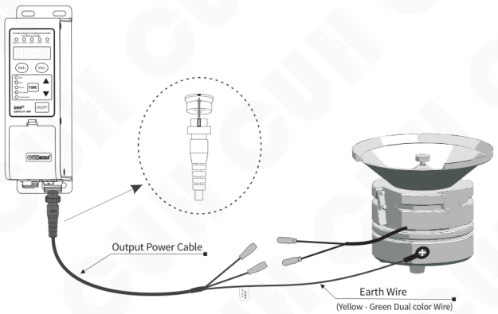

### ข้อสังเกต

1. ตรวจสอบให้แน่ใจว่าขดลวดแม่เหล็กไฟฟ้าของเครื่องสั่นเชื่อมต่อกับขาสองขาของสายไฟเอาต์พุต และเปลือกโลหะของเครื่องสั่นต่อสายดินอย่างน่าเชื่อถือ
2. ห้ามเชื่อมต่อโหลดเพียโซอิเล็กทริกกับเอาต์พุตกำลังไฟ มิฉะนั้นอาจทำให้เกิดอุบัติเหตุไฟดูดได้!

---

### ขั้นตอนที่สาม:

เชื่อมต่อขั้วต่อของสายไฟอินพุตกับเต้ารับไฟอินพุตของตัวควบคุม

เชื่อมต่อด้านตัวควบคุมก่อน

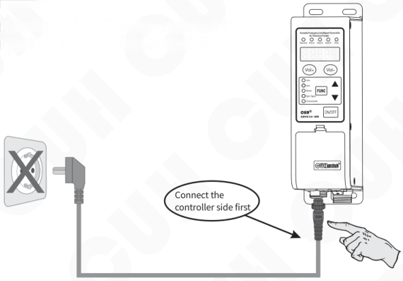

### ขั้นตอนที่สี่:

หลังจากยืนยันว่าสวิตช์อยู่ในตำแหน่งปิด ให้เชื่อมต่อปลั๊กของสายไฟอินพุตกับเต้ารับไฟบ้าน

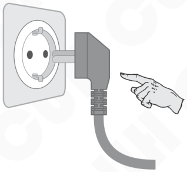

---

# บทที่ Ⅳ การปรับพารามิเตอร์

พารามิเตอร์ของตัวควบคุมแบ่งออกเป็น 4 ประเภทตามวิธีการปรับที่แตกต่างกัน: พารามิเตอร์ทั่วไป พารามิเตอร์พื้นฐาน พารามิเตอร์ขั้นสูง และพารามิเตอร์ออโต้/ซิงค์

## 4.1 พารามิเตอร์ทั่วไป

- กด `Vol+` หรือ `Vol-` เพื่อปรับพารามิเตอร์ทั่วไป
- ปุ่ม `Vol+` และ `Vol-` ถูกออกแบบมาเพื่อปรับพารามิเตอร์ทั่วไปเท่านั้น
- พารามิเตอร์ทั่วไปสามารถปรับได้โดยกด `Vol+` หรือ `Vol-` แม้ในขณะที่พารามิเตอร์อื่นแสดงอยู่บนจอ LED ตัวควบคุมจะกลับไปยังพารามิเตอร์ก่อนหน้าหลังการปรับพารามิเตอร์ทั่วไป

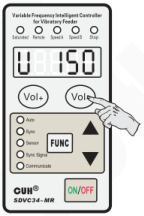

|  | คำจำกัดความ | สัญลักษณ์ | ภาพสัญลักษณ์ | ช่วงค่า | ค่าเริ่มต้น |
|---|---|---|---|---|---|
| พารามิเตอร์ทั่วไป | แรงดันเอาต์พุต | U |  | 0~250 (V) | 150 |
| พารามิเตอร์ทั่วไป | ความเร็วป้อน | A |  | 0~3200 | 200 |
| พารามิเตอร์ทั่วไป | การล็อกแผงควบคุม | a |  | —— | ค่าแรงดันปัจจุบัน/ ความเร็วป้อนปัจจุบัน |

## 4.2 พารามิเตอร์พื้นฐาน

- กด `FUNC` ค้างไว้ 2 วินาที เพื่อเข้าสู่สถานะการปรับพารามิเตอร์พื้นฐาน
- กด `FUNC` ซ้ำ ๆ เพื่อสลับวนระหว่างพารามิเตอร์ต่าง ๆ
- กดปุ่ม ▲ หรือ ▼ เพื่อปรับค่าพารามิเตอร์
- กด `FUNC` อีกครั้งค้างไว้ 2 วินาที เพื่อออกจากสถานะการปรับพารามิเตอร์พื้นฐาน

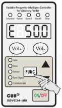

|  | คำจำกัดความ | สัญลักษณ์ | ภาพสัญลักษณ์ | ช่วงค่า | ค่าเริ่มต้น |
|---|---|---|---|---|---|
| พารามิเตอร์พื้นฐาน กด `FUNC` ค้างไว้ | ความถี่เอาต์พุต | E |  | 25.0~400.0 (Hz) | 50.0 |
| พารามิเตอร์พื้นฐาน กด `FUNC` ค้างไว้ | เวลาหน่วงเปิดของพอร์ต C | J |  | 0.0~99.9 (s) | 0.2 |
| พารามิเตอร์พื้นฐาน กด `FUNC` ค้างไว้ | เวลาหน่วงปิดของพอร์ต C | L |  | 0.0~99.9 (s) | 0.2 |
| พารามิเตอร์พื้นฐาน กด `FUNC` ค้างไว้ | เวลาสตาร์ทแบบนุ่มนวล | t |  | 0.0~10.0 (s) | 0.5 |
| พารามิเตอร์พื้นฐาน กด `FUNC` ค้างไว้ | ขีดจำกัดการนับสูงสุด (ตัวควบคุมที่มีฟังก์ชันการนับ ส่วนต่อท้าย J) | 3 |  | 0~9999 | 0 |

---

## 4.3 พารามิเตอร์ขั้นสูง

- กดปุ่ม `FUNC` และ ▲ พร้อมกันค้างไว้ 2 วินาที เพื่อเข้าสู่สถานะการปรับพารามิเตอร์ขั้นสูง
- กด `FUNC` ซ้ำ ๆ เพื่อสลับวนระหว่างพารามิเตอร์ต่าง ๆ
- กด ▲ หรือ ▼ เพื่อปรับค่าพารามิเตอร์
- กดปุ่ม `FUNC` และ ▲ พร้อมกันอีกครั้งค้างไว้ 2 วินาที เพื่อออกจากสถานะการปรับพารามิเตอร์ขั้นสูง

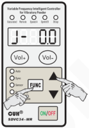

**พารามิเตอร์ขั้นสูง**  
กด `FUNC` และ ▲ ค้างไว้

| คำจำกัดความ | สัญลักษณ์ | ภาพสัญลักษณ์ | ช่วงค่า | ค่าเริ่มต้น |
|---|---|---|---|---|
| เวลาหน่วงเปิดของพอร์ต E | J- |  | 0.0~99.9 (s) | 0.0 |
| เวลาหน่วงปิดของพอร์ต E | L- |  | 0.0~99.9 (s) | 0.0 |
| เวลาหน่วงเปิดของพอร์ต D | Jd |  | 0.0~99.9 (s) | 0.0 |
| เวลาหน่วงปิดของพอร์ต D | Ld |  | 0.0~99.9 (s) | 0.0 |
| ประเภทพอร์ต D | rd |  | nPn, PnP, PSP (พุช-พูล) | nPn |
| ความสัมพันธ์ทางลอจิกของพอร์ต C | F2 |  | ลอจิกบวก, ลอจิกกลบ | ลอจิกบวก |
| ความสัมพันธ์ทางลอจิกของพอร์ต E | F1 |  | ลอจิกบวก, ลอจิกกลบ | ลอจิกบวก |
| ความสัมพันธ์ทางลอจิกของเอาต์พุตควบคุม | F3 | 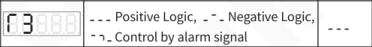 | ลอจิกบวก, ลอจิกกลบ, ควบคุมด้วยสัญญาณเตือน | ลอจิกบวก |
| การดำเนินการทางลอจิกของเอาต์พุตหลัก | F4 | 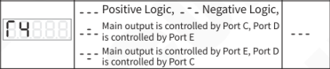 | ลอจิกบวก, ลอจิกกลบ, เอาต์พุตหลักถูกควบคุมโดยพอร์ต C พอร์ต D ถูกควบคุมโดยพอร์ต E เอาต์พุตหลักถูกควบคุมโดยพอร์ต E พอร์ต D ถูกควบคุมโดยพอร์ต C | ลอจิกบวก |
| การดำเนินการทางลอจิกของเอาต์พุตควบคุม | F8 |  | ลอจิกหลัก, กลุ่มลอจิกชุดที่สอง | ลอจิกหลัก |
| ประเภทเซ็นเซอร์สวิตช์ (ตัวควบคุมที่มีฟังก์ชัน RS485 ส่วนต่อท้าย R) | FA |  | Uto, nPn, PnP | Uto |
| ประเภทเซ็นเซอร์สวิตช์ (ตัวควบคุมที่มีฟังก์ชันการนับ ส่วนต่อท้าย J) | FA |  | nPn, PnP | nPn |
| ความสัมพันธ์ทางลอจิกของพอร์ต C และ E | ∩ |  | And, or, Xor | And |
| ทิศทางลอจิกของพัลส์นับ (ตัวควบคุมที่มีฟังก์ชันการนับ ส่วนต่อท้าย J) | Fb | 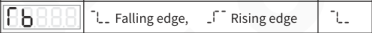 | ขอบตก, ขอบขึ้น | ขอบตก |
| ทิศทางลอจิกของการรีเซ็ตการนับ (ตัวควบคุมที่มีฟังก์ชันการนับ ส่วนต่อท้าย J) | FC |  | ขอบตก, ขอบขึ้น | ขอบตก |
| เปอร์เซ็นต์ความเร็วเมื่อสิ้นสุดการนับ (ตัวควบคุมที่มีฟังก์ชันการนับ ส่วนต่อท้าย J) | u |  | 0~100 | 30 |
| จำนวนครั้งสิ้นสุดการนับ (ตัวควบคุมที่มีฟังก์ชันการนับ ส่วนต่อท้าย J) | n |  | 0~255 | 3 |
| เวลากันสั่นสะเทือนของการนับ (ตัวควบคุมที่มีฟังก์ชันการนับ ส่วนต่อท้าย J) | U |  | 0.001~2.000 (s) | 0.010 |

### พารามิเตอร์ขั้นสูง

กด **FUNC** และ **▲** ค้างไว้

| คำจำกัดความ | สัญลักษณ์ | ภาพสัญลักษณ์ | ช่วงค่า | ค่าเริ่มต้น |
|---|---|---|---|---|
| แรงดันเอาต์พุตสูงสุดที่ปรับได้ | h | 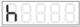 | 0~250 (V) | 250 |
| ขีดจำกัดล่างของความถี่เอาต์พุต | e |  | 25.0~390.0 (Hz) | 40.0 |
| ดัชนีการเร่งความเร็ว | y |  | 100~150 % | 120 |
| ดัชนีรูปคลื่น | r |  | 0~100 | 100 |
| การแสดงอุณหภูมิ | C |  | -10.0~80.0 (°C) | อุณหภูมิปัจจุบัน |
| โปรโตคอลการสื่อสาร | P | 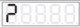 | ASC, rtu | rtu |
| ที่อยู่การสื่อสาร | ดูภาพสัญลักษณ์ |  | 1~31 | 1 |
| อัตราบอดการสื่อสาร | d |  | 0.3~115.2 kbps | 9.6 |
| รหัสผ่านล็อกพารามิเตอร์ | q- | 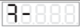 | 0~999 | - - - |
| สถานะเมื่อเปิดเครื่อง | rd |  | Run, Stop, Follow before power off  | - - -  |
| เวอร์ชันซอฟต์แวร์ | Ur |  | —— | เวอร์ชันปัจจุบัน |
| เวลารีเซ็ตอัตโนมัติหลังตัวนับเต็ม (ตัวควบคุมที่มีฟังก์ชันการนับ ส่วนต่อท้าย J) | rE |  | 0.0~99.9 (s) | 0.0 |
| การรีเซ็ตตัวควบคุม | 8.8.8.8.8. | 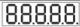 | —— | —— |

---

## คำอธิบายพารามิเตอร์ขั้นสูงบางตัว

### แรงดันเอาต์พุตสูงสุดที่ปรับได้: h

ช่วงแรงดันเอาต์พุตคือ 0 ถึง 250 V พารามิเตอร์ h จำกัดแรงดันเอาต์พุตสูงสุดไว้ที่ค่าหนึ่ง เพื่อปกป้องเครื่องป้อนวัสดุแบบสั่นสะเทือนจากแรงดันสูงที่เกิดจากการใช้งานผิดพลาด

แรงดันของการควบคุมความเร็วระยะไกลก็ได้รับผลกระทบจากพารามิเตอร์นี้เช่นกัน

### ขีดจำกัดล่างของความถี่เอาต์พุต: E.

ช่วงความถี่เอาต์พุตคือ 25.0 ถึง 390.0 (Hz) พารามิเตอร์ E. จำกัดความถี่เอาต์พุตต่ำสุดไว้ที่ค่าที่กำหนด เพื่อปกป้องเครื่องป้อนวัสดุแบบสั่นสะเทือนจากการใช้งานผิดพลาด

### เปอร์เซ็นต์ความเร็วเมื่อสิ้นสุดการนับ: u

หมายความว่า เมื่อการนับเข้าสู่สถานะลดความเร็วสุดท้าย ความเร็วป้อนของตัวควบคุมจะลดลงเหลือเปอร์เซ็นต์ของความเร็วเริ่มต้น

### จำนวนครั้งสิ้นสุดการนับ: n

หมายถึงจำนวนการนับระยะทางทั้งหมด หลังจากถึง "จำนวนสิ้นสุด" ตัวควบคุมจะเข้าสู่โหมดนับถอยหลัง

### เวลากันสั่นสะเทือนของการนับ: J

เวลาที่มีผลของระดับสัญญาณสูงหรือต่ำในสถานะตัวนับ

### ดัชนีการเร่งความเร็ว: y

ระบุว่าแรงดันเอาต์พุตสูงสุดสามารถเข้าถึงเปอร์เซ็นต์ของแรงดันอินพุตได้เท่าใด หลังการตั้งค่า แรงดันเอาต์พุตสูงสุดจะยังไม่เกินค่าของพารามิเตอร์ h

### ดัชนีรูปคลื่น: r

ตัวควบคุมสามารถสร้างสมดุลอย่างต่อเนื่องระหว่างประสิทธิภาพสูงสุด กำลังสูงสุด และเสียงรบกวนต่ำสุด เพื่อตอบสนองความต้องการที่สูงขึ้นของลูกค้า

### เวลาหน่วงเปิด/ปิดของพอร์ต D: Jd และ Ld

ช่วงเวลาหน่วงเปิด/ปิดคือ 0.0~99.9s ค่าเริ่มต้นคือ 0.0s

### ประเภทพอร์ต D: rd

พอร์ตเอาต์พุตควบคุมสามารถรองรับเอาต์พุต NPN เอาต์พุต PNP และเอาต์พุตแบบพุช-พูล โดยที่:

เอาต์พุต NPN มีผลเมื่อระดับต่ำ และเอาต์พุตไม่มีผลเมื่ออยู่ในสภาวะอิมพีแดนซ์สูง;

เอาต์พุต PNP มีผลเมื่อระดับสูง และเอาต์พุตไม่มีผลเมื่ออยู่ในสภาวะอิมพีแดนซ์สูง;

เอาต์พุตแบบพุช-พูลมีผลเมื่อระดับสูง และไม่มีผลเมื่อระดับต่ำ

---

### การดำเนินการทางลอจิกของเอาต์พุตควบคุม: Γ8

สำหรับลอจิกของเอาต์พุตหลักและเอาต์พุตควบคุม ผู้ใช้สามารถตั้งให้สัญญาณเอาต์พุตควบคุมตามสัญญาณเอาต์พุตหลักได้

### การแสดงอุณหภูมิ: C

แสดงอุณหภูมิภายในของตัวควบคุมแบบเรียลไทม์ อ่านเท่านั้น

### รหัสผ่านล็อกพารามิเตอร์: 

ล็อกพารามิเตอร์ทั้งหมดยกเว้นพารามิเตอร์แรงดันเอาต์พุต U/ พารามิเตอร์ความเร็วป้อน A ด้วยรหัสผ่านที่กำหนดเอง เพื่อป้องกันการใช้งานโดยไม่ได้รับอนุญาต

เปิดใช้งานฟังก์ชันล็อกพารามิเตอร์โดยการตั้งค่า  รหัสผ่าน รหัสผ่านนี้ยังคงมีผลหลังจากปิดเครื่อง เมื่อผู้ใช้เข้าสู่พารามิเตอร์ขั้นสูง จอ LED จะแสดง 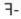 เพื่อแจ้งว่าต้องใช้รหัสผ่าน หากรหัสผ่านถูกต้อง กด `FUNC` สั้น ๆ เพื่อเข้าสู่การตั้งค่าพารามิเตอร์ขั้นสูง หากรหัสผ่านไม่ถูกต้อง การกด `FUNC` สั้น ๆ จะถูกละเว้น

### สถานะเมื่อเปิดเครื่อง: Γd

ระบุสถานะการทำงานของตัวควบคุมหลังจากเปิดเครื่อง

### เวอร์ชันซอฟต์แวร์: Ur

แสดงเวอร์ชันซอฟต์แวร์ปัจจุบันของตัวควบคุม อ่านเท่านั้น

### เวลารีเซ็ตอัตโนมัติหลังตัวนับเต็ม: ΓE

พารามิเตอร์ ΓE นี้จะกำหนดเวลาหน่วงการรีเซ็ตอัตโนมัติหลังตัวนับเต็ม เมื่อถึงเวลาหน่วง ตัวนับจะรีเซ็ตเป็นศูนย์ และไฟแสดงการนับและรีเซ็ตจะติดสว่าง

---

## พารามิเตอร์การรีเซ็ตตัวควบคุม: 8.8.8.8.8.

รีเซ็ตพารามิเตอร์ทั้งหมดกลับเป็นค่าเริ่มต้นจากโรงงานผ่านพารามิเตอร์นี้เมื่อจำเป็น

### การรีเซ็ตตัวควบคุม

**ขั้นตอนที่ 1:** กดปุ่ม **FUNC** และ ▲ พร้อมกันค้างไว้ 2 วินาที เพื่อเข้าสู่สถานะการปรับพารามิเตอร์ขั้นสูง

**ขั้นตอนที่ 2:** กด **FUNC** เพื่อสลับไปยังพารามิเตอร์ `8.8.8.8.8.` ที่กะพริบอยู่บนจอ LED

**ขั้นตอนที่ 3:** กดปุ่ม ▲ ค้างไว้จนกระทั่ง `-----` แสดงบนจอ LED

**ขั้นตอนที่ 4:** ปล่อยปุ่ม ▲ เพื่อสิ้นสุดกระบวนการรีเซ็ตตัวควบคุม จอ LED จะแสดง U150

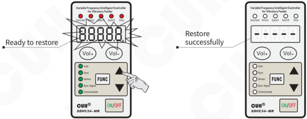

---

## 4.4 พารามิเตอร์ออโต้/ซิงค์

- กดปุ่ม **FUNC** และ ▼ พร้อมกันค้างไว้ 2 วินาที เพื่อเข้าสู่สถานะการปรับพารามิเตอร์ออโต้/ซิงค์
- กด **FUNC** ซ้ำ ๆ เพื่อสลับวนระหว่างพารามิเตอร์ต่าง ๆ
- กด ▲ หรือ ▼ เพื่อปรับค่าพารามิเตอร์
- กดปุ่ม **FUNC** และ ▼ พร้อมกันอีกครั้งค้างไว้ 2 วินาที เพื่อออกจากสถานะการปรับพารามิเตอร์ออโต้/ซิงค์

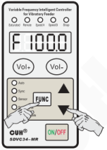

**พารามิเตอร์ออโต้/ซิงค์**  
กด **FUNC** และ ▼ ค้างไว้

| คำจำกัดความ | สัญลักษณ์ | ภาพสัญลักษณ์ | ช่วงค่า | ค่าเริ่มต้น |
|---|---|---|---|---|
| ความถี่กลาง | F |  | 25.0~400.0 (Hz) | 100.0 |
| ออฟเซ็ตสูงสุดใน Auto FM | n |  | 0.0~180.0 (Hz) | 30.0 |
| วิธีการปรับแรงดันเอาต์พุต | FS | 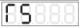 | Auto, Manual（ดูสัญลักษณ์ในภาพ）  | - - - |
| วิธีการปรับความถี่เอาต์พุต | FG |  | Auto, Manual, Sync（ดูสัญลักษณ์ในภาพ） 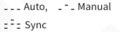 | - - - |
| ดัชนีการปรับความถี่เอาต์พุตอัตโนมัติ | iF |  | 0~200 | 20 |
| ดัชนีการปรับแอมพลิจูดอัตโนมัติ | PA |  | 0~999 | 60 |
| ดัชนีการปรับแอมพลิจูดอัตโนมัติ | iA | 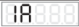 | 0~999 | 50 |
| การแสดงความเร็วป้อน | U |  | 0~H | 0 |
| การแสดงแรงดันเอาต์พุต | G |  | 0~h (V) | 150 |
| ขีดจำกัดล่างของแรงดัน | GL | 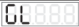 | 0~250 (V) | 0 |
| ขีดจำกัดล่างของความถี่ | e |  | 25.0~400.0 (Hz) | 40.0 |
| ดัชนีแอมพลิจูดสูงสุด | P | 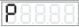 | 0~500 | 500 |
| ความเร็วป้อนสูงสุดที่ปรับได้ | H |  | 0~3200 | 1500 |
| ความต่างเฟส | Y |  | -180~180 ° | 0 |
| แรงดันเอาต์พุตสูงสุดในกระบวนการวัดความถี่อัตโนมัติ | b | 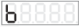 | 0~250 (V) | 100 |
| ความเร็วการค้นหาความถี่ | SP | 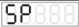 | 1~7 | 5 |
| ปริมาณการปรับความเร็วป้อนขั้นต่ำ | c |  | 1~10 | 1 |
| หมายเลขเซ็นเซอร์สั่นสะเทือน | t | 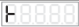 | 0, 1, 2, 3, 4, 203, 204, 205, 206 | 205 |

---

## คำอธิบายพารามิเตอร์ออโต้/ซิงค์

### วิธีการปรับแรงดันเอาต์พุต: Γ5

เมื่อพารามิเตอร์ Γ5 ถูกตั้งเป็น `_-_` พารามิเตอร์แรงดันเอาต์พุต U จะปรากฏให้เห็นในขณะที่พารามิเตอร์ A ถูกซ่อนไว้ พารามิเตอร์แรงดันเอาต์พุต U สามารถปรับได้ด้วยตนเอง

เมื่อพารามิเตอร์ Γ5 ถูกตั้งเป็น `___` และเซ็นเซอร์สั่นสะเทือนเชื่อมต่อกับตัวควบคุม พารามิเตอร์ความเร็วป้อน A จะปรากฏให้เห็นในขณะที่พารามิเตอร์ U ถูกซ่อนไว้ แรงดันเอาต์พุตจะถูกปรับโดยอัตโนมัติตามผลตอบกลับจากเซ็นเซอร์สั่นสะเทือน เพื่อรักษาความเร็วป้อนที่ตั้งไว้ให้คงที่

> เมื่อเซ็นเซอร์สั่นสะเทือนไม่ได้เชื่อมต่อกับตัวควบคุม แม้ว่าพารามิเตอร์ Γ5 จะถูกตั้งเป็น `___` พารามิเตอร์ U ก็ยังคงปรากฏให้เห็นและปรับได้ด้วยตนเอง

### วิธีการปรับความถี่เอาต์พุต: Γ6

เมื่อพารามิเตอร์ Γ6 ถูกตั้งเป็น `_-_` พารามิเตอร์ความถี่เอาต์พุต E สามารถปรับได้ด้วยตนเอง

เมื่อพารามิเตอร์ Γ6 ถูกตั้งเป็น `___` และเซ็นเซอร์สั่นสะเทือนเชื่อมต่อกับตัวควบคุม พารามิเตอร์ความถี่เอาต์พุต E จะถูกปรับโดยอัตโนมัติไปยังความถี่เรโซแนนซ์ (ความถี่สั่นสะเทือนที่ดีที่สุด) ของเครื่องป้อนวัสดุแบบสั่นสะเทือน ตามผลตอบกลับจากเซ็นเซอร์สั่นสะเทือน ความถี่เอาต์พุตไม่สามารถปรับได้ด้วยตนเอง

เมื่อพารามิเตอร์ Γ6 ถูกตั้งเป็น 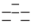 และสายสัญญาณซิงค์เชื่อมต่อระหว่าง Master Controller และ Slave Controller ความถี่เอาต์พุตของ Slave Controller จะสอดคล้องกับของ Master Controller เสมอ ความถี่เอาต์พุตของ Slave Controller ไม่สามารถปรับได้ด้วยตนเอง

> เมื่อเซ็นเซอร์สั่นสะเทือนไม่ได้เชื่อมต่อกับตัวควบคุม ความถี่เอาต์พุตจะยังคงถูกปรับด้วยตนเอง แม้ว่าพารามิเตอร์ Γ6 จะถูกตั้งเป็น `___`

### ความถี่กลาง: F

ควรตั้งความถี่กลางให้ใกล้เคียงกับความถี่เรโซแนนซ์ของเครื่องป้อนวัสดุแบบสั่นสะเทือน เพื่อให้ตัวควบคุมสามารถค้นหาความถี่สั่นสะเทือนที่ดีที่สุดได้เร็วขึ้น

### ออฟเซ็ตสูงสุดในโหมด Auto-FM: n

ช่วง Auto-FM คือ (F ±n) Hz

ค่าแนะนำสำหรับ n คือประมาณ 30.0 Hz

หากตั้งพารามิเตอร์ n ไว้ใหญ่เกินไป เครื่องป้อนวัสดุแบบสั่นสะเทือนอาจทำงานด้วยความถี่สั่นสะเทือนที่ไม่เหมาะสม

หากตั้งพารามิเตอร์ n ไว้เล็กเกินไป ความยืดหยุ่นของเครื่องป้อนวัสดุแบบสั่นสะเทือนอาจได้รับผลกระทบ

---

### ดัชนีปรับอัตโนมัติของความถี่เอาต์พุต: 1F

กระบวนการ Auto-FM ทำงานผ่านอัลกอริทึม PID "IF" เป็นดัชนีอินทิกรัลของความถี่

ยิ่งตั้งพารามิเตอร์ "IF" มากเท่าไร ความถี่เอาต์พุตก็ยิ่งถูกมอดูเลตโดยอัตโนมัติเร็วขึ้น แต่ค่า "IF" ที่ใหญ่เกินไปอาจทำให้เกิดการแกว่งของความถี่เอาต์พุต

### ดัชนีปรับอัตโนมัติของแอมพลิจูด: PA

ตัวควบคุมปรับแรงดันเอาต์พุตโดยอัตโนมัติผ่านอัลกอริทึม PID PA เป็นดัชนีอัตราส่วนความเร็ว

ยิ่งตั้งพารามิเตอร์ PA มากเท่าไร แรงดันเอาต์พุตก็ยิ่งถูกปรับโดยอัตโนมัติเร็วขึ้น แต่ค่า PA ที่ใหญ่เกินไปอาจทำให้เกิดการแกว่งของแรงดันเอาต์พุต

### ดัชนีปรับอัตโนมัติของแอมพลิจูด: 1A

ตัวควบคุมปรับแรงดันเอาต์พุตโดยอัตโนมัติผ่านอัลกอริทึม PID IA เป็นดัชนีอินทิกรัลความเร็ว

ยิ่งตั้งพารามิเตอร์ IA มากเท่าไร แรงดันเอาต์พุตก็ยิ่งถูกปรับโดยอัตโนมัติเร็วขึ้น แต่ค่า IA ที่ใหญ่เกินไปอาจทำให้เกิดการแกว่งของแรงดันเอาต์พุต

### การแสดงความเร็วป้อน: 

พารามิเตอร์นี้ออกแบบมาสำหรับแสดงความเร็วป้อน ไม่สามารถปรับได้

### การแสดงแรงดันเอาต์พุต: G

พารามิเตอร์นี้ออกแบบมาสำหรับแสดงแรงดันเอาต์พุต ไม่สามารถปรับได้

### ขีดจำกัดล่างของแรงดันและขีดจำกัดล่างของความถี่: GL และ 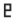

เมื่อ Γ3 ถูกตั้งเป็น 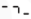 (การควบคุมด้วยสัญญาณเตือน) และตัวควบคุมอยู่ในโหมดอัตโนมัติ (ปรับอัตโนมัติเฉพาะแรงดัน ปรับอัตโนมัติเฉพาะความถี่ หรือปรับอัตโนมัติทั้งสอง) และทำงานปกติ (ไม่มีสัญญาณภายนอก ไม่หยุดด้วยตนเอง ไม่มีการสตาร์ทแบบนุ่มนวล และไม่มีสถานะข้อผิดพลาด) และเมื่อแรงดันเอาต์พุตต่ำกว่าขีดจำกัดล่างที่ตั้งโดย GL หรือความถี่เอาต์พุตต่ำกว่าขีดจำกัดล่างที่ตั้งโดย  เอาต์พุตควบคุม 24V จะมีผล (เอาต์พุตพอร์ต D1 เป็นระดับต่ำ) หากไม่เกิดกรณีเหล่านี้ เอาต์พุตจะไม่มีผล (เอาต์พุตพอร์ต D1 มีอิมพีแดนซ์สูง)

พารามิเตอร์สามตัวข้างต้น Γ3, GL และ 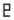 สามารถบันทึกอัตโนมัติหลังการตั้งค่า และสามารถตั้งค่าและอ่านได้ในการสื่อสาร RS485

### ดัชนีแอมพลิจูดสูงสุด: P

ตั้งค่าดัชนี P เพื่อจำกัดแอมพลิจูดสูงสุดของเครื่องป้อนวัสดุแบบสั่นสะเทือน

### ความเร็วป้อนสูงสุดที่ปรับได้: H

ช่วงความเร็วป้อนคือ 0 ถึง H พารามิเตอร์ H จำกัดความเร็วป้อนสูงสุดไว้ที่ค่าหนึ่งเพื่อป้องกันเครื่องป้อนวัสดุแบบสั่นสะเทือนจากแรงดันสูงที่เกิดจากการใช้งานผิดพลาด

ความเร็วป้อนของการควบคุมความเร็วระยะไกลก็ได้รับผลกระทบจากพารามิเตอร์นี้เช่นกัน

### ความต่างเฟส: 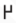

ปรับพารามิเตอร์ 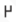 เพื่อเปลี่ยนเฟสของคลื่นเอาต์พุต ความต่างเฟสเริ่มต้นคือ 0°

---

## แรงดันเอาต์พุตสูงสุดในกระบวนการวัดความถี่อัตโนมัติ: b

แรงดันเอาต์พุตจะไม่เกินค่าพารามิเตอร์ b ในกระบวนการวัดความถี่อัตโนมัติ เพื่อป้องกันเครื่องป้อนวัสดุแบบสั่นสะเทือนจากความเสียหาย

## ความเร็วการค้นหาความถี่: SP

พารามิเตอร์ SP หมายถึงความเร็วการค้นหาความถี่ ยิ่งค่านี้สูง ความคืบหน้าของการค้นหาความถี่ก็ยิ่งเร็วขึ้น พารามิเตอร์ SP มีช่วงตั้งแต่ 1 ถึง 7

## ปริมาณการปรับความเร็วป้อนขั้นต่ำ: c

พารามิเตอร์ c หมายถึงปริมาณการปรับของพารามิเตอร์ความเร็วป้อน A ต่อการกดปุ่ม Vol+ หรือ Vol- หนึ่งครั้ง พารามิเตอร์ c มีช่วงตั้งแต่ 1 ถึง 10

## หมายเลขเซ็นเซอร์สั่นสะเทือน: ├

ตัวควบคุมรองรับเซ็นเซอร์สั่นสะเทือน 8 รุ่นที่แตกต่างกัน ตั้งค่าพารามิเตอร์ ├ ตามรุ่นของเซ็นเซอร์ เพื่อให้เมื่อตั้งค่าความเร็วป้อนแล้ว ตัวควบคุมจะส่งออกค่าแรงดันเท่ากันไม่ว่าจะเชื่อมต่อเซ็นเซอร์สั่นสะเทือนรุ่นใด

| ค่าพารามิเตอร์ | รุ่นที่สอดคล้อง | ข้อมูลจำเพาะ ความเร่งแกน X/แกน Y/แกน Z |
|---|---|---|
| 1 | SDVS20-1 | 16g/16g/16g |
| 2 | SDVS20-2 | 35g/35g/—— |
| 3 | SDVS20-3 | 50g/50g/—— |
| 4 | SDVS20-4 | 70g/70g/—— |
| 203 | SDVS203 | 8g/8g/8g |
| 204 | SDVS204 | 16g/16g/16g |
| 205 | SDVS205 | 32g/32g/32g |
| 206 | SDVS206 | 64g/64g/64g |

---

# บทที่Ⅴ โหมดการทำงาน

ตัวควบคุมสามารถตั้งให้ทำงานในหนึ่งในห้าโหมดการทำงานต่อไปนี้ตามความต้องการใช้งานเฉพาะ

- **โหมดแมนนวล:** ทั้งแรงดันเอาต์พุตและความถี่เอาต์พุตถูกปรับด้วยตนเอง
- **โหมดออโต้:** ทั้งแรงดันเอาต์พุตและความถี่เอาต์พุตถูกปรับโดยอัตโนมัติตามผลตอบกลับจากเซ็นเซอร์สั่นสะเทือน เพื่อรักษาความเร็วป้อนที่ตั้งไว้ให้คงที่และความถี่สั่นสะเทือนที่ดีที่สุดของเครื่องป้อนวัสดุแบบสั่นสะเทือน
- **โหมดกึ่งอัตโนมัติ:** แรงดันเอาต์พุตถูกปรับโดยอัตโนมัติตามผลตอบกลับจากเซ็นเซอร์สั่นสะเทือน เพื่อรักษาความเร็วป้อนที่ตั้งไว้ให้คงที่ ความถี่เอาต์พุตถูกปรับด้วยตนเอง
- **โหมดซิงค์:** ในการกำหนดค่าซิงค์ หากความถี่เอาต์พุตของ Controller B สอดคล้องคงที่กับของ Controller A เสมอ เรากำหนดให้ Controller A เป็น Master Controller, Controller B เป็น Slave Controller และโหมดการทำงานของ Controller B เป็นโหมดซิงค์
- **โหมดการนับ:** ตัวควบคุม (เฉพาะ SDVC34-MRJ) สามารถนับชิ้นส่วนที่ผ่านและลดความเร็วหรือหยุดเอาต์พุตโดยอัตโนมัติเมื่อจำนวนชิ้นส่วนที่ผ่านถึงค่าที่ตั้งไว้

| โหมดการทำงาน | แรงดันเอาต์พุต U — วิธีการปรับ | แรงดันเอาต์พุต U — การตั้งค่า Γ5 | ความถี่เอาต์พุต E — วิธีการปรับ | ความถี่เอาต์พุต E — การตั้งค่า Γ6 | ภาพสัญลักษณ์ |
|---|---|---|---|---|---|
| โหมดแมนนวล | แมนนวล | `_ - _` | แมนนวล | `_ - _` | 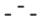 |
| โหมดออโต้ | ออโต้ | `- - -` | ออโต้ | `- - -` | 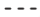 |
| โหมดกึ่งอัตโนมัติ | ออโต้ | `- - -` | แมนนวล | `_ - _` |  /  |
| โหมดซิงค์ | แมนนวลหรือออโต้ | `_ - _` หรือ `- - -` | ซิงค์อัตโนมัติกับ Master Controller | 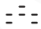 |  /  /  |

## 5.1 โหมดแมนนวล

ในโหมดแมนนวล ทั้งแรงดันเอาต์พุตและความถี่เอาต์พุตถูกปรับด้วยตนเอง

| โหมดการทำงาน | แรงดันเอาต์พุต U — วิธีการปรับ | แรงดันเอาต์พุต U — การตั้งค่า Γ5 | ความถี่เอาต์พุต E — วิธีการปรับ | ความถี่เอาต์พุต E — การตั้งค่า Γ6 | ภาพสัญลักษณ์ |
|---|---|---|---|---|---|
| โหมดแมนนวล | แมนนวล | `_ - _` | แมนนวล | `_ - _` | 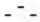 |

เพื่อความสะดวกในการใช้งาน พารามิเตอร์ Γ5 และ Γ6 ถูกตั้งจากโรงงานเป็น `_ _ _` ด้วยการตั้งค่านี้ ตัวควบคุมจะทำงานในโหมดแมนนวลเมื่อเซ็นเซอร์สั่นสะเทือนไม่ได้เชื่อมต่อกับตัวควบคุม หรือทำงานในโหมดออโต้เมื่อเซ็นเซอร์สั่นสะเทือนเชื่อมต่ออยู่

> - เมื่อทั้ง Γ5 และ Γ6 ถูกตั้งเป็น `_ - _` ตัวควบคุมจะทำงานในโหมดแมนนวล ไม่ว่าเซ็นเซอร์สั่นสะเทือนจะเชื่อมต่อกับตัวควบคุมหรือไม่ก็ตาม
> - เมื่อเซ็นเซอร์สั่นสะเทือนไม่ได้เชื่อมต่อกับตัวควบคุม ตัวควบคุมจะทำงานในโหมดแมนนวลเสมอ

## 5.1.1 การปรับแรงดันเอาต์พุตในโหมดแมนนวล

ค่าแรงดันเอาต์พุตจริงของตัวควบคุมสามารถแสดงแบบดิจิทัลและแม่นยำบนจอ LED

- เปิดสวิตช์ไฟเมื่อเซ็นเซอร์สั่นสะเทือนไม่ได้เชื่อมต่อกับตัวควบคุม
- จอ LED แสดงพารามิเตอร์แรงดันเอาต์พุต U และค่าของพารามิเตอร์
- ปรับค่า U โดยกด `Vol+` หรือ `Vol-`

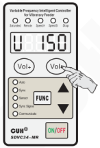

## 5.1.2 การปรับความถี่เอาต์พุตในโหมดแมนนวล

ด้วยเทคโนโลยี DDS ความถี่เอาต์พุตของตัวควบคุมจะเสถียรและแม่นยำสูงเสมอโดยไม่ขึ้นกับเวลาหรือการเปลี่ยนแปลงของอุณหภูมิ

- กด `FUNC` ค้างไว้ 2 วินาทีเพื่อเข้าสู่สถานะการปรับพารามิเตอร์พื้นฐาน
- จอ LED แสดงพารามิเตอร์ความถี่เอาต์พุต E และค่าของพารามิเตอร์
- ปรับค่า E โดยกดปุ่ม ▲ หรือ ▼ เมื่อเซ็นเซอร์สั่นสะเทือนไม่ได้เชื่อมต่อกับตัวควบคุม

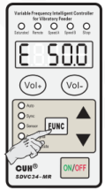

---

## 5.2 โหมดออโต้

ในโหมดออโต้ ต้องเชื่อมต่อเซ็นเซอร์สั่นสะเทือนกับตัวควบคุม แรงดันเอาต์พุตและความถี่เอาต์พุตจะถูกปรับโดยอัตโนมัติตามผลตอบกลับจากเซ็นเซอร์สั่นสะเทือน เพื่อรักษาความเร็วป้อนที่ตั้งไว้ให้คงที่และความถี่สั่นสะเทือนที่ดีที่สุด แรงดันเอาต์พุตและความถี่เอาต์พุตไม่สามารถปรับได้ด้วยตนเอง

จากโรงงาน ตัวควบคุมจะทำงานในโหมดออโต้เมื่อเซ็นเซอร์สั่นสะเทือนเชื่อมต่ออยู่

| โหมดการทำงาน | แรงดันเอาต์พุต U — วิธีการปรับ | แรงดันเอาต์พุต U — การตั้งค่า Γ5 | ความถี่เอาต์พุต E — วิธีการปรับ | ความถี่เอาต์พุต E — การตั้งค่า Γ6 |
|---|---|---|---|---|
| โหมดออโต้ | ออโต้ | - - - | ออโต้ | - - - |

> **ข้อสังเกต:** ตัวควบคุมจะยังคงทำงานในโหมดแมนนวลหากเซ็นเซอร์สั่นสะเทือนไม่ได้เชื่อมต่ออยู่

### 5.2.1 การติดตั้งเซ็นเซอร์สั่นสะเทือน

#### 5.2.1.1 วิธีการเชื่อมต่อเซ็นเซอร์สั่นสะเทือน

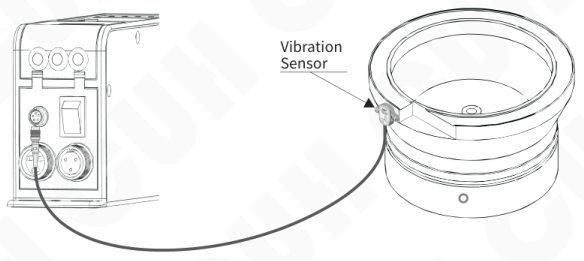

เชื่อมต่อปลั๊กของเซ็นเซอร์สั่นสะเทือนกับเต้ารับเซ็นเซอร์สั่นสะเทือนของตัวควบคุม

**ข้อสังเกต: กรุณาเสียบหรือถอดเซ็นเซอร์สั่นสะเทือนขณะที่ตัวควบคุมปิดอยู่**

---

## 5.2.1.2 คำแนะนำการติดตั้งเซ็นเซอร์สั่นสะเทือน

ยึดเซ็นเซอร์สั่นสะเทือนบนพื้นผิวเรียบของเครื่องสั่นสะเทือน ทิศทางการติดตั้งสามารถเป็นเท่าใดก็ได้ วิธีการติดตั้งเซ็นเซอร์สั่นสะเทือนแสดงไว้ด้านล่าง:

- วิธีที่ 1: ดังแสดงในรูปที่ 1

  ข้อดี: การติดตั้งง่าย

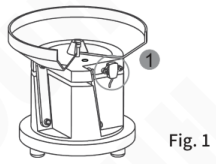

- วิธีที่ 2: ดังแสดงในรูปที่ 2

  ข้อสังเกต: เซ็นเซอร์สั่นสะเทือนต้องไม่ถูกกดทับโดยจานป้อนแบบสั่นสะเทือน

- วิธีที่ 3: เชื่อมขายึดเข้ากับเครื่องสั่นสะเทือนและยึดเซ็นเซอร์สั่นสะเทือนบนขายึด ดังแสดงในรูปที่ 3

  ขนาดที่แนะนำของขายึดของเครื่องสั่นสะเทือนแสดงไว้ในรูปที่ 4

- วิธีการติดตั้งที่ไม่แนะนำ ดังแสดงในรูปที่ 5 และรูปที่ 6

  หากตำแหน่งติดตั้งไม่เหมาะสม เซ็นเซอร์สั่นสะเทือนจะไม่สามารถส่งคืนความถี่เรโซแนนซ์ได้อย่างแม่นยำ และตัวควบคุมจะค้นหาความถี่เรโซแนนซ์อยู่ตลอดเวลา

---

## 5.2.2 การปรับความเร็วป้อนในโหมดออโต้

- เปิดสวิตช์ไฟเมื่อเซ็นเซอร์สั่นสะเทือนเชื่อมต่อกับตัวควบคุม ไฟแสดงเซ็นเซอร์สั่นสะเทือนจะสว่างขึ้น
- จอ LED แสดงพารามิเตอร์ความเร็วป้อน A และค่าของพารามิเตอร์
- ปรับค่า A โดยกด **Vol+** หรือ **Vol-** ให้ได้ความเร็วป้อนที่ต้องการ

## 5.2.3 การวัดความถี่อัตโนมัติในโหมดออโต้

ด้วยการวัดความถี่อัตโนมัติ ตัวควบคุมจะตรวจจับความถี่สั่นสะเทือนที่ดีที่สุดของเครื่องป้อนวัสดุแบบสั่นสะเทือนและตั้งค่าพารามิเตอร์ที่เกี่ยวข้องทั้งหมดโดยอัตโนมัติ ผู้ใช้เพียงตั้งพารามิเตอร์ความเร็วป้อน A จากนั้นตัวควบคุมจะทำงานในสภาวะที่เหมาะสมที่สุด

- กด ▲ และ ▼ พร้อมกันค้างไว้ 3 วินาทีเมื่อเซ็นเซอร์สั่นสะเทือนเชื่อมต่อกับตัวควบคุม เพื่อเริ่มการวัดความถี่อัตโนมัติ พารามิเตอร์ความถี่เอาต์พุต E และค่าของพารามิเตอร์จะแสดงบนจอ LED ระหว่างกระบวนการวัด
- หลังกระบวนการวัดความถี่อัตโนมัติ ตัวควบคุมจะตั้งค่าพารามิเตอร์ที่เกี่ยวข้องทั้งหมดโดยอัตโนมัติ รวมถึงพารามิเตอร์ความถี่กลาง F พารามิเตอร์ออฟเซ็ตสูงสุดในโหมด Auto-FM n ดัชนีปรับอัตโนมัติของความถี่เอาต์พุต IF ดัชนีปรับอัตโนมัติของแอมพลิจูด PA ดัชนีปรับอัตโนมัติของแอมพลิจูด IA พารามิเตอร์ความต่างเฟส  พารามิเตอร์วิธีการตั้งค่าแรงดันเอาต์พุต Γ5 และพารามิเตอร์วิธีการตั้งค่าความถี่เอาต์พุต Γ6 จะถูกตั้งเป็น \_\_\_

> - หากจอ LED แสดง Err02 ขณะที่กระบวนการวัดความถี่อัตโนมัติเริ่มต้นขึ้น ถือเป็นเรื่องปกติ เนื่องจากพารามิเตอร์ b ถูกตั้งไว้สูงเกินไป
> - หากต้องการยกเลิกกระบวนการวัดความถี่อัตโนมัติ ให้กด **ON/OFF** จากนั้นตัวควบคุมจะกลับสู่สถานะก่อนการวัดความถี่อัตโนมัติ

**หลังจากตั้งค่าความเร็วป้อนและการวัดความถี่อัตโนมัติ ตัวควบคุมจะทำงานในสภาวะที่เหมาะสมที่สุดด้วยความเร็วป้อนที่ต้องการ**

---

## 5.3 โหมดกึ่งอัตโนมัติ

ในโหมดกึ่งอัตโนมัติ ต้องเชื่อมต่อเซ็นเซอร์สั่นสะเทือนกับตัวควบคุมและพารามิเตอร์ Γ6 ต้องถูกตั้งเป็น `_-_`

แรงดันเอาต์พุตจะถูกปรับโดยอัตโนมัติตามผลตอบกลับจากเซ็นเซอร์สั่นสะเทือน เพื่อรักษาความเร็วป้อนที่ตั้งไว้ให้คงที่ ความถี่เอาต์พุตถูกปรับด้วยตนเอง

| โหมดการทำงาน | แรงดันเอาต์พุต U — วิธีการปรับ | แรงดันเอาต์พุต U — การตั้งค่า Γ5 | ความถี่เอาต์พุต E — วิธีการปรับ | ความถี่เอาต์พุต E — การตั้งค่า Γ6 | ภาพสัญลักษณ์ |
|---|---|---|---|---|---|
| โหมดกึ่งอัตโนมัติ | ออโต้ | `---` | แมนนวล | `_-_` | Γ5:  Γ6:  |

> **ข้อสังเกต:** ตัวควบคุมจะยังคงทำงานในโหมดแมนนวลหากเซ็นเซอร์สั่นสะเทือนไม่ได้เชื่อมต่ออยู่

### 5.3.1 การติดตั้งเซ็นเซอร์สั่นสะเทือน

ดังในหัวข้อ 5.2.1

### 5.3.2 การตั้งค่าโหมดกึ่งอัตโนมัติ

- เปิดสวิตช์ไฟเมื่อเซ็นเซอร์สั่นสะเทือนเชื่อมต่อกับตัวควบคุม ไฟแสดงเซ็นเซอร์สั่นสะเทือนจะสว่างขึ้น
- กดปุ่ม `FUNC` และ ▼ พร้อมกันค้างไว้ 2 วินาทีเพื่อเข้าสู่สถานะการปรับพารามิเตอร์ออโต้/ซิงค์
- กด `FUNC` ซ้ำ ๆ เพื่อสลับไปยังพารามิเตอร์วิธีการตั้งค่าความถี่เอาต์พุต Γ6
- กดปุ่ม ▲ หรือ ▼ เพื่อตั้งค่า Γ6 เป็น `_-_`

---

### 5.3.3 การปรับความเร็วป้อนในโหมดกึ่งอัตโนมัติ

- ปรับค่า A โดยกด Vol+ หรือ Vol- ให้ได้ความเร็วป้อนที่ต้องการ

### 5.3.4 การปรับความถี่เอาต์พุตในโหมดกึ่งอัตโนมัติ

- กด **FUNC** ค้างไว้ 2 วินาที เพื่อเข้าสู่สถานะการปรับพารามิเตอร์พื้นฐาน
- จอ LED แสดงพารามิเตอร์ความถี่เอาต์พุต E และค่าของมัน
- ปรับค่า E โดยกดปุ่ม ▲ หรือ ▼

---

## 5.4 โหมดซิงค์

ในโหมดซิงค์ ต้องเชื่อมต่อสายสัญญาณซิงค์ระหว่าง Master Controller และ Slave Controller ความถี่เอาต์พุตของตัวควบคุม (Slave Controller) จะสอดคล้องกับความถี่เอาต์พุตของ Master Controller เสมอ แรงดันเอาต์พุตของตัวควบคุม (Slave Controller) สามารถปรับได้ด้วยตนเองหรือโดยอัตโนมัติ

| โหมดการทำงาน | แรงดันเอาต์พุต U — วิธีการปรับ | แรงดันเอาต์พุต U — การตั้งค่า Γ5 | ความถี่เอาต์พุต E — วิธีการปรับ | ความถี่เอาต์พุต E — การตั้งค่า Γ6 | ภาพสัญลักษณ์ |
|---|---|---|---|---|---|
| โหมดซิงค์ | ด้วยตนเองหรืออัตโนมัติ | การตั้งค่าสัญลักษณ์สองแบบ (ดูภาพ เชื่อมด้วย "หรือ") | ซิงค์อัตโนมัติกับ Master Controller | ดูภาพ | Γ5: ；Γ6:  |

โหมดซิงค์ใช้กับสถานการณ์ที่มีตัวควบคุมมากกว่าหนึ่งตัวควบคุมเครื่องป้อนวัสดุแบบสั่นสะเทือนหลายเครื่องในระบบป้อน โดยเอาต์พุตของตัวควบคุมไม่ซิงค์กันจึงรบกวนกันและกัน (Beat Effect) โหมดซิงค์ถูกออกแบบมาเพื่อขจัด Beat Effect เนื่องจากรูปคลื่นเอาต์พุตของ Master Controller และ Slave Controller ซิงค์กันอย่างแม่นยำ

Controller S ไม่ได้ตั้งเป็นโหมดซิงค์ และรูปคลื่นเอาต์พุตของตัวควบคุมทั้งสองไม่ซิงค์กัน

Controller S ถูกตั้งเป็นโหมดซิงค์ และรูปคลื่นเอาต์พุตของตัวควบคุมทั้งสองซิงค์กันอย่างสมบูรณ์

---

## 5.4.1 วิธีการเชื่อมต่อสายสัญญาณซิงค์

### ขั้นตอนที่ 1:

เปิดฝาครอบของกล่องพอร์ตควบคุมสัญญาณของตัวควบคุมทั้งสองตัว

### ขั้นตอนที่ 2:

เชื่อมต่อสายสัญญาณซิงค์ระหว่าง Master Controller และ Slave Controller ตามแผนภาพด้านล่าง

Master Controller หนึ่งตัวสามารถขับ Slave Controller ได้หลายตัว

> Slave Controller จะหยุดเอาต์พุตเมื่อสัญญาณซิงค์ไม่เสถียรหรือไม่ได้เชื่อมต่อ และไฟแสดงสัญญาณซิงค์จะดับ

---

## 5.4.2 การประยุกต์ใช้โหมดซิงค์

### • Sub-Pattern 1

| ตัวควบคุม | แรงดันเอาต์พุต U — วิธีการปรับ | แรงดันเอาต์พุต U — การตั้งค่า Γ5 | ความถี่เอาต์พุต E — วิธีการปรับ | ความถี่เอาต์พุต E — การตั้งค่า Γ6 | ภาพสัญลักษณ์ |
|---|---|---|---|---|---|
| Master Controller | ด้วยตนเอง | ดูภาพสัญลักษณ์ | ด้วยตนเอง | ดูภาพสัญลักษณ์ | Γ5：；Γ6： |
| Slave Controller | ด้วยตนเอง | ดูภาพสัญลักษณ์ | ซิงค์อัตโนมัติกับ Master Controller | ดูภาพสัญลักษณ์ | Γ5：；Γ6： |

### • Sub-Pattern 2

| ตัวควบคุม | แรงดันเอาต์พุต U — วิธีการปรับ | แรงดันเอาต์พุต U — การตั้งค่า Γ5 | ความถี่เอาต์พุต E — วิธีการปรับ | ความถี่เอาต์พุต E — การตั้งค่า Γ6 | ภาพสัญลักษณ์ |
|---|---|---|---|---|---|
| Master Controller | อัตโนมัติ | — — — | อัตโนมัติ | — — — | Γ5, Γ6： |
| Slave Controller | ด้วยตนเอง | ดูภาพสัญลักษณ์ | ซิงค์อัตโนมัติกับ Master Controller | ดูภาพสัญลักษณ์ | Γ5：；Γ6： |

### • Sub-Pattern 3

| ตัวควบคุม | แรงดันเอาต์พุต U — วิธีการปรับ | แรงดันเอาต์พุต U — การตั้งค่า Γ5 | ความถี่เอาต์พุต E — วิธีการปรับ | ความถี่เอาต์พุต E — การตั้งค่า Γ6 | ภาพสัญลักษณ์ |
|---|---|---|---|---|---|
| Master Controller | อัตโนมัติ | — — — | ด้วยตนเอง | ดูภาพสัญลักษณ์ | Γ5：；Γ6： |
| Slave Controller | ด้วยตนเอง | ดูภาพสัญลักษณ์ | ซิงค์อัตโนมัติกับ Master Controller | ดูภาพสัญลักษณ์ | Γ5：；Γ6： |

### • Sub-Pattern 4

| ตัวควบคุม | แรงดันเอาต์พุต U — วิธีการปรับ | แรงดันเอาต์พุต U — การตั้งค่า Γ5 | ความถี่เอาต์พุต E — วิธีการปรับ | ความถี่เอาต์พุต E — การตั้งค่า Γ6 | ภาพสัญลักษณ์ |
|---|---|---|---|---|---|
| Master Controller | ด้วยตนเอง | ดูภาพ Γ5 ในคอลัมน์ด้านขวา | ด้วยตนเอง | ดูภาพ Γ6 ในคอลัมน์ด้านขวา | Γ5： Γ6： |
| Slave Controller | อัตโนมัติ | ดูภาพ Γ5 ในคอลัมน์ด้านขวา | ซิงค์อัตโนมัติกับ Master Controller | ดูภาพ Γ6 ในคอลัมน์ด้านขวา | Γ5： Γ6： |

### • Sub-Pattern 5

| ตัวควบคุม | แรงดันเอาต์พุต U — วิธีการปรับ | แรงดันเอาต์พุต U — การตั้งค่า Γ5 | ความถี่เอาต์พุต E — วิธีการปรับ | ความถี่เอาต์พุต E — การตั้งค่า Γ6 | ภาพสัญลักษณ์ |
|---|---|---|---|---|---|
| Master Controller | อัตโนมัติ | --- | อัตโนมัติ | --- | Γ5, Γ6： |
| Slave Controller | อัตโนมัติ | --- | ซิงค์อัตโนมัติกับ Master Controller | ดูภาพสัญลักษณ์ | Γ5：；Γ6： |

### • Sub-Pattern 6

| ตัวควบคุม | แรงดันเอาต์พุต U — วิธีการปรับ | แรงดันเอาต์พุต U — การตั้งค่า Γ5 | ความถี่เอาต์พุต E — วิธีการปรับ | ความถี่เอาต์พุต E — การตั้งค่า Γ6 | ภาพสัญลักษณ์ |
|---|---|---|---|---|---|
| Master Controller | อัตโนมัติ | --- | ด้วยตนเอง | ดูภาพสัญลักษณ์ | Γ5：；Γ6： |
| Slave Controller | อัตโนมัติ | --- | ซิงค์อัตโนมัติกับ Master Controller | ดูภาพสัญลักษณ์ | Γ5：；Γ6： |

---

## 5.5 โหมดการนับ

โปรดข้ามบทนี้หากตัวควบคุมไม่มีฟังก์ชันการนับ

รุ่นของซีรีส์ SDVC34 ที่มีส่วนต่อท้าย J มีฟังก์ชันการนับในตัว ซึ่งสามารถนับชิ้นงานที่ผ่านไปและลดความเร็วหรือหยุดเอาต์พุตโดยอัตโนมัติเมื่อจำนวนชิ้นงานที่ผ่านถึงค่าที่ตั้งไว้ล่วงหน้า

**ฟังก์ชันลดความเร็วก่อนหยุด:** ดังแสดงในแผนภาพด้านล่าง ตัวควบคุมจะส่งความเร็วป้อนปกติที่ตั้งโดยผู้ใช้จนกว่าจำนวนนับจะถึง "J-C" จากนั้นตัวควบคุมจะเปลี่ยนไปส่งความเร็วป้อนที่ต่ำกว่าซึ่งตั้งไว้ล่วงหน้าทันทีเพื่อป้องกันการป้อนเกิน เมื่อจำนวนนับถึงค่าเป้าหมายการนับ J ตัวควบคุมจะหยุดเอาต์พุตทันที

ฟังก์ชันต้านการสั่นพิเศษของฟังก์ชันการนับถูกออกแบบมาโดยเฉพาะเพื่อแก้ปัญหาการนับผิดพลาดของชิ้นงานที่สั่นสะเทือนขณะผ่าน โดยตั้งค่าเวลาต่อเนื่องของสัญญาณนับ สัญญาณพัลส์นับจะได้รับการยืนยันก็ต่อเมื่อมีเวลาต่อเนื่องไม่น้อยกว่าเวลา b เท่านั้น ฟังก์ชันนี้ช่วยปรับปรุงความน่าเชื่อถือของการนับได้อย่างมีประสิทธิภาพ

โปรดดูแผนภาพด้านล่าง

**ข้อสังเกต:**

เวลาทำให้เสถียรแบบต้านการสั่นหมายถึงเวลาทำให้เสถียรของระดับสูงและระดับต่ำ พัลส์ที่ถูกต้องประกอบด้วยระดับสูงและระดับต่ำที่ทำงานต่อเนื่องกัน จากนั้นตัวนับจะเพิ่มขึ้นหนึ่ง

---

## 5.5.1 วิธีการใช้งาน

หากสัญญาณรีเซ็ตตัวนับถูกตั้งเป็นสถานะไม่ถูกต้องในช่วงเวลาสั้น ๆ แล้วกลับมาเป็นสถานะถูกต้องอีกครั้ง ค่าตัวนับจะถูกล้างและตัวนับจะเริ่มต้นใหม่ ซึ่งถือเป็นการรีเซ็ต ในช่วงเวลาสั้น ๆ (ไม่เกิน 2 วินาที) ที่ออกจากสถานะการนับ ตัวควบคุมจะปิดเอาต์พุตชั่วคราว ดังนั้นสัญญาณนี้จึงสามารถใช้เป็นสัญญาณรีเซ็ตตัวนับได้ตามต้องการ

ในสถานะการนับปกติ สามารถรีเซ็ตตัวนับได้โดยใช้ปุ่ม "▲" หรือ "▼" บนแผงควบคุม สัญญาณพัลส์นับถูกป้อนเข้าผ่านพอร์ต "N2" ของอินเทอร์เฟซตัวควบคุม และค่าตัวนับจะแสดงในสถานะ "" หากใช้ `FUNC` เพื่อเข้าสู่สถานะการปรับพารามิเตอร์อื่น งานการนับจะไม่หยุดและค่าการนับจะไม่สูญหาย

> วิธีเดียวที่ตัวควบคุมจะเข้าสู่สถานะการนับคือการรักษาสัญญาณควบคุมการนับ (สัญญาณเปิดใช้งาน/รีเซ็ต "N3") ให้ถูกต้องอยู่เสมอ หลังจากเข้าสู่สถานะการนับ สถานะเริ่มต้นจะแสดงเป็น "" และไฟแสดงการนับและไฟแสดงการรีเซ็ตจะติดสว่างพร้อมกัน ซึ่งบ่งชี้ว่าสามารถรับสัญญาณพัลส์นับได้และการนับเริ่มต้นขึ้น

---

## 5.5.2 วิธีการเชื่อมต่อ

วิธีการต่อสายเมื่อสถานะ ΓA เป็น NPN

วิธีการต่อสายเมื่อสถานะ ΓA เป็น PNP

---

## 5.5.3 ทิศทางลอจิกของพัลส์นับ

- กด `FUNC` และ ▲ พร้อมกันค้างไว้ 2 วินาที เพื่อเข้าสู่สถานะการปรับพารามิเตอร์ขั้นสูง
- กด `FUNC` ซ้ำ ๆ เพื่อสลับไปที่พารามิเตอร์ Γb
- กดปุ่ม ▲ หรือ ▼ เพื่อปรับ Γb

> - เมื่อขอบที่ทำงานของ Γb ถูกตั้งเป็นขอบขาลง พัลส์นับจะถูกนับที่ขอบขาลงซึ่งเปลี่ยนจาก "ระดับสูง" เป็น "ระดับต่ำ"
> - เมื่อขอบที่ทำงานของ Γb ถูกตั้งเป็นขอบขาขึ้น พัลส์นับจะถูกนับที่ขอบขาขึ้นซึ่งเปลี่ยนจาก "ระดับต่ำ" เป็น "ระดับสูง"

## 5.5.4 ทิศทางลอจิกของการรีเซ็ตการนับ

- กด `FUNC` และ ▲ พร้อมกันค้างไว้ 2 วินาที เพื่อเข้าสู่สถานะการปรับพารามิเตอร์ขั้นสูง
- กด `FUNC` ซ้ำ ๆ เพื่อสลับไปที่พารามิเตอร์ Γc
- กดปุ่ม ▲ หรือ ▼ เพื่อปรับ Γc

> - เมื่อขอบที่ทำงานของ Γc ถูกตั้งเป็นขอบขาลงและพินควบคุมการนับไม่ได้เชื่อมต่อกับสัญญาณใด ๆ ตัวควบคุมจะไม่เข้าสู่สถานะ "การนับ"; เมื่อสัญญาณของพินนี้ถูกดึงเป็น "ระดับต่ำ" ตัวควบคุมจะเข้าสู่สถานะ "การนับ"
> - เมื่อขอบที่ทำงานของ Γc ถูกตั้งเป็นขอบขาขึ้นและไม่มีสัญญาณเชื่อมต่อกับพินควบคุมการนับ ตัวควบคุมจะเข้าสู่สถานะ "การนับ"; เมื่อสัญญาณของพินนี้ถูกดึงเป็น "ระดับต่ำ" ตัวควบคุมจะออกจากสถานะ "การนับ"

---

## 5.5.5 คำอธิบายพารามิเตอร์การนับ

### ขีดจำกัดการนับสูงสุด: 

- ในสถานะการนับ กด **FUNC** เพื่อเข้าสู่พารามิเตอร์ 
- กดปุ่ม ▲ หรือ ▼ เพื่อปรับค่าพารามิเตอร์

เมื่อค่าตัวนับถึงค่าเกณฑ์นี้ การนับของตัวควบคุมจะอิ่มตัว เอาต์พุตของตัวควบคุมจะหยุด และการป้อนจะหยุดด้วยจนกว่าตัวนับจะถูกรีเซ็ต หลังจากเข้าสู่สถานะการนับอิ่มตัว หากยังส่งพัลส์นับต่อเนื่อง การนับจะดำเนินต่อไป แต่เอาต์พุตของตัวควบคุมจะยังคงหยุดอยู่

### จำนวนการสิ้นสุดการนับ: n

- กด **FUNC** และ ▲ พร้อมกันค้างไว้ 2 วินาที เพื่อเข้าสู่สถานะการปรับพารามิเตอร์ขั้นสูง
- กด **FUNC** ซ้ำ ๆ เพื่อสลับไปที่พารามิเตอร์ n
- กดปุ่ม ▲ หรือ ▼ เพื่อปรับค่าพารามิเตอร์

เมื่อจำนวนการนับจากขีดจำกัดการนับถึงจำนวนการสิ้นสุดการนับ ตัวควบคุมจะเข้าสู่สถานะสิ้นสุด และความเร็วป้อนจะลดลงเหลือความเร็วสุดท้าย

เมื่อไม่ใช้ฟังก์ชันการลดความเร็วเมื่อสิ้นสุด การตั้งค่าพารามิเตอร์นี้เป็น 0 จะทำให้ฟังก์ชันการลดความเร็วไม่มีผล

---

## เปอร์เซ็นต์ความเร็วของการสิ้นสุดการนับ: u

- กด `FUNC` และ ▲ พร้อมกันค้างไว้ 2 วินาที เพื่อเข้าสู่สถานะการปรับพารามิเตอร์ขั้นสูง
- กด `FUNC` ซ้ำ ๆ เพื่อสลับไปที่พารามิเตอร์ u
- กดปุ่ม ▲ หรือ ▼ เพื่อปรับค่าพารามิเตอร์

เมื่อการนับเข้าสู่สถานะการนับสุดท้าย ความเร็วป้อนของตัวควบคุมจะลดลงเป็นเปอร์เซ็นต์ของความเร็วเริ่มต้น

## เวลาต้านการสั่นของการนับ: J

- กด `FUNC` และ ▲ พร้อมกันค้างไว้ 2 วินาที เพื่อเข้าสู่สถานะการปรับพารามิเตอร์ขั้นสูง
- กด `FUNC` ซ้ำ ๆ เพื่อสลับไปที่พารามิเตอร์ J
- กดปุ่ม ▲ หรือ ▼ เพื่อปรับค่าพารามิเตอร์

เนื่องจากเวลาต้านการสั่นคือเวลาทำให้เสถียรของระดับสูงและระดับต่ำตามลำดับ ค่าของพารามิเตอร์นี้ควรน้อยกว่า:

$$
\frac{1}{2} \times \frac{1}{\text{จำนวนการนับสูงสุดต่อวินาที}}
$$

จำนวนการนับสูงสุดต่อวินาทีควรอ้างอิงตามสถานการณ์จริงและความเร็วสูงสุดที่เป็นไปได้ของอุปกรณ์เฉพาะระหว่างการดำเนินงาน การประเมินความเร็วสูงเกินไปจะทำให้ฟังก์ชันต้านการสั่นไม่บรรลุผลตามที่ต้องการ และค่าที่ต่ำเกินไปจะส่งผลให้เกิดการนับพลาด

---

# บทที่ Ⅵ การควบคุมสัญญาณ

การควบคุมสัญญาณประกอบด้วย: การควบคุมเปิด/ปิดของพอร์ต C, การควบคุมเปิด/ปิดของพอร์ต E, การควบคุมความเร็วระยะไกล, การบันทึกและเอาต์พุตความเร็วที่ตั้งไว้ล่วงหน้า, การสื่อสาร RS485 และเอาต์พุตควบคุม DC 24V

## 6.1 การควบคุมเปิด/ปิดของพอร์ต C

เอาต์พุตของตัวควบคุมสามารถเปิดหรือปิดได้ด้วยเซ็นเซอร์สวิตช์หรือ PLC ชนิดใดก็ได้ผ่านพอร์ต C

### 6.1.1 วิธีการเชื่อมต่อของพอร์ต C

**วิธีการเชื่อมต่อเซ็นเซอร์พร็อกซิมิตี้**

**ขั้นตอนที่ 1:**

เปิดฝาครอบกล่องพอร์ตควบคุมสัญญาณของตัวควบคุม

**ขั้นตอนที่ 2:**

เชื่อมต่อเซ็นเซอร์พร็อกซิมิตี้เข้ากับพอร์ต C ตามแผนภาพ

**ข้อกำหนด**

สายสีน้ำเงินแทนสายดิน  
สายสีดำแทนสายสัญญาณ  
สายสีน้ำตาลแทนสายไฟเลี้ยง

---

## วิธีการเชื่อมต่อเซ็นเซอร์ไฟโตอิเล็กทริกแบบทะลุ

---

## วิธีการเชื่อมต่อเซ็นเซอร์ไฟโตอิเล็กทริกแบบสะท้อน

---

## วิธีการเชื่อมต่อเซ็นเซอร์ไฟเบอร์ออปติกแบบทะลุ

---

## วิธีการเชื่อมต่อ PLC

### วิธีการเชื่อมต่อเอาต์พุต NPN ของ PLC

### วิธีการเชื่อมต่อเอาต์พุต PNP ของ PLC

ข้อสังเกต: เอาต์พุตรีเลย์ เอาต์พุต NPN และเอาต์พุต PNP ของ PLC อย่างใดอย่างหนึ่งสามารถเปิด/ปิดตัวควบคุมได้

ข้อสังเกต: เมื่อใช้ PLC เพื่อเปิด/ปิดตัวควบคุม โปรดใช้ PLC ชนิดเอาต์พุต 24V

---

## 6.1.2 เวลาหน่วงเปิด/ปิดของพอร์ต C

หากต้องการให้ตัวควบคุมเริ่มส่งเอาต์พุตหลังจากเวลาหนึ่งนับจากได้รับสัญญาณควบคุมเปิดของพอร์ต C ให้ปรับพารามิเตอร์ J

หากต้องการให้ตัวควบคุมส่งเอาต์พุตต่อไปอีกระยะหนึ่งหลังจากได้รับสัญญาณควบคุมปิดของพอร์ต C ให้ปรับพารามิเตอร์ L

### เวลาหน่วงเปิดของพอร์ต C

ช่วงเวลาจากที่ตัวควบคุมได้รับสัญญาณควบคุมเปิดของพอร์ต C จนถึงเริ่มส่งเอาต์พุต

- กด `FUNC` ค้างไว้ 2 วินาที เพื่อเข้าสู่สถานะการปรับพารามิเตอร์พื้นฐาน
- กด `FUNC` ซ้ำ ๆ เพื่อสลับไปที่พารามิเตอร์ J
- กดปุ่ม ▲ หรือ ▼ เพื่อปรับค่า หน่วยของพารามิเตอร์คือวินาที และความแม่นยำในการปรับคือ 0.1

### เวลาหน่วงปิดของพอร์ต C

ช่วงเวลาจากที่ตัวควบคุมได้รับสัญญาณควบคุมปิดของพอร์ต C จนถึงตัดเอาต์พุต

- กด `FUNC` ค้างไว้ 2 วินาที เพื่อเข้าสู่สถานะการปรับพารามิเตอร์พื้นฐาน
- กด `FUNC` ซ้ำ ๆ เพื่อสลับไปที่พารามิเตอร์ L
- กดปุ่ม ▲ หรือ ▼ เพื่อปรับค่า หน่วยของพารามิเตอร์คือวินาที และความแม่นยำในการปรับคือ 0.1

---

## 6.1.3 ความสัมพันธ์ทางลอจิกของการควบคุมเปิด/ปิดของพอร์ต C

โดยค่าเริ่มต้นจากโรงงาน ตัวควบคุมจะทำงานเมื่อพอร์ต C ไม่ได้รับสัญญาณ แต่ในการใช้งานอื่นบางกรณี ตัวควบคุมจำเป็นต้องหยุดเมื่อพอร์ต C ไม่ได้รับสัญญาณ

ปรับพารามิเตอร์ Γ2 เพื่อให้เป็นไปตามข้อกำหนดใดข้อกำหนดหนึ่ง

- กด **FUNC** และ ▲ พร้อมกันค้างไว้ 2 วินาที เพื่อเข้าสู่สถานะการปรับพารามิเตอร์ขั้นสูง
- กด **FUNC** ซ้ำ ๆ เพื่อสลับไปที่พารามิเตอร์ Γ2
- กดปุ่ม ▲ หรือ ▼ เพื่อเปลี่ยนความสัมพันธ์ทางลอจิก

พารามิเตอร์ Γ2 ถูกตั้งค่าเป็น `___` โดยค่าเริ่มต้น

- เมื่อพารามิเตอร์ Γ2 ถูกตั้งค่าเป็น `___` เอาต์พุตของตัวควบคุมจะเปิดเมื่อพอร์ต C ไม่ได้รับสัญญาณ
- เมื่อพารามิเตอร์ Γ2 ถูกตั้งค่าเป็น `_-_` เอาต์พุตของตัวควบคุมจะปิดเมื่อพอร์ต C ไม่ได้รับสัญญาณ

---

## 6.2 การควบคุมเปิด/ปิดของพอร์ต E

เอาต์พุตของตัวควบคุมสามารถเปิดหรือปิดได้ด้วยเซ็นเซอร์สวิตช์หรือ PLC ชนิดใดก็ได้ผ่านพอร์ต E

การควบคุมเปิด/ปิดของพอร์ต C และการควบคุมเปิด/ปิดของพอร์ต E เป็นอิสระต่อกัน

### 6.2.1 วิธีการเชื่อมต่อของพอร์ต E

**วิธีการเชื่อมต่อเซ็นเซอร์พร็อกซิมิตี้**

**ขั้นตอนที่ 1:**

เปิดฝาครอบกล่องพอร์ตควบคุมสัญญาณของตัวควบคุม

**ขั้นตอนที่ 2:**

เชื่อมต่อเซ็นเซอร์พร็อกซิมิตี้เข้ากับพอร์ต E ตามแผนภาพ

**ข้อกำหนด**

- สายสีน้ำเงินแทนสายดิน
- สายสีดำแทนสายสัญญาณ
- สายสีน้ำตาลแทนสายไฟเลี้ยง

วิธีการเชื่อมต่อเซ็นเซอร์สวิตช์ชนิดอื่นๆ และ PLC เข้ากับพอร์ต E นั้นคล้ายคลึงกับของพอร์ต C

---

## 6.2.2 เวลาหน่วงเปิด/ปิดของพอร์ต E

หากต้องการให้ตัวควบคุมเริ่มส่งเอาต์พุตหลังจากเวลาหนึ่งนับจากได้รับสัญญาณควบคุมเปิดของพอร์ต E ให้ปรับพารามิเตอร์ J-

หากต้องการให้ตัวควบคุมส่งเอาต์พุตต่อไปอีกระยะหนึ่งหลังจากได้รับสัญญาณควบคุมปิดของพอร์ต E ให้ปรับพารามิเตอร์ L-

โดยค่าเริ่มต้นจากโรงงาน เวลาหน่วงเปิด/ปิดของพอร์ต E จะเหมือนกับเวลาหน่วงเปิด/ปิดของพอร์ต C

นอกจากนี้ยังสามารถตั้งค่าเวลาหน่วงเปิด/ปิดของพอร์ต E แยกต่างหากได้โดยการปรับพารามิเตอร์ J- และพารามิเตอร์ L-

### เวลาหน่วงเปิดของพอร์ต E

ช่วงเวลาจากที่ตัวควบคุมได้รับสัญญาณควบคุมเปิดของพอร์ต E จนถึงเริ่มส่งเอาต์พุต

- กด **FUNC** และ ▲ พร้อมกันค้างไว้ 2 วินาที เพื่อเข้าสู่สถานะการปรับพารามิเตอร์ขั้นสูง
- กด **FUNC** เพื่อสลับไปที่พารามิเตอร์ J-
- กดปุ่ม ▲ หรือ ▼ เพื่อปรับค่า หน่วยของพารามิเตอร์คือวินาที และความแม่นยำในการปรับคือ 0.1

### เวลาหน่วงปิดของพอร์ต E

ช่วงเวลาจากที่ตัวควบคุมได้รับสัญญาณควบคุมปิดของพอร์ต E จนถึงตัดเอาต์พุต

- กด **FUNC** และ ▲ พร้อมกันค้างไว้ 2 วินาที เพื่อเข้าสู่สถานะการปรับพารามิเตอร์ขั้นสูง
- กด **FUNC** เพื่อสลับไปที่พารามิเตอร์ L-
- กดปุ่ม ▲ หรือ ▼ เพื่อปรับค่า หน่วยของพารามิเตอร์คือวินาที และความแม่นยำในการปรับคือ 0.1

> พารามิเตอร์ J- และ L- ถูกตั้งค่าเป็น ___ , ซึ่งหมายถึงค่าเดียวกันกับพารามิเตอร์ J และ L

---

## 6.2.3 ความสัมพันธ์ทางลอจิกของการควบคุมเปิด/ปิดของพอร์ต E

โดยค่าเริ่มต้นจากโรงงาน ตัวควบคุมจะทำงานเมื่อพอร์ต E ไม่ได้รับสัญญาณ แต่ในการใช้งานอื่นบางกรณี ตัวควบคุมจำเป็นต้องหยุดเมื่อพอร์ต E ไม่ได้รับสัญญาณ

ปรับพารามิเตอร์ Γ7 เพื่อให้เป็นไปตามข้อกำหนดใดข้อกำหนดหนึ่ง

- กด **FUNC** และ ▲ พร้อมกันค้างไว้ 2 วินาที เพื่อเข้าสู่สถานะการปรับพารามิเตอร์ขั้นสูง
- กด **FUNC** ซ้ำ ๆ เพื่อสลับไปที่พารามิเตอร์ Γ7
- กดปุ่ม ▲ หรือ ▼ เพื่อเปลี่ยนความสัมพันธ์ทางลอจิก

พารามิเตอร์ Γ7 ถูกตั้งค่าเป็น `___` โดยค่าเริ่มต้น

- เมื่อพารามิเตอร์ Γ7 ถูกตั้งค่าเป็น `___` เอาต์พุตของตัวควบคุมจะเปิดเมื่อพอร์ต E ไม่ได้รับสัญญาณ
- เมื่อพารามิเตอร์ Γ7 ถูกตั้งค่าเป็น `_-_` เอาต์พุตของตัวควบคุมจะปิดเมื่อพอร์ต E ไม่ได้รับสัญญาณ

---

## 6.3 พารามิเตอร์ทั่วไปของพอร์ต C และพอร์ต E

### 6.3.1 ความสัมพันธ์ทางลอจิกของพอร์ต C และพอร์ต E

พารามิเตอร์ Π กำหนดการตอบสนองของตัวควบคุมเมื่อทั้งพอร์ต C และพอร์ต E ทำงาน

- กด `FUNC` และ ▲ พร้อมกันค้างไว้ 2 วินาที เพื่อเข้าสู่สถานะการปรับพารามิเตอร์ขั้นสูง
- กด `FUNC` ซ้ำ ๆ เพื่อสลับไปที่พารามิเตอร์ Π
- กดปุ่ม ▲ หรือ ▼ เพื่อเปลี่ยนความสัมพันธ์ทางลอจิก

**ความสัมพันธ์ทางลอจิก: AND** 

เอาต์พุตของตัวควบคุมจะเปิด (ON) เฉพาะเมื่อทั้งสองพอร์ตต้องการให้ตัวควบคุมทำงาน

**ความสัมพันธ์ทางลอจิก: OR** 

เอาต์พุตของตัวควบคุมจะเปิด (ON) เมื่อพอร์ตใดพอร์ตหนึ่งหรือทั้งสองต้องการให้ตัวควบคุมทำงาน

**ความสัมพันธ์ทางลอจิก: XOR** 

เอาต์พุตของตัวควบคุมจะเปิด (ON) เฉพาะเมื่อพอร์ตหนึ่งต้องการให้ตัวควบคุมทำงานและอีกพอร์ตต้องการให้หยุด

ความสัมพันธ์ทางลอจิกเริ่มต้นคือ AND

---

## 6.3.2 ประเภทเซ็นเซอร์สวิตช์

ตัวควบคุมสามารถจดจำประเภทของเซ็นเซอร์สวิตช์ NPN หรือ PNP ได้โดยอัตโนมัติ

ผู้ใช้ยังสามารถตั้งค่าประเภทเซ็นเซอร์สวิตช์ได้ด้วยตนเอง

- กด `FUNC` และ ▲ พร้อมกันค้างไว้ 2 วินาที เพื่อเข้าสู่สถานะการปรับพารามิเตอร์ขั้นสูง
- กด `FUNC` ซ้ำ ๆ เพื่อสลับไปที่พารามิเตอร์ ΓA
- กดปุ่ม ▲ หรือ ▼ เพื่อเปลี่ยนค่า

> **Uto:** การจดจำประเภทเซ็นเซอร์สวิตช์อัตโนมัติ
>
> **nPn:** เซ็นเซอร์สวิตช์ประเภท NPN
>
> **PnP:** เซ็นเซอร์สวิตช์ประเภท PNP

ข้อสังเกต: ในตัวควบคุมที่มีฟังก์ชันการนับ ΓA มีเพียงสองสถานะเท่านั้น คือ nPn และ PnP

---

## 6.3.3 การดำเนินการทางลอจิกของเอาต์พุตหลัก

- กด `FUNC` และ ▲ พร้อมกันค้างไว้ 2 วินาที เพื่อเข้าสู่สถานะการปรับพารามิเตอร์ขั้นสูง
- กด `FUNC` ซ้ำ ๆ เพื่อสลับไปที่พารามิเตอร์ Γ4
- กดปุ่ม ▲ หรือ ▼ เพื่อเปลี่ยนค่า

พารามิเตอร์ Γ4 ถูกตั้งค่าเป็น `___` โดยค่าเริ่มต้น

- เมื่อพารามิเตอร์ Γ4 ถูกตั้งค่าเป็น  เอาต์พุตหลักและเอาต์พุตควบคุมมีความสัมพันธ์กัน ควบคุมด้วยความสัมพันธ์ทางลอจิกระหว่างพอร์ต C และพอร์ต E และปุ่มเปิด/ปิด
- เมื่อพารามิเตอร์ Γ4 ถูกตั้งค่าเป็น  เอาต์พุตหลักและเอาต์พุตควบคุมแยกจากกัน เอาต์พุตหลักถูกควบคุมด้วยปุ่มเปิด/ปิด เอาต์พุตควบคุมถูกควบคุมด้วยความสัมพันธ์ทางลอจิกระหว่างพอร์ต C และพอร์ต E
- เมื่อพารามิเตอร์ Γ4 ถูกตั้งค่าเป็น  เอาต์พุตหลักถูกควบคุมด้วยปุ่มเปิด/ปิดและพอร์ต C เอาต์พุตควบคุมถูกควบคุมด้วยพอร์ต E
- เมื่อพารามิเตอร์ Γ4 ถูกตั้งค่าเป็น  เอาต์พุตหลักถูกควบคุมด้วยปุ่มเปิด/ปิดและพอร์ต E เอาต์พุตควบคุมถูกควบคุมด้วยพอร์ต C

---

## 6.4 การควบคุมความเร็วระยะไกล

แรงดันเอาต์พุต/ความเร็วป้อนสามารถควบคุมได้จากระยะไกลด้วยโพเทนชิออมิเตอร์หรือสัญญาณควบคุม DC 1~5V/4~20mA

เมื่อแรงดันควบคุมความเร็วระยะไกลเกิน 0.5V จะมีผลกับตัวควบคุม ขณะที่ปุ่ม "Vol+" และ "Vol-" จะไม่มีผล

ในระหว่างการควบคุมความเร็วระยะไกล ไฟแสดงการควบคุมความเร็วระยะไกลจะติด และจอ LED จะแสดงแรงดันเอาต์พุต/ความเร็วป้อนและค่าของมัน

### วิธีการเชื่อมต่อโพเทนชิออมิเตอร์ควบคุมความเร็วระยะไกล

## วิธีการเชื่อมต่อ PLC ควบคุมความเร็วระยะไกล

| สัญญาณควบคุมความเร็วระยะไกล | แรงดันเอาต์พุต U/ความเร็วป้อน A |
|---|---|
| น้อยกว่า 0.5V | ควบคุมด้วยปุ่ม Vol+ และ Vol- |
| 0.5V~1V | แรงดันเอาต์พุต U=20V/ความเร็วป้อน A=0 ควบคุมด้วยสัญญาณควบคุมความเร็วระยะไกล |
| 1~5V/4~20mA | แรงดันเอาต์พุต U/ความเร็วป้อน A ถูกควบคุม เชิงเส้นด้วยสัญญาณควบคุมความเร็วระยะไกล |

## 6.5 เอาต์พุตควบคุม

ตัวควบคุมสามารถจ่ายไฟควบคุม 24V DC เพื่อขับเคลื่อนโซลินอยด์วาล์ว รีเลย์ไฟฟ้า หรือ PLC เป็นต้น โดยประสานกับการควบคุมเปิด/ปิดของพอร์ต C/พอร์ต E

### 6.5.1 วิธีการเชื่อมต่อเอาต์พุตควบคุม

**การเชื่อมต่อกับโซลินอยด์วาล์ว**

- ตัวควบคุมสามารถขับเคลื่อนโซลินอยด์วาล์วที่มีแรงดันไฟฟ้าพิกัด 24V และกำลังไฟฟ้าพิกัดสูงสุด 4W

**การเชื่อมต่อกับรีเลย์ไฟฟ้า**

- ตัวควบคุมสามารถขับเคลื่อนรีเลย์ไฟฟ้าที่มีแรงดันไฟฟ้าพิกัด 24V และกำลังไฟฟ้าพิกัดสูงสุด 4W

ข้อสังเกต: โปรดเชื่อมต่อขั้วบวกและขั้วลบของรีเลย์หรือโซลินอยด์วาล์วให้ถูกต้อง: D2 เชื่อมต่อกับขั้วบวก D1 เชื่อมต่อกับขั้วลบ การเชื่อมต่อกลับขั้วอาจทำให้เกิดการลัดวงจรและความเสียหายต่อเอาต์พุตควบคุม

---

## 6.5.2 ความสัมพันธ์ทางลอจิกของเอาต์พุตควบคุม

- กด **FUNC** และ ▲ พร้อมกันค้างไว้ 2 วินาที เพื่อเข้าสู่สถานะการปรับพารามิเตอร์ขั้นสูง
- กด **FUNC** ซ้ำ ๆ เพื่อสลับไปที่พารามิเตอร์ Γ3
- กดปุ่ม ▲ หรือ ▼ เพื่อเปลี่ยนความสัมพันธ์ทางลอจิก

พารามิเตอร์ Γ3 ถูกตั้งค่าเป็น `___` โดยค่าเริ่มต้น

- หากพารามิเตอร์ Γ3 ถูกตั้งค่าเป็น  เอาต์พุตควบคุมจะเปิดเมื่อเอาต์พุตของตัวควบคุมเปิด
- หากพารามิเตอร์ Γ3 ถูกตั้งค่าเป็น  เอาต์พุตควบคุมจะปิดเมื่อเอาต์พุตของตัวควบคุมเปิด
- หากพารามิเตอร์ Γ3 ถูกตั้งค่าเป็น  เอาต์พุตควบคุมจะเกี่ยวข้องกับสัญญาณเตือนเท่านั้น ซึ่งกำหนดโดยพารามิเตอร์ "GL" ขีดจำกัดล่างของแรงดัน และ "e" ขีดจำกัดล่างของความถี่ ดูรายละเอียดในบทที่ 4.4

---

## 6.5.3 การดำเนินการทางลอจิกของเอาต์พุตควบคุม

- กด `FUNC` และ ▲ พร้อมกันค้างไว้ 2 วินาที เพื่อเข้าสู่สถานะการปรับพารามิเตอร์ขั้นสูง
- กด `FUNC` ซ้ำ ๆ เพื่อสลับไปที่พารามิเตอร์ Γ8
- กดปุ่ม ▲ หรือ ▼ เพื่อเปลี่ยนค่า

พารามิเตอร์ Γ8 ถูกตั้งค่าเป็น `___` โดยค่าเริ่มต้น

- เมื่อตั้งค่า Γ8 เป็นลอจิกหลัก เอาต์พุตควบคุมและเอาต์พุตหลักใช้การตั้งค่าลอจิกเดียวกัน
- เมื่อตั้งค่า Γ8 เป็นกลุ่มลอจิกชุดที่สอง เอาต์พุตควบคุมจะถูกควบคุมด้วยการตั้งค่าลอจิกกลุ่มที่สอง และเอาต์พุตหลักถูกควบคุมด้วยการตั้งค่าลอจิกหลัก

---

## 6.6 การบันทึกและเอาต์พุตความเร็วที่ตั้งไว้ล่วงหน้า

ฟังก์ชันนี้เหมาะสำหรับตัวควบคุมที่ไม่มีฟังก์ชันการนับ

ตัวควบคุมสามารถบันทึกและเอาต์พุตความเร็วที่ตั้งไว้ล่วงหน้าได้ 4 ระดับ การรวมกันแบบเปิด/ปิด 4 รูปแบบของไฟแสดงสถานะความเร็ว A และไฟแสดงสถานะความเร็ว B สอดคล้องกับความเร็ว 1 ความเร็ว 2 ความเร็ว 3และความเร็ว 4 ตามลำดับ

| ความเร็วที่ตั้งไว้ล่วงหน้า | พอร์ต G1 & G2 — ไฟแสดงสถานะความเร็ว A | พอร์ต G1 & G2 — สวิตช์ 1 | พอร์ต G3 & G4 — ไฟแสดงสถานะความเร็ว B | พอร์ต G3 & G4 — สวิตช์ 2 |
|---|---|---|---|---|
| ความเร็ว 1 | เปิด | ปิดวงจร | ปิด | เปิดวงจร |
| ความเร็ว 2 | ปิด | เปิดวงจร | เปิด | ปิดวงจร |
| ความเร็ว 3 | เปิด | ปิดวงจร | เปิด | ปิดวงจร |
| ความเร็ว 4 | ปิด | เปิดวงจร | ปิด | เปิดวงจร |

> โหมดแรงดันแมนนวล ความเร็วที่ตั้งไว้ 4 ระดับสัมพันธ์กับการตั้งค่าแรงดัน 4 ค่า U  
> โหมดความถี่แมนนวล ความเร็วที่ตั้งไว้ 4 ระดับสัมพันธ์กับการตั้งค่าความถี่เอาต์พุต 4 ค่า E  
> โหมดแรงดันออโต้ ความเร็วที่ตั้งไว้ 4 ระดับสัมพันธ์กับความเร็วป้อน 4 ค่า A  
> โหมดความถี่ออโต้ ความเร็วที่ตั้งไว้ 4 ระดับสัมพันธ์กับความถี่กลาง 4 ค่า F

### วิธีการเชื่อมต่อเมื่อตั้งค่า ΓA เป็น NPN

---

## วิธีการเชื่อมต่อเมื่อตั้งค่า ΓA เป็น PNP

### การบันทึกความเร็วที่ตั้งไว้ล่วงหน้า

ยกตัวอย่างการบันทึกความเร็ว 1:

- ปิดสวิตช์ K1 ไฟแสดงสถานะความเร็ว A ติดสว่าง เปิดสวิตช์ K2 ไฟแสดงสถานะความเร็ว B ดับ
- เพื่อให้ได้ความเร็วป้อนที่ต้องการ:
  - ในโหมดแมนนวล ปรับพารามิเตอร์แรงดันเอาต์พุต U และพารามิเตอร์ความถี่เอาต์พุต E
  - ในโหมดออโต้ ปรับพารามิเตอร์ความเร็วป้อน A
  - ในโหมดกึ่งอัตโนมัติ ปรับพารามิเตอร์ความเร็วป้อน A และพารามิเตอร์ความถี่เอาต์พุต E
- หลังจากเอาต์พุตของตัวควบคุมเสถียรแล้ว กด `FUNC` และ ▼ พร้อมกันค้างไว้ 2 วินาที ในขณะนี้ "SAVE" จะแสดงบนจอ LED หมายความว่าความเร็ว 1 ถูกบันทึกแล้ว

### การเอาต์พุตความเร็วที่ตั้งไว้ล่วงหน้า

ยกตัวอย่างการเอาต์พุตความเร็ว 1:

- ปิดสวิตช์ K1 อีกครั้ง ไฟแสดงสถานะความเร็ว A ติดสว่าง เปิดสวิตช์ K2 อีกครั้ง ไฟแสดงสถานะความเร็ว B ดับ
- ตัวควบคุมจะเอาต์พุตความเร็ว 1 ทันที

---

## 6.7 การสื่อสาร RS485

พารามิเตอร์ทั้งหมดของตัวควบคุมสามารถปรับได้จากระยะไกลผ่านพอร์ตการสื่อสาร RS485

### 6.7.1 ที่อยู่การสื่อสาร RS485

พารามิเตอร์  แทนหมายเลข ID ของตัวควบคุมในการสื่อสาร RS485  
ช่วงของพารามิเตอร์: 1 ถึง 31  
ตรวจสอบให้แน่ใจว่าที่อยู่การสื่อสารของตัวควบคุมทั้งหมดในเครือข่ายเดียวกันแตกต่างกัน เพื่อแยกแยะตัวควบคุมออกจากกัน

- กด **FUNC** และ ▲ พร้อมกันค้างไว้ 2 วินาที เพื่อเข้าสู่สถานะการปรับพารามิเตอร์ขั้นสูง
- กด **FUNC** ซ้ำ ๆ เพื่อสลับไปที่พารามิเตอร์ 
- กดปุ่ม ▲ หรือ ▼ เพื่อเปลี่ยนค่า

### 6.7.2 อัตราบอดการสื่อสาร RS485

อัตราบอดการสื่อสาร RS485 สามารถเป็น: 3, 12, 24, 96, 192, 576 หรือ 1152  
หน่วย: 0.1 Kbps  
ค่าเริ่มต้น: 9.6 Kbps  
ตัวควบคุมในเครือข่ายเดียวกันควรใช้อัตราบอดเดียวกัน

- กด **FUNC** และ ▲ พร้อมกันค้างไว้ 2 วินาที เพื่อเข้าสู่สถานะการปรับพารามิเตอร์ขั้นสูง
- กด **FUNC** ซ้ำ ๆ เพื่อสลับไปที่พารามิเตอร์ 
- กดปุ่ม ▲ หรือ ▼ เพื่อเปลี่ยนค่า

---

## 6.7.3 โปรโตคอลการสื่อสาร RS485

การเลือกประเภทการสื่อสาร RS485 ประเภท Modbus ASCII และประเภท Modbus RTU

ค่าเริ่มต้น RTU

- กด `FUNC` และ ▲ พร้อมกันค้างไว้ 2 วินาที เพื่อเข้าสู่สถานะการปรับพารามิเตอร์ขั้นสูง
- กด `FUNC` ซ้ำ ๆ เพื่อสลับไปที่พารามิเตอร์ 
- กดปุ่ม ▲ หรือ ▼ เพื่อเปลี่ยนค่า

โปรโตคอลการสื่อสาร RS485 มีให้บริการในคอลัมน์ดาวน์โหลดของเว็บไซต์ทางการของเรา: **www.cuh-controller.com**

ข้อสังเกต: เนื่องจากจำนวนครั้งในการลบหน่วยความจำแบบไม่ลบเลือนของตัวควบคุมมีจำกัด จึงต้องดำเนินการคำสั่งบันทึก 485 ด้วยตนเองหลังจากแก้ไขพารามิเตอร์ เพื่อหลีกเลี่ยงการส่งคำสั่งบันทึกผ่านโปรแกรมบ่อยครั้ง

---

# บทที่ Ⅶ ฟังก์ชันความปลอดภัย

### การควบคุมแรงดันอัตโนมัติ

ขจัดทั้งการเปลี่ยนแปลงความเร็วป้อนที่เกิดจากความผันผวนของแรงดันไฟฟ้า และปรากฏการณ์บีตที่เกิดจากความถี่ AC ในอุตสาหกรรม

### การป้องกันการลัดวงจร

เมื่อเอาต์พุตของตัวควบคุมเกิดการลัดวงจร ตัวควบคุมจะหยุดเอาต์พุตและแสดง Err01 บนจอ LED จนกว่าจะเริ่มทำงานใหม่

### การป้องกันกระแสเกิน

หากกระแสเอาต์พุตเกินค่าพิกัดเนื่องจากการใช้งานผิดพลาด ตัวควบคุมจะหยุดเอาต์พุตเพื่อความปลอดภัยในการทำงานและแสดง Err02 บนจอ LED

### การป้องกันความร้อนเกิน

หากอุณหภูมิภายในของตัวควบคุมเกิน 65°C ตัวควบคุมจะหยุดเอาต์พุตเพื่อป้องกันตัวเองและแสดง Err03 บนจอ LED จนกว่าอุณหภูมิภายในจะลดลงต่ำกว่า 60°C

### การป้องกันโหลดเกิน

เมื่อเชื่อมต่อเซ็นเซอร์สั่นสะเทือนกับตัวควบคุม หากแอมพลิจูดการสั่นสะเทือนเกินการตั้งค่าดัชนีแอมพลิจูดสูงสุด ตัวควบคุมจะลดเอาต์พุตเพื่อปกป้องเครื่องป้อนวัสดุแบบสั่นสะเทือน

### การป้องกันแรงดันเกิน

หากแรงดันอินพุตสูงกว่าช่วงแรงดันอินพุตพิกัดมาก ฟิวส์ภายในตัวควบคุมจะขาดเพื่อปกป้องตัวควบคุมจากความเสียหายเพิ่มเติม โปรดติดต่อเราเพื่อซ่อมแซม

---

## บทที่ Ⅷ ภาคผนวก

### 8.1 มิติ

SDVC34-MR/MRJ (หน่วย: mm)

| ช่วงขนาดมิติ | ค่าเผื่อความคลาดเคลื่อน |
|---|---|
| 0~3 | ±0.05 |
| 3~10 | ±0.1 |
| 10~30 | ±0.15 |
| 30~80 | ±0.2 |
| 80~180 | ±0.3 |
| >180 | ±0.5 |

ตารางค่าเผื่อความคลาดเคลื่อนนี้ใช้ได้กับผลิตภัณฑ์ทั้งหมดในซีรีส์นี้

---

## ซีรีส์ SDVC34-XL (หน่วย: mm)

## ซีรีส์ SDVC34-U (หน่วย: mm)

## 8.2 แผนภาพวงจรอินพุตและเอาต์พุต

### พอร์ต A: การควบคุมความเร็วระยะไกล

### พอร์ต C: เซ็นเซอร์

### พอร์ต D: เอาต์พุตควบคุม

---

### พอร์ต E: เซ็นเซอร์ Ⅱ

### พอร์ต F: RS485

### พอร์ต G: ความเร็วที่ตั้งไว้ล่วงหน้า

## พอร์ต H: การซิงโครไนซ์

## พอร์ต N: การนับ

---

## 8.3 ข้อมูลจำเพาะทางเทคนิค

| รายการ | ต่ำสุด | ทั่วไป | สูงสุด | หน่วย | หมายเหตุ |
|---|---|---|---|---|---|
| แรงดันอินพุต | 85 | 220 | 250 | V | AC RMS |
| ช่วงแรงดันเอาต์พุตที่ปรับได้ | 0 | —— | 250 | V | ต่ำกว่า 150% ของแรงดันอินพุต |
| ความแม่นยำในการปรับแรงดัน | | 1 | | V | |
| ความแม่นยำในการควบคุมแรงดัน | 0 | —— | 10 | % | ΔVout/ΔVin |
| ช่วงกระแสเอาต์พุตที่ปรับได้ | 0 | —— | 3 | A | SDVC34-MR/MRJ |
| ช่วงกระแสเอาต์พุตที่ปรับได้ | 0 | —— | 6 | A | SDVC34-XLR/XLRJ |
| กำลังเอาต์พุต | 0 | —— | 660 | VA | SDVC34-MR/MRJ |
| กำลังเอาต์พุต | 0 | —— | 1320 | VA | SDVC34-XLR/XLRJ |
| ความถี่เอาต์พุต | 25 | —— | 400 | Hz | |
| ความแม่นยำในการปรับความถี่ | | 0.1 | | | |
| รูปคลื่นเอาต์พุต | | ไซน์ | | | |
| เวลาสตาร์ทแบบนุ่มนวล | 0 | —— | 10 | s | ค่าเริ่มต้น: 0.5 |
| ช่วงเวลาหน่วงเปิด/ปิด | 0 | —— | 99.9 | s | ค่าเริ่มต้น: 0.2 |
| ความแม่นยำของเวลาหน่วงเปิด/ปิด | | 0.1 | | s | |
| อุณหภูมิทริกเกอร์การป้องกันความร้อนเกิน | 60 | 65 | 65 | °C | |
| การสื่อสารดิจิทัล | | ModBus 485 | | | |
| แรงดันเอาต์พุตควบคุม DC | 22 | 24 | 26 | V | |
| กระแสเอาต์พุตควบคุม DC | 0 | —— | 350 | mA | |
| สัญญาณควบคุมแอนะล็อก | | 1~5/ 4~20 | | V/ mA | การควบคุมความเร็วระยะไกล |
| สัญญาณควบคุมดิจิทัล | | 24 | | V | สัญญาณสวิตช์ |
| วิธีการปรับ | | 6 | | ปุ่มกด | |
| การใช้พลังงานในโหมดสแตนด์บาย | —— | 5 | —— | W | |
| วิธีการแสดงผล | | 5 | | หลัก | LED |
| อุณหภูมิแวดล้อม | 0 | 25 | 40 | °C | ไม่มีการควบแน่น |
| ความชื้นแวดล้อม | 10 | 60 | 85 | % | ไม่มีการควบแน่น |
| อุณหภูมิแวดล้อมในการจัดเก็บ | -20 | 25 | 65 | °C | ไม่มีการควบแน่น |

## 8.4 ข้อเสนอแนะการแก้ไขปัญหาและคำอธิบายข้อผิดพลาด

| อาการเสีย | ข้อเสนอแนะการแก้ไขปัญหา | ภาพสัญลักษณ์ |
|---|---|---|
| จอ LED ไม่แสดงผลหลังจากเปิดเครื่อง | ◆ ตรวจสอบให้แน่ใจว่าเต้ารับไฟเมนมีกระแสไฟฟ้า ◆ ตรวจสอบให้แน่ใจว่าสายไฟอินพุตเชื่อมต่ออย่างแน่นหนา | |
| จอ LED แสดงผลปกติ แต่เครื่องป้อนวัสดุแบบสั่นสะเทือนไม่มีเอาต์พุตหรือเสียง | ◆ ตรวจสอบให้แน่ใจว่าสายไฟเอาต์พุตเชื่อมต่ออย่างแน่นหนา ◆ ตรวจสอบให้แน่ใจว่าแรงดันเอาต์พุตไม่ต่ำเกินไป ◆ ตรวจสอบให้แน่ใจว่าตัวควบคุมไม่ได้ถูกหยุดโดยปุ่ม ON/OFF เมื่อไฟแสดงการหยุดติดสว่าง ◆ ตรวจสอบให้แน่ใจว่าตัวควบคุมไม่ได้ถูกหยุดโดยการตั้งค่าพารามิเตอร์ Γ2 หรือ Γ7 เมื่อไฟแสดงการหยุดติดสว่าง ◆ รีเซ็ตตัวควบคุม | |
| การควบคุมเปิด/ปิดไม่ทำงาน | ◆ ตรวจสอบให้แน่ใจว่าสัญญาณควบคุมเปิด/ปิดเชื่อมต่อกับตัวควบคุมอย่างถูกต้อง ◆ ตรวจสอบให้แน่ใจว่าพารามิเตอร์ Γ2, Γ7 และ Π ถูกตั้งค่าอย่างถูกต้องตามความต้องการในการควบคุมของคุณ ◆ รีเซ็ตตัวควบคุม | |
| ปรากฏการณ์บีต | ◆ เชื่อมต่อสายสัญญาณซิงค์ระหว่างตัวควบคุมและตั้งค่าตัวควบคุมทาสเป็นโหมดซิงค์ | |
| จอ LED แสดงผลปกติ ได้ยินเสียงจากเครื่องป้อนวัสดุแบบสั่นสะเทือน แต่ไม่มีเอาต์พุต | ◆ ตรวจสอบให้แน่ใจว่าความถี่เอาต์พุตไม่ห่างจากความถี่เรโซแนนซ์ของเครื่องป้อนวัสดุแบบสั่นสะเทือนมากนัก ◆ รีเซ็ตตัวควบคุม | |
| Err01 | **การป้องกันการลัดวงจร** ◆ ตรวจสอบให้แน่ใจว่าสายไฟเอาต์พุตและขดลวดแม่เหล็กไฟฟ้าของเครื่องสั่นไม่ลัดวงจร ◆ ถอดสายไฟเอาต์พุตออกจากตัวควบคุมแล้วเปิดสวิตช์ไฟอีกครั้ง หากยังคงแสดง Err01 โปรดติดต่อเราเพื่อซ่อมแซม |  |
| Err02 | **การป้องกันกระแสเกิน** ◆ ลดแรงดันเอาต์พุตของตัวควบคุม ◆ ตรวจสอบให้แน่ใจว่าช่องว่างกระดองของขดลวดแม่เหล็กไฟฟ้าของเครื่องสั่นไม่ใหญ่เกินไป |  |
| Err03 | **การป้องกันความร้อนเกิน** ◆ วางตัวควบคุมในสภาพแวดล้อมที่มีการระบายอากาศดี |  |
| Err04 | ◆ สงวนไว้ โปรดติดต่อเราเพื่อซ่อมแซม |  |
| Err05 | ◆ การสื่อสารภายในผิดปกติ โปรดติดต่อเราเพื่อซ่อมแซม |  |
| Err06 | ◆ เซ็นเซอร์วัดอุณหภูมิผิดปกติ โปรดติดต่อเราเพื่อซ่อมแซม |  |
| Err07 | **การป้องกันการลัดวงจรของพอร์ต D** ◆ ตรวจสอบให้แน่ใจว่าโหลดของพอร์ต D ไม่ลัดวงจรและกระแสไม่เกิน 350mA |  |
| Err08 | ◆ สัญญาณซิงค์ผิดพลาด โปรดติดต่อเราเพื่อซ่อมแซม |  |

| อาการเสีย | ภาพสัญลักษณ์ | ข้อเสนอแนะการแก้ไขปัญหา |
|---|---|---|
| Err09 |  | ข้อผิดพลาดประเภทเซ็นเซอร์สั่นสะเทือน ◆ ประเภทของเซ็นเซอร์สั่นสะเทือนที่เชื่อมต่อกับตัวควบคุมไม่ตรงกับพารามิเตอร์ "ประเภทเซ็นเซอร์สั่นสะเทือน " ที่ตั้งค่าไว้ในตัวควบคุม |
| Err10 |  | เอาต์พุต 24V ผิดปกติ ◆ ห้ามเชื่อมต่อแหล่งจ่ายไฟภายนอกเข้ากับเอาต์พุต 24V ◆ ตรวจสอบให้แน่ใจว่ากระแสโหลด 24V ไม่เกิน 350mA |
| Err11 |  | เอาต์พุต 5V ของพอร์ต A ผิดปกติ ◆ ห้ามเชื่อมต่อแหล่งจ่ายไฟภายนอกเข้ากับเอาต์พุต 5V ◆ ห้ามลัดวงจรเอาต์พุต 5V กับ GND |

## บทที่ Ⅸ ข้อมูลการรับประกันผลิตภัณฑ์

### 9.1 ระยะเวลารับประกัน

ระยะเวลารับประกันที่บริษัทให้สำหรับผลิตภัณฑ์นี้คือ 3 ปีนับจากวันที่ส่งมอบผลิตภัณฑ์ไปยังสถานที่ที่ผู้ซื้อกำหนด

### 9.2 ขอบเขตการรับประกัน

(1) หากเกิดความเสียหายที่เกิดจากบริษัทของเราในช่วงระยะเวลารับประกันข้างต้น เราจะซ่อมแซมผลิตภัณฑ์โดยไม่คิดค่าใช้จ่าย อย่างไรก็ตาม สถานการณ์ต่อไปนี้ไม่อยู่ในขอบเขตการรับประกัน:

a. ไม่ปฏิบัติตามเงื่อนไขที่ระบุในคู่มืออย่างง่าย คู่มือผู้ใช้ หรือข้อกำหนดทางเทคนิคที่ตกลงกันเป็นพิเศษระหว่างผู้ซื้อกับบริษัท การใช้งานที่ไม่เหมาะสม หรือความเสียหายที่เกิดจากการใช้งานที่ไม่ถูกต้อง

b. ความเสียหายไม่ได้เกิดจากข้อบกพร่องของผลิตภัณฑ์ แต่เกิดจากการออกแบบอุปกรณ์หรือซอฟต์แวร์ของผู้ซื้อ

c. การทำงานผิดพลาดที่เกิดจากการดัดแปลงหรือซ่อมแซมโดยไม่ใช่บุคลากรของบริษัท

d. ความเสียหายที่สามารถหลีกเลี่ยงได้ทั้งหมดโดยการบำรุงรักษาที่ถูกต้องหรือการเปลี่ยนชิ้นส่วนสิ้นเปลืองตามคู่มือการใช้งานอย่างง่ายหรือคู่มือผู้ใช้

e. หลังจากผลิตภัณฑ์จัดส่งออกจากบริษัทของเรา ความเสียหายที่เกิดจากปัจจัยต่างๆ เช่น การเปลี่ยนแปลงระดับเทคโนโลยีที่ไม่คาดคิด

f. เนื่องจากภัยพิบัติทางธรรมชาติ เช่น ไฟไหม้ แผ่นดินไหว น้ำท่วม หรือปัจจัยภายนอก เช่น แรงดันไฟฟ้าผิดปกติ บริษัทจะไม่รับผิดชอบต่อการรับประกัน

(2) ขอบเขตการรับประกันจำกัดเฉพาะสถานการณ์ที่กำหนดใน (1) สำหรับความสูญเสียทางอ้อม (เช่น ความเสียหายของอุปกรณ์ โอกาสสูญเสีย กำไรที่สูญเสีย ฯลฯ) หรือความสูญเสียอื่นๆ บริษัทไม่รับผิดชอบใดๆ

### 9.3 ความเหมาะสมของผลิตภัณฑ์

ตัวควบคุมของบริษัทของเราได้รับการออกแบบและผลิตสำหรับการใช้งานทั่วไปในอุตสาหกรรมการป้อนแบบสั่นสะเทือน ดังนั้นตัวควบคุมนี้ของบริษัทของเราจึงไม่ควรใช้สำหรับการใช้งานต่อไปนี้และไม่เหมาะสมสำหรับการใช้งานดังกล่าว

(1) สิ่งอำนวยความสะดวกที่มีผลกระทบร้ายแรงต่อชีวิตและทรัพย์สิน เช่น โรงไฟฟ้านิวเคลียร์ สนามบิน ทางรถไฟ เรือ อุปกรณ์ยนต์ และอุปกรณ์ทางการแพทย์

(2) สาธารณูปโภค รวมถึงไฟฟ้า ก๊าซ น้ำประปา ฯลฯ

(3) การใช้งานกลางแจ้งในสภาพหรือสภาพแวดล้อมที่คล้ายคลึงกัน

---

Nanjing CUH Science & Technology Co.,Ltd  
https://en.cuhnj.com  
Tel.:+86-25-84730411 / 84730415 / 84730416  
Fax:+86-25-84730426  
E-mail:sales@cuhnj.com  
Add.:Building 2, Xueyan Tech Park, Tuscity,  
No.9 Zhineng Rd, Jiangning, Nanjing, China

Document No.: IDP1000478

