**ตัวควบคุมความถี่อัตโนมัติสำหรับเครื่องป้อนวัสดุแบบสั่นสะเทือน**

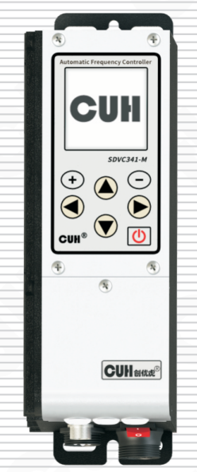

## SDVC341-M
ตัวควบคุมความถี่อัตโนมัติสำหรับเครื่องป้อนวัสดุแบบสั่นสะเทือน  SDVC341-M
# คู่มือการใช้งาน


---

## ข้อความลิขสิทธิ์

บริษัท Nanjing CUH Science & Technology CO., Ltd. ขอสงวนสิทธิ์ทั้งหมด

ข้อมูลทั้งหมดในคู่มือการใช้งานฉบับนี้เป็นทรัพย์สินทางปัญญาของบริษัทของเรา และได้รับความคุ้มครองตามกฎหมายลิขสิทธิ์และกฎหมายอื่นที่เกี่ยวข้อง CUH ได้รับและขอสงวนสิทธิ์ทั้งหมดตามที่กฎหมายลิขสิทธิ์และกฎหมายอื่น ๆ กำหนด โดยไม่ได้รับความยินยอมเป็นลายลักษณ์อักษรจาก CUH ห้ามคัดลอก แปล ลอกเลียน หรือนำคู่มือการใช้งานฉบับนี้ไปใช้ประโยชน์ไม่ว่าบางส่วนหรือทั้งหมด

## ข้อจำกัดความรับผิด

เนื้อหาทั้งหมดของคู่มือการใช้งานฉบับนี้อธิบายเฉพาะวิธีการใช้งานผลิตภัณฑ์ที่เกี่ยวข้องของบริษัทของเรา โดยอธิบายตามเทคโนโลยีที่มีอยู่ในปัจจุบันและสภาพที่ส่งมอบให้ท่านเมื่อใช้งาน ท่านต้องรับความเสี่ยงที่เกี่ยวข้องเมื่อใช้งานผลิตภัณฑ์นี้ เว้นแต่กฎหมายจะกำหนดไว้เป็นอย่างอื่น บริษัทไม่มีความรับผิดไม่ว่าด้วยการแสดงออกหรือโดยนัยใด ๆ ต่อผลิตภัณฑ์อันเนื่องมาจากคู่มือการใช้งานฉบับนี้ รวมถึงแต่ไม่จำกัดเพียงการบาดเจ็บต่อบุคคล ความเสียหายต่อทรัพย์สิน การสูญเสียโอกาส เป็นต้น

ท่านเข้าใจความเสี่ยงข้างต้นอย่างชัดเจนและตกลงว่า เว้นแต่กฎหมายจะบังคับไว้ บริษัทจะไม่รับผิดชอบต่อความเสียหายหรือการสูญเสียโดยตรงหรือโดยอ้อมต่อท่าน (รวมถึงแต่ไม่จำกัดเพียงการสูญเสียที่จับต้องได้ของบุคลากร ทรัพย์สิน ข้อมูล เป็นต้น และการสูญเสียที่จับต้องไม่ได้ เช่น ชื่อเสียง โอกาส เป็นต้น)

บริษัทขอสงวนสิทธิ์ในการแก้ไขผลิตภัณฑ์ที่เกี่ยวข้องในคู่มือการใช้งานฉบับนี้โดยไม่ต้องแจ้งให้ทราบล่วงหน้าหรือภายหลัง

---


---

# บทนำ

ขอบคุณที่ท่านเลือกใช้ตัวควบคุมความถี่อัตโนมัติสำหรับเครื่องป้อนวัสดุแบบสั่นสะเทือน ซีรีส์ SDVC341 ของ CUH (ต่อไปนี้จะเรียกว่า "ตัวควบคุม") ตัวควบคุมซีรีส์นี้ใช้ส่วนประกอบคุณภาพสูง ผสมผสานเทคโนโลยีอิเล็กทรอนิกส์ล่าสุด และออกแบบอย่างพิถีพิถันด้วยตัวประมวลผลสัญญาณดิจิทัลประสิทธิภาพสูง

คู่มือฉบับนี้แนะนำวิธีการใช้งานพื้นฐาน คำอธิบายทางเทคนิคของฟังก์ชัน และตัวอย่างการใช้งานทั่วไปของผลิตภัณฑ์นี้ ให้ข้อมูลที่เกี่ยวข้องแก่ผู้ใช้เกี่ยวกับการติดตั้งและการปรับแต่ง การตั้งค่าพารามิเตอร์ การวินิจฉัยความผิดปกติ การแก้ไขปัญหา และการบำรุงรักษาตามปกติของตัวควบคุม เพื่อให้มั่นใจว่าการติดตั้งและการใช้งานตัวควบคุมนี้ถูกต้อง โปรดอ่านคู่มือการใช้งานฉบับนี้อย่างละเอียดก่อนการติดตั้งและเก็บรักษาไว้อย่างถูกต้อง

โปรดอ่านสัญลักษณ์ต่อไปนี้เพื่อเตือนท่านเกี่ยวกับข้อควรระวังต่อการบาดเจ็บของบุคคลและความเสียหายต่อผลิตภัณฑ์

| สัญลักษณ์ | คำอธิบาย |
|---|---|
| อันตราย | การไม่ปฏิบัติตามข้อนี้<br>จะทำให้เกิดการบาดเจ็บต่อบุคคลหรือเสียชีวิต |
| คำเตือน | การไม่ปฏิบัติตามข้อนี้<br>อาจทำให้เกิดการบาดเจ็บต่อบุคคลหรือเสียชีวิต |
| ข้อควรระวัง | การไม่ปฏิบัติตามข้อนี้<br>อาจทำให้เกิดการบาดเจ็บระดับปานกลางหรือเล็กน้อยต่อบุคคล |
| ข้อสังเกต | การไม่ปฏิบัติตามข้อนี้<br>จะทำให้เกิดความเสียหายต่อผลิตภัณฑ์และทรัพย์สิน |
| จำเป็น | ระบุข้อควรระวังและข้อจำกัดการใช้งานที่ต้อง<br>ปฏิบัติตามระหว่างการใช้งาน |

**คู่มือฉบับนี้เหมาะสำหรับตัวควบคุมรุ่นต่อไปนี้:**

◆ ตัวควบคุมความถี่อัตโนมัติสำหรับเครื่องป้อนวัสดุแบบสั่นสะเทือน　　SDVC341-M (3.0A)

---


---

# ความปลอดภัยและข้อควรระวัง

1. **อันตราย** ผลิตภัณฑ์นี้ใช้สำหรับขับเคลื่อนอุปกรณ์ป้อนวัสดุแบบสั่นสะเทือนที่ใช้แม่เหล็กไฟฟ้าเท่านั้น ห้ามใช้ผลิตภัณฑ์นี้เพื่อวัตถุประสงค์ในการปกป้องร่างกายมนุษย์หรือส่วนหนึ่งส่วนใดของร่างกายมนุษย์ เป็นต้น

2. **อันตราย** ผลิตภัณฑ์นี้ไม่ได้ออกแบบมาให้ใช้เป็นผลิตภัณฑ์กันระเบิด ห้ามใช้งานในพื้นที่อันตรายและ/หรือสภาพแวดล้อมที่มีก๊าซที่อาจเกิดการระเบิดได้

3. **คำเตือน** ผลิตภัณฑ์นี้ใช้พลังงานจากไฟฟ้ากระแสสลับ โปรดอย่าจ่ายแรงดันไฟฟ้ากระแสสลับเกิน 250Vac แรงดันอินพุตที่สูงเกินไป เช่น 380Vac อาจทำให้ผลิตภัณฑ์ระเบิดหรือเกิดเพลิงไหม้ ก่อให้เกิดอุบัติเหตุด้านความปลอดภัยร้ายแรง

4. **คำเตือน** ผลิตภัณฑ์นี้ต่อสายดินผ่านสายไฟ โปรดตรวจสอบให้แน่ใจว่าอุปกรณ์จ่ายไฟสำหรับตัวควบคุมมีการต่อสายดินที่ดี มิฉะนั้นเปลือกตัวควบคุมอาจมีไฟฟ้ารั่วและทำให้เกิดอุบัติเหตุไฟดูด

5. **คำเตือน** ห้ามจ่ายไฟ AC เข้าที่เอาต์พุตของตัวควบคุมนี้ เพราะจะทำให้ตัวควบคุมเสียหาย

6. **คำเตือน** ห้ามเสียบหรือถอดสายไฟขณะมีกระแสไฟฟ้า และห้ามสัมผัสจุดสัมผัสของขั้วต่อต่าง ๆ ในช่องเดินสาย เพื่อป้องกันไฟฟ้าดูด

7. **ข้อสังเกต** โปรดหลีกเลี่ยงการควบคุมเอาต์พุตของผลิตภัณฑ์นี้โดยการตัดแหล่งจ่ายไฟผ่านรีเลย์และอุปกรณ์อื่น ๆ ซึ่งจะลดอายุการใช้งานของตัวควบคุมอย่างรุนแรง

8. **ข้อสังเกต** ตัวควบคุมออกแบบมาให้ทำงานในสภาพแวดล้อมที่เย็นและแห้ง ห้ามใช้งานตัวควบคุมกลางแจ้งเพื่อหลีกเลี่ยงการแช่น้ำและการถูกแดดส่อง ให้ใช้งานตัวควบคุมภายในอุณหภูมิตามคุณลักษณะทางไฟฟ้าที่กำหนด

9. **จำเป็น** ต้องยึดผลิตภัณฑ์นี้บนแท่นที่มั่นคงซึ่งต่อสายดินอย่างน่าเชื่อถือและอยู่ห่างจากอุปกรณ์ที่สั่นสะเทือน

10. **จำเป็น** ห้ามใช้งานตัวควบคุมในสภาวะที่เกินขีดจำกัดการออกแบบ

11. **จำเป็น** ให้ใช้งานตัวควบคุมอย่างเคร่งครัดตามคู่มือฉบับนี้ เราจะไม่รับผิดชอบทางแพ่งหรือทางอาญาใด ๆ หากเกิดความเสียหายต่ออุปกรณ์หรือการบาดเจ็บต่อบุคคลจากการใช้งานที่ไม่ถูกต้อง

12. **จำเป็น** ห้ามเปิดเปลือกตัวควบคุมเพื่อหลีกเลี่ยงไฟฟ้าดูด โปรดติดต่อ CUH หากตัวควบคุมขัดข้อง ห้ามพยายามซ่อมแซมตัวควบคุมด้วยตนเอง ซึ่งอาจทำให้การรับประกันเป็นโมฆะ

---


---

# สภาพแวดล้อมในการใช้งานและการจัดเก็บ

## การตรวจสอบก่อนการใช้งาน

ตัวควบคุมทุกเครื่องจะผ่านการตรวจสอบคุณภาพอย่างเข้มงวดก่อนการจัดส่ง และบรรจุในบรรจุภัณฑ์กันกระแทก โปรดตรวจสอบรายการต่อไปนี้หลังจากเปิดกล่อง:

1. ตัวควบคุมเสียหายระหว่างการขนส่งหรือไม่
2. รุ่นของตัวควบคุมตรงกับที่ท่านสั่งซื้อหรือไม่

## สภาพแวดล้อมในการทำงาน

โปรดปฏิบัติตามข้อควรระวังต่อไปนี้เพื่อให้มั่นใจในประสิทธิภาพที่ดีขึ้นและอายุการใช้งานที่ยาวนานขึ้นของตัวควบคุม:

- ❗ สภาพแวดล้อมที่มีการระบายอากาศดี
- ❗ อยู่ห่างจากน้ำ ความชื้น ฝุ่น และโดยเฉพาะฝุ่นมัน
- ❗ อยู่ห่างจากก๊าซและของเหลวที่กัดกร่อนหรือติดไฟได้
- ❗ อยู่ห่างจากฝุ่นที่ฟุ้งกระจายและเศษโลหะ
- ❗ ยึดติดแน่นเพื่อหลีกเลี่ยงการสั่นสะเทือนของตัวเอง
- ❗ อยู่ห่างจากการรบกวนทางแม่เหล็กไฟฟ้า
- ❗ ตรวจสอบให้แน่ใจว่าอุณหภูมิแวดล้อมอยู่ที่ 0~40 °C
- ❗ สำหรับใช้งานที่ระดับความสูง 2000 ม. หรือต่ำกว่า

---


---

# สารบัญ

**บทที่ Ⅰ คำแนะนำก่อนการใช้งาน** --------------------------------------------------1

1.1 การตรวจสอบรายการในบรรจุภัณฑ์----------------------------------------------------------------1

1.2 คำอธิบายป้ายข้อมูล ----------------------------------------------------2

1.3 เงื่อนไขการใช้งานตัวควบคุม-----------------------------------------------------------2

1.4 หมายเหตุ--------------------------------------------------------------------------------3

**บทที่ Ⅱ บทนำผลิตภัณฑ์**------------------------------------------------------4

2.1 บทนำผลิตภัณฑ์ ------------------------------------------------------------------4

2.2 แผงปุ่มและพอร์ต I/O ------------------------------------------------------------------5

2.3 คู่มือการติดตั้งเซ็นเซอร์สั่นสะเทือน --------------------------------------------------6

2.4 คำอธิบายพารามิเตอร์หน้าหลัก ------------------------------------------------------7

2.5 คำจำกัดความของพอร์ตควบคุมสัญญาณ ------------------------------------------------------7

2.6 การใช้งานแผงปุ่ม ----------------------------------------------------------------------8

2.7 แผนภาพการหมุนของอินเทอร์เฟซการทำงาน ------------------------------------------------8

**บทที่ Ⅲ การเดินสายไฟและการใช้งานพื้นฐาน**-----------------------------------------9

3.1 การเดินสายไฟ---------------------------------------------------------------------------9

3.2 การใช้งานพื้นฐาน------------------------------------------------------------------------11

**บทที่ Ⅳ คำอธิบายฟังก์ชันโดยละเอียด**-------------------------------------------13

4.1 การตั้งค่าพารามิเตอร์ทั่วไป -----------------------------------------------------------14

4.1.1 แรงดัน -----------------------------------------------------------------------------14

4.1.2 ความถี่ ---------------------------------------------------------------------------14

4.1.3 ความเร็วป้อน------------------------------------------------------------------------15

4.1.4 เวลาสตาร์ทแบบนุ่มนวล/เวลาหยุดแบบนุ่มนวล------------------------------------------------------15

4.1.5 แรงดันสูงสุด/กระแสสูงสุด -------------------------------------------------15

4.1.6 ความถี่เอาต์พุตสูงสุด/ความถี่เอาต์พุตต่ำสุด--------------------------------15

4.1.7 การตรวจจับโหลด ----------------------------------------------------------------------16

4.1.8 การแจ้งเตือนวัสดุขาดแคลน-----------------------------------------------------------------------16

4.1.9 การแจ้งเตือนการปิดเครื่อง ----------------------------------------------------------------------16

4.1.10 ความสว่างของไฟพื้นหลัง -------------------------------------------------------------16

4.1.11 การปิดไฟพื้นหลัง-----------------------------------------------------------------------17

4.1.12 ภาษา----------------------------------------------------------------------------17

4.2 การค้นหาความถี่เรโซแนนซ์อัตโนมัติ -------------------------------------------------17

4.2.1 อินเทอร์เฟซการค้นหาความถี่ -------------------------------------------------------17

---


4.3 ความเร็วป้อนคงที่ ----------------------------------------------------------------18

  4.3.1 ความถี่กลาง -------------------------------------------------------------18

  4.3.2 ออฟเซ็ตความถี่ --------------------------------------------------------------18

  4.3.3 ค่าอินทิกรัลความถี่ ---------------------------------------------------------18

  4.3.4 ค่าอินทิกรัลแอมพลิจูด ---------------------------------------------------------19

  4.3.5 อัตราส่วนแอมพลิจูด ---------------------------------------------------------------19

  4.3.6 เฟสอัตโนมัติ --------------------------------------------------------------------19

  4.3.7 กระแสระหว่างกระบวนการค้นหาความถี่ -------------------------------------------19

  4.3.8 แอมพลิจูดระหว่างกระบวนการค้นหาความถี่ -----------------------------------------19

  4.3.9 ความเร็วป้อนสูงสุด ------------------------------------------------------------19

  4.3.10 ออฟเซ็ตเฟสของตัวควบคุมทาส ------------------------------------------------19

  4.3.11 โหมดควบคุมแรงดันเอาต์พุต --------------------------------------------------20

  4.3.12 โหมดควบคุมความถี่เอาต์พุต ------------------------------------------------20

  4.3.13 แหล่งซิงค์ ------------------------------------------------------------------20

  4.3.14 ประเภทเซ็นเซอร์สั่นสะเทือน --------------------------------------------------------20

  4.3.15 ความเร็วการค้นหาความถี่เรโซแนนซ์อัตโนมัติ ----------------------------------------20

4.4 พารามิเตอร์เอาต์พุต ------------------------------------------------------------------21

  4.4.1 พารามิเตอร์เอาต์พุตหลัก --------------------------------------------------------21

  4.4.2 พารามิเตอร์เอาต์พุตควบคุม DC --------------------------------------------------28

4.5 การควบคุมสัญญาณ ---------------------------------------------------------------------30

  4.5.1 ประเภทเซ็นเซอร์ -------------------------------------------------------------------30

  4.5.2 ลอจิกพอร์ต C/พอร์ต E -----------------------------------------------------------31

  4.5.3 เวลาหน่วงเปิด/ปิดของพอร์ต C และพอร์ต E ----------------------------------31

  4.5.4 ลอจิกความเร็ว A/ลอจิกความเร็ว B ---------------------------------------------------32

  4.5.5 เวลาหน่วงเปิด/ปิดของความเร็ว A และความเร็ว B --------------------------------32

4.6 การนับจำนวนวัสดุ----------------------------------------------------------33

  4.6.1 การนับจำนวนวัสดุ (หรือความเร็ว A/B) -------------------------------------33

  4.6.2 จำนวนเป้าหมาย ---------------------------------------------------------------34

  4.6.3 ความเร็วสิ้นสุด ----------------------------------------------------------------34

  4.6.4 จำนวนความเร็วสิ้นสุด -------------------------------------------------------35

  4.6.5 รีเซ็ตค่าการนับเป็น 0 -----------------------------------------------------35

  4.6.6 ลำดับความสำคัญ RS ---------------------------------------------------35


4.7 บันทึกการตั้งค่า ----------------------------------------------------------------36

&nbsp;&nbsp;&nbsp;&nbsp;4.7.1 การเรียกคืนการตั้งค่า ----------------------------------------------------------36

&nbsp;&nbsp;&nbsp;&nbsp;4.7.2 บันทึกการตั้งค่า---------------------------------------------------------------36

&nbsp;&nbsp;&nbsp;&nbsp;4.7.3 คืนค่าโรงงาน-------------------------------------------------------------37

&nbsp;&nbsp;&nbsp;&nbsp;4.7.4 คัดลอกการตั้งค่า --------------------------------------------------------------37

&nbsp;&nbsp;&nbsp;&nbsp;4.7.5 รหัสผ่านผู้ใช้ -------------------------------------------------------------37

&nbsp;&nbsp;&nbsp;&nbsp;4.7.6 ป้อนรหัสผ่าน-------------------------------------------------------------37

4.8 การสื่อสาร RS485-----------------------------------------------------------38

&nbsp;&nbsp;&nbsp;&nbsp;4.8.1 ประเภทการสื่อสาร --------------------------------------------------------38

&nbsp;&nbsp;&nbsp;&nbsp;4.8.2 อัตราบอด------------------------------------------------------------------39

&nbsp;&nbsp;&nbsp;&nbsp;4.8.3 ที่อยู่ตัวควบคุมทาส---------------------------------------------------39

&nbsp;&nbsp;&nbsp;&nbsp;4.8.4 ความต้านทานพอร์ต/ความต้านทานซิงโครนัส-------------------------------------39

4.9 การเชื่อมต่อเครือข่าย CUHBus-DS® ---------------------------------------------------------40

&nbsp;&nbsp;&nbsp;&nbsp;4.9.1 การเชื่อมต่อเครือข่ายอุปกรณ์ ---------------------------------------------------------41

&nbsp;&nbsp;&nbsp;&nbsp;4.9.2 ฟังก์ชันซิงค์--------------------------------------------------------------45

&nbsp;&nbsp;&nbsp;&nbsp;4.9.3 การแชร์สัญญาณ ------------------------------------------------------------51

&nbsp;&nbsp;&nbsp;&nbsp;4.9.4 การสำรองข้อมูล----------------------------------------------------------------53

&nbsp;&nbsp;&nbsp;&nbsp;4.9.5 ข้อมูลการควบคุมระยะไกล--------------------------------------------------------54

4.10 การตรวจสอบสถานะตัวควบคุม ------------------------------------------------54

4.11 บันทึกข้อผิดพลาด -------------------------------------------------------------------55

4.12 ปรับแต่งหน้าหลัก ----------------------------------------------------------55

**บทที่ Ⅴ การประยุกต์ใช้ทั่วไป** ----------------------------------------------56

&nbsp;&nbsp;&nbsp;&nbsp;5.1 จะทำให้เครื่องป้อนวัสดุแบบสั่นสะเทือนสองเครื่องทำงานที่ความถี่เดียวกันได้อย่างไร ------------56

&nbsp;&nbsp;&nbsp;&nbsp;5.2 จะเปิด/ปิดตัวควบคุม B ผ่านเซ็นเซอร์ที่เชื่อมต่อกับตัวควบคุม A ได้อย่างไร -----57

&nbsp;&nbsp;&nbsp;&nbsp;5.3 จะเปิด/ปิดตัวควบคุมสองตัวพร้อมกันได้อย่างไร---------------------------58

**บทที่ Ⅵ คำถามที่พบบ่อย**-----------------------------------------59

&nbsp;&nbsp;&nbsp;&nbsp;6.1 ไม่มีจอแสดงผลเมื่อเปิดเครื่อง ----------------------------------------------------59

&nbsp;&nbsp;&nbsp;&nbsp;6.2 ไม่สั่นสะเทือน ไม่มีเสียงรบกวน จอแสดงผลตัวควบคุมปกติ ---------------------------59

&nbsp;&nbsp;&nbsp;&nbsp;6.3 สัญญาณควบคุมไม่ทำงาน-------------------------------------------------59

&nbsp;&nbsp;&nbsp;&nbsp;6.4 ไม่สั่นสะเทือน มีเสียงรบกวนปกติ จอแสดงผลตัวควบคุมปกติ --------------------59

&nbsp;&nbsp;&nbsp;&nbsp;6.5 การติดตามความถี่เรโซแนนซ์ไม่เสถียร-----------------------------------------59

&nbsp;&nbsp;&nbsp;&nbsp;6.6 การแก้ไขความเร็วช้าในการควบคุมความเร็วป้อนคงที่ ------------------------60


---

6.7 จะรีเซ็ตตัวควบคุมกลับเป็นการตั้งค่าโรงงานอย่างรวดเร็วได้อย่างไร -------------------------60

**บทที่ Ⅶ ภาคผนวก** ------------------------------------------------------------------------61

&nbsp;&nbsp;&nbsp;&nbsp;7.1 มิติ -------------------------------------------------------------------------------61

&nbsp;&nbsp;&nbsp;&nbsp;7.2 ข้อมูลจำเพาะทางเทคนิค---------------------------------------------------------------62

&nbsp;&nbsp;&nbsp;&nbsp;7.3 มาตรฐานอ้างอิง---------------------------------------------------------------------63

&nbsp;&nbsp;&nbsp;&nbsp;7.4 รายการพารามิเตอร์----------------------------------------------------------------------------64

&nbsp;&nbsp;&nbsp;&nbsp;&nbsp;&nbsp;&nbsp;&nbsp;7.4.1 กลุ่มพารามิเตอร์อินเทอร์เฟซ -----------------------------------------------------64

&nbsp;&nbsp;&nbsp;&nbsp;&nbsp;&nbsp;&nbsp;&nbsp;7.4.2 กลุ่มพารามิเตอร์ทั่วไป-----------------------------------------------------65

&nbsp;&nbsp;&nbsp;&nbsp;&nbsp;&nbsp;&nbsp;&nbsp;7.4.3 กลุ่มพารามิเตอร์เอาต์พุตหลัก ------------------------------------------------66

&nbsp;&nbsp;&nbsp;&nbsp;&nbsp;&nbsp;&nbsp;&nbsp;7.4.4 กลุ่มพารามิเตอร์ความเร็วคงที่-----------------------------------------------67

&nbsp;&nbsp;&nbsp;&nbsp;&nbsp;&nbsp;&nbsp;&nbsp;7.4.5 กลุ่มพารามิเตอร์อินพุตสัญญาณ-------------------------------------------------68

&nbsp;&nbsp;&nbsp;&nbsp;&nbsp;&nbsp;&nbsp;&nbsp;7.4.6 กลุ่มพารามิเตอร์เอาต์พุตควบคุม---------------------------------------------69

&nbsp;&nbsp;&nbsp;&nbsp;&nbsp;&nbsp;&nbsp;&nbsp;7.4.7 กลุ่มพารามิเตอร์การนับ DC ------------------------------------------------70

&nbsp;&nbsp;&nbsp;&nbsp;&nbsp;&nbsp;&nbsp;&nbsp;7.4.8 กลุ่มพารามิเตอร์การสื่อสาร -------------------------------------------71

&nbsp;&nbsp;&nbsp;&nbsp;&nbsp;&nbsp;&nbsp;&nbsp;7.4.9 กลุ่มการบันทึกการตั้งค่า--------------------------------------------------------------72

&nbsp;&nbsp;&nbsp;&nbsp;&nbsp;&nbsp;&nbsp;&nbsp;7.4.10 กลุ่มพารามิเตอร์การตรวจสอบ-------------------------------------------------73

&nbsp;&nbsp;&nbsp;&nbsp;&nbsp;&nbsp;&nbsp;&nbsp;7.4.11 รายการแนบ----------------------------------------------------------------------75

&nbsp;&nbsp;&nbsp;&nbsp;7.5 แผนภาพวงจรอินพุตและเอาต์พุต -------------------------------------------------76

&nbsp;&nbsp;&nbsp;&nbsp;7.6 รหัสข้อผิดพลาด---------------------------------------------------------------------------------78

&nbsp;&nbsp;&nbsp;&nbsp;7.7 รหัสคำเตือน ----------------------------------------------------------------------------79

**บทที่ Ⅷ ข้อมูลการรับประกันผลิตภัณฑ์**-------------------------------------80

&nbsp;&nbsp;&nbsp;&nbsp;8.1 ระยะเวลาการรับประกัน -------------------------------------------------------------------------80

&nbsp;&nbsp;&nbsp;&nbsp;8.2 ขอบเขตการรับประกัน----------------------------------------------------------------------80

&nbsp;&nbsp;&nbsp;&nbsp;8.3 ความเหมาะสมของผลิตภัณฑ์----------------------------------------------------------------------80

---


# บทที่ Ⅰ คำแนะนำก่อนการใช้งาน

บทนี้แนะนำรายการในบรรจุภัณฑ์ของผลิตภัณฑ์ คำอธิบายลักษณะภายนอกของตัวควบคุม และข้อมูลป้ายข้อมูลของตัวควบคุม

## 1.1 การตรวจสอบรายการในบรรจุภัณฑ์

ก่อนการใช้งาน โปรดตรวจสอบความสมบูรณ์ของตัวควบคุมและอุปกรณ์เสริม หากพบว่าผลิตภัณฑ์มีข้อบกพร่องหรือเสียหาย อุปกรณ์เสริมสูญหาย เป็นต้น โปรดติดต่อบริษัทของเรา


รายการในบรรจุภัณฑ์ที่แสดง:

- ตัวควบคุม×1
- คู่มือการใช้งาน×1
- สายไฟขาออก×1
- สายไฟเข้า×1
- เซ็นเซอร์สั่นสะเทือน×1

---


## 1.2 คำอธิบายป้ายข้อมูล

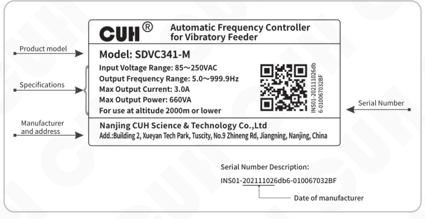

ข้อมูลป้ายที่แสดงในภาพประกอบ:

- รุ่นผลิตภัณฑ์: **Model: SDVC341-M**
- ชื่อผลิตภัณฑ์: **Automatic Frequency Controller for Vibratory Feeder**
- ข้อมูลจำเพาะ:
  - ช่วงแรงดันอินพุต: **85~250VAC**
  - ช่วงความถี่เอาต์พุต: **5.0~999.9Hz**
  - กระแสเอาต์พุตสูงสุด: **3.0A**
  - กำลังเอาต์พุตสูงสุด: **660VA**
  - สำหรับใช้งานที่ระดับความสูง **2000 ม. หรือต่ำกว่า**
- ผู้ผลิตและที่อยู่:
  - **Nanjing CUH Science & Technology Co., Ltd**
  - Add.: **Building 2, Xueyan Tech Park, Tuscity, No.9 Zhineng Rd, Jiangning, Nanjing, China**
- คำอธิบายหมายเลขเครื่อง: **INS01-202111026db6-010067032BF**
  - วันที่ผลิต: **20211102**

## 1.3 เงื่อนไขการใช้งานตัวควบคุม

ตัวควบคุมใช้พลังงานจากไฟ AC 85V~250V และเชื่อมต่อกับสายดินป้องกันผ่านปลั๊กของสายไฟ โปรดใช้แหล่งจ่ายไฟหลักมาตรฐานและตรวจสอบให้แน่ใจว่าสายดินป้องกันเชื่อมต่ออย่างถูกต้อง

> ⚠️ **คำเตือน**  
> ห้ามต่อตัวควบคุมกับไฟ AC 380V เด็ดขาด เพราะจะทำให้ตัวควบคุมเสียหายร้ายแรงแบบแก้ไขไม่ได้ อาจก่อให้เกิดการระเบิด ไฟไหม้ และอุบัติเหตุด้านความปลอดภัยอื่น ๆ

> ⚠️ **คำเตือน**  
> ตรวจสอบให้แน่ใจว่าด้านจ่ายไฟต่อสายดินอย่างน่าเชื่อถือ เปลือกโลหะของตัวควบคุมเชื่อมต่อโดยตรงกับสายดินป้องกัน การต่อสายดินที่ไม่ดีจะทำให้เปลือกตัวควบคุมมีไฟฟ้าและเกิดอุบัติเหตุไฟดูด

> **ข้อสังเกต**  
> การทำงานเป็นเวลานานจะเกิดความร้อนและทำให้อุณหภูมิของเปลือกสูงขึ้น โปรดติดตั้งตัวควบคุมในสภาพแวดล้อมที่มีการระบายอากาศดีและยึดให้แน่น ห่างจากแหล่งสั่นสะเทือน

> **ข้อสังเกต**  
> ผลิตภัณฑ์นี้เป็นตัวควบคุมที่ใช้ขับเคลื่อนแม่เหล็กไฟฟ้า ห้ามเชื่อมต่อกับเครื่องป้อนวัสดุแบบสั่นสะเทือนแบบเพียโซอิเล็กทริกโดยเด็ดขาด


---

## 1.4 หมายเหตุ

คู่มือการใช้งานฉบับนี้มีความยาวประมาณ 28000 คำ และคาดว่าจะใช้เวลาประมาณหนึ่งชั่วโมงในการอ่านจนจบ

◆ โปรดอ่านคู่มือฉบับนี้อย่างละเอียดก่อนการใช้งาน เพื่อป้องกันความเสียหายต่อตัวควบคุมอันเนื่องมาจากการใช้งานที่ไม่ถูกต้อง

◆ ผู้ใช้สามารถค้นหาฟังก์ชันและวิธีการใช้งานที่เกี่ยวข้องของตัวควบคุมได้อย่างรวดเร็วตามสารบัญของคู่มือ

◆ หัวข้อย่อยของบทและข้อความที่เน้นในเนื้อความคือรายการพารามิเตอร์ที่แสดงจริงของตัวควบคุม เช่น แรงดัน

◆ ผู้ใช้สามารถอ้างอิง “บทที่ Ⅴ การใช้งานทั่วไป” เพื่อเริ่มต้นใช้งานตัวควบคุมนี้ได้อย่างรวดเร็ว

◆ ผู้ใช้สามารถค้นหารหัสแท็กฟังก์ชันได้อย่างรวดเร็วในส่วน “7.4 รายการพารามิเตอร์”

◆ การกด ⊕ และ ⊖ พร้อมกันหมายถึงการยืนยัน

---


---

# บทที่ Ⅱ บทนำผลิตภัณฑ์

เนื้อหาหลักของบทนี้ประกอบด้วยบทนำโดยย่อและคุณสมบัติหลักของผลิตภัณฑ์นี้

## 2.1 บทนำผลิตภัณฑ์

ตัวควบคุมความถี่อัตโนมัติสำหรับเครื่องป้อนวัสดุแบบสั่นสะเทือน ซีรีส์ SDVC341 เป็นผลิตภัณฑ์ที่ออกแบบมาเป็นพิเศษสำหรับระบบป้อนวัสดุระดับสูง

ประสิทธิภาพที่เป็นเอกลักษณ์เกิดจากการใช้เทคโนโลยีอิเล็กทรอนิกส์และวิธีการประมวลผลสัญญาณล่าสุด คุณสมบัติพิเศษประกอบด้วย:

- มาพร้อมฟังก์ชันบูสต์แก้ตัวประกอบกำลัง PFC รองรับแรงดันเอาต์พุตสูงสุด 250V ภายในช่วงแรงดันอินพุต 85~250V
- สามารถใช้เบรกเพื่อหยุดเครื่องป้อนวัสดุแบบสั่นสะเทือนได้อย่างรวดเร็ว
- การสื่อสารผ่าน CUHBus-DS® ช่วยให้สามารถซิงโครไนซ์ สำรอง และกู้คืนพารามิเตอร์ควบคุมระยะไกล เช่น แรงดัน ความถี่ เฟส และอื่น ๆ ของตัวควบคุมแต่ละตัวได้
- สัญญาณจากพอร์ตของตัวควบคุมอื่นสามารถใช้สำหรับการควบคุมลอจิกผ่านการสื่อสาร CUHBus-DS® ได้
- ฟังก์ชันแจ้งเตือนวัสดุขาดแคลนสามารถทำงานได้โดยไม่ต้องติดตั้งเซ็นเซอร์เพิ่มเติม
- สามารถส่งเสียงสัญญาณสำหรับโน้ตที่เลือกได้ผ่านเครื่องป้อนวัสดุแบบสั่นสะเทือน
- ขยายความถี่เอาต์พุตเป็น 5Hz~999.9Hz
- พอร์ตควบคุมความเร็วแบบแอนะล็อกรองรับโหมด 0~5V, 1~5V, 0~10V, 4~20mA และอื่น ๆ
- มาพร้อมฟังก์ชันการนับ รวมถึงการชะลอความเร็วตามการนับและการหยุดตามการนับ
- การค้นหาความถี่แบบแอมพลิจูดคงที่ที่ปรับปรุงแล้วช่วยให้มั่นใจว่าเครื่องป้อนวัสดุแบบสั่นสะเทือนสองเครื่องที่มีช่องว่างเล็กน้อยจะไม่ชนกันระหว่างกระบวนการค้นหาความถี่
- รองรับโปรโตคอล RS485 Modbus ASCII และ RS485 Modbus RTU
- สามารถอัปเกรดซอฟต์แวร์ได้ผ่านอินเทอร์เฟซ RS485
- ใช้จอ LCD ความละเอียด 128 * 128 และรองรับสามภาษา: จีน อังกฤษ และเยอรมัน
- ตรวจจับคุณลักษณะกระแสโหลดเพื่อช่วยผู้ใช้วินิจฉัยข้อขัดข้อง
- รหัสข้อขัดข้องสามารถจัดเก็บบันทึกข้อขัดข้องล่าสุดได้ 64 รายการ

---


## 2.2 แผงปุ่มและพอร์ต I/O

### คำอธิบายหน้าต่างและปุ่ม

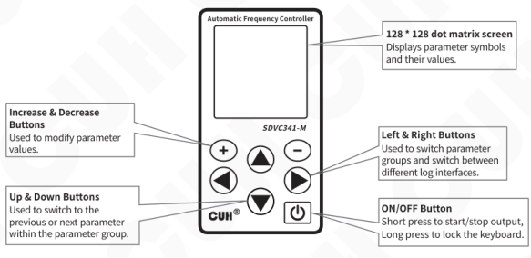

| รายการ | คำอธิบาย |
|---|---|
| ปุ่มเพิ่มและลด | ใช้สำหรับแก้ไขค่าพารามิเตอร์ |
| ปุ่มขึ้นและลง | ใช้สำหรับสลับไปยังพารามิเตอร์ก่อนหน้าหรือถัดไปภายในกลุ่มพารามิเตอร์ |
| ปุ่มซ้ายและขวา | ใช้สำหรับสลับกลุ่มพารามิเตอร์และสลับระหว่างอินเทอร์เฟซบันทึกต่าง ๆ |
| จอแบบดอทเมทริกซ์ 128 * 128 | แสดงสัญลักษณ์พารามิเตอร์และค่าของพารามิเตอร์ |
| ปุ่ม ON/OFF | กดสั้นเพื่อเริ่ม/หยุดเอาต์พุต กดค้างเพื่อล็อกแป้นพิมพ์ |

### คำอธิบายชิ้นส่วนภายนอก

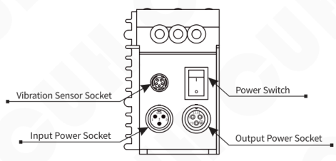

| ชิ้นส่วนภายนอก | ป้ายที่แสดงในภาพ |
|---|---|
| ช่องต่อเซ็นเซอร์สั่นสะเทือน | Vibration Sensor Socket |
| ช่องต่อไฟเข้า | Input Power Socket |
| สวิตช์ไฟ | Power Switch |
| ช่องต่อไฟออก | Output Power Socket |


---

## 2.3 คู่มือการติดตั้งเซ็นเซอร์สั่นสะเทือน

ยึดเซ็นเซอร์สั่นสะเทือนกับพื้นผิวเรียบของเครื่องสั่นสะเทือน โดยทิศทางการติดตั้งเป็นแบบใดก็ได้ วิธีการติดตั้งเซ็นเซอร์สั่นสะเทือนแสดงดังต่อไปนี้:

- วิธีที่ 1: ดังแสดงในรูปที่ 2.3.1  
  ข้อดี: ติดตั้งง่าย

- วิธีที่ 2: ดังแสดงในรูปที่ 2.3.2  
  หมายเหตุ: อย่าให้เซ็นเซอร์สั่นสะเทือนถูกโถป้อนกดทับ

- วิธีที่ 3: เชื่อมขายึดบนเครื่องสั่นสะเทือนและยึดเซ็นเซอร์สั่นสะเทือนบนขายึด ดังแสดงในรูปที่ 2.3.3  
  ขนาดที่แนะนำของขายึดสั่นสะเทือนแสดงในรูปที่ 2.3.4

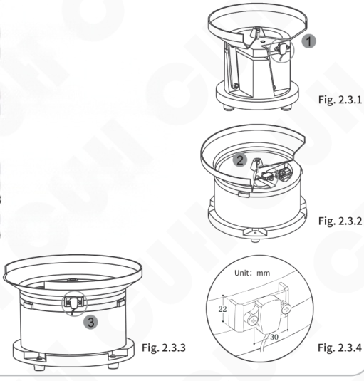

- วิธีการติดตั้งที่ไม่แนะนำ ดังแสดงในรูปที่ 2.3.5 และรูปที่ 2.3.6  
  หากตำแหน่งการติดตั้งไม่เหมาะสม เซ็นเซอร์สั่นสะเทือนจะไม่สามารถป้อนกลับความถี่เรโซแนนซ์ได้อย่างแม่นยำ และตัวควบคุมจะค้นหาความถี่เรโซแนนซ์ต่อไปเรื่อย ๆ

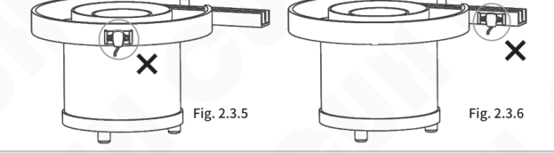

---


## 2.4 คำอธิบายพารามิเตอร์หน้าหลัก

ตัวควบคุมสามารถแสดงสถานะเอาต์พุตหลัก สถานะการล็อกแป้นพิมพ์ สถานะพอร์ต พารามิเตอร์การตรวจสอบ และชื่ออินเทอร์เฟซบนหน้าหลัก ภายในสถานะพอร์ต: การไฮไลต์ X หมายความว่าพอร์ตทำงานอยู่ X หมายความว่าพอร์ตทำงานที่ระดับต่ำ และ X หมายความว่าพอร์ตทำงานที่ระดับสูง

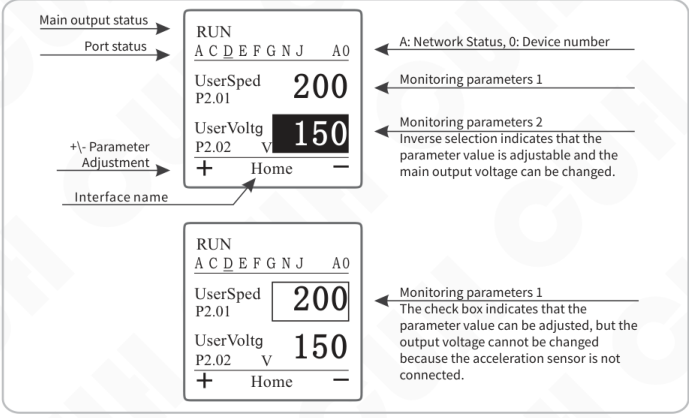

ป้ายในแผนภาพที่แสดง:

- สถานะเอาต์พุตหลัก
- สถานะพอร์ต
- A: สถานะเครือข่าย, 0: หมายเลขอุปกรณ์
- พารามิเตอร์การตรวจสอบ 1
- พารามิเตอร์การตรวจสอบ 2  
  การเลือกแบบกลับหมายความว่าค่าพารามิเตอร์สามารถปรับได้และแรงดันเอาต์พุตหลักสามารถเปลี่ยนแปลงได้
- +/- การปรับพารามิเตอร์
- ชื่ออินเทอร์เฟซ
- พารามิเตอร์การตรวจสอบ 1  
  ช่องทำเครื่องหมายหมายความว่าค่าพารามิเตอร์สามารถปรับได้ แต่แรงดันเอาต์พุตไม่สามารถเปลี่ยนแปลงได้เนื่องจากยังไม่ได้เชื่อมต่อเซ็นเซอร์ความเร่ง

ตัวอย่างค่าหน้าหลักที่แสดง:

| รายการ | เนื้อหาที่แสดง |
|---|---|
| สถานะเอาต์พุตหลัก | RUN |
| สถานะพอร์ต | A C D E F G N J |
| เครือข่าย / หมายเลขอุปกรณ์ | A0 |
| พารามิเตอร์การตรวจสอบ 1 | UserSped / P2.01 / 200 |
| พารามิเตอร์การตรวจสอบ 2 | UserVoltg / P2.02 / V / 150 |
| ชื่ออินเทอร์เฟซ | Home |
| ปุ่มปรับพารามิเตอร์ | + / - |

## 2.5 คำจำกัดความของพอร์ตควบคุมสัญญาณ

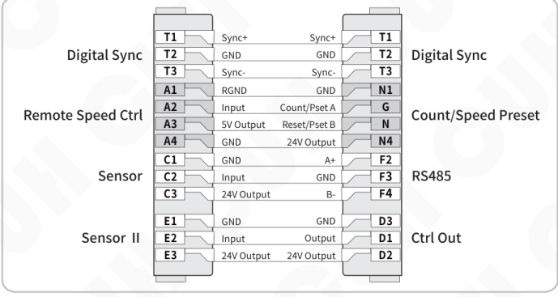

| ตำแหน่ง | กลุ่มฟังก์ชัน | พอร์ต | คำจำกัดความ |
|---|---|---|---|
| ซ้าย | Digital Sync | T1 | Sync+ |
| ซ้าย | Digital Sync | T2 | GND |
| ซ้าย | Digital Sync | T3 | Sync- |
| ซ้าย | Remote Speed Ctrl | A1 | RGND |
| ซ้าย | Remote Speed Ctrl | A2 | Input |
| ซ้าย | Remote Speed Ctrl | A3 | 5V Output |
| ซ้าย | Remote Speed Ctrl | A4 | GND |
| ซ้าย | Sensor | C1 | GND |
| ซ้าย | Sensor | C2 | Input |
| ซ้าย | Sensor | C3 | 24V Output |
| ซ้าย | Sensor II | E1 | GND |
| ซ้าย | Sensor II | E2 | Input |
| ซ้าย | Sensor II | E3 | 24V Output |
| ขวา | Digital Sync | T1 | Sync+ |
| ขวา | Digital Sync | T2 | GND |
| ขวา | Digital Sync | T3 | Sync- |
| ขวา | Count/Speed Preset | N1 | GND |
| ขวา | Count/Speed Preset | G | Count/Pset A |
| ขวา | Count/Speed Preset | N | Reset/Pset B |
| ขวา | Count/Speed Preset | N4 | 24V Output |
| ขวา | RS485 | F2 | A+ |
| ขวา | RS485 | F3 | GND |
| ขวา | RS485 | F4 | B- |
| ขวา | Ctrl Out | D3 | GND |
| ขวา | Ctrl Out | D1 | Output |
| ขวา | Ctrl Out | D2 | 24V Output |


---

## 2.6 การใช้งานแผงปุ่ม

a. ตัวควบคุมนี้ใช้จอแบบดอทเมทริกซ์ 128 * 128 ในการแสดงเนื้อหาพารามิเตอร์

b. การทำงานของปุ่มแบ่งตามระยะเวลาการกดปุ่ม เป็นการกดสั้น การกดค้าง การเร่งระดับแรก และการเร่งระดับที่สอง

[กดสั้น]: กดนานกว่า 0.1 วินาที แต่น้อยกว่า 0.5 วินาที

[กดค้าง]: กดนานกว่า 2 วินาที

[การเร่งระดับแรก]: กดนานกว่า 0.5 วินาที แต่น้อยกว่า 2 วินาที

[การเร่งระดับที่สอง]: กดนานกว่า 2 วินาที

c. ⊕ และ ⊖ หน้าที่หลักคือการแก้ไขค่าพารามิเตอร์

d. สลับระหว่างกลุ่มพารามิเตอร์บนและล่างในอินเทอร์เฟซการตั้งค่าพารามิเตอร์โดยกด ◀ หรือ ▶ สั้น ๆ

e. สลับระหว่างพารามิเตอร์บนและล่างของกลุ่มนี้ในอินเทอร์เฟซการตั้งค่าพารามิเตอร์โดยกด ▲ หรือ ▼ สั้น ๆ

f. กด ⏻ สั้น ๆ เพื่อเริ่ม/หยุดเอาต์พุตหลัก กด ⏻ ค้างเพื่อล็อก/ปลดล็อกแป้นพิมพ์

g. เข้าสู่กลุ่มพารามิเตอร์ต่าง ๆ ผ่านการผสมปุ่มต่อไปนี้:

กด ▲+▼ ค้าง เพื่อเข้าหรือออกจากอินเทอร์เฟซการค้นหาความถี่

กด ▲+◀ ค้าง เพื่อเข้าหรือออกจากอินเทอร์เฟซการตั้งค่าพารามิเตอร์

กด ▲+▶ ค้าง เพื่อเข้าหรือออกจากอินเทอร์เฟซบันทึก

## 2.7 แผนภาพการหมุนของอินเทอร์เฟซการทำงาน

ภายใต้อินเทอร์เฟซใด ๆ กด **▲+▶** ค้างเพื่อเข้าสู่ **อินเทอร์เฟซบันทึก** กดค้างอีกครั้งเพื่อออกสู่ **อินเทอร์เฟซหลัก**

ภายใต้อินเทอร์เฟซใด ๆ กด **▲+▼** ค้างเพื่อเข้าสู่ **อินเทอร์เฟซการค้นหาความถี่** กดปุ่มหยุดสั้น ๆ เพื่อออกสู่ **อินเทอร์เฟซหลัก**

ภายใต้อินเทอร์เฟซใด ๆ กด **▲+◀** ค้างเพื่อเข้าสู่ **อินเทอร์เฟซการตั้งค่าพารามิเตอร์** กดค้างอีกครั้งเพื่อออกสู่ **อินเทอร์เฟซหลัก**

ภายใต้อินเทอร์เฟซใด ๆ หากไม่มีการดำเนินการเกิน 5 นาที จะเข้าสู่ **อินเทอร์เฟซสแตนด์บาย** และกดปุ่มใด ๆ อีกครั้งเพื่อกลับสู่ **อินเทอร์เฟซหลัก**

---


---

# บทที่ Ⅲ การเดินสายไฟและการใช้งานพื้นฐาน

## 3.1 การเดินสายไฟ

### ขั้นตอนที่หนึ่ง:

เปิดกล่องบรรจุภัณฑ์และตรวจสอบตัวควบคุมและอุปกรณ์เสริมทั้งหมด

### ขั้นตอนที่สอง:

เชื่อมต่อขั้วเดินสายของสายไฟเอาต์พุตกับขดลวดแม่เหล็กไฟฟ้าของเครื่องสั่นสะเทือน

จัดแนวร่องบนปลั๊กการบินของสายไฟขาออกให้ตรงกับเครื่องหมายสามเหลี่ยมบนช่องต่อไฟออกของตัวควบคุม จากนั้นขันน็อตให้แน่นหลังจากเชื่อมต่อสายไฟขาออกอย่างถูกต้อง

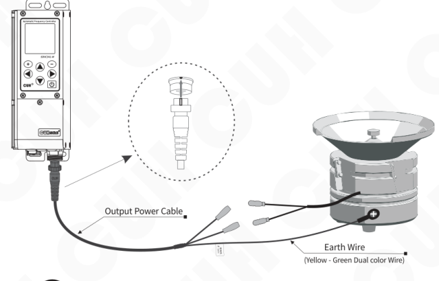

> **หมายเหตุ**
>
> 1. ตรวจสอบให้แน่ใจว่าขดลวดแม่เหล็กไฟฟ้าของเครื่องสั่นสะเทือนเชื่อมต่อกับขาสองขาของสายไฟเอาต์พุต และเปลือกโลหะของเครื่องสั่นสะเทือนต่อสายดินอย่างน่าเชื่อถือ
>
> 2. ห้ามเชื่อมต่อโหลดเพียโซอิเล็กทริกกับเอาต์พุตไฟโดยเด็ดขาด มิฉะนั้นอาจเกิดอุบัติเหตุด้านความปลอดภัยจากไฟฟ้าดูด!

---


---

### ขั้นตอนที่สาม:

เชื่อมต่อขั้วต่อของสายไฟเข้าเข้ากับช่องต่อไฟเข้าของตัวควบคุม

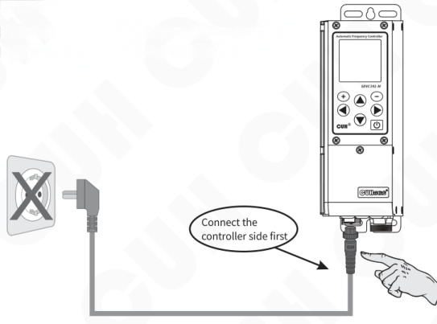

### ขั้นตอนที่สี่:

หลังจากยืนยันว่าสวิตช์อยู่ในตำแหน่งปิดแล้ว ให้เชื่อมต่อปลั๊กของสายไฟเข้ากับเต้ารับไฟหลัก


---


## 3.2 การใช้งานพื้นฐาน

### ขั้นตอนที่ห้า:

เปิดสวิตช์ไฟของตัวควบคุม ตัวควบคุมจะแสดงอินเทอร์เฟซหลัก

```text
RUN
A C D E F G N J     A0
─────────────────────
UserSped           200
P2.01
EffectCu          0.00
P10.05        A
+       Home       −
```

### ขั้นตอนที่หก:

เครื่องป้อนวัสดุแบบสั่นสะเทือนเริ่มทำงาน ปรับค่าพารามิเตอร์ความถี่และแรงดันในกลุ่มพารามิเตอร์ “2 Common” เพื่อเลือกความเร็วป้อนที่เหมาะสม

- กด ▲ และ ◀ ค้างเพื่อเข้าสู่อินเทอร์เฟซการตั้งค่าพารามิเตอร์ กด ▶ สั้น ๆ เพื่อสลับไปยังกลุ่มพารามิเตอร์ “2 Common”
- กด ▲ หรือ ▼ สั้น ๆ เพื่อวางเคอร์เซอร์บนค่าพารามิเตอร์แรงดัน
- กด ⊕ หรือ ⊖ เพื่อปรับค่าพารามิเตอร์
- กด ▲ หรือ ▼ สั้น ๆ เพื่อวางเคอร์เซอร์บนค่าพารามิเตอร์ความถี่
- กด ⊕ หรือ ⊖ เพื่อปรับค่าพารามิเตอร์

```text
RUN
A C D E F G N J     A0
─────────────────────
01.UserSped        200
02.UsrVoltg        150 V
03.UsrFrqnc       50.0 Hz
04.SoftStar        0.5 S
05.SoftStop        0.5 S
+      2Common      −
```

> ☺
>
> - ความถี่ที่การสั่นสะเทือนถึงค่าสูงสุดคือความถี่ธรรมชาติของตัวสั่นสะเทือน
> - เครื่องสั่นสะเทือนแต่ละเครื่องมีความถี่เรโซแนนซ์เชิงกลตามธรรมชาติของตัวเอง ปรับความถี่เอาต์พุตของตัวควบคุมให้เป็นความถี่นี้เพื่อให้ได้สภาวะการทำงานที่ดีที่สุด


### ขั้นตอนที่เจ็ด:

ลูกค้าสามารถเชื่อมต่อเซ็นเซอร์ความเร่งเพิ่มเติมเพื่อให้ตัวควบคุมค้นหาความถี่อัตโนมัติได้ (หมายเหตุ: ผู้ใช้ไม่จำเป็นต้องนำวัสดุออกจากจานสั่นทั้งหมด)

นำเซ็นเซอร์ออกมา เชื่อมต่อปลั๊กเซ็นเซอร์กับตัวควบคุมและขันน็อตให้แน่น จากนั้นยึดตัวเซ็นเซอร์บนจานสั่นให้ถูกต้อง (ดูบทที่ 2.3)

### ขั้นตอนที่แปด:

- กด ▲ และ ▼ ค้างเพื่อเข้าสู่อินเทอร์เฟซการค้นหาความถี่
- ในขณะนี้ หน้าจอจะแสดงเส้นโค้งแอมพลิจูดของจานสั่นในระหว่างกระบวนการค้นหาความถี่ (สามขั้นตอน) และแสดงค่าแรงดันเอาต์พุต กระแส และความเร่งในขณะนั้นพร้อมกัน
- หลังจากค้นหาความถี่เสร็จสิ้น ตัวควบคุมจะแสดง “Save” เพื่อบ่งชี้ว่าการค้นหาความถี่สำเร็จและบันทึกความถี่กลางแล้ว ตัวควบคุมจะกลับสู่หน้าหลักโดยอัตโนมัติ
- ผู้ใช้สามารถปรับความเร็วป้อนของเครื่องป้อนวัสดุแบบสั่นสะเทือนเพิ่มเติมได้ผ่าน ⊕ หรือ ⊖

| สถานะการแสดงผล | ตัวชี้วัด | ความถี่ | แรงดัน | กระแส | ความเร่ง | อินเทอร์เฟซ |
|---|---|---:|---:|---:|---:|---|
| RUN | A C D E F G N J A0 | 95Hz | 4V | 0.26A | 1.0g | SearchFr |
| RUN | A C D E F G N J A0 | 442Hz | 23V | 0.42A | 0.5g | SearchFr |
| RUN | A C D E F G N J A0 | 1033Hz | 54V | 0.46A | 0.3g | SearchFr |
| Save | A C D E F G N J A0 | 841Hz | 81V | 0.84A | 2.1g | SearchFr |

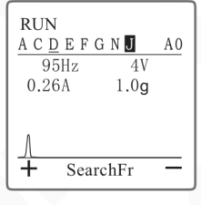

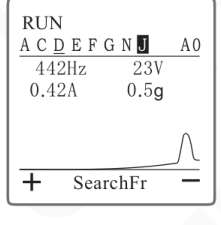

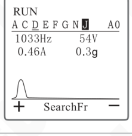

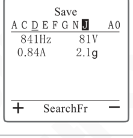


---

# บทที่ Ⅳ คำอธิบายฟังก์ชันโดยละเอียด

บทนี้แนะนำฟังก์ชันและการตั้งค่าอย่างละเอียดของตัวควบคุม  
กด ▲ และ ◀ ค้างเพื่อเข้าสู่อินเทอร์เฟซการตั้งค่าพารามิเตอร์จากอินเทอร์เฟซใดก็ได้  
อินเทอร์เฟซการตั้งค่าพารามิเตอร์ประกอบด้วยกลุ่มพารามิเตอร์สิบบทกลุ่มดังต่อไปนี้  
กด ◀ หรือ ▶ สั้น ๆ เพื่อสลับระหว่างกลุ่มพารามิเตอร์ต่าง ๆ

```text
                         1EditHome
                             ↕
                          2Common
                             ↕
                         3M_output
                             ↕
                         4Stabilize
                             ↕
Short press ▶            5On&Off              Short press ▶
                             ↕
                         6DCoutput
                             ↕
                          7Counter
                             ↕
                           8Comm
                             ↕
                           9Save
                             ↕
                          10Monitor
```

แผนภาพการหมุนของกลุ่มพารามิเตอร์

---


## 4.1 การตั้งค่าพารามิเตอร์ทั่วไป

บทนี้แนะนำการตั้งค่าและการปรับพารามิเตอร์ทั่วไปพื้นฐานของตัวควบคุมเป็นหลัก

### 4.1.1 แรงดัน

ตัวควบคุมนี้สามารถตั้งค่าแรงดันเอาต์พุตแบบดิจิทัลได้โดยตรงบนแผงควบคุม เนื่องจากตัวควบคุมมีฟังก์ชันเอาต์พุตปรับแรงดันให้คงที่ ค่านี้จึงเป็นค่าเฉลี่ยเรียงกระแสของแรงดันและจะไม่ได้รับผลกระทบจากแรงดันอินพุต แรงดันเอาต์พุตสามารถคงที่ได้แม้ในสถานการณ์ที่แรงดันไฟฟ้ากริดไม่เสถียร ในขณะเดียวกัน การตั้งค่าแรงดันโดยตรงยังให้ข้อมูลที่แม่นยำสำหรับผู้ใช้ในการเข้าใจการทำงานของอุปกรณ์

» เข้ากลุ่มพารามิเตอร์ทั่วไปและค้นหาพารามิเตอร์การตั้งค่าแรงดัน

» กด ⊕ หรือ ⊖ เพื่อปรับค่าพารามิเตอร์

ช่วงแรงดันคือ 0~250V ค่าเริ่มต้นคือ 150V ความแม่นยำในการปรับคือ 1V

```text
RUN
A C D E F G N J    A0
01.UserSped     200
02.UsrVoltg     150 V
03.UsrFrqnc     50.0 Hz
04.SoftStar       0.5 S
05.SoftStop       0.5 S
+    2Common       −
```

### 4.1.2 ความถี่

ตัวควบคุมใช้เทคโนโลยีการสังเคราะห์ความถี่ดิจิทัลโดยตรง (DDS) ซึ่งมีความแม่นยำและเสถียรภาพของความถี่สูงมาก และไม่เปลี่ยนแปลงตามเวลาและอุณหภูมิ

» เข้ากลุ่มพารามิเตอร์ทั่วไปและค้นหาพารามิเตอร์การตั้งค่าความถี่

» กด ⊕ หรือ ⊖ เพื่อปรับค่าพารามิเตอร์

ช่วงความถี่คือ 5.0~999.9Hz ค่าเริ่มต้นคือ 50.0Hz ความแม่นยำในการปรับคือ 0.1Hz

```text
RUN
A C D E F G N J    A0
01.UserSped     200
02.UsrVoltg     150 V
03.UsrFrqnc     50.0 Hz
04.SoftStar       0.5 S
05.SoftStop       0.5 S
+    2Common       −
```

พารามิเตอร์อื่น ๆ ของกลุ่มพารามิเตอร์นี้สามารถปรับได้ตามขั้นตอนข้างต้น


---

### 4.1.3 ความเร็วป้อน

**ความเร็วป้อน:** ความเร็วในการเคลื่อนที่ไปข้างหน้าของวัสดุในเครื่องป้อนวัสดุแบบสั่นสะเทือน เมื่อตัวควบคุมเชื่อมต่อกับเซ็นเซอร์ความเร่งและค่าพารามิเตอร์ “โหมดแรงดัน” เป็น “อัตโนมัติ” ความเร็วไปข้างหน้าของวัสดุสามารถปรับได้ผ่านพารามิเตอร์ความเร็วป้อน และจานสั่นสามารถทำงานได้อย่างเสถียรที่ความเร็วป้อนที่ตั้งไว้

ช่วงความเร็วป้อนคือ 0~3200 ค่าเริ่มต้นคือ 200 ความแม่นยำในการปรับคือ 1

### 4.1.4 เวลาสตาร์ทแบบนุ่มนวล/เวลาหยุดแบบนุ่มนวล

**เวลาสตาร์ทแบบนุ่มนวล:** เวลาที่ตัวควบคุมใช้ในการเพิ่มแรงดันเอาต์พุตอย่างราบรื่นจาก 0V ไปจนถึงแรงดันเอาต์พุตที่ตั้งไว้เมื่อเริ่มทำงานจากสภาวะหยุด

ช่วงเวลาสตาร์ทแบบนุ่มนวลคือ 0.0~40.0s ค่าเริ่มต้นคือ 0.5 วินาที ความแม่นยำในการปรับคือ 0.1 วินาที

**เวลาหยุดแบบนุ่มนวล:** เมื่อตัวควบคุมหยุดทำงาน แรงดันเอาต์พุตจะลดลงอย่างราบรื่นจากแรงดันเอาต์พุตที่ตั้งไว้จนถึง 0V ใช้เวลาตามที่กำหนด

ช่วงเวลาหยุดแบบนุ่มนวลคือ -0.1~40.0s ค่าเริ่มต้นคือ 0.5 วินาที ความแม่นยำในการปรับคือ 0.1 วินาที

เมื่อตัวควบคุมนี้เริ่มหรือหยุดทำงาน แรงดันเอาต์พุตสามารถเพิ่มหรือลดได้อย่างนุ่มนวลเพื่อป้องกันไม่ให้อุปกรณ์สั่นสะเทือนเสียหายจากการกระแทก

### 4.1.5 แรงดันสูงสุด/กระแสสูงสุด

**แรงดันสูงสุด:** ค่าแรงดันสูงสุดที่ตัวควบคุมส่งออก

ช่วงแรงดันสูงสุดคือ 0-250V ค่าเริ่มต้นคือ 220V ความแม่นยำในการปรับคือ 1V

**กระแสสูงสุด:** ค่ากระแสสูงสุดที่ตัวควบคุมส่งออก

ช่วงกระแสสูงสุดคือ 0.1~3.0A ค่าเริ่มต้นคือ 3.0A ความแม่นยำในการปรับคือ 0.1A

ตัวควบคุมนี้สามารถตั้งค่าขีดจำกัดแรงดันเอาต์พุตสูงสุดและกระแสเอาต์พุตสูงสุด ซึ่งสามารถป้องกันไม่ให้ผู้ใช้ทำให้อุปกรณ์สั่นสะเทือนเสียหายจากการส่งออกแรงดันหรือกระแสสูงเกินไปโดยไม่ตั้งใจ

### 4.1.6 ความถี่เอาต์พุตสูงสุด/ความถี่เอาต์พุตต่ำสุด

**ความถี่เอาต์พุตสูงสุด:** จำกัดค่าขีดจำกัดบนของพารามิเตอร์ “ความถี่” ขีดจำกัดความถี่บนระหว่างการค้นหาความถี่ก็ถูกจำกัดด้วยค่าพารามิเตอร์นี้เช่นกัน

ช่วงความถี่เอาต์พุตสูงสุดคือ 5.0~999.9Hz ค่าเริ่มต้นคือ 400.0Hz ความแม่นยำในการปรับคือ 0.1Hz

**ความถี่เอาต์พุตต่ำสุด:** จำกัดค่าขีดจำกัดล่างของพารามิเตอร์ “ความถี่” ขีดจำกัดความถี่ล่างระหว่างการค้นหาความถี่ก็ถูกจำกัดด้วยค่าพารามิเตอร์นี้เช่นกัน

ช่วงความถี่เอาต์พุตต่ำสุดคือ 5.0~999.9Hz ค่าเริ่มต้นคือ 40.0Hz ความแม่นยำในการปรับคือ 0.1Hz

**หมายเหตุ:** ความแตกต่างระหว่างความถี่เอาต์พุตสูงสุดและความถี่เอาต์พุตต่ำสุดต้องไม่น้อยกว่า 50.0Hz

---


---

### 4.1.7 การตรวจจับโหลด

ตัวควบคุมสามารถตรวจจับค่าความเหนี่ยวนำ ค่าความต้านทาน กระแสอิ่มตัว ฯลฯ ของเครื่องป้อนวัสดุแบบสั่นสะเทือนที่เป็นโหลดได้ หลังจากใช้ฟังก์ชันการตรวจจับโหลดแล้ว ผู้ใช้สามารถดูค่าที่วัดได้ที่เกี่ยวข้องกับโหลดในกลุ่มพารามิเตอร์การตรวจสอบ ค่าเริ่มต้นคือ None

| พารามิเตอร์ | ความหมาย |
|---|---|
| None | ยังไม่ได้ตรวจจับ |
| Valid | เริ่มการทดสอบ (สลับเป็นสถานะไม่ทำงานโดยอัตโนมัติหลังจากเสร็จสิ้นและจะไม่ทดสอบอีก) |

### 4.1.8 การแจ้งเตือนวัสดุขาดแคลน

เมื่อตัวควบคุมเชื่อมต่อกับเซ็นเซอร์ความเร่งและค่าพารามิเตอร์ “โหมดแรงดัน” และ “โหมดความถี่” เป็น “อัตโนมัติ” ทั้งคู่ ฟังก์ชันแจ้งเตือนวัสดุขาดแคลนจะเปิดใช้งาน ผู้ใช้สามารถดูพารามิเตอร์ “การแจ้งเตือนวัสดุขาดแคลน” ในกลุ่มพารามิเตอร์การตรวจสอบเมื่อเครื่องป้อนวัสดุแบบสั่นสะเทือนว่างเปล่าหรือมีวัสดุน้อย และในขณะเดียวกัน ให้กด <kbd>+</kbd> และ <kbd>−</kbd> ค้างเพื่อบันทึกค่าที่วัดได้ของ “การแจ้งเตือนวัสดุขาดแคลน” ในกลุ่มพารามิเตอร์การตรวจสอบ แล้วอ้างอิงค่าที่วัดได้เพื่อตั้งค่าการแจ้งเตือนของ “การแจ้งเตือนวัสดุขาดแคลน” นอกจากนี้ยังสามารถปรับค่าการแจ้งเตือนเพิ่มเติมได้ผ่าน <kbd>+</kbd> หรือ <kbd>−</kbd>

เมื่อตัวควบคุมตรวจพบว่าค่าที่วัดได้ของเครื่องป้อนวัสดุแบบสั่นสะเทือนต่ำกว่าค่าการแจ้งเตือน ระบบจะเรียกใช้ฟังก์ชันการแจ้งเตือน

ช่วงการแจ้งเตือนวัสดุขาดแคลนคือ 0~3000 ค่าเริ่มต้นคือ 10 ความแม่นยำในการปรับคือ 1

หมายเหตุ: ผู้ใช้สามารถใช้สัญญาณการแจ้งเตือนเป็นแหล่งสัญญาณเอาต์พุตหลักหรือเอาต์พุตพอร์ต D เพื่อขับเคลื่อนสถานะเอาต์พุตต่าง ๆ ของตัวควบคุมได้

### 4.1.9 การแจ้งเตือนการปิดเครื่อง

**การแจ้งเตือนการปิดเครื่อง:** เมื่อตัวควบคุมหยุดส่งออก ตัวควบคุมจะส่งเสียงแจ้งเตือนแบบต่าง ๆ โดยขับเคลื่อนเครื่องป้อนวัสดุแบบสั่นสะเทือน ซึ่งใช้สำหรับแจ้งเตือนการปิดเครื่องแก่ผู้ใช้ในสภาพแวดล้อมที่มีเสียงดัง สามารถเลือกเอฟเฟกต์เสียงได้สามแบบหรือปิดใช้งาน (ไม่มีเสียง) ค่าเริ่มต้นคือ None

| พารามิเตอร์ | ความหมาย |
|---|---|
| None | ปิดใช้งาน |
| Sound 1 | ขับเคลื่อนจานสั่นให้ส่งเสียงแจ้งเตือนเอฟเฟกต์เสียง 1 |
| Sound 2 | ขับเคลื่อนจานสั่นให้ส่งเสียงแจ้งเตือนเอฟเฟกต์เสียง 2 |
| Sound 3 | ขับเคลื่อนจานสั่นให้ส่งเสียงแจ้งเตือนเอฟเฟกต์เสียง 3 |

### 4.1.10 ความสว่างของไฟพื้นหลัง

**ความสว่างของไฟพื้นหลัง:** นั่นคือความสว่างของไฟพื้นหลังของจอแสดงผลตัวควบคุม ความสว่างของไฟพื้นหลังของจอแสดงผลสามารถปรับได้เพื่อให้เหมาะกับสภาพแสงแวดล้อมที่แตกต่างกัน

ช่วงความสว่างของไฟพื้นหลังคือ 20~100 ค่าเริ่มต้นคือ 100 ความแม่นยำในการปรับคือ 1

---


### 4.1.11 การปิดไฟพื้นหลัง

**การปิดไฟพื้นหลัง:** นั่นคือเวลาปิดไฟพื้นหลัง เมื่อตัวควบคุมไม่มีการดำเนินการใด ๆ เป็นระยะเวลาหนึ่ง ตัวควบคุมจะปิดไฟพื้นหลังของหน้าจอ สามารถเปิดไฟพื้นหลังของหน้าจออีกครั้งได้โดยการกดปุ่มใด ๆ

ช่วงการปิดไฟพื้นหลังคือ 1-30 นาที ค่าเริ่มต้นคือ 5 นาที ความแม่นยำในการปรับคือ 1 นาที เมื่อตั้งค่าเป็น 31 หมายถึงสว่างตลอดเวลา

### 4.1.12 ภาษา

**ภาษา:** นั่นคือภาษาที่แสดงบนแผงควบคุมการทำงานของตัวควบคุม ตัวควบคุมมีภาษาที่สร้างไว้ในตัวสามภาษา: จีน อังกฤษ และเยอรมัน ทำให้ผู้ใช้ในภูมิภาคต่าง ๆ สลับใช้งานได้ง่าย ค่าเริ่มต้นคือ Englis

| พารามิเตอร์ | ความหมาย |
|---|---|
| Englis | อินเทอร์เฟซภาษาอังกฤษ |
| Chines | อินเทอร์เฟซภาษาจีน |
| German | อินเทอร์เฟซภาษาเยอรมัน |

## 4.2 การค้นหาความถี่เรโซแนนซ์อัตโนมัติ

บทนี้แนะนำวิธีการระบุตำแหน่งความถี่เรโซแนนซ์ของจานสั่นอย่างรวดเร็วในอินเทอร์เฟซการค้นหาความถี่ของผลิตภัณฑ์นี้ และทำให้จานสั่นทำงานได้

### 4.2.1 อินเทอร์เฟซการค้นหาความถี่

เมื่อเซ็นเซอร์ความเร่งเชื่อมต่อกับจานสั่นอย่างถูกต้อง และ “โหมดแรงดัน” กับ “โหมดความถี่” ถูกตั้งเป็น “อัตโนมัติ” ทั้งคู่ ผู้ใช้สามารถระบุตำแหน่งค่าความถี่เรโซแนนซ์ของเครื่องป้อนวัสดุแบบสั่นสะเทือนได้อย่างรวดเร็วโดยเข้าสู่อินเทอร์เฟซการค้นหาความถี่

ขั้นตอนการใช้งานให้ดูตามขั้นตอนที่แปดในบทที่ 3.2


---

## 4.3 ความเร็วป้อนคงที่

บทนี้แนะนำวิธีตั้งค่าพารามิเตอร์ที่เกี่ยวข้องของตัวควบคุมและรักษาฟังก์ชันต่าง ๆ ให้ตัวควบคุมทำงานได้อย่างราบรื่นเป็นหลัก

### 4.3.1 ความถี่กลาง

ช่วงความถี่ที่ตัวควบคุมสามารถปรับได้อัตโนมัติคือ “ความถี่กลาง” ± “ออฟเซ็ตความถี่” ควรปรับความถี่กลางให้อยู่ใกล้จุดเรโซแนนซ์ของอุปกรณ์สั่นสะเทือน เพื่อให้ตัวควบคุมสามารถปรับไปยังจุดทำงานที่ดีที่สุดได้อย่างรวดเร็วที่สุดเมื่อปรับความถี่อัตโนมัติ

> » กด ▲ และ ◀ ค้างเพื่อเข้าสู่อินเทอร์เฟซการตั้งค่าพารามิเตอร์ กด ▶ สั้น ๆ เพื่อสลับไปยังกลุ่มพารามิเตอร์ “4 Stabilize”
>
> » กด ▲ หรือ ▼ สั้น ๆ เพื่อสลับไปยังพารามิเตอร์ความถี่กลาง
>
> » กด ⊕ หรือ ⊖ เพื่อปรับค่าพารามิเตอร์
>
> ```text
> RUN
> A C D E F G N J    A0
> 01.AutFCent 100.0 Hz
> 02.AutFRang  30.0 Hz
> 03.AutFIntg    20
> 04.AutAIntg   250
> 05.AutAProp   500
> +   4Stabilize   -
> ```
>
> ช่วงความถี่กลางคือ 5.0~999.9Hz ค่าเริ่มต้นคือ 100.0Hz ความแม่นยำในการปรับคือ 0.1Hz

พารามิเตอร์อื่น ๆ ของกลุ่มพารามิเตอร์นี้สามารถปรับได้ตามขั้นตอนข้างต้น

### 4.3.2 ออฟเซ็ตความถี่

ช่วงความถี่ที่ตัวควบคุมสามารถปรับได้อัตโนมัติคือ “ความถี่กลาง” ± “ออฟเซ็ตความถี่” ค่านี้ใช้เพื่อกำหนดช่วงการค้นหาความถี่อัตโนมัติที่ค่อนข้างเล็ก โดยทั่วไปค่าออฟเซ็ตความถี่จะอยู่ที่ประมาณ 30.0Hz หากมากเกินไป อุปกรณ์สั่นสะเทือนอาจทำงานที่จุดทำงานที่ไม่เหมาะสม และหากน้อยเกินไปอาจลดความสามารถในการปรับตัวของอุปกรณ์สั่นสะเทือน

ช่วงออฟเซ็ตความถี่คือ 0.0~180.0Hz ค่าเริ่มต้นคือ 30.0Hz ความแม่นยำในการปรับคือ 0.1Hz

### 4.3.3 ค่าอินทิกรัลความถี่

ตัวควบคุมใช้วิธี PID ในการปรับความถี่เอาต์พุตอัตโนมัติ ยิ่งค่านี้มาก ตัวควบคุมจะปรับความถี่เอาต์พุตได้เร็วขึ้น แต่หากมากเกินไปอาจทำให้ความถี่เอาต์พุตแกว่ง

ช่วงค่าอินทิกรัลความถี่คือ 0-2000 ค่าเริ่มต้นคือ 20 ความแม่นยำในการปรับคือ 1

---


---

### 4.3.4 ค่าอินทิกรัลแอมพลิจูด

ตัวควบคุมใช้การควบคุม PID ในการปรับแรงดันเอาต์พุตอัตโนมัติ ยิ่งค่านี้มาก ตัวควบคุมจะปรับแรงดันเอาต์พุตได้เร็วขึ้นและลดแอมพลิจูดและความถี่ของการแกว่งของแรงดันเอาต์พุต อย่างไรก็ตาม หากมากเกินไป แอมพลิจูดการแกว่งของแรงดันเอาต์พุตจะใหญ่ขึ้น

ช่วงค่าอินทิกรัลแอมพลิจูดคือ 0~9999 ค่าเริ่มต้นคือ 250 ความแม่นยำในการปรับคือ 1

### 4.3.5 อัตราส่วนแอมพลิจูด

ตัวควบคุมใช้การควบคุม PID ในการปรับแรงดันเอาต์พุตอัตโนมัติ ยิ่งค่านี้มาก ตัวควบคุมจะปรับแรงดันเอาต์พุตได้เร็วขึ้น แต่หากมากเกินไปจะทำให้แรงดันเอาต์พุตแกว่งบ่อยครั้ง

ช่วงอัตราส่วนแอมพลิจูดคือ 0~9999 ค่าเริ่มต้นคือ 500 ความแม่นยำในการปรับคือ 1

### 4.3.6 เฟสอัตโนมัติ

พารามิเตอร์นี้สามารถแก้ไขความต่างเฟสระหว่างรูปคลื่นกระแสเอาต์พุตกับสัญญาณความเร่งของเซ็นเซอร์ความเร่งได้

ช่วงเฟสอัตโนมัติคือ -180 °~180 ° ค่าเริ่มต้นคือ 0 ° ความแม่นยำในการปรับคือ 1 °

### 4.3.7 กระแสระหว่างกระบวนการค้นหาความถี่

ตั้งค่ากระแสเอาต์พุตสูงสุดของตัวควบคุมระหว่างการค้นหาความถี่อัตโนมัติ เพื่อให้กระแสเอาต์พุตจริงของจานสั่นไม่เกินกระแสการค้นหาความถี่ที่ตั้งไว้

ช่วงกระแสการค้นหาความถี่คือ 1.0~6.0A ค่าเริ่มต้นคือ 3.0A ความแม่นยำในการปรับคือ 0.1A

### 4.3.8 แอมพลิจูดระหว่างกระบวนการค้นหาความถี่

แอมพลิจูดสูงสุดของตัวควบคุมจะไม่เกินค่านี้ระหว่างการค้นหาความถี่อัตโนมัติ เพื่อปกป้องความปลอดภัยของอุปกรณ์สั่นสะเทือน

ช่วงแอมพลิจูดการค้นหาความถี่คือ 0~3200 ค่าเริ่มต้นคือ 200 ความแม่นยำในการปรับคือ 1

### 4.3.9 ความเร็วป้อนสูงสุด

ตั้งค่าพารามิเตอร์นี้เพื่อจำกัดความเร็วป้อนสูงสุดที่สามารถปรับได้ เพื่อป้องกันไม่ให้ผู้ใช้ส่งออกแรงดันสูงเกินไปโดยไม่ตั้งใจและทำให้อุปกรณ์สั่นสะเทือนเสียหาย เมื่อใช้การควบคุมความเร็วระยะไกล ขีดจำกัดบนของความเร็วป้อนก็ได้รับผลกระทบจากพารามิเตอร์นี้เช่นกัน

ช่วงความเร็ววัสดุสูงสุดคือ 0-4000 ค่าเริ่มต้นคือ 3200 ความแม่นยำในการปรับคือ 1

### 4.3.10 ออฟเซ็ตเฟสของตัวควบคุมทาส

เฟสแมนนวลหมายความว่าเฟสของรูปคลื่นเอาต์พุตของตัวควบคุมทาสสามารถตั้งค่าได้ด้วยตนเองให้มีค่าความเบี่ยงเบนเฟสคงที่จากสัญญาณซิงโครไนซ์ที่ส่งออกโดยตัวควบคุมมาสเตอร์

ช่วงเฟสแมนนวลคือ -180 °~180 ° ค่าเริ่มต้นคือ 0 ° ความแม่นยำในการปรับคือ 1 °

---


### 4.3.11 โหมดควบคุมแรงดันเอาต์พุต

พารามิเตอร์นี้ใช้เพื่อสลับโหมดการส่งออกแรงดันของตัวควบคุมเพื่อให้ได้รูปแบบการควบคุมเอาต์พุตที่แตกต่างกัน ค่าเริ่มต้นคือ Auto

| พารามิเตอร์ | ความหมาย |
|---|---|
| Manuel | แรงดันเอาต์พุตถูกควบคุมด้วยค่าพารามิเตอร์ “แรงดัน” หรือด้วยอินพุตแอนะล็อก DC ของการควบคุมความเร็วระยะไกล |
| Auto | เมื่อเซ็นเซอร์ความเร่งเชื่อมต่อกับตัวควบคุมอย่างถูกต้อง ตัวควบคุมจะปรับแรงดันเอาต์พุตอัตโนมัติตามข้อมูลป้อนกลับจากเซ็นเซอร์สั่นสะเทือน เพื่อให้มั่นใจว่าความเร็วป้อนของอุปกรณ์สั่นสะเทือนคงที่ที่ค่า “ความเร็วป้อน” |

### 4.3.12 โหมดควบคุมความถี่เอาต์พุต

พารามิเตอร์นี้ใช้เพื่อสลับโหมดเอาต์พุตความถี่ของตัวควบคุม ค่าเริ่มต้นคือ Auto

| พารามิเตอร์ | ความหมาย |
|---|---|
| Manuel | ความถี่เอาต์พุตถูกควบคุมด้วยค่าพารามิเตอร์ “ความถี่” |
| Auto | เมื่อเซ็นเซอร์ความเร่งเชื่อมต่อกับตัวควบคุมอย่างถูกต้อง ตัวควบคุมจะปรับความถี่เอาต์พุตอัตโนมัติตามข้อมูลป้อนกลับจากเซ็นเซอร์สั่นสะเทือน เพื่อให้ความถี่การสั่นสะเทือนอยู่ที่ความถี่การทำงานที่เหมาะสมที่สุดของอุปกรณ์สั่นสะเทือน |
| SynV | การซิงโครไนซ์ความถี่ การซิงโครไนซ์เฟสเซ็นเซอร์สั่นสะเทือน |
| SynE | การซิงโครไนซ์ความถี่ การซิงโครไนซ์เฟสกระแสเอาต์พุตหลัก |

### 4.3.13 แหล่งสัญญาณซิงโครไนซ์

เมื่อผู้ใช้เลือกโหมดความถี่เป็นแมนนวลหรืออัตโนมัติ พารามิเตอร์นี้ใช้เพื่อเลือกแหล่งสัญญาณซิงโครไนซ์ของอุปกรณ์ ค่าเริ่มต้นคือ None

| พารามิเตอร์ | ความหมาย |
|---|---|
| None | ไม่ซิงโครไนซ์ |
| PhaseV | ซิงโครไนซ์เฟสเซ็นเซอร์สั่นสะเทือน |
| PhaseE | ซิงโครไนซ์เฟสกระแสเอาต์พุตหลัก |

### 4.3.14 ประเภทเซ็นเซอร์สั่นสะเทือน

ตัวควบคุมรองรับเซ็นเซอร์สั่นสะเทือนที่มีช่วงการวัดแตกต่างกัน ที่ความเร็วป้อนเดียวกัน แรงดันเอาต์พุตของเซ็นเซอร์สั่นสะเทือนในช่วงที่ต่างกันจะแตกต่างกันสำหรับตัวควบคุม ผู้ใช้ควรตั้งค่าพารามิเตอร์นี้ตามรุ่นเซ็นเซอร์สั่นสะเทือนจริง ค่าเริ่มต้นคือ 205

| พารามิเตอร์ | รุ่นที่สอดคล้อง | ข้อมูลจำเพาะ ความเร่งแกน X/แกน Y/แกน Z |
|---|---|---|
| 20-1 | 16g | 16g/16g/16g |
| 20-2 | 35g | 35g/35g/—— |
| 20-3 | 50g | 50g/50g/—— |
| 20-4 | 70g | 70g/70g/—— |
| 203 | 8g | 8g/8g/8g |
| 204 | 16g | 16g/16g/16g |
| 205 | 32g | 32g/32g/32g |
| 206 | 64g | 64g/64g/64g |

### 4.3.15 ความเร็วการค้นหาความถี่เรโซแนนซ์อัตโนมัติ

ตัวควบคุมรองรับความเร็วในการค้นหาความถี่ 6 ระดับ จากช้าไปเร็ว โดยมีค่าตั้งแต่ 0 ถึง 5 ความเร็วในการค้นหาเริ่มต้นคือ 3


---

## 4.4 พารามิเตอร์เอาต์พุต

บทนี้ใช้เพื่อแนะนำการตั้งค่าและการใช้งานพารามิเตอร์เอาต์พุตหลักและพารามิเตอร์เอาต์พุตควบคุมของตัวควบคุม เพื่อให้ได้ฟังก์ชันเอาต์พุตในอุดมคติของตัวควบคุม

### 4.4.1 พารามิเตอร์เอาต์พุตหลัก

ส่วนนี้แนะนำการตั้งค่าพารามิเตอร์เอาต์พุตหลักของตัวควบคุมเป็นหลัก

> » กด ▲ และ ◀ ค้างเพื่อเข้าสู่อินเทอร์เฟซการตั้งค่าพารามิเตอร์ กด ▶ สั้น ๆ เพื่อสลับไปยังกลุ่มพารามิเตอร์ “3 M_output”
>
> » กด ▲ หรือ ▼ สั้น ๆ เพื่อสลับพารามิเตอร์ในกลุ่มพารามิเตอร์เอาต์พุตหลัก
>
> » กด ⊕ หรือ ⊖ เพื่อปรับค่าพารามิเตอร์
>
> การแสดงผลของตัวควบคุม:
>
> ```text
> RUN
> A C D E F G N J    A0
> 01.MainLogc        On
> 02.MainSor1        In_PtC
> 03.MainSor1        In_PtE
> 04.MainUpDy        0.2 S
> 05.MainDnDy        0.2 S
> +   3M_output      −
> ```

พารามิเตอร์อื่น ๆ ของกลุ่มพารามิเตอร์นี้สามารถปรับได้ตามขั้นตอนข้างต้น

### 4.4.1.1 แหล่งสัญญาณหลัก 1/แหล่งสัญญาณหลัก 2

“แหล่งสัญญาณหลัก 1” และ “แหล่งสัญญาณหลัก 2” หมายถึง “สัญญาณแหล่งลอจิกหลัก 1” และ “สัญญาณแหล่งลอจิกหลัก 2” คุณสามารถตั้งค่าสัญญาณแหล่งลอจิกเอาต์พุตหลักได้ผ่านพารามิเตอร์ทั้งสองนี้ แหล่งสัญญาณหลัก 1 และแหล่งสัญญาณหลัก 2 เป็นตัวอักษร สัญญาณจะผ่านการตัดสินประเภทสัญญาณของพอร์ตก่อน จากนั้นผ่านการตัดสินทิศทางลอจิก และสุดท้ายหลังจากผ่านการหน่วงเปิดและหน่วงปิด จึงกลายเป็นสัญญาณผลลัพธ์แหล่งลอจิกเอาต์พุตหลัก 1/2

---


---

แผนภาพการไหลของสัญญาณมีดังนี้:

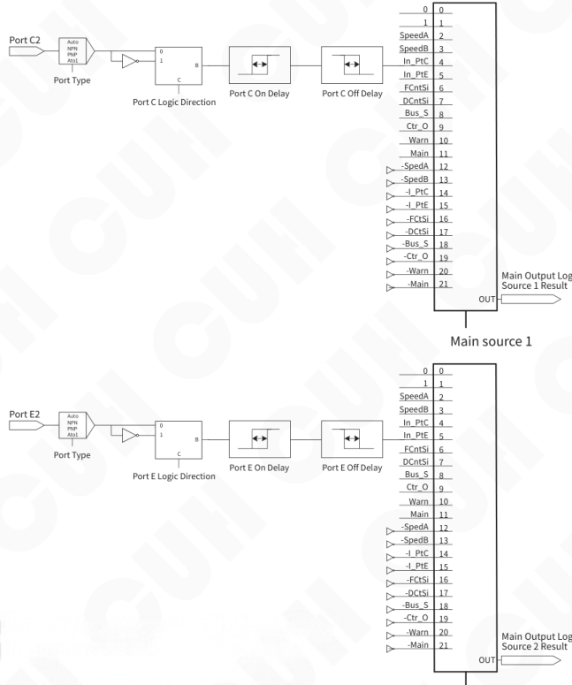

สำหรับตัวเลือกแหล่งสัญญาณของแหล่งสัญญาณหลัก ½,  
โปรดดูบทที่ 7.4.11 ภาคผนวก

**รูปที่ 4.4.1.1**

หมายเหตุ: สถานะเอาต์พุตหลักยังถูกควบคุมโดยปุ่มเริ่ม/หยุดหรือโดยตัวควบคุมเองว่าอยู่ในสถานะผิดพลาดหรือไม่ ระดับการควบคุมความผิดพลาดของปุ่มเริ่ม/หยุดหรือตัวควบคุมเองนั้นสูงกว่าระดับของสัญญาณลอจิกเอาต์พุตหลัก กล่าวคือ เมื่อปุ่มเริ่ม/หยุดถูกตั้งเป็นหยุด ตัวควบคุมจะเข้าสู่สถานะหยุดทันที เมื่อเกิดความผิดพลาด เช่น ไฟฟ้าลัดวงจร อุณหภูมิเกิน กระแสเกิน เป็นต้น ตัวควบคุมก็จะเข้าสู่สถานะหยุดทันทีเช่นกัน ในเวลานี้สัญญาณลอจิกเอาต์พุตหลักไม่สามารถเปิดเอาต์พุตหลักของตัวควบคุมได้

---


## 4.4.1.2 ลอจิกหลัก

ผลลัพธ์แหล่งลอจิกเอาต์พุตหลัก 1 และผลรวมของแหล่งลอจิกเอาต์พุตหลัก 2 หลังจากดำเนินการทางลอจิกผ่านลอจิกเอาต์พุตหลัก จะผ่านทิศทางเอาต์พุตหลัก จากนั้นผ่านการหน่วงเปิดและหน่วงปิดของเอาต์พุตหลัก และสุดท้ายผ่านโหมดเอาต์พุตหลัก ใช้เพื่อขับเคลื่อนสถานะเริ่ม/หยุดของเอาต์พุตหลัก

แผนภาพการไหลของสัญญาณมีดังนี้:

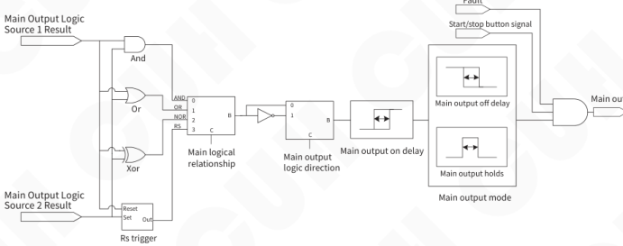

**รูปที่ 4.4.1.2**

ตัวควบคุมนี้สามารถตั้งค่าตารางความสัมพันธ์ทางลอจิกระหว่างแหล่งสัญญาณหลัก (ลอจิก) 1 และแหล่งสัญญาณหลัก 2 ได้ดังนี้ ค่าเริ่มต้นคือ Or

| พารามิเตอร์ | ความหมาย |
|---|---|
| And | ลอจิก AND เอาต์พุตมีผลเมื่อทั้งแหล่งสัญญาณหลัก 1 และแหล่งสัญญาณหลัก 2 มีผล |
| Or | ลอจิก OR เอาต์พุตมีผลเมื่อแหล่งสัญญาณหลัก 1 หรือแหล่งสัญญาณหลัก 2 อย่างน้อยหนึ่งตัวมีผล |
| Xor | ลอจิก XOR มีผลเมื่อแหล่งสัญญาณหลัก 1 และแหล่งสัญญาณหลัก 2 อยู่ในสถานะที่แตกต่างกัน มิฉะนั้นจะไม่มีผล |
| RS | ฟลิปฟล็อป RS |

## 4.4.1.3 ทิศทางหลัก

นั่นคือ ทิศทางลอจิกเอาต์พุตหลัก สามารถตั้งทิศทางเอาต์พุตที่เฉพาะเจาะจงได้หลังจากสัญญาณถูกรวมทางลอจิก สำหรับแผนภาพการไหลของสัญญาณ โปรดดูรูปที่ 4.4.1.2 ค่าเริ่มต้นคือ Const

| พารามิเตอร์ | ความหมาย |
|---|---|
| Const | สถานะหลังการดำเนินการทางลอจิกของเอาต์พุตหลักจะไม่ถูกกลับด้าน และเป็นสถานะปกติโดยค่าเริ่มต้น |
| Inv | สถานะจะถูกกลับด้านหลังการดำเนินการทางลอจิกของเอาต์พุตหลัก |
| On | สถานะคงอยู่ที่กำลังทำงานหลังการดำเนินการทางลอจิกของเอาต์พุตหลัก |
| Off | สถานะหยุดตลอดเวลาหลังการดำเนินการทางลอจิกของเอาต์พุตหลัก |


## 4.4.1.4 การหน่วงเปิดหลัก/การหน่วงปิดหลัก

เมื่อใช้สัญญาณภายนอกอื่น ๆ เช่น เซ็นเซอร์ เพื่อควบคุมสถานะเอาต์พุตหลักของอุปกรณ์ ในกรณีส่วนใหญ่จำเป็นต้องมีความหน่วงหลังจากให้สัญญาณหรือสัญญาณกลับคืนมาก่อนจึงจะสามารถดำเนินการได้ สำหรับการใช้งานดังกล่าว สามารถทำได้โดยการตั้งค่าเวลาของการหน่วงเปิดและการหน่วงปิด สำหรับแผนภาพการไหลของสัญญาณ โปรดดูรูปที่ 4.4.1.2

**การหน่วงเปิดหลัก:** นั่นคือ การหน่วงเปิดของเอาต์พุตหลัก คือเวลาหน่วงที่เกิดขึ้นจากการให้สัญญาณควบคุมที่ทำให้ตัวควบคุมเข้าสู่สถานะกำลังทำงาน ไปจนถึงการเริ่มเอาต์พุตจริงของตัวควบคุม เวลาหน่วงที่เกิดขึ้นในช่วงนี้เรียกว่าการหน่วงเปิด

**การหน่วงปิดหลัก:** นั่นคือ การหน่วงปิดของเอาต์พุตหลัก เริ่มจากการให้สัญญาณควบคุมที่ทำให้ตัวควบคุมเข้าสู่สถานะหยุด ไปจนถึงการหยุดเอาต์พุตจริงของตัวควบคุม เวลาหน่วงที่เกิดขึ้นในช่วงนี้เรียกว่าการหน่วงปิด

ช่วงการหน่วงเปิด/ปิดหลักคือ 0.0~99.9s ค่าเริ่มต้นคือ 0.2s และความแม่นยำในการปรับคือ 0.1s

## 4.4.1.5 โหมดหลัก

มีโหมดเอาต์พุตหลักให้เลือก 2 โหมด ได้แก่ โหมดหน่วงและโหมดคงค้าง แผนภาพการไหลของสัญญาณอ้างอิงรูปที่ 4.4.1.2 ค่าเริ่มต้นคือ Delay

| พารามิเตอร์ | ความหมาย |
|---|---|
| Delay | หมายถึงสถานะของเอาต์พุตหลักหลังการดำเนินการทางลอจิก สถานะของการขับเคลื่อนเอาต์พุตหลักหลังจากผ่านการหน่วงเปิดและหน่วงปิด |
| Hold | หมายถึงสถานะหลังการดำเนินการทางลอจิกของเอาต์พุตหลัก หลังจากผ่านการหน่วงเปิด สถานะกำลังทำงานจะคงอยู่ตามเวลาของการหน่วงปิด แล้วเปลี่ยนเป็นสถานะหยุดเอาต์พุตทันที |

ความแตกต่างระหว่างสองโหมดแสดงในรูปแบบของแผนภาพไทม์มิ่งดังนี้ โดยสัญญาณอินพุตคือการเลือกความสัมพันธ์ทางลอจิก

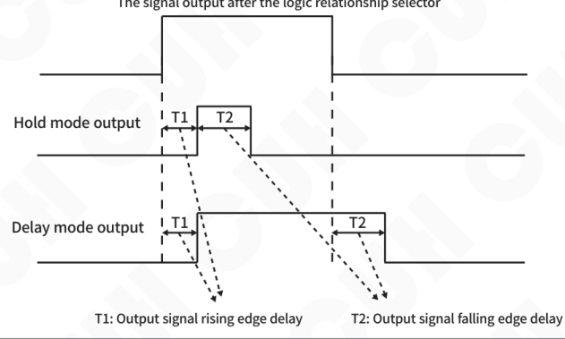


---

### 4.4.1.6 ดัชนีรูปคลื่น

พารามิเตอร์นี้ช่วยให้ตัวควบคุมสร้างสมดุลระหว่างประสิทธิภาพสูงสุด กำลังสูงสุด และเสียงรบกวนต่ำสุด เพื่อตอบสนองความต้องการที่สูงขึ้นของลูกค้า

ช่วงของดัชนีรูปคลื่นคือ 50~100 ค่าเริ่มต้นคือ 100 และความแม่นยำในการปรับคือ 1

**หมายเหตุ:**

1. เมื่อดัชนีรูปคลื่นเป็น 50 จะมีประสิทธิภาพสูงสุดและความเค้นบนสปริงน้อยที่สุด
2. เมื่อค่าเป็น 100 จะได้กำลังเอาต์พุตพิกัดสูงสุดและเสียงรบกวนต่ำสุด แต่สปริงจะรับความเค้นที่มากกว่า

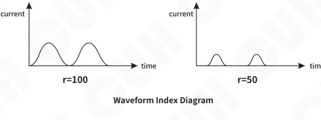

### 4.4.1.7 กระแส DC

เอาต์พุตขับเคลื่อนของตัวควบคุมสามารถตั้งค่าให้ซ้อนทับองค์ประกอบกระแส DC บนพื้นฐานของกระแสไซน์ได้

ช่วงกระแส DC คือ 0.0~2.00A ค่าเริ่มต้นคือ 0.10A และความแม่นยำในการปรับคือ 0.01A

### 4.4.1.8 สถานะเมื่อเปิดเครื่อง

ตั้งค่าสถานะการทำงานของตัวควบคุมหลังจากเปิดเครื่อง ค่าเริ่มต้นคือ On

| พารามิเตอร์ | ความหมาย |
|---|---|
| On | หลังจากอุปกรณ์เปิดเครื่อง สถานะของปุ่มสวิตช์คือกำลังทำงาน |
| Off | หลังจากอุปกรณ์เปิดเครื่อง สถานะของปุ่มสวิตช์คือหยุด |
| Keep | หลังจากอุปกรณ์เปิดเครื่อง สถานะของปุ่มสวิตช์คงเดิมเหมือนก่อนปิดเครื่องครั้งล่าสุด |

---


#### 4.4.1.9 แหล่งควบคุมระยะไกล

แรงดันเอาต์พุตและความเร็วป้อนของตัวควบคุมสามารถแก้ไขได้ผ่านพารามิเตอร์บนแผง หรือควบคุมโดยตรงผ่านขนาดของสัญญาณอินพุตแหล่งควบคุมระยะไกล วิธีการควบคุมที่เลือกได้ ได้แก่: แผง, อินพุต DC 4-20mA, อินพุต DC 1-5V, อินพุต DC 0-5V, อินพุต DC 0-10V รวมถึงสัญญาณบัสซิงโครไนซ์ดิจิทัล ค่าเริ่มต้นคือ Panel

**การเชื่อมต่อควบคุมด้วยโพเทนชิโอมิเตอร์**

คำแนะนำ: โปรดใช้โพเทนชิโอมิเตอร์แบบเชิงเส้น 1K

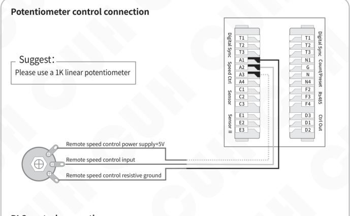

**การเชื่อมต่อควบคุมด้วย PLC**

- อินพุต DC 1~5V/0~5V/0~10V
- อินพุต DC 4~20mA

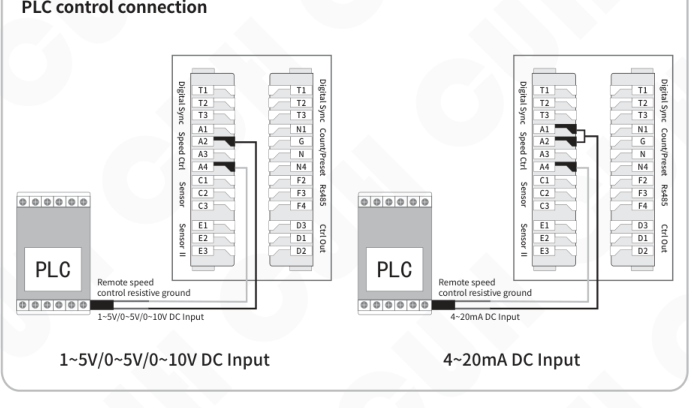


| สัญญาณควบคุมระยะไกล | สัญญาณควบคุมระยะไกล | แรงดันเอาต์พุต/ความเร็วป้อน |
|---|---|---|
| Panel |  | แรงดันเอาต์พุตและความเร็วป้อนไม่ถูกควบคุมด้วยสัญญาณควบคุมระยะไกล |
| 20mA | <2mA | เมื่อโหมดแรงดันเป็น Manuel แรงดันเอาต์พุต = 0<br>เมื่อโหมดแรงดันเป็น Auto ความเร็วป้อน = 0<br>LCD แสดงข้อมูลข้อผิดพลาด “Remote control undervoltage” |
|  | 2mA~4mA | แรงดันเอาต์พุต = 0, ความเร็วป้อน = 0 |
|  | 4mA~20mA | ควบคุมตามสัดส่วนด้วยสัญญาณควบคุมระยะไกล（0%~100%）<br>เมื่อโหมดแรงดันเป็น Manuel แรงดันเอาต์พุต = (กระแสอินพุต - 4mA)/16 × แรงดันเอาต์พุตสูงสุด<br>เมื่อโหมดแรงดันเป็น Auto ความเร็วป้อน = (กระแสอินพุต - 4mA)/16 × ความเร็วป้อนสูงสุด |
| 1~5V | น้อยกว่า 0.5V | แรงดันเอาต์พุต = 0, ความเร็วป้อน = 0<br>LCD แสดงข้อมูลข้อผิดพลาด “Remote control undervoltage” |
|  | 0.5V~1V | แรงดันเอาต์พุต = 0, ความเร็วป้อน = 0 |
|  | 1V~5V | ควบคุมตามสัดส่วนด้วยสัญญาณควบคุมระยะไกล（0%~100%）<br>เมื่อโหมดแรงดันเป็น Manuel แรงดันเอาต์พุต = (แรงดันอินพุต - 1V)/4 × แรงดันเอาต์พุตสูงสุด<br>เมื่อโหมดแรงดันเป็น Auto ความเร็วป้อน = (แรงดันอินพุต - 1V)/4 × ความเร็วป้อนสูงสุด |
| 0~5V | 0V~5V | ควบคุมตามสัดส่วนด้วยสัญญาณควบคุมระยะไกล（0%~100%）<br>เมื่อโหมดแรงดันเป็น Manuel แรงดันเอาต์พุต = แรงดันอินพุต/5 × แรงดันเอาต์พุตสูงสุด<br>เมื่อโหมดแรงดันเป็น Auto ความเร็วป้อน = แรงดันอินพุต/5 × ความเร็วป้อนสูงสุด |
| 0~10V | 0V~10V | ควบคุมตามสัดส่วนด้วยสัญญาณควบคุมระยะไกล（0%~100%）<br>เมื่อโหมดแรงดันเป็น Manuel แรงดันเอาต์พุต = แรงดันอินพุต/10 × แรงดันเอาต์พุตสูงสุด<br>เมื่อโหมดแรงดันเป็น Auto ความเร็วป้อน = แรงดันอินพุต/10 × ความเร็วป้อนสูงสุด |
| DigSym | Digital Sync | แรงดันของสัญญาณควบคุมระยะไกลคือแรงดันอินพุตควบคุมระยะไกลของอุปกรณ์ที่ระบุบนบัส (ระบุผ่านพารามิเตอร์การซิงโครไนซ์ควบคุมระยะไกล)<br>ควบคุมตามสัดส่วนด้วยสัญญาณแรงดันอินพุตควบคุมระยะไกลของอุปกรณ์ที่ระบุบนบัส โดยมีช่วงแรงดัน 0% ถึง 100%<br>เมื่อโหมดแรงดันเป็น Manuel แรงดันเอาต์พุต = แรงดันอินพุต/10 × แรงดันเอาต์พุตสูงสุด<br>เมื่อโหมดแรงดันเป็น Auto ความเร็วป้อน = แรงดันอินพุต/10 × ความเร็วป้อนสูงสุด |

#### 4.4.1.10 ค่าสัมประสิทธิ์การควบคุมระยะไกล

เมื่อเลือกแหล่งควบคุมระยะไกลเป็นอย่างอื่นที่ไม่ใช่ “แผง” และ “ซิงค์” สามารถใช้ค่าสัมประสิทธิ์การควบคุมระยะไกลเพื่อขยายหรือลดปริมาณการควบคุมของสัญญาณอินพุตควบคุมระยะไกลได้

ช่วงของค่าสัมประสิทธิ์การควบคุมระยะไกลคือ 0.5~2.0 ค่าเริ่มต้นคือ 1.0 และความแม่นยำในการปรับคือ 0.1

ตัวอย่าง: ค่าสัมประสิทธิ์การควบคุมระยะไกลเป็น 0.5 เมื่อสัญญาณอินพุตควบคุมระยะไกลเป็น 2V ในเวลานี้ แรงดันอินพุตควบคุมระยะไกลเทียบเท่าที่ตัวควบคุมได้รับคือ 2V * 0.5=1V

---


## 4.4.2 พารามิเตอร์เอาต์พุตควบคุม DC

ส่วนนี้แนะนำการตั้งค่าพารามิเตอร์เอาต์พุตควบคุมของตัวควบคุมเป็นหลัก แผนภาพการไหลของสัญญาณเอาต์พุตควบคุมมีดังนี้:

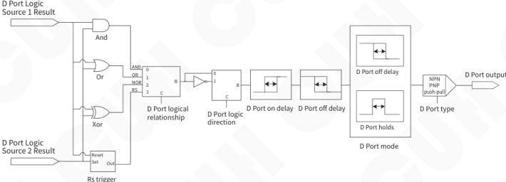

วิธีการตั้งค่าพารามิเตอร์เอาต์พุตควบคุมมีดังนี้:

- กด ▲ และ ◀ ค้างเพื่อเข้าสู่อินเทอร์เฟซการตั้งค่าพารามิเตอร์ กด ▶ สั้น ๆ เพื่อสลับไปยังกลุ่มพารามิเตอร์ “6 DC output”
- กด ▲ หรือ ▼ สั้น ๆ เพื่อสลับพารามิเตอร์ในกลุ่มพารามิเตอร์เอาต์พุตควบคุม
- กด ⊕ หรือ ⊖ เพื่อปรับค่าพารามิเตอร์

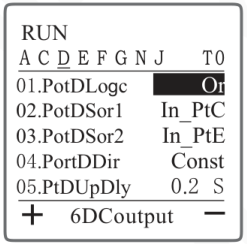

พารามิเตอร์อื่น ๆ ของกลุ่มพารามิเตอร์นี้สามารถปรับได้ตามขั้นตอนข้างต้น

“แหล่งพอร์ต D 1”, “แหล่งพอร์ต D 2”, “ลอจิกพอร์ต D”, “ทิศทางพอร์ต D”, “การหน่วงเปิด D” “การหน่วงปิด D” และ “โหมดพอร์ต D” พารามิเตอร์ข้างต้นสามารถอ้างอิงการตั้งค่าพารามิเตอร์เอาต์พุตหลักได้


## 4.4.2.1 ประเภทพอร์ต D

เอาต์พุตพอร์ต D สามารถรองรับได้สามประเภท: เอาต์พุต NPN, เอาต์พุต PNP และเอาต์พุตแบบพุชพูล  
ค่าเริ่มต้นคือ Ou_P&P (Push-Pull)

| พารามิเตอร์ | ความหมาย |
|---|---|
| Ou_NPN | เมื่อสัญญาณเอาต์พุตของพอร์ต D มีผล พอร์ต D จะส่งสัญญาณระดับต่ำ (0V) และเมื่อไม่มีผลจะมีความต้านทานสูง |
| Ou_PNP | เมื่อสัญญาณเอาต์พุตของพอร์ต D มีผล พอร์ต D จะส่งสัญญาณระดับสูง (24V) และเมื่อไม่มีผลจะมีความต้านทานสูง |
| Ou_P&P<br>(Push Pull) | เมื่อสัญญาณเอาต์พุตของพอร์ต D มีผล พอร์ต D จะส่งสัญญาณระดับสูง (24V) เมื่อสัญญาณเอาต์พุตของพอร์ต D ไม่มีผล พอร์ต D จะส่งสัญญาณระดับต่ำ (0V) |

แผนภาพมีดังนี้:

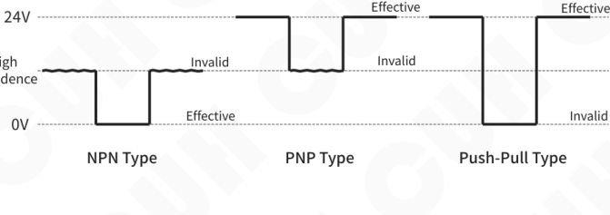


# 4.5 การควบคุมสัญญาณ

ตัวควบคุมสามารถตัดสินสถานะของวัสดุในเครื่องป้อนวัสดุแบบสั่นสะเทือนผ่านเซ็นเซอร์ภายนอก และทำให้ตัวควบคุม “หยุดเมื่อวัสดุเต็ม” หรือ “หยุดเมื่อวัสดุหมด” แผนภาพการไหลของสัญญาณพอร์ตมีดังนี้:

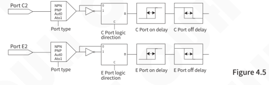

**รูปที่ 4.5**

วิธีการตั้งค่าพารามิเตอร์อินพุตสัญญาณมีดังนี้:

- กด ▲ และ ◀ ค้างเพื่อเข้าสู่อินเทอร์เฟซการตั้งค่าพารามิเตอร์ กด ▶ สั้น ๆ เพื่อสลับไปยังกลุ่มพารามิเตอร์ “5On&Off”
- กด ▲ หรือ ▼ สั้น ๆ เพื่อสลับพารามิเตอร์ในกลุ่มพารามิเตอร์อินพุตสัญญาณ
- กด ⊕ หรือ ⊖ เพื่อปรับค่าพารามิเตอร์

```text
RUN
A C D E F G N J        A0
01.PortType        Auto
02.PortCDir        Const
03.PtCUpDly        0.2 S
04.PtCDnDly        0.2 S
05.PortEDir        Const
+     5On&Off        −
```

พารามิเตอร์อื่น ๆ ของกลุ่มพารามิเตอร์นี้สามารถปรับได้ตามขั้นตอนข้างต้น

## 4.5.1 ประเภทเซ็นเซอร์

ตัวควบคุมสามารถตั้งค่าประเภทของเซ็นเซอร์สวิตช์เป็น “Auto”, “NPN”, “PNP” หรือ “Ato1” หรือสามารถตั้งค่าด้วยตนเองตามประเภทของเซ็นเซอร์ก็ได้

| พารามิเตอร์ | ความหมาย |
|---|---|
| Auto | ไม่ว่าประเภทของเซ็นเซอร์จะเป็นแบบใด จะตรวจจับเสมอว่าการเชื่อมต่อพอร์ตมีผลหรือไม่โดยการเปลี่ยนแปลงสัญญาณระดับสูงและต่ำ ค่าเริ่มต้นจากโรงงานคือการจดจำอัตโนมัติ |
| NPN | เซ็นเซอร์ประเภท NPN |
| PNP | เซ็นเซอร์ประเภท PNP |
| Ato1 | ก่อนที่สัญญาณเซ็นเซอร์จะไม่มีผล จะตรวจจับว่าพอร์ตมีผลหรือไม่โดยการเปลี่ยนแปลงระดับสูงและต่ำ เมื่อพบสัญญาณที่มีผลแล้ว ประเภทเซ็นเซอร์ของพอร์ตจะถูกกำหนดและจะไม่สแกนอีกต่อไป |


## 4.5.2 ลอจิกพอร์ต C/พอร์ต E

พารามิเตอร์นี้ใช้เพื่อสลับพอร์ตอินพุต C และพอร์ตอินพุต E ของตัวควบคุมว่าเป็น “หยุดเมื่อวัสดุเต็ม” หรือ “หยุดเมื่อวัสดุหมด”

เมื่อสลับพอร์ตอินพุต C/พอร์ต E ภายใต้การตั้งค่าเริ่มต้นจากโรงงานโดยไม่ได้รับสัญญาณใด ๆ ตัวควบคุมจะอยู่ในสถานะ “กำลังทำงาน” (กล่าวคือ หยุดเมื่อวัสดุเต็ม) การใช้งานพิเศษบางอย่างต้องการให้ตัวควบคุมอยู่ในสถานะ “หยุด” (กล่าวคือ หยุดเมื่อวัสดุหมด) เมื่อพอร์ต C/พอร์ต E ไม่ได้รับสัญญาณใด ๆ ซึ่งสามารถทำได้โดยการแก้ไขพารามิเตอร์นี้ สำหรับแผนภาพการไหลของสัญญาณ โปรดดูรูปที่ 4.5

| พารามิเตอร์ | ความหมาย |
|---|---|
| Const | เมื่อไม่มีสัญญาณควบคุม ตัวควบคุมอยู่ในสถานะกำลังทำงาน (หยุดเมื่อวัสดุเต็ม) |
| Inv | เมื่อไม่มีสัญญาณควบคุม ตัวควบคุมอยู่ในสถานะหยุด (หยุดเมื่อวัสดุหมด) |

## 4.5.3 การหน่วงเปิด/ปิดพอร์ต C และการหน่วงเปิด/ปิดพอร์ต E

เวลาหน่วงจากช่วงเวลาที่ให้สัญญาณเพื่อทำให้ตัวควบคุมเข้าสู่สถานะกำลังทำงาน จนกระทั่งตัวควบคุมพิจารณาว่าสัญญาณมีผล เรียกว่าการหน่วงเปิด

เวลาหน่วงจากการให้สัญญาณที่ทำให้ตัวควบคุมเข้าสู่สถานะหยุด จนกระทั่งตัวควบคุมพิจารณาว่าสัญญาณมีผล เรียกว่าการหน่วงปิด

สำหรับแผนภาพการไหลของสัญญาณ โปรดดูรูปที่ 4.5

ช่วงการหน่วงเปิด/ปิดคือ 0.0~99.9s ค่าเริ่มต้นคือ 0.2s และความแม่นยำในการปรับคือ 0.1s

**หมายเหตุ:** เมื่อใช้พอร์ต C, E ในการควบคุมเริ่ม/หยุด หากจำเป็นต้องหน่วงการทำงานสักระยะหลังจากได้รับสัญญาณเพื่อให้แน่ใจว่าสัญญาณเสถียร สามารถทำได้โดยการตั้งค่าการหน่วงเปิดและหน่วงปิด


## 4.5.4 ลอจิกความเร็ว A/ลอจิกความเร็ว B

แผนภาพการไหลของสัญญาณมีดังนี้:

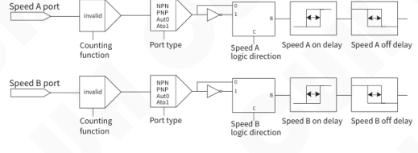

**รูปที่ 4.5.4**

พารามิเตอร์นี้ใช้เพื่อสลับสถานะที่มีผลของพอร์ตอินพุตสำหรับความเร็ว A และความเร็ว B ของตัวควบคุม พารามิเตอร์นี้ต้องตั้งค่าในกลุ่มพารามิเตอร์วัสดุเต็ม ค่าเริ่มต้นคือ Const

| พารามิเตอร์ | ความหมาย |
|---|---|
| Const | เมื่อไม่มีสัญญาณควบคุม ความเร็ว A และความเร็ว B ของตัวควบคุมจะไม่มีผล |
| Inv | เมื่อไม่มีสัญญาณควบคุม ความเร็ว A และความเร็ว B ของตัวควบคุมจะมีผล |

## 4.5.5 การหน่วงเปิด/ปิดความเร็ว A และการหน่วงเปิด/ปิดความเร็ว B

จากการให้สัญญาณที่มีผลกับพอร์ตความเร็ว A/B เพื่อตั้งค่าความเร็วให้ทำงาน ช่วงเวลานี้เรียกว่าการหน่วงเปิด

จากการให้สัญญาณที่ไม่มีผลกับพอร์ตความเร็ว A/B เพื่อตั้งค่าความเร็วให้ไม่ทำงาน ช่วงเวลานี้เรียกว่าการหน่วงปิด

สำหรับแผนภาพการไหลของสัญญาณ โปรดดูรูปที่ 4.5.4

ช่วงการหน่วงเปิด/ปิดของความเร็ว A&B คือ 0.0~99.9s ค่าเริ่มต้นคือ 0.2s และความแม่นยำในการปรับคือ 0.1s


---

## 4.6 การนับจำนวนวัสดุ

ตัวควบคุมนี้มีฟังก์ชันการนับในตัว สามารถนับพัลส์การนับและลดความเร็วหรือหยุดโดยอัตโนมัติเมื่อจำนวนพัลส์ถึงจำนวนรวมที่ตั้งไว้ นอกจากนี้ยังมีฟังก์ชันพิเศษ เช่น การป้องกันการสั่นสะเทือนแบบพิเศษและการลดความเร็วขั้นสุดท้ายเพื่อป้องกันการนับเกิน แผนภาพการไหลของสัญญาณมีดังนี้:

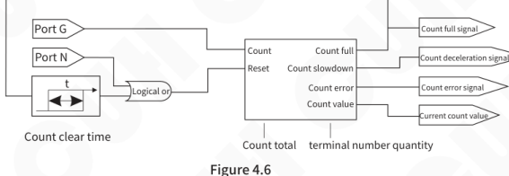

**Figure 4.6**

» กด ▲ และ ◀ ค้างเพื่อเข้าสู่อินเทอร์เฟซการตั้งค่าพารามิเตอร์ กด ▶ สั้น ๆ เพื่อสลับไปยังกลุ่มพารามิเตอร์ “7Counter”

» กด ▲ หรือ ▼ สั้น ๆ เพื่อสลับพารามิเตอร์ในกลุ่มพารามิเตอร์การนับ

» กด ⊕ หรือ ⊖ เพื่อปรับค่าพารามิเตอร์

```text
RUN
A C D E F G N J    A0
01.TotaCout       10
02.PrcntTrm       50 %
03.CotAhead        3
04.CotRstTm       0.0 S
05.CotPotSe       None
+    7Counter      −
```

พารามิเตอร์อื่น ๆ ของกลุ่มพารามิเตอร์นี้สามารถปรับได้ตามขั้นตอนข้างต้น

### 4.6.1 การนับจำนวนวัสดุ (หรือความเร็ว A/B)

พารามิเตอร์นี้ใช้เพื่อเปิดและปิดฟังก์ชันการนับ

ค่าเริ่มต้นคือ None นั่นคือฟังก์ชันการนับถูกปิด และฟังก์ชันความเร็ว A/B ถูกเปิดใช้งานในขณะนี้

เมื่อพารามิเตอร์ฟังก์ชันการนับมีผล (เปิดใช้งาน) ความเร็ว A และความเร็ว B จะทำหน้าที่ควบคุมความเร็ว A/B ตัวควบคุมสามารถดำเนินการเพิ่มเติมสำหรับฟังก์ชันการนับได้ สำหรับแผนภาพการไหลของสัญญาณ โปรดดู Figure 4.6

| Parameter | Meaning |
|---|---|
| None | ปิดฟังก์ชันการนับและเปิดใช้งานฟังก์ชันความเร็ว A/B |
| Valid | ใช้พอร์ตความเร็ว A เป็นพอร์ตการนับ และใช้พอร์ตความเร็ว B เป็นพอร์ตล้างจำนวนนับ |

---


---

## 4.6.2 จำนวนเป้าหมาย

หลังจาก “ค่าจำนวนนับปัจจุบัน” ถึงขีดจำกัด สัญญาณนับเต็มจะมีผลจนกว่าตัวนับจะถูกรีเซ็ต หลังจากเข้าสู่สถานะนับเต็ม หากยังคงส่งพัลส์การนับต่อไป การนับจะดำเนินต่อไป แต่สัญญาณนับเต็มยังคงมีผล สำหรับแผนภาพการไหลของสัญญาณ โปรดดู Figure 4.6

ช่วงจำนวนรวมคือ 0~9999 ค่าเริ่มต้นคือ 10 และความแม่นยำในการปรับคือ 1

## 4.6.3 ความเร็วปลายทาง

**ความเร็วปลายทาง** หมายความว่าเมื่อการนับเข้าสู่สถานะการลดความเร็วขั้นสุดท้าย ความเร็วและแรงดันป้อนวัสดุของตัวควบคุมจะลดลงถึงเปอร์เซ็นต์ของความเร็วและแรงดันเริ่มต้น ดู Figure 4.6.3

เมื่อจำนวนการนับใกล้เคียงกับจำนวนรวม กระบวนการนับกำลังจะเสร็จสิ้น เพื่อป้องกันไม่ให้วัสดุที่เคลื่อนที่ด้วยความเร็วสูงไม่สามารถหยุดได้ทันเวลาและทำให้การนับเกิน ตัวควบคุมจะลดความเร็วลงถึงความเร็วปลายทางที่ตั้งไว้โดยผู้ใช้โดยอัตโนมัติ (สัญญาณลดความเร็วการนับมีผล) เมื่อจำนวนที่เหลือน้อยกว่าจำนวนปลายทาง เมื่อค่าจำนวนนับถึงจำนวนรวม (สัญญาณนับเต็มมีผล) ตัวควบคุมจะหยุดเอาต์พุตทันที และเครื่องป้อนวัสดุสามารถได้รับการควบคุมการนับที่แม่นยำ

ช่วงความเร็วปลายทางคือ 0~100% ค่าเริ่มต้นคือ 50% และความแม่นยำในการปรับคือ 1%

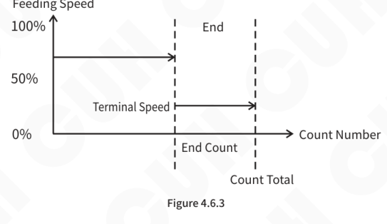

---


### 4.6.4 จำนวนความเร็วปลายทาง

จำนวนส่วนสุดท้าย: หมายถึงจำนวนการนับระยะทางทั้งหมด หลังจากถึง “จำนวนปลายทาง” ตัวควบคุมจะเข้าสู่โหมดลดจำนวนการนับ

ในสถานะความเร็ว ความเร็วและแรงดันป้อนวัสดุจะลดลงถึงความเร็วปลายทางและแรงดันปลายทาง เมื่อค่า “จำนวนส่วนสุดท้าย” เป็น 0 หมายความว่าไม่ได้ใช้ฟังก์ชันลดความเร็วขั้นสุดท้าย สำหรับแผนภาพการไหลของสัญญาณ โปรดดู Figure 4.6

จำนวนส่วนสุดท้ายมีช่วงตั้งแต่ 0 ถึง 9999 ค่าเริ่มต้นคือ 3 และความแม่นยำในการปรับคือ 1

### 4.6.5 รีเซ็ตค่าจำนวนนับเป็น 0

เมื่อนับเต็ม ตัวควบคุมจะล้างค่าจำนวนนับโดยอัตโนมัติหลังจากหน่วงเวลา “ล้างจำนวนนับ” เมื่อค่า “ล้างจำนวนนับ” เป็น 0.0s หมายความว่าการหน่วงเรียกฟังก์ชันรีเซ็ตการนับโดยอัตโนมัติถูกปิดใช้งาน

ช่วงเวลารีเซ็ตการนับคือ 0.0~999.9s ค่าเริ่มต้นคือ 0.0s และความแม่นยำในการปรับคือ 0.1s

### 4.6.6 ลำดับความสำคัญ RS

ใช้เพื่อตั้งลำดับความสำคัญของพอร์ตทริกเกอร์ RS ค่าเริ่มต้นคือ Same

| Parameter | Meaning |
|---|---|
| Same | พอร์ต R และพอร์ต S มีลำดับความสำคัญเท่ากัน เมื่อมีสัญญาณที่พอร์ต R และ S ตัวควบคุมจะรายงานคำเตือน “main RS error” หรือ “control RS error” |
| Reset | ลำดับความสำคัญรีเซ็ต เมื่อมีสัญญาณที่พอร์ต R และ S สัญญาณพอร์ต R มีลำดับความสำคัญ นั่นคือสัญญาณรีเซ็ตมีลำดับความสำคัญ |
| Set | ลำดับความสำคัญเซ็ต เมื่อมีสัญญาณที่พอร์ต R และ S สัญญาณพอร์ต S มีลำดับความสำคัญ นั่นคือสัญญาณเซ็ตมีลำดับความสำคัญ |
| Revers | เมื่อมีสัญญาณที่พอร์ต R และ S ผลลัพธ์เอาต์พุตลอจิกปัจจุบันจะถูกกลับด้าน |


---

## 4.7 บันทึกการตั้งค่า

บทนี้แนะนำวิธีใช้ฟังก์ชันการจัดเก็บพารามิเตอร์และพารามิเตอร์เรียกคืนของตัวควบคุมเป็นหลัก

### 4.7.1 การตั้งค่าเรียกคืน

ตัวควบคุมสามารถอ่านชุดพารามิเตอร์ที่ตั้งไว้ล่วงหน้า 3 ชุดนอกเหนือจากกลุ่มงาน โดยมีชื่อว่า “User 1”, “User 2” และ “User 3” ตามลำดับ

เมื่อผู้ใช้แก้ไขพารามิเตอร์ พารามิเตอร์ของตัวควบคุมจะถูกบันทึกในกลุ่มงานโดยค่าเริ่มต้น เมื่อเปิดตัวควบคุมอีกครั้ง พารามิเตอร์จะถูกอ่านจากกลุ่มงานโดยอัตโนมัติและค่าพารามิเตอร์ก่อนปิดเครื่องครั้งสุดท้ายจะถูกเรียกคืน ในเวลาเดียวกัน ผู้ใช้สามารถเลือกจาก “UsrD1”, “UsrD2”, “UsrD3” เพื่ออ่านไฟล์อื่นที่บันทึกด้วยตนเองจากสามกลุ่ม ข้อมูลจะถูกส่งไปยังกลุ่มงานในตัวควบคุม ทำให้ตัวควบคุมสามารถสลับสถานะการทำงานได้ทันที

| Parameter | Meaning |
|---|---|
| None | ไม่มีผล |
| UsrD1 | พารามิเตอร์ที่ผู้ใช้ตั้งค่า 1 |
| UsrD2 | พารามิเตอร์ที่ผู้ใช้ตั้งค่า 2 |
| UsrD3 | พารามิเตอร์ที่ผู้ใช้ตั้งค่า 3 |

### 4.7.2 บันทึกการตั้งค่า

ตัวควบคุมสามารถบันทึกชุดพารามิเตอร์ที่ตั้งไว้ล่วงหน้า 4 ชุด โดยมีชื่อว่า “Work”, “UsrD1”, “UsrD2”, “UsrD3”

เมื่อผู้ใช้แก้ไขพารามิเตอร์ พารามิเตอร์ของตัวควบคุมจะถูกบันทึกใน “Work” โดยอัตโนมัติโดยค่าเริ่มต้น เมื่อเปิดตัวควบคุมอีกครั้ง พารามิเตอร์จะถูกอ่านจากกลุ่มงานโดยอัตโนมัติและค่าพารามิเตอร์ก่อนปิดเครื่องครั้งสุดท้ายจะถูกเรียกคืน ผู้ใช้สามารถบันทึกพารามิเตอร์ในกลุ่มงานไปยัง “UsrD1”, “UsrD2”, “UsrD3” ได้ด้วยตนเอง

| Parameter | Meaning |
|---|---|
| None | ไม่มีผล |
| Work | กลุ่มงานเริ่มต้น |
| UsrD1 | พารามิเตอร์ที่ผู้ใช้ตั้งค่า 1 |
| UsrD2 | พารามิเตอร์ที่ผู้ใช้ตั้งค่า 2 |
| UsrD3 | พารามิเตอร์ที่ผู้ใช้ตั้งค่า 3 |

---


---

### 4.7.3 คืนค่าโรงงาน

ใช้รีเซ็ตพารามิเตอร์เพื่อคืนค่าพารามิเตอร์กลุ่มงานทั้งหมดกลับเป็นค่าเริ่มต้นจากโรงงาน

หลังจากเลือก “RWork” ใน “รีเซ็ตพารามิเตอร์” กด ⊕ และ ⊖ ค้างพร้อมกัน หลังจากผ่านไปมากกว่าสองวินาที อินเทอร์เฟซการแสดงผลจะสลับไปยังอินเทอร์เฟซสแตนด์บาย และพารามิเตอร์ถูกคืนค่าสำเร็จ

| Parameter | Meaning |
|---|---|
| None | ไม่มีผล |
| Rwork | คืนค่าพารามิเตอร์กลุ่มงานกลับเป็นค่าตั้งต้นจากโรงงาน (User 1, User 2 และ User 3 จะไม่ถูกคืนค่า) |

### 4.7.4 คัดลอกการตั้งค่า

ตัวควบคุมสามารถแทนที่กลุ่มพารามิเตอร์ของตัวควบคุมนี้ด้วยข้อมูลของตัวควบคุมสองตัวในเครือข่ายที่ได้สำรองไว้ เพื่อคัดลอกพารามิเตอร์ของตัวควบคุมทั้งสองอย่างรวดเร็ว

เลือกหมายเลข ID ของตัวควบคุมที่จะคัดลอกเพื่อใช้ฟังก์ชันการคัดลอกข้อมูลของตัวควบคุม ช่วงการเลือกพารามิเตอร์คัดลอกคือ 1~8

### 4.7.5 รหัสผ่านผู้ใช้

ผู้ใช้สามารถตั้งรหัสผ่านพารามิเตอร์ได้ด้วยตนเอง หลังจากล็อก ผู้ใช้สามารถดำเนินการได้เฉพาะภายใต้ “กลุ่มพารามิเตอร์การตรวจสอบ” และ “หน้าหลัก”

เมื่อผู้ใช้ตั้งค่า “รหัสผ่านผู้ใช้” เป็นค่าที่ไม่ใช่ 0 หมายความว่าฟังก์ชันล็อกพารามิเตอร์ขั้นสูงถูกเปิดใช้งาน ในขณะนี้ จำเป็นต้องป้อนรหัสผ่านเมื่อเข้าสู่กลุ่มพารามิเตอร์บนหน้าหลัก หลังจากผู้ใช้ “ป้อนรหัสผ่าน” และกด ▼ + ▲ หาก “ป้อนรหัสผ่าน” และ “รหัสผ่านผู้ใช้” แตกต่างกัน ผู้ใช้สามารถเข้าสู่กลุ่มพารามิเตอร์การตรวจสอบเท่านั้น เฉพาะหลังจากรหัสผ่านถูกต้องเท่านั้นผู้ใช้จึงจะสามารถเข้าสู่กลุ่มพารามิเตอร์อื่นได้

ช่วงการเลือกรหัสผ่านผู้ใช้คือ 0~9999

### 4.7.6 ป้อนรหัสผ่าน

หาก “ป้อนรหัสผ่าน” และ “รหัสผ่านผู้ใช้” แตกต่างกัน ผู้ใช้สามารถดำเนินการได้เฉพาะภายใต้ “หน้าหลัก” และ “กลุ่มพารามิเตอร์การตรวจสอบ” เฉพาะหลังจากรหัสผ่านถูกต้องเท่านั้นผู้ใช้จึงจะสามารถเข้าสู่กลุ่มพารามิเตอร์อื่นได้

ช่วงการเลือกสำหรับป้อนรหัสผ่านคือ 0~9999

---


## 4.8 การสื่อสาร RS485

ตัวควบคุมนี้รองรับการสื่อสาร RS485 ตามโหมดโปรโตคอล Modbus ประเภท ASCII และ RTU พารามิเตอร์และสถานะทั้งหมดของตัวควบคุมสามารถแก้ไขและอ่านได้จากระยะไกล

โปรโตคอลการสื่อสาร RS485 ในเครื่อง “SDVC341 Series 485 Register Address Table 1.02” สามารถดาวน์โหลดได้จากพื้นที่ดาวน์โหลดของเว็บไซต์บริษัทของเรา: www.cuhnj.com

> » กด ▲ และ ◀ ค้างเพื่อเข้าสู่อินเทอร์เฟซการตั้งค่าพารามิเตอร์ กด ▶ สั้น ๆ เพื่อสลับไปยังกลุ่มพารามิเตอร์ “8Comm”
>
> » กด ▲ หรือ ▼ สั้น ๆ เพื่อสลับพารามิเตอร์ในกลุ่มพารามิเตอร์การสื่อสาร
>
> » กด ⊕ หรือ ⊖ เพื่อปรับค่าพารามิเตอร์
>
> ```text
> RUN
> A C D E F G N J      A0
> 01.485type       RTU
> 02.BaudRate    115.2 K
> 03.485SlvID      1
> 04.Enab485R    None
> 05.DigSynAd      1
> +      8Comm      -
> ```

พารามิเตอร์อื่น ๆ ของกลุ่มพารามิเตอร์นี้สามารถปรับได้ตามขั้นตอนข้างต้น

### 4.8.1 ประเภทการสื่อสาร

การเลือกประเภทการสื่อสาร RS485 ประเภท Modbus ASCII และประเภท Modbus RTU ค่าเริ่มต้นคือ RTU

| Parameter | Meaning |
|---|---|
| ASCⅡ | ประเภท Modbus ASCII |
| RTU | ประเภท Modbus RTU |


## 4.8.2 อัตราบอด

ตัวเลือกอัตราบอดการสื่อสาร RS485 ที่แตกต่างกัน ค่าเริ่มต้นคือ 115.2K

| Parameter | Meaning |
|---|---|
| 0.3K | 0.3 Kbps |
| 1.2K | 1.2 Kbps |
| 2.4K | 2.4 Kbps |
| 9.6K | 9.6 Kbps |
| 19.2K | 19.2 Kbps |
| 57.6K | 57.6 Kbps |
| 115.2K | 115.2 Kbps |

## 4.8.3 ที่อยู่ตัวควบคุมทาส

ตั้งค่าหมายเลขที่อยู่ทาสในการสื่อสาร RS485

หมายเลขทาสมีช่วงตั้งแต่ 1 ถึง 31 ค่าเริ่มต้นคือ 1

## 4.8.4 ความต้านทานพอร์ต/ความต้านทานการซิงโครไนซ์

พอร์ตการสื่อสาร RS485/พอร์ตการซิงโครไนซ์ดิจิทัลมีฟังก์ชันความต้านทานจับคู่ (120Ω) ค่าเริ่มต้นคือ None

| Parameter | Meaning |
|---|---|
| None | ไม่ใช้ความต้านทานจับคู่ (120Ω) |
| Valid | ใช้ความต้านทานจับคู่ (120Ω) |


---

## 4.9 การเชื่อมต่อเครือข่าย CUHBus-DS®

ตัวควบคุม SDVC341-M ใช้โปรโตคอลบัส LAN (CUHBus-DS®) โปรโตคอลบัสการสื่อสารอนุกรม สามารถเชื่อมต่อเครือข่ายอุปกรณ์ได้สูงสุด 8 ตัวในเครือข่ายเดียวกัน ฟังก์ชันต่อไปนี้สามารถใช้งานได้ระหว่างตัวควบคุมหลังจากเชื่อมต่อเครือข่าย:

**คุณสมบัติการซิงโครไนซ์:** ความถี่ เฟส การปรับความเร็วควบคุมระยะไกล และพารามิเตอร์อื่น ๆ ของตัวควบคุมใด ๆ ในเครือข่ายสามารถสอดคล้องหรือเบี่ยงเบนจากเอาต์พุตของตัวควบคุมอื่น ๆ ในเครือข่ายได้

**การแชร์สัญญาณ:** สัญญาณสถานะใด ๆ ของตัวควบคุมใด ๆ ในเครือข่ายสามารถแชร์เป็นแหล่งสัญญาณอินพุตของตัวควบคุมอื่น ๆ ได้ ช่วยให้ตัวควบคุมใด ๆ ในเครือข่ายมีแหล่งสัญญาณที่หลากหลายนอกเหนือจากเครื่องท้องถิ่น และส่งออกหลังจากดำเนินการลอจิกเพื่อใช้ลอจิกการทำงานของตัวควบคุมที่ซับซ้อนมากขึ้นในสถานที่ของผู้ใช้

**การสำรองข้อมูล:** ข้อมูลของตัวควบคุมใด ๆ ในเครือข่ายจะถูกสำรองไว้บนตัวควบคุมอีกสองตัวในเครือข่าย ตัวควบคุมใด ๆ ในเครือข่ายสามารถถูกแทนที่ได้อย่างสมบูรณ์ด้วยการเปลี่ยนและเข้าร่วม และข้อมูลของตัวควบคุมที่ถูกแทนที่สามารถใช้เพื่อดำเนินการต่อได้

> ☺
>
> **ระบบเครือข่ายนี้มีคุณสมบัติดังต่อไปนี้:**
>
> - ขยายได้ง่ายและสามารถเพิ่มอุปกรณ์ใหม่เข้าสู่เครือข่ายได้อย่างรวดเร็ว
> - เครือข่ายมีความเท่าเทียมกัน โดยมีขั้วต่อการสื่อสาร CUHBus-DS® ที่เท่าเทียมกันชุดหนึ่งอยู่ทางซ้ายและขวาเพื่อความสะดวกในการเชื่อมต่อของผู้ใช้
> - อุปกรณ์รองรับการสลับแบบร้อน สามารถเพิ่มหรือลบการขยายตัวควบคุมได้โดยไม่ต้องปิดเครื่องในระหว่างการทำงานที่เสถียรของระบบตัวควบคุม

---


---

## 4.9.1 การเชื่อมต่อเครือข่ายอุปกรณ์

บทนี้แนะนำการเชื่อมต่อเครือข่ายอย่างรวดเร็วระหว่างตัวควบคุมหลายตัว วิธีการเพิ่มตัวควบคุมใหม่เข้าสู่เครือข่ายที่สร้างขึ้น และวิธีการลบตัวควบคุมในเครือข่ายเป็นหลัก

### 4.9.1.1 การเชื่อมต่อเครือข่ายอุปกรณ์

ตัวควบคุมเดี่ยวเป็นเครือข่ายในตัวเอง เมื่อสายสัญญาณ CUHBus-DS® ของตัวควบคุมเชื่อมต่ออย่างถูกต้องและดำเนินการง่าย ๆ อุปกรณ์หลายตัวสามารถสร้างเครือข่ายการสื่อสารซิงโครไนซ์ดิจิทัลใหม่ได้

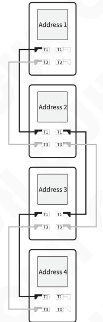

---


**ขั้นตอน:**

1. เชื่อมต่อสัญญาณ T1 ของตัวควบคุมทั้งหมดเข้าด้วยกันและสัญญาณ T3 ทั้งหมดเข้าด้วยกัน ดังแสดงในภาพด้านบน

2. เมื่ออุปกรณ์ใหม่เปิดเครื่อง ตัวควบคุมใหม่จะเข้าสู่ “กลุ่มพารามิเตอร์การสื่อสาร” โดยอัตโนมัติ

3. ในกลุ่มพารามิเตอร์การสื่อสาร ตั้งค่าหมายเลขอุปกรณ์การสื่อสารซิงโครไนซ์ดิจิทัลในเครื่อง โดย “DigSynAd” เป็นค่าใด ๆ [1~8] ไม่จำเป็นต้องตั้งค่า โปรแกรมจะสร้างหมายเลขโดยอัตโนมัติ

4. ในกลุ่มพารามิเตอร์การสื่อสาร ตั้งค่าพารามิเตอร์ “EnNetwok ” เป็น “Expand” จากนั้นกด ⊕ และ ⊖ ค้างพร้อมกัน ยืนยัน

5. หลังจากเพิ่มสำเร็จ ค่าพารามิเตอร์ “EnNetwok ” ของอุปกรณ์ใหม่จะเปลี่ยนเป็น “Online” โดยอัตโนมัติ ซึ่งบ่งชี้ว่าอุปกรณ์ใหม่ถูกเพิ่มสำเร็จแล้ว

ผู้ใช้สามารถตรวจสอบว่าเครือข่ายเชื่อมต่ออย่างถูกต้องหรือไม่โดยการตรวจสอบพารามิเตอร์สถานะการเชื่อมต่อเครือข่ายอุปกรณ์ รวมทั้งตรวจสอบจำนวนอุปกรณ์ทั้งหมดในเครือข่ายและจำนวนอุปกรณ์ออนไลน์

หมายเหตุ: การเชื่อมต่อเฉพาะสายสัญญาณ CUHBus-DS® โดยไม่ผ่านการตั้งค่าไม่นับเป็นการเข้าร่วมเครือข่าย

**วิธีการตรวจสอบยืนยัน:**

1. ในกลุ่มพารามิเตอร์การตรวจสอบ ค่าของพารามิเตอร์ “DevicNum” คือ [1~8] ซึ่งบ่งชี้จำนวนอุปกรณ์ทั้งหมดในเครือข่าย

2. ในกลุ่มพารามิเตอร์การตรวจสอบ ค่าของพารามิเตอร์ “OnlinNum” คือ [1~8] ซึ่งบ่งชี้ว่ามีตัวควบคุมออนไลน์ในเครือข่ายกี่ตัวในปัจจุบัน

**ความต้านทานการซิงโครไนซ์:**

พอร์ตการสื่อสาร CUHBus-DS® มีฟังก์ชันความต้านทานจับคู่ (120Ω) ซึ่งไม่มีผลหรือมีผล

| Parameter | Meaning |
|---|---|
| None | ไม่ใช้ความต้านทานจับคู่ (120Ω) |
| Valid | ใช้ความต้านทานจับคู่ (120Ω) |


## 4.9.1.2 อุปกรณ์เข้าร่วม

ผู้ใช้สามารถปฏิบัติตามขั้นตอนการขยายและเพิ่มต่อไปนี้เพื่อเพิ่มตัวควบคุมใหม่เข้าสู่เครือข่ายที่มีอยู่

ตัวควบคุมใหม่หลังการเข้าร่วมสามารถเรียกใช้สัญญาณของตัวควบคุมใด ๆ ในเครือข่ายและทำหน้าที่เป็นแหล่งสัญญาณของตัวควบคุมอื่น ๆ ในเครือข่าย เสริมสร้างแหล่งสัญญาณของระบบ

**ขั้นตอน:**

1. เชื่อมต่ออินเทอร์เฟซ T1 และ T3 ของ CUHBus-DS® ของอุปกรณ์ใหม่เข้ากับเครือข่ายที่สมบูรณ์เดิม พอร์ตรองรับการสลับแบบร้อน

2. เมื่ออุปกรณ์ใหม่เปิดเครื่อง ตัวควบคุมใหม่จะเข้าสู่ “กลุ่มพารามิเตอร์การสื่อสาร” โดยอัตโนมัติ

3. ในกลุ่มพารามิเตอร์การสื่อสาร ตั้งค่าหมายเลขอุปกรณ์การสื่อสารซิงโครไนซ์ดิจิทัลในเครื่อง โดย “DigSynAd” เป็นค่าใด ๆ [1~8] ไม่จำเป็นต้องตั้งค่า โปรแกรมจะสร้างหมายเลขโดยอัตโนมัติ

4. ในกลุ่มพารามิเตอร์การสื่อสาร ตั้งค่าพารามิเตอร์ “EnNetwok ” เป็น “Expand” จากนั้นกด ⊕ และ ⊖ ค้างพร้อมกัน ยืนยัน

5. หลังจากเพิ่มสำเร็จ ค่าพารามิเตอร์ “EnNetwok ” ของอุปกรณ์ใหม่จะเปลี่ยนเป็น “Online” โดยอัตโนมัติ ซึ่งบ่งชี้ว่าอุปกรณ์ใหม่ถูกเพิ่มสำเร็จแล้ว

ผู้ใช้สามารถตรวจสอบว่าเครือข่ายเชื่อมต่ออย่างถูกต้องหรือไม่โดยการตรวจสอบพารามิเตอร์สถานะการเชื่อมต่อเครือข่ายอุปกรณ์ รวมทั้งตรวจสอบจำนวนอุปกรณ์ทั้งหมดในเครือข่ายและจำนวนอุปกรณ์ออนไลน์

หมายเหตุ: การเชื่อมต่อเฉพาะสายสัญญาณ CUHBus-DS® โดยไม่ผ่านการตั้งค่าไม่นับเป็นการเข้าร่วมเครือข่าย

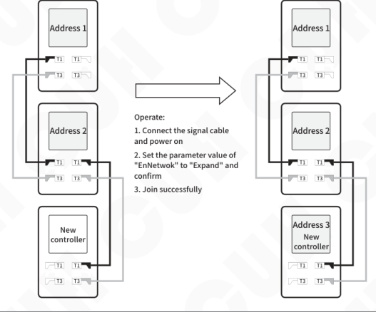


---

## 4.9.1.3 การถอดอุปกรณ์

เมื่อต้องการถอดตัวควบคุมออกจากเครือข่ายอย่างถาวร ให้ใช้ฟังก์ชันลบตัวควบคุมออกจากเครือข่าย การลบตัวควบคุมในเครือข่ายสามารถเริ่มต้นได้จากตัวควบคุมใด ๆ ในเครือข่าย ตัวควบคุมที่เหลือหลังการลบจะจัดเรียงใหม่เป็นเครือข่ายใหม่ที่สมบูรณ์

อย่างไรก็ตาม หากถอดตัวควบคุมออกโดยตรง (รวมถึงไฟดับ) โดยไม่ลบตัวควบคุม ข้อมูลของตัวควบคุมจะยังคงอยู่ในเครือข่าย ในขณะนี้ เครือข่ายอยู่ในสถานะเสื่อมสภาพและไม่สามารถเพิ่มตัวควบคุมใหม่ได้ ต้องลบด้วยตนเองผ่านตัวควบคุมเพื่อรักษาความสมบูรณ์ของเครือข่ายและเสร็จสิ้นการขยายและเพิ่มตัวควบคุมใหม่

**ขั้นตอนการลบตัวควบคุม:**

1. เข้าสู่ “กลุ่มพารามิเตอร์การสื่อสาร” ผ่านตัวควบคุมใด ๆ ในเครือข่าย
2. แก้ไขค่าของพารามิเตอร์ “DeltDevi” เป็นที่อยู่ของอุปกรณ์เครือข่ายที่ต้องการลบ
3. หลังจากแก้ไขค่า กด ⊕ และ ⊖ ค้าง ยืนยันการลบอุปกรณ์
4. หลังจากลบเสร็จสิ้น ค่าพารามิเตอร์ “DeltDevi” เปลี่ยนเป็นค่าที่ไม่สามารถเลือกได้ ซึ่งบ่งชี้ว่าอุปกรณ์ถูกลบสำเร็จ
5. ในขณะนี้ ตรวจสอบสถานะเครือข่ายใหม่บนอุปกรณ์ที่ใช้งานและยืนยันจำนวนตัวควบคุมเครือข่ายใหม่

ตัวอย่าง: ลบตัวควบคุม Address 3 ออกจากเครือข่าย

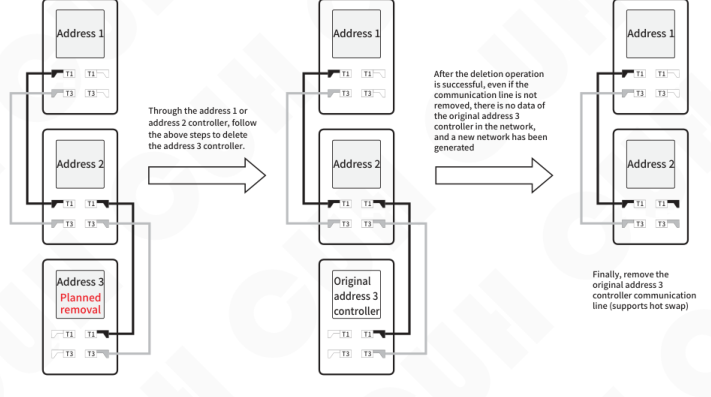

---


---

## 4.9.2 ฟังก์ชันการซิงโครไนซ์

ความถี่ เฟส หรือความเร็วควบคุมระยะไกลของตัวควบคุมใด ๆ ในเครือข่ายสามารถติดตามตัวควบคุมหลักอื่นได้อย่างสอดคล้องหรือเบี่ยงเบนที่แน่นอน อย่างไรก็ตาม ตัวควบคุมหลายตัวไม่สามารถติดตามซึ่งกันและกันได้ มิฉะนั้นเอาต์พุตของพวกมันจะไม่เสถียร

ตัวอย่าง 1: ตัวควบคุม Address 3 ติดตามความถี่เอาต์พุตของตัวควบคุม Address 1 ดังนั้นเครื่องป้อนวัสดุแบบสั่นสะเทือนสองเครื่องที่ขับเคลื่อนโดยพวกมันจึงทำงานที่ความถี่เดียวกัน

ตัวอย่าง 2: หากตัวควบคุม Address 3 กำลังติดตามความถี่เอาต์พุตของตัวควบคุม Address 1 อยู่แล้ว ตัวควบคุม Address 1 ไม่สามารถตั้งให้ติดตามความถี่เอาต์พุตของตัวควบคุม Address 3 ได้ ซึ่งหมายความว่าตัวควบคุมไม่สามารถติดตามซึ่งกันและกันได้

➢ **การซิงโครไนซ์ความถี่**

วิธีการตั้งค่าการซิงโครไนซ์ความถี่มีดังนี้:

1. ตัวควบคุมตั้งแต่สองตัวขึ้นไปที่ต้องการซิงโครไนซ์ความถี่ระหว่างกันจะต้องสร้างเครือข่ายการสื่อสารซิงโครไนซ์ดิจิทัลเดียวกัน โปรดดูบท “การเชื่อมต่อเครือข่ายอุปกรณ์”

2. ตั้งค่าพารามิเตอร์ “FrqncSyn” ในกลุ่มพารามิเตอร์การสื่อสารของตัวควบคุมที่ถูกซิงโครไนซ์ความถี่เป็นหมายเลขที่อยู่ “การซิงโครไนซ์ดิจิทัล” ของตัวควบคุมที่ซิงโครไนซ์ (ความถี่)

3. สลับตัวควบคุมที่ซิงโครไนซ์ความถี่ไปยังกลุ่มพารามิเตอร์ความเร็วคงที่ และตั้งค่า “FrqncMod” เป็น “SynV” หรือ “SynE”

➢ **การซิงโครไนซ์ความเร็วควบคุมระยะไกล**

วิธีการตั้งค่าการซิงโครไนซ์ความเร็วควบคุมระยะไกลมีดังนี้:

1. อุปกรณ์ตัวควบคุมตั้งแต่สองตัวขึ้นไปที่ต้องการซิงโครไนซ์การควบคุมระยะไกลระหว่างกันจะต้องสร้างเครือข่ายการสื่อสารซิงโครไนซ์ดิจิทัลเดียวกัน โปรดดูบท “การเชื่อมต่อเครือข่ายอุปกรณ์”

2. ตั้งค่าพารามิเตอร์ “RemotSyn” ในกลุ่มพารามิเตอร์การสื่อสารของตัวควบคุมที่ถูกซิงโครไนซ์การควบคุมระยะไกลเป็นหมายเลขที่อยู่ “การซิงโครไนซ์ดิจิทัล” ของตัวควบคุมที่ซิงโครไนซ์ (การควบคุมระยะไกล)

3. ตั้งค่าพารามิเตอร์ “CtrlSour” ในกลุ่มพารามิเตอร์เอาต์พุตหลักเป็น “DigSym”

➢ **โหมดการทำงานหลัก/ทาส**

ผู้ใช้สามารถตั้งค่าตัวควบคุมให้ทำงานในหนึ่งในสองโหมดการทำงานต่อไปนี้ตามความต้องการของแอปพลิเคชัน:

โหมดหลัก: โดยที่ตัวควบคุมหนึ่งตัวควบคุมแผ่นสั่นสะเทือนโหลดอย่างอิสระ

โหมดทาส: เมื่อตัวควบคุมตั้งแต่สองตัวขึ้นไปจำเป็นต้องทำงานซิงโครไนซ์ ตัวควบคุมหนึ่งตัวจะถูกใช้เป็นตัวควบคุมหลักและทำงานในโหมดหลักเป็นข้อมูลอ้างอิงความถี่ ตัวควบคุมอื่น ๆ ทั้งหมดจะทำงานในโหมดทาส ทำหน้าที่เป็นตัวควบคุมทาสและทำงานซิงโครไนซ์กับตัวควบคุมหลัก

---


## โหมดหลัก

ตัวควบคุมที่ทำงานในโหมดหลัก ต่อไปนี้เรียกว่าตัวควบคุมหลัก ทำการแก้ไขพารามิเตอร์ในกลุ่มพารามิเตอร์ความเร็วคงที่ พารามิเตอร์ “โหมดแรงดัน” และ “โหมดความถี่” สามารถตั้งค่าตัวควบคุมให้เป็นโหมดการทำงานที่สอดคล้องกัน โหมดแรงดันและโหมดความถี่มีชุดค่าผสมดังต่อไปนี้:

| Working Mode | Voltage<br>Control Method | Frequency<br>Control Method | Vibration Sensor Need |
|---|---|---|---|
| Full Manuel | Manuel | Manuel | No |
| Full Automatic | Auto | Auto | Yes |
| Voltage Automatic | Auto | Manuel | Yes |
| Frequency Automatic | Manuel | Auto | Yes |

■ **โหมดแมนนวลเต็มรูปแบบ**

ในโหมดนี้ แรงดันเอาต์พุตและความถี่เอาต์พุตของตัวควบคุมจะถูกปรับด้วยตนเอง

**หมายเหตุ:** แม้ว่าพารามิเตอร์ “โหมดแรงดัน” หรือ “โหมดความถี่” จะถูกตั้งเป็น “Auto” ตัวควบคุมจะยังคงทำงานในโหมดแมนนวลเต็มรูปแบบหากไม่ได้เชื่อมต่อเซ็นเซอร์สั่นสะเทือน

■ **โหมดอัตโนมัติเต็มรูปแบบ**

ตัวควบคุมจะปรับแรงดันเอาต์พุตและความถี่เอาต์พุตโดยอัตโนมัติตามข้อมูลตอบกลับจากเซ็นเซอร์สั่นสะเทือน เพื่อให้แน่ใจว่าความเร็วป้อนวัสดุของอุปกรณ์สั่นสะเทือนมีเสถียรภาพใกล้เคียงกับค่าที่ตั้งไว้ “ความเร็วป้อน” และความถี่สั่นสะเทือนอยู่ที่ความถี่ทำงานที่เหมาะสมที่สุดของอุปกรณ์สั่นสะเทือน แรงดันเอาต์พุตและความถี่เอาต์พุตไม่ถูกควบคุมโดยพารามิเตอร์ “แรงดัน” และ “ความถี่”

**หมายเหตุ:** การตั้งค่าจากโรงงานเริ่มต้นของตัวควบคุมคือโหมดอัตโนมัติเต็มรูปแบบ แต่หากไม่ได้เสียบเซ็นเซอร์สั่นสะเทือนอย่างถูกต้อง ตัวควบคุมจะยังคงอยู่ในสถานะแมนนวลเต็มรูปแบบ ตัวควบคุมจะไม่สลับไปยังสถานะอัตโนมัติเต็มรูปแบบจนกว่าเซ็นเซอร์สั่นสะเทือนจะถูกเสียบอย่างถูกต้อง

■ **โหมดอัตโนมัติแรงดัน**

ในโหมดนี้ ตัวควบคุมจะปรับแรงดันเอาต์พุตโดยอัตโนมัติตามข้อมูลตอบกลับจากเซ็นเซอร์สั่นสะเทือน เพื่อให้แน่ใจว่าความเร็วป้อนวัสดุของอุปกรณ์สั่นสะเทือนมีเสถียรภาพที่ค่าที่ตั้งไว้ ความถี่เอาต์พุตถูกตั้งค่าด้วยตนเองโดยผู้ใช้ ตัวควบคุมต้องเชื่อมต่อกับเซ็นเซอร์สั่นสะเทือนเพื่อให้โหมดนี้ทำงานได้อย่างถูกต้อง

■ **โหมดอัตโนมัติความถี่**

ในโหมดนี้ ตัวควบคุมจะปรับความถี่เอาต์พุตโดยอัตโนมัติตามข้อมูลตอบกลับจากเซ็นเซอร์สั่นสะเทือน เพื่อให้ความถี่สั่นสะเทือนอยู่ที่ความถี่ทำงานที่เหมาะสมที่สุดของอุปกรณ์สั่นสะเทือน และแรงดันเอาต์พุตถูกตั้งค่าด้วยตนเอง ตัวควบคุมต้องเชื่อมต่อกับเซ็นเซอร์สั่นสะเทือนเพื่อให้โหมดนี้ทำงานได้อย่างถูกต้อง


## โหมดทาส

เมื่อตัวควบคุมหลายตัวเชื่อมต่อเครือข่าย ตัวใดตัวหนึ่งสามารถเลือกโหมดทาสได้ ในโหมดนี้ ความถี่เอาต์พุตของตัวควบคุมทาสจะสอดคล้องกับความถี่เอาต์พุตของตัวควบคุมหลักอย่างเคร่งครัดเสมอ ตัวควบคุมที่ทำงานในโหมดทาสต่อไปนี้เรียกว่าตัวควบคุมทาส

โหมดการซิงโครไนซ์ความถี่ถูกใช้ในสถานการณ์ที่มีตัวควบคุมหลายตัวในระบบป้อนวัสดุและจำเป็นต้องซิงโครไนซ์ความถี่และเฟสเอาต์พุตของพวกมัน ผ่านโหมดซิงโครไนซ์ ตัวควบคุมหลักและทาสสามารถส่งรูปคลื่นที่ซิงโครไนซ์อย่างสมบูรณ์ จึงขจัดสัญญาณรบกวนซึ่งกันและกันระหว่างเอาต์พุตของตัวควบคุม

เมื่อตัวควบคุม M ทำงานในโหมดหลัก ตัวควบคุม S ทำงานในโหมดทาส (โหมดซิงโครไนซ์) รูปคลื่นเอาต์พุตของตัวควบคุมทั้งสองจะซิงโครไนซ์อย่างสมบูรณ์ ดังแสดงด้านล่าง:

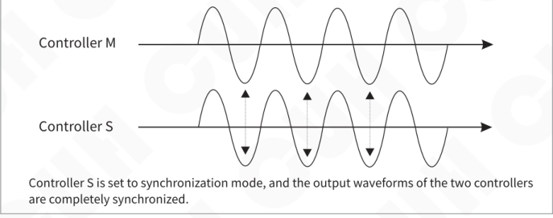

หากตัวควบคุม S ไม่ได้ตั้งเป็นโหมดทาส (โหมด SynV หรือ SynE) รูปคลื่นเอาต์พุตของตัวควบคุมทั้งสองจะไม่ซิงโครไนซ์ ดังแสดงด้านล่าง:

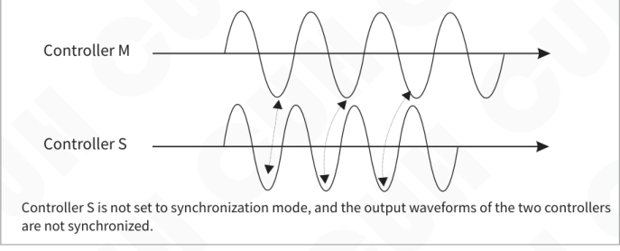


---

สำหรับอุปกรณ์เชิงกลที่ต้องการการจัดตำแหน่งที่แม่นยำ อุปกรณ์สั่นสะเทือนตั้งแต่สองตัวขึ้นไปอาจจำเป็นต้องมีเฟสที่สอดคล้องกันทางกายภาพ แต่อุปกรณ์แต่ละตัวมีความถี่เรโซแนนซ์ที่แตกต่างกัน โดยการตั้งค่าโหมดความถี่เป็น “SynV” ตัวควบคุมสามารถปรับเฟสของอุปกรณ์แต่ละตัวโดยอัตโนมัติตามสภาวะการสั่นสะเทือนเพื่อให้เกิดความสอดคล้องกัน หากโหมดความถี่เป็น “SynE” ผู้ใช้จะตั้งค่าชดเชยเฟสด้วยตนเอง

แก้ไขพารามิเตอร์ “โหมดแรงดัน” และ “โหมดความถี่” ในกลุ่มพารามิเตอร์ความเร็วคงที่เพื่อตั้งค่าตัวควบคุมให้ทำงานใน “โหมดการทำงาน” ที่สอดคล้องกัน โหมดแรงดันและโหมดความถี่มีชุดค่าผสมดังต่อไปนี้:

| Working Mode | Voltage Method | Frequency Method | Phase Control | Vibration Sensor Need |
|---|---|---|---|---|
| Automatic voltage<br>Automatic phase | Auto | SynV | Auto | Yes |
| Automatic voltage<br>Aanual phase | Auto | SynE | Manuel setting | Yes |
| Manual voltage<br>Automatic phase | Manuel | SynV | Auto | Yes |
| Manual voltage<br>Aanual phase | Manuel | SynE | Manuel setting | No |

☺

> **หมายเหตุ:**
>
> 1. แม้ว่าพารามิเตอร์ “โหมดแรงดัน” และ “โหมดความถี่” จะถูกตั้งเป็น “Auto” และ “SynV” หากไม่ได้เชื่อมต่อเซ็นเซอร์สั่นสะเทือน ตัวควบคุมจะยังคงทำงานในสถานะแรงดันแมนนวลและเฟสแมนนวล
>
> 2. แรงดันอัตโนมัติหมายถึงตัวควบคุมทาสที่เชื่อมต่อกับเซ็นเซอร์สั่นสะเทือนซึ่งปรับแรงดันเอาต์พุตโดยอัตโนมัติเพื่อรักษาความเร็วป้อนวัสดุให้มีเสถียรภาพใกล้เคียงกับค่าที่ผู้ใช้ตั้งไว้
>
> 3. เฟสอัตโนมัติหมายความว่าตัวควบคุมทาสที่เชื่อมต่อกับเซ็นเซอร์สั่นสะเทือนจะแก้ไขเฟสของรูปคลื่นเอาต์พุตโดยอัตโนมัติตามสัญญาณตอบกลับของเซ็นเซอร์ เพื่อให้สัญญาณซิงโครไนซ์ที่ส่งออกโดยตัวควบคุมทาสและตัวควบคุมหลักอยู่ในเฟสเดียวกัน
>
> 4. เฟสแมนนวลหมายถึงเฟสของรูปคลื่นเอาต์พุตของตัวควบคุมทาส ซึ่งสามารถตั้งค่าด้วยตนเองให้มีความเบี่ยงเบนเฟสคงที่จากรูปคลื่นเอาต์พุตของตัวควบคุมหลัก

---


---

## วิธีการเชื่อมต่อสายสัญญาณซิงค์ระหว่างตัวควบคุมหลักและตัวควบคุมทาส

เพียงเชื่อมต่อตัวควบคุมหลักและทาสเข้ากับเครือข่ายการสื่อสารซิงโครไนซ์ดิจิทัลเดียวกันแล้วทำการเชื่อมต่อเครือข่าย ตั้งค่าพารามิเตอร์ “การซิงโครไนซ์ความถี่” ในกลุ่มพารามิเตอร์การสื่อสารของตัวควบคุมทาสเป็นหมายเลขที่อยู่ “การซิงโครไนซ์ดิจิทัล” ของตัวควบคุมหลัก จากนั้นเปลี่ยน “โหมดความถี่” ในกลุ่มพารามิเตอร์ความเร็วคงที่เป็น “การสั่นสะเทือนแบบซิงโครไนซ์” หรือ “การไฟฟ้าแบบซิงโครไนซ์”

### สถานการณ์การใช้งานที่ทั้งตัวควบคุมหลักและตัวควบคุมทาสเชื่อมต่อกับเซ็นเซอร์สั่นสะเทือน

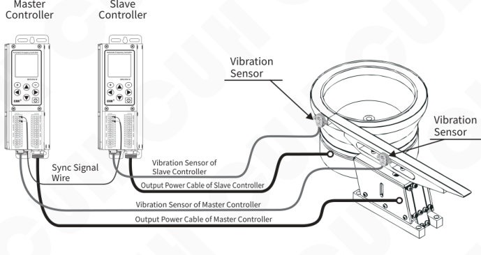

> 1. หากตัวควบคุมทาสทำงานในโหมดแรงดันแมนนวลเฟสแมนนวล ตัวควบคุมทาสไม่จำเป็นต้องเชื่อมต่อกับเซ็นเซอร์สั่นสะเทือน
>
> 2. หากตัวควบคุมหลักทำงานในโหมดแมนนวลเต็มรูปแบบ ตัวควบคุมหลักไม่จำเป็นต้องเชื่อมต่อกับเซ็นเซอร์สั่นสะเทือน

---


**■ โหมดอัตโนมัติแรงดันอัตโนมัติเฟส**

ในโหมดนี้ ตัวควบคุมต้องเชื่อมต่อกับเซ็นเซอร์สั่นสะเทือน ตัวควบคุมจะปรับแรงดันเอาต์พุตโดยอัตโนมัติตามข้อมูลที่ป้อนกลับโดยเซ็นเซอร์สั่นสะเทือน เพื่อให้แน่ใจว่าความเร็วป้อนวัสดุของอุปกรณ์สั่นสะเทือนมีเสถียรภาพที่ค่าที่ตั้งไว้ ความถี่และเฟสของรูปคลื่นเอาต์พุตสอดคล้องกับตัวควบคุมหลัก หรือมีความต่างเฟสที่ตั้งโดยพารามิเตอร์ “เฟสอัตโนมัติ”

**■ โหมดอัตโนมัติแรงดันแมนนวลเฟส**

ในโหมดนี้ ตัวควบคุมต้องเชื่อมต่อกับเซ็นเซอร์สั่นสะเทือน ตัวควบคุมจะปรับแรงดันเอาต์พุตโดยอัตโนมัติตามข้อมูลที่ป้อนกลับโดยเซ็นเซอร์สั่นสะเทือน เพื่อให้แน่ใจว่าความเร็วป้อนวัสดุของอุปกรณ์สั่นสะเทือนมีเสถียรภาพที่ค่าที่ตั้งไว้ ความถี่เอาต์พุตสอดคล้องกับตัวควบคุมหลัก รูปคลื่นเอาต์พุตแตกต่างจากรูปคลื่นเอาต์พุตของตัวควบคุมหลักด้วยค่าความต่างเฟสคงที่ ซึ่งตั้งโดยพารามิเตอร์ “เฟสแมนนวล”

**■ โหมดแมนนวลแรงดันอัตโนมัติเฟส**

ในโหมดนี้ ตัวควบคุมต้องเชื่อมต่อกับเซ็นเซอร์สั่นสะเทือน แรงดันเอาต์พุตของตัวควบคุมถูกปรับด้วยตนเอง ความถี่และเฟสของรูปคลื่นเอาต์พุตสอดคล้องกับตัวควบคุมหลัก หรือมีความต่างเฟสที่ตั้งโดยพารามิเตอร์ “เฟสอัตโนมัติ”

**■ โหมดแมนนวลแรงดันแมนนวลเฟส**

ในโหมดนี้ แรงดันเอาต์พุตของตัวควบคุมถูกปรับด้วยตนเอง และความถี่เอาต์พุตสอดคล้องกับตัวควบคุมหลัก รูปคลื่นเอาต์พุตแตกต่างจากรูปคลื่นเอาต์พุตของตัวควบคุมหลักด้วยค่าความต่างเฟสคงที่ ซึ่งตั้งโดยพารามิเตอร์ “เฟสแมนนวล”

> ☺
>
> 1. โหมดเฟสอัตโนมัติต้องตั้งค่าพารามิเตอร์ “โหมดความถี่” ของตัวควบคุมทาสเป็น “SynV”
>
> 2. โหมดเฟสแมนนวลต้องตั้งค่าพารามิเตอร์ “โหมดความถี่” ของตัวควบคุมทาสเป็น “SynE”


---

## 4.9.3 การแชร์สัญญาณ

หลังจากอุปกรณ์เชื่อมต่อเครือข่ายแล้ว ตัวควบคุมสามารถเรียกสัญญาณใด ๆ จากตัวควบคุมอื่น ๆ ในเครือข่ายเพื่อให้ได้พอร์ตการเรียกสัญญาณที่หลากหลายยิ่งขึ้น

แหล่งสัญญาณของตัวควบคุมหนึ่งตัวในเครือข่ายสามารถเลือกได้จากพอร์ตใด ๆ ของตัวควบคุมใด ๆ ในเครือข่าย และสามารถใช้การควบคุมลอจิกที่ซับซ้อนผ่านการดำเนินการลอจิก AND, OR, XOR หรือ RS

ขั้นตอนการดำเนินการสำหรับการเรียกแหล่งสัญญาณอื่น ๆ จากเอาต์พุตหลักของตัวควบคุม:

➢ **เลือกตัวควบคุมที่ต้องการรับสัญญาณจากเครือข่าย เข้าสู่กลุ่มเอาต์พุตหลัก ทำการตั้งค่าต่อไปนี้:**

1. ตั้งค่าพารามิเตอร์ “MainSor1” หรือพารามิเตอร์ “MainSor2” เป็น “Bus”
2. ตั้งค่าพารามิเตอร์ “MainLogc” เป็นหนึ่งใน “And”, “Or”, “Xor” และ “RS”
3. ตั้งค่าพารามิเตอร์ “MainDire” ของตัวควบคุมนี้เป็นหนึ่งใน “Const”, “Inv”, “On” หรือ “Off”
4. ตั้งค่าเวลา “MainUpDy” และ “MainDnDy” ของตัวควบคุมนี้
5. ตั้งค่าพารามิเตอร์ “MainMode” ของตัวควบคุมนี้เป็นหนึ่งใน “Delay” หรือ “Hold”

➢ **ข้ามไปยังกลุ่มการสื่อสารและทำการตั้งค่าต่อไปนี้:**

6. ตั้งค่า “BSigMID1” ของตัวควบคุมนี้เป็นที่อยู่ของตัวควบคุมที่จะติดตาม (หมายเลขตัวควบคุมสามารถสอบถามได้ผ่านการซิงโครไนซ์ดิจิทัล)
7. ตั้งค่า “BSigMID2” ของตัวควบคุมนี้เป็นที่อยู่ของตัวควบคุมที่จะติดตาม
8. ตั้งค่าหมายเลขบิตสถานะเฉพาะของ “BSigM_B1” ของตัวควบคุมนี้ จำเป็นต้องตรวจสอบ “บิตสถานะ” ของตัวควบคุมที่ติดตาม 1~16” เลือกหมายเลขลำดับบิตสถานะที่เครื่องต้องการ
9. ตั้งค่าหมายเลขบิตสถานะเฉพาะของ “BSigM_B2” ของตัวควบคุมนี้ จำเป็นต้องตรวจสอบ “บิตสถานะ” ของตัวควบคุมที่ติดตาม 1~16” เลือกหมายเลขลำดับบิตสถานะที่เครื่องต้องการ

ตัวควบคุมใด ๆ สามารถส่งสถานะ 16 รายการของตัวเองไปยังบัส ซึ่งสามารถตั้งค่าแยกกันผ่าน “บิตสถานะ 1” ~ “บิตสถานะ 16” และ “บิตสถานะ 1” ~ “บิตสถานะ 16” เหมือนกับ 16 บิตแรกของบท “7.4.11 ภาคผนวก” โดยค่าเริ่มต้น

ตัวควบคุมใด ๆ สามารถเรียกสัญญาณบนบัสได้ (โดยค่าเริ่มต้น) สำหรับความหมายและรายละเอียด โปรดดูบท “7.4.11 ภาคผนวก”

---


---

ตัวอย่าง: หลังจากเชื่อมต่อเครือข่ายแล้ว ตัวควบคุม Address 3 เรียกสัญญาณพอร์ต C อุปกรณ์ของระบบควบคุม Address 1 และสัญญาณพอร์ต C อุปกรณ์ของระบบควบคุม Address 2 และดำเนินการ OR เชิงตรรกะ และเมื่อตรวจพบสัญญาณใด ๆ มีผล เอาต์พุตหลักของตัวควบคุม Address 3 จะหยุด

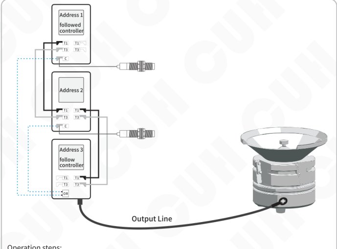

ขั้นตอนการดำเนินการ:

1. ตั้งค่ากลุ่มพารามิเตอร์เอาต์พุตหลักของตัวควบคุมที่ Address 3 “MainSor1” เป็น “bus” และ “MainSor2” เป็น “bus”
2. ตั้งค่าพารามิเตอร์ “MainLogc” ของตัวควบคุม Address 3 เป็น “And”
3. ตั้งค่าพารามิเตอร์ “MainDire” (ทิศทางเอาต์พุตหลัก) ของตัวควบคุม Address 3 เป็น “Const”
4. ตั้งค่าเวลา “MainUpDy” และ “MainDnDy” ของตัวควบคุม Address 3 เป็นค่าที่ต้องการ ค่าเริ่มต้นคือ 0.2 วินาที
5. ตั้งค่า “MainMode” (โหมดเอาต์พุตหลัก) ของตัวควบคุม Address 3 เป็น “Delay”
6. ตั้งค่า “BSigMID1” ใน “กลุ่มพารามิเตอร์การสื่อสาร” ของตัวควบคุม Address 3 เป็น “1” (ระบุตัวควบคุม Address 1)
7. ตั้งค่า “BSigMID2” ของตัวควบคุม Address 3 เป็น “2” (ระบุตัวควบคุม Address 2)
8. ตั้งค่า “BSigM_B1” ของตัวควบคุม Address 3 เป็น “4” (ระบุสัญญาณพอร์ต C)
9. ตั้งค่า “BSigM_B2” ของตัวควบคุม Address 3 เป็น “4” (ระบุสัญญาณพอร์ต C)
10. การตั้งค่าเสร็จสิ้น สำหรับการตั้งค่าเอาต์พุตควบคุมของพอร์ต D ของตัวควบคุม โปรดดูการตั้งค่าเอาต์พุตหลักของตัวควบคุม

---


---

## 4.9.4 การสำรองข้อมูล

เมื่อตัวควบคุมทั้งหมดเชื่อมต่อเครือข่าย ตัวควบคุมทั้งหมดในเครือข่ายสามารถสำรองข้อมูลซึ่งกันและกันได้ ตัวควบคุมแต่ละตัวสำรองข้อมูลของตัวควบคุมอีกสองตัวในเครือข่าย เมื่อตัวควบคุมในเครือข่ายเดิมเสียหาย ผู้ใช้สามารถเปลี่ยนตัวควบคุมที่เสียหายด้วยตัวควบคุมใหม่ได้อย่างรวดเร็ว พารามิเตอร์ทั้งหมดของตัวควบคุมใหม่จะสอดคล้องกับตัวควบคุมก่อนการเปลี่ยน

เมื่อตัวควบคุมที่มีหมายเลขติดกันน้อยกว่า 3 ตัวเสียหายในเครือข่าย การดำเนินการเปลี่ยนจะสำเร็จ อย่างไรก็ตาม เมื่อตัวควบคุมที่มีหมายเลข 3 ตัวขึ้นไปเสียหาย ข้อมูลเครื่องทั้งหมดจะไม่สามารถกู้คืนได้

➢ **ขั้นตอนการเชื่อมต่อเครือข่ายของตัวควบคุมใหม่ในฐานะอุปกรณ์เปลี่ยนทดแทน:**

1. ปิดเครื่องอุปกรณ์ที่จะเปลี่ยนและถอดสายสื่อสาร CUHBus-DS®
2. เชื่อมต่ออินเทอร์เฟซ CUHBus-DS® ของอุปกรณ์ใหม่เข้ากับเครือข่ายเดิม
3. เมื่ออุปกรณ์ใหม่เปิดเครื่อง ตัวควบคุมที่เข้าใหม่จะเข้าสู่ “กลุ่มพารามิเตอร์การสื่อสาร” โดยอัตโนมัติ
4. ตั้งค่าพารามิเตอร์ “DigSynAd” (ที่อยู่การซิงโครไนซ์ดิจิทัลในเครื่อง) เนื่องจากเครือข่ายนี้ไม่สมบูรณ์ ค่าของพารามิเตอร์นี้จะแสดงเฉพาะหมายเลขอุปกรณ์ที่ต้องเปลี่ยนเท่านั้น
5. ตั้งค่าพารามิเตอร์ “EnNetwok ” เป็น “Replace” จากนั้นกด ⊕ และ ⊖ ค้างพร้อมกัน ยืนยัน
6. หลังจากเปลี่ยนสำเร็จ ค่าพารามิเตอร์ “EnNetwok ” ของอุปกรณ์ใหม่จะเปลี่ยนเป็น “Online” โดยอัตโนมัติ

ตัวอย่าง 1: เครือข่ายเดิมประกอบด้วยตัวควบคุม Address 1, Address 2 และ Address 3 เนื่องจาก Address 3 เสียหาย จำเป็นต้องเปลี่ยนอุปกรณ์เดิมด้วยอุปกรณ์ใหม่และกู้คืนการตั้งค่าทั้งหมดของอุปกรณ์เดิม

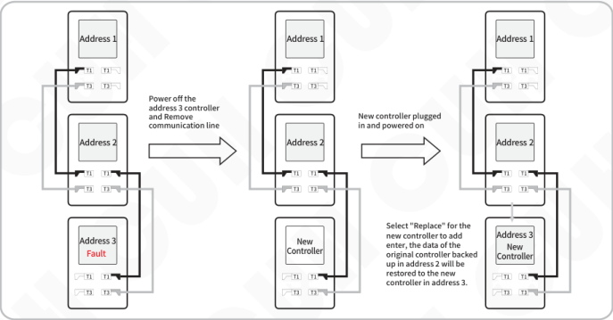

ตัวอย่าง 2: มีตัวควบคุมสี่ตัวที่มี Address 1, 2, 3 และ 4 ในเครือข่าย ในนั้น ตัวควบคุมที่ Address 2, 3 และ 4 ในเครือข่ายเสียหาย อย่างไรก็ตาม เนื่องจากอุปกรณ์แต่ละตัวในเครือข่ายสำรองข้อมูลจากตัวควบคุมได้สูงสุดสองตัว ตัวควบคุมที่ Address 4 จึงไม่สามารถกู้คืนข้อมูลได้อย่างสมบูรณ์ สำหรับการตั้งค่าการเปลี่ยนของตัวควบคุมที่ Address 2 และ 3 โปรดดูกรณีข้างต้น

ตัวอย่าง 3: เดิมมีห้าเครื่องที่มี Address 1, 2, 3, 4 และ 5 ในเครือข่าย ในนั้น Address 1, 2 และ 4 ผิดพลาด (สามเครื่องที่ไม่ติดกัน) คุณสามารถกู้คืนข้อมูลตัวควบคุม Address 1 และ Address 2 จาก Address 5 กู้คืนข้อมูลตัวควบคุม Address 4 จาก Address 3 จึงกู้คืนข้อมูลตัวควบคุมที่เสียหายทั้งหมด สำหรับการตั้งค่าการเปลี่ยนตัวควบคุม โปรดดูกรณีข้างต้น

---


## 4.9.5 ข้อมูลควบคุมระยะไกล

ผู้ใช้สามารถเลือกส่งแหล่งข้อมูลไปยังเครือข่ายการซิงโครไนซ์ และสามารถเลือกแรงดันแมนนวล แรงดันควบคุมระยะไกล ความเร็วแมนนวล และความเร็วควบคุมระยะไกล

| Parameter | Meaning |
|---|---|
| ManVol | แรงดันแมนนวลหมายถึงแรงดันที่ตั้งโดยแผงของผู้ใช้ |
| RemVol | แรงดันควบคุมระยะไกลหมายถึงแรงดันที่ปรับผ่านพอร์ตควบคุมความเร็วระยะไกล |
| ManSpd | ความเร็วแมนนวลหมายถึงความเร็วป้อนวัสดุที่ตั้งโดยแผงของผู้ใช้ |
| RemSpd | ความเร็วควบคุมระยะไกลหมายถึงความเร็วป้อนวัสดุที่ปรับผ่านพอร์ตควบคุมความเร็วระยะไกล |

## 4.10 การตรวจสอบสถานะตัวควบคุม

ในกลุ่มพารามิเตอร์การตรวจสอบ สถานะการทำงานและค่าพารามิเตอร์ของตัวควบคุมสามารถอ่านได้แบบเรียลไทม์

สำหรับรายการพารามิเตอร์ที่อ่านได้ โปรดดูบท “รายการพารามิเตอร์” กลุ่มพารามิเตอร์ 10 กลุ่มพารามิเตอร์การตรวจสอบ

```text
┌────────────────────────────┐
│ RUN                        │
│ A C D E F G N J      A0   │
│ 01.Voltage        150  V   │
│ 02.Frequenc       50.0 Hz  │
│ 03.SpeedNow          0     │
│ 04.VoltgOut     223.8 V   │
│ 05.EffectCu      0.00 A   │
│ +    10Monitor        −   │
└────────────────────────────┘
```


## 4.11 บันทึกข้อผิดพลาด

ตัวควบคุมสามารถบันทึกชุดบันทึก 64 ชุดแบบวนซ้ำเพื่อความสะดวกในการดูเวลาที่เกิดปัญหาและข้อมูลเฉพาะในภายหลัง ในอินเทอร์เฟซใด ๆ กด ▲ และ ▶ ค้างเพื่อเข้าสู่กลุ่มอินเทอร์เฟซบันทึก ซึ่งแสดงดังนี้:

```text
┌────────────────────────┐
│ RUN                    │
│ A C D E F G N J     A0 │
│      0 H   0 M    1 S  │
│ Err CodeError       01 │  } สองบรรทัดด้านบนแสดงบันทึกข้อผิดพลาด
│ 01.Voltage       150 V │
│ 02.Frequenc     50.0Hz │  } สามบรรทัดด้านล่างแสดง
│ 03.SpeedNow         0  │    กลุ่มพารามิเตอร์การตรวจสอบ
│ +       Note        −  │
└────────────────────────┘
```

## 4.12 ปรับแต่งหน้าหลัก

เพื่อความสะดวกให้ผู้ใช้ใช้งานตัวควบคุมได้อย่างมีประสิทธิภาพและรวดเร็ว ผู้ใช้สามารถดำเนินการปรับแต่งในกลุ่มพารามิเตอร์อินเทอร์เฟซ โดยการดึงพารามิเตอร์สูงสุด 16 รายการจากทั้งหมดมาเป็นรายการตรวจจับในกลุ่มพารามิเตอร์อินเทอร์เฟซ และผู้ใช้สามารถดำเนินการอย่างรวดเร็วบนหน้าหลัก

ตัวอย่าง: เลือก 1. UsrVoltg (P2.02), 2. UsrFrqnc (P2.03), 3. UserSped (P2.01), 4. SoftStar (P2.04), SoftStop (P2.05) รวมห้าพารามิเตอร์ในหน้าหลัก ขั้นตอนมีดังนี้:

```text
» กด ▲ และ ◀ ค้างเพื่อเข้าสู่                 ┌────────────────────────┐
  อินเทอร์เฟซการตั้งค่าพารามิเตอร์            │ RUN                    │
  กด ▶ สั้น ๆ เพื่อสลับไปยัง                  │ A C D E F G N J     A0 │
  กลุ่มพารามิเตอร์ “1EditHome”                │ 01.Monit  1     P2.02 │
                                              │ 02.Monit  2     P2.03 │
» กด ▲ หรือ ▼ สั้น ๆ เพื่อสลับ                │ 03.Monit  3     P2.01 │
  ระหว่างรายการตรวจสอบ                        │ 04.Monit  4     P2.04 │
  แต่ละรายการ                                 │ 05.Monit  5     P2.05 │
                                              │ +    1EditHome      −  │
» กด ⊕ หรือ ⊖ เพื่อเลือก                      └────────────────────────┘
  ป้ายกำกับฟังก์ชันที่จำเป็น
  ต้องตั้งค่าแยกกัน

หมายเหตุ: ป้ายกำกับฟังก์ชันสามารถค้นหาได้ผ่านบท “รายการพารามิเตอร์”
      หากค่าของรายการตรวจสอบว่างเปล่า หมายความว่าไม่มีรายการตรวจสอบ
```

หลังจากดำเนินการเสร็จสิ้น หากผู้ใช้จำเป็นต้องปรับค่าแรงดัน ความถี่ ความเร็วป้อนวัสดุ เวลาเริ่มนุ่ม และเวลาหยุดนุ่ม ให้เข้าสู่รายการตรวจสอบเฉพาะในกลุ่มพารามิเตอร์ของอินเทอร์เฟซ “Home” และผ่าน ⊕ หรือ ⊖ สามารถปรับพารามิเตอร์ได้เสร็จสิ้น


# บทที่ Ⅴ การใช้งานทั่วไป

## 5.1 ทำอย่างไรให้เครื่องป้อนวัสดุแบบสั่นสะเทือนสองเครื่องทำงานที่ความถี่เดียวกัน?

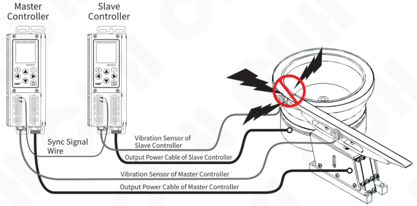

ส่วนนี้แนะนำการเชื่อมต่อเครือข่ายของตัวควบคุม SDVC341 สองตัวและการทำให้เครื่องสั่นแบบตรงหนึ่งเครื่องและเครื่องสั่นแบบวงกลมหนึ่งเครื่องทำงานที่ความถี่เดียวกันเพื่อหลีกเลี่ยงการชนกันของแผ่นเนื่องจากความถี่การทำงานไม่สอดคล้องกัน

1. ตัวควบคุมเชื่อมต่อสายไฟและสายเอาต์พุตอย่างถูกต้อง
2. นำเซ็นเซอร์ที่ถูกติดตามโดยตัวควบคุมออก เชื่อมต่อปลั๊กเซ็นเซอร์เข้ากับตัวควบคุมและขันน็อตให้แน่น และยึดตัวเซ็นเซอร์บนแผ่นสั่นสะเทือนอย่างถูกต้อง (ดูรายละเอียดใน “2.3 คู่มือการติดตั้งเซ็นเซอร์สั่นสะเทือน”)
3. เปิดฝาช่องเดินสายของอุปกรณ์ เชื่อมต่อสัญญาณ T1 ของตัวควบคุมทั้งหมดเข้าด้วยกัน และเชื่อมต่อสัญญาณ T3 ทั้งหมดเข้าด้วยกัน
4. หลังจากเปิดอุปกรณ์ทั้งสองเครื่อง ตัวควบคุมตัวหนึ่งจะเข้าสู่ “กลุ่มพารามิเตอร์การสื่อสาร” โดยอัตโนมัติ
5. ในกลุ่มพารามิเตอร์การสื่อสารของตัวควบคุม โปรแกรมจะสร้างหมายเลขอุปกรณ์การสื่อสารซิงโครไนซ์ดิจิทัลโดยอัตโนมัติ “การซิงโครไนซ์ดิจิทัล” คือค่าใด ๆ [1~8] ผู้ใช้ยังสามารถเปลี่ยนค่านี้ได้เอง
6. ในกลุ่มพารามิเตอร์การสื่อสาร ตั้งค่าพารามิเตอร์ “EnNetwok ” เป็น “Expand” จากนั้นกด ⊕ และ ⊖ ค้างพร้อมกัน ยืนยัน
7. หลังจากเพิ่มตัวควบคุมที่ติดตามสำเร็จ ค่าพารามิเตอร์ “EnNetwok” จะเปลี่ยนเป็น “Online” โดยอัตโนมัติ ซึ่งบ่งชี้ว่าการเชื่อมต่อเครือข่ายสำเร็จ
8. ผู้ใช้กด ▲ และ ◀ ค้างเพื่อเข้าสู่อินเทอร์เฟซการตั้งค่าพารามิเตอร์โดยกด ◀ หรือ ▶ สั้น ๆ เพื่อสลับไปยังกลุ่มพารามิเตอร์การสื่อสาร ดูและจดบันทึกที่อยู่การซิงโครไนซ์ดิจิทัลของตัวควบคุมแต่ละตัว
9. ตั้งค่าพารามิเตอร์ “FrqncSyn” ของตัวควบคุมที่ติดตามในกลุ่มพารามิเตอร์การสื่อสารเป็นหมายเลขที่อยู่ “DigSynAd” ของตัวควบคุมที่ถูกติดตาม

หลังจากตั้งค่าข้างต้นเสร็จสิ้น ตัวควบคุมหนึ่งตัวสามารถติดตามตัวควบคุมอื่นเพื่อส่งออกที่ความถี่เดียวกันได้

---


## 5.2 จะเปิด/ปิดตัวควบคุม B ผ่านเซ็นเซอร์ที่เชื่อมต่อกับตัวควบคุม A ได้อย่างไร?

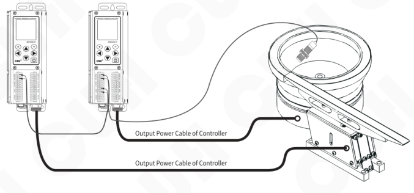

ส่วนนี้แนะนำการเชื่อมต่อเครือข่ายของตัวควบคุม SDVC341 สองตัว และทำให้เอาต์พุตหลักของตัวควบคุมที่ถูกควบคุมถูกควบคุมโดยสัญญาณพอร์ต C ของตัวควบคุมควบคุมหลักอีกตัวหนึ่งควบคุมการเริ่มและหยุด ดังนั้นแม้ว่าเซ็นเซอร์จะไม่ได้เชื่อมต่อโดยตรงกับตัวควบคุมที่ถูกควบคุม ตัวควบคุมก็สามารถทำงานผ่านสัญญาณเครือข่ายได้ แหล่งสัญญาณของตัวควบคุมได้รับการเสริมแต่งอย่างมาก

1. ตัวควบคุมเชื่อมต่อสายไฟและสายเอาต์พุตอย่างถูกต้อง

2. เปิดฝาช่องเดินสายของอุปกรณ์ เชื่อมต่อสัญญาณ T1 ของตัวควบคุมทั้งหมดเข้าด้วยกัน และเชื่อมต่อสัญญาณ T3 ทั้งหมดเข้าด้วยกัน

3. หลังจากเปิดอุปกรณ์ทั้งสองเครื่อง ตัวควบคุมตัวหนึ่งจะเข้าสู่ “กลุ่มพารามิเตอร์การสื่อสาร” โดยอัตโนมัติ

4. ในกลุ่มพารามิเตอร์การสื่อสารของตัวควบคุม โปรแกรมจะสร้างหมายเลขอุปกรณ์การสื่อสารซิงโครไนซ์ดิจิทัลโดยอัตโนมัติ และ “การซิงโครไนซ์ดิจิทัล” คือค่าใด ๆ [1~8] ผู้ใช้ยังสามารถเปลี่ยนค่านี้ได้เอง

5. ผู้ใช้กด ▲ และ ◀ ค้างเพื่อเข้าสู่อินเทอร์เฟซการตั้งค่าพารามิเตอร์โดยกด ◀ หรือ ▶ สั้น ๆ เพื่อสลับไปยังกลุ่มพารามิเตอร์การสื่อสาร ดูและจดบันทึกที่อยู่การซิงโครไนซ์ดิจิทัลของตัวควบคุมแต่ละตัว

6. ตัวควบคุมที่ถูกควบคุมสลับไปยังกลุ่มพารามิเตอร์เอาต์พุตหลักตามวิธีการข้างต้น และพารามิเตอร์ถูกตั้งค่าดังนี้:

“MainSor1” เป็น “Bus”, “MainSor2” เป็น “Bus”, “MainLogc” เป็น “And”, “MainDire” เป็น “Const”, “MainUpDy” และ “MainDnDy” ถูกตั้งเป็นค่าที่ต้องการ ค่าเริ่มต้นคือ 0.2 วินาที, “MainMode” ถูกตั้งเป็น “Delay”

7. ตัวควบคุมที่ถูกควบคุมสลับไปยังกลุ่มพารามิเตอร์การสื่อสารตามวิธีการข้างต้น และพารามิเตอร์ถูกตั้งค่าดังนี้:

“BSigMID1” ถูกตั้งเป็น “X” (X: คือหมายเลขบิตการซิงโครไนซ์ดิจิทัลของตัวควบคุมที่ต้องเรียกสัญญาณ), “BSigM_B1” ถูกตั้งเป็น “4” (สัญญาณพอร์ต C อินพุตวัสดุ), “BSigM_B2” ถูกตั้งเป็น “0” (0 บ่งชี้สัญญาณไม่มีผล)

หลังจากตั้งค่าข้างต้นเสร็จสิ้น เอาต์พุตของตัวควบคุมหนึ่งตัวถูกควบคุมโดยสัญญาณพอร์ต C ของตัวควบคุมอื่น


## 5.3 จะเปิด/ปิดตัวควบคุมสองตัวพร้อมกันได้อย่างไร?

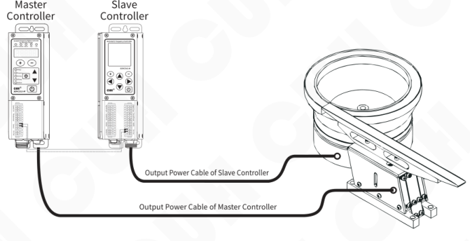

ส่วนนี้แนะนำตัวควบคุมการสั่นแบบตรง (ใช้ SDVC311) และตัวควบคุมจาน (ใช้ SDVC341) เริ่มและหยุดพร้อมกัน ตัวควบคุมต่างซีรีส์ก็สามารถทำงานเริ่มและหยุดพร้อมกันได้เช่นกัน

1. ตัวควบคุมเชื่อมต่อสายไฟและสายเอาต์พุตอย่างถูกต้อง

2. เปิดฝาช่องเดินสายของอุปกรณ์ เชื่อมต่อ D1 ของ SDVC341 กับ C2 ของ SDVC311 และเชื่อมต่อ D3 ของ SDVC341 กับ C1 ของ SDVC311

3. หลังจากเปิดอุปกรณ์ทั้งสองเครื่อง กด ▲ และ ◀ ค้างเพื่อเข้าสู่อินเทอร์เฟซการตั้งค่าพารามิเตอร์โดยกด ◀ หรือ ▶ สั้น ๆ เพื่อสลับไปยังกลุ่มพารามิเตอร์เอาต์พุตควบคุม

4. ในกลุ่มพารามิเตอร์เอาต์พุตควบคุม พารามิเตอร์ถูกตั้งค่าดังนี้:

“PotDLogc” ถูกตั้งเป็น “Or”, “PotDSor1” ถูกตั้งเป็น “Main”, “PotDType” ถูกตั้งเป็น “Ou_PNP” และค่าเริ่มต้นอื่น ๆ คงไว้ไม่เปลี่ยนแปลง

ข้างต้นเป็นการตั้งค่าเสร็จสิ้นเพื่อให้ตัวควบคุมการสั่นแบบตรง (ใช้ SDVC311) และตัวควบคุมเครื่องป้อนวัสดุแบบสั่นสะเทือน (ใช้ SDVC341) เริ่มและหยุดพร้อมกัน

---


---

# บทที่ Ⅵ คำถามที่พบบ่อย

## 6.1 ไม่มีจอแสดงผลเมื่อเปิดเครื่อง

วิธีแก้ไข:

◆ ตรวจสอบว่าเต้ารับมีไฟฟ้าหรือไม่

◆ ตรวจสอบว่าปลั๊กไฟเชื่อมต่อกับเต้ารับอย่างแน่นหนาหรือไม่

## 6.2 ไม่สั่นสะเทือน ไม่มีเสียงรบกวน จอแสดงผลตัวควบคุมปกติ

วิธีแก้ไข:

◆ ตรวจสอบว่าสายไฟเอาต์พุตเชื่อมต่อกับตัวควบคุมและเครื่องป้อนวัสดุแบบสั่นสะเทือนอย่างถูกต้องหรือไม่

◆ ตรวจสอบว่าการตั้งค่าพารามิเตอร์แรงดันเอาต์พุตและความถี่เอาต์พุตของตัวควบคุมเหมาะสมหรือไม่

◆ ตรวจสอบว่าตัวควบคุมถูกหยุดโดยสัญญาณควบคุมใด ๆ หรือไม่

◆ ตรวจสอบว่าตัวควบคุมถูกหยุดโดยการตั้งค่าลอจิกปิดพารามิเตอร์ใด ๆ หรือไม่

## 6.3 สัญญาณควบคุมไม่ทำงาน

วิธีแก้ไข:

◆ ตรวจสอบว่าสัญญาณควบคุมเชื่อมต่ออย่างแน่นหนาหรือไม่

◆ ตรวจสอบว่าสายดินของสัญญาณควบคุมเชื่อมต่อกับพอร์ต GND ของตัวควบคุมหรือไม่

◆ ตรวจสอบว่าลอจิกสัญญาณควบคุมถูกตั้งค่าอย่างถูกต้องหรือไม่

## 6.4 ไม่สั่นสะเทือน มีเสียงรบกวนปกติ จอแสดงผลตัวควบคุมปกติ

วิธีแก้ไข:

◆ ปรับการตั้งค่าพารามิเตอร์ตามคู่มือการใช้งานฉบับนี้

## 6.5 การติดตามความถี่เรโซแนนซ์ไม่เสถียร

วิธีแก้ไข:

◆ เพิ่มค่าอินทิกรัลความถี่อย่างเหมาะสม แต่โปรดทราบว่าหากมากเกินไปอาจทำให้เกิดการแกว่งของความถี่เอาต์พุต

---


---

## 6.6 การแก้ไขความเร็วช้าในการควบคุมความเร็วป้อนคงที่

วิธีแก้ไข:

◆ ปรับค่าอินทิกรัลแอมพลิจูดอย่างเหมาะสม แต่โปรดทราบว่าหากใหญ่เกินไป แอมพลิจูดการแกว่งของแรงดันเอาต์พุตจะใหญ่ขึ้น

## 6.7 จะรีเซ็ตตัวควบคุมกลับเป็นการตั้งค่าโรงงานอย่างรวดเร็วได้อย่างไร

เนื่องจากฟังก์ชันอันทรงพลังของตัวควบคุมนี้ จึงมีพารามิเตอร์ควบคุมจำนวนมากที่ผู้ใช้สามารถตั้งค่าได้ สำหรับผู้เริ่มต้น สถานะการทำงานปกติของตัวควบคุมอาจไม่สามารถกลับคืนได้หลังจากแก้ไขการตั้งค่าหลายครั้ง ใช้ฟังก์ชันนี้เพื่อรีเซ็ตสถานะพารามิเตอร์ที่สับสนกลับเป็นการตั้งค่าโรงงานอย่างรวดเร็ว

วิธีแก้ไข:

◆ กด ▲ และ ◀ ค้างเพื่อเข้าสู่อินเทอร์เฟซการตั้งค่าพารามิเตอร์ กด ◀ หรือ ▶ สั้น ๆ เพื่อสลับไปยังกลุ่มการบันทึกการตั้งค่า

◆ สลับไปยังพารามิเตอร์กู้คืนการตั้งค่าและเลือกพารามิเตอร์กลุ่มงาน กด ⊕ และ ⊖ ค้างพร้อมกันนานกว่าสองวินาทีเพื่อสลับไปยังอินเทอร์เฟซสแตนด์บาย ในขณะนี้ พารามิเตอร์ทั้งหมดในกลุ่มงานจะกลับเป็นการตั้งค่าเริ่มต้นจากโรงงาน (การตั้งค่า User 1, User 2 และ User 3 ยังคงไม่เปลี่ยนแปลง)

หากผู้ใช้เคยบันทึกพารามิเตอร์ไว้ใน “User 1”, “User 2” หรือ “User 3” การตั้งค่าของผู้ใช้ก็สามารถกู้คืนได้เช่นกัน

---


# บทที่ Ⅶ ภาคผนวก

## 7.1 มิติ

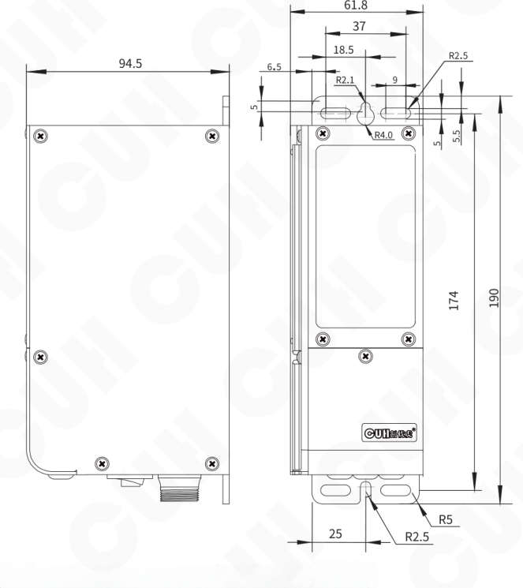

| ช่วงมิติ | ค่าเผื่อความคลาดเคลื่อน |
|---|---:|
| 0~3 | ±0.05 |
| 3~10 | ±0.1 |
| 10~30 | ±0.15 |
| 30~80 | ±0.2 |
| 80~180 | ±0.3 |
| >180 | ±0.5 |

ตารางค่าเผื่อความคลาดเคลื่อนนี้ใช้ได้กับผลิตภัณฑ์ทั้งหมดในซีรีส์นี้


## 7.2 ข้อมูลจำเพาะทางเทคนิค

| รายการ | ต่ำสุด | ทั่วไป | สูงสุด | หน่วย | หมายเหตุ |
|---|---:|---:|---:|---|---|
| แรงดันอินพุต | 85 | 220 | 250 | V | AC RMS |
| ช่วงแรงดันเอาต์พุตที่ปรับได้ | 0 | —— | 250 | V |  |
| ความแม่นยำในการปรับแรงดัน |  | 1 |  | V |  |
| ความแม่นยำในการควบคุมแรงดัน | 0 | —— | 10 | % | ΔVout/ΔVin |
| ช่วงกระแสเอาต์พุตที่ปรับได้ | 0 | —— | 3.0 | A |  |
| กำลังเอาต์พุต | 0 | —— | 660 | VA |  |
| ความถี่เอาต์พุต | 5.0 | —— | 999.9 | Hz |  |
| ความแม่นยำในการปรับความถี่ |  | 0.1 |  | Hz |  |
| รูปคลื่นเอาต์พุต |  | Sine |  |  |  |
| เวลาสตาร์ทแบบนุ่มนวล | 0 | —— | 40.0 | s | ค่าเริ่มต้น: 0.5 |
| ช่วงเวลาหน่วงเปิด/ปิด | 0.0 | —— | 99.9 | s | ค่าเริ่มต้น: 0.2 |
| ความแม่นยำของเวลาหน่วงเปิด/ปิด |  | 0.1 |  | s |  |
| อุณหภูมิทริกเกอร์ป้องกันความร้อนเกิน | 60 | 65 | 65 | ℃ |  |
| การสื่อสารซิงค์ |  | CUHBus-DS® |  |  |  |
| การสื่อสารดิจิทัล |  | ModBUS485/Digital Sync |  |  |  |
| กระแสเอาต์พุตควบคุม DC | 0 | —— | 350 | mA |  |
| แรงดันเอาต์พุตควบคุม DC | 22 | 24 | 26 | V |  |
| สัญญาณควบคุมแอนะล็อก |  | 4~20 |  | mA | กระแสควบคุมความเร็วระยะไกล |
|  |  | 1~5/0~5/0~10 |  | V | แรงดันควบคุมความเร็วระยะไกล |
| สัญญาณควบคุมดิจิทัล |  | 24 |  | V | สัญญาณสวิตชิ่ง |
| วิธีการปรับ |  | 7 |  | ปุ่มกด |  |
| การใช้พลังงานสแตนด์บาย | —— | —— | 5 | W |  |
| วิธีการแสดงผล |  | 128*128 |  |  | จอแบบดอทเมทริกซ์ |
| ระดับการป้องกันการเข้าฝุ่นและน้ำ |  | IP20 |  |  |  |
| อุณหภูมิแวดล้อม | 0 | 25 | 40 | ℃ |  |
| ความชื้นแวดล้อม | 10 | 60 | 85 | % | ไม่มีการควบแน่น |
| อุณหภูมิแวดล้อมในการจัดเก็บ | -20 | 25 | 65 | ℃ |  |


## 7.3 มาตรฐานอ้างอิง

**พารามิเตอร์สัมบูรณ์:**  
การเกินมาตรฐานข้างต้นจะทำให้ตัวควบคุมเสียหาย ต้องปฏิบัติตามอย่างเคร่งครัด

| รายการ | มาตรฐาน GB | มาตรฐาน IEC | ระดับ | ข้อกำหนดมาตรฐาน | หมายเหตุ |
|---|---|---|---|---|---|
| การคายประจุ<br>ไฟฟ้าสถิต | GB/T 17626.2-2006 | IEC 61000-4-2:2001 | 4 | ±8 kV | การคายประจุ<br>แบบสัมผัส |
|  |  |  | 4 | ±15 kV | การคายประจุในอากาศ |
| การทดสอบทรานเซียนต์<br>ไฟฟ้าเร็ว | GB/T 17626.4-2008 | IEC 61000-4-4:2004 | 4 | ±4 kV |  |
| ภูมิคุ้มกันคลื่น<br>ของสายไฟ DC | GB/T 17626.17-2005 | IEC 61000-4-17:2002 | 4 | 15% | ระดับ A |

> **คำเตือน**  
> ในสภาพแวดล้อมที่พักอาศัย ผลิตภัณฑ์นี้อาจทำให้เกิดการรบกวนทางวิทยุ ซึ่งในกรณีนี้จำเป็นต้องมีมาตรการบรรเทาผลกระทบเพิ่มเติม


## 7.4 รายการพารามิเตอร์

### 7.4.1 กลุ่มพารามิเตอร์อินเทอร์เฟซ

| ฟังก์ชัน | พารามิเตอร์ | การแสดงผล | ช่วงค่า/รายการตัวเลือก | ค่าเริ่มต้น |
|---|---|---|---|---|
| P1.01 | รายการตรวจสอบ 1 | 01.Monit1 | กลุ่มพารามิเตอร์ 2~กลุ่มพารามิเตอร์ 10 | P2.01 |
| P1.02 | รายการตรวจสอบ 2 | 02.Monit2 | กลุ่มพารามิเตอร์ 2~กลุ่มพารามิเตอร์ 10 | P10.05 |
| P1.03 | รายการตรวจสอบ 3 | 03.Monit3 | กลุ่มพารามิเตอร์ 2~กลุ่มพารามิเตอร์ 10 | P2.02 |
| P1.04 | รายการตรวจสอบ 4 | 04.Monit4 | กลุ่มพารามิเตอร์ 2~กลุ่มพารามิเตอร์ 10 | P2.03 |
| P1.05 | รายการตรวจสอบ 5 | 05.Monit5 | กลุ่มพารามิเตอร์ 2~กลุ่มพารามิเตอร์ 10 |  |
| P1.06 | รายการตรวจสอบ 6 | 06.Monit6 | กลุ่มพารามิเตอร์ 2~กลุ่มพารามิเตอร์ 10 |  |
| P1.07 | รายการตรวจสอบ 7 | 07.Monit7 | กลุ่มพารามิเตอร์ 2~กลุ่มพารามิเตอร์ 10 |  |
| P1.08 | รายการตรวจสอบ 8 | 08.Monit8 | กลุ่มพารามิเตอร์ 2~กลุ่มพารามิเตอร์ 10 |  |
| P1.09 | รายการตรวจสอบ 9 | 09.Monit9 | กลุ่มพารามิเตอร์ 2~กลุ่มพารามิเตอร์ 10 |  |
| P1.10 | รายการตรวจสอบ 10 | 10.Monit10 | กลุ่มพารามิเตอร์ 2~กลุ่มพารามิเตอร์ 10 |  |
| P1.11 | รายการตรวจสอบ 11 | 11.Monit11 | กลุ่มพารามิเตอร์ 2~กลุ่มพารามิเตอร์ 10 |  |
| P1.12 | รายการตรวจสอบ 12 | 12.Monit12 | กลุ่มพารามิเตอร์ 2~กลุ่มพารามิเตอร์ 10 |  |
| P1.13 | รายการตรวจสอบ 13 | 13.Monit13 | กลุ่มพารามิเตอร์ 2~กลุ่มพารามิเตอร์ 10 |  |
| P1.14 | รายการตรวจสอบ 14 | 14.Monit14 | กลุ่มพารามิเตอร์ 2~กลุ่มพารามิเตอร์ 10 |  |
| P1.15 | รายการตรวจสอบ 15 | 15.Monit15 | กลุ่มพารามิเตอร์ 2~กลุ่มพารามิเตอร์ 10 |  |
| P1.16 | รายการตรวจสอบ 16 | 16.Monit16 | กลุ่มพารามิเตอร์ 2~กลุ่มพารามิเตอร์ 10 |  |


## 7.4.2 กลุ่มพารามิเตอร์ทั่วไป

| ฟังก์ชัน | พารามิเตอร์ | การแสดงผล | ช่วงค่า/รายการตัวเลือก | ค่าเริ่มต้น |
|---|---|---|---|---|
| P2.01 | ความเร็วป้อนที่ผู้ใช้ตั้ง | 01.UserSped | 0~3200 | 200 |
| P2.02 | แรงดันที่ผู้ใช้ตั้ง | 02.UsrVoltg | 0~250 V | 150 |
| P2.03 | ความถี่ที่ผู้ใช้ตั้ง | 03.UsrFrqnc | 5.0~999.9 Hz | 50.0 |
| P2.04 | เวลาสตาร์ทแบบนุ่มนวล | 04.SoftStar | 0.0~40.0 s | 0.5 |
| P2.05 | เวลาหยุดแบบนุ่มนวล | 05.SoftStop | -0.1~40.0 s | 0.5 |
| P2.06 | แรงดันเอาต์พุตสูงสุด | 06.MaxVoltg | 0~250 V | 220 |
| P2.07 | กระแสเอาต์พุตสูงสุด | 07.MaxCurre | 0.1~3.0 A | 3.0 |
| P2.08 | ความถี่เอาต์พุตสูงสุด | 08.MaxFre | 5.0~999.9 Hz | 400.0 |
| P2.09 | ความถี่เอาต์พุตต่ำสุด | 09.MiniFre | 5.0~999.9 Hz | 40.0 |
| P2.10 | การตรวจจับโหลด | 10.Measure | None, Valid | None |
| P2.11 | การแจ้งเตือนวัสดุขาดแคลน | 11.LowAlrm | 0~3000 | 10 |
| P2.12 | การแจ้งเตือนการปิดเครื่อง | 12.AlrmShut | None, Sound1, Sound2, Sound3 | None |
| P2.13 | ความสว่างของไฟพื้นหลัง | 13.Brightne | 20~100 % | 100 |
| P2.14 | เวลาปิดไฟพื้นหลัง | 14.Off_time | 1~30 Mi，31(สว่างตลอดเวลา) | 5 |
| P2.15 | ภาษา | 15.Language | Englis, Chines, German | Englis |


## 7.4.3 กลุ่มพารามิเตอร์เอาต์พุตหลัก

| ฟังก์ชัน | พารามิเตอร์ | การแสดงผล | ช่วงค่า/รายการตัวเลือก | ค่าเริ่มต้น |
|---|---|---|---|---|
| P3.01 | ลอจิกพอร์ตเอาต์พุตหลัก | 01.MainLogc | And, Or, Xor, RS | Or |
| P3.02 | แหล่งสัญญาณอินพุตลอจิก<br>ของพอร์ตเอาต์พุตหลัก 1 | 02.MainSor1 | ดูภาคผนวก 7.4.11 | In_PtC |
| P3.03 | แหล่งสัญญาณอินพุตลอจิก<br>ของพอร์ตเอาต์พุตหลัก 2 | 03.MainSor2 | ดูภาคผนวก 7.4.11 | In_PtE |
| P3.04 | การหน่วงเปิดของเอาต์พุตหลัก | 04.MainUpDy | 0.0~99.9 s | 0.2 |
| P3.05 | การหน่วงปิดของเอาต์พุตหลัก | 05.MainDnDy | 0.0~99.9 s | 0.2 |
| P3.06 | ทิศทางลอจิก<br>ของเอาต์พุตหลัก | 06.MainDire | Const, Inv, On, Off | Const |
| P3.07 | โหมดเอาต์พุตหลัก | 07.MainMode | Delay, Hold | Delay |
| P3.08 | ดัชนีรูปคลื่น | 08.WavFmInd | 50~100 | 100 |
| P3.09 | กระแสตรง | 09.DCCurent | 0.0~2.00 A | 0.10 |
| P3.10 | สถานะเมื่อเปิดเครื่อง | 10.PowOnSta | On, Off, Keep | On |
| P3.11 | แหล่งควบคุมระยะไกล | 11.CtrlSour | Panel, 20mA, 1-5V, 0-5V, 0-10V, DigSym | Panel |
| P3.12 | ค่าสัมประสิทธิ์ควบคุมระยะไกล | 12.CtrlCoef | 0.5~2.0 | 1.0 |


## 7.4.4 กลุ่มพารามิเตอร์ความเร็วคงที่

| ฟังก์ชัน | พารามิเตอร์ | การแสดงผล | ช่วงค่า/รายการตัวเลือก | ค่าเริ่มต้น |
|---|---|---|---|---|
| P4.01 | ความถี่กลางของ<br>การปรับความถี่อัตโนมัติ | 01.AutFCent | 5.0~999.9 Hz | 100.0 |
| P4.02 | ช่วงการปรับ<br>ความถี่อัตโนมัติ | 02.AutFRang | 0.0~180.0 Hz | 30.0 |
| P4.03 | อินทิกรัลของ<br>การปรับความถี่อัตโนมัติ | 03.AutFIntg | 0~2000 | 20 |
| P4.04 | อินทิกรัลของ<br>การปรับแอมพลิจูดอัตโนมัติ | 04.AutAIntg | 0~9999 | 250 |
| P4.05 | สัดส่วนของ<br>การปรับแอมพลิจูดอัตโนมัติ | 05.AutAProp | 0~9999 | 500 |
| P4.06 | เฟสอัตโนมัติ | 06.AutoPhas | -180~180 ° | 0 |
| P4.07 | กระแสสูงสุดของ<br>การค้นหาความถี่อัตโนมัติ | 07.AutSrhCM | 1.0~6.0 A | 3.0 |
| P4.08 | แอมพลิจูดสูงสุดของ<br>การค้นหาความถี่อัตโนมัติ | 08.AutSrhAM | 0~3200 | 200 |
| P4.09 | ความถี่การค้นหา<br>อัตโนมัติ | 09.AutSpedM | 0~4000 | 3200 |
| P4.10 | เฟสที่ผู้ใช้ตั้ง | 10.UserPhas | -180~180 ° | 0 |
| P4.11 | โหมดแรงดัน | 11.VoltgMod | Manuel, Auto | Auto |
| P4.12 | โหมดความถี่ | 12.FrqncMod | Manuel, Auto, SynV, SynE | Auto |
| P4.13 | แหล่งซิงโครไนซ์ | 13.SynSourc | None, PhaseV, PhaseE | None |
| P4.14 | ประเภทเซ็นเซอร์ความเร่ง | 14.AcSnsrTp | 20-1, 20-2, 20-3, 20-4, 203, 204, 205, 206 | 205 |
| P4.15 | ความเร็วการค้นหาความถี่ | 15.SrhSpeed | 0~5 | 3 |


## 7.4.5 กลุ่มพารามิเตอร์อินพุตสัญญาณ

| ฟังก์ชัน | พารามิเตอร์ | การแสดงผล | ช่วงค่า/รายการตัวเลือก | ค่าเริ่มต้น |
|---|---|---|---|---|
| P5.01 | ประเภทเซ็นเซอร์สวิตช์ | 01.PortType | Auto, NPN, PNP, Ato1 (จดจำอัตโนมัติครั้งเดียว) | Auto |
| P5.02 | ทิศทางลอจิกพอร์ต C | 02.PortCDir | Const, Inv | Const |
| P5.03 | การหน่วงเปิดพอร์ต C | 03.PtCUpDly | 0.0~99.9 s | 0.2 |
| P5.04 | การหน่วงปิดพอร์ต C | 04.PtCDnDly | 0.0~99.9 s | 0.2 |
| P5.05 | ทิศทางลอจิกพอร์ต E | 05.PortEDir | Const, Inv | Const |
| P5.06 | การหน่วงเปิดพอร์ต E | 06.PtEUpDly | 0.0~99.9 s | 0.2 |
| P5.07 | การหน่วงปิดพอร์ต E | 07.PtEDnDly | 0.0~99.9 s | 0.2 |
| P5.08 | ทิศทางลอจิกความเร็ว A | 08.SpedADir | Const, Inv | Const |
| P5.09 | การหน่วงเปิดความเร็ว A | 09.SpdAUpDy | 0.0~99.9 s | 0.2 |
| P5.10 | การหน่วงปิดความเร็ว A | 10.SpdADnDy | 0.0~99.9 s | 0.2 |
| P5.11 | ทิศทางลอจิกความเร็ว B | 11.SpedBDir | Const, Inv | Const |
| P5.12 | การหน่วงเปิดความเร็ว B | 12.SpdBUpDy | 0.0~99.9 s | 0.2 |
| P5.13 | การหน่วงปิดความเร็ว B | 13.SpdBDnDy | 0.0~99.9 s | 0.2 |


## 7.4.6 กลุ่มพารามิเตอร์เอาต์พุตควบคุม DC

| ฟังก์ชัน | พารามิเตอร์ | การแสดงผล | ช่วงค่า/รายการตัวเลือก | ค่าเริ่มต้น |
|---|---|---|---|---|
| P6.01 | ความสัมพันธ์ลอจิกของพอร์ต D | 01.PotDLogc | And, Or, Xor, RS | Or |
| P6.02 | แหล่งสัญญาณอินพุตลอจิก 1 ของพอร์ต D | 02.PotDSor1 | ดูภาคผนวก 7.4.11 | In_PtC |
| P6.03 | แหล่งสัญญาณอินพุตลอจิก 2 ของพอร์ต D | 03.PotDSor2 | ดูภาคผนวก 7.4.11 | In_PtE |
| P6.04 | ทิศทางลอจิกของพอร์ต D | 04.PortDDir | Const, Inv, On, Off | Const |
| P6.05 | การหน่วงเปิดพอร์ต D | 05.PtDUpDly | 0.0~99.9 s | 0.2 |
| P6.06 | การหน่วงปิดพอร์ต D | 06.PtDDnDly | 0.0~99.9 s | 0.2 |
| P6.07 | ประเภทเอาต์พุตของพอร์ต D | 07.PotDType | Ou_PNP, Ou_NPN, Ou_P&P (Push Pull) | Ou_P&P |
| P6.08 | โหมดเอาต์พุตของพอร์ต D | 08.PotDMode | Delay, Hold | Delay |


## 7.4.7 กลุ่มพารามิเตอร์การนับ

| ฟังก์ชัน | พารามิเตอร์ | การแสดงผล | ช่วงค่า/รายการตัวเลือก | ค่าเริ่มต้น |
|---|---|---|---|---|
| P7.01 | จำนวนนับรวม | 01.TotaCout | 0~9999 | 10 |
| P7.02 | เปอร์เซ็นต์ความเร็วป้อนปลายทาง | 02.PrcntTrm | 0~100 % | 50 |
| P7.03 | จำนวนล่วงหน้าก่อนสิ้นสุดการนับ | 03.CotAhead | 0~9999 | 3 |
| P7.04 | เวลารีเซ็ตการนับอัตโนมัติ | 04.CotRstTm | 0.0~999.9 s | 0.0 |
| P7.05 | การเลือกพอร์ตการนับ | 05.CotPotSe | None, Valid | None |
| P7.06 | ลำดับความสำคัญของพอร์ตทริกเกอร์ RS | 06.RSPriori | Same, Reset, Set, Revers | Same |

---


## 7.4.8 กลุ่มพารามิเตอร์การสื่อสาร

| ฟังก์ชัน | พารามิเตอร์ | การแสดงผล | ช่วงค่า/รายการตัวเลือก | ค่าเริ่มต้น |
|---|---|---|---|---|
| P8.01 | ประเภทการสื่อสาร 485BUS | 01.485type | ASCII, RTU | RTU |
| P8.02 | อัตราบอดการสื่อสาร 485 | 02.BaudRate | 0.3, 1.2, 2.4, 9.6, 19.2, 57.6, 115.2 Kbps | 115.2 |
| P8.03 | หมายเลขระบุตัวตนทาสของการสื่อสาร 485 | 03.485SlvID | 1~31 | 1 |
| P8.04 | เปิดใช้งานความต้านทานของพอร์ตการสื่อสาร 485 | 04.Enab485R | None, Valid | None |
| P8.05 | ที่อยู่การซิงโครไนซ์ดิจิทัลในเครื่อง | 05.DigSynAd | 1~8 |  |
| P8.06 | เปิดใช้งานความต้านทานของพอร์ตการสื่อสารซิงโครไนซ์ดิจิทัล | 06.EnabSynR | None, Valid | None |
| P8.07 | ที่อยู่สัญญาณบัสของแหล่งสัญญาณอินพุตลอจิก 1 ของพอร์ตเอาต์พุตหลัก | 07.BSigMID1 | 1~8 |  |
| P8.08 | ที่อยู่สัญญาณบัสของแหล่งสัญญาณอินพุตลอจิก 2 ของพอร์ตเอาต์พุตหลัก | 08.BSigMID2 | 1~8 |  |
| P8.09 | ที่อยู่สัญญาณบัสของแหล่งสัญญาณอินพุตลอจิก 1 ของพอร์ต D | 09.BSgD_ID1 | 1~8 |  |
| P8.10 | ที่อยู่สัญญาณบัสของแหล่งสัญญาณอินพุตลอจิก 2 ของพอร์ต D | 10.BSgD_ID2 | 1~8 |  |
| P8.11 | ที่อยู่บิตสัญญาณบัสของแหล่งสัญญาณอินพุตลอจิก 1 ของพอร์ตเอาต์พุตหลัก | 11.BSigM_B1 | 1~16 | 5 |
| P8.12 | ที่อยู่บิตสัญญาณบัสของแหล่งสัญญาณอินพุตลอจิก 2 ของพอร์ตเอาต์พุตหลัก | 12.BSigM_B2 | 1~16 | 6 |
| P8.13 | ที่อยู่บิตสัญญาณบัสของแหล่งสัญญาณอินพุตลอจิก 1 ของพอร์ต D | 13.BSigD_B1 | 1~16 | 5 |
| P8.14 | ที่อยู่บิตสัญญาณบัสของแหล่งสัญญาณอินพุตลอจิก 2 ของพอร์ต D | 14.BSigD_B2 | 1~16 | 6 |
| P8.15 | สัญญาณของที่อยู่บิตสัญญาณบัสในเครื่อง 1 | 15.LBSig_B1 | ดูภาคผนวก 7.4.11 | 0 |
| P8.16 | สัญญาณของที่อยู่บิตสัญญาณบัสในเครื่อง 2 | 16.LBSig_B2 | ดูภาคผนวก 7.4.11 | 1 |
| P8.17 | สัญญาณของที่อยู่บิตสัญญาณบัสในเครื่อง 3 | 17.LBSig_B3 | ดูภาคผนวก 7.4.11 | SpeedA |
| P8.18 | สัญญาณของที่อยู่บิตสัญญาณบัสในเครื่อง 4 | 18.LBSig_B4 | ดูภาคผนวก 7.4.11 | SpeedB |
| P8.19 | สัญญาณของที่อยู่บิตสัญญาณบัสในเครื่อง 5 | 19.LBSig_B5 | ดูภาคผนวก 7.4.11 | In_PtC |
| P8.20 | สัญญาณของที่อยู่บิตสัญญาณบัสในเครื่อง 6 | 20.LBSig_B6 | ดูภาคผนวก 7.4.11 | In_PtE |
| P8.21 | สัญญาณของที่อยู่บิตสัญญาณบัสในเครื่อง 7 | 21.LBSig_B7 | ดูภาคผนวก 7.4.11 | FCntSi |
| P8.22 | สัญญาณของที่อยู่บิตสัญญาณบัสในเครื่อง 8 | 22.LBSig_B8 | ดูภาคผนวก 7.4.11 | DCntSi |
| P8.23 | สัญญาณของที่อยู่บิตสัญญาณบัสในเครื่อง 9 | 23.LBSig_B9 | ดูภาคผนวก 7.4.11 | Ctr_O |
| P8.24 | สัญญาณของที่อยู่บิตสัญญาณบัสในเครื่อง 10 | 24.LBSigB10 | ดูภาคผนวก 7.4.11 | Warn |
| P8.25 | สัญญาณของที่อยู่บิตสัญญาณบัสในเครื่อง 11 | 25.LBSigB11 | ดูภาคผนวก 7.4.11 | Main |
| P8.26 | สัญญาณของที่อยู่บิตสัญญาณบัสในเครื่อง 12 | 26.LBSigB12 | ดูภาคผนวก 7.4.11 | -SpeedA |
| P8.27 | สัญญาณของที่อยู่บิตสัญญาณบัสในเครื่อง 13 | 27.LBSigB13 | ดูภาคผนวก 7.4.11 | -SpeedB |
| P8.28 | สัญญาณของที่อยู่บิตสัญญาณบัสในเครื่อง 14 | 28.LBSigB14 | ดูภาคผนวก 7.4.11 | -In_PtC |
| P8.29 | สัญญาณของที่อยู่บิตสัญญาณบัสในเครื่อง 15 | 29.LBSigB15 | ดูภาคผนวก 7.4.11 | -In_PtE |
| P8.30 | สัญญาณของที่อยู่บิตสัญญาณบัสในเครื่อง 16 | 30.LBSigB16 | ดูภาคผนวก 7.4.11 | -FCtSi |
| P8.31 | เปิดใช้งานฟังก์ชันเพิ่มเข้าเครือข่าย | 31.EnNetwok | Online, Offlin, Expand, Replace |  |
| P8.32 | หมายเลขเครื่องที่ต้องการลบออกจากเครือข่าย | 32.DeltDevi | 1~8 |  |
| P8.33 | หมายเลขซิงโครไนซ์ความถี่ในเครื่อง | 33.FrqncSyn | 1~8 |  |
| P8.34 | หมายเลขซิงโครไนซ์การปรับความเร็วควบคุมระยะไกลในเครื่อง | 34.RemotSyn | 1~8 |  |
| P8.35 | ข้อมูลควบคุมระยะไกล | 35.RemotDat | ManVol, RemVol, ManSpd, RemSpd | ManVol |


---

## 7.4.9 กลุ่มการบันทึกการตั้งค่า

| ฟังก์ชัน | พารามิเตอร์ | การแสดงผล | ช่วงค่า/รายการตัวเลือก | ค่าเริ่มต้น |
|---|---|---|---|---|
| P9.01 | อ่านพารามิเตอร์ทั้งหมดจาก<br>กลุ่มผู้ใช้ | 01.ReadALLF | None, UsrD1, UsrD2, UsrD3 | None |
| P9.02 | บันทึกพารามิเตอร์ทั้งหมดไปยัง<br>กลุ่มผู้ใช้ | 02.SaveALLT | None, Work, UsrD1, UsrD2, UsrD3 | None |
| P9.03 | หมายเลขระบุตัวตนทาส | 03.RestorAL | None, RWork (กลุ่มงานค่าเริ่มต้น) | None |
| P9.04 | ใช้ข้อมูลสำรองในเครื่องบนบัส<br>เพื่อกู้คืนข้อมูลในเครื่อง | 04.RDatFrBs | 1~8 |  |
| P9.05 | รหัสผ่านผู้ใช้ | 05.PassWord | 0~9999 | 0 |
| P9.06 | ตั้งรหัสผ่าน | 06.SetWord | 0~9999 | 0 |

---


## 7.4.10 กลุ่มพารามิเตอร์การตรวจสอบ

| ฟังก์ชัน | พารามิเตอร์ | การแสดงผล | ช่วงค่า/รายการตัวเลือก | ค่าเริ่มต้น |
|---|---|---|---|---|
| P10.01 | แรงดันเอาต์พุต | 01.Voltage | 0~250 V |  |
| P10.02 | ความถี่เอาต์พุต | 02.Frequenc | 5.0~999.9 Hz |  |
| P10.03 | ความเร็วป้อนวัสดุที่วัดได้ในปัจจุบัน | 03.SpeedNow | 0~4000 |  |
| P10.04 | แรงดันเอาต์พุตปัจจุบัน | 04.VoltgOut | 0.0~250.0 V |  |
| P10.05 | ค่ากระแสประสิทธิผล | 05.EffectCu | 0.0~9.99 A |  |
| P10.06 | กระแสสูงสุดปัจจุบัน | 06.CurrentM | 0.0~9.99 A |  |
| P10.07 | กำลังไฟฟ้าจริง | 07.PowActiv | 0.0~999.9 W |  |
| P10.08 | กำลังไฟฟ้ารีแอกทีฟ | 08.PowReact | 0.0~999.9 Var |  |
| P10.09 | อุณหภูมิ | 09.Temperat | -20.0~85.0 ℃ |  |
| P10.10 | ค่าความเหนี่ยวนำ | 10.Inductan | 0.0~9.999 H |  |
| P10.11 | ค่าความต้านทาน | 11.Resistan | 0.0~999.9 Ω |  |
| P10.12 | ความถี่ซิงโครไนซ์ภายนอก | 12.SynchrFr | 5.0~999.9 Hz |  |
| P10.13 | จำนวนนับปัจจุบัน | 13.CoutNumb | 0~9999 |  |
| P10.14 | กระแสอิ่มตัว | 14.SatCurre | 0.0~9.9 A |  |
| P10.15 | สถานะสัญญาณอินพุตพอร์ต C | 15.Sig-PotC | 0~1 |  |
| P10.16 | สถานะสัญญาณอินพุตพอร์ต E | 16.Sig-PotE | 0~1 |  |
| P10.17 | สถานะเอาต์พุตพอร์ต D | 17.Sig-PotD | 0~1 |  |
| P10.18 | สถานะสัญญาณอินพุตพอร์ต G | 18.Sig-PotG | 0~1 |  |
| P10.19 | สถานะสัญญาณอินพุตพอร์ต N | 19.Sig-PotN | 0~1 |  |
| P10.20 | สถานะเอาต์พุตหลัก | 20.Sig-Main | 0~1 |  |
| P10.21 | แรงดันอินพุตพอร์ต C | 21.Vol-PotC | 0.0~26.0 V |  |
| P10.22 | แรงดันอินพุตพอร์ต E | 22.Vol-PotE | 0.0~26.0 V |  |
| P10.23 | แรงดันเอาต์พุตพอร์ต D | 23.Vol-PotD | 0.0~26.0 V |  |
| P10.24 | แรงดันอินพุตพอร์ต G | 24.Vol-PotG | 0.0~26.0 V |  |
| P10.25 | แรงดันอินพุตพอร์ต N | 25.Vol-PotN | 0.0~26.0 V |  |
| P10.26 | แรงดันอินพุตควบคุมระยะไกล | 26.Vol-Remo | 0.0~10.0 V |  |
| P10.27 | แรงดันจ่าย 24V | 27.Vol-24V | 0.0~26.0 V |  |
| P10.28 | แรงดันจ่าย 5V | 28.Vol-5V | 0.0~6.0 V |  |
| P10.29 | แรงดันบัสอินพุตปัจจุบัน | 29.Vol-Bus | 0.0~390.0 V |  |
| P10.30 | ค่าประสิทธิผลของแรงดันอินพุต | 30.Vol-Inpt | 0.0~280.0 V |  |
| P10.31 | ค่าเฟสอัตโนมัติคงเหลือ | 31.PhaseRem | -180~180 ° |  |
| P10.32 | เซ็นเซอร์อัตโนมัติโหลดเกิน | 32.Overload | 0~1 |  |
| P10.33 | ความเร่ง | 33.Accelera | 0~64 g |  |
| P10.34 | หมายเลขอุปกรณ์ | 34.DevicNum | 1~8 เครื่อง |  |
| P10.35 | จำนวนออนไลน์ | 35.OnlinNum | 1~8 เครื่อง |  |
| P10.36 | การแจ้งเตือนวัสดุขาดแคลน | 36.LowAlarm | 0~3000 |  |
| P10.37 | ชั่วโมงการทำงาน | 37.WorkHour | 0~9999 (หน่วย：8h) |  |
| P10.38 | แอมพลิจูด X | 38.Amp-X | 0~9999 um |  |
| P10.39 | แอมพลิจูด Y | 39.Amp-Y | 0~9999 um |  |


| ฟังก์ชัน | พารามิเตอร์ | การแสดงผล | ช่วงค่า/รายการตัวเลือก | ค่าเริ่มต้น |
|---|---|---|---|---|
| P10.40 | แอมพลิจูด Z | 40.Amp-Z | 0~9999 um |  |
| P10.41 | ผลรวมแอมพลิจูด | 41.Amp-Sum | 0~9999 um |  |
| P10.42 | หมายเลขเวอร์ชันเฟิร์มแวร์ของมาสเตอร์ | 42.Vr-Main | 0~9999 |  |
| P10.43 | หมายเลขเวอร์ชันเฟิร์มแวร์ของสเลฟ | 43.Vr-Slave | 0~9999 |  |


### 7.4.11 รายการแนบ

รายการนิยามแหล่งสัญญาณมีดังนี้:

| หมายเลขลำดับ | ความหมาย | การแสดงผล |
|---:|---|---|
| 0 | 0 | 0 |
| 1 | 1 | 1 |
| 2 | พอร์ตความเร็ว A | SpeedA |
| 3 | พอร์ตความเร็ว B | SpeedB |
| 4 | พอร์ตอินพุต C | In_PtC |
| 5 | พอร์ตอินพุต E | In_PtE |
| 6 | สัญญาณนับเต็ม | FCntSi |
| 7 | สัญญาณนับลดความเร็ว | DCntSi |
| 8 | สัญญาณบัส | Bus_S |
| 9 | เอาต์พุตควบคุม | Ctr_O |
| 10 | คำเตือน | Warn |
| 11 | เอาต์พุตหลัก | Main |
| 12 | พอร์ตความเร็ว A แบบกลับ | -SpedA |
| 13 | พอร์ตความเร็ว B แบบกลับ | -SpedB |
| 14 | พอร์ตอินพุต C แบบกลับ | -I_PtC |
| 15 | พอร์ตอินพุต E แบบกลับ | -I_PtE |
| 16 | สัญญาณนับเต็มแบบกลับ | -FCtSi |
| 17 | สัญญาณนับลดความเร็วแบบกลับ | -DCtSi |
| 18 | สัญญาณบัสแบบกลับ | -Bus_S |
| 19 | เอาต์พุตควบคุมแบบกลับ | -Ctr_O |
| 20 | คำเตือนแบบกลับ | -Warn |
| 21 | เอาต์พุตหลักแบบกลับ | -Main |

ตารางเปรียบเทียบสถานะเครือข่ายอุปกรณ์มีดังนี้:

| การแสดงผล | สถานะเครือข่ายอุปกรณ์ |
|---|---|
| A | อุปกรณ์เครือข่ายทั้งหมดออนไลน์อยู่ |
| B | มีอุปกรณ์เครือข่ายอย่างน้อยหนึ่งเครื่องออฟไลน์ |
| C | อุปกรณ์นี้ไม่ใช่อุปกรณ์ในเครือข่ายนี้ |
| D | กำลังลบอุปกรณ์ |
| E | กำลังขยายเพื่อเข้าร่วมอุปกรณ์ |
| F | การควบคุมเครือข่ายแบบแข่งขัน |
| R | กำลังแทนที่อุปกรณ์ที่เข้าร่วม |
| S | อุปกรณ์นี้ถูกตัดการเชื่อมต่อจากเครือข่าย |


## 7.5 แผนภาพวงจรอินพุตและเอาต์พุต

### พอร์ตควบคุมความเร็วระยะไกล A

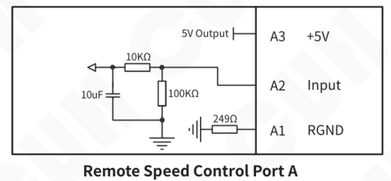

| ขั้วต่อ | สัญญาณ |
|---|---|
| A3 | +5V |
| A2 | Input |
| A1 | RGND |

### พอร์ตเซ็นเซอร์สวิตช์ C

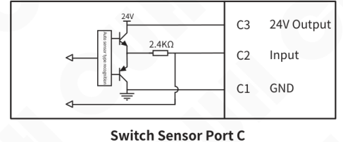

| ขั้วต่อ | สัญญาณ |
|---|---|
| C3 | 24V Output |
| C2 | Input |
| C1 | GND |

### พอร์ตเซ็นเซอร์สวิตช์ E

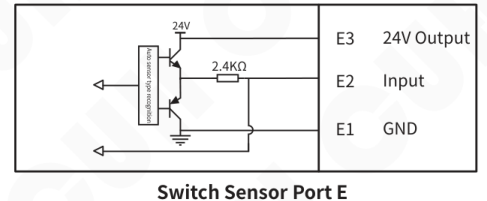

| ขั้วต่อ | สัญญาณ |
|---|---|
| E3 | 24V Output |
| E2 | Input |
| E1 | GND |

### พอร์ตเอาต์พุตควบคุม D

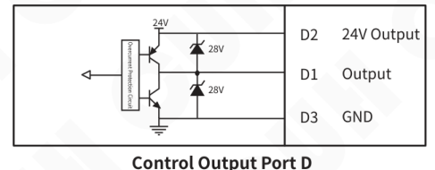

| ขั้วต่อ | สัญญาณ |
|---|---|
| D2 | 24V Output |
| D1 | Output |
| D3 | GND |

---


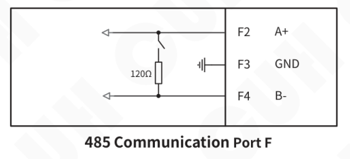

**พอร์ตการสื่อสาร 485 F**

| ขั้วต่อ | สัญญาณ |
|---|---|
| F2 | A+ |
| F3 | GND |
| F4 | B- |

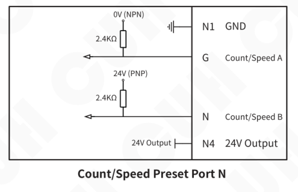

**พอร์ตตั้งค่าล่วงหน้าจำนวนนับ/ความเร็ว N**

| ขั้วต่อ | สัญญาณ |
|---|---|
| N1 | GND |
| G | Count/Speed A |
| N | Count/Speed B |
| N4 | 24V Output |

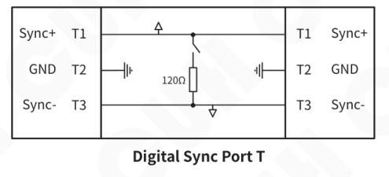

**พอร์ตซิงโครไนซ์ดิจิทัล T**

| ขั้วต่อ | สัญญาณ |
|---|---|
| T1 | Sync+ |
| T2 | GND |
| T3 | Sync- |


## 7.6 รหัสข้อผิดพลาด

การวินิจฉัยข้อผิดพลาดของตัวควบคุมนี้แบ่งออกเป็นรหัสข้อผิดพลาดและรหัสคำเตือน และแสดงรหัสแต่ละรายการตามลำดับ

**รหัสข้อผิดพลาด:** จำเป็นต้องหยุดเครื่องทันทีและรอให้ข้อผิดพลาดหายไปก่อนที่จะยกเลิกการแสดงผล

**รหัสคำเตือน:** ไม่จำเป็นต้องปิดเครื่อง รอจนกว่าเครื่องหมายคำเตือนจะหายไปก่อนที่จะยกเลิกการแสดงผล

### ตารางรหัสข้อผิดพลาด

| รหัสข้อผิดพลาด | การแสดงผล | ความหมาย | วิธีการแก้ไข |
|---|---|---|---|
| Error01 | Short | ไฟฟ้าลัดวงจร | ตรวจสอบว่าสายเอาต์พุตหลักลัดวงจรอยู่หรือไม่ และเดินสายใหม่ |
| Error02 | OvrCurrt | กระแสเกิน | ลดแรงดันเอาต์พุตหรือเพิ่มความถี่เอาต์พุต |
| Error03 | OverHot | ความร้อนสูงเกินไป | วางตัวควบคุมในบริเวณที่มีการระบายอากาศและระบายความร้อนที่ดี |
| Error04 | UndrCool | อุณหภูมิต่ำเกินไป | วางตัวควบคุมในบริเวณที่อุณหภูมิแวดล้อมสูงกว่า -20℃ |
| Error05 | CommErr | ข้อผิดพลาดการสื่อสาร | ติดต่อฝ่ายสนับสนุนทางเทคนิคของบริษัท |
| Error06 | TSnerErr | ข้อผิดพลาดเซ็นเซอร์อุณหภูมิ | ติดต่อฝ่ายสนับสนุนทางเทคนิคของบริษัท |
| Error07 | OverVolt | แรงดันเกิน | แรงดันไฟหลักอินพุตต้องไม่เกิน 250V ค่าประสิทธิผล |
| Error08 | UndrVolt | แรงดันต่ำ | แรงดันไฟหลักอินพุตต้องไม่ต่ำกว่า 85V ค่าประสิทธิผล |
| Error09 | LoadErr | การตัดการเชื่อมต่อโหลด | ตรวจสอบว่าสายเอาต์พุตเชื่อมต่อกับจานสั่นอย่างถูกต้องหรือไม่ |
| Error10 | Send_Seed | ส่งเมล็ดไม่สำเร็จ | ติดต่อฝ่ายสนับสนุนทางเทคนิคของบริษัท |
| Error11 | Send_Exit | คำสั่งออกจากโหมดบูตทำงานไม่สำเร็จ | ติดต่อฝ่ายสนับสนุนทางเทคนิคของบริษัท |
| Error14 | SynchEr0 | บัส CUHBus-DS® มีอุปกรณ์มาสเตอร์ 2 เครื่องขึ้นไป | 1. หากเกิดการแจ้งเตือน ให้ตั้งค่าอุปกรณ์เป็นออฟไลน์แล้วตั้งค่ากลับเป็นออนไลน์อีกครั้ง<br>2. หลังจากปิดเครื่องอุปกรณ์ที่เพิ่มเข้าใหม่แล้ว ให้เชื่อมต่อสาย CUHBus-DS® เข้ากับอุปกรณ์เครือข่าย |
| Error15 | SynchEr1 | ข้อผิดพลาดบัส | ตรวจสอบว่าสายสื่อสาร CUHBus-DS® เชื่อมต่ออย่างถูกต้องหรือไม่ และจัดระเบียบเครือข่ายอย่างถูกต้อง |
| Error16 | SynchEr2 | อุปกรณ์ซิงโครไนซ์ออฟไลน์อยู่ | เครือข่ายการสื่อสารซิงโครไนซ์ อุปกรณ์ซิงโครไนซ์ความถี่ หรืออุปกรณ์ซิงโครไนซ์ควบคุมระยะไกลออฟไลน์อยู่ |


## 7.7 รหัสคำเตือน

ตารางรหัสคำเตือน

| รหัสคำเตือน | การแสดงผล | ความหมาย | วิธีการแก้ไข |
|---|---|---|---|
| Warn01 | Saturate | เอาต์พุตอิ่มตัว | ลดแรงดันเอาต์พุต |
| Warn02 | decline | การลดความเร็วของการนับ | สถานะการลดความเร็วของการนับ |
| Warn03 | CND | สิ้นสุดการนับ | สถานะสิ้นสุดการนับ |
| Warn04 | FrqncyLo | ความถี่เอาต์พุตต่ำเกินไป | เพิ่มค่าพารามิเตอร์ออฟเซ็ตความถี่ |
| Warn05 | FrqncyHi | ความถี่เอาต์พุตสูงเกินไป | เพิ่มค่าพารามิเตอร์ออฟเซ็ตความถี่ |
| Warn06 | LoMAlarm | วัสดุขาดแคลน | ลดค่าพารามิเตอร์การแจ้งเตือนวัสดุขาดแคลน หรือเพิ่มวัสดุลงในถาดวัสดุ |
| Warn07 | PortDErr | กระแสเกินที่เอาต์พุตพอร์ต D | ลดโหลดควบคุมของพอร์ตเอาต์พุต |
| Warn08 | RemotLow | แรงดัน/กระแสอินพุตควบคุมระยะไกลต่ำเกินไป | เพิ่มแรงดันหรือกระแสอินพุตควบคุมระยะไกล |
| Warn09 | MRSErr | ข้อผิดพลาดลอจิก RS ของเอาต์พุตหลัก | เมื่อลอจิกเอาต์พุตเป็นฟลิปฟล็อป RS สัญญาณของแหล่งที่มา 1 และแหล่งที่มา 2 ของเอาต์พุตหลักไม่สามารถมีผลพร้อมกันได้ |
| Warn10 | 24VErr | ข้อผิดพลาด 24V | ห้ามเชื่อมต่อแหล่งจ่ายไฟภายนอก 24V เข้ากับพอร์ตเอาต์พุตของตัวควบคุม |
| Warn11 | 5VErr | ข้อผิดพลาด 5V | ห้ามเชื่อมต่อแหล่งจ่ายไฟภายนอก 5V เข้ากับพอร์ตเอาต์พุตของตัวควบคุม |
| Warn12 | CtrlRSErr | ข้อผิดพลาดลอจิก RS ของเอาต์พุตควบคุม | เมื่อลอจิกของพอร์ต D เป็นฟลิปฟล็อป RS สัญญาณของแหล่งที่มา 1 และแหล่งที่มา 2 ของพอร์ต D ไม่สามารถมีผลพร้อมกันได้ |
| Warn13 | OverLoad | เซ็นเซอร์ความเร่งโหลดเกิน | เปลี่ยนเซ็นเซอร์ความเร่งด้วยเซ็นเซอร์ที่มีช่วงการวัดที่เหมาะสม |
| Warn14 | AcceleEr | เซ็นเซอร์ความเร่งชำรุด | เซ็นเซอร์ชำรุด ให้เปลี่ยนเป็นอันใหม่ |
| Warn15 | EEPErr | ข้อผิดพลาดในการบันทึกพารามิเตอร์ | ตรวจสอบว่าสายสื่อสาร CUHBus-DS® เชื่อมต่ออย่างถูกต้อง และการสร้างเครือข่ายเสร็จสมบูรณ์อย่างถูกต้อง |


# บทที่ Ⅷ ข้อมูลการรับประกันผลิตภัณฑ์

## 8.1 ระยะเวลาการรับประกัน

ระยะเวลาการรับประกันที่บริษัทให้สำหรับผลิตภัณฑ์นี้คือ 3 ปีนับจากวันที่ส่งมอบผลิตภัณฑ์ไปยังสถานที่ที่ผู้ซื้อกำหนด

## 8.2 ขอบเขตการรับประกัน

(1) หากเกิดข้อผิดพลาดอันเนื่องมาจากบริษัทของเราในช่วงระยะเวลาการรับประกันข้างต้น เราจะซ่อมแซมผลิตภัณฑ์โดยไม่คิดค่าใช้จ่าย อย่างไรก็ตาม สถานการณ์ต่อไปนี้ไม่ได้รับความคุ้มครองจากการรับประกัน:

&nbsp;&nbsp;&nbsp;&nbsp;a. ข้อผิดพลาดที่เกิดจากการไม่ปฏิบัติตามเงื่อนไขที่ระบุไว้ในคู่มืออย่างง่าย คู่มือผู้ใช้ หรือข้อกำหนดทางเทคนิคที่ผู้ซื้อและบริษัทได้ตกลงกันไว้เป็นพิเศษ การดำเนินการที่ไม่เหมาะสม หรือข้อผิดพลาดที่เกิดจากการใช้งานที่ไม่เหมาะสม

&nbsp;&nbsp;&nbsp;&nbsp;b. ข้อผิดพลาดที่ไม่ได้เกิดจากข้อบกพร่องของผลิตภัณฑ์ แต่เกิดจากอุปกรณ์หรือการออกแบบซอฟต์แวร์ของผู้ซื้อ

&nbsp;&nbsp;&nbsp;&nbsp;c. การทำงานผิดพลาดที่เกิดจากการดัดแปลงหรือซ่อมแซมโดยบุคคลที่ไม่ใช่พนักงานของบริษัท

&nbsp;&nbsp;&nbsp;&nbsp;d. ข้อผิดพลาดที่สามารถหลีกเลี่ยงได้ทั้งหมดโดยการบำรุงรักษาที่ถูกต้องหรือการเปลี่ยนชิ้นส่วนสึกหรอตามคู่มือการใช้งานอย่างง่ายหรือคู่มือผู้ใช้

&nbsp;&nbsp;&nbsp;&nbsp;e. ข้อผิดพลาดที่เกิดขึ้นหลังจากผลิตภัณฑ์จัดส่งออกจากบริษัทของเรา อันเนื่องมาจากปัจจัย เช่น การเปลี่ยนแปลงของระดับวิทยาศาสตร์และเทคโนโลยีที่ไม่คาดคิด

&nbsp;&nbsp;&nbsp;&nbsp;f. ในกรณีที่เกิดจากภัยธรรมชาติ เช่น ไฟไหม้ แผ่นดินไหว น้ำท่วม หรือปัจจัยภายนอก เช่น แรงดันไฟฟ้าผิดปกติ บริษัทจะไม่รับผิดชอบต่อการรับประกัน

(2) ขอบเขตการรับประกันจำกัดอยู่เฉพาะสถานการณ์ที่กำหนดไว้ใน (1) ความเสียหายทางอ้อม (เช่น อุปกรณ์เสียหาย การสูญเสียโอกาส การสูญเสียกำไร ฯลฯ) หรือความเสียหายอื่นๆ บริษัทจะไม่รับผิดชอบใดๆ

## 8.3 ความเหมาะสมของผลิตภัณฑ์

ตัวควบคุมของบริษัทของเราได้รับการออกแบบและผลิตขึ้นสำหรับการใช้งานทั่วไปในอุตสาหกรรมการป้อนวัสดุแบบสั่นสะเทือน ดังนั้น ตัวควบคุมของบริษัทของเรานี้ไม่ควรใช้สำหรับการใช้งานต่อไปนี้และไม่เหมาะสมสำหรับการใช้งานดังกล่าว

(1) สิ่งอำนวยความสะดวกที่มีผลกระทบร้ายแรงต่อชีวิตและทรัพย์สิน เช่น โรงไฟฟ้านิวเคลียร์ สนามบิน ทางรถไฟ เรือ อุปกรณ์ที่ขับเคลื่อนด้วยมอเตอร์ และอุปกรณ์ทางการแพทย์

(2) สาธารณูปโภค รวมถึงไฟฟ้า แก๊ส การประปา เป็นต้น

(3) การใช้งานกลางแจ้งในสภาพหรือสภาพแวดล้อมที่คล้ายคลึงกัน

---


|  |  |
|---|---|
|  | Nanjing CUH Science & Technology Co.,Ltd<br>https://en.cuhnj.com<br>Tel.:+86-25-84730411 / 84730415 / 84730416<br>Fax:+86-25-84730426<br>E-mail:sales@cuhnj.com<br>Add.:Building 2, Xueyan Tech Park, Tuscity,<br>No.9 Zhineng Rd, Jiangning, Nanjing, China |

<div align="right">Document No.: IDP1000504</div>


