## ตัวควบคุมอัตโนมัติอัจฉริยะสำหรับเครื่องป้อนวัสดุแบบสั่นสะเทือน

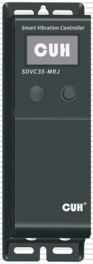

## SDVC35-Series
ตัวควบคุมอัตโนมัติอัจฉริยะสำหรับเครื่องป้อนวัสดุแบบสั่นสะเทือน — SDVC35 Series
## คู่มือการใช้งาน

## บทนำ

ขอบคุณที่ท่านเลือกใช้ตัวควบคุมเครื่องป้อนวัสดุแบบสั่นสะเทือนดิจิทัลอัจฉริยะของ CUH

(ต่อไปนี้จะเรียกว่า "ตัวควบคุม")

คู่มือเล่มนี้ประกอบด้วยคำแนะนำสำหรับการติดตั้ง การดีบัก การตั้งค่าพารามิเตอร์ การบำรุงรักษา และการแก้ไขปัญหาของตัวควบคุม โปรดอ่านคู่มือเล่มนี้อย่างละเอียดก่อนใช้งานตัวควบคุม และเก็บรักษาไว้อย่างดี

**คู่มือเล่มนี้ใช้กับรุ่นต่อไปนี้**

- SDVC35-MRJ　( กระแสเอาต์พุต 3A )
- SDVC35-LRJ　( กระแสเอาต์พุต 4.5A )

---

## ข้อควรระวัง:

1. ห้ามถอดหรือเสียบสายไฟ และห้ามสัมผัสเต้ารับไฟฟ้าในทุกกรณีขณะที่ตัวควบคุมมีไฟฟ้า เพื่อป้องกันไฟฟ้าช็อตหรืออุบัติเหตุอื่น ๆ
2. ห้ามต่อตัวควบคุมเข้ากับไฟ AC 380V ซึ่งอาจทำให้เกิดความเสียหายที่ไม่สามารถแก้ไขได้ (เรามีผลิตภัณฑ์ที่ออกแบบสำหรับไฟ AC 380V)
3. ห้ามสลับอินพุตของตัวควบคุมด้วยวิธีการตัดแหล่งจ่ายไฟเพื่อเปิด/ปิดเอาต์พุต มิฉะนั้นอาจลดอายุการใช้งานของตัวควบคุม
4. ตัวควบคุมได้รับการออกแบบให้ทำงานในสภาพแวดล้อมที่เย็นและแห้ง ห้ามใช้งานตัวควบคุมกลางแจ้งเพื่อหลีกเลี่ยงการเปียกน้ำและการถูกแสงแดดโดยตรง ใช้งานตัวควบคุมภายในช่วงอุณหภูมิที่ระบุในคุณลักษณะทางไฟฟ้า
5. ห้ามใช้งานตัวควบคุมภายใต้เงื่อนไขที่เกินขีดจำกัดที่ออกแบบไว้
6. ใช้งานตัวควบคุมตามคู่มือเล่มนี้อย่างเคร่งครัด เราจะไม่รับผิดชอบทางแพ่งหรือทางอาญาหากความเสียหายต่ออุปกรณ์หรือการบาดเจ็บของบุคคลเกิดจากการใช้งานที่ไม่ถูกต้อง

> ห้ามเปิดฝาครอบตัวควบคุมเพื่อหลีกเลี่ยงไฟฟ้าช็อต ติดต่อ CUH หากตัวควบคุมเสียหาย ห้ามพยายามซ่อมตัวควบคุมด้วยตนเอง ซึ่งอาจทำให้การรับประกันเป็นโมฆะ

---

## สภาพแวดล้อมในการใช้งานและการจัดเก็บ

### การตรวจสอบก่อนใช้งาน

ตัวควบคุมทุกเครื่องจะผ่านการตรวจสอบคุณภาพอย่างเข้มงวดก่อนการจัดส่ง และบรรจุในบรรจุภัณฑ์กันกระแทก โปรดตรวจสอบรายการต่อไปนี้หลังแกะกล่อง:

1. ตัวควบคุมมีความเสียหายภายนอกหรือไม่
2. รุ่นของตัวควบคุมตรงกับที่ท่านสั่งซื้อหรือไม่

### สภาพแวดล้อมในการทำงาน

โปรดปฏิบัติตามข้อควรระวังด้านล่างเพื่อให้มั่นใจถึงประสิทธิภาพที่ดีขึ้นและอายุการใช้งานที่ยาวนานขึ้นของตัวควบคุม:

- ⚠ สภาพแวดล้อมที่มีการระบายอากาศดี
- ⚠ ห่างจากน้ำ ความชื้น ฝุ่น และโดยเฉพาะฝุ่นที่มีน้ำมัน
- ⚠ ห่างจากก๊าซและของเหลวที่กัดกร่อนหรือติดไฟได้
- ⚠ ห่างจากฝุ่นลอยและเศษโลหะ
- ⚠ ยึดให้แน่นเพื่อหลีกเลี่ยงการสั่นสะเทือนของตัวเครื่องเอง
- ⚠ ห่างจากการรบกวนทางแม่เหล็กไฟฟ้า
- ⚠ ตรวจสอบให้แน่ใจว่าอุณหภูมิโดยรอบอยู่ที่ 0~40 ℃
- ⚠ สำหรับใช้งานที่ความสูง 2000 เมตรหรือต่ำกว่า

---

# สารบัญ

- **บทที่ I คุณสมบัติ — 1**
  - 1.1　คุณสมบัติหลัก — 1
  - 1.2　คุณสมบัติอื่น ๆ — 1
- **บทที่ II คู่มือการติดตั้ง — 3**
  - 2.1　คำอธิบายส่วนประกอบภายนอก — 3
  - 2.2　คำอธิบายการติดตั้ง — 5
  - 2.3　การติดตั้งเซ็นเซอร์สั่นสะเทือน — 7
  - 2.4　การค้นหาความถี่เรโซแนนซ์อัตโนมัติ — 9
- **บทที่ III คำอธิบาย HMI — 10**
  - 3.1　อินเทอร์เฟซสแตนด์บาย — 10
  - 3.2　อินเทอร์เฟซป้อนรหัสผ่าน — 13
  - 3.3　อินเทอร์เฟซกลุ่มฟังก์ชัน — 14
  - 3.4　อินเทอร์เฟซแสดงผลกระบวนการค้นหาความถี่เรโซแนนซ์ — 16
- **บทที่ IV คำอธิบายฟังก์ชัน — 17**
  - 4.1　การควบคุมเปิด/ปิดของพอร์ตอินพุตดิจิทัล C และ E — 17
  - 4.2　ฟังก์ชันการนับ — 20
  - 4.3　สัญญาณควบคุมเอาต์พุตหลัก — 24
  - 4.4　เอาต์พุตควบคุม DC พอร์ต D และพอร์ต P — 28
  - 4.5　การควบคุมความเร็วระยะไกล — 33
  - 4.6　โหมดหลัก — 35
  - 4.7　โหมดซิงค์ — 39
  - 4.8　ฟังก์ชันพารามิเตอร์ที่ตั้งไว้ล่วงหน้า — 44
  - 4.9　การคืนค่าการตั้งค่าเริ่มต้น — 45
  - 4.10　การสื่อสาร RS485 — 46
  - 4.11　การสื่อสารอีเทอร์เน็ต — 48
  - 4.12　การทดสอบโหลด — 48
  - 4.13　การตรวจสอบสถานะการทำงาน — 49
- **บทที่ V ฟังก์ชันความปลอดภัย — 50**

---

---

ภาคผนวก A: มิติ — 51

ภาคผนวก B: คำอธิบายพอร์ตการเชื่อมต่อทางไฟฟ้า — 52

ภาคผนวก C: ข้อมูลจำเพาะทางไฟฟ้า — 53

ภาคผนวก D: ข้อเสนอแนะการแก้ไขปัญหาและคำอธิบายข้อผิดพลาด — 55

ภาคผนวก E: คำอธิบายคำเตือนและข้อผิดพลาดและข้อเสนอแนะการแก้ไขปัญหา — 56

ภาคผนวก F: คำอธิบายสถานะการทำงานและประเภทการ์ดเครือข่าย — 57

ภาคผนวก G: วิธีการเชื่อมต่อสายของเซ็นเซอร์สวิตช์และ PLC กับพอร์ตอินพุตดิจิทัล — 58

ภาคผนวก H: ตารางพารามิเตอร์ — 61

---

# บทที่ I คุณสมบัติ

## 1.1 คุณสมบัติหลัก

**จอแสดงผล OLED:** รองรับสามภาษา ได้แก่ จีน อังกฤษ และเยอรมัน พร้อมอินเทอร์เฟซการใช้งานที่เป็นมิตร

**การค้นหาความถี่เรโซแนนซ์อัตโนมัติ:** รองรับการค้นหาความถี่เรโซแนนซ์ของโหลดทั้งแบบมีเซ็นเซอร์และไม่มีเซ็นเซอร์

**การควบคุมความเร็วคงที่อัตโนมัติ:** ปรับแรงดันเอาต์พุตอัตโนมัติแบบเรียลไทม์ เพื่อรักษาความเร็วป้อนที่ตั้งไว้ล่วงหน้าให้คงที่ ไม่ว่าน้ำหนักของวัสดุป้อนในเครื่องป้อนวัสดุแบบสั่นสะเทือนจะเปลี่ยนแปลงไป

**เอาต์พุตซิงค์ของตัวควบคุมหลายตัว:** ซิงค์รูปคลื่นเอาต์พุตของตัวควบคุมทาสให้ตรงกับตัวควบคุมหลักทั้งความถี่และเฟส เพื่อหลีกเลี่ยงปรากฏการณ์บีต

**เอาต์พุตควบคุมแบบพุช-พูลคู่:** ตัวควบคุมสามารถจ่ายไฟ DC 24V ที่สัมพันธ์กับการตั้งค่าความสัมพันธ์ทางตรรกะของการควบคุมเปิด/ปิด เพื่อขับโซลินอยด์ รีเลย์ไฟฟ้า หรืออุปกรณ์ภายนอกอื่น ๆ

**การสื่อสารอีเทอร์เน็ต:** ปรับพารามิเตอร์ทั้งหมดและตรวจสอบสถานะการทำงานของตัวควบคุม รองรับโปรโตคอลการสื่อสาร Ethercat และ Profinet

**การอัปเกรดเฟิร์มแวร์:** รองรับการอัปเดตเฟิร์มแวร์ออนไลน์เพื่อมอบผลงานวิจัยและพัฒนาล่าสุดของบริษัท

**การตรวจจับโหลด:** วัดค่าความเหนี่ยวนำ กระแสสูงสุด และความต้านทานของโหลด

## 1.2 คุณสมบัติอื่น ๆ

ตัวควบคุมได้รับการออกแบบมาเป็นพิเศษสำหรับควบคุมเครื่องป้อนวัสดุแบบสั่นสะเทือนในระบบอัตโนมัติ ผสมผสานกับเทคโนโลยีอิเล็กทรอนิกส์ล่าสุดและการออกแบบที่พิถีพิถัน ตัวควบคุมจึงมีคุณสมบัติที่สะดวกและใช้งานได้จริงดังนี้:

**การควบคุมแรงดันอัตโนมัติ:** ขจัดความแปรปรวนของความเร็วที่เกิดจากความผันผวนของแรงดันไฟหลัก และปรากฏการณ์บีตที่เกิดจากความถี่ไฟ AC ในภาคอุตสาหกรรม

**การควบคุมเปิด/ปิดด้วยเซ็นเซอร์สวิตช์คู่:** สามารถเชื่อมต่อเซ็นเซอร์สวิตช์ 2 ตัว หรือ PLC เพื่อเปิด/ปิดตัวควบคุม

**การตรวจจับประเภทเซ็นเซอร์สวิตช์อัตโนมัติ:** ตัวควบคุมสามารถตรวจจับประเภทเซ็นเซอร์สวิตช์ NPN/PNP ได้โดยอัตโนมัติ

**การเริ่มต้นแบบนุ่มนวล:** เพื่อหลีกเลี่ยงการกระแทกอย่างกะทันหันต่อเครื่องป้อนวัสดุแบบสั่นสะเทือน ตัวควบคุมสามารถค่อย ๆ เพิ่มแรงดันเอาต์พุต/ความเร็วป้อนจาก 0 ไปยังค่าที่ตั้งไว้ล่วงหน้าเมื่อเริ่มทำงาน

---

---

**การตั้งค่าพารามิเตอร์ล่วงหน้า:** สามารถเลือกชุดพารามิเตอร์ที่ตั้งไว้ล่วงหน้าได้ 4 ชุด

**ฟังก์ชันเร่งความเร็ว:** ค่าแรงดันเอาต์พุตสูงสุดของตัวควบคุมสามารถเพิ่มขึ้นได้ถึง 150% ของค่าแรงดันอินพุต (ยกเว้นในสถานะการติดตามอัตโนมัติแบบไม่มีเซ็นเซอร์)

**แรงดันเอาต์พุตสูงสุดที่ปรับได้:** แรงดันเอาต์พุตสูงสุดที่ปรับได้สามารถตั้งไว้ล่วงหน้าเพื่อป้องกันโหลดจากความเสียหายที่เกิดจากแรงดันสูงเกินไป

**ดัชนีรูปคลื่น:** แสดงรอบการทำงานเทียบเท่า (duty cycle) ของกระแสเอาต์พุตแบบไซน์ภายในหนึ่งรอบ ค่าพารามิเตอร์ที่สูงขึ้นสอดคล้องกับรอบการทำงานเทียบเท่าที่มากขึ้น พารามิเตอร์นี้สามารถปรับเพื่อสร้างสมดุลระหว่างประสิทธิภาพการทำงานและกำลังเอาต์พุตสูงสุดของตัวควบคุม

**กระแส DC:** องค์ประกอบออฟเซ็ต DC ของสัญญาณกระแสเอาต์พุตแบบไซน์

**การควบคุมความเร็วระยะไกล:** แรงดันเอาต์พุตของตัวควบคุมสามารถปรับได้ด้วยโพเทนชิออมิเตอร์ภายนอก หรือสัญญาณ DC 4~20mA, 0~5V, 1~5V, 0~10V

**การนับ:** เมื่อจำนวนชิ้นงานที่นับได้ถึงค่าที่ตั้งไว้ล่วงหน้า ความเร็วป้อนจะลดลงหรือเป็นศูนย์

**เอาต์พุตเปิด/ปิด:** กดปุ่มเปิด/ปิดสั้น ๆ เพื่อเริ่ม/หยุดตัวควบคุม

**การล็อกแป้นกด:** กดปุ่มเปิด/ปิดค้างไว้เพื่อล็อกแป้นกด

**รหัสผ่านพารามิเตอร์:** ผู้ใช้สามารถกำหนดสิทธิ์ด้วยรหัสผ่านเพื่อห้ามการปรับพารามิเตอร์ (เช่น แรงดันเอาต์พุตและความเร็วป้อน)

**ฟังก์ชันบันทึกพารามิเตอร์:** ผู้ใช้สามารถให้ตัวควบคุมทำงานด้วยชุดพารามิเตอร์ใด ๆ จากสี่ชุดที่ตั้งไว้ล่วงหน้าและบันทึกไว้ในข้อมูลผู้ใช้ ซึ่งปรับได้ด้วยพารามิเตอร์ "SavedALLTo" และ "ReadALLFrm" ในฟังก์ชัน 8 ของตัวควบคุม

**การคืนค่าการตั้งค่าเริ่มต้น:** ฟังก์ชันนี้ช่วยให้ผู้ปฏิบัติงานคืนค่าพารามิเตอร์ทั้งหมดกลับเป็นค่าตั้งต้นจากโรงงาน

**การสื่อสาร RS485:** พารามิเตอร์ทั้งหมดสามารถปรับและตรวจสอบจากระยะไกลได้

**อินเทอร์เฟซสแตนด์บาย OLED ที่กำหนดเองได้:** ผู้ใช้สามารถเลือกพารามิเตอร์ที่ต้องการแสดงบนอินเทอร์เฟซสแตนด์บาย

**เอาต์พุตสัญญาณเตือน:** สัญญาณเตือนสามารถส่งออกผ่านพอร์ตเอาต์พุตควบคุมหรือพอร์ตสื่อสารเพื่อการประมวลผลอัตโนมัติ

---

# บทที่ Ⅱ คู่มือการติดตั้ง

## 2.1 คำอธิบายชิ้นส่วนภายนอก

### 2.1.1 คำอธิบายภายนอก

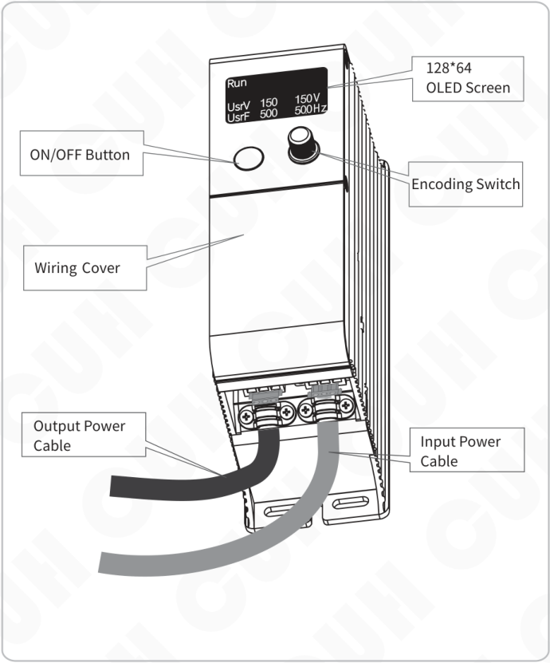

## 2.1.2 คำอธิบายขั้วต่อ

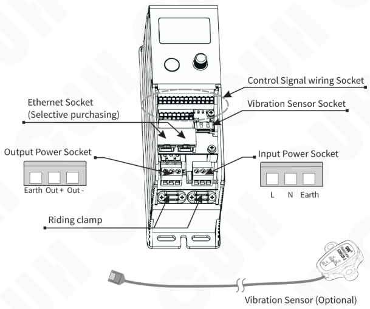

- เต้ารับเดินสายสัญญาณควบคุม
- เต้ารับเซ็นเซอร์สั่นสะเทือน
- เต้ารับอีเทอร์เน็ต (เลือกซื้อได้)
- เต้ารับกำลังไฟเอาต์พุต: กราวด์ / Out + / Out -
- เต้ารับกำลังไฟอินพุต: L / N / กราวด์
- แคลมป์ยึดสาย
- เซ็นเซอร์สั่นสะเทือน (อุปกรณ์เสริม)

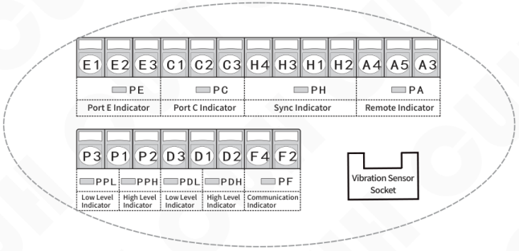

ขั้วต่อแถวบน (จากซ้ายไปขวา): E1, E2, E3, C1, C2, C3, H4, H3, H1, H2, A4, A5, A3.

| PE | PC | PH | PA |
|---|---|---|---|
| ไฟแสดงพอร์ต E | ไฟแสดงพอร์ต C | ไฟแสดงซิงค์ | ไฟแสดงรีโมท |

ขั้วต่อแถวล่าง (จากซ้ายไปขวา): P3, P1, P2, D3, D1, D2, F4, F2.

| PPL | PPH | PDL | PDH | PF |
|---|---|---|---|---|
| ไฟแสดงระดับต่ำ | ไฟแสดงระดับสูง | ไฟแสดงระดับต่ำ | ไฟแสดงระดับสูง | ไฟแสดงการสื่อสาร |

เต้ารับเซ็นเซอร์สั่นสะเทือน

**หมายเหตุ:** พอร์ต D หรือพอร์ต P เป็นเอาต์พุตอิมพีแดนซ์สูง เมื่อไฟแสดงระดับสูงและไฟแสดงระดับต่ำติดสว่าง

---

## 2.2 คำอธิบายการติดตั้ง

### ขั้นตอนที่หนึ่ง:

เปิดกล่องบรรจุภัณฑ์และตรวจสอบตัวควบคุมและอุปกรณ์เสริมทั้งหมด

### ขั้นตอนที่สอง:

เชื่อมต่อขั้วต่อสายไฟของสายไฟกำลังเอาต์พุตเข้ากับขดลวดแม่เหล็กไฟฟ้าของเครื่องสั่น

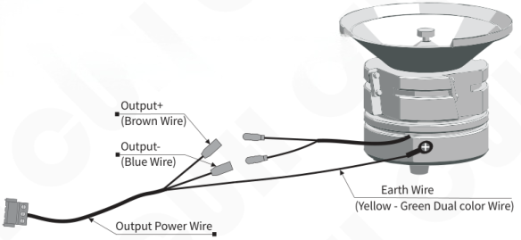

- Output+ (สายสีน้ำตาล)
- Output- (สายสีน้ำเงิน)
- สายดิน (สายสองสี เหลือง-เขียว)
- สายไฟกำลังเอาต์พุต

> หมายเหตุ: ตรวจสอบให้แน่ใจว่าขดลวดแม่เหล็กไฟฟ้าของเครื่องสั่นเชื่อมต่อกับสายไลน์และสายนิวทรัลของสายไฟกำลังเอาต์พุต และตู้ของเครื่องสั่นมีการต่อสายดินอย่างน่าเชื่อถือ

### ขั้นตอนที่สาม:

เปิดฝาครอบ

เชื่อมต่อขั้วต่อของสายไฟกำลังเอาต์พุตเข้ากับเต้ารับของตัวควบคุม และยึดสายไฟกำลังเอาต์พุตบนตู้ของตัวควบคุมด้วยแคลมป์ยึดสาย

ห้ามใช้งานขณะมีไฟฟ้าเพื่อป้องกันไฟฟ้าช็อต

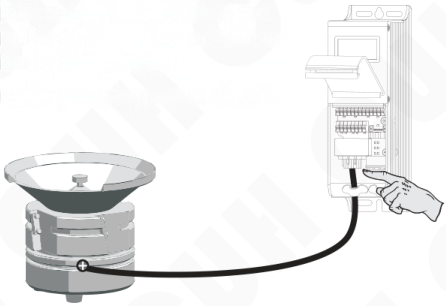

---

## ขั้นตอนที่สี่:

เชื่อมต่อขั้วต่อของสายไฟกำลังอินพุตเข้ากับเต้ารับกำลังไฟอินพุตของตัวควบคุม และยึดสายไฟกำลังอินพุตบนตู้ของตัวควบคุมด้วยแคลมป์ยึดสาย

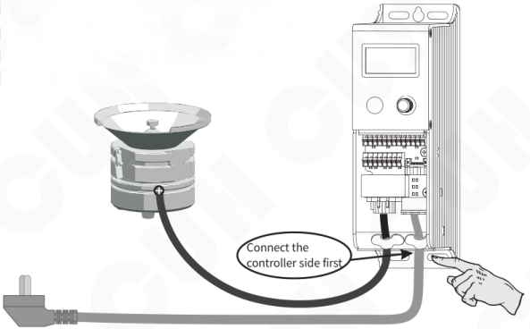

เชื่อมต่อฝั่งตัวควบคุมก่อน

## ขั้นตอนที่ห้า:

เชื่อมต่อปลั๊กของสายไฟกำลังอินพุตเข้ากับเต้ารับไฟหลัก

ตัวควบคุมเปิดทำงาน และจอ OLED แสดงอินเทอร์เฟซเริ่มต้นสักครู่ จากนั้นจอ OLED จะแสดงอินเทอร์เฟซสแตนด์บาย

---

## 2.3 การติดตั้งเซ็นเซอร์สั่นสะเทือน

### 2.3.1 วิธีการเชื่อมต่อเซ็นเซอร์สั่นสะเทือน

- ปิดตัวควบคุม และเชื่อมต่อขั้วต่อของเซ็นเซอร์สั่นสะเทือนเข้ากับเต้ารับเซ็นเซอร์สั่นสะเทือนของตัวควบคุม
- ยึดเซ็นเซอร์สั่นสะเทือนไว้ใกล้กับกระดองของเครื่องสั่น วิธีการและตำแหน่งการติดตั้งแสดงไว้ด้านล่าง:

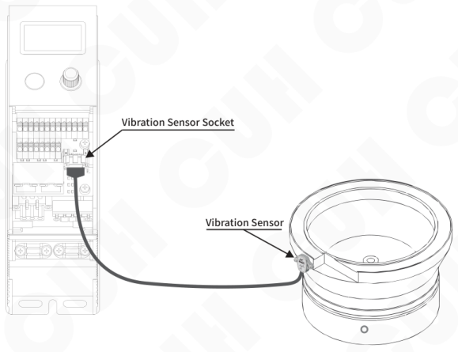

---

## 2.3.2 การติดตั้งเซ็นเซอร์สั่นสะเทือนเข้ากับเครื่องสั่น

ยึดเซ็นเซอร์สั่นสะเทือนกับพื้นผิวเรียบของเครื่องสั่น โดยทิศทางการติดตั้งเป็นไปตามอิสระ และวิธีการติดตั้งเซ็นเซอร์สั่นสะเทือนแสดงไว้ด้านล่าง:

- วิธีที่ 1: ดังแสดงในรูปที่ 1

  ข้อดี: ติดตั้งง่าย

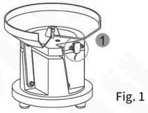

- วิธีที่ 2: ดังแสดงในรูปที่ 2

  หมายเหตุ: ห้ามให้เซ็นเซอร์สั่นสะเทือนถูกกดทับโดยจานป้อน

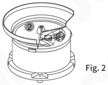

- วิธีที่ 3: เชื่อมขายึดบนเครื่องสั่นและยึดเซ็นเซอร์สั่นสะเทือนบนขายึด ดังแสดงในรูปที่ 3

  ขนาดที่แนะนำของขายึดเซ็นเซอร์สั่นสะเทือนแสดงไว้ในรูปที่ 4

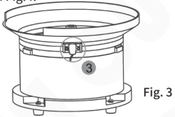

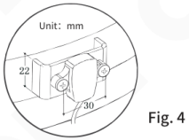

- วิธีการติดตั้งที่ไม่แนะนำ ดังแสดงในรูปที่ 5 และรูปที่ 6

  หากตำแหน่งการติดตั้งไม่เหมาะสม เซ็นเซอร์สั่นสะเทือนจะไม่สามารถตอบสนองความถี่เรโซแนนซ์ได้อย่างแม่นยำ และตัวควบคุมจะดำเนินการค้นหาความถี่เรโซแนนซ์อยู่ตลอดเวลา

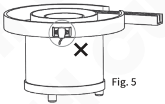

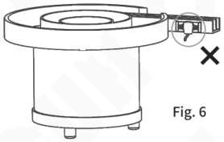

---

## 2.4 การค้นหาความถี่เรโซแนนซ์อัตโนมัติ

### 2.4.1 การค้นหาความถี่เรโซแนนซ์อัตโนมัติแบบไม่มีเซ็นเซอร์

ตัวควบคุมมีฟังก์ชันการค้นหาความถี่เรโซแนนซ์อัตโนมัติแบบไม่มีเซ็นเซอร์ และผู้ใช้เพียงปรับพารามิเตอร์ "Usr_Voltag" เพื่อให้เครื่องสั่นทำงานในสภาวะที่ดีที่สุด

เริ่มฟังก์ชันการค้นหาความถี่เรโซแนนซ์อัตโนมัติแบบไม่มีเซ็นเซอร์โดยตั้งค่าพารามิเตอร์ "AtoSnsrTyp " เป็น "Auto" ในกลุ่มฟังก์ชัน 3 และ "AutoSerch_ " เป็น "Star" ในกลุ่มฟังก์ชัน 1

หมายเหตุ: ฟังก์ชันการค้นหาความถี่เรโซแนนซ์อัตโนมัติแบบไม่มีเซ็นเซอร์ใช้ได้เฉพาะเมื่อตัวควบคุมทำงานในโหมดหลัก และต้องเชื่อมต่อเซ็นเซอร์สั่นสะเทือนเมื่อตัวควบคุมทำงานในโหมดซิงค์

### 2.4.2 การค้นหาความถี่เรโซแนนซ์อัตโนมัติแบบมีเซ็นเซอร์

ด้วยฟังก์ชันการค้นหาความถี่เรโซแนนซ์อัตโนมัติที่ใช้เซ็นเซอร์สั่นสะเทือน ตัวควบคุมสามารถทำให้เครื่องสั่นทำงานที่ความถี่ที่ดีที่สุด และพารามิเตอร์ที่เกี่ยวข้องของตัวควบคุมจะถูกปรับโดยอัตโนมัติ ผู้ใช้เพียงตั้งค่าพารามิเตอร์ความเร็วป้อนเพื่อให้เครื่องสั่นทำงานได้ดีที่สุด

หลังจากเชื่อมต่อเซ็นเซอร์สั่นสะเทือนแล้ว ให้เปิดตัวควบคุม และตัวควบคุมจะตรวจสอบโดยอัตโนมัติว่าความถี่เรโซแนนซ์ของเครื่องสั่นอยู่ในช่วงที่ตั้งไว้ล่วงหน้าของตัวควบคุมหรือไม่ หากไม่อยู่ในช่วง ตัวควบคุมจะเริ่มการค้นหาความถี่เรโซแนนซ์อัตโนมัติ

**ขั้นตอนการค้นหาความถี่เรโซแนนซ์อัตโนมัติ:**

- กดสวิตช์แบบเข้ารหัสค้างไว้บนอินเทอร์เฟซสแตนด์บายเพื่อเข้าสู่อินเทอร์เฟซพารามิเตอร์กลุ่มฟังก์ชัน
- ปรับพารามิเตอร์ "AutoSerch_" ในกลุ่มฟังก์ชัน 1 เป็น "Start" จากนั้นกดสวิตช์แบบเข้ารหัสสั้น ๆ เพื่อเริ่มกระบวนการค้นหาความถี่เรโซแนนซ์อัตโนมัติ
- หลังจากกระบวนการค้นหาความถี่เรโซแนนซ์อัตโนมัติเสร็จสิ้น ผลลัพธ์ความถี่เรโซแนนซ์และ "Save" ที่แสดงบนจอ OLED บ่งชี้ว่าพารามิเตอร์ถูกบันทึกแล้ว

หลังจากกระบวนการค้นหาความถี่เรโซแนนซ์อัตโนมัติ เครื่องสั่นสามารถทำงานได้ตามปกติ กดสวิตช์แบบเข้ารหัสสั้น ๆ หรือหมุนเพื่อกลับไปยังอินเทอร์เฟซก่อนหน้า

> 1. กระบวนการค้นหาความถี่เรโซแนนซ์อัตโนมัติต้องดำเนินการในขณะที่จานป้อนว่างเปล่า
> 2. ยกเลิกการค้นหาความถี่ระหว่างกระบวนการค้นหาความถี่เรโซแนนซ์อัตโนมัติได้โดยกดปุ่ม "ON/OFF" สั้น ๆ
> 3. หากจอ OLED แสดง "OverCurrent" ระหว่างกระบวนการค้นหาความถี่เรโซแนนซ์อัตโนมัติ หมายความว่า "AtoSrhVMax" ถูกตั้งค่าสูงเกินไป แต่กระบวนการค้นหาความถี่เรโซแนนซ์อัตโนมัติไม่ได้รับผลกระทบ

---

## บทที่ Ⅲ คำอธิบาย HMI

### 3.1 อินเทอร์เฟซสแตนด์บาย

อินเทอร์เฟซสแตนด์บายแสดงไว้ด้านล่าง:

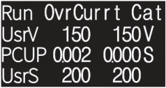

ตัวควบคุมจะเข้าสู่อินเทอร์เฟซสแตนด์บาย เมื่อไม่มีการใช้งานเกิน 2 นาที

อินเทอร์เฟซสแตนด์บายมี 4 แถวแสดงผล และแถวแสดงผลแรกใช้สำหรับแสดงสถานะการทำงาน ข้อมูลข้อผิดพลาด หรือการแจ้งเตือนของตัวควบคุม

1. พื้นที่ด้านซ้ายของแถวแสดงผลแรกใช้สำหรับแสดงการเริ่ม/หยุดของตัวควบคุม
2. พื้นที่ด้านขวาของแถวแสดงผลแรกใช้สำหรับแสดงประเภทของการ์ดเครือข่าย
3. พื้นที่ตรงกลางของแถวแสดงผลแรกใช้สำหรับแสดงคำเตือน/ข้อผิดพลาดของตัวควบคุม

รายการทั้งหมดของทั้งสามพื้นที่อธิบายไว้ในภาคผนวก F และ E ตามลำดับ

แถวแสดงผลที่ 2 ถึง 4 ใช้สำหรับปรับพารามิเตอร์ และผู้ใช้สามารถเลือกพารามิเตอร์ได้สูงสุดสามรายการเพื่อแสดงบนอินเทอร์เฟซสแตนด์บาย

แต่ละแถวแสดงผลของอินเทอร์เฟซสแตนด์บายมี 4 รายการ ได้แก่ ชื่อพารามิเตอร์ ค่าที่ตั้งไว้/สถานะพารามิเตอร์ ค่าทดสอบปัจจุบัน/ค่าเอาต์พุต และหน่วย ตัวอย่างของอินเทอร์เฟซสแตนด์บายมีดังนี้:

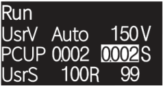

แถวแสดงผลที่สองคือพารามิเตอร์แรงดันเอาต์พุต โดย "Auto" หมายความว่าพารามิเตอร์นี้ถูกปรับโดยอัตโนมัติโดยตัวควบคุม และแรงดันเอาต์พุตจริงคือ 150V

แถวแสดงผลที่สามคือพารามิเตอร์เวลาหน่วงเปิดของพอร์ต C ค่าที่ตั้งไว้คือ 0.002S และรายการที่สามคือค่าเรียลไทม์ของกระบวนการหน่วง เมื่อกระบวนการหน่วงเสร็จสิ้น ค่าเรียลไทม์จะแสดงแบบกลับสี

แถวแสดงผลที่สี่คือพารามิเตอร์ความเร็วป้อน ค่าที่ตั้งไว้คือ 100 และความเร็วป้อนเรียลไทม์คือ 99 ตัว "R" หลังค่าที่ตั้งไว้หมายความว่าความเร็วป้อนถูกควบคุมโดยพอร์ตควบคุมระยะไกล

---

พารามิเตอร์ที่สามารถแสดงบนอินเทอร์เฟซสแตนด์บายแสดงไว้ด้านล่าง

| รายการ | คำอธิบาย |
|---|---|
| UsrV | แรงดันเอาต์พุต |
| UsrF | ความถี่เอาต์พุต |
| UsrS | ความเร็วป้อน |
| Cout | ค่าที่นับปัจจุบัน |
| PCUp | เวลาหน่วงเปิดของพอร์ต C |
| PCDn | เวลาหน่วงปิดของพอร์ต C |
| PEUp | เวลาหน่วงเปิดของพอร์ต E |
| PEDn | เวลาหน่วงปิดของพอร์ต E |
| PDUp | เวลาหน่วงเปิดของพอร์ต D |
| PDDn | เวลาหน่วงปิดของพอร์ต D |
| PPUp | เวลาหน่วงเปิดของพอร์ต P |
| PPDn | เวลาหน่วงปิดของพอร์ต P |
| MaUp | เวลาหน่วงเปิดของการควบคุมหลัก |
| MaDn | เวลาหน่วงปิดของการควบคุมหลัก |
| BusV | แรงดันบัสกำลังไฟ |
| CurE | ค่าประสิทธิผลของกระแสเอาต์พุต |
| CurM | กระแสเอาต์พุตสูงสุด |
| PwrA | กำลังไฟฟ้าจริง |
| PwrR | กำลังไฟฟ้ารีแอกทีฟ |
| Temp | อุณหภูมิ |
| SynF | ความถี่ของสัญญาณซิงค์ภายนอก |
| Remo | แรงดันอินพุตรีโมท |
| PCV | แรงดันอินพุตพอร์ต C |
| PEV | แรงดันอินพุตพอร์ต E |
| PDV | แรงดันเอาต์พุตพอร์ต D |
| PPV | แรงดันเอาต์พุตพอร์ต P |

---

---

### 3.1.1 วิธีการปรับพารามิเตอร์ของอินเทอร์เฟซสแตนด์บาย

เมื่อผู้ใช้ต้องการปรับค่าพารามิเตอร์ ให้กดสวิตช์แบบเข้ารหัสสั้น ๆ ค่าที่ตั้งไว้ของแถวแสดงผลที่สองจะแสดงแบบกลับสีเป็นพื้นหลังสีขาว จากนั้นหมุนสวิตช์แบบเข้ารหัสเพื่อปรับค่าที่ตั้งไว้ กดสวิตช์แบบเข้ารหัสสั้น ๆ เพื่อสลับอินเทอร์เฟซการปรับค่าที่ตั้งไว้ระหว่างสามแถวแสดงผล และปรับค่าพารามิเตอร์โดยการหมุนสวิตช์แบบเข้ารหัส

หมายเหตุ:

หากค่าที่ตั้งไว้เป็น "Auto" ค่าพารามิเตอร์ไม่สามารถปรับได้ด้วยตนเอง

หากมีตัว "R" อยู่หลังค่าที่ตั้งไว้ ค่าพารามิเตอร์ไม่สามารถปรับได้ด้วยตนเอง เช่น "Voltage" และ "Feeding speed"

หากตั้งรหัสผ่านเพื่อล็อกการตั้งค่าพารามิเตอร์ จะไม่มีการตอบสนองเมื่อกดสวิตช์แบบเข้ารหัสสั้น ๆ

### 3.1.2 การประหยัดพลังงานของ OLED ในอินเทอร์เฟซสแตนด์บาย

หากไม่มีการใช้งานเกิน 2 นาทีในอินเทอร์เฟซสแตนด์บาย ความสว่างของ OLED จะลดลงเพื่อเข้าสู่สถานะประหยัดพลังงานเพื่อยืดอายุการใช้งานของ OLED กดสวิตช์แบบเข้ารหัสสั้น ๆ หรือหมุนเพื่อออกจากสถานะประหยัดพลังงาน

---

## 3.2 อินเทอร์เฟซป้อนรหัสผ่าน

เมื่อ "Passsword 1" หรือ "Passsword 2" ไม่เป็นศูนย์ สิทธิ์ในการปรับพารามิเตอร์จะถูกล็อก กดสวิตช์แบบเข้ารหัสค้างไว้ที่อินเทอร์เฟซสแตนด์บาย จอ OLED จะแสดงอินเทอร์เฟซป้อนรหัสผ่านเพื่อเตือนให้ผู้ใช้ป้อนรหัสผ่าน

อินเทอร์เฟซป้อนรหัสผ่านแสดงไว้ด้านล่าง:

ปรับค่ารหัสผ่านโดยการหมุนสวิตช์แบบเข้ารหัส และกดสวิตช์แบบเข้ารหัสสั้น ๆ เพื่อยืนยันรหัสผ่านที่ป้อน หากรหัสผ่านถูกต้อง จะเข้าสู่อินเทอร์เฟซกลุ่มฟังก์ชัน

วัตถุที่ถูกควบคุมโดยรหัสผ่าน 1 และรหัสผ่าน 2 แสดงไว้ด้านล่าง:

| วัตถุที่ถูกควบคุม | รหัสผ่าน 2 | รหัสผ่าน 1 |
|---|---|---|
| ปุ่มเปิด/ปิด | ○ | ○ |
| อินเทอร์เฟซสแตนด์บาย | ○ | √ |
| กลุ่มฟังก์ชัน 1 และกลุ่มฟังก์ชัน 9 | √ | √ |
| กลุ่มฟังก์ชันอื่น ๆ | × | √ |
| คำอธิบาย | เมื่อไม่มีสิทธิ์ สามารถใช้งานปุ่มเปิด/ปิดและพารามิเตอร์ของอินเทอร์เฟซสแตนด์บายได้  เมื่อมีสิทธิ์ สามารถใช้งานพารามิเตอร์ของกลุ่มฟังก์ชัน 1 และกลุ่มฟังก์ชัน 9 ปุ่มเปิด/ปิด และพารามิเตอร์ของอินเทอร์เฟซสแตนด์บายได้ | เมื่อไม่มีสิทธิ์ สามารถใช้งานปุ่มเปิด/ปิดได้  เมื่อมีสิทธิ์ สามารถใช้งานฟังก์ชันทั้งหมดได้ |

หมายเหตุ: ○ หมายถึงไม่ถูกควบคุม, √ หมายถึงถูกควบคุม, × หมายถึงไม่มีสิทธิ์

---

## 3.3 อินเทอร์เฟซกลุ่มฟังก์ชัน

อินเทอร์เฟซกลุ่มฟังก์ชันใช้สำหรับปรับพารามิเตอร์ทั้งหมดของตัวควบคุม มีกลุ่มฟังก์ชัน 9 กลุ่มที่สามารถปรับพารามิเตอร์ได้ และ 1 กลุ่มที่อ่านพารามิเตอร์ได้เท่านั้น

แถวแสดงผลแรกของอินเทอร์เฟซกลุ่มฟังก์ชันใช้สำหรับแสดงสถานะการทำงาน ข้อมูลข้อผิดพลาด หรือการแจ้งเตือนของตัวควบคุม แถวแสดงผลที่ 2 ถึง 4 เป็นพื้นที่ที่แสดงพารามิเตอร์ของกลุ่มฟังก์ชัน และอินเทอร์เฟซแสดงไว้ด้านล่าง:

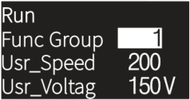

### 3.3.1 การเลือกกลุ่มฟังก์ชัน

หลังจากเข้าสู่อินเทอร์เฟซกลุ่มฟังก์ชันโดยกดสวิตช์แบบเข้ารหัสค้างไว้ที่อินเทอร์เฟซสแตนด์บาย เคอร์เซอร์จะอยู่ที่ค่าของ "Function Group" ให้หมุนสวิตช์แบบเข้ารหัสเพื่อปรับค่าเพื่อสลับระหว่าง "Function Group 0" ถึง "Function Group 9"

พารามิเตอร์ทั้งหมดของกลุ่มฟังก์ชันอธิบายไว้ในภาคผนวก H

### 3.3.2 วิธีการปรับพารามิเตอร์ของกลุ่มฟังก์ชัน

มี 3 วิธีในการสลับพารามิเตอร์ในอินเทอร์เฟซกลุ่มฟังก์ชัน:

1. กดสวิตช์แบบเข้ารหัสสั้น ๆ เพื่อสลับระหว่างพารามิเตอร์
2. กดสวิตช์แบบเข้ารหัสค้างไว้ไม่เกิน 2 วินาที และหมุนสวิตช์แบบเข้ารหัสพร้อมกันเพื่อสลับระหว่างพารามิเตอร์

---

3. กดสวิตช์แบบเข้ารหัสค้างไว้เกิน 2.5 วินาทีจนกระทั่งแถวแสดงผลพารามิเตอร์แสดงแบบกลับสี แล้วปล่อย

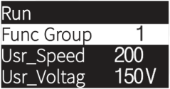

หมุนสวิตช์แบบเข้ารหัสเพื่อเลือกพารามิเตอร์

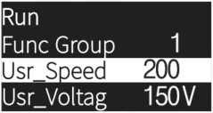

หลังจากเลือกพารามิเตอร์แล้ว ให้กดสวิตช์แบบเข้ารหัสสั้น ๆ เพื่อเข้าสู่สถานะการปรับพารามิเตอร์

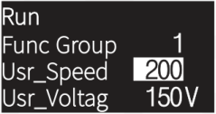

วิธีการปรับนี้เหมาะสำหรับการสลับระหว่างพารามิเตอร์หลายตัว

**พารามิเตอร์ทั้งหมดของกลุ่มฟังก์ชันอธิบายไว้ในภาคผนวก H**

---

## 3.4 อินเทอร์เฟซแสดงผลกระบวนการค้นหาความถี่เรโซแนนซ์

เมื่อกระบวนการค้นหาความถี่เรโซแนนซ์อัตโนมัติเริ่มต้นขึ้น จอ OLED จะแสดงกราฟความถี่เทียบกับความเร่ง ดังแสดงด้านล่าง ทิศทางแนวนอนของกราฟคือความถี่ซึ่งมีช่วงตั้งแต่ 25Hz ถึง 400Hz และทิศทางแนวตั้งของกราฟคือความเร่ง

หลังจากกระบวนการค้นหาความถี่เรโซแนนซ์อัตโนมัติเสร็จสิ้น ผลลัพธ์ความถี่เรโซแนนซ์และ "Save" จะแสดงบนจอ OLED เพื่อบ่งชี้ว่าพารามิเตอร์ถูกบันทึกแล้ว ดังแสดงด้านล่าง

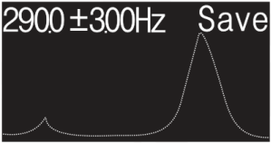

---

# บทที่ Ⅳ คำอธิบายฟังก์ชัน

## 4.1 การควบคุมเปิด/ปิดของพอร์ตอินพุตดิจิทัล C และ E

มีพอร์ตอินพุตดิจิทัล C และ E สองพอร์ตที่สามารถตรวจจับประเภท NPN/PNP ของเซ็นเซอร์ที่เชื่อมต่อโดยอัตโนมัติเพื่อเปิด/ปิดตัวควบคุม และอุปกรณ์ที่เชื่อมต่อกับพอร์ตสามารถเป็นเซ็นเซอร์สวิตช์แบบพร็อกซิมิตี้ เซ็นเซอร์โฟโตอิเล็กทริก เซ็นเซอร์ไฟเบอร์ หรือ PLC เป็นต้น

### 4.1.1 แผนภาพวงจรไฟฟ้าของพอร์ต C และพอร์ต E

แผนภาพวงจรไฟฟ้าของพอร์ต C

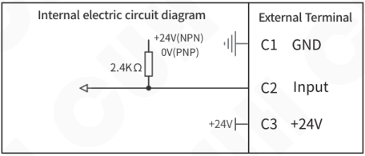

แผนภาพวงจรไฟฟ้าของพอร์ต E เหมือนกับพอร์ต C

### 4.1.2 วิธีการใช้งาน

ยกตัวอย่างเซ็นเซอร์สวิตช์แบบพร็อกซิมิตี้ โดยวิธีการเชื่อมต่อสายแสดงไว้ด้านล่าง:

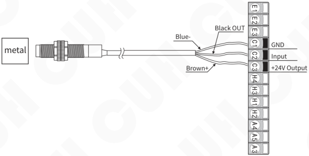

วิธีการเชื่อมต่อสายของเซ็นเซอร์สวิตช์อื่น ๆ แสดงไว้ในภาคผนวก G

---

## 4.1.3 แผนภาพการไหลของสัญญาณของพอร์ต C และพอร์ต E

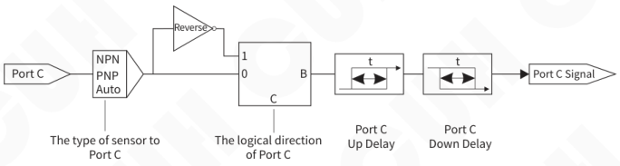

แผนภาพการไหลของสัญญาณของพอร์ต E เหมือนกับพอร์ต C

## 4.1.4 คำอธิบายพารามิเตอร์ที่เกี่ยวข้อง

พารามิเตอร์ของพอร์ต C ปรับในกลุ่มฟังก์ชัน 4 และพารามิเตอร์ของพอร์ต E ปรับในกลุ่มฟังก์ชัน 5

**พารามิเตอร์ "PortCType_"**

ตัวควบคุมสามารถตรวจจับประเภท NPN/PNP ของเซ็นเซอร์ที่เชื่อมต่อได้โดยอัตโนมัติ (ค่าเริ่มต้นจากโรงงานคือ Auto)

**พารามิเตอร์ "PortCDir__"**

ตามค่าเริ่มต้นจากโรงงาน ตัวควบคุมจะทำงานเมื่อพอร์ต C ไม่ได้รับสัญญาณ ในแอปพลิเคชันพิเศษบางอย่าง ตัวควบคุมจำเป็นต้องหยุดเมื่อพอร์ต C ไม่ได้รับสัญญาณ โดยการปรับพารามิเตอร์ "PortCDir__"

เมื่อ "PortCDir__" ถูกตั้งเป็น "Const" และพอร์ต C ไม่ได้รับสัญญาณ ตัวควบคุมจะเริ่มทำงาน

เมื่อ "PortCDir__" ถูกตั้งเป็น "Revrs" และพอร์ต C ไม่ได้รับสัญญาณ ตัวควบคุมจะหยุดทำงาน

---

---

### พารามิเตอร์ "PortCUpDly"

เวลาหน่วงเปิดของพอร์ต C หมายถึงช่วงเวลาตั้งแต่พอร์ต C ได้รับสัญญาณเริ่มต้นที่ถูกต้องจนถึงตัวควบคุมเริ่มทำงาน

### พารามิเตอร์ "PortCDnDly"

เวลาหน่วงปิดของพอร์ต C หมายถึงช่วงเวลาตั้งแต่พอร์ต C ได้รับสัญญาณหยุดที่ถูกต้องจนถึงตัวควบคุมหยุดทำงาน

หมายเหตุ: เมื่อพอร์ต C ถูกใช้เพื่อเริ่ม/หยุดตัวควบคุม จำเป็นต้องตั้งค่าเวลาหน่วงของพอร์ต C เพื่อขจัดสัญญาณรบกวน

---

## 4.2 ฟังก์ชันการนับ

### 4.2.1 แผนภาพการไหลของสัญญาณของฟังก์ชันการนับ

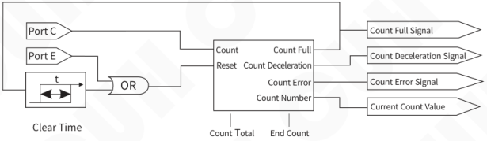

ตัวควบคุมมีฟังก์ชันการนับในตัวที่สามารถนับพัลส์ได้ เมื่อจำนวนพัลส์ที่นับได้ถึงค่า Count Total ที่ตั้งไว้ล่วงหน้า ความเร็วป้อนจะลดลงหรือเป็นศูนย์

### 4.2.2 ฟังก์ชันลดความเร็วเมื่อสิ้นสุด

เพื่อขจัดปัญหาการนับเกินของฟังก์ชันการนับที่เกิดจากความเร็วป้อนสูงที่ไม่สามารถหยุดได้ทันท่วงที จำเป็นต้องตั้งค่า End Feeding Speed และ End Count ความเร็วป้อนจะลดลงเหลือ End Feeding Speed เมื่อจำนวนที่นับเหลืออยู่ใกล้ถึงค่า End Count ที่ตั้งไว้ล่วงหน้าซึ่งน้อยกว่า Count Total และเมื่อจำนวนที่นับถึง Count Total ความเร็วป้อนจะถูกหยุดทันเวลาเพื่อการนับที่แม่นยำ

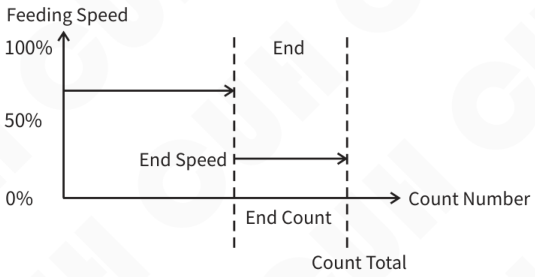

---

## 4.2.3 ฟังก์ชันต้านการสั่นไหวขั้นสูง

ฟังก์ชันต้านการสั่นไหวขั้นสูงถูกออกแบบมาเป็นพิเศษเพื่อแก้ปัญหาการนับผิดที่เกิดจากสภาวะการป้อนแบบสั่นสะเทือน โดยการตั้งค่าเวลาทำให้สัญญาณการนับเสถียรเพื่อให้ได้ฟังก์ชันต้านการสั่นไหวขั้นสูง พัลส์การนับจะถือว่าถูกต้องหลังจากเวลาทำให้สัญญาณการนับเสถียร ความละเอียดของเวลาทำให้สัญญาณการนับเสถียรคือระดับมิลลิวินาที

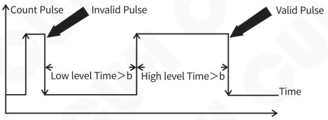

หมายเหตุ: เวลาทำให้เสถียรแบบต้านการสั่นไหวหมายถึงเวลาทำให้เสถียรของระดับสูงและระดับต่ำ พัลส์ที่ถูกต้องประกอบด้วยระดับสูงและระดับต่ำที่ทำงานต่อเนื่องกัน จากนั้นตัวนับจะเพิ่มขึ้นหนึ่ง

### วิธีการตั้งค่าเวลาทำให้สัญญาณการนับเสถียร

พอร์ต C เป็นพอร์ตอินพุตของพัลส์การนับของตัวนับ "PortCUpDly " และ "PortCDnDly " เป็นเวลาทำให้เสถียรของระดับสูงและระดับต่ำของพัลส์การนับตามลำดับ

พอร์ต E เป็นพอร์ตอินพุตของพัลส์รีเซ็ตของตัวนับ "PortEUpDly" และ "PortEDnDly" เป็นเวลาทำให้เสถียรของระดับสูงและระดับต่ำของพัลส์รีเซ็ตตามลำดับ

---

## 4.2.4 ฟังก์ชันรีเซ็ตตัวนับด้วยตัวจับเวลา

เมื่อจำนวนที่นับถึง Count Total หลังจากเวลาหน่วงที่ปรับโดย "Clear Time" ในกลุ่มฟังก์ชัน 1 ตัวนับจะถูกรีเซ็ตและเริ่มนับใหม่

เมื่อค่า "Clear Time" เป็น 0.0s ฟังก์ชันรีเซ็ตตัวนับด้วยตัวจับเวลาจะถูกปิดใช้งาน

## 4.2.5 วิธีการใช้งานการนับ

มีตัวนับในตัวอยู่ในตัวควบคุม โดยพอร์ต C เป็นพอร์ตการนับของตัวนับ และพอร์ต E เป็นพอร์ตรีเซ็ตของตัวนับ

สถานะของตัวนับสามารถควบคุมเอาต์พุตควบคุมหลัก เอาต์พุตพอร์ต D และเอาต์พุตพอร์ต P ได้

- เมื่อค่า "Main Logic" ซึ่งปรับในกลุ่มฟังก์ชัน 2 เป็น "Count" เอาต์พุตควบคุมหลักจะถูกควบคุมโดยสัญญาณ Count Full
- เมื่อค่า "Port D Logic" ซึ่งปรับในกลุ่มฟังก์ชัน 6 เป็น "END" เอาต์พุตพอร์ต D จะถูกควบคุมโดยสัญญาณ Count Full  
  เมื่อค่า "Port P Logic" ซึ่งปรับในกลุ่มฟังก์ชัน 7 เป็น "END" เอาต์พุตพอร์ต P จะถูกควบคุมโดยสัญญาณ Count Full
- เมื่อค่า "Port D Logic" ซึ่งปรับในกลุ่มฟังก์ชัน 6 เป็น "Near" เอาต์พุตพอร์ต D จะถูกควบคุมโดยสัญญาณ Count Deceleration  
  เมื่อค่า "Port P Logic" ซึ่งปรับในกลุ่มฟังก์ชัน 7 เป็น "Near" เอาต์พุตพอร์ต P จะถูกควบคุมโดยสัญญาณ Count Deceleration

---

## 4.2.6 คำอธิบายพารามิเตอร์ที่เกี่ยวข้อง

### พารามิเตอร์ "CountNumbr"

"CountNumbr" ซึ่งเป็นจำนวนที่ตัวนับนับได้แล้ว ตรวจสอบได้ในกลุ่มฟังก์ชัน 9

### พารามิเตอร์ "TotalCount"

หลังจาก "CountNumbr" ถึงค่า "TotalCount" ที่คุณต้องการซึ่งปรับในกลุ่มฟังก์ชัน 1 สัญญาณ Count Full ของตัวนับจะถูกต้องจนกว่าตัวนับจะถูกรีเซ็ต ตัวนับสามารถนับต่อไปได้จนกว่าจะถูกรีเซ็ต

### พารามิเตอร์ "CountAhead"

"CountAhead" ปรับในกลุ่มพารามิเตอร์ 2 หมายถึงจำนวนที่เหลือของตัวนับที่ยังนับไม่ถึง "TotalCount" เมื่อ "CountNumbr" ถึง "CountAhead" ความเร็วป้อนจะลดลงเหลือค่า "PrcntTrmnl" ที่ปรับในกลุ่มฟังก์ชัน 2

### พารามิเตอร์ "PrcntTrmnl"

"PrcntTrmnl" ปรับในกลุ่มฟังก์ชัน 2 หมายถึงเมื่อ "CountNumbr" ถึง "CountAhead" ความเร็วป้อนจะลดลงเหลือความเร็วเริ่มต้นคูณด้วย "PrcntTrmnl"

### พารามิเตอร์ "Clear Time"

เมื่อจำนวนที่นับถึง Count Total หลังจากเวลาหน่วงที่ปรับโดย "Clear Time" ในกลุ่มฟังก์ชัน 1 ตัวนับจะถูกรีเซ็ตและเริ่มนับใหม่

เมื่อค่า "Clear Time" เป็น 0.0s ฟังก์ชันรีเซ็ตตัวนับด้วยตัวจับเวลาจะถูกปิดใช้งาน

### ทิศทางของพอร์ตอินพุตของพัลส์การนับ

ทิศทางของพอร์ตอินพุตของพัลส์การนับเหมือนกับ "PortCDir_" ที่ปรับในกลุ่มฟังก์ชัน 4

### ทิศทางของพอร์ตอินพุตของพัลส์รีเซ็ต

ทิศทางของพอร์ตอินพุตของพัลส์รีเซ็ตเหมือนกับ "PortEDir_" ที่ปรับในกลุ่มฟังก์ชัน 5

---

## 4.3 สัญญาณควบคุมเอาต์พุตหลัก

สัญญาณควบคุมเอาต์พุตหลักใช้เพื่อเปิด/ปิดเอาต์พุตหลักของตัวควบคุม และพารามิเตอร์ทั้งหมดของการควบคุมเอาต์พุตหลักปรับในกลุ่มฟังก์ชัน 2

### 4.3.1 แผนภาพการไหลของสัญญาณของสัญญาณควบคุมเอาต์พุตหลัก

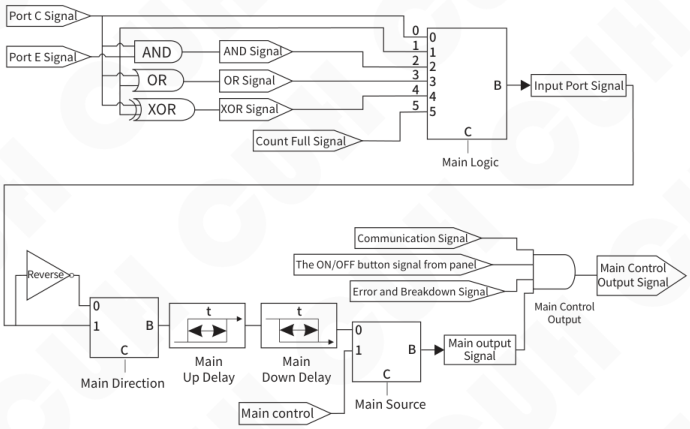

---

## 4.3.2 คำอธิบายสัญญาณ

### สัญญาณการสื่อสาร

สัญญาณการสื่อสารมาจาก RS485 หรืออีเทอร์เน็ต

เมื่อสัญญาณหยุดถูกส่งไปยังตัวควบคุมผ่าน RS485 หรืออีเทอร์เน็ต ตัวควบคุมจะหยุดทำงาน

เมื่อสัญญาณเริ่มถูกส่งไปยังตัวควบคุมผ่าน RS485 หรืออีเทอร์เน็ต ตัวควบคุมจะเริ่มทำงาน

### สัญญาณปุ่มเปิด/ปิดบนแผงควบคุม

สัญญาณควบคุมมาจากปุ่มเปิด/ปิดบนแผงควบคุม เปิดหรือปิดตัวควบคุมโดยกดปุ่มเปิด/ปิดบนแผงควบคุมสั้น ๆ

สถานะการทำงานของตัวควบคุมเมื่อเปิดเครื่องถูกกำหนดโดยพารามิเตอร์ "PowrOnStat" ในกลุ่มฟังก์ชัน 2

เมื่อ "PowrOnStat" ถูกตั้งเป็น "ON" ตัวควบคุมจะเริ่มเอาต์พุตหลักเมื่อเปิดเครื่อง

เมื่อ "PowrOnStat" ถูกตั้งเป็น "OFF" ตัวควบคุมจะหยุดเอาต์พุตหลักเมื่อเปิดเครื่อง

### สัญญาณข้อผิดพลาดและการเสียหาย

เมื่อเกิดข้อผิดพลาดอย่างใดอย่างหนึ่ง เช่น กระแสเกิน ลัดวงจร ความร้อนสูงเกิน ฯลฯ ตัวควบคุมจะหยุดทำงาน

เมื่อการล้างค่าและการนับขึ้นเกิดขึ้นพร้อมกันในกระบวนการนับ ตัวควบคุมจะหยุดทำงาน

### สัญญาณเอาต์พุตหลัก

สัญญาณเอาต์พุตหลักคือสัญญาณพอร์ตอินพุตที่ปรับโดย "MainDir_", "MainUpDely", "MainDwnDly" และ "MainSrc_"

### สัญญาณพอร์ตอินพุต

แหล่งที่มาของสัญญาณพอร์ตอินพุตถูกเลือกโดยการปรับค่า "MainLogic_ " ในกลุ่มฟังก์ชัน 2 ค่าของ "MainLogic_ " ได้แก่ "Port C", "Port E", "AND", "OR", "XOR", "Count"

---

## 4.3.3 คำอธิบายพารามิเตอร์ที่เกี่ยวข้อง

### พารามิเตอร์ "MainLogic_ "

- เมื่อค่า "MainLogic_ " เป็น "Port C" หมายความว่าแหล่งสัญญาณของพอร์ตอินพุตมาจากสัญญาณของพอร์ต C

  เมื่อสัญญาณของพอร์ต C ร้องขอให้ตัวควบคุมเข้าสู่สถานะการทำงาน สัญญาณพอร์ตอินพุตจะร้องขอให้เริ่มตัวควบคุม

  เมื่อสัญญาณของพอร์ต C ร้องขอให้ตัวควบคุมเข้าสู่สถานะการหยุด สัญญาณพอร์ตอินพุตจะร้องขอให้หยุดตัวควบคุม

- เมื่อค่า "MainLogic_ " เป็น "Port E" หมายความว่าแหล่งสัญญาณของพอร์ตอินพุตมาจากสัญญาณของพอร์ต E

  เมื่อสัญญาณของพอร์ต E ร้องขอให้ตัวควบคุมเข้าสู่สถานะการทำงาน สัญญาณพอร์ตอินพุตจะร้องขอให้เริ่มตัวควบคุม

  เมื่อสัญญาณของพอร์ต E ร้องขอให้ตัวควบคุมเข้าสู่สถานะการหยุด สัญญาณพอร์ตอินพุตจะร้องขอให้หยุดตัวควบคุม

- เมื่อค่า "MainLogic_ " เป็น "AND", "OR" หรือ "XOR" หมายความว่าแหล่งสัญญาณของพอร์ตอินพุตมาจากผลลัพธ์ของการดำเนินการทางตรรกะระหว่างพอร์ต C และพอร์ต E

  "AND" หมายความว่าสัญญาณของพอร์ต C และพอร์ต E ต่างร้องขอให้หยุดตัวควบคุม และสัญญาณพอร์ตอินพุตจะหยุดตัวควบคุม

  "OR" หมายความว่าสัญญาณของพอร์ต C หรือพอร์ต E ร้องขอให้หยุดตัวควบคุม และสัญญาณพอร์ตอินพุตจะหยุดตัวควบคุม

  "XOR" หมายความว่าคำร้องของพอร์ต C และพอร์ต E แตกต่างกัน และสัญญาณพอร์ตอินพุตจะหยุดตัวควบคุม

- เมื่อค่า "MainLogic_ " เป็น "Count" หมายความว่าสัญญาณพอร์ตอินพุตมาจากสัญญาณ Count Full ของตัวนับ

  เมื่อสัญญาณ Count Full ถูกต้อง ตัวควบคุมจะหยุดเอาต์พุตหลัก และ "CND" จะแสดงบนหน้าจอ

  เมื่อสัญญาณ Count Full ไม่ถูกต้อง ตัวควบคุมจะเปิดเอาต์พุตหลัก

---

### พารามิเตอร์ "MainDir_"

"Main Direction" หมายความว่าสัญญาณของพอร์ตอินพุตจำเป็นต้องกลับทิศทางหรือไม่

เมื่อค่า "Main Direction" เป็น "Normal ON" หมายความว่าสัญญาณของพอร์ตอินพุตไม่จำเป็นต้องกลับทิศทาง

เมื่อค่า "Main Direction" เป็น "Normal OFF" หมายความว่าสัญญาณของพอร์ตอินพุตจำเป็นต้องกลับทิศทาง

### พารามิเตอร์ "MainUpDely "

เวลาหน่วงเปิดของสัญญาณหลักหมายถึงช่วงเวลาตั้งแต่การร้องขอให้เริ่มตัวควบคุมจนกระทั่งสัญญาณร้องขอถือว่าถูกต้อง

### พารามิเตอร์ "MainDwnDly"

เวลาหน่วงปิดของสัญญาณหลักหมายถึงช่วงเวลาตั้งแต่การร้องขอให้หยุดตัวควบคุมจนกระทั่งสัญญาณร้องขอถือว่าถูกต้อง

### พารามิเตอร์ "MainSrc_"

สัญญาณเอาต์พุตหลักมาจาก " Input port Signal" หรือ "Main control"

เมื่อค่า "MainSrc_" เป็น "Local" หมายความว่าสัญญาณเอาต์พุตหลักมาจาก " Input port Signal"

เมื่อค่า "MainSrc_" เป็น "Remot" หมายความว่าสัญญาณเอาต์พุตหลักมาจาก "MainCtrl_"

### พารามิเตอร์ "MainCtrl_"

"MainCtrl_" มีสองสถานะ: หยุดเอาต์พุตของตัวควบคุม และเริ่มเอาต์พุตของตัวควบคุม

เมื่อค่า "MainCtrl_" เป็น "OFF" หมายถึงการหยุดเอาต์พุตของตัวควบคุม

เมื่อค่า "MainCtrl_" เป็น "ON" หมายถึงการเริ่มเอาต์พุตของตัวควบคุม

---

## 4.4 เอาต์พุตควบคุม DC พอร์ต D และพอร์ต P

มีพอร์ตเอาต์พุต DC 24V สองพอร์ต: พอร์ต D และพอร์ต P สำหรับขับโซลินอยด์ PLC หรืออุปกรณ์ภายนอกอื่น ๆ

หลักการทำงานและวิธีการปรับพารามิเตอร์ของพอร์ต P และพอร์ต D เหมือนกัน

### 4.4.1 แผนภาพวงจรไฟฟ้าของพอร์ต D และพอร์ต P

แผนภาพวงจรไฟฟ้าของพอร์ต D

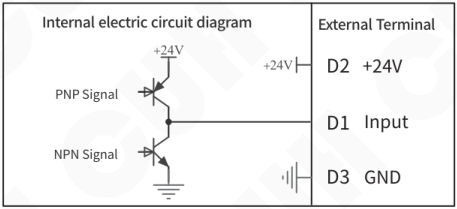

แผนภาพวงจรไฟฟ้าของพอร์ต P เหมือนกับพอร์ต D

---

## 4.4.2 วิธีการใช้งาน

วิธีการเชื่อมต่อสายของโซลินอยด์

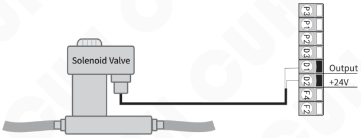

วิธีการเชื่อมต่อสายของรีเลย์ไฟฟ้า

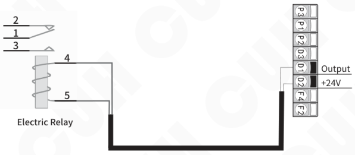

วิธีการเชื่อมต่อสายของพอร์ต D และพอร์ต P เหมือนกัน

---

## 4.4.3 แผนภาพการไหลของสัญญาณของพอร์ต D และพอร์ต P

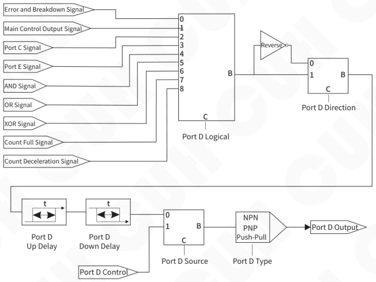

แผนภาพการไหลของสัญญาณของพอร์ต D และพอร์ต P เหมือนกัน

## 4.4.4 คำอธิบายพารามิเตอร์ที่เกี่ยวข้อง

พารามิเตอร์ของพอร์ต D ปรับในกลุ่มฟังก์ชัน 6 และพารามิเตอร์ของพอร์ต P ปรับในกลุ่มฟังก์ชัน 7

### พารามิเตอร์ "PortDLogic"

แหล่งที่มาของพอร์ต D ถูกเลือกโดยการปรับค่า "PortDLogic" ในกลุ่มฟังก์ชัน 6 ค่าของ "PortDLogic" ได้แก่ "Error", "Main", "Port C", "Port E", "AND", "OR", "XOR", "Count", "Near"

- เมื่อค่า "PortDLogic" เป็น "Error" หมายความว่าแหล่งสัญญาณของพอร์ต D มาจากสถานะความผิดพลาดของตัวควบคุมหรือข้อผิดพลาดการนับของโหมดตัวนับ

เมื่อเกิดข้อผิดพลาดอย่างใดอย่างหนึ่ง เช่น กระแสเกิน ลัดวงจร ความร้อนสูงเกิน ฯลฯ พอร์ต D จะถูกร้องขอให้ปิด

เมื่อการล้างค่าและการนับขึ้นเกิดขึ้นพร้อมกันในกระบวนการนับ พอร์ต D จะถูกร้องขอให้ปิด

เมื่อไม่มีทั้งความผิดพลาดและข้อผิดพลาดการนับ พอร์ต D จะถูกร้องขอให้เปิด

---

---

- เมื่อค่า "PortDLogic" เป็น "Main" หมายความว่าแหล่งสัญญาณของพอร์ต D มาจากการควบคุมหลัก

  เมื่อสัญญาณของการควบคุมหลักอยู่ในสถานะการทำงาน พอร์ต D จะถูกร้องขอให้เปิด

  เมื่อสัญญาณของการควบคุมหลักอยู่ในสถานะการหยุด พอร์ต D จะถูกร้องขอให้ปิด

- เมื่อค่า "PortDLogic" เป็น "Port C" หมายความว่าแหล่งสัญญาณของพอร์ต D มาจากสัญญาณของพอร์ต C

  เมื่อสัญญาณของพอร์ต C ร้องขอให้ตัวควบคุมเข้าสู่สถานะการทำงาน พอร์ต D จะถูกร้องขอให้เปิด

  เมื่อสัญญาณของพอร์ต C ร้องขอให้ตัวควบคุมเข้าสู่สถานะการหยุด พอร์ต D จะถูกร้องขอให้ปิด

- เมื่อค่า "PortDLogic" เป็น "Port E" หมายความว่าแหล่งสัญญาณของพอร์ต D มาจากสัญญาณของพอร์ต E

  เมื่อสัญญาณของพอร์ต E ร้องขอให้ตัวควบคุมเข้าสู่สถานะการทำงาน พอร์ต D จะถูกร้องขอให้เปิด

  เมื่อสัญญาณของพอร์ต E ร้องขอให้ตัวควบคุมเข้าสู่สถานะการหยุด พอร์ต D จะถูกร้องขอให้ปิด

- เมื่อค่า "PortDLogic" เป็น "AND", "OR" หรือ "XOR" หมายความว่าแหล่งสัญญาณของพอร์ต D มาจากผลลัพธ์ของการดำเนินการทางตรรกะระหว่างพอร์ต C และพอร์ต E

  "AND" หมายความว่าสัญญาณของพอร์ต C และพอร์ต E ต่างร้องขอให้หยุดตัวควบคุม และพอร์ต D จะถูกร้องขอให้ปิด

  "OR" หมายความว่าสัญญาณของพอร์ต C หรือพอร์ต E ร้องขอให้หยุดตัวควบคุม และเอาต์พุตของพอร์ต D จะถูกร้องขอให้ปิด

  "XOR" หมายความว่าคำร้องของพอร์ต C และพอร์ต E แตกต่างกัน และเอาต์พุตของพอร์ต D จะถูกร้องขอให้ปิด

- เมื่อค่า "PortDLogic" เป็น "END" หมายความว่าแหล่งสัญญาณของพอร์ต D มาจากสัญญาณ Count Full ของตัวนับ

  เมื่อสัญญาณ Count Full ถูกต้อง เอาต์พุตของพอร์ต D จะถูกร้องขอให้ปิด

- เมื่อค่า "PortDLogic" เป็น "Near" หมายความว่าแหล่งสัญญาณของพอร์ต D มาจากสัญญาณ Count Deceleration ของตัวนับ

  เมื่อสัญญาณ Count Deceleration ถูกต้อง เอาต์พุตของพอร์ต D จะถูกร้องขอให้ปิด

---

### พารามิเตอร์ "PortDDir_"

"PortDDir__ " หมายความว่าสัญญาณของพอร์ต D จำเป็นต้องกลับทิศหรือไม่
เมื่อค่า "PortDDir_" เป็น "Normal ON" หมายความว่าสัญญาณอินพุตของพอร์ต D ไม่จำเป็นต้องกลับทิศ

เมื่อค่า "PortDDir_" เป็น "Normal OFF" หมายความว่าสัญญาณอินพุตของพอร์ต D จำเป็นต้องกลับทิศ

### พารามิเตอร์ "PortDUpDly"

เวลาหน่วงเปิดของพอร์ต D หมายถึงช่วงเวลาตั้งแต่การร้องขอให้เปิดเอาต์พุตของพอร์ต D จนกระทั่งสัญญาณร้องขอถือว่าถูกต้อง

### พารามิเตอร์ "PortDDnDly"

เวลาหน่วงปิดของพอร์ต D หมายถึงช่วงเวลาตั้งแต่การร้องขอให้ปิดเอาต์พุตของพอร์ต D จนกระทั่งสัญญาณร้องขอถือว่าถูกต้อง

### พารามิเตอร์ "PortDSrc_"

แหล่งสัญญาณเอาต์พุตของพอร์ต D มาจาก " Input Signal of Port D " หรือ "Port D Output state"

เมื่อค่า "PortDSrc__ " เป็น "Local" หมายความว่าแหล่งสัญญาณเอาต์พุตของพอร์ต D มาจาก " Input Signal of Port D "

เมื่อค่า "PortDSrc__ " เป็น "Remot" หมายความว่าแหล่งสัญญาณเอาต์พุตของพอร์ต D มาจาก "Port D Output state"

### พารามิเตอร์ "PortDCtrl_"

"PortDCtrl_" มีสองสถานะ: หยุดเอาต์พุตของพอร์ต D และเริ่มเอาต์พุตของพอร์ต D

เมื่อค่า "PortDCtrl_" เป็น "OFF" หมายถึงการหยุดเอาต์พุตของพอร์ต D เมื่อค่า "PortDCtrl_" เป็น "ON" หมายถึงการเริ่มเอาต์พุตของพอร์ต D

### พารามิเตอร์ "PortDType_ "

พอร์ต D มีสามประเภท: NPN, PNP และ Ps&Pu

- ประเภท NPN หมายความว่าเอาต์พุตระดับต่ำเมื่อเอาต์พุตของพอร์ต D ถูกต้อง และเอาต์พุตสถานะความต้านทานสูงเมื่อเอาต์พุตของพอร์ต D ไม่ถูกต้อง
- ประเภท Ps&Pu หมายความว่าเอาต์พุตระดับสูงเมื่อเอาต์พุตของพอร์ต D ถูกต้อง และเอาต์พุตระดับต่ำเมื่อเอาต์พุตของพอร์ต D ไม่ถูกต้อง
- ประเภท PNP หมายความว่าเอาต์พุตระดับสูงเมื่อเอาต์พุตของพอร์ต D ถูกต้อง และเอาต์พุตสถานะความต้านทานสูงเมื่อเอาต์พุตของพอร์ต D ไม่ถูกต้อง

---

## 4.5 การควบคุมความเร็วระยะไกล

แรงดันเอาต์พุตของตัวควบคุมสามารถปรับได้ด้วยโพเทนชิออมิเตอร์ภายนอก หรือสัญญาณ DC 4~20mA, 0~5V, 1~5V, 0~10V ดังนั้นผู้ใช้จึงสามารถปรับได้อย่างง่ายดายด้วยโพเทนชิออมิเตอร์ PLC และอุปกรณ์ภายนอกอื่น ๆ

### 4.5.1 แผนภาพวงจรไฟฟ้าของพอร์ต A ของการควบคุมความเร็วระยะไกล

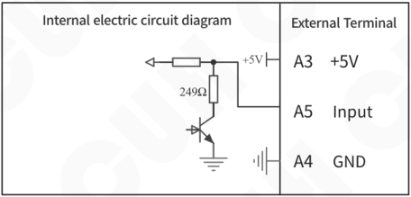

### 4.5.2 ประเภทสัญญาณควบคุมระยะไกล

สามารถตั้งค่าประเภทสัญญาณควบคุมระยะไกลได้ 6 ประเภท: "Panel", 20mA, 1~5V, 0~5V, 0~10V, meter

ประเภทสัญญาณควบคุมระยะไกลปรับโดยค่า "control source" ในกลุ่มฟังก์ชัน 2 (ค่าเริ่มต้นคือ "Panel")

---

| ประเภทสัญญาณควบคุมระยะไกล | สัญญาณควบคุมระยะไกล | แรงดันเอาต์พุต/ความเร็วป้อน |
|---|---|---|
| Panel | | แรงดันเอาต์พุตและความเร็วป้อนไม่ถูกควบคุมโดยสัญญาณควบคุมระยะไกล |
| 20mA | <2mA | เมื่อโหมดแรงดันไฟฟ้าเป็น Manual แรงดันเอาต์พุต = 0 เมื่อโหมดแรงดันไฟฟ้าเป็น Auto ความเร็วป้อน = 0 LCD แสดงข้อมูลข้อผิดพลาด "<2mA Err" |
| | 2mA~4 mA | แรงดันเอาต์พุต = 0, ความเร็วป้อน = 0 |
| | 4 mA ~20mA | ควบคุมแบบสัดส่วนโดยสัญญาณควบคุมระยะไกล (0%~100%) เมื่อโหมดแรงดันไฟฟ้าเป็น Manual แรงดันเอาต์พุต = (กระแสอินพุต - 4mA)/16 ×แรงดันเอาต์พุตสูงสุด เมื่อโหมดแรงดันไฟฟ้าเป็น Auto ความเร็วป้อน = (กระแสอินพุต - 4mA)/16 ×ความเร็วป้อนสูงสุด |
| 1~5V | <0.5V | แรงดันเอาต์พุต = 0, ความเร็วป้อน = 0 LCD แสดงข้อมูลข้อผิดพลาด "<0.5V Err" |
| | 0.5V~1V | แรงดันเอาต์พุต = 0, ความเร็วป้อน = 0 |
| | 1V~5V | ควบคุมแบบสัดส่วนโดยสัญญาณควบคุมระยะไกล (0%~100%) เมื่อโหมดแรงดันไฟฟ้าเป็น Manual แรงดันเอาต์พุต = (แรงดันอินพุต 1V)/4 ×แรงดันเอาต์พุตสูงสุด เมื่อโหมดแรงดันไฟฟ้าเป็น Manual แรงดันเอาต์พุต = (แรงดันอินพุต 1V)/4 ×แรงดันเอาต์พุตสูงสุด |
| 0~5V | 0V~5V | ควบคุมแบบสัดส่วนโดยสัญญาณควบคุมระยะไกล (0%~100%) เมื่อโหมดแรงดันไฟฟ้าเป็น Manual แรงดันเอาต์พุต = แรงดันอินพุต/5 × แรงดันเอาต์พุตสูงสุด เมื่อโหมดแรงดันไฟฟ้าเป็น Auto ความเร็วป้อน = แรงดันอินพุต/5 ×ความเร็วป้อนสูงสุด |
| 0~10V | 0V~10V | ควบคุมแบบสัดส่วนโดยสัญญาณควบคุมระยะไกล (0%~100%) เมื่อโหมดแรงดันไฟฟ้าเป็น Manual แรงดันเอาต์พุต = แรงดันอินพุต/10 × แรงดันเอาต์พุตสูงสุด เมื่อโหมดแรงดันไฟฟ้าเป็น Auto ความเร็วป้อน = แรงดันอินพุต/10 ×ความเร็วป้อนสูงสุด |
| Meter (โพเทนชิออมิเตอร์) | อัตราการแบ่งแรงดันของโพเทนชิออมิเตอร์ <4% | แรงดันเอาต์พุต = 0, ความเร็วป้อน = 0 |
| | อัตราการแบ่งแรงดันของโพเทนชิออมิเตอร์เป็น 4%~96% | ควบคุมแบบสัดส่วนโดยสัญญาณควบคุมระยะไกล (0%~100%) เมื่อโหมดแรงดันไฟฟ้าเป็น Manual แรงดันเอาต์พุต = ((อัตราการแบ่งแรงดัน - 4%)/92%)× แรงดันเอาต์พุตสูงสุด เมื่อโหมดแรงดันไฟฟ้าเป็น Auto ความเร็วป้อน =((แรงดันอินพุต แรงดันภายใน × 4%)/แรงดันภายใน × 92%) ×ความเร็วป้อนสูงสุด |

## 4.6 โหมดหลัก

โหมดหลัก: กรณีที่ตัวควบคุมขับเคลื่อนเครื่องสั่นอย่างอิสระ

การปรับพารามิเตอร์ "Voltage mode" และ "Frequency Mode" เพื่อตั้งค่าโหมดหลักของตัวควบคุม โดยชุดค่าผสมถูกกำหนดไว้ด้านล่าง:

| โหมดหลัก | โหมดแรงดันไฟฟ้า | โหมดความถี่ | เชื่อมต่อเซ็นเซอร์สั่นสะเทือน |
|---|---|---|---|
| โหมดแมนนวลเต็มรูปแบบ | Manual | Manual | ไม่ |
| โหมดอัตโนมัติเต็มรูปแบบ | Automatic | Automatic | ใช่ |
| โหมดกึ่งอัตโนมัติแรงดันไฟฟ้า | Automatic | Manual | ใช่ |
| โหมดกึ่งอัตโนมัติความถี่ | Manual | Automatic | ใช่ |

### 4.6.1 โหมดแมนนวลเต็มรูปแบบ

แรงดันเอาต์พุตและความถี่เอาต์พุตของตัวควบคุมถูกปรับด้วยตนเอง

**วิธีการตั้งค่าแรงดันเอาต์พุต**

เลื่อนเคอร์เซอร์ไปที่ค่า "Usr_Voltag" ในกลุ่มฟังก์ชัน 1 และปรับค่าแรงดันเอาต์พุตโดยหมุนสวิตช์แบบเข้ารหัส

**วิธีการตั้งค่าความถี่เอาต์พุต**

เลื่อนเคอร์เซอร์ไปที่ค่า "Usr_Frqncy" ในกลุ่มฟังก์ชัน 1 และปรับค่าความถี่เอาต์พุตโดยหมุนสวิตช์แบบเข้ารหัส

> หมายเหตุ:
>
> หากไม่มีคำแนะนำพิเศษในคู่มือนี้ แรงดันไฟฟ้าคือแรงดันเฉลี่ยแบบเรียงกระแส
>
> ตัวควบคุมนี้มีฟังก์ชันการควบคุมแรงดันอัตโนมัติ

---

## 4.6.2 โหมดอัตโนมัติเต็มรูปแบบ

ตัวควบคุมปรับแรงดันเอาต์พุตและความถี่เอาต์พุตโดยอัตโนมัติตามข้อมูลจากเซ็นเซอร์สั่นสะเทือน เพื่อรักษาเสถียรภาพความเร็วป้อนของเครื่องสั่นซึ่งปรับโดย "User_Speed" ในกลุ่มฟังก์ชัน 1

### วิธีการตั้งค่าความเร็วป้อน

เลื่อนเคอร์เซอร์ไปที่ค่า "User_Speed" ในกลุ่มฟังก์ชัน 1 และปรับค่าความเร็วป้อนโดยหมุนสวิตช์แบบเข้ารหัส

### คำอธิบายพารามิเตอร์ที่เกี่ยวข้องอื่น ๆ

**"AtoFCenter”**

ช่วงการปรับความถี่อัตโนมัติของตัวควบคุมคือ "AtoFCenter ± AtoFRange_" และความถี่ศูนย์กลางควรปรับให้ใกล้กับความถี่เรโซแนนซ์ของเครื่องสั่น

**"AtoFRange_"**

ช่วงการปรับความถี่อัตโนมัติของตัวควบคุมคือ "AtoFCenter ± AtoFRange_" และช่วงความถี่ที่แนะนำคือ 30.0Hz ค่าช่วงความถี่ที่มากเกินไปทำให้เครื่องสั่นไม่สามารถทำงานที่ความถี่ที่ดีที่สุด และค่าที่น้อยเกินไปอาจลดความสามารถในการปรับตัวของเครื่องสั่น

**"AtoFIntgrl”**

ปรับความถี่เอาต์พุตของตัวควบคุมโดยอัตโนมัติผ่านอัลกอริทึม PID ยิ่งค่าอินทิกรัลความถี่ของ PID มาก การปรับความถี่เอาต์พุตก็ยิ่งเร็วขึ้น แต่ค่าที่มากเกินไปอาจทำให้ความถี่เอาต์พุตแกว่ง

**"AtoAProptn”**

ปรับแรงดันเอาต์พุตของตัวควบคุมโดยอัตโนมัติผ่านอัลกอริทึม PID ยิ่งค่าสัดส่วนแอมพลิจูดของ PID มาก การปรับแรงดันเอาต์พุตก็ยิ่งเร็วขึ้น แต่ค่าที่มากเกินไปอาจทำให้แรงดันเอาต์พุตแกว่ง

**"AtoAIntgrl”**

ปรับแรงดันเอาต์พุตของตัวควบคุมโดยอัตโนมัติผ่านอัลกอริทึม PID ยิ่งค่าอินทิกรัลแอมพลิจูดของ PID มาก จำนวนครั้งและแอมพลิจูดของการแกว่งของแรงดันเอาต์พุตก็ยิ่งลดลงเร็วขึ้น แต่ค่าที่มากเกินไปอาจทำให้แอมพลิจูดของการแกว่งของแรงดันเอาต์พุตใหญ่ขึ้น

---

### "AtoSnsrMax”

จำกัดแอมพลิจูดเอาต์พุตสูงสุดโดยการตั้งค่า "AtoSnsrMax" เพื่อหลีกเลี่ยงความเสียหายต่อเครื่องสั่น

### "AutoPhase”

ปรับเฟสของรูปคลื่นโดยการตั้งค่าพารามิเตอร์ "AutoPhase"

### "AtoSpedMax”

ช่วงการปรับความเร็วป้อนอยู่ที่ 0 ถึง "AtoSpedMax"

### "AtoSrhVMax”

จำกัดแรงดันเอาต์พุตในกระบวนการค้นหาความถี่เรโซแนนซ์อัตโนมัติเพื่อหลีกเลี่ยงความเสียหายต่ออุปกรณ์สั่นสะเทือน

### "AtoSnsrTyp"

ตัวควบคุมรองรับเซ็นเซอร์สั่นสะเทือนหลายประเภท และแรงดันเอาต์พุตของตัวควบคุมจะแตกต่างกันตามประเภทที่ต่างกันที่ความเร็วป้อนเดียวกัน

| ค่าทางเทคนิค | ประเภทเซ็นเซอร์สั่นสะเทือน | ความเร่งของทิศทาง X/Y/Z |
|---|---|---|
| 16g | SDVS20-1 | 16g/16g/16g |
| 35g | SDVS20-2 | 35g/35g/- |
| 50g | SDVS20-3 | 50g/50g/- |
| 70g | SDVS20-4 | 70g/70g/- |
| Auto | ไม่มี | ไม่มี |

### "Speed_Now_”

ความเร็วป้อนแบบเรียลไทม์แสดงโดย "Speed_Now_" ในกลุ่มฟังก์ชัน 9 เพื่อช่วยให้ผู้ใช้สังเกตสภาพการทำงานของอุปกรณ์

### "VoltagOut_"

แรงดันเอาต์พุตแบบเรียลไทม์แสดงในกลุ่มฟังก์ชัน 9 เพื่อช่วยให้ผู้ใช้สังเกตสภาพการทำงานของอุปกรณ์

หมายเหตุ: ตัวควบคุมถูกตั้งเป็นโหมดอัตโนมัติเต็มรูปแบบจากโรงงาน แต่ตัวควบคุมจะทำงานในโหมดแมนนวลเต็มรูปแบบเมื่อไม่ได้เชื่อมต่อเซ็นเซอร์สั่นสะเทือนหรือเชื่อมต่อไม่ดี

ตรวจสอบว่าแรงดันเอาต์พุตและความถี่เอาต์พุตเป็น "auto" ในอินเทอร์เฟซสแตนด์บายหรือไม่ เพื่อยืนยันว่าตัวควบคุมทำงานในโหมดอัตโนมัติเต็มรูปแบบ

---

## 4.6.3 โหมดกึ่งอัตโนมัติแรงดันไฟฟ้า

ตัวควบคุมปรับแรงดันเอาต์พุตโดยอัตโนมัติตามข้อมูลจากเซ็นเซอร์สั่นสะเทือนเพื่อให้แน่ใจในความเร็วป้อน แต่ความถี่เอาต์พุตถูกปรับด้วยตนเอง

**วิธีการตั้งค่าความเร็วป้อน**

เลื่อนเคอร์เซอร์ไปที่ค่า "User_Speed" ในกลุ่มฟังก์ชัน 1 และปรับค่าความถี่เอาต์พุตโดยหมุนสวิตช์แบบเข้ารหัส

**วิธีการตั้งค่าความถี่เอาต์พุต**

เลื่อนเคอร์เซอร์ไปที่ค่า "Usr_Frq ncy" ในกลุ่มฟังก์ชัน 1 และปรับค่าความถี่เอาต์พุตโดยหมุนสวิตช์แบบเข้ารหัส

## 4.6.4 โหมดกึ่งอัตโนมัติความถี่

ตัวควบคุมปรับความถี่เอาต์พุตโดยอัตโนมัติตามข้อมูลจากเซ็นเซอร์สั่นสะเทือนเพื่อให้อุปกรณ์สั่นสะเทือนทำงานที่ความถี่เรโซแนนซ์ แต่แรงดันเอาต์พุตถูกปรับด้วยตนเอง

**วิธีการตั้งค่าแรงดันเอาต์พุต**

เลื่อนเคอร์เซอร์ไปที่ค่า "Usr_Voltag" ในกลุ่มฟังก์ชัน 1 และปรับค่าแรงดันเอาต์พุตโดยหมุนสวิตช์แบบเข้ารหัส

---

## 4.7 โหมดซิงค์

โหมดซิงค์: เมื่อมีตัวควบคุมมากกว่าหนึ่งตัวควบคุมเครื่องป้อนหลายตัวในระบบป้อน เอาต์พุตของตัวควบคุมจำเป็นต้องซิงโครไนซ์กัน และมีเพียงตัวควบคุมเดียวเท่านั้นที่ต้องทำงานในโหมดหลัก ส่วนตัวอื่น ๆ จะตามความถี่เอาต์พุตของตัวควบคุมที่ทำงานในโหมดหลัก (ตัวควบคุมหลัก) แบบเรียลไทม์

โหมดซิงค์ใช้กับสถานการณ์ที่มีตัวควบคุมมากกว่าหนึ่งตัวเพื่อควบคุมเครื่องป้อนหลายตัวในระบบป้อน เอาต์พุตของตัวควบคุมไม่ซิงโครไนซ์กันจึงรบกวนกัน (ปรากฏการณ์บีต) โหมดซิงค์ถูกออกแบบมาเพื่อกำจัดปรากฏการณ์บีต เนื่องจากรูปคลื่นเอาต์พุตของตัวควบคุมหลักและตัวควบคุมทาสซิงโครไนซ์กันอย่างสมบูรณ์

เมื่อตัวควบคุม M ทำงานในโหมดหลักและตัวควบคุม S ทำงานในโหมดซิงค์ รูปคลื่นเอาต์พุตของตัวควบคุมทั้งสองจะซิงโครไนซ์กันอย่างสมบูรณ์ ดังแสดงด้านล่าง:

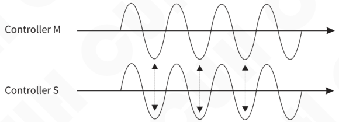

ตัวควบคุม S ถูกตั้งเป็นโหมดซิงค์ รูปคลื่นเอาต์พุตของตัวควบคุมทั้งสองซิงโครไนซ์กัน

หากตัวควบคุม S ไม่ได้ถูกตั้งเป็นโหมดซิงค์ รูปคลื่นเอาต์พุตของตัวควบคุมทั้งสองจะไม่ซิงโครไนซ์กัน

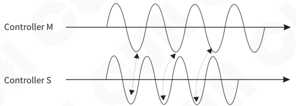

ตัวควบคุม S ไม่ได้ถูกตั้งเป็นโหมดซิงค์ รูปคลื่นเอาต์พุตของตัวควบคุมทั้งสองไม่ซิงโครไนซ์กัน

---

## วิธีการเดินสายของโหมดซิงค์ระหว่างตัวควบคุมหลักและตัวควบคุมทาส

เชื่อมต่อสายสัญญาณซิงค์ระหว่างตัวควบคุมหลักและตัวควบคุมทาส เพื่อให้แน่ใจว่าความถี่เอาต์พุตของตัวควบคุมหลักและตัวควบคุมทาสซิงโครไนซ์กัน

### แผนภาพวงจรของพอร์ตสัญญาณซิงค์

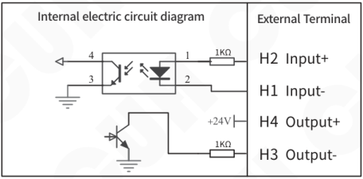

### แผนภาพการเดินสายของสัญญาณซิงค์ระหว่างตัวควบคุมหลักและตัวควบคุมทาส

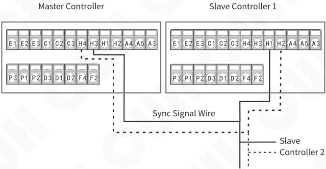

---

การปรับพารามิเตอร์ "VoltagMode" และ "FrqncyMode" ในกลุ่มฟังก์ชัน 3 เพื่อตั้งค่าโหมดทาสของตัวควบคุม โดยชุดค่าผสมถูกกำหนดไว้ด้านล่าง:

| โหมดซิงค์ | โหมดแรงดันไฟฟ้า | โหมดความถี่ | การควบคุมเฟส | เชื่อมต่อเซ็นเซอร์สั่นสะเทือน |
|---|---|---|---|---|
| โหมดแรงดันอัตโนมัติและเฟสอัตโนมัติ | Manual | Slave C | Manual | ใช่ |
| โหมดแรงดันอัตโนมัติและเฟสแมนนวล | Manual | Slave M | Automatic | ใช่ |
| โหมดแรงดันแมนนวลและเฟสอัตโนมัติ | Automatic | Slave C | Manual | ใช่ |
| โหมดแรงดันแมนนวลและเฟสแมนนวล | Automatic | Slave M | Automatic | ไม่ |

> "Auto" ของโหมดแรงดันไฟฟ้าหมายความว่าแรงดันเอาต์พุตถูกปรับโดยอัตโนมัติเพื่อรักษาเสถียรภาพ "ความเร็วป้อน" ของเครื่องสั่นที่คุณตั้งไว้
>
> "Slave C" ของโหมดความถี่หมายความว่าเฟสของรูปคลื่นเอาต์พุตของตัวควบคุมทาสถูกปรับโดยอัตโนมัติเพื่อซิงโครไนซ์กับตัวควบคุมหลักตามข้อมูลป้อนกลับจากเซ็นเซอร์สั่นสะเทือน
>
> "Slave M" ของโหมดความถี่หมายความว่าการปรับความต่างเฟสของรูปคลื่นเอาต์พุตของตัวควบคุมทาสเทียบกับตัวควบคุมหลักด้วยตนเอง

---

สถานการณ์ที่ทั้งตัวควบคุมหลักและตัวควบคุมทาสเชื่อมต่อเซ็นเซอร์สั่นสะเทือน

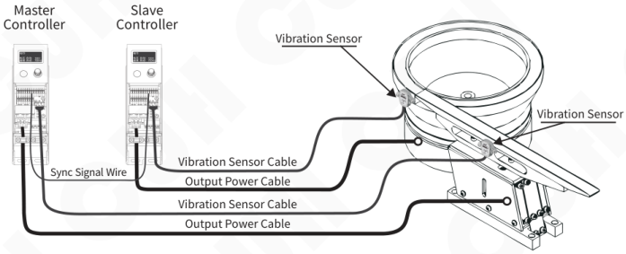

1. หากตัวควบคุมทาสทำงานในโหมดแรงดันแมนนวลและเฟสแมนนวล ไม่จำเป็นต้องเชื่อมต่อเซ็นเซอร์สั่นสะเทือน
2. หากตัวควบคุมหลักทำงานในโหมดแมนนวลเต็มรูปแบบ ไม่จำเป็นต้องเชื่อมต่อเซ็นเซอร์สั่นสะเทือน

## 4.7.1 โหมดแรงดันอัตโนมัติและเฟสอัตโนมัติ

ตัวควบคุมปรับแรงดันเอาต์พุตโดยอัตโนมัติตามข้อมูลป้อนกลับจากเซ็นเซอร์สั่นสะเทือนเพื่อรักษาเสถียรภาพ "ความเร็วป้อน" ของเครื่องสั่นที่คุณตั้งไว้ และความถี่และเฟสของรูปคลื่นเอาต์พุตของตัวควบคุมทาสเหมือนกับตัวควบคุมหลัก

### วิธีการตั้งค่าความเร็วป้อน

เลื่อนเคอร์เซอร์ไปที่ค่า "User Speed" ในกลุ่มฟังก์ชัน 1 และปรับค่าความเร็วป้อนโดยหมุนสวิตช์แบบเข้ารหัส

---

## 4.7.2 โหมดแรงดันอัตโนมัติและเฟสแมนนวล

ตัวควบคุมปรับแรงดันเอาต์พุตโดยอัตโนมัติตามข้อมูลป้อนกลับจากเซ็นเซอร์สั่นสะเทือนเพื่อรักษาเสถียรภาพความเร็วป้อนของเครื่องสั่นที่คุณตั้งไว้ และความถี่เอาต์พุตของตัวควบคุมทาสเหมือนกับตัวควบคุมหลัก และความต่างเฟสของรูปคลื่นเอาต์พุตของตัวควบคุมทาสเทียบกับตัวควบคุมหลักถูกกำหนดไว้คงที่

**วิธีการตั้งค่าความเร็วป้อน**

เลื่อนเคอร์เซอร์ไปที่ค่า "User_Speed" ในกลุ่มฟังก์ชัน 1 และปรับค่าความเร็วป้อนโดยหมุนสวิตช์แบบเข้ารหัส

**วิธีการตั้งค่าเฟสแมนนวล**

เลื่อนเคอร์เซอร์ไปที่ค่า "UserPhase_" ในกลุ่มฟังก์ชัน 3 และปรับค่า "UserPhase_" โดยหมุนสวิตช์แบบเข้ารหัส

## 4.7.3 โหมดแรงดันแมนนวลและเฟสอัตโนมัติ

ปรับแรงดันเอาต์พุตของตัวควบคุมด้วยตนเอง แต่ความถี่เอาต์พุตและเฟสของรูปคลื่นเอาต์พุตของตัวควบคุมทาสเหมือนกับตัวควบคุมหลักโดยการปรับอัตโนมัติ

**วิธีการตั้งค่าแรงดันเอาต์พุต**

เลื่อนเคอร์เซอร์ไปที่ค่า "Usr_Voltag" ในกลุ่มฟังก์ชัน 1 และปรับค่าแรงดันเอาต์พุตโดยหมุนสวิตช์แบบเข้ารหัส

## 4.7.4 โหมดแรงดันแมนนวลและเฟสแมนนวล

ปรับแรงดันเอาต์พุตของตัวควบคุมด้วยตนเอง และความถี่เอาต์พุตของตัวควบคุมทาสเหมือนกับตัวควบคุมหลัก และความต่างเฟสของรูปคลื่นเอาต์พุตของตัวควบคุมทาสเทียบกับตัวควบคุมหลักถูกกำหนดไว้คงที่

**วิธีการตั้งค่าแรงดันเอาต์พุต**

เลื่อนเคอร์เซอร์ไปที่ค่า "Usr_Voltag " ในกลุ่มฟังก์ชัน 1 และปรับค่าแรงดันเอาต์พุตโดยหมุนสวิตช์แบบเข้ารหัส

**วิธีการตั้งค่าเฟสแมนนวล**

เลื่อนเคอร์เซอร์ไปที่ค่า "UserPhase_" ในกลุ่มฟังก์ชัน 3 และปรับค่า "User phase" โดยหมุนสวิตช์แบบเข้ารหัส

**หมายเหตุ: แม้ว่า "VoltagMode" และ "FrqncyMode" ถูกตั้งเป็น "Auto" และ "Slave C" ตัวควบคุมก็จะทำงานในโหมดแรงดันแมนนวลและเฟสแมนนวล เนื่องจากไม่ได้เชื่อมต่อเซ็นเซอร์สั่นสะเทือน**

---

## 4.8 ฟังก์ชันพารามิเตอร์ที่ตั้งไว้ล่วงหน้า

ตัวควบคุมสามารถบันทึกและกู้คืนพารามิเตอร์ทั้งหมดของตัวควบคุมไปยัง "Work", "UsrD1 ", "UsrD2" และ "UsrD3"

### 4.8.1 การกู้คืนพารามิเตอร์ที่ตั้งไว้ล่วงหน้า

กู้คืนพารามิเตอร์จาก "UsrD1", "UsrD2" หรือ "UsrD3" ซึ่งปรับโดยค่า "ReadALLFrm" ในกลุ่มฟังก์ชัน 8 และกดสวิตช์แบบเข้ารหัสสั้น ๆ เพื่อเสร็จสิ้นการดำเนินการกู้คืน

### 4.8.2 การบันทึกพารามิเตอร์ที่ตั้งไว้ล่วงหน้า

บันทึกพารามิเตอร์ไปยัง "Work", "UsrD1", "UsrD2" หรือ "UsrD3" ซึ่งปรับโดยค่า "SavedALLTo" ในกลุ่มฟังก์ชัน 8 และกดสวิตช์แบบเข้ารหัสสั้น ๆ เพื่อเสร็จสิ้นการดำเนินการบันทึก

**หมายเหตุ:**

1. พารามิเตอร์ทั้งหมดที่ปรับจะถูกบันทึกไปยัง "Work" ตามค่าเริ่มต้น ดังนั้นจึงไม่จำเป็นต้องดำเนินการบันทึกหลังจากปรับพารามิเตอร์ในแต่ละครั้ง
2. หลังจากเลือกค่าของ "SavedALLTo" จำเป็นต้องกดสวิตช์แบบเข้ารหัสสั้น ๆ หนึ่งครั้งเพื่อเสร็จสิ้นการดำเนินการบันทึก

---

## 4.9 การคืนค่าการตั้งค่าเริ่มต้น

- บนอินเทอร์เฟซสแตนด์บาย กดสวิตช์แบบเข้ารหัสค้างไว้เพื่อเข้าสู่อินเทอร์เฟซพารามิเตอร์กลุ่มฟังก์ชัน
- ปรับค่าของ "RestorALL" ในกลุ่มฟังก์ชัน 8 เป็น "Work"
- กดสวิตช์แบบเข้ารหัสสั้น ๆ หนึ่งครั้งเพื่อเสร็จสิ้นการดำเนินการคืนค่าการตั้งค่าเริ่มต้น
- เมื่อค่าของ "RestorALL" เปลี่ยนจาก "Work" เป็น "None" หมายความว่าการดำเนินการคืนค่าการตั้งค่าเริ่มต้นเสร็จสิ้นแล้ว

---

## 4.10 การสื่อสาร RS485

ตัวควบคุมรองรับโหมด RTU และโหมด ASCII ของโปรโตคอล Modbus สำหรับการสื่อสาร RS485 และพารามิเตอร์ทั้งหมดของตัวควบคุมสามารถปรับและตรวจสอบจากระยะไกลได้

### 4.10.1 แผนภาพวงจรไฟฟ้าของการสื่อสาร RS485 (พอร์ต F)

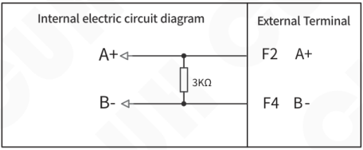

### 4.10.2 ที่อยู่การสื่อสารของการสื่อสาร RS485

ที่อยู่การสื่อสารซึ่งปรับโดยค่า "Slave_ID" (ค่าเริ่มต้นคือ 1) ในกลุ่มพารามิเตอร์ 8 แทนหมายเลข ID ของตัวควบคุมในการสื่อสาร RS485 และช่วงของมันคือ 1~31 เพื่อให้แน่ใจว่าตัวควบคุมทั้งหมดแยกแยะซึ่งกันและกันได้ในเครือข่ายเดียวกัน

### 4.10.3 อัตราบอดของการสื่อสาร RS485

อัตราบอดของการสื่อสาร RS485 ซึ่งปรับโดยค่า "Baud_Rate" ในกลุ่มพารามิเตอร์ 8 สามารถเป็น: 3, 12, 24, 96, 192, 576 หรือ 1152 หน่วย: 0.1Kbps ค่าเริ่มต้นคือ: 115.2 Kbps

ตัวควบคุมในเครือข่ายเดียวกันควรใช้อัตราบอดเดียวกัน

### 4.10.4 โปรโตคอลการสื่อสาร RS485

"CUH Modbus Communication Protocol " และ "Address Table of Coil and Register of SDVC35 series for Modbus protocol" สามารถดาวน์โหลดได้จากเว็บไซต์ทางการของเรา: en.cuhnj.com

---

### 4.10.5 การอัปเดตเฟิร์มแวร์

รองรับการอัปเดตเฟิร์มแวร์ของตัวควบคุมผ่านอินเทอร์เฟซการสื่อสาร RS485

**ซอฟต์แวร์แอปพลิเคชันที่ทำงานบนคอมพิวเตอร์สำหรับการอัปเดตเฟิร์มแวร์และไฟล์เฟิร์มแวร์มีดังนี้:**

1. UpdateFirmwareUi.exe
2. ไฟล์เฟิร์มแวร์: SDVC35K4.10_enc.script (เวอร์ชันปัจจุบัน)

ซอฟต์แวร์แอปพลิเคชันและไฟล์เฟิร์มแวร์ใหม่ล่าสุดสามารถดาวน์โหลดได้จากเว็บไซต์ทางการของเรา: en.cuhnj.com

**คอนเวอร์เตอร์ที่จำเป็นและเชื่อมต่อระหว่างคอมพิวเตอร์กับตัวควบคุมสำหรับการอัปเดตเฟิร์มแวร์:**

คอนเวอร์เตอร์ USB เป็น RS485

**ขั้นตอนการอัปเดตเฟิร์มแวร์:**

1. เชื่อมต่อพอร์ต RS485 ของคอนเวอร์เตอร์กับตัวควบคุม และพอร์ต USB ของคอนเวอร์เตอร์กับคอมพิวเตอร์
2. ดูพอร์ต USB Serial (COM) ที่รู้จักคอนเวอร์เตอร์ USB เป็น RS485
3. เริ่ม UpdateFirmwareUi.exe
4. เลือกพอร์ต COM ที่จำได้ในขั้นตอนที่ 2 ให้กับ UpdateFirmwareUi.exe
5. เลือกอัตราบอดเป็น 115200
6. คลิกปุ่ม Open ทางด้านขวาของอัตราบอดบนซอฟต์แวร์แอปพลิเคชันเพื่อเปิดพอร์ตอนุกรม สถานะสำเร็จและล้มเหลวของการเปิดพอร์ตอนุกรมจะแสดงในกล่องสถานะ
7. คลิกปุ่ม Open ทางด้านขวาของไฟล์เฟิร์มแวร์บนซอฟต์แวร์แอปพลิเคชันเพื่อโหลดไฟล์เฟิร์มแวร์ใหม่ล่าสุด
8. กดปุ่มเปิด/ปิดของตัวควบคุมค้างไว้และเปิดเครื่องตัวควบคุมจนกระทั่งไฟ LED สีเขียวทั้งหมดของพอร์ตเชื่อมต่อสว่างขึ้น
9. คลิกปุ่ม Update บนซอฟต์แวร์แอปพลิเคชันเพื่ออัปเดตเฟิร์มแวร์ ความคืบหน้าจะแสดงในกล่องสถานะ หลังจากอัปเกรดเสร็จสิ้น “Firmware download OK!” จะแสดงในกล่องสถานะ
10. หลังจากอัปเกรดเสร็จสิ้น โปรดดำเนินการคืนค่าการตั้งค่าเริ่มต้นหนึ่งครั้ง

---

## 4.11 การสื่อสารอีเทอร์เน็ต

ตัวควบคุมรองรับ EtherCat และ Profinet และพารามิเตอร์ทั้งหมดของตัวควบคุมสามารถปรับและตรวจสอบจากระยะไกลได้

โปรโตคอล EtherCat และ Profinet รองรับโหมดการสื่อสารแบบเป็นรอบและไม่เป็นรอบ เวลาการสื่อสารอีเทอร์เน็ตแบบเป็นรอบคือ 5ms หรือมากกว่า และเวลาการสื่อสารแบบเป็นรอบทั่วไปคือ 10ms

ความยาวข้อความของโหมดการสื่อสารแบบเป็นรอบ (ความยาวของบัฟเฟอร์อินพุต-เอาต์พุต) สูงสุด 5760 ไบต์

ความยาวข้อความของโหมดการสื่อสารแบบไม่เป็นรอบ (ความยาวของบัฟเฟอร์ Send Mailbox และ Receive Mailbox) สูงสุด 1596 ไบต์

ไฟล์โปรโตคอลการสื่อสารอีเทอร์เน็ต "Hilscher NETX51 RE ECS V4.2.X-EtherCATSlave-20160520.xml" และ "GSDML-V2.31-HILSCHER-NETX51-RE PNS-Profinet_20160912.xml" สามารถดาวน์โหลดได้จากเว็บไซต์ทางการของเรา: en.cuhnj.com

เมื่อใช้อีเทอร์เน็ตและ RS485 พร้อมกัน ตัวควบคุมจะตอบสนองตามลำดับ และสถานะของคำสั่งสุดท้ายจะถูกบันทึกไว้

## 4.12 การทดสอบโหลด

ตัวควบคุมสามารถทดสอบตัวเหนี่ยวนำ กระแสสูงสุด และอิมพีแดนซ์ของเครื่องสั่น

เริ่มฟังก์ชันการทดสอบโหลดโดยการตั้งค่าพารามิเตอร์ "Measure" เป็น "valid" การทดสอบโหลดเสร็จสิ้นเมื่อพารามิเตอร์ "Measure" ถูกตั้งเป็น "Invalid" โดยอัตโนมัติ

ผู้ใช้สามารถตรวจสอบผลลัพธ์ของการทดสอบโหลดได้ในกลุ่มฟังก์ชัน 9

---

## 4.13 การตรวจสอบสถานะการทำงาน

ผู้ใช้สามารถตรวจสอบสถานะการทำงานของตัวควบคุมได้ด้วยพารามิเตอร์ในกลุ่มฟังก์ชัน 9

**การตรวจสอบแหล่งจ่ายไฟ 5V และ 24V ภายในแบบเรียลไทม์:** แรงดันของแหล่งจ่ายไฟ 5V และ 24V แสดงโดยพารามิเตอร์ "5V_Power_" และ "24V_Power_"

**การตรวจสอบสถานะเอาต์พุตหลักแบบเรียลไทม์:** สถานะเอาต์พุตหลักแสดงโดยพารามิเตอร์ "MainOutPut "

**การตรวจสอบสถานะอินพุตดิจิทัลแบบเรียลไทม์:** สถานะและแรงดันของพอร์ต C และ E แสดงโดยพารามิเตอร์ "PortC_" และ "PortCInput    ", "PortE_" และ "PortEInput"

**การตรวจสอบสถานะเอาต์พุตควบคุม DC 24V แบบเรียลไทม์:** สถานะและแรงดันของพอร์ต D และ P แสดงโดยพารามิเตอร์ "PortD_" และ "PortD_Out_ ", "PortP_" และ "PortP_Out_ "

**การตรวจสอบความถี่ซิงค์แบบเรียลไทม์:** เมื่อตัวควบคุมทำงานในโหมดซิงค์ ความถี่ซิงค์ที่ตามตัวควบคุมหลักสามารถแสดงได้โดยพารามิเตอร์ "SynchrFrqy"

**การตรวจสอบอุณหภูมิภายในของตัวควบคุมแบบเรียลไทม์:** อุณหภูมิของตัวควบคุมแสดงโดยพารามิเตอร์ "Temperatur" และตัวควบคุมจะหยุดทำงานเมื่ออุณหภูมิเกิน 65 ℃

**การตรวจสอบสถานะเซ็นเซอร์สั่นสะเทือนแบบเรียลไทม์:** สถานะของเซ็นเซอร์สั่นสะเทือนแสดงโดยพารามิเตอร์ "AtoSnsrVld" และ "AtoSnsrOvr " เพื่อตรวจสอบว่าเซ็นเซอร์สั่นสะเทือนถูกต้องหรือไม่ และเซ็นเซอร์สั่นสะเทือนโอเวอร์โหลดหรือไม่

---

## บทที่ Ⅴ ฟังก์ชันความปลอดภัย

### การป้องกันการลัดวงจร

เมื่อเอาต์พุตของตัวควบคุมลัดวงจร ตัวควบคุมจะหยุดเอาต์พุตและ "ShortCircuit" จะแสดงบนจอ OLED จนกว่าจะรีสตาร์ทตัวควบคุมหรือกดปุ่มเปิด/ปิดบนแผงควบคุมของตัวควบคุมสั้น ๆ

### การป้องกันกระแสเกิน

เมื่อกระแสเอาต์พุตเกินค่าพิกัดเนื่องจากใช้งานผิดวิธี ตัวควบคุมจะหยุดเอาต์พุตเพื่อความปลอดภัยในการทำงาน และ "OverCurrent" จะแสดงบนจอ OLED

### การป้องกันความร้อนสูงเกิน

เมื่ออุณหภูมิภายในของตัวควบคุมเกิน 65℃ ตัวควบคุมจะหยุดเอาต์พุตเพื่อป้องกันตัวเอง และ "OverHot" จะแสดงบนจอ OLED จนกว่าอุณหภูมิภายในจะลดลงต่ำกว่า 60℃

### การป้องกันโหลดเกิน

เมื่อเชื่อมต่อเซ็นเซอร์สั่นสะเทือนกับตัวควบคุม หากแอมพลิจูดการสั่นสะเทือนเกินค่าที่ตั้งไว้ซึ่งปรับโดยค่า "AtoSnsrMax" ในกลุ่มพารามิเตอร์ 3 ตัวควบคุมจะลดเอาต์พุตลงเพื่อปกป้องเครื่องป้อนวัสดุแบบสั่นสะเทือน และ "OverLoad" จะแสดงบนจอ OLED

### การป้องกันแรงดันเกิน

เมื่อแรงดันอินพุตสูงกว่าค่าพิกัด ตัวควบคุมจะปิดโดยอัตโนมัติจนกว่าแรงดันอินพุตจะกลับสู่ปกติ

### การป้องกันแรงดันเกินพิเศษ

เมื่อแรงดันอินพุตเกินแรงดันจำกัดการป้องกันอย่างมาก และแรงดันพีคสูงถึง 430V ฟิวส์ของตัวควบคุมจะขาดเพื่อปกป้องตัวควบคุมจากความเสียหายเพิ่มเติม โปรดติดต่อเราเพื่อซ่อมแซม

---

## ภาคผนวก A: มิติ

ขนาด SDVC35 (หน่วย: mm)

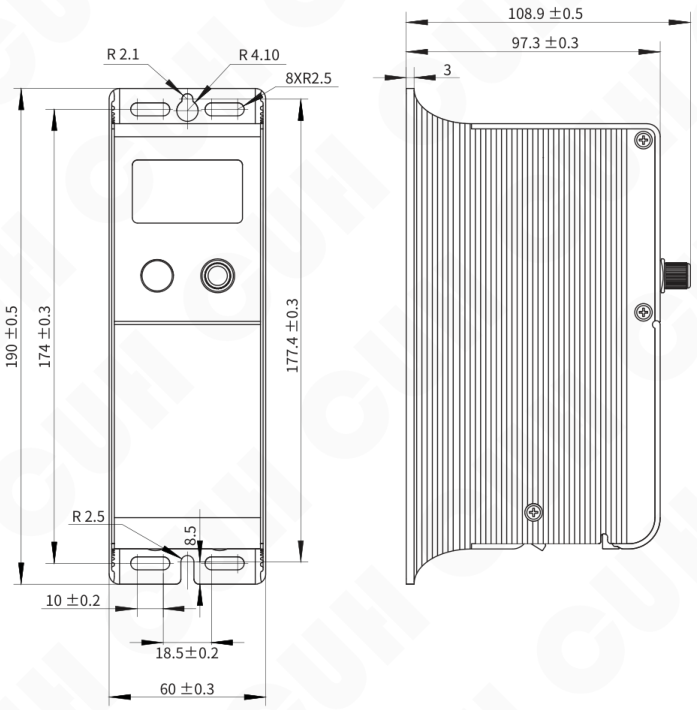

---

## ภาคผนวก B: คำอธิบายพอร์ตการเชื่อมต่อทางไฟฟ้า

| Sensor | | | Sensor | | | Sync | | | | Speed Ctrl | | |
|---|---|---|---|---|---|---|---|---|---|---|---|---|
| PortE | | | PortC | | | PortH | | | | PortA | | |
| E1 | E2 | E3 | C1 | C2 | C3 | H4 | H3 | H1 | H2 | A4 | A5 | A3 |
| GND | Input | +24V | GND | Input | +24V | Sync Out+ | Sync Out- | Sync In- | Sync In+ | GND | Input | +5V |

| Ctrl Out | | | Ctrl Out | | | RS485 | | |
|---|---|---|---|---|---|---|---|
| PortP | | | PortD | | | PortF | | |
| P3 | P1 | P2 | D3 | D1 | D2 | F4 | F2 |
| GND | Output | +24V | GND | Output | +24V | B- | A+ |

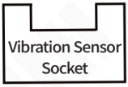

---

## ภาคผนวก C: ข้อมูลจำเพาะทางไฟฟ้า

| รายการ | ช่วง: ต่ำสุด | ช่วง: ทั่วไป | ช่วง: สูงสุด | หน่วย | หมายเหตุ |
|---|---|---|---|---|---|
| แรงดันอินพุต | 85 | 220 | 250 | V | AC RMS |
| ช่วงแรงดันเอาต์พุตที่ปรับได้ | 0 | —— | 260 | V | ต่ำกว่า 150% ของแรงดันอินพุต |
| ความแม่นยำการปรับแรงดัน | | 1 | | V | |
| ความแม่นยำการควบคุมแรงดัน | 0 | —— | 10 | % | ΔVout/ΔVin |
| เวลาตอบสนองของการควบคุมแรงดัน | | เรียลไทม์ | | s | การควบคุมแรงดันสำหรับแต่ละรูปคลื่น |
| ช่วงกระแสเอาต์พุตที่ปรับได้ | 0 | —— | 3 | A | SDVC35-MRJ |
| ช่วงกระแสเอาต์พุตที่ปรับได้ | 0 | —— | 4.5 | A | SDVC35-LRJ |
| กำลังเอาต์พุต | 0 | —— | 660 | VA | SDVC35-MRJ |
| กำลังเอาต์พุต | 0 | —— | 990 | VA | SDVC35-LRJ |
| ความถี่เอาต์พุต | 25 | —— | 400 | Hz | |
| ความแม่นยำการปรับความถี่ | | 0.1 | | Hz | |
| รูปคลื่นเอาต์พุต | | ไซน์ | | | |
| เวลาเริ่มต้นแบบนุ่มนวล | 0 | —— | 10 | s | ค่าเริ่มต้น: 0.5 |
| ช่วงเวลาหน่วงเปิด/ปิด | 0 | —— | 20 | s | ค่าเริ่มต้น: 0.2 |
| ความแม่นยำเวลาหน่วงเปิด/ปิด | | 0.1 | | s | |
| อุณหภูมิทริกเกอร์การป้องกันความร้อนสูงเกิน | 60 | 65 | 65 | °C | |
| การสื่อสารดิจิทัล | | การสื่อสาร ModBUS485 | | | |
| การสื่อสารดิจิทัล | | EtherCat | | | เลือกได้อย่างใดอย่างหนึ่ง |
| การสื่อสารดิจิทัล | | Profinet | | | เลือกได้อย่างใดอย่างหนึ่ง |
| กระแสเอาต์พุตควบคุม DC | 0 | —— | 200 | mA | เอาต์พุต 24V คู่ |
| แรงดันเอาต์พุตควบคุม DC | 22 | 24 | 26 | V | เอาต์พุต 24V คู่ |
| สัญญาณควบคุมแอนะล็อก | | 4~20 | | mA | ช่องสัญญาณกระแส 1 ช่องสำหรับการควบคุมความเร็วระยะไกล |
| สัญญาณควบคุมแอนะล็อก | | 1~5/0~5/0~10 | | V | ช่องสัญญาณแรงดัน 3 ช่องสำหรับการควบคุมความเร็วระยะไกล |
| สัญญาณควบคุมดิจิทัล | | 24 | | V | สัญญาณสวิตช์ |
| วิธีการปรับ | | ปุ่ม 1 ปุ่ม + ตัวเข้ารหัสแบบหมุน 1 ตัว | | | |
| การใช้พลังงานในโหมดสแตนด์บาย | —— | —— | 3 | W | |
| วิธีการแสดงผล | | 128\*64 | | | จอแสดงผลแบบเมทริกซ์ OLED |
| อุณหภูมิโดยรอบ | 0 | 25 | 40 | °C | ไม่มีการควบแน่น |
| ความชื้นโดยรอบ | 10 | 60 | 85 | % | ไม่มีการควบแน่น |
| อุณหภูมิโดยรอบในการจัดเก็บ | -20 | 25 | 65 | °C | ไม่มีการควบแน่น |

## พารามิเตอร์สัมบูรณ์:

การเกินมาตรฐานข้างต้นจะทำให้ตัวควบคุมเสียหาย ต้องปฏิบัติตามอย่างเคร่งครัด

| รายการ | มาตรฐาน GB | มาตรฐาน IEC | ข้อกำหนดมาตรฐาน | ระดับที่ผลิตภัณฑ์ CUH ทำได้ | หมายเหตุ |
|---|---|---|---|---|---|
| การคายประจุไฟฟ้าสถิต | GB/T 17626.2-2006 | IEC 61000-4-2:2001 | 4 kV | ±8 kV | การคายประจุแบบสัมผัส |
| | | | 8 kV | ±15 kV | การคายประจุในอากาศ |
| การทดสอบทรานเซียนต์เร็วทางไฟฟ้า | GB/T 17626.4-2008 | IEC 61000-4-4:2004 | 2 kV | ±4 kV | |
| เซิร์จทางไฟฟ้า | GB/T 17626.5-2008 | IEC 61000-4-5:2005 | 1 kV | ±4 kV | การคัปปลิงแบบไลน์-ไลน์ |
| | | | 2 kV | ±2 kV | การคัปปลิงแบบไลน์-กราวด์ |

---

## ภาคผนวก D: ข้อเสนอแนะการแก้ไขปัญหาและคำอธิบายข้อผิดพลาด

| | อาการข้อผิดพลาด | ข้อเสนอแนะการแก้ไขปัญหา |
|---|---|---|
| 1 | ไม่แสดงผลหลังจากเปิดเครื่อง | • ตรวจสอบให้แน่ใจว่าปลั๊กไฟมีกระแสไฟฟ้า • ตรวจสอบให้แน่ใจว่าสายไฟกำลังอินพุตเชื่อมต่อกับปลั๊กไฟอย่างน่าเชื่อถือ |
| 2 | แสดงผลปกติ แต่ไม่มีเอาต์พุต | • ตรวจสอบให้แน่ใจว่าแรงดันเอาต์พุตไม่เล็กเกินไป • ตรวจสอบให้แน่ใจว่าสถานะการทำงานของตัวควบคุมไม่ใช่ “Man” ที่ควบคุมโดยการกดปุ่ม “ON/OFF” บนแผงควบคุม • ตรวจสอบให้แน่ใจว่าสถานะการทำงานของตัวควบคุมไม่ใช่ “STP” ที่ควบคุมโดยพอร์ต C/E • ตรวจสอบให้แน่ใจว่าสถานะการทำงานของตัวควบคุมไม่ใช่ “STP” ที่ควบคุมโดยพารามิเตอร์ทิศทางตรรกะของพอร์ต C/E • รีเซ็ตตัวควบคุมโดยการคืนค่าการตั้งค่าเริ่มต้นซึ่งปรับในกลุ่มฟังก์ชัน 8 |
| 3 | พอร์ต C/E ไม่สามารถทำงานได้ตามปกติ | • ตรวจสอบให้แน่ใจว่าสายสัญญาณควบคุมเปิด/ปิดเชื่อมต่อกับพอร์ต C/E อย่างถูกต้อง • ตรวจสอบให้แน่ใจว่าพารามิเตอร์ทั้งหมดของพอร์ต C/E ที่คุณปรับนั้นถูกต้อง • รีเซ็ตตัวควบคุมโดยการคืนค่าการตั้งค่าเริ่มต้นซึ่งปรับในกลุ่มฟังก์ชัน 8 |
| 4 | ปรากฏการณ์บีต | • เชื่อมต่อสายสัญญาณซิงค์ระหว่างตัวควบคุมและตั้งค่าตัวควบคุมทาสเป็นโหมดซิงค์ |
| 5 | แสดงผลปกติ ได้ยินเสียงจากเครื่องป้อนวัสดุแบบสั่นสะเทือนแต่ไม่มีเอาต์พุต | • ตรวจสอบให้แน่ใจว่าความถี่เอาต์พุตไม่ห่างจากความถี่เรโซแนนซ์ของเครื่องป้อนวัสดุแบบสั่นสะเทือนมากนัก • รีเซ็ตตัวควบคุมโดยการคืนค่าการตั้งค่าเริ่มต้นซึ่งปรับในกลุ่มฟังก์ชัน 8 |

---

## ภาคผนวก E: คำอธิบายคำเตือนและข้อผิดพลาดและข้อเสนอแนะการแก้ไขปัญหา

| การแสดงข้อผิดพลาด | ประเภทข้อผิดพลาด | ข้อเสนอแนะการแก้ไขปัญหา |
|---|---|---|
| 24VErr | ข้อผิดพลาดแหล่งจ่ายไฟ 24V ภายใน | แหล่งจ่ายไฟ 24V ภายในของตัวควบคุมเสียหาย โปรดติดต่อเราเพื่อซ่อมแซม |
| 5VErr | ข้อผิดพลาดแหล่งจ่ายไฟ 5V ภายใน | แหล่งจ่ายไฟ 5V ภายในของตัวควบคุมเสียหาย โปรดติดต่อเราเพื่อซ่อมแซม |
| <2mA Err | กระแสอินพุตของสัญญาณควบคุมระยะไกลต่ำเกินไปสำหรับพอร์ต A | กระแสอินพุตของสัญญาณควบคุมระยะไกลต่ำเกินไปสำหรับพอร์ต A ดังนั้นควรทำให้มากกว่า 2mA |
| <0.5V Err | แรงดันอินพุตของสัญญาณควบคุมระยะไกลต่ำเกินไปสำหรับพอร์ต A | แรงดันอินพุตของสัญญาณควบคุมระยะไกลต่ำเกินไปสำหรับพอร์ต A ดังนั้นควรทำให้มากกว่า 0.5V |
| CommErr(1~5) | ข้อผิดพลาดการสื่อสาร | โปรดติดต่อเราเพื่อซ่อมแซม |
| decline | การลดความเร็วการนับ | เมื่อจำนวนที่นับถึง "End Count" ที่คุณตั้งไว้ แรงดันเอาต์พุต (หรือความเร็วป้อน) จะลดลง |
| EEPErr | ข้อผิดพลาดการบันทึกพารามิเตอร์ที่ตั้งไว้ล่วงหน้า | โปรดติดต่อเราเพื่อซ่อมแซม |
| FrqncyHi | ความถี่อ้างอิงซิงค์สูงเกินไป | ความถี่อินพุตของสัญญาณซิงค์ของตัวควบคุมทาสมากกว่า 400Hz ตรวจสอบให้แน่ใจว่าความถี่ของสัญญาณซิงค์อยู่ระหว่าง 25 Hz ถึง 400 Hz |
| FrqncyLo | ความถี่อ้างอิงซิงค์ต่ำเกินไป | ความถี่อินพุตของสัญญาณซิงค์ของตัวควบคุมทาสน้อยกว่า 25Hz ตรวจสอบให้แน่ใจว่าความถี่ของสัญญาณซิงค์อยู่ระหว่าง 25 Hz ถึง 400 Hz |
| OverHot | ความร้อนสูงเกิน | อุณหภูมิภายในของตัวควบคุมเกิน 65℃ ตรวจสอบให้แน่ใจว่าตัวควบคุมทำงานในสภาพแวดล้อมที่มีการระบายอากาศดี |
| OverLoad | โหลดเกินของเซ็นเซอร์สั่นสะเทือน | เซ็นเซอร์สั่นสะเทือนตรวจพบว่าความเร่งเกินค่าแอมพลิจูดสัมบูรณ์ของมัน |
| OvrCurrt | กระแสเกิน | กระแสเอาต์พุตของตัวควบคุมเกิน 3A |
| OvrVoltg | แรงดันเกิน | แรงดันเอาต์พุตของตัวควบคุมเกิน 260V ตรวจสอบให้แน่ใจว่าช่วงแรงดันอินพุตอยู่ระหว่าง 85V ถึง 260V |
| PortDErr | ข้อผิดพลาดพอร์ต D | ความเบี่ยงเบนแรงดันเอาต์พุตของพอร์ต D เกิน 3V ตรวจสอบให้แน่ใจว่ากำลังโหลดของพอร์ต D ไม่เกิน 4.8W |
| PortPErr | ข้อผิดพลาดพอร์ต P | ความเบี่ยงเบนแรงดันเอาต์พุตของพอร์ต P เกิน 3V ตรวจสอบให้แน่ใจว่ากำลังโหลดของพอร์ต P ไม่เกิน 4.8W |
| Saturate | เอาต์พุตอิ่มตัว | เมื่อแรงดันเอาต์พุตของตัวควบคุมมากกว่าแรงดันอินพุต ตัวควบคุมจะเข้าสู่สถานะอิ่มตัว |
| Save | การบันทึกพารามิเตอร์ที่ตั้งไว้ล่วงหน้า | หลังจากกระบวนการค้นหาความถี่เรโซแนนซ์อัตโนมัติ พารามิเตอร์ที่เกี่ยวข้องถูกบันทึกสำเร็จ |
| SenorErr | เซ็นเซอร์สั่นสะเทือนผิดปกติ | สัญญาณเซ็นเซอร์สั่นสะเทือนผิดปกติ โปรดติดต่อเราเพื่อซ่อมแซม |
| SenTypEr | ข้อผิดพลาดประเภทเซ็นเซอร์สั่นสะเทือน | ประเภทของเซ็นเซอร์สั่นสะเทือนที่เชื่อมต่อกับตัวควบคุมไม่ตรงกับพารามิเตอร์ "ประเภทเซ็นเซอร์สั่นสะเทือน" ที่ตั้งไว้ในตัวควบคุม |
| Short | การลัดวงจร | เอาต์พุตของตัวควบคุมลัดวงจร ตรวจสอบให้แน่ใจว่าขั้วต่อเอาต์พุตไม่ลัดวงจร |
| SynchErr | ข้อผิดพลาดสัญญาณซิงค์ | สายสัญญาณซิงค์ไม่ได้เชื่อมต่อกับตัวควบคุมทาส ตรวจสอบให้แน่ใจว่าสายสัญญาณซิงค์เชื่อมต่อกับตัวควบคุมอย่างถูกต้อง |
| UndrVolt | แรงดันต่ำ | แรงดันอินพุตของตัวควบคุมน้อยกว่า 85V. ตรวจสอบให้แน่ใจว่าช่วงแรงดันอินพุตอยู่ระหว่าง 85V ถึง 260V |
| UpgradeSlv | การอัปเดตเฟิร์มแวร์ | กำลังอัปเดตเฟิร์มแวร์ ตัวควบคุมจะกลับสู่ปกติหลังการอัปเดต |

## ภาคผนวก F: คำอธิบายสถานะการทำงานและประเภทการ์ดเครือข่าย

สถานะการทำงานของตัวควบคุมแสดงไว้ด้านล่าง:

| การแสดงสถานะของตัวควบคุม | ประเภทสถานะ | คำอธิบาย |
|---|---|---|
| RUN | ตัวควบคุมกำลังทำงาน | เอาต์พุตของตัวควบคุมถูกต้อง |
| MAN | ตัวควบคุมถูกหยุด | กดปุ่ม “ON/OFF” สั้น ๆ เพื่อสลับสถานะทำงาน/หยุดของเอาต์พุตตัวควบคุม |
| CND | กระบวนการนับเสร็จสิ้นเพื่อหยุดตัวควบคุม | เมื่อกระบวนการนับเสร็จสิ้น เอาต์พุตของตัวควบคุมจะถูกหยุด |
| RMT | หยุดเอาต์พุตของตัวควบคุมจากระยะไกล | หยุดเอาต์พุตของตัวควบคุมจากระยะไกลผ่านการสื่อสาร RS485 หรืออีเทอร์เน็ต |
| STP | พอร์ต C/E หยุดเอาต์พุตของตัวควบคุม | หยุดเอาต์พุตของตัวควบคุมโดยพอร์ตอินพุตดิจิทัล C/E |
| Lok | ล็อกคีย์แพด | ปุ่มเปิด/ปิดและสวิตช์แบบเข้ารหัสถูกปิดใช้งาน และกดสวิตช์แบบเข้ารหัสค้างไว้เพื่อปลดล็อกคีย์แพด |
| ERR | หยุดเอาต์พุตของตัวควบคุมเนื่องจากการนับผิดพลาด | เมื่อค่า "Main Logic" เป็น "Count" หากการล้างค่าและการนับขึ้นเกิดขึ้นพร้อมกันในกระบวนการนับ เอาต์พุตของตัวควบคุมจะถูกหยุด |

สถานะเครือข่ายแสดงไว้ด้านล่าง:

| การแสดงสถานะของตัวควบคุม | ประเภทสถานะ | คำอธิบาย |
|---|---|---|
| Wit | ไม่ได้เชื่อมต่อการ์ดเครือข่าย | |
| Cat | เชื่อมต่อการ์ดเครือข่าย EtherCat | |
| Pro | เชื่อมต่อการ์ดเครือข่าย Profinet | |

---

## ภาคผนวก G: วิธีการเชื่อมต่อสายของเซ็นเซอร์สวิตช์และ PLC กับพอร์ตอินพุตดิจิทัล

### วิธีการเชื่อมต่อของเซ็นเซอร์ NPN

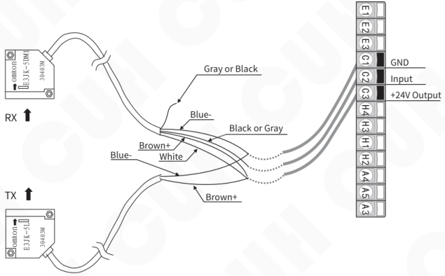

### วิธีการเชื่อมต่อของเซ็นเซอร์ลำแสงโฟโตอิเล็กทริก

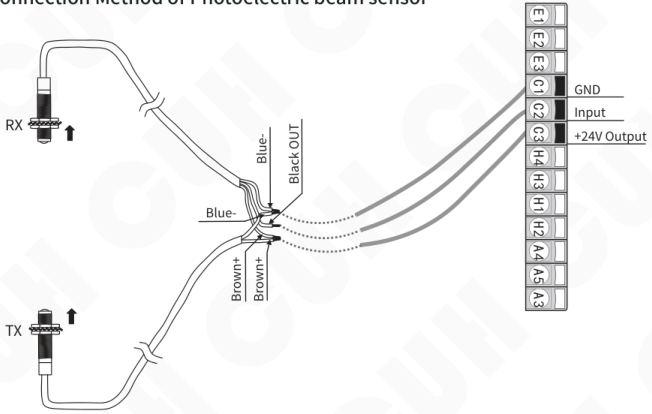

## วิธีการเชื่อมต่อของเซ็นเซอร์ลำแสงไฟเบอร์ออปติก

## วิธีการเชื่อมต่อของเซ็นเซอร์สะท้อนแสงโฟโตอิเล็กทริก

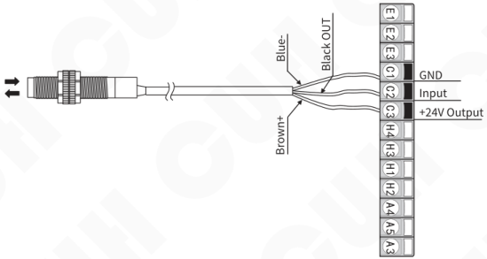

## วิธีการเชื่อมต่อของเอาต์พุต NPN ของ PLC กับพอร์ต C

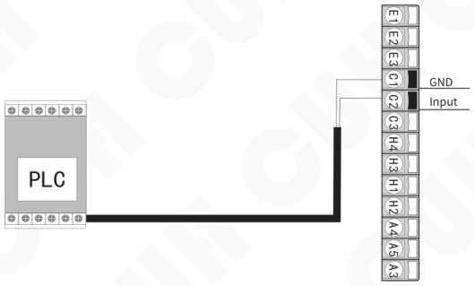

## วิธีการเชื่อมต่อของเอาต์พุต PNP ของ PLC กับพอร์ต C

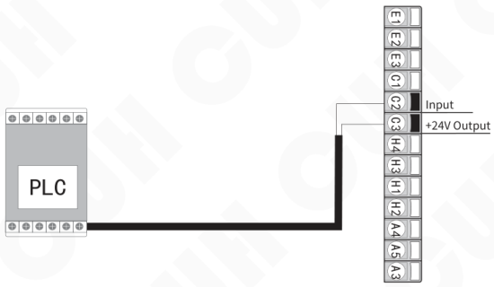

เอาต์พุตรีเลย์ เอาต์พุต NPN และเอาต์พุต PNP ของ PLC อย่างใดอย่างหนึ่งสามารถเปิด/ปิดตัวควบคุมได้

**หมายเหตุ: เมื่อใช้สัญญาณควบคุมของ PLC เพื่อเปิด/ปิดตัวควบคุม แรงดันของสัญญาณอินพุตไม่ได้รับอนุญาตให้เกิน 24V**

## ภาคผนวก H: ตารางพารามิเตอร์

### ฟังก์ชันของแต่ละกลุ่มพารามิเตอร์

| ชื่อกลุ่มพารามิเตอร์ | คำอธิบาย |
|---|---|
| กลุ่มฟังก์ชัน 0 | รายการที่สามารถเลือกแสดงบนอินเทอร์เฟซสแตนด์บาย |
| กลุ่มฟังก์ชัน 1 | พารามิเตอร์พื้นฐาน |
| กลุ่มฟังก์ชัน 2 | พารามิเตอร์ของการควบคุมเอาต์พุตหลัก |
| กลุ่มฟังก์ชัน 3 | พารามิเตอร์ของฟังก์ชันอัตโนมัติ/ซิงค์ |
| กลุ่มฟังก์ชัน 4 | พารามิเตอร์ของการควบคุมพอร์ต C |
| กลุ่มฟังก์ชัน 5 | พารามิเตอร์ของการควบคุมพอร์ต E |
| กลุ่มฟังก์ชัน 6 | พารามิเตอร์ของการควบคุมพอร์ต D |
| กลุ่มฟังก์ชัน 7 | พารามิเตอร์ของการควบคุมพอร์ต P |
| กลุ่มฟังก์ชัน 8 | พารามิเตอร์ขั้นสูง |
| กลุ่มฟังก์ชัน 9 | พารามิเตอร์ของสถานะการทำงานของตัวควบคุม |

---

พารามิเตอร์ทั้งหมดของกลุ่มฟังก์ชัน 0 แสดงไว้ด้านล่าง:

| รายการ | ต่ำสุด | ค่าเริ่มต้น | สูงสุด | หน่วย/ค่าตัวเลือก | คำอธิบาย |
|---|---|---|---|---|---|
| MonitPart1 | —— | None | —— | None | แถว LCD ที่สอดคล้องกันจะแสดงเป็นช่องว่างบนอินเทอร์เฟซสแตนด์บาย |
| | | | | UsrV | แรงดันเอาต์พุต |
| | | | | UsrF | ความถี่เอาต์พุต |
| | | | | UsrS | ความเร็วป้อน |
| | | | | Cout | ค่าที่นับปัจจุบัน |
| | | | | PCUP | เวลาหน่วงเปิดของพอร์ต C |
| | | | | PCDn | เวลาหน่วงปิดของพอร์ต C |
| | | | | PEUp | เวลาหน่วงเปิดของพอร์ต E |
| | | | | PEDn | เวลาหน่วงปิดของพอร์ต E |
| | | | | PDUP | เวลาหน่วงเปิดของพอร์ต D |
| | | | | PDDn | เวลาหน่วงปิดของพอร์ต D |
| | | | | PPUP | เวลาหน่วงเปิดของพอร์ต P |
| | | | | PPDn | เวลาหน่วงปิดของพอร์ต P |
| | | | | MaUP | เวลาหน่วงเปิดของการควบคุมหลัก |
| | | | | MaDn | เวลาหน่วงปิดของการควบคุมหลัก |
| | | | | InV | แรงดันอินพุต |
| | | | | CurE | ค่าประสิทธิผลของกระแสเอาต์พุต |
| | | | | CurM | กระแสเอาต์พุตสูงสุด |
| | | | | PwrA | กำลังไฟฟ้าจริง |
| | | | | PwrR | กำลังไฟฟ้ารีแอกทีฟ |
| | | | | Temp | อุณหภูมิ |
| | | | | SynF | ความถี่ของสัญญาณซิงค์ภายนอก |
| | | | | Remo | แรงดันอินพุตรีโมท |
| | | | | PCV | แรงดันเอาต์พุตพอร์ต C |
| | | | | PEV | แรงดันเอาต์พุตพอร์ต E |
| | | | | PDV | แรงดันเอาต์พุตพอร์ต D |
| | | | | PPV | แรงดันเอาต์พุตพอร์ต P |
| MonitPart2 | —— | UsrV | —— | เหมือนกับ MonitPart1 | |
| MonitPart3 | —— | UsrF | —— | เหมือนกับ MonitPart1 | |

พารามิเตอร์ทั้งหมดของกลุ่มฟังก์ชัน 1 แสดงไว้ด้านล่าง:

| รายการ | ต่ำสุด | ค่าเริ่มต้น | สูงสุด | หน่วย/ค่าตัวเลือก |
|---|---|---|---|---|
| User_Speed | 0 | 200 | 3200 | |
| Usr_Voltag | 0 | 150 | 260 | V |
| Usr_Frqncy | 25.0 | 50.0 | 400.0 | Hz |
| TotalCount | 1 | 1 | 9999 | |
| Clear Time | 0 | 0 | 999.9 | s |
| AutoSerch_ | —— | Idle | —— | Idle Start |
| PassWord2_ | 0 | 0 | 9999 | |
| Language | —— | Englsh | —— | Englsh 中文 dt |

---

พารามิเตอร์ทั้งหมดของกลุ่มฟังก์ชัน 2 แสดงไว้ด้านล่าง:

| รายการ | ต่ำสุด | ค่าเริ่มต้น | สูงสุด | หน่วย/ค่าตัวเลือก |
|---|---|---|---|---|
| SoftStart_ | 0 | 0.2 | 9.9 | s |
| SoftStop__ | 0 | 0.2 | 9.9 | s |
| MainUpDely | 0 | 0.2 | 9999 | 0.1s |
| MainDwnDly | 0 | 0.2 | 9999 | 0.1s |
| MainLogic_ | —— | AND | —— | PortC PortE AND OR XOR Count |
| MainDir___ | —— | Const | —— | Const Revrs |
| MainCtrl__ | —— | On | —— | On Off |
| MainSrc___ | —— | Local | —— | Local Remot |
| PowrOnStat | —— | On | —— | On Off Keep |
| PrcntTrmnl | 0 | 50 | 100 | % |
| CountAhead | 0 | 0 | 9999 | |
| CtrlSource | —— | Panel | —— | Panel 20mA 1~5V 0~5V 0~10V Meter |
| AccelrIndx | 100 | 100 | 150 | % |
| MaxVoltage | 0 | 150.0 | 260.0 | V |
| WavFomIndx | 50 | 100 | 100 | % |
| CmpnstCurt | —— | Valid | —— | Valid None |
| DCCurrent | 0 | 0.1 | 3 | A |

---

พารามิเตอร์ทั้งหมดของกลุ่มฟังก์ชัน 3 แสดงไว้ด้านล่าง:

| รายการ | ต่ำสุด | ค่าเริ่มต้น | สูงสุด | หน่วย/ค่าตัวเลือก |
|---|---|---|---|---|
| AtoFCenter | 25.0 | 100.0 | 400.0 | Hz |
| AtoFRange_ | 0 | 30.0 | 180.0 | Hz |
| VoltagMode | —— | Auto | —— | Manul Auto |
| FrqncyMode | —— | Auto | —— | Manul Auto SlavC SlavM |
| AtoFIntgrl | 0 | 20 | 2000 | 1 |
| AtoAIntgrl | 0 | 400 | 9999 | 1 |
| AtoAProptn | 0 | 500 | 9999 | 1 |
| AtoSnsrTyp | 16g | 16g | 70g | 16g 35g 50g 70g Auto |
| AtoSrhVMax | 0 | 100.0 | 260.0 | V |
| AtoSnsrMax | 0 | 100 | 100 | % |
| AtoSpedMax | 0 | 3200 | 4000 | |
| AutoPhase_ | -180 | 0 | 180 | ° |
| UserPhase_ | -180 | 0 | 180 | |
| Measure | —— | None | —— | None Valid |

พารามิเตอร์ทั้งหมดของกลุ่มฟังก์ชัน 4 แสดงไว้ด้านล่าง:

| รายการ | ต่ำสุด | ค่าเริ่มต้น | สูงสุด | หน่วย/ค่าตัวเลือก |
|---|---|---|---|---|
| PortCUpDly | 0 | 0.002 | 9.999 | s |
| PortCDnDly | 0 | 0.002 | 9.999 | s |
| PortCDir__ | —— | Const | —— | Const |
| | | | | Revrs |
| PortCType_ | —— | Auto | —— | NPN |
| | | | | Auto |
| | | | | PNP |

---

พารามิเตอร์ทั้งหมดของกลุ่มฟังก์ชัน 5 แสดงไว้ด้านล่าง:

| รายการ | ต่ำสุด | ค่าเริ่มต้น | สูงสุด | หน่วย/ค่าตัวเลือก |
|---|---|---|---|---|
| PortEUpDly | 0 | 0.002 | 9.999 | s |
| PortEDnDly | 0 | 0.002 | 9.999 | s |
| PortEDir__ | —— | Const | —— | Const |
| | | | | Revrs |
| PortEType__ | —— | Auto | —— | NPN |
| | | | | Auto |
| | | | | PNP |

---

พารามิเตอร์ทั้งหมดของกลุ่มฟังก์ชัน 6 แสดงไว้ด้านล่าง:

| รายการ | ต่ำสุด | ค่าเริ่มต้น | สูงสุด | หน่วย/ค่าตัวเลือก |
|---|---|---|---|---|
| PortDUpDly | 0 | 0.0 | 999.9 | s |
| PortDDnDly | 0 | 0.0 | 999.9 | s |
| PortDDir__ | —— | Const | —— | Const |
| | | | | Revrs |
| PortDLogic | —— | Error | —— | Error |
| | | | | Main |
| | | | | PortC |
| | | | | PortE |
| | | | | And |
| | | | | Or |
| | | | | Xor |
| | | | | End |
| | | | | Near |
| PortDCtrl_ | —— | On | —— | On |
| | | | | Off |
| PortDSrc__ | —— | Local | —— | Local |
| | | | | Remot |
| PortDType_ | —— | Ps&Pu | —— | NPN |
| | | | | Ps&Pu |
| | | | | PNP |

พารามิเตอร์ทั้งหมดของกลุ่มฟังก์ชัน 7 แสดงไว้ด้านล่าง:

| รายการ | ต่ำสุด | ค่าเริ่มต้น | สูงสุด | หน่วย/ค่าตัวเลือก |
|---|---|---|---|---|
| PortPUpDly | 0 | 0.0 | 999.9 | 0.1s |
| PortPDnDly | 0 | 0.0 | 999.9 | 0.1s |
| PortPDir__ | —— | Const | —— | Const |
| | | | | Revrs |
| PortPLogic | —— | Error | —— | Error |
| | | | | Main |
| | | | | PortC |
| | | | | PortE |
| | | | | And |
| | | | | Or |
| | | | | Xor |
| | | | | End |
| | | | | Near |
| PortPCtrl_ | —— | On | —— | On |
| | | | | Off |
| PortPSrc__ | —— | Local | —— | Local |
| | | | | Remot |
| PortPType_ | —— | Ps&Pu | —— | NPN |
| | | | | Ps&Pu |
| | | | | PNP |

---

พารามิเตอร์ทั้งหมดของกลุ่มฟังก์ชัน 8 แสดงไว้ด้านล่าง:

| รายการ | ต่ำสุด | ค่าเริ่มต้น | สูงสุด | หน่วย/ค่าตัวเลือก |
|---|---|---|---|---|
| Slave_ID | 1 | 1 | 31 | |
| Baud_Rate | 0.3K | 115.2 K | 115.2 K | 0.3 Kbps |
| | | | | 1.2 Kbps |
| | | | | 2.4 Kbps |
| | | | | 9.6 Kbps |
| | | | | 19.2 Kbps |
| | | | | 57.6 Kbps |
| | | | | 115.2 Kbps |
| ReadALLFrm | —— | None | —— | None |
| | | | | UsrD1 |
| | | | | UsrD2 |
| | | | | UsrD3 |
| SavedALLTo | —— | None | —— | None |
| | | | | Work |
| | | | | UsrD1 |
| | | | | UsrD2 |
| | | | | UsrD3 |
| RestorALL | —— | None | —— | None |
| | | | | RWork |
| PassWord1_ | 0 | 0 | 9999 | |

พารามิเตอร์ทั้งหมดของกลุ่มฟังก์ชัน 9 แสดงไว้ด้านล่าง:

| รายการ | ต่ำสุด | สูงสุด | หน่วย | คำอธิบาย |
|---|---|---|---|---|
| BusVoltage | 0 | 380.0 | V | แรงดันบัส (ค่าเฉลี่ย) |
| Speed_Now_ | 0 | 4000 | 1 | ค่าที่วัดได้จริง |
| VoltagOut_ | 0 | 260.0 | V | ค่าเฉลี่ยของการเรียงกระแส |
| AtoVltgOut | 0 | 260.0 | V | การคำนวณแรงดันเอาต์พุตอัตโนมัติ |
| SynchrFrqy | 25.0 | 400.0 | Hz | ความถี่ของสัญญาณซิงค์ภายนอก |
| AtoFrqyOut | 25.0 | 400.0 | Hz | ความถี่เอาต์พุตอัตโนมัติ |
| EffectCurt | 0 | 9.999 | A | |
| CurrentMax | 0 | 9.999 | A | |
| AtoPhasRem | -180 | 180 | ° | ค่าเฟสคงเหลืออัตโนมัติ |
| MainOutPut | 0 | 1 | | |
| RemotInput | 0 | 10.0 | V | |
| 5V_Power_ | 0 | 6.0 | V | |
| PortC_____ | 0 | 1 | | |
| PortCInput | 0 | 26.0 | V | |
| PortE_____ | 0 | 1 | | |
| PortEInput | 0 | 26.0 | V | |
| PortD_____ | 0 | 1 | | |
| PortD_Out_ | 0 | 26.0 | V | |
| PortP_____ | 0 | 1 | | |
| PortP_Out_ | 0 | 26.0 | V | |
| 24V_Power_ | 0 | 26.0 | V | |
| PowrAvtive | 0 | 9999 | W | |
| PowrReactv | 0 | 9999 | W | |
| Temperatur | 0 | 85.0 | °C | |
| Inductance | 0 | 9.999 | H | |
| Resistance | 0 | 9999 | Ω | |
| Saturatn | 0 | 9.999 | A | |
| AtoSnsrVld | —— | —— | | |
| AtoSnsrOvr | —— | —— | | |
| AtoDistrtn | 0 | 100 | % | |
| CountNumbr | 0 | 9999 | | |
| Flag______ | 0 | FFFF | | HEX |
| FwVrsnMain | 0 | 9999 | | |
| FwVrsnSlav | 0 | 9999 | | |

Nanjing CUH Science & Technology Co.,Ltd  
https://en.cuhnj.com  
Tel.:+86-25-84730411 / 84730415 / 84730416  
Fax:+86-25-84730426  
E-mail:sales@cuhnj.com  
Add.:Building 2, Xueyan Tech Park, Tuscity,  
No.9 Zhineng Rd, Jiangning, Nanjing, China

Document No.: IDP1000482

