## ตัวควบคุมความถี่ดิจิทัลแบบปรับค่าได้สำหรับเครื่องป้อนวัสดุแบบสั่นสะเทือนพีโซอิเล็กทริก

**Variable Frequency Digital Controller for Piezo Vibratory Feeder**

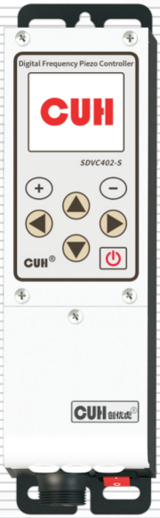

## SDVC402-S
ตัวควบคุมความถี่ดิจิทัลแบบปรับค่าได้สำหรับเครื่องป้อนวัสดุแบบสั่นสะเทือนพีโซอิเล็กทริก　　**SDVC402-S**
## คู่มือการใช้งาน

---

## ประกาศลิขสิทธิ์

Nanjing CUH Science & Technology Co., Ltd. ขอสงวนสิทธิ์ทั้งหมด

ข้อมูลทั้งหมดในคู่มือการใช้งานฉบับนี้เป็นทรัพย์สินทางปัญญาของบริษัทของเรา และได้รับการคุ้มครองตามกฎหมายลิขสิทธิ์และกฎหมายอื่นที่เกี่ยวข้อง CUH เป็นเจ้าของและขอสงวนสิทธิ์ทั้งหมดที่กฎหมายลิขสิทธิ์และกฎหมายอื่น ๆ ได้มอบให้ หากไม่ได้รับความยินยอมเป็นลายลักษณ์อักษรจาก CUH จะต้องไม่คัดลอก แปล เลียนแบบ หรือนำคู่มือการใช้งานฉบับนี้ไปใช้ประโยชน์ไม่ว่าทั้งหมดหรือบางส่วน

## ข้อจำกัดความรับผิด

เนื้อหาทั้งหมดของคู่มือการใช้งานฉบับนี้ใช้เพื่ออธิบายวิธีการใช้งานผลิตภัณฑ์ที่เกี่ยวข้องซึ่งผลิตโดยบริษัทของเราเท่านั้น และจัดทำขึ้นตามเทคโนโลยีที่มีอยู่ในปัจจุบันและสภาวะที่ส่งมอบให้แก่ท่านเมื่อท่านใช้งาน ท่านต้องรับความเสี่ยงที่เกี่ยวข้องด้วยตนเองเมื่อใช้งานผลิตภัณฑ์นี้ เว้นแต่กฎหมายจะกำหนดไว้เป็นอย่างอื่น บริษัทไม่มีความรับผิดใด ๆ ทั้งโดยชัดแจ้งหรือโดยนัยต่อผลิตภัณฑ์อันเนื่องมาจากคู่มือการใช้งานฉบับนี้ รวมถึงแต่ไม่จำกัดเพียงการบาดเจ็บต่อบุคคล ความเสียหายต่อทรัพย์สิน การสูญเสียโอกาส เป็นต้น

ท่านเข้าใจความเสี่ยงข้างต้นอย่างชัดเจน และตกลงว่า เว้นแต่กฎหมายจะบังคับ บริษัทจะไม่รับผิดชอบต่อความเสียหายหรือความสูญเสียใด ๆ ทั้งทางตรงและทางอ้อมต่อท่าน (รวมถึงแต่ไม่จำกัดเพียงความสูญเสียที่จับต้องได้ของบุคคล ทรัพย์สิน ข้อมูล เป็นต้น และความสูญเสียที่จับต้องไม่ได้ เช่น ชื่อเสียง โอกาส เป็นต้น)

บริษัทขอสงวนสิทธิ์ในการแก้ไขผลิตภัณฑ์ที่เกี่ยวข้องในคู่มือการใช้งานฉบับนี้โดยไม่ต้องแจ้งให้ทราบล่วงหน้าหรือภายหลัง

---

## บทนำ

ขอขอบคุณที่ท่านเลือกใช้ตัวควบคุมความถี่ดิจิทัลแบบปรับค่าได้สำหรับเครื่องป้อนวัสดุแบบสั่นสะเทือนพีโซอิเล็กทริก CUH SDVC402-S (ต่อไปในเอกสารนี้จะเรียกว่า "ตัวควบคุม") ตัวควบคุมซีรีส์นี้ใช้ชิ้นส่วนคุณภาพสูง ผสานเทคโนโลยีอิเล็กทรอนิกส์ล่าสุด และออกแบบอย่างพิถีพิถันด้วยโปรเซสเซอร์สัญญาณดิจิทัลสมรรถนะสูง

คู่มือฉบับนี้แนะนำวิธีการใช้งานพื้นฐาน คำอธิบายคุณลักษณะทางเทคนิคเชิงหน้าที่ และตัวอย่างการใช้งานทั่วไปของผลิตภัณฑ์นี้ ให้ข้อมูลที่เกี่ยวข้องกับผู้ใช้เกี่ยวกับการติดตั้งและการปรับแต่ง การตั้งค่าพารามิเตอร์ การวินิจฉัยความผิดปกติ การแก้ไขปัญหา และการบำรุงรักษาตามปกติของตัวควบคุม เพื่อให้มั่นใจว่าการติดตั้งและการใช้งานตัวควบคุมนี้ถูกต้อง โปรดอ่านคู่มือการใช้งานฉบับนี้อย่างละเอียดก่อนติดตั้งและเก็บรักษาไว้อย่างถูกต้อง

โปรดอ่านสัญลักษณ์ต่อไปนี้เพื่อเตือนท่านถึงข้อควรระวังต่อการบาดเจ็บต่อบุคคลและความเสียหายต่อผลิตภัณฑ์

| | |
|---|---|
| ⚠ อันตราย | การไม่ปฏิบัติตามข้อนี้จะส่งผลให้เกิดการบาดเจ็บต่อบุคคลหรือเสียชีวิต |
| ⚠ คำเตือน | การไม่ปฏิบัติตามข้อนี้อาจส่งผลให้เกิดการบาดเจ็บต่อบุคคลหรือเสียชีวิต |
| ⚠ ข้อควรระวัง | การไม่ปฏิบัติตามข้อนี้อาจส่งผลให้เกิดการบาดเจ็บต่อบุคคลระดับปานกลางหรือเล็กน้อย |
| ข้อสังเกต | การไม่ปฏิบัติตามข้อนี้จะส่งผลให้เกิดความเสียหายต่อผลิตภัณฑ์และทรัพย์สิน |
| ❗ จำเป็น | ระบุข้อควรระวังและข้อจำกัดในการใช้งานที่ต้องปฏิบัติตามระหว่างการใช้งาน |

**คู่มือฉบับนี้เหมาะสำหรับตัวควบคุมรุ่นต่อไปนี้:**

- ตัวควบคุมความถี่ดิจิทัลแบบปรับค่าได้สำหรับเครื่องป้อนวัสดุแบบสั่นสะเทือนพีโซอิเล็กทริก  
  SDVC402-S (150mA)

---

# ความปลอดภัยและข้อควรระวัง

1. **⚠ อันตราย** ผลิตภัณฑ์นี้ใช้สำหรับขับเคลื่อนอุปกรณ์ป้อนวัสดุแบบสั่นสะเทือนพีโซอิเล็กทริกเท่านั้น ห้ามนำผลิตภัณฑ์นี้ไปใช้เพื่อวัตถุประสงค์ในการปกป้องร่างกายมนุษย์หรือส่วนหนึ่งส่วนใดของร่างกายมนุษย์ เป็นต้น

2. **⚠ อันตราย** ผลิตภัณฑ์นี้ไม่ได้ออกแบบให้ใช้เป็นผลิตภัณฑ์กันระเบิด ห้ามใช้งานในพื้นที่อันตรายและ/หรือสภาพแวดล้อมที่มีแก๊สซึ่งอาจระเบิดได้

3. **⚠ คำเตือน** ผลิตภัณฑ์นี้ใช้พลังงานจากไฟฟ้ากระแสสลับหลัก โปรดอย่าจ่ายแรงดันไฟฟ้ากระแสสลับที่เกิน 250Vac แรงดันอินพุตที่สูงเกินไป เช่น 300Vac อาจทำให้ผลิตภัณฑ์ระเบิดหรือเกิดไฟไหม้ ก่อให้เกิดอุบัติเหตุด้านความปลอดภัยร้ายแรง

4. **⚠ คำเตือน** ผลิตภัณฑ์นี้ต่อสายดินผ่านสายไฟ โปรดตรวจสอบให้แน่ใจว่าอุปกรณ์จ่ายไฟสำหรับตัวควบคุมมีการต่อสายดินอย่างดี มิฉะนั้นเปลือกตัวควบคุมอาจมีไฟฟ้ารั่ว ทำให้เกิดอุบัติเหตุไฟดูด

5. **⚠ คำเตือน** ห้ามจ่ายไฟกระแสสลับเข้าที่เอาต์พุตของตัวควบคุมนี้ เพราะจะทำให้ตัวควบคุมเสียหาย

6. **⚠ คำเตือน** ห้ามเสียบหรือถอดสายไฟขณะที่ยังมีไฟ และห้ามสัมผัสจุดสัมผัสของขั้วต่อแต่ละจุดในช่องเดินสาย เพื่อป้องกันไฟดูด

7. **ข้อสังเกต** โปรดหลีกเลี่ยงการควบคุมเอาต์พุตของผลิตภัณฑ์นี้โดยการตัดแหล่งจ่ายไฟผ่านรีเลย์หรืออุปกรณ์อื่น ๆ ซึ่งจะลดอายุการใช้งานของตัวควบคุมลงอย่างมาก

8. **ข้อสังเกต** ตัวควบคุมออกแบบมาให้ทำงานในสภาพแวดล้อมที่เย็นและแห้ง ห้ามใช้งานตัวควบคุมกลางแจ้งเพื่อหลีกเลี่ยงการแช่น้ำและการถูกแดดเผา ให้ใช้งานตัวควบคุมภายในช่วงอุณหภูมิตามที่กำหนดไว้ในคุณลักษณะทางไฟฟ้า

9. **❗ จำเป็น** ต้องยึดผลิตภัณฑ์นี้บนแท่นที่มั่นคง มีการต่อสายดินอย่างน่าเชื่อถือ และอยู่ห่างจากอุปกรณ์ที่สั่นสะเทือน

10. **❗ จำเป็น** ห้ามใช้งานตัวควบคุมในสภาวะที่เกินขีดจำกัดการออกแบบ

11. **❗ จำเป็น** ให้ใช้งานตัวควบคุมตามคู่มือฉบับนี้อย่างเคร่งครัด บริษัทจะไม่รับผิดทางแพ่งหรือทางอาญาใด ๆ หากอุปกรณ์เสียหายหรือเกิดการบาดเจ็บต่อบุคคลอันเนื่องมาจากการใช้งานที่ไม่ถูกต้อง

12. **❗ จำเป็น** ห้ามเปิดเปลือกตัวควบคุมเพื่อหลีกเลี่ยงการถูกไฟดูด หากตัวควบคุมขัดข้องโปรดติดต่อ CUH ห้ามพยายามซ่อมแซมตัวควบคุมด้วยตนเอง ซึ่งอาจทำให้การรับประกันเป็นโมฆะ

---

---

## สภาพแวดล้อมสำหรับการใช้งานและการจัดเก็บ

### การตรวจสอบก่อนใช้งาน

ตัวควบคุมทุกเครื่องจะผ่านการตรวจสอบคุณภาพอย่างเข้มงวดก่อนส่งมอบ และบรรจุในบรรจุภัณฑ์กันกระแทก โปรดตรวจสอบรายการต่อไปนี้หลังจากเปิดกล่อง:

1. ตัวควบคุมเสียหายระหว่างการขนส่งหรือไม่
2. รุ่นของตัวควบคุมตรงกับที่ท่านสั่งซื้อหรือไม่

### สภาพแวดล้อมการทำงาน

โปรดปฏิบัติตามข้อสังเกตต่อไปนี้เพื่อให้ตัวควบคุมมีสมรรถนะที่ดีขึ้นและอายุการใช้งานที่ยาวนานขึ้น:

- ⚠ สภาพแวดล้อมที่มีการระบายอากาศที่ดี
- ⚠ ห่างไกลจากน้ำ ลำธาร ฝุ่น และโดยเฉพาะฝุ่นที่ปนเปื้อนน้ำมัน
- ⚠ ห่างไกลจากแก๊สและของเหลวที่กัดกร่อนหรือไวไฟ
- ⚠ ห่างไกลจากฝุ่นลอยและอนุภาคโลหะ
- ⚠ ยึดติดอย่างมั่นคงเพื่อหลีกเลี่ยงการสั่นสะเทือนของตัวเอง
- ⚠ ห่างไกลจากสัญญาณรบกวนแม่เหล็กไฟฟ้า
- ⚠ ตรวจสอบให้แน่ใจว่าอุณหภูมิแวดล้อมอยู่ที่ 0~40 °C
- ⚠ ใช้งานที่ระดับความสูง 2000 ม. หรือต่ำกว่า

---

# สารบัญ

- บทที่ Ⅰ คำแนะนำก่อนใช้งาน — 1
  - 1.1 ตรวจสอบรายการในบรรจุภัณฑ์ — 1
  - 1.2 แผงปุ่มกดและพอร์ตอินพุต/เอาต์พุต — 2
  - 1.3 คำอธิบายพารามิเตอร์หน้าหลัก — 3
  - 1.4 คำอธิบายพอร์ตการเดินสาย — 3
  - 1.5 คำอธิบายป้ายชื่อ — 4
- บทที่ Ⅱ คุณสมบัติ — 5
- บทที่ Ⅲ คู่มือการติดตั้ง — 7
  - 3.1 เงื่อนไขการใช้งานตัวควบคุม — 7
  - 3.2 วิธีการใช้งานปุ่มกด — 7
  - 3.3 การติดตั้งและการใช้งาน — 8
- บทที่ Ⅳ คำอธิบายฟังก์ชันโดยย่อ — 12
  - 4.1 แรงดันเอาต์พุต — 12
  - 4.2 ความถี่เอาต์พุต — 13
  - 4.3 เวลาสตาร์ทแบบนุ่มนวล — 14
  - 4.4 สวิตช์เอาต์พุต — 14
  - 4.5 ขีดจำกัดแรงดันเอาต์พุตสูงสุด — 15
  - 4.6 การล็อกแผงปุ่มกด — 16
  - 4.7 การตั้งค่าสถานะการทำงานเมื่อจ่ายไฟ — 17
  - 4.8 การคืนค่าการตั้งค่าเริ่มต้น — 18
- บทที่ Ⅴ เซนเซอร์และการควบคุมสัญญาณ — 19
  - 5.1 การตรวจจับแสงอัจฉริยะ — 19
    - 5.1.1 วิธีการเชื่อมต่อเซ็นเซอร์โฟโต้อิเล็กทริกอัจฉริยะ — 19
    - 5.1.2 เวลาหน่วงเปิด/ปิดของเซ็นเซอร์โฟโต้อิเล็กทริกอัจฉริยะ — 20
    - 5.1.3 ทิศทางลอจิกของเซ็นเซอร์โฟโต้อิเล็กทริกอัจฉริยะ — 21
  - 5.2 วิธีใช้งานเซ็นเซอร์สวิตช์ — 22
    - 5.2.1 วิธีการเชื่อมต่อเซ็นเซอร์สวิตช์พร็อกซิมิตี้แบบ NPN — 22
    - 5.2.2 เวลาหน่วงเปิด/ปิดของเซ็นเซอร์สวิตช์ — 26
    - 5.2.3 ทิศทางลอจิกของเซ็นเซอร์สวิตช์ — 27
    - 5.2.4 ประเภทเซ็นเซอร์สวิตช์ — 28

---

---

- 5.3 เอาต์พุตควบคุม — 29
- 5.4 การควบคุมความเร็วระยะไกล — 30

## บทที่ Ⅵ คำอธิบายฟังก์ชันโดยละเอียด — 32

- 6.1 การปรับแต่งหน้าหลัก — 33
- 6.2 การตั้งค่าพารามิเตอร์ทั่วไป — 34
  - 6.2.1 แรงดัน — 34
  - 6.2.2 ความถี่ — 34
  - 6.2.3 เวลาสตาร์ทแบบนุ่มนวล/เวลาหยุดแบบนุ่มนวล — 35
  - 6.2.4 แรงดันเอาต์พุตสูงสุด/แรงดันเอาต์พุตต่ำสุด — 35
  - 6.2.5 ความถี่เอาต์พุตสูงสุด/ความถี่เอาต์พุตต่ำสุด — 35
  - 6.2.6 เวลาปิดไฟพื้นหลัง — 36
  - 6.2.7 ภาษา — 36
- 6.3 พารามิเตอร์เอาต์พุต — 37
  - 6.3.1 พารามิเตอร์เอาต์พุตหลัก — 37
    - 6.3.1.1 แหล่งสัญญาณหลัก 1/แหล่งสัญญาณหลัก 2 — 37
    - 6.3.1.2 ลอจิกหลัก — 39
    - 6.3.1.3 เวลาหน่วงเปิดหลัก/เวลาหน่วงปิดหลัก — 40
    - 6.3.1.4 โหมดหลัก — 40
    - 6.3.1.5 ทิศทางหลัก — 41
    - 6.3.1.6 สถานะเมื่อจ่ายไฟ — 41
  - 6.3.2 พารามิเตอร์เอาต์พุตควบคุม DC — 42
    - 6.3.2.1 โหมดเอาต์พุตของพอร์ต D — 44
    - 6.3.2.2 ประเภทพอร์ต D — 45
- 6.4 การควบคุมสัญญาณ — 46
  - 6.4.1 ความไวของพอร์ต B — 47
  - 6.4.2 ทิศทางลอจิกของพอร์ต B/พอร์ต C — 47
  - 6.4.3 เวลาหน่วงเปิด/ปิดของพอร์ต B และเวลาหน่วงเปิด/ปิดของพอร์ต C — 47
- 6.5 การบันทึกการตั้งค่า — 48
  - 6.5.1 การเรียกคืนการตั้งค่า — 48
  - 6.5.2 การบันทึกการตั้งค่า — 48
  - 6.5.3 การคืนค่าจากโรงงาน — 49

---

---

- 6.5.4 ประเภทและหมายเลขเครื่องท้องถิ่น — 49
- 6.5.5 รหัสผ่านผู้ใช้ — 49
- 6.6 การตรวจสอบสถานะตัวควบคุม — 50

## บทที่ Ⅶ ภาคผนวก — 51

- 7.1 มิติ — 51
- 7.2 ข้อมูลจำเพาะทางเทคนิค — 52
- 7.3 มาตรฐานอ้างอิง — 53
- 7.4 รายการพารามิเตอร์ — 54
- 7.5 แผนภาพวงจรอินพุตและเอาต์พุต — 56
- 7.6 รหัสข้อผิดพลาดและคำเตือน — 57

## บทที่ Ⅷ ข้อมูลการรับประกันผลิตภัณฑ์ — 58

- 8.1 ระยะเวลารับประกัน — 58
- 8.2 ขอบเขตการรับประกัน — 58
- 8.3 ความเหมาะสมของผลิตภัณฑ์ — 58

---

# บทที่ Ⅰ คำแนะนำก่อนใช้งาน

บทนี้อธิบายเนื้อหาบรรจุภัณฑ์ของผลิตภัณฑ์ คำอธิบายลักษณะภายนอกของตัวควบคุม และข้อมูลป้ายชื่อของตัวควบคุม

## 1.1 ตรวจสอบรายการในบรรจุภัณฑ์

ก่อนใช้งาน โปรดตรวจสอบความสมบูรณ์ของตัวควบคุมและอุปกรณ์เสริม หากพบว่าผลิตภัณฑ์มีข้อบกพร่องหรือเสียหาย อุปกรณ์เสริมขาดหาย เป็นต้น โปรดติดต่อบริษัทของเรา

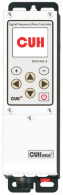

ตัวควบคุม×1

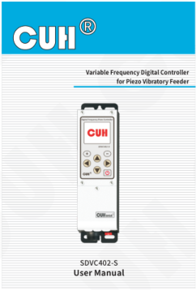

คู่มือการใช้งาน×1

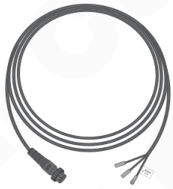

สายไฟเอาต์พุต×1

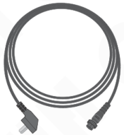

สายไฟอินพุต×1

---

## 1.2 แผงปุ่มกดและพอร์ตอินพุต/เอาต์พุต

### คำอธิบายหน้าจอและปุ่มกด

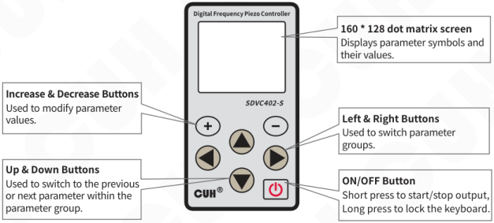

**หน้าจอดอตแมทริกซ์ 160 * 128**  
แสดงสัญลักษณ์พารามิเตอร์และค่าของพารามิเตอร์

**ปุ่มเพิ่มและปุ่มลด**  
ใช้สำหรับแก้ไขค่าพารามิเตอร์

**ปุ่มขึ้นและปุ่มลง**  
ใช้สำหรับสลับไปยังพารามิเตอร์ก่อนหน้าหรือถัดไปภายในกลุ่มพารามิเตอร์

**ปุ่มซ้ายและปุ่มขวา**  
ใช้สำหรับสลับกลุ่มพารามิเตอร์

**ปุ่ม ON/OFF**  
กดสั้นเพื่อเริ่ม/หยุดเอาต์พุต กดค้างเพื่อล็อกแผงปุ่มกด

### คำอธิบายชิ้นส่วนภายนอก

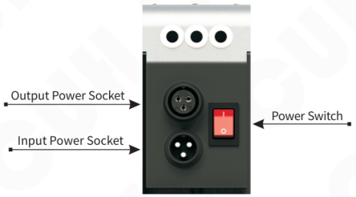

- ซ็อกเก็ตพลังงานเอาต์พุต
- ซ็อกเก็ตพลังงานอินพุต
- สวิตช์ปิด/เปิดไฟ

---

## 1.3 คำอธิบายพารามิเตอร์หน้าหลัก

ตัวควบคุมสามารถแสดงสถานะเอาต์พุตหลัก สถานะการล็อกแผงปุ่มกด สถานะพอร์ต พารามิเตอร์ตรวจสอบ และชื่ออินเทอร์เฟซบนหน้าหลัก ภายในสถานะพอร์ต:

การไฮไลต์ X บ่งชี้ว่าพอร์ตทำงานได้ <u>X</u> บ่งชี้ว่าพอร์ตทำงานที่ระดับต่ำ และ X̅ บ่งชี้ว่าพอร์ตทำงานที่ระดับสูง

## 1.4 คำอธิบายพอร์ตการเดินสาย

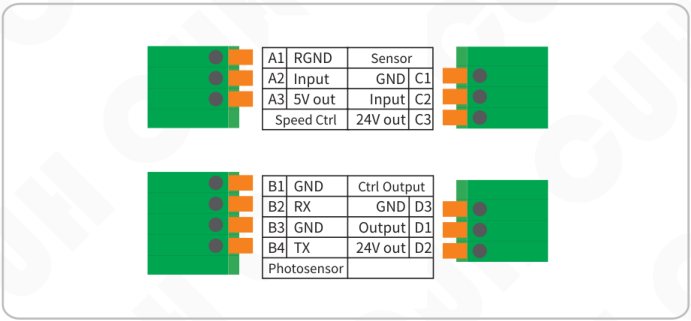

| | | | |
|---|---|---|---|
| A1 | RGND | Sensor | |
| A2 | Input | GND | C1 |
| A3 | 5V out | Input | C2 |
| Speed Ctrl | | 24V out | C3 |

| | | | |
|---|---|---|---|
| B1 | GND | Ctrl Output | |
| B2 | RX | GND | D3 |
| B3 | GND | Output | D1 |
| B4 | TX | 24V out | D2 |
| Photosensor | | | |

---

## 1.5 คำอธิบายป้ายชื่อ

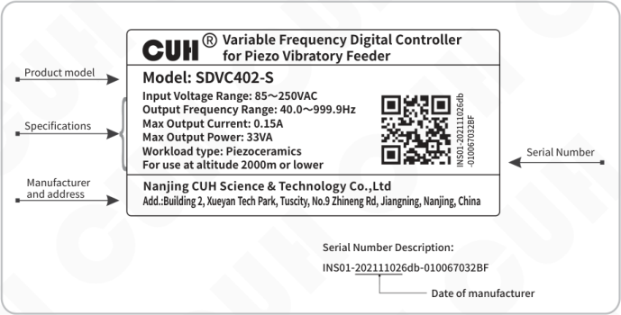

**CUH® Variable Frequency Digital Controller for Piezo Vibratory Feeder**

**รุ่นผลิตภัณฑ์**

รุ่น: SDVC402-S

**ข้อมูลจำเพาะ**

- ช่วงแรงดันอินพุต: 85～250VAC
- ช่วงความถี่เอาต์พุต: 40.0～999.9Hz
- กระแสเอาต์พุตสูงสุด: 0.15A
- กำลังเอาต์พุตสูงสุด: 33VA
- ประเภทภาระงาน: พีโซเซรามิกส์
- ใช้งานที่ระดับความสูงไม่เกิน 2000 ม.

**ผู้ผลิตและที่อยู่**

Nanjing CUH Science & Technology Co.,Ltd

Add.:Building 2, Xueyan Tech Park, Tuscity, No.9 Zhineng Rd, Jiangning, Nanjing, China

**หมายเลขเครื่อง**

INS01-202111026db-010067032BF

**คำอธิบายหมายเลขเครื่อง:**

INS01-<u>20211102</u>6db-010067032BF

วันที่ผลิต → 20211102

---

## บทที่ Ⅱ คุณสมบัติ

ตัวควบคุมนี้ได้รับการออกแบบมาเป็นพิเศษสำหรับควบคุมเครื่องป้อนวัสดุแบบสั่นสะเทือนในระบบอัตโนมัติ ด้วยการผสมผสานเทคโนโลยีอิเล็กทรอนิกส์ล่าสุดและการออกแบบอันพิถีพิถัน ตัวควบคุมจึงมีคุณสมบัติที่สะดวกและใช้งานได้จริงดังต่อไปนี้:

**การปรับความถี่:** ช่วงความถี่เอาต์พุตตั้งแต่ 40.0Hz ถึง 999.9Hz

**การปรับแรงดัน:** ช่วงแรงดันเอาต์พุตตั้งแต่ 0V ถึง 220V

**การรักษาเสถียรภาพแรงดันอัตโนมัติ:** ตัวควบคุมสามารถขจัดความแปรผันของความเร็วในการป้อนที่เกิดจากความผันผวนของแรงดันไฟฟ้าจากระบบจ่ายไฟ

**การตรวจจับด้วยโฟโต้อิเล็กทริกอัจฉริยะ:** เซ็นเซอร์โฟโต้อิเล็กทริกอัจฉริยะแบบปรับตัวของเราสามารถช่วยหยุดตัวควบคุมเมื่อชิ้นงานเต็มหรือชิ้นงานหมด และสามารถทำหน้าที่ในการตั้งค่าเวลาสตาร์ทแบบนุ่มนวล เวลาหน่วงเปิด เวลาหน่วงปิด และการปรับความสัมพันธ์ทางตรรกะ

**เซ็นเซอร์สวิตช์:** สามารถเชื่อมต่อเซ็นเซอร์สวิตช์แบบปรับตัวหรือ PLC เพื่อเปิด/ปิดตัวควบคุม

**การควบคุมความเร็วระยะไกล:** แรงดันเอาต์พุตของตัวควบคุมสามารถควบคุมได้ด้วยโพเทนชิออมิเตอร์ภายนอก PLC หรือสัญญาณ DC 1~5V/4~20mA

**สวิตช์เอาต์พุต:** ปุ่มเปิด/ปิดบนแผงช่วยให้สตาร์ทและหยุดได้ทันที สะดวกต่อการดีบักอุปกรณ์ของผู้ใช้

**การล็อกแผงปุ่มกด:** กดปุ่มเปิด/ปิดค้างไว้ 2 วินาทีเพื่อล็อกปุ่มทั้งหมดเพื่อป้องกันการกดผิดพลาด

**สถานะเมื่อเปิดเครื่อง:** การตั้งค่าพารามิเตอร์นี้ช่วยให้ผู้ใช้กำหนดสถานะการทำงานเริ่มต้นของตัวควบคุมได้อย่างสะดวก

**เอาต์พุตควบคุม:** สัญญาณเอาต์พุตควบคุมที่ส่งออกจากทรานซิสเตอร์สามารถประสานการทำงานของโซลินอยด์หรืออุปกรณ์ภายนอกอื่นๆ กับตัวควบคุมได้

**การจำกัดเอาต์พุตสูงสุด:** สามารถตั้งค่าแรงดันเอาต์พุตสูงสุดล่วงหน้าเพื่อปกป้องอุปกรณ์จากความเสียหายที่เกิดจากการใช้งานผิดวิธี

**การคืนค่าการตั้งค่าเริ่มต้น:** ฟังก์ชันนี้ช่วยให้ผู้ใช้คืนค่าพารามิเตอร์ทั้งหมดกลับเป็นการตั้งค่าจากโรงงานและรีเซ็ตตัวควบคุม

**จอแสดงผล LCD:** ใช้จอแสดงผลสีความละเอียด 160* 128 และรองรับทั้งภาษาจีนและภาษาอังกฤษ

**การบันทึกและเรียกอ่านกลุ่มพารามิเตอร์:** สามารถบันทึกและเรียกอ่านกลุ่มพารามิเตอร์ของผู้ใช้ได้สูงสุด 4 กลุ่ม

---

---

CUH ให้ความสำคัญอย่างยิ่งต่อการจัดการคุณภาพผลิตภัณฑ์และประสิทธิภาพด้านความปลอดภัย นอกเหนือจากชิ้นส่วนคุณภาพสูงที่เราใช้และระบบควบคุมคุณภาพที่เข้มงวดแล้ว CUH ยังคำนึงถึงอุบัติเหตุที่อาจเกิดขึ้นกับผู้ใช้ และมอบฟังก์ชันป้องกันดังต่อไปนี้เพื่อเพิ่มประโยชน์ใช้สอยของตัวควบคุมให้สูงสุด

**การป้องกันการลัดวงจร:** หากเอาต์พุตของตัวควบคุมเกิดการลัดวงจร ตัวควบคุมจะหยุดเอาต์พุตจนกว่าจะเริ่มทำงานใหม่

**การป้องกันกระแสเกินพิกัด:** ตัวควบคุมจะหยุดเอาต์พุตเพื่อความปลอดภัยในการทำงานของอุปกรณ์ เมื่อกระแสการทำงานเกินค่าพิกัด

**การป้องกันความร้อนเกิน:** ตัวควบคุมจะหยุดเอาต์พุตเพื่อป้องกันตัวเองเมื่ออุณหภูมิการทำงานสูงเกินไป

ตัวควบคุมของ CUH เป็นไปตามข้อกำหนดการรับรอง CE อย่างเคร่งครัด

---

# บทที่ Ⅲ คู่มือการติดตั้ง

บทนี้อธิบายถึงเงื่อนไขที่จำเป็นสำหรับการใช้งานตัวควบคุม และวิธีการติดตั้งและเชื่อมต่ออย่างถูกต้อง

## 3.1 เงื่อนไขการใช้งานตัวควบคุม

ตัวควบคุมใช้พลังงานจากไฟ AC 85V~250V และเชื่อมต่อกับสายดินป้องกันผ่านปลั๊กของสายไฟ โปรดใช้แหล่งจ่ายไฟฟ้าหลักมาตรฐานและตรวจสอบให้แน่ใจว่าสายดินป้องกันเชื่อมต่ออย่างถูกต้อง

**⚠ คำเตือน** ห้ามเชื่อมต่อตัวควบคุมกับไฟ AC 380V เด็ดขาด เพราะจะทำให้ตัวควบคุมเสียหายอย่างรุนแรงและไม่สามารถกู้คืนได้ อาจส่งผลให้เกิดการระเบิด ไฟไหม้ และอุบัติเหตุด้านความปลอดภัยอื่นๆ

**⚠ คำเตือน** ตรวจสอบให้แน่ใจว่าด้านแหล่งจ่ายไฟมีการต่อสายดินอย่างเชื่อถือได้ ตัวเครื่องโลหะของตัวควบคุมเชื่อมต่อโดยตรงกับสายดินป้องกัน การต่อสายดินที่ไม่ดีจะทำให้ตัวเครื่องของตัวควบคุมมีกระแสไฟฟ้ารั่วและเกิดอุบัติเหตุไฟฟ้าช็อต

**โปรดทราบ** การทำงานเป็นเวลานานจะเกิดความร้อนและทำให้อุณหภูมิของตัวเครื่องสูงขึ้น โปรดติดตั้งตัวควบคุมในสภาพแวดล้อมที่มีการระบายอากาศดีและยึดให้แน่น ห่างไกลจากแหล่งสั่นสะเทือน

**โปรดทราบ** ผลิตภัณฑ์นี้เป็นตัวควบคุมที่ใช้ขับเคลื่อนเครื่องป้อนวัสดุแบบสั่นสะเทือนพีโซอิเล็กทริก

## 3.2 วิธีการใช้งานปุ่มกด

a. ตามระยะเวลาการกดปุ่ม การทำงานของปุ่มแบ่งออกเป็นการกดสั้น การกดยาว การเร่งระดับที่หนึ่ง และการเร่งระดับที่สอง

b. การกดสั้นหมายถึงระยะเวลากดมากกว่า 0.1 วินาทีและน้อยกว่า 2 วินาที และการกดยาวหมายถึงระยะเวลากดมากกว่า 2 วินาที

c. ⊕ และ ⊖ ใช้สำหรับปรับค่าพารามิเตอร์ ▲ และ ▼ ใช้สำหรับเลือกพารามิเตอร์ต่างๆ

d. สลับระหว่างกลุ่มพารามิเตอร์ด้านบนและด้านล่างในหน้าจอตั้งค่าพารามิเตอร์โดยการกด ◀ หรือ ▶ สั้นๆ

e. สลับระหว่างพารามิเตอร์ด้านบนและด้านล่างของกลุ่มนี้ในหน้าจอตั้งค่าพารามิเตอร์โดยการกด ▲ หรือ ▼ สั้นๆ

f. กด ⏻ สั้นๆ เพื่อเริ่ม/หยุดเอาต์พุตหลัก กด ⏻ ค้างไว้เพื่อล็อก/ปลดล็อกคีย์บอร์ด

g. หากไม่มีการดำเนินการใดๆ เกิน 5 นาทีในอินเทอร์เฟซใดๆ ระบบจะเข้าสู่หน้าจอหลัก

---

## 3.3 การติดตั้งและการใช้งาน

### ขั้นตอนที่ 1:

เปิดกล่องบรรจุภัณฑ์และตรวจสอบตัวควบคุมและอุปกรณ์เสริมทั้งหมด

### ขั้นตอนที่ 2:

เชื่อมต่อขั้วต่อของสายพลังงานเอาต์พุตกับขั้วอิเล็กโทรดของเครื่องสั่นพีโซ

จัดตำแหน่งรอยบากบนปลั๊กการบินของสายเอาต์พุตให้ตรงกับเครื่องหมายสามเหลี่ยมบนซ็อกเก็ตเอาต์พุตของตัวควบคุม จากนั้นขันน็อตให้แน่นหลังจากเชื่อมต่อสายเอาต์พุตอย่างถูกต้อง

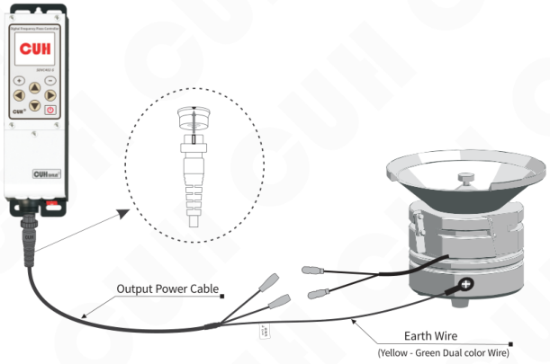

> **หมายเหตุ**
>
> ตรวจสอบให้แน่ใจว่าขั้วอิเล็กโทรดของเครื่องสั่นพีโซเชื่อมต่อกับขาเอาต์พุตสองขาของสายพลังงานเอาต์พุต และเปลือกโลหะของเครื่องสั่นมีการต่อสายดินอย่างเชื่อถือได้

---

### ขั้นตอนที่ 3:

เชื่อมต่อขั้วต่อของสายพลังงานอินพุตกับซ็อกเก็ตพลังงานอินพุตของตัวควบคุม

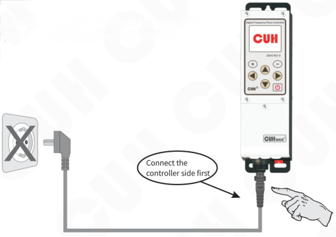

เชื่อมต่อด้านตัวควบคุมก่อน

### ขั้นตอนที่ 4:

หลังจากยืนยันว่าสวิตช์อยู่ในตำแหน่งปิดแล้ว ให้เชื่อมต่อปลั๊กของสายพลังงานอินพุตกับเต้ารับไฟบ้าน

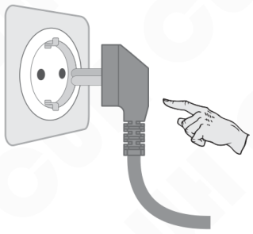

---

## ขั้นตอนที่ 5:

- เปิดสวิตช์ไฟของตัวควบคุม ตัวควบคุมจะแสดงหน้าจอหลัก
- กด ⊕ หรือ ⊖ เพื่อปรับค่าแรงดันเอาต์พุตให้อยู่ระหว่าง 30 ถึง 80

**หมายเหตุ:** การเลือกแบบไฮไลต์หมายความว่าค่าพารามิเตอร์สามารถปรับได้

## ขั้นตอนที่ 6:

- บนหน้าจอหลัก กด ▼ สั้นๆ เพื่อเข้าสู่สถานะการปรับความถี่เอาต์พุต
- กด ⊕ หรือ ⊖ เพื่อค้นหาความถี่ธรรมชาติของเครื่องป้อนวัสดุแบบสั่นสะเทือน ซึ่งเรียกอีกอย่างว่าความถี่รีโซแนนซ์

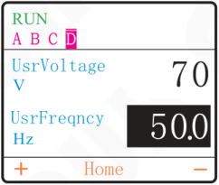

- ความถี่ที่การสั่นสะเทือนถึงระดับสูงสุดคือความถี่ธรรมชาติของตัวสั่น
- เครื่องสั่นแต่ละตัวมีความถี่รีโซแนนซ์เชิงกลตามธรรมชาติของตัวเอง ปรับความถี่เอาต์พุตของตัวควบคุมให้เป็นความถี่นี้เพื่อให้ได้สภาวะการทำงานที่ดีที่สุด

---

## ขั้นตอนที่ 7:

- หลังจากพบความถี่ธรรมชาติของเครื่องป้อนวัสดุแบบสั่นสะเทือนแล้ว ให้ใช้ ⊕ และ ⊖ ปรับแรงดันจนกว่าจะได้อัตราการป้อนที่ดีที่สุด

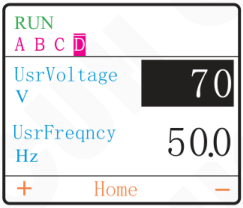

เครื่องป้อนวัสดุแบบสั่นสะเทือนควรทำงานได้แล้ว สำหรับคำแนะนำการควบคุมเพิ่มเติม โปรดดูบทต่อไปนี้

---

## บทที่ Ⅳ คำอธิบายฟังก์ชันโดยสรุป

บทนี้อธิบายการตั้งค่าพารามิเตอร์พื้นฐาน

### 4.1 แรงดันเอาต์พุต

ตัวควบคุมนี้สามารถตั้งค่าแรงดันเอาต์พุตแบบดิจิทัลได้โดยตรงบนแผง เนื่องจากตัวควบคุมมีฟังก์ชันเอาต์พุตแบบรักษาเสถียรภาพแรงดัน ค่านี้จึงเป็นค่าเฉลี่ยที่ผ่านการแก้ไขของแรงดันและจะไม่ได้รับผลกระทบจากแรงดันอินพุต แม้ในสถานการณ์ที่แรงดันไฟฟ้าในระบบไม่เสถียร แรงดันเอาต์พุตก็ยังสามารถรักษาให้คงที่ได้ ในขณะเดียวกัน การตั้งค่าแรงดันโดยตรงยังให้ข้อมูลที่แม่นยำสำหรับผู้ใช้ในการทำความเข้าใจการทำงานของอุปกรณ์

- เปิดสวิตช์ไฟของตัวควบคุม
- ตัวควบคุมจะเข้าสู่พารามิเตอร์แรงดันเอาต์พุต จอแสดงผล LCD จะแสดงพารามิเตอร์แรงดันเอาต์พุตและค่าเริ่มต้นคือ 150
- กด ⊕ หรือ ⊖ เพื่อปรับค่าพารามิเตอร์

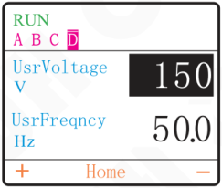

ช่วงแรงดันคือ 0~220V ความแม่นยำในการปรับคือ 1V

ค่าเฉลี่ยที่ผ่านการแก้ไขของแรงดันเอาต์พุตของตัวควบคุมสามารถตั้งค่าแบบดิจิทัลได้โดยตรงผ่านแผงปุ่มกด ด้วยฟังก์ชันรักษาเสถียรภาพแรงดันอันเป็นเอกลักษณ์ แรงดันเอาต์พุตของตัวควบคุมจะไม่ผันผวนตามแรงดันอินพุต ทำให้เครื่องสั่นสามารถรักษาการทำงานที่เสถียรได้ในกรณีที่แรงดันไฟฟ้าในระบบไม่เสถียร

---

## 4.2 ความถี่เอาต์พุต

ตัวควบคุมใช้เทคโนโลยีการสังเคราะห์ความถี่ดิจิทัลโดยตรง (DDS) ซึ่งมีความแม่นยำและเสถียรภาพของความถี่สูงมาก และไม่เปลี่ยนแปลงตามเวลาและอุณหภูมิ

- บนหน้าจอหลัก กด ▼ สั้นๆ เพื่อเข้าสู่สถานะการปรับความถี่เอาต์พุต
- จอแสดงผล LCD จะแสดงพารามิเตอร์ความถี่และค่าเริ่มต้นคือ 50.0
- กด ⊕ หรือ ⊖ เพื่อปรับค่าพารามิเตอร์

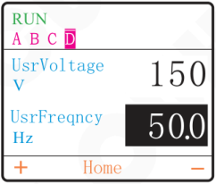

ช่วงความถี่คือ 40.0～999.9Hz ความแม่นยำในการปรับคือ 0.1Hz

---

- ในหน้าจอหลัก การกด ◀ และ ▶ สั้นๆ สามารถสลับไปยังกลุ่มพารามิเตอร์อื่นได้
- ในกลุ่มพารามิเตอร์ที่ไม่ใช่กลุ่มเฝ้าติดตาม ตัวควบคุมจะออกกลับสู่หน้าจอหลักโดยอัตโนมัติหลังจากสิ้นสุดการดำเนินการสามนาที
- ในกลุ่มพารามิเตอร์เฝ้าติดตาม ตัวควบคุมจะออกกลับสู่หน้าจอหลักโดยอัตโนมัติหลังจากสิ้นสุดการดำเนินการสิบนาที

---

## 4.3 เวลาสตาร์ทแบบนุ่มนวล

เพื่อหลีกเลี่ยงการกระแทกอย่างกะทันหันต่อขดลวดของเครื่องสั่น ตัวควบคุมสามารถค่อยๆ เพิ่มแรงดันเอาต์พุตจาก 0 ไปจนถึงค่าที่ตั้งไว้ล่วงหน้าเมื่อสตาร์ท

**เวลาสตาร์ทแบบนุ่มนวล:** ระยะเวลาที่ตัวควบคุมใช้ในการเพิ่มแรงดันเอาต์พุตอย่างราบรื่นจาก 0 ไปจนถึงค่าที่ตั้งไว้ล่วงหน้าเมื่อสตาร์ท

- กด ▶ สั้นๆ เพื่อสลับไปยังกลุ่มพารามิเตอร์ "2 Common"
- กด ▼ สั้นๆ เพื่อสลับไปยังพารามิเตอร์สตาร์ทแบบนุ่มนวล และค่าเริ่มต้นคือ 0.5
- กด ⊕ หรือ ⊖ เพื่อปรับค่าพารามิเตอร์

**RUN**  
A B C **D**

| Parameter | ค่า |
|---|---|
| 01.UsrVoltage | 150 V |
| 02.UsrFreqncy | 50.0 Hz |
| 03.SoftStarT | **0.5 s** |
| 04.SoftStopT | 0.0 s |
| 05.MaxVoltage | 220 V |

＋　2Common　－

ช่วงสตาร์ทแบบนุ่มนวลคือ 0.0～10.0s ความแม่นยำในการปรับคือ 0.1s

## 4.4 สวิตช์เอาต์พุต

สวิตช์เอาต์พุตแบบสัมผัสเบาบนแผงสามารถเริ่มหรือหยุดเอาต์พุตของตัวควบคุมได้อย่างง่ายดายและรวดเร็ว

- ใช้ ⏻ บนแผงของตัวควบคุมเพื่อควบคุมการเริ่มหรือหยุดเอาต์พุต จอแสดงผลจะแสดงสัญลักษณ์ "MAN" ซึ่งหมายถึงเข้าสู่สถานะหยุด

**MAN**  
A B C **D**

| Parameter | ค่า |
|---|---|
| UsrVoltage | 150 V |
| UsrFreqncy | **50.0 Hz** |

＋　Home　－

> เนื่องจากเทคโนโลยีสวิตช์แบบสัมผัสเบาและการควบคุมด้วยสัญญาณดิจิทัล จะไม่มีประกายไฟเกิดขึ้นจนทำให้หน้าสัมผัสเสียหาย ส่งผลให้อายุการใช้งานของตัวควบคุมและเครื่องสั่นยาวนานขึ้นอย่างมาก

---

## 4.5 ขีดจำกัดแรงดันเอาต์พุตสูงสุด

ตัวควบคุมสามารถตั้งค่าแรงดันเอาต์พุตสูงสุด ซึ่งสามารถป้องกันการใช้งานผิดพลาดของผู้ใช้ที่อาจส่งแรงดันมากเกินไปและทำให้อุปกรณ์สั่นสะเทือนเสียหาย

แรงดันควบคุมระยะไกลจะไม่เกินค่านี้

- เข้าสู่กลุ่มพารามิเตอร์ "2 Common"
- กด ⏷ สั้นๆ เพื่อสลับไปยังพารามิเตอร์แรงดันสูงสุด และค่าเริ่มต้นคือ 220
- กด ⊕ หรือ ⊖ เพื่อปรับค่าพารามิเตอร์

**RUN**  
A　B　C　**D**

| Parameter | ค่า |
|---|---|
| 01.UsrVoltage | 150 V |
| 02.UsrFreqncy | 50.0 Hz |
| 03.SoftStarT | 0.5 s |
| 04.SoftStopT | 0.0 s |
| 05.MaxVoltage | **220** V |

＋　　2Common　　－

ช่วงแรงดันสูงสุดคือ 0～220V ความแม่นยำในการปรับคือ 1V

> - ในกรณีใดๆ แรงดันเอาต์พุตของตัวควบคุมไม่สามารถและจะไม่เกินค่าที่ตั้งไว้ของพารามิเตอร์นี้
> - การตั้งค่าเริ่มต้นจากโรงงานของพารามิเตอร์นี้คือแรงดันเอาต์พุตสูงสุดที่เป็นไปได้ของเครื่อง

---

## 4.6 การล็อกแผงปุ่มกด

เมื่อตั้งค่าพารามิเตอร์ของตัวควบคุมเสร็จสิ้น ฟังก์ชันล็อกคีย์บอร์ดสามารถล็อกปุ่มทั้งหมดบนแผงเพื่อหลีกเลี่ยงการกดผิดพลาด

แม้จะปิดเครื่องแล้วเปิดใหม่ สถานะการล็อกคีย์บอร์ดก็ยังคงเป็นสถานะเดิมเหมือนครั้งสุดท้ายที่ปิดเครื่อง

- กด ⏻ ค้างไว้ 2 วินาทีเพื่อล็อกปุ่มทั้งหมดบนแผง จอแสดงผลจะแสดงสัญลักษณ์ "Lock"
- กด ⏻ ค้างไว้อีกครั้ง 2 วินาทีเพื่อปลดล็อก

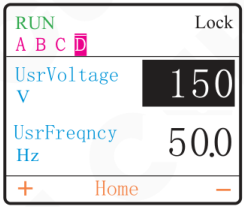

> สถานะการล็อกคีย์บอร์ดจะไม่หายไปเนื่องจากการปิดเครื่อง

---

## 4.7 การตั้งค่าสถานะการทำงานเมื่อจ่ายไฟ

เพื่อป้องกันการดับไฟกะทันหันในสภาวะปกติแล้วกลับมาจ่ายไฟอีกครั้ง หรือตามความต้องการพิเศษสำหรับสถานะเมื่อเปิดเครื่องของตัวควบคุม คุณสามารถตั้งค่าพารามิเตอร์นี้เพื่อกำหนดสถานะเมื่อเปิดเครื่องของตัวควบคุมเป็น ทำงาน หยุด หรือตามสถานะการปิดเครื่องครั้งล่าสุด

- เข้าสู่กลุ่มพารามิเตอร์ "3 M_output"
- กด ⏷ สั้นๆ เพื่อสลับไปยังพารามิเตอร์สถานะเมื่อเปิดเครื่อง และค่าเริ่มต้นคือ On
- กด ⊕ หรือ ⊖ เพื่อปรับค่าพารามิเตอร์

RUN  
A B C D

| Parameter | ค่า |
|---|---|
| 04.MainUpDly | 0.0 s |
| 05.MainDnDly | 0.0 s |
| 06.MainMode | Delay |
| 07.MainDirect | Revrs |
| 08.PowerOnSta | On |

＋　3M_output　－

**On:** หมายถึงสถานะเมื่อเปิดเครื่องคือเปิด

**Off:** หมายถึงสถานะเมื่อเปิดเครื่องคือปิด

**Hold:** หมายถึงสถานะเมื่อเปิดเครื่องเป็นไปตามสถานะการปิดเครื่องครั้งล่าสุด (หากตัวควบคุมหยุดเอาต์พุตในการปิดเครื่องครั้งล่าสุด เมื่อเปิดเครื่องครั้งถัดไปตัวควบคุมจะปิด ในทางกลับกัน หากตัวควบคุมกำลังส่งเอาต์พุตอยู่ในการปิดเครื่องครั้งล่าสุด เมื่อเปิดเครื่องครั้งถัดไปตัวควบคุมจะเปิด)

---

## 4.8 การคืนค่าการตั้งค่าเริ่มต้น

ผู้ใช้สามารถคืนค่าตัวควบคุมกลับสู่สถานะการตั้งค่าจากโรงงานได้อย่างรวดเร็ว

เนื่องจากตัวควบคุมมีฟังก์ชันที่ทรงพลัง พารามิเตอร์จำนวนมากจึงสามารถปรับได้ ผู้เริ่มต้นอาจพบว่าเป็นการยากที่จะคืนค่าตัวควบคุมกลับสู่สถานะการทำงานปกติหลังจากปรับพารามิเตอร์หลายรายการ ใช้ฟังก์ชันนี้เพื่อคืนค่าสถานะพารามิเตอร์ที่สับสนกลับเป็นการตั้งค่าจากโรงงานอย่างรวดเร็ว

- เข้าสู่กลุ่มพารามิเตอร์ "7Save"
- กด ⏷ สั้นๆ เพื่อสลับไปยังพารามิเตอร์ RestorALL และค่าเริ่มต้นคือ "None"
- กด ⊕ สั้นๆ เพื่อเปลี่ยนค่าพารามิเตอร์เป็น "Work"
- กด ⊕ และ ⊖ พร้อมกันเป็นเวลา 2 วินาที ตัวควบคุมจะรีเซ็ตพารามิเตอร์ทั้งหมดและรีสตาร์ท

RUN  
A B C **D**

| Parameter | ค่า |
|---|---|
| 01.ReadALLFrm | None |
| 02.SaveALLTo | None |
| 03.RestorALL | **None** |
| 04.LoadType | None |
| 05.MachineNum | None |

＋　7Save　－

RUN  
A B C **D**

| Parameter | ค่า |
|---|---|
| 01.ReadALLFrm | None |
| 02.SaveALLTo | None |
| 03.RestorALL | **Work** |
| 04.LoadType | None |
| 05.MachineNum | None |

＋　7Save　－

---

# บทที่ Ⅴ เซ็นเซอร์และการควบคุมสัญญาณ

ตัวควบคุมสามารถควบคุมได้ด้วยสัญญาณภายนอกและเซ็นเซอร์หลายประเภท บทนี้อธิบายรายละเอียดวิธีการใช้งานเซ็นเซอร์โฟโต้อิเล็กทริกอัจฉริยะ เซ็นเซอร์สวิตช์พร็อกซิมิตี้ และ PLC เป็นหลัก

## 5.1 การตรวจจับแสงอัจฉริยะ

เมื่อใช้ร่วมกับเซ็นเซอร์โฟโต้อิเล็กทริก SDVC-S1 จะสามารถบรรลุฟังก์ชันการตรวจจับแสงอัจฉริยะได้ เซ็นเซอร์ SDVC-S1 สามารถกรองการรบกวนของแสงพื้นหลังที่ส่งผลต่อความไวของตัวควบคุมได้ ส่งผลให้ตัวควบคุมสามารถทำงานได้อย่างเชื่อถือได้โดยไม่ต้องปรับความไวด้วยมือ

### 5.1.1 วิธีการเชื่อมต่อเซ็นเซอร์โฟโต้อิเล็กทริกอัจฉริยะ

**ขั้นตอนที่ 1:**

เปิดฝาครอบของตัวควบคุม

**ขั้นตอนที่ 2:**

เชื่อมต่อเซ็นเซอร์ SDVC-S1 กับขั้วต่อของตัวควบคุมตามแผนภาพ

> ระยะการทำงานของเซ็นเซอร์สามารถปรับได้โดยการตั้งค่าพารามิเตอร์ "PortBLimit" ของกลุ่มพารามิเตอร์ 4PhotoSen ยิ่งค่าพารามิเตอร์น้อย ความไวก็ยิ่งสูง

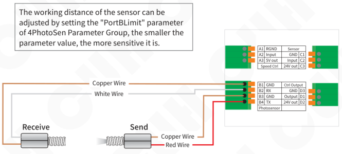

| | | | |
|---|---|---|---|
| A1 | RGND | Sensor | |
| A2 | Input | GND | C1 |
| A3 | 5V out | Input | C2 |
| Speed Ctrl | | 24V out | C3 |

| | | | |
|---|---|---|---|
| B1 | GND | Ctrl Output | |
| B2 | RX | GND | D3 |
| B3 | GND | Output | D1 |
| B4 | TX | 24V out | D2 |
| Photosensor | | | |

**โปรดทราบ:**

ภายใต้การตั้งค่าเริ่มต้นจากโรงงาน ทิศทางตรรกะ "PortBDirec" ของเซ็นเซอร์นี้เป็นแบบปกติเปิด

---

## 5.1.2 เวลาหน่วงเปิด/ปิดของเซ็นเซอร์โฟโต้อิเล็กทริกอัจฉริยะ

เมื่อใช้เซ็นเซอร์หรือ PLC ในการเปิดหรือปิดเอาต์พุตหลักของตัวควบคุม การทำงานสามารถหน่วงเวลาได้ช่วงหนึ่งหลังจากให้หรือกลับคืนสัญญาณควบคุม เวลาหน่วงสามารถตั้งค่าได้ผ่านพารามิเตอร์สองตัวด้านล่าง

**PortBUpDly:** ระยะเวลาที่ตัวควบคุมใช้ตั้งแต่ได้รับสัญญาณควบคุมเริ่มทำงานจนถึงการส่งเอาต์พุตจริง

- เข้าสู่กลุ่มพารามิเตอร์ "4PhotoSen"
- กด ⊖⃤ สั้นๆ เพื่อสลับไปยังพารามิเตอร์เวลาหน่วงเปิดของพอร์ต B และค่าเริ่มต้นคือ 0.2
- กด ⊕ หรือ ⊖ เพื่อปรับค่าพารามิเตอร์

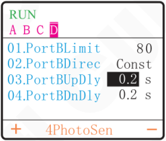

ช่วงเวลาหน่วงเปิดของพอร์ต B คือ 0.0～99.9s ความแม่นยำในการปรับคือ 0.1s

**PortBDnDly:** ระยะเวลาที่ตัวควบคุมใช้ตั้งแต่ได้รับสัญญาณควบคุมหยุดทำงานจนถึงการตัดเอาต์พุตจริง

- เข้าสู่กลุ่มพารามิเตอร์ "4PhotoSen"
- กด ⊖⃤ สั้นๆ เพื่อสลับไปยังพารามิเตอร์เวลาหน่วงปิดของพอร์ต B และค่าเริ่มต้นคือ 0.2
- กด ⊕ หรือ ⊖ เพื่อปรับค่าพารามิเตอร์

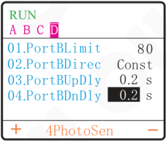

ช่วงเวลาหน่วงปิดของพอร์ต B คือ 0.0～99.9s ความแม่นยำในการปรับคือ 0.1s

---

## 5.1.3 ทิศทางลอจิกของเซ็นเซอร์โฟโต้อิเล็กทริกอัจฉริยะ

ภายใต้สถานการณ์ปกติ ด้านรับจะไม่ได้รับสัญญาณแสง และตัวควบคุมจะทำงานตามค่าเริ่มต้น แต่ในการใช้งานพิเศษบางกรณี ตัวควบคุมจำเป็นต้องหยุดเมื่อด้านรับไม่ได้รับสัญญาณแสง การปรับพารามิเตอร์นี้สามารถตอบสนองการใช้งานดังกล่าวได้

- เข้าสู่กลุ่มพารามิเตอร์ "4PhotoSen"
- กด ⏷ สั้นๆ เพื่อสลับไปยังพารามิเตอร์ทิศทางลอจิกของพอร์ต B และการตั้งค่าเริ่มต้นคือ "Const"
- กด ⊕ หรือ ⊖ เพื่อปรับการตั้งค่าพารามิเตอร์

**RUN**  
A B C **D**

| Parameter | ค่า |
|---|---|
| 01.PortBLimit | 80 |
| 02.PortBDirec | **Const** |
| 03.PortBUpDly | 0.2 s |
| 04.PortBDnDly | 0.2 s |

＋　4PhotoSen　－

**RUN**  
A B C **D**

| Parameter | ค่า |
|---|---|
| 01.PortBLimit | 80 |
| 02.PortBDirec | **Inv** |
| 03.PortBUpDly | 0.2 s |
| 04.PortBDnDly | 0.2 s |

＋　4PhotoSen　－

- เมื่อพารามิเตอร์ "PortBDirec" ถูกตั้งเป็น "Const" กล่าวคือไม่ได้รับสัญญาณแสง ตัวควบคุมจะทำงาน
- เมื่อพารามิเตอร์ "PortBDirec" ถูกตั้งเป็น "Inv" กล่าวคือไม่ได้รับสัญญาณแสง ตัวควบคุมจะหยุด

---

## 5.2 วิธีใช้งานเซ็นเซอร์สวิตช์

ตัวควบคุมสามารถทำงานร่วมกับเซ็นเซอร์ได้หลายประเภท เช่น เซ็นเซอร์สวิตช์ เซ็นเซอร์สวิตช์แบบแสง และเซ็นเซอร์ไฟเบอร์ออปติก

### 5.2.1 วิธีการเชื่อมต่อเซ็นเซอร์สวิตช์พร็อกซิมิตี้แบบ NPN

**ขั้นตอนที่ 1:**

เปิดฝาครอบของตัวควบคุม

**ขั้นตอนที่ 2:**

เชื่อมต่อเซ็นเซอร์สวิตช์พร็อกซิมิตี้แบบ NPN กับขั้วต่อของตัวควบคุมตามแผนภาพ

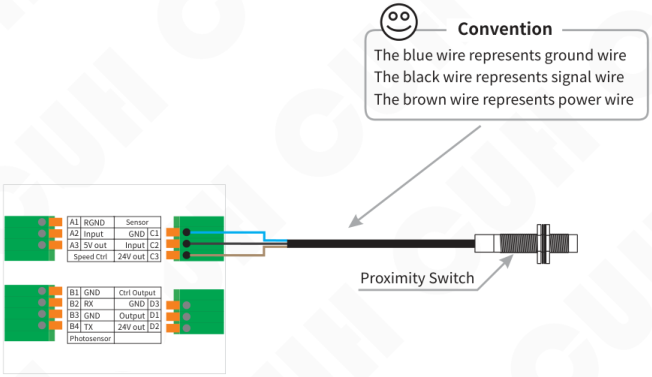

**ข้อกำหนด**

- สายสีน้ำเงินแทนสายดิน
- สายสีดำแทนสายสัญญาณ
- สายสีน้ำตาลแทนสายไฟเลี้ยง

สวิตช์พร็อกซิมิตี้

| | | | |
|---|---|---|---|
| A1 | RGND | Sensor | |
| A2 | Input | GND | C1 |
| A3 | 5V out | Input | C2 |
| Speed Ctrl | | 24V out | C3 |

| | | | |
|---|---|---|---|
| B1 | GND | Ctrl Output | |
| B2 | RX | GND | D3 |
| B3 | GND | Output | D1 |
| B4 | TX | 24V out | D2 |
| Photosensor | | | |

---

## วิธีการเชื่อมต่อเซ็นเซอร์แบบส่องผ่าน NPN

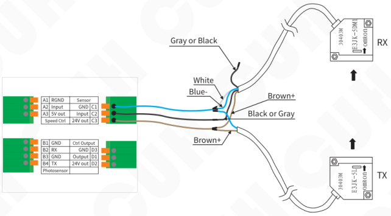

## วิธีการเชื่อมต่อเซ็นเซอร์แบบส่องผ่าน

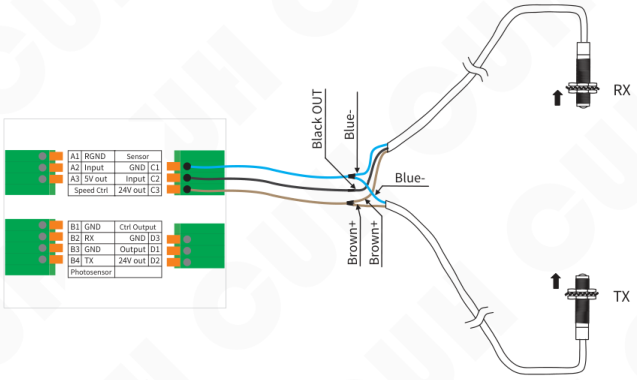

---

## วิธีการเชื่อมต่อเซ็นเซอร์แบบส่องผ่านไฟเบอร์ออปติก

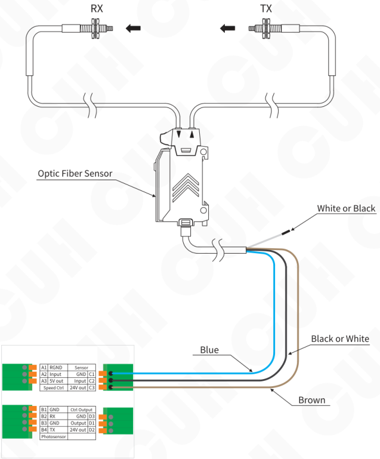

| | | | |
|---|---|---|---|
| A1 | RGND | Sensor | |
| A2 | Input | GND | C1 |
| A3 | 5V out | Input | C2 |
| Speed Ctrl | | 24V out | C3 |

| | | | |
|---|---|---|---|
| B1 | GND | Ctrl Output | |
| B2 | RX | GND | D3 |
| B3 | GND | Output | D1 |
| B4 | TX | 24V out | D2 |
| Photosensor | | | |

## วิธีการเชื่อมต่อเซ็นเซอร์แบบส่องผ่าน

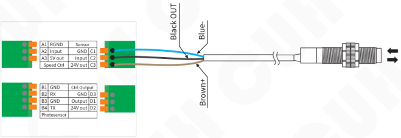

| | | | |
|---|---|---|---|
| A1 | RGND | Sensor | |
| A2 | Input | GND | C1 |
| A3 | 5V out | Input | C2 |
| Speed Ctrl | | 24V out | C3 |

| | | | |
|---|---|---|---|
| B1 | GND | Ctrl Output | |
| B2 | RX | GND | D3 |
| B3 | GND | Output | D1 |
| B4 | TX | 24V out | D2 |
| Photosensor | | | |

ป้ายสาย: Black OUT, Blue-, Brown+

## วิธีการเชื่อมต่อ PLC

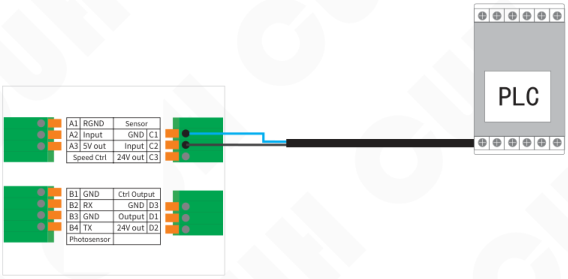

| | | | |
|---|---|---|---|
| A1 | RGND | Sensor | |
| A2 | Input | GND | C1 |
| A3 | 5V out | Input | C2 |
| Speed Ctrl | | 24V out | C3 |

| | | | |
|---|---|---|---|
| B1 | GND | Ctrl Output | |
| B2 | RX | GND | D3 |
| B3 | GND | Output | D1 |
| B4 | TX | 24V out | D2 |
| Photosensor | | | |

> คุณสามารถใช้เอาต์พุตรีเลย์ของ PLC หรือเอาต์พุต NPN ของ PLC ได้

---

## 5.2.2 เวลาหน่วงเปิด/ปิดของเซ็นเซอร์สวิตช์

ตามค่าเริ่มต้น เซ็นเซอร์โฟโต้อิเล็กทริกอัจฉริยะและเซ็นเซอร์สวิตช์ใช้เวลาหน่วงเปิดและเวลาหน่วงปิดร่วมกัน ผู้ปฏิบัติงานยังสามารถตั้งค่าเวลาหน่วงเปิดและเวลาหน่วงปิดแยกสำหรับเซ็นเซอร์สวิตช์ได้

**PortCUpDly:** ระยะเวลาที่ตัวควบคุมใช้ตั้งแต่ได้รับสัญญาณควบคุมเริ่มทำงานจนถึงการส่งเอาต์พุตจริง

- เข้าสู่กลุ่มพารามิเตอร์ "5On/Off"
- กด ⏷ สั้นๆ เพื่อสลับไปยังพารามิเตอร์เวลาหน่วงเปิดของพอร์ต C และค่าเริ่มต้นคือ 0.2
- กด ⊕ หรือ ⊖ เพื่อปรับค่าพารามิเตอร์

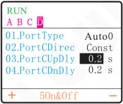

ช่วงเวลาหน่วงเปิดของพอร์ต C คือ 0.0～99.9s ความแม่นยำในการปรับคือ 0.1s

**PortCDnDly:** ระยะเวลาที่ตัวควบคุมใช้ตั้งแต่ได้รับสัญญาณควบคุมหยุดทำงานจนถึงการตัดเอาต์พุตจริง

- เข้าสู่กลุ่มพารามิเตอร์ "5On/Off"
- กด ⏷ สั้นๆ เพื่อสลับไปยังพารามิเตอร์เวลาหน่วงปิดของพอร์ต C และค่าเริ่มต้นคือ 0.2
- กด ⊕ หรือ ⊖ เพื่อปรับค่าพารามิเตอร์

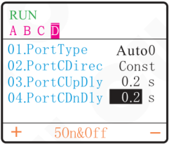

ช่วงเวลาหน่วงปิดของพอร์ต C คือ 0.0～99.9s ความแม่นยำในการปรับคือ 0.1s

---

## 5.2.3 ทิศทางลอจิกของเซ็นเซอร์สวิตช์

ภายใต้สถานการณ์ปกติ ตัวควบคุมไม่ได้รับสัญญาณจากเซ็นเซอร์สวิตช์และจะทำงานตามค่าเริ่มต้น แต่ในการใช้งานพิเศษบางกรณี ตัวควบคุมจำเป็นต้องหยุดเมื่อไม่ได้รับสัญญาณจากเซ็นเซอร์สวิตช์ การปรับพารามิเตอร์นี้สามารถตอบสนองการใช้งานดังกล่าวได้

- เข้าสู่กลุ่มพารามิเตอร์ "5On/Off"
- กด ⏷ สั้นๆ เพื่อสลับไปยังพารามิเตอร์ทิศทางลอจิกของพอร์ต C และการตั้งค่าเริ่มต้นคือ "Const"
- กด ⊕ หรือ ⊖ เพื่อปรับการตั้งค่าพารามิเตอร์

RUN  
A B C **D**

| Parameter | ค่า |
|---|---|
| 01.PortType | Auto0 |
| 02.PortCDirec | **Const** |
| 03.PortCUpDly | 0.2 s |
| 04.PortCDnDly | 0.2 s |

＋　5On&Off　－

RUN  
A B C **D**

| Parameter | ค่า |
|---|---|
| 01.PortType | Auto0 |
| 02.PortCDirec | **Inv** |
| 03.PortCUpDly | 0.2 s |
| 04.PortCDnDly | 0.2 s |

＋　5On&Off　－

- เมื่อพารามิเตอร์ "PortCDirec" ถูกตั้งเป็น "Const" กล่าวคือไม่ได้รับสัญญาณ ตัวควบคุมจะทำงาน
- เมื่อพารามิเตอร์ "PortCDirec" ถูกตั้งเป็น "Inv" กล่าวคือไม่ได้รับสัญญาณ ตัวควบคุมจะหยุด

---

## 5.2.4 ประเภทเซ็นเซอร์สวิตช์

พอร์ตเซ็นเซอร์สวิตช์สามารถรองรับโหมด NPN, PNP, Auto1, Auto0 และสามารถตั้งค่าได้ด้วยมือตามประเภทของเซ็นเซอร์

**NPN:** เซ็นเซอร์สวิตช์แบบ NPN

**PNP:** เซ็นเซอร์สวิตช์แบบ PNP

**Auto1:** สแกนครั้งเดียว กล่าวคือ จะสลับระดับสูงและต่ำเพื่อตรวจจับว่าพอร์ตมีสัญญาณที่ถูกต้องหรือไม่ จนกว่าจะพบสัญญาณที่ถูกต้อง หลังจากนั้นประเภทเซ็นเซอร์ของพอร์ตจะถูกกำหนดและจะไม่สแกนอีก

**Auto0:** สแกนอย่างต่อเนื่อง โดยไม่คำนึงถึงประเภทของเซ็นเซอร์ จะตรวจจับเสมอว่าพอร์ตเชื่อมต่อกับสัญญาณที่ถูกต้องหรือไม่ โดยการสลับระดับสูงและต่ำ

- เข้าสู่กลุ่มพารามิเตอร์ "5On/Off"
- ตั้งค่าเริ่มต้นพารามิเตอร์ประเภทเซ็นเซอร์ของพอร์ต C และการตั้งค่าเริ่มต้นคือ "Auto0"
- กด ⊕ หรือ ⊖ เพื่อปรับการตั้งค่าพารามิเตอร์

RUN  
A B C **D**

| Parameter | การตั้งค่า |
|---|---|
| 01.PortType | **Auto0** |
| 02.PortCDirec | Const |
| 03.PortCUpDly | 0.2 s |
| 04.PortCDnDly | 0.2 s |

＋　5On&Off　－

---

## 5.3 เอาต์พุตควบคุม

ตัวควบคุมสามารถส่งสัญญาณควบคุมแรงดันต่ำเพื่อทำงานร่วมกับอุปกรณ์อื่นๆ เช่น วาล์วโซลินอยด์ PLC หรือรีเลย์ไฟฟ้า

พอร์ตเอาต์พุตควบคุมสามารถรองรับเอาต์พุต NPN เอาต์พุต PNP และเอาต์พุตแบบพุชพูล วิธีการเชื่อมต่อมีดังนี้

### วิธีการเชื่อมต่อเอาต์พุต NPN

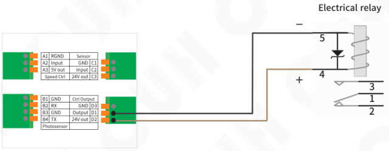

### วิธีการเชื่อมต่อเอาต์พุต PNP หรือ Push-Pull

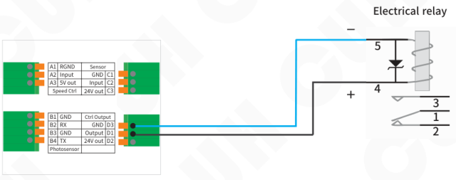

> หากเชื่อมต่อรีเลย์ 24V ต้องยืนยันขั้วบวกและขั้วลบของขดลวดให้แน่ใจว่าเชื่อมต่อถูกต้อง เนื่องจากความสามารถในการจ่ายกระแสของพอร์ตนี้มีจำกัด ไดโอดป้องกันภายในของรีเลย์จะทำให้พอร์ตของตัวควบคุมนี้ลัดวงจรหลังจากเชื่อมต่อกลับขั้ว ซึ่งจะกระตุ้นการป้องกันการลัดวงจร

---

## 5.4 การควบคุมความเร็วระยะไกล

ตัวควบคุมรองรับสัญญาณแอนะล็อกภายนอกสำหรับควบคุมแรงดันเอาต์พุต สัญญาณแอนะล็อกรองรับโพเทนชิออมิเตอร์ แรงดัน 1~5V และกระแส 4~20mA ดังนั้นจึงสามารถควบคุมความเร็วระยะไกลจากภายนอกได้อย่างง่ายดายด้วย PLC DCS หรือวิธีอื่นๆ

- เมื่ออินพุตน้อยกว่า 0.5V การควบคุมความเร็วระยะไกลจะไม่มีผล
- เมื่ออินพุตมากกว่า 0.5V และน้อยกว่า 1V การควบคุมความเร็วระยะไกลมีผล และแรงดันเอาต์พุตคือ "MinVoltage" (ค่าเริ่มต้น: 0V)
- เมื่ออินพุตมากกว่า 1V และน้อยกว่า 5V แรงดันเอาต์พุตจะถูกควบคุมตามสัดส่วนโดยสัญญาณควบคุมระยะไกล (0%~100%) และแรงดันสูงสุดจะไม่เกิน "MaxVoltage" (ค่าเริ่มต้น: 220V)

### วิธีการเชื่อมต่อการควบคุมด้วยโพเทนชิออมิเตอร์

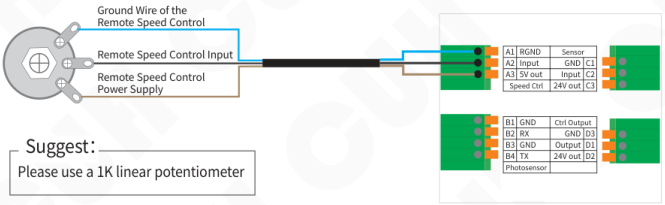

**แนะนำ:** โปรดใช้โพเทนชิออมิเตอร์แบบลิเนียร์ 1K

### วิธีการเชื่อมต่อการควบคุมด้วยแรงดัน 1~5V

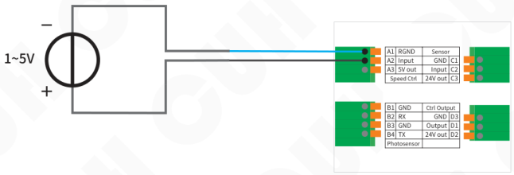

---

## วิธีการเชื่อมต่อการควบคุมด้วยกระแส 4~20mA

- เมื่ออินพุตน้อยกว่า 2mA การควบคุมความเร็วระยะไกลจะไม่มีผล
- เมื่ออินพุตมากกว่า 2mA และน้อยกว่า 4mA การควบคุมความเร็วระยะไกลมีผล และแรงดันเอาต์พุตคือ "MinVoltage" (ค่าเริ่มต้น: 0V)
- เมื่ออินพุตมากกว่า 4mA และน้อยกว่า 20mA แรงดันเอาต์พุตจะถูกควบคุมตามสัดส่วนโดยสัญญาณควบคุมระยะไกล (0%~100%) และแรงดันสูงสุดจะไม่เกิน "MaxVoltage" (ค่าเริ่มต้น: 220V)

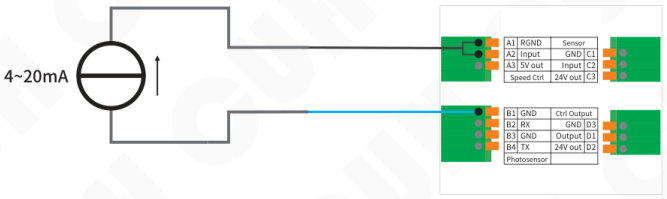

| | | | |
|---|---|---|---|
| A1 | RGND | Sensor | |
| A2 | Input | GND | C1 |
| A3 | 5V out | Input | C2 |
| Speed Ctrl | | 24V out | C3 |

| | | | |
|---|---|---|---|
| B1 | GND | Ctrl Output | |
| B2 | RX | GND | D3 |
| B3 | GND | Output | D1 |
| B4 | TX | 24V out | D2 |
| Photosensor | | | |

---

# บทที่ Ⅵ คำอธิบายฟังก์ชันโดยละเอียด

บทนี้อธิบายฟังก์ชันและการตั้งค่าอย่างละเอียดของตัวควบคุม

กด ▶ สั้นๆ ที่หน้าจอหลักเพื่อเข้าสู่หน้าจอตั้งค่าพารามิเตอร์ หน้าจอตั้งค่าพารามิเตอร์ประกอบด้วยกลุ่มพารามิเตอร์แปดกลุ่มดังต่อไปนี้ กด ◀ หรือ ▶ สั้นๆ เพื่อสลับระหว่างกลุ่มพารามิเตอร์ต่างๆ

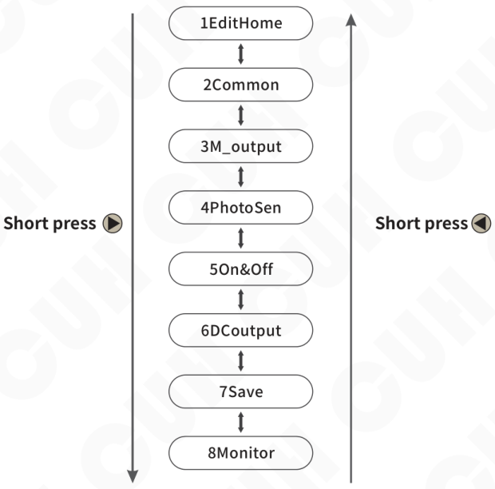

แผนภาพการหมุนเวียนกลุ่มพารามิเตอร์

---

## 6.1 การปรับแต่งหน้าหลัก

เพื่ออำนวยความสะดวกให้ผู้ใช้ใช้งานตัวควบคุมได้อย่างมีประสิทธิภาพและรวดเร็ว ผู้ใช้สามารถดำเนินการปรับแต่งในกลุ่มพารามิเตอร์หน้าจอหลักได้ โดยดึงพารามิเตอร์สูงสุด 16 รายการจากทั้งหมดมาเป็นรายการเฝ้าติดตามในกลุ่มพารามิเตอร์หน้าจอหลัก และผู้ใช้สามารถดำเนินการอย่างรวดเร็วบนหน้าจอหลักได้

ตัวอย่าง: เลือก 1. UsrVoltage (P2.01), 2. UsrFreqncy (P2.02), 3. CurrentOut (P8.02), 4. SoftStarT (P2.03), SoftStopT (P2.04) รวมเป็นพารามิเตอร์ห้ารายการบนหน้าจอหลัก ขั้นตอนมีดังนี้:

- บนหน้าจอหลัก กด ⏵ สั้นๆ เพื่อเข้าสู่กลุ่มพารามิเตอร์ "1EditHome" โดยตรง
- กด ▲ หรือ ▼ สั้นๆ เพื่อสลับระหว่างรายการเฝ้าติดตามต่างๆ
- กด ⊕ หรือ ⊖ เพื่อเลือกป้ายฟังก์ชันที่ต้องการตั้งค่าตามลำดับ

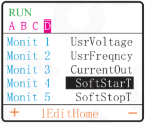

หมายเหตุ: ป้ายฟังก์ชันสามารถตรวจสอบได้ผ่านบท "รายการพารามิเตอร์"  
หากค่าของรายการเฝ้าติดตามว่างเปล่า หมายความว่าไม่มีรายการเฝ้าติดตาม

หลังจากดำเนินการเสร็จสิ้น หากผู้ใช้ต้องการปรับค่าแรงดัน ความถี่ กระแสเอาต์พุต เวลาสตาร์ทแบบนุ่มนวล และเวลาหยุดแบบนุ่มนวล ให้เข้าสู่รายการเฝ้าติดตามที่ต้องการในกลุ่มพารามิเตอร์ของหน้าจอหลัก และใช้ ⊕ หรือ ⊖ ก็สามารถปรับพารามิเตอร์ได้

---

## 6.2 การตั้งค่าพารามิเตอร์ทั่วไป

บทนี้แนะนำการตั้งค่าและการปรับพารามิเตอร์ทั่วไปพื้นฐานของตัวควบคุมเป็นหลัก

### 6.2.1 แรงดัน

ตัวควบคุมนี้สามารถตั้งค่าแรงดันเอาต์พุตแบบดิจิทัลได้โดยตรงบนแผง ฟังก์ชันนี้สามารถขจัดความแปรผันของความเร็วในการป้อนที่เกิดจากความผันผวนของแรงดันแหล่งจ่ายไฟ การปรับแรงดันยังสามารถขจัดผลกระทบของความถี่บีตที่เกิดจากกระแสสลับความถี่ระบบได้

- เข้าสู่กลุ่มพารามิเตอร์ "2Common" และค้นหาพารามิเตอร์แรงดัน
- กด ⊕ หรือ ⊖ เพื่อปรับค่าพารามิเตอร์

ช่วงแรงดันคือ 0~220V ค่าเริ่มต้นคือ 150V ความแม่นยำในการปรับคือ 1V

RUN  
A B C **D**

| Parameter | ค่า |
|---|---|
| 01.UsrVoltage | **150** V |
| 02.UsrFreqncy | 50.0 Hz |
| 03.SoftStarT | 0.5 s |
| 04.SoftStopT | 0.0 s |
| 05.MaxVoltage | 220 V |

＋　2Common　－

### 6.2.2 ความถี่

ตัวควบคุมมีความแม่นยำและเสถียรภาพของความถี่สูงมาก และไม่เปลี่ยนแปลงตามเวลาและอุณหภูมิ

- เข้าสู่กลุ่มพารามิเตอร์ "2Common" และค้นหาพารามิเตอร์ความถี่
- กด ⊕ หรือ ⊖ เพื่อปรับค่าพารามิเตอร์

ช่วงความถี่คือ 40.0~999.9Hz ค่าเริ่มต้นคือ 50.0Hz ความแม่นยำในการปรับคือ 0.1Hz

RUN  
A B C **D**

| Parameter | ค่า |
|---|---|
| 01.UsrVoltage | 150 V |
| 02.UsrFreqncy | **50.0** Hz |
| 03.SoftStarT | 0.5 s |
| 04.SoftStopT | 0.0 s |
| 05.MaxVoltage | 220 V |

＋　2Common　－

**พารามิเตอร์อื่นๆ ของกลุ่มพารามิเตอร์นี้สามารถปรับได้ตามขั้นตอนข้างต้น**

---

## 6.2.3 เวลาสตาร์ทแบบนุ่มนวล/เวลาหยุดแบบนุ่มนวล

**เวลาสตาร์ทแบบนุ่มนวล:** เวลาที่ตัวควบคุมใช้ในการเพิ่มแรงดันเอาต์พุตอย่างราบรื่นจาก 0V ไปจนถึงแรงดันเอาต์พุตที่ตั้งไว้เมื่อเริ่มทำงานจากสถานะหยุด

ช่วงเวลาสตาร์ทแบบนุ่มนวลคือ 0.0~10.0s ค่าเริ่มต้นคือ 0.5s และความแม่นยำในการปรับคือ 0.1s

**เวลาหยุดแบบนุ่มนวล:** เมื่อตัวควบคุมหยุดทำงาน แรงดันเอาต์พุตจะค่อยๆ ลดลงจากแรงดันเอาต์พุตที่ตั้งไว้จนถึง 0V ภายในเวลาที่กำหนด

ช่วงเวลาหยุดแบบนุ่มนวลคือ 0.0~10.0s ค่าเริ่มต้นคือ 0.5s และความแม่นยำในการปรับคือ 0.1s

เมื่อตัวควบคุมเริ่มหรือหยุดทำงาน แรงดันเอาต์พุตสามารถเพิ่มหรือลดลงอย่างนุ่มนวลเพื่อป้องกันไม่ให้อุปกรณ์สั่นสะเทือนเสียหายจากการกระแทก

## 6.2.4 แรงดันเอาต์พุตสูงสุด/แรงดันเอาต์พุตต่ำสุด

**แรงดันเอาต์พุตสูงสุด:** ค่าแรงดันสูงสุดที่ตัวควบคุมส่งออก

ช่วงแรงดันสูงสุดคือ 0-220V ค่าเริ่มต้นคือ 220V และความแม่นยำในการปรับคือ 1V

**แรงดันเอาต์พุตต่ำสุด:** ค่าแรงดันต่ำสุดที่ตัวควบคุมส่งออก

ช่วงแรงดันต่ำสุดคือ 0-220V ค่าเริ่มต้นคือ 0V และความแม่นยำในการปรับคือ 1V

ตัวควบคุมนี้สามารถตั้งค่าขีดจำกัดแรงดันเอาต์พุตสูงสุดและแรงดันเอาต์พุตต่ำสุด ซึ่งสามารถป้องกันผู้ใช้ไม่ให้ทำให้อุปกรณ์สั่นสะเทือนเสียหายจากการส่งแรงดันมากเกินไปโดยไม่ตั้งใจ

## 6.2.5 ความถี่เอาต์พุตสูงสุด/ความถี่เอาต์พุตต่ำสุด

**ความถี่เอาต์พุตสูงสุด:** จำกัดค่าขีดจำกัดบนของพารามิเตอร์ "UsrFreqncy"

ช่วงความถี่เอาต์พุตสูงสุดคือ 40.0~999.9Hz ค่าเริ่มต้นคือ 999.9Hz และความแม่นยำในการปรับคือ 0.1Hz

**ความถี่เอาต์พุตต่ำสุด:** จำกัดค่าขีดจำกัดล่างของพารามิเตอร์ "UsrFreqncy"

ช่วงความถี่เอาต์พุตต่ำสุดคือ 40.0~999.9Hz ค่าเริ่มต้นคือ 40.0Hz และความแม่นยำในการปรับคือ 0.1Hz

---

## 6.2.6 เวลาปิดไฟพื้นหลัง

**เวลาปิดไฟพื้นหลัง:** นั่นคือเวลาปิดไฟพื้นหลัง เมื่อตัวควบคุมไม่มีการดำเนินการใดๆ เป็นระยะเวลาหนึ่ง ตัวควบคุมจะปิดไฟพื้นหลังจอแสดงผล สามารถเปิดไฟพื้นหลังจออีกครั้งได้โดยการกดปุ่มใดๆ

ช่วงเวลาปิดไฟพื้นหลังคือ 1-30min ค่าเริ่มต้นคือ On และความแม่นยำในการปรับคือ 1min

## 6.2.7 ภาษา

**ภาษา:** นั่นคือภาษาที่แสดงบนแผงการทำงานของตัวควบคุม ตัวควบคุมมีภาษาที่สร้างไว้ในตัวสองภาษา: ภาษาจีนและภาษาอังกฤษ ทำให้ผู้ใช้ในภูมิภาคต่างๆ สลับได้ง่าย ค่าเริ่มต้นคือ Chines

| Parameter | ความหมาย |
|---|---|
| Englis | อินเทอร์เฟซภาษาอังกฤษ |
| Chines | อินเทอร์เฟซภาษาจีน |

---

## 6.3 พารามิเตอร์เอาต์พุต

บทนี้ใช้เพื่อแนะนำการตั้งค่าและการใช้งานพารามิเตอร์เอาต์พุตหลักและพารามิเตอร์เอาต์พุตควบคุมของตัวควบคุม เพื่อให้บรรลุฟังก์ชันเอาต์พุตที่เหมาะสมที่สุดของตัวควบคุม

### 6.3.1 พารามิเตอร์เอาต์พุตหลัก

ส่วนนี้แนะนำการตั้งค่าพารามิเตอร์เอาต์พุตหลักของตัวควบคุมเป็นหลัก

- กด ⏵ สั้นๆ เพื่อสลับไปยังกลุ่มพารามิเตอร์ "3 M_output"
- กด ⏶ หรือ ⏷ สั้นๆ เพื่อสลับพารามิเตอร์ในกลุ่มพารามิเตอร์เอาต์พุตหลัก
- กด ⊕ หรือ ⊖ เพื่อปรับค่าพารามิเตอร์

RUN  
A　B　C　**D**

| Parameter | ค่า |
|---|---|
| 01.MainSourc1 | **PortB** |
| 02.MainSourc2 | PortC |
| 03.MainLogic | Or |
| 04.MainUpDly | 0.0 s |
| 05.MainDnDly | 0.0 s |

＋　3M_output　－

พารามิเตอร์อื่นๆ ของกลุ่มพารามิเตอร์นี้สามารถปรับได้ตามขั้นตอนข้างต้น

### 6.3.1.1 แหล่งสัญญาณหลัก 1/แหล่งสัญญาณหลัก 2

"MainSourc1" และ "MainSourc2" หมายถึง "สัญญาณแหล่งหลัก 1" และ "สัญญาณแหล่งลอจิกหลัก 2" คุณสามารถตั้งค่าสัญญาณแหล่งลอจิกเอาต์พุตหลักผ่านพารามิเตอร์สองตัวนี้ สัญญาณของแหล่งหลัก 1 และแหล่งหลัก 2 จะผ่านการตัดสินประเภทสัญญาณพอร์ตก่อน จากนั้นผ่านการตัดสินทิศทางลอจิก และสุดท้ายหลังจากผ่านเวลาหน่วงเปิดและเวลาหน่วงปิด จะกลายเป็นสัญญาณผลลัพธ์แหล่งลอจิกเอาต์พุตหลัก 1/2

---

แผนภาพการไหลของสัญญาณมีดังนี้:

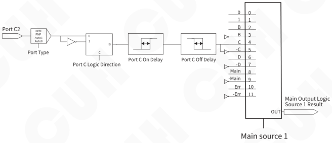

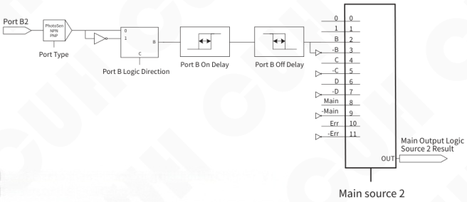

หมายเหตุ: โปรดดูวิธีการเชื่อมต่อเซ็นเซอร์ในบทที่ Ⅴ "เซ็นเซอร์และการควบคุมสัญญาณ"

**รูปที่ 6.3.1.1**

หมายเหตุ: สถานะเอาต์พุตหลักยังถูกควบคุมโดยปุ่มเริ่ม/หยุดหรือว่าตัวควบคุมเองอยู่ในสถานะผิดพลาดหรือไม่ ระดับการควบคุมข้อผิดพลาดของปุ่มเริ่ม/หยุดหรือตัวควบคุมเองสูงกว่าสัญญาณลอจิกเอาต์พุตหลัก นั่นคือ: เมื่อปุ่มเริ่ม/หยุดถูกตั้งเป็นหยุด ตัวควบคุมจะเข้าสู่สถานะหยุดทันที; เมื่อเกิดข้อผิดพลาดเช่น ลัดวงจร อุณหภูมิเกิน กระแสเกิน ฯลฯ ตัวควบคุมจะเข้าสู่สถานะหยุดทันทีเช่นกัน ในขณะนี้สัญญาณลอจิกเอาต์พุตหลักไม่สามารถเปิดเอาต์พุตหลักของตัวควบคุมได้

---

## 6.3.1.2 ลอจิกหลัก

ผลลัพธ์จากแหล่งหลัก 1 และแหล่งหลัก 2 จะถูกประมวลผลโดยตัวดำเนินการทางตรรกะ จากนั้นผ่านโมดูลทิศทางลอจิก ผ่านเวลาหน่วงเปิดและเวลาหน่วงปิดของเอาต์พุตหลัก และสุดท้ายผ่านโหมดเอาต์พุตหลัก เพื่อใช้ขับเคลื่อนสถานะเริ่ม-หยุดของเอาต์พุตหลัก

แผนภาพการไหลของสัญญาณมีดังนี้:

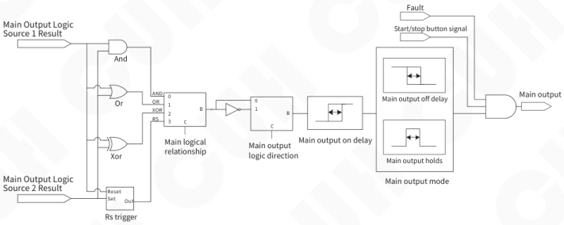

รูปที่ 6.3.1.2

ตัวควบคุมนี้สามารถตั้งค่าตารางความสัมพันธ์ทางตรรกะระหว่างแหล่งหลัก (ลอจิก) 1 และแหล่งหลัก 2 ได้ดังนี้ ค่าเริ่มต้นคือ Or

| Parameter | ความหมาย |
|---|---|
| And | ตรรกะ AND เอาต์พุตจะไม่ทำงานเมื่อทั้งแหล่งหลัก 1 และแหล่งหลัก 2 ทำงาน |
| Or | ตรรกะ OR เอาต์พุตจะไม่ทำงานเมื่อแหล่งหลัก 1 หรือแหล่งหลัก 2 ทำงานอย่างน้อยหนึ่งรายการ |
| Xor | ตรรกะ XOR เอาต์พุตจะไม่ทำงานเมื่อแหล่งหลัก 1 และแหล่งหลัก 2 อยู่ในสถานะต่างกัน มิฉะนั้นจะทำงาน |
| RS | RS ฟลิปฟล็อป |

## 6.3.1.3 เวลาหน่วงเปิดหลัก/เวลาหน่วงปิดหลัก

เมื่อใช้สัญญาณภายนอกอื่นๆ เช่น เซ็นเซอร์ เพื่อควบคุมสถานะเอาต์พุตหลักของอุปกรณ์ ในกรณีส่วนใหญ่จำเป็นต้องมีความหน่วงหลังจากให้สัญญาณหรือสัญญาณกลับคืนมาก่อนจึงจะดำเนินการได้ สำหรับการใช้งานเช่นนี้ สามารถทำได้โดยการตั้งค่าเวลาของเวลาหน่วงเปิดและเวลาหน่วงปิด สำหรับแผนภาพการไหลของสัญญาณ โปรดดูรูปที่ 6.3.1.2

**เวลาหน่วงเปิดหลัก:** นั่นคือเวลาหน่วงเปิดของเอาต์พุตหลัก ซึ่งเป็นระยะเวลาหน่วงที่เกิดขึ้นตั้งแต่มีการให้สัญญาณควบคุมที่ทำให้ตัวควบคุมเข้าสู่สถานะทำงานจนถึงเอาต์พุตของตัวควบคุมเริ่มทำงานจริง ระยะเวลาหน่วงที่เกิดขึ้นในช่วงนี้เรียกว่าเวลาหน่วงเปิด

**เวลาหน่วงปิดหลัก:** นั่นคือเวลาหน่วงปิดของเอาต์พุตหลัก เริ่มจากมีการให้สัญญาณควบคุมที่ทำให้ตัวควบคุมเข้าสู่สถานะหยุด จนถึงเอาต์พุตของตัวควบคุมหยุดทำงานจริง ระยะเวลาหน่วงที่เกิดขึ้นในช่วงนี้เรียกว่าเวลาหน่วงปิด

ช่วงเวลาหน่วงเปิด/ปิดหลักคือ 0.0~99.9s ค่าเริ่มต้นคือ 0.0s และความแม่นยำในการปรับคือ 0.1s

## 6.3.1.4 โหมดหลัก

โหมดเอาต์พุตหลักมี 2 โหมดให้เลือก ได้แก่ โหมดหน่วง (Delay) และโหมดคงค้าง (Hold) สำหรับแผนภาพการไหลของสัญญาณ โปรดดูรูปที่ 6.3.1.2 ค่าเริ่มต้นคือ Delay

| Parameter | ความหมาย |
|---|---|
| Delay | หมายถึงสถานะของเอาต์พุตหลักหลังการดำเนินการทางตรรกะ เป็นสถานะที่ขับเคลื่อนเอาต์พุตหลักหลังจากผ่านเวลาหน่วงเปิดและเวลาหน่วงปิด |
| Hold | หมายถึงสถานะหลังการดำเนินการทางตรรกะของเอาต์พุตหลัก หลังจากผ่านเวลาหน่วงเปิด สถานะหยุดจะคงอยู่เป็นระยะเวลาเท่ากับเวลาหน่วงปิด จากนั้นจึงเปลี่ยนเป็นสถานะเอาต์พุตทำงานทันที |

ความแตกต่างระหว่างโหมดทั้งสองแสดงในรูปแบบไดอะแกรมเวลา (timing diagram) ดังนี้ โดยสัญญาณอินพุตคือสัญญาณที่ได้จากการเลือกความสัมพันธ์ทางตรรกะ

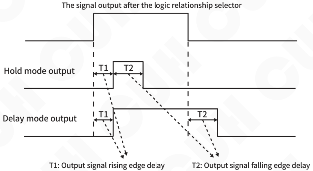

---

## 6.3.1.5 ทิศทางหลัก

นั่นคือทิศทางลอจิกของเอาต์พุตหลัก สามารถตั้งค่าทิศทางเอาต์พุตที่เฉพาะเจาะจงได้หลังจากรวมสัญญาณทางตรรกะ สำหรับแผนภาพการไหลของสัญญาณ โปรดดูรูปที่ 6.3.1.2 ค่าเริ่มต้นคือ Revrs

| Parameter | ความหมาย |
|---|---|
| Const | สถานะไม่ถูกกลับด้านหลังการดำเนินการทางตรรกะของเอาต์พุตหลัก |
| Revrs | สถานะถูกกลับด้านหลังการดำเนินการทางตรรกะของเอาต์พุตหลัก |
| On | สถานะคงอยู่ในสภาพทำงานหลังการดำเนินการทางตรรกะของเอาต์พุตหลัก |
| Off | สถานะหยุดตลอดเวลาหลังการดำเนินการทางตรรกะของเอาต์พุตหลัก |

## 6.3.1.6 สถานะเมื่อจ่ายไฟ

ตั้งค่าสถานะการทำงานของตัวควบคุมหลังจากจ่ายไฟ ค่าเริ่มต้นคือ On

| Parameter | ความหมาย |
|---|---|
| On | หลังจากอุปกรณ์จ่ายไฟ สถานะของปุ่มสวิตช์คือกำลังทำงาน |
| Off | หลังจากอุปกรณ์จ่ายไฟ สถานะของปุ่มสวิตช์คือหยุด |
| Hold | หลังจากอุปกรณ์จ่ายไฟ สถานะของปุ่มสวิตช์ยังคงเหมือนกับก่อนปิดเครื่องครั้งล่าสุด |

---

## 6.3.2 พารามิเตอร์เอาต์พุตควบคุม DC

ส่วนนี้แนะนำการตั้งค่าพารามิเตอร์เอาต์พุตควบคุมของตัวควบคุมเป็นหลัก
แผนภาพการไหลของสัญญาณเอาต์พุตควบคุมมีดังนี้:

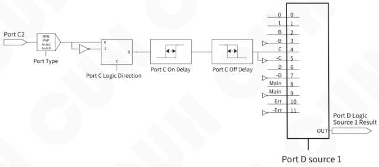

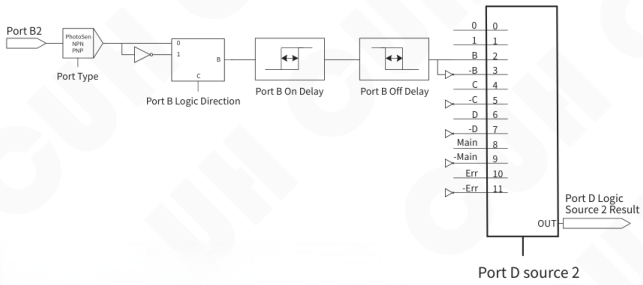

หมายเหตุ: โปรดดูวิธีการเชื่อมต่อเซ็นเซอร์ในบทที่ Ⅴ "เซ็นเซอร์และการควบคุมสัญญาณ"

---

ผลลัพธ์ของแหล่งลอจิกพอร์ต D แหล่งที่ 1 และผลลัพธ์ของแหล่งลอจิกพอร์ต D แหล่งที่ 2 จะถูกนำมารวมกันและดำเนินการทางตรรกะ จากนั้นผ่านทิศทางเอาต์พุตของพอร์ต D ผ่านเวลาหน่วงเปิดและเวลาหน่วงปิดของเอาต์พุตพอร์ต D ผ่านโหมดของพอร์ต D และสุดท้ายผ่านประเภทเอาต์พุตของพอร์ต D เพื่อใช้ขับเคลื่อนสถานะเริ่ม-หยุดของเอาต์พุตควบคุม

แผนภาพการไหลของสัญญาณมีดังนี้:

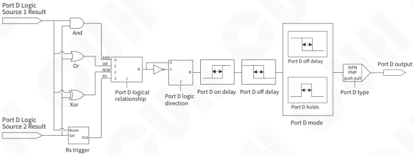

วิธีการตั้งค่าพารามิเตอร์เอาต์พุตควบคุมมีดังนี้:

- กดปุ่ม ▶ สั้นๆ เพื่อสลับไปยังกลุ่มพารามิเตอร์ "6DCoutput"
- กดปุ่ม ▲ หรือ ▼ สั้นๆ เพื่อสลับพารามิเตอร์ในกลุ่มพารามิเตอร์เอาต์พุตควบคุม
- กดปุ่ม ⊕ หรือ ⊖ เพื่อปรับค่าพารามิเตอร์

**RUN**  
A　B　C　**D**

| Parameter | ค่า |
|---|---|
| 01.PortDSour1 | 0 |
| 02.PortDSour2 | Main |
| 03.PortDLogic | Or |
| 04.PortDUpDly | 0.0 s |
| 05.PortDDnDly | 0.0 s |

＋　6DCoutput　－

**พารามิเตอร์อื่นๆ ของกลุ่มพารามิเตอร์นี้สามารถปรับได้ตามขั้นตอนข้างต้น**

"PortDSour1", "PortDSour2", "PortDLogic", "PortDDirec", "PortDUpDly" และ "PortDDnDly" พารามิเตอร์ข้างต้นสามารถอ้างอิงการตั้งค่าพารามิเตอร์เอาต์พุตหลักได้

---

## 6.3.2.1 โหมดเอาต์พุตของพอร์ต D

ลูกค้าสามารถเลือกโหมดเอาต์พุตควบคุมได้ 4 โหมด ได้แก่ โหมดหน่วง (Delay) โหมดคงค้าง (Hold) Cycle1 และ Cycle2 ค่าเริ่มต้นคือ Delay

| Parameter | ความหมาย |
|---|---|
| Delay | หมายถึงสถานะของเอาต์พุตควบคุมหลังการดำเนินการทางตรรกะ เป็นสถานะที่ขับเคลื่อนเอาต์พุตควบคุมหลังจากผ่านเวลาหน่วงเปิดและเวลาหน่วงปิด |
| Hold | หมายถึงสถานะหลังการดำเนินการทางตรรกะของเอาต์พุตควบคุม หลังจากผ่านเวลาหน่วงเปิด สถานะหยุดจะคงอยู่เป็นระยะเวลาเท่ากับเวลาหน่วงปิด จากนั้นจึงเปลี่ยนเป็นสถานะเอาต์พุตทำงานทันที |
| Cycle1/Cycle2 | ระยะเวลาของสัญญาณระดับสูงตั้งค่าโดย "PortDUpDly" ระยะเวลาของสัญญาณระดับต่ำตั้งค่าโดย "PortDDnDly" |

ในโหมด Cycle1 ปุ่มสวิตช์ไม่สามารถหยุดเอาต์พุตควบคุมได้ และในโหมด Cycle2 ปุ่มสวิตช์สามารถหยุดเอาต์พุตควบคุมได้

ความแตกต่างระหว่างโหมดทั้งสี่แสดงในรูปแบบไดอะแกรมเวลาดังนี้ โดยสัญญาณอินพุตคือสัญญาณเอาต์พุตหลังตัวเลือกความสัมพันธ์ทางตรรกะ

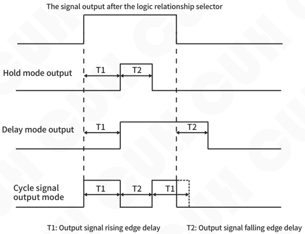

## 6.3.2.2 ประเภทพอร์ต D

เอาต์พุตพอร์ต D สามารถรองรับได้สามประเภท ได้แก่ เอาต์พุต NPN เอาต์พุต PNP และเอาต์พุตแบบพุช-พูล (Push-Pull) ค่าเริ่มต้นคือ Ou_P&P (Push-Pull)

| Parameter | ความหมาย |
|---|---|
| Ou_NPN | เมื่อสัญญาณเอาต์พุตของพอร์ต D ทำงาน พอร์ต D จะส่งออกสัญญาณระดับต่ำ (0V) และเมื่อไม่ทำงานจะเป็นอิมพีแดนซ์สูง |
| Ou_PNP | เมื่อสัญญาณเอาต์พุตของพอร์ต D ทำงาน พอร์ต D จะส่งออกสัญญาณระดับสูง (24V) และเมื่อไม่ทำงานจะเป็นอิมพีแดนซ์สูง |
| Ou_P&P (Push Pull) | เมื่อสัญญาณเอาต์พุตของพอร์ต D ทำงาน พอร์ต D จะส่งออกสัญญาณระดับสูง (24V) เมื่อสัญญาณเอาต์พุตของพอร์ต D ไม่ทำงาน พอร์ต D จะส่งออกสัญญาณระดับต่ำ (0V) |

แผนภาพมีดังนี้:

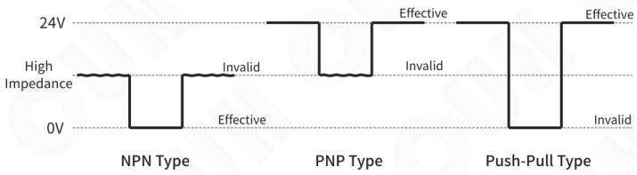

---

## 6.4 การควบคุมสัญญาณ

ตัวควบคุมสามารถตัดสินสถานะของวัสดุในถาดป้อนสั่นสะเทือนผ่านเซ็นเซอร์ภายนอก และทำให้ตัวควบคุม "หยุดเมื่อวัสดุเต็ม" หรือ "หยุดเมื่อวัสดุหมด" แผนภาพการไหลของสัญญาณพอร์ตมีดังนี้:

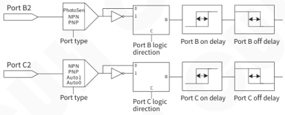

รูปที่ 6.4

วิธีการตั้งค่าพารามิเตอร์ของเซ็นเซอร์โฟโต้อิเล็กทริกอัจฉริยะมีดังนี้:

- กดปุ่ม ▶ สั้นๆ เพื่อสลับไปยังกลุ่มพารามิเตอร์ "4PhotoSen"
- กดปุ่ม ▲ หรือ ▼ สั้นๆ เพื่อสลับพารามิเตอร์ในกลุ่มพารามิเตอร์เซ็นเซอร์โฟโต้อิเล็กทริกอัจฉริยะ
- กดปุ่ม ⊕ หรือ ⊖ เพื่อปรับค่าพารามิเตอร์

**RUN**  
A B C **D**

| Parameter | ค่า |
|---|---|
| 01.PortBLimit | 80 |
| 02.PortBDirec | Const |
| 03.PortBUpDly | 0.2 s |
| 04.PortBDnDly | 0.2 s |

＋　4PhotoSen　－

วิธีการตั้งค่าพารามิเตอร์ของเซ็นเซอร์สวิตช์มีดังนี้:

- กดปุ่ม ▶ สั้นๆ เพื่อสลับไปยังกลุ่มพารามิเตอร์ "5On&Off"
- กดปุ่ม ▲ หรือ ▼ สั้นๆ เพื่อสลับพารามิเตอร์ในกลุ่มพารามิเตอร์เซ็นเซอร์สวิตช์
- กดปุ่ม ⊕ หรือ ⊖ เพื่อปรับค่าพารามิเตอร์

**RUN**  
A B C **D**

| Parameter | ค่า |
|---|---|
| 01.PortType | Auto0 |
| 02.PortCDirec | Const |
| 03.PortCUpDly | 0.2 s |
| 04.PortCDnDly | 0.2 s |

＋　5On&Off　－

**พารามิเตอร์อื่นๆ ของกลุ่มพารามิเตอร์นี้สามารถปรับได้ตามขั้นตอนข้างต้น**

---

## 6.4.1 ความไวของพอร์ต B

ตัวควบคุมสามารถตั้งค่าประเภทสัญญาณของพอร์ต B ได้เป็น 1~1000 (ความไวของเซ็นเซอร์โฟโต้อิเล็กทริกอัจฉริยะ) เซ็นเซอร์สวิตช์ประเภท "NPN" และ "PNP" ค่าเริ่มต้นคือ 80

| Parameter | ความหมาย |
|---|---|
| 1~1000 | พอร์ต B เชื่อมต่อกับสัญญาณเซ็นเซอร์โฟโต้อิเล็กทริกอัจฉริยะ ช่วงคือ 1 ถึง 1000 ยิ่งค่าน้อยลง ความเข้มของสัญญาณแสงที่ตรวจจับได้ก็ยิ่งอ่อนลง และสามารถวางด้านส่งและด้านรับให้ห่างกันมากขึ้นได้ |
| NPN | เซ็นเซอร์ประเภท NPN |
| PNP | เซ็นเซอร์ประเภท PNP |

## 6.4.2 ทิศทางลอจิกของพอร์ต B/พอร์ต C

พารามิเตอร์นี้ใช้เพื่อสลับพอร์ตอินพุต B และพอร์ตอินพุต C ของตัวควบคุมว่าเป็น "หยุดเมื่อวัสดุเต็ม" หรือ "หยุดเมื่อวัสดุหมด" ค่าเริ่มต้นคือ Const

เมื่อพอร์ตอินพุตสวิตช์ B/พอร์ต C อยู่ภายใต้การตั้งค่าเริ่มต้นจากโรงงานและไม่ได้รับสัญญาณใดๆ ตัวควบคุมจะอยู่ในสถานะ "กำลังทำงาน" (เช่น หยุดเมื่อวัสดุเต็ม) การใช้งานพิเศษบางอย่างต้องการให้ตัวควบคุมอยู่ในสถานะ "หยุด" (เช่น หยุดเมื่อวัสดุหมด) เมื่อพอร์ต B/พอร์ต C ไม่ได้รับสัญญาณใดๆ ซึ่งสามารถทำได้โดยการแก้ไขพารามิเตอร์นี้ สำหรับแผนภาพการไหลของสัญญาณ โปรดดูรูปที่ 6.4

| Parameter | ความหมาย |
|---|---|
| Const | เมื่อไม่มีสัญญาณควบคุม ตัวควบคุมจะอยู่ในสถานะกำลังทำงาน (หยุดเมื่อวัสดุเต็ม) |
| Inv | เมื่อไม่มีสัญญาณควบคุม ตัวควบคุมจะอยู่ในสถานะหยุด (หยุดเมื่อวัสดุหมด) |

## 6.4.3 เวลาหน่วงเปิด/ปิดของพอร์ต B และเวลาหน่วงเปิด/ปิดของพอร์ต C

เวลาหน่วงนับจากเวลาที่ให้สัญญาณเพื่อให้ตัวควบคุมเข้าสู่สถานะทำงานจนถึงเวลาที่ตัวควบคุมพิจารณาว่าสัญญาณมีผล เรียกว่าเวลาหน่วงเปิด

เวลาหน่วงนับจากเวลาที่ให้สัญญาณที่ทำให้ตัวควบคุมเข้าสู่สถานะหยุดจนถึงเวลาที่ตัวควบคุมพิจารณาว่าสัญญาณมีผล เรียกว่าเวลาหน่วงปิด

สำหรับแผนภาพการไหลของสัญญาณ โปรดดูรูปที่ 6.4

ช่วงเวลาหน่วงเปิด/ปิดคือ 0.0~99.9s ค่าเริ่มต้นคือ 0.2s และความแม่นยำในการปรับคือ 0.1s

**หมายเหตุ:** เมื่อใช้พอร์ต B, C ในการควบคุมเริ่ม/หยุด หากจำเป็นต้องหน่วงการทำงานเป็นระยะเวลาหนึ่งหลังจากได้รับสัญญาณเพื่อให้แน่ใจว่าสัญญาณมีเสถียรภาพ สามารถทำได้โดยการตั้งค่าเวลาหน่วงเปิดและเวลาหน่วงปิด

---

## 6.5 การบันทึกการตั้งค่า

บทนี้แนะนำวิธีการใช้ฟังก์ชันการจัดเก็บพารามิเตอร์และการเรียกคืนพารามิเตอร์ของตัวควบคุมเป็นหลัก

### 6.5.1 การเรียกคืนการตั้งค่า

ตัวควบคุมสามารถอ่านค่าพารามิเตอร์ที่ตั้งไว้ล่วงหน้าได้ 3 ชุดนอกเหนือจากกลุ่มงาน โดยมีชื่อว่า "UsrD1" "UsrD2" และ "UsrD3" ตามลำดับ ค่าเริ่มต้นคือ None

เมื่อผู้ใช้แก้ไขพารามิเตอร์ พารามิเตอร์ของตัวควบคุมจะถูกบันทึกในกลุ่มงานโดยค่าเริ่มต้น เมื่อตัวควบคุมจ่ายไฟอีกครั้ง พารามิเตอร์จะถูกอ่านจากกลุ่มงานโดยอัตโนมัติ และค่าพารามิเตอร์ก่อนปิดเครื่องครั้งล่าสุดจะถูกเรียกคืน ในเวลาเดียวกัน ผู้ใช้สามารถเลือกจาก "UsrD1" "UsrD2" "UsrD3" เพื่ออ่านไฟล์อื่นที่บันทึกด้วยตนเองโดยสามกลุ่มได้ ข้อมูลจะถูกส่งไปยังกลุ่มงานในตัวควบคุม ทำให้ตัวควบคุมสามารถสลับสถานะการทำงานได้ทันที

| Parameter | ความหมาย |
|---|---|
| None | ไม่มีผล |
| UsrD1 | พารามิเตอร์ที่ตั้งโดยผู้ใช้ 1 |
| UsrD2 | พารามิเตอร์ที่ตั้งโดยผู้ใช้ 2 |
| UsrD3 | พารามิเตอร์ที่ตั้งโดยผู้ใช้ 3 |

### 6.5.2 การบันทึกการตั้งค่า

ตัวควบคุมสามารถบันทึกพารามิเตอร์ที่ตั้งไว้ล่วงหน้าได้ 4 ชุด ได้แก่ "Work" "UsrD1" "UsrD2" "UsrD3" ค่าเริ่มต้นคือ None

เมื่อผู้ใช้แก้ไขพารามิเตอร์ พารามิเตอร์ของตัวควบคุมจะถูกบันทึกใน "Work" โดยอัตโนมัติ เมื่อตัวควบคุมจ่ายไฟอีกครั้ง พารามิเตอร์จะถูกอ่านจากกลุ่มงานโดยอัตโนมัติ และค่าพารามิเตอร์ก่อนปิดเครื่องครั้งล่าสุดจะถูกเรียกคืน ผู้ใช้สามารถบันทึกพารามิเตอร์ในกลุ่มงานไปยัง "UsrD1" "UsrD2" "UsrD3" ได้ด้วยตนเอง

| Parameter | ความหมาย |
|---|---|
| None | ไม่มีผล |
| Work | กลุ่มงานเริ่มต้น |
| UsrD1 | พารามิเตอร์ที่ตั้งโดยผู้ใช้ 1 |
| UsrD2 | พารามิเตอร์ที่ตั้งโดยผู้ใช้ 2 |
| UsrD3 | พารามิเตอร์ที่ตั้งโดยผู้ใช้ 3 |

---

## 6.5.3 การคืนค่าจากโรงงาน

ใช้การรีเซ็ตพารามิเตอร์เพื่อคืนค่าพารามิเตอร์ทั้งหมดของกลุ่มงานกลับเป็นค่าเริ่มต้นจากโรงงาน ค่าเริ่มต้นคือ None

หลังจากเลือก "Work" ใน "RestorALL" ให้กดปุ่ม ⊕ และ ⊖ ค้างไว้พร้อมกัน หลังจากเกินสองวินาที อินเทอร์เฟซการแสดงผลจะสลับไปยังอินเทอร์เฟซสแตนด์บาย และพารามิเตอร์ถูกคืนค่าเรียบร้อยแล้ว

| Parameter | ความหมาย |
|---|---|
| None | ไม่มีผล |
| Work | คืนค่าพารามิเตอร์ของกลุ่มงานกลับเป็นการตั้งค่าจากโรงงาน (UsrD1, UsrD2 และ UsrD3 จะไม่ถูกคืนค่า) |

## 6.5.4 ประเภทและหมายเลขเครื่องท้องถิ่น

**ตัวระบุเครื่องท้องถิ่น:** ใช้เพื่อแสดงตัวระบุของอุปกรณ์บนหน้าหลัก

ค่าที่เป็นไปได้ของตัวระบุเครื่องท้องถิ่นคือ "Circ " "Line" และ "Soli" ค่าเริ่มต้นคือ None

**หมายเลขเครื่อง:** ใช้สำหรับกำหนดหมายเลขให้กับเครื่องท้องถิ่น

ช่วงหมายเลขเครื่องคือ 1 ถึง 1000 ค่าเริ่มต้นคือ None

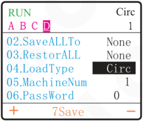

## 6.5.5 รหัสผ่านผู้ใช้

ผู้ใช้สามารถตั้งรหัสผ่านพารามิเตอร์ได้ด้วยตนเอง หลังจากล็อกแล้ว ผู้ใช้สามารถดำเนินการได้เฉพาะภายใต้ "SetWord" และ "หน้าหลัก" เท่านั้น

เมื่อผู้ใช้ตั้งค่า "รหัสผ่านผู้ใช้" เป็นค่าที่ไม่ใช่ 0 หมายความว่าฟังก์ชันล็อกพารามิเตอร์ขั้นสูงเปิดใช้งานอยู่ ในเวลานี้จำเป็นต้องป้อนรหัสผ่านเมื่อเข้าสู่กลุ่มพารามิเตอร์จากหน้าหลัก หลังจากผู้ใช้ "SetWord" และกด ⊕ และ ⊖ พร้อมกันเกิน 2 วินาที ยืนยันรหัสผ่านที่ป้อน เฉพาะเมื่อรหัสผ่านถูกต้องเท่านั้นผู้ใช้จึงจะสามารถเข้าสู่กลุ่มพารามิเตอร์อื่นได้

ช่วงการเลือกรหัสผ่านผู้ใช้คือ 0~9999 ค่าเริ่มต้นคือ 0

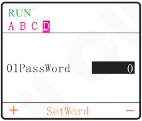

---

## 6.6 การตรวจสอบสถานะตัวควบคุม

ในกลุ่มพารามิเตอร์การตรวจสอบ สถานะการทำงานและค่าพารามิเตอร์ของตัวควบคุมสามารถอ่านได้แบบเรียลไทม์

สำหรับรายการพารามิเตอร์ที่สามารถอ่านได้ โปรดดูบท "รายการพารามิเตอร์" กลุ่มพารามิเตอร์ "8Monitor"

RUN  
A B C **D**

| | |
|---|---:|
| 01.Temperatur | 50 ℃ |
| 02.CurrentOut | 20 mA |
| 03.Vol_Remote | **0.5 V** |
| 04.Vol_PortB | 100 |
| 05.Vol-PortC | 0.5 V |

＋　8Monitor　－

---

## บทที่ Ⅶ ภาคผนวก

### 7.1 ขนาดมิติ

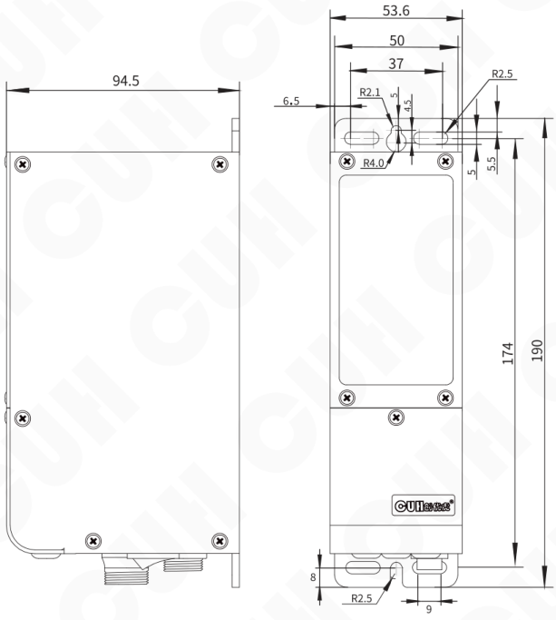

ขนาดมิติ (หน่วย: mm)

| ช่วงขนาดมิติ | ค่าเผื่อความคลาดเคลื่อน |
|---|---|
| 0~3 | ±0.05 |
| 3~10 | ±0.1 |
| 10~30 | ±0.15 |
| 30~80 | ±0.2 |
| 80~180 | ±0.3 |
| >180 | ±0.5 |

ตารางค่าเผื่อความคลาดเคลื่อนนี้ใช้ได้กับผลิตภัณฑ์ทั้งหมดในซีรีส์นี้

---

## 7.2 ข้อมูลจำเพาะทางเทคนิค

| รายการ | ต่ำสุด | ทั่วไป | สูงสุด | หน่วย | หมายเหตุ |
|---|---|---|---|---|---|
| แรงดันอินพุต | 85 | 220 | 250 | V | AC RMS |
| ช่วงแรงดันเอาต์พุตที่ปรับได้ | 0 | —— | 220 | V | AC RMS |
| ความแม่นยำในการปรับแรงดัน | | 1 | | V | |
| ช่วงกระแสเอาต์พุตที่ปรับได้ | 0 | —— | 150 | mA | |
| กำลังเอาต์พุต | 0 | —— | 33 | VA | |
| ความถี่เอาต์พุต | 40.0 | —— | 999.9 | Hz | |
| ความแม่นยำในการปรับความถี่ | | 0.1 | | Hz | |
| รูปคลื่นเอาต์พุต | | ไซน์ | | | |
| เวลาสตาร์ทแบบนุ่มนวล | 0 | —— | 10.0 | s | ค่าเริ่มต้น: 0.5 |
| ช่วงเวลาหน่วงเปิด/ปิด | 0.0 | —— | 99.9 | s | ค่าเริ่มต้น: 0.2 |
| ความแม่นยำของเวลาหน่วงเปิด/ปิด | | 0.1 | | s | |
| อุณหภูมิทริกเกอร์การป้องกันความร้อนเกิน | 60 | 65 | 65 | °C | |
| กระแสเอาต์พุตควบคุม DC | 0 | —— | 350 | mA | |
| แรงดันเอาต์พุตควบคุม DC | 22 | 24 | 26 | V | |
| สัญญาณควบคุมแอนะล็อก | | 1~5 | | V | แรงดันควบคุมความเร็วระยะไกล |
| สัญญาณควบคุมแอนะล็อก | | 4~20 | | mA | กระแสควบคุมความเร็วระยะไกล |
| สัญญาณควบคุมดิจิทัล | | 24 | | V | สัญญาณสวิตช์ |
| วิธีการปรับ | | 7 | | ปุ่มกด | |
| การใช้พลังงานในโหมดสแตนด์บาย | —— | —— | 5 | W | |
| วิธีการแสดงผล | | 160*128 | | | จอแสดงผลแบบเมทริกซ์ |
| ระดับการป้องกันการเข้าฝุ่น | | IP20 | | | |
| อุณหภูมิแวดล้อม | 0 | 25 | 40 | °C | ไม่มีการควบแน่น |
| ความชื้นแวดล้อม | 10 | 60 | 85 | % | ไม่มีการควบแน่น |
| อุณหภูมิแวดล้อมในการจัดเก็บ | -20 | 25 | 65 | °C | ไม่มีการควบแน่น |

## 7.3 มาตรฐานอ้างอิง

**พารามิเตอร์สัมบูรณ์:**  
การเกินมาตรฐานจะทำให้ตัวควบคุมเสียหาย ต้องปฏิบัติตามอย่างเคร่งครัด

| รายการ | มาตรฐาน GB | มาตรฐาน IEC | ระดับ | ข้อกำหนดมาตรฐาน | หมายเหตุ |
|---|---|---|---|---|---|
| การคายประจุไฟฟ้าสถิต | GB/T 17626.2-2006 | IEC 61000-4-2:2001 | 4 | ±8 kV | การคายประจุแบบสัมผัส |
| | | | 4 | ±15 kV | การคายประจุในอากาศ |
| การทดสอบทรานเซียนต์ไฟฟ้าด่วน | GB/T 17626.4-2008 | IEC 61000-4-4:2004 | 4 | ±4 kV | |
| การต้านทานระลอกคลื่นของสายไฟ DC | GB/T 17626.17-2005 | IEC 61000-4-17:2002 | 4 | 15% | ระดับ A |

> **คำเตือน**  
> ในสภาพแวดล้อมที่อยู่อาศัย ผลิตภัณฑ์นี้อาจทำให้เกิดการรบกวนทางวิทยุ ซึ่งในกรณีนี้จำเป็นต้องใช้มาตรการบรรเทาเพิ่มเติม

---

## 7.4 รายการพารามิเตอร์

| | Parameter | การแสดงผล | ช่วงค่า/รายการตัวเลือก | ค่าเริ่มต้น |
|---|---|---|---|---|
| กลุ่มพารามิเตอร์ 1EditHome | รายการตรวจสอบ 1 | Monit 1 | กลุ่มพารามิเตอร์ 2~กลุ่มพารามิเตอร์ 8 | UsrVoltage |
| | รายการตรวจสอบ 2 | Monit 2 | กลุ่มพารามิเตอร์ 2~กลุ่มพารามิเตอร์ 8 | UsrFreqncy |
| | รายการตรวจสอบ 3 | Monit 3 | กลุ่มพารามิเตอร์ 2~กลุ่มพารามิเตอร์ 8 | CurrentOut |
| | รายการตรวจสอบ 4 | Monit 4 | กลุ่มพารามิเตอร์ 2~กลุ่มพารามิเตอร์ 8 | |
| | รายการตรวจสอบ 5 | Monit 5 | กลุ่มพารามิเตอร์ 2~กลุ่มพารามิเตอร์ 8 | |
| | รายการตรวจสอบ 6 | Monit 6 | กลุ่มพารามิเตอร์ 2~กลุ่มพารามิเตอร์ 8 | |
| | รายการตรวจสอบ 7 | Monit 7 | กลุ่มพารามิเตอร์ 2~กลุ่มพารามิเตอร์ 8 | |
| | รายการตรวจสอบ 8 | Monit 8 | กลุ่มพารามิเตอร์ 2~กลุ่มพารามิเตอร์ 8 | |
| | รายการตรวจสอบ 9 | Monit 9 | กลุ่มพารามิเตอร์ 2~กลุ่มพารามิเตอร์ 8 | |
| | รายการตรวจสอบ 10 | Monit 10 | กลุ่มพารามิเตอร์ 2~กลุ่มพารามิเตอร์ 8 | |
| | รายการตรวจสอบ 11 | Monit 11 | กลุ่มพารามิเตอร์ 2~กลุ่มพารามิเตอร์ 8 | |
| | รายการตรวจสอบ 12 | Monit 12 | กลุ่มพารามิเตอร์ 2~กลุ่มพารามิเตอร์ 8 | |
| | รายการตรวจสอบ 13 | Monit 13 | กลุ่มพารามิเตอร์ 2~กลุ่มพารามิเตอร์ 8 | |
| | รายการตรวจสอบ 14 | Monit 14 | กลุ่มพารามิเตอร์ 2~กลุ่มพารามิเตอร์ 8 | |
| | รายการตรวจสอบ 15 | Monit 15 | กลุ่มพารามิเตอร์ 2~กลุ่มพารามิเตอร์ 8 | |
| | รายการตรวจสอบ 16 | Monit 16 | กลุ่มพารามิเตอร์ 2~กลุ่มพารามิเตอร์ 8 | |
| | แรงดันที่ผู้ใช้ตั้งค่า | 01.UsrVoltage | 0~220 V | 150 |
| | ความถี่ที่ผู้ใช้ตั้งค่า | 02.UsrFreqncy | 40.0~999.9 Hz | 50.0 |
| | เวลาสตาร์ทแบบนุ่มนวล | 03.SoftStarT | 0.0~10.0 s | 0.5 |
| | เวลาหยุดแบบนุ่มนวล | 04.SoftStopT | 0.0~10.0 s | 0.0 |
| | แรงดันเอาต์พุตสูงสุด | 05.MaxVoltage | 0~220 V | 220 |
| | แรงดันเอาต์พุตต่ำสุด | 06.MinVoltage | 0~220 V | 0 |
| | ความถี่เอาต์พุตสูงสุด | 07.MaxFreqncy | 40.0~999.9 Hz | 999.9 |
| | ความถี่เอาต์พุตต่ำสุด | 08.MinFreqncy | 40.0~999.9 Hz | 40.0 |
| | เวลาปิดไฟพื้นหลัง | 09.Off_time | On, 1~30 Mi | On |
| | ภาษา | 10.Language | Chines, Englis | Chines |
| | แหล่งสัญญาณอินพุตลอจิกของเอาต์พุตหลัก 1 | 01.MainSourc1 | 0, 1, PortB, -PortB, PortC, -PortC, PortD, -PortD, Main, -Main, Err, -Err | PortB |
| | แหล่งสัญญาณอินพุตลอจิกของเอาต์พุตหลัก 2 | 02.MainSourc2 | 0, 1, PortB, -PortB, PortC, -PortC, PortD, -PortD, Main, -Main, Err, -Err | PortC |
| | ลอจิกของพอร์ตเอาต์พุตหลัก | 03.MainLogic | And, Or, Xor, RS | Or |
| | เวลาหน่วงเปิดของเอาต์พุตหลัก | 04.MainUpDly | 0.0~99.9 s | 0.0 |
| | เวลาหน่วงปิดของเอาต์พุตหลัก | 05.MainDnDly | 0.0~99.9 s | 0.0 |
| | โหมดเอาต์พุตหลัก | 06.MainMode | Delay, Hold | Delay |
| | ทิศทางลอจิกของเอาต์พุตหลัก | 07.MainDirect | Const, Revrs, On, Off | Revrs |
| | สถานะเมื่อจ่ายไฟ | 08.PowerOnSta | On, Off, Hold | On |

| | Parameter | การแสดงผล | ช่วงค่า/รายการตัวเลือก | ค่าเริ่มต้น |
|---|---|---|---|---|
| กลุ่มพารามิเตอร์ 4PhotoSen | ความไวของเซ็นเซอร์โฟโต้อิเล็กทริกอัจฉริยะ | 01.PortBLimit | PNP, NPN, 1~1000 | 80 |
| กลุ่มพารามิเตอร์ 4PhotoSen | ทิศทางลอจิกของพอร์ต B | 02.PortBDirec | Const, Inv | Const |
| กลุ่มพารามิเตอร์ 4PhotoSen | เวลาหน่วงเปิดของพอร์ต B | 03.PortBUpDly | 0.0~99.9 s | 0.2 |
| กลุ่มพารามิเตอร์ 4PhotoSen | เวลาหน่วงปิดของพอร์ต B | 04.PortBDnDly | 0.0~99.9 s | 0.2 |
| กลุ่มพารามิเตอร์ 5On&Off | ประเภทเซ็นเซอร์ของพอร์ต C | 01.PortType | NPN, PNP, Auto1, Auto0 | Auto0 |
| กลุ่มพารามิเตอร์ 5On&Off | ทิศทางลอจิกของพอร์ต C | 02.PortCDirec | Const, Inv | Const |
| กลุ่มพารามิเตอร์ 5On&Off | เวลาหน่วงเปิดของพอร์ต C | 03.PortCUpDly | 0.0~99.9 s | 0.2 |
| กลุ่มพารามิเตอร์ 5On&Off | เวลาหน่วงปิดของพอร์ต C | 04.PortCDnDly | 0.0~99.9 s | 0.2 |
| กลุ่มพารามิเตอร์ 6DCoutput | แหล่งสัญญาณอินพุตลอจิกของพอร์ต D 1 | 01.PortDSour1 | 0, 1, PortB, -PortB, PortC, -PortC, PortD, -PortD, Main, -Main, Err, -Err | 0 |
| กลุ่มพารามิเตอร์ 6DCoutput | แหล่งสัญญาณอินพุตลอจิกของพอร์ต D 2 | 02.PortDSour2 | 0, 1, PortB, -PortB, PortC, -PortC, PortD, -PortD, Main, -Main, Err, -Err | Main |
| กลุ่มพารามิเตอร์ 6DCoutput | ความสัมพันธ์ทางตรรกะของพอร์ต D | 03.PortDLogic | And, Or, Xor, RS | Or |
| กลุ่มพารามิเตอร์ 6DCoutput | เวลาหน่วงเปิดของพอร์ต D | 04.PortDUpDly | 0.0~99.9 s | 0.0 |
| กลุ่มพารามิเตอร์ 6DCoutput | เวลาหน่วงปิดของพอร์ต D | 05.PortDDnDly | 0.0~99.9 s | 0.0 |
| กลุ่มพารามิเตอร์ 6DCoutput | โหมดเอาต์พุตของพอร์ต D | 06.PortDMode | Delay, Hold, Cycle1, Cycle2 | Delay |
| กลุ่มพารามิเตอร์ 6DCoutput | ทิศทางลอจิกของพอร์ต D | 07.PortDDirec | Const, Revrs, On, Off | Const |
| กลุ่มพารามิเตอร์ 6DCoutput | ประเภทเอาต์พุตควบคุม | 08.PortDType | Ou_NPN, Ou_PNP, Ou_P&P | Ou_NPN |
| กลุ่มพารามิเตอร์ 7Save | อ่านพารามิเตอร์ทั้งหมดจากกลุ่มผู้ใช้ | 01.ReadALLFrm | None, UsrD1, UsrD2, UsrD3 | None |
| กลุ่มพารามิเตอร์ 7Save | บันทึกพารามิเตอร์ทั้งหมดไปยังกลุ่มผู้ใช้ | 02.SaveALLTo | None, Work, UsrD1, UsrD2, UsrD3 | None |
| กลุ่มพารามิเตอร์ 7Save | การคืนค่าการตั้งค่าเริ่มต้น | 03.RestorALL | None, Work | None |
| กลุ่มพารามิเตอร์ 7Save | ตัวระบุเครื่องท้องถิ่น | 04.LoadType | None, Circ, Line, Soli | None |
| กลุ่มพารามิเตอร์ 7Save | หมายเลขเครื่อง | 05.MachineNum | None, 1~1000 | None |
| กลุ่มพารามิเตอร์ 7Save | รหัสผ่านผู้ใช้ | 06.PassWord | 0~9999 | 0 |
| กลุ่มพารามิเตอร์ 8Monitor | อุณหภูมิ | 01.Temperatur | -20~85 ℃ | —— |
| กลุ่มพารามิเตอร์ 8Monitor | กระแสเอาต์พุต | 02.CurrentOut | 0.0~150 mA | —— |
| กลุ่มพารามิเตอร์ 8Monitor | แรงดันสัญญาณของพอร์ต A | 03.Vol_Remote | 0.0~5.0 V | —— |
| กลุ่มพารามิเตอร์ 8Monitor | แรงดันสัญญาณของพอร์ต B | 04.Vol_PortB | 0~999 | —— |
| กลุ่มพารามิเตอร์ 8Monitor | แรงดันสัญญาณของพอร์ต C | 05.Vol-PortC | 0.0~26.0 V | —— |
| กลุ่มพารามิเตอร์ 8Monitor | แรงดันสัญญาณของพอร์ต D | 06.Vol-PortD | 0.0~26.0 V | —— |
| กลุ่มพารามิเตอร์ 8Monitor | แรงดันเรียลไทม์ของพอร์ต 5V | 07.Vol-5V | 0.0~6.0 V | —— |
| กลุ่มพารามิเตอร์ 8Monitor | แรงดันเรียลไทม์ของพอร์ต 24V | 08.Vol-24V | 0.0~26.0 V | —— |
| กลุ่มพารามิเตอร์ 8Monitor | เวอร์ชันซอฟต์แวร์ของบอร์ดควบคุม | 09.Version | 0~99.99 | —— |

| | Parameter | การแสดงผล | ช่วงค่า/รายการตัวเลือก | ค่าเริ่มต้น |
|---|---|---|---|---|
| SetWord | รหัสผ่าน | 01PassWord | 0~9999 | 0 |

## 7.5 แผนภาพวงจรอินพุตและเอาต์พุต

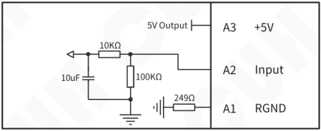

**Remote Speed Control Port A**

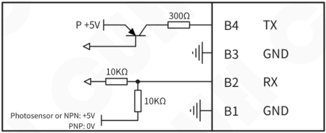

**Intelligent Photosensor Port B**

**Switch Sensor Port C**

**Control Output Port D**

---

## 7.6 รหัสข้อผิดพลาดและคำเตือน

| การแสดงข้อผิดพลาด | การแก้ไขปัญหา |
|---|---|
| Short | ตรวจสอบว่าสายเอาต์พุตหลักลัดวงจรหรือไม่ และเดินสายใหม่ |
| MainOrCu | ลดแรงดันเอาต์พุตหรือเพิ่มความถี่เอาต์พุต |
| OverHot | วางตัวควบคุมไว้ในบริเวณที่มีการระบายอากาศและระบายความร้อนที่ดี |
| OverCold | วางตัวควบคุมไว้ในบริเวณที่มีอุณหภูมิแวดล้อมสูงกว่า -20℃ |
| PotDOrCu | ตรวจสอบให้แน่ใจว่าโหลดของพอร์ต D ไม่ลัดวงจรและกระแสไม่เกิน 350mA จากนั้นลองรีสตาร์ทเอาต์พุตของพอร์ต D |
| 24VErr | ตรวจสอบให้แน่ใจว่าพอร์ต 24V ไม่ลัดวงจรและกระแสไม่เกิน 400mA |
| 5VErr | ตรวจสอบให้แน่ใจว่าแหล่งจ่าย 5V ของพอร์ต A ไม่ลัดวงจรหรือไม่ได้เชื่อมต่อกับแรงดันไฟภายนอกที่เกิน 5V |
| MainRSEr | ตรวจสอบให้แน่ใจว่าสัญญาณอินพุตทั้งสองของ RS ฟลิปฟล็อปไม่ทำงานพร้อมกัน |
| PotDRSEr | ตรวจสอบให้แน่ใจว่าสัญญาณอินพุตทั้งสองของ RS ฟลิปฟล็อปไม่ทำงานพร้อมกัน |

---

## บทที่ Ⅷ ข้อมูลการรับประกันผลิตภัณฑ์

### 8.1 ระยะเวลารับประกัน

ระยะเวลารับประกันที่บริษัทให้สำหรับผลิตภัณฑ์นี้คือ 3 ปีนับจากวันที่ส่งมอบผลิตภัณฑ์ไปยังสถานที่ที่ผู้ซื้อกำหนด

### 8.2 ขอบเขตการรับประกัน

(1) หากเกิดความเสียหายที่เกิดจากบริษัทของเราในช่วงระยะเวลารับประกันข้างต้น เราจะซ่อมแซมผลิตภัณฑ์โดยไม่คิดค่าใช้จ่าย อย่างไรก็ตาม สถานการณ์ต่อไปนี้ไม่อยู่ในขอบเขตการรับประกัน:

 a. ไม่ปฏิบัติตามเงื่อนไขที่ระบุในคู่มืออย่างง่าย คู่มือผู้ใช้ หรือข้อกำหนดทางเทคนิคที่ตกลงกันเป็นพิเศษระหว่างผู้ซื้อกับบริษัท การใช้งานที่ไม่เหมาะสม หรือความเสียหายที่เกิดจากการใช้งานที่ไม่ถูกต้อง

 b. ความเสียหายไม่ได้เกิดจากข้อบกพร่องของผลิตภัณฑ์ แต่เกิดจากการออกแบบอุปกรณ์หรือซอฟต์แวร์ของผู้ซื้อ

 c. การทำงานผิดพลาดที่เกิดจากการดัดแปลงหรือซ่อมแซมโดยไม่ใช่บุคลากรของบริษัท

 d. ความเสียหายที่สามารถหลีกเลี่ยงได้ทั้งหมดโดยการบำรุงรักษาที่ถูกต้องหรือการเปลี่ยนชิ้นส่วนสิ้นเปลืองตามคู่มือการใช้งานอย่างง่ายหรือคู่มือผู้ใช้

 e. หลังจากผลิตภัณฑ์จัดส่งออกจากบริษัทของเรา ความเสียหายที่เกิดจากปัจจัยต่างๆ เช่น การเปลี่ยนแปลงระดับเทคโนโลยีที่ไม่คาดคิด

 f. เนื่องจากภัยพิบัติทางธรรมชาติ เช่น ไฟไหม้ แผ่นดินไหว น้ำท่วม หรือปัจจัยภายนอก เช่น แรงดันไฟฟ้าผิดปกติ บริษัทจะไม่รับผิดชอบต่อการรับประกัน

(2) ขอบเขตการรับประกันจำกัดเฉพาะสถานการณ์ที่กำหนดใน (1) สำหรับความสูญเสียทางอ้อม (เช่น ความเสียหายของอุปกรณ์ โอกาสสูญเสีย กำไรที่สูญเสีย ฯลฯ) หรือความสูญเสียอื่นๆ บริษัทไม่รับผิดชอบใดๆ

### 8.3 ความเหมาะสมของผลิตภัณฑ์

ตัวควบคุมของบริษัทของเราได้รับการออกแบบและผลิตสำหรับการใช้งานทั่วไปในอุตสาหกรรมการป้อนแบบสั่นสะเทือน ดังนั้นตัวควบคุมนี้ของบริษัทของเราจึงไม่ควรใช้สำหรับการใช้งานต่อไปนี้และไม่เหมาะสมสำหรับการใช้งานดังกล่าว

(1) สิ่งอำนวยความสะดวกที่มีผลกระทบร้ายแรงต่อชีวิตและทรัพย์สิน เช่น โรงไฟฟ้านิวเคลียร์ สนามบิน ทางรถไฟ เรือ อุปกรณ์ยนต์ และอุปกรณ์ทางการแพทย์

(2) สาธารณูปโภค รวมถึงไฟฟ้า ก๊าซ น้ำประปา ฯลฯ

(3) การใช้งานกลางแจ้งในสภาพหรือสภาพแวดล้อมที่คล้ายคลึงกัน

---

Nanjing CUH Science & Technology Co.,Ltd  
https://en.cuhnj.com  
Tel.:+86-25-84730411 / 84730415 / 84730416  
Fax:+86-25-84730426  
E-mail:sales@cuhnj.com  
Add.:Building 2, Xueyan Tech Park, Tuscity,  
No.9 Zhineng Rd, Jiangning, Nanjing, China

เลขที่เอกสาร: IDP1000542

