## ตัวควบคุมความถี่ดิจิทัลแบบปรับค่าได้สำหรับเครื่องป้อนวัสดุแบบสั่นสะเทือนพีโซอิเล็กทริก

**Variable Frequency Digital Controller for Piezo Vibratory Feeder**

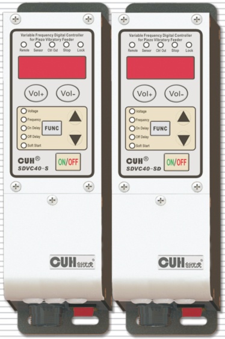

## ซีรีส์ SDVC40
ตัวควบคุมความถี่ดิจิทัลแบบปรับค่าได้สำหรับเครื่องป้อนวัสดุแบบสั่นสะเทือนพีโซอิเล็กทริก　　**ซีรีส์ SDVC40**
## คู่มือการใช้งาน

---

## บทนำ

ขอบคุณที่ท่านเลือกใช้ตัวควบคุมแบบสั่นสะเทือนดิจิทัลอัจฉริยะตราสินค้า **CUH** (ต่อไปจะเรียกโดยย่อว่า "ตัวควบคุม")

คู่มือฉบับนี้ประกอบด้วยข้อแนะนำสำหรับการติดตั้ง การทดสอบปรับแต่ง การตั้งค่าพารามิเตอร์ การบำรุงรักษา และการแก้ไขปัญหาของตัวควบคุม โปรดอ่านคู่มือการใช้งานฉบับนี้อย่างละเอียดก่อนเริ่มใช้งานตัวควบคุม และเก็บรักษาไว้ให้ถูกต้องเรียบร้อย

### คู่มือฉบับนี้เหมาะสำหรับตัวควบคุมรุ่นต่อไปนี้:

- ตัวควบคุมความถี่ดิจิทัลแบบปรับค่าได้สำหรับเครื่องป้อนวัสดุแบบสั่นสะเทือนพีโซอิเล็กทริก  
  SDVC40-S (เอาต์พุต 220V, 150mA)

- ตัวควบคุมความถี่ดิจิทัลแบบปรับค่าได้สำหรับเครื่องป้อนวัสดุแบบสั่นสะเทือนพีโซอิเล็กทริก  
  SDVC40-SD (เอาต์พุต 50V, 600mA)

---

# คำเตือนความปลอดภัย

- ห้ามเสียบหรือถอดขั้วต่อขณะที่มีไฟฟ้า และห้ามสัมผัสขั้วต่อในทุกกรณี เพื่อหลีกเลี่ยงการถูกไฟดูดหรืออุบัติเหตุอื่น ๆ
- ห้ามเชื่อมต่อตัวควบคุมกับไฟฟ้ากระแสสลับ 380V ซึ่งอาจทำให้เกิดความเสียหายที่ไม่สามารถกู้คืนได้ (เมื่อมีความจำเป็น โปรดเลือกใช้ผลิตภัณฑ์ที่ออกแบบมาสำหรับไฟฟ้ากระแสสลับ 380V)
- ห้ามสั่งเปิด/ปิดอินพุตของตัวควบคุมโดยการตัดแหล่งจ่ายไฟผ่านรีเลย์ PLC หรืออุปกรณ์อื่น มิฉะนั้นอายุการใช้งานของตัวควบคุมอาจลดลงอย่างมาก
- ตัวควบคุมออกแบบมาให้ทำงานในสภาพแวดล้อมที่เย็นและแห้ง ห้ามใช้งานกลางแจ้งเพื่อหลีกเลี่ยงการแช่น้ำหรือการถูกแดดเผา ให้ใช้งานตัวควบคุมภายในช่วงอุณหภูมิตามที่คุณลักษณะทางไฟฟ้าของตัวควบคุมกำหนด
- ห้ามใช้งานตัวควบคุมในสภาวะที่เกินขีดจำกัดการออกแบบ
- ให้ใช้งานตัวควบคุมอย่างเคร่งครัดตามคู่มือการใช้งานฉบับนี้ บริษัทจะไม่รับความรับผิดทางแพ่งหรือทางอาญาใด ๆ หากอุปกรณ์เสียหายหรือเกิดการบาดเจ็บต่อบุคคลจากการใช้งานที่ไม่ถูกต้อง

> **!**
>
> ห้ามเปิดเปลือกตัวควบคุมเพื่อหลีกเลี่ยงการถูกไฟดูด หากตัวควบคุมขัดข้องโปรดติดต่อ CUH
>
> ห้ามพยายามดัดแปลงตัวควบคุม เนื่องจากแผงวงจรโซลิดสเตตภายในตัวควบคุมไม่สามารถซ่อมแซมได้ และไม่มีชิ้นส่วนที่ปรับตั้งได้

---

# สภาพแวดล้อมสำหรับการใช้งานและการจัดเก็บ

## การตรวจสอบก่อนใช้งาน

ตัวควบคุมทุกเครื่องจะผ่านการตรวจสอบคุณภาพอย่างเข้มงวดก่อนส่งมอบ และบรรจุในกล่องกันกระแทก

## โปรดตรวจสอบรายการต่อไปนี้หลังจากเปิดกล่อง:

- ตัวควบคุมได้รับความเสียหายที่ส่วนปรากฏภายนอกหรือไม่
- รุ่นของตัวควบคุมตรงกับที่ท่านสั่งซื้อหรือไม่

## สภาพแวดล้อมการทำงาน

โปรดปฏิบัติตามข้อควรระวังต่อไปนี้ เพื่อให้ตัวควบคุมมีสมรรถนะและอายุการใช้งานที่ดีที่สุด

- สภาพแวดล้อมที่มีการระบายอากาศที่ดี
- ห่างไกลจากน้ำ ไอน้ำ ฝุ่น และโดยเฉพาะฝุ่นที่ปนเปื้อนน้ำมัน
- ห่างไกลจากแก๊สหรือของเหลวที่กัดกร่อนหรือไวไฟ
- ห่างไกลจากฝุ่นลอยและอนุภาคโลหะ
- ยึดติดอย่างมั่นคงเพื่อหลีกเลี่ยงการสั่นสะเทือนของตัวเอง
- ห่างไกลจากสัญญาณรบกวนแม่เหล็กไฟฟ้า
- ใช้งานภายในช่วงอุณหภูมิ 0 °C ถึง 40 °C
- ใช้งานที่ระดับความสูงไม่เกิน 2000 เมตร

---

# สารบัญ

| สารบัญ | หน้า |
|---|---:|
| **บทที่ Ⅰ คุณสมบัติ** | 1 |
| **บทที่ Ⅱ คู่มือการติดตั้ง** | 3 |
| **บทที่ Ⅲ คำอธิบายชิ้นส่วนประกอบ** | 7 |
| 3.1 คำอธิบายแผงควบคุม | 7 |
| 3.2 คำอธิบายไฟแสดงสถานะ | 8 |
| 3.3 คำอธิบายอินเทอร์เฟซอินพุต/เอาต์พุต | 8 |
| **บทที่ Ⅳ คำอธิบายฟังก์ชัน** | 9 |
| 4.1 การตั้งค่าแรงดันเอาต์พุต | 9 |
| 4.2 การปรับความถี่เอาต์พุต | 10 |
| 4.3 สตาร์ทแบบนุ่มนวล | 11 |
| 4.4 ปุ่มสวิตช์เอาต์พุต | 11 |
| 4.5 การจำกัดแรงดันเอาต์พุตสูงสุด | 12 |
| 4.6 การล็อกแผงปุ่มกด | 13 |
| 4.7 การตั้งค่าสถานะการทำงานเมื่อจ่ายไฟ | 14 |
| 4.8 การคืนค่าการตั้งค่าจากโรงงาน | 15 |
| **บทที่ Ⅴ เซนเซอร์และการควบคุมสัญญาณ** | 16 |
| 5.1 การตรวจจับแสงอัจฉริยะ | 16 |
| 5.1.1 วิธีการเชื่อมต่อเซนเซอร์โฟโต้อิเล็กทริกอัจฉริยะ | 16 |
| 5.1.2 การตั้งค่าเวลาหน่วงเปิดและเวลาหน่วงปิดของเซนเซอร์โฟโต้อิเล็กทริกอัจฉริยะ | 17 |
| 5.1.3 การตั้งค่าความสัมพันธ์ลอจิกของเซนเซอร์โฟโต้อิเล็กทริกอัจฉริยะ | 18 |
| 5.2 วิธีใช้งานเซนเซอร์สวิตช์แบบ NPN (หยุดเมื่อชิ้นงานเต็ม) | 19 |
| 5.2.1 วิธีการเชื่อมต่อเซนเซอร์สวิตช์พร็อกซิมิตี้แบบ NPN | 19 |
| 5.2.2 วิธีการเชื่อมต่อเซนเซอร์สวิตช์แบบส่องผ่าน NPN | 20 |
| 5.2.3 วิธีการเชื่อมต่อเซนเซอร์โฟโต้อิเล็กทริกแบบส่องผ่าน | 20 |
| 5.2.4 วิธีการเชื่อมต่อเซนเซอร์ไฟเบอร์ออปติกแบบส่องผ่าน | 21 |
| 5.2.5 วิธีการเชื่อมต่อเซนเซอร์โฟโต้อิเล็กทริกแบบสะท้อน | 22 |
| 5.3 การตั้งค่าเวลาหน่วงเปิดและเวลาหน่วงปิดของเซนเซอร์สวิตช์แบบ NPN | 23 |
| 5.4 การตั้งค่าความสัมพันธ์ลอจิกของเซนเซอร์สวิตช์แบบ NPN (หยุดเมื่อชิ้นงานเต็ม) | 24 |
| 5.5 การตั้งค่าความสัมพันธ์ลอจิกของสัญญาณควบคุม | 25 |
| 5.6 วิธีการเชื่อมต่อ PLC ต้นน้ำที่ควบคุมตัวควบคุมเครื่องป้อนวัสดุแบบสั่นสะเทือน | 26 |
| 5.7 เอาต์พุตควบคุม | 27 |
| 5.7.1 วิธีการเชื่อมต่อเอาต์พุตควบคุม | 27 |
| 5.7.2 การตั้งค่าความสัมพันธ์ลอจิกของเอาต์พุตควบคุม | 28 |
| 5.8 การควบคุมความเร็วระยะไกล | 29 |
| **บทที่ Ⅵ ฟังก์ชันความปลอดภัย** | 30 |
| 6.1 การรักษาแรงดันไฟฟ้าอัตโนมัติ | 30 |
| 6.2 การป้องกันการลัดวงจร | 30 |
| 6.3 การป้องกันกระแสเกินพิกัด | 30 |
| 6.4 การป้องกันความร้อนสูงเกินไป | 30 |

---

---

## ภาคผนวก

- ภาคผนวก A: มิติ — 31
- ภาคผนวก B: นิยามอินเทอร์เฟซเอาต์พุต — 32
- ภาคผนวก C: นิยามอินเทอร์เฟซสัญญาณ — 32
- ภาคผนวก D: ตารางฟังก์ชัน — 33
- ภาคผนวก E: ข้อมูลจำเพาะทางไฟฟ้า — 34
- ภาคผนวก F: คำแนะนำการแก้ไขปัญหาและคำอธิบายรหัสข้อผิดพลาด — 35

---

# บทที่ Ⅰ คุณสมบัติ

ตัวควบคุมถูกออกแบบมาโดยเฉพาะสำหรับการควบคุมเครื่องป้อนวัสดุแบบสั่นสะเทือนในระบบอัตโนมัติ ด้วยการผสานเทคโนโลยีอิเล็กทรอนิกส์รุ่นล่าสุดและการออกแบบอย่างพิถีพิถัน ตัวควบคุมจึงมอบคุณสมบัติที่สะดวกและใช้งานได้จริงดังต่อไปนี้:

**การปรับความถี่:** ช่วงความถี่เอาต์พุตอยู่ระหว่าง 40.0Hz ถึง 400.0Hz

**การปรับแรงดัน:** SDVC40-S: ช่วงแรงดันเอาต์พุตอยู่ระหว่าง 0V ถึง 260V  
SDVC40-SD: ช่วงแรงดันเอาต์พุตอยู่ระหว่าง 0.0V ถึง 50.0V

**การรักษาแรงดันไฟฟ้าอัตโนมัติ:** ตัวควบคุมสามารถกำจัดความผันผวนของความเร็วในการป้อนวัสดุซึ่งเกิดจากความผันผวนของแรงดันไฟบ้านได้

**สตาร์ทแบบนุ่มนวล:** เพื่อหลีกเลี่ยงแรงกระแทกกะทันหันต่อชิ้นงาน ตัวควบคุมสามารถเพิ่มแรงดันเอาต์พุตอย่างนุ่มนวลจาก 0 ไปยังค่าที่ตั้งไว้ล่วงหน้าเมื่อเริ่มทำงาน

**การตรวจจับแสงอัจฉริยะ:** เซนเซอร์โฟโต้อิเล็กทริกอัจฉริยะแบบปรับตัวของเราสามารถช่วยหยุดการทำงานของตัวควบคุมเมื่อชิ้นงานเต็มหรือชิ้นงานหมด และรองรับฟังก์ชันการตั้งค่าเวลาสตาร์ทแบบนุ่มนวล เวลาหน่วงเปิด เวลาหน่วงปิด และการปรับความสัมพันธ์ลอจิก

**หยุดเมื่อชิ้นงานเต็ม:** เซนเซอร์สวิตช์แบบ NPN สามารถช่วยหยุดการทำงานของตัวควบคุมเมื่อชิ้นงานเต็ม และรองรับฟังก์ชันการตั้งค่าเวลาสตาร์ทแบบนุ่มนวล เวลาหน่วงเปิด เวลาหน่วงปิด และการปรับความสัมพันธ์ลอจิก

**การควบคุมความเร็วระยะไกล:** แรงดันเอาต์พุตของตัวควบคุมสามารถควบคุมได้ด้วยโพเทนชิออมิเตอร์ภายนอก PLC หรือสัญญาณควบคุมแรงดันไฟฟ้าในช่วง 1V ถึง 5V

**เอาต์พุตควบคุม:** สัญญาณเอาต์พุตควบคุมที่ส่งออกจากทรานซิสเตอร์สามารถประสานการทำงานของวาล์วโซลีนอยด์หรืออุปกรณ์ภายนอกอื่น ๆ เข้ากับตัวควบคุมได้

**การล็อกแผงปุ่มกด:** กดปุ่ม ON/OFF ค้างไว้ 2 วินาที เพื่อล็อกปุ่มทั้งหมดบนแผงหน้าปัด เพื่อป้องกันการกดผิดพลาด

**การจำกัดเอาต์พุตสูงสุด:** ค่าแรงดันเอาต์พุตสูงสุดสามารถตั้งไว้ล่วงหน้าได้ เพื่อปกป้องอุปกรณ์จากความเสียหายที่เกิดจากการใช้งานที่ผิดพลาด

**การคืนค่าการตั้งค่าจากโรงงาน:** ฟังก์ชันนี้อนุญาตให้ผู้ใช้คืนค่าการตั้งค่าพารามิเตอร์เริ่มต้นทั้งหมด และรีเซ็ตตัวควบคุม

---

---

**CUH** ให้ความสำคัญอย่างยิ่งกับการบริหารคุณภาพผลิตภัณฑ์และสมรรถนะด้านความปลอดภัย นอกเหนือจากการใช้ชิ้นส่วนคุณภาพสูงและระบบควบคุมคุณภาพที่เข้มงวดแล้ว **CUH** ยังได้คำนึงถึงอุบัติเหตุที่ผู้ใช้อาจพบเข้า และมอบฟังก์ชันการป้องกันดังต่อไปนี้ เพื่อเพิ่มความเป็นประโยชน์ของตัวควบคุมให้สูงสุด

**การป้องกันการลัดวงจร:** หากเอาต์พุตของตัวควบคุมถูกลัดวงจร ตัวควบคุมจะหยุดเอาต์พุตจนกว่าจะเริ่มทำงานใหม่

**การป้องกันกระแสเกินพิกัด:** ตัวควบคุมจะหยุดเอาต์พุตเพื่อความปลอดภัยในการทำงานของอุปกรณ์ เมื่อกระแสทำงานเกินค่าพิกัดที่กำหนด

**การป้องกันความร้อนสูงเกินไป:** ตัวควบคุมจะหยุดเอาต์พุตเพื่อป้องกันตัวเอง เมื่ออุณหภูมิในการทำงานสูงเกินไป

ตัวควบคุมของ **CUH** เป็นไปตามมาตรฐานการรับรอง CE อย่างเคร่งครัด

---

## บทที่ Ⅱ คู่มือการติดตั้ง

### ขั้นตอนที่ 1:

เปิดกล่องบรรจุภัณฑ์และตรวจสอบสภาพภายนอกของตัวควบคุม พร้อมทั้งตรวจสอบให้แน่ใจว่ารุ่นของตัวควบคุมตรงกับที่ท่านสั่งซื้อ

### ขั้นตอนที่ 2:

เชื่อมต่อสายไฟเอาต์พุตในกล่องบรรจุภัณฑ์เข้ากับแอคทูเอเตอร์พีโซของตัวสั่นสะเทือน

เสียบปลั๊กของสายไฟเอาต์พุตเข้ากับซ็อกเก็ตเอาต์พุตของตัวควบคุม

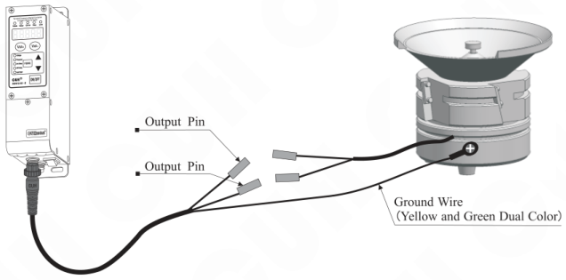

### หมายเหตุ

ให้แน่ใจว่าแอคทูเอเตอร์พีโซของตัวสั่นสะเทือนเชื่อมต่อกับขั้วเอาต์พุตทั้งสองของสายไฟเอาต์พุต และแอคทูเอเตอร์พีโซถูกกราวนด์อย่างน่าเชื่อถือ มิฉะนั้นอาจเกิดเหตุการณ์ด้านความปลอดภัยร้ายแรงได้

---

## ขั้นตอนที่ 3:

เชื่อมต่อสายไฟอินพุตเข้ากับตัวควบคุม และขันน็อตสายพลังงานให้แน่น

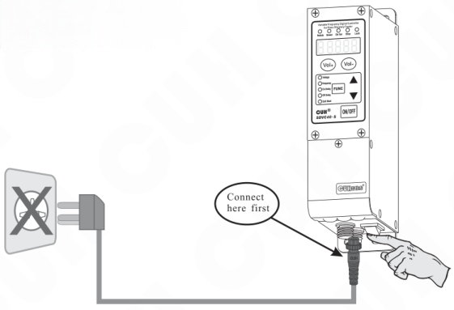

เชื่อมต่อที่นี่ก่อน

## ขั้นตอนที่ 4:

เสียบปลั๊กของสายไฟอินพุตเข้ากับเต้ารับไฟบ้าน

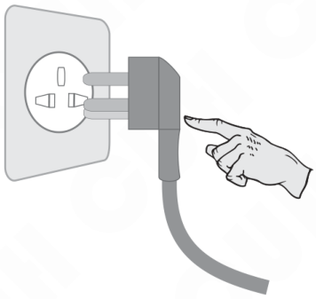

---

## ขั้นตอนที่ 5:

ปรับแรงดันเอาต์พุตของตัวควบคุมให้อยู่ในค่าระหว่าง 30 ถึง 80 (แสดงด้วยตัวอักษร U)

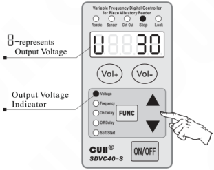

## ขั้นตอนที่ 6:

กดปุ่ม `FUNC` ค้างไว้ 2 วินาที เพื่อเข้าสู่สถานะปรับค่าการตั้งค่าพื้นฐาน

ไฟแสดงสถานะความถี่เอาต์พุตบนแผงหน้าปัดจะสว่างขึ้น และหลอด LED จะแสดงค่าความถี่ปัจจุบัน (E) กดปุ่ม ▲ หรือ ▼ เพื่อปรับค่าพารามิเตอร์จาก 400Hz ลงมาจนถึง 40Hz เพื่อค้นหาความถี่รีโซแนนซ์ของตัวสั่นสะเทือน แล้วคงค่านั้นไว้

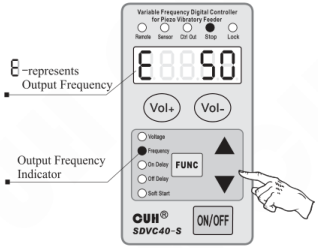

- ความถี่รีโซแนนซ์ของตัวสั่นสะเทือน หมายถึง ค่าความถี่ที่ทำให้เกิดแอมพลิจูดสูงสุด
- ตัวสั่นสะเทือนทุกตัวมีความถี่รีโซแนนซ์เชิงกลตามธรรมชาติของตัวเอง ให้ปรับความถี่เอาต์พุตของตัวควบคุมไปที่ความถี่นี้ เพื่อรับประกันสภาวะการทำงานที่ดีที่สุด

---

## ขั้นตอนที่ 7:

หลังจากตั้งค่าความถี่เอาต์พุตของตัวควบคุมให้เท่ากับความถี่รีโซแนนซ์เชิงกลตามธรรมชาติของตัวสั่นสะเทือนแล้ว ให้ปรับแรงดันเอาต์พุตของตัวควบคุมโดยกดปุ่ม **Vol+** หรือ **Vol-** เพื่อเปลี่ยนความเร็วในการป้อนวัสดุ

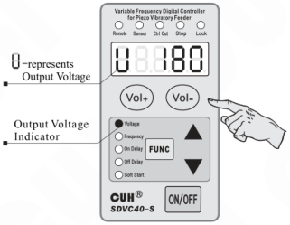

เมื่อปฏิบัติตามขั้นตอนทั้งเจ็ดข้างต้นแล้ว ตัวควบคุมจะสามารถทำงานได้อย่างปกติ หากต้องการใช้ฟังก์ชันควบคุมขั้นสูงเพิ่มเติม โปรดดูรายละเอียดในบทอื่น ๆ

---

# บทที่ Ⅲ คำอธิบายชิ้นส่วนประกอบ

## 3.1 คำอธิบายแผงควบคุม

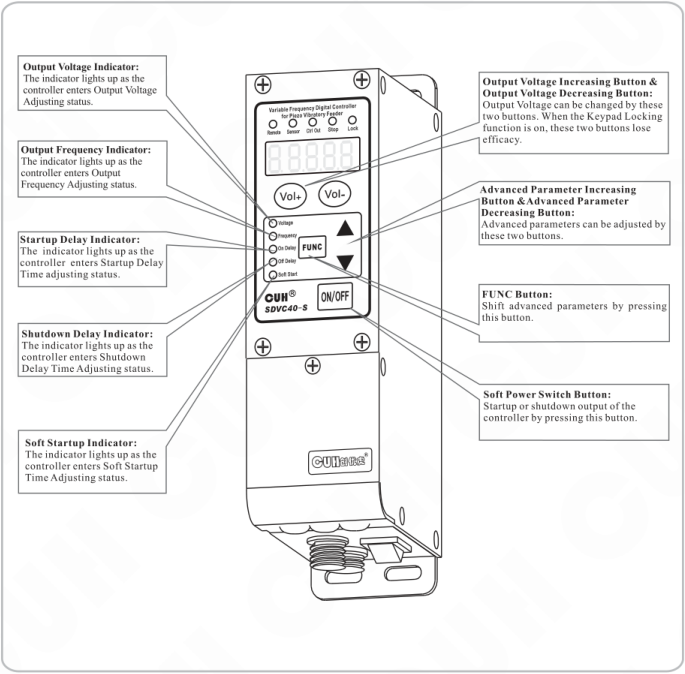

**ไฟแสดงสถานะแรงดันเอาต์พุต:**  
ไฟแสดงสถานะนี้จะสว่างขึ้นเมื่อตัวควบคุมเข้าสู่สถานะปรับค่าแรงดันเอาต์พุต

**ไฟแสดงสถานะความถี่เอาต์พุต:**  
ไฟแสดงสถานะนี้จะสว่างขึ้นเมื่อตัวควบคุมเข้าสู่สถานะปรับค่าความถี่เอาต์พุต

**ไฟแสดงสถานะหน่วงเวลาเปิด:**  
ไฟแสดงสถานะนี้จะสว่างขึ้นเมื่อตัวควบคุมเข้าสู่สถานะปรับค่าเวลาหน่วงเปิด

**ไฟแสดงสถานะหน่วงเวลาปิด:**  
ไฟแสดงสถานะนี้จะสว่างขึ้นเมื่อตัวควบคุมเข้าสู่สถานะปรับค่าเวลาหน่วงปิด

**ไฟแสดงสถานะสตาร์ทแบบนุ่มนวล:**  
ไฟแสดงสถานะนี้จะสว่างขึ้นเมื่อตัวควบคุมเข้าสู่สถานะปรับค่าเวลาสตาร์ทแบบนุ่มนวล

**ปุ่มเพิ่มและปุ่มลดแรงดันเอาต์พุต:**  
สามารถเปลี่ยนค่าแรงดันเอาต์พุตได้ด้วยปุ่มทั้งสองนี้ เมื่อฟังก์ชันการล็อกแผงปุ่มกดทำงานอยู่ ปุ่มทั้งสองนี้จะไม่ทำงาน

**ปุ่มเพิ่มและปุ่มลดพารามิเตอร์ขั้นสูง:**  
สามารถปรับค่าพารามิเตอร์ขั้นสูงได้ด้วยปุ่มทั้งสองนี้

**ปุ่ม FUNC:**  
สลับพารามิเตอร์ขั้นสูงโดยกดปุ่มนี้

**ปุ่มสวิตช์เปิด/ปิดเอาต์พุตแบบนุ่มนวล:**  
เปิดหรือปิดเอาต์พุตของตัวควบคุมโดยกดปุ่มนี้

---

## 3.2 คำอธิบายไฟแสดงสถานะ

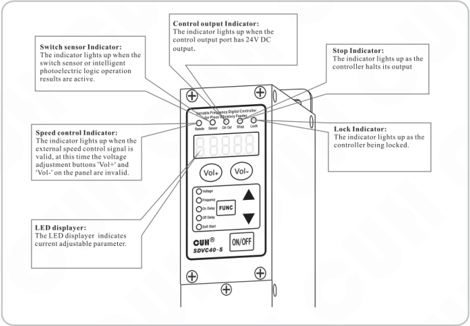

- **ไฟแสดงสถานะเซ็นเซอร์สวิตช์:** ไฟแสดงสถานะนี้จะสว่างขึ้นเมื่อเซ็นเซอร์สวิตช์หรือผลการดำเนินการลอจิกของเซ็นเซอร์โฟโต้อิเล็กทริกอัจฉริยะทำงานอยู่
- **ไฟแสดงสถานะเอาต์พุตควบคุม:** ไฟแสดงสถานะนี้จะสว่างขึ้นเมื่อพอร์ตเอาต์พุตควบคุมมีเอาต์พุตไฟกระแสตรง 24V
- **ไฟแสดงสถานะหยุดทำงาน:** ไฟแสดงสถานะนี้จะสว่างขึ้นเมื่อตัวควบคุมหยุดเอาต์พุต
- **ไฟแสดงสถานะการควบคุมความเร็ว:** ไฟแสดงสถานะนี้จะสว่างขึ้นเมื่อสัญญาณควบคุมความเร็วภายนอกใช้งานได้ ในขณะนั้นปุ่มปรับแรงดัน 'Vol+' และ 'Vol-' บนแผงควบคุมจะไม่ทำงาน
- **ไฟแสดงสถานะล็อก:** ไฟแสดงสถานะนี้จะสว่างขึ้นเมื่อตัวควบคุมถูกล็อก
- **จอแสดงผล LED:** จอแสดงผล LED แสดงพารามิเตอร์ที่สามารถปรับค่าได้ในปัจจุบัน

## 3.3 คำอธิบายอินเทอร์เฟซอินพุต/เอาต์พุต

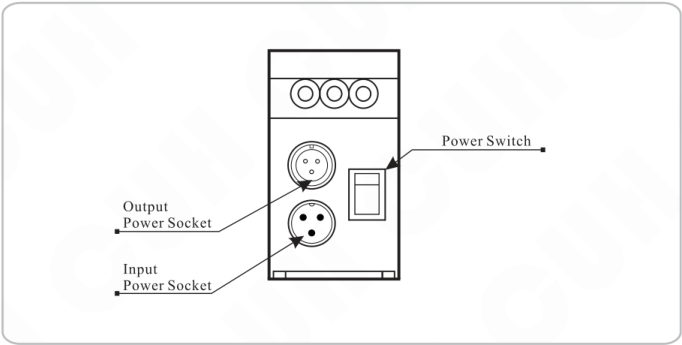

- สวิตช์ปิด/เปิดไฟ
- ซ็อกเก็ตพลังงานเอาต์พุต
- ซ็อกเก็ตพลังงานอินพุต

---

# บทที่ Ⅳ คำอธิบายฟังก์ชัน

## 4.1 การตั้งค่าแรงดันเอาต์พุต

แรงดันเอาต์พุตสามารถตั้งค่าได้อย่างตรงไปตรงมาในรูปแบบดิจิทัลผ่านแผงควบคุม ด้วยฟังก์ชันรักษาแรงดันไฟฟ้าอันเป็นเอกลักษณ์ แรงดันเอาต์พุตของตัวควบคุมจะไม่ผันผวนตามแรงดันอินพุต และตัวสั่นสะเทือนสามารถทำงานได้อย่างเสถียรในสภาพแวดล้อมที่แรงดันอินพุตไม่เสถียร

- เปิดสวิตช์ไฟ
- ไฟแสดงสถานะแรงดันเอาต์พุตจะสว่างขึ้นเมื่อตัวควบคุมเข้าสู่สถานะปรับค่าแรงดันเอาต์พุต โดยจอ LED จะแสดงสัญลักษณ์แรงดันไฟฟ้า U พร้อมค่าแรงดันที่ตั้งไว้ก่อนหน้า
- ปรับค่าแรงดันเอาต์พุตโดยกดปุ่ม **Vol+** หรือ **Vol-**

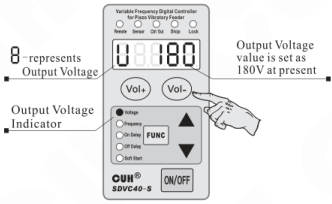

SDVC40-S: ช่วงแรงดันเอาต์พุตอยู่ระหว่าง 0V ~ 260V  
SDVC40-SD: ช่วงแรงดันเอาต์พุตอยู่ระหว่าง 0.0V ~ 50.0V

> สามารถปรับแรงดันเอาต์พุตได้ในสถานะปรับค่าพารามิเตอร์พื้นฐานหรือสถานะปรับค่าพารามิเตอร์ขั้นสูงใด ๆ โดยกดปุ่ม **Vol+** หรือ **Vol-** หลังจากปรับแรงดันเอาต์พุตแล้ว ตัวควบคุมจะกลับสู่สถานะปรับค่าพารามิเตอร์ก่อนหน้า

---

## 4.2 การปรับความถี่เอาต์พุต

ตัวควบคุมผลิตด้วยเทคโนโลยี DDS ทำให้เอาต์พุตมีความแม่นยำและความเสถียรของความถี่ในระดับสูง ซึ่งจะไม่เปลี่ยนแปลงตามเวลาหรืออุณหภูมิ

- กดปุ่ม **FUNC** ค้างไว้ 2 วินาที เพื่อเข้าสู่สถานะปรับค่าพารามิเตอร์พื้นฐาน
- ไฟแสดงสถานะความถี่บนแผงควบคุมจะสว่างขึ้น และจอ LED จะแสดงสัญลักษณ์ความถี่เอาต์พุต E พร้อมค่าความถี่เอาต์พุตปัจจุบัน
- กดปุ่ม ▲ หรือ ▼ เพื่อปรับค่าพารามิเตอร์

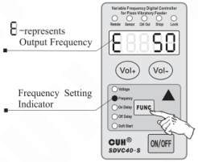

ความถี่เอาต์พุตของตัวควบคุมอยู่ในช่วงตั้งแต่ 40Hz ถึง 400Hz

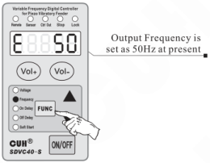

- สามารถตั้งค่าความถี่เอาต์พุต (E) เวลาหน่วงเปิด เวลาหน่วงปิด และเวลาสตาร์ทแบบนุ่มนวลได้ หลังจากเข้าสู่สถานะปรับค่าพารามิเตอร์พื้นฐานโดยกดปุ่ม **FUNC** ค้างไว้ 2 วินาที
- ตัวควบคุมจะกลับสู่สถานะปรับค่าแรงดันเอาต์พุตโดยอัตโนมัติภายใน 1 นาที หลังจากการปรับค่า
- กดปุ่ม **FUNC** ค้างไว้ 2 วินาทีอีกครั้ง เพื่อออกจากสถานะปรับค่าพารามิเตอร์พื้นฐาน

---

## 4.3 สตาร์ทแบบนุ่มนวล

เพื่อหลีกเลี่ยงการกระแทกอย่างกะทันหันที่เกิดขึ้นกับชิ้นงาน ตัวควบคุมสามารถเพิ่มแรงดันเอาต์พุตจาก 0 ไปยังค่าที่ตั้งไว้ล่วงหน้าอย่างนุ่มนวลเมื่อเริ่มทำงาน

เวลาสตาร์ทแบบนุ่มนวล ( t ): ระยะเวลาที่ตัวควบคุมใช้ในการเพิ่มแรงดันเอาต์พุตจาก 0 ไปยังค่าที่ตั้งไว้ล่วงหน้าอย่างนุ่มนวลเมื่อเริ่มทำงาน

- กดปุ่ม `FUNC` ค้างไว้ 2 วินาที เพื่อเข้าสู่สถานะปรับค่าพารามิเตอร์พื้นฐาน
- กดปุ่ม `FUNC` ซ้ำ ๆ จนกระทั่งเข้าสู่สถานะปรับค่าเวลาสตาร์ทแบบนุ่มนวล (t) โดยไฟแสดงสถานะสตาร์ทแบบนุ่มนวลจะสว่างขึ้น
- กดปุ่ม ▲ หรือ ▼ เพื่อปรับค่าพารามิเตอร์ หน่วยของพารามิเตอร์เป็นวินาที และความละเอียดของค่าตัวเลขคือ 0.1

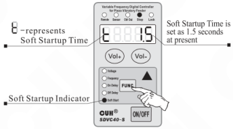

ช่วงเวลาสตาร์ทแบบนุ่มนวลที่ปรับได้อยู่ระหว่าง 0.1 วินาที ถึง 9.9 วินาที

## 4.4 ปุ่มสวิตช์เอาต์พุต

ปุ่มสวิตช์แบบสัมผัสนุ่มนวลบนแผงควบคุมสามารถเปิด/ปิดเอาต์พุตของตัวควบคุมได้อย่างรวดเร็วและง่ายดาย

- กดปุ่ม `ON/OFF` เพื่อเปิด/ปิดเอาต์พุตของตัวควบคุม ไฟแสดงสถานะหยุดทำงานจะสว่างขึ้นเมื่อเอาต์พุตของตัวควบคุมถูกปิด

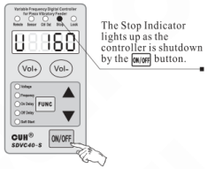

> ด้วยสวิตช์แบบสัมผัสนุ่มนวลและเทคโนโลยีการควบคุมสัญญาณดิจิทัล จะไม่เกิดประกายไฟฟ้าที่ทำลายจุดสัมผัส ผลที่ได้คืออายุการใช้งานของตัวควบคุมและตัวสั่นสะเทือนจะยืดยาวขึ้นอย่างมาก

---

## 4.5 การจำกัดแรงดันเอาต์พุตสูงสุด

สามารถตั้งค่าแรงดันเอาต์พุตสูงสุดของตัวควบคุมเพื่อป้องกันความเสียหายต่อตัวสั่นสะเทือน ฟังก์ชันตัวควบคุมความเร็วระยะไกลจะได้รับผลกระทบจากพารามิเตอร์นี้

- กดปุ่ม `FUNC` และ ▲ พร้อมกันค้างไว้ 2 วินาที เพื่อเข้าสู่สถานะปรับค่าพารามิเตอร์ขั้นสูง
- กดปุ่ม `FUNC` ซ้ำ ๆ จนกระทั่งเข้าสู่สถานะจำกัดแรงดันเอาต์พุตสูงสุด (h)
- กดปุ่ม ▲ หรือ ▼ เพื่อปรับค่าพารามิเตอร์

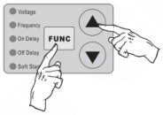

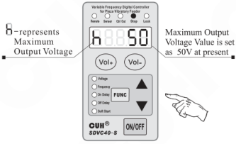

- ค่าแรงดันเอาต์พุตจะไม่เกินค่าพารามิเตอร์นี้ในทุกกรณี
- ค่าเริ่มต้นของพารามิเตอร์นี้ตั้งไว้เท่ากับค่าแรงดันเอาต์พุตสูงสุดที่ปรับได้

### วิธีออกจากสถานะปรับค่าพารามิเตอร์ขั้นสูง

- ตัวควบคุมจะออกไปยังสถานะปรับค่าแรงดันเอาต์พุตโดยอัตโนมัติภายใน 1 นาที หลังจากปรับค่าพารามิเตอร์ขั้นสูง
- กดปุ่ม `FUNC` และ ▲ ค้างไว้ 2 วินาที เพื่อออกไปยังสถานะปรับค่าแรงดันเอาต์พุต
- กดปุ่ม `FUNC` ค้างไว้ 2 วินาที เพื่อออกไปยังสถานะปรับค่าพารามิเตอร์พื้นฐาน

---

## 4.6 การล็อกแผงปุ่มกด

ฟังก์ชันการล็อกแผงปุ่มกดสามารถล็อกปุ่มทั้งหมดบนแผงควบคุมเพื่อหลีกเลี่ยงการทำงานผิดพลาด

- กดปุ่ม `ON/OFF` ค้างไว้ 2 วินาที เพื่อล็อกปุ่มทั้งหมดบนแผงควบคุม โดยไฟแสดงสถานะล็อกแผงปุ่มกดจะสว่างขึ้น
- กดปุ่ม `ON/OFF` ค้างไว้ 2 วินาทีในโหมดล็อก เพื่อปลดล็อกแผงปุ่มกด

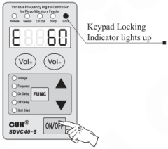

---

## 4.7 การตั้งค่าสถานะการทำงานเมื่อจ่ายไฟ

เพื่อรองรับกรณีไฟดับกระทันหันในสภาวะปกติแล้วไฟกลับมาอีกครั้ง หรือความต้องการเฉพาะเจาะจงต่อสถานะเมื่อจ่ายไฟของตัวควบคุม ท่านสามารถตั้งค่าพารามิเตอร์นี้เพื่อกำหนดให้สถานะเมื่อจ่ายไฟของตัวควบคุมเป็นการทำงาน หยุดทำงาน หรือตามสถานะของการปิดครั้งล่าสุด

- กดปุ่ม **FUNC** และ ▲ พร้อมกันค้างไว้ 2 วินาที เพื่อเข้าสู่สถานะปรับค่าพารามิเตอร์ขั้นสูง
- กดปุ่ม **FUNC** ซ้ำ ๆ จนกระทั่งเข้าสู่สถานะการทำงานเมื่อจ่ายไฟ (Γd)
- กดปุ่ม ▲ หรือ ▼ เพื่อปรับค่าพารามิเตอร์

>  แสดงว่าสถานะเมื่อจ่ายไฟคือเปิด
>
>  แสดงว่าสถานะเมื่อจ่ายไฟคือปิด
>
>  แสดงว่าสถานะเมื่อจ่ายไฟจะตามสถานะของการปิดครั้งล่าสุด (หากตัวควบคุมหยุดเอาต์พุตเมื่อปิดครั้งล่าสุด ครั้งต่อไปที่จ่ายไฟตัวควบคุมจะอยู่ในสถานะปิด ในทางกลับกันหากตัวควบคุมเปิดเอาต์พุตอยู่เมื่อปิดครั้งล่าสุด ตัวควบคุมจะอยู่ในสถานะเปิดเมื่อจ่ายไฟในครั้งต่อไป)

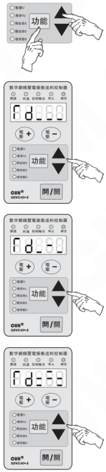

---

## 4.8 การคืนค่าการตั้งค่าจากโรงงาน

ฟังก์ชันนี้อนุญาตให้ผู้ใช้งานคืนค่าการตั้งค่าพารามิเตอร์เริ่มต้นทั้งหมด

เนื่องจากตัวควบคุมมีฟังก์ชันมากมาย จึงมีพารามิเตอร์จำนวนมากที่สามารถปรับได้ เพื่อหลีกเลี่ยงสถานการณ์ที่ผู้เริ่มต้นใช้งานแก้ไขหลายครั้งจนตัวควบคุมทำงานได้ไม่ปกติ ฟังก์ชันนี้จึงอนุญาตให้ผู้ใช้งานคืนค่าการตั้งค่าเริ่มต้นให้แก่ตัวควบคุมได้อย่างง่ายดาย

- กดปุ่ม **FUNC** และ **▲** พร้อมกันค้างไว้ 2 วินาที เพื่อเข้าสู่สถานะปรับค่าพารามิเตอร์ขั้นสูง

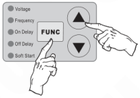

- กดปุ่ม **FUNC** ซ้ำ ๆ จนกระทั่งตัวเลข 88888 กะพริบบนจอแสดงผล LED แล้วกดปุ่ม **▲** ค้างไว้จนกระทั่งแสดง ----- ซึ่งหมายความว่าคืนค่าการตั้งค่าเริ่มต้นสำเร็จแล้ว

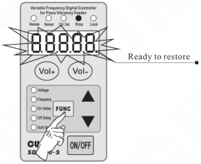

- หลังจากปล่อยปุ่ม **▲** ตัวควบคุมจะเข้าสู่สถานะปรับค่าแรงดันเอาต์พุต (U) ในขณะนั้น พารามิเตอร์ทั้งหมดจะถูกคืนกลับเป็นค่าเริ่มต้นแล้ว

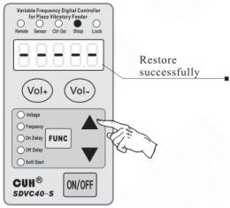

---

# บทที่ Ⅴ เซนเซอร์และการควบคุมสัญญาณ

ตัวควบคุมสามารถถูกควบคุมด้วยสัญญาณภายนอกและเซ็นเซอร์ได้หลายชนิด บทนี้อธิบายวิธีการใช้งานของเซ็นเซอร์โฟโต้อิเล็กทริกอัจฉริยะ เซ็นเซอร์สวิตช์พร็อกซิมิตี้ และ PLC เป็นหลัก

## 5.1 การตรวจจับแสงอัจฉริยะ

เมื่อใช้ร่วมกับเซ็นเซอร์โฟโต้อิเล็กทริก SDVC-S1 จะสามารถใช้ฟังก์ชันการตรวจจับแสงอัจฉริยะได้ เซ็นเซอร์ SDVC-S1 สามารถกรองสัญญาณรบกวนจากแสงพื้นหลังที่ส่งผลต่อความไวของตัวควบคุม ด้วยเหตุนี้ตัวควบคุมจึงทำงานได้อย่างน่าเชื่อถือโดยไม่ต้องปรับความไวด้วยตนเอง

### 5.1.1 วิธีการเชื่อมต่อเซ็นเซอร์โฟโต้อิเล็กทริกอัจฉริยะ SDVC-S1

**ขั้นตอนที่ 1:**

เปิดแผ่นปิดด้านบนของตัวควบคุม

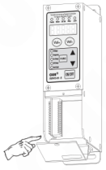

**ขั้นตอนที่ 2:**

เชื่อมต่อเซ็นเซอร์ SDVC-S1 เข้ากับขั้วต่อของตัวควบคุมตามแผนภาพ

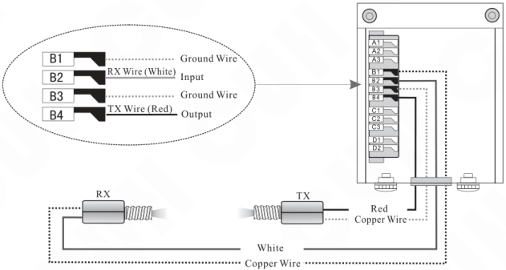

**ข้อสังเกต:**

ความสัมพันธ์ลอจิกเริ่มต้นของเซ็นเซอร์ตั้งไว้ที่กรณีชิ้นงานหมด

---

## 5.1.2 การตั้งค่าเวลาหน่วงเปิดและเวลาหน่วงปิดของเซ็นเซอร์โฟโต้อิเล็กทริกอัจฉริยะ

ในการใช้งานจริงส่วนใหญ่ เอาต์พุตของตัวควบคุมควรถูกหน่วงเวลาไว้ระยะหนึ่ง เมื่อการเปิดหรือปิดตัวควบคุมถูกควบคุมด้วยสัญญาณภายนอก ฟังก์ชันปรับค่าเวลาหน่วงเปิดและเวลาหน่วงปิดทำให้การใช้งานลักษณะนี้เป็นไปได้ นอกจากนี้ การกระแทกต่อชิ้นงานเมื่อตัวควบคุมเริ่มทำงานสามารถกำจัดได้โดยการตั้งค่าเวลาสตาร์ทแบบนุ่มนวล

### เวลาหน่วงเปิด (J)

ระยะเวลาที่ตัวควบคุมใช้ตั้งแต่ได้รับสัญญาณควบคุมเปิดจนถึงการเอาต์พุต

- กดปุ่ม **FUNC** ค้างไว้ 2 วินาที เพื่อเข้าสู่สถานะปรับค่าพารามิเตอร์พื้นฐาน
- กดปุ่ม **FUNC** ซ้ำ ๆ จนกระทั่งเข้าสู่สถานะปรับค่าเวลาหน่วงเปิด (J) โดยไฟแสดงสถานะเวลาหน่วงเปิดบนแผงควบคุมจะสว่างขึ้น
- ปรับค่าพารามิเตอร์โดยกดปุ่ม ▲ หรือ ▼ หน่วยของพารามิเตอร์เป็นวินาที และความละเอียดของค่าตัวเลขคือ 0.1

ช่วงค่าที่ปรับได้ของพารามิเตอร์อยู่ระหว่าง 0.0 ถึง 9.9 วินาที  
ค่าเริ่มต้นของพารามิเตอร์คือ 0.2 วินาที

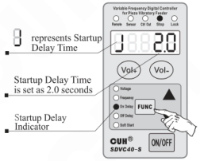

### เวลาหน่วงปิด (L)

ระยะเวลาที่ตัวควบคุมใช้ตั้งแต่ได้รับสัญญาณควบคุมปิดจนถึงการตัดเอาต์พุต

- กดปุ่ม **FUNC** ค้างไว้ 2 วินาที เพื่อเข้าสู่สถานะปรับค่าพารามิเตอร์พื้นฐาน
- กดปุ่ม **FUNC** ซ้ำ ๆ จนกระทั่งเข้าสู่สถานะปรับค่าเวลาหน่วงปิด (L) โดยไฟแสดงสถานะเวลาหน่วงปิดบนแผงควบคุมจะสว่างขึ้น
- ปรับค่าพารามิเตอร์โดยกดปุ่ม ▲ หรือ ▼ หน่วยของพารามิเตอร์เป็นวินาที และความละเอียดของค่าตัวเลขคือ 0.1

ช่วงค่าที่ปรับได้ของพารามิเตอร์อยู่ระหว่าง 0.0 ถึง 9.9 วินาที  
ค่าเริ่มต้นของพารามิเตอร์คือ 0.2 วินาที

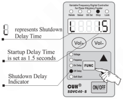

---

## 5.1.3 การตั้งค่าความสัมพันธ์ลอจิกของเซ็นเซอร์โฟโต้อิเล็กทริกอัจฉริยะ

ในสภาวะปกติ ปลายรับจะไม่ได้รับสัญญาณแสง และตัวควบคุมจะทำงานตามค่าเริ่มต้น แต่ในการใช้งานเฉพาะบางกรณี จำเป็นต้องให้ตัวควบคุมหยุดทำงานเมื่อปลายรับไม่ได้รับสัญญาณแสง การปรับพารามิเตอร์นี้สามารถตอบสนองการใช้งานลักษณะนี้ได้

- กดปุ่ม **FUNC** และ ▲ พร้อมกันค้างไว้ 2 วินาที เพื่อเข้าสู่สถานะปรับค่าพารามิเตอร์ขั้นสูง
- กดปุ่ม **FUNC** ซ้ำ ๆ จนกระทั่งเข้าสู่สถานะปรับค่าความสัมพันธ์ลอจิกของเซ็นเซอร์โฟโต้อิเล็กทริกอัจฉริยะ
- ปรับค่าพารามิเตอร์โดยกดปุ่ม ▲ หรือ ▼

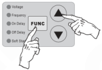

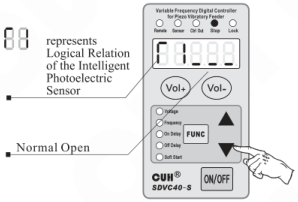

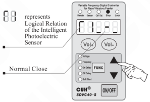

- เมื่อความสัมพันธ์ลอจิกตั้งเป็น Normal Open กล่าวคือไม่ได้รับสัญญาณแสง ตัวควบคุมจะทำงาน
- เมื่อความสัมพันธ์ลอจิกตั้งเป็น Normal Close กล่าวคือไม่ได้รับสัญญาณแสง ตัวควบคุมจะหยุดทำงาน

---

## 5.2 วิธีใช้งานเซ็นเซอร์สวิตช์แบบ NPN (หยุดเมื่อชิ้นงานเต็ม)

ตัวควบคุมสามารถทำงานร่วมกับเซ็นเซอร์ได้หลากหลายชนิด เช่น เซ็นเซอร์สวิตช์ เซ็นเซอร์สวิตช์แสง และเซ็นเซอร์ไฟเบอร์ออปติก

### 5.2.1 วิธีการเชื่อมต่อเซ็นเซอร์สวิตช์พร็อกซิมิตี้แบบ NPN

**ขั้นตอนที่ 1:**

เปิดแผ่นปิดด้านบนของตัวควบคุม

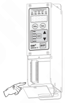

**ขั้นตอนที่ 2:**

เชื่อมต่อเซ็นเซอร์สวิตช์พร็อกซิมิตี้แบบ NPN เข้ากับขั้วต่อของตัวควบคุมตามแผนภาพ

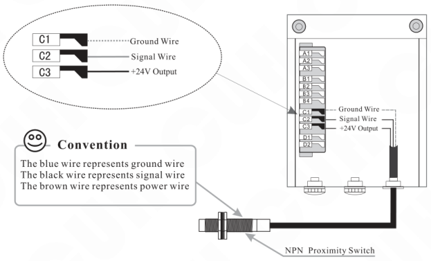

**ข้อกำหนด**

สายสีน้ำเงินคือสายกราวด์  
สายสีดำคือสายสัญญาณ  
สายสีน้ำตาลคือสายไฟเลี้ยง

---

### 5.2.2 วิธีการเชื่อมต่อเซ็นเซอร์สวิตช์แบบส่องผ่าน NPN

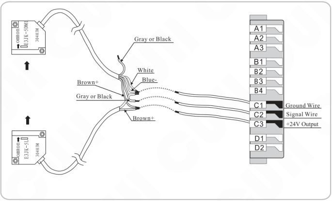

### 5.2.3 วิธีการเชื่อมต่อเซ็นเซอร์โฟโต้อิเล็กทริกแบบส่องผ่าน

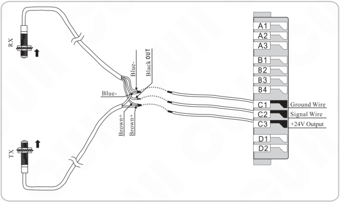

---

## 5.2.4 วิธีการเชื่อมต่อเซ็นเซอร์ไฟเบอร์ออปติกแบบส่องผ่าน

---

## 5.2.5 วิธีการเชื่อมต่อเซ็นเซอร์โฟโต้อิเล็กทริกแบบสะท้อน

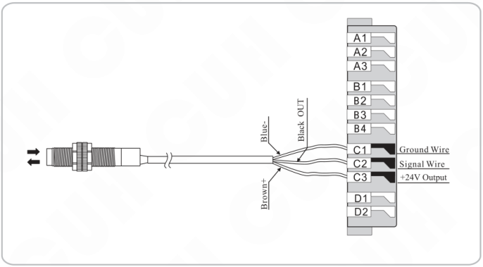

## 5.3 การตั้งค่าเวลาหน่วงเปิดและเวลาหน่วงปิดของเซ็นเซอร์สวิตช์แบบ NPN

โดยค่าเริ่มต้น เซ็นเซอร์โฟโต้อิเล็กทริกอัจฉริยะและเซ็นเซอร์สวิตช์จะใช้เวลาหน่วงเปิดและเวลาหน่วงปิดชุดเดียวกัน ผู้ใช้งานยังสามารถตั้งค่าเวลาหน่วงเปิดและเวลาหน่วงปิดแยกต่างหากสำหรับเซ็นเซอร์สวิตช์ได้อีกด้วย

### เวลาหน่วงเปิด (J-)

ระยะเวลาที่ตัวควบคุมใช้ตั้งแต่ได้รับสัญญาณควบคุมเปิดจนถึงการเอาต์พุต

- กดปุ่ม **FUNC** และ **▲** พร้อมกันค้างไว้ 2 วินาที เพื่อเข้าสู่สถานะปรับค่าพารามิเตอร์ขั้นสูง
- กดปุ่ม **FUNC** ซ้ำ ๆ จนกระทั่งเข้าสู่สถานะปรับค่าเวลาหน่วงเปิด (J- ---) โดยไฟแสดงสถานะเวลาหน่วงเปิดบนแผงควบคุมจะสว่างขึ้น
- ปรับค่าพารามิเตอร์โดยกดปุ่ม **▲** หรือ **▼** หน่วยของพารามิเตอร์เป็นวินาที และความละเอียดของค่าตัวเลขคือ 0.1

โดยค่าเริ่มต้นเวลาหน่วงเปิดตั้งไว้ที่ J- ---

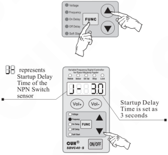

### เวลาหน่วงปิด (L-)

ระยะเวลาที่ตัวควบคุมใช้ตั้งแต่ได้รับสัญญาณควบคุมปิดจนถึงการตัดเอาต์พุต

- กดปุ่ม **FUNC** และ **▲** พร้อมกันค้างไว้ 2 วินาที เพื่อเข้าสู่สถานะปรับค่าพารามิเตอร์ขั้นสูง
- กดปุ่ม **FUNC** ซ้ำ ๆ จนกระทั่งเข้าสู่สถานะปรับค่าเวลาหน่วงปิด (L-) โดยไฟแสดงสถานะเวลาหน่วงปิดบนแผงควบคุมจะสว่างขึ้น
- ปรับค่าพารามิเตอร์โดยกดปุ่ม **▲** หรือ **▼** หน่วยของพารามิเตอร์เป็นวินาที และความละเอียดของค่าตัวเลขคือ 0.1

โดยค่าเริ่มต้นเวลาหน่วงปิดตั้งไว้ที่ L- ---

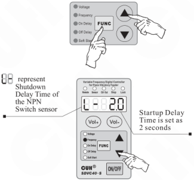

> ➔ เมื่อค่าของ J- และ L- ถูกปรับเป็น 0 เวลาหน่วงเปิดและเวลาหน่วงปิดของเซ็นเซอร์สวิตช์จะเท่ากับเวลาหน่วงเปิดและเวลาหน่วงปิดของเซ็นเซอร์โฟโต้อิเล็กทริกอัจฉริยะ
>
> ➔ เวลาหน่วงเปิดและเวลาหน่วงปิดของเซ็นเซอร์โฟโต้อิเล็กทริกอัจฉริยะจะไม่ได้รับผลกระทบจากพารามิเตอร์ J- หรือ L-

---

## 5.4 การตั้งค่าความสัมพันธ์ลอจิกของเซ็นเซอร์สวิตช์แบบ NPN (หยุดเมื่อชิ้นงานเต็ม)

ในสภาวะปกติ ตัวควบคุมจะไม่ได้รับสัญญาณจากเซ็นเซอร์สวิตช์แบบ NPN และจะทำงานตามค่าเริ่มต้น แต่ในการใช้งานเฉพาะบางกรณี จำเป็นต้องให้ตัวควบคุมหยุดทำงานเมื่อไม่ได้รับสัญญาณจากเซ็นเซอร์สวิตช์แบบ NPN การปรับพารามิเตอร์นี้สามารถตอบสนองการใช้งานลักษณะนี้ได้

- กดปุ่ม **FUNC** และ ▲ พร้อมกันค้างไว้ 2 วินาที เพื่อเข้าสู่สถานะปรับค่าพารามิเตอร์ขั้นสูง
- กดปุ่ม **FUNC** ซ้ำ ๆ จนกระทั่งเข้าสู่สถานะปรับค่าความสัมพันธ์ลอจิกของเซ็นเซอร์สวิตช์แบบ NPN (Γ 2)
- ปรับค่าพารามิเตอร์โดยกดปุ่ม ▲ หรือ ▼

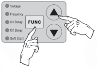

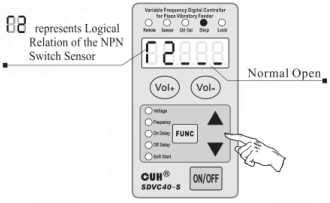

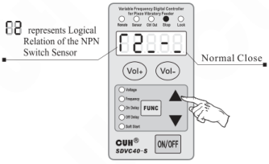

- เมื่อความสัมพันธ์ลอจิกตั้งเป็น Normal Open กล่าวคือไม่ได้รับสัญญาณ ตัวควบคุมจะทำงาน
- เมื่อความสัมพันธ์ลอจิกตั้งเป็น Normal Close กล่าวคือไม่ได้รับสัญญาณ ตัวควบคุมจะหยุดทำงาน

---

## 5.5 การตั้งค่าความสัมพันธ์ลอจิกของสัญญาณควบคุม

ตัวควบคุมสามารถตั้งค่าความสัมพันธ์ลอจิกของเซ็นเซอร์โฟโต้อิเล็กทริกอัจฉริยะและเซ็นเซอร์สวิตช์ เมื่อทั้งสองทำงานพร้อมกัน

- กดปุ่ม **FUNC** และ ▲ พร้อมกันค้างไว้ 2 วินาที เพื่อเข้าสู่สถานะปรับค่าพารามิเตอร์ขั้นสูง
- กดปุ่ม **FUNC** ซ้ำ ๆ จนกระทั่งเข้าสู่สถานะปรับค่าความสัมพันธ์ลอจิกของสัญญาณควบคุม
- ปรับค่าพารามิเตอร์โดยกดปุ่ม ▲ หรือ ▼

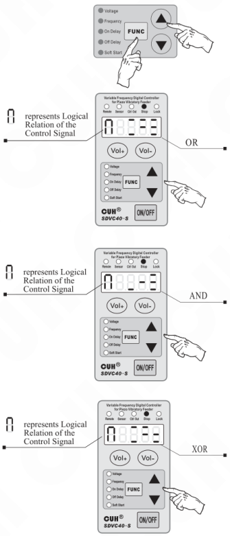

- ความสัมพันธ์ลอจิก AND: ตัวควบคุมจะทำงานเฉพาะเมื่อเซ็นเซอร์โฟโต้อิเล็กทริกอัจฉริยะและเซ็นเซอร์สวิตช์แบบ NPN ต่างสั่งให้ตัวควบคุมทำงาน
- ความสัมพันธ์ลอจิก OR: ตัวควบคุมจะทำงานเมื่อเซ็นเซอร์โฟโต้อิเล็กทริกอัจฉริยะหรือเซ็นเซอร์สวิตช์แบบ NPN สั่งให้ตัวควบคุมทำงาน
- ความสัมพันธ์ลอจิก XOR: ตัวควบคุมจะทำงานเฉพาะเมื่อเซ็นเซอร์โฟโต้อิเล็กทริกอัจฉริยะและเซ็นเซอร์สวิตช์แบบ NPN ส่งสัญญาณควบคุมที่ตรงข้ามกัน

---

## 5.6 วิธีการเชื่อมต่อ PLC ต้นน้ำที่ควบคุมตัวควบคุมเครื่องป้อนวัสดุแบบสั่นสะเทือน

### วิธีการเชื่อมต่อ PLC ที่ใช้ควบคุม

### ขั้นตอนที่ 1:
เปิดแผ่นปิดด้านบนของตัวควบคุม

### ขั้นตอนที่ 2:
เชื่อมต่อ PLC เข้ากับขั้วต่อของตัวควบคุมตามแผนภาพ

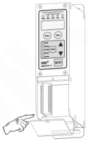

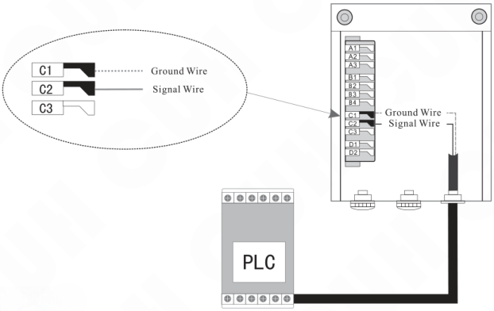

> เอาต์พุตแบบรีเลย์หรือเอาต์พุตแบบ NPN ของ PLC เข้ากันได้กับตัวควบคุม

---

## 5.7 เอาต์พุตควบคุม

ตัวควบคุมสามารถส่งออกสัญญาณควบคุมแรงดันต่ำ เพื่อทำงานร่วมกับอุปกรณ์อื่น เช่น วาล์วโซลินอยด์ PLC หรือรีเลย์ไฟฟ้า

### 5.7.1 วิธีการเชื่อมต่อเอาต์พุตควบคุม

#### วิธีการเชื่อมต่อวาล์วโซลินอยด์

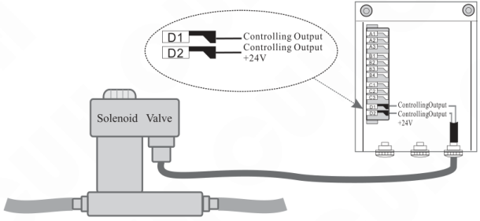

- ตัวควบคุมสามารถขับวาล์วโซลินอยด์โดยตรงที่มีแรงดันพิกัด 24V และกำลังพิกัดต่ำกว่า 4W
- ใช้แหล่งจ่ายไฟภายนอกสำหรับวาล์วโซลินอยด์กำลังสูง

#### วิธีการเชื่อมต่อรีเลย์ไฟฟ้า

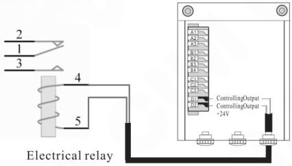

- ตัวควบคุมสามารถขับรีเลย์ไฟฟ้าโดยตรงที่มีแรงดันพิกัด 24V และกำลังพิกัดต่ำกว่า 4W

---

## 5.7.2 การตั้งค่าความสัมพันธ์ลอจิกของเอาต์พุตควบคุม

- กดปุ่ม **FUNC** และ ▲ พร้อมกันค้างไว้ 2 วินาที เพื่อเข้าสู่สถานะปรับค่าพารามิเตอร์ขั้นสูง
- กดปุ่ม **FUNC** ซ้ำ ๆ จนกระทั่งเข้าสู่สถานะปรับค่าความสัมพันธ์ลอจิกของเอาต์พุตควบคุม (Γ3)
- ปรับค่าพารามิเตอร์โดยกดปุ่ม ▲ หรือ ▼

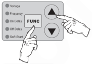

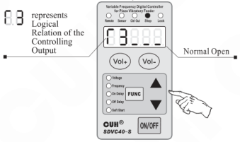

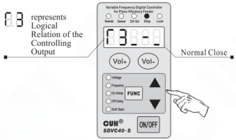

> - เมื่อความสัมพันธ์ลอจิกตั้งเป็น Normal Open เอาต์พุตควบคุมจะทำงานขณะที่ตัวควบคุมทำงาน
> - เมื่อความสัมพันธ์ลอจิกตั้งเป็น Normal Close เอาต์พุตควบคุมจะไม่ทำงานขณะที่ตัวควบคุมทำงาน

---

## 5.8 การควบคุมความเร็วระยะไกล

ฟังก์ชันการควบคุมความเร็วระยะไกลอนุญาตให้ผู้ใช้งานควบคุมแรงดันเอาต์พุตด้วยโพเทนชิออมิเตอร์ภายนอก หรือสัญญาณควบคุมที่มีช่วงตั้งแต่ 1V ถึง 5V ด้วยเหตุนี้การควบคุมความเร็วระยะไกลจากภายนอกจึงสามารถทำได้อย่างง่ายดายผ่าน PLC DCS หรือวิธีการอื่น ๆ

ฟังก์ชันการควบคุมความเร็วระยะไกลจะมีผลต่อตัวควบคุมเมื่อสัญญาณควบคุมเกิน 0.5V ขณะเดียวกันไฟแสดงสถานะการควบคุมความเร็วระยะไกลบนแผงควบคุมจะสว่างขึ้น และปุ่ม Vol+ กับ Vol- จะไม่ทำงาน จอแสดงผล LED จะแสดงแรงดันเอาต์พุตปัจจุบัน หากตัวควบคุมกำลังทำงานในสถานะปรับค่าแรงดันเอาต์พุต

### วิธีการเชื่อมต่อโพเทนชิออมิเตอร์ภายนอก

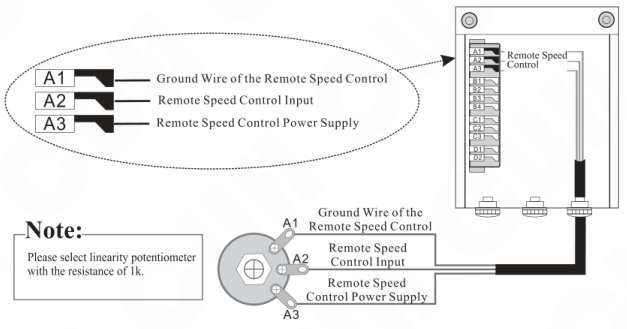

**ข้อสังเกต:** โปรดเลือกโพเทนชิออมิเตอร์แบบเชิงเส้นที่มีค่าความต้านทาน 1k

### วิธีการเชื่อมต่อ PLC

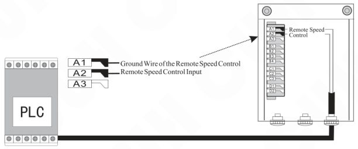

---

## บทที่ Ⅵ ฟังก์ชันความปลอดภัย

### 6.1 การรักษาแรงดันไฟฟ้าอัตโนมัติ

ฟังก์ชันรักษาแรงดันไฟฟ้าดิจิทัลในตัวสามารถกำจัดความผันผวนของความเร็วในการป้อนวัสดุที่เกิดจากความผันผวนของแรงดันไฟฟ้าบ้าน

### 6.2 การป้องกันการลัดวงจร

หากเอาต์พุตของตัวควบคุมถูกลัดวงจร ตัวควบคุมจะหยุดเอาต์พุตจนกว่าจะเริ่มทำงานใหม่

### 6.3 การป้องกันกระแสเกินพิกัด

ตัวควบคุมจะหยุดเอาต์พุตเพื่อความปลอดภัยในการทำงานของอุปกรณ์ เมื่อกระแสทำงานเกินค่าพิกัดที่กำหนด

### 6.4 การป้องกันความร้อนสูงเกินไป

ตัวควบคุมจะหยุดเอาต์พุตเพื่อป้องกันตัวเอง เมื่ออุณหภูมิในการทำงานสูงเกินไป

---

# ภาคผนวก

## ภาคผนวก A: มิติ

มิติภายนอกของรุ่นตัวควบคุม: (หน่วย: มม.)

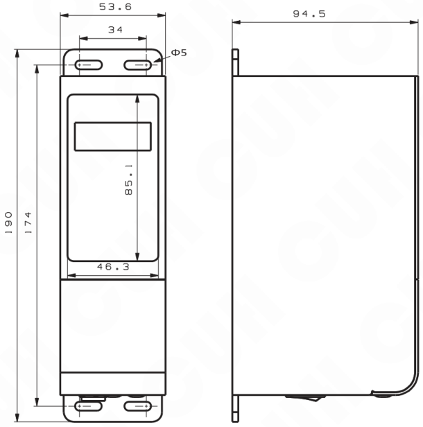

---

## ภาคผนวก B: นิยามอินเทอร์เฟซเอาต์พุต

### ข้อสังเกต:

A: ตรวจสอบให้แน่ใจว่าขดลวดแม่เหล็กไฟฟ้าของตัวสั่นสะเทือนเชื่อมต่อกับขาเอาต์พุตทั้งสองขาของซ็อกเก็ตสายพลังงานเอาต์พุต และเปลือกของตัวสั่นสะเทือนต่อกราวด์อย่างถูกต้อง มิฉะนั้นอาจเกิดเหตุการณ์ด้านความปลอดภัยร้ายแรงขึ้นได้

B: หลังจากบัดกรีแล้ว ตรวจสอบให้แน่ใจว่าส่วนที่เปลือยเปล่าถูกพันด้วยเทปฉนวนหรือท่อหดแบบอบร้อน ก่อนนำไปเสียบเข้ากับซ็อกเก็ตสายพลังงานเอาต์พุต เพื่อหลีกเลี่ยงกระแสไฟรั่วหรือการลัดวงจร

## ภาคผนวก C: นิยามอินเทอร์เฟซสัญญาณ

---

## ภาคผนวก D: ตารางฟังก์ชัน

| ตัวควบคุม | อักขระที่แสดง | สัญลักษณ์จอแสดงผลดิจิทัล |
|---|---|---|
| U | แรงดันเอาต์พุต |  |
| E | ความถี่เอาต์พุต |  |
| J | เวลาหน่วงเปิดของเซ็นเซอร์โฟโต้อิเล็กทริกอัจฉริยะ |  |
| L | เวลาหน่วงปิดของเซ็นเซอร์โฟโต้อิเล็กทริกอัจฉริยะ |  |
| t | สตาร์ทแบบนุ่มนวล |  |
| L- | เวลาหน่วงปิดของเซ็นเซอร์สวิตช์แบบ NPN |  |
| J- | เวลาหน่วงเปิดของเซ็นเซอร์สวิตช์แบบ NPN |  |
| r1 | ความสัมพันธ์ลอจิกของเซ็นเซอร์โฟโต้อิเล็กทริกอัจฉริยะ |  |
| r2 | ความสัมพันธ์ลอจิกของเซ็นเซอร์สวิตช์แบบ NPN |  |
| r3 | ความสัมพันธ์ลอจิกของเอาต์พุตควบคุม |  |
| rd | สถานะการทำงานเมื่อจ่ายไฟ |  |
| A | ความสัมพันธ์ลอจิกของสัญญาณควบคุม |  |
| h | แรงดันเอาต์พุตสูงสุด |  |
| 8.8.8.8.8. | การคืนค่าการตั้งค่าจากโรงงาน |  |

---

## ภาคผนวก E: ข้อมูลจำเพาะทางไฟฟ้า

| รายการ | ช่วงค่าต่ำสุด | ช่วงค่าปกติ | ช่วงค่าสูงสุด | หน่วย | คำอธิบาย |
|---|---|---|---|---|---|
| แรงดันอินพุต | 85 | 220 | 260 | V | AC RMS |
| ช่วงปรับแรงดันเอาต์พุต | 0 | —— | 220 | V | SDVC40-S |
| ช่วงปรับแรงดันเอาต์พุต | 0.0 | —— | 50.0 | V | SDVC40-SD |
| ความละเอียดในการปรับแรงดัน | | 1 | | V | SDVC40-S |
| ความละเอียดในการปรับแรงดัน | | 0.1 | | V | SDVC40-SD |
| ความแม่นยำในการรักษาแรงดันไฟฟ้า | 0 | —— | 10 | % | ΔVout/ΔVin |
| เวลาตอบสนองของการรักษาแรงดันไฟฟ้า | 0.0025 | —— | 0.025 | s | คาบของแรงดันเอาต์พุต |
| ช่วงปรับกระแสเอาต์พุต | 0 | —— | 150 | mA | SDVC40-S |
| ช่วงปรับกระแสเอาต์พุต | 0 | —— | 600 | mA | SDVC40-SD |
| กำลังเอาต์พุต | 0 | —— | 33 | VA | SDVC40-S |
| กำลังเอาต์พุต | 0 | —— | 30 | VA | SDVC40-SD |
| ความถี่เอาต์พุต | 40 | —— | 400 | Hz | |
| ความละเอียดในการปรับความถี่ | | 0.1 | | Hz | |
| รูปคลื่นเอาต์พุต | | คลื่นไซน์ | | | |
| เวลาสตาร์ทแบบนุ่มนวล | 0 | —— | 10 | s | ค่าเริ่มต้นจากโรงงาน: 0.5 |
| ช่วงเวลาหน่วงเปิด/ปิด | 0 | —— | 20 | s | ค่าเริ่มต้นจากโรงงาน: 0.2 |
| ความละเอียดของเวลาหน่วงเปิด/ปิด | | 0.1 | | s | |
| อุณหภูมิกระตุ้นการป้องกันความร้อนสูงเกินไป | 60 | —— | 65 | °C | |
| แรงดันเอาต์พุตควบคุมไฟกระแสตรง | 22 | 24 | 26 | V | |
| กระแสเอาต์พุตควบคุมไฟกระแสตรง | 0 | —— | 200 | mA | |
| สัญญาณควบคุมแบบอะนาล็อก | | 1-5 | | V | แรงดันควบคุมความเร็วระยะไกล |
| สัญญาณควบคุมแบบดิจิทัล | | 24 | | V | สัญญาณสวิตช์ |
| วิธีการปรับค่า | | 6 | | ปุ่ม | |
| การใช้พลังงานในโหมดสแตนด์บาย | —— | 4 | —— | W | |
| วิธีการแสดงผล | | 5 | | ตัวเลข | หลอดดิจิทัล LED |
| อุณหภูมิแวดล้อม | 0 | 25 | 40 | °C | ไม่มีการควบแน่น |
| ความชื้นสัมพัทธ์แวดล้อม | 10 | 60 | 85 | % | ไม่มีการควบแน่น |

---

## ภาคผนวก F: คำแนะนำการแก้ไขปัญหาและคำอธิบายรหัสข้อผิดพลาด

คำแนะนำต่อไปนี้สามารถช่วยแก้ไขปัญหาที่ท่านอาจพบเจอได้

| | | | สัญลักษณ์จอแสดงผลดิจิทัล |
|---|---|---|---|
| 1 | ไม่แสดงผลหลังจากจ่ายไฟ | ◆ ตรวจสอบว่าปลั๊กไฟมีไฟฟ้า ◆ ตรวจสอบว่าสายไฟอินพุตเชื่อมต่อกับปลั๊กไฟอย่างถูกต้อง | |
| 2 | แสดงผลปกติแต่ไม่มีเอาต์พุต | ◆ ตรวจสอบว่าสายไฟอินพุตและสายพลังงานเอาต์พุตเชื่อมต่อแน่นหนา ◆ ตรวจสอบว่าค่าพารามิเตอร์แรงดันเอาต์พุตไม่ต่ำเกินไป ◆ ตรวจสอบว่าตัวควบคุมไม่ถูกหยุดโดยสัญญาณควบคุม ◆ ตรวจสอบว่าตัวควบคุมไม่ถูกหยุดโดยพารามิเตอร์ที่ตั้งเป็นปิดแบบปกติ | |
| 3 | สัญญาณควบคุมไม่ทำงาน | ◆ ตรวจสอบว่าสัญญาณควบคุมถูกป้อนอย่างถูกต้อง ◆ ตรวจสอบว่าสายกราวด์ของสัญญาณควบคุมเชื่อมต่อกับตัวควบคุมอย่างถูกต้อง ◆ ตรวจสอบว่าความสัมพันธ์ลอจิกของสัญญาณควบคุมตั้งค่าถูกต้องตามที่ท่านต้องการ | |
| 4 | ปรากฏการณ์การเต้นจังหวะชนกัน | ◆ หลีกเลี่ยงการส่งผ่านการสั่นสะเทือนระหว่างตัวสั่นสะเทือนหลายตัว ◆ เพิ่มความถี่รีโซแนนซ์ของตัวสั่นสะเทือน | |
| 5 | แสดงผลปกติ ไม่มีเอาต์พุต แต่ได้ยินเสียง | ◆ ปรับพารามิเตอร์ทั้งหมดตามที่คู่มือเล่มนี้แนะนำ | |
| 6 | Err01 | ◆ เอาต์พุตถูกลัดวงจร ตรวจสอบว่าสายพลังงานเอาต์พุตและขดลวดไม่ถูกลัดวงจร |  |
| 7 | Err02 | ◆ กระแสเอาต์พุตเกินขีด ลดค่าแรงดันเอาต์พุตและตรวจสอบว่าช่องว่างอาร์เมเจอร์ไม่ใหญ่เกินไป |  |
| 8 | Err03 | ◆ ความร้อนสูงเกินไป วางตัวควบคุมในสภาพแวดล้อมที่มีการระบายอากาศดี |  |
| 9 | Err04 | ◆ สงวนไว้ โปรดติดต่อเรา |  |
| 10 | Err05 | ◆ สงวนไว้ โปรดติดต่อเรา |  |

---

Nanjing CUH Science & Technology Co.,Ltd  
https://en.cuhnj.com  
Tel.:+86-25-84730411 / 84730415 / 84730416  
Fax:+86-25-84730426  
E-mail:sales@cuhnj.com  
Add.:Building 2, Xueyan Tech Park, Tuscity,  
No.9 Zhineng Rd, Jiangning, Nanjing, China

