## ตัวควบคุมอัจฉริยะแบบปรับความถี่ได้สำหรับเครื่องป้อนวัสดุแบบสั่นสะเทือนพีโซอิเล็กทริก

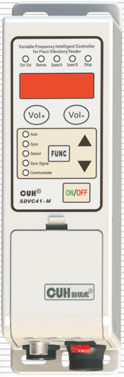

## SDVC41 Series
ตัวควบคุมอัจฉริยะแบบปรับความถี่ได้สำหรับเครื่องป้อนวัสดุแบบสั่นสะเทือนพีโซอิเล็กทริก　 SDVC41 Series
## คู่มือการใช้งาน

---

## บทนำ

ขอขอบคุณที่ท่านเลือกใช้ตัวควบคุมอัจฉริยะแบบปรับความถี่ได้สำหรับเครื่องป้อนวัสดุแบบสั่นสะเทือนพีโซอิเล็กทริก CUH

(ต่อไปในเอกสารนี้จะเรียกว่า "ตัวควบคุม")

คู่มือฉบับนี้ประกอบด้วยคำแนะนำสำหรับการติดตั้ง การปรับแต่ง การตั้งค่าพารามิเตอร์ การบำรุงรักษา และการแก้ไขปัญหาของตัวควบคุม โปรดอ่านคู่มือฉบับนี้อย่างละเอียดก่อนใช้งานตัวควบคุมและเก็บรักษาไว้อย่างถูกต้อง

---

---

## ข้อควรระวัง

1. ห้ามเสียบหรือถอดสายไฟ และห้ามสัมผัสเต้ารับไฟฟ้าขณะที่ตัวควบคุมเปิดอยู่ เพื่อป้องกันไฟดูดหรืออุบัติเหตุอื่น ๆ
2. ห้ามเชื่อมต่อตัวควบคุมกับไฟ AC 380V ซึ่งอาจทำให้เกิดความเสียหายที่ไม่สามารถซ่อมแซมได้ (เรามีผลิตภัณฑ์ที่ออกแบบสำหรับไฟ AC 380V)
3. ห้ามสลับอินพุตของตัวควบคุมโดยการตัดแหล่งจ่ายไฟเพื่อเปิด/ปิดเอาต์พุต มิฉะนั้นอาจลดอายุการใช้งานของตัวควบคุม
4. ห้ามใช้งานตัวควบคุมในสภาวะที่เกินขีดจำกัดการออกแบบ
5. ให้ใช้งานตัวควบคุมตามคู่มือฉบับนี้อย่างเคร่งครัด เราจะไม่รับผิดชอบทางแพ่งหรือทางอาญาใด ๆ หากเกิดความเสียหายต่ออุปกรณ์หรือการบาดเจ็บต่อบุคคลอันเนื่องมาจากการใช้งานที่ไม่ถูกต้อง

> ห้ามเปิดเปลือกตัวควบคุมเพื่อหลีกเลี่ยงไฟดูด หากตัวควบคุมขัดข้องโปรดติดต่อ CUH ห้ามพยายามซ่อมแซมตัวควบคุมด้วยตนเอง ซึ่งอาจทำให้การรับประกันเป็นโมฆะ

---

## สภาพแวดล้อมในการใช้งานและการจัดเก็บ

### การตรวจสอบก่อนใช้งาน

ตัวควบคุมทุกเครื่องจะผ่านการตรวจสอบคุณภาพอย่างเข้มงวดก่อนส่งมอบ และบรรจุในบรรจุภัณฑ์กันกระแทก โปรดตรวจสอบรายการต่อไปนี้หลังจากเปิดกล่อง:

1. ตัวควบคุมมีความเสียหายภายนอกหรือไม่
2. รุ่นของตัวควบคุมตรงกับที่ท่านสั่งซื้อหรือไม่

### สภาพแวดล้อมการทำงาน

โปรดปฏิบัติตามข้อสังเกตต่อไปนี้เพื่อให้ตัวควบคุมมีสมรรถนะที่ดีขึ้นและอายุการใช้งานที่ยาวนานขึ้น:

- ⚠ สภาพแวดล้อมที่มีการระบายอากาศที่ดี
- ⚠ ห่างไกลจากน้ำ ลำธาร ฝุ่น และโดยเฉพาะฝุ่นที่ปนเปื้อนน้ำมัน
- ⚠ ห่างไกลจากแก๊สและของเหลวที่กัดกร่อนหรือไวไฟ
- ⚠ ห่างไกลจากฝุ่นลอยและอนุภาคโลหะ
- ⚠ ยึดติดอย่างมั่นคงเพื่อหลีกเลี่ยงการสั่นสะเทือนของตัวเอง
- ⚠ ห่างไกลจากสัญญาณรบกวนแม่เหล็กไฟฟ้า
- ⚠ ตรวจสอบให้แน่ใจว่าอุณหภูมิแวดล้อมอยู่ที่ 0~40 °C
- ⚠ ใช้งานที่ระดับความสูง 2000 ม. หรือต่ำกว่า

---

# สารบัญ

- บทที่ I คุณสมบัติ — 1
- บทที่ II คู่มือการติดตั้ง — 2
- บทที่ III คำอธิบายส่วนประกอบ — 4
  - 3.1 คำอธิบายไฟแสดงสถานะ — 4
  - 3.2 คำอธิบายปุ่มกด — 5
  - 3.3 คำอธิบายอินเทอร์เฟซ I/O และอุปกรณ์เสริม — 5
  - 3.4 คำอธิบายพอร์ตควบคุมสัญญาณ — 6
- บทที่ IV การปรับพารามิเตอร์ — 7
  - 4.1 พารามิเตอร์ทั่วไป — 7
  - 4.2 พารามิเตอร์พื้นฐาน — 7
  - 4.3 พารามิเตอร์ขั้นสูง — 8
  - 4.4 พารามิเตอร์ออโต้/ซิงค์ — 9
- บทที่ V โหมดการทำงาน — 10
  - 5.1 โหมดแมนนวล — 10
  - 5.2 โหมดออโต้ — 12
  - 5.3 โหมดกึ่งอัตโนมัติ — 18
  - 5.4 โหมดซิงค์ — 20
- บทที่ VI การควบคุมสัญญาณ — 27
  - 6.1 การควบคุมเปิด/ปิดของพอร์ต C — 27
  - 6.2 การควบคุมเปิด/ปิดของพอร์ต E — 34
  - 6.3 พารามิเตอร์ทั่วไปของพอร์ต C และพอร์ต E — 37
  - 6.4 การควบคุมความเร็วระยะไกล — 39
  - 6.5 การบันทึกและเอาต์พุตความเร็วที่ตั้งไว้ล่วงหน้า — 41
  - 6.6 การสื่อสาร RS485 — 42
  - 6.7 เอาต์พุตควบคุม 24V DC — 43
- บทที่ VII ฟังก์ชันความปลอดภัย — 45

---

---

ภาคผนวก A: มิติ ------------------------------------------------------46

ภาคผนวก B: คำจำกัดความของพอร์ตควบคุมสัญญาณ -----------------------------47

ภาคผนวก C: ข้อมูลจำเพาะทางไฟฟ้า ---------------------------------------50

ภาคผนวก D: ข้อเสนอแนะการแก้ไขปัญหาและคำอธิบายข้อผิดพลาด -51

การรีเซ็ตตัวควบคุม -----------------------------------------------------------------52

---

# บทที่ Ⅰ คุณสมบัติ

ตัวควบคุมนี้ออกแบบมาเป็นพิเศษสำหรับควบคุมเครื่องป้อนวัสดุแบบสั่นสะเทือนพีโซในระบบอัตโนมัติ ผสานกับเทคโนโลยีอิเล็กทรอนิกส์ล่าสุดและออกแบบอย่างดี ตัวควบคุมมีคุณสมบัติที่สะดวกและใช้งานได้จริงดังต่อไปนี้:

**โหลด:** ตัวควบคุมสามารถปรับตัวเข้ากับโหลดแบบต้านทาน โหลดแบบเหนี่ยวนำ และโดยเฉพาะโหลดแบบคาปาซิทีฟ เช่น ตัวสั่นสะเทือนพีโซ

**Auto FM:** การมอดูเลตความถี่เอาต์พุตอัตโนมัติแบบเรียลไทม์ เพื่อให้แน่ใจว่าเครื่องป้อนวัสดุแบบสั่นสะเทือนจะทำงานที่ความถี่สั่นสะเทือนที่ดีที่สุดเสมอ

**การควบคุมความเร็วคงที่อัตโนมัติ:** การปรับแรงดันเอาต์พุตอัตโนมัติแบบเรียลไทม์ เพื่อให้แน่ใจว่าความเร็วป้อนที่ตั้งไว้ล่วงหน้าคงที่ ไม่ว่าน้ำหนักของวัสดุในเครื่องป้อนจะเปลี่ยนแปลงไป

**การวัดความถี่อัตโนมัติ :** วัดและส่งออกความถี่สั่นสะเทือนที่ดีที่สุดของเครื่องป้อนวัสดุโดยอัตโนมัติ

**การควบคุมแรงดันอัตโนมัติ:** ขจัดทั้งการแปรผันของความเร็วป้อนที่เกิดจากความผันผวนของแรงดันไฟหลัก และผลการเต้นของความถี่ไฟ AC อุตสาหกรรม

**การซิงค์รูปคลื่น:** ซิงค์รูปคลื่นเอาต์พุตของตัวควบคุมรองให้มีความถี่และเฟสเดียวกันกับตัวควบคุมหลัก เพื่อหลีกเลี่ยงผลการเต้น

**การควบคุมเปิด/ปิดระยะไกล:** ตัวควบคุมมีพอร์ตควบคุมเปิด/ปิด 2 กลุ่ม สามารถเชื่อมต่อเซ็นเซอร์สวิตช์หรือ PLC เพื่อเปิด/ปิดตัวควบคุมได้ นอกจากนี้ยังสามารถตั้งค่าเวลาสตาร์ทแบบนุ่มนวล เวลาหน่วงเปิด เวลาหน่วงปิด และความสัมพันธ์ทางลอจิกของการควบคุมเปิด/ปิดได้

**การตรวจจับประเภทเซ็นเซอร์สวิตช์อัตโนมัติ:** ตัวควบคุมสามารถตรวจจับและปรับตัวเข้ากับเซ็นเซอร์สวิตช์แบบ NPN และ PNP ได้

**การสตาร์ทแบบนุ่มนวล:** เพื่อหลีกเลี่ยงการกระแทกกะทันหันต่อวัสดุและเครื่องป้อน ตัวควบคุมจะค่อย ๆ เพิ่มแรงดันเอาต์พุต/ความเร็วป้อนจาก 0 ไปยังค่าที่ตั้งไว้ล่วงหน้าเมื่อสตาร์ท

**ความเร็วที่ตั้งไว้ล่วงหน้า:** สามารถบันทึกและส่งออกความเร็วป้อนที่ตั้งไว้ล่วงหน้า 4 ค่าได้ด้วยสัญญาณลัดวงจรภายนอก

**แรงดันเอาต์พุตสูงสุดที่ปรับได้:** สามารถตั้งค่าแรงดันเอาต์พุตสูงสุดล่วงหน้าได้ เพื่อปกป้องเครื่องป้อนวัสดุจากความเสียหายที่เกิดจากแรงดันสูง

**การควบคุมความเร็วระยะไกล:** แรงดันเอาต์พุต/ความเร็วป้อนของตัวควบคุมสามารถปรับได้จากระยะไกลด้วยโพเทนชิออมิเตอร์ PLC หรือสัญญาณ DC 1~5V/4~20mA

**เอาต์พุตควบคุม 24V DC:** ตัวควบคุมสามารถส่งออกไฟ 24V DC ที่สัมพันธ์กับการตั้งค่าความสัมพันธ์ทางลอจิกของการควบคุมเปิด/ปิด เพื่อขับโซลินอยด์ รีเลย์ไฟฟ้า หรืออุปกรณ์ภายนอกอื่น ๆ

**การล็อกแผงควบคุม:** ล็อกปุ่มทั้งหมดบนแผงควบคุมโดยกดปุ่มเปิด/ปิดค้างไว้ 2 วินาที เพื่อป้องกันการใช้งานผิดพลาด

**การล็อกพารามิเตอร์:** ล็อกพารามิเตอร์ทั้งหมดยกเว้นแรงดันเอาต์พุต/ความเร็วป้อนด้วยรหัสผ่านที่กำหนดเอง เพื่อป้องกันการใช้งานโดยไม่ได้รับอนุญาต

**การรีเซ็ตตัวควบคุม: รีเซ็ต** พารามิเตอร์ทั้งหมดของตัวควบคุมกลับเป็นค่าเริ่มต้นจากโรงงาน

**การสื่อสาร RS485:** พารามิเตอร์ทั้งหมดสามารถปรับได้ผ่านพอร์ตสื่อสาร RS485

---

## บทที่ Ⅱ คู่มือการติดตั้ง

### ขั้นตอนที่หนึ่ง:

เปิดกล่องบรรจุภัณฑ์และตรวจสอบตัวควบคุมพร้อมอุปกรณ์เสริมทั้งหมด

### ขั้นตอนที่สอง:

เชื่อมต่อขั้วต่อสายไฟของสายไฟเอาต์พุตเข้ากับอิเล็กโทรดของตัวสั่นสะเทือนพีโซ

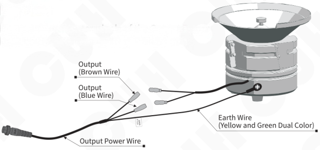

> ข้อสังเกต: ตรวจสอบให้แน่ใจว่าอิเล็กโทรดของตัวสั่นสะเทือนพีโซเชื่อมต่อกับสายมีไฟและสายนิวทรัลของสายไฟเอาต์พุต และเปลือกของเครื่องป้อนต่อสายดินอย่างน่าเชื่อถือ มิฉะนั้นอาจเกิดอุบัติเหตุร้ายแรงได้

### ขั้นตอนที่สาม:

เชื่อมต่อขั้วต่อของสายไฟเอาต์พุตเข้ากับช่องเสียบไฟเอาต์พุตของตัวควบคุม

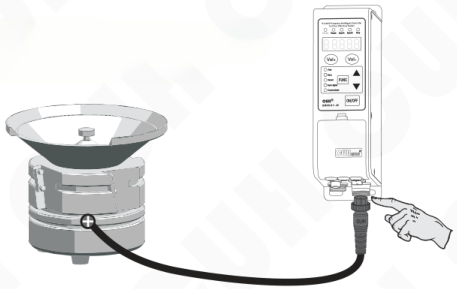

---

## ขั้นตอนที่สี่:

เชื่อมต่อขั้วต่อของสายไฟอินพุตเข้ากับช่องเสียบไฟอินพุตของตัวควบคุม

เชื่อมต่อฝั่งตัวควบคุมก่อน

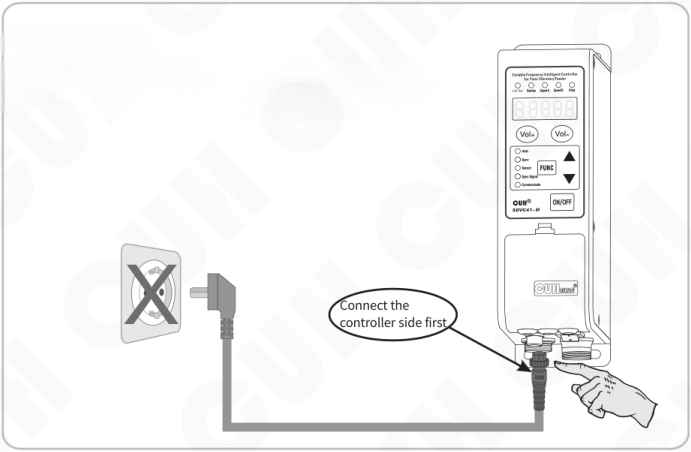

## ขั้นตอนที่ห้า:

เชื่อมต่อปลั๊กของสายไฟอินพุตเข้ากับเต้ารับไฟบ้าน

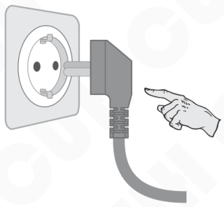

## บทที่ Ⅲ คำอธิบายส่วนประกอบ

### 3.1 คำอธิบายไฟแสดงสถานะ

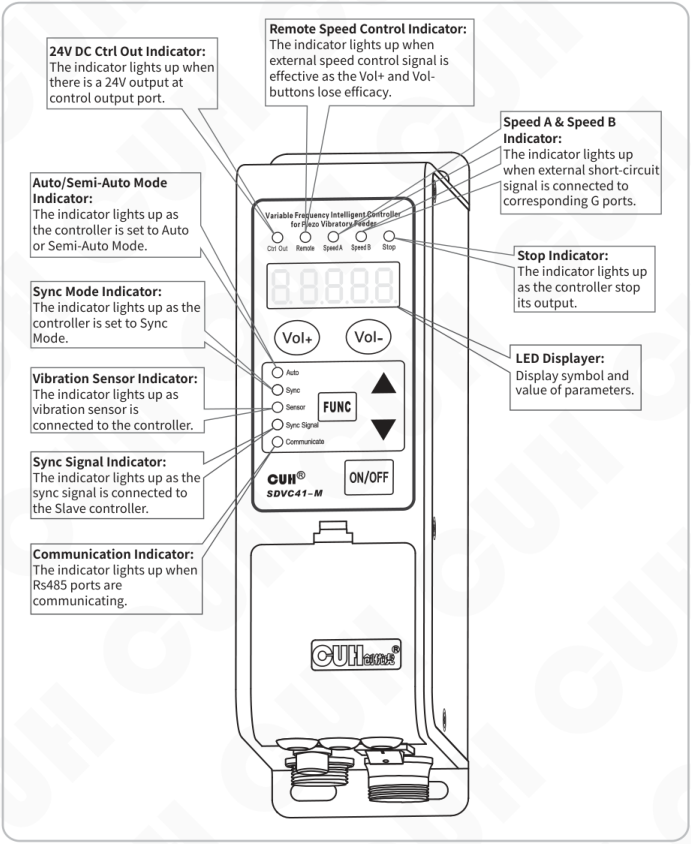

**ไฟแสดงสถานะเอาต์พุตควบคุม 24V DC:**  
ไฟจะติดเมื่อมีเอาต์พุต 24V ที่พอร์ตเอาต์พุตควบคุม

**ไฟแสดงสถานะการควบคุมความเร็วระยะไกล:**  
ไฟจะติดเมื่อสัญญาณควบคุมความเร็วภายนอกมีผล ขณะที่ปุ่ม Vol+ และ Vol- ไม่ทำงาน

**ไฟแสดงสถานะความเร็ว A และความเร็ว B:**  
ไฟจะติดเมื่อมีสัญญาณลัดวงจรภายนอกเชื่อมต่อกับพอร์ต G ที่สอดคล้องกัน

**ไฟแสดงสถานะโหมดออโต้/กึ่งอัตโนมัติ:**  
ไฟจะติดเมื่อตัวควบคุมถูกตั้งเป็นโหมดออโต้หรือกึ่งอัตโนมัติ

**ไฟแสดงสถานะหยุด:**  
ไฟจะติดเมื่อตัวควบคุมหยุดเอาต์พุต

**ไฟแสดงสถานะโหมดซิงค์:**  
ไฟจะติดเมื่อตัวควบคุมถูกตั้งเป็นโหมดซิงค์

**จอแสดงผล LED:**  
แสดงสัญลักษณ์และค่าของพารามิเตอร์

**ไฟแสดงสถานะเซ็นเซอร์สั่นสะเทือน:**  
ไฟจะติดเมื่อมีเซ็นเซอร์สั่นสะเทือนเชื่อมต่อกับตัวควบคุม

**ไฟแสดงสถานะสัญญาณซิงค์:**  
ไฟจะติดเมื่อสัญญาณซิงค์เชื่อมต่อกับตัวควบคุมรอง

**ไฟแสดงสถานะการสื่อสาร:**  
ไฟจะติดเมื่อพอร์ต RS485 กำลังสื่อสาร

---

## 3.2 คำอธิบายปุ่มกด

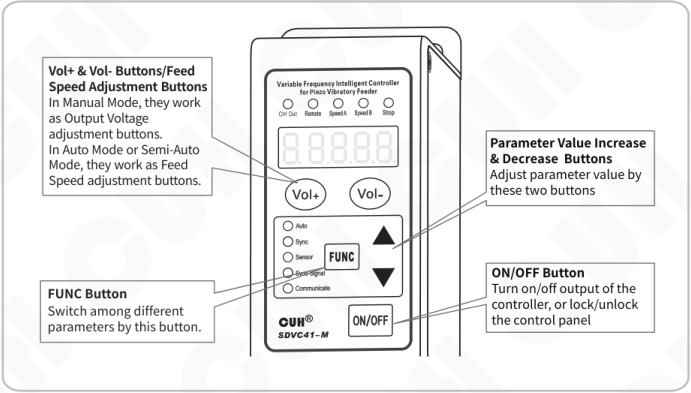

**ปุ่ม Vol+ & Vol-/ปุ่มปรับความเร็วป้อน**  
ในโหมดแมนนวล ปุ่มเหล่านี้ทำหน้าที่เป็นปุ่มปรับแรงดันเอาต์พุต  
ในโหมดออโต้หรือโหมดกึ่งอัตโนมัติ ปุ่มเหล่านี้ทำหน้าที่เป็นปุ่มปรับความเร็วป้อน

**ปุ่มเพิ่มและลดค่าพารามิเตอร์**  
ปรับค่าพารามิเตอร์ด้วยปุ่มทั้งสองนี้

**ปุ่ม FUNC**  
สลับระหว่างพารามิเตอร์ต่าง ๆ ด้วยปุ่มนี้

**ปุ่มเปิด/ปิด**  
เปิด/ปิดเอาต์พุตของตัวควบคุม หรือล็อก/ปลดล็อกแผงควบคุม

## 3.3 คำอธิบายอินเทอร์เฟซ I/O และอุปกรณ์เสริม

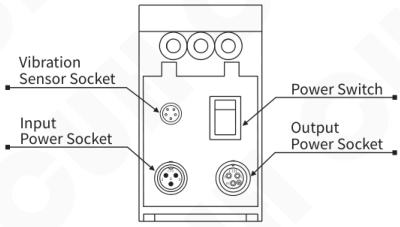

- ช่องเสียบเซ็นเซอร์สั่นสะเทือน
- ช่องเสียบไฟอินพุต
- สวิตช์ไฟ
- ช่องเสียบไฟเอาต์พุต

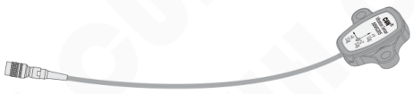

เซ็นเซอร์สั่นสะเทือน

---

## 3.4 คำอธิบายพอร์ตควบคุมสัญญาณ

### คำอธิบายการเดินสายของพอร์ตควบคุมสัญญาณ

สำหรับคำอธิบายการเดินสายของพอร์ต C -C1, C2 และ C3- โปรดดูบทที่ 6.1

สำหรับคำอธิบายการเดินสายของพอร์ต E -E1, E2 และ E3- โปรดดูบทที่ 6.2

สำหรับคำอธิบายการเดินสายของพอร์ต A -A1, A2, A3 และ A4- โปรดดูบทที่ 6.4

สำหรับคำอธิบายการเดินสายของพอร์ต H -H1, H2, H3 และ H4- โปรดดูบทที่ 5.4.1

สำหรับคำอธิบายการเดินสายของพอร์ต G -G1, G2, G3 และ G4- โปรดดูบทที่ 6.5

สำหรับคำอธิบายการเดินสายของพอร์ต F -F1, F2 และ F3- โปรดดูบทที่ 6.6

สำหรับคำอธิบายการเดินสายของพอร์ต D -D1 และ D2- โปรดดูบทที่ 6.7

---

# บทที่ Ⅳ การปรับพารามิเตอร์

พารามิเตอร์ของตัวควบคุมแบ่งออกเป็น 4 ประเภทตามวิธีการปรับที่แตกต่างกัน: พารามิเตอร์ทั่วไป พารามิเตอร์พื้นฐาน พารามิเตอร์ขั้นสูง และพารามิเตอร์ออโต้/ซิงค์

## 4.1 พารามิเตอร์ทั่วไป

- กดปุ่ม "Vol+" หรือ "Vol-" เพื่อปรับพารามิเตอร์ทั่วไป
- ปุ่ม "Vol+" และ "Vol-" ถูกออกแบบมาเพื่อปรับพารามิเตอร์ทั่วไปเท่านั้น
- พารามิเตอร์ทั่วไปสามารถปรับได้โดยกดปุ่ม "Vol+" หรือ "Vol-" แม้ว่าพารามิเตอร์อื่นจะแสดงอยู่บนจอ LED ตัวควบคุมจะกลับไปยังพารามิเตอร์ก่อนหน้าหลังจากปรับพารามิเตอร์ทั่วไปแล้ว

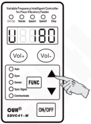

| พารามิเตอร์ทั่วไป | สัญลักษณ์ | ภาพสัญลักษณ์ | ช่วง | ค่าเริ่มต้น |
|---|---|---|---|---|
| Output Voltage | U |  | 20~220 V | 150 |
| Feed Speed | A |  | 0~3200 | 200 |
| Keypad Lock | a |  | \ | Current Voltage Value/Current Feed Speed |

## 4.2 พารามิเตอร์พื้นฐาน

- กดปุ่ม "FUNC" ค้างไว้ 2 วินาทีเพื่อเข้าสู่สถานะการปรับพารามิเตอร์พื้นฐาน
- กดปุ่ม "FUNC" ซ้ำ ๆ เพื่อสลับวนระหว่างพารามิเตอร์ต่าง ๆ
- กดปุ่ม ▲ หรือ ▼ เพื่อปรับค่าพารามิเตอร์
- กดปุ่ม "FUNC" อีกครั้งค้างไว้ 2 วินาทีเพื่อออกจากสถานะการปรับพารามิเตอร์พื้นฐาน

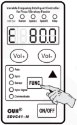

| พารามิเตอร์ทั่วไป | สัญลักษณ์ | ภาพสัญลักษณ์ | ช่วง | ค่าเริ่มต้น |
|---|---|---|---|---|
| Output Frequency | E |  | 40.0~400.0 Hz | 50.0 |
| C Ports On Delay | J |  | 0.0~20.0 s | 0.2 |
| C Ports Off Delay | L |  | 0.0~20.0 s | 0.2 |
| Soft Startup Time | t |  | 0.0~10.0 s | 0.5 |

---

## 4.3 พารามิเตอร์ขั้นสูง

- กดปุ่ม "FUNC" และ ▲ พร้อมกันค้างไว้ 2 วินาทีเพื่อเข้าสู่สถานะการปรับพารามิเตอร์ขั้นสูง
- กดปุ่ม "FUNC" ซ้ำ ๆ เพื่อสลับวนระหว่างพารามิเตอร์ต่าง ๆ
- กดปุ่ม ▲ หรือ ▼ เพื่อปรับค่าพารามิเตอร์
- กดปุ่ม "FUNC" และ ▲ พร้อมกันอีกครั้งค้างไว้ 2 วินาทีเพื่อออกจากสถานะการปรับพารามิเตอร์ขั้นสูง

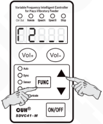

| พารามิเตอร์ทั่วไป | สัญลักษณ์ | ภาพสัญลักษณ์ | ช่วง | ค่าเริ่มต้น |
|---|---|---|---|---|
| E Ports On Delay | J- |  | 0.0~20.0 s | --- |
| E Ports Off Delay | L- |  | 0.0~20.0 s | --- |
| C Ports Logical Relation | Γ2 | 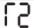 | `___` Positive Logic `_-_` Negative Logic | --- |
| E Ports Logical Relation | Γ7 |  | `___` Positive Logic `_-_` Negative Logic | --- |
| 24V Ctrl Out Logical Relation | Γ3 |  | `___` Positive Logic `_-_` Negative Logic Effect by alarm signal | --- |
| Whether or not output of the controller is controlled by ON/OFF Control Signal | Γ4 |  | `___` Relevant, `_-_` Irrelevant | --- |
| Default/Spare logic parameter group switch | Γ8 |  | `___` Default logic parameter group `_-_` Spare logic parameter group `_=_` Key of spare logic parameter setting | --- |
| Switch Sensor Type | ΓA |  | Uto: Auto nPn: NPN type Sensor PnP: PNP type Sensor | Uto |
| Logical Relation of C Ports and E Ports | Π |  | OR, AND, XOR | AND |
| Max Adjustable Output Voltage | h |  | 20~220 V | 220 |
| Temperature Display | C |  | -10.0~80.0 ℃ | Current Temperature |
| RS485 Modbus Protocol | See figure |  | ASC, rtu | rtu |
| Communication Address | See figure |  | 1~31 | 1 |
| Communication Baud Rate | See figure |  | 0.3, 1.2, 2.4, 9.6, 19.2, 57.6, 115.2 kbps | 9.6 |
| Parameter Lock Password | See figure |  | 0~999 | --- |
| Controller output status after powering on | Γd |  | `___` On, `_-_` Off, Keep | --- |
| Firmware Version | Ur |  | \ | Current Version |
| Controller Reset | 8.8.8.8.8. | 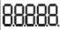 | Ready for Reset Reset Completed 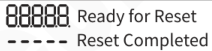 | \ |

---

## 4.4 พารามิเตอร์ออโต้/ซิงค์

- กดปุ่ม "FUNC" และ ▼ พร้อมกันค้างไว้ 2 วินาทีเพื่อเข้าสู่สถานะการปรับพารามิเตอร์ออโต้/ซิงค์
- กดปุ่ม "FUNC" ซ้ำ ๆ เพื่อสลับวนระหว่างพารามิเตอร์ต่าง ๆ
- กดปุ่ม ▲ หรือ ▼ เพื่อปรับค่าพารามิเตอร์
- กดปุ่ม "FUNC" และ ▼ พร้อมกันอีกครั้งค้างไว้ 2 วินาทีเพื่อออกจากสถานะการปรับพารามิเตอร์ออโต้/ซิงค์

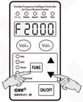

| พารามิเตอร์ทั่วไป | สัญลักษณ์ | ภาพสัญลักษณ์ | ช่วง | ค่าเริ่มต้น |
|---|---|---|---|---|
| Centre Frequency | F |  | 40.0~400.0 Hz | 100.0 |
| Max Offset in Auto FM | n | 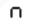 | 0.0~180.0 Hz | 30.0 |
| Output Voltage Adjustment Method | r5 |  | ___Auto _-_Manual | ___ |
| Output Frequency Adjustment Method | r6 | 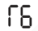 | ___Auto _-_Manual ☰ Sync | ___ |
| Output Frequency Auto Adjustment Index | IF |  | 0~200 | 20 |
| Amplitude Auto Adjustment Index | PA |  | 0~999 | 60 |
| Amplitude Auto Adjustment Index | IA |  | 0~999 | 20 |
| Feed Speed Display | U | 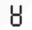 | 0~H | 0 |
| Output Voltage Display | G | 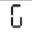 | 20~h V | 150 |
| Voltage Lower Limit | GL |  | 0~220 V | 0 |
| Frequency Lower Limit | e | 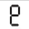 | 40.0~400.0 Hz | 40.0 |
| Max Amplitude Index | P |  | 0~500 | 500 |
| Max Adjustment Feed Speed | H |  | 0~3200 | 1500 |
| Phase Difference | γ | 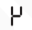 | -180~180 ° | 0 |
| Max Output Voltage in Auto Frequency Measuring Process | b | 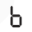 | 20~220 V | 100 |
| Frequency Search Speed | SP |  | 1~5 | 5 |
| Feed Speed Min Adjustment Volume | c |  | 1~10 | 1 |
| Vibration Sensor Number | t |  | 0, 1, 2, 3, 4, 203, 204, 205, 206 | 205 |

# บทที่Ⅴ โหมดการทำงาน

ตัวควบคุมสามารถตั้งให้ทำงานในหนึ่งในสี่โหมดการทำงานต่อไปนี้ตามความต้องการใช้งานเฉพาะ:

- **โหมดแมนนวล:** ทั้งแรงดันเอาต์พุตและความถี่เอาต์พุตถูกปรับด้วยมือ
- **โหมดออโต้:** ทั้งแรงดันเอาต์พุตและความถี่เอาต์พุตถูกปรับโดยอัตโนมัติตามผลตอบกลับจากเซ็นเซอร์สั่นสะเทือน เพื่อให้แน่ใจว่าความเร็วป้อนที่ตั้งไว้ล่วงหน้าคงที่และความถี่สั่นสะเทือนดีที่สุดของเครื่องป้อนวัสดุ
- **โหมดกึ่งอัตโนมัติ:** แรงดันเอาต์พุตถูกปรับโดยอัตโนมัติตามผลตอบกลับจากเซ็นเซอร์สั่นสะเทือน เพื่อให้แน่ใจว่าความเร็วป้อนที่ตั้งไว้ล่วงหน้าคงที่ ส่วนความถี่เอาต์พุตถูกปรับด้วยมือ
- **โหมดซิงค์:** ในการตั้งค่าซิงค์ หากความถี่เอาต์พุตของตัวควบคุม B คงที่สอดคล้องกับตัวควบคุม A เสมอ เรากำหนดให้ตัวควบคุม A เป็นตัวควบคุมหลัก ตัวควบคุม B เป็นตัวควบคุมรอง และโหมดการทำงานของตัวควบคุม B เป็นโหมดซิงค์

| โหมดการทำงาน | Output Voltage U — Adjustment Method | Output Voltage U — Γ5 Setting | Output Frequency E — Adjustment Method | Output Frequency E — Γ6 Setting | ภาพสัญลักษณ์ |
|---|---|---|---|---|---|
| โหมดแมนนวล | Manual | ₋⁻₋ | Manual | ₋⁻₋ | Γ5 / Γ6: 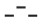 |
| โหมดออโต้ | Auto | _ _ _ | Auto | _ _ _ | Γ5 / Γ6:  |
| โหมดกึ่งอัตโนมัติ | Auto | _ _ _ | Manual | ₋⁻₋ | Γ5: ; Γ6:  |
| โหมดซิงค์ | Manual or Auto | ₋⁻₋ or _ _ _ | Auto Sync with Master Controller |  | Γ5:  or ; Γ6: 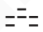 |

## 5.1 โหมดแมนนวล

ในโหมดแมนนวล ทั้งแรงดันเอาต์พุตและความถี่เอาต์พุตถูกปรับด้วยมือ

| โหมดการทำงาน | Output Voltage U — Adjustment Method | Output Voltage U — Γ5 Setting | Output Frequency E — Adjustment Method | Output Frequency E — Γ6 Setting | ภาพสัญลักษณ์ |
|---|---|---|---|---|---|
| โหมดแมนนวล | Manual | ₋⁻₋ | Manual | ₋⁻₋ | Γ5 / Γ6:  |

เพื่อให้การใช้งานง่ายขึ้น พารามิเตอร์ Γ5 และ Γ6 ถูกตั้งเป็น _ _ _ จากโรงงาน ภายใต้การตั้งค่านี้ ตัวควบคุมจะทำงานในโหมดแมนนวลหากไม่มีเซ็นเซอร์สั่นสะเทือนเชื่อมต่อกับตัวควบคุม หรือทำงานในโหมดออโต้หากมีเซ็นเซอร์สั่นสะเทือนเชื่อมต่ออยู่

---

**ข้อสังเกต:**

หากทั้ง Γ5 และ Γ6 ถูกตั้งเป็น _ - _ ตัวควบคุมจะทำงานในโหมดแมนนวลไม่ว่าจะมีเซ็นเซอร์สั่นสะเทือนเชื่อมต่อกับตัวควบคุมหรือไม่ก็ตาม

หากไม่มีเซ็นเซอร์สั่นสะเทือนเชื่อมต่อกับตัวควบคุม ตัวควบคุมจะทำงานในโหมดแมนนวลเสมอ

### 5.1.1 การปรับพารามิเตอร์แรงดันเอาต์พุต U ในโหมดแมนนวล

ค่าจริงของแรงดันเอาต์พุตของตัวควบคุมสามารถแสดงบนจอ LED ได้อย่างแม่นยำและเป็นตัวเลข

- เปิดสวิตช์ไฟขณะที่ไม่มีเซ็นเซอร์สั่นสะเทือนเชื่อมต่อกับตัวควบคุม
- จอ LED แสดงพารามิเตอร์แรงดันเอาต์พุต U และค่าของมัน
- ปรับค่า U โดยกดปุ่ม "Vol+" หรือ "Vol-"

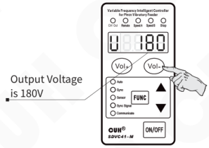

### 5.1.2 การปรับพารามิเตอร์ความถี่เอาต์พุต E ในโหมดแมนนวล

ด้วยเทคโนโลยี DDS ความถี่เอาต์พุตของตัวควบคุมจะเสถียรและมีความแม่นยำสูงเสมอ ไม่ว่าเวลาหรืออุณหภูมิจะเปลี่ยนแปลง

- กดปุ่ม "FUNC" ค้างไว้ 2 วินาทีเพื่อเข้าสู่สถานะการปรับพารามิเตอร์พื้นฐาน
- จอ LED แสดงพารามิเตอร์ความถี่เอาต์พุต E และค่าของมัน
- ปรับค่า E โดยกดปุ่ม ▲ หรือ ▼ ขณะที่ไม่มีเซ็นเซอร์สั่นสะเทือนเชื่อมต่อกับตัวควบคุม

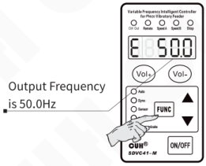

## 5.2 โหมดออโต้

ในโหมดออโต้ ต้องมีเซ็นเซอร์สั่นสะเทือนเชื่อมต่อกับตัวควบคุม แรงดันเอาต์พุตและความถี่เอาต์พุตจะถูกปรับโดยอัตโนมัติตามผลตอบกลับจากเซ็นเซอร์สั่นสะเทือน เพื่อให้แน่ใจว่าความเร็วป้อนที่ตั้งไว้ล่วงหน้าคงที่และความถี่สั่นสะเทือนดีที่สุด แรงดันเอาต์พุตและความถี่เอาต์พุตไม่สามารถปรับด้วยมือได้

ตามค่าเริ่มต้นจากโรงงาน เมื่อมีเซ็นเซอร์สั่นสะเทือนเชื่อมต่อ ตัวควบคุมจะทำงานในโหมดออโต้

| โหมดการทำงาน | Output Voltage U — Adjustment Method | Output Voltage U — Γ5 Setting | Output Frequency E — Adjustment Method | Output Frequency E — Γ6 Setting |
|---|---|---|---|---|
| โหมดออโต้ | Auto | --- | Auto | --- |

**ข้อสังเกต:**

ตัวควบคุมจะยังคงทำงานในโหมดแมนนวลหากไม่มีเซ็นเซอร์สั่นสะเทือนเชื่อมต่อ

### 5.2.1 การติดตั้งเซ็นเซอร์สั่นสะเทือน

#### 5.2.1.1 วิธีการเชื่อมต่อเซ็นเซอร์สั่นสะเทือน

เชื่อมต่อขั้วต่อของเซ็นเซอร์สั่นสะเทือนเข้ากับช่องเสียบเซ็นเซอร์สั่นสะเทือนของตัวควบคุม

ติดตั้งหัวเซ็นเซอร์สั่นสะเทือนบนพื้นผิวที่มั่นคงและเรียบของเครื่องป้อนวัสดุอย่างแน่นหนา

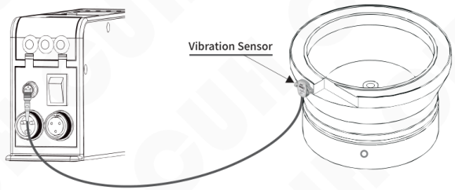

**ข้อสังเกต: โปรดเสียบและถอดเซ็นเซอร์สั่นสะเทือนขณะที่ตัวควบคุมปิดอยู่**

---

## 5.2.1.2 การติดตั้งเซ็นเซอร์สั่นสะเทือนกับตัวสั่นสะเทือน

ยึดเซ็นเซอร์สั่นสะเทือนกับพื้นผิวเรียบของตัวสั่นสะเทือน ทิศทางการติดตั้งเป็นไปได้ตามอำเภอใจ และวิธีการติดตั้งเซ็นเซอร์สั่นสะเทือนแสดงดังด้านล่าง:

- วิธีที่ 1: ดังแสดงในรูปที่ 1

  ข้อดี: ติดตั้งง่าย

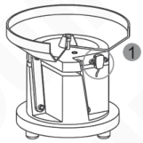

Fig. 1

- วิธีที่ 2: ดังแสดงในรูปที่ 2

  ข้อสังเกต: อย่าให้เซ็นเซอร์สั่นสะเทือนถูกกดทับโดยถาดป้อน

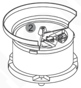

Fig. 2

- วิธีที่ 3: เชื่อมขายึดบนตัวสั่นสะเทือนและยึดเซ็นเซอร์สั่นสะเทือนบนขายึด ดังแสดงในรูปที่ 3

  ขนาดที่แนะนำของขายึดเซ็นเซอร์สั่นสะเทือนแสดงในรูปที่ 4

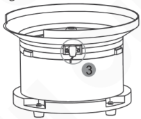

Fig. 3

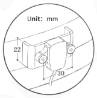

Fig. 4

- วิธีการติดตั้งที่ไม่แนะนำ ดังแสดงในรูปที่ 5 และรูปที่ 6

  หากตำแหน่งติดตั้งไม่เหมาะสม เซ็นเซอร์สั่นสะเทือนจะไม่สามารถตอบกลับความถี่เรโซแนนซ์ได้อย่างแม่นยำ และตัวควบคุมจะค้นหาความถี่เรโซแนนซ์อยู่ตลอด

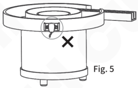

Fig. 5

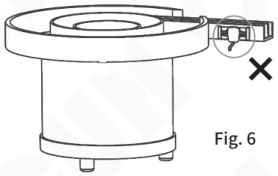

Fig. 6

---

## 5.2.2 การปรับพารามิเตอร์ความเร็วป้อน A ในโหมดออโต้

- เปิดสวิตช์ไฟขณะที่มีเซ็นเซอร์สั่นสะเทือนเชื่อมต่อกับตัวควบคุม ไฟแสดงสถานะเซ็นเซอร์สั่นสะเทือนจะติด
- จอ LED แสดงพารามิเตอร์ความเร็วป้อน A และค่าของมัน
- ปรับค่า A โดยกดปุ่ม "Vol+" หรือ "Vol-" จนได้ความเร็วป้อนที่ต้องการ

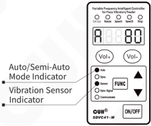

## 5.2.3 การวัดความถี่อัตโนมัติในโหมดออโต้

ด้วยการวัดความถี่อัตโนมัติ ตัวควบคุมจะตรวจจับความถี่สั่นสะเทือนที่ดีที่สุดของเครื่องป้อนวัสดุและตั้งค่าพารามิเตอร์ที่เกี่ยวข้องทั้งหมดโดยอัตโนมัติ สิ่งเดียวที่ผู้ใช้ต้องทำคือตั้งค่าพารามิเตอร์ความเร็วป้อน A จากนั้นตัวควบคุมจะทำงานในสถานะที่ดีที่สุด

- กดปุ่ม ▲ และ ▼ พร้อมกันค้างไว้ 3 วินาทีขณะที่มีเซ็นเซอร์สั่นสะเทือนเชื่อมต่อกับตัวควบคุม เพื่อเริ่มการวัดความถี่อัตโนมัติ พารามิเตอร์ความถี่เอาต์พุต E และค่าของมันจะแสดงบนจอ LED ระหว่างขั้นตอนการวัด
- หลังขั้นตอนการวัดความถี่อัตโนมัติ ตัวควบคุมจะตั้งค่าพารามิเตอร์ที่เกี่ยวข้องทั้งหมดโดยอัตโนมัติ รวมถึงพารามิเตอร์ความถี่กลาง F, Max Offset in Auto FM พารามิเตอร์ n, Output Frequency Auto Adjustment Index IF, Amplitude Auto Adjustment Index PA, Amplitude Auto Adjustment Index IA, พารามิเตอร์ Phase Difference μ, พารามิเตอร์ Γ5 (Output Voltage Adjustment Method) และพารามิเตอร์ Γ6 (Output Frequency Adjustment Method) จะถูกตั้งเป็น \_\_\_

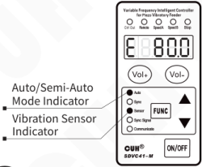

> - หากจอ LED แสดง Err02 ในขณะที่ขั้นตอนการวัดความถี่อัตโนมัติเริ่มต้น ถือว่าเป็นเรื่องปกติ เพราะพารามิเตอร์ b ถูกตั้งไว้สูงเกินไป
> - หากต้องการยกเลิกขั้นตอนการวัดความถี่อัตโนมัติ ให้กดปุ่มเปิด/ปิด จากนั้นตัวควบคุมจะกลับไปยังสถานะก่อนการวัดความถี่อัตโนมัติ

**หลังจากการตั้งค่าความเร็วป้อนและการวัดความถี่อัตโนมัติ ตัวควบคุมจะทำงานในสถานะที่ดีที่สุดที่ความเร็วป้อนที่ต้องการ**

---

## 5.2.4 คำอธิบายพารามิเตอร์ออโต้/ซิงค์

(เกี่ยวกับวิธีการปรับ ช่วงค่า และหน่วยของพารามิเตอร์ออโต้/ซิงค์ โปรดดูหัวข้อ 4.4)

### 5.2.4.1 พารามิเตอร์ Output Voltage Adjustment Method Γ5

เมื่อพารามิเตอร์ Γ5 ถูกตั้งเป็น `_-_` พารามิเตอร์แรงดันเอาต์พุต U จะมองเห็นได้ ขณะที่พารามิเตอร์ A ถูกซ่อน พารามิเตอร์แรงดันเอาต์พุต U สามารถปรับด้วยมือได้

เมื่อพารามิเตอร์ Γ5 ถูกตั้งเป็น `___` และมีเซ็นเซอร์สั่นสะเทือนเชื่อมต่อกับตัวควบคุม พารามิเตอร์ความเร็วป้อน A จะมองเห็นได้ ขณะที่พารามิเตอร์ U ถูกซ่อน แรงดันเอาต์พุตจะถูกปรับโดยอัตโนมัติตามผลตอบกลับจากเซ็นเซอร์สั่นสะเทือน เพื่อให้แน่ใจว่าความเร็วป้อนที่ตั้งไว้ล่วงหน้าคงที่

**ข้อสังเกต:**

เมื่อไม่มีเซ็นเซอร์สั่นสะเทือนเชื่อมต่อกับตัวควบคุม แม้ว่าพารามิเตอร์ Γ5 จะถูกตั้งเป็น `___` พารามิเตอร์ U จะยังคงมองเห็นได้และปรับด้วยมือได้

### 5.2.4.2 พารามิเตอร์ Output Frequency Adjustment Method Γ6

เมื่อพารามิเตอร์ Γ6 ถูกตั้งเป็น `_-_` พารามิเตอร์ความถี่เอาต์พุต E สามารถปรับด้วยมือได้

เมื่อพารามิเตอร์ Γ6 ถูกตั้งเป็น `___` และมีเซ็นเซอร์สั่นสะเทือนเชื่อมต่อกับตัวควบคุม พารามิเตอร์ความถี่เอาต์พุต E จะถูกปรับโดยอัตโนมัติเป็นความถี่เรโซแนนซ์ (ความถี่สั่นสะเทือนที่ดีที่สุด) ของเครื่องป้อนวัสดุ ตามผลตอบกลับจากเซ็นเซอร์สั่นสะเทือน ความถี่เอาต์พุตไม่สามารถปรับด้วยมือได้

เมื่อพารามิเตอร์ Γ6 ถูกตั้งเป็น 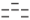 และเชื่อมต่อสายสัญญาณซิงค์ระหว่างตัวควบคุมหลักและตัวควบคุมรอง ความถี่เอาต์พุตของตัวควบคุมรองจะสอดคล้องกับตัวควบคุมหลักเสมอ ความถี่เอาต์พุตของตัวควบคุมรองไม่สามารถปรับด้วยมือได้

**ข้อสังเกต:**

เมื่อไม่มีเซ็นเซอร์สั่นสะเทือนเชื่อมต่อกับตัวควบคุม แม้ว่าพารามิเตอร์ Γ6 จะถูกตั้งเป็น `___` ความถี่เอาต์พุตจะยังคงถูกปรับด้วยมือ

หากพารามิเตอร์ n ถูกตั้งไว้ใหญ่เกินไป เครื่องป้อนวัสดุอาจทำงานที่ความถี่สั่นสะเทือนที่ไม่เหมาะสม

หากพารามิเตอร์ n ถูกตั้งไว้เล็กเกินไป ความยืดหยุ่นของเครื่องป้อนวัสดุอาจได้รับผลกระทบ

### 5.2.4.3 พารามิเตอร์ Centre Frequency F

ความถี่กลางควรตั้งไว้รอบความถี่เรโซแนนซ์ของเครื่องป้อนวัสดุ เพื่อให้ตัวควบคุมสามารถค้นหาความถี่สั่นสะเทือนที่ดีที่สุดได้เร็วขึ้น

### 5.2.4.4 พารามิเตอร์ Output Frequency Auto Adjustment Index n

ช่วง Auto FM คือ (F ±n) Hz  
ค่า n ที่แนะนำคือประมาณ 30.0Hz  
หากพารามิเตอร์ n ถูกตั้งไว้ใหญ่เกินไป เครื่องป้อนวัสดุอาจทำงานที่ความถี่สั่นสะเทือนที่ไม่เหมาะสม  
หากพารามิเตอร์ n ถูกตั้งไว้เล็กเกินไป ความยืดหยุ่นของเครื่องป้อนวัสดุอาจได้รับผลกระทบ

---

### 5.2.4.5 พารามิเตอร์ Output Frequency Auto Adjustment Index IF

กระบวนการ Auto FM ทำงานผ่านอัลกอริทึม PID "IF" คือดัชนีการอินทิเกรตความถี่

ยิ่งพารามิเตอร์ "IF" ถูกตั้งไว้มากเท่าไร ความถี่เอาต์พุตก็จะถูกมอดูเลตอัตโนมัติเร็วขึ้นเท่านั้น แต่ค่า "IF" ที่ใหญ่เกินไปอาจทำให้เกิดการแกว่งของความถี่เอาต์พุต

### 5.2.4.6 พารามิเตอร์ Amplitude Auto Adjustment Index PA

ตัวควบคุมปรับแรงดันเอาต์พุตโดยอัตโนมัติผ่านอัลกอริทึม PID PA คือดัชนีอัตราเร็ว

ยิ่งพารามิเตอร์ PA ถูกตั้งไว้มากเท่าไร แรงดันเอาต์พุตก็จะถูกปรับอัตโนมัติเร็วขึ้นเท่านั้น แต่ค่า PA ที่ใหญ่เกินไปอาจทำให้เกิดการแกว่งของแรงดันเอาต์พุต

### 5.2.4.7 พารามิเตอร์ Amplitude Auto Adjustment Index IA

ตัวควบคุมปรับแรงดันเอาต์พุตโดยอัตโนมัติผ่านอัลกอริทึม PID IA คือดัชนีการอินทิเกรตความเร็ว

ยิ่งพารามิเตอร์ IA ถูกตั้งไว้มากเท่าไร แรงดันเอาต์พุตก็จะถูกปรับอัตโนมัติเร็วขึ้นเท่านั้น แต่ค่า IA ที่ใหญ่เกินไปอาจทำให้เกิดการแกว่งของแรงดันเอาต์พุต

### 5.2.4.8 พารามิเตอร์ Feed Speed Display 

พารามิเตอร์  ถูกออกแบบสำหรับแสดงความเร็วป้อน และไม่สามารถปรับได้

### 5.2.4.9 พารามิเตอร์ Output Voltage Display G

พารามิเตอร์ G ถูกออกแบบสำหรับแสดงแรงดันเอาต์พุต และไม่สามารถปรับได้

### 5.2.4.10 พารามิเตอร์ Voltage Lower Limit GL

พารามิเตอร์ GL ถูกออกแบบสำหรับเตือนเมื่อแรงดันเอาต์พุตต่ำกว่าค่า GL

หากเป็นจริงและ Γ3 ถูกตั้งเป็น  พอร์ต D จะทำงาน

### 5.2.4.11 พารามิเตอร์ Frequency Lower Limit 

พารามิเตอร์  ถูกออกแบบสำหรับเตือนเมื่อความถี่เอาต์พุตต่ำกว่าค่า 

หากเป็นจริงและ Γ3 ถูกตั้งเป็น  พอร์ต D จะทำงาน

### 5.2.4.12 พารามิเตอร์ Max Amplitude Index P

ตั้งค่าดัชนี P เพื่อจำกัดแอมพลิจูดสูงสุดของเครื่องป้อนวัสดุ

### 5.2.4.13 พารามิเตอร์ Max Adjustable Feed Speed H

ช่วงความเร็วป้อนคือ 0 ถึง H พารามิเตอร์ H จำกัดความเร็วป้อนสูงสุดไว้ที่ค่าหนึ่ง เพื่อปกป้องเครื่องป้อนวัสดุจากแรงดันสูงที่เกิดจากการใช้งานผิดพลาด

ความเร็วป้อนของการควบคุมความเร็วระยะไกลก็ได้รับผลกระทบจากพารามิเตอร์นี้เช่นกัน

### 5.2.4.14 พารามิเตอร์ Phase Difference 

ปรับพารามิเตอร์ 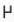 เพื่อเปลี่ยนเฟสของรูปคลื่นเอาต์พุต ค่าเริ่มต้นของเฟสแตกต่างคือ 0°

---

### 5.2.4.15 พารามิเตอร์ Max Output Voltage in Auto Frequency Measuring Process b

แรงดันเอาต์พุตจะไม่เกินค่าของพารามิเตอร์ b ในขั้นตอนการวัดความถี่อัตโนมัติ เพื่อปกป้องเครื่องป้อนวัสดุจากความเสียหาย

### 5.2.4.16 พารามิเตอร์ Frequency Search Speed SP

พารามิเตอร์ SP แทนความเร็วการค้นหาความถี่ ยิ่งค่านี้สูง การค้นหาความถี่ก็ยิ่งเร็วขึ้น

### 5.2.4.17 พารามิเตอร์ Feed Speed Min Adjustment Volume c

พารามิเตอร์ c แทนปริมาณการปรับของพารามิเตอร์ความเร็วป้อน A ในการกดปุ่ม Vol+ หรือ Vol- หนึ่งครั้ง พารามิเตอร์ c อยู่ในช่วง 1 ถึง 10

### 5.2.4.18 พารามิเตอร์ Vibration Sensor Number ├

ตัวควบคุมสามารถปรับตัวเข้ากับเซ็นเซอร์สั่นสะเทือน 8 รุ่นที่แตกต่างกัน ตั้งค่าพารามิเตอร์ ├ ตามรุ่นของเซ็นเซอร์ เพื่อให้เมื่อตั้งค่าความเร็วป้อนแล้ว ตัวควบคุมจะส่งออกค่าแรงดันเท่ากันไม่ว่าจะเชื่อมต่อเซ็นเซอร์สั่นสะเทือนรุ่นใด

| Parameter Value | Model | Specification (Acceleration of x axis/y axis/z axis) |
|---|---|---|
| 1 | SDVS20-1 | 16g/16g/16g |
| 2 | SDVS20-2 | 35g/35g/—— |
| 3 | SDVS20-3 | 50g/50g/—— |
| 4 | SDVS20-4 | 70g/70g/—— |
| 203 | SDVS203 | 8g/8g/8g |
| 204 | SDVS204 | 16g/16g/16g |
| 205 | SDVS205 | 32g/32g/32g |
| 206 | SDVS206 | 64g/64g/64g |

---

## 5.3 โหมดกึ่งอัตโนมัติ

ในโหมดกึ่งอัตโนมัติ ต้องมีเซ็นเซอร์สั่นสะเทือนเชื่อมต่อกับตัวควบคุม และพารามิเตอร์ Γ6 ต้องถูกตั้งเป็น `_-_`

แรงดันเอาต์พุตจะถูกปรับโดยอัตโนมัติตามผลตอบกลับจากเซ็นเซอร์สั่นสะเทือน เพื่อให้แน่ใจว่าความเร็วป้อนที่ตั้งไว้ล่วงหน้าคงที่ ส่วนความถี่เอาต์พุตจะถูกปรับด้วยมือ

| โหมดการทำงาน | Output Voltage U — Adjustment Method | Output Voltage U — Γ5 Setting | Output Frequency E — Adjustment Method | Output Frequency E — Γ6 Setting |
|---|---|---|---|---|
| โหมดกึ่งอัตโนมัติ | Auto | `___` | Manual | `_-_` |

**ข้อสังเกต:**

ตัวควบคุมจะยังคงทำงานในโหมดแมนนวลหากไม่มีเซ็นเซอร์สั่นสะเทือนเชื่อมต่อ

### 5.3.1 การติดตั้งเซ็นเซอร์สั่นสะเทือน

เหมือนกับหัวข้อ 5.2.1

### 5.3.2 การตั้งค่าโหมดกึ่งอัตโนมัติ

- เปิดสวิตช์ไฟขณะที่มีเซ็นเซอร์สั่นสะเทือนเชื่อมต่อกับตัวควบคุม ไฟแสดงสถานะเซ็นเซอร์สั่นสะเทือนจะติด
- กดปุ่ม "FUNC" และ ▼ พร้อมกันค้างไว้ 2 วินาทีเพื่อเข้าสู่สถานะการปรับพารามิเตอร์ออโต้/ซิงค์
- กดปุ่ม "FUNC" ซ้ำ ๆ เพื่อสลับไปยังพารามิเตอร์ Γ6 (Output Frequency Adjustment Method)
- กดปุ่ม ▲ หรือ ▼ เพื่อตั้งค่า Γ6 เป็น `_-_`

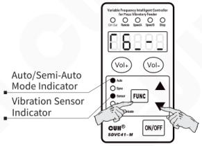

---

## 5.3.3 การปรับพารามิเตอร์ความเร็วป้อน A ในโหมดกึ่งอัตโนมัติ

- ปรับค่า A โดยกดปุ่ม "Vol+" หรือ "Vol-" จนได้ความเร็วป้อนที่ต้องการ

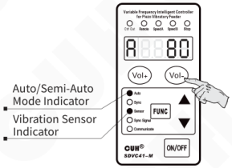

## 5.3.4 การปรับพารามิเตอร์ความถี่เอาต์พุต E ในโหมดกึ่งอัตโนมัติ

- กดปุ่ม "FUNC" ค้างไว้ 2 วินาทีเพื่อเข้าสู่สถานะการปรับพารามิเตอร์พื้นฐาน
- จอ LED แสดงพารามิเตอร์ความถี่เอาต์พุต E และค่าของมัน
- ปรับค่า E โดยกดปุ่ม ▲ หรือ ▼

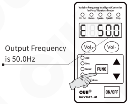

---

## 5.4 โหมดซิงค์

ในโหมดซิงค์ ต้องเชื่อมต่อสายสัญญาณซิงค์ระหว่างตัวควบคุมหลักและตัวควบคุมรอง ความถี่เอาต์พุตของตัวควบคุม (ตัวควบคุมรอง) จะสอดคล้องกับตัวควบคุมหลักเสมอ แรงดันเอาต์พุตของตัวควบคุม (ตัวควบคุมรอง) สามารถปรับด้วยมือหรือโดยอัตโนมัติ

| โหมดการทำงาน | Output Voltage U — Adjustment Method | Output Voltage U — Γ5 Setting | Output Frequency E — Adjustment Method | Output Frequency E — Γ6 Setting |
|---|---|---|---|---|
| โหมดซิงค์ | Manual or Auto | 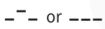 | Auto Sync with Master Controller | 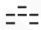 |

โหมดซิงค์ใช้กับกรณีที่มีตัวควบคุมมากกว่าหนึ่งตัวควบคุมเครื่องป้อนวัสดุหลายเครื่องในระบบป้อน เอาต์พุตของตัวควบคุมไม่ซิงโครนัสกันจึงรบกวนกัน (ผลการเต้น) โหมดซิงค์ถูกออกแบบมาเพื่อขจัดผลการเต้น เนื่องจากรูปคลื่นเอาต์พุตของตัวควบคุมหลักและตัวควบคุมรองซิงโครนัสกันอย่างแม่นยำ

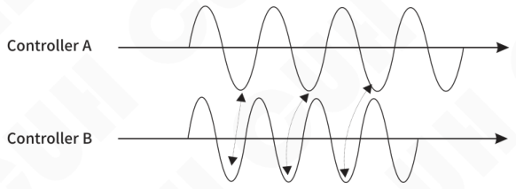

Controller B ไม่ได้ถูกตั้งเป็นโหมดซิงค์ รูปคลื่นเอาต์พุตของตัวควบคุมทั้งสองไม่ซิงโครนัสกัน

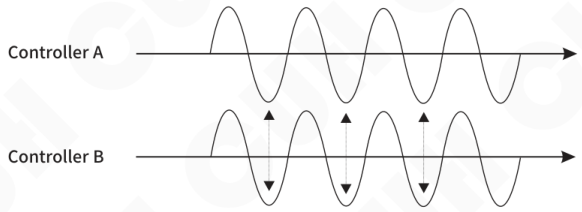

Controller B ถูกตั้งเป็นโหมดซิงค์ รูปคลื่นเอาต์พุตของตัวควบคุมทั้งสองซิงโครนัสกัน

---

## 5.4.1 วิธีการเชื่อมต่อสายสัญญาณซิงค์ระหว่างตัวควบคุมหลักและตัวควบคุมรอง

### ขั้นตอนที่ 1:

เปิดฝาครอบกล่องพอร์ตควบคุมสัญญาณของตัวควบคุมทั้งสอง

### ขั้นตอนที่ 2:

เชื่อมต่อสายสัญญาณซิงค์ระหว่างตัวควบคุมหลักและตัวควบคุมรองตามแผนภาพด้านล่าง

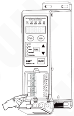

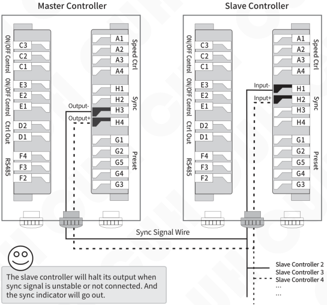

> ตัวควบคุมรองจะหยุดเอาต์พุตเมื่อสัญญาณซิงค์ไม่เสถียรหรือไม่ได้เชื่อมต่อ และไฟแสดงสถานะซิงค์จะดับลง

**ตัวควบคุมหลักหนึ่งตัวสามารถขับตัวควบคุมรองหลายตัวได้**

---

## 5.4.2 การประยุกต์ใช้โหมดซิงค์

### Sub-Pattern 1

| Controller | Output Voltage U — Adjustment Method | Output Voltage U — Γ5 Setting | Output Frequency E — Adjustment Method | Output Frequency E — Γ6 Setting |
|---|---|---|---|---|
| Master Controller | Manual | 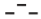 | Manual |  |
| Slave Controller | Manual |  | Auto Sync with Master Controller | 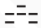 |

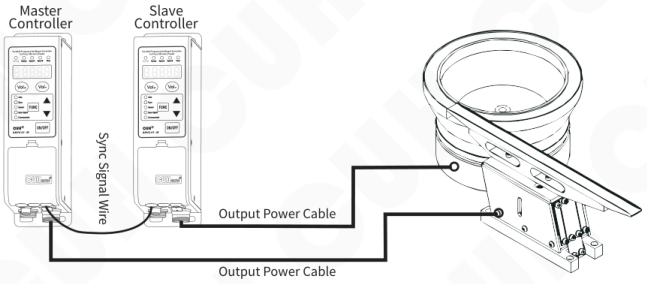

เมื่อพารามิเตอร์ Γ6 ถูกตั้งเป็น  ความถี่เอาต์พุตของมันจะถูกควบคุมโดยตัวควบคุมหลัก

---

## Sub-Pattern 2

| Controller | Output Voltage U — Adjustment Method | Output Voltage U — Γ5 Setting | Output Frequency E — Adjustment Method | Output Frequency E — Γ6 Setting | ภาพสัญลักษณ์ |
|---|---|---|---|---|---|
| Master Controller | Auto | --- | Auto | --- | Γ5, Γ6:  |
| Slave Controller | Manual | symbol image | Auto Sync with Master Controller | symbol image | Γ5: ; Γ6:  |

## Sub-Pattern 3

| Controller | Output Voltage U — Adjustment Method | Output Voltage U — Γ5 Setting | Output Frequency E — Adjustment Method | Output Frequency E — Γ6 Setting |  |
|---|---|---|---|---|---|
| Master Controller | Auto | --- | Manual | symbol image | Γ5: ; Γ6:  |
| Slave Controller | Manual | symbol image | Auto Sync with Master Controller | symbol image | Γ5: ; Γ6:  |

## Sub-Pattern 4

| Controller | Output Voltage U — Adjustment Method | Output Voltage U — Γ5 Setting | Output Frequency E — Adjustment Method | Output Frequency E — Γ6 Setting | ภาพสัญลักษณ์ |
|---|---|---|---|---|---|
| Master Controller | Manual | See right column Γ5 | Manual | See right column Γ6 | Γ5: ; Γ6:  |
| Slave Controller | Auto | See right column Γ5 | Auto Sync with Master Controller | See right column Γ6 | Γ5: ; Γ6:  |

## Sub-Pattern 5

| Controller | Output Voltage U — Adjustment Method | Output Voltage U — Γ5 Setting | Output Frequency E — Adjustment Method | Output Frequency E — Γ6 Setting | ภาพสัญลักษณ์ |
|---|---|---|---|---|---|
| Master Controller | Auto | --- | Auto | --- | Γ5, Γ6:  |
| Slave Controller | Auto | --- | Auto Sync with Master Controller | See graphical symbol image | Γ5: ; Γ6:  |

## Sub-Pattern 6

| Controller | Output Voltage U — Adjustment Method | Output Voltage U — Γ5 Setting | Output Frequency E — Adjustment Method | Output Frequency E — Γ6 Setting | ภาพสัญลักษณ์ |
|---|---|---|---|---|---|
| Master Controller | Auto | --- | Manual | See graphical symbol image | Γ5: ; Γ6:  |
| Slave Controller | Auto | --- | Auto Sync with Master Controller | See graphical symbol image | Γ5: ; Γ6:  |

## 5.4.3 คำอธิบายพารามิเตอร์ขั้นสูงบางรายการ

### 5.4.3.1 พารามิเตอร์ Max Adjustable Output Voltage 

ช่วงแรงดันเอาต์พุตคือ 0 ถึง h V พารามิเตอร์ h จำกัดแรงดันเอาต์พุตสูงสุดไว้ที่ค่าหนึ่ง เพื่อปกป้องเครื่องป้อนวัสดุจากแรงดันสูงที่เกิดจากการใช้งานผิดพลาด

แรงดันของการควบคุมความเร็วระยะไกลก็ได้รับผลกระทบจากพารามิเตอร์นี้เช่นกัน

### 5.4.3.2 พารามิเตอร์ Temperature Display 

แสดงอุณหภูมิภายในของตัวควบคุมแบบเรียลไทม์ อ่านได้อย่างเดียว

### 5.4.3.3 พารามิเตอร์ Controller Reset 

รีเซ็ตพารามิเตอร์ทั้งหมดกลับเป็นค่าเริ่มต้นจากโรงงานด้วยพารามิเตอร์นี้เมื่อจำเป็น

### 5.4.3.4 พารามิเตอร์ Parameter Lock Password 

ล็อกพารามิเตอร์ทั้งหมดยกเว้นพารามิเตอร์แรงดันเอาต์พุต U/ พารามิเตอร์ความเร็วป้อน A ด้วยรหัสผ่านที่กำหนดเอง เพื่อป้องกันการใช้งานโดยไม่ได้รับอนุญาต

---

# บทที่ Ⅵ การควบคุมสัญญาณ

การควบคุมสัญญาณประกอบด้วย: การควบคุมเปิด/ปิดของพอร์ต C, การควบคุมเปิด/ปิดของพอร์ต E, การควบคุมความเร็วระยะไกล, การบันทึกและเอาต์พุตความเร็วที่ตั้งไว้ล่วงหน้า, การสื่อสาร RS485 และเอาต์พุตควบคุม 24V DC

## 6.1 การควบคุมเปิด/ปิดของพอร์ต C

เอาต์พุตของตัวควบคุมสามารถเปิดหรือปิดได้ด้วยเซ็นเซอร์สวิตช์หรือ PLC ชนิดใดก็ได้ผ่านพอร์ต C

### 6.1.1 วิธีการเชื่อมต่อเซ็นเซอร์สวิตช์ชนิดต่างๆ และ PLC เข้ากับพอร์ต C

#### 6.1.1.1 วิธีการเชื่อมต่อเซ็นเซอร์พร็อกซิมิตี้เข้ากับพอร์ต C

**ขั้นตอนที่ 1:**

เปิดฝาครอบกล่องพอร์ตควบคุมสัญญาณของตัวควบคุม

**ขั้นตอนที่ 2:**

เชื่อมต่อเซ็นเซอร์พร็อกซิมิตี้เข้ากับพอร์ต C ตามแผนภาพ

**ข้อกำหนด**

สายสีน้ำเงินแทนสายดิน  
สายสีดำแทนสายสัญญาณ  
สายสีน้ำตาลแทนสายไฟเลี้ยง

---

### 6.1.1.2 วิธีการเชื่อมต่อเซ็นเซอร์ไฟโตอิเล็กทริกแบบทะลุเข้ากับพอร์ต C

---

### 6.1.1.3 วิธีการเชื่อมต่อเซ็นเซอร์ไฟโตอิเล็กทริกแบบสะท้อนเข้ากับพอร์ต C

---

### 6.1.1.4 วิธีการเชื่อมต่อเซ็นเซอร์ไฟเบอร์ออปติกแบบทะลุเข้ากับพอร์ต C

---

### 6.1.1.5 วิธีการเชื่อมต่อ PLC เข้ากับพอร์ต C

วิธีการเชื่อมต่อเอาต์พุต NPN ของ PLC เข้ากับพอร์ต C

วิธีการเชื่อมต่อเอาต์พุต PNP ของ PLC เข้ากับพอร์ต C

> หมายเหตุ: เอาต์พุตรีเลย์ เอาต์พุต NPN และเอาต์พุต PNP ของ PLC อย่างใดอย่างหนึ่งสามารถเปิด/ปิดตัวควบคุมได้

## 6.1.2 พารามิเตอร์เวลาหน่วงเปิด J และพารามิเตอร์เวลาหน่วงปิด L ของพอร์ต C

หากต้องการให้ตัวควบคุมเริ่มส่งเอาต์พุตหลังจากเวลาหนึ่งนับจากได้รับสัญญาณควบคุมเปิดของพอร์ต C ให้ปรับพารามิเตอร์ J

หากต้องการให้ตัวควบคุมส่งเอาต์พุตต่อไปอีกระยะหนึ่งหลังจากได้รับสัญญาณควบคุมปิดของพอร์ต C ให้ปรับพารามิเตอร์ L

### พารามิเตอร์เวลาหน่วงเปิด J ของพอร์ต C

ช่วงเวลาจากที่ตัวควบคุมได้รับสัญญาณควบคุมเปิดของพอร์ต C จนถึงเริ่มส่งเอาต์พุต

- กดปุ่ม "FUNC" ค้างไว้ 2 วินาทีเพื่อเข้าสู่สถานะการปรับพารามิเตอร์พื้นฐาน
- กดปุ่ม "FUNC" ซ้ำ ๆ เพื่อสลับไปยังพารามิเตอร์ J
- กดปุ่ม ▲ หรือ ▼ เพื่อปรับค่า J หน่วยของพารามิเตอร์คือวินาที และความแม่นยำในการปรับคือ 0.1

### พารามิเตอร์เวลาหน่วงปิด L ของพอร์ต C

ช่วงเวลาจากที่ตัวควบคุมได้รับสัญญาณควบคุมปิดของพอร์ต C จนถึงตัดเอาต์พุต

- กดปุ่ม "FUNC" ค้างไว้ 2 วินาทีเพื่อเข้าสู่สถานะการปรับพารามิเตอร์พื้นฐาน
- กดปุ่ม "FUNC" ซ้ำ ๆ เพื่อสลับไปยังพารามิเตอร์ L
- กดปุ่ม ▲ หรือ ▼ เพื่อปรับค่า L หน่วยของพารามิเตอร์คือวินาที และความแม่นยำในการปรับคือ 0.1

---

## 6.1.3 พารามิเตอร์ Γ2 ของความสัมพันธ์ทางลอจิกของการควบคุมเปิด/ปิดของพอร์ต C

โดยค่าเริ่มต้นจากโรงงาน ตัวควบคุมจะทำงานเมื่อพอร์ต C ไม่ได้รับสัญญาณ แต่ในการใช้งานอื่นบางกรณี ตัวควบคุมจำเป็นต้องหยุดเมื่อพอร์ต C ไม่ได้รับสัญญาณ

ปรับพารามิเตอร์ Γ2 เพื่อให้เป็นไปตามข้อกำหนดใดข้อกำหนดหนึ่ง

- กดปุ่ม "FUNC" และ ▲ พร้อมกันค้างไว้ 2 วินาทีเพื่อเข้าสู่สถานะการปรับพารามิเตอร์ขั้นสูง
- กดปุ่ม "FUNC" ซ้ำ ๆ เพื่อสลับไปยังพารามิเตอร์ Γ2
- กดปุ่ม ▲ หรือ ▼ เพื่อเปลี่ยนความสัมพันธ์ทางลอจิก

พารามิเตอร์ Γ2 ถูกตั้งค่าเป็น `___` โดยค่าเริ่มต้น

- เมื่อพารามิเตอร์ Γ2 ถูกตั้งค่าเป็น `___` เอาต์พุตของตัวควบคุมจะเปิดเมื่อพอร์ต C ไม่ได้รับสัญญาณ
- เมื่อพารามิเตอร์ Γ2 ถูกตั้งค่าเป็น `_-_` เอาต์พุตของตัวควบคุมจะปิดเมื่อพอร์ต C ไม่ได้รับสัญญาณ

---

## 6.2 การควบคุมเปิด/ปิดของพอร์ต E

เอาต์พุตของตัวควบคุมสามารถเปิดหรือปิดได้ด้วยเซ็นเซอร์สวิตช์หรือ PLC ชนิดใดก็ได้ผ่านพอร์ต E

การควบคุมเปิด/ปิดของพอร์ต C และการควบคุมเปิด/ปิดของพอร์ต E เป็นอิสระต่อกัน

### 6.2.1 วิธีการเชื่อมต่อเซ็นเซอร์สวิตช์ชนิดต่างๆ และ PLC เข้ากับพอร์ต E

### 6.2.1.1 วิธีการเชื่อมต่อเซ็นเซอร์พร็อกซิมิตี้เข้ากับพอร์ต E

**ขั้นตอนที่ 1:**

เปิดฝาครอบกล่องพอร์ตควบคุมสัญญาณของตัวควบคุม

**ขั้นตอนที่ 2:**

เชื่อมต่อเซ็นเซอร์พร็อกซิมิตี้เข้ากับพอร์ต C ตามแผนภาพ

**ข้อกำหนด**

สายสีน้ำเงินแทนสายดิน  
สายสีดำแทนสายสัญญาณ  
สายสีน้ำตาลแทนสายไฟเลี้ยง

### 6.1.1.2 วิธีการเชื่อมต่อเซ็นเซอร์สวิตช์และ PLC ชนิดอื่นๆ เข้ากับพอร์ต E คล้ายคลึงกับของพอร์ต C

---

## 6.2.2 พารามิเตอร์เวลาหน่วงเปิด J- และพารามิเตอร์เวลาหน่วงปิด L- ของพอร์ต E

หากต้องการให้ตัวควบคุมเริ่มส่งเอาต์พุตหลังจากเวลาหนึ่งนับจากได้รับสัญญาณควบคุมเปิดของพอร์ต E ให้ปรับพารามิเตอร์ J-

หากต้องการให้ตัวควบคุมส่งเอาต์พุตต่อไปอีกระยะหนึ่งหลังจากได้รับสัญญาณควบคุมปิดของพอร์ต E ให้ปรับพารามิเตอร์ L-

เวลาหน่วงเปิด/ปิดของพอร์ต E เหมือนกับเวลาหน่วงเปิด/ปิดของพอร์ต C โดยค่าเริ่มต้น
เวลาหน่วงเปิด/ปิดของพอร์ต E ยังสามารถตั้งค่าแยกต่างหากได้โดยปรับพารามิเตอร์ J- และพารามิเตอร์ L-

### พารามิเตอร์เวลาหน่วงเปิด J- ของพอร์ต E

ช่วงเวลาจากที่ตัวควบคุมได้รับสัญญาณควบคุมเปิดของพอร์ต E จนถึงเริ่มส่งเอาต์พุต

- กดปุ่ม "FUNC" และ ▲ พร้อมกันค้างไว้ 2 วินาทีเพื่อเข้าสู่สถานะการปรับพารามิเตอร์ขั้นสูง
- กดปุ่ม "FUNC" เพื่อสลับไปยังพารามิเตอร์ J-
- กดปุ่ม ▲ หรือ ▼ เพื่อปรับค่า J- หน่วยของพารามิเตอร์คือวินาที และความแม่นยำในการปรับคือ 0.1

พารามิเตอร์ J- ถูกตั้งค่าเป็น \_\_\_ โดยค่าเริ่มต้น หมายถึงค่าเดียวกับพารามิเตอร์ J

### พารามิเตอร์เวลาหน่วงปิด L- ของพอร์ต E

ช่วงเวลาจากที่ตัวควบคุมได้รับสัญญาณควบคุมปิดของพอร์ต E จนถึงตัดเอาต์พุต

- กดปุ่ม "FUNC" และ ▲ พร้อมกันค้างไว้ 2 วินาทีเพื่อเข้าสู่สถานะการปรับพารามิเตอร์ขั้นสูง
- กดปุ่ม "FUNC" เพื่อสลับไปยังพารามิเตอร์ L-
- กดปุ่ม ▲ หรือ ▼ เพื่อปรับค่า L- หน่วยของพารามิเตอร์คือวินาที และความแม่นยำในการปรับคือ 0.1

พารามิเตอร์ L- ถูกตั้งค่าเป็น \_\_\_ โดยค่าเริ่มต้น หมายถึงค่าเดียวกับพารามิเตอร์ L

---

## 6.2.3 พารามิเตอร์ Γ7 ของความสัมพันธ์ทางลอจิกของการควบคุมเปิด/ปิดของพอร์ต E

โดยค่าเริ่มต้นจากโรงงาน ตัวควบคุมจะทำงานเมื่อพอร์ต E ไม่ได้รับสัญญาณ แต่ในการใช้งานอื่นบางกรณี ตัวควบคุมจำเป็นต้องหยุดเมื่อพอร์ต E ไม่ได้รับสัญญาณ

ปรับพารามิเตอร์ Γ7 เพื่อให้เป็นไปตามข้อกำหนดใดข้อกำหนดหนึ่ง

- กดปุ่ม "FUNC" และ ▲ พร้อมกันค้างไว้ 2 วินาทีเพื่อเข้าสู่สถานะการปรับพารามิเตอร์ขั้นสูง
- กดปุ่ม "FUNC" ซ้ำ ๆ เพื่อสลับไปยังพารามิเตอร์ Γ7
- กดปุ่ม ▲ หรือ ▼ เพื่อเปลี่ยนความสัมพันธ์ทางลอจิก

พารามิเตอร์ Γ7 ถูกตั้งค่าเป็น `___` โดยค่าเริ่มต้น

> - เมื่อพารามิเตอร์ Γ7 ถูกตั้งค่าเป็น `___` เอาต์พุตของตัวควบคุมจะเปิดเมื่อพอร์ต E ไม่ได้รับสัญญาณ
> - เมื่อพารามิเตอร์ Γ7 ถูกตั้งค่าเป็น `_-_` เอาต์พุตของตัวควบคุมจะปิดเมื่อพอร์ต E ไม่ได้รับสัญญาณ

---

## 6.3 พารามิเตอร์ทั่วไปของพอร์ต C และพอร์ต E

### 6.3.1 พารามิเตอร์ Π ของความสัมพันธ์ทางลอจิกของพอร์ต C และพอร์ต E

พารามิเตอร์ Π กำหนดการตอบสนองของตัวควบคุมเมื่อทั้งพอร์ต C และพอร์ต E ทำงาน

- กดปุ่ม "FUNC" และ ▲ พร้อมกันค้างไว้ 2 วินาทีเพื่อเข้าสู่สถานะการปรับพารามิเตอร์ขั้นสูง
- กดปุ่ม "FUNC" ซ้ำ ๆ เพื่อสลับไปยังพารามิเตอร์ Π
- กดปุ่ม ▲ หรือ ▼ เพื่อเปลี่ยนความสัมพันธ์ทางลอจิก

ความสัมพันธ์ทางลอจิกเริ่มต้นคือ AND

**ความสัมพันธ์ทางลอจิก: AND** 

เอาต์พุตของตัวควบคุมจะเปิด (ON) เฉพาะเมื่อทั้งสองพอร์ตต้องการให้ตัวควบคุมทำงาน

**ความสัมพันธ์ทางลอจิก: OR** 

เอาต์พุตของตัวควบคุมจะเปิด (ON) เมื่อพอร์ตใดพอร์ตหนึ่งหรือทั้งสองต้องการให้ตัวควบคุมทำงาน

**ความสัมพันธ์ทางลอจิก: XOR** 

เอาต์พุตของตัวควบคุมจะเปิด (ON) เฉพาะเมื่อพอร์ตหนึ่งต้องการให้ตัวควบคุมทำงานและอีกพอร์ตต้องการให้หยุด

---

## 6.3.2 พารามิเตอร์ ΓA ของประเภทเซ็นเซอร์สวิตช์

ตัวควบคุมสามารถตรวจจับประเภทของเซ็นเซอร์สวิตช์ NPN หรือ PNP ได้โดยอัตโนมัติ

ผู้ใช้ยังสามารถตั้งค่าประเภทเซ็นเซอร์สวิตช์ด้วยตนเองได้

- กดปุ่ม "FUNC" และ ▲ พร้อมกันค้างไว้ 2 วินาทีเพื่อเข้าสู่สถานะการปรับพารามิเตอร์ขั้นสูง
- กดปุ่ม "FUNC" ซ้ำ ๆ เพื่อสลับไปยังพารามิเตอร์ ΓA
- กดปุ่ม ▲ หรือ ▼ เพื่อเปลี่ยนค่า ΓA

**Uto:** การตรวจจับประเภทเซ็นเซอร์สวิตช์อัตโนมัติ

**nPn:** เซ็นเซอร์สวิตช์แบบ NPN

**PnP:** เซ็นเซอร์สวิตช์แบบ PNP

## 6.3.3 พารามิเตอร์ Γ4: เอาต์พุตของตัวควบคุมถูกควบคุมด้วยสัญญาณควบคุมเปิด/ปิดหรือไม่

- กดปุ่ม "FUNC" และ ▲ พร้อมกันค้างไว้ 2 วินาทีเพื่อเข้าสู่สถานะการปรับพารามิเตอร์ขั้นสูง
- กดปุ่ม "FUNC" ซ้ำ ๆ เพื่อสลับไปยังพารามิเตอร์ Γ4
- กดปุ่ม ▲ หรือ ▼ เพื่อเปลี่ยนค่า Γ4

`___` หมายถึง เชื่อมโยง

`_-_` หมายถึง ไม่เชื่อมโยง

พารามิเตอร์ Γ4 ถูกตั้งค่าเป็น `___` โดยค่าเริ่มต้นจากโรงงาน

---

## 6.4 การควบคุมความเร็วระยะไกล

แรงดันเอาต์พุต/ความเร็วป้อนสามารถควบคุมได้จากระยะไกลด้วยโพเทนชิออมิเตอร์หรือสัญญาณควบคุม DC 1~5V/4~20mA

เมื่อแรงดันควบคุมความเร็วระยะไกลเกิน 0.5V จะมีผลกับตัวควบคุม ขณะที่ปุ่ม "Vol+" และ "Vol-" จะไม่มีผล

ในระหว่างการควบคุมความเร็วระยะไกล ไฟแสดงการควบคุมความเร็วระยะไกลจะติด และจอ LED จะแสดงแรงดันเอาต์พุต/ความเร็วป้อนและค่าของมัน

### วิธีการเชื่อมต่อโพเทนชิออมิเตอร์ควบคุมความเร็วระยะไกล

**หมายเหตุ:** โปรดเลือกโพเทนชิออมิเตอร์แบบเชิงเส้นที่มีความต้านทาน 1 KΩ

---

## วิธีการเชื่อมต่อ PLC ควบคุมความเร็วระยะไกล

| สัญญาณควบคุมความเร็วระยะไกล | แรงดันเอาต์พุต/ความเร็วป้อน |
|---|---|
| น้อยกว่า 0.5V | ควบคุมด้วยปุ่ม Vol+ และ Vol- |
| 0.5V-1V | แรงดันเอาต์พุต: 20V/ความเร็วป้อน: 0 ควบคุมด้วยสัญญาณควบคุมความเร็วระยะไกล |
| 1~5V/4~20mA | แรงดันเอาต์พุต/ความเร็วป้อนถูกควบคุม เชิงเส้นด้วยสัญญาณควบคุมความเร็วระยะไกล |

## 6.5 การบันทึกและเอาต์พุตความเร็วที่ตั้งไว้ล่วงหน้า

ตัวควบคุมสามารถบันทึกและเอาต์พุตความเร็วที่ตั้งไว้ล่วงหน้าได้ 4 ระดับ การรวมกันแบบเปิด/ปิด 4 รูปแบบของไฟแสดงสถานะความเร็ว A และไฟแสดงสถานะความเร็ว B สอดคล้องกับความเร็ว 1 ความเร็ว 2 ความเร็ว 3 และความเร็ว 4 ตามลำดับ

| ความเร็วที่ตั้งไว้ล่วงหน้า | พอร์ต G1 & G2 — ไฟแสดงสถานะความเร็ว A | พอร์ต G1 & G2 — สวิตช์ 1 | พอร์ต G3 & G4 — ไฟแสดงสถานะความเร็ว B | พอร์ต G3 & G4 — สวิตช์ 2 |
|---|---|---|---|---|
| ความเร็ว 1 | เปิด | ปิดวงจร | ปิด | เปิดวงจร |
| ความเร็ว 2 | ปิด | เปิดวงจร | เปิด | ปิดวงจร |
| ความเร็ว 3 | เปิด | ปิดวงจร | เปิด | ปิดวงจร |
| ความเร็ว 4 | ปิด | เปิดวงจร | ปิด | เปิดวงจร |

### วิธีการเชื่อมต่อความเร็วที่ตั้งไว้ล่วงหน้า

### การบันทึกความเร็วที่ตั้งไว้ล่วงหน้า

- ยกตัวอย่างการบันทึกความเร็ว 1:
- ปิดสวิตช์ S1 ไฟแสดงสถานะความเร็ว A ติดสว่าง เปิดสวิตช์ S2 ไฟแสดงสถานะความเร็ว B ดับ

เพื่อให้ได้ความเร็วป้อนที่ต้องการ:

ในโหมดแมนนวล ปรับพารามิเตอร์แรงดันเอาต์พุต U และพารามิเตอร์ความถี่เอาต์พุต E

ในโหมดออโต้ ปรับพารามิเตอร์ความเร็วป้อน A

ในโหมดกึ่งอัตโนมัติ ปรับพารามิเตอร์ความเร็วป้อน A และพารามิเตอร์ความถี่เอาต์พุต E

- ความเร็ว 1 จะถูกบันทึกโดยอัตโนมัติ

### การเอาต์พุตความเร็วที่ตั้งไว้ล่วงหน้า

- ยกตัวอย่างการเอาต์พุตความเร็ว 1:
- ปิดสวิตช์ S1 อีกครั้ง ไฟแสดงสถานะความเร็ว A ติดสว่าง เปิดสวิตช์ S2 อีกครั้ง ไฟแสดงสถานะความเร็ว B ดับ

ตัวควบคุมจะเอาต์พุตความเร็ว 1 ทันที

---

## 6.6 การสื่อสาร RS485

พารามิเตอร์ทั้งหมดของตัวควบคุมสามารถปรับได้จากระยะไกลผ่านพอร์ตการสื่อสาร RS485

### 6.6.1 พารามิเตอร์ที่อยู่การสื่อสาร RS485 

พารามิเตอร์  แทนหมายเลข ID ของตัวควบคุมในการสื่อสาร RS485  
ช่วงของพารามิเตอร์: 1 ถึง 31  
ตรวจสอบให้แน่ใจว่าที่อยู่การสื่อสารของตัวควบคุมทั้งหมดในเครือข่ายเดียวกันแตกต่างกัน เพื่อแยกแยะตัวควบคุมออกจากกัน

- กดปุ่ม "FUNC" และ ▲ พร้อมกันค้างไว้ 2 วินาทีเพื่อเข้าสู่สถานะการปรับพารามิเตอร์ขั้นสูง
- กดปุ่ม "FUNC" ซ้ำ ๆ เพื่อสลับไปยังพารามิเตอร์ 
- กดปุ่ม ▲ หรือ ▼ เพื่อเปลี่ยนค่า 

### 6.6.2 พารามิเตอร์อัตราบอดการสื่อสาร RS485 

อัตราบอดการสื่อสาร RS485 สามารถเป็น: 3, 12, 24, 96, 192, 576 หรือ 1152  
หน่วย: 0.1 Kbps  
ค่าเริ่มต้น: 9.6 Kbps  
ตัวควบคุมในเครือข่ายเดียวกันควรใช้อัตราบอดเดียวกัน

- กดปุ่ม "FUNC" และ ▲ พร้อมกันค้างไว้ 2 วินาทีเพื่อเข้าสู่สถานะการปรับพารามิเตอร์ขั้นสูง
- กดปุ่ม "FUNC" ซ้ำ ๆ เพื่อสลับไปยังพารามิเตอร์ 
- กดปุ่ม ▲ หรือ ▼ เพื่อเปลี่ยนค่า 

### 6.6.3 โปรโตคอลการสื่อสาร RS485

โปรโตคอลการสื่อสาร RS485 มีให้บริการในคอลัมน์ดาวน์โหลดของเว็บไซต์ทางการของเรา: **www.cuh-controller.com**

หมายเหตุ: เนื่องจากจำนวนครั้งในการลบหน่วยความจำแบบไม่ลบเลือนของตัวควบคุมมีจำกัด จึงต้องดำเนินการคำสั่งบันทึก 485 ด้วยตนเองหลังจากแก้ไขพารามิเตอร์ เพื่อหลีกเลี่ยงการส่งคำสั่งบันทึกผ่านโปรแกรมบ่อยครั้ง

---

## 6.7 เอาต์พุตควบคุม 24V DC

ตัวควบคุมสามารถจ่ายไฟควบคุม 24V DC เพื่อขับเคลื่อนโซลินอยด์วาล์ว รีเลย์ไฟฟ้า หรือ PLC เป็นต้น โดยประสานกับการควบคุมเปิด/ปิดของพอร์ต C/พอร์ต E

ไฟแสดงสถานะเอาต์พุตควบคุม 24V DC ที่แผงด้านหน้าจะติดสว่างเมื่อมีสัญญาณ 24V เอาต์พุตระหว่าง D1 และ D2

### 6.7.1 วิธีการเชื่อมต่อเอาต์พุตควบคุม 24V DC

การเชื่อมต่อกับโซลินอยด์วาล์ว:

- ตัวควบคุมสามารถขับเคลื่อนโซลินอยด์วาล์วที่มีแรงดันไฟฟ้าพิกัด 24V และกำลังไฟฟ้าพิกัดสูงสุด 4W

การเชื่อมต่อกับรีเลย์ไฟฟ้า:

- ตัวควบคุมสามารถขับเคลื่อนรีเลย์ไฟฟ้าที่มีแรงดันไฟฟ้าพิกัด 24V และกำลังไฟฟ้าพิกัดสูงสุด 4W

หมายเหตุ: โปรดเชื่อมต่อขั้วบวกและขั้วลบของรีเลย์หรือโซลินอยด์วาล์วให้ถูกต้อง: D2 เชื่อมต่อกับขั้วบวก D1 เชื่อมต่อกับขั้วลบ การเชื่อมต่อกลับขั้วอาจทำให้เกิดการลัดวงจรและความเสียหายต่อเอาต์พุตควบคุม

---

## 6.7.2 ความสัมพันธ์ทางลอจิกของเอาต์พุตควบคุม 24V DC

- กดปุ่ม "FUNC" และ ▲ พร้อมกันค้างไว้ 2 วินาทีเพื่อเข้าสู่สถานะการปรับพารามิเตอร์ขั้นสูง
- กดปุ่ม "FUNC" ซ้ำ ๆ เพื่อสลับไปยังพารามิเตอร์ Γ3
- กดปุ่ม ▲ หรือ ▼ เพื่อเปลี่ยนความสัมพันธ์ทางลอจิก

- หากพารามิเตอร์ Γ3 ถูกตั้งเป็น `___` เอาต์พุตควบคุม 24V DC จะเปิดเมื่อเอาต์พุตของตัวควบคุมเปิด
- หากพารามิเตอร์ Γ3 ถูกตั้งเป็น `_-_` เอาต์พุตควบคุม 24V DC จะปิดเมื่อเอาต์พุตของตัวควบคุมเปิด

---

## บทที่ Ⅶ ฟังก์ชันความปลอดภัย

### การควบคุมแรงดันไฟฟ้าอัตโนมัติ

ขจัดทั้งความผันแปรของความเร็วป้อนที่เกิดจากความผันผวนของแรงดันไฟฟ้าเมน และปรากฏการณ์บีตที่เกิดจากความถี่ไฟฟ้ากระแสสลับทางอุตสาหกรรม

### การป้องกันการลัดวงจร

เมื่อเอาต์พุตของตัวควบคุมเกิดการลัดวงจร ตัวควบคุมจะหยุดเอาต์พุตและแสดง Err01 บนจอ LED จนกว่าจะรีสตาร์ท

### การป้องกันกระแสเกิน

หากกระแสเอาต์พุตเกินค่าพิกัดเนื่องจากการใช้งานผิดพลาด ตัวควบคุมจะหยุดเอาต์พุตเพื่อความปลอดภัยในการทำงาน และแสดง Err02 บนจอ LED

### การป้องกันความร้อนเกิน

หากอุณหภูมิภายในของตัวควบคุมเกิน 65°C ตัวควบคุมจะหยุดเอาต์พุตเพื่อป้องกันตัวเอง และแสดง Err02 บนจอ LED จนกว่าอุณหภูมิภายในจะลดลงต่ำกว่า 60°C

### การป้องกันการโอเวอร์โหลด

เมื่อเชื่อมต่อเซ็นเซอร์สั่นสะเทือนกับตัวควบคุม หากแอมพลิจูดการสั่นสะเทือนเกินค่าที่ตั้งไว้ของดัชนีแอมพลิจูดสูงสุด ตัวควบคุมจะลดเอาต์พุตลงเพื่อป้องกันถาดป้อนแบบสั่นสะเทือน

### การป้องกันแรงดันไฟฟ้าเกิน

หากแรงดันไฟฟ้าอินพุตสูงกว่าช่วงแรงดันไฟฟ้าอินพุตพิกัดมาก ฟิวส์ภายในตัวควบคุมจะขาดเพื่อป้องกันตัวควบคุมจากความเสียหายเพิ่มเติม โปรดติดต่อเราเพื่อซ่อมแซม

---

## ภาคผนวก A: มิติ

SDVC41-M หน่วย: mm

## ภาคผนวก B: คำจำกัดความของพอร์ตควบคุมสัญญาณ

### พอร์ต A: การควบคุมความเร็วระยะไกล

### พอร์ต C: การควบคุมเปิด/ปิด

### พอร์ต D: เอาต์พุตควบคุม 24V DC

---

## พอร์ต E: การควบคุมเปิด/ปิด

| พอร์ต | สัญญาณ |
|---|---|
| E1 | GND |
| E2 | Input |
| E3 | +24V |

## พอร์ต F: อินเทอร์เฟซการสื่อสาร RS485

| พอร์ต | สัญญาณ |
|---|---|
| F2 | A+ |
| F3 | GND |
| F4 | B- |

## พอร์ต G: ความเร็วที่ตั้งไว้ล่วงหน้า

| พอร์ต | สัญญาณ |
|---|---|
| G1 | GND |
| G2 | Input |
| G5 | +24V |
| G4 | Input |
| G3 | GND |

---

## พอร์ต H: การซิงโครไนซ์

---

## ภาคผนวก C: ข้อมูลจำเพาะทางไฟฟ้า

| รายการ | ช่วง: ต่ำสุด | ช่วง: ค่าปกติ | ช่วง: สูงสุด | หน่วย | หมายเหตุ |
|---|---|---|---|---|---|
| แรงดันไฟฟ้าอินพุต | 85 | 220 | 250 | V | AC RMS |
| ช่วงแรงดันเอาต์พุตที่ปรับได้ | 20 | —— | 220 | V | |
| ความแม่นยำในการปรับแรงดันไฟฟ้า | | 1 | | V | |
| ความแม่นยำในการควบคุมแรงดันไฟฟ้า | 0 | —— | 10 | % | ΔVout/ΔVin |
| เวลาตอบสนองของการควบคุมแรงดันไฟฟ้า | 0.0025 | —— | 0.025 | s | คาบของแรงดันเอาต์พุต |
| ช่วงกระแสเอาต์พุตที่ปรับได้ | 0 | —— | 300 | mA | |
| กำลังเอาต์พุต | 0 | —— | 66 | VA | |
| ความถี่เอาต์พุต | 40 | —— | 400 | Hz | |
| ความแม่นยำในการปรับความถี่ | | 0.1 | | Hz | |
| รูปคลื่นเอาต์พุต | | ไซน์ | | | |
| เวลาสตาร์ทแบบนุ่มนวล | 0 | —— | 10 | s | ค่าเริ่มต้น: 0.5 |
| ช่วงเวลาหน่วงเปิด/ปิด | 0 | —— | 20 | s | ค่าเริ่มต้น: 0.2 |
| ความแม่นยำของเวลาหน่วงเปิด/ปิด | | 0.1 | | s | |
| อุณหภูมิทริกเกอร์ของการป้องกันความร้อนเกิน | 60 | 65 | 65 | °C | |
| การสื่อสารดิจิทัล | | การสื่อสาร ModBUS485 | | | |
| กระแสเอาต์พุตควบคุม DC | 0 | —— | 200 | mA | |
| แรงดันเอาต์พุตควบคุม DC | 22 | 24 | 26 | V | |
| สัญญาณควบคุมแบบอะนาล็อก | | 1~5/4~20 | | V/mA | สัญญาณควบคุมความเร็วระยะไกล |
| สัญญาณควบคุมแบบดิจิทัล | | 24 | | V | สัญญาณสวิตช์ |
| วิธีการปรับ | | 6 | | ปุ่ม | |
| การใช้พลังงานขณะสแตนด์บาย | —— | 3 | —— | W | |
| วิธีการแสดงผล | | 5 | | หลัก | LED |
| อุณหภูมิแวดล้อม | 0 | 25 | 40 | °C | ไม่มีการควบแน่น |
| ความชื้นแวดล้อม | 10 | 60 | 85 | % | ไม่มีการควบแน่น |
| อุณหภูมิแวดล้อมในการจัดเก็บ | -20 | 25 | 65 | °C | ไม่มีการควบแน่น |

## ภาคผนวก D: ข้อเสนอแนะการแก้ไขปัญหาและคำอธิบายข้อผิดพลาด

| อาการเสีย | ข้อเสนอแนะการแก้ไขปัญหา | ภาพสัญลักษณ์ |
|---|---|---|
| จอ LED ไม่แสดงผลหลังจากเปิดเครื่อง | ● ตรวจสอบให้แน่ใจว่าเต้ารับไฟเมนมีกระแสไฟฟ้า ● ตรวจสอบให้แน่ใจว่าสายไฟอินพุตเชื่อมต่ออย่างแน่นหนา | |
| จอ LED แสดงผลปกติ แต่ถาดป้อนแบบสั่นสะเทือนไม่มีเอาต์พุตหรือเสียง | ● ตรวจสอบให้แน่ใจว่าสายไฟเอาต์พุตเชื่อมต่ออย่างแน่นหนา ● ตรวจสอบให้แน่ใจว่าแรงดันเอาต์พุตไม่ต่ำเกินไป ● ตรวจสอบให้แน่ใจว่าตัวควบคุมไม่ได้ถูกหยุดโดยปุ่มเปิด/ปิดเมื่อไฟแสดงสถานะหยุดติดสว่าง ● ตรวจสอบให้แน่ใจว่าตัวควบคุมไม่ได้ถูกหยุดโดยสัญญาณควบคุมเปิด/ปิดเมื่อไฟแสดงสถานะหยุดติดสว่าง ● ตรวจสอบให้แน่ใจว่าตัวควบคุมไม่ได้ถูกหยุดโดยการตั้งค่าพารามิเตอร์ Γ2 หรือ Γ7 เมื่อไฟแสดงสถานะหยุดติดสว่าง ● รีเซ็ตตัวควบคุม | |
| การควบคุมเปิด/ปิดไม่ทำงาน | ● ตรวจสอบให้แน่ใจว่าสัญญาณควบคุมเปิด/ปิดเชื่อมต่อกับตัวควบคุมอย่างถูกต้อง ● ตรวจสอบให้แน่ใจว่าพารามิเตอร์ Γ2, Γ7 และ Π ถูกตั้งค่าอย่างถูกต้องตามความต้องการในการควบคุมของคุณ ● รีเซ็ตตัวควบคุม | |
| ปรากฏการณ์บีต | ● เชื่อมต่อสายสัญญาณซิงค์ระหว่างตัวควบคุม และตั้งค่าตัวควบคุมรองเป็นโหมดซิงค์ | |
| จอ LED แสดงผลปกติ ได้ยินเสียงจากถาดป้อนแบบสั่นสะเทือน แต่ไม่มีเอาต์พุต | ● ตรวจสอบให้แน่ใจว่าความถี่เอาต์พุตไม่ห่างจากความถี่เรโซแนนซ์ของถาดป้อนแบบสั่นสะเทือนมากนัก ● รีเซ็ตตัวควบคุม | |
| จอ LED แสดง Err01 | **การป้องกันการลัดวงจร** ● ตรวจสอบให้แน่ใจว่าสายไฟเอาต์พุตและขดลวดแม่เหล็กไฟฟ้าของตัวสั่นสะเทือนไม่ลัดวงจร ● ถอดสายไฟเอาต์พุตออกจากตัวควบคุมแล้วเปิดสวิตช์ไฟอีกครั้ง หากจอ LED ยังคงแสดง Err01 โปรดติดต่อเราเพื่อซ่อมแซม |  |
| จอ LED แสดง Err02 | **การป้องกันกระแสเกิน** ● ลดแรงดันเอาต์พุตของตัวควบคุม ● ตรวจสอบให้แน่ใจว่าช่องว่างกระดองของขดลวดแม่เหล็กไฟฟ้าของตัวสั่นสะเทือนไม่ใหญ่เกินไป |  |
| จอ LED แสดง Err03 | **การป้องกันความร้อนเกิน** ● วางตัวควบคุมในสภาพแวดล้อมที่มีการระบายอากาศดี |  |
| จอ LED แสดง Err04 | ● สงวนไว้ โปรดติดต่อเราเพื่อซ่อมแซม |  |
| จอ LED แสดง Err05 | ● สงวนไว้ โปรดติดต่อเราเพื่อซ่อมแซม |  |
| จอ LED แสดง Err06 | ● สงวนไว้ โปรดติดต่อเราเพื่อซ่อมแซม |  |

## การรีเซ็ตตัวควบคุม

**ขั้นตอนที่ 1:** กดปุ่ม "FUNC" และ ▲ พร้อมกันค้างไว้ 2 วินาทีเพื่อเข้าสู่สถานะการปรับพารามิเตอร์ขั้นสูง

**ขั้นตอนที่ 2:** กดปุ่ม "FUNC" 16 ครั้งเพื่อสลับไปยังพารามิเตอร์  ที่กระพริบบนจอ LED

**ขั้นตอนที่ 3:** กดปุ่ม ▲ ค้างไว้จนกว่า  จะแสดงบนจอ LED

**ขั้นตอนที่ 4:** ปล่อยปุ่ม ▲ เพื่อเสร็จสิ้นกระบวนการรีเซ็ตตัวควบคุม จอ LED จะแสดง U150

---

Nanjing CUH Science & Technology Co.,Ltd  
https://en.cuhnj.com  
Tel.:+86-25-84730411 / 84730415 / 84730416  
Fax:+86-25-84730426  
E-mail:sales@cuhnj.com  
Add.:Building 2, Xueyan Tech Park, Tuscity,  
No.9 Zhineng Rd, Jiangning, Nanjing, China

เลขที่เอกสาร: IDP1000544

