คอนโทรลเลอร์ขับเครื่องสั่นแบบพิโซอิเล็กทริกความถี่สูงอัตโนมัติ                          SDVC42-SD


<div align="center">

**คอนโทรลเลอร์ขับเครื่องสั่นแบบพิโซอิเล็กทริกความถี่สูงอัตโนมัติ**

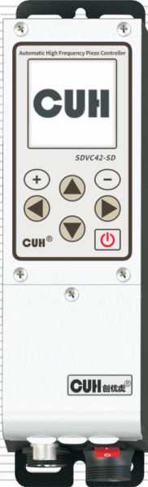

## SDVC42-SD

# คู่มือผู้ใช้

</div>


---

## คำประกาศลิขสิทธิ์

Nanjing CUH Science & Technology CO., Ltd. สงวนสิทธิ์ทั้งหมด

ข้อมูลทั้งหมดในคู่มือผู้ใช้นี้เป็นความรู้ของบริษัทและได้รับการคุ้มครองโดยกฎหมายลิขสิทธิ์และกฎหมายที่เกี่ยวข้องอื่น ๆ CUH ได้รับและสงวนสิทธิ์ทั้งหมดที่กฎหมายลิขสิทธิ์และกฎหมายอื่น ๆ มอบให้ หากไม่ได้รับความยินยอมเป็นลายลักษณ์อักษรจาก CUH ห้ามคัดลอก แปล จำลอง หรือนำคู่มือผู้ใช้นี้ไปใช้ในรูปแบบอื่น ไม่ว่าทั้งหมดหรือบางส่วน

## ข้อสงวนสิทธิ์

เนื้อหาทั้งหมดในคู่มือผู้ใช้นี้อธิบายเพียงวิธีการใช้งานผลิตภัณฑ์ที่ผลิตโดยบริษัท และอธิบายตามสถานะเทคโนโลยีปัจจุบันและสภาพที่ให้ไว้เมื่อท่านใช้งาน ท่านต้องรับความเสี่ยงที่เกี่ยวข้องเมื่อใช้ผลิตภัณฑ์นี้ ยกเว้นตามที่กฎหมายกำหนด บริษัทไม่รับผิดชอบใด ๆ ทั้งโดยชัดแจ้งหรือโดยนัยต่อผลิตภัณฑ์อันเนื่องจากคู่มือผู้ใช้นี้ ซึ่งรวมถึงแต่ไม่จำกัดเพียง การบาดเจ็บส่วนบุคคล ความเสียหายต่อทรัพย์สิน การสูญเสียผลประโยชน์ ฯลฯ

ท่านตระหนักถึงความเสี่ยงข้างต้นอย่างชัดเจนและยินยอมว่า ยกเว้นตามที่กฎหมายบังคับ บริษัทจะไม่รับผิดชอบต่อความเสียหายหรือการสูญเสียใด ๆ ทั้งทางตรงและทางอ้อมต่อท่าน（รวมถึงแต่ไม่จำกัดเพียง การสูญเสียที่เป็นรูปธรรมของบุคลากร ทรัพย์สิน ข้อมูล ฯลฯ และการสูญเสียที่ไม่มี形的ของชื่อเสียง โอกาส ฯลฯ）

บริษัทขอสงวนสิทธิ์ในการแก้ไขผลิตภัณฑ์ที่ใช้กับคู่มือผู้ใช้นี้โดยไม่ต้องแจ้งล่วงหน้าหรือภายหลัง

---


---

# คำนำ

ขอบคุณที่เลือก CUH SDVC42-SD คอนโทรลเลอร์ขับเครื่องสั่นแบบพิโซอิเล็กทริกความถี่สูงอัตโนมัติ（ต่อไปนี้จะเรียกว่า "คอนโทรลเลอร์"）คอนโทรลเลอร์ซีรีส์นี้ใช้อุปกรณ์คุณภาพสูงและรวมเทคโนโลยีอิเล็กทรอนิกส์ล่าสุด ออกแบบอย่างพิถีพิถันด้วยตัวประมวลผลสัญญาณดิจิทัลประสิทธิภาพสูง

คู่มือนี้แนะนำวิธีการทำงานพื้นฐาน คำอธิบายเทคนิคฟังก์ชัน และตัวอย่างการใช้งานทั่วไปของผลิตภัณฑ์ ให้ข้อมูลที่เกี่ยวข้องแก่ผู้ใช้เกี่ยวกับการติดตั้งและการ调试 การตั้งค่าพารามิเตอร์ การวินิจฉัยข้อผิดพลาด การแก้ปัญหา และการบำรุงรักษาตามปกติ เพื่อให้มั่นใจในการติดตั้งและใช้งานคอนโทรลเลornี้อย่างถูกต้อง กรุณาอ่านคู่มือผู้ใช้อย่างละเอียดก่อนติดตั้งและเก็บรักษาไว้อย่างปลอดภัย

กรุณาอ่านสัญลักษณ์ต่อไปนี้ที่เตือนให้ระวังมาตรการป้องกันอันตรายต่อบุคคลและความเสียหายต่อผลิตภัณฑ์

| สัญลักษณ์ | คำอธิบาย |
|---|---|
| ⚠ อันตราย | การไม่ปฏิบัติตามข้อนี้<br>จะนำไปสู่การบาดเจ็บหรือเสียชีวิต |
| ⚠ คำเตือน | การไม่ปฏิบัติตามข้อนี้<br>อาจนำไปสู่การบาดเจ็บหรือเสียชีวิต |
| ⚠ ระวัง | การไม่ปฏิบัติตามข้อนี้<br>อาจนำไปสู่การบาดเจ็บปานกลางหรือเล็กน้อย |
| ข้อควรทราบ | การไม่ปฏิบัติตามข้อนี้<br>จะนำไปสู่ความเสียหายต่อผลิตภัณฑ์และทรัพย์สิน |
| สำคัญ | แสดงข้อควรระวังและข้อจำกัดการใช้งาน<br>ที่ต้องปฏิบัติตามในระหว่างการใช้งาน |

**คู่มือนี้ใช้กับคอนโทรลเลอร์รุ่นต่อไปนี้:**

◆ คอนโทรลเลอร์ขับเครื่องสั่นแบบพิโซอิเล็กทริกความถี่สูงอัตโนมัติ  SDVC42-SD (600mA)

---


---

# ความปลอดภัยและข้อควรระวัง

1. **อันตราย** ผลิตภัณฑ์นี้ใช้สำหรับขับเครื่องสั่นแบบพิโซอิเล็กทริกเท่านั้น ห้ามใช้ผลิตภัณฑ์นี้เพื่อวัตถุประสงค์ในการป้องกันร่างกายหรือส่วนของร่างกาย

2. **อันตราย** ผลิตภัณฑ์นี้ไม่ได้ออกแบบมาเป็นผลิตภัณฑ์กันการระเบิด ห้ามใช้ในพื้นที่อันตรายและ/หรือสภาพแวดล้อมที่มีแก๊สที่สามารถระเบิดได้

3. **คำเตือน** ผลิตภัณฑ์นี้ใช้พลังงานจากไฟฟ้ากระแสสลับ ห้ามจ่ายแรงดันไฟฟ้าเกิน 250Vac แรงดันอินพุตที่สูงเกินไป เช่น 300Vac อาจทำให้ผลิตภัณฑ์ระเบิดหรือเกิดไฟไหม้ ก่อให้เกิดอุบัติเหตุร้ายแรง

4. **คำเตือน** ผลิตภัณฑ์นี้ลงกราวด์ผ่านสายไฟ กรุณาตรวจสอบว่าระบบจ่ายไฟสำหรับคอนโทรลเลอร์ลงกราวด์อย่างถูกต้อง มิฉะนั้นเปลือกคอนโทรลเลอร์อาจมีไฟฟ้า ทำให้เกิดอุบัติเหตุไฟฟ้าช็อต

5. **คำเตือน** ห้ามจ่ายไฟ AC เข้าที่เอาต์พุตของคอนโทรลเลอร์ จะทำให้คอนโทรลเลอร์เสียหาย

6. **คำเตือน** ห้ามเสียบหรือถอดสายไฟขณะมีไฟฟ้า และห้ามสัมผัสขั้วต่อของเทอร์มินัลในช่องต่อสายไฟ เพื่อป้องกันไฟฟ้าช็อต

7. **ข้อควรทราบ** หลีกเลี่ยงการควบคุมเอาต์พุตของผลิตภัณฑ์ด้วยการตัดไฟผ่านรีเลย์และอุปกรณ์类似 ซึ่งจะทำให้อายุการใช้งานของคอนโทรลเลอร์สั้นลงอย่างมาก

8. **ข้อควรทราบ** คอนโทรลเลอร์ออกแบบมาสำหรับทำงานในสภาพแวดล้อมที่เย็นและแห้ง ห้ามใช้งานคอนโทรลเลอร์กลางแจ้งเพื่อหลีกเลี่ยงความชื้นและการโดนแสงแดดโดยตรง ใช้งานคอนโทรลเลอร์ภายในค่าไฟฟ้าที่กำหนด

9. **สำคัญ** ต้องยึดผลิตภัณฑ์นี้บนแพลตฟอร์มที่แข็งแรง ลงกราวด์อย่างเชื่อถือได้ และห่างจากอุปกรณ์สั่นสะเทือน

10. **สำคัญ** ห้ามใช้งานคอนโทรลเลอร์ภายใต้เงื่อนไขที่เกินขีดจำกัดการออกแบบ

11. **สำคัญ** ใช้งานคอนโทรลเลอร์ตามคู่มือนี้โดยเคร่งครัด เราจะไม่รับผิดชอบทางแพ่งหรือทางอาญาใด ๆ หากความเสียหายต่ออุปกรณ์หรือการบาดเจ็บเกิดจากการใช้งานที่ไม่ถูกต้อง

12. **สำคัญ** ห้ามเปิดเปลือกคอนโทรลเลอร์เพื่อป้องกันไฟฟ้าช็อต ติดต่อ CUH หากคอนโทรลเลอร์ขัดข้อง ห้ามพยายามซ่อมคอนโทรลเลอร์เองซึ่งอาจทำให้การรับประกันเป็นโมฆะ

---


---

# สภาพแวดล้อมการใช้งานและการจัดเก็บ

## การตรวจสอบก่อนใช้งาน

คอนโทรลเลอร์ทุกตัวจะผ่านการตรวจสอบคุณภาพอย่างเข้มงวดก่อนจัดส่งและบรรจุในบรรจุภัณฑ์กันกระแทก กรุณาตรวจสอบรายการต่อไปนี้หลังเปิดกล่อง:

1. คอนโทรลเลอร์เสียหายระหว่างการขนส่งหรือไม่
2. รุ่นคอนโทรลเลอร์ตรงกับที่สั่งซื้อหรือไม่

## สภาพแวดล้อมการทำงาน

กรุณาปฏิบัติตามคำแนะนำต่อไปนี้เพื่อให้มั่นใจในประสิทธิภาพที่ดีที่สุดและอายุการใช้งานที่ยาวนานขึ้นของคอนโทรลเลอร์:

- [!] สภาพแวดล้อมที่มีการระบายอากาศดี
- [!] ห่างจากน้ำ ไอน้ำ ฝุ่น และโดยเฉพาะฝุ่นที่มีน้ำมัน
- [!] ห่างจากแก๊สและของเหลวที่กัดกร่อนหรือติดไฟได้
- [!] ห่างจากฝุ่นลอยและอนุภาคโลหะ
- [!] ยึดให้แน่นเพื่อหลีกเลี่ยงการสั่นสะเทือนด้วยตนเอง
- [!] ห่างจากการรบกวนทางแม่เหล็กไฟฟ้า
- [!] อุณหภูมิแวดล้อม 0~40 ℃
- [!] ใช้ที่ความสูงไม่เกิน 2000 ม.

---


---


# สารบัญ

**บทที่ Ⅰ คำแนะนำก่อนใช้งาน** -------------------------------------------------- 1

1.1 ตรวจสอบบรรจุภัณฑ์ ----------------------------------------------------------- 1

1.2 คำอธิบายป้ายชื่อผู้ผลิต ----------------------------------------------- 2

1.3 เงื่อนไขการใช้งานคอนโทรลเลอร์ ------------------------------------------------------ 2

1.4 ข้อสังเกต -------------------------------------------------------------------------- 3

**บทที่ Ⅱ แนะนำผลิตภัณฑ์** ---------------------------------------------------- 4

2.1 แนะนำผลิตภัณฑ์ ------------------------------------------------------------- 4

2.2 แผงปุ่มและพอร์ต I/O ------------------------------------------------------------- 5

2.3 คู่มือการติดตั้งเซ็นเซอร์สั่นสะเทือน --------------------------------------------- 6

2.4 คำอธิบายพารามิเตอร์หน้าหลัก -------------------------------------------------- 7

2.5 นิยามพอร์ตควบคุมสัญญาณ -------------------------------------------------- 7

2.6 การใช้งานแผงปุ่ม ----------------------------------------------------------------- 8

2.7 แผนผังการหมุนหน้าจอสัญญาณ -------------------------------------------- 8

**บทที่ Ⅲ การต่อสายไฟและการทำงานพื้นฐาน** --------------------------------------- 9

3.1 การต่อสายไฟ --------------------------------------------------------------------- 9

3.2 การทำงานพื้นฐาน ------------------------------------------------------------------ 11

**บทที่ Ⅳ คำอธิบายฟังก์ชันโดยละเอียด** ----------------------------------------- 13

4.1 การตั้งค่าพารามิเตอร์ทั่วไป ------------------------------------------------------- 14

4.1.1 แรงดันไฟฟ้า -------------------------------------------------------------------------- 14

4.1.2 ความถี่ ------------------------------------------------------------------------ 14

4.1.3 ความเร็วการป้อน -------------------------------------------------------------------- 15

4.1.4 เวลาเริ่มต้นนุ่ม/เวลาหยุดนุ่ม -------------------------------------------------- 15

4.1.5 แรงดันไฟฟ้าสูงสุด/กระแสไฟฟ้าสูงสุด ------------------------------------------------ 15

4.1.6 ความถี่เอาต์พุตสูงสุด/ความถี่เอาต์พุตต่ำสุด ------------------------------ 15

4.1.7 การตรวจจับโหลด ------------------------------------------------------------------- 16

4.1.8 สัญญาณเตือนวัสดุหมด ------------------------------------------------------------------- 16

4.1.9 สัญญาณเตือนปิดเครื่อง ------------------------------------------------------------------- 16

4.1.10 ความสว่างแบ็คไลท์ ---------------------------------------------------------- 16

4.1.11 ปิดแบ็คไลท์ ------------------------------------------------------------------- 17

4.1.12 ภาษา ------------------------------------------------------------------------ 17

4.2 การค้นหาความถี่เรโซแนนซ์อัตโนมัติ --------------------------------------------- 17

4.2.1 หน้าจอค้นหาความถี่ ----------------------------------------------------- 17

---


4.3 ความเร็วการป้อนคงที่ ---------------------------------------------------------------- 18

4.3.1 ความถี่กลาง --------------------------------------------------------------- 18

4.3.2 ค่าชดเชยความถี่ ---------------------------------------------------------------- 18

4.3.3 การอินทิเกรตความถี่ ----------------------------------------------------------- 18

4.3.4 การอินทิเกรตแอมพลิจูด ----------------------------------------------------------- 19

4.3.5 อัตราส่วนแอมพลิจูด ----------------------------------------------------------------- 19

4.3.6 เฟสอัตโนมัติ ---------------------------------------------------------------------- 19

4.3.7 แรงดันไฟฟ้าในกระบวนการค้นหาความถี่ -------------------------------------------- 19

4.3.8 แอมพลิจูดในกระบวนการค้นหาความถี่ ------------------------------------------ 19

4.3.9 ความเร็วการป้อนสูงสุด ------------------------------------------------------------- 19

4.3.10 ค่าชดเชยเฟสคอนโทรลเลอร์_slave ------------------------------------------------- 19

4.3.11 โหมดควบคุมแรงดันเอาต์พุต ------------------------------------ 20

4.3.12 โหมดควบคุมความถี่เอาต์พุต ------------------------------------------------- 20

4.3.13 แหล่งซิงโครไนซ์ -------------------------------------------------------------------- 20

4.3.14 ประเภทเซ็นเซอร์สั่นสะเทือน --------------------------------------------------------- 20

4.3.15 ความเร็วในการค้นหาความถี่เรโซแนนซ์อัตโนมัติ ----------------------------------------- 20

4.4 พารามิเตอร์เอาต์พุต ----------------------------------------------------------------- 21

4.4.1 พารามิเตอร์เอาต์พุตหลัก --------------------------------------------------------- 21

4.4.2 พารามิเตอร์เอาต์พุตควบคุม DC --------------------------------------------------- 28

4.5 การควบคุมสัญญาณ -------------------------------------------------------------------- 30

4.5.1 ประเภทเซ็นเซอร์ --------------------------------------------------------------------- 30

4.5.2 ลอจิกพอร์ต C/พอร์ต E ------------------------------------------------------------ 31

4.5.3 หน่วงเวลาเปิด/ปิดพอร์ต C และหน่วงเวลาเปิด/ปิดพอร์ต E ----------------------------------- 31

4.5.4 ลอจิกความเร็ว A/ลอจิกความเร็ว B ---------------------------------------------------- 32

4.5.5 หน่วงเวลาเปิด/ปิดความเร็ว A และหน่วงเวลาเปิด/ปิดความเร็ว B --------------------------------- 32

4.6 การนับจำนวนวัสดุ -------------------------------------------------------- 33

4.6.1 การนับจำนวนวัสดุ (หรือความเร็ว A/B) -------------------------------------- 33

4.6.2 จำนวนเป้าหมาย ----------------------------------------------------------------- 34

4.6.3 ความเร็วปลายทาง ------------------------------------------------------------------ 34

4.6.4 จำนวนความเร็วปลายทาง -------------------------------------------------------- 35

4.6.5 รีเซ็ตค่านับเป็น 0 ------------------------------------------------------ 35

4.6.6 ลำดับความสำคัญ RS --------------------------------------------------------------------- 35

---


4.7 บันทึกการตั้งค่า ---------------------------------------------------------------- 36

&nbsp;&nbsp;&nbsp;&nbsp;4.7.1 เรียกคืนการตั้งค่า -------------------------------------------------------- 36

&nbsp;&nbsp;&nbsp;&nbsp;4.7.2 บันทึกการตั้งค่า ----------------------------------------------------------- 36

&nbsp;&nbsp;&nbsp;&nbsp;4.7.3 คืนค่าโรงงาน --------------------------------------------------------- 37

&nbsp;&nbsp;&nbsp;&nbsp;4.7.4 คัดลอกการตั้งค่า ----------------------------------------------------------- 37

&nbsp;&nbsp;&nbsp;&nbsp;4.7.5 รหัสผ่านผู้ใช้ ---------------------------------------------------------- 37

&nbsp;&nbsp;&nbsp;&nbsp;4.7.6 ป้อนรหัสผ่าน --------------------------------------------------------- 37

4.8 การสื่อสาร RS485 ---------------------------------------------------------- 38

&nbsp;&nbsp;&nbsp;&nbsp;4.8.1 ประเภทการสื่อสาร ----------------------------------------------------- 38

&nbsp;&nbsp;&nbsp;&nbsp;4.8.2 อัตราบิต --------------------------------------------------------------- 39

&nbsp;&nbsp;&nbsp;&nbsp;4.8.3 ที่อยู่คอนโทรลเลอร์_slave ------------------------------------------------ 39

&nbsp;&nbsp;&nbsp;&nbsp;4.8.4 ความต้านทานพอร์ต/ความต้านทานซิงโครนัส ---------------------------------- 39

4.9 การเชื่อมต่อเครือข่าย CUHBus-DS® -------------------------------------------------------- 40

&nbsp;&nbsp;&nbsp;&nbsp;4.9.1 การเชื่อมต่ออุปกรณ์ ------------------------------------------------------- 41

&nbsp;&nbsp;&nbsp;&nbsp;4.9.2 ฟังก์ชันซิงโครไนซ์ ----------------------------------------------------------- 45

&nbsp;&nbsp;&nbsp;&nbsp;4.9.3 การแบ่งปันสัญญาณ ---------------------------------------------------------- 51

&nbsp;&nbsp;&nbsp;&nbsp;4.9.4 สำรองข้อมูล ------------------------------------------------------------ 53

&nbsp;&nbsp;&nbsp;&nbsp;4.9.5 ข้อมูลควบคุมระยะไกล ---------------------------------------------------- 54

4.10 การตรวจสอบสถานะคอนโทรลเลอร์ ------------------------------------------------ 54

4.11 บันทึกข้อผิดพลาด ------------------------------------------------------------------- 55

4.12 ปรับแต่งหน้าหลัก ---------------------------------------------------------- 55

## บทที่ Ⅴ การใช้งานทั่วไป --------------------------------------------- 56

5.1 จะรักษาเครื่องสั่นสองตัวให้ทำงานที่ความถี่เดียวกันได้อย่างไร? ----------- 56

5.2 จะเปิด/ปิดคอนโทรลเลอร์ B ผ่านเซ็นเซอร์ที่ต่อกับคอนโทรลเลอร์ A ได้อย่างไร? ----- 57

5.3 จะเปิด/ปิดคอนโทรลเลอร์สองตัวพร้อมกันได้อย่างไร? -------------------------- 58

## บทที่ Ⅵ คำถามที่พบบ่อย -------------------------------------- 59

6.1 เปิดเครื่องแล้วไม่มีอะไรแสดง ----------------------------------------------------- 59

6.2 ไม่สั่น ไม่มีเสียง หน้าจอคอนโทรลเลอร์ปกติ ---------------------------- 59

6.3 สัญญาณควบคุมไม่ทำงาน ------------------------------------------------- 59

6.4 ไม่สั่น เสียงปกติ หน้าจอคอนโทรลเลอร์ปกติ --------------------- 59

6.5 การติดตามความถี่เรโซแนนซ์ไม่เสถียร ---------------------------------------- 59

6.6 การแก้ไขความเร็วช้าในการควบคุมความเร็วการป้อนคงที่ ------------------------ 60


---

6.7 รีเซ็ตคอนโทรลเลอร์เป็นค่าเริ่มต้นโรงงานอย่างรวดเร็ว -------------------------60

**บทที่ Ⅶ ภาคผนวก** ---------------------------------------------------------------------61

7.1 ขนาด -------------------------------------------------------------------------------61

7.2 ข้อมูลจำเพาะทางเทคนิค ---------------------------------------------------------------62

7.3 มาตรฐานอ้างอิง ---------------------------------------------------------------------63

7.4 รายการพารามิเตอร์ --------------------------------------------------------------------------64

&nbsp;&nbsp;&nbsp;&nbsp;7.4.1 กลุ่มพารามิเตอร์อินเตอร์เฟซ -----------------------------------------------------64

&nbsp;&nbsp;&nbsp;&nbsp;7.4.2 กลุ่มพารามิเตอร์ทั่วไป -----------------------------------------------------65

&nbsp;&nbsp;&nbsp;&nbsp;7.4.3 กลุ่มพารามิเตอร์เอาต์พุตหลัก ------------------------------------------------66

&nbsp;&nbsp;&nbsp;&nbsp;7.4.4 กลุ่มพารามิเตอร์ความเร็วคงที่ -----------------------------------------------67

&nbsp;&nbsp;&nbsp;&nbsp;7.4.5 กลุ่มพารามิเตอร์อินพุตสัญญาณ -------------------------------------------------68

&nbsp;&nbsp;&nbsp;&nbsp;7.4.6 กลุ่มพารามิเตอร์เอาต์พุตควบคุม ---------------------------------------------69

&nbsp;&nbsp;&nbsp;&nbsp;7.4.7 กลุ่มพารามิเตอร์การนับ ------------------------------------------------70

&nbsp;&nbsp;&nbsp;&nbsp;7.4.8 กลุ่มพารามิเตอร์การสื่อสาร -------------------------------------------71

&nbsp;&nbsp;&nbsp;&nbsp;7.4.9 กลุ่มพารามิเตอร์บันทึก --------------------------------------------------------------72

&nbsp;&nbsp;&nbsp;&nbsp;7.4.10 กลุ่มพารามิเตอร์ตรวจสอบ -------------------------------------------------73

&nbsp;&nbsp;&nbsp;&nbsp;7.4.11 รายการแนบท้าย ----------------------------------------------------------------------75

7.5 แผนภาพวงจรอินพุตและเอาต์พุต -----------------------------------------------------76

7.6 รหัสข้อผิดพลาด --------------------------------------------------------------------------------78

7.7 รหัสคำเตือน ----------------------------------------------------------------------------79

**บทที่ Ⅷ ข้อมูลการรับประกันผลิตภัณฑ์** -------------------------------------80

8.1 ระยะเวลารับประกัน -------------------------------------------------------------------------80

8.2 ขอบเขตการรับประกัน ----------------------------------------------------------------------80

8.3 ความเหมาะสมของผลิตภัณฑ์ ----------------------------------------------------------------------80

---


# บทที่ Ⅰ คำแนะนำก่อนใช้งาน

บทนี้แนะนำเนื้อหาบรรจุภัณฑ์ คำอธิบายลักษณะคอนโทรลเลอร์ และข้อมูลป้ายชื่อ

## 1.1 ตรวจสอบบรรจุภัณฑ์

ก่อนใช้งาน กรุณาตรวจสอบความสมบูรณ์ของคอนโทรลเลอร์และอุปกรณ์เสริม หากพบว่าผลิตภัณฑ์มีข้อบกพร่องหรือเสียหาย ขาดอุปกรณ์เสริม กรุณาติดต่อบริษัท

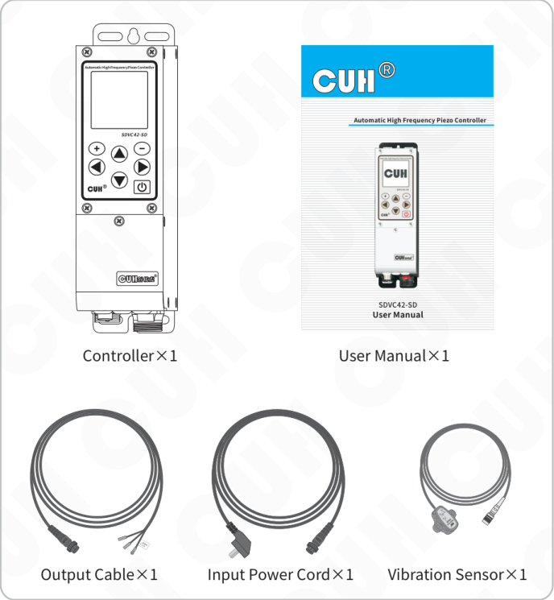

- คอนโทรลเลอร์×1
- คู่มือผู้ใช้×1
- สายเอาต์พุต×1
- สายไฟอินพุต×1
- เซ็นเซอร์สั่นสะเทือน×1


## 1.2 คำอธิบายป้ายชื่อผู้ผลิต

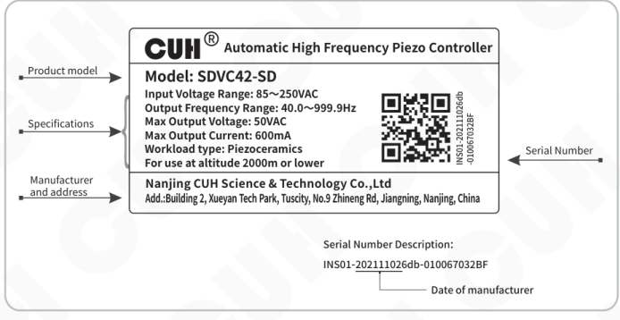

## 1.3 เงื่อนไขการใช้งานคอนโทรลเลอร์

คอนโทรลเลอร์ใช้พลังงานจาก AC 85V~250V และต่อลงกราวด์ป้องกันผ่านปลั๊กของสายไฟ กรุณาใช้ไฟมาตรฐานและตรวจสอบว่าสายกราวด์ป้องกันต่ออย่างถูกต้อง

**คำเตือน** ห้ามต่อคอนโทรลเลอร์กับไฟ AC 380V จะทำให้คอนโทรลเลอร์เสียหายอย่างร้ายแรงที่ไม่สามารถกลับคืนได้ อาจทำให้เกิดการระเบิด ไฟไหม้ และอุบัติเหตุด้านความปลอดภัยอื่น ๆ

**คำเตือน** ตรวจสอบว่าแหล่งจ่ายไฟลงกราวด์อย่างเชื่อถือได้ เปลือกโลหะของคอนโทรลเลอร์ต่อตรงกับสายกราวด์ป้องกัน การลงกราวด์ที่ไม่ดีจะทำให้เปลือกคอนโทรลเลอร์มีไฟฟ้า ทำให้เกิดอุบัติเหตุไฟฟ้าช็อต

**ข้อควรทราบ** การทำงานต่อเนื่องเป็นเวลานานจะสร้างความร้อนและทำให้อุณหภูมิเปลือกสูงขึ้น กรุณาติดตั้งคอนโทรลเลอร์ในสภาพแวดล้อมที่มีการระบายอากาศดีและยึดให้แน่น ห่างจากแหล่งสั่นสะเทือน

**ข้อควรทราบ** ผลิตภัณฑ์นี้เป็นคอนโทรลเลอร์สำหรับขับเครื่องสั่นแบบพิโซอิเล็กทริก

---


---

## 1.4 ข้อสังเกต

คู่มือการใช้งานมีความยาวประมาณ 28,000 คำ คาดว่าจะใช้เวลาอ่านประมาณ 1 ชั่วโมง

◆ กรุณาอ่านคู่มือนี้ก่อนใช้งานเพื่อป้องกันความเสียหายต่อคอนโทรลเลอร์จากการใช้งานที่ไม่ถูกต้อง

◆ ผู้ใช้สามารถค้นหาฟังก์ชันและวิธีการทำงานที่เกี่ยวข้องของคอนโทรลเลอร์ได้ตามสารบัญของคู่มือ

◆ หัวข้อย่อยของบทและข้อความที่เน้นในเนื้อหาเป็นรายการพารามิเตอร์ที่แสดงจริงบนคอนโทรลเลอร์ เช่น แรงดันไฟฟ้า

◆ ผู้ใช้สามารถอ้างอิง "บทที่ Ⅴ การใช้งานทั่วไป" เพื่อเริ่มต้นใช้งานคอนโทรลเลอร์ได้อย่างรวดเร็ว

◆ ผู้ใช้สามารถค้นหารหัสแท็กฟังก์ชันได้อย่างรวดเร็วในส่วน "7.4 รายการพารามิเตอร์"

◆ การกด ⊕ และ ⊖ พร้อมกันหมายถึงการยืนยัน

---


---

# บทที่ Ⅱ แนะนำผลิตภัณฑ์

เนื้อหาหลักของบทนี้รวมถึงการแนะนำสั้น ๆ และคุณสมบัติหลักของผลิตภัณฑ์

## 2.1 แนะนำผลิตภัณฑ์

คอนโทรลเลอร์ซีรีส์ SDVC42-SD เป็นผลิตภัณฑ์ที่ออกแบบมาเป็นพิเศษสำหรับระบบป้อนวัสดุระดับสูง

ประสิทธิภาพที่ไม่เหมือนใครได้รับจากการใช้เทคโนโลยีอิเล็กทรอนิกส์ล่าสุดและวิธีการประมวลผลสัญญาณ คุณสมบัติพิเศษ ได้แก่:

- สามารถรับรู้การซิงโครไนซ์ สำรอง และกู้คืนพารามิเตอร์ควบคุมระยะไกลเช่น แรงดันไฟฟ้า ความถี่ เฟส สำหรับคอนโทรลเลอร์แต่ละตัวผ่านการสื่อสาร CUHBus-DS®
- สามารถใช้สัญญาณจากพอร์ตของคอนโทรลเลอร์อื่นสำหรับการควบคุมลอจิกผ่านการสื่อสาร CUHBus-DS®
- สามารถใช้งานฟังก์ชันสัญญาณเตือนวัสดุหมดได้โดยไม่ต้องติดตั้งเซ็นเซอร์เพิ่มเติม
- สามารถส่งเสียงเตือนที่เลือกได้ผ่านเครื่องสั่น
- ขยายความถี่เอาต์พุตเป็น 40.0Hz~999.9Hz
- พอร์ตควบคุมความเร็วแบบแอนะลอกรองรับโหมด 0~5V, 1~5V, 0~10V, 4~20mA และอื่น ๆ
- มาพร้อมฟังก์ชันการนับ รวมถึงการลดความเร็วขณะนับและการหยุดนับ
- การค้นหาความถี่แอมพลิจูดคงที่ที่ได้รับการปรับปรุงทำให้มั่นใจว่าเครื่องสั่นสองตัวที่มีช่องว่างเล็กน้อยจะไม่ชนกันในระหว่างกระบวนการค้นหาความถี่
- รองรับโปรโตคอล RS485 Modbus ASCII และ RS485 Modbus RTU
- สามารถอัปเกรดซอฟต์แวร์ผ่านอินเตอร์เฟซ RS485
- ใช้จอ LCD ความละเอียด 128 * 128 และรองรับสามภาษา: จีน อังกฤษ และเยอรมัน
- ตรวจจับลักษณะกระแสโหลดเพื่อช่วยผู้ใช้วินิจฉัยข้อผิดพลาด
- รหัสข้อผิดพลาดสามารถเก็บบันทึกข้อผิดพลาดล่าสุด 64 รายการ

---


## 2.2 แผงปุ่มและพอร์ต I/O

### คำอธิบายหน้าต่างและปุ่ม

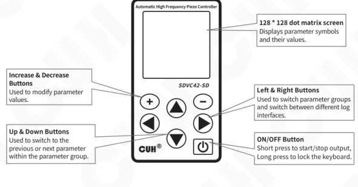

| หน้าต่าง / ปุ่ม | คำอธิบาย |
|---|---|
| ปุ่มเพิ่มและลด | ใช้สำหรับแก้ไขค่าพารามิเตอร์ |
| ปุ่มขึ้นและลง | ใช้สำหรับสลับไปพารามิเตอร์ก่อนหน้าหรือถัดไปภายในกลุ่มพารามิเตอร์ |
| ปุ่มซ้ายและขวา | ใช้สำหรับสลับกลุ่มพารามิเตอร์และสลับระหว่างอินเตอร์เฟซบันทึกต่าง ๆ |
| จอเมทริกซ์ 128 * 128 | แสดงสัญลักษณ์พารามิเตอร์และค่า |
| ปุ่มเปิด/ปิด | กดสั้นเพื่อเริ่ม/หยุดเอาต์พุต กดค้างเพื่อล็อกแป้นพิมพ์ |

### คำอธิบายส่วนประกอบภายนอก

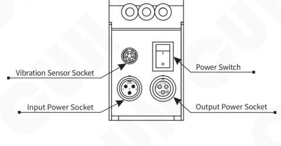

| ส่วนประกอบภายนอก |
|---|
| ช่องเสียบเซ็นเซอร์สั่นสะเทือน |
| ช่องเสียบไฟอินพุต |
| สวิตช์ไฟ |
| ช่องเสียบไฟเอาต์พุต |

---


## 2.3 คู่มือการติดตั้งเซ็นเซอร์สั่นสะเทือน

ยึดเซ็นเซอร์สั่นสะเทือนบนพื้นผิวเรียบของเครื่องสั่น ทิศทางการติดตั้งเป็นอิสระ วิธีการติดตั้งเซ็นเซอร์สั่นสะเทือนแสดงดังต่อไปนี้:

- วิธีที่ 1: ดังแสดงในรูป 2.3.1  
  ข้อดี: ติดตั้งง่าย

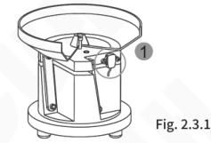

- วิธีที่ 2: ดังแสดงในรูป 2.3.2  
  หมายเหตุ: ห้ามให้เซ็นเซอร์สั่นสะเทือนถูกกดโดยชามป้อน

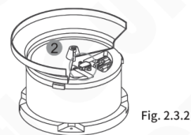

- วิธีที่ 3: เชื่อมที่ยึดบนเครื่องสั่นและยึดเซ็นเซอร์สั่นสะเทือนบนที่ยึด ดังแสดงในรูป 2.3.3  
  ขนาดที่ยึดแนะนำแสดงในรูป 2.3.4

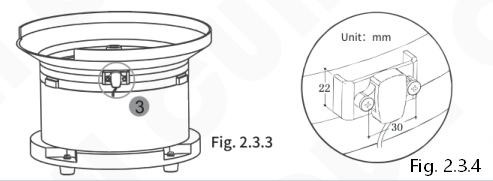

- ไม่แนะนำวิธีการติดตั้ง ดังแสดงในรูป 2.3.5 และรูป 2.3.6  
  หากตำแหน่งการติดตั้งไม่เหมาะสม เซ็นเซอร์สั่นสะเทือนจะไม่สามารถป้อนกลับความถี่เรโซแนนซ์ได้อย่างถูกต้อง และคอนโทรลเลอร์จะดำเนินการค้นหาความถี่เรโซแนนซ์อย่างต่อเนื่อง

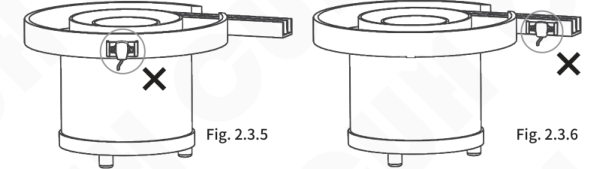


## 2.4 คำอธิบายพารามิเตอร์หน้าหลัก

คอนโทรลเลอร์สามารถแสดงสถานะเอาต์พุตหลัก สถานะล็อกแป้นพิมพ์ สถานะพอร์ต พารามิเตอร์ตรวจสอบ และชื่ออินเตอร์เฟซบนหน้าหลัก ภายในสถานะพอร์ต: การเน้น X หมายความว่าพอร์ตนั้นใช้งานอยู่ <u>X</u> หมายความว่าพอร์ตใช้งานที่ระดับต่ำ และ X̅ หมายความว่าพอร์ตใช้งานที่ระดับสูง

### ตัวอย่างการแสดงหน้าหลัก

**ตัวอย่างที่ 1**

```text
RUN
A C D E F G N J    A0

UserSped           50
P2.01

UserVoltg          20.0
P2.02              V

+       Home       -
```


**ตัวอย่างที่ 2**

```text
RUN
A C D E F G N J    A0

UserSped           [50]
P2.01

UserVoltg          20.0
P2.02              V

+       Home       -
```

[50] กล่องกาเครื่องหมายแสดงว่าค่าพารามิเตอร์สามารถปรับได้ แต่ไม่สามารถเปลี่ยนแรงดันเอาต์พุตได้เนื่องจากไม่ได้ต่อเซ็นเซอร์ความเร่ง 

## 2.5 นิยามพอร์ตควบคุมสัญญาณ

| กลุ่มฟังก์ชันซ้าย | เทอร์มินัลซ้าย | นิยามซ้าย | นิยามขวา | เทอร์มินัลขวา | กลุ่มฟังก์ชันขวา |
|---|---:|---|---|---:|---|
| ซิงค์ดิจิทัล | T1 | Sync+ | Sync+ | T1 | ซิงค์ดิจิทัล |
| ซิงค์ดิจิทัล | T2 | GND | GND | T2 | ซิงค์ดิจิทัล |
| ซิงค์ดิจิทัล | T3 | Sync- | Sync- | T3 | ซิงค์ดิจิทัล |
| ควบคุมความเร็วระยะไกล | A1 | RGND | GND | N1 | นับ/ตั้งค่าความเร็ว |
| ควบคุมความเร็วระยะไกล | A2 | อินพุต | นับ/ตั้งค่า A | G | นับ/ตั้งค่าความเร็ว |
| ควบคุมความเร็วระยะไกล | A3 | เอาต์พุต 5V | รีเซ็ต/ตั้งค่า B | N | นับ/ตั้งค่าความเร็ว |
| ควบคุมความเร็วระยะไกล | A4 | GND | เอาต์พุต 24V | N4 | นับ/ตั้งค่าความเร็ว |
| เซ็นเซอร์ | C1 | GND | A+ | F2 | RS485 |
| เซ็นเซอร์ | C2 | อินพุต | GND | F3 | RS485 |
| เซ็นเซอร์ | C3 | เอาต์พุต 24V | B- | F4 | RS485 |
| เซ็นเซอร์ Ⅱ | E1 | GND | GND | D3 | เอาต์พุตควบคุม |
| เซ็นเซอร์ Ⅱ | E2 | อินพุต | เอาต์พุต | D1 | เอาต์พุตควบคุม |
| เซ็นเซอร์ Ⅱ | E3 | เอาต์พุต 24V | เอาต์พุต 24V | D2 | เอาต์พุตควบคุม |


---

## 2.6 การใช้งานแผงปุ่ม

 a. คอนโทรลเลอร์นี้ใช้จอเมทริกซ์ 128 * 128 เพื่อแสดงเนื้อหาพารามิเตอร์

 b. ตามระยะเวลาการกดปุ่ม การทำงานของปุ่มแบ่งเป็น: กดสั้น, กดค้าง, เร่งระดับ 1, และเร่งระดับ 2

 [กดสั้น]: กดมากกว่า 0.1 วินาที แต่น้อยกว่า 0.5 วินาที

 [กดค้าง]: กดมากกว่า 2 วินาที

 [เร่งระดับ 1]: กดมากกว่า 0.5 วินาที แต่น้อยกว่า 2 วินาที

 [เร่งระดับ 2]: กดมากกว่า 2 วินาที

 c. ⊕ และ ⊖ ฟังก์ชันหลักคือแก้ไขค่าพารามิเตอร์

 d. สลับระหว่างกลุ่มพารามิเตอร์บนและล่างในหน้าจอตั้งค่าพารามิเตอร์โดยการกด ◀ หรือ ▶ สั้น ๆ

 e. สลับระหว่างพารามิเตอร์บนและล่างของกลุ่มนี้ในหน้าจอตั้งค่าพารามิเตอร์โดยการกด ▲ หรือ ▼ สั้น ๆ

 f. กด ⏻ สั้นเพื่อเริ่ม/หยุดเอาต์พุตหลัก กด ⏻ ค้างเพื่อล็อก/ปลดล็อกแป้นพิมพ์

 g. เข้ากลุ่มพารามิเตอร์ต่าง ๆ ผ่านการผสมปุ่มต่อไปนี้:

 กด ▲+▼ ค้าง เพื่อเข้าหรือออกจากหน้าจอค้นหาความถี่

 กด ▲+◀ ค้าง เพื่อเข้าหรือออกจากหน้าจอตั้งค่าพารามิเตอร์

 กด ▲+▶ ค้าง เพื่อเข้าหรือออกจากหน้าจอบันทึก

## 2.7 แผนผังการหมุนหน้าจอสัญญาณ

ภายใต้หน้าจอใด ๆ กด **▲+▶** ค้าง เข้า **หน้าจอบันทึก** กดค้างอีกครั้งเพื่อออกสู่ **หน้าจอหลัก**

ภายใต้หน้าจอใด ๆ กด **▲+▼** ค้าง เข้า **หน้าจอค้นหาความถี่** กดปุ่มหยุดสั้นเพื่อออกสู่ **หน้าจอหลัก**

ภายใต้หน้าจอใด ๆ กด **▲+◀** ค้าง เข้า **หน้าจอตั้งค่าพารามิเตอร์** กดค้างอีกครั้งเพื่อออกสู่ **หน้าจอหลัก**

ภายใต้หน้าจอใด ๆ หากไม่มีการดำเนินการมากกว่า 5 นาที เข้า **หน้าจอสแตนด์บาย** และกดปุ่มใดก็ได้เพื่อกลับสู่ **หน้าจอหลัก**

---


---

# บทที่ Ⅲ การต่อสายไฟและการทำงานพื้นฐาน

## 3.1 การต่อสายไฟ

**ขั้นตอนที่หนึ่ง:**

เปิดกล่องบรรจุภัณฑ์และตรวจสอบคอนโทรลเลอร์และอุปกรณ์เสริมทั้งหมด

**ขั้นตอนที่สอง:**

ต่อขั้วของสายไฟเอาต์พุตเข้ากับขั้วของเครื่องสั่นพิโซอิเล็กทริก

จัดตำแหน่งรอยบากบนปลั๊ก aviation ของสายเอาต์พุตกับเครื่องหมายสามเหลี่ยมบนช่องเสียบเอาต์พุตของคอนโทรลเลอร์ จากนั้นขันน็อตให้แน่นหลังต่อสายเอาต์พุตอย่างถูกต้อง

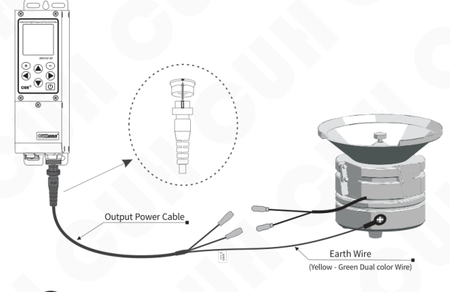

**หมายเหตุ**

ตรวจสอบว่าขั้วของเครื่องสั่นพิโซอิเล็กทริกต่อกับขาเอาต์พุตสองขาของสายไฟเอาต์พุต และเปลือกโลหะของเครื่องสั่นลงกราวด์อย่างเชื่อถือได้

---


### ขั้นตอนที่สาม:

ต่อขั้วของสายไฟอินพุตเข้ากับช่องเสียบไฟอินพุตของคอนโทรลเลอร์

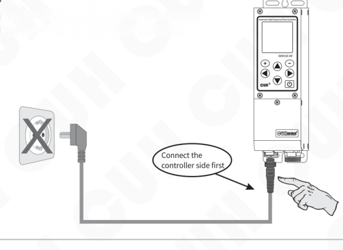

### ขั้นตอนที่สี่:

หลังตรวจสอบว่าสวิตช์อยู่ในตำแหน่งปิด ต่อปลั๊กของสายไฟอินพุตเข้ากับช่องเสียบไฟ

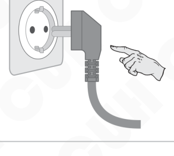


## 3.2 การทำงานพื้นฐาน

### ขั้นตอนที่ห้า:

เปิดสวิตช์ไฟของคอนโทรลเลอร์ คอนโทรลเลอร์จะแสดงหน้าจอหลัก

```text
RUN
A C D E F G N J    A0

UserSped              50
P2.01

EffectCu            0.00
P10.05   A

+     Home      −
```

### ขั้นตอนที่หก:

เครื่องสั่นเริ่มทำงาน ปรับค่าพารามิเตอร์ความถี่และแรงดันไฟฟ้าในกลุ่มพารามิเตอร์ "2 Common" เพื่อเลือกความเร็วการป้อนที่เหมาะสม

- » กด ▲ และ ◀ ค้าง เข้าหน้าจอตั้งค่าพารามิเตอร์ กด ▶ สั้น สลับไปกลุ่มพารามิเตอร์ "2 Common"
- » กด ▲ หรือ ▼ สั้น วางเคอร์เซอร์ที่ค่าพารามิเตอร์แรงดันไฟฟ้า
- » กด ⊕ หรือ ⊖ เพื่อปรับค่าพารามิเตอร์
- » กด ▲ หรือ ▼ สั้น วางเคอร์เซอร์ที่ค่าพารามิเตอร์ความถี่
- » กด ⊕ หรือ ⊖ เพื่อปรับค่าพารามิเตอร์

```text
RUN
A C D E F G N J    A0

01.UserSped        50
02.UsrVoltg        20.0 V
03.UsrFrqnc        50.0 Hz
04.SoftStar         0.5 S
05.SoftStop         0.5 S

+     2Common    −
```

☺

- ความถี่ที่การสั่นสะเทือนถึงค่าสูงสุดคือความถี่ธรรมชาติของตัวสั่น
- เครื่องสั่นแต่ละตัวมีความถี่เรโซแนนซ์เชิงกลธรรมชาติของตัวเอง ปรับความถี่เอาต์พุตของคอนโทรลเลอร์ให้เป็นความถี่นี้เพื่อให้ได้สถานะการทำงานที่ดีที่สุด


---

### ขั้นตอนที่เจ็ด:

ผู้ใช้สามารถต่อเซ็นเซอร์ความเร่งเพิ่มเติมเพื่อให้คอนโทรลเลอร์ทำการค้นหาความถี่อัตโนมัติ（หมายเหตุ: ผู้ใช้ไม่จำเป็นต้องเทวัสดุออกจากจานสั่น）

นำเซ็นเซอร์ออกมา ต่อปลั๊กเซ็นเซอร์เข้ากับคอนโทรลเลอร์และขันน็อตให้แน่น และยึดตัวเซ็นเซอร์บนจานสั่นอย่างถูกต้อง（ดูบทที่ 2.3）

### ขั้นตอนที่แปด:

- กด ▲ และ ▼ ค้าง เข้าหน้าจอค้นหาความถี่

- ในเวลานี้ หน้าจอจะแสดงเส้นโค้งแอมพลิจูดของจานสั่นในกระบวนการค้นหาความถี่（สามขั้นตอน）และแสดงแรงดันเอาต์พุต กระแสไฟฟ้า และค่าความเร่งพร้อมกัน

  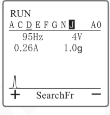

  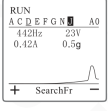

  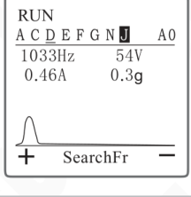

- หลังการค้นหาความถี่เสร็จสิ้น คอนโทรลเลอร์จะแสดง "Save" เพื่อระบุว่าค้นหาความถี่สำเร็จและบันทึกความถี่กลางแล้ว คอนโทรลเลอร์จะกลับสู่หน้าหลักอัตโนมัติ

  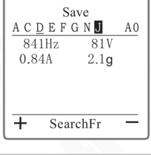

- ผู้ใช้สามารถปรับความเร็วการป้อนของเครื่องสั่นเพิ่มเติมผ่าน ⊕ หรือ ⊖

---


# บทที่ Ⅳ คำอธิบายฟังก์ชันโดยละเอียด

บทนี้แนะนำฟังก์ชันและการตั้งค่าโดยละเอียดของคอนโทรลเลอร์

กด ▲ และ ◀ ค้าง เพื่อเข้าหน้าจอตั้งค่าพารามิเตอร์บนหน้าจอใด ๆ  
หน้าจอตั้งค่าพารามิเตอร์ประกอบด้วยสิบกลุ่มพารามิเตอร์ต่อไปนี้  
สลับระหว่างกลุ่มพารามิเตอร์ต่าง ๆ โดยการกด ◀ หรือ ▶ สั้น ๆ

## แผนผังการหมุนกลุ่มพารามิเตอร์

| ลำดับ | กลุ่มพารามิเตอร์ |
|---:|---|
| 1 | EditHome |
| 2 | Common |
| 3 | M_output |
| 4 | Stabilize |
| 5 | On&Off |
| 6 | DCoutput |
| 7 | Counter |
| 8 | Comm |
| 9 | Save |
| 10 | Monitor |

หมายเหตุทิศทางแสดงในแผนภาพ:

- ด้านซ้าย: **กด ▶ สั้น** ลูกศรแนวตั้งลง
- ด้านขวา: **กด ▶ สั้น** ลูกศรแนวตั้งขึ้น
- กลุ่มพารามิเตอร์ที่อยู่ติดกันเชื่อมด้วยลูกศรขึ้น/ลง


## 4.1 การตั้งค่าพารามิเตอร์ทั่วไป

บทนี้แนะนำการตั้งค่าและปรับพารามิเตอร์พื้นฐานทั่วไปของคอนโทรลเลอร์

### 4.1.1 แรงดันไฟฟ้า

คอนโทรลเลอร์นี้สามารถตั้งค่าแรงดันเอาต์พุตแบบดิจิทัลบนแผงได้โดยตรง เนื่องจากคอนโทรลเลอร์มีฟังก์ชันรักษาแรงดันคงที่ ค่านี้คือค่าเฉลี่ยการแก้ไขแรงดันและจะไม่ได้รับผลกระทบจากแรงดันอินพุต แรงดันเอาต์พุตสามารถคงที่แม้ในสถานการณ์ที่แรงดันไฟฟ้าไม่เสถียร ในขณะเดียวกัน การตั้งค่าแรงดันโดยตรงยังให้ข้อมูลที่แม่นยำสำหรับผู้ใช้ในการติดตามการทำงานของอุปกรณ์

» เข้ากลุ่มพารามิเตอร์ทั่วไป และค้นหาพารามิเตอร์ตั้งค่าแรงดันไฟฟ้า

» กด ⊕ หรือ ⊖ เพื่อปรับค่าพารามิเตอร์

ช่วงแรงดันไฟฟ้าคือ 0.0~50.0V ค่าเริ่มต้นคือ 20.0V ความแม่นยำในการปรับคือ 0.1V

```text
RUN
A C D E F G N J    A0
01.UserSped        50
02.UsrVoltg        20.0 V
03.UsrFrqnc        50.0 Hz
04.SoftStar        0.5 S
05.SoftStop        0.5 S
+     2Common     −
```

### 4.1.2 ความถี่

คอนโทรลเลอร์ใช้เทคโนโลยีการสังเคราะห์ความถี่ดิจิทัลโดยตรง (DDS) ซึ่งมีความแม่นยำและความเสถียรของความถี่สูงมาก และไม่เปลี่ยนแปลงตามเวลาและอุณหภูมิ

» เข้ากลุ่มพารามิเตอร์ทั่วไป และค้นหาพารามิเตอร์ตั้งค่าความถี่

» กด ⊕ หรือ ⊖ เพื่อปรับค่าพารามิเตอร์

ช่วงความถี่ 40.0~999.9Hz ค่าเริ่มต้นคือ 50.0Hz ความแม่นยำในการปรับคือ 0.1Hz

```text
RUN
A C D E F G N J    A0
01.UserSped        50
02.UsrVoltg        20.0 V
03.UsrFrqnc        50.0 Hz
04.SoftStar        0.5 S
05.SoftStop        0.5 S
+     2Common     −
```

พารามิเตอร์อื่น ๆ ในกลุ่มพารามิเตอร์นี้สามารถปรับตามขั้นตอนข้างต้น


---

### 4.1.3 ความเร็วการป้อน

**ความเร็วการป้อน:** ความเร็วในการเคลื่อนที่ของวัสดุในเครื่องสั่น เมื่อคอนโทรลเลอร์ต่อกับเซ็นเซอร์ความเร่งและค่าพารามิเตอร์ "โหมดแรงดัน" เป็น "อัตโนมัติ" สามารถปรับความเร็วในการเคลื่อนที่ของวัสดุผ่านพารามิเตอร์ความเร็วการป้อน และจานสั่นสามารถทำงานอย่างเสถียรที่ความเร็วการป้อนที่ตั้งไว้

ช่วงความเร็วการป้อนคือ 0~3200 ค่าเริ่มต้นคือ 50 และความแม่นยำในการปรับคือ 1

### 4.1.4 เวลาเริ่มต้นนุ่ม/เวลาหยุดนุ่ม

**เวลาเริ่มต้นนุ่ม:** เวลาที่คอนโทรลเลอร์ต้องการในการเพิ่มแรงดันเอาต์พุตจาก 0V ถึงแรงดันเอาต์พุตที่ตั้งไว้อย่างราบรื่นเมื่อเริ่มจากสถานะหยุด

ช่วงเวลาเริ่มต้นนุ่มคือ 0.0~40.0s ค่าเริ่มต้นคือ 0.5 วินาที และความแม่นยำในการปรับคือ 0.1 วินาที

**เวลาหยุดนุ่ม:** เมื่อคอนโทรลเลอร์หยุดทำงาน แรงดันเอาต์พุตจะลดลงอย่างราบรื่นจากแรงดันเอาต์พุตที่ตั้งไว้จนถึง 0V

ช่วงเวลาหยุดนุ่มคือ 0.0~40.0s ค่าเริ่มต้นคือ 0.5 วินาที และความแม่นยำในการปรับคือ 0.1 วินาที

เมื่อคอนโทรลเลอร์นี้เริ่มหรือหยุด แรงดันเอาต์พุตสามารถเพิ่มหรือลดอย่างนุ่มนวลเพื่อป้องกันไม่ให้อุปกรณ์สั่นเสียหายจากแรงกระแทก

### 4.1.5 แรงดันไฟฟ้าสูงสุด/กระแสไฟฟ้าสูงสุด

**แรงดันไฟฟ้าสูงสุด:** ค่าแรงดันไฟฟ้าสูงสุดที่คอนโทรลเลอร์จ่ายออกมา

ช่วงแรงดันไฟฟ้าสูงสุดคือ 0.0~50.0V ค่าเริ่มต้นคือ 50.0V และความแม่นยำในการปรับคือ 0.1V

**กระแสไฟฟ้าสูงสุด:** ค่ากระแสไฟฟ้าสูงสุดที่คอนโทรลเลอร์จ่ายออกมา

ช่วงกระแสไฟฟ้าสูงสุดคือ 0~600mA ค่าเริ่มต้นคือ 600mA และความแม่นยำในการปรับคือ 1mA

คอนโทรลเลอร์นี้สามารถตั้งค่าขีดจำกัดแรงดันเอาต์พุตสูงสุดและกระแสเอาต์พุตสูงสุด ซึ่งสามารถป้องกันผู้ใช้จากการทำให้อุปกรณ์สั่นเสียหายโดยการจ่ายแรงดันหรือกระแสมากเกินไปโดยไม่ตั้งใจ

### 4.1.6 ความถี่เอาต์พุตสูงสุด/ความถี่เอาต์พุตต่ำสุด

**ความถี่เอาต์พุตสูงสุด:** จำกัดค่าขีดจำกัดบนของพารามิเตอร์ "ความถี่" ขีดจำกัดความถี่บนในระหว่างการค้นหาความถี่ยังถูกจำกัดด้วยค่าพารามิเตอร์นี้

ช่วงความถี่เอาต์พุตสูงสุดคือ 40.0~999.9Hz ค่าเริ่มต้นคือ 999.9Hz และความแม่นยำในการปรับคือ 0.1Hz

**ความถี่เอาต์พุตต่ำสุด:** จำกัดค่าขีดจำกัดล่างของพารามิเตอร์ "ความถี่" ขีดจำกัดความถี่ล่างในระหว่างการค้นหาความถี่ยังถูกจำกัดด้วยค่าพารามิเตอร์นี้

ช่วงความถี่เอาต์พุตต่ำสุดคือ 40.0~999.9Hz ค่าเริ่มต้นคือ 40.0Hz และความแม่นยำในการปรับคือ 0.1Hz

**หมายเหตุ:** ผลต่างระหว่างความถี่เอาต์พุตสูงสุดและความถี่เอาต์พุตต่ำสุดต้องไม่น้อยกว่า 50.0Hz

---


---

### 4.1.7 การตรวจจับโหลด

คอนโทรลเลอร์สามารถตรวจจับค่าความจุและค่าความต้านทานได้ หลังใช้ฟังก์ชันตรวจจับโหลด ผู้ใช้สามารถดูค่าที่วัดได้ที่เกี่ยวข้องกับโหลดในกลุ่มพารามิเตอร์ตรวจสอบ ค่าเริ่มต้นคือ None

### 4.1.8 สัญญาณเตือนวัสดุหมด

เมื่อคอนโทรลเลอร์ต่อกับเซ็นเซอร์ความเร่งและค่าพารามิเตอร์ "โหมดแรงดัน" และ "โหมดความถี่" เป็น "อัตโนมัติ" ทั้งคู่ ฟังก์ชันสัญญาณเตือนวัสดุหมดจะเปิดใช้งาน ผู้ใช้สามารถค้นหาพารามิเตอร์ "สัญญาณเตือนวัสดุหมด" ในกลุ่มพารามิเตอร์ตรวจสอบเมื่อเครื่องสั่นว่างเปล่าหรือมีวัสดุน้อย และในขณะเดียวกัน กด ⊕ และ ⊖ ค้างเพื่อบันทึกค่าที่วัดได้ของ "สัญญาณเตือนวัสดุหมด" ในกลุ่มพารามิเตอร์ตรวจสอบ และอ้างอิงค่าที่วัดได้เพื่อตั้งค่าการเตือนของ "สัญญาณเตือนวัสดุหมด" นอกจากนี้ยังสามารถปรับค่าการเตือนผ่าน ⊕ หรือ ⊖ เพิ่มเติม

เมื่อคอนโทรลเลอร์ตรวจพบว่าค่าที่วัดได้ของเครื่องสั่นต่ำกว่าค่าการเตือน จะกระตุ้นฟังก์ชันการเตือน

ช่วงสัญญาณเตือนวัสดุหมดคือ 0~3000 ค่าเริ่มต้นคือ 0 และความแม่นยำในการปรับคือ 1

หมายเหตุ: ผู้ใช้สามารถใช้สัญญาณการเตือนเป็นสัญญาณแหล่งเอาต์พุตหลักหรือพอร์ต D เพื่อขับสถานะเอาต์พุตต่าง ๆ ของคอนโทรลเลอร์

### 4.1.9 สัญญาณเตือนปิดเครื่อง

**สัญญาณเตือนปิดเครื่อง:** เมื่อคอนโทรลเลอร์หยุดเอาต์พุต คอนโทรลเลอร์จะส่งเสียงเตือนที่แตกต่างกันโดยขับเครื่องสั่น เพื่อเตือนผู้ใช้ให้ทราบถึงการปิดเครื่องในสภาพแวดล้อมที่มีเสียงดัง เลือกเสียงสามแบบหรือไม่ใช้งาน (ไม่มีเสียง) ค่าเริ่มต้นคือ None

| พารามิเตอร์ | ความหมาย |
|---|---|
| None | ไม่ใช้งาน |
| Sound 1 | ขับจานสั่นให้ส่งเสียงเตือนแบบที่ 1 |
| Sound 2 | ขับจานสั่นให้ส่งเสียงเตือนแบบที่ 2 |
| Sound 3 | ขับจานสั่นให้ส่งเสียงเตือนแบบที่ 3 |

### 4.1.10 ความสว่างแบ็คไลท์

**ความสว่างแบ็คไลท์:** คือความสว่างของแบ็คไลท์หน้าจอคอนโทรลเลอร์ สามารถปรับความสว่างของแบ็คไลท์ให้เหมาะกับสภาพแสงแวดล้อมที่แตกต่างกัน

ช่วงความสว่างแบ็คไลท์คือ 20~100 ค่าเริ่มต้นคือ 100 และความแม่นยำในการปรับคือ 1

---


### 4.1.11 ปิดแบ็คไลท์

**ปิดแบ็คไลท์:** คือเวลาปิดแบ็คไลท์ เมื่อคอนโทรลเลอร์ไม่มีการดำเนินการใด ๆ ในช่วงระยะเวลาหนึ่ง คอนโทรลเลอร์จะปิดแบ็คไลท์หน้าจอ สามารถกดปุ่มใดก็ได้เพื่อเปิดแบ็คไลท์อีกครั้ง

ช่วงการปิดแบ็คไลท์คือ 1-30min ค่าเริ่มต้นคือ 5min และความแม่นยำในการปรับคือ 1min เมื่อตั้งเป็น 31 หมายถึงสว่างตลอดเวลา

### 4.1.12 ภาษา

**ภาษา:** คือภาษาที่แสดงบนแผงควบคุมคอนโทรลเลอร์ คอนโทรลเลอร์มีสามภาษาในตัว: จีน อังกฤษ และเยอรมัน ทำให้ง่ายสำหรับผู้ใช้ในภูมิภาคต่าง ๆ ในการสลับ ค่าเริ่มต้นคือ Englis

| พารามิเตอร์ | ความหมาย |
|---|---|
| Englis | อินเตอร์เฟซภาษาอังกฤษ |
| Chines | อินเตอร์เฟซภาษาจีน |
| German | อินเตอร์เฟซภาษาเยอรมัน |

## 4.2 การค้นหาความถี่เรโซแนนซ์อัตโนมัติ

บทนี้แนะนำวิธีการค้นหาความถี่เรโซแนนซ์ของจานสั่นอย่างรวดเร็วในหน้าจอค้นหาความถี่ของผลิตภัณฑ์นี้ และใช้งานจานสั่น

### 4.2.1 หน้าจอค้นหาความถี่

เมื่อเซ็นเซอร์ความเร่งต่อกับจานสั่นอย่างถูกต้อง ทั้ง "โหมดแรงดัน" และ "โหมดความถี่" ตั้งเป็น "อัตโนมัติ" สามารถค้นหาความถี่เรโซแนนซ์ของเครื่องสั่นได้อย่างรวดเร็วโดยเข้าหน้าจอค้นหาความถี่

อ้างอิงขั้นตอนที่แปดในบทที่ 3.2 สำหรับขั้นตอนการดำเนินการ


---

## 4.3 ความเร็วการป้อนคงที่

บทนี้แนะนำวิธีการตั้งค่าพารามิเตอร์ที่เกี่ยวข้องของคอนโทรลเลอร์และรักษาฟังก์ชันของคอนโทรลเลอร์ให้ทำงานอย่างราบรื่น

### 4.3.1 ความถี่กลาง

ช่วงความถี่ที่คอนโทรลเลอร์สามารถปรับได้อัตโนมัติคือ "ความถี่กลาง" ± "ค่าชดเชยความถี่" ความถี่กลางควรปรับใกล้จุดเรโซแนนซ์ของอุปกรณ์สั่น เพื่อให้คอนโทรลเลอร์สามารถปรับไปยังจุดทำงานที่ดีที่สุดได้เร็วที่สุดเมื่อปรับความถี่อัตโนมัติ

- » กด ▲ และ ◀ ค้างเพื่อเข้าหน้าจอตั้งค่าพารามิเตอร์ กด ▶ สั้นเพื่อสลับไปกลุ่มพารามิเตอร์ "4 Stabilize"
- » กด ▲ หรือ ▼ สั้นเพื่อสลับไปพารามิเตอร์ความถี่กลาง
- » กด ⊕ หรือ ⊖ เพื่อปรับค่าพารามิเตอร์

```text
RUN
A C D E F G N J     A0
01.AutFCent 100.0 Hz
02.AutFRang  30.0 Hz
03.AutFIntg      20
04.AutAIntg     300
05.AutAProp     500
+     4Stabilize     −
```

ช่วงความถี่กลางคือ 40.0~999.9Hz ค่าเริ่มต้นคือ 100.0Hz และความแม่นยำในการปรับคือ 0.1Hz

**พารามิเตอร์อื่น ๆ ในกลุ่มพารามิเตอร์นี้สามารถปรับตามขั้นตอนข้างต้น**

### 4.3.2 ค่าชดเชยความถี่

ช่วงความถี่ที่คอนโทรลเลอร์สามารถปรับได้อัตโนมัติคือ "ความถี่กลาง" ± "ค่าชดเชยความถี่" ใช้เพื่อกำหนดช่วงค้นหาความถี่อัตโนมัติที่ค่อนข้างเล็ก ค่าชดเชยความถี่ทั่วไปประมาณ 30.0Hz หากมากเกินไป อุปกรณ์สั่นอาจทำงานที่จุดทำงานที่ไม่เหมาะสม และหากน้อยเกินไป อาจลดความสามารถในการปรับตัวของอุปกรณ์สั่น

ช่วงค่าชดเชยความถี่คือ 0.0~180.0Hz ค่าเริ่มต้นคือ 30.0Hz และความแม่นยำในการปรับคือ 0.1Hz

### 4.3.3 การอินทิเกรตความถี่

คอนโทรลเลอร์ใช้อัลกอริทึม PID เพื่อปรับความถี่เอาต์พุตอัตโนมัติ ค่ายิ่งมาก คอนโทรลเลอร์สามารถปรับความถี่เอาต์พุตได้เร็วขึ้น แต่ถ้ามากเกินไป อาจทำให้เกิดการแกว่งของความถี่เอาต์พุต

ช่วงการอินทิเกรตความถี่คือ 0-2000 ค่าเริ่มต้นคือ 20 และความแม่นยำในการปรับคือ 1

---


---

### 4.3.4 การอินทิเกรตแอมพลิจูด

คอนโทรลเลอร์ใช้การควบคุม PID เพื่อปรับแรงดันเอาต์พุตอัตโนมัติ ค่ายิ่งมาก คอนโทรลเลอร์สามารถปรับแรงดันเอาต์พุตได้เร็วขึ้นและลดแอมพลิจูดและความถี่ของการแกว่งของแรงดันเอาต์พุต แต่ถ้ามากเกินไป แอมพลิจูดของการแกว่งของแรงดันเอาต์พุตจะมากขึ้น

ช่วงการอินทิเกรตแอมพลิจูดคือ 0~9999 ค่าเริ่มต้นคือ 300 และความแม่นยำในการปรับคือ 1

### 4.3.5 อัตราส่วนแอมพลิจูด

คอนโทรลเลอร์ใช้การควบคุม PID เพื่อปรับแรงดันเอาต์พุตอัตโนมัติ ค่ายิ่งมาก คอนโทรลเลอร์สามารถปรับแรงดันเอาต์พุตได้เร็วขึ้น แต่ถ้ามากเกินไป จะทำให้แรงดันเอาต์พุตแกว่งบ่อย

ช่วงอัตราส่วนแอมพลิจูดคือ 0~9999 ค่าเริ่มต้นคือ 500 และความแม่นยำในการปรับคือ 1

### 4.3.6 เฟสอัตโนมัติ

พารามิเตอร์นี้สามารถแก้ไขผลต่างเฟสระหว่างรูปคลื่นกระแสเอาต์พุตและสัญญาณความเร่งของเซ็นเซอร์ความเร่ง

ช่วงเฟสอัตโนมัติคือ -180°~180° ค่าเริ่มต้นคือ 0° และความแม่นยำในการปรับคือ 1°

### 4.3.7 แรงดันไฟฟ้าในกระบวนการค้นหาความถี่

ตั้งค่าแรงดันเอาต์พุตสูงสุดของคอนโทรลเลอร์ในระหว่างการค้นหาความถี่อัตโนมัติ เพื่อให้แรงดันเอาต์พุตจริงของจานสั่นไม่เกินแรงดันค้นหาความถี่ที่ตั้งไว้

ช่วงแรงดันค้นหาความถี่คือ 0.0~30.0V ค่าเริ่มต้นคือ 20.0V และความแม่นยำในการปรับคือ 0.1V

### 4.3.8 แอมพลิจูดในกระบวนการค้นหาความถี่

แอมพลิจูดสูงสุดของคอนโทรลเลอร์จะไม่เกินค่านี้ในระหว่างการค้นหาความถี่อัตโนมัติ เพื่อปกป้องความปลอดภัยของอุปกรณ์สั่น

ช่วงแอมพลิจูดค้นหาความถี่คือ 0~3200 ค่าเริ่มต้นคือ 200 และความแม่นยำในการปรับคือ 1

### 4.3.9 ความเร็วการป้อนสูงสุด

ตั้งค่าพารามิเตอร์นี้เพื่อจำกัดความเร็วการป้อนสูงสุดที่สามารถปรับได้ เพื่อป้องกันผู้ใช้จากการจ่ายแรงดันมากเกินไปโดยไม่ตั้งใจและทำให้อุปกรณ์สั่นเสียหาย เมื่อใช้การควบคุมความเร็วระยะไกล ขีดจำกัดบนของความเร็วการป้อนยังได้รับผลกระทบจากพารามิเตอร์นี้

ช่วงความเร็วการป้อนสูงสุดคือ 0-4000 ค่าเริ่มต้นคือ 3200 และความแม่นยำในการปรับคือ 1

### 4.3.10 ค่าชดเชยเฟสคอนโทรลเลอร์_slave

เฟสด้วยตนเองหมายความว่าเฟสของรูปคลื่นเอาต์พุตคอนโทรลเลอร์_slave สามารถตั้งค่าด้วยตนเองให้มีค่าเบี่ยงเบนเฟสคงที่จากสัญญาณซิงโครไนซ์ที่จ่ายโดยคอนโทรลเลอร์หลัก

ช่วงเฟสด้วยตนเอง -180°~180° ค่าเริ่มต้นคือ 0° และความแม่นยำในการปรับคือ 1°

---


---

## 4.3.11 โหมดควบคุมแรงดันเอาต์พุต

พารามิเตอร์นี้ใช้สลับโหมดเอาต์พุตแรงดันของคอนโทรลเลอร์เพื่อให้ได้รูปแบบการควบคุมที่แตกต่างกันสำหรับเอาต์พุต ค่าเริ่มต้นคือ Auto

| พารามิเตอร์ | ความหมาย |
|---|---|
| Manuel | แรงดันเอาต์พุตถูกควบคุมโดยค่าพารามิเตอร์ "แรงดัน" หรือโดยอินพุต DC อะนาล็อกของการควบคุมความเร็วระยะไกล |
| Auto | เมื่อเซ็นเซอร์ความเร่งต่อกับคอนโทรลเลอร์อย่างถูกต้อง คอนโทรลเลอร์จะปรับแรงดันเอาต์พุตอัตโนมัติตามข้อมูลตอบกลับจากเซ็นเซอร์สั่นสะเทือน เพื่อให้มั่นใจว่าความเร็วการป้อนของอุปกรณ์สั่นคงที่ที่ค่า "ความเร็วการป้อน" |

## 4.3.12 โหมดควบคุมความถี่เอาต์พุต

พารามิเตอร์นี้ใช้สลับโหมดเอาต์พุตความถี่ของคอนโทรลเลอร์ ค่าเริ่มต้นคือ Auto

| พารามิเตอร์ | ความหมาย |
|---|---|
| Manuel | ความถี่เอาต์พุตถูกควบคุมโดยค่าพารามิเตอร์ "ความถี่" |
| Auto | เมื่อเซ็นเซอร์ความเร่งต่อกับคอนโทรลเลอร์อย่างถูกต้อง คอนโทรลเลอร์จะปรับความถี่เอาต์พุตอัตโนมัติตามข้อมูลตอบกลับจากเซ็นเซอร์สั่นสะเทือน เพื่อให้ความถี่การสั่นอยู่ที่ความถี่ทำงานที่ดีที่สุดของอุปกรณ์สั่น |
| SynV | ซิงโครไนซ์ความถี่ ซิงโครไนซ์เฟสเซ็นเซอร์สั่นสะเทือน |
| SynE | ซิงโครไนซ์ความถี่ ซิงโครไนซ์เฟสกระแสเอาต์พุตหลัก |

## 4.3.13 แหล่งซิงโครไนซ์

เมื่อผู้ใช้เลือกโหมดความถี่เป็นแบบใช้มือหรืออัตโนมัติ พารามิเตอร์นี้ใช้เลือกแหล่งสัญญาณซิงโครไนซ์ของอุปกรณ์ ค่าเริ่มต้นคือ None

| พารามิเตอร์ | ความหมาย |
|---|---|
| None | ไม่ซิงโครไนซ์ |
| PhaseV | ซิงโครไนซ์เฟสเซ็นเซอร์สั่นสะเทือน |
| PhaseE | ซิงโครไนซ์เฟสกระแสเอาต์พุตหลัก |

## 4.3.14 ประเภทเซ็นเซอร์สั่นสะเทือน

คอนโทรลเลอร์รองรับเซ็นเซอร์สั่นสะเทือนที่มีช่วงต่างกัน ที่ความเร็วการป้อนเดียวกัน แรงดันเอาต์พุตของเซ็นเซอร์สั่นสะเทือนในช่วงต่างกันจะแตกต่างกันสำหรับคอนโทรลเลอร์ ผู้ใช้ควรตั้งค่าพารามิเตอร์นี้ตามรุ่นเซ็นเซอร์สั่นสะเทือนจริง ค่าเริ่มต้นคือ 205

| พารามิเตอร์ | รุ่นที่สอดคล้อง | ข้อมูลจำเพาะ แกน X/แกน Y/แกน Z ความเร่ง |
|---|---|---|
| 20-1 | 16g | 16g/16g/16g |
| 20-2 | 35g | 35g/35g/—— |
| 20-3 | 50g | 50g/50g/—— |
| 20-4 | 70g | 70g/70g/—— |
| 203 | 8g | 8g/8g/8g |
| 204 | 16g | 16g/16g/16g |
| 205 | 32g | 32g/32g/32g |
| 206 | 64g | 64g/64g/64g |

## 4.3.15 ความเร็วในการค้นหาความถี่เรโซแนนซ์อัตโนมัติ

คอนโทรลเลอร์รองรับความเร็วในการค้นหา 6 ระดับ ตั้งแต่ช้าถึงเร็ว ตั้งแต่ 0 ถึง 5 ความเร็วเริ่มต้นคือ 3

---


## 4.4 พารามิเตอร์เอาต์พุต

บทนี้ใช้แนะนำการตั้งค่าและการใช้พารามิเตอร์เอาต์พุตหลักและพารามิเตอร์ควบคุมเอาต์พุตของคอนโทรลเลอร์ เพื่อให้ได้ฟังก์ชันเอาต์พุตในอุดมคติของคอนโทรลเลอร์

## 4.4.1 พารามิเตอร์เอาต์พุตหลัก

สรุปนี้แนะนำการตั้งค่าพารามิเตอร์เอาต์พุตหลักของคอนโทรลเลอร์

> » กด ▲ และ ◀ ค้างเพื่อเข้าหน้าจอตั้งค่าพารามิเตอร์ กด ▶ สั้นเพื่อสลับไปกลุ่มพารามิเตอร์ "3 M_output"
>
> » กด ▲ หรือ ▼ สั้นเพื่อสลับพารามิเตอร์ในกลุ่มพารามิเตอร์เอาต์พุตหลัก
>
> » กด ⊕ หรือ ⊖ เพื่อปรับค่าพารามิเตอร์
>
> ```text
> RUN
> A C D E F G N J    A0
> 01.MainLogc        On
> 02.MainSor1     In_PtC
> 03.MainSor1     In_PtE
> 04.MainUpDy      0.2 S
> 05.MainDnDy      0.2 S
> +   3M_output       -
> ```

พารามิเตอร์อื่น ๆ ในกลุ่มพารามิเตอร์นี้สามารถปรับตามขั้นตอนข้างต้น

### 4.4.1.1 แหล่งหลัก 1/แหล่งหลัก 2

"แหล่งหลัก 1" และ "แหล่งหลัก 2" หมายถึง "สัญญาณแหล่งลอจิกหลัก 1" และ "สัญญาณแหล่งลอจิกหลัก 2" คุณสามารถตั้งค่าสัญญาณแหล่งลอจิกเอาต์พุตหลักผ่านสองพารามิเตอร์นี้ แหล่งหลัก 1 และแหล่งหลัก 2 เป็นตัวอักษร สัญญาณจะผ่านการ 판단ประเภทสัญญาณพอร์ตก่อน จากนั้นผ่านการ 판단ทิศทางลอจิก และสุดท้ายหลังจากผ่านหน่วงเวลาเปิดและหน่วงเวลาปิด จะกลายเป็นสัญญาณแหล่งลอจิกเอาต์พุตหลัก 1/2


แผนภาพการไหลของสัญญาณมีดังนี้:

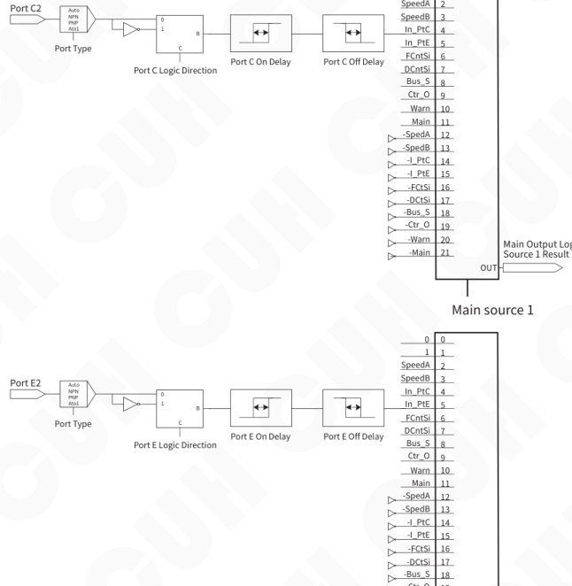

สำหรับตัวเลือกแหล่งสัญญาณของแหล่งหลัก ½  
กรุณาอ้างอิงบทที่ 7.4.11 ภาคผนวก

**รูป 4.4.1.1**

หมายเหตุ: สถานะเอาต์พุตหลักยังถูกควบคุมโดยว่าปุ่มเริ่ม/หยุดหรือตัวคอนโทรลเลอร์เองอยู่ในสถานะผิดพลาดหรือไม่ ระดับการควบคุมข้อผิดพลาดของปุ่มเริ่ม/หยุดหรือตัวคอนโทรลเลอร์เองสูงกว่าสัญญาณลอจิกเอาต์พุตหลัก กล่าวคือ: เมื่อปุ่มเริ่ม/หยุดตั้งเป็นหยุด คอนโทรลเลอร์จะเข้าสถานะหยุดทันที; เมื่อเกิดข้อผิดพลาดเช่น ลัดวงจร อุณหภูมิเกิน กระแสเกิน ฯลฯ คอนโทรลเลอร์จะเข้าสถานะหยุดทันทีเช่นกัน ในเวลานี้ สัญญาณลอจิกเอาต์พุตหลักไม่สามารถเปิดเอาต์พุตหลักของคอนโทรลเลอร์ได้


---

### 4.4.1.2 ลอจิกหลัก

ผลลัพธ์ลอจิกแหล่งหลัก 1 และแหล่งลอจิกหลัก 2 หลังการดำเนินการลอจิกผ่านลอจิกเอาต์พุตหลัก จะผ่านทิศทางเอาต์พุตหลัก จากนั้นผ่านหน่วงเวลาเปิดและหน่วงเวลาปิดเอาต์พุตหลัก และสุดท้ายผ่านโหมดเอาต์พุตหลัก และใช้เพื่อขับสถานะเริ่ม/หยุดเอาต์พุตหลัก

แผนภาพการไหลของสัญญาณมีดังนี้:

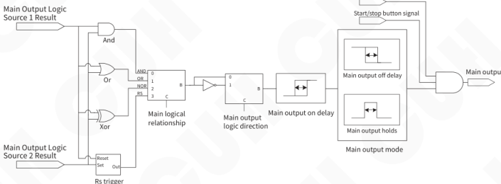

**รูป 4.4.1.2**

คอนโทรลเลอร์นี้สามารถตั้งค่าตารางความสัมพันธ์เชิงลอจิกระหว่างแหล่งหลัก (ลอจิก) 1 และแหล่งหลัก 2 ได้ดังต่อไปนี้ ค่าเริ่มต้นคือ Or

| พารามิเตอร์ | ความหมาย |
|---|---|
| And | ลอจิก AND เอาต์พุตใช้งานเมื่อทั้งแหล่งหลัก 1 และแหล่งหลัก 2 ใช้งาน |
| Or | ลอจิก OR เอาต์พุตใช้งานเมื่ออย่างน้อยแหล่งหลัก 1 หรือแหล่งหลัก 2 ใช้งาน |
| Xor | ลอจิก XOR เอาต์พุตใช้งานเมื่อแหล่งหลัก 1 และแหล่งหลัก 2 อยู่คนละสถานะ มิฉะนั้นไม่ใช้งาน |
| RS | RS ฟลิปฟล็อป |

### 4.4.1.3 ทิศทางหลัก

คือทิศทางลอจิกเอาต์พุตหลัก สามารถตั้งค่าทิศทางเอาต์พุตเฉพาะได้หลังสัญญาณผ่านการรวมลอจิก สำหรับแผนภาพการไหลของสัญญาณ อ้างอิงรูป 4.4.1.2 ค่าเริ่มต้นคือ Const

| พารามิเตอร์ | ความหมาย |
|---|---|
| Const | สถานะหลังการดำเนินการลอจิกเอาต์พุตหลักไม่กลับค่า ค่าเริ่มต้นเป็นสถานะปกติ |
| Inv | สถานะจะกลับค่าหลังการดำเนินการลอจิกเอาต์พุตหลัก |
| On | สถานะยังคงทำงานหลังการดำเนินการลอจิกเอาต์พุตหลัก |
| Off | สถานะหยุดเสมอหลังการดำเนินการลอจิกเอาต์พุตหลัก |

---


### 4.4.1.4 หน่วงเวลาเปิดหลัก/หน่วงเวลาปิดหลัก

เมื่อใช้สัญญาณภายนอกอื่น ๆ เช่น เซ็นเซอร์ เพื่อควบคุมสถานะเอาต์พุตหลักของอุปกรณ์ ในกรณีส่วนใหญ่จำเป็นต้องมีหน่วงเวลาหลังให้สัญญาณหรือหลังสัญญาณกลับคืนก่อนดำเนินการ สำหรับการใช้งานดังกล่าว สามารถทำได้โดยการตั้งค่าค่าเวลาของหน่วงเวลาเปิดและหน่วงเวลาปิด สำหรับแผนภาพการไหลของสัญญาณ อ้างอิงรูป 4.4.1.2

**หน่วงเวลาเปิดหลัก:** คือหน่วงเวลาเปิดเอาต์พุตหลัก เป็นเวลาหน่วงที่เริ่มจากให้สัญญาณควบคุมที่ทำให้คอนโทรลเลอร์เข้าสถานะทำงาน จนถึงการเริ่มเอาต์พุตจริงของคอนโทรลเลอร์ เวลาหน่วงในช่วงนี้เรียกว่าหน่วงเวลาเปิด

**หน่วงเวลาปิดหลัก:** คือหน่วงเวลาปิดเอาต์พุตหลัก เริ่มจากให้สัญญาณควบคุมที่ทำให้คอนโทรลเลอร์เข้าสถานะหยุด จนถึงการหยุดเอาต์พุตจริงของคอนโทรลเลอร์ เวลาหน่วงในช่วงนี้เรียกว่าหน่วงเวลาปิด

ช่วงหน่วงเวลาเปิด/ปิดหลักคือ 0.0~99.9s ค่าเริ่มต้นคือ 0.2s และความแม่นยำในการปรับคือ 0.1s

### 4.4.1.5 โหมดหลัก

มีโหมดเอาต์พุตหลัก 2 แบบ: โหมดหน่วงเวลาและโหมดค้าง แผนภาพการไหลของสัญญาณอ้างอิงรูป 4.4.1.2 ค่าเริ่มต้นคือ Delay

| พารามิเตอร์ | ความหมาย |
|---|---|
| Delay | หมายถึงสถานะของเอาต์พุตหลักหลังการดำเนินการลอจิก สถานะการขับเอาต์พุตหลักหลังหน่วงเวลาเปิดและหน่วงเวลาปิด |
| Hold | หมายถึงสถานะหลังการดำเนินการลอจิกเอาต์พุตหลัก หลังหน่วงเวลาเปิด สถานะทำงานจะคงอยู่เป็นเวลาหน่วงเวลาปิด จากนั้นเปลี่ยนเป็นสถานะหยุดเอาต์พุตทันที |

ความแตกต่างระหว่างสองโหมดแสดงในรูปแบบแผนภาพเวจอดังต่อไปนี้ โดยสัญญาณอินพุตคือการเลือกความสัมพันธ์เชิงลอจิก

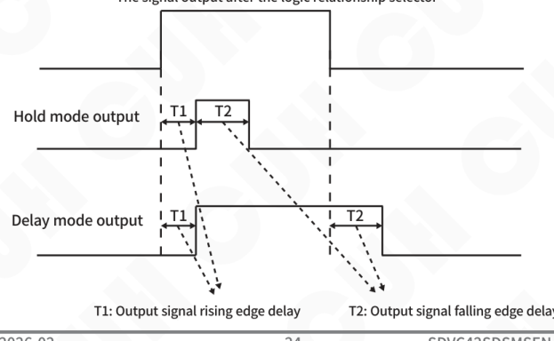


## 4.4.1.6 สถานะเปิดเครื่อง

ตั้งค่าสถานะการทำงานของคอนโทรลเลอร์หลังเปิดเครื่อง ค่าเริ่มต้นคือ On

| พารามิเตอร์ | ความหมาย |
|---|---|
| On | หลังเปิดอุปกรณ์ สถานะของปุ่มสวิตช์คือทำงาน |
| Off | หลังเปิดอุปกรณ์ สถานะของปุ่มสวิตช์คือหยุด |
| Keep | หลังเปิดอุปกรณ์ สถานะของปุ่มสวิตช์คงเหมือนก่อนปิดเครื่องครั้งล่าสุด |

## 4.4.1.7 แหล่งควบคุมระยะไกล

แรงดันเอาต์พุตและความเร็วการป้อนของคอนโทรลเลอร์สามารถแก้ไขผ่านพารามิเตอร์บนแผงหรือควบคุมโดยตรงผ่านขนาดสัญญาณอินพุตแหล่งควบคุมระยะไกล วิธีการควบคุมที่เลือกได้ ได้แก่: แผง, อินพุต DC 0-20mA, อินพุต DC 1-5V, อินพุต DC 0-5V, อินพุต DC 0-10V รวมถึงสัญญาณบัสดิจิทัลซิงโครนัส ค่าเริ่มต้นคือ Panel

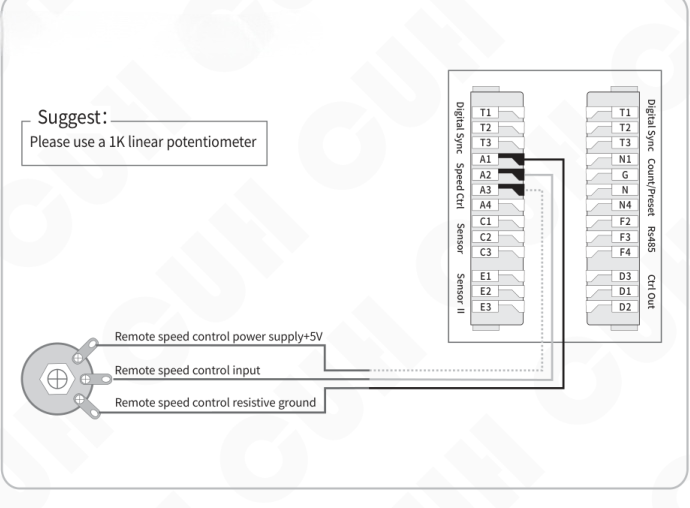


---

### การต่อควบคุม PLC (อินพุต DC 1~5V/0~5V/0~10V)

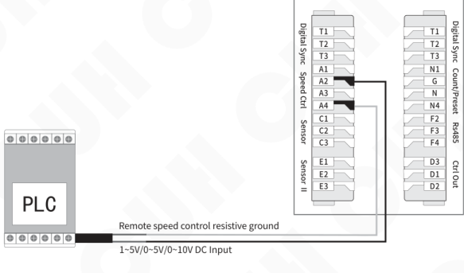

- กราวด์ต้านทานควบคุมความเร็วระยะไกล
- อินพุต DC 1~5V/0~5V/0~10V

### การต่อควบคุม PLC (อินพุต DC 4~20mA)

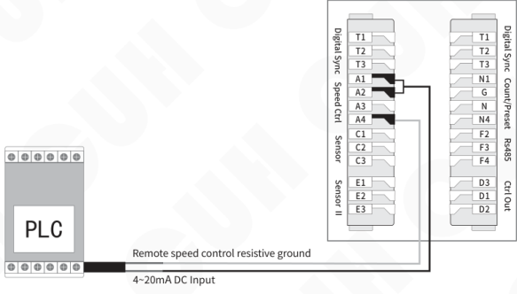

- กราวด์ต้านทานควบคุมความเร็วระยะไกล
- อินพุต DC 4~20mA

---


| สัญญาณควบคุมระยะไกล | สัญญาณควบคุมระยะไกล | แรงดันเอาต์พุต/ความเร็วการป้อน |
|---|---|---|
| Panel |  | แรงดันเอาต์พุตและความเร็วการป้อนไม่ถูกควบคุมโดยสัญญาณควบคุมระยะไกล |
| 20mA | <2mA | เมื่อโหมดแรงดันเป็น Manuel แรงดันเอาต์พุต = 0<br>เมื่อโหมดแรงดันเป็น Auto ความเร็วการป้อน = 0<br>LCD แสดงข้อมูลข้อผิดพลาด "Remote control undervoltage" |
|  | 2mA~4mA | แรงดันเอาต์พุต = 0, ความเร็วการป้อน = 0 |
|  | 4mA~20mA | ควบคุมสัดส่วนโดยสัญญาณควบคุมระยะไกล (0%~100%)<br>เมื่อโหมดแรงดันเป็น Manuel แรงดันเอาต์พุต = (กระแสอินพุต - 4mA)/16 × แรงดันเอาต์พุตสูงสุด<br>เมื่อโหมดแรงดันเป็น Auto ความเร็วการป้อน = (กระแสอินพุต - 4mA)/16 × ความเร็วการป้อนสูงสุด |
| 1~5V | น้อยกว่า0.5V | แรงดันเอาต์พุต = 0, ความเร็วการป้อน = 0<br>LCD แสดงข้อมูลข้อผิดพลาด "Remote control undervoltage" |
|  | 0.5V~1V | แรงดันเอาต์พุต = 0, ความเร็วการป้อน = 0 |
|  | 1V~5V | ควบคุมสัดส่วนโดยสัญญาณควบคุมระยะไกล (0%~100%)<br>เมื่อโหมดแรงดันเป็น Manuel แรงดันเอาต์พุต = (แรงดันอินพุต - 1V)/4 × แรงดันเอาต์พุตสูงสุด<br>เมื่อโหมดแรงดันเป็น Auto ความเร็วการป้อน = (แรงดันอินพุต - 1V)/4 × ความเร็วการป้อนสูงสุด |
| 0~5V | 0V~5V | ควบคุมสัดส่วนโดยสัญญาณควบคุมระยะไกล (0%~100%)<br>เมื่อโหมดแรงดันเป็น Manuel แรงดันเอาต์พุต = แรงดันอินพุต/5 × แรงดันเอาต์พุตสูงสุด<br>เมื่อโหมดแรงดันเป็น Auto ความเร็วการป้อน = แรงดันอินพุต/5 × ความเร็วการป้อนสูงสุด |
| 0~10V | 0V~10V | ควบคุมสัดส่วนโดยสัญญาณควบคุมระยะไกล (0%~100%)<br>เมื่อโหมดแรงดันเป็น Manuel แรงดันเอาต์พุต = แรงดันอินพุต/10 × แรงดันเอาต์พุตสูงสุด<br>เมื่อโหมดแรงดันเป็น Auto ความเร็วการป้อน = แรงดันอินพุต/10 × ความเร็วการป้อนสูงสุด |
| DigSym | ซิงค์ดิจิทัล | แรงดันของสัญญาณควบคุมระยะไกลคือแรงดันอินพุตควบคุมระยะไกลของอุปกรณ์ที่ระบุบนบัส（ระบุผ่านพารามิเตอร์ซิงโครไนซ์ควบคุมระยะไกล）<br>ควบคุมสัดส่วนโดยสัญญาณแรงดันอินพุตควบคุมระยะไกลของอุปกรณ์ที่ระบุบนบัส ช่วงแรงดัน 0% ถึง 100%<br>เมื่อโหมดแรงดันเป็น Manuel แรงดันเอาต์พุต = แรงดันอินพุต/10 × แรงดันเอาต์พุตสูงสุด<br>เมื่อโหมดแรงดันเป็น Auto ความเร็วการป้อน = แรงดันอินพุต/10 × ความเร็วการป้อนสูงสุด |

### 4.4.1.8 สัมประสิทธิ์ควบคุมระยะไกล

เมื่อเลือกแหล่งควบคุมระยะไกลที่ไม่ใช่ "panel" และ "sync" สามารถใช้สัมประสิทธิ์ควบคุมระยะไกลเพื่อขยายหรือลดปริมาณการควบคุมของสัญญาณอินพุตควบคุมระยะไกล

ช่วงสัมประสิทธิ์ควบคุมระยะไกลคือ 0.5~2.0 ค่าเริ่มต้นคือ 1.0 และความแม่นยำในการปรับคือ 0.1

ตัวอย่าง: สัมประสิทธิ์ควบคุมระยะไกลคือ 0.5 เมื่อสัญญาณอินพุตควบคุมระยะไกลคือ 2V ในเวลานี้ แรงดันอินพุตควบคุมระยะไกลเทียบเท่าที่คอนโทรลเลอร์ได้รับคือ 2V * 0.5 = 1V


---

## 4.4.2 พารามิเตอร์เอาต์พุตควบคุม DC

สรุปนี้แนะนำการตั้งค่าพารามิเตอร์เอาต์พุตควบคุมของคอนโทรลเลอร์ แผนภาพการไหลของสัญญาณเอาต์พุตควบคุมมีดังนี้:

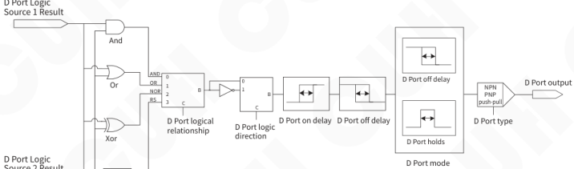

วิธีการตั้งค่าพารามิเตอร์เอาต์พุตควบคุมมีดังนี้:

> » กด ▲ และ ◀ ค้างเพื่อเข้าหน้าจอตั้งค่าพารามิเตอร์ กด ▶ สั้นเพื่อสลับไปกลุ่มพารามิเตอร์ "6 DC output"
>
> » กด ▲ หรือ ▼ สั้นเพื่อสลับพารามิเตอร์ในกลุ่มพารามิเตอร์เอาต์พุตควบคุม
>
> » กด ⊕ หรือ ⊖ เพื่อปรับค่าพารามิเตอร์

```text
RUN
A C D E F G N J    T0
01.PotDLogc        Or
02.PotDSor1        In_PtC
03.PotDSor2        In_PtE
04.PortDDir        Const
05.PtDUpDly        0.2 S
+     6DCoutput     −
```

พารามิเตอร์อื่น ๆ ในกลุ่มพารามิเตอร์นี้สามารถปรับตามขั้นตอนข้างต้น

"แหล่งพอร์ต D 1", "แหล่งพอร์ต D 2", "ลอจิกพอร์ต D", "ทิศทางพอร์ต D", "หน่วงเวลาเปิด D" "หน่วงเวลาปิด D" และ "โหมดพอร์ต D" พารามิเตอร์ข้างต้นสามารถอ้างอิงการตั้งค่าพารามิเตอร์เอาต์พุตหลัก

---


---

## 4.4.2.1 ประเภทพอร์ต D

เอาต์พุตพอร์ต D รองรับสามประเภท: เอาต์พุต NPN, เอาต์พุต PNP, และเอาต์พุตพุช-พูล  
ค่าเริ่มต้นคือ Ou_P&P (พุช-พูล)

| พารามิเตอร์ | ความหมาย |
|---|---|
| Ou_NPN | เมื่อสัญญาณเอาต์พุตพอร์ต D ใช้งาน พอร์ต D จะส่งออกสัญญาณระดับต่ำ (0V) และเมื่อไม่ใช้งานจะเป็นอิมพีแดนซ์สูง |
| Ou_PNP | เมื่อสัญญาณเอาต์พุตพอร์ต D ใช้งาน พอร์ต D จะส่งออกสัญญาณระดับสูง (24V) และเมื่อไม่ใช้งานจะเป็นอิมพีแดนซ์สูง |
| Ou_P&P<br>(พุชพูล) | เมื่อสัญญาณเอาต์พุตพอร์ต D ใช้งาน พอร์ต D จะส่งออกสัญญาณระดับสูง (24V) เมื่อสัญญาณเอาต์พุตพอร์ต D ไม่ใช้งาน พอร์ต D จะส่งออกสัญญาณระดับต่ำ (0V) |

แผนภาพมีดังนี้:

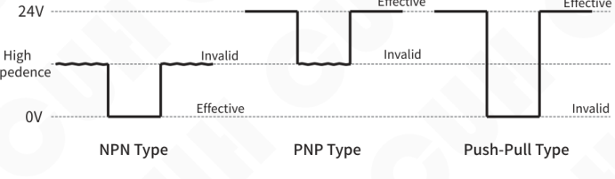

---


## 4.5 การควบคุมสัญญาณ

คอนโทรลเลอร์สามารถตัดสินสถานะของวัสดุในเครื่องสั่นผ่านเซ็นเซอร์ภายนอก และรับรู้การ "หยุดเมื่อวัสดุเต็ม" หรือ "หยุดเมื่อวัสดุหมด" ของคอนโทรลเลอร์ แผนภาพการไหลของสัญญาณพอร์ตมีดังนี้:

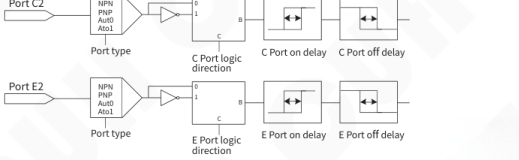

**รูป 4.5**

วิธีการตั้งค่าพารามิเตอร์อินพุตสัญญาณมีดังนี้:

- กด ▲ และ ◀ ค้างเพื่อเข้าหน้าจอตั้งค่าพารามิเตอร์ กด ▶ สั้นเพื่อสลับไปกลุ่มพารามิเตอร์ "5On&Off"
- กด ▲ หรือ ▼ สั้นเพื่อสลับพารามิเตอร์ในกลุ่มพารามิเตอร์อินพุตสัญญาณ
- กด ＋ หรือ － เพื่อปรับค่าพารามิเตอร์

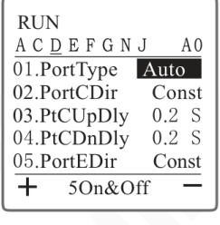

พารามิเตอร์อื่น ๆ ในกลุ่มพารามิเตอร์นี้สามารถปรับตามขั้นตอนข้างต้น

### 4.5.1 ประเภทเซ็นเซอร์

คอนโทรลเลอร์สามารถตั้งค่าประเภทเซ็นเซอร์สวิตช์เป็น "Auto", "NPN", "PNP", หรือ "Ato1" หรือสามารถตั้งค่าด้วยตนเองตามประเภทเซ็นเซอร์

| พารามิเตอร์ | ความหมาย |
|---|---|
| Auto | ไม่ว่าเซ็นเซอร์ประเภทใด จะตรวจจับว่าพอร์ตมีการเข้าถึงที่ใช้งานได้โดยการเปลี่ยนแปลงสัญญาณระดับสูงและต่ำเสมอ ค่าเริ่มต้นจากโรงงานคือการรู้จักอัตโนมัติ |
| NPN | เซ็นเซอร์ประเภท NPN |
| PNP | เซ็นเซอร์ประเภท PNP |
| Ato1 | ก่อนสัญญาณเซ็นเซอร์จะไม่ใช้งาน จะตรวจจับว่าพอร์ตใช้งานโดยการเปลี่ยนแปลงระดับสูงและต่ำ หลังพบสัญญาณใช้งาน จะกำหนดประเภทเซ็นเซอร์พอร์ตและไม่สแกนอีก |


### 4.5.2 ลอจิกพอร์ต C/พอร์ต E

พารามิเตอร์นี้ใช้สลับพอร์ตอินพุต C และพอร์ตอินพุต E ของคอนโทรลเลอร์เป็น "ปิดเมื่อวัสดุเต็ม" หรือ "ปิดเมื่อวัสดุหมด"

เมื่อพอร์ตอินพุต C/พอร์ต E ภายใต้การตั้งค่าเริ่มต้นโรงงานไม่ได้รับสัญญาณใด ๆ คอนโทรลเลอร์จะอยู่ในสถานะ "ทำงาน" (คือปิดเมื่อวัสดุเต็ม) การใช้งานพิเศษบางกรณีต้องการให้คอนโทรลเลอร์อยู่ในสถานะ "หยุด" (คือปิดเมื่อวัสดุหมด) เมื่อพอร์ต C/พอร์ต E ไม่ได้รับสัญญาณใด ๆ สามารถทำได้โดยการแก้ไขพารามิเตอร์นี้ อ้างอิงรูป 4.5 สำหรับแผนภาพการไหลของสัญญาณ

| พารามิเตอร์ | ความหมาย |
|---|---|
| Const | เมื่อไม่มีสัญญาณควบคุม คอนโทรลเลอร์อยู่ในสถานะทำงาน (หยุดเมื่อวัสดุเต็ม) |
| Inv | เมื่อไม่มีสัญญาณควบคุม คอนโทรลเลอร์อยู่ในสถานะหยุด (หยุดเมื่อวัสดุหมด) |

### 4.5.3 หน่วงเวลาเปิด/ปิดพอร์ต C และหน่วงเวลาเปิด/ปิดพอร์ต E

เวลาหน่วงตั้งแต่ให้สัญญาณที่ทำให้คอนโทรลเลอร์เข้าสถานะทำงานจนกระทั่งคอนโทรลเลอร์พิจารณาว่าสัญญาณใช้งานได้เรียกว่าหน่วงเวลาเปิด

เวลาหน่วงตั้งแต่ให้สัญญาณที่ทำให้คอนโทรลเลอร์เข้าสถานะหยุดจนกระทั่งคอนโทรลเลอร์พิจารณาว่าสัญญาณใช้งานได้เรียกว่าหน่วงเวลาปิด

สำหรับแผนภาพการไหลของสัญญาณ อ้างอิงรูป 4.5

ช่วงหน่วงเวลาเปิด/ปิดคือ 0.0~99.9s ค่าเริ่มต้นคือ 0.2s และความแม่นยำในการปรับคือ 0.1s

**หมายเหตุ:** เมื่อใช้พอร์ต C, E ในการควบคุมเริ่ม/หยุด หากจำเป็นต้องหน่วงการทำงานเป็นเวลาหนึ่งหลังรับสัญญาณเพื่อให้มั่นใจว่าสัญญาณเสถียร สามารถทำได้โดยการตั้งค่าหน่วงเวลาเปิดและหน่วงเวลาปิด


## 4.5.4 ลอจิกความเร็ว A/ลอจิกความเร็ว B

แผนภาพการไหลของสัญญาณมีดังนี้:

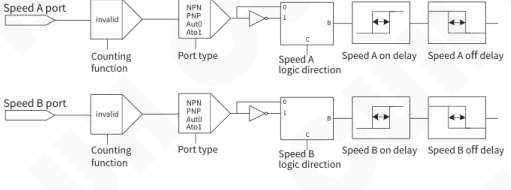

**รูป 4.5.4**

พารามิเตอร์นี้ใช้สลับสถานะใช้งานของพอร์ตอินพุตสำหรับความเร็ว A และความเร็ว B ของคอนโทรลเลอร์ ต้องตั้งค่าพารามิเตอร์นี้ในกลุ่มพารามิเตอร์วัสดุเต็ม ค่าเริ่มต้นคือ Const

| พารามิเตอร์ | ความหมาย |
|---|---|
| Const | เมื่อไม่มีสัญญาณควบคุม ความเร็ว A และความเร็ว B ของคอนโทรลเลอร์ไม่ใช้งาน |
| Inv | เมื่อไม่มีสัญญาณควบคุม ความเร็ว A และความเร็ว B ของคอนโทรลเลอร์ใช้งาน |

## 4.5.5 หน่วงเวลาเปิด/ปิดความเร็ว A และหน่วงเวลาเปิด/ปิดความเร็ว B

ตั้งแต่ให้สัญญาณใช้งานที่พอร์ตความเร็ว A/B เพื่อตั้งค่าความเร็วใช้งาน ช่วงเวลานี้เรียกว่าหน่วงเวลาเปิด

ตั้งแต่ให้สัญญาณไม่ใช้งานที่พอร์ตความเร็ว A/B เพื่อตั้งค่าความเร็วไม่ใช้งาน ช่วงเวลานี้เรียกว่าหน่วงเวลาปิด

สำหรับแผนภาพการไหลของสัญญาณ อ้างอิงรูป 4.5.4

ช่วงหน่วงเวลาเปิด/ปิดความเร็ว A&B คือ 0.0~99.9s ค่าเริ่มต้นคือ 0.2s และความแม่นยำในการปรับคือ 0.1s


## 4.6 การนับจำนวนวัสดุ

คอนโทรลเลอร์นี้มีฟังก์ชันการนับในตัวที่สามารถนับพัลส์การนับและลดความเร็วหรือหยุดอัตโนมัติเมื่อจำนวนพัลส์ถึงจำนวนนับรวมที่ตั้งไว้ นอกจากนี้ยังมีฟังก์ชันพิเศษเช่น การป้องกันสัญญาณรบกวนขั้นสูงและการลดความเร็วสุดท้ายเพื่อป้องกันการนับเกิน แผนภาพการไหลของสัญญาณมีดังนี้:

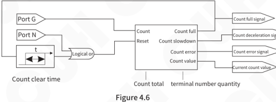

**รูป 4.6**

- กด ▲ และ ◀ ค้างเพื่อเข้าหน้าจอตั้งค่าพารามิเตอร์ กด ▶ สั้นเพื่อสลับไปกลุ่มพารามิเตอร์ "7Counter"
- กด ▲ หรือ ▼ สั้นเพื่อสลับพารามิเตอร์ในกลุ่มพารามิเตอร์การนับ
- กด ⊕ หรือ ⊖ เพื่อปรับค่าพารามิเตอร์

ตัวอย่างอินเตอร์เฟซ:

```text
RUN
A C D E F G N J      A0
01.TotaCout      10
02.PrcntTrm      50 %
03.CotAhead       3
04.CotRstTm     0.0 S
05.CotPotSe    None
+   7Counter      −
```

พารามิเตอร์อื่น ๆ ในกลุ่มพารามิเตอร์นี้สามารถปรับตามขั้นตอนข้างต้น

### 4.6.1 การนับจำนวนวัสดุ (หรือความเร็ว A/B)

พารามิเตอร์นี้ใช้เปิดและปิดฟังก์ชันการนับ

ค่าเริ่มต้นคือ None คือปิดฟังก์ชันการนับ และเปิดฟังก์ชันความเร็ว A/B ในเวลานี้

เมื่อพารามิเตอร์ฟังก์ชันการนับใช้งานได้ (เปิดใช้งาน) ความเร็ว A และความเร็ว B ทำหน้าที่เป็นควบคุมความเร็ว A/B คอนโทรลเลอร์สามารถดำเนินการเพิ่มเติมสำหรับฟังก์ชันการนับ สำหรับแผนภาพการไหลของสัญญาณ อ้างอิงรูป 4.6

| พารามิเตอร์ | ความหมาย |
|---|---|
| None | ปิดฟังก์ชันการนับและเปิดฟังก์ชันความเร็ว A/B |
| Valid | ใช้พอร์ตความเร็ว A เป็นพอร์ตการนับ และใช้พอร์ตความเร็ว B เป็นพอร์ตเคลียร์การนับ |

---


---

## 4.6.2 จำนวนเป้าหมาย

หลัง "ค่านับปัจจุบัน" ถึงขีดจำกัด สัญญาณนับเต็มจะใช้งานจนกว่าตัวนับจะถูกรีเซ็ต หลังเข้าสถานะการนับเต็ม หากยังคงส่งพัลส์นับต่อไป การนับจะดำเนินต่อ แต่สัญญาณนับเต็มยังคงใช้งานอยู่ สำหรับแผนภาพการไหลของสัญญาณ อ้างอิงรูป 4.6

ช่วงจำนวนนับรวมคือ 0~9999 ค่าเริ่มต้นคือ 10 และความแม่นยำในการปรับคือ 1

## 4.6.3 ความเร็วปลายทาง

**ความเร็วปลายทาง** หมายถึงเมื่อการนับเข้าสถานะลดความเร็วสุดท้าย ความเร็วการป้อนและแรงดันของคอนโทรลเลอร์จะลดลงเป็นเปอร์เซ็นต์ของความเร็วและแรงดันเริ่มต้น ดูรูป 4.6.3

เมื่อจำนวนนับใกล้จำนวนรวม กระบวนการนับใกล้เสร็จสิ้น เพื่อป้องกันไม่ให้วัสดุที่เคลื่อนที่ด้วยความเร็วสูงไม่สามารถหยุดได้ทันเวลาและทำให้เกิดการนับเกิน คอนโทรลเลอร์จะลดความเร็วอัตโนมัติเป็นความเร็วปลายทางที่ตั้งไว้（สัญญาณลดความเร็วการนับใช้งาน）เมื่อจำนวนที่เหลือต่ำกว่าจำนวนปลายทาง เมื่อค่านับถึงจำนวนนับรวม（สัญญาณนับเต็มใช้งาน）คอนโทรลเลอร์จะหยุดเอาต์พุตทันที และเครื่องป้อนสามารถได้รับการควบคุมการนับที่แม่นยำ

ช่วงความเร็วปลายทางคือ 0~100% ค่าเริ่มต้นคือ 50% และความแม่นยำในการปรับคือ 1%

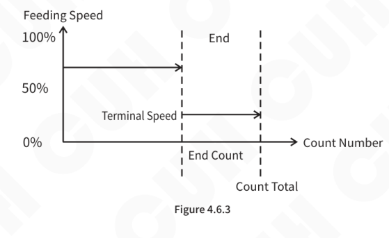

---


---

### 4.6.4 จำนวนความเร็วปลายทาง

จำนวนส่วนสุดท้าย: หมายถึงจำนวนนับระยะทางรวม หลังถึง "จำนวนปลายทาง" คอนโทรลเลอร์จะเข้าโหมดลดความเร็วการนับ

ในสถานะความเร็ว ความเร็วการป้อนและแรงดันจะลดลงเป็นความเร็วปลายทางและแรงดันปลายทาง เมื่อค่า "จำนวนส่วนสุดท้าย" เป็น 0 หมายถึงไม่ใช้ฟังก์ชันลดความเร็วสุดท้าย สำหรับแผนภาพการไหลของสัญญาณ อ้างอิงรูป 4.6

ช่วงจำนวนส่วนสุดท้ายคือ 0 ถึง 9999 ค่าเริ่มต้นคือ 3 และความแม่นยำในการปรับคือ 1

### 4.6.5 รีเซ็ตค่านับเป็น 0

เมื่อนับเต็ม คอนโทรลเลอร์จะเคลียร์ค่านับอัตโนมัติหลังหน่วงเวลา "เคลียร์การนับ" เมื่อค่า "เคลียร์การนับ" เป็น 0.0s หมายถึงปิดใช้งานฟังก์ชันรีเซ็ตการนับที่ทริกเกอร์โดยหน่วงเวลาอัตโนมัติ

ช่วงเวลารีเซ็ตการนับคือ 0.0~999.9s ค่าเริ่มต้นคือ 0.0s และความแม่นยำในการปรับคือ 0.1s

### 4.6.6 ลำดับความสำคัญ RS

ใช้ตั้งค่าลำดับความสำคัญของพอร์ตทริกเกอร์ RS ค่าเริ่มต้นคือ Same

| พารามิเตอร์ | ความหมาย |
|---|---|
| Same | พอร์ต R และพอร์ต S มีลำดับความสำคัญเท่ากัน เมื่อมีสัญญาณที่พอร์ต R และ S คอนโทรลเลอร์จะรายงานคำเตือน "main RS error" หรือ "control RS error" |
| Reset | ลำดับความสำคัญรีเซ็ต เมื่อมีสัญญาณที่พอร์ต R และ S พอร์ต R จะมีความสำคัญก่อน คือสัญญาณรีเซ็ตมีความสำคัญก่อน |
| Set | ลำดับความสำคัญเซ็ต เมื่อมีสัญญาณที่พอร์ต R และ S พอร์ต S จะมีความสำคัญก่อน คือสัญญาณเซ็ตมีความสำคัญก่อน |
| Revers | เมื่อมีสัญญาณที่พอร์ต R และ S ผลลัพธ์ลอจิกปัจจุบันจะกลับค่า |

---


## 4.7 บันทึกการตั้งค่า

บทนี้แนะนำวิธีการใช้ฟังก์ชันจัดเก็บพารามิเตอร์และเรียกคืนพารามิเตอร์ของคอนโทรลเลอร์

### 4.7.1 เรียกคืนการตั้งค่า

คอนโทรลเลอร์สามารถอ่านพารามิเตอร์ที่ตั้งไว้ล่วงหน้า 3 ชุดนอกเหนือจากกลุ่มงาน ชื่อว่า "User 1", "User 2", และ "User 3" ตามลำดับ

เมื่อผู้ใช้แก้ไขพารามิเตอร์ พารามิเตอร์คอนโทรลเลอร์จะถูกบันทึกในกลุ่มงานโดยค่าเริ่มต้น เมื่อเปิดเครื่องคอนโทรลเลอร์อีกครั้ง พารามิเตอร์จะถูกอ่านจากกลุ่มงานอัตโนมัติและคืนค่าพารามิเตอร์ก่อนปิดเครื่องครั้งล่าสุด ในขณะเดียวกัน ผู้ใช้สามารถเลือกอ่านจาก "UsrD1", "UsrD2", "UsrD3" ด้วยตนเอง อ่านไฟล์อีกชุดที่บันทึกด้วยตนเองจากสามกลุ่ม ข้อมูลถูกส่งไปยังกลุ่มงานในคอนโทรลเลอร์ ทำให้คอนโทรลเลอร์สลับสถานะการทำงานทันที

| พารามิเตอร์ | ความหมาย |
|---|---|
| None | ไม่ใช้งาน |
| UsrD1 | พารามิเตอร์ที่ตั้งโดยผู้ใช้ 1 |
| UsrD2 | พารามิเตอร์ที่ตั้งโดยผู้ใช้ 2 |
| UsrD3 | พารามิเตอร์ที่ตั้งโดยผู้ใช้ 3 |

### 4.7.2 บันทึกการตั้งค่า

คอนโทรลเลอร์สามารถบันทึกพารามิเตอร์ที่ตั้งไว้ล่วงหน้า 4 ชุด ชื่อว่า "Work", "UsrD1", "UsrD2", "UsrD3"

เมื่อผู้ใช้แก้ไขพารามิเตอร์ พารามิเตอร์คอนโทรลเลอร์จะถูกบันทึกใน "Work" อัตโนมัติโดยค่าเริ่มต้น เมื่อเปิดเครื่องคอนโทรลเลอร์อีกครั้ง พารามิเตอร์จะถูกอ่านจากกลุ่มงานอัตโนมัติและคืนค่าพารามิเตอร์ก่อนปิดเครื่องครั้งล่าสุด ผู้ใช้สามารถบันทึกพารามิเตอร์ในกลุ่มงานไปยัง "UsrD1", "UsrD2", "UsrD3" ด้วยตนเอง

| พารามิเตอร์ | ความหมาย |
|---|---|
| None | ไม่ใช้งาน |
| Work | กลุ่มงานเริ่มต้น |
| UsrD1 | พารามิเตอร์ที่ตั้งโดยผู้ใช้ 1 |
| UsrD2 | พารามิเตอร์ที่ตั้งโดยผู้ใช้ 2 |
| UsrD3 | พารามิเตอร์ที่ตั้งโดยผู้ใช้ 3 |


## 4.7.3 คืนค่าโรงงาน

ใช้รีเซ็ตพารามิเตอร์เพื่อคืนค่าพารามิเตอร์กลุ่มงานทั้งหมดเป็นค่าเริ่มต้นโรงงาน

หลังเลือก "RWork" ใน "รีเซ็ตพารามิเตอร์" กด ⊕ และ ⊖ ค้างพร้อมกัน หลังมากกว่าสองวินาที หน้าจอจะสลับไปหน้าจอสแตนด์บาย และการคืนค่าพารามิเตอร์สำเร็จ

| พารามิเตอร์ | ความหมาย |
|---|---|
| None | ไม่ใช้งาน |
| Rwork | คืนค่าพารามิเตอร์กลุ่มงานเป็นค่าโรงงาน（User 1, User 2 และ User 3 จะไม่ถูกคืนค่า） |

## 4.7.4 คัดลอกการตั้งค่า

คอนโทรลเลอร์สามารถแทนที่กลุ่มพารามิเตอร์ของคอนโทรลเลอร์นี้ด้วยข้อมูลของคอนโทรลเลอร์สองตัวในเครือข่ายที่สำรองไว้ เพื่อคัดลอกพารามิเตอร์ของคอนโทรลเลอร์สองตัวอย่างรวดเร็ว

เลือกหมายเลข ID ของคอนโทรลเลอร์ที่ต้องการคัดลอกเพื่อใช้งานฟังก์ชันคัดลอกข้อมูลคอนโทรลเลอร์ ช่วงการเลือกพารามิเตอร์คัดลอกคือ 1~8

## 4.7.5 รหัสผ่านผู้ใช้

ผู้ใช้สามารถตั้งค่ารหัสผ่านพารามิเตอร์ด้วยตนเอง หลังล็อก ผู้ใช้สามารถทำงานภายใต้ "กลุ่มพารามิเตอร์ตรวจสอบ" และ "หน้าหลัก" เท่านั้น

เมื่อผู้ใช้ตั้งค่า "รหัสผ่านผู้ใช้" เป็นค่าที่ไม่ใช่ 0 หมายถึงเปิดใช้งานฟังก์ชันล็อกพารามิเตอร์ขั้นสูง ในเวลานี้ต้องป้อนรหัสผ่านเมื่อเข้ากลุ่มพารามิเตอร์บนหน้าหลัก หลังผู้ใช้ "ป้อนรหัสผ่าน" และกด ▶ + ▲ หาก "รหัสผ่านที่ป้อน" และ "รหัสผ่านผู้ใช้" แตกต่างกัน ผู้ใช้สามารถเข้ากลุ่มพารามิเตอร์ตรวจสอบเท่านั้น หลังป้อนรหัสผ่านถูกต้องเท่านั้นจึงจะเข้ากลุ่มพารามิเตอร์อื่นได้

ช่วงการเลือกรหัสผ่านผู้ใช้คือ 0~9999

## 4.7.6 ป้อนรหัสผ่าน

หาก "รหัสผ่านที่ป้อน" และ "รหัสผ่านผู้ใช้" แตกต่างกัน ผู้ใช้สามารถทำงานภายใต้ "หน้าหลัก" และ "กลุ่มพารามิเตอร์ตรวจสอบ" เท่านั้น หลังป้อนรหัสผ่านถูกต้องเท่านั้นจึงจะเข้ากลุ่มพารามิเตอร์อื่นได้

ช่วงการป้อนรหัสผ่านคือ 0~9999


## 4.8 การสื่อสาร RS485

คอนโทรลเลอร์นี้รองรับการสื่อสาร RS485 ตามโปรโตคอล Modbus ASCII และ RTU สามารถแก้ไขและอ่านพารามิเตอร์และสถานะทั้งหมดของคอนโทรลเลอร์จากระยะไกล

โปรโตคอลการสื่อสาร RS485 ในเครื่อง "ตารางที่อยู่รีจิสเตอร์ 485 ซีรีส์ SDVC42-SD" สามารถดาวน์โหลดได้จากพื้นที่ดาวน์โหลดของเว็บไซต์บริษัท: www.cuhnj.com

» กด ▲ และ ◀ ค้างเพื่อเข้าหน้าจอตั้งค่าพารามิเตอร์ กด ▶ สั้นเพื่อสลับไปกลุ่มพารามิเตอร์ "8Comm"

» กด ▲ หรือ ▼ สั้นเพื่อสลับพารามิเตอร์ในกลุ่มพารามิเตอร์การสื่อสาร

» กด ⊕ หรือ ⊖ เพื่อปรับค่าพารามิเตอร์

```text
RUN
A C D E F G N J    A0
01.485type       RTU
02.BaudRate    115.2 K
03.485SlvID       1
04.Enab485R     None
05.DigSynAd       1
+      8Comm      −
```

พารามิเตอร์อื่น ๆ ในกลุ่มพารามิเตอร์นี้สามารถปรับตามขั้นตอนข้างต้น

## 4.8.1 ประเภทการสื่อสาร

การเลือกประเภทการสื่อสาร RS485 ประเภท Modbus ASCII และ Modbus RTU ค่าเริ่มต้นคือ RTU

| พารามิเตอร์ | ความหมาย |
|---|---|
| ASCⅡ | ประเภท Modbus ASCII |
| RTU | ประเภท Modbus RTU |


---

## 4.8.2 อัตราบิต

ตัวเลือกอัตราบิตการสื่อสาร RS485 ที่แตกต่างกัน ค่าเริ่มต้นคือ 115.2K

| พารามิเตอร์ | ความหมาย |
|---|---|
| 0.3K | 0.3 Kbps |
| 1.2K | 1.2 Kbps |
| 2.4K | 2.4 Kbps |
| 9.6K | 9.6 Kbps |
| 19.2K | 19.2 Kbps |
| 57.6K | 57.6 Kbps |
| 115.2K | 115.2 Kbps |

## 4.8.3 ที่อยู่คอนโทรลเลอร์_slave

ตั้งค่าหมายเลขที่อยู่_slaveในการสื่อสาร RS485

ช่วงหมายเลข_slaveคือ 1 ถึง 31 ค่าเริ่มต้นคือ 1

## 4.8.4 ความต้านทานพอร์ต/ความต้านทานซิงโครนัส

พอร์ตการสื่อสาร RS485/พอร์ตซิงโครไนซ์ดิจิทัลรวมฟังก์ชันตัวต้านทาน匹配 (120Ω) ค่าเริ่มต้นคือ None

| พารามิเตอร์ | ความหมาย |
|---|---|
| None | ไม่ใช้ตัวต้านทาน匹配 (120Ω) |
| Valid | ใช้ตัวต้านทาน匹配 (120Ω) |

---


---

## 4.9 การเชื่อมต่อเครือข่าย CUHBus-DS®

คอนโทรลเลอร์ SDVC42-SD ใช้โปรโตคอลบัส LAN (CUHBus-DS®) บัสโปรโตคอลการสื่อสารแบบอนุกรม สามารถเชื่อมต่ออุปกรณ์ได้สูงสุด 8 อุปกรณ์บนเครือข่ายเดียวกัน ฟังก์ชันต่อไปนี้สามารถทำได้ระหว่างคอนโทรลเลอร์หลังการเชื่อมต่อเครือข่าย:

**ฟังก์ชันซิงโครไนซ์:** ความถี่ เฟส ความเร็วควบคุมระยะไกล และพารามิเตอร์อื่น ๆ ของคอนโทรลเลอร์ใดก็ได้ในเครือข่ายสามารถสอดคล้องหรือเบี่ยงเบนจากเอาต์พุตของคอนโทรลเลอร์อื่นในเครือข่าย

**การแบ่งปันสัญญาณ:** สัญญาณสถานะใด ๆ ของคอนโทรลเลอร์ใดก็ได้ในเครือข่ายสามารถแบ่งปันเป็นแหล่งสัญญาณอินพุตของคอนโทรลเลอร์อื่นได้ ทำให้คอนโทรลเลอร์ในเครือข่ายมีแหล่งสัญญาณที่หลากหลายมากขึ้นนอกเหนือจากเครื่องตนเอง และส่งออกหลังการดำเนินการลอจิกเพื่อใช้งานลอจิกการทำงานของคอนโทรลเลอร์ที่ซับซ้อนมากขึ้นที่ไซต์ผู้ใช้

**การสำรองข้อมูล:** ข้อมูลของคอนโทรลเลอร์ใดก็ได้ในเครือข่ายจะถูกสำรองบนคอนโทรลเลอร์อื่นอีกสองตัวในเครือข่าย คอนโทรลเลอร์ใดก็ได้ในเครือข่ายสามารถแทนที่ได้อย่างสมบูรณ์แบบโดยการแทนที่และการเข้าร่วม และสามารถใช้ข้อมูลของคอนโทรลเลอร์ที่ถูกแทนที่เพื่อทำงานต่อ

> ☺
>
> **ระบบเครือข่ายนี้มีลักษณะดังต่อไปนี้:**
>
> - ขยายได้ง่ายและสามารถเพิ่มอุปกรณ์ใหม่เข้ากับเครือข่ายได้อย่างรวดเร็ว
> - เครือข่ายเท่าเทียมกัน มีชุดขั้วต่อการสื่อสาร CUHBus-DS® เท่าเทียมกันด้านซ้ายและขวาเพื่ออำนวยความสะดวกในการเชื่อมต่อผู้ใช้
> - อุปกรณ์รองรับการสลับร้อน สามารถเพิ่มหรือลบคอนโทรลเลอร์ได้โดยไม่ต้องปิดไฟในระหว่างการทำงานของระบบคอนโทรลเลอร์อย่างเสถียร

---


## 4.9.1 การเชื่อมต่ออุปกรณ์

บทนี้แนะนำการเชื่อมต่อเครือข่ายอย่างรวดเร็วระหว่างคอนโทรลเลอร์หลายตัว วิธีเพิ่มคอนโทรลเลอร์ใหม่เข้ากับเครือข่ายที่จัดตั้งแล้ว และวิธีลบคอนโทรลเลอร์ในเครือข่าย

### 4.9.1.1 การเชื่อมต่ออุปกรณ์

คอนโทรลเลอร์เดียวเป็นเครือข่ายด้วยตัวเอง เมื่อสายสัญญาณ CUHBus-DS® ของคอนโทรลเลอร์ต่ออย่างถูกต้องและดำเนินการอย่างง่าย อุปกรณ์หลายตัวสามารถสร้างเครือข่ายการสื่อสารซิงโครไนซ์ดิจิทัลใหม่

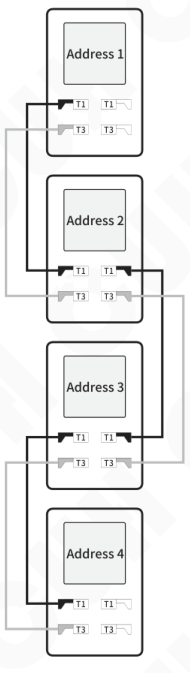

---


---

**ขั้นตอน:**

1. ต่อสัญญาณ T1 ของคอนโทรลเลอร์ทั้งหมดเข้าด้วยกัน และสัญญาณ T3 ทั้งหมดเข้าด้วยกัน ดังแสดงในรูปข้างต้น

2. เมื่อเปิดเครื่องอุปกรณ์ใหม่ คอนโทรลเลอร์ใหม่จะเข้า "กลุ่มพารามิเตอร์การสื่อสาร" อัตโนมัติ

3. ในกลุ่มพารามิเตอร์การสื่อสาร ตั้งค่าหมายเลขอุปกรณ์การสื่อสารซิงโครไนซ์ดิจิทัลท้องถิ่น "DigSynAd" เป็นค่าใดก็ได้ [1~8] ไม่จำเป็นต้องตั้งค่า โปรแกรมจะสร้างหมายเลขอัตโนมัติ

4. ในกลุ่มพารามิเตอร์การสื่อสาร ตั้งค่าพารามิเตอร์ "EnNetwok " เป็น "Expand" จากนั้นกด ⊕ และ ⊖ ค้างพร้อมกัน เพื่อยืนยัน

5. หลังเพิ่มสำเร็จ ค่าพารามิเตอร์ "EnNetwok " ของอุปกรณ์ใหม่จะเปลี่ยนเป็น "Online" อัตโนมัติ หมายความว่าเพิ่มอุปกรณ์ใหม่สำเร็จ

ผู้ใช้สามารถตรวจสอบว่าเครือข่ายเชื่อมต่ออย่างถูกต้องโดยการตรวจสอบพารามิเตอร์สถานะการเชื่อมต่อเครือข่าย รวมถึงตรวจสอบจำนวนอุปกรณ์ทั้งหมดในเครือข่ายและจำนวนอุปกรณ์ที่ออนไลน์

หมายเหตุ: การต่อสายสัญญาณ CUHBus-DS® เพียงอย่างเดียวโดยไม่ผ่านการตั้งค่าไม่ถือว่าเข้าร่วมเครือข่าย

**วิธีการตรวจสอบการยืนยัน:**

1. ในกลุ่มพารามิเตอร์ตรวจสอบ ค่าพารามิเตอร์ "DevicNum" คือ [1~8] หมายความว่าจำนวนอุปกรณ์ทั้งหมดในเครือข่าย

2. ในกลุ่มพารามิเตอร์ตรวจสอบ ค่าพารามิเตอร์ "OnlinNum" คือ [1~8] หมายความว่าจำนวนคอนโทรลเลอร์ที่ออนไลน์อยู่ในเครือข่าย

**ความต้านทานซิงโครนัส:**

พอร์ตการสื่อสาร CUHBus-DS® รวมฟังก์ชันตัวต้านทานแมทชิ่ง (120Ω) ซึ่งไม่ใช้งานหรือใช้งาน

| พารามิเตอร์ | ความหมาย |
|---|---|
| None | ไม่ใช้ตัวต้านทานแมทชิ่ง (120Ω) |
| Valid | ใช้ตัวต้านทานแมทชิ่ง (120Ω) |

---


## 4.9.1.2 การเข้าร่วมอุปกรณ์

ผู้ใช้สามารถทำตามขั้นตอนการขยายและเพิ่มต่อไปนี้เพื่อเพิ่มคอนโทรลเลอร์ใหม่เข้ากับเครือข่ายที่มีอยู่

คอนโทรลเลอร์ใหม่หลังเข้าร่วมสามารถเรียกสัญญาณของคอนโทรลเลอร์ใดก็ได้ในเครือข่ายและทำหน้าที่เป็นแหล่งสัญญาณคอนโทรลเลอร์สำหรับคอนโทรลเลอร์อื่นในเครือข่าย เพิ่มแหล่งสัญญาณระบบ

**ขั้นตอน:**

1. ต่ออินเตอร์เฟซ CUHBus-DS® T1 และ T3 ของอุปกรณ์ใหม่เข้ากับเครือข่ายเดิม พอร์ตรองรับการสลับร้อน
2. เมื่อเปิดเครื่องอุปกรณ์ใหม่ คอนโทรลเลอร์ใหม่จะเข้า "กลุ่มพารามิเตอร์การสื่อสาร" อัตโนมัติ
3. ในกลุ่มพารามิเตอร์การสื่อสาร ตั้งค่าหมายเลขอุปกรณ์การสื่อสารซิงโครไนซ์ดิจิทัลท้องถิ่น "DigSynAd" เป็นค่าใดก็ได้ [1~8] ไม่จำเป็นต้องตั้งค่า โปรแกรมจะสร้างหมายเลขอัตโนมัติ
4. ในกลุ่มพารามิเตอร์การสื่อสาร ตั้งค่าพารามิเตอร์ "EnNetwok " เป็น "Expand" จากนั้นกด ⊕ และ ⊖ ค้างพร้อมกัน เพื่อยืนยัน
5. หลังเพิ่มสำเร็จ ค่าพารามิเตอร์ "EnNetwok " ของอุปกรณ์ใหม่จะเปลี่ยนเป็น "Online" อัตโนมัติ หมายความว่าเพิ่มอุปกรณ์ใหม่สำเร็จ

ผู้ใช้สามารถตรวจสอบว่าเครือข่ายเชื่อมต่ออย่างถูกต้องโดยการตรวจสอบพารามิเตอร์สถานะการเชื่อมต่อเครือข่าย รวมถึงตรวจสอบจำนวนอุปกรณ์ทั้งหมดในเครือข่ายและจำนวนอุปกรณ์ที่ออนไลน์

หมายเหตุ: การต่อสายสัญญาณ CUHBus-DS® เพียงอย่างเดียวโดยไม่ผ่านการตั้งค่าไม่ถือว่าเข้าร่วมเครือข่าย

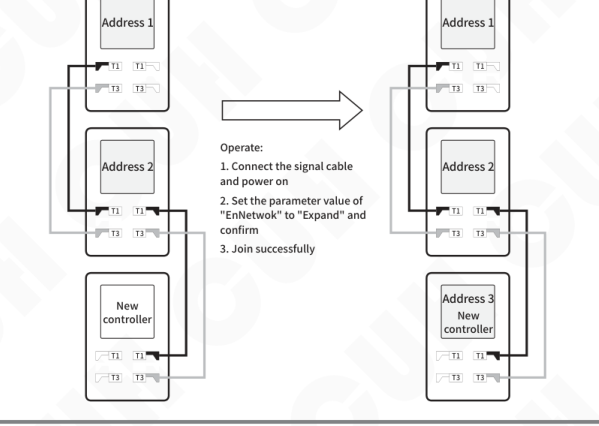


---

### 4.9.1.3 การลบอุปกรณ์

เมื่อต้องการลบคอนโทรลเลอร์ออกจากเครือข่ายอย่างถาวร ให้ใช้ฟังก์ชันลบคอนโทรลเลอร์ออกจากเครือข่าย การลบคอนโทรลเลอร์ในเครือข่ายสามารถเริ่มจากคอนโทรลเลอร์ใดก็ได้ในเครือข่าย คอนโทรลเลอร์ที่เหลือหลังการลบจะจัดระเบียบเป็นเครือข่ายใหม่ที่สมบูรณ์

อย่างไรก็ตาม หากถอดคอนโทรลเลอร์ออกโดยตรง（รวมถึงไฟฟ้าดับ）โดยไม่ลบคอนโทรลเลอร์ ข้อมูลของคอนโทรลเลอร์จะยังคงเก็บอยู่ในเครือข่าย ในเวลานี้ เครือข่ายอยู่ในสถานะด้อยประสิทธิภาพและไม่สามารถเพิ่มคอนโทรลเลอร์ใหม่ได้ ต้องลบด้วยตนเองผ่านคอนโทรลเลอร์เพื่อรักษาความสมบูรณ์ของเครือข่ายและทำการขยายและเพิ่มคอนโทรลเลอร์ใหม่

**ขั้นตอนการลบคอนโทรลเลอร์:**

1. เข้า "กลุ่มพารามิเตอร์การสื่อสาร" ผ่านคอนโทรลเลอร์ใดก็ได้ในเครือข่าย
2. แก้ไขค่าพารามิเตอร์ "DeltDevi" เป็นที่อยู่ของอุปกรณ์เครือข่ายที่ต้องการลบ
3. หลังแก้ไขค่า กด ⊕ และ ⊖ ค้าง เพื่อยืนยันการลบอุปกรณ์
4. หลังลบเสร็จ ค่าพารามิเตอร์ "DeltDevi" จะเปลี่ยนเป็นค่าที่ไม่สามารถเลือกได้ หมายความว่าลบอุปกรณ์สำเร็จ
5. ในเวลานี้ ตรวจสอบสถานะเครือข่ายใหม่บนอุปกรณ์ที่ดำเนินการและยืนยันจำนวนการควบคุมเครือข่ายใหม่

ตัวอย่าง: ลบคอนโทรลเลอร์ที่อยู่ 3 ออกจากเครือข่าย

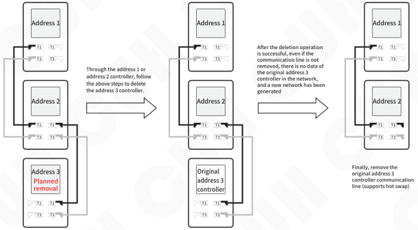

---


## 4.9.2 ฟังก์ชันซิงโครไนซ์

ความถี่ เฟส หรือความเร็วควบคุมระยะไกลของคอนโทรลเลอร์ใดก็ได้ในเครือข่ายสามารถติดตามคอนโทรลเลอร์หลักอีกตัวได้อย่างสอดคล้องหรือเบี่ยงเบน определёน์ อย่างไรก็ตาม คอนโทรลเลอร์หลายตัวไม่สามารถติดตามกันและกันได้ มิฉะนั้นเอาต์พุตจะไม่เสถียร

ตัวอย่าง 1: คอนโทรลเลอร์ที่อยู่ 3 ติดตามความถี่เอาต์พุตของคอนโทรลเลอร์ที่อยู่ 1 ดังนั้นเครื่องสั่นสองตัวที่ขับโดยคอนโทรลเลอร์ทั้งสองจะทำงานที่ความถี่เดียวกัน

ตัวอย่าง 2: หากคอนโทรลเลอร์ที่อยู่ 3 ติดตามความถี่เอาต์พุตของคอนโทรลเลอร์ที่อยู่ 1 อยู่แล้ว ไม่สามารถตั้งค่าคอนโทรลเลอร์ที่อยู่ 1 ให้ติดตามความถี่เอาต์พุตของคอนโทรลเลอร์ที่อยู่ 3 ได้ ซึ่งหมายความว่าคอนโทรลเลอร์ไม่สามารถติดตามกันและกัน

➢ **การซิงโครไนซ์ความถี่**

วิธีการตั้งค่าการซิงโครไนซ์ความถี่มีดังนี้:

1. คอนโทรลเลอร์ตั้งแต่สองตัวขึ้นไปที่ต้องการซิงโครไนซ์ความถี่จะสร้างเครือข่ายการสื่อสารซิงโครไนซ์ดิจิทัลเดียวกัน กรุณาอ้างอิงบท "การเชื่อมต่ออุปกรณ์"

2. ตั้งค่าพารามิเตอร์ "FrqncSyn" ในกลุ่มพารามิเตอร์การสื่อสารของคอนโทรลเลอร์ที่ต้องการซิงโครไนซ์ความถี่เป็นหมายเลขที่อยู่ "Digital Sync" ของคอนโทรลเลอร์ที่ถูกซิงโครไนซ์

3. สลับไปคอนโทรลเลอร์ที่ถูกซิงโครไนซ์ความถี่ไปยังกลุ่มพารามิเตอร์ความเร็วคงที่ และตั้งค่า "FrqncMod" เป็น "SynV" หรือ "SynE"

➢ **การซิงโครไนซ์ความเร็วควบคุมระยะไกล**

วิธีการตั้งค่าการซิงโครไนซ์การควบคุมความเร็วระยะไกลมีดังนี้:

1. คอนโทรลเลอร์ตั้งแต่สองตัวขึ้นไปที่ต้องการซิงโครไนซ์ควบคุมระยะไกลจะสร้างเครือข่ายการสื่อสารซิงโครไนซ์ดิจิทัลเดียวกัน กรุณาอ้างอิงบท "การเชื่อมต่ออุปกรณ์"

2. ตั้งค่าพารามิเตอร์ "RemotSyn" ในกลุ่มพารามิเตอร์การสื่อสารของคอนโทรลเลอร์ที่ถูกซิงโครไนซ์ควบคุมระยะไกลเป็นหมายเลขที่อยู่ "Digital Sync" ของคอนโทรลเลอร์ที่ถูกซิงโครไนซ์

3. ตั้งค่าพารามิเตอร์ "CtrlSour" ในกลุ่มพารามิเตอร์เอาต์พุตหลักเป็น "DigSym"

➢ **โหมดทำงานหลัก/Slave**

ผู้ใช้สามารถตั้งค่าคอนโทรลเลอร์ให้ทำงานในโหมดทำงานหนึ่งในสองโหมดต่อไปนี้ตามความต้องการของแอปพลิเคชัน:

โหมดหลัก: คอนโทรลเลอร์หนึ่งตัวควบคุมจานสั่นโหลดหนึ่งตัวอย่างอิสระ

โหมด Slave: เมื่อคอนโทรลเลอร์ตั้งแต่สองตัวขึ้นไปต้องทำงานพร้อมกัน ใช้คอนโทรลเลอร์หนึ่งตัวเป็นคอนโทรลเลอร์หลักและทำงานในโหมดหลักเป็นอ้างอิงความถี่ คอนโทรลเลอร์อื่นทั้งหมดทำงานในโหมด slave ทำหน้าที่เป็นคอนโทรลเลอร์_slave และทำงานซิงโครไนซ์กับคอนโทรลเลอร์หลัก


## โหมดหลัก

คอนโทรลเลอร์ที่ทำงานในโหมดหลัก ต่อไปนี้จะเรียกว่าคอนโทรลเลอร์หลัก แก้ไขพารามิเตอร์ในกลุ่มพารามิเตอร์ความเร็วคงที่ พารามิเตอร์ "โหมดแรงดัน" และ "โหมดความถี่" สามารถตั้งค่าคอนโทรลเลอร์เป็นโหมดทำงานที่สอดคล้องได้ โหมดแรงดันและโหมดความถี่มีการผสมดังต่อไปนี้:

| โหมดทำงาน | วิธีการควบคุม<br>แรงดัน | วิธีการควบคุม<br>ความถี่ | ต้องการเซ็นเซอร์สั่นสะเทือน |
|---|---|---|---|
| แมนนวลเต็ม | Manuel | Manuel | ไม่ |
| อัตโนมัติเต็ม | Auto | Auto | ใช่ |
| แรงดันอัตโนมัติ | Auto | Manuel | ใช่ |
| ความถี่อัตโนมัติ | Manuel | Auto | ใช่ |

■ **โหมดแมนนวลเต็ม**

ในโหมดนี้ แรงดันเอาต์พุตและความถี่เอาต์พุตของคอนโทรลเลอร์จะถูกปรับด้วยตนเอง

**หมายเหตุ:** แม้พารามิเตอร์ "โหมดแรงดัน" หรือ "โหมดความถี่" ตั้งเป็น "Auto" คอนโทรลเลอร์จะยังทำงานในโหมดแมนนวลเต็มหากไม่ได้ต่อเซ็นเซอร์สั่นสะเทือน

■ **โหมดอัตโนมัติเต็ม**

คอนโทรลเลอร์จะปรับแรงดันเอาต์พุตและความถี่เอาต์พุตอัตโนมัติตามข้อมูลที่เซ็นเซอร์สั่นสะเทือนป้อนกลับ เพื่อให้มั่นใจว่าความเร็วการป้อนของอุปกรณ์สั่นคงที่ใกล้ค่าที่ตั้งไว้ "ความเร็วการป้อน" และความถี่การสั่นอยู่ที่ความถี่ทำงานที่ดีที่สุดของอุปกรณ์สั่น แรงดันเอาต์พุตและความถี่เอาต์พุตจะไม่ถูกควบคุมโดยพารามิเตอร์ "แรงดัน" และ "ความถี่"

**หมายเหตุ:** การตั้งค่าเริ่มต้นโรงงานของคอนโทรลเลอร์คือโหมดอัตโนมัติเต็ม แต่ถ้าไม่ได้เสียบเซ็นเซอร์สั่นสะเทือนอย่างถูกต้อง คอนโทรลเลอร์จะยังอยู่ในสถานะแมนนวลเต็ม คอนโทรลเลอร์จะสลับไปสถานะอัตโนมัติเต็มเมื่อเสียบเซ็นเซอร์สั่นสะเทือนอย่างถูกต้องเท่านั้น

■ **โหมดแรงดันอัตโนมัติ**

ในโหมดนี้ คอนโทรลเลอร์จะปรับแรงดันเอาต์พุตอัตโนมัติตามข้อมูลที่เซ็นเซอร์สั่นสะเทือนป้อนกลับ เพื่อให้มั่นใจว่าความเร็วการป้อนของอุปกรณ์สั่นคงที่ที่ค่าที่ตั้งไว้ ความถี่เอาต์พุตถูกตั้งค่าด้วยตนเองโดยผู้ใช้ คอนโทรลเลอร์ต้องต่อกับเซ็นเซอร์สั่นสะเทือนเพื่อให้โหมดนี้ทำงานได้อย่างถูกต้อง

■ **โหมดความถี่อัตโนมัติ**

ในโหมดนี้ คอนโทรลเลอร์จะปรับความถี่เอาต์พุตอัตโนมัติตามข้อมูลที่เซ็นเซอร์สั่นสะเทือนป้อนกลับ เพื่อให้แน่ใจว่าความถี่การสั่นอยู่ที่ความถี่ทำงานที่ดีที่สุดของอุปกรณ์สั่น และแรงดันเอาต์พุตถูกตั้งค่าด้วยตนเอง คอนโทรลเลอร์ต้องต่อกับเซ็นเซอร์สั่นสะเทือนเพื่อให้โหมดนี้ทำงานได้อย่างถูกต้อง


---

## โหมด Slave

เมื่อคอนโทรลเลอร์หลายตัวเชื่อมต่อกัน คอนโทรลเลอร์ใดก็สามารถเลือกโหมด slave ได้ ในโหมดนี้ ความถี่เอาต์พุตของคอนโทรลเลอร์_slave จะสอดคล้องกับความถี่เอาต์พุตของคอนโทรลเลอร์หลักอย่างเคร่งครัด คอนโทรลเลอร์ที่ทำงานในโหมด slave ต่อไปนี้จะเรียกว่าคอนโทรลเลอร์_slave

โหมดซิงโครไนซ์ความถี่ใช้ในสถานการณ์ที่มีคอนโทรลเลอร์หลายตัวในระบบป้อนวัสดุและความถี่เอาต์พุตและเฟสต้องซิงโครไนซ์ ผ่านโหมดซิงโครไนซ์ คอนโทรลเลอร์หลักและ slave สามารถส่งออกรูปคลื่นที่ซิงโครไนซ์อย่างสมบูรณ์ จึงกำจัดการรบกวนระหว่างเอาต์พุตของคอนโทรลเลอร์

เมื่อคอนโทรลเลอร์ M ทำงานในโหมดหลัก คอนโทรลเลอร์ S ทำงานในโหมด slave (โหมดซิงโครไนซ์) รูปคลื่นเอาต์พุตของคอนโทรลเลอร์ทั้งสองจะซิงโครไนซ์อย่างสมบูรณ์ ดังแสดงด้านล่าง:

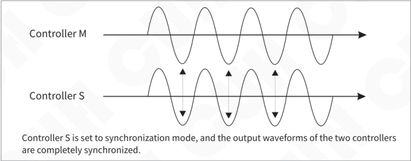

หากคอนโทรลเลอร์ S ไม่ได้ตั้งเป็นโหมด slave (โหมด SynV หรือ SynE) รูปคลื่นเอาต์พุตของคอนโทรลเลอร์ทั้งสองจะไม่ซิงโครไนซ์ ดังแสดงด้านล่าง:

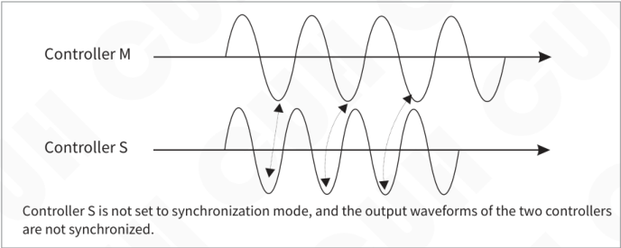

---


สำหรับอุปกรณ์เชิงกลที่ต้องการการจัดตำแหน่งอย่างแม่นยำ อุปกรณ์สั่นสองตัวหรือมากกว่าอาจต้องมีเฟสที่สอดคล้องกันทางกายภาพ แต่อุปกรณ์แต่ละตัวมีความถี่เรโซแนนซ์ที่แตกต่างกัน โดยการตั้งค่าโหมดความถี่เป็น "SynV" คอนโทรลเลอร์สามารถปรับเฟสของแต่ละอุปกรณ์อัตโนมัติตามสภาพการสั่นเพื่อให้สอดคล้องกัน หากโหมดความถี่เป็น "SynE" ผู้ใช้ตั้งค่าชดเชยเฟสด้วยตนเอง

แก้ไขพารามิเตอร์ "โหมดแรงดัน" และ "โหมดความถี่" ในกลุ่มพารามิเตอร์ความเร็วคงที่เพื่อตั้งค่าคอนโทรลเลอร์ให้ทำงานใน "โหมดทำงาน" ที่สอดคล้อง โหมดแรงดันและโหมดความถี่มีการผสมดังต่อไปนี้:

| โหมดทำงาน | วิธีการแรงดัน | วิธีการความถี่ | การควบคุมเฟส | ต้องการเซ็นเซอร์สั่นสะเทือน |
|---|---|---|---|---|
| แรงดันอัตโนมัติ<br>เฟสอัตโนมัติ | Auto | SynV | อัตโนมัติ | ใช่ |
| แรงดันอัตโนมัติ<br>เฟสด้วยตนเอง | Auto | SynE | ตั้งค่าด้วยตนเอง | ใช่ |
| แรงดันแมนนวล<br>เฟสอัตโนมัติ | Manuel | SynV | อัตโนมัติ | ใช่ |
| แรงดันแมนนวล<br>เฟสด้วยตนเอง | Manuel | SynE | ตั้งค่าด้วยตนเอง | ไม่ |

> **หมายเหตุ:**
>
> 1. แม้พารามิเตอร์ "โหมดแรงดัน" และ "โหมดความถี่" ตั้งเป็น "Auto" และ "SynV" หากไม่ได้ต่อเซ็นเซอร์สั่นสะเทือน คอนโทรลเลอร์จะยังทำงานในสถานะแรงดันแมนนวลและเฟสด้วยตนเอง
>
> 2. แรงดันอัตโนมัติหมายถึงคอนโทรลเลอร์_slave ที่ต่อกับเซ็นเซอร์สั่นสะเทือนจะปรับแรงดันเอาต์พุตอัตโนมัติเพื่อรักษาความเร็วการป้อนให้คงที่ใกล้ค่าที่ตั้งโดยผู้ใช้
>
> 3. เฟสอัตโนมัติหมายถึงคอนโทรลเลอร์_slave ที่ต่อกับเซ็นเซอร์สั่นสะเทือนจะแก้ไขเฟสของรูปคลื่นเอาต์พุตอัตโนมัติตามสัญญาณป้อนกลับของเซ็นเซอร์ เพื่อให้สัญญาณซิงโครไนซ์ที่ส่งออกโดยคอนโทรลเลอร์_slave และคอนโทรลเลอร์หลักมีเฟสตรงกัน
>
> 4. เฟสด้วยตนเองหมายถึงเฟสของรูปคลื่นเอาต์พุตคอนโทรลเลอร์_slave ที่สามารถตั้งค่าด้วยตนเองให้มีค่าเบี่ยงเบนเฟสคงที่จากรูปคลื่นเอาต์พุตของคอนโทรลเลอร์หลัก


---

## วิธีการต่อสายสัญญาณซิงโครไนซ์ระหว่างคอนโทรลเลอร์หลักและ slave

เพียงแค่ต่อคอนโทรลเลอร์หลักและ slave เข้ากับเครือข่ายการสื่อสารซิงโครไนซ์ดิจิทัลเดียวกันแล้วเชื่อมต่อเครือข่าย ตั้งค่าพารามิเตอร์ "ซิงโครไนซ์ความถี่" ในกลุ่มพารามิเตอร์การสื่อสารของคอนโทรลเลอร์_slave เป็นหมายเลขที่อยู่ "Digital Sync" ของคอนโทรลเลอร์หลัก จากนั้นเปลี่ยน "โหมดความถี่" ในกลุ่มพารามิเตอร์ความเร็วคงที่เป็น "ซิงโครนัสการสั่น" หรือ "ซิงโครนัสไฟฟ้า"

### สถานการณ์การใช้งานที่ทั้งคอนโทรลเลอร์หลักและ slave ต่อกับเซ็นเซอร์สั่นสะเทือน

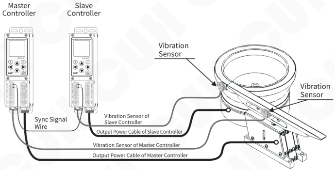

🙂

1. หากคอนโทรลเลอร์_slave ทำงานในโหมดแรงดันแมนนวลเฟสด้วยตนเอง คอนโทรลเลอร์_slave ไม่จำเป็นต้องต่อกับเซ็นเซอร์สั่นสะเทือน

2. หากคอนโทรลเลอร์หลักทำงานในโหมดแมนนวลเต็ม คอนโทรลเลอร์หลักไม่จำเป็นต้องต่อกับเซ็นเซอร์สั่นสะเทือน

---


■ **โหมดแรงดันอัตโนมัติเฟสอัตโนมัติ**

ในโหมดนี้ คอนโทรลเลอร์ต้องต่อกับเซ็นเซอร์สั่นสะเทือน คอนโทรลเลอร์จะปรับแรงดันเอาต์พุตอัตโนมัติตามข้อมูลที่เซ็นเซอร์สั่นสะเทือนป้อนกลับ เพื่อให้มั่นใจว่าความเร็วการป้อนของอุปกรณ์สั่นคงที่ที่ค่าที่ตั้งไว้ ความถี่และเฟสของรูปคลื่นเอาต์พุตสอดคล้องกับคอนโทรลเลอร์หลัก หรือมีส่วนต่างเฟส ตั้งโดยพารามิเตอร์ "Auto Phase"

■ **โหมดแรงดันอัตโนมัติเฟสด้วยตนเอง**

ในโหมดนี้ คอนโทรลเลอร์ต้องต่อกับเซ็นเซอร์สั่นสะเทือน คอนโทรลเลอร์จะปรับแรงดันเอาต์พุตอัตโนมัติตามข้อมูลที่เซ็นเซอร์สั่นสะเทือนป้อนกลับ เพื่อให้มั่นใจว่าความเร็วการป้อนของอุปกรณ์สั่นคงที่ที่ค่าที่ตั้งไว้ ความถี่เอาต์พุตสอดคล้องกับคอนโทรลเลอร์หลัก รูปคลื่นเอาต์พุตแตกต่างจากรูปคลื่นเอาต์พุตของคอนโทรลเลอร์หลักด้วยค่าส่วนต่างเฟสคงที่ ซึ่งตั้งโดยพารามิเตอร์ "Manual Phase"

■ **โหมดแรงดันแมนนวลเฟสอัตโนมัติ**

ในโหมดนี้ คอนโทรลเลอร์ต้องต่อกับเซ็นเซอร์สั่นสะเทือน แรงดันเอาต์พุตของคอนโทรลเลอร์ถูกปรับด้วยตนเอง ความถี่และเฟสของรูปคลื่นเอาต์พุตสอดคล้องกับคอนโทรลเลอร์หลัก หรือมีส่วนต่างเฟส ตั้งโดยพารามิเตอร์ "Auto Phase"

■ **โหมดแรงดันแมนนวลเฟสด้วยตนเอง**

ในโหมดนี้ แรงดันเอาต์พุตของคอนโทรลเลอร์ถูกปรับด้วยตนเอง และความถี่เอาต์พุตสอดคล้องกับคอนโทรลเลอร์หลัก รูปคลื่นเอาต์พุตแตกต่างจากรูปคลื่นเอาต์พุตของคอนโทรลเลอร์หลักด้วยค่าส่วนต่างเฟสคงที่ ซึ่งตั้งโดยพารามิเตอร์ "Manual Phase"

> 🙂
>
> 1. โหมดเฟสอัตโนมัติต้องตั้งค่าพารามิเตอร์ "โหมดความถี่" ของคอนโทรลเลอร์_slave เป็น "SynV"
>
> 2. โหมดเฟสด้วยตนเองต้องตั้งค่าพารามิเตอร์ "โหมดความถี่" ของคอนโทรลเลอร์_slave เป็น "SynE"


## 4.9.3 การแบ่งปันสัญญาณ

หลังเชื่อมต่อเครือข่าย คอนโทรลเลอร์สามารถเรียกสัญญาณใดก็ได้จากคอนโทรลเลอร์อื่นในเครือข่าย เพื่อให้ได้พอร์ตเรียกสัญญาณที่หลากหลายมากขึ้น

แหล่งสัญญาณของคอนโทรลเลอร์หนึ่งในเครือข่ายสามารถเลือกจากพอร์ตใดก็ได้ของคอนโทรลเลอร์ใดก็ได้ในเครือข่าย และสามารถรับรู้การควบคุมลอจิกที่ซับซ้อนผ่านการดำเนินการลอจิก AND, OR, XOR หรือ RS

ขั้นตอนการดำเนินการเรียกแหล่งสัญญาณอื่นจากเอาต์พุตหลักของคอนโทรลเลอร์:

➢ **เลือกคอนโทรลเลอร์ที่ต้องการใช้สัญญาณเครือข่าย เข้ากลุ่มเอาต์พุตหลัก ทำการตั้งค่าต่อไปนี้:**

1. ตั้งค่าพารามิเตอร์ "MainSor1" หรือพารามิเตอร์ "MainSor2" เป็น "Bus"
2. ตั้งค่าพารามิเตอร์ "MainLogc" เป็นหนึ่งใน "And", "Or", "Xor", และ "RS"
3. ตั้งค่าพารามิเตอร์ "MainDire" ของคอนโทรลเลอร์นี้เป็นหนึ่งใน "Const", "Inv", "On" หรือ "Off"
4. ตั้งค่าเวลา "MainUpDy" และ "MainDnDy" ของคอนโทรลเลอร์นี้
5. ตั้งค่าพารามิเตอร์ "MainMode" ของคอนโทรลเลอร์นี้เป็นหนึ่งใน "Delay" หรือ "Hold"

➢ **สลับไปกลุ่มการสื่อสารและทำการตั้งค่าต่อไปนี้:**

6. ตั้งค่า "BSigMID1" ของคอนโทรลเลอร์นี้เป็นที่อยู่คอนโทรลเลอร์ที่ถูกติดตาม（สามารถค้นหาหมายเลขคอนโทรลเลอร์ได้ผ่านซิงโครไนซ์ดิจิทัล）
7. ตั้งค่า "BSigMID2" ของคอนโทรลเลอร์นี้เป็นที่อยู่คอนโทรลเลอร์ที่ถูกติดตาม
8. ตั้งค่าหมายเลขบิตสถานะเฉพาะของ "BSigM_B1" ของคอนโทรลเลอร์นี้ ต้องตรวจสอบ "บิตสถานะ" ของคอนโทรลเลอร์ที่ถูกติดตาม 1~16" เลือกหมายเลขลำดับบิตสถานะที่ต้องการ
9. ตั้งค่าหมายเลขบิตสถานะเฉพาะของ "BSigM_B2" ของคอนโทรลเลอร์นี้ ต้องตรวจสอบ "บิตสถานะ" ของคอนโทรลเลอร์ที่ถูกติดตาม 1~16" เลือกหมายเลขลำดับบิตสถานะที่ต้องการ

คอนโทรลเลอร์ใดก็สามารถส่งสถานะของตัวเอง 16 สถานะไปยังบัส ซึ่งสามารถตั้งค่าอย่างอิสระผ่าน "บิตสถานะ 1" ~ "บิตสถานะ 16" และ "บิตสถานะ 1" ~ "บิตสถานะ 16" จะเหมือน 16 บิตแรกของบท "7.4.11 รายการแนบท้าย" โดยค่าเริ่มต้น

คอนโทรลเลอร์ใดก็สามารถเรียกสัญญาณบนบัสได้（โดยค่าเริ่มต้น）สำหรับความหมายและรายละเอียด กรุณาอ้างอิงบท "7.4.11 รายการแนบท้าย"


ตัวอย่าง: หลังเชื่อมต่อเครือข่าย คอนโทรลเลอร์ที่อยู่ 3 เรียกสัญญาณพอร์ต C ของระบบควบคุมที่อยู่ 1 และสัญญาณพอร์ต C ของระบบควบคุมที่อยู่ 2 และทำลอจิก OR และเมื่อตรวจพบว่าสัญญาณใดใช้งานได้ เอาต์พุตหลักของคอนโทรลเลอร์ที่อยู่ 3 จะหยุด

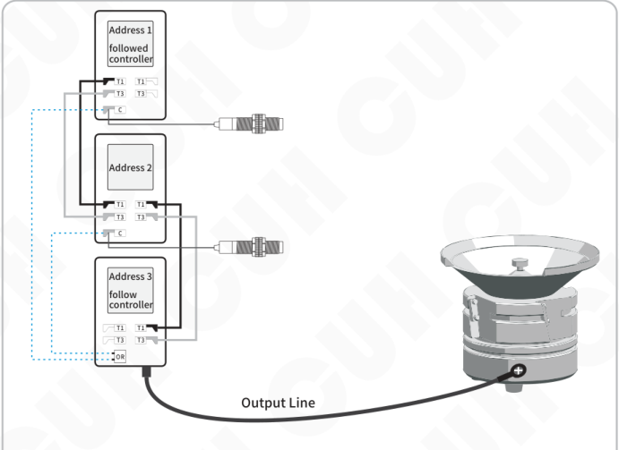

ขั้นตอนการดำเนินการ:

1. ตั้งค่ากลุ่มพารามิเตอร์เอาต์พุตหลักของคอนโทรลเลอร์ที่อยู่ 3 "MainSor1" เป็น "bus" และ "MainSor2" เป็น "bus"
2. ตั้งค่าพารามิเตอร์ "MainLogc" ของคอนโทรลเลอร์ที่อยู่ 3 เป็น "And"
3. ตั้งค่าพารามิเตอร์ "MainDire" (ทิศทางเอาต์พุตหลัก) ของคอนโทรลเลอร์ที่อยู่ 3 เป็น "Const"
4. ตั้งค่าเวลา "MainUpDy" และ "MainDnDy" ของคอนโทรลเลอร์ที่อยู่ 3 เป็นค่าเวลาที่ต้องการ ค่าเริ่มต้นคือ 0.2 วินาที
5. ตั้งค่า "MainMode" (โหมดเอาต์พุตหลัก) ของคอนโทรลเลอร์ที่อยู่ 3 เป็น "Delay"
6. ตั้งค่า "BSigMID1" ใน "กลุ่มพารามิเตอร์การสื่อสาร" ของคอนโทรลเลอร์ที่อยู่ 3 เป็น "1" (ระบุคอนโทรลเลอร์ที่อยู่ 1)
7. ตั้งค่า "BSigMID2" ของคอนโทรลเลอร์ที่อยู่ 3 เป็น "2" (ระบุคอนโทรลเลอร์ที่อยู่ 2)
8. ตั้งค่า "BSigM_B1" ของคอนโทรลเลอร์ที่อยู่ 3 เป็น "4" (ระบุสัญญาณพอร์ต C)
9. ตั้งค่า "BSigM_B2" ของคอนโทรลเลอร์ที่อยู่ 3 เป็น "4" (ระบุสัญญาณพอร์ต C)
10. การตั้งค่าเสร็จสิ้น สำหรับการตั้งค่าเอาต์พุตควบคุมของพอร์ต D ของคอนโทรลเลอร์ อ้างอิงการตั้งค่าเอาต์พุตหลักของคอนโทรลเลอร์


---

## 4.9.4 สำรองข้อมูล

เมื่อคอนโทรลเลอร์ทั้งหมดเชื่อมต่อกัน คอนโทรลเลอร์ทั้งหมดในเครือข่ายสามารถสำรองข้อมูลซึ่งกันและกัน คอนโทรลเลอร์แต่ละตัวจะสำรองคอนโทรลเลอร์อื่นอีกสองตัวในเครือข่าย เมื่อคอนโทรลเลอร์ในเครือข่ายเดิมขัดข้อง ผู้ใช้สามารถแทนที่คอนโทรลเลอร์ที่ขัดข้องด้วยคอนโทรลเลอร์ใหม่ได้อย่างรวดเร็ว พารามิเตอร์ทั้งหมดของคอนโทรลเลอร์ใหม่จะสอดคล้องกับคอนโทรลเลอร์ก่อนแทนที่

เมื่อคอนโทรลเลอร์ที่อยู่ติดกันที่มีหมายเลขน้อยกว่า 3 ตัวขัดข้องในเครือข่าย การดำเนินการแทนที่สามารถสำเร็จได้ อย่างไรก็ตาม เมื่อคอนโทรลเลอร์ที่มีหมายเลขมากกว่า 3 ตัวขึ้นไปขัดข้อง ไม่สามารถกู้คืนข้อมูลทั้งหมดได้

➢ **ขั้นตอนการเชื่อมต่อเครือข่ายคอนโทรลเลอร์ใหม่เป็นอุปกรณ์แทนที่:**

1. ปิดไฟอุปกรณ์ที่จะแทนที่และถอดสายการสื่อสาร CUHBus-DS®
2. ต่ออินเตอร์เฟซ CUHBus-DS® ของอุปกรณ์ใหม่เข้ากับเครือข่ายเดิม
3. เมื่อเปิดเครื่องอุปกรณ์ใหม่ คอนโทรลเลอร์ที่เข้าถึงใหม่จะเข้า "กลุ่มพารามิเตอร์การสื่อสาร" อัตโนมัติ
4. ตั้งค่าพารามิเตอร์ "DigSynAd" (ที่อยู่ซิงโครไนซ์ดิจิทัลท้องถิ่น) เนื่องจากเครือข่ายนี้ไม่สมบูรณ์ ค่าพารามิเตอร์นี้จะแสดงเฉพาะหมายเลขอุปกรณ์ที่ต้องแทนที่
5. ตั้งค่าพารามิเตอร์ "EnNetwok " เป็น "Replace" จากนั้นกด ⊕ และ ⊖ ค้างพร้อมกัน เพื่อยืนยัน
6. หลังแทนที่สำเร็จ ค่าพารามิเตอร์ "EnNetwok " ของอุปกรณ์ใหม่จะเปลี่ยนเป็น "Online" อัตโนมัติ

ตัวอย่าง 1: เครือข่ายเดิมประกอบด้วยคอนโทรลเลอร์ที่อยู่ 1, ที่อยู่ 2 และที่อยู่ 3 เนื่องจากที่อยู่ 3 ขัดข้อง จึงต้องแทนที่อุปกรณ์เดิมด้วยอุปกรณ์ใหม่และคืนค่าการตั้งค่าทั้งหมดของอุปกรณ์เดิม

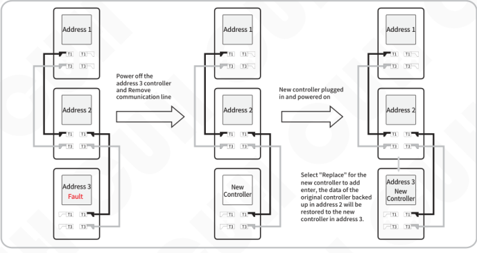

ตัวอย่าง 2: มีคอนโทรลเลอร์สี่ตัวที่อยู่ 1, 2, 3, และ 4 ในเครือข่าย ในจำนวนนี้ คอนโทรลเลอร์ที่อยู่ 2, 3, และ 4 ขัดข้อง อย่างไรก็ตาม เนื่องจากอุปกรณ์แต่ละตัวในเครือข่ายสำรองข้อมูลจากคอนโทรลเลอร์สูงสุดสองตัว คอนโทรลเลอร์ที่อยู่ 4 จึงไม่สามารถกู้คืนข้อมูลได้ สำหรับการตั้งค่าแทนที่คอนโทรลเลอร์ที่อยู่ 2 และ 3 อ้างอิงกรณีข้างต้น

ตัวอย่าง 3: เดิมมีเครื่องห้าตัวที่อยู่ 1, 2, 3, 4 และ 5 ในเครือข่าย ในจำนวนนี้ ที่อยู่ 1, 2, และ 4 ขัดข้อง（สามเครื่องที่ไม่ติดกัน）สามารถกู้คืนข้อมูลคอนโทรลเลอร์ที่อยู่ 1 และที่อยู่ 2 จากที่อยู่ 5 กู้คืนข้อมูลคอนโทรลเลอร์ที่อยู่ 4 จากที่อยู่ 3 จึงกู้คืนข้อมูลคอนโทรลเลอร์ที่ขัดข้องทั้งหมด สำหรับการตั้งค่าแทนที่คอนโทรลเลอร์ อ้างอิงกรณีข้างต้น

---


## 4.9.5 ข้อมูลควบคุมระยะไกล

ผู้ใช้สามารถเลือกส่งแหล่งข้อมูลไปยังเครือข่ายซิงโครไนซ์ และสามารถเลือกแรงดันแมนนวล แรงดันควบคุมระยะไกล ความเร็วแมนนวล และความเร็วควบคุมระยะไกล

| พารามิเตอร์ | ความหมาย |
|---|---|
| ManVol | แรงดันแมนนวลหมายถึงแรงดันที่ผู้ใช้ตั้งค่าบนแผง |
| RemVol | แรงดันควบคุมระยะไกลหมายถึงแรงดันที่ปรับผ่านพอร์ตควบคุมความเร็วระยะไกล |
| ManSpd | ความเร็วแมนนวลหมายถึงความเร็วการป้อนที่ผู้ใช้ตั้งค่าบนแผง |
| RemSpd | ความเร็วควบคุมระยะไกลหมายถึงความเร็วการป้อนที่ปรับผ่านพอร์ตควบคุมความเร็วระยะไกล |

## 4.10 การตรวจสอบสถานะคอนโทรลเลอร์

ในกลุ่มพารามิเตอร์ตรวจสอบ สามารถอ่านสถานะการทำงานและค่าพารามิเตอร์ของคอนโทรลเลอร์ได้แบบเรียลไทม์

สำหรับรายการพารามิเตอร์ที่สามารถอ่านได้ กรุณาอ้างอิงบท "รายการพารามิเตอร์" กลุ่มพารามิเตอร์ 10 กลุ่มพารามิเตอร์ตรวจสอบ

```text
┌──────────────────────┐
│ RUN                  │
│ A C D E F G N J   A0 │
│ 01.Voltage     20.0 V│
│ 02.Frequenc    50.0 Hz│
│ 03.SpeedNow       0  │
│ 04.VoltgOut   223.8 V│
│ 05.EffectCu    0.00 A│
│ +   10Monitor     −  │
└──────────────────────┘
```


## 4.11 บันทึกข้อผิดพลาด

คอนโทรลเลอร์สามารถบันทึกบันทึก 64 ชุดแบบวนรอบ เพื่ออำนวยความสะดวกในการดูเวลาที่เกิดปัญหาและข้อมูลเฉพาะในภายหลัง ในหน้าจอใด ๆ กด ▲ และ ▶ ค้างเพื่อเข้ากลุ่มอินเตอร์เฟซบันทึก แสดงดังต่อไปนี้:

```text
RUN
A C D E F G N J        A0
-------------------------
        0 H   0 M     1 S
Err CodeError          01
01.Voltage        [20.0] V
02.Frequenc        50.0Hz
03.SpeedNow             0
-------------------------
+          Note          −
```

- สองบรรทัดข้างต้นแสดงบันทึกข้อผิดพลาด
- สามบรรทัดถัดไปแสดงกลุ่มพารามิเตอร์ตรวจสอบ

## 4.12 ปรับแต่งหน้าหลัก

เพื่ออำนวยความสะดวกให้ผู้ใช้ใช้คอนโทรลเลอร์อย่างมีประสิทธิภาพและรวดเร็ว ผู้ใช้สามารถดำเนินการปรับแต่งในกลุ่มพารามิเตอร์อินเตอร์เฟซ โดยดึงพารามิเตอร์สูงสุด 16 รายการจากพารามิเตอร์ทั้งหมดมาเป็นรายการตรวจสอบในกลุ่มพารามิเตอร์อินเตอร์เฟซ และผู้ใช้สามารถดำเนินการอย่างรวดเร็วบนหน้าหลัก

ตัวอย่าง: เลือก 1. UsrVoltg (P2.02), 2. UsrFrqnc (P2.03), 3. UserSped (P2.01), 4. SoftStar (P2.04), SoftStop (P2.05) มีห้าพารามิเตอร์ในหน้าหลัก ขั้นตอนดังนี้:

- » กด ▲ และ ◀ ค้างเพื่อเข้าหน้าจอตั้งค่าพารามิเตอร์ กด ▶ สั้นเพื่อสลับไปกลุ่มพารามิเตอร์ "1EditHome"
- » กด ▲ หรือ ▼ สั้นเพื่อสลับรายการตรวจสอบต่าง ๆ
- » กด ⊕ หรือ ⊖ เพื่อเลือกป้ายฟังก์ชันที่ต้องการตั้งค่า

```text
RUN
A C D E F G N J        A0
01.Monit  1       [P2.02]
02.Monit  2        P2.03
03.Monit  3        P2.01
04.Monit  4        P2.04
05.Monit  5        P2.05
+       1EditHome       −
```

หมายเหตุ: สามารถค้นหาป้ายฟังก์ชันได้จากบท "รายการพารามิเตอร์"  
หากค่าของรายการตรวจสอบเป็นค่าว่าง หมายความว่าไม่มีรายการตรวจสอบ

หลังดำเนินการเสร็จ หากผู้ใช้ต้องการปรับค่าพารามิเตอร์ของแรงดัน ความถี่ ความเร็วการป้อน เวลาเริ่มต้นนุ่ม และเวลาหยุดนุ่ม เข้ารายการตรวจสอบเฉพาะในกลุ่มพารามิเตอร์ของอินเตอร์เฟซ "Home" และผ่าน ⊕ หรือ ⊖ สามารถปรับพารามิเตอร์ได้

---


# บทที่ Ⅴ การใช้งานทั่วไป

## 5.1 จะรักษาเครื่องสั่นสองตัวให้ทำงานที่ความถี่เดียวกันได้อย่างไร?

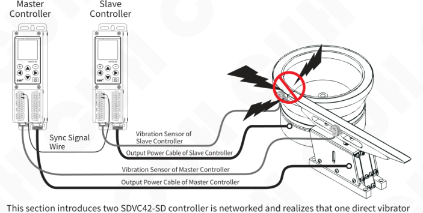

ส่วนนี้แนะนำคอนโทรลเลอร์ SDVC42-SD สองตัวที่เชื่อมต่อกันและรับรู้ว่าการสั่นตรงหนึ่งตัวและการสั่นวงกลมหนึ่งตัวทำงานที่ความถี่เดียวกัน เพื่อหลีกเลี่ยงการชนกันระหว่างจานเนื่องจากความถี่การทำงานไม่สอดคล้องกัน

1. คอนโทรลเลอร์ต่อสายไฟและสายเอาต์พุตอย่างถูกต้อง
2. นำเซ็นเซอร์ที่ถูกติดตามออกมา ต่อปลั๊กเซ็นเซอร์เข้ากับคอนโทรลเลอร์และขันน็อตให้แน่น และยึดตัวเซ็นเซอร์บนจานสั่นอย่างถูกต้อง（ดู "2.3 คู่มือการติดตั้งเซ็นเซอร์สั่นสะเทือน" สำหรับรายละเอียด）
3. เปิดฝาช่องต่อสายอุปกรณ์ ต่อสัญญาณ T1 ของคอนโทรลเลอร์ทั้งหมดเข้าด้วยกัน และสัญญาณ T3 ทั้งหมดเข้าด้วยกัน
4. หลังเปิดไฟอุปกรณ์ทั้งสองตัว คอนโทรลเลอร์หนึ่งในนั้นจะเข้า "กลุ่มพารามิเตอร์การสื่อสาร" อัตโนมัติ
5. ในกลุ่มพารามิเตอร์การสื่อสารของคอนโทรลเลอร์ โปรแกรมจะสร้างหมายเลขอุปกรณ์การสื่อสารซิงโครไนซ์ดิจิทัลอัตโนมัติ "Digital Sync" เป็นค่าใดก็ได้ [1~8] ผู้ใช้ยังสามารถเปลี่ยนค่านี้ด้วยตนเอง
6. ในกลุ่มพารามิเตอร์การสื่อสาร ตั้งค่าพารามิเตอร์ "EnNetwok " เป็น "Expand" จากนั้นกด ⊕ และ ⊖ ค้างพร้อมกัน เพื่อยืนยัน
7. หลังคอนโทรลเลอร์ผู้ติดตามเพิ่มสำเร็จ ค่าพารามิเตอร์ "EnNetwok" จะเปลี่ยนเป็น "Online" อัตโนมัติ หมายความว่าเชื่อมต่อเครือข่ายสำเร็จ
8. ผู้ใช้กด ▲ และ ◀ ค้างเพื่อเข้าหน้าจอตั้งค่าพารามิเตอร์ กด ◀ หรือ ▶ สั้นสลับไปกลุ่มพารามิเตอร์การสื่อสาร ดูและจดบันทึกที่อยู่ซิงโครไนซ์ดิจิทัลของคอนโทรลเลอร์แต่ละตัว
9. ตั้งค่าพารามิเตอร์ "FrqncSyn" ของคอนโทรลเลอร์ผู้ติดตามในกลุ่มพารามิเตอร์การสื่อสารเป็นหมายเลขที่อยู่ "DigSynAd" ของคอนโทรลเลอร์ที่ถูกติดตาม

หลังการตั้งค่าข้างต้นเสร็จสิ้น คอนโทรลเลอร์หนึ่งตัวสามารถติดตามคอนโทรลเลอร์อีกตัวเพื่อเอาต์พุตที่ความถี่เดียวกัน


## 5.2 จะเปิด/ปิดคอนโทรลเลอร์ B ผ่านเซ็นเซอร์ที่ต่อกับคอนโทรลเลอร์ A ได้อย่างไร?

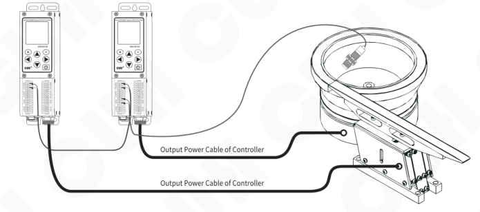

ส่วนนี้แนะนำคอนโทรลเลอร์ SDVC42-SD สองตัวที่เชื่อมต่อกัน และรับรู้ว่าการเอาต์พุตหลักของคอนโทรลเลอร์ที่ถูกควบคุมถูกควบคุมโดยสัญญาณพอร์ต C ของคอนโทรลเลอร์หลักควบคุมการเริ่มและหยุด ดังนั้นแม้เซ็นเซอร์จะไม่ได้ต่อกับคอนโทรลเลอร์ที่ถูกควบคุมโดยตรง คอนโทรลเลอร์ก็สามารถทำงานผ่านสัญญาณเครือข่ายได้ แหล่งสัญญาณของคอนโทรลเลอร์มีความหลากหลายมากขึ้นอย่างมาก

1. คอนโทรลเลอร์ต่อสายไฟและสายเอาต์พุตอย่างถูกต้อง

2. เปิดฝาช่องต่อสายอุปกรณ์ ต่อสัญญาณ T1 ของคอนโทรลเลอร์ทั้งหมดเข้าด้วยกัน และสัญญาณ T3 ทั้งหมดเข้าด้วยกัน

3. หลังเปิดไฟอุปกรณ์ทั้งสองตัว คอนโทรลเลอร์หนึ่งในนั้นจะเข้า "กลุ่มพารามิเตอร์การสื่อสาร" อัตโนมัติ

4. ในกลุ่มพารามิเตอร์การสื่อสารของคอนโทรลเลอร์ โปรแกรมจะสร้างหมายเลขอุปกรณ์การสื่อสารซิงโครไนซ์ดิจิทัลอัตโนมัติ "Digital Sync" เป็นค่าใดก็ได้ [1~8] ผู้ใช้ยังสามารถเปลี่ยนค่านี้ด้วยตนเอง

5. ผู้ใช้กด ▲ และ ◀ ค้างเพื่อเข้าหน้าจอตั้งค่าพารามิเตอร์ กด ◀ หรือ ▶ สั้นสลับไปกลุ่มพารามิเตอร์การสื่อสาร ดูและจดบันทึกที่อยู่ซิงโครไนซ์ดิจิทัลของคอนโทรลเลอร์แต่ละตัว

6. คอนโทรลเลอร์ที่ถูกควบคุมสลับไปกลุ่มพารามิเตอร์เอาต์พุตหลักตามวิธีข้างต้น และตั้งค่าพารามิเตอร์ดังนี้:

   "MainSor1" เป็น "Bus", "MainSor2" เป็น "Bus", "MainLogc" เป็น "And", "MainDire" เป็น "Const", "MainUpDy" และ "MainDnDy" ตั้งเป็นค่าเวลาที่ต้องการ ค่าเริ่มต้นคือ 0.2 วินาที "MainMode" ตั้งเป็น "Delay"

7. คอนโทรลเลอร์ที่ถูกควบคุมสลับไปกลุ่มพารามิเตอร์การสื่อสารตามวิธีข้างต้น และตั้งค่าพารามิเตอร์ดังนี้:

   "BSigMID1" ตั้งเป็น "X" (X: คือหมายเลขบิตซิงโครไนซ์ดิจิทัลของคอนโทรลเลอร์ที่ต้องการเรียกสัญญาณ), "BSigM_B1" ตั้งเป็น "4" (สัญญาณพอร์ต C อินพุตวัสดุ), "BSigM_B2" ตั้งเป็น "0" (0 หมายถึงสัญญาณไม่ใช้งาน)

หลังการตั้งค่าข้างต้นเสร็จสิ้น เอาต์พุตของคอนโทรลเลอร์หนึ่งตัวจะถูกควบคุมโดยสัญญาณพอร์ต C ของคอนโทรลเลอร์อีกตัว


---

## 5.3 จะเปิด/ปิดคอนโทรลเลอร์สองตัวพร้อมกันได้อย่างไร?

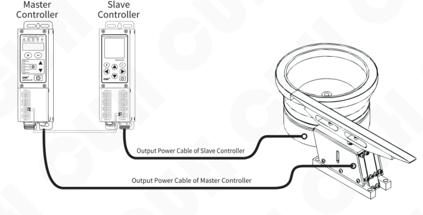

ส่วนนี้แนะนำคอนโทรลเลอร์การสั่นตรง（ใช้ SDVC311）และคอนโทรลเลอร์จาน（ใช้ SDVC42-SD）เริ่มและหยุดพร้อมกัน คอนโทรลเลอร์ซีรีส์ที่แตกต่างกันก็สามารถทำงานฟังก์ชันเริ่มและหยุดพร้อมกันได้เช่นกัน

1. คอนโทรลเลอร์ต่อสายไฟและสายเอาต์พุตอย่างถูกต้อง

2. เปิดฝาช่องต่อสายอุปกรณ์ ต่อ D1 ของ SDVC42-SD กับ C2 ของ SDVC311 และต่อ D3 ของ SDVC42-SD กับ C1 ของ SDVC311

3. หลังเปิดไฟอุปกรณ์ทั้งสองตัว กด ▲ และ ◀ ค้างเพื่อเข้าหน้าจอตั้งค่าพารามิเตอร์ กด ◀ หรือ ▶ สั้นสลับไปกลุ่มพารามิเตอร์เอาต์พุตควบคุม

4. ในกลุ่มพารามิเตอร์เอาต์พุตควบคุม ตั้งค่าพารามิเตอร์ดังนี้:

"PotDLogc" ตั้งเป็น "Or", "PotDSor1" ตั้งเป็น "Main", "PotDType" ตั้งเป็น "Ou_PNP" และค่าเริ่มต้นอื่น ๆ คงไม่เปลี่ยน

ด้านบนนี้ การตั้งค่าเสร็จสิ้นเพื่อใช้งานคอนโทรลเลอร์การสั่นตรง（ใช้ SDVC311）และคอนโทรลเลอร์เครื่องสั่น（ใช้ SDVC42-SD）รักษาการเริ่มและหยุดพร้อมกัน

---


# บทที่ Ⅵ คำถามที่พบบ่อย

## 6.1 เปิดเครื่องแล้วไม่มีอะไรแสดง

วิธีแก้:

◆ ตรวจสอบว่าช่องเสียบไฟมีไฟหรือไม่

◆ ตรวจสอบว่าปลั๊กไฟต่อกับช่องเสียบอย่างเชื่อถือได้หรือไม่

## 6.2 ไม่สั่น ไม่มีเสียง หน้าจอคอนโทรลเลอร์ปกติ

วิธีแก้:

◆ ตรวจสอบว่าสายไฟเอาต์พุตต่อกับคอนโทรลเลอร์และเครื่องสั่นอย่างถูกต้องหรือไม่

◆ ตรวจสอบว่าค่าพารามิเตอร์แรงดันเอาต์พุตและความถี่เอาต์พุตของคอนโทรลเลอร์เหมาะสมหรือไม่

◆ ตรวจสอบว่าคอนโทรลเลอร์ถูกหยุดโดยสัญญาณควบคุมใดหรือไม่

◆ ตรวจสอบว่าคอนโทรลเลอร์ถูกหยุดโดยการตั้งค่าปิดลอจิกพารามิเตอร์ใดหรือไม่

## 6.3 สัญญาณควบคุมไม่ทำงาน

วิธีแก้:

◆ ตรวจสอบว่าสัญญาณควบคุมต่ออย่างเชื่อถือได้หรือไม่

◆ ตรวจสอบว่าสายกราวด์ของสัญญาณควบคุมต่อกับพอร์ต GND ของคอนโทรลเลอร์หรือไม่

◆ ตรวจสอบว่าลอจิกสัญญาณควบคุมตั้งค่าถูกต้องหรือไม่

## 6.4 ไม่สั่น เสียงปกติ หน้าจอคอนโทรลเลอร์ปกติ

วิธีแก้:

◆ ปรับการตั้งค่าพารามิเตอร์ตามคู่มือผู้ใช้นี้

## 6.5 การติดตามความถี่เรโซแนนซ์ไม่เสถียร

วิธีแก้:

◆ เพิ่มค่าอินทิกรัลความถี่อย่างเหมาะสม แต่ระวังว่าหากมากเกินไปอาจทำให้เกิดการแกว่งของความถี่เอาต์พุต


---

## 6.6 การแก้ไขความเร็วช้าในการควบคุมความเร็วการป้อนคงที่

วิธีแก้:

◆ ปรับค่าอินทิกรัลแอมพลิจูดอย่างเหมาะสม แต่ระวังว่าหากมากเกินไป แอมพลิจูดการแกว่งของแรงดันเอาต์พุตจะมากขึ้น

## 6.7 รีเซ็ตคอนโทรลเลอร์เป็นค่าเริ่มต้นโรงงานอย่างรวดเร็ว

เนื่องจากคอนโทรลเลอร์นี้มีฟังก์ชันที่มีประสิทธิภาพสูง มีพารามิเตอร์ควบคุมจำนวนมากที่ผู้ใช้สามารถตั้งค่าได้ สำหรับผู้เริ่มต้น อาจไม่สามารถคืนสถานะการทำงานปกติของคอนโทรลเลอร์ได้หลังแก้ไขการตั้งค่าหลายครั้ง ใช้ฟังก์ชันนี้เพื่อคืนสถานะพารามิเตอร์ที่สับสนกลับเป็นค่าเริ่มต้นโรงงานอย่างรวดเร็ว

วิธีแก้:

◆ กด ▲ และ ◀ ค้างเพื่อเข้าหน้าจอตั้งค่าพารามิเตอร์ กด ◀ หรือ ▶ สั้นเพื่อสลับไปกลุ่มพารามิเตอร์บันทึก

◆ สลับไปพารามิเตอร์คืนค่าการตั้งค่าและเลือกพารามิเตอร์กลุ่มงาน กด ⊕ และ ⊖ ค้างพร้อมกันมากกว่าสองวินาทีเพื่อสลับไปหน้าจอสแตนด์บาย ในเวลานี้ พารามิเตอร์ทั้งหมดในกลุ่มงานจะถูกคืนค่าเป็นค่าเริ่มต้นโรงงาน（การตั้งค่า User 1, User 2 และ User 3 คงไม่เปลี่ยน）

หากผู้ใช้เคยบันทึกพารามิเตอร์ใน "User 1", "User 2", หรือ "User 3" มาก่อน การตั้งค่าผู้ใช้ก็สามารถคืนค่าได้เช่นกัน

---


# บทที่ Ⅶ ภาคผนวก

## 7.1 ขนาด

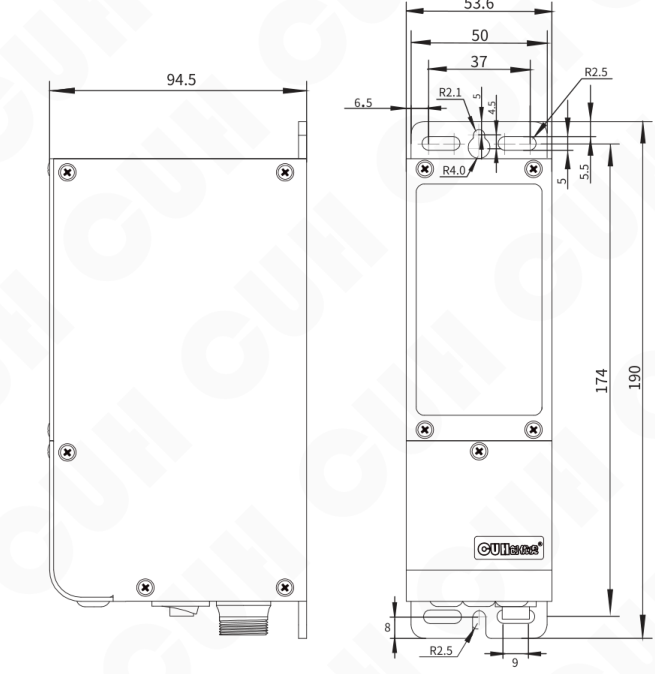

**ขนาด（หน่วย: มม.）**

| ช่วงขนาด | ความคลาดเคลื่อน |
|---|---|
| 0~3 | ±0.05 |
| 3~10 | ±0.1 |
| 10~30 | ±0.15 |
| 30~80 | ±0.2 |
| 80~180 | ±0.3 |
| >180 | ±0.5 |

ตารางความคลาดเคลื่อนนี้ใช้กับผลิตภัณฑ์ทั้งหมดในซีรีส์นี้


## 7.2 ข้อมูลจำเพาะทางเทคนิค

| รายการ | ต่ำสุด |ทั่วไป | สูงสุด | หน่วย | หมายเหตุ |
|---|---:|---:|---:|---|---|
| แรงดันอินพุต | 85 | 220 | 250 | V | AC RMS |
| ช่วงแรงดันเอาต์พุตที่ปรับได้ | 0.0 | —— | 50.0 | V | AC RMS |
| ความแม่นยำในการปรับแรงดัน |  | 0.1 |  | V |  |
| ความแม่นยำในการควบคุมแรงดัน | 0 | —— | 10 | % | ΔVout/ΔVin |
| ช่วงกระแสเอาต์พุตที่ปรับได้ | 0 | —— | 600 | mA |  |
| กำลังเอาต์พุต | 0 | —— | 30 | VA |  |
| ความถี่เอาต์พุต | 40.0 | —— | 999.9 | Hz |  |
| ความแม่นยำในการปรับความถี่ |  | 0.1 |  | Hz |  |
| รูปคลื่นเอาต์พุต |  | ไซน์ |  |  |  |
| เวลาเริ่มต้นนุ่ม | 0 | —— | 40.0 | s | ค่าเริ่มต้น: 0.5 |
| ช่วงเวลาหน่วงเปิด/ปิด | 0.0 | —— | 99.9 | s | ค่าเริ่มต้น: 0.2 |
| ความแม่นยำเวลาหน่วงเปิด/ปิด |  | 0.1 |  | s |  |
| อุณหภูมิทริกเกอร์การป้องกันความร้อนเกิน | 60 | 65 | 65 | °C |  |
| การสื่อสารซิงโครไนซ์ |  | CUHBus-DS® |  |  |  |
| การสื่อสารดิจิทัล |  | ModBUS485/Digital Sync |  |  |  |
| กระแสเอาต์พุตควบคุม DC | 0 | —— | 350 | mA |  |
| แรงดันเอาต์พุตควบคุม DC | 22 | 24 | 26 | V |  |
| สัญญาณควบคุมอะนาล็อก |  | 1~5/0~5/0~10 |  | V | แรงดันควบคุมความเร็วระยะไกล |
| สัญญาณควบคุมอะนาล็อก |  | 4~20 |  | mA | กระแสควบคุมความเร็วระยะไกล |
| สัญญาณควบคุมดิจิทัล |  | 24 |  | V | สัญญาณสวิตชิง |
| วิธีการปรับ |  | 7 |  | ปุ่ม |  |
| การใช้พลังงานสแตนด์บาย | —— | —— | 5 | W |  |
| วิธีการแสดง |  | 128*128 |  |  | จอเมทริกซ์ |
| ระดับการป้องกัน |  | IP20 |  |  |  |
| อุณหภูมิแวดล้อม | 0 | 25 | 40 | °C |  |
| ความชื้นแวดล้อม | 10 | 60 | 85 | % | ไม่มีการควบแน่น |
| อุณหภูมิแวดล้อมจัดเก็บ | -20 | 25 | 65 | °C |  |


## 7.3 มาตรฐานอ้างอิง

**พารามิเตอร์สัมบูรณ์:**  
หากเกินมาตรฐานข้างต้นจะทำให้คอนโทรลเลอร์เสียหาย กรุณาปฏิบัติตามอย่างเคร่งครัด

| รายการ | มาตรฐาน GB | มาตรฐาน IEC | ระดับ | ข้อกำหนดมาตรฐาน | หมายเหตุ |
|---|---|---|---|---|---|
| การปล่อย<br>ประจุไฟฟ้าสถิต | GB/T 17626.2-2006 | IEC 61000-4-2:2001 | 4 | ±8 kV | การปล่อย<br>แบบสัมผัส |
|  |  |  | 4 | ±15 kV | การปล่อยแบบอากาศ |
| การทดสอบ<br>ทรานเซียนท์เร็วไฟฟ้า | GB/T 17626.4-2008 | IEC 61000-4-4:2004 | 4 | ±4 kV |  |
| ความต้านทานคลื่น<br>สายไฟ DC | GB/T 17626.17-2005 | IEC 61000-4-17:2002 | 4 | 15% | เรต A |

> **คำเตือน**  
> ในสภาพแวดล้อมที่อยู่อาศัย ผลิตภัณฑ์นี้อาจทำให้เกิดการรบกวนทางวิทยุ ซึ่งในกรณีดังกล่าวอาจต้องใช้มาตรการบรรเทาเพิ่มเติม


---

## 7.4 รายการพารามิเตอร์

### 7.4.1 กลุ่มพารามิเตอร์อินเตอร์เฟซ

| ฟังก์ชัน | พารามิเตอร์ | การแสดง | ช่วงค่า/รายการแจงนับ | ค่าเริ่มต้น |
|---|---|---|---|---|
| P1.01 | รายการตรวจสอบ 1 | 01.Monit1 | กลุ่มพารามิเตอร์ 2~กลุ่มพารามิเตอร์ 10 | P2.01 |
| P1.02 | รายการตรวจสอบ 2 | 02.Monit2 | กลุ่มพารามิเตอร์ 2~กลุ่มพารามิเตอร์ 10 | P10.05 |
| P1.03 | รายการตรวจสอบ 3 | 03.Monit3 | กลุ่มพารามิเตอร์ 2~กลุ่มพารามิเตอร์ 10 | P2.02 |
| P1.04 | รายการตรวจสอบ 4 | 04.Monit4 | กลุ่มพารามิเตอร์ 2~กลุ่มพารามิเตอร์ 10 | P2.03 |
| P1.05 | รายการตรวจสอบ 5 | 05.Monit5 | กลุ่มพารามิเตอร์ 2~กลุ่มพารามิเตอร์ 10 |  |
| P1.06 | รายการตรวจสอบ 6 | 06.Monit6 | กลุ่มพารามิเตอร์ 2~กลุ่มพารามิเตอร์ 10 |  |
| P1.07 | รายการตรวจสอบ 7 | 07.Monit7 | กลุ่มพารามิเตอร์ 2~กลุ่มพารามิเตอร์ 10 |  |
| P1.08 | รายการตรวจสอบ 8 | 08.Monit8 | กลุ่มพารามิเตอร์ 2~กลุ่มพารามิเตอร์ 10 |  |
| P1.09 | รายการตรวจสอบ 9 | 09.Monit9 | กลุ่มพารามิเตอร์ 2~กลุ่มพารามิเตอร์ 10 |  |
| P1.10 | รายการตรวจสอบ 10 | 10.Monit10 | กลุ่มพารามิเตอร์ 2~กลุ่มพารามิเตอร์ 10 |  |
| P1.11 | รายการตรวจสอบ 11 | 11.Monit11 | กลุ่มพารามิเตอร์ 2~กลุ่มพารามิเตอร์ 10 |  |
| P1.12 | รายการตรวจสอบ 12 | 12.Monit12 | กลุ่มพารามิเตอร์ 2~กลุ่มพารามิเตอร์ 10 |  |
| P1.13 | รายการตรวจสอบ 13 | 13.Monit13 | กลุ่มพารามิเตอร์ 2~กลุ่มพารามิเตอร์ 10 |  |
| P1.14 | รายการตรวจสอบ 14 | 14.Monit14 | กลุ่มพารามิเตอร์ 2~กลุ่มพารามิเตอร์ 10 |  |
| P1.15 | รายการตรวจสอบ 15 | 15.Monit15 | กลุ่มพารามิเตอร์ 2~กลุ่มพารามิเตอร์ 10 |  |
| P1.16 | รายการตรวจสอบ 16 | 16.Monit16 | กลุ่มพารามิเตอร์ 2~กลุ่มพารามิเตอร์ 10 |  |

---


## 7.4.2 กลุ่มพารามิเตอร์ทั่วไป

| ฟังก์ชัน | พารามิเตอร์ | การแสดง | ช่วงค่า/รายการแจงนับ | ค่าเริ่มต้น |
|---|---|---|---|---|
| P2.01 | ความเร็วการป้อนที่ตั้งโดยผู้ใช้ | 01.UserSped | 0~3200 | 50 |
| P2.02 | แรงดันที่ตั้งโดยผู้ใช้ | 02.UsrVoltg | 0.0~50.0 V | 20.0 |
| P2.03 | ความถี่ที่ตั้งโดยผู้ใช้ | 03.UsrFrqnc | 40.0~999.9 Hz | 50.0 |
| P2.04 | เวลาเริ่มต้นนุ่ม | 04.SoftStar | 0.0~40.0 s | 0.5 |
| P2.05 | เวลาหยุดนุ่ม | 05.SoftStop | 0.0~40.0 s | 0.5 |
| P2.06 | แรงดันเอาต์พุตสูงสุด | 06.MaxVoltg | 0.0~50.0 V | 50.0 |
| P2.07 | กระแสเอาต์พุตสูงสุด | 07.MaxCurre | 0~600 mA | 600 |
| P2.08 | ความถี่เอาต์พุตสูงสุด | 08.MaxFre | 40.0~999.9 Hz | 999.9 |
| P2.09 | ความถี่เอาต์พุตต่ำสุด | 09.MiniFre | 40.0~999.9 Hz | 40.0 |
| P2.10 | การตรวจจับโหลด | 10.Measure | None, Valid | None |
| P2.11 | สัญญาณเตือนวัสดุหมด | 11.LowAlrm | 0~3000 | 0 |
| P2.12 | สัญญาณเตือนปิดเครื่อง | 12.AlrmShut | None, Sound1, Sound2, Sound3 | None |
| P2.13 | ความสว่างแบ็คไลท์ | 13.Brightne | 20~100 | 100 |
| P2.14 | เวลาปิดแบ็คไลท์ | 14.Off_time | 1~30 Mi, 31(สว่างตลอด) | 5 |
| P2.15 | ภาษา | 15.Language | Englis, Chines, German | Englis |


---

## 7.4.3 กลุ่มพารามิเตอร์เอาต์พุตหลัก

| ฟังก์ชัน | พารามิเตอร์ | การแสดง | ช่วงค่า/รายการแจงนับ | ค่าเริ่มต้น |
|---|---|---|---|---|
| P3.01 | ลอจิกพอร์ตเอาต์พุตหลัก | 01.MainLogc | And, Or, Xor, RS | Or |
| P3.02 | แหล่งอินพุตลอจิก<br>พอร์ตเอาต์พุตหลัก 1 | 02.MainSor1 | ดูภาคผนวก 7.4.11 | In_PtC |
| P3.03 | แหล่งอินพุตลอจิก<br>พอร์ตเอาต์พุตหลัก 2 | 03.MainSor2 | ดูภาคผนวก 7.4.11 | In_PtE |
| P3.04 | หน่วงเวลาขึ้นเอาต์พุตหลัก | 04.MainUpDy | 0.0~99.9 s | 0.2 |
| P3.05 | หน่วงเวลาลงเอาต์พุตหลัก | 05.MainDnDy | 0.0~99.9 s | 0.2 |
| P3.06 | ทิศทางลอจิก<br>เอาต์พุตหลัก | 06.MainDire | Const, Inv, On, Off | Const |
| P3.07 | โหมดเอาต์พุตหลัก | 07.MainMode | Delay, Hold | Delay |
| P3.08 | สถานะเปิดเครื่อง | 08.PowOnSta | On, Off, Keep | On |
| P3.09 | แหล่งควบคุมระยะไกล | 09.CtrlSour | Panel, 20mA, 1-5V, 0-5V, 0-10V, DigSym | Panel |
| P3.10 | สัมประสิทธิ์ควบคุมระยะไกล | 10.CtrlCoef | 0.5~2.0 | 1.0 |

---


## 7.4.4 กลุ่มพารามิเตอร์ความเร็วคงที่

| ฟังก์ชัน | พารามิเตอร์ | การแสดง | ช่วงค่า/รายการแจงนับ | ค่าเริ่มต้น |
|---|---|---|---|---|
| P4.01 | ความถี่กลาง<br>ความถี่อัตโนมัติ | 01.AutFCent | 40.0~999.9 Hz | 100.0 |
| P4.02 | ช่วงการปรับ<br>ความถี่อัตโนมัติ | 02.AutFRang | 0.0~180.0 Hz | 30.0 |
| P4.03 | อินทิกรัลการปรับ<br>ความถี่อัตโนมัติ | 03.AutFIntg | 0~2000 | 20 |
| P4.04 | อินทิกรัลการปรับ<br>แอมพลิจูดอัตโนมัติ | 04.AutAIntg | 0~9999 | 300 |
| P4.05 | สัดส่วนการปรับ<br>แอมพลิจูดอัตโนมัติ | 05.AutAProp | 0~9999 | 500 |
| P4.06 | เฟสอัตโนมัติ | 06.AutoPhas | -180~180 ° | 0 |
| P4.07 | แรงดันสูงสุด<br>ค้นหาความถี่อัตโนมัติ | 07.AutSrhVM | 0.0~30.0 V | 20.0 |
| P4.08 | แอมพลิจูดสูงสุด<br>ค้นหาความถี่อัตโนมัติ | 08.AutSrhAM | 0~3200 | 200 |
| P4.09 | ความเร็วสูงสุด<br>ค้นหาความถี่อัตโนมัติ | 09.AutSpedM | 0~4000 | 3200 |
| P4.10 | เฟสที่ตั้งโดยผู้ใช้ | 10.UserPhas | -180~180 ° | 0 |
| P4.11 | โหมดแรงดัน | 11.VoltgMod | Manuel, Auto | Auto |
| P4.12 | โหมดความถี่ | 12.FrqncMod | Manuel, Auto, SynV, SynE | Auto |
| P4.13 | แหล่งซิงโครไนซ์ | 13.SynSourc | None, PhaseV, PhaseE | None |
| P4.14 | ประเภทเซ็นเซอร์ความเร่ง | 14.AcSnsrTp | 20-1, 20-2, 20-3, 20-4, 203, 204, 205, 206 | 205 |
| P4.15 | ความเร็วค้นหาความถี่ | 15.SrhSpeed | 0~5 | 3 |


## 7.4.5 กลุ่มพารามิเตอร์อินพุตสัญญาณ

| ฟังก์ชัน | พารามิเตอร์ | การแสดง | ช่วงค่า/รายการแจงนับ | ค่าเริ่มต้น |
|---|---|---|---|---|
| P5.01 | ประเภทเซ็นเซอร์สวิตช์ | 01.PortType | Auto, NPN, PNP, Ato1 (รู้จักอัตโนมัติครั้งเดียว) | Auto |
| P5.02 | ทิศทางลอจิกพอร์ต C | 02.PortCDir | Const, Inv | Const |
| P5.03 | หน่วงเวลาขึ้นพอร์ต C | 03.PtCUpDly | 0.0~99.9 s | 0.2 |
| P5.04 | หน่วงเวลาลงพอร์ต C | 04.PtCDnDly | 0.0~99.9 s | 0.2 |
| P5.05 | ทิศทางลอจิกพอร์ต E | 05.PortEDir | Const, Inv | Const |
| P5.06 | หน่วงเวลาขึ้นพอร์ต E | 06.PtEUpDly | 0.0~99.9 s | 0.2 |
| P5.07 | หน่วงเวลาลงพอร์ต E | 07.PtEDnDly | 0.0~99.9 s | 0.2 |
| P5.08 | ทิศทางลอจิกความเร็ว A | 08.SpedADir | Const, Inv | Const |
| P5.09 | หน่วงเวลาขึ้นความเร็ว A | 09.SpdAUpDy | 0.0~99.9 s | 0.2 |
| P5.10 | หน่วงเวลาลงความเร็ว A | 10.SpdADnDy | 0.0~99.9 s | 0.2 |
| P5.11 | ทิศทางลอจิกความเร็ว B | 11.SpedBDir | Const, Inv | Const |
| P5.12 | หน่วงเวลาขึ้นความเร็ว B | 12.SpdBUpDy | 0.0~99.9 s | 0.2 |
| P5.13 | หน่วงเวลาลงความเร็ว B | 13.SpdBDnDy | 0.0~99.9 s | 0.2 |


## 7.4.6 กลุ่มพารามิเตอร์เอาต์พุตควบคุม DC

| ฟังก์ชัน | พารามิเตอร์ | การแสดง | ช่วงค่า/รายการแจงนับ | ค่าเริ่มต้น |
|---|---|---|---|---|
| P6.01 | ความสัมพันธ์เชิงลอจิกพอร์ต D | 01.PotDLogc | And, Or, Xor, RS | Or |
| P6.02 | แหล่งอินพุตลอจิกพอร์ต D 1 | 02.PotDSor1 | ดูภาคผนวก 7.4.11 | In_PtC |
| P6.03 | แหล่งอินพุตลอจิกพอร์ต D 2 | 03.PotDSor2 | ดูภาคผนวก 7.4.11 | In_PtE |
| P6.04 | ทิศทางลอจิกพอร์ต D | 04.PortDDir | Const, Inv, On, Off | Const |
| P6.05 | หน่วงเวลาขึ้นพอร์ต D | 05.PtDUpDly | 0.0~99.9 s | 0.2 |
| P6.06 | หน่วงเวลาลงพอร์ต D | 06.PtDDnDly | 0.0~99.9 s | 0.2 |
| P6.07 | ประเภทเอาต์พุตพอร์ต D | 07.PotDType | Ou_PNP, Ou_NPN, Ou_P&P (พุชพูล) | Ou_P&P |
| P6.08 | โหมดเอาต์พุตพอร์ต D | 08.PotDMode | Delay, Hold | Delay |


## 7.4.7 กลุ่มพารามิเตอร์การนับ

| ฟังก์ชัน | พารามิเตอร์ | การแสดง | ช่วงค่า/รายการแจงนับ | ค่าเริ่มต้น |
|---|---|---|---|---|
| P7.01 | จำนวนนับรวม | 01.TotaCout | 0~9999 | 10 |
| P7.02 | เปอร์เซ็นต์อัตราการป้อนปลายทาง | 02.PrcntTrm | 0~100 % | 50 |
| P7.03 | ล่วงหน้าก่อนสิ้นสุดการนับ | 03.CotAhead | 0~9999 | 3 |
| P7.04 | เวลารีเซ็ตการนับอัตโนมัติ | 04.CotRstTm | 0.0~999.9 s | 0.0 |
| P7.05 | การเลือกพอร์ตการนับ | 05.CotPotSe | None, Valid | None |
| P7.06 | ลำดับความสำคัญพอร์ต RS | 06.RSPriori | Same, Reset, Set, Revers | Same |


## 7.4.8 กลุ่มพารามิเตอร์การสื่อสาร

| ฟังก์ชัน | พารามิเตอร์ | การแสดง | ช่วงค่า/รายการแจงนับ | ค่าเริ่มต้น |
|---|---|---|---|---|
| P8.01 | ประเภทการสื่อสาร 485BUS | 01.485type | ASCII, RTU | RTU |
| P8.02 | อัตราบิตการสื่อสาร 485 | 02.BaudRate | 0.3, 1.2, 2.4, 9.6, 19.2, 57.6, 115.2 Kbps | 115.2 |
| P8.03 | หมายเลข_slaveการสื่อสาร 485 | 03.485SlvID | 1~31 | 1 |
| P8.04 | เปิดใช้งานความต้านทานพอร์ตการสื่อสาร 485 | 04.Enab485R | None, Valid | None |
| P8.05 | ที่อยู่ซิงโครไนซ์ดิจิทัลท้องถิ่น | 05.DigSynAd | 1~8 |  |
| P8.06 | เปิดใช้งานความต้านทานพอร์ตการสื่อสารซิงโครไนซ์ดิจิทัล | 06.EnabSynR | None, Valid | None |
| P8.07 | ที่อยู่สัญญาณบัสแหล่งอินพุตลอจิกพอร์ตเอาต์พุตหลัก 1 | 07.BSigMID1 | 1~8 |  |
| P8.08 | ที่อยู่สัญญาณบัสแหล่งอินพุตลอจิกพอร์ตเอาต์พุตหลัก 2 | 08.BSigMID2 | 1~8 |  |
| P8.09 | ที่อยู่สัญญาณบัสแหล่งอินพุตลอจิกพอร์ต D 1 | 09.BSgD_ID1 | 1~8 |  |
| P8.10 | ที่อยู่สัญญาณบัสแหล่งอินพุตลอจิกพอร์ต D 2 | 10.BSgD_ID2 | 1~8 |  |
| P8.11 | ที่อยู่บิตสัญญาณบัสแหล่งอินพุตลอจิกพอร์ตเอาต์พุตหลัก 1 | 11.BSigM_B1 | 1~16 | 5 |
| P8.12 | ที่อยู่บิตสัญญาณบัสแหล่งอินพุตลอจิกพอร์ตเอาต์พุตหลัก 2 | 12.BSigM_B2 | 1~16 | 6 |
| P8.13 | ที่อยู่บิตสัญญาณบัสแหล่งอินพุตลอจิกพอร์ต D 1 | 13.BSigD_B1 | 1~16 | 5 |
| P8.14 | ที่อยู่บิตสัญญาณบัสแหล่งอินพุตลอจิกพอร์ต D 2 | 14.BSigD_B2 | 1~16 | 6 |
| P8.15 | สัญญาณบิตสัญญาณบัสท้องถิ่น 1 | 15.LBSig_B1 | ดูภาคผนวก 7.4.11 | 0 |
| P8.16 | สัญญาณบิตสัญญาณบัสท้องถิ่น 2 | 16.LBSig_B2 | ดูภาคผนวก 7.4.11 | 1 |
| P8.17 | สัญญาณบิตสัญญาณบัสท้องถิ่น 3 | 17.LBSig_B3 | ดูภาคผนวก 7.4.11 | SpeedA |
| P8.18 | สัญญาณบิตสัญญาณบัสท้องถิ่น 4 | 18.LBSig_B4 | ดูภาคผนวก 7.4.11 | SpeedB |
| P8.19 | สัญญาณบิตสัญญาณบัสท้องถิ่น 5 | 19.LBSig_B5 | ดูภาคผนวก 7.4.11 | In_PtC |
| P8.20 | สัญญาณบิตสัญญาณบัสท้องถิ่น 6 | 20.LBSig_B6 | ดูภาคผนวก 7.4.11 | In_PtE |
| P8.21 | สัญญาณบิตสัญญาณบัสท้องถิ่น 7 | 21.LBSig_B7 | ดูภาคผนวก 7.4.11 | FCntSi |
| P8.22 | สัญญาณบิตสัญญาณบัสท้องถิ่น 8 | 22.LBSig_B8 | ดูภาคผนวก 7.4.11 | DCntSi |
| P8.23 | สัญญาณบิตสัญญาณบัสท้องถิ่น 9 | 23.LBSig_B9 | ดูภาคผนวก 7.4.11 | Ctr_O |
| P8.24 | สัญญาณบิตสัญญาณบัสท้องถิ่น 10 | 24.LBSigB10 | ดูภาคผนวก 7.4.11 | Warn |
| P8.25 | สัญญาณบิตสัญญาณบัสท้องถิ่น 11 | 25.LBSigB11 | ดูภาคผนวก 7.4.11 | Main |
| P8.26 | สัญญาณบิตสัญญาณบัสท้องถิ่น 12 | 26.LBSigB12 | ดูภาคผนวก 7.4.11 | -SpeedA |
| P8.27 | สัญญาณบิตสัญญาณบัสท้องถิ่น 13 | 27.LBSigB13 | ดูภาคผนวก 7.4.11 | -SpeedB |
| P8.28 | สัญญาณบิตสัญญาณบัสท้องถิ่น 14 | 28.LBSigB14 | ดูภาคผนวก 7.4.11 | -In_PtC |
| P8.29 | สัญญาณบิตสัญญาณบัสท้องถิ่น 15 | 29.LBSigB15 | ดูภาคผนวก 7.4.11 | -In_PtE |
| P8.30 | สัญญาณบิตสัญญาณบัสท้องถิ่น 16 | 30.LBSigB16 | ดูภาคผนวก 7.4.11 | -FCtSi |
| P8.31 | เปิดใช้งานฟังก์ชันเพิ่มเครือข่าย | 31.EnNetwok | Online, Offlin, Expand, Replace |  |
| P8.32 | ลบหมายเลขเครื่องเครือข่าย | 32.DeltDevi | 1~8 |  |
| P8.33 | หมายเลขซิงโครไนซ์ความถี่ท้องถิ่น | 33.FrqncSyn | 1~8 |  |
| P8.34 | หมายเลขซิงโครไนซ์ควบคุมความเร็วระยะไกลท้องถิ่น | 34.RemotSyn | 1~8 |  |
| P8.35 | ข้อมูลควบคุมระยะไกล | 35.RemotDat | ManVol, RemVol, ManSpd, RemSpd | ManVol |


---

## 7.4.9 กลุ่มพารามิเตอร์บันทึก

| ฟังก์ชัน | พารามิเตอร์ | การแสดง | ช่วงค่า/รายการแจงนับ | ค่าเริ่มต้น |
|---|---|---|---|---|
| P9.01 | อ่านพารามิเตอร์ทั้งหมดจาก<br>กลุ่มผู้ใช้ | 01.ReadALLF | None, UsrD1, UsrD2, UsrD3 | None |
| P9.02 | บันทึกพารามิเตอร์ทั้งหมดไปยัง<br>กลุ่มผู้ใช้ | 02.SaveALLT | None, Work, UsrD1, UsrD2, UsrD3 | None |
| P9.03 | หมายเลข_slave | 03.RestorAL | None, RWork (กลุ่มงานเริ่มต้น) | None |
| P9.04 | ใช้ข้อมูลสำรอง<br>บนบัสเพื่อกู้คืนข้อมูลท้องถิ่น | 04.RDatFrBs | 1~8 |  |
| P9.05 | รหัสผ่านผู้ใช้ | 05.PassWord | 0~9999 | 0 |
| P9.06 | ตั้งรหัสผ่าน | 06.SetWord | 0~9999 | 0 |

---


## 7.4.10 กลุ่มพารามิเตอร์ตรวจสอบ

| ฟังก์ชัน | พารามิเตอร์ | การแสดง | ช่วงค่า/รายการแจงนับ | ค่าเริ่มต้น |
|---|---|---|---|---|
| P10.01 | แรงดันเอาต์พุต | 01.Voltage | 0.0~50.0 V |  |
| P10.02 | ความถี่เอาต์พุต | 02.Frequenc | 40.0~999.9 Hz |  |
| P10.03 | ความเร็วการป้อนที่วัดปัจจุบัน | 03.SpeedNow | 0~4000 |  |
| P10.04 | แรงดันเอาต์พุตปัจจุบัน | 04.VoltgOut | 0.0~60.0 V |  |
| P10.05 | ค่ากระแสมีประสิทธิภาพ | 05.EffectCu | 0~999 mA |  |
| P10.06 | กระแสสูงสุด | 06.CurrentM | 0~999 mA |  |
| P10.07 | กำลังงานจริง | 07.PowActiv | 0.0~999.9 W |  |
| P10.08 | กำลังงานปฏิกิริยา | 08.PowReact | 0.0~999.9 Var |  |
| P10.09 | อุณหภูมิ | 09.Temperat | -20.0~85.0 ℃ |  |
| P10.10 | ค่าความจุ | 10.Capacitance | 0.0~9.999 uF |  |
| P10.11 | ค่าความต้านทาน | 11.Resistan | 0.0~999.9 Ω |  |
| P10.12 | ความถี่ซิงโครไนซ์ภายนอก | 12.SynchrFr | 40.0~999.9 Hz |  |
| P10.13 | จำนวนนับปัจจุบัน | 13.CoutNumb | 0~9999 |  |
| P10.14 | ความเพี้ยนฮาร์มอนิกรวมแรงดันเอาต์พุต | 14.VolTHD | 0.0~100.0 % |  |
| P10.15 | ความเพี้ยนฮาร์มอนิกรวมกระแสเอาต์พุต | 15.CurTHD | 0.0~100.0 % |  |
| P10.16 | สถานะสัญญาณอินพุตพอร์ต C | 16.Sig-PotC | 0~1 |  |
| P10.17 | สถานะสัญญาณอินพุตพอร์ต E | 17.Sig-PotE | 0~1 |  |
| P10.18 | สถานะเอาต์พุตพอร์ต D | 18.Sig-PotD | 0~1 |  |
| P10.19 | สถานะสัญญาณอินพุตพอร์ต G | 19.Sig-PotG | 0~1 |  |
| P10.20 | สถานะสัญญาณอินพุตพอร์ต N | 20.Sig-PotN | 0~1 |  |
| P10.21 | สถานะเอาต์พุตหลัก | 21.Sig-Main | 0~1 |  |
| P10.22 | แรงดันอินพุตพอร์ต C | 22.Vol-PotC | 0.0~26.0 V |  |
| P10.23 | แรงดันอินพุตพอร์ต E | 23.Vol-PotE | 0.0~26.0 V |  |
| P10.24 | แรงดันเอาต์พุตพอร์ต D | 24.Vol-PotD | 0.0~26.0 V |  |
| P10.25 | แรงดันอินพุตพอร์ต G | 25.Vol-PotG | 0.0~26.0 V |  |
| P10.26 | แรงดันอินพุตพอร์ต N | 26.Vol-PotN | 0.0~26.0 V |  |
| P10.27 | แรงดันอินพุตควบคุมระยะไกล | 27.Vol-Remo | 0.0~10.0 V |  |
| P10.28 | แรงดันจ่าย 24V | 28.Vol-24V | 0.0~26.0 V |  |
| P10.29 | แรงดันจ่าย 5V | 29.Vol-5V | 0.0~6.0 V |  |
| P10.30 | แรงดันบัส DC | 30.Vol-Bus | 0.0~28.0 V |  |
| P10.31 | แรงดันเอาต์พุตเฉลี่ย | 31.OUT-avg | 0.0~86.0 V |  |
| P10.32 | ค่ามีประสิทธิภาพแรงดันอินพุต | 32.Vol-Inpt | 0.0~280.0 V |  |
| P10.33 | เฟสอัตโนมัติคงเหลือ | 33.PhaseRem | -180~180 ° |  |
| P10.34 | เซ็นเซอร์โอเวอร์โหลดอัตโนมัติ | 34.Overload | 0~1 |  |
| P10.35 | ความเร่ง | 35.Accelera | 0~64 g |  |
| P10.36 | จำนวนอุปกรณ์ | 36.DevicNum | 1~8 หน่วย |  |
| P10.37 | จำนวนออนไลน์ | 37.OnlinNum | 1~8 หน่วย |  |
| P10.38 | สัญญาณเตือนวัสดุหมด | 38.LowAlarm | 0~3000 |  |
| P10.39 | ชั่วโมงทำงาน | 39.WorkHour | 0~9999 (หน่วย：8h) |  |


| ฟังก์ชัน | พารามิเตอร์ | การแสดง | ช่วงค่า/รายการแจงนับ | ค่าเริ่มต้น |
|---|---|---|---|---|
| P10.40 | แอมพลิจูด X | 40.Amp-X | 0~9999 um |  |
| P10.41 | แอมพลิจูด Y | 41.Amp-Y | 0~9999 um |  |
| P10.42 | แอมพลิจูด Z | 42.Amp-Z | 0~9999 um |  |
| P10.43 | ผลรวมแอมพลิจูด | 43.Amp-Sum | 0~9999 um |  |
| P10.44 | หมายเลขเวอร์ชันเฟิร์มแวร์หลัก | 44.Vr-Main | 0~9999 |  |
| P10.45 | หมายเลขเวอร์ชันเฟิร์มแวร์_slave | 45.Vr-Slave | 0~9999 |  |


## 7.4.11 รายการแนบท้าย

รายการนิยามแหล่งสัญญาณมีดังนี้:

| หมายเลขลำดับ | ความหมาย | การแสดง |
|---:|---|---|
| 0 | 0 | 0 |
| 1 | 1 | 1 |
| 2 | พอร์ตความเร็ว A | SpeedA |
| 3 | พอร์ตความเร็ว B | SpeedB |
| 4 | พอร์ตอินพุต C | In_PtC |
| 5 | พอร์ตอินพุต E | In_PtE |
| 6 | สัญญาณนับเต็ม | FCntSi |
| 7 | สัญญาณนับลดความเร็ว | DCntSi |
| 8 | สัญญาณบัส | Bus_S |
| 9 | เอาต์พุตควบคุม | Ctr_O |
| 10 | คำเตือน | Warn |
| 11 | เอาต์พุตหลัก | Main |
| 12 | กลับค่าพอร์ตความเร็ว A | -SpedA |
| 13 | กลับค่าพอร์ตความเร็ว B | -SpedB |
| 14 | กลับค่าพอร์ตอินพุต C | -I_PtC |
| 15 | กลับค่าพอร์ตอินพุต E | -I_PtE |
| 16 | กลับค่าสัญญาณนับเต็ม | -FCtSi |
| 17 | กลับค่าสัญญาณนับลดความเร็ว | -DCtSi |
| 18 | กลับค่าสัญญาณบัส | -Bus_S |
| 19 | กลับค่าเอาต์พุตควบคุม | -Ctr_O |
| 20 | กลับค่าคำเตือน | -Warn |
| 21 | กลับค่าเอาต์พุตหลัก | -Main |

ตารางเปรียบเทียบสถานะการเชื่อมต่ออุปกรณ์มีดังนี้:

**ตารางเปรียบเทียบสถานะการเชื่อมต่ออุปกรณ์**

| การแสดง | สถานะการเชื่อมต่ออุปกรณ์ |
|---|---|
| A | อุปกรณ์เครือข่ายทั้งหมดออนไลน์ |
| B | อุปกรณ์เครือข่ายอย่างน้อยหนึ่งตัวออฟไลน์ |
| C | อุปกรณ์นี้ไม่ใช่อุปกรณ์ในเครือข่ายนี้ |
| D | กำลังลบอุปกรณ์ |
| E | กำลังขยายเพื่อเข้าร่วมอุปกรณ์ |
| F | การควบคุมเครือข่ายแบบแข่งขัน |
| R | กำลังแทนที่อุปกรณ์เข้าร่วม |
| S | อุปกรณ์นี้ตัดการเชื่อมต่อจากเครือข่าย |


## 7.5 แผนภาพวงจรอินพุตและเอาต์พุต

### พอร์ตควบคุมความเร็วระยะไกล A

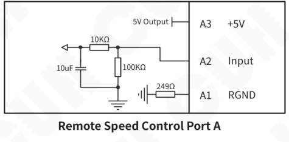

| เทอร์มินัล | ฟังก์ชัน |
|---|---|
| A3 | +5V / เอาต์พุต 5V |
| A2 | อินพุต |
| A1 | RGND |

ป้ายส่วนประกอบที่มองเห็น: 10uF, 10KΩ, 100KΩ, 249Ω

### พอร์ตเซ็นเซอร์สวิตช์ C

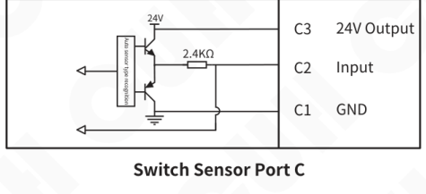

| เทอร์มินัล | ฟังก์ชัน |
|---|---|
| C3 | เอาต์พุต 24V |
| C2 | อินพุต |
| C1 | GND |

ป้ายที่มองเห็น: 24V, 2.4KΩ, การรู้จักประเภทเซ็นเซอร์อัตโนมัติ

### พอร์ตเซ็นเซอร์สวิตช์ E

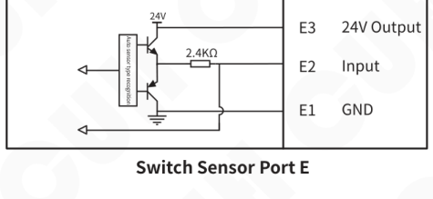

| เทอร์มินัล | ฟังก์ชัน |
|---|---|
| E3 | เอาต์พุต 24V |
| E2 | อินพุต |
| E1 | GND |

ป้ายที่มองเห็น: 24V, 2.4KΩ, การรู้จักประเภทเซ็นเซอร์อัตโนมัติ

### พอร์ตเอาต์พุตควบคุม D

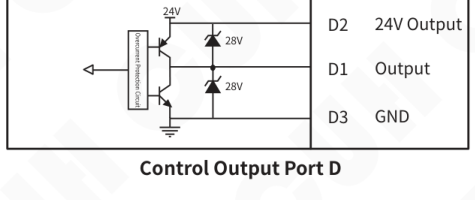

| เทอร์มินัล | ฟังก์ชัน |
|---|---|
| D2 | เอาต์พุต 24V |
| D1 | เอาต์พุต |
| D3 | GND |

ป้ายที่มองเห็น: 24V, 28V, 28V, วงจรป้องกันกระแสเกิน


#### พอร์ตการสื่อสาร 485 F

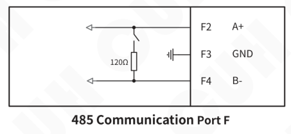

| เทอร์มินัล | สัญญาณ |
|---|---|
| F2 | A+ |
| F3 | GND |
| F4 | B- |

#### พอร์ตนับ/ตั้งค่าความเร็ว N

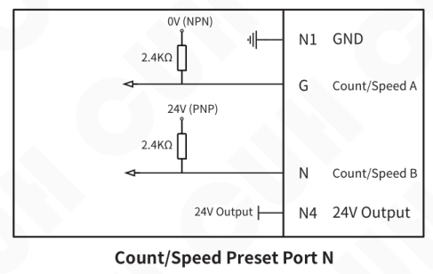

| เทอร์มินัล | สัญญาณ |
|---|---|
| N1 | GND |
| G | นับ/ความเร็ว A |
| N | นับ/ความเร็ว B |
| N4 | เอาต์พุต 24V |

#### พอร์ตซิงค์ดิจิทัล T

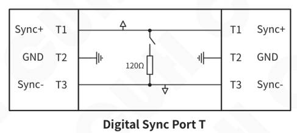

| เทอร์มินัล | สัญญาณ |
|---|---|
| T1 | Sync+ |
| T2 | GND |
| T3 | Sync- |


---

## 7.6 รหัสข้อผิดพลาด

การวินิจฉัยข้อผิดพลาดของคอนโทรลเลอร์นี้แบ่งเป็นรหัสข้อผิดพลาดและรหัสคำเตือน และแสดงแต่ละรหัสตามลำดับ

**รหัสข้อผิดพลาด:** ต้องหยุดเครื่องทันทีและรอให้ข้อผิดพลาดหายไปก่อนยกเลิกการแสดง

**รหัสคำเตือน:** ไม่ต้องหยุดเครื่อง รอให้สัญญาณคำเตือนหายไปก่อนยกเลิกการแสดง

### ตารางรหัสข้อผิดพลาด

| รหัสข้อผิดพลาด | การแสดง | ความหมาย | วิธีการแก้ไข |
|---|---|---|---|
| Error01 | Short | ลัดวงจร | ยืนยันว่าสายเอาต์พุตหลักสั้นวงจรหรือไม่และต่อสายใหม่ |
| Error02 | OvrCurrt | กระแสเกิน | ลดแรงดันเอาต์พุตหรือเพิ่มความถี่เอาต์พุต |
| Error03 | OverHot | ความร้อนเกิน | วางคอนโทรลเลอร์ในพื้นที่ที่มีการระบายอากาศและระบายความร้อนดี |
| Error04 | UndrCool | เย็นเกินไป | วางคอนโทรลเลอร์ในพื้นที่ที่อุณหภูมิแวดล้อมสูงกว่า -20℃ |
| Error05 | CommErr | ข้อผิดพลาดการสื่อสาร | ติดต่อบริษัทฝ่ายสนับสนุนทางเทคนิค |
| Error06 | TSnerErr | ข้อผิดพลาดเซ็นเซอร์อุณหภูมิ | ติดต่อบริษัทฝ่ายสนับสนุนทางเทคนิค |
| Error07 | OverVolt | แรงดันเกิน | แรงดันไฟฟ้าอินพุตต้องไม่เกิน 250V ค่ามีประสิทธิภาพ |
| Error08 | UndrVolt | แรงดันต่ำ | แรงดันไฟฟ้าอินพุตต้องไม่ต่ำกว่า 85V ค่ามีประสิทธิภาพ |
| Error09 | LoadErr | โหลดขาด | ตรวจสอบว่าสายเอาต์พุตต่อกับจานสั่นอย่างถูกต้องหรือไม่ |
| Error10 | Send_Seed | ส่ง seed ล้มเหลว | ติดต่อบริษัทฝ่ายสนับสนุนทางเทคนิค |
| Error11 | Send_Exit | คำสั่งออกจากการบูตล้มเหลว | ติดต่อบริษัทฝ่ายสนับสนุนทางเทคนิค |
| Error14 | SynchEr0 | บัส CUHBus-DS® มีโฮสต์ 2 ตัวขึ้นไป | 1. หากเกิดสัญญาณเตือน ตั้งค่าอุปกรณ์เป็นออฟไลน์แล้วตั้งเป็นออนไลน์อีกครั้ง<br>2. หลังปิดไฟอุปกรณ์ที่เพิ่มใหม่ ต่อสาย CUHBus-DS® เข้ากับอุปกรณ์เครือข่าย |
| Error15 | SynchEr1 | ข้อผิดพลาดบัส | ยืนยันว่าสายการสื่อสาร CUHBus-DS® ต่ออย่างถูกต้อง และจัดระเบียบเครือข่ายอย่างถูกต้อง |
| Error16 | SynchEr2 | อุปกรณ์ซิงค์ไม่ออนไลน์ | เครือข่ายการสื่อสารซิงโครไนซ์ อุปกรณ์ซิงโครไนซ์ความถี่ หรืออุปกรณ์ซิงโครไนซ์ควบคุมระยะไกลไม่ออนไลน์ |

---


## 7.7 รหัสคำเตือน

### ตารางรหัสคำเตือน

| รหัสคำเตือน | การแสดง | ความหมาย | วิธีการแก้ไข |
|---|---|---|---|
| Warn01 | Saturate | เอาต์พุตอิ่มตัว | ลดแรงดันเอาต์พุต |
| Warn02 | decline | นับลดความเร็ว | สถานะลดความเร็วการนับ |
| Warn03 | CND | สิ้นสุดการนับ | สถานะสิ้นสุดการนับ |
| Warn04 | FrqncyLo | ความถี่เอาต์พุตต่ำเกินไป | เพิ่มค่าพารามิเตอร์ชดเชยความถี่ |
| Warn05 | FrqncyHi | ความถี่เอาต์พุตสูงเกินไป | เพิ่มค่าพารามิเตอร์ชดเชยความถี่ |
| Warn06 | LoMAlarm | วัสดุขาดแคลน | ลดค่าพารามิเตอร์สัญญาณเตือนวัสดุหมด หรือเพิ่มวัสดุในถาดวัสดุ |
| Warn07 | PortDErr | กระแสเกินเอาต์พุตพอร์ต D | ลดโหลดควบคุมพอร์ตเอาต์พุต |
| Warn08 | RemotLow | แรงดัน/กระแสอินพุตควบคุมระยะไกลต่ำเกินไป | เพิ่มแรงดันหรือกระแสอินพุตควบคุมระยะไกล |
| Warn09 | MRSErr | ข้อผิดพลาดลอจิก RS เอาต์พุตหลัก | เมื่อลอจิกเอาต์พุตเป็น RS ฟลิปฟล็อป สัญญาณแหล่งหลัก 1 และแหล่งหลัก 2 ไม่สามารถใช้งานได้พร้อมกัน |
| Warn10 | 24VErr | ข้อผิดพลาด 24V | ห้ามต่อไฟภายนอก 24V กับพอร์ตเอาต์พุตคอนโทรลเลอร์ |
| Warn11 | 5VErr | ข้อผิดพลาด 5V | ห้ามต่อไฟภายนอก 5V กับพอร์ตเอาต์พุตคอนโทรลเลอร์ |
| Warn12 | CtrlRSErr | ข้อผิดพลาดลอจิก RS เอาต์พุตควบคุม | เมื่อลอจิกพอร์ต D เป็น RS ฟลิปฟล็อป สัญญาณแหล่งพอร์ต D 1 และแหล่งพอร์ต D 2 ไม่สามารถใช้งานได้พร้อมกัน |
| Warn13 | OverLoad | เซ็นเซอร์ความเร่งโอเวอร์โหลด | เปลี่ยนเซ็นเซอร์ความเร่งเป็นรุ่นที่มีช่วงเหมาะสม |
| Warn14 | AcceleEr | เซ็นเซอร์ความเร่งขัดข้อง | เซ็นเซอร์เสียหาย เปลี่ยนใหม่ |
| Warn15 | EEPErr | ข้อผิดพลาดการบันทึกพารามิเตอร์ | ยืนยันว่าสายการสื่อสาร CUHBus-DS® ต่ออย่างถูกต้องและการเชื่อมต่อเครือข่ายเสร็จสมบูรณ์อย่างถูกต้อง |


---

# บทที่ Ⅷ ข้อมูลการรับประกันผลิตภัณฑ์

## 8.1 ระยะเวลารับประกัน

ระยะเวลารับประกันที่บริษัทให้แก่ผลิตภัณฑ์นี้คือ 3 ปีนับจากวันที่ส่งมอบผลิตภัณฑ์ไปยังสถานที่ที่ผู้ซื้อกำหนด

## 8.2 ขอบเขตการรับประกัน

(1) หากมีความขัดข้องที่เกิดจากบริษัทของเราในช่วงระยะเวลารับประกันข้างต้น เราจะซ่อมแซมผลิตภัณฑ์โดยไม่คิดค่าใช้จ่าย อย่างไรก็ตาม สถานการณ์ต่อไปนี้ไม่ครอบคลุมในการรับประกัน:

&nbsp;&nbsp;&nbsp;&nbsp;ก. ไม่ปฏิบัติตามเงื่อนไขที่กำหนดในคู่มืออย่างง่าย คู่มือผู้ใช้ หรือข้อกำหนดทางเทคนิคที่ตกลงกันระหว่างผู้ซื้อและบริษัท การใช้งานที่ไม่ถูกต้อง หรือความขัดข้องที่เกิดจากการใช้งานที่ไม่เหมาะสม

&nbsp;&nbsp;&nbsp;&nbsp;ข. ความขัดข้องไม่ได้เกิดจากข้อบกพร่องของผลิตภัณฑ์ แต่เกิดจากการออกแบบอุปกรณ์หรือซอฟต์แวร์ของผู้ซื้อ

&nbsp;&nbsp;&nbsp;&nbsp;ค. ความขัดข้องที่เกิดจากการแก้ไขหรือซ่อมแซมที่ไม่ได้ดำเนินการโดยบุคลากรของบริษัท

&nbsp;&nbsp;&nbsp;&nbsp;ง. ความขัดข้องที่สามารถหลีกเลี่ยงได้ทั้งหมดโดยการบำรุงรักษาที่ถูกต้องหรือการเปลี่ยนชิ้นส่วนสึกหรอตามคู่มือการดำเนินงานอย่างง่ายหรือคู่มือผู้ใช้

&nbsp;&nbsp;&nbsp;&nbsp;จ. หลังผลิตภัณฑ์ถูกส่งจากบริษัท เกิดจากปัจจัยที่ไม่สามารถคาดการณ์ได้เช่นการเปลี่ยนแปลงระดับวิทยาศาสตร์และเทคโนโลยี

&nbsp;&nbsp;&nbsp;&nbsp;ฉ. เนื่องจากภัยพิบัติธรรมชาติเช่น ไฟไหม้ แผ่นดินไหว น้ำท่วม หรือปัจจัยภายนอกเช่น ความผิดปกติของแรงดันไฟฟ้า บริษัทไม่รับผิดชอบในการรับประกัน

(2) ขอบเขตการรับประกันจำกัดเฉพาะสถานการณ์ที่กำหนดใน (1) การสูญเสียทางอ้อม（เช่น ความเสียหายต่ออุปกรณ์ โอกาส การสูญเสียกำไร ฯลฯ）หรือการสูญเสียอื่น ๆ บริษัทไม่รับผิดชอบใด ๆ

## 8.3 ความเหมาะสมของผลิตภัณฑ์

คอนโทรลเลอร์ของบริษัทออกแบบและผลิตสำหรับการใช้งานทั่วไปในอุตสาหกรรมป้อนวัสดุสั่น ดังนั้นคอนโทรลเลอร์นี้ไม่ควรใช้สำหรับการใช้งานต่อไปนี้และไม่เหมาะสมสำหรับการใช้งานดังกล่าว

(1) สิ่งอำนวยความสะดวกที่มีผลกระทบร้ายแรงต่อชีวิตและทรัพย์สิน เช่น โรงไฟฟ้านิวเคลียร์ สนามบิน ทางรถไฟ เรือ อุปกรณ์ขับเคลื่อน และอุปกรณ์ทางการแพทย์

(2) สาธารณูปโภค รวมถึงไฟฟ้า ก๊าซ ประปา ฯลฯ

(3) การใช้งานกลางแจ้งในสภาพหรือสภาพแวดล้อมที่คล้ายคลึงกัน

---


Nanjing CUH Science & Technology Co.,Ltd  
https://en.cuhnj.com  
Tel.:+86-25-84730411 / 84730415 / 84730416  
Fax:+86-25-84730426  
E-mail:sales@cuhnj.com  
Add.:Building 2, Xueyan Tech Park, Tuscity,  
No.9 Zhineng Rd, Jiangning, Nanjing, China

Document No.: IDP1000448


