## 目录

> 下列条目来自 PDF 内置书签/大纲；链接指向本批转换生成的整页渲染图（`assets/pages/`），便于与原版 PDF 对照校对。

- [2: 封二版权与免责](assets/pages/page-0002.png)（第 2 页）
- [3: 序言](assets/pages/page-0003.png)（第 3 页）
- [4: 安全与预防措施](assets/pages/page-0004.png)（第 4 页）
- [5: 工作与储存环境](assets/pages/page-0005.png)（第 5 页）
- [7: 目录](assets/pages/page-0007.png)（第 7 页）
- [8: 目录2](assets/pages/page-0008.png)（第 8 页）
- [第一章 使用前须知](assets/pages/page-0009.png)（第 9 页）
  - [1.1 检查包装内容](assets/pages/page-0009.png)（第 9 页）
  - [1.2 指示灯、按键及外部部件说明](assets/pages/page-0010.png)（第 10 页）
  - [1.3 接线端口说明](assets/pages/page-0011.png)（第 11 页）
  - [1.4 控制器铭牌说明](assets/pages/page-0011.png)（第 11 页）
- [第二章 产品介绍](assets/pages/page-0012.png)（第 12 页）
  - [2.1 产品简介](assets/pages/page-0012.png)（第 12 页）
- [第三章 安装及使用指南](assets/pages/page-0013.png)（第 13 页）
  - [3.1 控制器使用条件](assets/pages/page-0013.png)（第 13 页）
  - [3.2 按键基本操作](assets/pages/page-0013.png)（第 13 页）
  - [3.3 安装使用](assets/pages/page-0014.png)（第 14 页）
- [第四章 基本功能说明](assets/pages/page-0017.png)（第 17 页）
  - [4.1 转速/转矩设置](assets/pages/page-0017.png)（第 17 页）
  - [4.2 源负阻设置](assets/pages/page-0018.png)（第 18 页）
  - [4.3 料满停机（C口）开延时/关延时时间设定](assets/pages/page-0019.png)（第 19 页）
  - [4.4 缓启动时间](assets/pages/page-0020.png)（第 20 页）
  - [4.5 缓关闭时间](assets/pages/page-0020.png)（第 20 页）
  - [4.6 键盘锁定功能](assets/pages/page-0021.png)（第 21 页）
- [第五章 高级功能说明](assets/pages/page-0022.png)（第 22 页）
  - [5.1 主输出设置](assets/pages/page-0022.png)（第 22 页）
  - [5.2 D口信号设置](assets/pages/page-0025.png)（第 25 页）
  - [5.3 最大输出电压设置](assets/pages/page-0030.png)（第 30 页）
  - [5.4 传感器类型设置](assets/pages/page-0031.png)（第 31 页）
  - [5.5 参数密码锁功能](assets/pages/page-0032.png)（第 32 页）
  - [5.6 恢复出厂设置](assets/pages/page-0033.png)（第 33 页）
  - [5.7 监控参数功能](assets/pages/page-0034.png)（第 34 页）
- [第六章 技术规格](assets/pages/page-0035.png)（第 35 页）
  - [6.1 外形尺寸](assets/pages/page-0035.png)（第 35 页）
  - [6.2 技术规格表](assets/pages/page-0036.png)（第 36 页）
  - [6.3 参考标准](assets/pages/page-0037.png)（第 37 页）
- [第七章 附录](assets/pages/page-0038.png)（第 38 页）
  - [7.1 参数列表](assets/pages/page-0038.png)（第 38 页）
  - [7.2 输入输出电路图](assets/pages/page-0040.png)（第 40 页）
  - [7.3 故障诊断](assets/pages/page-0041.png)（第 41 页）
- [第八章 产品质保信息](assets/pages/page-0042.png)（第 42 页）
  - [8.1 质保期](assets/pages/page-0042.png)（第 42 页）
  - [8.2 保修范围](assets/pages/page-0042.png)（第 42 页）
  - [8.3 产品适用性](assets/pages/page-0042.png)（第 42 页）
## 术语与命名

- 侧车：`glossary/terms.yaml`（机读）、`glossary/zh-CN.md`（人读）；候选表，定稿后并入公司级 `glossary/`。

## 适用范围

- 本文档由 PDF 自动转换生成，正文与插图需人工核对。

## 变更记录

- 2026-06-05 14:25:54：由转换工具从源 PDF 生成首版。

## 正文

<!-- auto:ai-body-draft v1 -->
> 以下为**整页视觉转写**的正文草稿（多模态模型直接输出 Markdown，含 GFM 表； 若配置 `[[vcrop:页:序]]` 占位符，裁剪步骤会插入 `assets/images/` 下 PNG）。**请务必人工校对。**

### 第 1 页

# CUH®

## 数字低压直流有刷电机控制器

**Digital Low Voltage DC Brushed Motor Controller**

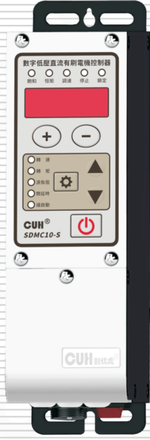

## SDMC10 系列

# 用户手册

### 第 2 页

数字低压直流有刷电机控制器　　　　　　　　　　　　　　　　SDMC10 系列

---

## 版权说明

南京创优科技有限责任公司保留所有权利。

本用户手册上包含的所有信息是属于本公司的知识，受著作权法及所有法律的保护。本公司根据著作权法及其他法律享有并保留所有著作权和其他法律赋予的权利，未经本公司书面同意不得以任何形式对本用户手册的部分或全部进行抄袭、翻译、转译、仿制或其他利用。

## 免责声明

本用户手册的所有内容仅说明本公司生产的相关产品的使用方法，并且是根据现有技术和提供给您使用时的状态进行描述的，在您使用本产品时必须自行承担相关风险。除法律强制规定外，本公司不因本用户手册对产品负有任何明示或暗示的责任，包括但不限于人身伤害、财产损失、机会丧失。

您明确了解上述风险并同意，除法律强制规定外，本公司无须为您的任何直接、间接的损害或损失负责（包括但不限于人员、财物、数据等有形损失和名誉、机会等无形损失）。

本公司保留对本用户手册中所适用的产品进行修改而不预先及事后通知的权利。

---

2022-12　　　　　　　　　　　　　　　　　　　　　　　　　SDMC10_SMS-CN_2.01

### 第 3 页

数字低压直流有刷电机控制器  
SDMC10 系列

---

# 序　言

感谢您使用南京创优科技有限责任公司（在本手册中以下简称本公司）出品的SDMC10系列数字低压直流有刷电机控制器（在本手册中以下简称本产品、本控制器或控制器）。本系列控制器是采用高品质元件并融合了最新的电子技术，采用高性能的数字信号处理器经过精心的设计而成。

本手册介绍了本产品的基本操作方法、功能技术说明和典型应用示例。为用户提供安装调试、参数设置、异常诊断、故障排除及日常维护控制器的相关信息。为了确保正确安装和使用本控制器，请在装机之前仔细阅读本用户手册，并请妥善保存。

以下符号提醒您注意有关防止人身伤害和产品损坏的事项，请务必阅读。

| 标志 | 说明 |
|---|---|
| ⚠️ **危险** | 表示若不遵守该事项，将导致人员伤亡。 |
| ⚠️ **警告** | 表示若不遵守该事项，可能导致人员伤亡。 |
| ⚠️ **小心** | 表示若不遵守该事项，可能导致人员遭受中度或轻微伤害。 |
| **注意** | 表示若不遵守该事项，将导致本产品损坏及财产损失。 |
| **要点** | 表示在使用过程中必须要遵守的注意事项和使用限制等。 |

**本说明书适合以下型号控制器：**

◆ 数字低压直流有刷电机控制器　SDMC10-S（24V, 5A）

---

2022-12  
SDMC10_SMS-CN_2.01

### 第 4 页

数字低压直流有刷电机控制器　　　　　　　　　　　　　　　　　　　　　　　　　SDMC10 系列

---

# 安全与预防措施

1、 **危险** 本产品用于驱动低压直流有刷电机，请勿将本产品用于保护人体或人体部位等目的。

2、 **危险** 本产品不得作为防爆产品使用，请勿在危险场所和/或潜在爆炸气体环境中使用本产品。

3、 **警告** 本产品是采用交流市电供电的设备，请勿施加交流电压超过260Vac。施加过大的输入电压如380Vac，则可能导致产品爆炸或者着火，造成严重的安全事故。

4、 **警告** 本产品是通过电源线进行接地的，请确保为控制器供电的配电设施具备良好的接地，否则可能导致控制器外壳带电，造成触电事故。

5、 **警告** 请勿输入交流电源到本控制器的输出端，这会损坏控制器。

6、 **警告** 请勿在带电的情况下插拔接线或触摸接线仓内各接线端子触点，以防发生触电事故。

7、 **注意** 请避免采用通过继电器等设备切断供电的方式来控制本产品的输出，这会严重降低本控制器的寿命。

8、 **注意** 本产品设计使用于阴凉干燥环境，请勿将本产品置于室外、可能会浸水、阳光暴晒场所工作，也不要在超过本产品电气特性要求的温度和湿度范围之外工作。

9、 **要点** 请务必将本产品固定在可靠接地的坚固平台上, 并远离振动设备。

10、 **要点** 任何情况下请勿将本产品在超越设计极限状态下工作。

11、 **要点** 请严格按照本手册的说明操作，对于违反这些操作说明所造成的任何人身伤害或财产损失，本公司不承担任何民事和刑事责任。

12、 **要点** 任何情况下请不要打开本控制器机壳，以防遭到电击。机壳内部没有可以调节和用户维修部分，请不要试图维修本机，出现故障请致电本公司。

---

2022-12　　　　　　　　　　　　　　　　　　　　　　　　　SDMC10_SMS-CN_2.01

### 第 5 页

数字低压直流有刷电机控制器　　　　　　　　　　　　　　　　　SDMC10 系列

# 工作与储存环境

## 一、使用前的检查

每台控制器在出厂前，均经过严格的品质检验，并经过强化的防撞包装处理。客户在拆箱后，请即刻进行下列检查：

1. 检查控制器是否在运输过程中受到损伤。
2. 检查控制器型号是否与订货登记资料完全相同。

## 二、工作环境

为使本控制器具有更好的使用效果和更长的使用寿命，请将控制器安装在符合下列条件的环境中：

- 良好的通风散热环境
- 远离水滴、蒸气、灰尘，（特别是油性灰尘）
- 无腐蚀、易燃性的气体、液体
- 无漂浮性的尘埃及金属微粒
- 安装表面坚固无振动
- 远离电磁噪声干扰
- 使用环境温度为0℃到40℃
- 仅适用于海拔2000m以下地区安全使用

2022-12　　　　　　　　　　　　　　　　　SDMC10_SMS-CN_2.01

### 第 6 页

数字低压直流有刷电机控制器                                      SDMC10 系列

---

---

2022-12                                      SDMC10_SMS-CN_2.01

### 第 7 页

数字低压直流有刷电机控制器　　　　　　　　　　　　　　　　　　　　　　　　　SDMC10 系列

# 目录

| 条目 | 页码 |
|---|---:|
| **第一章 使用前须知** | **1** |
| 1.1　检查包装内容 | 1 |
| 1.2　指示灯、按键及外部部件说明 | 2 |
| 1.3　接线端口说明 | 3 |
| 1.4　控制器铭牌说明 | 3 |
| **第二章 产品介绍** | **4** |
| 2.1　产品简介 | 4 |
| **第三章 安装及使用指南** | **5** |
| 3.1　控制器使用条件 | 5 |
| 3.2　按键基本操作 | 5 |
| 3.3　安装使用 | 6 |
| **第四章 基本功能说明** | **9** |
| 4.1　转速/转矩设置 | 9 |
| 4.2　源负阻设置 | 10 |
| 4.3　料满停机（C口）开延时/关延时时间设定 | 11 |
| 4.4　缓启动时间 | 12 |
| 4.5　缓关闭时间 | 12 |
| 4.6　键盘锁定功能 | 13 |
| **第五章 高级功能说明** | **14** |
| 5.1　主输出设置 | 14 |
| 5.2　D口信号设置 | 17 |
| 5.3　最大输出电压设置 | 22 |
| 5.4　传感器类型设置 | 23 |
| 5.5　参数密码锁功能 | 24 |
| 5.6　恢复出厂设置 | 25 |
| 5.7　监控参数功能 | 26 |

2022-12　　　　　　　　　　　　　　　　　　　　　　　　　　　　　　　SDMC10_SMS-CN_2.01

### 第 8 页

数字低压直流有刷电机控制器　　　　　　　　　　　　　　　　　　　　　　　　　SDMC10 系列

---

**第六章 技术规格** ------------------------------------------------------------------------------27

　　6.1　外形尺寸 -------------------------------------------------------------------------------27

　　6.2　技术规格表 ----------------------------------------------------------------------------28

　　6.3　参考标准 -------------------------------------------------------------------------------29

**第七章 附录** -----------------------------------------------------------------------------------30

　　7.1　参数列表 -------------------------------------------------------------------------------30

　　7.2　输入输出电路图 -----------------------------------------------------------------------32

　　7.3　故障诊断 -------------------------------------------------------------------------------33

**第八章 产品质保信息** ------------------------------------------------------------------------34

　　8.1　质保期 ---------------------------------------------------------------------------------34

　　8.2　保修范围 -------------------------------------------------------------------------------34

　　8.3　产品适用性 ----------------------------------------------------------------------------34

---

2022-12　　　　　　　　　　　　　　　　　　　　　　　　　SDMC10_SMS-CN_2.01

### 第 9 页

> 数字低压直流有刷电机控制器　　　　　　　　　　　　　　　　　　　　　　　　　SDMC10 系列

# 第一章 使用前须知

本章节介绍产品包装内容、控制器外观说明和控制器铭牌信息。

## 1.1 检查包装内容

使用本产品之前，请检查控制器及附件的完整性。如果发现产品有缺陷或已损坏、附件缺失等问题，请与本公司联系。

包装内容：

- 控制器×1
- 简易说明书×1
- 输入电源线×1

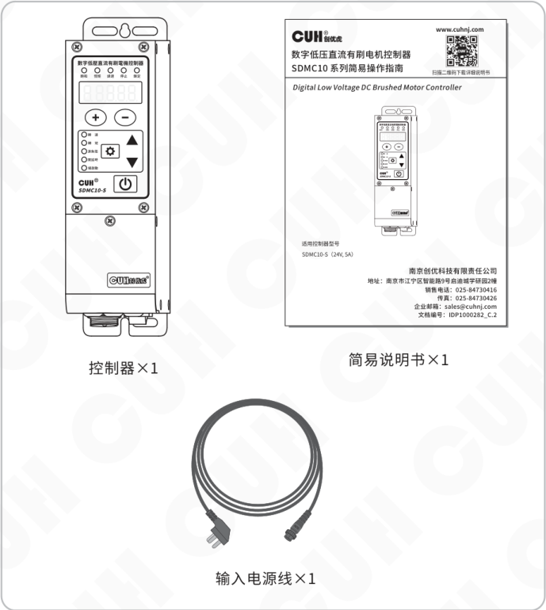

---

2022-12　　　　　　　　　　　　　- 1 -　　　　　　　　　　　　　SDMC10_SMS-CN_2.01

### 第 10 页

数字低压直流有刷电机控制器　　　　　　　　　　　　　　　　　SDMC10 系列

## 1.2 指示灯、按键及外部部件说明

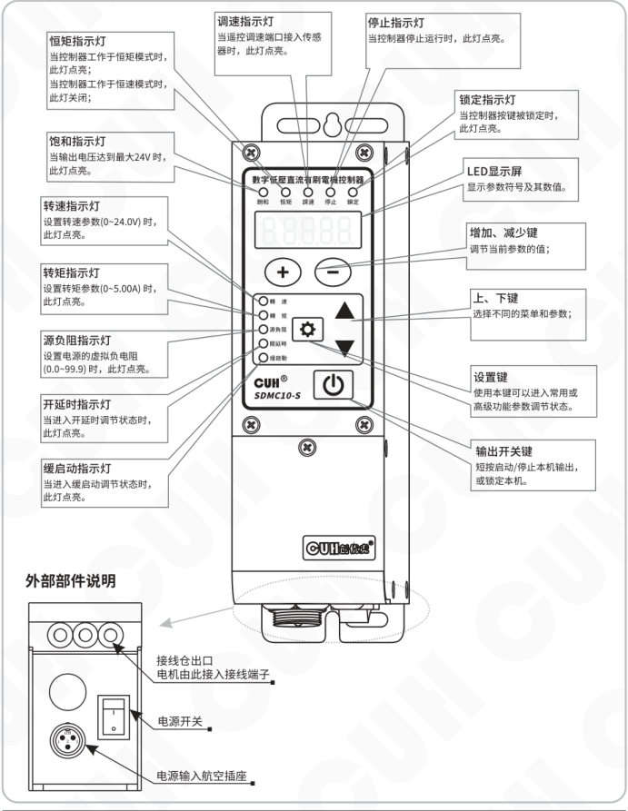

### 指示灯、按键说明

- **恒矩指示灯**  
  当控制器工作于恒矩模式时，此灯点亮；  
  当控制器工作于恒速模式时，此灯关闭；

- **饱和指示灯**  
  当输出电压达到最大 24V 时，此灯点亮。

- **转速指示灯**  
  设置转速参数（0~24.0V）时，此灯点亮。

- **转矩指示灯**  
  设置转矩参数（0~5.00A）时，此灯点亮。

- **源负阻指示灯**  
  设置电源的虚拟负电阻（0.0~99.9）时，此灯点亮。

- **开延时指示灯**  
  当进入开延时调节状态时，此灯点亮。

- **缓启动指示灯**  
  当进入缓启动调节状态时，此灯点亮。

- **调速指示灯**  
  当遥控调速端口接入传感器时，此灯点亮。

- **停止指示灯**  
  当控制器停止运行时，此灯点亮。

- **锁定指示灯**  
  当控制器按键被锁定时，此灯点亮。

- **LED显示屏**  
  显示参数符号及其数值。

- **增加、减少键**  
  调节当前参数的值；

- **上、下键**  
  选择不同的菜单和参数；

- **设置键**  
  使用本键可以进入常用或高级功能参数调节状态。

- **输出开关键**  
  短按启动/停止本机输出，或锁定本机。

### 外部部件说明

- **接线仓出口**  
  电机由此接入接线端子。

- **电源开关**

- **电源输入航空插座**

---

2022-12　　　　　　　　　　　- 2 -　　　　　　　　　　　SDMC10_SMS-CN_2.01

### 第 11 页

数字低压直流有刷电机控制器　　　　　　　　　　　　　　　　　SDMC10 系列

---

## 1.3 接线端口说明

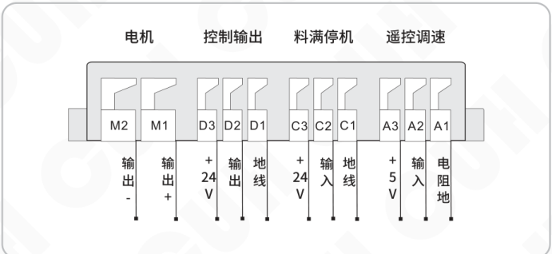

| 功能分组 | 端子 | 说明 |
|---|---|---|
| 电机 | M2 | 输出- |
| 电机 | M1 | 输出+ |
| 控制输出 | D3 | +24V |
| 控制输出 | D2 | 输出 |
| 控制输出 | D1 | 地线 |
| 料满停机 | C3 | +24V |
| 料满停机 | C2 | 输入 |
| 料满停机 | C1 | 地线 |
| 遥控调速 | A3 | +5V |
| 遥控调速 | A2 | 输入 |
| 遥控调速 | A1 | 电阻地 |

## 1.4 控制器铭牌说明

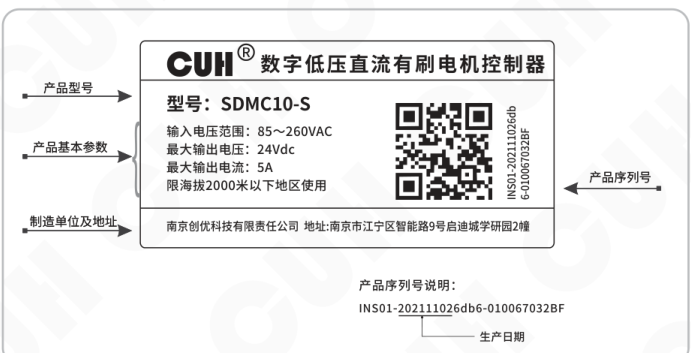

| 标注 | 铭牌内容 |
|---|---|
| 产品型号 | 型号：SDMC10-S |
| 产品基本参数 | 输入电压范围：85～260VAC 最大输出电压：24Vdc 最大输出电流：5A 限海拔2000米以下地区使用 |
| 制造单位及地址 | 南京创优科技有限责任公司　地址:南京市江宁区智能路9号启迪城学研园2幢 |
| 产品序列号 | INS01-202111026db6-010067032BF |

**产品序列号说明：**

`INS01-202111026db6-010067032BF`

图中标注 `20211102` 为**生产日期**。

---

2022-12　　　　　　　　　　　　　　　　　　　　　SDMC10_SMS-CN_2.01

### 第 12 页

数字低压直流有刷电机控制器　　　　　　　　　　　　　　　　　SDMC10 系列

---

# 第二章　产品介绍

本章节主要内容包括本产品的简单介绍和主要特色功能。

## 2.1 产品简介

SDMC10 系列控制器用于控制低压直流有刷电机，其功能特色包括：

- 提供一组0~24V，5A直流有刷电机输出端口。
- 可使用电位器手动或者模拟量远程控制电机转速。
- 开关传感器可控启停，并且传感器信号类型可设置或自动识别。
- 一组24V/400mA控制输出端口，亦可配制成传感器输入端口实现两组传感器信号的接入，两组信号的逻辑关系可配置。
- 丰富的保护功能，输入过压，系统过温，输出短路，电机过流等。
- 引入驱动源负阻的概念用来抵消电机的内阻，实现无传感器下恒速或恒转矩的控制。
- 电压与电流双闭环控制，当转速达到设定值，转矩未达到设定值时，以设定转速运行；当转矩达到设定值时，以恒定转矩运行；（转速通过电压参数设定，转矩通过电流参数设定）。

---

2022-12　　　　　　　　　　　　　　　　　- 4 -　　　　　　　　　　　　　　　　　SDMC10_SMS-CN_2.01

### 第 13 页

数字低压直流有刷电机控制器　　　　　　　　　　　　　　　　　　　　　　　　　SDMC10 系列

# 第三章 安装及使用指南

本章节介绍本产品使用所必须具备的条件以及如何正确进行安装与连接。

## 3.1 控制器使用条件

本产品是使用交流110/220V供电的设备，且通过电源线三爪插头进行保护接地连接，请提供符合标准的110V或220V，50Hz/60Hz市电供电配电设施并确保保护地线已正确连接。

**⚠ 警告**　切不可将控制器连接到380V交流电，这将造成控制器不可恢复的严重损坏，有可能导致爆炸、火灾等安全事故。

**⚠ 警告**　确保供电侧可靠接地，控制器的金属外壳是与保护接地线直接连接的，接地不良会导致控制器外壳带电，引发触电事故。

**注意**　控制器长时间工作会产生热量致使外壳温度升高，请将控制器安装在通风良好的环境中，并将其固定良好，远离振动源。

**注意**　本产品是用来驱动低压直流有刷电机，切不可连接其他类型电机。

## 3.2 按键基本操作

【短按】定义为按下按键的时间大于0.1秒小于2秒。

【长按】定义为按下按键的时间大于2秒。

长按 <kbd>⚙</kbd> 进入/退出基本参数界面，短按 ▼ 或 ▲ 选择基本参数，短按 <kbd>＋</kbd> 或 <kbd>－</kbd> 调节参数值。

长按 <kbd>⚙</kbd> 加 ▲ 进入/退出高级参数界面，短按 ▼ 或 ▲ 选择高级参数，短按 <kbd>＋</kbd> 或 <kbd>－</kbd> 调节参数值。

长按 <kbd>⚙</kbd> 加 ▼ 进入/退出监控参数界面，短按 ▼ 或 ▲ 选择监控参数，参数值不可调节。

短按 <kbd>⏻</kbd> 开关键暂停/恢复输出，长按 <kbd>⏻</kbd> 锁定/解锁键盘。

**界面轮转图**

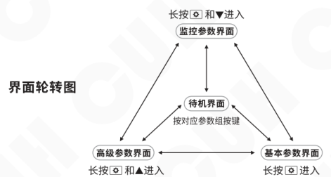

2022-12　　　　　　　　　　　　　　　　　- 5 -　　　　　　　　　　　　　　　　SDMC10_SMS-CN_2.01

### 第 14 页

数字低压直流有刷电机控制器　　　　　　　　　　　　　　　SDMC10 系列

## 3.3 安装使用

**第一步：**

打开控制器的外包装，检查控制器外观及侧标型号，判断是否为所需的型号。

**第二步：**

连接控制器电机输出接线端子到直流电机，确认正负极无误并可靠连接。

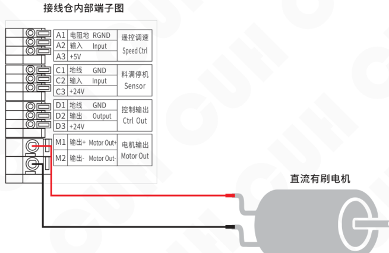

2022-12　　　　　　　　　　- 6 -　　　　　　　　　　SDMC10_SMS-CN_2.01

### 第 15 页

**数字低压直流有刷电机控制器**　　　　　　　　　　　　　　**SDMC10 系列**

### 第三步：

将输入电源线航空插头插入控制器电源输入插座，并锁紧螺母。

图示标注：先插航空插头。

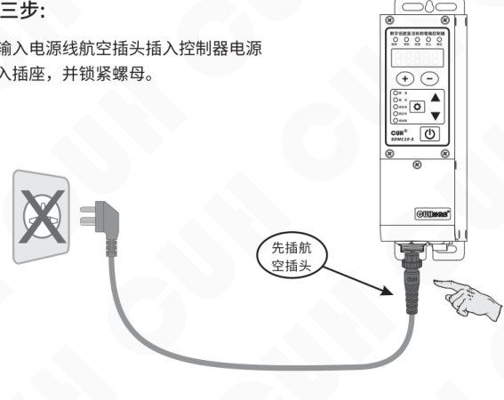

### 第四步：

将电源线三爪插头插在供电电源插座上。

---

2022-12　　　　　　　　　　　　　　SDMC10_SMS-CN_2.01

### 第 16 页

数字低压直流有刷电机控制器｜SDMC10 系列

---

### 第五步：

打开控制器电源开关，给控制器上电。控制器可以根据负载自行判断处于恒速或恒矩运行模式。

当控制器处于**恒速模式**时，恒矩指示灯不亮，待机界面显示测量转速值 **U.**，短按 **+** 或 **−** 设置转速值；

当控制器处于**恒矩模式**时，恒矩指示灯亮，待机界面显示测量转矩值 **C.**，短按 **+** 或 **−** 设置转矩值。

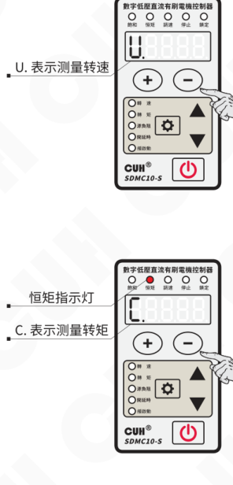

图示标注：

- **U.** 表示测量转速
- **C.** 表示测量转矩
- 恒矩指示灯

---

2022-12　　　　　　　　　　　　　　　　　- 8 -　　　　　　　　　　　　　　　　　SDMC10_SMS-CN_2.01

### 第 17 页

# 第四章 基本功能说明

本章节介绍本产品基本功能的使用方法。

## 4.1 转速/转矩设置

- **设置转速/设置转矩：** 设置控制器默认开机转速/转矩值。

### 设置转速

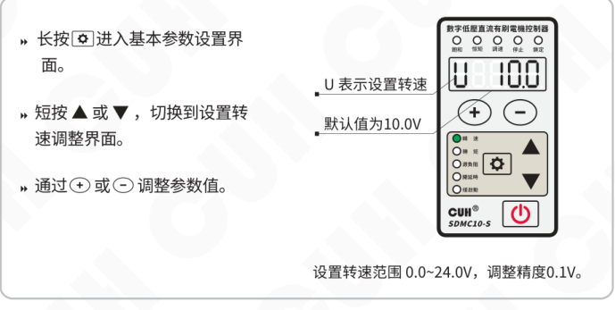

- 长按 <kbd>⚙</kbd> 进入基本参数设置界面。
- 短按 <kbd>▲</kbd> 或 <kbd>▼</kbd>，切换到设置转速调整界面。
- 通过 <kbd>+</kbd> 或 <kbd>−</kbd> 调整参数值。

图中显示：

- **U** 表示设置转速
- 默认值为 **10.0V**

设置转速范围 **0.0~24.0V**，调整精度 **0.1V**。

### 设置转矩

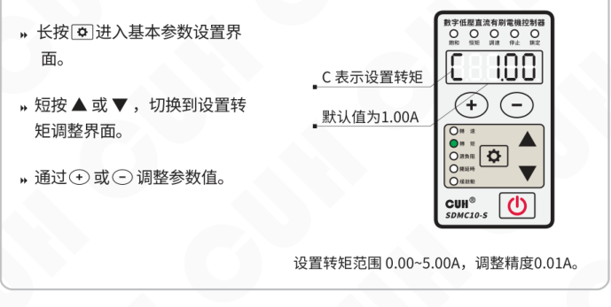

- 长按 <kbd>⚙</kbd> 进入基本参数设置界面。
- 短按 <kbd>▲</kbd> 或 <kbd>▼</kbd>，切换到设置转矩调整界面。
- 通过 <kbd>+</kbd> 或 <kbd>−</kbd> 调整参数值。

图中显示：

- **C** 表示设置转矩
- 默认值为 **1.00A**

设置转矩范围 **0.00~5.00A**，调整精度 **0.01A**。

### 第 18 页

数字低压直流有刷电机控制器　　　　　　　　　　　　　　　　　　　　　　　SDMC10 系列

---

## 4.2 源负阻设置

- **源负阻：** 设置抵消电机内阻的源负阻值，实现无传感器下恒速或恒转矩的控制。

**操作步骤：**

- 长按 ⚙ 进入基本参数设置界面。
- 短按 ▲ 或 ▼，切换到源负阻调整界面。
- 通过 ＋ 或 － 调整参数值。

**界面说明：**

- `r` 表示源负阻
- 默认值为 0.0Ω
- 源负阻范围 0.0~99.9Ω，调整精度 0.1Ω。

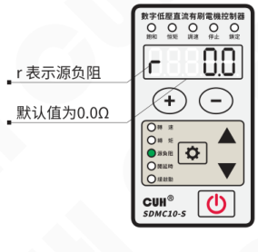

---

2022-12　　　　　　　　　　　　　　-10-　　　　　　　　　　　　　　SDMC10_SMS-CN_2.01

### 第 19 页

数字低压直流有刷电机控制器　　　　　　　　　　　　　　　　SDMC10 系列

---

## 4.3 料满停机（C口）开延时/关延时时间设定

当使用传感器或者PLC等其他外部信号进行启动和停止控制时，大多数情况需要在给出信号或者恢复信号后延迟一段时间才执行操作。对于这样的应用，可以通过设置开延时和关延时的时间来实现。

- **C口开延时：** 从施加一个使控制器进入运行状态的控制信号开始，到控制器输出启动，期间经历的延迟时间称为开延时。

  - 长按 ⚙ 进入基本参数设置界面。
  - 短按 ▲ 或 ▼，切换到C口开延时调整界面。
  - 通过 ＋ 或 － 调整参数值。

  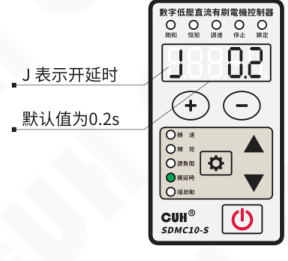

  J 表示开延时  
  默认值为0.2s  
  C口开延时范围 0.0~99.9s，调整精度0.1s。

- **C口关延时：** 从施加一个使控制器进入停止状态的控制信号开始，到控制器输出停止，期间经历的延迟时间称为关延时。

  - 长按 ⚙ 进入基本参数设置界面。
  - 短按 ▲ 或 ▼，切换到C口关延时调整界面。
  - 通过 ＋ 或 － 调整参数值。

  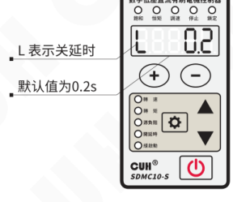

  L 表示关延时  
  默认值为0.2s  
  C口关延时范围 0.0~99.9s，调整精度0.1s。

---

2022-12　　　　　　　　　　　　　　-11-　　　　　　　　　　　　　　SDMC10_SMS-CN_2.01

### 第 20 页

数字低压直流有刷电机控制器　　　　　　　　　　　　　　SDMC10 系列

---

## 4.4 缓启动时间

本控制器从停止状态启动时，输出电压可以平缓提高到设定值，以防止振动设备和控制器遭受冲击。

● **缓启动**：控制器从停止状态启动时，输出电压从0V平滑升高到达设定输出电压所需要的时间称为缓启动时间。

操作说明：

- » 长按 ⚙ 进入基本参数设置界面。
- » 短按 ▲ 或 ▼，切换到缓启动调整界面。
- » 通过 ＋ 或 － 调整参数值。
- `t` 表示缓启动。
- 默认值为0.5s。
- 缓启动时间范围 0.1~10.0s，调整精度0.1s。

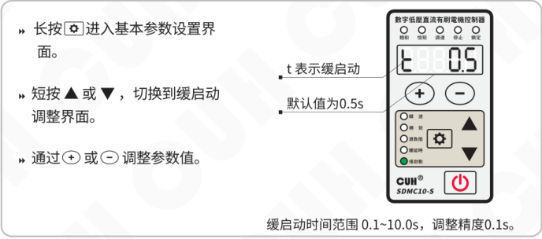

## 4.5 缓关闭时间

本控制器从运行状态停止时，输出电压可以平缓降低到0，以防止振动设备遭受冲击。

● **缓关闭**：控制器从运行状态停止时，输出电压从设定值平滑降低到0所需要的时间称为缓关闭时间。

操作说明：

- » 长按 ⚙ 进入基本参数设置界面。
- » 短按 ▲ 或 ▼，切换到缓关闭调整界面。
- » 通过 ＋ 或 － 调整参数值。
- `J` 表示缓关闭。
- 默认值为0.5s。
- 缓关闭时间范围 0.1~10.0s，调整精度0.1s。

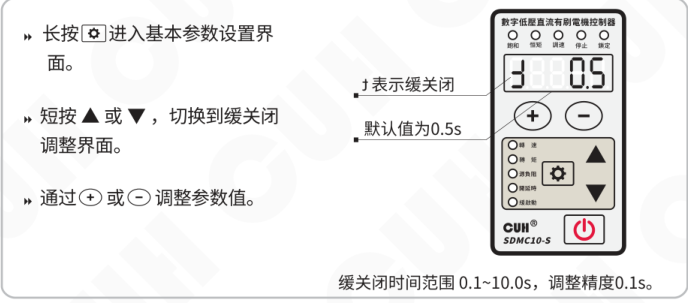

---

2022-12　　　　　　　　　　-12-　　　　　　　　　　SDMC10_SMS-CN_2.01

### 第 21 页

数字低压直流有刷电机控制器　　　　　　　　　　　　　SDMC10 系列

## 4.6 键盘锁定功能

为了防止误操作，本机设定了键盘锁。这样当控制器各项参数设置好后，可以有效避免其他人的误动作影响本机正常工作。即使关机后重新开机，键盘锁状态依然保持上次关机时的状态。

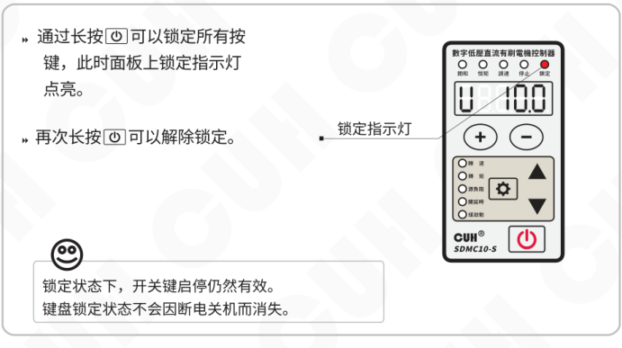

- 通过长按 <kbd>⏻</kbd> 可以锁定所有按键，此时面板上锁定指示灯点亮。
- 再次长按 <kbd>⏻</kbd> 可以解除锁定。

锁定指示灯

> 锁定状态下，开关键启停仍然有效。  
> 键盘锁定状态不会因断电关机而消失。

2022-12　　　　　　　　　　-13-　　　　　　　　　　SDMC10_SMS-CN_2.01

### 第 22 页

# 第五章 高级功能说明

本章节主要介绍本产品高级功能的使用方法。

## 5.1 主输出设置

主输出的信号可以自定义两个信号源，并选择两个信号源进行逻辑关系运算后经过开关延时和模式选择及逻辑方向控制得到控制信号，该控制信号与面板的启停信号进行逻辑与操作后进行输出启停的控制。

● **主输出第一/二信号源：** 设置主输出端口的逻辑信号源。

- 长按 ⚙ 和 ▲ 进入高级参数设置界面。
- 短按 ▲ 或 ▼，切换到主输出第一信号源或主输出第二信号源调整界面。
- 通过 + 或 − 切换逻辑信号源，信号源表如下：

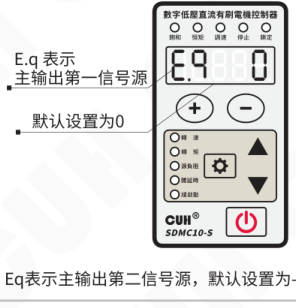

E.q 表示主输出第一信号源，默认设置为 0。

Eq 表示主输出第二信号源，默认设置为 -C。

| 信号源 | 含义 |
|---|---|
| 0 | 无效信号 |
| 1 | 有效信号 |
| d | 控制输出端口信号 |
| -d | 控制输出端口信号取反 |
| C | 料满停机端口信号 |
| -C | 料满停机端口信号取反 |
| od | D口输出端口信号 |
| -od | D口输出端口信号取反 |
| oq | 主输出端口信号 |
| -oq | 主输出端口信号取反 |
| F | 控制器进入恒转矩模式 * |
| -F | 控制器进入恒转速模式 * |
| F. | 单次恒流模式 * |

注：加 * 为螺丝刀模式。

### 第 23 页

数字低压直流有刷电机控制器　　　　　　　　　　　　　　　　　SDMC10 系列

● **主输出逻辑关系：** 设置主输出端口逻辑信号源之间的逻辑关系。

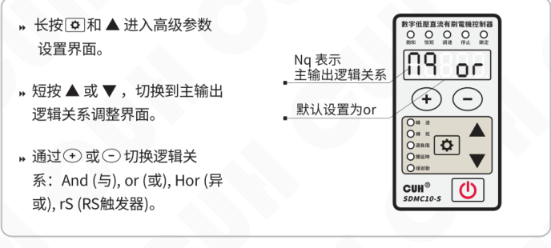

- 长按设置键（⚙）和 ▲ 进入高级参数设置界面。
- 短按 ▲ 或 ▼，切换到主输出逻辑关系调整界面。
- 通过 ＋ 或 － 切换逻辑关系：And（与），or（或），Hor（异或），rS（RS触发器）。

图示说明：

- `Nq` 表示主输出逻辑关系
- 默认设置为 `or`

● **主输出开延时、关延时：** 设置主输出端口的开延时、关延时时间值。设置方法可参考 C 口开延时、关延时设置。

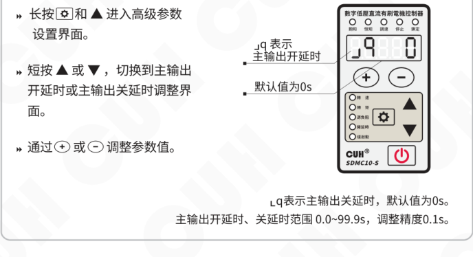

- 长按设置键（⚙）和 ▲ 进入高级参数设置界面。
- 短按 ▲ 或 ▼，切换到主输出开延时或主输出关延时调整界面。
- 通过 ＋ 或 － 调整参数值。

图示说明：

- `Jq` 表示主输出开延时
- 默认值为 `0s`
- `Lq` 表示主输出关延时，默认值为 `0s`
- 主输出开延时、关延时范围 `0.0~99.9s`，调整精度 `0.1s`

---

2022-12　　　　　　　　　　　　　　-15-　　　　　　　　　　　　　　SDMC10_SMS-CN_2.01

### 第 24 页

数字低压直流有刷电机控制器　　　　　　　　　　　　　　　　　SDMC10 系列

---

- **主输出模式：** 设置主输出端口的输出模式：延时模式、保持模式。

**延时模式：** 指驱动控制输出的信号由有效变为无效后，控制输出经过一段关延时时间后变为关闭状态。

**保持模式：** 指驱动控制输出的信号变为有效后，控制输出在关延时时间内保持打开，超过关延时时间后变为关闭的状态。

将两种模式的差别以时序图的形式表达如下，其中输入信号是逻辑关系选择器后输出的信号。

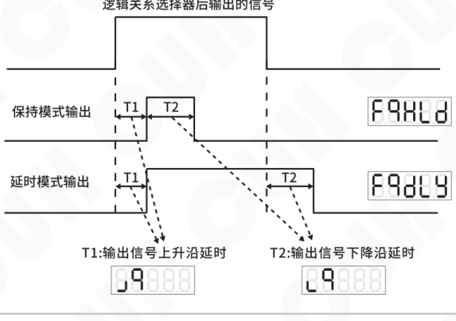

图中标注：

- 逻辑关系选择器后输出的信号
- 保持模式输出
- 延时模式输出
- **T1：** 输出信号上升沿延时
- **T2：** 输出信号下降沿延时

---

- 长按 **⚙** 和 **▲** 进入高级参数设置界面。

- 短按 **▲** 或 **▼**，切换到主输出输出模式调整界面。

- 通过 **＋** 或 **－** 切换输出模式：**dLy**（延时模式），**HLd**（保持模式）。

- **Fq** 表示主输出输出模式

- 默认设置为 **dLy**

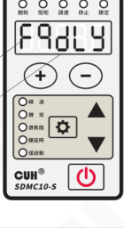

---

2022-12　　　　　　　　　　　　　　　　　-16-　　　　　　　　　　　　　　　　　SDMC10_SMS-CN_2.01

### 第 25 页

数字低压直流有刷电机控制器　　　　　　　　　　　　　　　　　　　　　SDMC10 系列

- **主输出逻辑方向：** 设置主输出端口的逻辑方向。

**同相 `___`：** 表示输出信号有效状态不改变。

**取反 `_-_`：** 表示输出信号有效状态反转。

**常开 On：** 表示输出信号一直有效，不受控制。

**常关 OFF：** 表示输出信号一直无效，不受控制。

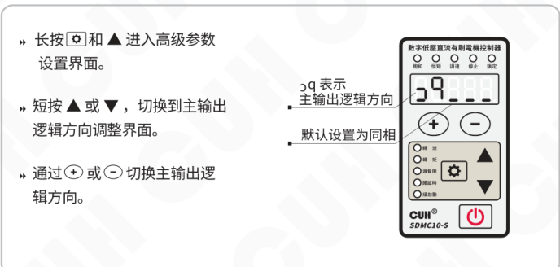

图示操作说明：

- 长按 ⚙ 和 ▲ 进入高级参数设置界面。
- 短按 ▲ 或 ▼，切换到主输出逻辑方向调整界面。
- 通过 ＋ 或 － 切换主输出逻辑方向。
- `3q` 表示主输出逻辑方向；默认设置为同相。

## 5.2 D口信号设置

D口信号和主输出的信号类似，都可以自定义两个信号源，并选择两个信号源进行逻辑关系运算后，经过开、关延时和模式选择及逻辑方向控制，得到控制信号。

D口信号第一信号源（E.d），第二信号源（Ed），逻辑关系（Nd），开延时（⌜d），关延时（⌟d），输出模式（Fd），逻辑方向（ɔd）等参数可以参考主输出参数设置。

---

2022-12　　　　　　　　　　　　　　　-17-　　　　　　　　　　　　　　　SDMC10_SMS-CN_2.01

### 第 26 页

数字低压直流有刷电机控制器　　　　　　　　　　　　　　　　　　　　　　　　　SDMC10 系列

---

● **D口类型：** 设置D口类型选择4种输出类型。

**nPn：** 输出有效为低电平，输出无效为高阻态。

**PnP：** 输出有效为高电平，输出无效为高阻态。

**PSP：** 输出有效为高电平，输出无效为低电平。

**In：** 将D口设置为输入。

### NPN输出的连接方式

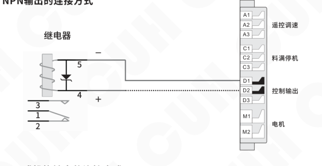

### PNP或推挽输出的连接方式

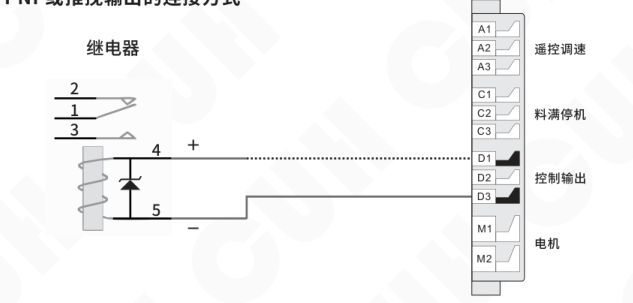

> 如果连接24V继电器，一定要确认线圈的正极和负极，确保正确连接。因为本端口的输出电流能力为400mA，接反后继电器的内部保护二极管会将本控制器端口短路，触发短路保护Err07。

---

2022-12　　　　　　　　　　　　　　-18-　　　　　　　　　　　　　　SDMC10_SMS-CN_2.01

### 第 27 页

数字低压直流有刷电机控制器　　　　　　　　　　　　　　　　SDMC10 系列

### 主输出/控制输出逻辑图：

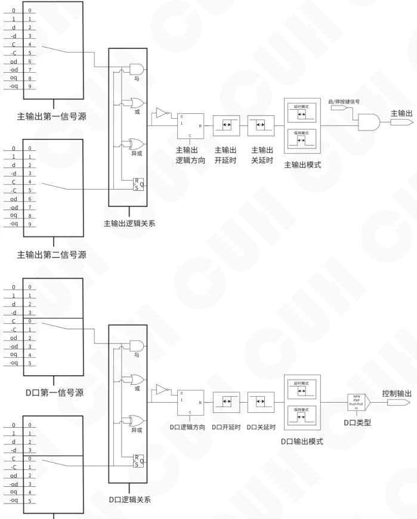

2022-12　　　　　　　　　　-19-　　　　　　　　　　SDMC10_SMS-CN_2.01

### 第 28 页

数字低压直流有刷电机控制器　　　　　　　　　　　　　　　SDMC10 系列

---

● **电动螺丝刀模式：** 本控制器创新性的引入“螺丝刀模式”，可以直接驱动低压有刷电动螺丝刀（或电机）并实现电动螺丝刀的三种工作模式。

**第一种工作模式**

连接电动螺丝刀（或电机）当达到设定扭矩时停止工作。开关信号再次有效时电动螺丝刀（或电机）进行下一次工作。设置如下：

1）主输出信号源选择F.（单次恒流模式）和C口；逻辑关系设置为异或（Hor）。

2）C口信号有效时，主输出有效，驱动电动螺丝刀（或电机）工作直到达到设定扭矩值时停止工作，此时停止灯常亮。

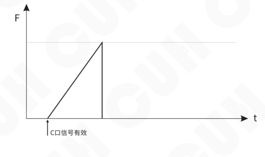

**第二种工作模式**

连接电动螺丝刀（或电机）当达到设定扭矩时保持该扭矩持续工作。仅收到开关输入无效信号时停止工作。设置如下：

1）主输出信号源选择F（恒转矩模式）和C口；逻辑关系设置为或（or）。

2）C口信号有效时，主输出有效，电动螺丝刀（或电机）保持设定扭矩工作；

3）C口信号无效时，主输出无效，电动螺丝刀（或电机）停止工作，此时停止灯常亮。

---

2022-12　　　　　　　　　　　　-20-　　　　　　　　　　　　SDMC10_SMS-CN_2.01

### 第 29 页

数字低压直流有刷电机控制器　　　　　　　　　　　　　　　　　　　　　　　　　SDMC10 系列

---

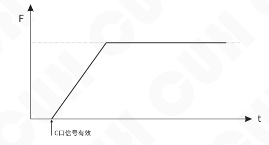

### 第三种工作模式

连接电动螺丝刀（或电机）当外部开关信号有效时，电动螺丝刀（或电机）周期性开启和关闭动作，当外部开关信号无效时结束该周期性动作。设置如下：

1）主输出信号源选择F（恒转矩模式）和C口；逻辑关系为异或（Hor）。

2）设置主输出开、关延时时间。

3）C口信号有效时，主输出有效；达到设定扭矩时，主输出无效；循环往复。

4）C口信号无效时，主输出无效，电动螺丝刀（或电机）停止工作，此时停止灯常亮。

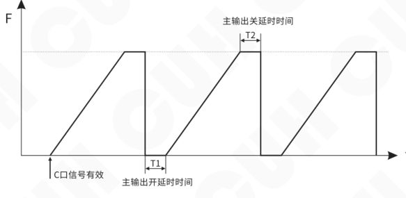

### 第 30 页

数字低压直流有刷电机控制器　　　　　　　　　　　　　　　　　　　　　　　　　SDMC10 系列

## 5.3 最大输出电压设置

● **最大输出电压：** 本控制器可以设置最大输出电压参数 h，来限定控制器输出电压最大值，以防止用户误操作输出过大电压而损坏电机设备。设置后面板设置电压和遥控电压均不会超过该值。

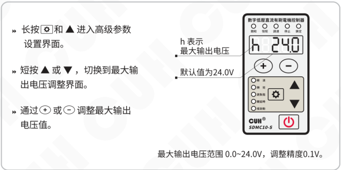

- 长按 <kbd>⚙</kbd> 和 <kbd>▲</kbd> 进入高级参数设置界面。
- 短按 <kbd>▲</kbd> 或 <kbd>▼</kbd>，切换到最大输出电压调整界面。
- 通过 <kbd>＋</kbd> 或 <kbd>－</kbd> 调整最大输出电压值。

图示说明：

- h 表示最大输出电压
- 默认值为 24.0V
- 最大输出电压范围 0.0~24.0V，调整精度 0.1V。

2022-12　　　　　　　　　　　　　　　　　-22-　　　　　　　　　　　　　　　　　SDMC10_SMS-CN_2.01

### 第 31 页

数字低压直流有刷电机控制器　　　　　　　　　　　　　　　　　SDMC10 系列

## 5.4 传感器类型设置

- **传感器类型：** 料满停机端口支持 nPn、PnP、ut1、ut0 模式。其中：

**ut1模式为单次扫描，** 即传感器信号无效前一直通过变换高低电平检测端口是否有效，发现有效信号后确定端口传感器类型且不再扫描。

**ut0模式为连续扫描，** 不管传感器类型如何始终通过变换高低电平检测端口是否接入有效信号。

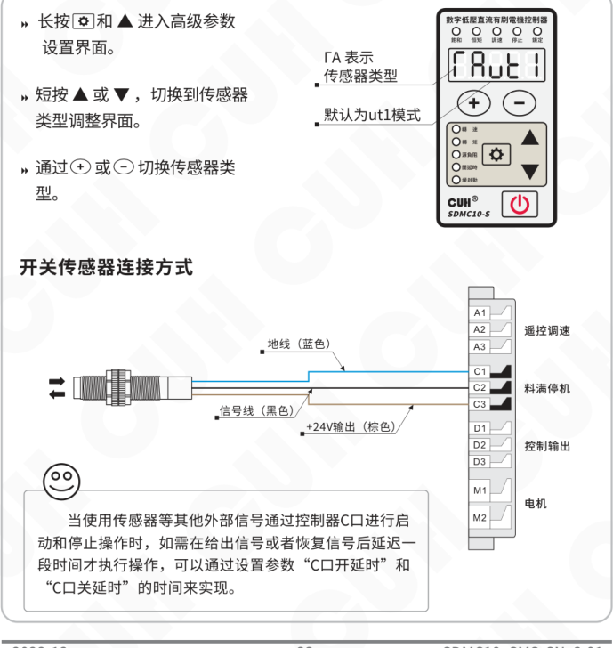

### 开关传感器连接方式

传感器接线标注：

- 地线（蓝色）
- 信号线（黑色）
- +24V输出（棕色）

控制器端子标注：

| 端子 | 功能 |
|---|---|
| A1 | 遥控调速 |
| A2 | 遥控调速 |
| A3 | 遥控调速 |
| C1 | 料满停机 |
| C2 | 料满停机 |
| C3 | 料满停机 |
| D1 | 控制输出 |
| D2 | 控制输出 |
| D3 | 控制输出 |
| M1 | 电机 |
| M2 | 电机 |

> 当使用传感器等其他外部信号通过控制器C口进行启动和停止操作时，如需在给出信号或者恢复信号后延迟一段时间才执行操作，可以通过设置参数“C口开延时”和“C口关延时”的时间来实现。

2022-12　　　　　　　　　　　　-23-　　　　　　　　　　　　SDMC10_SMS-CN_2.01

### 第 32 页

数字低压直流有刷电机控制器　　　　　　　　　　　　　　　　　SDMC10 系列

## 5.5 参数密码锁功能

本控制器可对关键参数进行锁定，防止用户误操作。参数表中带“*”标注的参数，可使用参数密码锁进行锁定。

> » 长按 ⚙ 和 ▲，进入高级参数界面。  
> » 短按 ▲ 或 ▼ 切换到“设置密码”参数，该参数用来设置密码。  
> » 通过 ⊕ 和 ⊖ 调整参数值。  
> » 设定好参数密码后，退出当前界面再进入，可以看到参数值消失。  
> » 进入高级参数界面，切换到“输入密码”参数，输入之前录入的密码，即可看到消失的设置密码参数，进而修改密码。

密码锁参数值遵循 421 码规则：

| 锁定参数项 | 传感器类型 | 最大输出电压 | D口逻辑关系 | D口第二信号源 | D口第一信号源 | 主输出逻辑关系 | 主输出第二信号源 | 主输出第一信号源 | C口开延时 | 源负阻 | 设置转矩 | 设置转速 |
|---|---:|---:|---:|---:|---:|---:|---:|---:|---:|---:|---:|---:|
| 1：锁定 | 1 | 1 | 1 | 1 | 1 | 1 | 1 | 1 | 1 | 1 | 1 | 1 |
| 0：不锁定 | 0 | 0 | 0 | 0 | 0 | 0 | 0 | 0 | 0 | 0 | 0 | 0 |
| 乘系数 | 4 | 2 | 1 | 4 | 2 | 1 | 4 | 2 | 1 | 4 | 2 | 1 |
| 密码值范围（求和） | 0~7（密码值第1位） |  |  | 0~7（密码值第2位） |  |  | 0~7（密码值第3位） |  |  | 0~7（密码值第4位） |  |  |
| 举例1 | 0 | 0 | 0 | 0 | 0 | 0 | 0 | 0 | 0 | 0 | 0 | 1 |
|  | 0 |  |  | 0 |  |  | 0 |  |  | 1*1=1 |  |  |
| 举例2 | 1 | 0 | 0 | 0 | 0 | 1 | 0 | 0 | 0 | 0 | 0 | 1 |
|  | 1*4=4 |  |  | 1*1=1 |  |  | 0 |  |  | 1*1=1 |  |  |
| 举例3 | 0 | 0 | 0 | 0 | 0 | 0 | 0 | 0 | 0 | 1 | 1 | 1 |
|  | 0 |  |  | 0 |  |  | 0 |  |  | 1*4+1*2+1*1=7 |  |  |

举例1：锁定设置转速，12组二进制编码为 000000000001，设定密码值为 0001。

举例2：锁定设置转速，主输出逻辑关系和传感器类型，12组二进制编码为 100001000001，设定密码值为 4101。

举例3：锁定设置转速，设置转矩和源负阻，12组二进制编码为 000000000111，设定密码值为 0007。

“设置密码”设置为 9999 时，锁定所有“*”标参数。

2022-12　　　　　　　　　　　　　　-24-　　　　　　　　　　　　　　SDMC10_SMS-CN_2.01

### 第 33 页

数字低压直流有刷电机控制器　　　　　　　　　　　　　　　　　　　　SDMC10 系列

## 5.6 恢复出厂设置

本功能可以使用户快速将控制器设置为出厂默认设置状态。

由于本控制器功能强大，有数量众多的控制参数可以由用户设定，对于初学者，可能在多次的设定修改后不能恢复控制器的正常工作状态。使用该功能可以快速将调乱的参数状态恢复为出厂默认设置。

- 同时长按 `▶` 和 `▲`，进入高级参数调整界面。
- 短按 `▲` 或 `▼`，切换到恢复出厂设置界面，此时数码管和 LED 灯全部闪烁。

**恢复出厂设置参数设定状态**

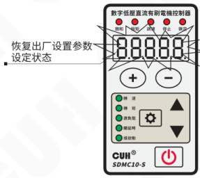

- 长按 `＋`，直到控制器显示“------”，表示控制器已经重设完毕。

**恢复出厂设置参数设定完成**

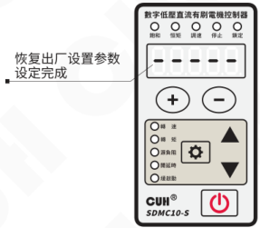

2022-12　　　　　　　　　　　　　　　　　-25-　　　　　　　　　　　　　　　　　SDMC10_SMS-CN_2.01

### 第 34 页

数字低压直流有刷电机控制器　　　　　　　　　　　　　　　　　SDMC10 系列

---

## 5.7 监控参数功能

本控制器专门设计了一套监控参数组用于监控控制器的状态。

» 长按 ⚙ 和 ▼，进入监控参数界面。

» 短按 ▲ 或 ▼ 选择需要监控的参数。

» 监控参数的参数值不可修改。

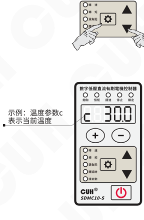

**本控制器的监控参数包括：**

温度 c、母线电压 PU、输出电压 oU、输出电流 AC、模拟调速A口电压 AU、C口信号电压 cU、D口输出电压 dU、24V电压 nU、实测源负阻 r.。

---

2022-12　　　　　　　　　　　　　　　　　-26-　　　　　　　　　　　　　　　　　SDMC10_SMS-CN_2.01

### 第 35 页

# 第六章 技术规格

## 6.1 外形尺寸

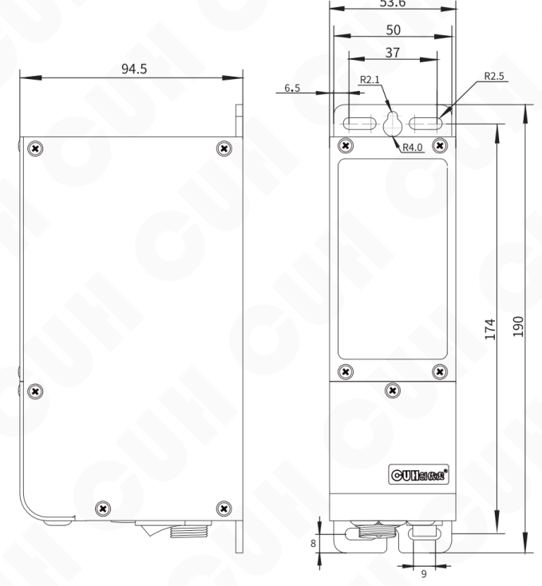

外形尺寸图（单位：毫米mm）

### 第 36 页

数字低压直流有刷电机控制器　　　　　　　　　　　　　　　　　　　　　　　　　SDMC10 系列

## 6.2 技术规格表

| 项目 | 最小值 | 典型值 | 最大值 | 单位 | 备注 |
|---|---:|---:|---:|---|---|
| 交流输入电压 | 85 | 220 | 260 | 伏特（V） | 50/60 Hz交流有效值 |
| 电机输出电压 | 0 | —— | 24.0 | 伏特（Vdc） | 直流 |
| 电机输出电流 | 0 | —— | 5.00 | 安培（A） | 直流 |
| 缓启动时间 | 0.1 | —— | 10 | 秒（s） | 出厂默认0.5 |
| 延迟时间范围 | 0 | —— | 99.9 | 秒（s） | 出厂默认0.2 |
| 延迟时间精度 |  | 0.1 |  | 秒（s） |  |
| 过热保护温度 | 58 | 60 | 66 | 摄氏度（℃） |  |
| 直流控制输出电流 | 0 | —— | 400 | 毫安（mA） |  |
| 直流控制输出电压 | 22 | 24 | 26 | 伏特（V） |  |
| 模拟控制信号 |  | 1-5 |  | 伏特（V） | 远程速度控制电压 |
| 数字控制信号 |  | 24 |  | 伏特（V） | 开关信号控制 |
| 调整方式 |  | 6 |  | 键 |  |
| 空载功耗 | —— | 3 | —— | 瓦特（W） |  |
| 显示方式 |  | 5 |  | 位 | LED数码管 |
| 工作环境温度 | 0 | 25 | 40 | 摄氏度（℃） |  |
| 工作环境湿度 | 10 | 60 | 85 | 相对湿度（%） | 不结露 |
| 存储环境温度 | -20 | 25 | 85 | 摄氏度（℃） |  |

> **警告**  
> 在民用环境中，本产品可能产生无线电干扰。在这种情况下，可能需要采取附加抑制措施。

2022-12　　　　　　　　　　　　　　-28-　　　　　　　　　　　　　　SDMC10_SMS-CN_2.01

### 第 37 页

数字低压直流有刷电机控制器　　　　　　　　　　　　　　　　　　　　SDMC10 系列

## 6.3 参考标准

**极限参数：超过此指标将会造成严重损坏，必须严格遵守！**

| 项目 | GB 标准 | IEC 标准 | 等级 | 标准要求 | 备注说明 |
|---|---|---|---|---|---|
| 静电放电 | GB/T 17626.2-2006 | IEC 61000-4-2:2001 | 4 | ±8 kV | 接触放电 |
|  |  |  | 4 | ±15 kV | 空气放电 |
| 电快速瞬变 脉冲群 | GB/T 17626.4-2008 | IEC 61000-4-4:2004 | 4 | ±4 kV |  |
| 直流电源纹 波抗扰度 | GB/T 17626.17-2005 | IEC 61000-4-17:2002 | 4 | 15% | 评价 A |

2022-12　　　　　　　　　　　　　　　　　-29-　　　　　　　　　　　　SDMC10_SMS-CN_2.01

### 第 38 页

数字低压直流有刷电机控制器　　　　　　　　　　　　　　　　　SDMC10 系列

# 第七章 附录

## 7.1 参数列表

| 类别 | 含义 | 参数符号 | 数码管符号图片 | 取值范围 | 默认设置 |
|---|---|---|---|---|---|
| 待机参数 | 测量转速 | [U点] |  | 0.0~24.0 伏特（V） | —— |
|  | 测量转矩 | [C点] |  | 0.00~5.00 安培（A） | —— |
| 基本参数 | 设置转速 * | [U] |  | 0.0~24.0 伏特（V） | 10.0 |
|  | 设置转矩 * | [C] |  | 0.00~5.00 安培（A） | 1.00 |
|  | 源负阻 * | [小R] |  | 0.0~99.9 欧姆（Ω） | 0.0 |
|  | C口开延时 * | [大勾] |  | 0.0~99.9 秒（s） | 0.2 |
|  | C口关延时 | [大L] |  | 0.0~99.9 秒（s） | 0.2 |
|  | 缓启动 | [小T] |  | 0.1~10.0 秒（s） | 0.5 |
|  | 缓关闭 | [反T] |  | 0.1~10.0 秒（s） | 0.5 |
| 高级参数 | 主输出第一信号源 * | [E点Q] | 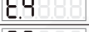 | 0, 1, d, -d, C, -C, od, -od, oq, -oq, F, -F, F. | 0 |
|  | 主输出第二信号源 * | [EQ] |  | 0, 1, d, -d, C, -C, od, -od, oq, -oq, F, -F | -C |
|  | 主输出逻辑关系 * | [大NQ] |  | And与, or或, Hor异或, rS触发器 | or |
|  | 主输出开延时 | [小勾Q] |  | 0.0~99.9 秒（s） | 0 |
|  | 主输出关延时 | [小LQ] |  | 0.0~99.9 秒（s） | 0 |
|  | 主输出输出模式 | [FQ] |  | dLy 延时模式，HLd 保持模式 | dLy |
|  | 主输出逻辑方向 | [反小CQ] |  | 同相---，取反--- 常开 On，常关 OFF | 同相 |
|  | D口第一信号源 * | [E点D] |  | 0, 1, d, -d, C, -C, od, -od, oq, -oq, F, -F | 0 |
|  | D口第二信号源 * | [ED] |  | 0, 1, d, -d, C, -C, od, -od, oq, -oq, F, -F | oq |
|  | D口逻辑关系 * | [大ND] |  | And与, or或, Hor异或, rS触发器 | or |
|  | 控制输出D口开延时 | [小勾D] |  | 0.0~99.9 秒（s） | 0 |
|  | 控制输出D口关延时 | [小LD] |  | 0.0~99.9 秒（s） | 0 |
|  | 控制输出模式 | [FD] |  | dLy 延时模式，HLd 保持模式 | dLy |

2022-12　　　　　　　　　　　　　-30-　　　　　　　　　　　　　SDMC10_SMS-CN_2.01

### 第 39 页

数字低压直流有刷电机控制器　　　　　　　　　　　　　　　　　　　　　　　　　SDMC10 系列

| 类别 | 含义 | 参数符号（文字标注） | 数码管符号图片 | 取值范围 | 默认设置 |
|---|---|---|---|---|---|
| 高级参数 | D口输出逻辑方向 | [反小CD] | 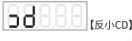 | 同相---，取反--. 常开 On，常关 OFF | 同相--- |
|  | D口类型 | [涛D] |  | nPn, PnP, PSP, In | nPn |
|  | 最大输出电压　* | [小H] |  | 0.0~24.0 伏特（V） | 24.0 |
|  | 传感器类型　* | [涛A] | 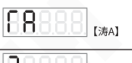 | nPn, PnP ut1（单次扫描）, ut0（连续扫描） | ut1 |
|  | 设置密码 | [反F点] | 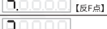 | 0~9999 | 0 |
|  | 输入密码 | [反F] | 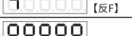 | 0~9999 | 0 |
|  | 恢复出厂设置 | [全8] | 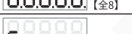 | —— | —— |
| 监控参数 | 温度 | [小C] | 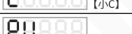 | -20.0~85.0 摄氏度（℃） | —— |
|  | 母线电压 | [PU] | 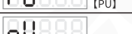 | 0~400 伏特（V） | —— |
|  | 输出电压 | [OU] | 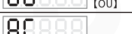 | 0.0~24.0 伏特（V） | —— |
|  | 输出电流 | [AC] | 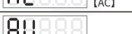 | 0.00~5.00 安培（A） | —— |
|  | 模拟调速A口电压 | [AU] | 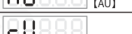 | 0.0~5.0 伏特（V） | —— |
|  | C口信号电压 | [小cU] | 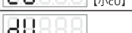 | 0.0~26.0 伏特（V） | —— |
|  | D口输出电压 | [dU] | 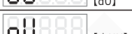 | 0.0~26.0 伏特（V） | —— |
|  | 24V电压 | [小NU] | 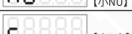 | 0.0~26.0 伏特（V） | —— |
|  | 实测源负阻 | [小R点] |  | 0.0~99.9 欧姆（Ω） | —— |

备注：

1. “h” 参数也用于开机测内阻的电压。
2. “*” 标参数（共12个）为密码锁定对象。
3. “设置密码” 参数设置为9999时，锁定所有 “*” 标参数。
4. 本控制器中，使用电压代表转速，电流代表转矩。

2022-12　　　　　　　　　　　　　　　　　-31-　　　　　　　　　　　　　SDMC10_SMS-CN_2.01

### 第 40 页

数字低压直流有刷电机控制器　　　　　　　　　　　　　　　　SDMC10 系列

## 7.2 输入输出电路图

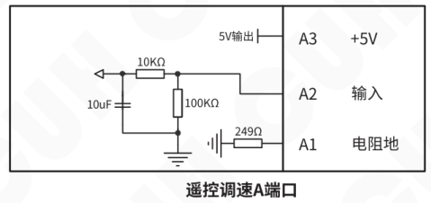

2022-12　　　　　　　　　　　　-32-　　　　　　　　　　　　SDMC10_SMS-CN_2.01

### 第 41 页

*整页视觉 JSON 解析失败，请查看该文件内 `assistant_text`。*

### 第 42 页

数字低压直流有刷电机控制器  
SDMC10 系列

# 第八章 产品质保信息

## 8.1 质保期

本公司为本产品提供的质保期为一年，从产品发送到购买方指定地点之日算起。

## 8.2 保修范围

（一）如果在上述质保期内出现本公司造成的故障，我们将免费维修产品。但是以下情况不属于保修范围：

 a、未按照简易说明书、用户手册或购买方与本公司专门达成的技术要求中规定的条件、环境下的不正确操作，或不正确使用造成的故障。

 b、故障不是因产品缺陷，而是购买方设备或软件设计造成的。

 c、非本公司人员进行的修改或修理而造成的故障。

 d、按照简易操作指南或用户手册正确维修或更换易损部件等规定可以完全避免的故障。

 e、产品从本公司发货后，因无法预料的科学技术水平变化等因素而造成的故障。

 f、由于火灾、地震、洪水等自然灾害，或异常电压等外部因素造成的故障，本公司不负责保修。

（二）保修范围仅限于（一）中规定的情况，本公司对该设备造成的购买方间接损失（如设备损坏、机会丧失、利润损失等）或其他损失，不承担任何责任。

## 8.3 产品适用性

本公司的该控制器是针对电机控制和振动送料行业的通用产品而设计生产的。因此，本公司的该控制器不得用于下列应用且不适合其使用。

（一）对生命和财产有严重影响的设施，如核发电厂、机场、铁路、轮船、机动装置及医疗设备。

（二）公共事业，包括电力、气体、供水等。

（三）相似条件或环境的户外使用。

---

2022-12  -34-  SDMC10_SMS-CN_2.01

### 第 43 页

*（本页 `page_markdown` 为空。）*

### 第 44 页

|  |  |
|---|---|
|  | 南京创优科技有限责任公司 网址:www.cuhnj.com 电话:025-84730416 传真:025-84730426 邮箱:sales@cuhnj.com 地址:南京市江宁区智能路9号 启迪城学研园2幢 |
<!-- /auto:ai-body-draft v1 -->

<!-- auto:data-params-summary v1 -->
## 附录 · 参数表（结构化侧车·机器生成）

> 说明：本节由 `data/<doc_key>/params/params.yaml` 自动渲染（展示前若干行），用于校对与二次开发。定稿以层 C 数据为准。

| 参数 | 标志/符号 | 范围 | 默认 | 单位 | 备注 |
| --- | --- | --- | --- | --- | --- |
|    **危险** |    **危险** |  |  |  |  |
|    **警告** |    **警告** |  |  |  |  |
|    **小心** |    **小心** |  |  |  |  |
|    **注意** |    **注意** |  |  |  |  |
|    0 |  |  |  |  |  |
|    1 |  |  |  |  |  |
|    d |  |  |  |  |  |
|    -d |  |  |  |  |  |
|    C |  |  |  |  |  |
|    -C |  |  |  |  |  |
|    od |  |  |  |  |  |
|    -od |  |  |  |  |  |
|    oq |  |  |  |  |  |
|  -oq |  |  |  |  |  |
|  F |  |  |  |  |  |
|  -F |  |  |  |  |  |
|  F. |  |  |  |  |  |
|    **1: 锁定** **0: 不锁定** |  |  |  |  |  |
|    **1: 锁定** **0: 不锁定** |  |  |  |  |  |
|    **乘系数** |  |  |  |  |  |
|    **密码值范围** **(求和)** |  |  |  |  |  |
|    **举例1** |  |  |  |  |  |
|    **举例1** |  |  |  |  |  |
|  **举例2** |  |  |  |  |  |
|  **举例2** |  |  |  |  |  |
|  **举例3** |  |  |  |  |  |
|  **举例3** |  |  |  |  |  |
|      电机输出电压 |  |  |  |  |  |
|      电机输出电流 |  |  |  |  |  |
|      缓启动时间 |  |  |  |  |  |

*（仅展示前 30 条，共 98 条；完整数据见下方链接。）*

- 完整 YAML：`data/cuh.sdvc.manual.v1.01/params/params.yaml`
- 表格索引：`data/cuh.sdvc.manual.v1.01/index.yaml`
<!-- /auto:data-params-summary v1 -->
