## 目录

> 下列条目来自 PDF 内置书签/大纲；链接指向本批转换生成的整页渲染图（`assets/pages/`），便于与原版 PDF 对照校对。

- [2: 封二版权与免责](assets/pages/page-0002.png)（第 2 页）
- [3: 序言](assets/pages/page-0003.png)（第 3 页）
- [4: 安全与预防措施](assets/pages/page-0004.png)（第 4 页）
- [5: 工作与储存环境](assets/pages/page-0005.png)（第 5 页）
- [7: 目录](assets/pages/page-0007.png)（第 7 页）
- [8: 目录2](assets/pages/page-0008.png)（第 8 页）
- [第一章 使用前须知](assets/pages/page-0009.png)（第 9 页）
  - [1.1 检查包装内容](assets/pages/page-0009.png)（第 9 页）
  - [1.2 指示灯、按键及外部部件说明](assets/pages/page-0010.png)（第 10 页）
  - [1.3 接线端口说明](assets/pages/page-0011.png)（第 11 页）
  - [1.4 控制器铭牌说明](assets/pages/page-0011.png)（第 11 页）
- [第二章 产品介绍](assets/pages/page-0012.png)（第 12 页）
  - [2.1 产品简介](assets/pages/page-0012.png)（第 12 页）
- [第三章 安装及使用指南](assets/pages/page-0013.png)（第 13 页）
  - [3.1 控制器使用条件](assets/pages/page-0013.png)（第 13 页）
  - [3.2 按键基本操作](assets/pages/page-0013.png)（第 13 页）
  - [3.3 安装使用](assets/pages/page-0014.png)（第 14 页）
- [第四章 基本功能说明](assets/pages/page-0017.png)（第 17 页）
  - [4.1 输出电压(速度)设置](assets/pages/page-0017.png)（第 17 页）
  - [4.2 缓启动时间/缓关闭时间](assets/pages/page-0018.png)（第 18 页）
  - [4.3 输出开关](assets/pages/page-0019.png)（第 19 页）
  - [4.4 键盘锁定功能](assets/pages/page-0019.png)（第 19 页）
  - [4.5 恢复出厂设置](assets/pages/page-0020.png)（第 20 页）
- [第五章 高级功能说明](assets/pages/page-0021.png)（第 21 页）
  - [5.1 遥控调速功能](assets/pages/page-0021.png)（第 21 页）
  - [5.2 智能光电功能](assets/pages/page-0023.png)（第 23 页）
  - [5.3 料满停机功能](assets/pages/page-0024.png)（第 24 页）
  - [5.4 控制输出功能](assets/pages/page-0025.png)（第 25 页）
    - [5.4.1 控制输出的接线方法](assets/pages/page-0025.png)（第 25 页）
    - [5.4.2 控制输出信号源和逻辑图](assets/pages/page-0026.png)（第 26 页）
    - [5.4.3 控制输出模式说明](assets/pages/page-0028.png)（第 28 页）
    - [5.4.4 主输出信号控制功能](assets/pages/page-0028.png)（第 28 页）
  - [5.5 速度预置功能](assets/pages/page-0029.png)（第 29 页）
  - [5.6 电机正反转调整](assets/pages/page-0030.png)（第 30 页）
  - [5.7 电机堵转保护功能](assets/pages/page-0031.png)（第 31 页）
  - [5.8 参数监控功能](assets/pages/page-0032.png)（第 32 页）
  - [5.9 参数密码锁功能](assets/pages/page-0033.png)（第 33 页）
  - [5.10 控制振动盘模式](assets/pages/page-0034.png)（第 34 页）
  - [5.11 设置成SDVC21-S功能](assets/pages/page-0036.png)（第 36 页）
- [第六章 技术规格](assets/pages/page-0038.png)（第 38 页）
  - [6.1 外形尺寸](assets/pages/page-0038.png)（第 38 页）
  - [6.2 技术规格表](assets/pages/page-0039.png)（第 39 页）
  - [6.3 参考标准](assets/pages/page-0040.png)（第 40 页）
- [第七章 附录](assets/pages/page-0041.png)（第 41 页）
  - [7.1 参数列表](assets/pages/page-0041.png)（第 41 页）
  - [7.2 输入输出电路图](assets/pages/page-0043.png)（第 43 页）
  - [7.3 故障诊断](assets/pages/page-0045.png)（第 45 页）
- [第八章 产品质保信息](assets/pages/page-0046.png)（第 46 页）
  - [8.1 质保期](assets/pages/page-0046.png)（第 46 页）
  - [8.2 保修范围](assets/pages/page-0046.png)（第 46 页）
  - [8.3 产品适用性](assets/pages/page-0046.png)（第 46 页）
## 术语与命名

- 侧车：`glossary/terms.yaml`（机读）、`glossary/zh-CN.md`（人读）；候选表，定稿后并入公司级 `glossary/`。

## 适用范围

- 本文档由 PDF 自动转换生成，正文与插图需人工核对。

## 变更记录

- 2026-06-05 09:24:22：由转换工具从源 PDF 生成首版。

## 正文

<!-- auto:ai-body-draft v1 -->
> 以下为**整页视觉转写**的正文草稿（多模态模型直接输出 Markdown，含 GFM 表； 若配置 `[[vcrop:页:序]]` 占位符，裁剪步骤会插入 `assets/images/` 下 PNG）。**请务必人工校对。**

### 第 1 页

# CUH®

## 数字单相交流异步电机控制器

**Digital Single Phase Asynchronous Motor Controller**

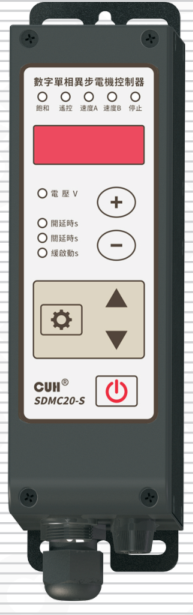

## SDMC20-S

# 用户手册

### 第 2 页

数字单相交流异步电机控制器　　　　　　　　　　　　　　　　SDMC20-S

---

## 版权说明

南京创优科技有限责任公司保留所有权利。

本用户手册上包含的所有信息是属于本公司的知识，受著作权法及所有法律的保护。本公司根据著作权法及其他法律享有并保留所有著作权和其他法律赋予的权利，未经本公司书面同意不得以任何形式对本用户手册的部分或全部进行抄袭、翻译、转译、仿制或其他利用。

## 免责声明

本用户手册的所有内容仅说明本公司生产的相关产品的使用方法，并且是根据现有技术和提供给您使用时的状态进行描述的，在您使用本产品时必须自行承担相关风险。除法律强制规定外，本公司不因本用户手册对产品负有任何明示或暗示的责任，包括但不限于人身伤害、财产损失、机会丧失。

您明确了解上述风险并同意，除法律强制规定外，本公司无须为您的任何直接、间接的损害或损失负责（包括但不限于人员、财物、数据等有形损失和名誉、机会等无形损失）。

本公司保留对本用户手册中所适用的产品进行修改而不预先及事后通知的权利。

---

2023-11　　　　　　　　　　　　　　　　　　　　　　　　SDMC20_SMS-CN_2.01

### 第 3 页

| 数字单相交流异步电机控制器 | SDMC20-S |
|---|---:|

# 序　言

感谢您使用南京创优科技有限责任公司（在本手册中以下简称本公司）出品的 SDMC20-S 数字单相交流异步电机控制器（在本手册中以下简称本产品、本控制器或控制器）。本系列控制器是采用高品质元件并融合了最新的电子技术，采用高性能的数字信号处理器经过精心的设计而成。

本手册介绍了本产品的基本操作方法、功能技术说明和典型应用示例。为用户提供安装调试、参数设置、异常诊断、故障排除及日常维护控制器的相关信息。为了确保正确安装和使用本控制器，请在装机之前仔细阅读本用户手册，并请妥善保存。

以下符号提醒您注意有关防止人身伤害和产品损坏的事项，请务必阅读。

| 符号 | 说明 |
|---|---|
| ⚠️ **危险** | 表示若不遵守该事项，将导致人员伤亡。 |
| ⚠️ **警告** | 表示若不遵守该事项，可能导致人员伤亡。 |
| ⚠️ **小心** | 表示若不遵守该事项，可能导致人员遭受中度或轻微伤害。 |
| **注意** | 表示若不遵守该事项，将导致本产品损坏及财产损失。 |
| ❗ **要点** | 表示在使用过程中必须要遵守的注意事项和使用限制等。 |

**本说明书适合以下型号控制器：**

◆ 数字单相交流异步电机控制器　SDMC20-S

---

| 2023-11 | SDMC20_SMS-CN_2.01 |
|---|---:|

### 第 4 页

数字单相交流异步电机控制器　　　　　　　　　　　　　　　　　　　　　　　　　SDMC20-S

---

# 安全与预防措施

1、**【危险】** 本产品用于驱动单相交流异步电机或基于电磁铁的振动送料设备，请勿将本产品用于保护人体或人体部位等目的。

2、**【危险】** 本产品不得作为防爆产品使用，请勿在危险场所和/或潜在爆炸气体环境中使用本产品。

3、**【警告】** 本产品是采用交流市电供电的设备，请勿施加交流电压超过 260Vac。施加过大的输入电压如 380Vac，则可能导致产品爆炸或者着火，造成严重的安全事故。

4、**【警告】** 本产品是通过电源线进行接地的，请确保为控制器供电的配电设施具备良好的接地，否则可能导致控制器外壳带电，造成触电事故。

5、**【警告】** 请勿输入交流电源到本控制器的输出端，这会损坏控制器。

6、**【警告】** 请勿在带电的情况下插拔接线或触摸接线仓内各接线端子触点，以防发生触电事故。

7、**【注意】** 请避免采用通过继电器等设备切断供电的方式来控制本产品的输出，这会严重降低本控制器的寿命。

8、**【注意】** 本产品设计使用于阴凉干燥环境，请勿将本产品置于室外、可能会浸水、阳光暴晒场所工作，也不要在超过本产品电气特性要求的温度和湿度范围之外工作。

9、**【要点】** 请务必将本产品固定在可靠接地的坚固平台上，并远离振动设备。

10、**【要点】** 任何情况下请勿将本产品在超越设计极限状态下工作。

11、**【要点】** 请严格按照本手册的说明操作，对于违反这些操作说明所造成的任何人身伤害或财产损失，本公司不承担任何民事和刑事责任。

12、**【要点】** 任何情况下请不要打开本控制器机壳，以防遭到电击。机壳内部没有可以调节和用户维修部分，请不要试图维修本机，出现故障请致电本公司。

---

2023-11　　　　　　　　　　　　　　　　　　　　　　　　　SDMC20_SMS-CN_2.01

### 第 5 页

数字单相交流异步电机控制器  
SDMC20-S

# 工作与储存环境

## 一、使用前的检查

每台控制器在出厂前，均经过严格的品质检验，并经过强化的防撞包装处理。客户在拆箱后，请即刻进行下列检查：

1、检查控制器是否在运输过程中受到损伤。

2、检查控制器型号是否与订货登记资料完全相同。

## 二、工作环境

为使本控制器具有更好的使用效果和更长的使用寿命，请将控制器安装在符合下列条件的环境中：

● 良好的通风散热环境

● 远离水滴、蒸气、灰尘，（特别是油性灰尘）

● 无腐蚀、易燃性的气体、液体

● 无漂浮性的尘埃及金属微粒

● 安装表面坚固无振动

● 远离电磁噪声干扰

● 使用环境温度为0℃到40℃

● 仅适用于海拔2000m以下地区安全使用

---

2023-11  
SDMC20_SMS-CN_2.01

### 第 6 页

数字单相交流异步电机控制器　　　　　　　　　　　　　　　　　SDMC20-S

---

---

2023-11　　　　　　　　　　　　　　　　　　　　　　　　　SDMC20_SMS-CN_2.01

### 第 7 页

数字单相交流异步电机控制器　　　　　　　　　　　　　　　　　　　　　　　　　SDMC20-S

---

# 目　录

**第一章 使用前须知** -------------------------------------------------------------------- 1

　　1.1　检查包装内容 -------------------------------------------------------------------- 1

　　1.2　指示灯、按键及外部部件说明 ---------------------------------------------------- 2

　　1.3　接线端口说明 -------------------------------------------------------------------- 3

　　1.4　控制器铭牌说明 ------------------------------------------------------------------ 3

**第二章 产品介绍** ---------------------------------------------------------------------- 4

　　2.1　产品简介 ------------------------------------------------------------------------ 4

**第三章 安装及使用指南** ---------------------------------------------------------------- 5

　　3.1　控制器使用条件 ------------------------------------------------------------------ 5

　　3.2　按键基本操作 -------------------------------------------------------------------- 5

　　3.3　安装使用 ------------------------------------------------------------------------ 6

**第四章 基本功能说明** ------------------------------------------------------------------ 9

　　4.1　输出电压(速度)设置 ------------------------------------------------------------- 9

　　4.2　缓启动时间/缓关闭时间 --------------------------------------------------------- 10

　　4.3　输出开关 ------------------------------------------------------------------------ 11

　　4.4　键盘锁定功能 -------------------------------------------------------------------- 11

　　4.5　恢复出厂设置 -------------------------------------------------------------------- 12

**第五章 高级功能说明** ------------------------------------------------------------------ 13

　　5.1　遥控调速功能 -------------------------------------------------------------------- 13

　　5.2　智能光电功能 -------------------------------------------------------------------- 15

　　5.3　料满停机功能 -------------------------------------------------------------------- 16

　　5.4　控制输出功能 -------------------------------------------------------------------- 17

　　5.4.1 控制输出的接线方法 ---------------------------------------------------------- 17

　　5.4.2 控制输出信号源和逻辑图 ------------------------------------------------------ 18

　　5.4.3 控制输出模式说明 ------------------------------------------------------------ 20

　　5.4.4 主输出信号控制功能 ---------------------------------------------------------- 20

---

2023-11　　　　　　　　　　　　　　　　　　　　　　　　　SDMC20_SMS-CN_2.01

### 第 8 页

数字单相交流异步电机控制器                                      SDMC20-S

5.5  速度预置功能 ---------------------------------------------------------------- 21

5.6  电机正反转调整 -------------------------------------------------------------- 22

5.7  电机堵转保护功能 ------------------------------------------------------------ 23

5.8  参数监控功能 ---------------------------------------------------------------- 24

5.9  参数密码锁功能 -------------------------------------------------------------- 25

5.10  控制振动盘模式 ------------------------------------------------------------- 26

5.11  设置成SDVC21-S功能 --------------------------------------------------------- 28

**第六章 技术规格** -------------------------------------------------------------- 30

6.1  外形尺寸 -------------------------------------------------------------------- 30

6.2  技术规格表 ------------------------------------------------------------------ 31

6.3  参考标准 -------------------------------------------------------------------- 32

**第七章 附录** ------------------------------------------------------------------ 33

7.1  参数列表 -------------------------------------------------------------------- 33

7.2  输入输出电路图 -------------------------------------------------------------- 35

7.3  故障诊断 -------------------------------------------------------------------- 37

**第八章 产品质保信息** ---------------------------------------------------------- 38

8.1  质保期 ---------------------------------------------------------------------- 38

8.2  保修范围 -------------------------------------------------------------------- 38

8.3  产品适用性 ------------------------------------------------------------------ 38

2023-11                                                   SDMC20_SMS-CN_2.01

### 第 9 页

数字单相交流异步电机控制器　　　　　　　　　　　　　　　　　　　　　　　　　SDMC20-S

# 第一章 使用前须知

本章节介绍产品包装内容、控制器外观说明和控制器铭牌信息。

## 1.1 检查包装内容

使用本产品之前，请检查控制器及附件的完整性。如果发现产品有缺陷或已损坏、附件缺失等问题，请与本公司联系。

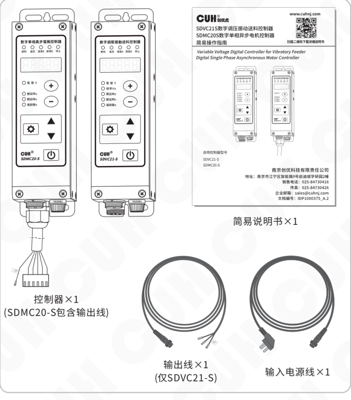

包装内容：

- 控制器×1（SDMC20-S 包含输出线）
- 简易说明书×1
- 输出线×1（仅 SDVC21-S）
- 输入电源线×1

---

2023-11　　　　　　　　　　　　　　　　　- 1 -　　　　　　　　　　　　　　　　　SDMC20_SMS-CN_2.01

### 第 10 页

数字单相交流异步电机控制器　　　　　　　　　　　　　　　　　　　　　　　　　SDMC20-S

## 1.2 指示灯、按键及外部部件说明

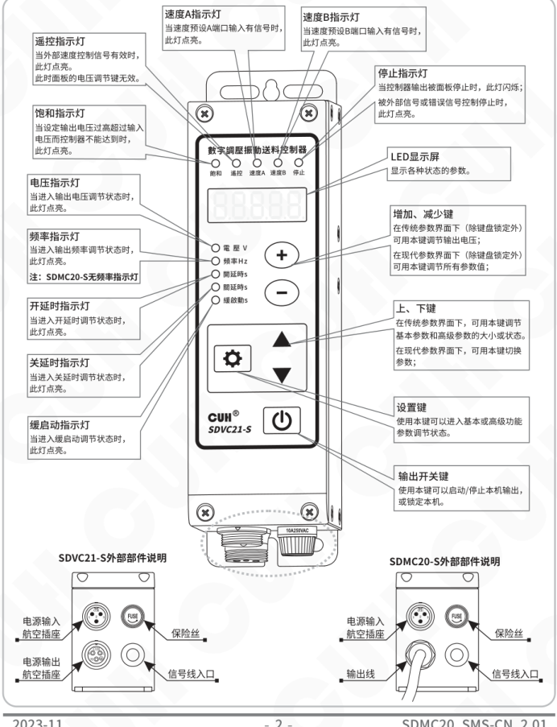

### 指示灯与显示屏

| 部件 | 说明 |
|---|---|
| 遥控指示灯 | 当外部速度控制信号有效时，此灯点亮。 此时面板的电压调节键无效。 |
| 速度A指示灯 | 当速度预设A端口输入有信号时，此灯点亮。 |
| 速度B指示灯 | 当速度预设B端口输入有信号时，此灯点亮。 |
| 停止指示灯 | 当控制器输出被面板停止时，此灯闪烁； 被外部信号或错误信号控制停止时，此灯点亮。 |
| 饱和指示灯 | 当设定输出电压过高超过输入电压而控制器不能达到时，此灯点亮。 |
| LED显示屏 | 显示各种状态的参数。 |
| 电压指示灯 | 当进入输出电压调节状态时，此灯点亮。 |
| 频率指示灯 | 当进入输出频率调节状态时，此灯点亮。 注：SDMC20-S无频率指示灯 |
| 开延时指示灯 | 当进入开延时调节状态时，此灯点亮。 |
| 关延时指示灯 | 当进入关延时调节状态时，此灯点亮。 |
| 缓启动指示灯 | 当进入缓启动调节状态时，此灯点亮。 |

### 按键

| 部件 | 说明 |
|---|---|
| 增加、减少键 | 在传统参数界面下（除键盘锁定外）可用本键调节输出电压； 在现代参数界面下（除键盘锁定外）可用本键调节所有参数值； |
| 上、下键 | 在传统参数界面下，可用本键调节基本参数和高级参数的大小或状态。 在现代参数界面下，可用本键切换参数； |
| 设置键 | 使用本键可以进入基本或高级功能参数调节状态。 |
| 输出开关键 | 使用本键可以启动/停止本机输出，或锁定本机。 |

### 外部部件说明

| 机型 | 外部部件 |
|---|---|
| SDVC21-S | 电源输入航空插座；电源输出航空插座；保险丝；信号线入口。 |
| SDMC20-S | 电源输入航空插座；输出线；保险丝；信号线入口。 |

### 第 11 页

数字单相交流异步电机控制器　　　　　　　　　　　　　　　　　　　　　　　　　SDMC20-S

## 1.3 接线端口说明

接线端口位置示意：

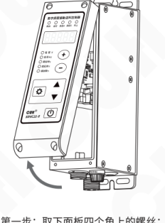

第一步：取下面板四个角上的螺丝；

第二步：向上翻开面板，接线端口在面板背面；

### 接线端口与对应信号

| 功能 | 端口 | 信号名称 | 英文/标识 | 对应信号 |
|---|---:|---|---|---|
| 料满停机Ⅱ / SensorⅡ | A1 | 地线 | GND |  |
| 料满停机Ⅱ / SensorⅡ | A2 | 输入 | Input | A |
| 料满停机Ⅱ / SensorⅡ | A3 | +24V | +24V |  |
| 速度预设 / Preset | B1 | 地线 | GND |  |
| 速度预设 / Preset | B2 | 速度A | Pset A | SA |
| 速度预设 / Preset | B3 | 地线 | GND |  |
| 速度预设 / Preset | B4 | 速度B | Pset B | Sb |
| 控制输出 / Ctrl Out | C1 | 输出 | Output | oC |
| 控制输出 / Ctrl Out | C2 | +24V | +24V |  |
| 料满停机Ⅰ / SensorⅠ | D1 | 地线 | GND |  |
| 料满停机Ⅰ / SensorⅠ | D2 | 输入 | Input | d |
| 料满停机Ⅰ / SensorⅠ | D3 | +24V | +24V |  |
| 智能光电 / Photosensor | E1 | 地线 | GND |  |
| 智能光电 / Photosensor | E2 | 接收 | Rx | E |
| 智能光电 / Photosensor | E3 | 地线 | GND |  |
| 智能光电 / Photosensor | E4 | 发射 | Tx |  |
| 遥控调速 / Speed Ctrl | F1 | +5V | +5V |  |
| 遥控调速 / Speed Ctrl | F2 | 输入 | Input |  |
| 遥控调速 / Speed Ctrl | F3 | 电阻地 | RGND |  |

## 1.4 控制器铭牌说明

铭牌示意：

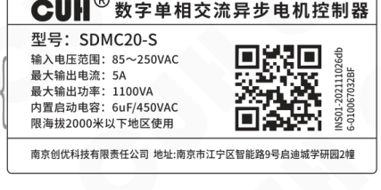

| 标注 | 铭牌内容 |
|---|---|
| 产品型号 | 型号：SDMC20-S |
| 产品基本参数 | 输入电压范围：85～250VAC 最大输出电流：5A 最大输出功率：1100VA 内置启动电容：6uF/450VAC 限海拔2000米以下地区使用 |
| 制造单位及地址 | 南京创优科技有限责任公司　地址：南京市江宁区智能路9号启迪城学研园2幢 |
| 产品序列号 | INS01-202111026db6-010067032BF |

产品序列号说明：

`INS01-202111026db6-010067032BF`

其中 `20211102` 标注为生产日期。

---

2023-11　　　　　　　　　　　　　　　　　- 3 -　　　　　　　　　　　　　　　SDMC20_SMS-CN_2.01

### 第 12 页

# 第二章 产品介绍

本章节主要内容包括本产品的简单介绍和主要特色功能。

## 2.1 产品简介

SDMC20-S控制器用于控制单相交流异步电机，拥有丰富的端口及逻辑功能，其功能特色包括：

- **缓启动：** 在启动时，电机速度会从零开始逐渐增大到设定速度，以消除对电机的冲击，用户可以根据需要进行缓启动时间的设置。

- **缓关闭：** 新增缓关闭功能，可以设置0.0~10.0秒，用于缓慢停止电机转动。

- **自动稳速：** 内置数字PID控制调节器，消除因电压波动或负载变化对电机速度的影响。

- **控制输出：** 端口支持NPN、PNP或推挽输出模式，具备过流和短路保护功能。

- **料满停机：** 2组料满停机端口，支持NPN、PNP或自动适应类型。

- **智能光电：** 智能光电的开关延时及灵敏度可调节。

- **电机堵转保护：** 当电机发生堵转情况时，控制器停止输出保护电机。

- 主输出和控制输出的逻辑信号源多达三组，用户可以根据需要进行自由组合。

- **密码锁和参数锁定功能：** 控制器调试完毕后，可对参数进行锁定，防止人员误操作。

- **多种控制对象：** 可以调整控制对象参数，实现对电机进行开环或者闭环控制，亦可对振动盘进行控制。

- **完整的保护功能包括：** 主输出过流保护、过热或过冷保护、电源欠压/过压保护、控制输出短路保护、24V输出短路保护、调速5V输出短路保护，电机堵转保护。

### 第 13 页

数字单相交流异步电机控制器　　　　　　　　　　　　　　　　SDMC20-S

---

# 第三章　安装及使用指南

本章节介绍本产品使用所必须具备的条件以及如何正确进行安装与连接。

## 3.1 控制器使用条件

本产品是使用交流110/220V供电的设备，且通过电源线三爪插头进行保护接地连接，请提供符合标准的110V或220V，50Hz/60Hz市电供电配电设施并确保保护地线已正确连接。

**⚠️ 警告**　切不可将控制器连接到380V交流电，这将造成控制器不可恢复的严重损坏，有可能导致爆炸、火灾等安全事故。

**⚠️ 警告**　确保供电侧可靠接地，控制器的金属外壳是与保护接地线直接连接的，接地不良会导致控制器外壳带电，引发触电事故。

**注意**　控制器长时间工作会产生热量致使外壳温度升高，请将控制器安装在通风良好的环境中，并将其固定良好，远离振动源。

**注意**　本产品的输出是市电经过切相形成的，中间没有隔离环节。因此输出端子不可以与保护接地连接，在连接电机或者电磁铁时也要确保线圈与外壳之间具备基本的绝缘能力。否则会导致漏电，可能产生触电和控制器损坏的事故。

**注意**　本产品是用来驱动单相交流异步电机或电磁铁的控制器，切不可连接压电振动盘。

## 3.2 按键基本操作

现代参数界面下的按键操作方法：

a. 待机界面下短按 ⊕ 或 ⊖ 调节电压参数。

b. 长按 ⚙ 进入/退出基本参数界面，短按 ▼ 或 ▲ 选择基本参数，短按 ⊕ 或 ⊖ 调节参数值。

c. 长按 ⚙ 加 ▲ 进入/退出高级参数界面，短按 ▼ 或 ▲ 选择高级参数，短按 ⊕ 或 ⊖ 调节参数值。

d. 长按 ⚙ 加 ▼ 进入/退出监控参数界面，短按 ▼ 或 ▲ 选择监控参数，参数值不可调节。

e. 短按 ⏻ 暂停/恢复输出，长按 ⏻ 锁定/解锁键盘。

f. 恢复出厂设置参数下，长按 ⊕ 显示 `oLd` 恢复到传统参数界面，长按 ⊖ 显示 `nEw` 恢复到现代参数界面。

g. SDMC20-S默认为现代参数界面，SDVC21-S默认为传统参数界面。

---

2023-11　　　　　　　　　　- 5 -　　　　　　　　　　SDMC20_SMS-CN_2.01

### 第 14 页

数字单相交流异步电机控制器  
SDMC20-S

## 3.3 安装使用

**第一步：**

打开控制器的外包装，检查控制器外观及侧标型号，判断是否为所需的型号。

**第二步：**

参考电机接线说明，正确连接电机。

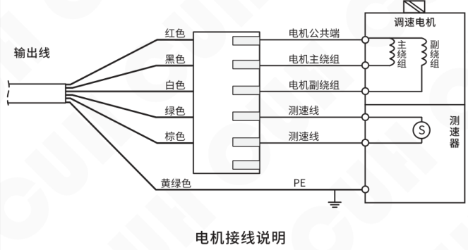

**电机接线说明**

> **注意**
>
> 1、一定要确保控制器输出线与电机正确可靠连接后，再进行上电。
>
> 2、电源输出禁止连接压电类负载，否则可能导致**电击安全事故！**

### 第 15 页

数字单相交流异步电机控制器　　　　　　　　　　　　　　　　　　　　　　SDMC20-S

**第三步：**

将输入电源线航空插头插入控制器电源输入插座，并锁紧螺母。

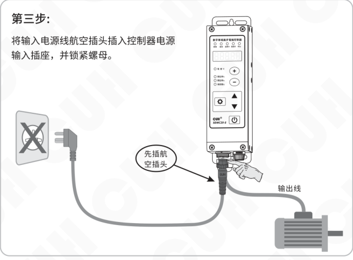

图中标注：先插航空插头；输出线。

**第四步：**

将电源线三爪插头插在供电电源插座上。

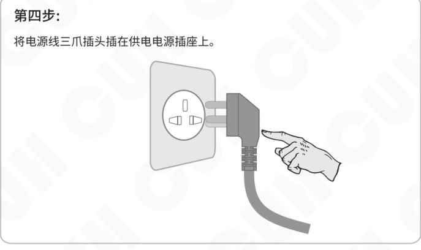

2023-11　　　　　　　　　　　　　　　　- 7 -　　　　　　　　　　　　　　　　SDMC20_SMS-CN_2.01

### 第 16 页

**第五步：**

控制器启动显示 CUH 后，显示电机速度 “S 150”，此时按 **+** 或 **−** 可以对当前电机速度进行调整。

图中标注：

- **S** 表示设定速度
- 电压指示灯

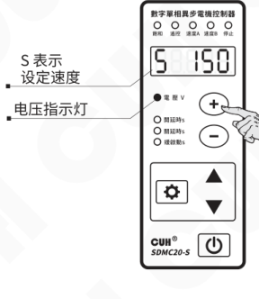

> 如需调整电机的正反转，请先将控制器断电，然后参考高级功能说明中的 “5.6 电机正反转调整” 章节，严格按照操作说明操作。

### 第 17 页

数字单相交流异步电机控制器　　　　　　　　　　　　　　　　　　　　　　　　　SDMC20-S

# 第四章 基本功能说明

本章节介绍本产品基本功能的使用方法。

## 4.1 输出电压(速度)设置

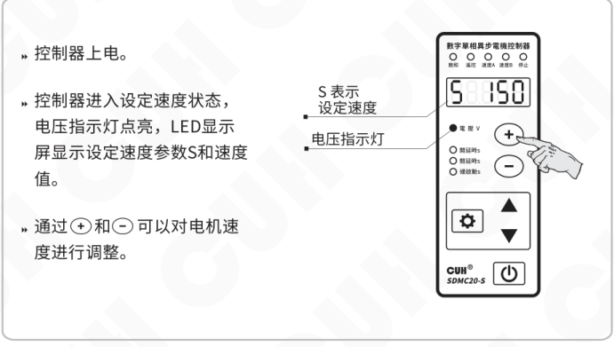

- 控制器上电。
- 控制器进入设定速度状态，电压指示灯点亮，LED显示屏显示设定速度参数S和速度值。
- 通过“+”和“−”可以对电机速度进行调整。

图中标注：

- S 表示设定速度
- 电压指示灯

---

- 控制器默认控制对象为闭环电机模式，面板显示S为电机的参考速度，而非实际转速。S的调整范围为0-999，默认最大值为300，当调整“+”至300时，饱和灯没有点亮，可以进一步设置最大速度参数h.来提高转速。
- 当控制器控制对象参数SF设置为0（振动盘）或1（电机开环）时，界面显示参数U，为输出电压的整流平均值。
- 本控制器没有升压功能，当因输入电源电压限制，控制器无法达到设定电压时饱和灯会点亮，此时自动稳速或者自动稳压功能失效。

---

2023-11　　　　　　　　　　　　　　- 9 -　　　　　　　　　　　　　　SDMC20_SMS-CN_2.01

### 第 18 页

数字单相交流异步电机控制器　　　　　　　　　　　　　　　　　　　　　　　　　SDMC20-S

## 4.2 缓启动时间/缓关闭时间

本控制器从停止状态启动时，电机速度可以平缓提高到设定值，以防止电机和控制器遭受冲击。

**缓启动时间（t）：** 控制器从停止状态启动时，电机速度从0平滑升高达到设定速度所需要的时间称为缓启动时间。

- 按住“设置”键（齿轮图标）2秒，进入基本参数界面。
- 使用 ▲ 和 ▼ 切换到缓启动参数调整状态“t”。
- 通过 ＋ 和 － 调整参数值。该参数的单位是秒，精度是0.1秒。

右侧操作示意图：

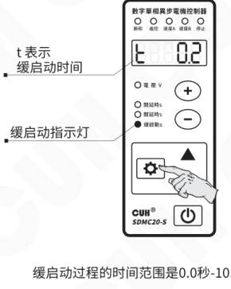

图中标注：

- t 表示缓启动时间
- 缓启动指示灯

缓启动过程的时间范围是0.0秒-10.0秒。

🙂

本控制器从运行状态停止时，电机速度可以平缓降低到0，以防止电机和控制器遭受冲击。

**缓关闭时间（↵）：** 控制器从运行状态停止时，电机速度从设定值平滑降低到0所需要的时间称为缓关闭时间。

缓关闭时间的操作方法、参数范围和缓启动时间一致。

2023-11　　　　　　　　　　　　　　　　　-10-　　　　　　　　　　　　　　　　　SDMC20_SMS-CN_2.01

### 第 19 页

数字单相交流异步电机控制器　　　　　　　　　　　　　　　　　　　　　　　　　SDMC20-S

## 4.3 输出开关

面板上的轻触式输出开关可以方便快速地开启或停止本机的输出。

- 使用控制器面板上的 ⏻，可以控制本机启动或停止输出。停止输出时，“停止”指示灯闪烁，表示进入“停止”状态。

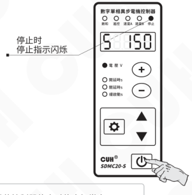

> 当停止键停止输出时停止灯闪烁，当外部信号使控制器停止时停止灯常亮。

## 4.4 键盘锁定功能

为了防止误操作，本机设定了键盘锁。这样当控制器各项参数设置好后，可以有效避免其他人的误动作影响本机正常工作。即使关机后重新开机，键盘锁状态依然保持上次关机时的状态。

- 通过长按 ⏻ 2秒可以锁定除 ⏻ 之外所有按键，此时界面显示“d150”。
- 再次长按 ⏻ 键2秒可以解除锁定。

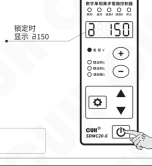

> 锁定状态下，开关键仍然有效。

2023-11　　　　　　　　　　　　　　　　　-11-　　　　　　　　　　　　　　　　　SDMC20_SMS-CN_2.01

### 第 20 页

数字单相交流异步电机控制器　　　　　　　　　　　　　　　　　SDMC20-S

## 4.5 恢复出厂设置

本功能可以使用户快速将控制器设置为出厂默认设置状态。

由于本控制器功能强大，有数量众多的控制参数可以由用户设定，对于初学者，可能在多次的设定修改后不能恢复控制器的正常工作状态。使用该功能可以快速将调乱的参数状态恢复为出厂默认设置。

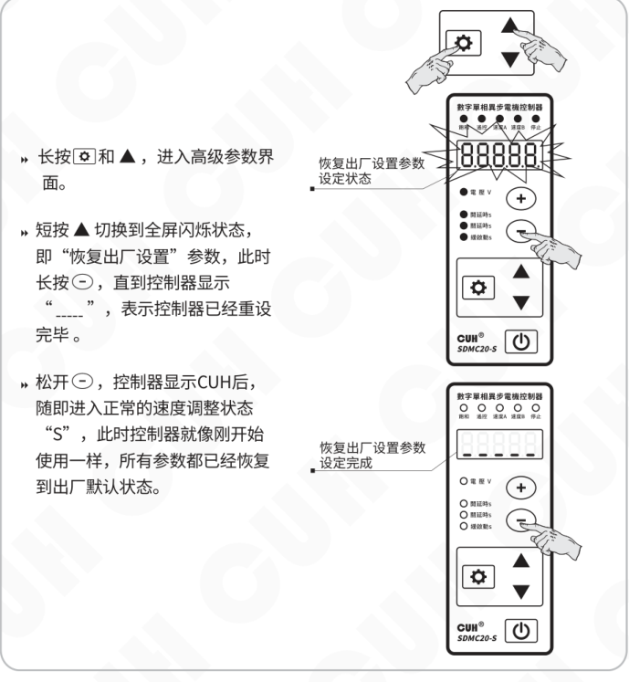

- 长按设置键（齿轮键）和 ▲，进入高级参数界面。
- 短按 ▲ 切换到全屏闪烁状态，即“恢复出厂设置”参数，此时长按 －，直到控制器显示“-----”，表示控制器已经重设完毕。
- 松开 －，控制器显示 CUH 后，随即进入正常的速度调整状态“S”，此时控制器就像刚开始使用一样，所有参数都已经恢复到出厂默认状态。

图中标注：

- 恢复出厂设置参数设定状态
- 恢复出厂设置参数设定完成

2023-11　　　　　　　　　　　　-12-　　　　　　　　　　　　SDMC20_SMS-CN_2.01

### 第 21 页

数字单相交流异步电机控制器　　　　　　　　　　　　　　　　　　　　　　　　　SDMC20-S

# 第五章 高级功能说明

本章节主要介绍本产品高级功能的使用方法。

## 5.1 遥控调速功能

本控制器支持外部模拟信号控制输出电压，模拟信号支持电位器、1~5V电压、4~20mA电流。

### 电位器控制连接方式

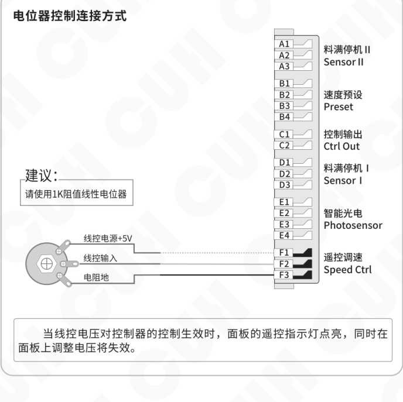

---

2023-11　　　　　　　　　　　　　　　　　-13-　　　　　　　　　　　　　　　　　SDMC20_SMS-CN_2.01

### 第 22 页

数字单相交流异步电机控制器  SDMC20-S

## 1~5V 电压控制连接方式

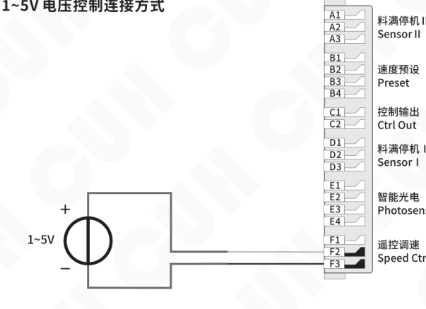

## 4~20mA 电流控制连接方式

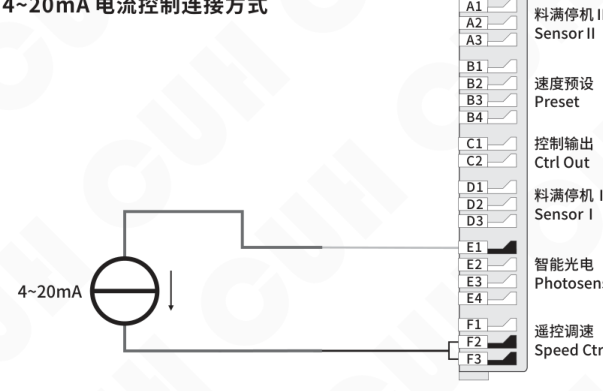

---

2023-11  -14-  SDMC20_SMS-CN_2.01

### 第 23 页

## 5.2 智能光电功能

本控制器的智能光电端口支持发光二极管和光电三极管构成的光电对射或反射传感器。具体接线图如下：

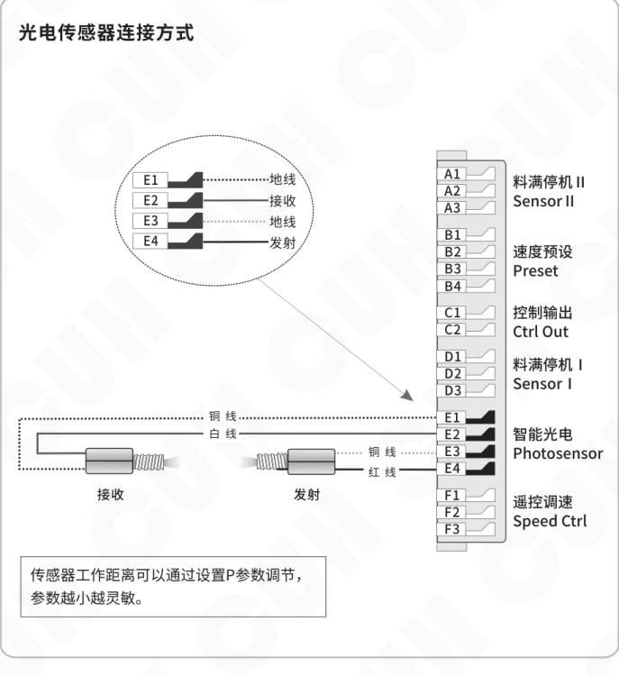

**光电传感器连接方式**

| 端子 | 连接/功能 | 对应传感器引线 |
|---|---|---|
| E1 | 地线 | 接收端：铜线 |
| E2 | 接收 | 接收端：白线 |
| E3 | 地线 | 发射端：铜线 |
| E4 | 发射 | 发射端：红线 |

| 端子组 | 中文功能 | 英文标识 |
|---|---|---|
| A1、A2、A3 | 料满停机Ⅱ | Sensor II |
| B1、B2、B3、B4 | 速度预设 | Preset |
| C1、C2 | 控制输出 | Ctrl Out |
| D1、D2、D3 | 料满停机Ⅰ | Sensor I |
| E1、E2、E3、E4 | 智能光电 | Photosensor |
| F1、F2、F3 | 遥控调速 | Speed Ctrl |

传感器工作距离可以通过设置P参数调节，参数越小越灵敏。

### 第 24 页

数字单相交流异步电机控制器　　　　　　　　　　　　　　　　　SDMC20-S

## 5.3 料满停机功能

料满停机端口可以支持NPN、PNP、Ut1、Ut0模式。其中：

**Ut1模式为单次扫描**，即传感器信号无效前一直通过变换高低电平检测端口是否有效，发现有效信号后确定端口传感器类型且不再扫描。

**Ut0模式为连续扫描**，不管传感器类型如何始终通过变换高低电平检测端口是否接入有效信号。

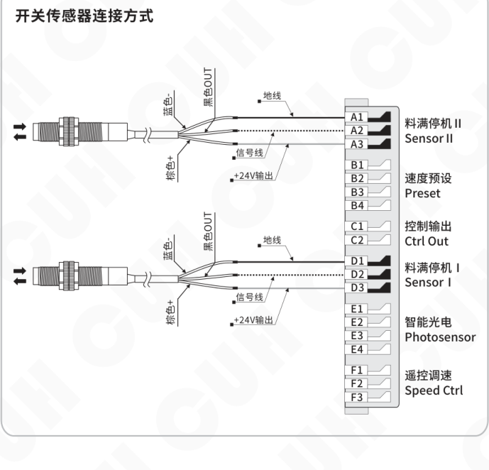

### 第 25 页

数字单相交流异步电机控制器　　　　　　　　　　　　　　　　　　　　　　　　　SDMC20-S

## 5.4 控制输出功能

控制输出端口可以支持NPN输出、PNP输出和推挽输出。其中：

- NPN输出有效为低电平，输出无效为高阻态；
- PNP输出有效为高电平，输出无效为高阻态；
- 推挽输出有效为高电平，无效为低电平。

### 5.4.1 控制输出的接线方法

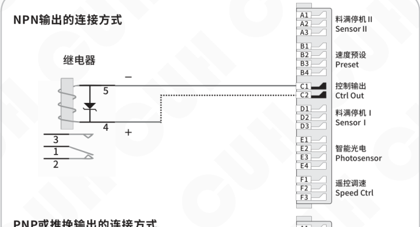

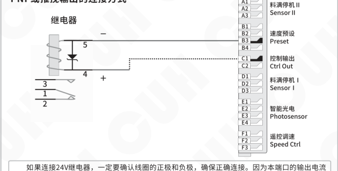

如果连接24V继电器，一定要确认线圈的正极和负极，确保正确连接。因为本端口的输出电流能力为200mA，接反后继电器的内部保护二极管会将本控制器端口短路，触发短路保护Err07。

2023-11　　　　　　　　　　　　　　　　　-17-　　　　　　　　　　　　　　　SDMC20_SMS-CN_2.01

### 第 26 页

### 5.4.2 控制输出信号源和逻辑图

主输出和控制输出的控制是由三个信号源逻辑关系的结果控制，可以从信号源列表中选择下列信号源：

| 信号源 | 含义 |
|---|---|
| 0 | 无效信号 |
| 1 | 有效信号 |
| E | 通道E的智能光电端口信号 |
| -E | 通道E的智能光电端口信号取反 |
| d | 通道D的料满停机端口信号 |
| -d | 通道D的料满停机端口信号取反 |
| A | 通道A的料满停机端口信号 |
| -A | 通道A的料满停机端口信号取反 |
| oC | 通道C的控制输出端口信号 |
| -oC | 通道C的控制输出端口信号取反 |
| oq | 功率主输出端口信号 |
| -oq | 功率主输出端口信号取反 |
| SA | 通道B的速度预置A端口信号 |
| -SA | 通道B的速度预置A端口信号取反 |
| Sb | 通道B的速度预置B端口信号 |
| -Sb | 通道B的速度预置B端口信号取反 |

### 第 27 页

数字单相交流异步电机控制器　　　　　　　　　　　　　　　　　　　　　　　　　SDMC20-S

控制输出逻辑图：

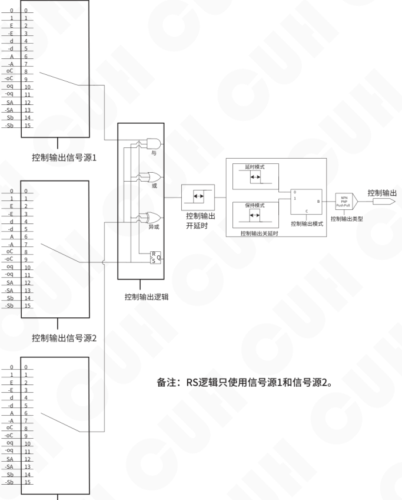

备注：RS逻辑只使用信号源1和信号源2。

2023-11　　　　　　　　　　　　　　　　　-19-　　　　　　　　　　　　　SDMC20_SMS-CN_2.01

### 第 28 页

## 5.4.3 控制输出模式说明

客户可选择2种控制输出模式：延时模式、保持模式。

**延时模式：** 指驱动控制输出的信号由有效变为无效后，控制输出经过一段关延时时间后变为关闭状态。

**保持模式：** 指驱动控制输出的信号变为有效后，控制输出在关延时时间内保持打开，超过关延时时间后变为关闭的状态。

将两种模式的差别以时序图的形式表达如下，其中输入信号是逻辑关系选择器后输出的信号。

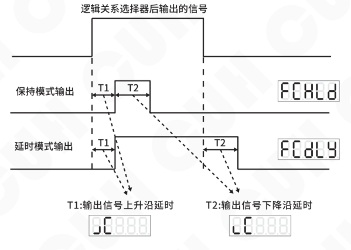

## 5.4.4 主输出信号控制功能

主输出的信号控制功能与控制输出相似，选择三个信号源进行逻辑关系运算后经过开关延时和模式选择及逻辑方向控制得到控制信号，该控制信号与面板的启停信号进行逻辑与操作后发送给功率板进行输出启停的控制。

主输出信号控制接线方法、信号源及逻辑图可参考控制输出功能。

### 第 29 页

数字单相交流异步电机控制器　　　　　　　　　　　　　　　　　　　　　　　　　SDMC20-S

## 5.5 速度预置功能

速度预置功能是通过外部控制信号直接选择预定速度的功能。通过该功能，外部控制设备，如PLC、计算机、传感器等其他的信号源可以方便地与本控制器组成多档速度送料控制系统。

本机共有两条速度预置开关控制信号，控制速度开关A和速度开关B，两条线都是低电平有效。

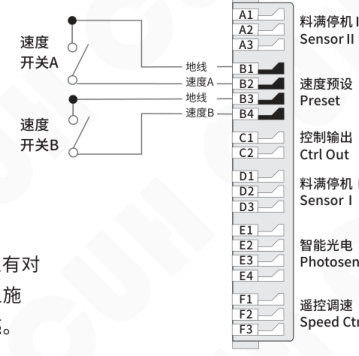

每条控制线的状态在面板上有对应的指示灯显示。当在控制线上施加有效信号时，对应指示灯点亮。

两个灯的亮灭状态组合有4种状态（A亮B灭，A灭B亮，AB全亮，AB全灭）。

通过控制信号的选择，控制器将进入对应的速度预置。此时，控制器的输出可以通过 `+` 或 `−` 进行调整。该速度将被自动记忆。任何时刻速度预置控制信号设置控制器进入该状态后都将立刻切换输出到该速度。

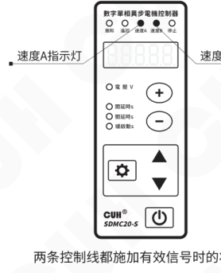

2023-11　　　　　　　　　　　　　　　　　-21-　　　　　　　　　　　　　　　　　SDMC20_SMS-CN_2.01

### 第 30 页

数字单相交流异步电机控制器　　　　　　　　　　　　　　　　　SDMC20-S

---

## 5.6 电机正反转调整

本控制器可通过调整输出接头位置实现电机的正反转。

- **拔下电源插头，断开电源。**
- 打开控制器上盖。
- 电机输出线默认插在电路板上侧的 CW 插座位置，拔下 CW 处插头，插在下方空的 CCW 插座处，即可实现电机反转。

CW、CCW 在电路板上的位置：

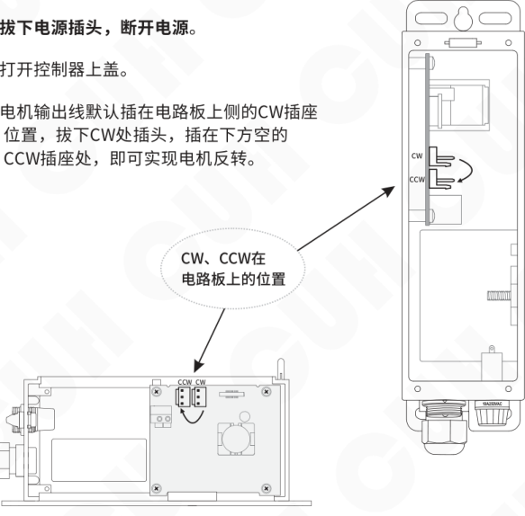

> **注意：一定要断电操作！**

---

2023-11　　　　　　　　　　　　　-22-　　　　　　　　　　　　　SDMC20_SMS-CN_2.01

### 第 31 页

数字单相交流异步电机控制器  
SDMC20-S

## 5.7 电机堵转保护功能

本控制器具有电机堵转保护功能，当控制器有输出并检测到电机堵转3秒后，会启动堵转保护停止控制器输出，并产生Err22错误，直至故障排除，重新按启动键恢复电机启动。

用户可以通过设置电机的最低转速来限制电机被堵转的能力，比如当前设定的转速为150，最低转速设置成70，当电机发生过载导致转速低于70时，此时会触发堵转保护。

> » 长按 ⚙ 和 ▲，进入高级参数界面。  
>  
> » 短按 ▲ 或 ▼ 切换到SS，即“电机最低转速”参数。  
>  
> » 通过 ＋ 和 － 调整参数值。  
>  
> » 当电机转速低于设定的最低转速值时，触发堵转保护，显示Err22，控制器停止输出。  
>  
> » 排除堵转故障后，重新按 ⏻ 恢复输出。

触发堵转保护，显示 Err22：

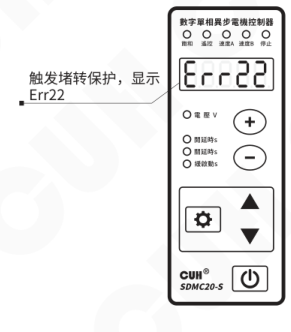

☻

- 缓启动时间内，堵转保护功能不作介入。
- 确保设定转速不低于设定的最低转速，否则会触发堵转保护。
- 电机开环控制下不具有堵转保护功能。

2023-11　　-23-　　SDMC20_SMS-CN_2.01

### 第 32 页

## 5.8 参数监控功能

本控制器可以监控部分运行参数，给操作人员提供参考，方便调试。

- 长按 <kbd>⚙</kbd> 和 <kbd>▼</kbd>，进入监控参数界面。
- 短按 <kbd>▲</kbd> 或 <kbd>▼</kbd> 选择需要监控的参数。
- 监控参数的参数值不可修改。

示例：`S.` 表示测速参考值参数。

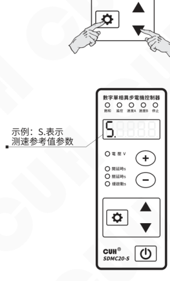

**本控制器的监控参数包括：**

模拟调速F口电压 `FU`、智能光电E口信号差值 `EU`、传感器A口信号电压 `AU`、传感器D口信号电压 `dU`、控制输出C口输出电压 `CU`、24V口电压 `nU`、测速参考值 `S.`。

### 第 33 页

数字单相交流异步电机控制器　　　　　　　　　　　　　　　　　　　　　　　　　SDMC20-S

## 5.9 参数密码锁功能

本控制器可对关键参数进行锁定，防止用户误操作。参数表中带“*”标注的参数，可使用参数密码锁进行锁定。

> » 长按 ⚙ 和 ▲，进入高级参数界面。  
> » 短按 ▲ 或 ▼ 切换到 `J.`，即“密码锁定参数范围”参数，该参数用来设置密码。  
> » 通过 ＋ 和 － 调整参数值。  
> » 设定好参数密码后，退出当前界面再进入，可以看到参数值消失。  
> » 进入高级参数界面，切换到 `J`，即“密码锁”参数，输入之前录入的密码，即可看到消失的设置密码参数，进而修改密码。

密码锁参数值遵循421码规则：

| 锁定参数项 | 传感器类型 | 最大输出电压限制 | 控制输出类型 | 控制输出逻辑关系选择 | 控制输出第三信号源 | 控制输出第二信号源 | 控制输出第一信号源 | 主输出逻辑关系选择 | 主输出第三信号源 | 主输出第二信号源 | 主输出第一信号源 | 输出频率 |
|---|---|---|---|---|---|---|---|---|---|---|---|---|
| 1: 锁定 | 1 | 1 | 1 | 1 | 1 | 1 | 1 | 1 | 1 | 1 | 1 | 1 |
| 0: 不锁定 | 0 | 0 | 0 | 0 | 0 | 0 | 0 | 0 | 0 | 0 | 0 | 0 |
| 乘系数 | 4 | 2 | 1 | 4 | 2 | 1 | 4 | 2 | 1 | 4 | 2 | 1 |
| 密码值范围（求和） | 0~7 （密码值第1位） |  |  | 0~7 （密码值第2位） |  |  | 0~7 （密码值第3位） |  |  | 0~7 （密码值第4位） |  |  |
| 举例1 | 0 | 0 | 0 | 0 | 0 | 0 | 0 | 0 | 0 | 0 | 0 | 1 |
|  | 0 |  |  | 0 |  |  | 0 |  |  | 1*1=1 |  |  |
| 举例2 | 1 | 0 | 0 | 0 | 0 | 1 | 0 | 0 | 0 | 0 | 0 | 1 |
|  | 1*4=4 |  |  | 1*1=1 |  |  | 0 |  |  | 1*1=1 |  |  |
| 举例3 | 0 | 0 | 0 | 0 | 0 | 0 | 0 | 0 | 0 | 1 | 1 | 1 |
|  | 0 |  |  | 0 |  |  | 0 |  |  | 1*4+1*2+1*1=7 |  |  |

举例1：锁定输出频率，12组二进制编码为000000000001，设定密码值为0001。  
举例2：锁定输出频率，传感器类型和控制输出第二信号源，12组二进制编码为100001000001，设定密码值为4101。  
举例3：锁定输出频率，主输出第一信号源和主输出第二信号源，12组二进制编码为000000000111，设定密码值为0007。

“密码锁定参数范围”设置为9999时，锁定所有“*”标参数。

---

2023-11　　　　　　　　　　　　　　　　　-25-　　　　　　　　　　　　　　　　　SDMC20_SMS-CN_2.01

### 第 34 页

数字单相交流异步电机控制器　　　　　　　　　　　　　　　　　　　　　　　　　SDMC20-S

## 5.10 控制振动盘模式

本控制器可连接振动盘，连接方式如下：

**输出线默认连接电路板CW位置的连接方式**

断开电源，将输出线的红线和黑线连接振动盘。

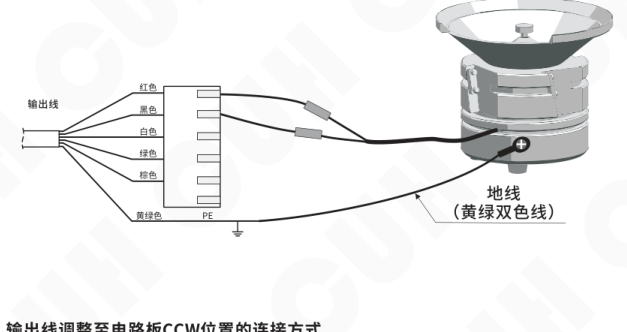

**输出线调整至电路板CCW位置的连接方式**

如果之前打开舱盖并调整过输出线从CW至CCW位置，请将输出线的红线和白线连接振动盘。

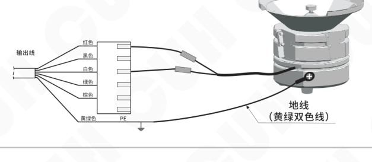

2023-11　　　　　　　　　　　　　　　　　-26-　　　　　　　　　　　　　　　　　SDMC20_SMS-CN_2.01

### 第 35 页

数字单相交流异步电机控制器　　　　　　　　　　　　　　　　　SDMC20-S

- 长按 ⚙ 和 ▲，进入高级参数界面。
- 短按 ▲ 或 ▼ 切换到“控制器控制对象”参数 SF，将参数值调整为 0，即为控制振动盘模式。
- 回到主界面后，控制器显示“U”，即可调整电压值。

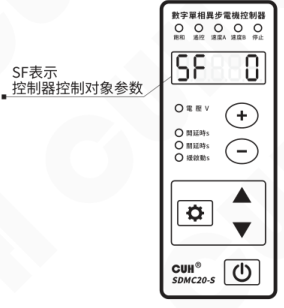

> **注意**
>
> 1、一定要确保控制器输出线接线正确，否则可能会因为误将振动盘电感与内部电容串接产生谐振而导致控制器损坏！
>
> 2、电源输出禁止连接压电类负载，否则可能导致**电击安全事故**！

2023-11　　　　　　　　　　　　　　　　　-27-　　　　　　　　　　　　　　　SDMC20_SMS-CN_2.01

### 第 36 页

## 5.11 设置成SDVC21-S功能

本控制器兼容SDVC21-S的所有功能，用户如果需要使用控制器控制振动盘而又不习惯使用当前界面（现代参数界面）进行操作，可以通过另一种恢复出厂设置的方式将参数界面恢复成传统的SDVC21-S界面，方便老用户调试振动盘。

- 长按 ⚙ 和 ▲，进入高级参数界面。
- 短按 ▲ 切换到全屏闪烁状态，即“恢复出厂设置”参数，此时长按 ＋，直到控制器显示“-----”，表示控制器已经恢复至传统参数界面。

恢复出厂设置参数设定完成：

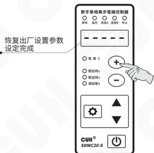

- 松开 ＋，控制器显示CUH后，随即进入输出电压调整状态“U”，此时控制器的操作方法和参数组与传统的SDVC21-S完全一致。

控制器恢复至传统参数界面：

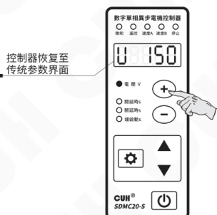

### 第 37 页

数字单相交流异步电机控制器　　　　　　　　　　　　　　　　SDMC20-S

**传统参数界面**下的按键操作方法：

a. 任何界面下短按 ▼ 或 ▲ 调节电压参数。

b. 长按 `设置` 进入/退出基本参数界面，短按 `设置` 选择基本参数，短按 ▼ 或 ▲ 调节参数值。

c. 长按 `设置` 加 ▲ 进入/退出高级参数界面，短按 `设置` 选择高级参数，短按 ▼ 或 ▲ 调节参数值。

d. 短按 `⏻` 暂停/恢复输出，长按 `⏻` 锁定/解锁键盘。

e. 恢复出厂设置参数下，长按 ▲ 显示  恢复到传统参数界面，长按 ▼ 显示  恢复到现代参数界面，即SDMC20-S新界面。

f. SDVC21-S默认为传统参数界面，SDMC20-S默认为现代参数界面。

SDVC21-S传统界面下的参数表如下：

| 参数类别 | 含义 | 参数符号 | 数码管符号图片 | 取值范围 | 默认设置 |
|---|---|---|---|---|---|
| 常用参数 | 输出电压 | U（[U]） | 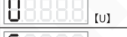 | 0~250 伏特（V） | 150 |
| 基本参数 | 输出频率 | E（[E]） |  | FULL，HALF | FULL |
|  | 智能光电开延时 | J（[大勾]） | 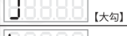 | 0.0~9.9 秒（s） | 0.2 |
|  | 智能光电关延时 | L（[大L]） | 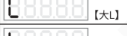 | 0.0~9.9 秒（s） | 0.2 |
|  | 缓启动时间 | t（[小T]） | 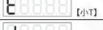 | 0.0~9.9 秒（s） | 1.0 |
| 高级参数 | 开关传感器开延时 | J（[勾中]） | 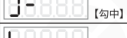 | 0.0~9.9 秒（s） | ---（与 J 相同） |
|  | 开关传感器关延时 | L（[L中]） | 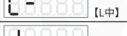 | 0.0~9.9 秒（s） | ---（与 L 相同） |
|  | 第二个开关传感器开延时 | J（[勾下]） | 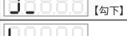 | 0.0~9.9 秒（s） | ---（与 J 相同） |
|  | 第二个开关传感器关延时 | L（[L下]） | 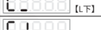 | 0.0~9.9 秒（s） | ---（与 L 相同） |
|  | 智能光电逻辑方向 | n1（[涛1]） | 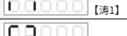 | 常通---，常断-- | 常通--- |
|  | 开关传感器逻辑方向 | n2（[涛2]） | 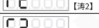 | 常通---，常断-- | 常通--- |
|  | 控制输出逻辑方向 | n3（[涛3]） | 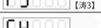 | 常通---，常断-- | 常通--- |
|  | 第二个开关传感器逻辑方向 | n4（[涛4]） | 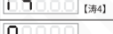 | 常通---，常断-- | 常通--- |
|  | 控制信号逻辑关系 | N（[大恩]） | 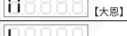 | 或--；与--；异或-- | 与-- |
|  | 最大输出电压限制 | h（[小H]） | 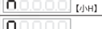 | 0~250 伏特（V） | 220 |
|  | 智能光电灵敏度 | P（[P]） | 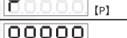 | 0~1000 | 80 |
|  | 恢复出厂设置 | 88888（[全8]） | 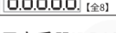 | —— | —— |

具体操作说明参考SDVC21-S的用户手册IDP1000377。

2023-11　　　　　　　　　　　　-29-　　　　　　　　　　　　SDMC20_SMS-CN_2.01

### 第 38 页

# 第六章 技术规格

## 6.1 外形尺寸

外形尺寸图（单位：毫米mm）

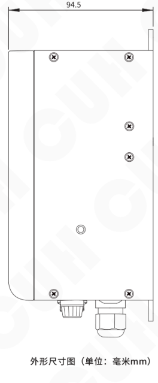

| 公差区间 | 公差值 |
|---|---|
| 0~3 | ±0.05 |
| 3~10 | ±0.1 |
| 10~30 | ±0.15 |
| 30~80 | ±0.2 |
| 80~180 | ±0.3 |
| >180 | ±0.5 |

本系列产品均适用此公差表。

### 第 39 页

数字单相交流异步电机控制器　　　　　　　　　　　　　　　　　　　　　　　　　SDMC20-S

## 6.2 技术规格表

| 项目 | 最小值 | 典型值 | 最大值 | 单位 | 备注 |
|---|---:|---:|---:|---|---|
| 输入电压 | 85 | 220 | 250 | 伏特（V） | 交流有效值 |
| 输出电压调整范围 | 35 | —— | Vin-10 | 伏特（V） | 半波 |
|  | 45 | —— | Vin-5 |  | 全波 |
| 电压调整精度 |  | 1 |  | 伏特（V） |  |
| 稳压精度 | —— | —— | 30 | 伏特（V） | Vset = 150V △Vin+ = 70V |
| 稳压响应时间 | 0 | 0.01 | 0.02 | 秒（s） |  |
| 输出电流调整范围 | 0 | —— | 5 | 安培（A） |  |
| 输出功率 | 0 | —— | 1100 | 伏安（VA） |  |
| 输出频率 | 45 | 50/60 | 65 | 赫兹（Hz） | 半波 |
|  | 90 | 100/120 | 130 |  | 全波 |
| 输出波形 |  | 正弦相切 |  |  |  |
| 缓启动时间 | 0 | —— | 9.9/10.0 传统界面/现代界面 | 秒（s） | 出厂默认1.0 |
| 延迟时间范围 | 0 | —— | 9.9/99.9 传统界面/现代界面 | 秒（s） | 出厂默认0.2 |
| 延迟时间精度 |  | 0.1 |  | 秒（s） |  |
| 过热保护温度 | 58 | 60 | 66 | 摄氏度（℃） |  |
| 短路保护动作电流 | —— | 6.3 | —— | 安培（A） | 保险丝容量 |
| 直流控制输出电压 | 22 | 24 | 26 | 伏特（V） |  |
| 直流控制输出电流 | 0 | —— | 400 | 毫安（mA） |  |
| 模拟控制信号 |  | 1~5/4~20 |  | 伏特（V）/毫安（mA） | 远程速度控制电压/电流 |
| 数字控制信号 |  | 24 |  | 伏特（V） | 开关信号控制 |
| 调整方式 |  | 6 |  | 键（Button） |  |
| 保险丝容量 |  | 6.3 |  | 安培（A） |  |
| 空载功耗 | —— | 2 | —— | 瓦特（W） |  |
| 显示方式 |  | 5 |  | 位（Digit） | LED数码管 |
| 工作环境温度 | 0 | 25 | 40 | 摄氏度（℃） |  |
| 工作环境湿度 | 10 | 60 | 85 | 相对湿度（%） | 不结露 |
| 存储环境温度 | -20 | 25 | 85 | 摄氏度（℃） |  |

2023-11　　　　　　　　　　　　　　　　　-31-　　　　　　　　　　　　　　　　　SDMC20_SMS-CN_2.01

### 第 40 页

数字单相交流异步电机控制器　　　　　　　　　　　　　　　　　SDMC20-S

## 6.3 参考标准

| 项目 | GB 标准 | IEC 标准 | 等级 | 标准要求 | 备注说明 |
|---|---|---|---|---|---|
| 极限参数：超过此指标将会造成严重损坏，必须严格遵守！ ||||||
| 静电放电 | GB/T 17626.2-2006 | IEC 61000-4-2:2001 | 4 | ±8 kV | 接触放电 |
| 静电放电 | GB/T 17626.2-2006 | IEC 61000-4-2:2001 | 4 | ±15 kV | 空气放电 |
| 电快速瞬变 脉冲群 | GB/T 17626.4-2008 | IEC 61000-4-4:2004 | 4 | ±4 kV |  |
| 直流电源纹 波抗扰度 | GB/T 17626.17-2005 | IEC 61000-4-17:2002 | 4 | 15% | 评价 A |

> **警告**  
> 在民用环境中，本产品可能产生无线电干扰。在这种情况下，可能需要采取附加抑制措施。

2023-11　　　　　　　　　　　　　　　　　-32-　　　　　　　　　　　　　　　　　SDMC20_SMS-CN_2.01

### 第 41 页

数字单相交流异步电机控制器　　　　　　　　　　　　　　　　　　　　　　　　　　　SDMC20-S

# 第七章 附录

## 7.1 参数列表

| 参数类别 | 含义 | 参数符号 | 数码管符号图片 | 取值范围 | 默认设置 |
|---|---|---|---|---|---|
| 常用参数 | 输出电压 | U［U］ |  | 0~250 伏特（V） | 150 |
|  | 设定速度（仅参数SF设置为2时） | S［S］ |  | 0~999 | 150 |
| 基本参数 | 输出频率（仅SDVC21S可调节） | E［E］ |  | FULL，HALF | FULL |
|  | 智能光电开延时 | J［大勾］ |  | 0.0~99.9 秒（s） | 0.2 |
|  | 智能光电关延时 | L［大L］ |  | 0.0~99.9 秒（s） | 0.2 |
|  | 缓启动时间 | t［小T］ |  | 0.0~10.0 秒（s） | 1.0 |
|  | 缓关闭时间 | ƚ［反T］ |  | 0.0~10.0 秒（s） | 1.0 |
| 高级参数 | 传感器D口开延时 | J-［勾中］ |  | 0.0~99.9 秒（s） | --- （与J相同） |
|  | 传感器D口关延时 | L-［L中］ |  | 0.0~99.9 秒（s） | --- （与L相同） |
|  | 传感器A口开延时 | J_［勾下］ |  | 0.0~99.9 秒（s） | --- （与J相同） |
|  | 传感器A口关延时 | L_［L下］ |  | 0.0~99.9 秒（s） | --- （与L相同） |
|  | 主输出第一信号源 | Eq［EQ］ |  | 0, 1, E, -E, d, -d, A, -A, oC, -oC, oq(主输出状态), -oq, SA, -SA, Sb, -Sb | E |
|  | 主输出第二信号源 | Eq.［EQ点］ |  | 0, 1, E, -E, d, -d, A, -A, oC, -oC, oq(主输出状态), -oq, SA, -SA, Sb, -Sb | d |
|  | 主输出第三信号源 | E.q［E点Q］ |  | 0, 1, E, -E, d, -d, A, -A, oC, -oC, oq(主输出状态), -oq, SA, -SA, Sb, -Sb | A |
|  | 主输出逻辑关系选择 | nQ［大恩Q］ |  | And与, or或, Hor异或, rS触发器 | or |
|  | 主输出开延时 | Jq［小JQ］ |  | 0.0~99.9 秒（s） | 0.0 |
|  | 主输出关延时 | Lq［小LQ］ |  | 0.0~99.9 秒（s） | 0.0 |
|  | 主输出模式 | Fq［FQ］ |  | dLy 延时模式，HLd 保持模式 | dLy |
|  | 主输出逻辑方向 | Ɔq［反小CQ］ |  | 同相---，取反-.- 常开 on，常关 oFF | 取反-.- |
|  | 控制输出第一信号源 | EC［EC］ |  | 0, 1, E, -E, d, -d, A, -A, oC, -oC, oq(主输出状态), -oq, SA, -SA, Sb, -Sb | 0 |
|  | 控制输出第二信号源 | EC.［EC点］ |  | 0, 1, E, -E, d, -d, A, -A, oC, -oC, oq(主输出状态), -oq, SA, -SA, Sb, -Sb | 0 |
|  | 控制输出第三信号源 | E.C［E点C］ |  | 0, 1, E, -E, d, -d, A, -A, oC, -oC, oq(主输出状态), -oq, SA, -SA, Sb, -Sb | oq |
|  | 控制输出逻辑关系选择 | nC［大恩C］ |  | And与, or或, Hor异或, rS触发器 | or |
|  | 控制输出开延时 | JC［小JC］ |  | 0.0~99.9 秒（s） | 0.0 |

2023-11　　　　　　　　　　　　　　-33-　　　　　　　　　　　　　　SDMC20_SMS-CN_2.01

### 第 42 页

数字单相交流异步电机控制器　　　　　　　　　　　　　　　　　　　　　　　　　　　SDMC20-S

| 参数类别 | 含义 | 数码管符号图片 | 参数符号 | 取值范围 | 默认设置 |
|---|---|---|---|---|---|
| 高级参数 | 控制输出关延时 |  | [小LC] | 0.0~99.9 秒（s） | 0.0 |
|  | 控制输出模式 |  | [FC] | dLy 延时模式，HLd 保持模式 | dLy |
|  | 控制输出逻辑方向 |  | [反小CC] | 同相 ---，取反 --- 常开 on，常关 oFF | 同相 |
|  | 控制输出类型 * |  | [涛C] | nPn, PnP, PSP（推挽）, In | nPn |
|  | 最大输出电压限制 * |  | [小H] | 0~250 伏特（V） | 220 |
|  | 传感器类型 * |  | [涛A] | nPn, PnP ut1（单次扫描）, ut0（连续扫描） | ut0 |
|  | 智能光电灵敏度 |  | [P] | 0~1000 | 80 |
|  | 最大速度 |  | [H点] | 0~999 | 300 |
|  | 速度调整比例系数 |  | [PA] | 0~999 | 70 |
|  | 速度调整积分系数 |  | [一A] | 0~999 | 180 |
|  | 速度调整微分系数 |  | [DA] | 0~999 | 50 |
|  | 电机最低转速 |  | [SS] | 0~999 | 70 |
|  | 控制器控制对象 |  | [SF] | 0：振动盘， 1：电机(速度开环)，2：电机(速度闭环) | SDVC21S: 0 SDMC20S: 2 |
|  | 密码锁定参数范围 |  | [反F点] | 0~9999 | 0 |
|  | 密码锁 |  | [反F] | 0~9999 | 0 |
|  | 恢复出厂设置 |  | [全8] | —— | —— |
| 监控参数 | 模拟调速F口电压 |  | [FU] | 0.0~5.0 伏特（V） | —— |
|  | 智能光电E口信号差值 |  | [EU] | 1~1000 | —— |
|  | 传感器A口信号电压 |  | [AU] | 0.0~28.0 伏特（V） | —— |
|  | 传感器D口信号电压 |  | [dU] | 0.0~28.0 伏特（V） | —— |
|  | 控制输出C口输出电压 |  | [CU] | 0.0~28.0 伏特（V） | —— |
|  | 24V口电压 |  | [nU] | 0.0~28.0 伏特（V） | —— |
|  | 测速参考值 |  | [S点] | 0~999 | —— |

备注：

1. “ * ” 标参数（共12个）为密码锁定对象；
2. “密码锁定参数范围” 设置为9999时，锁定所有 “ * ” 标参数。

2023-11　　　　　　　　　　　　　　　　-34-　　　　　　　　　　　　　　　　SDMC20_SMS-CN_2.01

### 第 43 页

数字单相交流异步电机控制器　　　　　　　　　　　　　　　　　　　　　　　　　SDMC20-S

## 7.2 输入输出电路图

2023-11　　　　　　　　　　　　　　　　　-35-　　　　　　　　　　　　　　　　　SDMC20_SMS-CN_2.01

### 第 44 页

数字单相交流异步电机控制器　　　　　　　　　　　　　　　　　　　　　　　　　SDMC20-S

**控制输出C端口**

- C2：24V输出
- C1：输出
- 图中标注：24V、28V、过流保护电路

**速度预设B端口**

- B2/B4：输入
- B1/B3：地线
- 图中标注：24V、6.8KΩ、自动类型检测

### 第 45 页

数字单相交流异步电机控制器　　　　　　　　　　　　　　　　　　　　　　　　　SDMC20-S

## 7.3 故障诊断

| 故障现象/故障代码 | 数码管符号图片 | 含义 | 排除方法 |
|---|---|---|---|
| 打开开关，没有显示 |  |  | ◆ 请检查电源插座是否有电？ ◆ 电源插头是否可靠连接插座？ |
| 有显示，但是振动盘不动，也没有声音 |  |  | ◆ 请检查输出电缆是否正确地连接控制器与振动盘？ ◆ 请检查控制器参数，是否输出电压调节的太小？ ◆ 请检查控制信号是否将控制器置于“停止”状态？ ◆ 请检查是否有设置为“常断”的参数，导致控制器被置于“停止”状态？ |
| 控制信号不起作用 |  |  | ◆ 请检查控制信号是否正确输入？ ◆ 请检查输入的控制信号的地线是否与本机地正确连接？ ◆ 请检查控制信号逻辑关系设置是否是您期望的设置？ |
| 周期性忽大忽小 （拍频现象） |  |  | ◆ 请检查多个振动体间的振动耦合问题。 ◆ 调整相互耦合的振动设备的工作频率，使频率差更大。 |
| 有显示，振动盘不动，但是可以听到声音 |  |  | ◆ 请按照说明书介绍的调节方法逐步调节各参数。 |
| Err02 |  | 过流保护 | ◆ 适当降低输出电压，然后尝试重新启动输出。 |
| Err03 |  | 过热保护 | ◆ 将本控制器安装在通风良好的环境中。 |
| Err05 |  | 内部通信异常 | ◆ 确保未在24V电源端口接入任何外部电源或联系本公司技术支持。 |
| Err06 |  | 温度传感器异常 | ◆ 确保不在-20摄氏度以下工作或联系本公司技术支持。 |
| Err07 |  | D口过流保护 | ◆ 确保D口负载未短路且电流未超过400mA，然后尝试重新启动输出。 |
| Err10 |  | 24V电源输出异常 | ◆ 确保24V输出未被短路或超过400mA电流。 |
| Err11 |  | 调速A口5V输出异常 | ◆ 确保调速端口A3的5V输出未被短路或接入高于5V的电压。 |
| Err20 |  | 主输出输入信号RS 逻辑错误 | ◆ 确保RS触发器两个输入信号不同时有效。 |
| Err21 |  | 控制输出输入信号 RS逻辑错误 | ◆ 确保RS触发器两个输入信号不同时有效。 |
| Err22 |  | 电机堵转故障 | ◆ 确保电机负载没有过载或电机没有堵转。 ◆ 确保电机实际转速不低于设定的最低转速值。 |

2023-11　　　　　　　　　　　　　　　　　-37-　　　　　　　　　　　　　SDMC20_SMS-CN_2.01

### 第 46 页

数字单相交流异步电机控制器　　　　　　　　　　　　　　　　　　　　SDMC20-S

# 第八章 产品质保信息

## 8.1 质保期

本公司为本产品提供的质保期为三年，从产品发送到购买方指定地点之日算起。

## 8.2 保修范围

（一）如果在上述质保期内出现本公司造成的故障，我们将免费维修产品。但是以下情况不属于保修范围：

- a、未按照简易说明书、用户手册或购买方与本公司专门达成的技术要求中规定的条件、环境下的不正确操作，或不正确使用造成的故障。
- b、故障不是因产品缺陷，而是购买方设备或软件设计造成的。
- c、非本公司人员进行的修改或修理而造成的故障。
- d、按照简易操作指南或用户手册正确维修或更换易损部件等规定可以完全避免的故障。
- e、产品从本公司发货后，因无法预料的科学技术水平变化等因素而造成的故障。
- f、由于火灾、地震、洪水等自然灾害，或异常电压等外部因素造成的故障，本公司不负责保修。

（二）保修范围仅限于（一）中规定的情况，本公司对该设备造成的购买方间接损失（如设备损坏、机会丧失、利润损失等）或其他损失，不承担任何责任。

## 8.3 产品适用性

本公司的该控制器是针对电机控制和振动送料行业的通用产品而设计生产的。因此，本公司的该控制器不得用于下列应用且不适合其使用。

（一）对生命和财产有严重影响的设施，如核发电厂、机场、铁路、轮船、机动装置及医疗设备。

（二）公共事业，包括电力、气体、供水等。

（三）相似条件或环境的户外使用。

2023-11　　　　　　　　　　　　　　　　　　-38-　　　　　　　　　　SDMC20_SMS-CN_2.01

### 第 47 页

*（本页 `page_markdown` 为空。）*

### 第 48 页

南京创优科技有限责任公司  
网址:www.cuhnj.com  
电话:025-84730416  
传真:025-84730426  
邮箱:sales@cuhnj.com  
地址:南京市江宁区智能路9号  
启迪城学研园2幢

文档编号：IDP1000303
<!-- /auto:ai-body-draft v1 -->

<!-- auto:data-params-summary v1 -->
## 附录 · 参数表（结构化侧车·机器生成）

> 说明：本节由 `data/<doc_key>/params/params.yaml` 自动渲染（展示前若干行），用于校对与二次开发。定稿以层 C 数据为准。

| 参数 | 标志/符号 | 范围 | 默认 | 单位 | 备注 |
| --- | --- | --- | --- | --- | --- |
|    **危险** |  |  |  |  |  |
|    **警告** |  |  |  |  |  |
|    **小心** |  |  |  |  |  |
|  **注意** |  |  |  |  |  |
|  **要点** ！ |  |  |  |  |  |
|  A1 |  |  |  |  |  |
|  A2 |  |  |  |  |  |
|  A3 |  |  |  |  |  |
|  B1 |  |  |  |  |  |
|    B2 |  |  |  |  |  |
|    B3 |  |  |  |  |  |
|    B4 |  |  |  |  |  |
|   |  |  |  |  |  |
|    C1 |  |  |  |  |  |
|    C2 |  |  |  |  |  |
|   |  |  |  |  |  |
|    D1 |  |  |  |  |  |
|    D2 |  |  |  |  |  |
|    D3 |  |  |  |  |  |
|   |  |  |  |  |  |
|    E1 |  |  |  |  |  |
|  E2 |  |  |  |  |  |
|  E3 |  |  |  |  |  |
|  E4 |  |  |  |  |  |
|   |  |  |  |  |  |
|   F1 |  |  |  |  |  |
|   F2 |  |  |  |  |  |
|   F3 |  |  |  |  |  |
|    0 |  |  |  |  |  |
|      1 |  |  |  |  |  |

*（仅展示前 30 条，共 169 条；完整数据见下方链接。）*

- 完整 YAML：`data/cuh.sdvc.manual.v2.01/params/params.yaml`
- 表格索引：`data/cuh.sdvc.manual.v2.01/index.yaml`
<!-- /auto:data-params-summary v1 -->
