## 目录

> 下列条目来自 PDF 内置书签/大纲；链接指向本批转换生成的整页渲染图（`assets/pages/`），便于与原版 PDF 对照校对。

- [1: 封面](assets/pages/page-0001.png)（第 1 页）
- [2: 封二版权与免责](assets/pages/page-0002.png)（第 2 页）
- [3: 序言](assets/pages/page-0003.png)（第 3 页）
- [4: 安全与预防措施](assets/pages/page-0004.png)（第 4 页）
- [5: 工作与储存环境](assets/pages/page-0005.png)（第 5 页）
- [6: 空白页](assets/pages/page-0006.png)（第 6 页）
- [7: 目录](assets/pages/page-0007.png)（第 7 页）
- [8: 目录2](assets/pages/page-0008.png)（第 8 页）
- [第一章 使用前须知](assets/pages/page-0009.png)（第 9 页）
  - [1.1 检查包装内容](assets/pages/page-0009.png)（第 9 页）
  - [1.2 指示灯及按键说明](assets/pages/page-0010.png)（第 10 页）
  - [1.3 外部部件说明](assets/pages/page-0011.png)（第 11 页）
  - [1.4 接线端口说明](assets/pages/page-0011.png)（第 11 页）
  - [1.5 控制器铭牌说明](assets/pages/page-0012.png)（第 12 页）
- [第二章 产品介绍](assets/pages/page-0013.png)（第 13 页）
  - [2.1 产品简介](assets/pages/page-0013.png)（第 13 页）
- [第三章 安装及使用指南](assets/pages/page-0014.png)（第 14 页）
  - [3.1 控制器使用条件](assets/pages/page-0014.png)（第 14 页）
  - [3.2 按键基本操作](assets/pages/page-0014.png)（第 14 页）
  - [3.3 安装使用](assets/pages/page-0015.png)（第 15 页）
- [第四章 基本功能说明](assets/pages/page-0019.png)（第 19 页）
  - [4.1 设定转速/输出电压](assets/pages/page-0019.png)（第 19 页）
  - [4.2 正转运行与反转运行](assets/pages/page-0020.png)（第 20 页）
  - [4.3 缓启动时间](assets/pages/page-0021.png)（第 21 页）
  - [4.4 缓关闭时间/刹车时间](assets/pages/page-0022.png)（第 22 页）
  - [4.5 键盘锁定功能](assets/pages/page-0023.png)（第 23 页）
  - [4.6 恢复出厂设置](assets/pages/page-0024.png)（第 24 页）
- [第五章 高级功能说明](assets/pages/page-0025.png)（第 25 页）
  - [5.1 电机启停和方向控制](assets/pages/page-0025.png)（第 25 页）
  - [5.2 电机旋转方向交换与禁止反转](assets/pages/page-0026.png)（第 26 页）
  - [5.3 电机过功率保护](assets/pages/page-0027.png)（第 27 页）
  - [5.4 电机堵转保护功能](assets/pages/page-0029.png)（第 29 页）
  - [5.5 遥控调速功能](assets/pages/page-0030.png)（第 30 页）
  - [5.6 电机速度数字预置](assets/pages/page-0032.png)（第 32 页）
  - [5.7 开关传感器](assets/pages/page-0033.png)（第 33 页）
  - [5.8 智能光电功能](assets/pages/page-0034.png)（第 34 页）
  - [5.9 运行输出功能](assets/pages/page-0035.png)（第 35 页）
    - [5.9.1 运行输出的接线方法](assets/pages/page-0035.png)（第 35 页）
    - [5.9.2 运行输出信号源和逻辑图](assets/pages/page-0036.png)（第 36 页）
    - [5.9.3 运行输出模式说明](assets/pages/page-0038.png)（第 38 页）
  - [5.10 开机运行状态](assets/pages/page-0039.png)（第 39 页）
  - [5.11 参数监控功能](assets/pages/page-0040.png)（第 40 页）
- [第六章 技术规格](assets/pages/page-0041.png)（第 41 页）
  - [6.1 外形尺寸](assets/pages/page-0041.png)（第 41 页）
  - [6.2 技术规格表](assets/pages/page-0042.png)（第 42 页）
  - [6.3 参考标准](assets/pages/page-0043.png)（第 43 页）
- [第七章 附录](assets/pages/page-0044.png)（第 44 页）
  - [7.1 参数列表](assets/pages/page-0044.png)（第 44 页）
  - [7.2 输入输出电路图](assets/pages/page-0047.png)（第 47 页）
  - [7.3 故障代码、警告代码与预警代码](assets/pages/page-0049.png)（第 49 页）
- [第八章 产品质保信息](assets/pages/page-0050.png)（第 50 页）
  - [8.1 质保期](assets/pages/page-0050.png)（第 50 页）
  - [8.2 保修范围](assets/pages/page-0050.png)（第 50 页）
  - [8.3 产品适用性](assets/pages/page-0050.png)（第 50 页）
## 术语与命名

- 侧车：`glossary/terms.yaml`（机读）、`glossary/zh-CN.md`（人读）；候选表，定稿后并入公司级 `glossary/`。

## 适用范围

- 本文档由 PDF 自动转换生成，正文与插图需人工核对。

## 变更记录

- 2026-06-05 13:29:47：由转换工具从源 PDF 生成首版。

## 正文

<!-- auto:ai-body-draft v1 -->
> 以下为**整页视觉转写**的正文草稿（多模态模型直接输出 Markdown，含 GFM 表； 若配置 `[[vcrop:页:序]]` 占位符，裁剪步骤会插入 `assets/images/` 下 PNG）。**请务必人工校对。**

### 第 1 页

# CUH®

## 数字单相异步电机控制器

**Digital Single Phase Asynchronous Motor Controller**

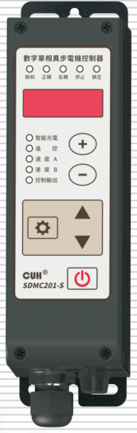

# SDMC201-S

# 用户手册

### 第 2 页

数字单相异步电机控制器  
SDMC201-S

---

## 版权说明

南京创优科技有限责任公司保留所有权利。

本用户手册上包含的所有信息是属于本公司的知识，受著作权法及所有法律的保护。本公司根据著作权法及其他法律享有并保留所有著作权和其他法律赋予的权利，未经本公司书面同意不得以任何形式对本用户手册的部分或全部进行抄袭、翻译、转译、仿制或其他利用。

## 免责声明

本用户手册的所有内容仅说明本公司生产的相关产品的使用方法，并且是根据现有技术和提供给您使用时的状态进行描述的，在您使用本产品时必须自行承担相关风险。除法律强制规定外，本公司不因本用户手册对产品负有任何明示或暗示的责任，包括但不限于人身伤害、财产损失、机会丧失。

您明确了解上述风险并同意，除法律强制规定外，本公司无须为您的任何直接、间接的损害或损失负责（包括但不限于人员、财物、数据等有形损失和名誉、机会等无形损失）。

本公司保留对本用户手册中所适用的产品进行修改而不预先及事后通知的权利。

---

2024-02  
SDMC201SMSCN_1.01

### 第 3 页

数字单相异步电机控制器　　　　　　　　　　　　　　　　　　　　　　　　　SDMC201-S

---

## 序　言

感谢您使用南京创优科技有限责任公司（在本手册中以下简称本公司）出品的SDMC201-S数字单相异步电机控制器（在本手册中以下简称本产品、本控制器或控制器）。本系列控制器是采用高品质元件并融合了最新的电子技术，采用高性能的数字信号处理器经过精心的设计而成。

本手册介绍了本产品的基本操作方法、功能技术说明和典型应用示例。为用户提供安装调试、参数设置、异常诊断、故障排除及日常维护控制器的相关信息。为了确保正确安装和使用本控制器，请在装机之前仔细阅读本用户手册，并请妥善保存。

以下符号提醒您注意有关防止人身伤害和产品损坏的事项，请务必阅读。

| 标志 | 说明 |
|---|---|
| ⚠️ 危险 | 表示若不遵守该事项，将导致人员伤亡。 |
| ⚠️ 警告 | 表示若不遵守该事项，可能导致人员伤亡。 |
| ⚠️ 小心 | 表示若不遵守该事项，可能导致人员遭受中度或轻微伤害。 |
| 注意 | 表示若不遵守该事项，将导致本产品损坏及财产损失。 |
| 要点 | 表示在使用过程中必须要遵守的注意事项和使用限制等。 |

**本说明书适合以下型号控制器：**

◆ 数字单相异步电机控制器　SDMC201-S　（输入单相85~250VAC，输出0~250V/0.4kW）

---

2024-02　　　　　　　　　　　　　　　　　　　　　　　　　SDMC201SMSCN_1.01

### 第 4 页

数字单相异步电机控制器　　　　　　　　　　　　　　　　　　　　　　　　　SDMC201-S

# 安全与预防措施

1. **【危险】** 本产品用于驱动单相交流异步电机，请勿将本产品用于保护人体或人体部位等目的。

2. **【危险】** 本产品不得作为防爆产品使用，请勿在危险场所和/或潜在爆炸气体环境中使用本产品。

3. **【警告】** 本产品是采用交流市电供电的设备，请勿施加交流电压超过 260Vac。施加过大的输入电压如 380Vac，则可能导致产品爆炸或者着火，造成严重的安全事故。

4. **【警告】** 本产品是通过电源线进行接地的，请确保为控制器供电的配电设施具备良好的接地，否则可能导致控制器外壳带电，造成触电事故。

5. **【警告】** 请勿输入交流电源到本控制器的输出端，这会损坏控制器。

6. **【警告】** 请勿在带电的情况下插拔接线或触摸接线仓内各接线端子触点，以防发生触电事故。

7. **【注意】** 请避免采用通过继电器等设备切断供电的方式来控制本产品的输出，这会严重降低本控制器的寿命。

8. **【注意】** 本产品设计使用于阴凉干燥环境，请勿将本产品置于室外、可能会浸水、阳光暴晒场所工作，也不要在超过本产品电气特性要求的温度和湿度范围之外工作。

9. **【要点】** 请务必将本产品固定在可靠接地的坚固平台上，并远离振动设备。

10. **【要点】** 任何情况下请勿将本产品在超越设计极限状态下工作。

11. **【要点】** 请严格按照本手册的说明操作，对于违反这些操作说明所造成的任何人身伤害或财产损失，本公司不承担任何民事和刑事责任。

12. **【要点】** 任何情况下请不要打开本控制器机壳，以防遭到电击。机壳内部没有可以调节和用户维修部分，请不要试图维修本机，出现故障请致电本公司。

---

2024-02　　　　　　　　　　　　　　　　　　　　　　　　　SDMC201SMSCN_1.01

### 第 5 页

数字单相异步电机控制器                SDMC201-S

# 工作与储存环境

## 一、使用前的检查

每台控制器在出厂前，均经过严格的品质检验，并经过强化的防撞包装处理。客户在拆箱后，请即刻进行下列检查：

1. 检查控制器是否在运输过程中受到损伤。
2. 检查控制器型号是否与订货登记资料完全相同。

## 二、工作环境

为使本控制器具有更好的使用效果和更长的使用寿命，请将控制器安装在符合下列条件的环境中：

- 良好的通风散热环境
- 远离水滴、蒸气、灰尘，（特别是油性灰尘）
- 无腐蚀、易燃性的气体、液体
- 无漂浮性的尘埃及金属微粒
- 安装表面坚固无振动
- 远离电磁噪声干扰
- 使用环境温度为0℃到40℃
- 仅适用于海拔2000m以下地区安全使用

---

2024-02                SDMC201SMSCN_1.01

### 第 6 页

数字单相异步电机控制器　　　　　　　　　　　　　　　　　　　　　　　　　SDMC201-S

---

---

2024-02　　　　　　　　　　　　　　　　　　　　　　　　　　　　SDMC201SMSCN_1.01

### 第 7 页

数字单相异步电机控制器　　　　　　　　　　　　　　　　　　　　　　　　　SDMC201-S

---

# 目　录

**第一章 使用前须知** ------------------------------------------------------------------------ 1

1.1　检查包装内容 ------------------------------------------------------------------------ 1

1.2　指示灯及按键说明 ------------------------------------------------------------------ 2

1.3　外部部件说明 ------------------------------------------------------------------------ 3

1.4　接线端口说明 ------------------------------------------------------------------------ 3

1.5　控制器铭牌说明 -------------------------------------------------------------------- 4

**第二章 产品介绍** -------------------------------------------------------------------------- 5

2.1　产品简介 ------------------------------------------------------------------------------ 5

**第三章 安装及使用指南** ------------------------------------------------------------------ 6

3.1　控制器使用条件 ---------------------------------------------------------------------- 6

3.2　按键基本操作 ------------------------------------------------------------------------ 6

3.3　安装使用 ------------------------------------------------------------------------------ 7

**第四章 基本功能说明** -------------------------------------------------------------------- 11

4.1　设定转速/输出电压 ---------------------------------------------------------------- 11

4.2　正转运行与反转运行 --------------------------------------------------------------- 12

4.3　缓启动时间 -------------------------------------------------------------------------- 13

4.4　缓关闭时间/刹车时间 ------------------------------------------------------------- 14

4.5　键盘锁定功能 ---------------------------------------------------------------------- 15

4.6　恢复出厂设置 ---------------------------------------------------------------------- 16

**第五章 高级功能说明** -------------------------------------------------------------------- 17

5.1　电机启停和方向控制 --------------------------------------------------------------- 17

5.2　电机旋转方向交换与禁止反转 --------------------------------------------------- 18

5.3　电机过功率保护 -------------------------------------------------------------------- 19

5.4　电机堵转保护功能 ----------------------------------------------------------------- 21

5.5　遥控调速功能 ---------------------------------------------------------------------- 22

5.6　电机速度数字预置 ----------------------------------------------------------------- 24

---

2024-02　　　　　　　　　　　　　　　　　　　　　　　　　　SDMC201SMSCN_1.01

### 第 8 页

数字单相异步电机控制器　　　　　　　　　　　　　　　　　　　　　　　　　SDMC201-S

---

5.7　开关传感器 -------------------------------------------------------------------- 25

5.8　智能光电功能 ------------------------------------------------------------------ 26

5.9　运行输出功能 ------------------------------------------------------------------ 27

5.9.1 运行输出的接线方法 --------------------------------------------------------- 27

5.9.2 运行输出信号源和逻辑图 ----------------------------------------------------- 28

5.9.3 运行输出模式说明 ----------------------------------------------------------- 30

5.10　开机运行状态 ----------------------------------------------------------------- 31

5.11　参数监控功能 ----------------------------------------------------------------- 32

**第六章 技术规格** --------------------------------------------------------------- 33

6.1　外形尺寸 ---------------------------------------------------------------------- 33

6.2　技术规格表 -------------------------------------------------------------------- 34

6.3　参考标准 ---------------------------------------------------------------------- 35

**第七章 附录** ------------------------------------------------------------------- 36

7.1　参数列表 ---------------------------------------------------------------------- 36

7.2　输入输出电路图 ---------------------------------------------------------------- 39

7.3　故障代码、警告代码与预警代码 ------------------------------------------------ 41

**第八章 产品质保信息** ----------------------------------------------------------- 42

8.1　质保期 ------------------------------------------------------------------------ 42

8.2　保修范围 ---------------------------------------------------------------------- 42

8.3　产品适用性 -------------------------------------------------------------------- 42

---

2024-02　　　　　　　　　　　　　　　　　　　　　　　　　SDMC201SMSCN_1.01

### 第 9 页

数字单相异步电机控制器　　　　　　　　　　　　　　　　　　　SDMC201-S

# 第一章 使用前须知

本章节介绍产品包装内容、控制器外观说明和控制器铭牌信息。

## 1.1 检查包装内容

使用本产品之前，请检查控制器及附件的完整性。如果发现产品有缺陷或已损坏、附件缺失等问题，请与本公司联系。

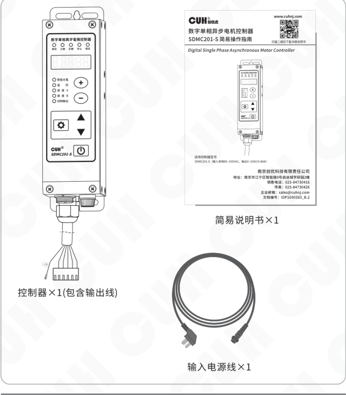

包装内容包括：

- 控制器×1（包含输出线）
- 简易说明书×1
- 输入电源线×1

2024-02　　　　　　　　　　　　　　　　　- 1 -　　　　　　　　　　　　　　　　　SDMC201SMSCN_1.01

### 第 10 页

数字单相异步电机控制器　　　　　　　　　　　　　　　　　　　　　　　　　SDMC201-S

## 1.2 指示灯及按键说明

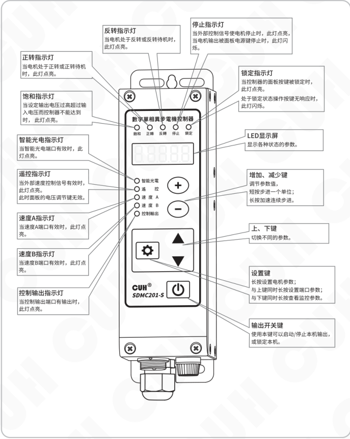

### 指示灯说明

| 名称 | 说明 |
|---|---|
| 正转指示灯 | 当电机处于正转或正转待机时，此灯点亮。 |
| 反转指示灯 | 当电机处于反转或反转待机时，此灯点亮。 |
| 停止指示灯 | 当外部控制信号使电机停止时，此灯点亮，当电机输出被面板电源键停止时，此灯闪烁。 |
| 锁定指示灯 | 当控制器的面板按键被锁定时，此灯点亮。处于锁定状态操作按键无响应时，此灯闪烁。 |
| 饱和指示灯 | 当设定输出电压过高超过输入电压而控制器不能达到时，此灯点亮。 |
| 智能光电指示灯 | 当智能光电端口有效时，此灯点亮。 |
| 遥控指示灯 | 当外部速度控制信号有效时，此灯点亮。此时面板的电压调节键无效。 |
| 速度A指示灯 | 当速度A端口有效时，此灯点亮。 |
| 速度B指示灯 | 当速度B端口有效时，此灯点亮。 |
| 控制输出指示灯 | 当控制输出端口有输出时，此灯点亮。 |

### 显示与按键说明

| 名称 | 说明 |
|---|---|
| LED显示屏 | 显示各种状态的参数。 |
| 增加、减少键 | 调节参数值，短按步进一个单位；长按加速连续步进。 |
| 上、下键 | 切换不同的参数。 |
| 设置键 | 长按设置电机参数；与上键同时长按设置端口参数；与下键同时长按查看监控参数。 |
| 输出开关键 | 使用本键可以启动/停止本机输出，或锁定本机。 |

图中面板标识包括：饱和、正转、反转、停止、锁定、智能光电、遥控、速度A、速度B、控制输出，以及“数字单相异步电机控制器”“CUH”“SDMC201-S”。

2024-02　　　　　　　　　　　　　　　　　- 2 -　　　　　　　　　　　　　　　　　SDMC201SMSCN_1.01

### 第 11 页

数字单相异步电机控制器　　　　　　　　　　　　　　　　　　　　　　　　　SDMC201-S

## 1.3 外部部件说明

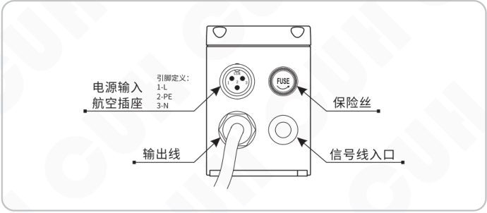

外部部件标注：

- 电源输入航空插座
  - 引脚定义：
    - 1-L
    - 2-PE
    - 3-N
- 输出线
- 保险丝
- 信号线入口

## 1.4 接线端口说明

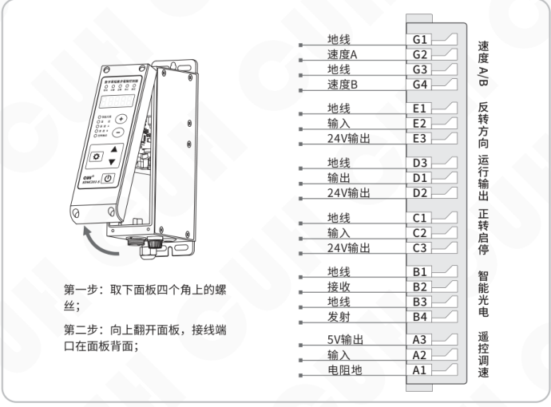

接线步骤：

1. 第一步：取下面板四个角上的螺丝；
2. 第二步：向上翻开面板，接线端口在面板背面；

接线端口对应关系：

| 功能 | 端口 | 说明 |
|---|---|---|
| 速度 A/B | G1 | 地线 |
| 速度 A/B | G2 | 速度A |
| 速度 A/B | G3 | 地线 |
| 速度 A/B | G4 | 速度B |
| 反转方向 | E1 | 地线 |
| 反转方向 | E2 | 输入 |
| 反转方向 | E3 | 24V输出 |
| 运行输出 | D3 | 地线 |
| 运行输出 | D1 | 输出 |
| 运行输出 | D2 | 24V输出 |
| 正转启停 | C1 | 地线 |
| 正转启停 | C2 | 输入 |
| 正转启停 | C3 | 24V输出 |
| 智能光电 | B1 | 地线 |
| 智能光电 | B2 | 接收 |
| 智能光电 | B3 | 地线 |
| 智能光电 | B4 | 发射 |
| 遥控调速 | A3 | 5V输出 |
| 遥控调速 | A2 | 输入 |
| 遥控调速 | A1 | 电阻地 |

2024-02　　　　　　　　　　　　　　　　　　　　　　　　　SDMC201SMSCN_1.01

### 第 12 页

## 1.5 控制器铭牌说明

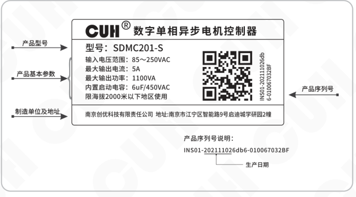

### 铭牌内容（文字转写）

**CUH® 数字单相异步电机控制器**

| 项目 | 内容 |
|---|---|
| 产品型号 | 型号：SDMC201-S |
| 产品基本参数 | 输入电压范围：85～250VAC 最大输出电流：5A 最大输出功率：1100VA 内置启动电容：6uF/450VAC 限海拔2000米以下地区使用 |
| 制造单位及地址 | 南京创优科技有限责任公司 地址:南京市江宁区智能路9号启迪城学研园2幢 |
| 产品序列号 | INS01-202111026db6-010067032BF |
| 产品序列号说明 | INS01-202111026db6-010067032BF |
| 生产日期 | 产品序列号中标注位置对应生产日期 |

### 第 13 页

数字单相异步电机控制器　　　　　　　　　　　　　　　　　　　　　　　　　SDMC201-S

---

# 第二章 产品介绍

本章节主要内容包括本产品的简单介绍和主要特色功能。

## 2.1 产品简介

SDMC201系列数字单相异步电机控制器是紧凑静音全固态无风扇调压控制器，通过采用最新的电子技术和精心的设计，提供独特的性能。特别适合工业环境应用，其特色功能包括：

- 输出端口支持NPN、PNP、推挽模式。
- 防失速功能防止电机在加速、减速、运行过程中的过载失速停机。
- 直流制动功能在停机或紧急停止时，可以快速刹车，使电机停止旋转。
- 支持过载/过流/堵转等全面电机保护功能。
- 禁止反转功能可以锁定电机不可反转。
- 远程遥控功能支持1~5V、4~20mA选择。
- 遥控系数功能，可以将遥控电压的控制效果放大1倍或缩小1倍。
- 速度AB功能支持两个开关信号控制多达四种电机转速。
- 丰富的控制信号源、逻辑关系、开关延时、输出模式可以实现复杂的应用。
- 就绪信号功能，通过智能光电B4发射端口输出调制信号或者有效信号指示控制器处于就绪状态，控制器出现错误时就绪信号变为无效。
- 丰富的监控功能，可以监控温度、输出电压、输出功率、信号端口电压和转速。
- 完整的保护功能还包括：电机输出的短路保护、电机堵转保护、电机过功率保护、过冷/过热保护、电源欠压/过压保护、运行输出短路保护、24V输出短路保护、调速5V输出短路保护。

---

2024-02　　　　　　　　　　　　　　　　　- 5 -　　　　　　　　　　　　　　SDMC201SMSCN_1.01

### 第 14 页

# 第三章 安装及使用指南

本章节介绍本产品使用所必须具备的条件以及如何正确进行安装与连接。

## 3.1 控制器使用条件

本产品是使用交流220V供电的设备，且通过电源线三爪插头进行保护接地连接，请提供符合标准的220V，50Hz/60Hz市电供电配电设施并确保保护地线已正确连接。

> ⚠️ **警告** 切不可将控制器连接到380V交流电，这将造成控制器不可恢复的严重损坏，有可能导致爆炸、火灾等安全事故。

> ⚠️ **警告** 确保供电侧可靠接地，控制器的金属外壳是与保护接地线直接连接的，接地不良会导致控制器外壳带电，引发触电事故。

> **注意** 控制器长时间工作会产生热量致使外壳温度升高，请将控制器安装在通风良好的环境中，并将其固定良好，远离振动源。

> **注意** 本产品的电机输出端口是市电正弦切相形成的，中间没有隔离环节。因此输出极不可以与保护接地连接，在连接电机时也要确保电机线圈与外壳之间具备基本的绝缘能力。否则会导致漏电，可能产生触电和控制器损坏的事故。

## 3.2 按键基本操作

本控制器采用5位数码显示参数符号，5个红色指示灯显示控制器主输出状态，5个绿色指示灯显示信号端口的状态。

本控制器采用6键操作，操作方式如下：

 a. 按键动作根据按下时间分为短按、长按（一级加速、二级加速）。

 b. 短按定义按下时间大于0.1小于2秒，长按定义按下时间大于2秒。

 c. ⊕ 和 ⊖ 用于调节参数值，▼ 和 ▲ 用于选择不同参数。

 d. 短按 ⏻ 紧急停止电机输出，长按锁定/解锁键盘。

 e. 长按 ⚙ 进入/退出电机参数界面。

 f. 长按 ⚙ 加 ▲ 进入/退出端口参数界面。

 g. 长按 ⚙ 加 ▼ 进入/退出监控参数界面。

 h. 在端口参数组中切换至恢复出厂设置参数，长按 ⊕ 显示 `-----` 后松开显示 CUH即恢复出厂设置。

### 第 15 页

数字单相异步电机控制器　　　　　　　　　　　　　SDMC201-S

## 3.3 安装使用

**第一步：**

打开控制器的外包装，检查控制器外观及侧标型号，判断是否为所需的型号。

**第二步：**

参考电机接线说明，正确连接电机。

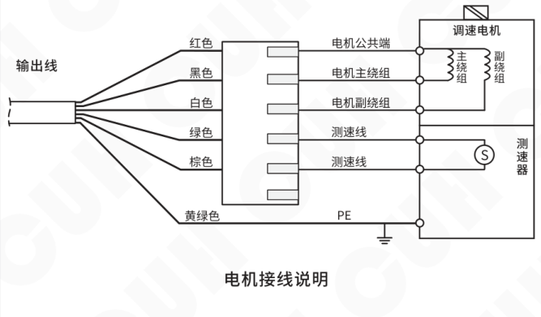

**注意**

1、一定要确保控制器输出线与电机正确可靠连接后，再进行上电。

2、电源输出禁止连接压电类负载，否则可能导致**电击安全事故**！

---

2024-02　　　　　　　　　- 7 -　　　　　　　　　SDMC201SMSCN_1.01

### 第 16 页

数字单相异步电机控制器　　　　　　　　　　　　　　　　　SDMC201-S

### 第三步：

将输入电源线航空插头插入控制器电源输入插座，并锁紧螺母。

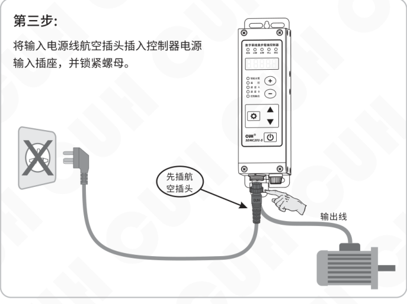

### 第四步：

将电源线三爪插头插在供电电源插座上。

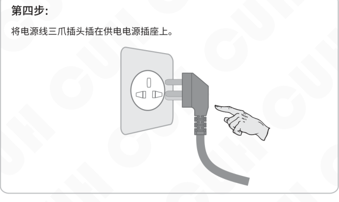

2024-02　　　　　　　　　　　　　　　　　- 8 -　　　　　　　　　　　　　　　　　SDMC201SMSCN_1.01

### 第 17 页

**第五步：**

控制器启动显示 CUH 后，显示电机速度 “S 600”，默认状态为正转停止，正转指示灯和停止指示灯点亮，此时电机不会旋转。

图中标注：

- 当前处于正转停止状态
- S 表示设定转速

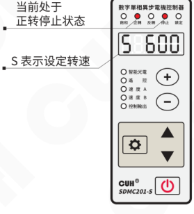

**第六步：**

给控制器连接正转控制信号或反转控制信号，此时控制器停止灯熄灭，电机逐步加速至 600 转速。

图中标注：

- 当前处于正转运行状态
- S 表示设定转速

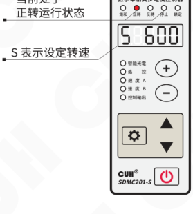

### 第 18 页

数字单相异步电机控制器　　　　　　　　　　　　　　　　SDMC201-S

**第七步：**

使用 **+** 和 **−** 调节设定转速的参数值达到电机最佳运转速度。

- **S** 表示设定转速

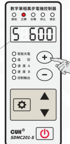

### 第 19 页

# 第四章 基本功能说明

本章节介绍本产品基本功能的使用方法。

## 4.1 设定转速/输出电压

本控制器具有两种调节电机转速的方式：速度控制和调压控制。

当修改电机控制方式参数 SF 为 1 时，表示控制器为调压控制，此时待机界面显示的是“U 150”。通过 + 和 − 可以对输出电压进行调整。

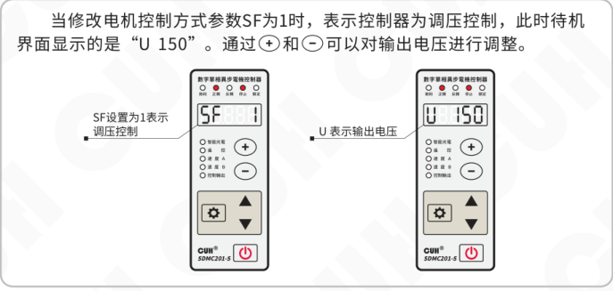

当修改电机控制方式参数 SF 为 2 时，表示控制器为速度控制，此时待机界面显示的是“S 600”。通过 + 和 − 可以对设定转速进行调整。

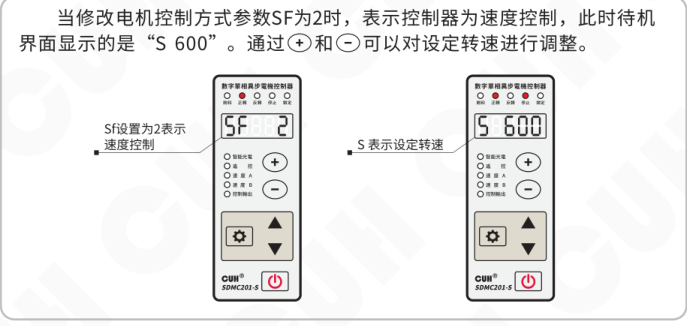

> - 参数 S 可以设置的范围受最高转速参数 b 限制。
> - 参数 U 可以设置的范围受最高电压参数 h 限制。

### 第 20 页

数字单相异步电机控制器　　　　　　　　　　　　　　　　　　　　　　　　　SDMC201-S

## 4.2 正转运行与反转运行

本控制器具备正转运行端口C和反转运行端口E，在端口信号都无效时电机不会运转，停止指示灯点亮。

当正转运行端口C信号有效时，电机正转运行，此时停止指示灯熄灭，正转指示灯点亮。

- 按住设置键（齿轮图标）2秒，进入电机参数界面。
- 使用 ▲ 和 ▼ 切换到正转启停控制源1调整状态“P1”。
- 通过 ＋ 和 － 调整参数值。该参数的默认设置是C。

图示说明：

- P1 表示正转启停控制源1
- C口信号有效

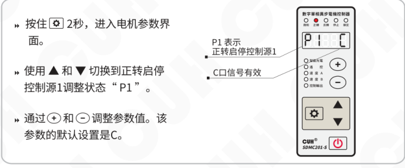

当反转运行端口E信号有效时，电机反转运行，此时停止指示灯熄灭，反转指示灯点亮。

- 按住设置键（齿轮图标）2秒，进入电机参数界面。
- 使用 ▲ 和 ▼ 切换到反转方向控制源1调整状态“Π1”。
- 通过 ＋ 和 － 调整参数值。该参数的默认设置是E。

图示说明：

- Π1 表示反转方向控制源1
- E口信号有效

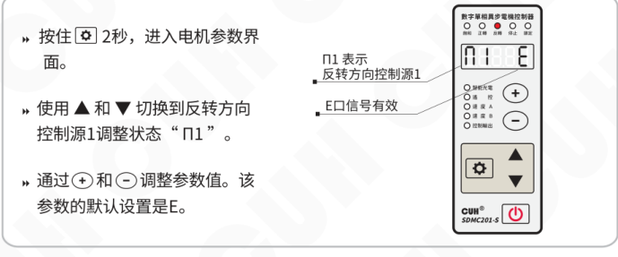

**注意：**

1. 当正转运行端口和反转运行端口信号都有效时，控制器报错Er15正反转冲突，电机不会运转。
2. 如果按照电机接线说明进行接线，根据IEC60034-8对电机的旋转方向定义，正转方向是指从电机驱动端侧方向观察顺时针旋转。

2024-02　　　　　　　　　　　　　　-12-　　　　　　　　　　　　　　SDMC201SMSCN_1.01

### 第 21 页

数字单相异步电机控制器　　　　　　　　　　　　　　　　　SDMC201-S

---

## 4.3 缓启动时间

本控制器从停止状态启动时，电机速度可以平缓提高到设定值，以防止电机和控制器遭受冲击。

**缓启动时间（t）：** 电机从停止状态启动时，电机速度从0平滑升高达到设定速度所需要的时间称为缓启动时间。

- 按住 ⚙ 2秒，进入电机参数界面。
- 使用 ▲ 和 ▼ 切换到缓启动参数调整状态“t”。
- 通过 ＋ 和 － 调整参数值。该参数的单位是秒，精度是0.1秒。

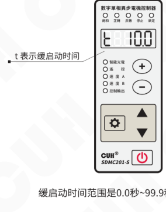

`t` 表示缓启动时间

缓启动时间范围是0.0秒~99.9秒

---

2024-02　　　　　　　　　-13-　　　　　　　　　SDMC201SMSCN_1.01

### 第 22 页

## 4.4 缓关闭时间/刹车时间

本控制器从运行状态停止时，电机速度可以平缓降低到0，以防止电机和控制器遭受冲击。

**缓关闭时间（J）**：电机从运行状态停止时，电机速度从设定值平滑降低到0所需要的时间称为缓关闭时间。

当缓关闭时间设置为负值时表示直流制动停止，即刹车时间，此时直流制动电流由参数 cb 设置。

> » 按住 ⚙ 2秒，进入电机参数界面。  
> » 使用 ▲ 和 ▼ 切换到缓关闭参数调整状态“J”。  
> » 通过 ＋ 和 － 调整参数值。该参数的单位是秒，精度是0.1秒。
>
> J 表示缓关闭时间
>
> 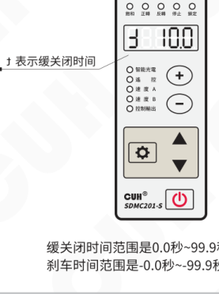
>
> 缓关闭时间范围是 0.0秒～99.9秒  
> 刹车时间范围是 -0.0秒～-99.9秒

### 第 23 页

## 4.5 键盘锁定功能

为了防止误操作，本机设定了键盘锁。这样当控制器各项参数设置好后，可以有效避免其他人的误动作影响本机正常工作。即使关机后重新开机，键盘锁状态依然保持上次关机时的状态。

- 通过长按 `⏻` 2秒可以锁定除 `⏻` 之外所有按键，此时锁定指示灯常亮。
- 再次长按 `⏻` 2秒可以解除锁定。

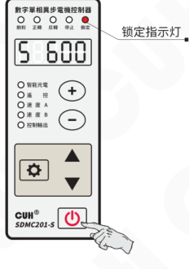

> ● 控制器处于锁定状态时，操作按键无响应，锁定指示灯会闪烁。

### 第 24 页

**数字单相异步电机控制器**　　　　　　　　　　　　　　　　　　　　　　　　　**SDMC201-S**

## 4.6 恢复出厂设置

本功能可以使用户快速将控制器设置为出厂默认设置状态。

由于本控制器功能强大，有数量众多的控制参数可以由用户设定，对于初学者，可能在多次的设定修改后不能恢复控制器的正常工作状态。使用该功能可以快速将调乱的参数状态恢复为出厂默认设置。

- 长按设置键和 ▲，进入端口参数界面。

- 短按 ▲ 切换到全屏闪烁状态，即“恢复出厂设置”参数，此时长按 ＋，直到控制器显示“-----”，表示控制器已经重设完毕。

- 松开 ＋，控制器显示 CUH 后，随即进入正常的待机界面，此时控制器就像刚开始使用一样，所有参数都已经恢复到出厂默认状态。

右侧操作示意图：

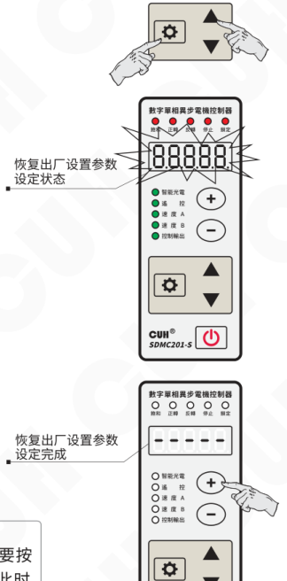

> 用户进行恢复出厂设置之前，需要按下电源键使控制器处于停止状态，此时停止灯闪烁。

---

2024-02　　　　　　　　　　　　　　　　　-16-　　　　　　　　　　　　　　　　　SDMC201SMSCN_1.01

### 第 25 页

# 第五章 高级功能说明

本章节主要介绍本产品高级功能的使用方法。

## 5.1 电机启停和方向控制

本控制器设计了正转启停信号和反转方向信号用于控制电机的启停和方向，其中正转启停信号具有2个信号源和一个逻辑计算单元，反转方向信号也具有2个信号源和一个逻辑计算单元。通过正反转控制方式可以选择这两个信号控制电机的启停及正反转行为。具体逻辑关系见下图：

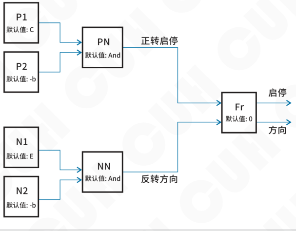

> 正转启停控制源和反转方向控制源包括：0, 1, b, -b, C, -C, E, -E, SA, -SA, Sb, -Sb, od, -od, oq, -oq。
>
> 正转启停逻辑关系和反转方向逻辑关系包括：And与, or或, Hor异或, rS触发器。
>
> 正反转控制方式有两种取值：
>
> - Fr=0表示：正转启停信号用于控制正转启停，反转方向信号用于控制反转启停。
> - Fr=1表示：正转启停信号用于控制启停，反转方向信号用于控制方向。
>
> 注意：在Fr=0且正转启停和反转方向信号同时有效时，触发Er15正反转冲突，电机停止运转。

### 第 26 页

数字单相异步电机控制器　　　　　　　　　　　　　　　　　SDMC201-S

---

## 5.2 电机旋转方向交换与禁止反转

在实际应用场合，因机械系统限制或接线原因需要调换电机的旋转方向或禁止电机某个方向不可以运转，可以通过旋转方向交换参数 Ph（Phase）来实现。

- 当 Ph=AbC 时，表示标准方向，即正转是从电机驱动端侧观察顺时针方向。
- 当 Ph=ACb 时，表示方向交换，即正转是从电机驱动端侧观察逆时针方向。
- 当 Ph=A.b.C. 时，表示标准方向禁止反转，即电机只能顺时针旋转，当出现反转指令时不响应并显示 Ar08 禁止反转警告。
- 当 Ph=A.C.b. 时，表示方向交换禁止正转，即电机只能逆时针旋转，当出现正转指令时不响应并显示 Ar08 禁止反转警告。

下图所示为顺时针方向的电机，从驱动端看轴为顺时针旋转，观察方向为从驱动端向非驱动端看。

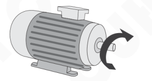

下图所示为逆时针方向的电机，从驱动端看轴为逆时针旋转，观察方向为从驱动端向非驱动端看。

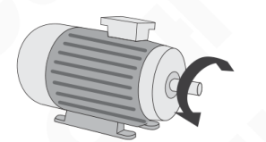

---

2024-02　　　　　　　　　　　　-18-　　　　　　　　　　　　SDMC201SMSCN_1.01

### 第 27 页

## 5.3 电机过功率保护

本控制器具有电机功率超限保护和电机电子过热保护，得益于对电机消耗功率的精确测量，可以精准限制电机的功率上限和电机过功率运行的能力。

通过参数电机额定输入功率Po和功率超额系数rc设定保护功率范围。

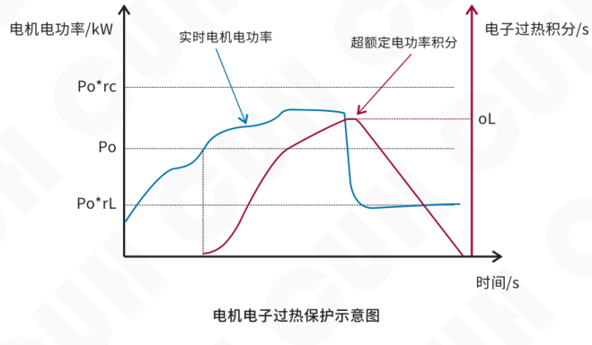

控制器实时监控电机电功率，当该功率超过电机额定输入功率Po且不超过功率超额系数rc时，电机电子过热积分器启动，当积分值超过电功过热阈值oL时触发电功过热保护Ar02H，控制器将降低输出电压直到输出功率下降到功率降额系数rL定义的功率。此时积分器进行复位，当复位完成则恢复至设定转速运行，重新开始新的保护循环。

### 第 28 页

数字单相异步电机控制器　　　　　　　　　　　　　　　　　　　　　　　　　SDMC201-S

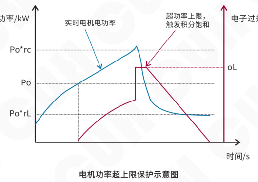

电机功率超上限保护示意图

控制器实时监控电机电功率，当该功率超过电机额定输入功率Po和功率超额系数rc乘积，触发电机功率超上限保护Ar02P。电机电子过热积分器直接进入饱和状态。控制器将降低输出电压直到输出功率下降到功率降额系数rL定义的功率。此时积分器进行复位，当复位完成则恢复至设定转速运行，重新开始新的保护循环。

2024-02　　　　　　　　　　　　　　　　　-20-　　　　　　　　　　　　　　SDMC201SMSCN_1.01

### 第 29 页

## 5.4 电机堵转保护功能

本控制器具有电机堵转保护功能，当控制器的实际转速小于设定转速\*堵转系数 r 时，控制器开始计时，当计时时间超过电机堵转容忍时间 St 后，控制器继续输出并显示电机堵转 Ar22 错误。

用户可以通过设置电机堵转系数来限制电机被堵转的能力，比如：当前设定的转速为 150，堵转系数为 50（%），当电机发生过载导致转速低于 75 时，此时会触发堵转保护。

- 长按 **⚙**，进入电机参数界面。
- 短按 **▲** 或 **▼** 切换到 `r`，即“堵转系数”参数。
- 通过 **＋** 和 **－** 调整参数值。
- 当电机转速低于设定转速\*堵转系数值时，计时超过堵转容忍时间，触发堵转保护，显示 Ar22。

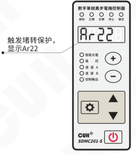

> ● 缓启动时间内，堵转保护功能不作介入。  
> ● 电机开环控制下不具有堵转保护功能。

### 第 30 页

## 5.5 遥控调速功能

本控制器支持外部模拟信号控制输出电压，模拟信号支持电位器、1~5V电压、4~20mA电流。

本控制器还设计了遥控系数c用于放大或缩小遥控电压的效果，调节范围：0.5~2.0。

当设置为0.5时表示遥控电压控制设定转速的效果缩小一半，即最大只能遥控到最高转速b的一半。

当设置为2.0时表示遥控电压控制输出电压的效果放大一倍，即遥控电压达到一半时设定转速已经达到b，再增加遥控电压，输出转速也无法增大。

### 电位器控制连接方式

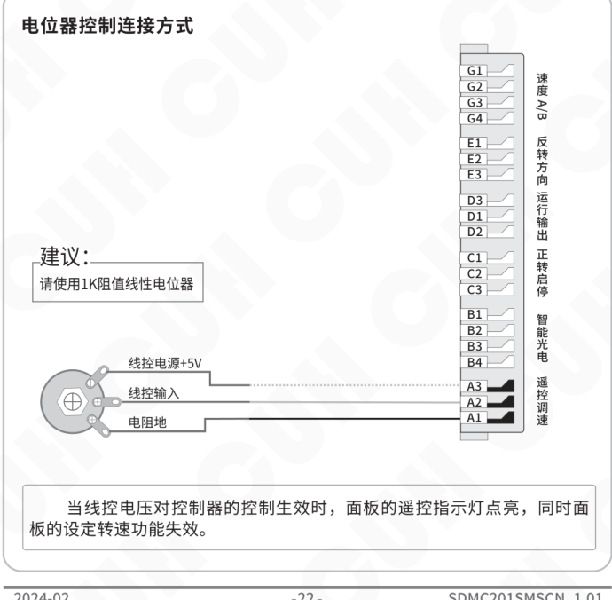

建议：请使用1K阻值线性电位器

当线控电压对控制器的控制生效时，面板的遥控指示灯点亮，同时面板的设定转速功能失效。

### 第 31 页

### 1~5V 电压控制连接方式

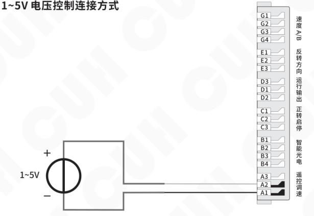

### 4~20mA 电流控制连接方式

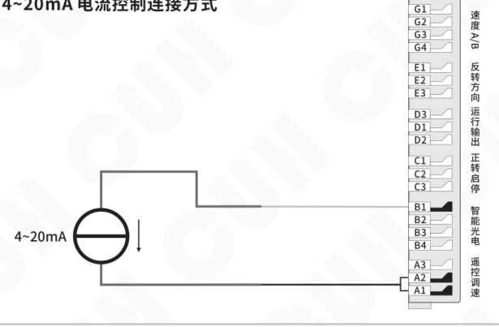

### 第 32 页

## 5.6 电机速度数字预置

速度预置功能是通过外部控制信号直接选择预定速度的功能。通过该功能，外部控制设备或控制器的内部状态可以方便地与控制器构成多达四档速度控制系统。

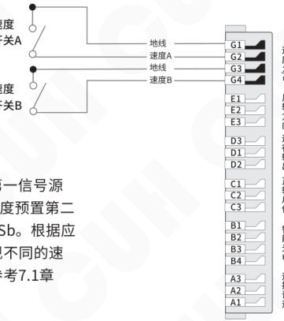

默认情况下速度预置第一信号源选择外部速度A端口SA，速度预置第二信号源选择外部速度B端口Sb。根据应用场景可以修改信号源实现不同的速度切换功能，信号源列表参考7.1章节。

每个速度预置信号源在面板上有对应的指示灯显示，当信号源有效时，对应的指示灯点亮。两个指示灯的亮灭状态组合有4种状态（A亮B灭，A灭B亮，AB全亮，AB全灭）。

通过信号的组合，控制器将进入对应的速度预置状态。此时，控制器的输出可以通过 `+` 或 `-` 进行调整。该速度将被自动记忆。任何时刻速度预置控制信号设置控制器进入该状态后都将立刻切换输出到该速度。

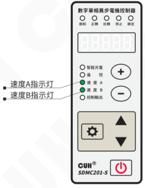

### 第 33 页

# 5.7 开关传感器

本控制器设计了正转启停、反转方向、速度AB三个开关量传感器接口。这些接口可以支持NPN、PNP、Ut1、Ut0模式，通过参数开关传感器类型ΓA设置。其中：

**Ut1模式为单次扫描**，即传感器信号无效前一直通过变换高低电平检测端口是否有效，发现有效信号后确定端口传感器类型且不再扫描。

**Ut0模式为连续扫描**，不管传感器类型如何，始终通过变换高低电平检测端口是否接入有效信号。

每个开关量的开关延时也可以通过对应的参数设置，详见参数列表。

## 开关传感器连接方式

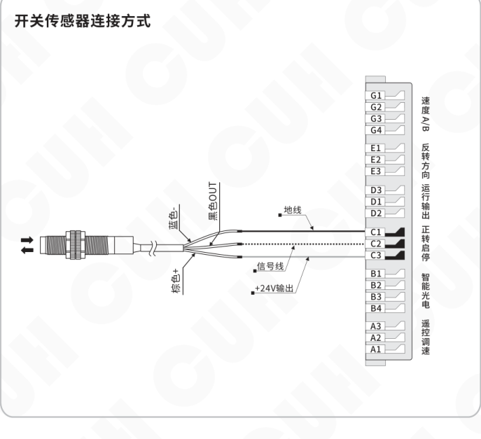

### 第 34 页

## 5.8 智能光电功能

本控制器的智能光电端口支持发光二极管和光电三极管构成的光电对射或反射传感器，也可以通过智能光电灵敏度参数P，设置为支持NPN或PNP开关传感器。具体接线图如下：

### 光电传感器连接方式

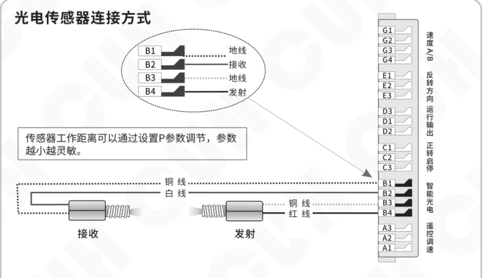

传感器工作距离可以通过设置P参数调节，参数越小越灵敏。

### 开关传感器连接方式

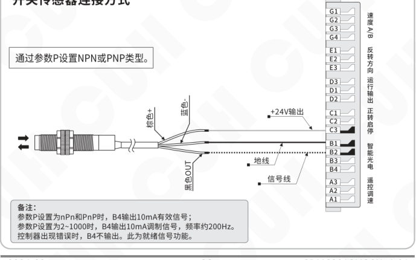

通过参数P设置NPN或PNP类型。

备注：

- 参数P设置为nPn和PnP时，B4输出10mA有效信号；
- 参数P设置为2~1000时，B4输出10mA调制信号，频率约200Hz。
- 控制器出现错误时，B4不输出。此为就绪信号功能。

### 第 35 页

## 5.9 运行输出功能

运行输出端口可以支持NPN输出、PNP输出和推挽输出。其中：

- NPN输出有效为低电平，输出无效为高阻态；
- PNP输出有效为高电平，输出无效为高阻态；
- 推挽输出有效为高电平，无效为低电平。

### 5.9.1 运行输出的接线方法

**NPN输出的连接方式**

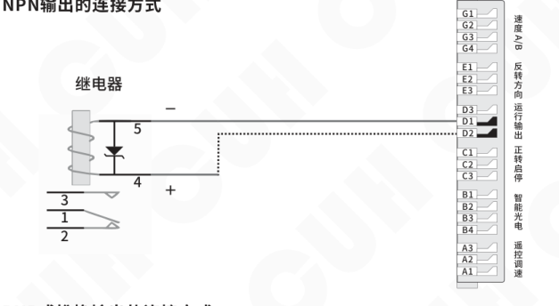

**PNP或推挽输出的连接方式**

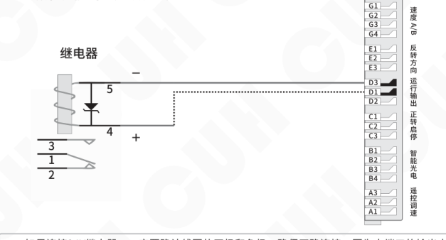

> 如果连接24V继电器，一定要确认线圈的正极和负极，确保正确连接。因为本端口的输出电流能力为350mA，接反后继电器的内部保护二极管会将本控制器端口短路，触发短路保护Er07d。

### 第 36 页

### 5.9.2 运行输出信号源和逻辑图

运行输出是由两个信号源逻辑关系的结果控制，可以从信号源列表中选择下列信号源：

| 信号源 | 含义 |
|---|---|
| 0 | 无效信号 |
| 1 | 有效信号 |
| b | 智能光电端口信号 |
| -b | 智能光电端口信号取反 |
| C | 正转运行端口信号 |
| -C | 正转运行端口信号取反 |
| E | 反转运行端口信号 |
| -E | 反转运行端口信号取反 |
| SA | 速度A端口信号 |
| -SA | 速度A端口信号取反 |
| Sb | 速度B端口信号 |
| -Sb | 速度B端口信号取反 |
| od | 运行输出端口信号 |
| -od | 运行输出端口信号取反 |
| oq | 电机输出信号 |
| -oq | 电机输出信号取反 |
| Er | 任意故障信号 |
| -Er | 任意故障信号取反 |
| Ar | 任意警告信号 |
| -Ar | 任意警告信号取反 |

### 第 37 页

数字单相异步电机控制器　　　　　　　　　　　　　　　　　SDMC201-S

---

### 运行输出逻辑图：

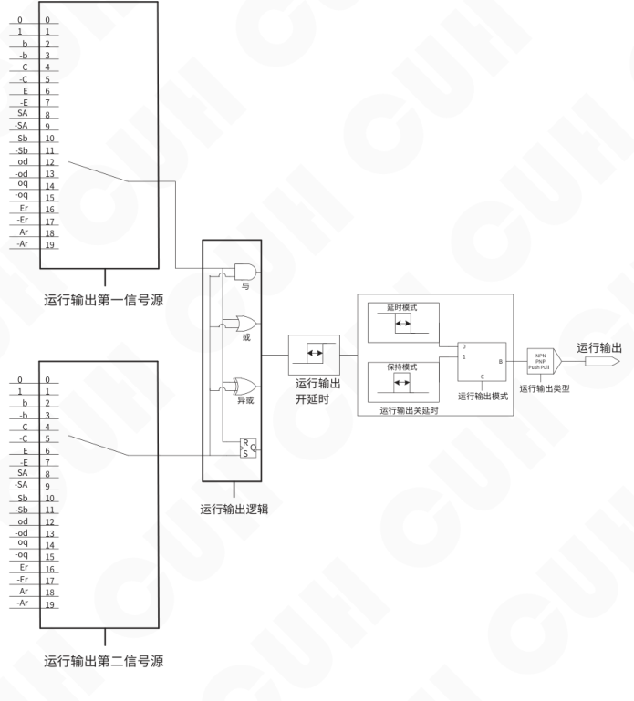

图中信号源编号：

| 信号源 | 编号 |
|---|---:|
| 0 | 0 |
| 1 | 1 |
| b | 2 |
| -b | 3 |
| C | 4 |
| -C | 5 |
| E | 6 |
| -E | 7 |
| SA | 8 |
| -SA | 9 |
| Sb | 10 |
| -Sb | 11 |
| od | 12 |
| -od | 13 |
| oq | 14 |
| -oq | 15 |
| Er | 16 |
| -Er | 17 |
| Ar | 18 |
| -Ar | 19 |

图中主要功能块标注：运行输出第一信号源、运行输出第二信号源、运行输出逻辑、运行输出开延时、运行输出关延时、运行输出模式、运行输出类型、运行输出。

### 第 38 页

数字单相异步电机控制器　　　　　　　　　　　　　　　　　SDMC201-S

---

### 5.9.3 运行输出模式说明

客户可选择2种运行输出模式：延时模式、保持模式。

**延时模式：** 指驱动运行输出的信号由有效变为无效后，运行输出经过一段关延时时间后变为关闭状态。

**保持模式：** 指驱动运行输出的信号变为有效后，运行输出在关延时时间内保持打开，超过关延时时间后变为关闭的状态。

将两种模式的差别以时序图的形式表达如下，其中输入信号是逻辑关系选择器后输出的信号。

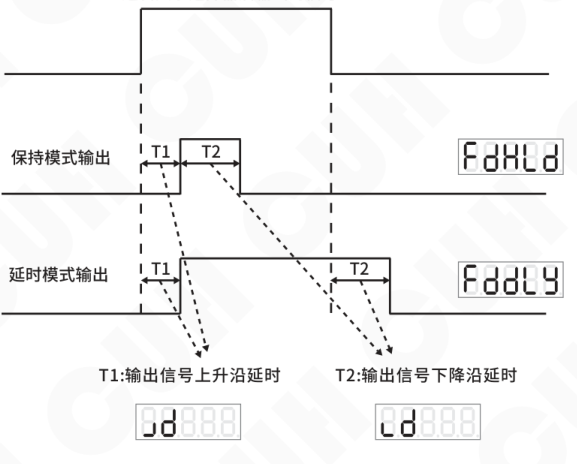

---

2024-02　　　　　　　　　　　　-30-　　　　　　　　　　　　SDMC201SMSCN_1.01

### 第 39 页

## 5.10 开机运行状态

开机运行状态设置功能，可以指定开机后电源键的状态。通过参数开机运行状态PS调整。

- PS=run，表示开机后控制器电源键处于运行状态。
- PS=stP，表示开机后控制器电源键处于停止状态。
- PS=FoL，表示开机后控制器电源键处于跟随上次掉电前的状态。

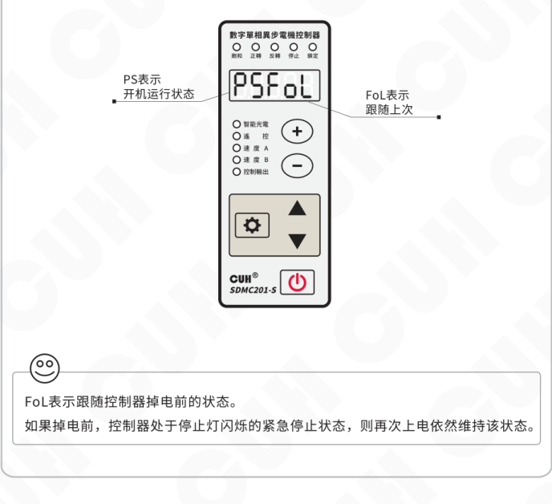

图示说明：

- PS表示开机运行状态。
- FoL表示跟随上次。

FoL表示跟随控制器掉电前的状态。

如果掉电前，控制器处于停止灯闪烁的紧急停止状态，则再次上电依然维持该状态。

### 第 40 页

数字单相异步电机控制器　　　　　　　　　　　　　　　　　SDMC201-S

---

## 5.11 参数监控功能

本控制器可以监控部分运行参数，给操作人员提供参考，方便调试。

- 长按 ⚙ 和 ▼，进入监控参数界面。
- 短按 ▲ 或 ▼ 选择需要监控的参数。
- 监控参数的参数值不可修改。

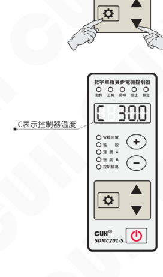

本控制器的监控参数组参考《7.1 参数列表》章节。

---

2024-02　　　　　　　　　-32-　　　　　　　　　SDMC201SMSCN_1.01

### 第 41 页

数字单相异步电机控制器　　　　　　　　　　　　　　　　　　　　　　　　　SDMC201-S

# 第六章 技术规格

## 6.1 外形尺寸

外形尺寸图（单位：毫米mm）

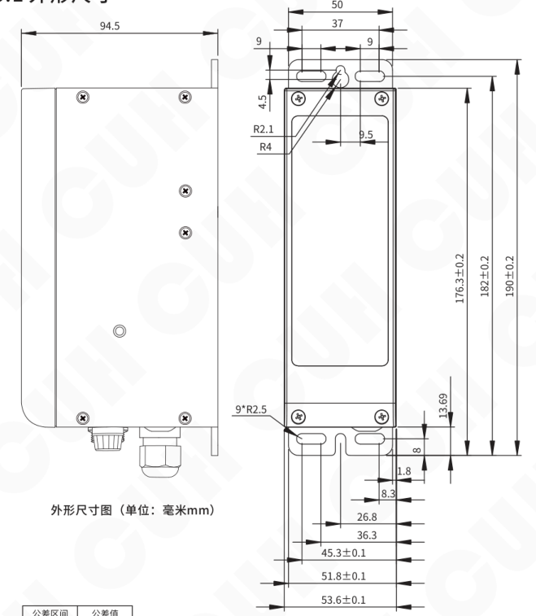

| 公差区间 | 公差值 |
|---|---|
| 0~3 | ±0.05 |
| 3~10 | ±0.1 |
| 10~30 | ±0.15 |
| 30~80 | ±0.2 |
| 80~180 | ±0.3 |
| >180 | ±0.5 |

本系列产品均适用此公差表。

> **要点**  
> 请务必将本产品安装在可靠接地的坚固平台上，控制器上下安装孔均需要固定，并远离振动设备。

2024-02　　　　　　　　　　　　　　　　　-33-　　　　　　　　　　　　　　　SDMC201SMSCN_1.01

### 第 42 页

数字单相异步电机控制器　　　　　　　　　　　　　　　　　　　　　　　　　SDMC201-S

## 6.2 技术规格表

| 项目 | 最小值 | 典型值 | 最大值 | 单位 | 备注 |
|---|---:|---:|---:|---|---|
| 输入电压 | 85 | 220 | 250 | 伏特（V） | 交流有效值 |
| 输出电压调整范围 | 0 | —— | Vin | 伏特（V） |  |
| 电压调整精度 |  | 1 |  | 伏特（V） |  |
| 稳压精度 | —— | —— | 1 | 伏特（V） |  |
| 稳压响应时间 | 0 | 0.02 | 0.06 | 秒（s） |  |
| 输出电流调整范围 | 0 | —— | 5 | 安培（A） |  |
| 输出功率 | 0 | —— | 1100 | 伏安（VA） |  |
| 输出频率 | 90 | 100/120 | 130 | 赫兹（Hz） | 全波 |
| 输出波形 |  | 正弦相切 |  |  |  |
| 缓启动时间 | 0 | —— | 99.9 | 秒（s） | 出厂默认10 |
| 延迟时间范围 | 0 | —— | 99.9 | 秒（s） | 出厂默认0.2 |
| 延迟时间精度 |  | 0.1 |  | 秒（s） |  |
| 过热保护温度 | 58 | 60 | 66 | 摄氏度（℃） |  |
| 短路保护动作电流 | —— | 6.3 | —— | 安培（A） | 保险丝容量 |
| 直流控制输出电压 | 22 | 24 | 26 | 伏特（V） |  |
| 直流控制输出电流 | 0 | —— | 400 | 毫安（mA） |  |
| 模拟控制信号 |  | 1~5/4~20 |  | 伏特（V）/毫安（mA） | 远程速度控制电压/电流 |
| 数字控制信号 |  | 24 |  | 伏特（V） | 开关信号控制 |
| 调整方式 |  | 6 |  | 键（Button） |  |
| 保险丝容量 |  | 6.3 |  | 安培（A） |  |
| 空载功耗 | —— | 2 | —— | 瓦特（W） |  |
| 显示方式 |  | 5 |  | 位（Digit） | LED数码管 |
| 工作环境温度 | 0 | 25 | 40 | 摄氏度（℃） |  |
| 工作环境湿度 | 10 | 60 | 85 | 相对湿度（%） | 不结露 |
| 存储环境温度 | -20 | 25 | 85 | 摄氏度（℃） |  |

2024-02　　　　　　　　　　　　　　　　　-34-　　　　　　　　　　　　　SDMC201SMSCN_1.01

### 第 43 页

数字单相异步电机控制器                                                                      SDMC201-S

## 6.3 参考标准

**极限参数：超过此指标将会造成严重损坏，必须严格遵守！**

| 项目 | GB 标准 | IEC 标准 | 等级 | 标准要求 | 备注说明 |
|---|---|---|---|---|---|
| 静电放电 | GB/T 17626.2-2006 | IEC 61000-4-2:2001 | 4 | ±8 kV | 接触放电 |
| 静电放电 | GB/T 17626.2-2006 | IEC 61000-4-2:2001 | 4 | ±15 kV | 空气放电 |
| 电快速瞬变 脉冲群 | GB/T 17626.4-2008 | IEC 61000-4-4:2004 | 4 | ±4 kV |  |
| 直流电源纹 波抗扰度 | GB/T 17626.17-2005 | IEC 61000-4-17:2002 | 4 | 15% | 评价 A |

> **警告**  
> 在民用环境中，本产品可能产生无线电干扰。在这种情况下，可能需要采取附加抑制措施。

2024-02                                        -35-                                        SDMC201SMSCN_1.01

### 第 44 页

数字单相异步电机控制器　　　　　　　　　　　　　　　　　　　　　　　　　　　SDMC201-S

# 第七章 附录

## 7.1 参数列表

| 类别 | 含义 | 参数符号 | 数码管符号图片 | 取值范围 | 默认设置 |
|---|---|---|---|---|---|
| 待机参数 | 设定转速（速度控制方式） | [S] | 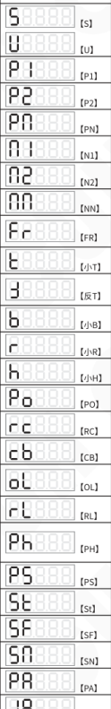（参数符号整列原图） | 0~3600（rpm） | 600 |
| 待机参数 | 输出电压（调压控制方式） | [U] | — | 0~250 伏特（V） | 150 |
| 电机参数 | 正转启停控制源1 | [P1] | — | 0, 1, b, -b, C, -C, E, -E, SA, -SA, Sb, -Sb, od, -od, oq, -oq | C |
| 电机参数 | 正转启停控制源2 | [P2] | — | 0, 1, b, -b, C, -C, E, -E, SA, -SA, Sb, -Sb, od, -od, oq, -oq | -b |
| 电机参数 | 正转启停逻辑关系 | [PN] | — | And与, or或, Hor异或, rS触发器 | And |
| 电机参数 | 反转方向控制源1 | [N1] | — | 0, 1, b, -b, C, -C, E, -E, SA, -SA, Sb, -Sb, od, -od, oq, -oq | E |
| 电机参数 | 反转方向控制源2 | [N2] | — | 0, 1, b, -b, C, -C, E, -E, SA, -SA, Sb, -Sb, od, -od, oq, -oq | -b |
| 电机参数 | 反转方向逻辑关系 | [NN] | — | And与, or或, Hor异或, rS触发器 | And |
| 电机参数 | 正反转控制方式 | [FR] | — | 0（正转控制源用于正转启停，反转控制源用于控制反转启停） 1（正转控制源用于控制启停，反转控制源用于控制正反） | 0 |
| 电机参数 | 缓启动时间 | [小T] | — | 0.0~99.9 秒（s） | 10.0 |
| 电机参数 | 缓关闭时间 | [反T] | — | 刹车时间：-0.0~-99.9 秒（s） 缓关闭时间：0.0~99.9 秒（s） | 10.0 |
| 电机参数 | 最高转速 | [小B] | — | 0~3600（rpm） | 1350 |
| 电机参数 | 堵转系数 | [小R] | — | 0~100（%） 0: 不检测堵转 | 70 |
| 电机参数 | 最高电压 | [小H] | — | 0~250 伏特（V） | 220 |
| 电机参数 | 电机额定输入功率 | [PO] | — | 0.01~0.40 千瓦（kW） | 0.20 |
| 电机参数 | 功率超额系数 | [RC] | — | 100~150（%） | 150 |
| 电机参数 | 制动电流系数 | [CB] | — | 10~150（%） | 100 |
| 电机参数 | 电功过热阈值 | [OL] | — | 0~90 倍*秒（times*seconds） 备注：超过电机过功率系数，且按秒积分超过此数值，电机进入电功过热保护状态。 | 30 |
| 电机参数 | 功率降额系数 | [RL] | — | 0~90（%） 0表示停机 | 0 |
| 电机参数 | 旋转方向交换 | [PH] | — | AbC: 标准方向, ACb: 方向交换, A.b.C.: 标准方向禁止反转（只能正转）, A.C.b.: 方向交换禁止正转（只能反转） | AbC |
| 电机参数 | 开机运行状态 | [PS] | — | run: 运行, stp: 停止, FoL: 保存上次 | FoL |
| 电机参数 | 堵转容忍时间 | [St] | — | 1~255 秒（s） | 3 |
| 电机参数 | 电机控制方式 | [SF] | — | 1：调压控制　　2：速度控制 | 2 |
| 电机参数 | 测速机极对数 | [SN] | — | 1~255 | 12 |
| 电机参数 | 速度调整比例系数 | [PA] | — | 0~999 | 90 |
| 电机参数 | 速度调整积分系数 | [1A] | — | 0~999 | 160 |

2024-02　　　　　　　　　　　　　　　　-36-　　　　　　　　　　　　　　　　SDMC201SMSCN_1.01

### 第 45 页

*整页视觉 JSON 解析失败，请查看该文件内 `assistant_text`。*

### 第 46 页

数字单相异步电机控制器　　　　　　　　　　　　　　　　　　　　　　　　　SDMC201-S

|  | 含义 | 参数符号 | 数码管符号图片 | 取值范围 | 默认设置 |
|---|---|---|---|---|---|
| 监控参数 长按 加 ▼ | 24V输出电压 | [NU] |  | 0.0~28.0 伏特（V） | —— |
|  | 遥控端口电压 | [AU] |  | 0.0~28.0 伏特（V） | —— |
|  | 智能光电信号 | [BU] |  | 0~999 | —— |
|  | 正转信号电压 | [CU] |  | 0.0~28.0 伏特（V） | —— |
|  | 运行输出端口电压 | [DU] |  | 0.0~28.0 伏特（V） | —— |
|  | 反转信号电压 | [EU] |  | 0.0~28.0 伏特（V） | —— |
|  | 速度A端口电压 | [SA] |  | 0.0~28.0 伏特（V） | —— |
|  | 速度B端口电压 | [SB] |  | 0.0~28.0 伏特（V） | —— |
|  | 控制板版本 | [UC] |  | —— | —— |
|  | 功率板版本 | [UQ] |  | —— | —— |

信号源含义列表：

| 信号源 | 含义 |
|---|---|
| 0 | 无效信号 |
| 1 | 有效信号 |
| b | 智能光电端口信号 |
| -b | 智能光电端口信号取反 |
| C | 正转运行端口信号 |
| -C | 正转运行端口信号取反 |
| E | 反转运行端口信号 |
| -E | 反转运行端口信号取反 |
| SA | 速度A端口信号 |
| -SA | 速度A端口信号取反 |
| Sb | 速度B端口信号 |
| -Sb | 速度B端口信号取反 |
| od | 运行输出端口信号 |
| -od | 运行输出端口信号取反 |
| oq | 电机输出信号 |
| -oq | 电机输出信号取反 |
| Er | 任意故障信号 |
| -Er | 任意故障信号取反 |
| Ar | 任意警告信号 |
| -Ar | 任意警告信号取反 |

---

2024-02　　　　　　　　　　　　　　　　　-38-　　　　　　　　　　　　　SDMC201SMSCN_1.01

### 第 47 页

## 7.2 输入输出电路图

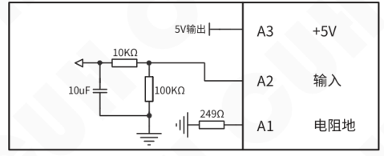

**遥控调速A端口**

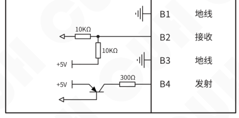

**智能光电B端口**

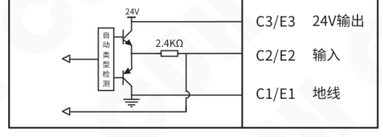

**正转启停C/反转方向E端口**

### 第 48 页

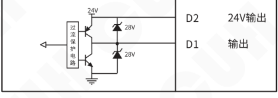

**运行输出D端口**

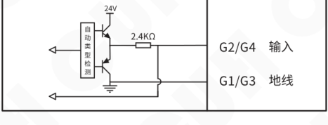

**速度预设G端口**

### 第 49 页

数字单相异步电机控制器　　　　　　　　　　　　　　　　　　　　　　　　　SDMC201-S

## 7.3 故障代码、警告代码与预警代码

| 故障代码 | 故障含义 | 出现条件 | 控制器响应 | 排除方法 |
|---|---|---|---|---|
| Er02C | 控制器过载 | 输出电流达到5.5A | 3s后尝试重新输出 | ◆ 适当降低电机运行速度。 ◆ 适当降低输出电压。 |
| Er03L | 过冷 | 控制器温度低于-20℃ | 停止主输出， 温度恢复正常后自动启动输出。 | ◆ 避免极寒温度启动控制器。 |
| Er03H | 过热 | 控制器温度高于65℃ | 停止主输出， 温度恢复正常后自动启动输出。 | ◆ 将本控制器安装在通风良好环境中。 |
| Er04L | 电源欠压 | 电源电压有效值低于80V | 停止主输出， 电源电压正常后自动恢复。 | ◆ 确保电源电压85V~250V，频率50/60Hz。 |
| Er04H | 电源过压 | 电源电压有效值高于270V | 停止主输出， 电源电压正常后自动恢复。 | ◆ 确保电源电压85V~250V，频率50/60Hz。 |
| Er05 | 内部通信异常 | 连续3秒未收到功率板应答 | 保持最后一次通信时的状态， 通信恢复后自动消除。 | ◆ 确保24V电源端口未接入任何外部电源或联系本公司技术支持。 |
| Er06 | 温度传感器异常 | 无法读取温度 | 停止主输出，2秒尝试读温度。 | ◆ 联系本公司技术支持。 |
| Er07d | 运行输出端口短路 | 输出电流超过350mA或短路 | 5ms内关闭控制输出， 2s后尝试重启输出。 | ◆ 确保负载未短路且电流未超过350mA。 |
| Er10 | 24V输出短路 | 输出24V被短路或电流超过700mA | 停止24V输出，重新上电以重启输出。 | ◆ 确保24V输出未被短路或输出超过700mA。 |
| Er11 | 5V输出异常 | 5V输出超过±10%范围 | 遥控调速失效，自动恢复。 | ◆ 确保5V输出未被短路或接入外部电压。 |
| Er12 | 24V电压异常 | 监控内部24V电压不在22~26V之间 | 控制输出高阻，自动恢复。 | ◆ 确保24V电源输出端口或控制输出端口未接入任何外部电源。 |
| Er14 | 电机缺相 | 电机与控制器接线异常 | 控制器报错不输出。 | ◆ 断电后，确保电机接线正确，重新上电。 |
| Er15 | 正反转冲突 | 同时给出正反转信号 | 停止主输出，冲突撤除后自动恢复。 | ◆ 确保不同时给出正转有效和反转有效信号。 |

| 警告代码 | 警告含义 | 出现条件 | 控制器响应 | 排除方法 |
|---|---|---|---|---|
| Ar02H | 电功过热 | 积分值超过阈值 | 根据电机保护系数执行电机保护动作（停机或降功率运行）。 | ◆ 适当降低电机运行速度设定。 |
| Ar02P | 电机功率超上限 | 电机功率超出最大功率 | 根据电机保护系数执行电机保护动作（停机或降功率运行）。 | ◆ 适当降低电机运行速度设定。 |
| Ar03 | 输出饱和 | 当输出电压达到电源电压 | 继续输出，显示2s消失，10s后再检查。 | ◆ 确保输入电压不低于最大电压限制值。 |
| Ar07 | 电机制动 | 当电机处于直流制动时 | 直流制动期间显示，完成后自动消失。 | ◆ —— |
| Ar08 | 禁止反转 | 当禁止反转有效且检测到反转请求时 | 不响应反转请求，撤消后自动消失。 | ◆ 撤消反转请求信号。 |
| Ar22 | 电机堵转 | 电机转速低于设定最低转速 | 继续输出，显示异常代码。 | ◆ 确保电机没有过载。 ◆ 确保电机实际转速不低于设定的最低转速值。 |

| 预警代码 | 预警含义 | 出现条件 | 控制器响应 | 排除方法 |
|---|---|---|---|---|
| Ar05 | 运行过功率 | 运行中功率超过额定功率 | 电机继续运行直至电功过热积分值达到上限。 | ◆ 适当降低负载。 |

2024-02　　　　　　　　　　　　　　　　　-41-　　　　　　　　　　　　　　　　　SDMC201SMSCN_1.01

### 第 50 页

数字单相异步电机控制器　　　　　　　　　　　　　　　　　　　　　　　　　SDMC201-S

---

# 第八章 产品质保信息

## 8.1 质保期

本公司为本产品提供的质保期为三年，从产品发送到购买方指定地点之日算起。

## 8.2 保修范围

（一）如果在上述质保期内出现本公司造成的故障，我们将免费维修产品。但是以下情况不属于保修范围：

　　a、未按照简易说明书、用户手册或购买方与本公司专门达成的技术要求中规定的条件、环境下的不正确操作，或不正确使用造成的故障。

　　b、故障不是因产品缺陷，而是购买方设备或软件设计造成的。

　　c、非本公司人员进行的修改或修理而造成的故障。

　　d、按照简易操作指南或用户手册正确维修或更换易损部件等规定可以完全避免的故障。

　　e、产品从本公司发货后，因无法预料的科学技术水平变化等因素而造成的故障。

　　f、由于火灾、地震、洪水等自然灾害，或异常电压等外部因素造成的故障，本公司不负责保修。

（二）保修范围仅限于（一）中规定的情况，本公司对该设备造成的购买方间接损失（如设备损坏、机会丧失、利润损失等）或其他损失，不承担任何责任。

## 8.3 产品适用性

本公司的该控制器是针对电机控制行业的通用产品而设计生产的。因此，本公司的该控制器不得用于下列应用且不适合其使用。

（一）对生命和财产有严重影响的设施，如核发电厂、机场、铁路、轮船、机动装置及医疗设备。

（二）公共事业，包括电力、气体、供水等。

（三）相似条件或环境的户外使用。

---

2024-02　　　　　　　　　　　　　　　　　-42-　　　　　　　　　　　　　　　　　SDMC201SMSCN_1.01

### 第 51 页

*（本页 `page_markdown` 为空。）*

### 第 52 页

南京创优科技有限责任公司

网址:www.cuhnj.com  
电话:025-84730416  
传真:025-84730426  
邮箱:sales@cuhnj.com  
地址:南京市江宁区智能路9号  
启迪城学研园2幢

文档编号：IDP1000392
<!-- /auto:ai-body-draft v1 -->

<!-- auto:data-params-summary v1 -->
## 附录 · 参数表（结构化侧车·机器生成）

> 说明：本节由 `data/<doc_key>/params/params.yaml` 自动渲染（展示前若干行），用于校对与二次开发。定稿以层 C 数据为准。

| 参数 | 标志/符号 | 范围 | 默认 | 单位 | 备注 |
| --- | --- | --- | --- | --- | --- |
|    **危险** |  |  |  |  |  |
|    **警告** |  |  |  |  |  |
|    **小心** |  |  |  |  |  |
|  **注意** |  |  |  |  |  |
|  **要点** ！ |  |  |  |  |  |
|  G1 |  |  |  |  |  |
|  G2 |  |  |  |  |  |
|  G3 |  |  |  |  |  |
|  G4 |  |  |  |  |  |
|  E1 |  |  |  |  |  |
|  E2 |  |  |  |  |  |
|  E3 |  |  |  |  |  |
|  D3 |  |  |  |  |  |
|    D1 |  |  |  |  |  |
|    D2 |  |  |  |  |  |
|   |  |  |  |  |  |
|    C1 |  |  |  |  |  |
|    C2 |  |  |  |  |  |
|    C3 |  |  |  |  |  |
|   |  |  |  |  |  |
|    B1 |  |  |  |  |  |
|    B2 |  |  |  |  |  |
|    B3 |  |  |  |  |  |
|    B4 |  |  |  |  |  |
|   |  |  |  |  |  |
|  A3 |  |  |  |  |  |
|  A2 |  |  |  |  |  |
|  A1 |  |  |  |  |  |
|    0 |  |  |  |  |  |
|      1 |  |  |  |  |  |

*（仅展示前 30 条，共 187 条；完整数据见下方链接。）*

- 完整 YAML：`data/cuh.sdvc.manual.v1.01/params/params.yaml`
- 表格索引：`data/cuh.sdvc.manual.v1.01/index.yaml`
<!-- /auto:data-params-summary v1 -->
