## 目录

> 下列条目来自 PDF 内置书签/大纲；链接指向本批转换生成的整页渲染图（`assets/pages/`），便于与原版 PDF 对照校对。

- [1: 封面](assets/pages/page-0001.png)（第 1 页）
- [2: 封二版权与免责](assets/pages/page-0002.png)（第 2 页）
- [3: 序言](assets/pages/page-0003.png)（第 3 页）
- [4: 安全与预防措施](assets/pages/page-0004.png)（第 4 页）
- [5: 工作与储存环境](assets/pages/page-0005.png)（第 5 页）
- [6: 空白页](assets/pages/page-0006.png)（第 6 页）
- [7: 目录](assets/pages/page-0007.png)（第 7 页）
- [8: 目录2](assets/pages/page-0008.png)（第 8 页）
- [第一章 使用前须知](assets/pages/page-0009.png)（第 9 页）
  - [1.1 检查包装内容](assets/pages/page-0009.png)（第 9 页）
  - [1.2 指示灯及按键说明](assets/pages/page-0010.png)（第 10 页）
  - [1.3 外部部件说明](assets/pages/page-0011.png)（第 11 页）
  - [1.4 信号端口说明](assets/pages/page-0011.png)（第 11 页）
  - [1.5 控制器铭牌说明](assets/pages/page-0012.png)（第 12 页）
- [第二章 产品介绍](assets/pages/page-0013.png)（第 13 页）
  - [2.1 产品简介](assets/pages/page-0013.png)（第 13 页）
- [第三章 安装及使用指南](assets/pages/page-0014.png)（第 14 页）
  - [3.1 控制器使用条件](assets/pages/page-0014.png)（第 14 页）
  - [3.2 按键基本操作](assets/pages/page-0014.png)（第 14 页）
  - [3.3 安装使用](assets/pages/page-0015.png)（第 15 页）
- [第四章 基本功能说明](assets/pages/page-0019.png)（第 19 页）
  - [4.1 设定频率](assets/pages/page-0019.png)（第 19 页）
  - [4.2 正转运行与反转运行](assets/pages/page-0020.png)（第 20 页）
  - [4.3 紧急停止](assets/pages/page-0021.png)（第 21 页）
  - [4.4 缓启动时间](assets/pages/page-0022.png)（第 22 页）
  - [4.5 缓关闭时间/直流制动](assets/pages/page-0022.png)（第 22 页）
  - [4.6 键盘锁定功能](assets/pages/page-0023.png)（第 23 页）
  - [4.7 恢复出厂设置](assets/pages/page-0024.png)（第 24 页）
- [第五章 高级功能说明](assets/pages/page-0025.png)（第 25 页）
  - [5.1 电机启停和方向控制](assets/pages/page-0025.png)（第 25 页）
  - [5.2 电机旋转方向交换与禁止反转](assets/pages/page-0026.png)（第 26 页）
  - [5.3 电机紧急停止方式](assets/pages/page-0027.png)（第 27 页）
  - [5.4 电机V/F曲线设定](assets/pages/page-0029.png)（第 29 页）
  - [5.5 电机过功率保护](assets/pages/page-0030.png)（第 30 页）
  - [5.6 电机速度远程控制](assets/pages/page-0032.png)（第 32 页）
  - [5.7 电机速度数字预置](assets/pages/page-0034.png)（第 34 页）
  - [5.8 开关传感器](assets/pages/page-0035.png)（第 35 页）
  - [5.9 智能光电端口](assets/pages/page-0036.png)（第 36 页）
  - [5.10 运行输出/故障输出端口](assets/pages/page-0037.png)（第 37 页）
    - [5.10.1 运行输出/故障输出的接线方法](assets/pages/page-0037.png)（第 37 页）
    - [5.10.2 运行输出/故障输出的信号源与逻辑图](assets/pages/page-0038.png)（第 38 页）
    - [5.10.3 运行输出/故障输出的模式说明](assets/pages/page-0040.png)（第 40 页）
  - [5.11 开机运行状态](assets/pages/page-0041.png)（第 41 页）
  - [5.12 面板亮度调整](assets/pages/page-0042.png)（第 42 页）
  - [5.13 输出监控参数](assets/pages/page-0043.png)（第 43 页）
- [第六章 技术规格](assets/pages/page-0044.png)（第 44 页）
  - [6.1 外形尺寸](assets/pages/page-0044.png)（第 44 页）
  - [6.2 技术规格表](assets/pages/page-0045.png)（第 45 页）
  - [6.3 参考标准](assets/pages/page-0046.png)（第 46 页）
- [第七章 附录](assets/pages/page-0047.png)（第 47 页）
  - [7.1 参数列表](assets/pages/page-0047.png)（第 47 页）
  - [7.2 输入输出电路图](assets/pages/page-0050.png)（第 50 页）
  - [7.3 故障代码](assets/pages/page-0052.png)（第 52 页）
  - [7.4 警告代码](assets/pages/page-0053.png)（第 53 页）
- [第八章 产品质保信息](assets/pages/page-0054.png)（第 54 页）
  - [8.1 质保期](assets/pages/page-0054.png)（第 54 页）
  - [8.2 保修范围](assets/pages/page-0054.png)（第 54 页）
  - [8.3 产品适用性](assets/pages/page-0054.png)（第 54 页）
- [56: 封底](assets/pages/page-0056.png)（第 56 页）
## 术语与命名

- 侧车：`glossary/terms.yaml`（机读）、`glossary/zh-CN.md`（人读）；候选表，定稿后并入公司级 `glossary/`。

## 适用范围

- 本文档由 PDF 自动转换生成，正文与插图需人工核对。

## 变更记录

- 2026-06-04 10:45:38：由转换工具从源 PDF 生成首版。

## 正文


<!-- auto:ai-body-draft v1 -->
> 以下为**整页视觉转写**的正文草稿（多模态模型直接输出 Markdown，含 GFM 表； 若配置 `[[vcrop:页:序]]` 占位符，裁剪步骤会插入 `assets/images/` 下 PNG）。**请务必人工校对。**

### 第 1 页


# 数字三相异步电机控制器

**Digital Three Phase Asynchronous Motor Controller**

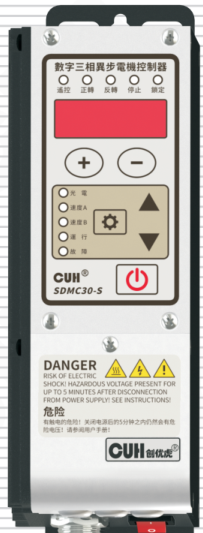

## SDMC30-S

# 用户手册


### 第 2 页

数字三相异步电机控制器　　　　　　　　　　　　　　SDMC30-S

---

## 版权说明

南京创优科技有限责任公司保留所有权利。

本用户手册上包含的所有信息是属于本公司的知识，受著作权法及所有法律的保护。本公司根据著作权法及其他法律享有并保留所有著作权和其他法律赋予的权利，未经本公司书面同意不得以任何形式对本用户手册的部分或全部进行抄袭、翻译、转译、仿制或其他利用。

## 免责声明

本用户手册的所有内容仅说明本公司生产的相关产品的使用方法，并且是根据现有技术和提供给您使用时的状态进行描述的，在您使用本产品时必须自行承担相关风险。除法律强制规定外，本公司不因本用户手册对产品负有任何明示或暗示的责任，包括但不限于人身伤害、财产损失、机会丧失。

您明确了解上述风险并同意，除法律强制规定外，本公司无须为您的任何直接、间接的损害或损失负责（包括但不限于人员、财物、数据等有形损失和名誉、机会等无形损失）。

本公司保留对本用户手册中所适用的产品进行修改而不预先及事后通知的权利。

---

2023-09　　　　　　　　　　　　　　　　　　　　　　SDMC30SMSCN_1.01


### 第 3 页

| 数字三相异步电机控制器 | SDMC30-S |
|---|---:|

## 序言

感谢您使用南京创优科技有限责任公司（在本手册中以下简称本公司）出品的 SDMC30 系列数字三相异步电机控制器（在本手册中以下简称本产品、本控制器或控制器）。本系列控制器是采用高品质元件并融合了最新的电子技术，采用高性能的数字信号处理器经过精心的设计而成。

本手册介绍了本产品的基本操作方法、功能技术说明和典型应用示例。为用户提供安装调试、参数设置、异常诊断、故障排除及日常维护控制器的相关信息。为了确保正确安装和使用本控制器，请在装机之前仔细阅读本用户手册，并请妥善保存。

以下符号提醒您注意有关防止人身伤害和产品损坏的事项，请务必阅读。

| 符号 | 说明 |
|---|---|
| ⚠️ 危险 | 表示若不遵守该事项，将导致人员伤亡。 |
| ⚠️ 警告 | 表示若不遵守该事项，可能导致人员伤亡。 |
| ⚠️ 小心 | 表示若不遵守该事项，可能导致人员遭受中度或轻微伤害。 |
| 注意 | 表示若不遵守该事项，将导致本产品损坏及财产损失。 |
| ！要点 | 表示在使用过程中必须要遵守的注意事项和使用限制等。 |

**本说明书适合以下型号控制器：**

◆ 数字三相异步电机控制器　SDMC30-S  
（输入单相 85~250VAC，输出三相 0~220Vrmm/0.2kW）

| 2023-09 | SDMC30SMSCN_1.01 |
|---|---:|


### 第 4 页

数字三相异步电机控制器　　　　　　　　　　　　　　　　　　　　　　　　　SDMC30-S

---

# 安全与预防措施

1、**【危险】** 本产品仅用于驱动三相异步电机，请勿将本产品用于保护人体或人体部位等目的。

2、**【危险】** 本产品不得作为防爆产品使用，请勿在危险场所和/或潜在爆炸气体环境中使用本产品。

3、**【警告】** 本产品是采用交流市电供电的设备，请勿施加超过对应型号的最高输入电压。对于220Vac输入的产品，施加过大的输入电压如380Vac，则可能导致产品爆炸或者着火，造成严重的安全事故。

4、**【警告】** 本产品是通过电源线进行接地的，请确保为控制器供电的配电设施具备良好的接地，否则可能导致控制器外壳带电，造成触电事故。

5、**【警告】** 请勿输入交流电源到本控制器的输出端，这会损坏控制器。

6、**【警告】** 请勿在带电的情况下插拔接线或触摸接线仓内各接线端子触点，以防发生触电事故。

7、**【注意】** 请避免采用通过继电器等设备切断供电的方式来控制本产品的输出，这会严重降低本控制器的寿命。

8、**【注意】** 本产品设计使用于阴凉干燥环境，请勿将本产品置于室外、可能会浸水、阳光暴晒场所工作，也不要在超过本产品电气特性要求的温度和湿度范围之外工作。

9、**【要点】** 请务必将本产品固定在可靠接地的坚固平台上, 并远离振动设备。

10、**【要点】** 任何情况下请勿将本产品在超越设计极限状态下工作。

11、**【要点】** 请严格按照本手册的说明操作，对于违反这些操作说明所造成的任何人身伤害或财产损失，本公司不承担任何民事和刑事责任。

12、**【要点】** 任何情况下请不要打开本控制器机壳，以防遭到电击。机壳内部没有可以调节和用户维修部分，请不要试图维修本机，出现故障请致电本公司。

---

2023-09　　　　　　　　　　　　　　　　　　　　　　　　　SDMC30SMSCN_1.01


### 第 5 页

数字三相异步电机控制器　　　　　　　　　　　　　　　　　　　　　　　　　SDMC30-S

---

# 工作与储存环境

## 一、使用前的检查

每台控制器在出厂前，均经过严格的品质检验，并经过强化的防撞包装处理。客户在拆箱后，请即刻进行下列检查：

1. 检查控制器是否在运输过程中受到损伤。
2. 检查控制器型号是否与订货登记资料完全相同。

## 二、工作环境

为使本控制器具有更好的使用效果和更长的使用寿命，请将控制器安装在符合下列条件的环境中：

- 良好的通风散热环境
- 远离水滴、蒸气、灰尘，（特别是油性灰尘）
- 无腐蚀、易燃性的气体、液体
- 无漂浮性的尘埃及金属微粒
- 安装表面坚固无振动
- 远离电磁噪声干扰
- 使用环境温度为0℃到40℃
- 仅适用于海拔2000m以下地区安全使用

---

2023-09　　　　　　　　　　　　　　　　　　　　　　　　　SDMC30SMSCN_1.01


### 第 6 页

<div style="display:flex; justify-content:space-between;">
  <span>数字三相异步电机控制器</span>
  <span>SDMC30-S</span>
</div>

---

<br><br><br><br><br><br><br><br><br><br><br><br><br><br>

---

<div style="display:flex; justify-content:space-between;">
  <span>2023-09</span>
  <span>SDMC30SMSCN_1.01</span>
</div>


### 第 7 页

数字三相异步电机控制器　　　　　　　　　　　　　　　　　　　　　　　　　SDMC30-S

---

# 目　录

**第一章 使用前须知** -------------------------------------------------------------- 1

　　1.1　检查包装内容 ------------------------------------------------------------ 1

　　1.2　指示灯及按键说明 -------------------------------------------------------- 2

　　1.3　外部部件说明 ------------------------------------------------------------ 3

　　1.4　信号端口说明 ------------------------------------------------------------ 3

　　1.5　控制器铭牌说明 ---------------------------------------------------------- 4

**第二章 产品介绍** ---------------------------------------------------------------- 5

　　2.1　产品简介 ---------------------------------------------------------------- 5

**第三章 安装及使用指南** ---------------------------------------------------------- 6

　　3.1　控制器使用条件 ---------------------------------------------------------- 6

　　3.2　按键基本操作 ------------------------------------------------------------ 6

　　3.3　安装使用 ---------------------------------------------------------------- 7

**第四章 基本功能说明** ----------------------------------------------------------- 11

　　4.1　设定频率 --------------------------------------------------------------- 11

　　4.2　正转运行与反转运行 ----------------------------------------------------- 12

　　4.3　紧急停止 --------------------------------------------------------------- 13

　　4.4　缓启动时间 ------------------------------------------------------------- 14

　　4.5　缓关闭时间/直流制动 ---------------------------------------------------- 14

　　4.6　键盘锁定功能 ----------------------------------------------------------- 15

　　4.7　恢复出厂设置 ----------------------------------------------------------- 16

**第五章 高级功能说明** ----------------------------------------------------------- 17

　　5.1　电机启停和方向控制 ----------------------------------------------------- 17

　　5.2　电机旋转方向交换与禁止反转 --------------------------------------------- 18

　　5.3　电机紧急停止方式 ------------------------------------------------------- 19

　　5.4　电机V/F曲线设定 -------------------------------------------------------- 21

　　5.5　电机过功率保护 --------------------------------------------------------- 22

---

2023-09　　　　　　　　　　　　　　　　　　　　　　　　　　　　SDMC30SMSCN_1.01


### 第 8 页

数字三相异步电机控制器　　　　　　　　　　　　　　　　　　　　　　　　　SDMC30-S

---

5.6　电机速度远程控制 ---------------------------------------------------------------------- 24

5.7　电机速度数字预置 ---------------------------------------------------------------------- 26

5.8　开关传感器 ------------------------------------------------------------------------------ 27

5.9　智能光电端口 ---------------------------------------------------------------------------- 28

5.10　运行输出/故障输出端口 ------------------------------------------------------------- 29

5.10.1　运行输出/故障输出的接线方法 ----------------------------------------------- 29

5.10.2　运行输出/故障输出的信号源与逻辑图 -------------------------------------- 30

5.10.3　运行输出/故障输出的模式说明 ----------------------------------------------- 32

5.11　开机运行状态 -------------------------------------------------------------------------- 33

5.12　面板亮度调整 -------------------------------------------------------------------------- 34

5.13　输出监控参数 -------------------------------------------------------------------------- 35

**第六章 技术规格** ------------------------------------------------------------------------- 36

6.1　外形尺寸 ---------------------------------------------------------------------------------- 36

6.2　技术规格表 ------------------------------------------------------------------------------- 37

6.3　参考标准 ---------------------------------------------------------------------------------- 38

**第七章 附录** ------------------------------------------------------------------------------ 39

7.1　参数列表 ---------------------------------------------------------------------------------- 39

7.2　输入输出电路图 ------------------------------------------------------------------------- 42

7.3　故障代码 ---------------------------------------------------------------------------------- 44

7.4　警告代码 ---------------------------------------------------------------------------------- 45

**第八章 产品质保信息** ------------------------------------------------------------------- 46

8.1　质保期 ------------------------------------------------------------------------------------ 46

8.2　保修范围 ---------------------------------------------------------------------------------- 46

8.3　产品适用性 ------------------------------------------------------------------------------- 46

---

2023-09　　　　　　　　　　　　　　　　　　　　　　　　　SDMC30SMSCN_1.01


### 第 9 页

数字三相异步电机控制器　　　　　　　　　　　　　　　　　　　　　　SDMC30-S

# 第一章 使用前须知

本章节介绍产品包装内容、控制器外观说明和控制器铭牌信息。

## 1.1 检查包装内容

使用本产品之前，请检查控制器及附件的完整性。如果发现产品有缺陷或已损坏、附件缺失等问题，请与本公司联系。

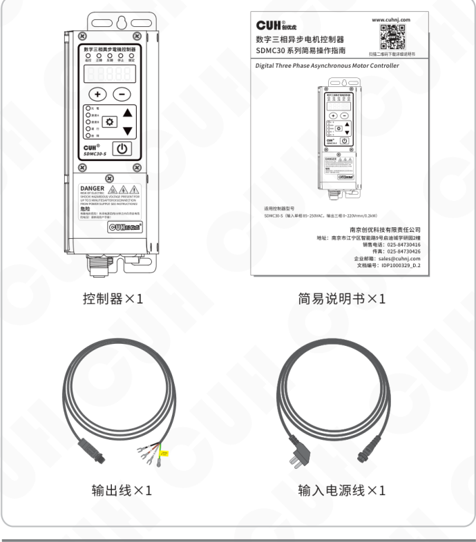

包装内容包括：

| 名称 | 数量 |
|---|---:|
| 控制器 | ×1 |
| 简易说明书 | ×1 |
| 输出线 | ×1 |
| 输入电源线 | ×1 |

2023-09　　　　　　　　　　　　　　　　　- 1 -　　　　　　　　　　　　　　　　　SDMC30SMSCN_1.01


### 第 10 页

数字三相异步电机控制器　　　　　　　　　　　　　　　　　　　　　　　　　SDMC30-S

## 1.2 指示灯及按键说明

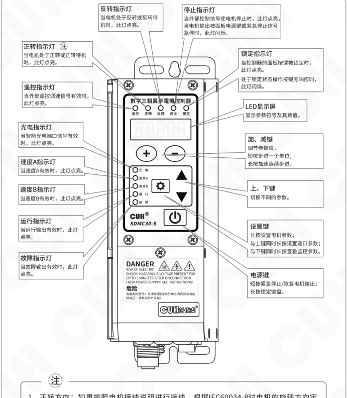

### 指示灯说明

| 名称 | 说明 |
|---|---|
| 正转指示灯 | 当电机处于正转或正转待机时，此灯点亮。 |
| 反转指示灯 | 当电机处于反转或反转待机时，此灯点亮。 |
| 停止指示灯 | 当外部控制信号使电机停止时，此灯点亮，当电机输出被面板电源键或紧急停止信号急停时，此灯闪烁。 |
| 锁定指示灯 | 当控制器的面板按键被锁定时，此灯点亮。<br>处于锁定状态操作按键无响应时，此灯闪烁。 |
| 遥控指示灯 | 当外部遥控调速信号有效时，此灯点亮。 |
| 光电指示灯 | 当智能光电端口信号有效时，此灯点亮。 |
| 速度A指示灯 | 当速度A有效时，此灯点亮。 |
| 速度B指示灯 | 当速度B有效时，此灯点亮。 |
| 运行指示灯 | 当运行输出有效时，此灯点亮。 |
| 故障指示灯 | 当故障输出有效时，此灯点亮。 |

### 按键与显示屏说明

| 名称 | 说明 |
|---|---|
| LED显示屏 | 显示参数符号及其数值。 |
| 加、减键 | 调节参数值，短按步进一个单位；长按加速连续步进。 |
| 上、下键 | 切换不同的参数。 |
| 设置键 | 长按设置电机参数；与上键同时长按设置端口参数；与下键同时长按查看监控参数。 |
| 电源键 | 短按紧急停止/恢复电机输出；长按锁定键盘。 |

> 注
>
> 1、正转方向：如果按照电机接线说明进行接线，根据IEC60034-8对电机的旋转方向定义，正转方向是指从电机驱动端侧方向观察顺时针旋转。
>
> 2、当任意交换其中两相接线，电机会逆时针旋转，即正反转方向交换。


### 第 11 页

数字三相异步电机控制器　　　　　　　　　　　　　　　　　　　　　　　　　SDMC30-S

## 1.3 外部部件说明

> ⚠️ **危险**
>
> 请在安装输出线时对准 PE 引脚方位后插入插头，禁止未确认插入方向强行插入。
>
> 如果插入方向错误，电机外壳会留有高压，会有导致死亡或重伤的危险。

> ⚠️ **危险**
>
> 1、本产品属于防护等级 I 的设备且通过电源线三爪插头进行保护接地。请确保连接的插座进行了安全接地措施。
>
> 2、缺少安全接地连接或连接出错时，在控制器壳体上会留有高压，接触控制器会有导致死亡或重伤的危险。

### 外部部件位置示意图

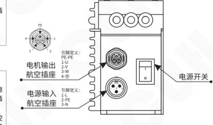

### 航空插座引脚定义

| 部件 | 引脚 | 定义 |
|---|---:|---|
| 电机输出航空插座 | PE | PE |
| 电机输出航空插座 | 1 | U |
| 电机输出航空插座 | 2 | V |
| 电机输出航空插座 | 3 | W |
| 电机输出航空插座 | 4 | 空 |
| 电源输入航空插座 | 1 | L |
| 电源输入航空插座 | 2 | PE |
| 电源输入航空插座 | 3 | N |

- 电源开关

## 1.4 信号端口说明

| 左侧功能 | 左侧端子 | 左侧定义 | 右侧定义 | 右侧端子 | 右侧功能 |
|---|---|---|---|---|---|
| 遥控调速 | A1 | 电阻地 | 地线 | E1 | 反转运行 |
| 遥控调速 | A2 | 输入 | 输入 | E2 | 反转运行 |
| 遥控调速 | A3 | 5V 输出 | 24V 输出 | E3 | 反转运行 |
| 智能光电 | B1 | 地线 | 地线 | G1 | 速度 A/B |
| 智能光电 | B2 | 接收 | 速度A | G2 | 速度 A/B |
| 智能光电 | B3 | 地线 | 地线 | G3 | 速度 A/B |
| 智能光电 | B4 | 发射 | 速度B | G4 | 速度 A/B |
| 正转运行 | C1 | 地线 | 地线 | M1 | 紧急停止 |
| 正转运行 | C2 | 输入 | 输入 | M2 | 紧急停止 |
| 正转运行 | C3 | 24V 输出 | 24V 输出 | M3 | 紧急停止 |
| 运行输出 | D3 | 地线 | 地线 | P3 | 故障输出 |
| 运行输出 | D1 | 输出 | 输出 | P1 | 故障输出 |
| 运行输出 | D2 | 24V 输出 | 24V 输出 | P2 | 故障输出 |

### 信号端口排布示意图

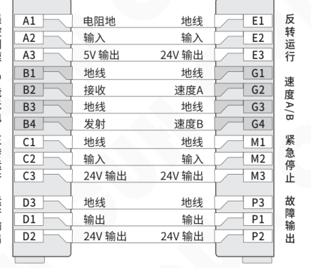

---

2023-09　　　　　　　　　　　　　　　　　- 3 -　　　　　　　　　　　　　　　　　SDMC30SMSCN_1.01


### 第 12 页

## 1.5 控制器铭牌说明

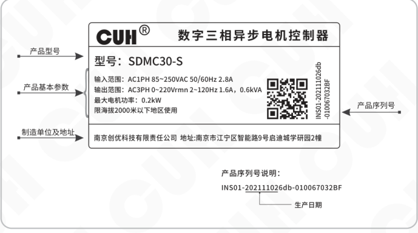

铭牌示意内容：

- 产品型号
- 产品基本参数
- 制造单位及地址
- 产品序列号

铭牌内文字：

- **CUH® 数字三相异步电机控制器**
- **型号：** SDMC30-S
- **输入范围：** AC1PH 85~250VAC 50/60Hz 2.8A
- **输出范围：** AC3PH 0~220Vrms 2~120Hz 1.6A，0.6kVA
- **最大电机功率：** 0.2kW
- **限海拔2000米以下地区使用**
- **制造单位及地址：** 南京创优科技有限责任公司 地址:南京市江宁区智能路9号启迪城学研园2幢

产品序列号说明：

```text
INS01-202111026db-010067032BF
```

其中，`202111026` 表示生产日期。


### 第 13 页

# 第二章 产品介绍

本章节主要内容包括本产品的简单介绍和主要特色功能。

## 2.1 产品简介

SDMC30系列数字三相异步电机控制器是紧凑静音全固态无风扇变频控制器，通过采用最新的电子技术和精心的设计，提供独特的性能。特别适合工业环境应用，其特色功能包括：

- 空间矢量脉冲宽度调制（SVPWM）三相纯正弦波输出方式实现电机高效低噪音的性能。
- 可自定义V/F曲线适应电机的不同类型负载应用。
- 智能光电端口支持光电传感器、NPN、PNP开关传感器。
- 运行输出和故障输出用于指示控制器的运行和故障状态。
- 输出端口支持NPN、PNP、推挽模式。
- 防失速功能防止电机在加速、减速、运行过程中的过载失速停机。
- 直流制动功能在停机或紧急停止时，可以快速刹车，使电机停止旋转。
- 支持过载/过流/堵转/缺相等全面电机保护功能。
- 面板亮度调节功能支持32级亮度调整。
- 禁止反转功能可以锁定电机不可反转。
- 紧急停止功能，可以选择安全转矩关断、安全抱闸控制、1类安全停止。
- 就绪信号功能，通过智能光电B4发射端口输出调制信号或有效信号指示控制器处于就绪状态，控制器出现错误时就绪信号变为无效。
- 远程遥控功能支持1~5V、0~5V、0~10V、4~20mA选择。
- 遥控系数功能，可以将遥控电压的控制效果放大1倍或缩小1倍。
- 速度AB功能支持两个开关信号控制多达四种电机转速。
- 丰富的控制信号源、逻辑关系、开关延时、输出模式可以实现复杂的应用。
- 丰富的监控功能，可以监控温度、输出频率、输出功率、信号端口电压。
- 完整的保护功能还包括：电机输出的短路保护、控制器过载保护、过热过冷保护、电源欠压/过压保护、运行输出和故障输出短路保护、24V输出短路保护、调速5V输出短路保护。


### 第 14 页

数字三相异步电机控制器　　　　　　　　　　　　　　　　　　　　　　　　　SDMC30-S

# 第三章　安装及使用指南

本章节介绍本产品使用所必须具备的条件以及如何正确进行安装与连接。

## 3.1 控制器使用条件

本产品是使用交流220V供电的设备，且通过电源线三爪插头进行保护接地连接，请提供符合标准的220V，50Hz/60Hz市电供电配电设施并确保保护地线已正确连接。

> **⚠ 警告**　切不可将控制器连接到380V交流电，这将造成控制器不可恢复的严重损坏，有可能导致爆炸、火灾等安全事故。

> **⚠ 警告**　确保供电侧可靠接地，控制器的金属外壳是与保护接地线直接连接的，接地不良会导致控制器外壳带电，引发触电事故。

> **注意**　控制器长时间工作会产生热量致使外壳温度升高，请将控制器安装在通风良好的环境中，并将其固定良好，远离振动源。

> **注意**　本产品的电机输出端口是市电经过整流、逆变形成的，中间没有隔离环节。因此输出极不可以与保护接地连接，在连接电机时也要确保电机线圈与外壳之间具备基本的绝缘能力。否则会导致漏电，可能产生触电和控制器损坏的事故。

## 3.2 按键基本操作

本控制器采用5位数码显示参数符号，10个红色指示灯显示控制器或信号端口的状态。

本控制器采用6键操作，操作方式如下：

a. 按键动作根据按下时间分为短按、长按（一级加速、二级加速）。  
b. 短按定义按下时间大于0.1小于2秒，长按定义按下时间大于2秒。  
c. ⊕ 和 ⊖ 用于调节参数值，▼ 和 ▲ 用于选择不同参数。  
d. 短按 ⏻ 紧急停止电机输出，长按锁定/解锁键盘。  
e. 长按 ⚙ 进入/退出电机参数界面。  
f. 长按 ⚙ 加 ▲ 进入/退出端口参数界面。  
g. 长按 ⚙ 加 ▼ 进入/退出监控参数界面，该界面下按 ⊕ 和 ⊖ 临时调整设定频率。

---

2023-09　　　　　　　　　　　　　　　　　- 6 -　　　　　　　　　　　　　　　SDMC30SMSCN_1.01


### 第 15 页

## 3.3 安装使用

**第一步：**

打开控制器的外包装，检查控制器外观及侧标型号，判断是否为所需的型号。

**第二步：**

取出输出线，将输出线接线端子连接到电机的接线柱上，根据电机的铭牌选择三角形或星形接线。并确认黄绿双色的地线与电机金属外壳可靠连接。

### 三角形接线

控制器接 △230V / Y400V 电机时，采用三角形接线。

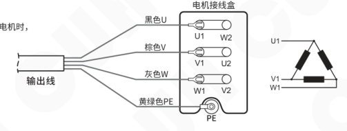

### 星形接线

控制器接 △120V / Y230V 电机时，采用星形接线。

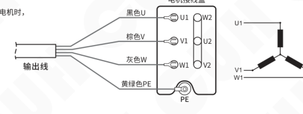

### 备注

- 根据 IEC60446 规定：
  1. 交流相导体优先使用黑色 L1、棕色 L2、灰色 L3 标识。
  2. 保护导体 PE 必须使用黄-绿双色组合标识。
- 本控制器输出三相 220V 线电压，适用于 220~240V 三角形连接电机或 220~240V 星形连接电机。如果连接 380V 星形电机则会出现转矩严重下降。

> ⚠️ **危险**  
> 一定要确认电机外壳可靠连接 PE 线。否则将会导致机壳带电，会有**导致死亡或重伤的危险**。

> ⚠️ **警告**  
> 请按 UVW 的顺序连接电机接线端子，如果顺序不正确则可能造成电机反转，**产生机械危险**。


### 第 16 页

数字三相异步电机控制器  
**SDMC30-S**

### 第三步：

连接输出插头至控制器电机输出航空插座并锁紧螺母。

再取出电源线，将电源线的航空插头插入控制器电源输入插座，并锁紧航空插头的螺母。

> ⚠️ **危险**
>
> 请在安装输出线时对准 PE 引脚方位后插入插头，禁止未确认插入方向强行插入。
>
> 如果插入方向错误，电机外壳会留有高压，会有导致死亡或重伤的危险。

**输出线连接示意：**

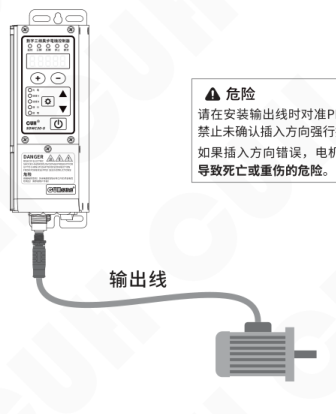

**电源线连接示意：**

- 图中标注：先插航空插头。
- 图中标注：电源线。
- 图中以“×”标示禁止的插接方式。

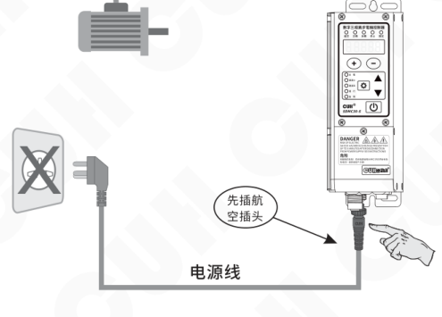

> ⚠️ **危险**
>
> 为防止触电，请勿在接通电源的状态下进行接线作业，务必切断机器电源并在数码管显示熄灭5分钟后进行接线作业。如果操作不当，会有导致死亡或重伤的危险。

---

2023-09 ｜ - 8 - ｜ SDMC30SMSCN_1.01


### 第 17 页

数字三相异步电机控制器  
SDMC30-S

**第四步：**

确认开关处于关闭位置后，将电源线三爪插头插在供电电源插座上。

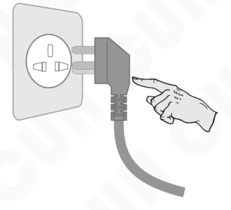

**第五步：**

打开控制器电源开关，此时应该显示设定频率“F50.0”且正转和停止指示灯亮起，电机此时不会旋转。

F 表示  
设定频率

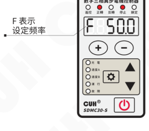


### 第 18 页

数字三相异步电机控制器          SDMC30-S

### 第六步：

给控制器连接正转控制信号或反转控制信号，此时控制器停止灯熄灭，运行灯亮起，电机逐步加速至50Hz频率。

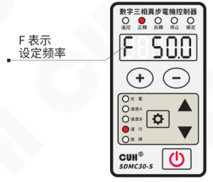

### 第七步：

使用 `+` 和 `−` 调节频率达到最佳的电机运转速度。

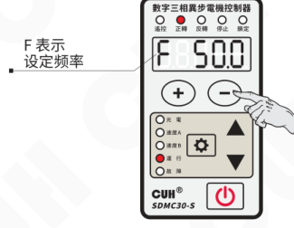

2023-09          -10-          SDMC30SMSCN_1.01


### 第 19 页

数字三相异步电机控制器　　　　　　　　　　　　　　　　　　　　　　　　　SDMC30-S

# 第四章 基本功能说明

本章节介绍本产品基本功能的使用方法。

## 4.1 设定频率

本控制器可以直接在面板上以数字的方式设置输出频率。因为采用直接数字频率合成技术（DDS），具有非常高的频率精度和稳定性，不随时间和温度的改变而变化。

- » 打开控制器的电源开关。

- » 控制器进入待机参数设定频率 F，控制器上正转和停止指示灯点亮，LED 显示屏显示参数 F 和参数值。

- » 通过 ⊕ 和 ⊖ 可以对设定频率进行调整。

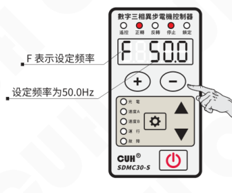

本系列控制器的设定频率范围是 2.0～120.0Hz

> ● 设定频率 F 可以设置的范围，受最低频率 r 和最大频率 y 的限制。

2023-09　　　　　　　　　　　　　　　　　-11-　　　　　　　　　　　　　　　SDMC30SMSCN_1.01


### 第 20 页

数字三相异步电机控制器  
SDMC30-S

## 4.2 正转运行与反转运行

本控制器具备正转运行端口C和反转运行端口E，在端口信号都无效时电机不会运转，停止指示灯点亮。

当正转运行端口C信号有效时，电机正转运行，此时停止指示灯熄灭，正转指示灯点亮，运行指示灯点亮。

- 按住 ⚙ 2秒，进入电机参数界面。
- 使用 ▲ 和 ▼ 切换到正转启停控制源1调整状态“P1”。
- 通过 ＋ 和 － 调整参数值。该参数的默认设置是C。

图示：P1 表示正转启停控制源1；C信号有效。  
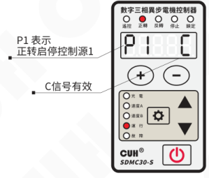

当反转运行端口E信号有效时，电机反转运行，此时停止指示灯熄灭，反转指示灯点亮，运行指示灯点亮。

- 按住 ⚙ 2秒，进入电机参数界面。
- 使用 ▲ 和 ▼ 切换到反转方向控制源1调整状态“Π1”。
- 通过 ＋ 和 － 调整参数值。该参数的默认设置是E。

图示：Π1 表示反转方向控制源1；E信号有效。  
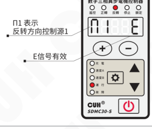

注意：

1. 当正转运行端口和反转运行端口信号都有效时，控制器报错Er15正反转冲突，电机不会运转。
2. 如果按照电机接线说明进行接线，根据IEC60034-8对电机的旋转方向定义，正转方向是指从电机驱动端侧方向观察顺时针旋转。

---

2023-09　　-12-　　SDMC30SMSCN_1.01


### 第 21 页

数字三相异步电机控制器　　　　　　　　　　　　　　　　　SDMC30-S

## 4.3 紧急停止

在紧急状态下本控制器可以进入紧急停止状态以快速停止电机运转，通过按下面板电源键或触发紧急停止端口信号有效均可以进入紧急停止状态，此时停止指示灯闪烁并显示Ar02紧急停止。

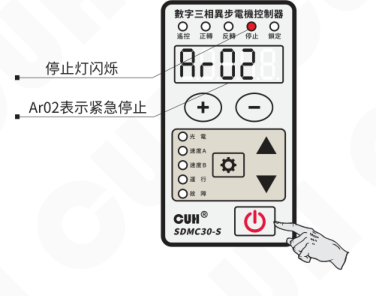

图中提示：

- 停止灯闪烁
- Ar02表示紧急停止

- 通过按下面板电源键进入的紧急停止状态，可以通过再次按下该电源键解除紧急停止状态。
- 通过触发紧急停止端口信号有效进入的紧急停止状态，除了撤除紧急停止端口信号外，还需要再按下面板电源键以解除紧急停止状态。

- 紧急停止方式可以通过参数Sq选择：安全转矩关断、安全抱闸控制和1类安全停止，详细功能参见高级功能说明。


### 第 22 页

## 4.4 缓启动时间

本控制器从停止状态启动时，电机输出频率可以平缓提高到设定频率，以防止对电机及运转设备产生冲击。

缓启动时间（t）：电机从停止状态启动时，控制器输出频率从最低频率平滑升高达到设定频率所需的时间称为缓启动时间。

| 操作说明 | 图示 |
|---|---|
| - 按住设置键（⚙）2秒，进入电机参数界面。<br>- 使用 ▲ 和 ▼ 切换到缓启动参数调整状态“t”。<br>- 通过 ＋ 和 － 调整参数值。该参数的单位是秒，精度是0.1秒。 | 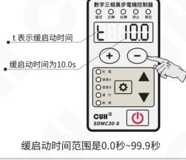<br>t 表示缓启动时间<br>缓启动时间为10.0s<br>缓启动时间范围是0.0秒~99.9秒 |

## 4.5 缓关闭时间/直流制动

本控制器从运转状态停止时，电机输出频率可以平缓降低到最低频率，以防止对电机及运转设备产生冲击。

缓关闭时间（ʃ）：电机从运转状态停止时，控制器输出频率从设定频率平滑降低达到最低频率所需的时间称为缓关闭时间。

当缓关闭时间设置为负值时表示直流制动停止，此时直流制动电流由参数cb设置。

| 操作说明 | 图示 |
|---|---|
| - 按住设置键（⚙）2秒，进入电机参数界面。<br>- 使用 ▲ 和 ▼ 切换到缓关闭参数调整状态“ʃ”。<br>- 通过 ＋ 和 － 调整参数值。该参数的单位是秒，精度是0.1秒。 | 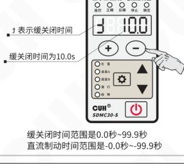<br>ʃ 表示缓关闭时间<br>缓关闭时间为10.0s<br>缓关闭时间范围是0.0秒~99.9秒<br>直流制动时间范围是-0.0秒~-99.9秒 |


### 第 23 页

数字三相异步电机控制器　　　　　　　　　　　　　　　　　　　　　　　　　SDMC30-S

## 4.6 键盘锁定功能

为了防止误操作，本机设定了键盘锁。这样当控制器各项参数设置好后，可以有效避免其他人的误动作影响本机正常工作。即使关机后重新开机，键盘锁状态依然保持上次关机时的状态。

> - 通过长按 **⏻** 2秒可以锁定除电源键外的所有按键，此时键盘锁定指示灯点亮。
>
> - 再次长按 **⏻** 2秒可以解除锁定。
>
> 锁定指示灯位置示意：
>
> 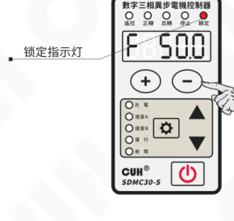
>
> ● 控制器处于锁定状态时，操作按键无响应，锁定指示灯会闪烁。

2023-09　　　　　　　　　　　　　　　　　-15-　　　　　　　　　　　　　　　　　SDMC30SMSCN_1.01


### 第 24 页

> 数字三相异步电机控制器　　　　　　　　　　　　　　　　　SDMC30-S

## 4.7 恢复出厂设置

本功能可以使用户快速将控制器设置为出厂默认设置状态。

由于本控制器功能强大，有数量众多的控制参数可以由用户设定，对于初学者，可能在多次的设定修改后不能恢复控制器的正常工作状态。使用该功能可以快速将调乱的参数状态恢复为出厂默认设置。

- 长按 `⚙` 和 `▲`，进入端口参数界面。

- 短按 `▲` 切换到数码管和指示灯全闪状态，即“恢复出厂设置”参数，此时长按 `⚙`，直到控制器显示“-----”，表示控制器已经重设完毕。

- 松开 `⚙`，控制器显示 CUH 后，随即进入正常的待机界面，此时控制器就像刚开始使用一样，所有参数都已经恢复到出厂默认状态。

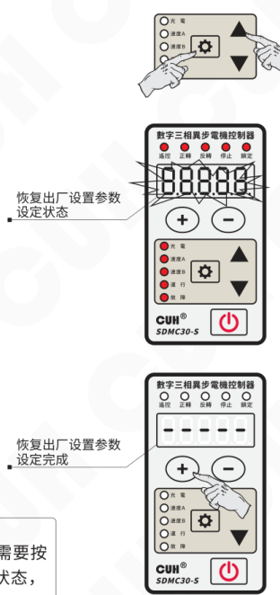

> ● 用户进行恢复出厂设置之前，需要按下 `⏻` 使控制器处于紧急停止状态，此时停止灯闪烁。

---

2023-09　　　　　　　　　　　　　-16-　　　　　　　　　　　　　SDMC30SMSCN_1.01


### 第 25 页

数字三相异步电机控制器　　　　　　　　　　　　　　　　　　　　　SDMC30-S

# 第五章 高级功能说明

本章节主要介绍本产品高级功能的使用方法。

## 5.1 电机启停和方向控制

本控制器设计了正转启停信号和反转方向信号用于控制电机的启停和方向，其中正转启停信号具有2个信号源和一个逻辑计算单元，反转方向信号也具有2个信号源和一个逻辑计算单元。通过正反转控制方式可以选择这两个信号控制电机的启停及正反转行为。具体逻辑关系见下图。

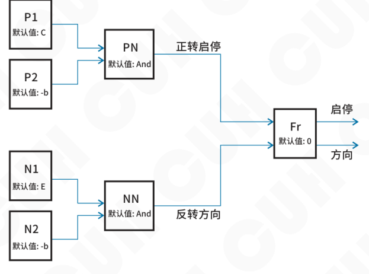

正转启停控制源和反转方向控制源包括：0, 1, b, -b, C, -C, E, -E, SA, -SA, Sb, -Sb, ES, -ES, od, -od, oP, -oP。

正转启停逻辑关系和反转方向逻辑关系包括：And与, or或, Xor异或, rS触发器。

正反转控制方式有两种取值：

- Fr=0表示：正转启停信号用于控制正转启停，反转方向信号用于控制反转启停。
- Fr=1表示：正转启停信号用于控制启停，反转方向信号用于控制方向。

注意：在Fr=0且正转启停和反转方向信号同时有效时，触发Er15正反转冲突，电机停止运转。

2023-09　　　　　　　　　　　　　　　　　-17-　　　　　　　　　　　　　　　　　SDMC30SMSCN_1.01


### 第 26 页

## 5.2 电机旋转方向交换与禁止反转

在实际应用场合，因机械系统限制或接线原因需要调换电机的旋转方向或禁止电机某个方向不可以运转，可以通过旋转方向交换参数 Ph（Phase）来实现。

- 当 Ph=Abc 时，表示标准方向，即正转是从电机驱动端侧观察顺时针方向。
- 当 Ph=Acb 时，表示方向交换，即正转是从电机驱动端侧观察逆时针方向。
- 当 Ph=A.b.c. 时，表示标准方向禁止反转，即电机只能顺时针旋转，当出现反转指令时不响应并显示 Ar08 禁止反转警告。
- 当 Ph=A.c.b. 时，表示方向交换禁止正转，即电机只能逆时针旋转，当出现正转指令时不响应并显示 Ar08 禁止反转警告。

> 下图所示为顺时针方向的电机，从驱动端看轴为顺时针旋转，观察方向为从驱动端向非驱动端看。
>
> 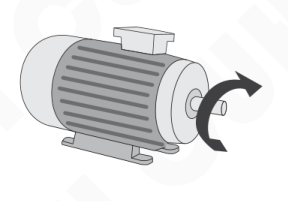
>
> 下图所示为逆时针方向的电机，从驱动端看轴为逆时针旋转，观察方向为从驱动端向非驱动端看。
>
> 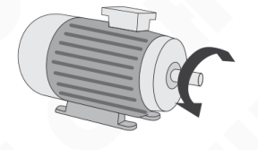


### 第 27 页

## 5.3 电机紧急停止方式

本控制器具备使电机紧急停止的功能，通过按下面板电源键或外部急停开关触发电机紧急停止源有效可以进入紧急停止状态。

紧急停止源可以选择不同的信号源，默认选择紧急停止端口信号。面板电源键始终是有效的紧急停止源。

根据紧急停止方式Sq参数可以选择紧急停止时不同的策略：

- Sq=Sto，控制器立即切断电机电源，电机根据惯性减速停止。
- Sq=Sbc，电机进行直流制动停止，制动时间由缓关闭时间决定。故障输出端口输出紧急停止状态且不受信号源控制，必须使用安全抱闸继电器。
- Sq=SS1，电机根据缓关闭时间定义的动作减速或刹车停止。

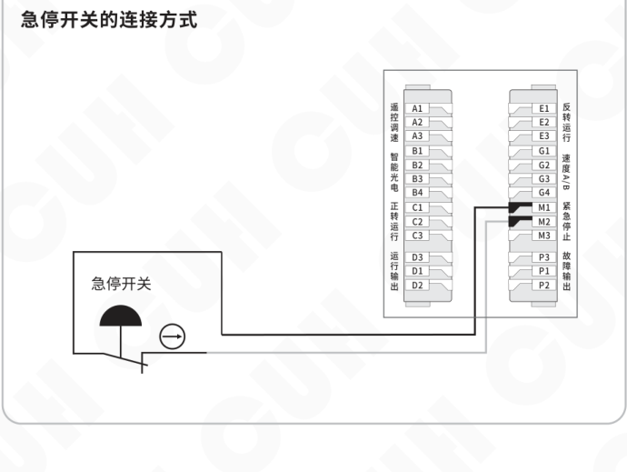


### 第 28 页

**数字三相异步电机控制器**　　　　　　　　　　　　　　　**SDMC30-S**

### Sto：安全转矩关断

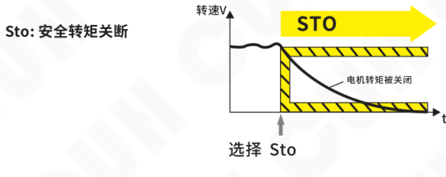

图中标注：

- 转速 V
- STO
- 电机转矩被关闭
- 选择 Sto
- t

### Sbc：安全抱闸控制

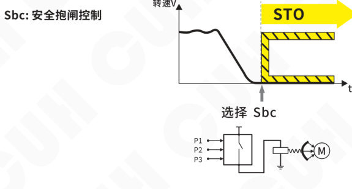

图中标注：

- 转速 V
- STO
- 选择 Sbc
- t
- P1 / P2 / P3
- M

### SS1：1类安全停止

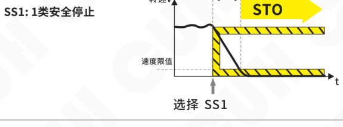

图中标注：

- 转速 V
- Safe Stop 1 延迟时间
- STO
- 速度限值
- 选择 SS1
- t

---

2023-09　　　　　　　　　　　　-20-　　　　　　　　　　　　SDMC30SMSCN_1.01


### 第 29 页

## 5.4 电机V/F曲线设定

本控制器可自定义V/F曲线以适应电机的不同类型负载应用。

通过最大频率y、额定频率b、额定电压h、中间频率n、中间电压o、最低频率r、最低电压u定义。

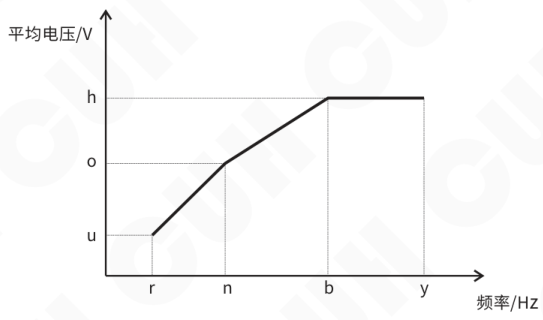

**注意：** 由于电机负载具有感性，为维持V/F曲线线性段电流不变，输出线电压均校准为整流平均值Vrmn。通常标准正弦波的有效值Vrms为整流平均值Vrmn的1.11倍。


### 第 30 页

数字三相异步电机控制器　　　　　　　　　　　　　　　　　　　　　　　SDMC30-S

---

## 5.5 电机过功率保护

本控制器具有电机功率超限保护和电机电子过热保护，得益于对电机消耗功率的精确测量，可以精准限制电机的功率上限和电机过功率运行的能力。

通过参数电机额定电功率Po和功率超额系数rc设定保护功率范围。

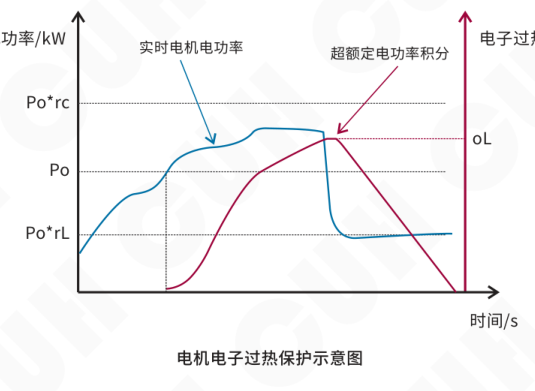

控制器实时监控电机电功率，当该功率超过电机额定电功率Po且不超过功率超额系数rc时，电机电子过热积分器启动，当积分值超过电功过热阈值oL时触发电机电子过热保护Er02H，控制器将降低输出频率直到输出功率下降到功率降额系数rL定义的功率。此时积分器进行复位，当复位完成则恢复至设定频率运行，重新开始新的保护循环。

---

2023-09　　　　　　　　　　　　　　　　　-22-　　　　　　　　　　　　　　　　　SDMC30SMSCN_1.01


### 第 31 页

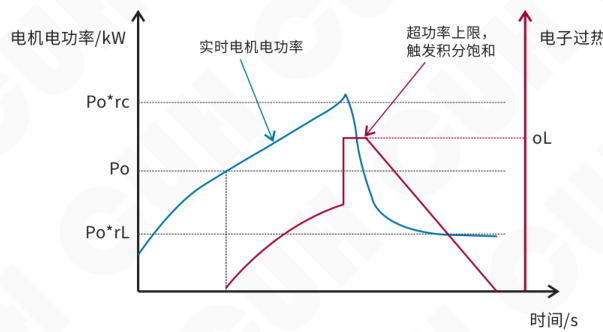

**电机功率超上限保护示意图**

控制器实时监控电机电功率，当该功率超过电机额定电功率Po和功率超额系数rc乘积，触发电机功率超限保护Er02P。电机电子过热积分器直接进入饱和状态。控制器将降低输出频率直到输出功率下降到功率降额系数rL定义的功率。此时积分器进行复位，当复位完成则恢复至设定频率运行，重新开始新的保护循环。


### 第 32 页

## 5.6 电机速度远程控制

本控制器除了通过面板设定频率外，还可以通过外部模拟信号控制输出频率。模拟信号支持电位器、1~5V、4~20mA、0~5V、0~10V信号，通过参数遥控源A设置。

- A=PAd：表示设定频率仅受面板按键控制。
- A=1-5V：表示外部输入1-5V设置设定频率为最低频率r到最大频率y之间。处于0-0.5V时遥控无效，设定频率受面板控制。处于0.5-1V时遥控有效，但控制器不会运行。
- A=0-5V：表示外部输入0-5V设置设定频率为最低频率r到最大频率y之间。
- A=0-10：表示外部输入0-10V设置设定频率为最低频率r到最大频率y之间。

本控制器还设计了遥控系数c参数用于放大或缩小遥控电压的效果，可以在0.5~2.0范围调节。当设置为0.5时，表示遥控电压控制设定频率的效果缩小一半，即最大只能遥控到最大频率y的一半。当设置为2.0时，表示遥控电压控制输出电压的效果放大一倍，即遥控电压达到一半时设定频率已经达到y，再增加遥控电压，输出电压也无法增大。

### 电位器控制连接方式

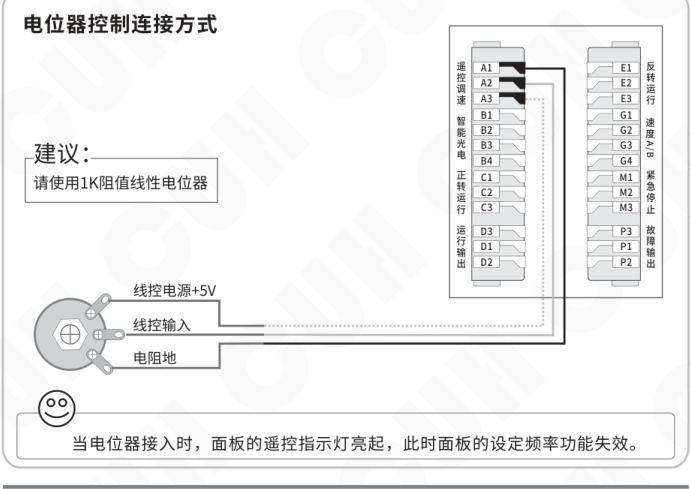


### 第 33 页

### 1~5V 电压控制连接方式

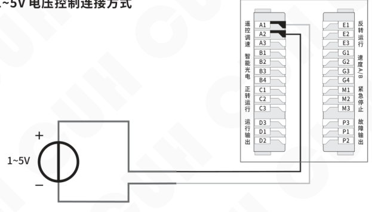

### 4~20mA 电流控制连接方式

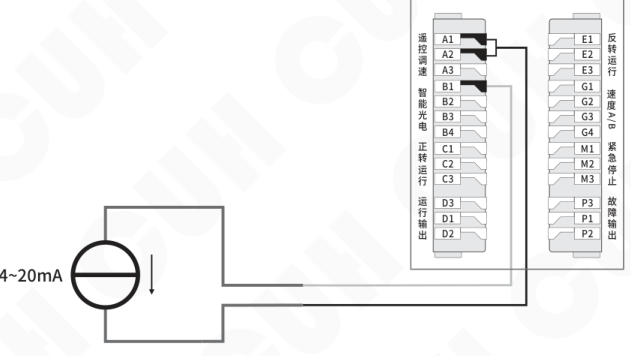

**说明：**

1. 选择A=1-5V，支持电位器、1-5V、4-20mA输入。
2. 选择0~5V、0~10V时接线方式与1-5V相同。


### 第 34 页

数字三相异步电机控制器　　　　　　　　　　　　　　　　　　　　　　　　　SDMC30-S

## 5.7 电机速度数字预置

速度预置功能是通过外部或内部控制信号直接选择预定速度的功能。通过该功能，外部设备或控制器的内部状态可以方便地与控制器构成多达四档速度控制系统。

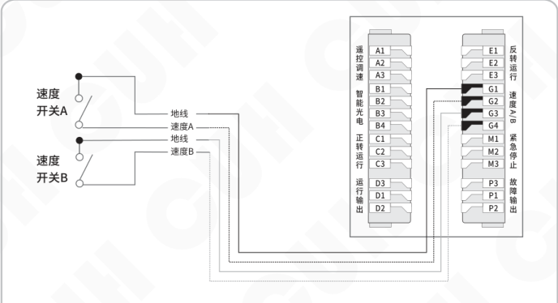

默认情况下速度预置第一信号源选择外部速度A端口SA，速度预置第二信号源选择外部速度B端口Sb。根据应用场景可以修改信号源实现不同的速度切换功能。

每个速度预置信号源在面板上有对应的指示灯显示，当信号源有效时对应的指示灯点亮。两个指示灯的亮灭状态组合有4中状态（AB全灭、A亮B灭、A灭B亮、AB全亮）。

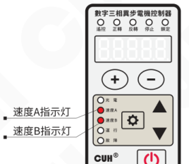

通过信号的组合，控制器将进入对应的速度预置状态，此时控制器的设定频率可以通过“+”和“-”调整。该频率将被自动记忆，任何时刻速度预置控制信号设置控制器进入该状态后都将立刻切换至该记忆的设定频率值。

2023-09　　　　　　　　　　　　　-26-　　　　　　　　　　　　　SDMC30SMSCN_1.01


### 第 35 页

## 5.8 开关传感器

本控制器设计了正转运行、反转运行、速度AB、紧急停止四个开关量传感器接口。这些接口可以支持NPN、PNP、Ut1、Ut0模式，通过参数开关传感器类型ΓA设置。

- Ut1模式为单次扫描，即传感器信号无效前，一直通过变换高低电平检测端口是否有效，发现有效信号后确定端口传感器类型且不再扫描。
- Ut0模式为连续扫描，不管传感器类型如何，始终通过变换高低电平检测端口是否接入有效信号。

每个开关量的开关延时也可以通过对应的参数设置，详见参数表。

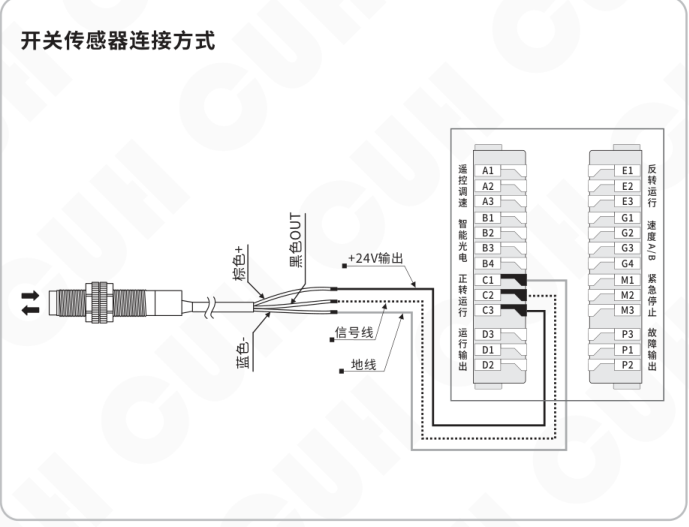


### 第 36 页

数字三相异步电机控制器　　　　　　　　　　　　　　　　SDMC30-S

## 5.9 智能光电端口

本控制器的智能光电端口支持发光二极管和光电三极管构成的光电对射或反射传感器，也可以通过智能光电灵敏度参数P，设置为支持NPN或PNP开关传感器。

### 光电传感器连接方式

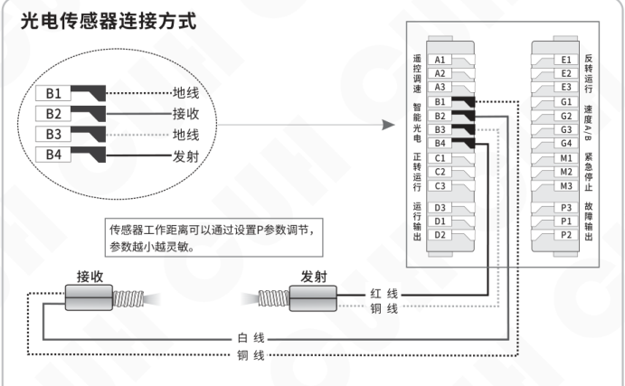

- B1：地线
- B2：接收
- B3：地线
- B4：发射

传感器工作距离可以通过设置P参数调节，参数越小越灵敏。

### 开关传感器连接方式

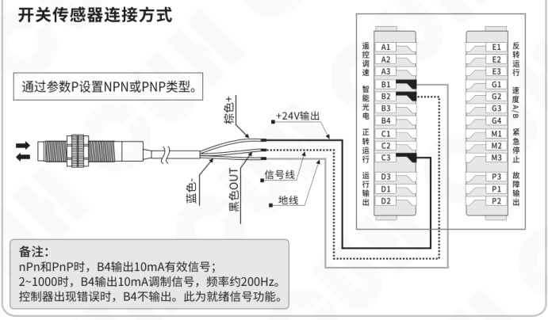

通过参数P设置NPN或PNP类型。

接线标识：

- 棕色+：+24V输出
- 蓝色-：地线
- 黑色OUT：信号线

备注：

nPn和PnP时，B4输出10mA有效信号；  
2~1000时，B4输出10mA调制信号，频率约200Hz。  
控制器出现错误时，B4不输出。此为就绪信号功能。

2023-09　　　　　　　　　-28-　　　　　　　　　SDMC30SMSCN_1.01


### 第 37 页

## 5.10 运行输出/故障输出端口

运行输出和故障输出端口可以支持NPN输出、PNP输出和推挽输出。其中：

- NPN输出有效为低电平，输出无效为高阻态；
- PNP输出有效为高电平，输出无效为高阻态；
- 推挽输出有效为高电平，无效为低电平。

### 5.10.1 运行输出/故障输出的接线方法

#### NPN输出的连接方式

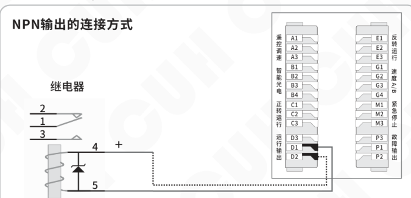

#### PNP或推挽输出的连接方式

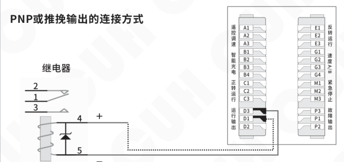

> 如果连接24V继电器，一定要确认线圈的正极和负极，确保正确连接。因为本端口的输出电流能力为350mA，接反后继电器的内部保护二极管会将本控制器端口短路，触发短路保护Er07d/P。


### 第 38 页

## 5.10.2 运行输出/故障输出的信号源与逻辑图

运行输出/故障输出的控制是两个信号源逻辑关系的结果，可以从信号源列表中选择下列信号源。

**信号源含义列表：**

| 信号源 | 含义 |
|---|---|
| 0 | 无效信号 |
| 1 | 有效信号 |
| b | 智能光电端口信号 |
| -b | 智能光电端口信号取反 |
| C | 正转运行端口信号 |
| -C | 正转运行端口信号取反 |
| E | 反转运行端口信号 |
| -E | 反转运行端口信号取反 |
| SA | 速度A端口信号 |
| -SA | 速度A端口信号取反 |
| Sb | 速度B端口信号 |
| -Sb | 速度B端口信号取反 |
| ES | 紧急停止端口信号 |
| -ES | 紧急停止端口信号取反 |
| od | 运行输出端口信号 |
| -od | 运行输出端口信号取反 |
| oP | 故障输出端口信号 |
| -oP | 故障输出端口信号取反 |
| oq | 电机输出信号 |
| -oq | 电机输出信号取反 |
| Er | 任意故障信号 |
| -Er | 任意故障信号取反 |
| Ar | 任意警告信号 |
| -Ar | 任意警告信号取反 |


### 第 39 页

数字三相异步电机控制器　　　　　　　　　　　　　　　　　　　SDMC30-S

### 运行输出/故障输出逻辑图：

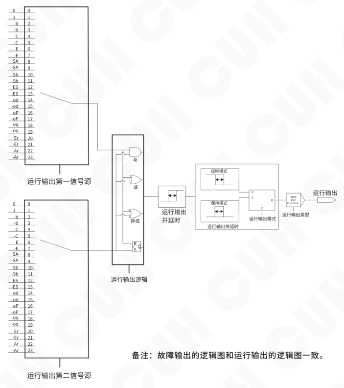

**备注：**故障输出的逻辑图和运行输出的逻辑图一致。


### 第 40 页

### 5.10.3 运行输出/故障输出的模式说明

运行输出/故障输出可选择2种模式：延时模式、保持模式。

**延时模式：** 指驱动运行输出/故障输出的信号由有效变为无效后，运行输出/故障输出经过一段关延时时间后变为关闭状态。

**保持模式：** 指驱动运行输出/故障输出的信号变为有效后，运行输出/故障输出在关延时时间内保持打开，超过关延时时间后变为关闭的状态。

将两种模式的差别以时序图的形式表达如下，其中输入信号是逻辑关系选择器后输出的信号。

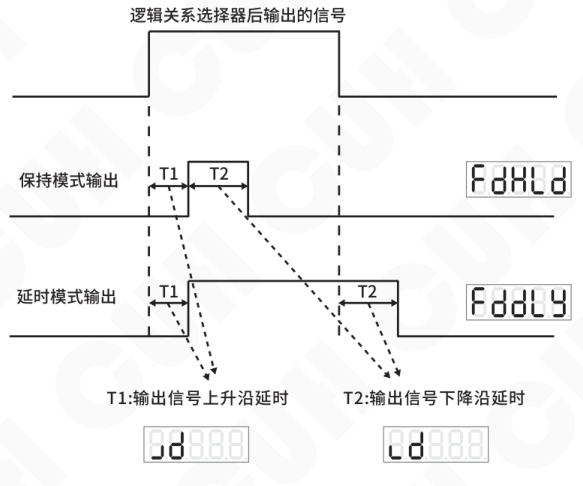

运行输出/故障输出模式：延时模式、保持模式。

T1：输出信号上升沿延时  
T2：输出信号下降沿延时


### 第 41 页

## 5.11 开机运行状态

开机运行状态设置功能，可以指定开机后电源键的状态。通过参数开机运行状态 PS 调整。

- `PS=run`，表示开机后控制器电源键处于运行状态。
- `PS=stP`，表示开机后控制器电源键处于停止状态。
- `PS=FoL`，表示开机后控制器电源键处于跟随上次掉电前的状态。

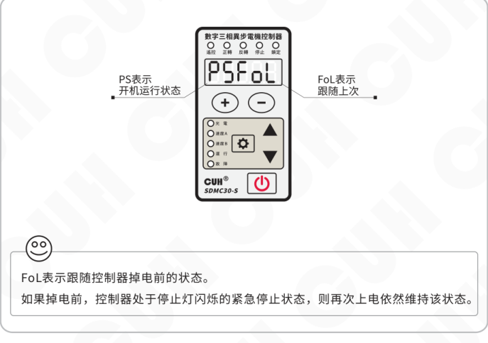

> FoL 表示跟随控制器掉电前的状态。
>
> 如果掉电前，控制器处于停止灯闪烁的紧急停止状态，则再次上电依然维持该状态。


### 第 42 页

## 5.12 面板亮度调整

本控制器采用了全新的数码显示驱动芯片，支持用户调节显示亮度值，通过参数LED在1~32之间调节。

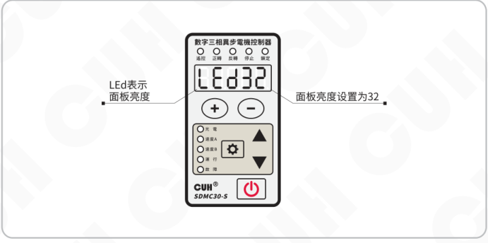


### 第 43 页

数字三相异步电机控制器　　　　　　　　　　　　　　　　　SDMC30-S

---

## 5.13 输出监控参数

本控制器专门设计了一套监控参数组用于监控控制器的状态。

- 长按 ⚙ 和 ▼，进入/退出监控参数界面。
- 短按 ▲ 或 ▼ 选择需要监控的参数。
- 监控参数的参数值不可修改。

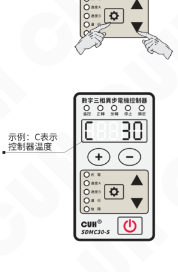

示例：C 表示控制器温度。

本控制器的监控参数组参考《7.1 参数列表》章节。

---

2023-09　　　　　　　　　-35-　　　　　　　　　SDMC30SMSCN_1.01


### 第 44 页

数字三相异步电机控制器　　　　　　　　　　　　　　　　SDMC30-S

---

# 第六章 技术规格

## 6.1 外形尺寸　单位：毫米（mm）

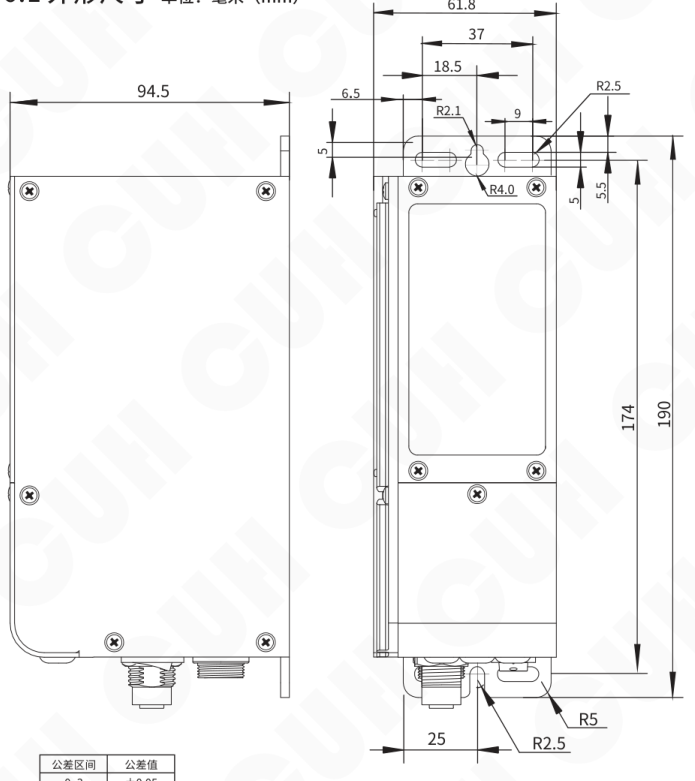

| 公差区间 | 公差值 |
|---|---|
| 0~3 | ±0.05 |
| 3~10 | ±0.1 |
| 10~30 | ±0.15 |
| 30~80 | ±0.2 |
| 80~180 | ±0.3 |
| >180 | ±0.5 |

本系列产品均适用此公差表。

> ⚠️ **要点**  
> 请务必将本产品安装在可靠接地的坚固平台上，控制器上下安装孔均需要固定，并远离振动设备。

---

2023-09　　　　　　　　　　　　-36-　　　　　　　　　　　　SDMC30SMSCN_1.01


### 第 45 页

数字三相异步电机控制器  
SDMC30-S

## 6.2 技术规格表

| 项目 | 最小值 | 典型值 | 最大值 | 单位 | 备注 |
|---|---:|---:|---:|---|---|
| 输入电压 | 85 | 220 | 250 | 伏特（V） | 50/60Hz交流有效值 |
| 输出线电压 | 0 | 200 | 220 | 伏特（Vrmn） | 整流平均值 |
| 输入电流有效值 | —— | —— | 2.8 | 安培（A） |  |
| 输入电流峰值 | —— | —— | 8.0 | 安培（A） |  |
| 输出电流调整范围 | 0 | —— | 1.6 | 安培（A） | 整流平均值 |
| 输出容量 | 0 | —— | 600 | 伏安（VA） |  |
| 输出频率 | 2.0 | —— | 120.0 | 赫兹（Hz） |  |
| 频率调整精度 |  | 0.1 |  | 赫兹（Hz） |  |
| 输出波形 |  | 矢量正弦 |  |  |  |
| 适用电机功率 | —— | —— | 0.2 | 千瓦（kW） | 1/4HP |
| 过热保护温度 | —— | 65 | —— | 摄氏度（℃） | 60℃恢复正常 |
| 直流控制输出电流 | 0 | —— | 350 | 毫安（mA） |  |
| 24V输出电流 | —— | —— | 700 | 毫安（mA） |  |
| 直流控制输出电压 | 22 | 24 | 26 | 伏特（V） |  |
| 模拟控制信号 |  | 4~20 / 1~5、0~5、0~10 |  | 毫安(mA) / 伏特(V) | 受参数A控制 |
| 数字控制信号 |  | 24 |  | 伏特（V） | 开关信号控制 |
| 调整方式 |  | 6 |  | 键（Button） |  |
| 空载功耗 | —— | 3 | —— | 瓦特（W） |  |
| 显示方式 |  | 5 |  | 位（Digit） | LED数码管 |
| 重量 |  | 830 |  | 克（g） | 不含附件 |
| 产品尺寸 |  | 长*宽*高：190*61.8*94.5 |  | 毫米（mm） |  |
| 防护等级 |  | IP20 |  |  |  |
| 工作环境温度 | -10 | 25 | 40 | 摄氏度（℃） |  |
| 工作环境湿度 | 10 | 60 | 85 | 相对湿度（%） | 不结露 |
| 存储环境温度 | -20 | 25 | 85 | 摄氏度（℃） |  |
| 适用海拔高度 |  | ＜2000 |  | 米（m） |  |


### 第 46 页

## 6.3 参考标准

**极限参数：超过此指标将会造成严重损坏，必须严格遵守！**

| GB 标准 | IEC 标准 | 关键性能 | 标准要求 | 测试性能 | 备注 |
|---|---|---|---|---|---|
| GB/T 12668.501-2013 | IEC 61800-5-1:2007 | 交流耐压 | 3kVac | 3kVac | 过电压<br>类别Ⅱ |
| GB/T 12668.501-2013 | IEC 61800-5-1:2007 | 冲击电压 | 4kV | 4kV |  |
| GB/T 12668.501-2013 | IEC 61800-5-1:2007 | 接地电阻 | 0.2Ω | 0.1Ω |  |
| GB/T 12668.3-2013 | IEC 61800-3:2004 | 静电放电 | 4kV 接触<br>8kV 空气 | 8kV 接触<br>15kV 空气 | 国标4 |
| GB/T 12668.3-2013 | IEC 61800-3:2004 | 快速瞬变 | 2kV/5kHz | 4kV/100kHz | 国标4 |
| GB/T 12668.3-2013 | IEC 61800-3:2004 | 雷击浪涌 | 1kV 差模<br>2kV 共模 | 2kV 差模<br>4kV 共模 | 国标4 |
| GB/T 12668.3-2013 | IEC 61800-3:2004 | 传导发射 | C2类 | C2类 |  |
| GB/T 12668.3-2013 | IEC 61800-3:2004 | 辐射发射 | C2类 | C2类 |  |

> **警告**  
> 在民用环境中，本产品可能产生无线电干扰。在这种情况下，可能需要采取附加抑制措施。


### 第 47 页

数字三相异步电机控制器　　　　　　　　　　　　　　　　　　　　　　　　　SDMC30-S

# 第七章 附录

## 7.1 参数列表

| 类别 | 含义 | 参数符号 | 数码管符号图片 | 取值范围 | 默认设置 |
|---|---|---|---|---|---|
| 待机参数 | 设定频率 | 【F】 |  | 2.0~120.0 赫兹（Hz）（受 r 和 y 限制） | 50.0 |
| 电机参数<br>长按↩ | 正转启停控制源1 | 【P1】 |  | 0, 1, b, -b, C, -C, E, -E, SA, -SA, Sb, -Sb, ES, -ES, od, -od, oP, -oP | C |
|  | 正转启停控制源2 | 【P2】 |  | 0, 1, b, -b, C, -C, E, -E, SA, -SA, Sb, -Sb, ES, -ES, od, -od, oP, -oP | -b |
|  | 正转启停逻辑关系 | 【PN】 |  | And 与, or 或, Xor 异或, rS 触发器 | And |
|  | 反转方向控制源1 | 【N1】 |  | 0, 1, b, -b, C, -C, E, -E, SA, -SA, Sb, -Sb, ES, -ES, od, -od, oP, -oP | E |
|  | 反转方向控制源2 | 【N2】 |  | 0, 1, b, -b, C, -C, E, -E, SA, -SA, Sb, -Sb, ES, -ES, od, -od, oP, -oP | -b |
|  | 反转方向逻辑关系 | 【NN】 |  | And 与, or 或, Xor 异或, rS 触发器 | And |
|  | 正反转控制方式 | 【FR】 |  | 0（正转控制源用于正转启停，反转控制源用于控制反转启停）<br>1（正转控制源用于控制启停，反转控制源用于控制正反） | 0 |
|  | 主输出紧急停止源 | 【EQ】 |  | 0, 1, b, -b, C, -C, E, -E, SA, -SA, Sb, -Sb, ES, -ES, od, -od, oP, -oP, oq, -oq, Er, -Er, Ar, -Ar | ES |
|  | 紧急停止方式 | 【SQ】 |  | Sto: 安全转矩关断，Sbc: 安全抱闸控制，注1<br>SS1: 1类安全停止 | Sto |
|  | 缓启动时间 | 【小T】 |  | 0.0~99.9 秒（s） | 10.0 |
|  | 缓关闭时间 | 【反T】 |  | 直流制动时间：-0.0~-99.9 秒（s）<br>缓关闭时间：0.0~99.9 秒（s） | 10.0 |
|  | 最大频率 | 【小Y】 |  | 2.0~120.0 赫兹（Hz） | 50.0 |
|  | 额定频率 | 【小B】 |  | 45.0~65.0 赫兹（Hz） | 50.0 |
|  | 额定电压 | 【小H】 |  | 70~220 伏特整流平均值（Vrmn） | 200 |
|  | 中间频率 | 【小N】 |  | r~b 赫兹（Hz） | 10.0 |
|  | 中间电压 | 【小O】 |  | u~h 伏特整流平均值（Vrmn） | 40 |
|  | 最低频率 | 【小R】 |  | 2.0~n 赫兹（Hz） | 2.0 |
|  | 最低电压 | 【小U】 |  | 0~o 伏特整流平均值（Vrmn） | 8 |
|  | 电机额定电功率 | 【PO】 |  | 0.01~0.20 千瓦（kW） | 0.20 |
|  | 功率超额系数 | 【RC】 |  | 100~150（%） | 150 |
|  | 制动电流系数 | 【CB】 |  | 10~150（%） | 100 |
|  | 电功过热阈值 | 【OL】 |  | 0~90 倍\*秒（times\*seconds）<br>备注：超过电机额定电功率且不超过电机功率上限，按秒积分超过此设定进入电子过热保护状态。 | 30 |
|  | 功率降额系数 | 【RL】 |  | 0~90（%）0表示停机，90表示降低到额定功率的90% | 0 |
|  | 旋转方向交换 注2 | 【PH】 |  | Abc: 标准方向，Acb: 方向交换，<br>A.b.c.: 标准方向禁止反转（只能正转），<br>A.c.b.: 方向交换禁止正转（只能反转） | AbC |
|  | 开机运行状态 | 【PS】 |  | run: 运行, stp: 停止, FoL: 保存上次 | FoL |

---

2023-09　　　　　　　　　　　　　　　　　-39-　　　　　　　　　　　　　　　　　SDMC30SMSCN_1.01


### 第 48 页

*整页视觉 JSON 解析失败，请查看该文件内 `assistant_text`。*


### 第 49 页

**数字三相异步电机控制器**　　　　　　　　　　　　　　　　**SDMC30-S**

| 类别 | 含义 | 参数符号 | 数码管符号图片 | 取值范围 | 默认设置 |
|---|---|---|---|---|---|
| 端口参数 | 遥控源 | [A] |  | PAd（由按键控制）, 1-5V, 0-5V, 0-10 | 1-5V |
| 端口参数 | 遥控系数 | [小C] |  | 0.50~2.00 | 1.00 |
| 端口参数 | 面板亮度 | [LED] |  | 1~32 | 16 |
| 端口参数 | 恢复出厂设置 | [全8] |  | —— | —— |
| 监控参数（按回车键▼） | 控制器温度 | [大C] |  | -20.0~85.0 摄氏度（℃） | —— |
| 监控参数（按回车键▼） | 输出频率 | [E] |  | 2.0~120.0 赫兹（Hz） | —— |
| 监控参数（按回车键▼） | 系统有功功率（控制器+电机） | [QP] |  | 0.00~0.40 千瓦（kW） | —— |
| 监控参数（按回车键▼） | 母线电流 | [AC] |  | 0.00~3.50 安培（A） | —— |
| 监控参数（按回车键▼） | 输出线电压 | [OU] |  | 0~250 伏特（V） | —— |
| 监控参数（按回车键▼） | 母线电压 | [PU] |  | 0~400 伏特（V） | —— |
| 监控参数（按回车键▼） | 24V输出电压 | [NU] |  | 0.0~28.0 伏特（V） | —— |
| 监控参数（按回车键▼） | 遥控端口电压 | [AU] |  | 0.0~10.0 伏特（V） | —— |
| 监控参数（按回车键▼） | 智能光电信号电压 | [BU] |  | 0~999 | —— |
| 监控参数（按回车键▼） | 正转信号电压 | [CU] |  | 0.0~28.0 伏特（V） | —— |
| 监控参数（按回车键▼） | 运行输出端口电压 | [DU] |  | 0.0~28.0 伏特（V） | —— |
| 监控参数（按回车键▼） | 反转信号电压 | [EU] |  | 0.0~28.0 伏特（V） | —— |
| 监控参数（按回车键▼） | 速度A端口电压 | [SA] |  | 0.0~28.0 伏特（V） | —— |
| 监控参数（按回车键▼） | 速度B端口电压 | [SB] |  | 0.0~28.0 伏特（V） | —— |
| 监控参数（按回车键▼） | 紧急停止端口电压 | [SU] |  | 0.0~28.0 伏特（V） | —— |
| 监控参数（按回车键▼） | 故障输出端口电压 | [FU] |  | 0.0~28.0 伏特（V） | —— |
| 监控参数（按回车键▼） | 控制板版本 | [UC] |  | —— | —— |
| 监控参数（按回车键▼） | 功率板版本 | [UQ] |  | —— | —— |

注1：Sto时，控制器立即切断电机电源，电机根据惯性减速停止。

Sbc时，电机进行直流制动停止，制动时间由缓关闭时间确认。故障输出端口输出紧急停止状态，不受信号源控制，必须使用安全抱闸继电器。

SS1时，电机根据缓关闭时间定义的动作减速或刹车停止。

注2：根据IEC60034-8定义标准方向为：从电机驱动端侧观察顺时针方向，该参数不影响正反转指示灯的状态。

2023-09　　　　　　　　　　　　　　SDMC30SMSCN_1.01


### 第 50 页

数字三相异步电机控制器　　　　　　　　　　　　　　　　　　　　　　　　　SDMC30-S

## 7.2 输入输出电路图

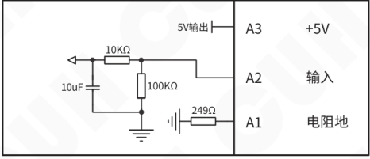

**遥控调速A端口**

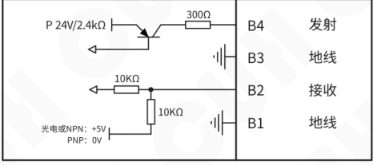

**智能光电B端口**


**运行输出D/故障输出P端口**

2023-09　　　　　　　　　　　　　　　　　-42-　　　　　　　　　　　　　　　　　SDMC30SMSCN_1.01


### 第 51 页

数字三相异步电机控制器  
SDMC30-S


**正转运行C/反转运行E/紧急停止M/速度预设G端口**


### 第 52 页

数字三相异步电机控制器　　　　　　　　　　　　　　　　　　　　　　　　　　　　　　SDMC30-S

## 7.3 故障代码

| 故障代码 | 故障含义 | 出现条件 | 控制器响应 | 排除方法 |
|---|---|---|---|---|
| Er01 | 主输出短路 | 输出相间短路或相和PE短路 | 停止主输出，短按开关键清除。 | ◆ 排除输出线短路，短按两次开关键或重新上电。 |
| Er02H | 电机电子过热 | 电机超过电功过热阈值 | 根据功率降额系数停机自动重启或降低功率运行。 | ◆ 适当降低电机运行频率设定。 |
| Er02P | 电机功率超限 | 输出功率超过功率超额系数 | 根据功率降额系数停机自动重启或降低功率运行。 | ◆ 适当降低电机运行频率设定。 |
| Er03L | 过冷 | 控制器温度低于-20℃ | 停止主输出，温度恢复正常后自动启动输出。 | ◆ 避免极寒温度启动控制器。 |
| Er03H | 过热 | 控制器温度高于65℃ | 停止主输出，温度恢复正常后自动启动输出。 | ◆ 将本控制器安装在通风良好环境中。 |
| Er04L | 电源欠压 | 母线电压平均值低于77V | 停止主输出，电源电压正常后自动恢复。 | ◆ 确保输入电压在85V~250V之间。 |
| Er04H | 电源过压 | 母线电压平均值高于390V | 停止主输出，电源电压正常后自动恢复。 | ◆ 确保输入电压在85V~250V之间。 |
| Er05 | 内部通信异常 | 连续2秒未收到功率板应答 | 停止主输出，通信恢复后自动消除 | ◆ 确保24V电源端口未接入任何外部电源或联系本公司技术支持。 |
| Er06 | 温度传感器异常 | 无法读取温度 | 停止主输出，2秒尝试读温度。 | ◆ 联系本公司技术支持。 |
| Er07d/P | 运行/故障输出端口短路 | 输出电流超过350mA或短路 | 5ms内关闭运行/故障输出，2s后尝试重启输出。 | ◆ 确保负载未短路且电流未超过350mA。 |
| Er10 | 24V输出短路 | 输出24V被短路或电流超过700mA | 停止24V输出，重新上电以重启输出。 | ◆ 确保24V输出未被短路或输出超过700mA。 |
| Er11 | 5V输出异常 | 5V输出超过±10%范围 | 遥控调速失效，自动恢复。 | ◆ 确保5V输出未被短路或接入外部电压。 |
| Er12 | 24V电压异常 | 监控内部24V电压不在22~26V之间 | 控制输出高阻，自动恢复。 | ◆ 确保24V电源输出端口或控制输出端口未接入任何外部电源。 |
| Er13 | 输入缺相<br>（仅三相输入型号适用） | 三相电源输入缺相 | 停止主输出。 | ◆ 断电排除输入缺相后重新上电。 |
| Er14 | 输出缺相 | 输出相电流不平衡超50% | 停止主输出。 | ◆ 断电排除输出线缺相，重新上电。 |
| Er15 | 正反转冲突 | 同时给出正反转信号 | 停止主输出，冲突撤除后自动恢复。 | ◆ 确保不同时给出正转有效和反转有效信号。 |

---

2023-09　　　　　　　　　　　　　　　　　-44-　　　　　　　　　　　　　　　　　SDMC30SMSCN_1.01


### 第 53 页

数字三相异步电机控制器　　　　　　　　　　　　　　　　　　　　　　　　　SDMC30-S

## 7.4 警告代码

| 警告代码 | 警告含义 | 出现条件 | 控制器响应 | 排除方法 |
|---|---|---|---|---|
| Ar02 | 紧急停止 | 紧急停止输入信号有效边沿检测到 | 停止主输出。 | ◆ 紧急停止信号复位，按开关键重启输出。 |
| Ar03 | 输出饱和 | 当电源电压低于需输出的电压的80% | 继续输出, 显示2s消失, 10s后再检查。 | ◆ 确保输入电压不低于最大电压限制值。 |
| Ar04 | 加速过功率 | 加速过程中功率超过电机过功率系数\*额定功率 | 保持频率，功率降低后继续加速。 | ◆ 适当增大缓启动时间。 |
| Ar05 | 运行过功率 | 运行中功率超过电机过功率系数\*额定功率 | 电机继续运行并触发电机电子过热阈值积分器。 | ◆ 适当降低负载。 |
| Ar06 | 减速过压 | 减速停止时母线电压超过380V | 中断减速保持频率，母线电压降低至370V后继续减速。 | ◆ 适当加大缓关闭时间。 |
| Ar07 | 电机制动 | 当电机处于直流制动时 | 直流制动期间显示，完成后自动消失。 | ◆ —— |
| Ar08 | 禁止反转 | 当禁止反转有效且检测到反转请求时 | 不响应反转请求，撤消后自动消失。 | ◆ 撤消反转请求信号。 |

2023-09　　　　　　　　　　　　　　　　　-45-　　　　　　　　　　　　　　　　　SDMC30SMSCN_1.01


### 第 54 页

数字三相异步电机控制器                                                                                     SDMC30-S

# 第八章 产品质保信息

## 8.1 质保期

本公司为本产品提供的质保期为三年，从产品发送到购买方指定地点之日算起。

## 8.2 保修范围

（一）如果在上述质保期内出现本公司造成的故障，我们将免费维修产品。但是以下情况不属于保修范围：

 a、未按照简易说明书、用户手册或购买方与本公司专门达成的技术要求中规定的条件、环境下的不正确操作，或不正确使用造成的故障。

 b、故障不是因产品缺陷，而是购买方设备或软件设计造成的。

 c、非本公司人员进行的修改或修理而造成的故障。

 d、按照简易操作指南或用户手册正确维修或更换易损部件等规定可以完全避免的故障。

 e、产品从本公司发货后，因无法预料的科学技术水平变化等因素而造成的故障。

 f、由于火灾、地震、洪水等自然灾害，或异常电压等外部因素造成的故障，本公司不负责保修。

（二）保修范围仅限于（一）中规定的情况，本公司对该设备造成的购买方间接损失（如设备损坏、机会丧失、利润损失等）或其他损失，不承担任何责任。

## 8.3 产品适用性

本公司的该控制器是针对电机控制行业的通用产品而设计生产的。因此，本公司的该控制器不得用于下列应用且不适合其使用。

（一）对生命和财产有严重影响的设施，如核发电厂、机场、铁路、轮船、机动装置及医疗设备。

（二）公共事业，包括电力、气体、供水等。

（三）相似条件或环境的户外使用。

2023-09                                                     -46-                                                     SDMC30SMSCN_1.01


### 第 55 页

*（本页 `page_markdown` 为空。）*


### 第 56 页


南京创优科技有限责任公司  
网址:www.cuhnj.com  
电话:025-84730416  
传真:025-84730426  
邮箱:sales@cuhnj.com  
地址:南京市江宁区智能路9号  
启迪城学研园2幢

文档编号：IDP1000371
<!-- /auto:ai-body-draft v1 -->

<!-- auto:data-params-summary v1 -->
## 附录 · 参数表（结构化侧车·机器生成）

> 说明：本节由 `data/<doc_key>/params/params.yaml` 自动渲染（展示前若干行），用于校对与二次开发。定稿以层 C 数据为准。

| 参数 | 标志/符号 | 范围 | 默认 | 单位 | 备注 |
| --- | --- | --- | --- | --- | --- |
| <br> <br>**警告** |  |  |  |  |  |
| <br> <br>**小心** |  |  |  |  |  |
| <br>**注意** |  |  |  |  |  |
| <br>**要点**<br>！ |  |  |  |  |  |
| <br> <br>信号源 |  |  |  |  |  |
| <br> <br>0 |  |  |  |  |  |
| <br> <br>1 |  |  |  |  |  |
| <br> <br>b |  |  |  |  |  |
| <br> <br>-b |  |  |  |  |  |
| <br> <br>C |  |  |  |  |  |
| <br> <br>-C |  |  |  |  |  |
| <br> <br>E |  |  |  |  |  |
| <br> <br>-E |  |  |  |  |  |
| <br> <br> <br>SA |  |  |  |  |  |
| <br> <br> <br>-SA |  |  |  |  |  |
| <br> <br> <br>Sb |  |  |  |  |  |
| <br> <br> <br>-Sb |  |  |  |  |  |
| <br> <br>ES |  |  |  |  |  |
| <br> <br>-ES |  |  |  |  |  |
| <br> <br>od |  |  |  |  |  |
| <br> <br>-od |  |  |  |  |  |
| <br> <br>oP |  |  |  |  |  |
| <br> <br>-oP |  |  |  |  |  |
| <br> <br>oq |  |  |  |  |  |
| <br> <br>-oq |  |  |  |  |  |
| <br> <br>Er |  |  |  |  |  |
| <br> <br>-Er |  |  |  |  |  |
| <br> <br>Ar |  |  |  |  |  |
| <br> <br>-Ar |  |  |  |  |  |
| <br> <br> <br>输入电压 |  |  |  | <br> <br> <br>伏特（V） | <br> <br>50/60Hz交流有效值 |

*（仅展示前 30 条，共 163 条；完整数据见下方链接。）*

- 完整 YAML：`data/cuh.sdvc.manual.v1.01/params/params.yaml`
- 表格索引：`data/cuh.sdvc.manual.v1.01/index.yaml`
<!-- /auto:data-params-summary v1 -->
