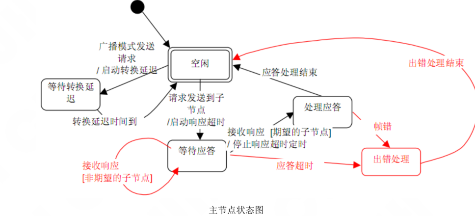
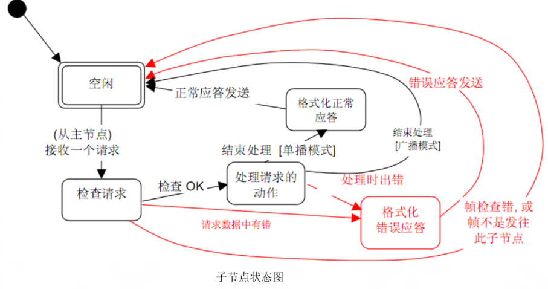
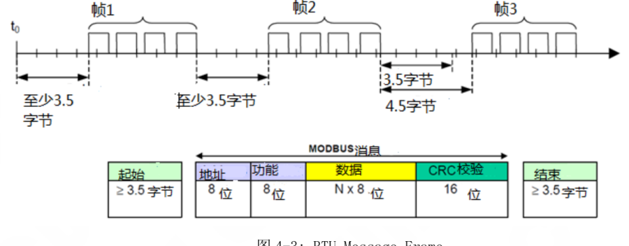
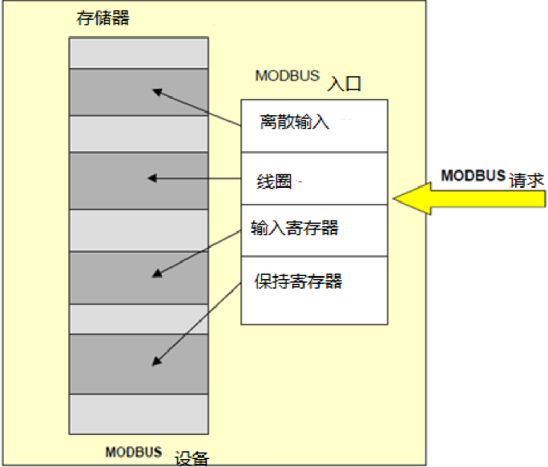
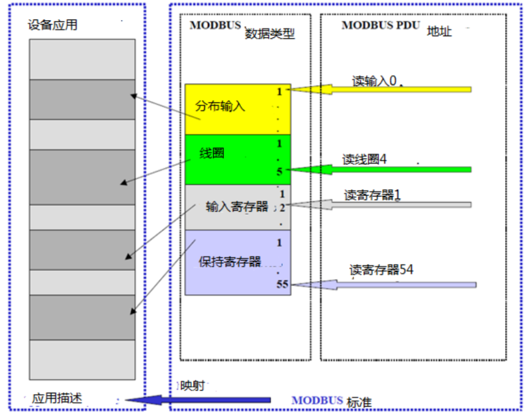
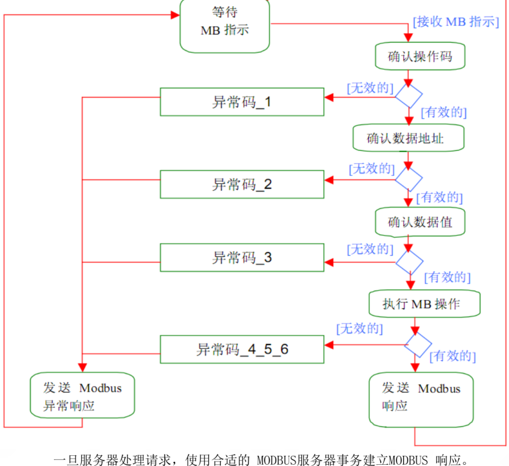

## 目录

> 下列条目来自 PDF 内置书签/大纲；链接指向本批转换生成的整页渲染图（`assets/pages/`），便于与原版 PDF 对照校对。

*（本 PDF 未提供书签式目录，暂无条目。）*
## 术语与命名

- 侧车：`glossary/terms.yaml`（机读）、`glossary/zh-CN.md`（人读）；候选表，定稿后并入公司级 `glossary/`。

## 适用范围

- 本文档由 PDF 自动转换生成，正文与插图需人工核对。

## 变更记录

- 2026-06-08 17:01:10：由转换工具从源 PDF 生成首版。

## 正文


<!-- auto:ai-body-draft v1 -->
> 以下为**整页视觉转写**的正文草稿（多模态模型直接输出 Markdown，含 GFM 表； 若配置 `[[vcrop:页:序]]` 占位符，裁剪步骤会插入 `assets/images/` 下 PNG）。**请务必人工校对。**

### 第 1 页

CUH 创优®

---

# SDVC Modbus 协议（标准版）

## 振动送料控制器

**型号：**

**SDVC34MR**

**SDVC34MRJ**

**SDVC34XLR**

**SDVC41M**

<br>

**V2.23**

日期： **2019-8-15**

南京创优科技有限责任公司

1 / 35


### 第 2 页

# 控制器Modbus通信协议

## 一、 通信协议概述

根据标准Modbus通信协议该文档描述了控制器所使用的Modbus协议细节，包括串行链路协议和应用层协议。

Modbus串行链路协议是一个主/从协议。该协议位于OSI模型的第二层。

位于OSI模型第7层上的应用层报文传输协议，它提供了在不同类型总线或网络上的客户机和服务器之间的通信。

应用层和数据链路层的对应关系为：客户机的功能由主节点提供，而服务器功能由子节点实现。

本控制器物理层采用RS485协议，异步通讯模式，波特率为300bps~115200bps可调，并做为服务器（子节点）在总线上通信。


### 第 3 页

## 二、Modbus 数据链路层

### 1. Modbus 主站/从站协议原理

Modbus 串行链路协议是一个主/从协议。在同一时刻，只有一个主节点连接于总线，一个或多个子节点（子节点地址范围为1到31）连接于同一个串行总线。Modbus 通信总是由主节点发起。子节点在没有收到来自主节点的请求时，从不会发送数据。子节点之间从不会互相通信。主节点在同一时刻只会发起一个 Modbus 事务处理。

主节点以两种模式对子节点发出 Modbus 请求：

- 在单播模式，主节点以特定地址访问某个子节点，子节点接到并处理完请求后，子节点向主节点返回一个报文（“应答”）。
- 在广播模式，主节点向所有的子节点发送请求。  
  对于主节点广播的请求没有应答返回。广播请求一般用于写命令。所有设备必须接受广播模式的写功能。地址 0 是专门用于表示广播数据的。

#### 1、Modbus地址规则

0 广播地址。所有子节点必须识别广播地址。  
1-31 子节点地址，子节点必须有一个在总线上唯一的地址。  
主节点没有地址。

### 2. Modbus 帧描述

MODBUS 协议定义了一个与基础通信层无关的简单协议数据单元（PDU）。在PDU上附加地址域和校验域即构造成应用数据单元（ADU）。在应用数据单元（ADU）上引入一些附加域，MODBUS 协议映射就能够映射在其他特定总线或网络上。

**通用MODBUS帧**

ADU：地址域 + 功能码 + 数据 + 差错校验  
PDU：功能码 + 数据

| 地址域 | 功能码 | 数据 | 差错校验 |
|---|---|---|---|

- **地址域** 只含有子节点地址（1-31）。  
  主节点通过将子节点的地址放到报文的地址域对子节点进行寻址。当子节点返回应答时，它将自己的地址放到应答报文的地址域以让主节点知道哪个子节点在应答。

- **功能码** 指明子节点要执行的动作。功能码后面可跟有表示含有请求和响应参数的数据域（数据域也可能没有）。


### 第 4 页

■ 差错检验域 是对报文内容执行“冗余校验”的计算结果。本控制器采用 ASCII 传输模式，所以使用纵向冗余校验（LRC）的计算方法。（参见后文如何计算 LRC）

### 3. 主站状态图

（文字下加下划线的，表示控制器未实现的部分）

下图描述了主节点的状态特征：



主节点状态图

说明：

◆ 状态“空闲”表示没有发送请求。这是电源上电后的初始状态。只有在“空闲”状态时请求才能被发送。发送一个请求后，主节点离开“空闲”状态，且不能同时发送第二个请求。

◆ 当单播请求发送到一个子节点，主节点将进入“等待应答”状态，同时一个临界超时定时启动。这个超时称为“响应超时”，它避免主节点永远处于“等待应答”状态。响应超时的时间依赖于具体应用。

◆ 当收到一个应答时，主节点在处理数据之前检验应答。在某些情况下，检验的结果可能为错误。如收到来自非期望的子节点的应答，或接收的帧产生错误。在收到来自非期望子节点的应答时，响应超时继续计时；<u>当检测到帧错时，可以执行一个重试。</u>

◆ 当响应超时且没有收到应答时，则产生一个错误。之后主节点进入“空闲”状态，<u>并发出一个重试请求。重试的最大次数取决于主节点的设置。</u>

◆ 当广播请求发送到串行总线上，没有响应会从子节点返回。然而主节点需要进行延迟，以便使子节点在发送新的请求之前，能处理完当前请求。该延迟被称作“转换延迟”。因此，主节点会在进入“空闲”状态之前，先进入“等待转换延迟”状态。


### 第 5 页

◆ 在单播方式，响应超时必须设置到足够的长度以使任何子节点都能处理完请求并返回响应。而广播转换延迟必须有足够的长度以使任何子节点都能处理完请求而可以接收新的请求。因此，转换延迟应该比响应超时要短。典型的响应超时在 9600bps 时从1秒到几秒，而转换延迟从100ms到200ms。

◆ 帧错误包括：1)对每个字符的奇偶校验；2)对整个帧的冗余校验。由于本控制器没采用奇偶校验，所以只有帧的冗余校验错误。

## 4. 从站状态图

下图描述了子节点的状态特征：



说明：

◆ 状态“空闲”表示没有接收到请求。这是电源上电后的初始状态。

◆ 当收到一个请求时，子节点在处理请求中要求的动作前先检验报文包。可能的错误有：非法地址，无该功能码，非法数据…… 当检测到错误时，必须向主节点发送应答，指明何种错误。

◆ 当要求的动作完成后，单播报文要求必须格式化一个应答并发往主节点。

◆ 如果子节点在接收到的帧中检测到错误，则没有响应返回到主节点。

◆ 任何子节点均应该定义并管理Modbus 诊断计数器以提供诊断信息。通过使用Modbus诊断功能码，可以得到这些计数值。


### 第 6 页

## 三、ASCII 传输模式

控制器采用ASCII的传输模式，报文中的每个 8 位子节以两个 ASCII 字符发送。  
例：字节 0x5B 会被编码为两个字符：0x35 和 0x42（ASCII编码 0x35 =“5”，0x42 =“B”）。

ASCII 模式每个字节（10位）的格式为：  
编码系统：十六进制，ASCII 字符 0-9，A-F。  
报文中每个ASCII 字符含有1 个十六进制字符

Bits per Byte：

- 1 起始位
- 7 数据位，首先发送最低有效位
- （无奇偶校验）
- 2 停止位

**无奇偶校验**

| 起始 | 1 | 2 | 3 | 4 | 5 | 6 | 7 | 停止 | 停止 |
|---|---|---|---|---|---|---|---|---|---|

帧检验域：纵向冗余校验（LRC - Longitudinal Redundancy Checking），对整个帧进行校验。

### 1. Modbus ASCII 报文帧

报文帧的地址域含有两个字符。  
在 ASCII 模式，报文用特殊的字符区分帧起始和帧结束。一个报文必须以一个“冒号”（：）（ASCII十六进制 3A）起始，以“回车-换行”（CR LF）对（ASCII 十六进制 0D 和 0A）结束。

对于所有的域，允许传送的字符为十六进制 0-9，A-F（ASCII 编码）。设备连续的监视总线上的“冒号”字符。当收到这个字符后，每个设备解码后续的字符一直到检测到“回车-换行”对，表示帧结束。

报文中字符间的时间间隔可以达一秒。如果有更大的间隔，则接受设备认为发生了错误，不做响应。  
典型的报文帧如下所示（十六进制表示）：

| 起始 | 地址 | 地址 | 功能 | 功能 | 数据1 | 数据1 | ... | 数据n | 数据n | LRC | LRC | 结束 | 结束 |
|---|---|---|---|---|---|---|---|---|---|---|---|---|---|
| ： | 高字符 | 低字符 | 高字符 | 低字符 | 高字节 | 低字节 | ... | 高字节 | 低字节 | 高字符 | 低字符 | CR | LF |
| 3A | 35 | 42 | 35 | 42 | 35 | 42 | ... | 35 | 42 | 35 | 42 | 0D | 0A |

其中数据n的长度范围为0到2*252字符


### 第 7 页

## 2. LRC 校验

在 ASCII 模式，包含一个对全部报文内容执行的，基于纵向冗余校验（LRC - Longitudinal Redundancy Checking）算法的错误检验域。LRC 域检验不包括起始“冒号”和结尾 CR LF对的整个报文的内容。不管报文有无奇偶校验，均执行此检验。

纵向冗余校验 (LRC) 为一个字节，含有 8位二进制值。LRC由发送设备计算，并附加 LRC 到报文。接收设备在接收文时计算LRC，并将计算的结果与在LRC 接收到的实际值相比较，如果两个值不相等，则结果为错。

LRC的计算，对报文中的所有的连续8 位字节相加，忽略任何进位，然后求出其二进制补码。LRC 为一个8位域，那么每个会导致值大于255的相加只是简单的将域的值在零”回绕”。因为没有第 9 位，进位被自动放弃。
生成一个 LRC 的过程为：

1. 不包括起始“冒号”和结束 CRLF 的报文中的所有字节相加到一个8位域，故此进位被丢弃。
2. 从0xFF(全1)减去域的最终值，产生二进制反码。
3. 加 1 产生二进制补码。

注：LRC计算并不是对转换为ASCII后的报文进行计算。


### 第 8 页

## 四、RTU 传输模式

当设备使用 RTU（远程终端单元）模式在 Modbus 串行线路上通信时，消息中的每个 8 位字节包含两个 4 位十六进制字符。

这种模式的主要优点是其更大的字符密度允许更好的数据吞吐量比 ASCII 模式相同波特率。每条消息必须以连续的字符流传送。

在 rtu 模式下，每个字节的格式（11 位）是  
编码系统：　每字节 8 位二进制位：  
字节位：

- 1 开始位
- 8 数据位，先发送最小位
- 1 停止位。

需要偶数奇偶校验，也可以使用其他模式（奇偶，无奇偶校验）。为了确保与其他产品的最大兼容性，建议也支持无奇偶模式。默认奇偶模式必须是偶数奇偶。

**如何串行传输字符：**  
每个字符或字节按顺序发送（从左到右）：最小有效位（LSB）……最重要位（MSB）。

设备可以通过配置接受偶数、奇偶校验或无奇偶校验。如果没有实现奇偶校验，则发送额外的停止位以将字符帧填充到完整的 11 位异步字符：

| 无奇偶校验 |  |  |  |  |  |  |  |  |  |
|---|---|---|---|---|---|---|---|---|---|
| 起始 | 1 | 2 | 3 | 4 | 5 | 6 | 7 | 8 | 停止位 |

图4-1：RTU 模式下的位序列

**帧检查字段：** 循环冗余校验（CRC）

帧描述：

| 从机地址 | 功能码 | 数据 | CRC |
|---|---|---|---|
| 1 字节 | 1 字节 | 0~252字节 | 2字节（CRC低｜CRC高） |

图4-2：RTU 消息帧

**注：** Modbus RTU 帧的最大大小为 256 字节。


### 第 9 页

## 1. Modbus 消息 RTU 框架

传输设备将 Modbus 消息放置到具有已知起始点和结束点的帧中。这允许接收新帧的设备在消息开始时，知道开始接收新帧，并知道消息何时完成。

在 RTU 模式下，消息帧以至少 3.5 字符时间的静音间隔分隔。在下面的部分中，这个时间间隔称为 t3.5。



*图 4-3: RTU Message Frame*

整个消息帧必须作为一个连续的字符流传输。如果两个字符之间出现超过 1.5 次的沉默间隔，则消息帧被声明为不完整，应由接收方丢弃。

## 2. Modbus RTU CRC 校验

RTU 模式包括基于对消息内容执行的循环冗余检查(CRC)方法的错误检查字段。CRC 字段检查整个消息的内容。无论对消息的各个字符使用何种奇偶校验方法，都会应用该方法。

CRC 字段包含一个以两个 8 位字节实现的 16 位值。CRC 字段作为消息中的最后一个字段附加到消息中。这样做后，首先追加字段的低阶字节，然后是高阶字节。CRC 高级字节是在消息中发送的最后一个字节。CRC 值由发送设备计算，发送设备将 CRC 附加到消息。接收设备在接收消息期间重新计算 CRC，并将计算值与它在 CRC 字段中接收的实际值进行比较。如果这两个值不相等，则会出现错误。

CRC 计算首先通过将 16 位寄存器预加载到所有 1，然后一个进程开始将消息的连续 8 位字节应用于寄存器的当前内容。每个字符中只有 8 位数据用于生成 CRC。启动和停止位和奇偶位，不适用于 CRC。

在生成 CRC 期间，每个 8 位字符都与寄存器内容独占。然后，结果向最小有效比特(LSB)的方向移动，将零填充到最重要位(MSB)位置。对 LSB 进行提取和检测。如果 LSB 是 1，则寄存器是排他性的，具有预先设置的固定值。如果 LSB 为 0，则不发生排他性 OR。


### 第 10 页

此过程将被重复，直到执行八次轮班为止。在最后(8)次移位之后，下一个 8 位字节将与寄存器的当前值独占，并且如上所述，该进程将重复进行八次移位。在应用了消息的所有字节之后，寄存器的最后内容是 CRC 值。

当 CRC 被附加到消息后，低阶字节首先被追加，然后是高阶字节。详细的 CRC 生成示例载于附录 B。


### 第 11 页

## 五、应用层协议

### 1. 协议描述

MODBUS应用层是OSI模型第7层上的应用层报文传输协议，它提供了在不同类型总线或网络上的客户机和服务器之间的通信。

| 地址域 | 功能码 | 数据 | 差错校验 |
|---|---|---|---|
| ADU 的组成部分 | PDU 的组成部分 | PDU 的组成部分 | ADU 的组成部分 |

**通用MODBUS帧**

在客户机发起MODBUS事务处理时会创建一个MODBUS应用数据单元。其中功能码指示服务器执行哪种操作。MODBUS 协议规定了客户机启动一个请求时的帧格式。

用一个字节编码 MODBUS 数据单元的功能码域。有效的功能码范围是：1-255（十进制）（128-255 为异常响应保留）。当从客户机向服务器设备发送报文时，功能码通知服务器执行哪种操作。功能码0为无效功能码。

从客户机向服务器设备发送的报文数据域包括附加信息，服务器使用这个信息执行功能码定义的操作。这个域还包括离散项目和寄存器地址、处理的项目数量以及域中的实际数据字节数。

在某种请求中，数据域可以是不存在的（0长度），在此情况下服务器不需要任何附加信息。功能码仅说明操作。

如果在一个正确接收的MODBUS ADU中，不出现与请求MODBUS 功能有关的差错，那么服务器至客户机的响应数据域包括请求数据。如果出现与请求 MODBUS 功能有关的差错，那么域包括一个异常码，服务器应用能够使用这个域确定下一个执行的操作。

### 2. 数据编码

MODBUS 使用‘big-Endian’方式表示地址和数据项。这意味着当发送多个字节时，首先发送最高有效位。例如：

| 寄存器大小 | 值 | 说明 |
|---|---|---|
| 16 - 比特 | 0x1234 | 发送的第一字节为 0x12 然后发送0x34 |


### 第 12 页

## 3. MODBUS 数据类型

MODBUS有一系列的基本模型  
其中4个主要的模式如下表

| 主要列表 | 对象类型 | 读写类型 | 描述 |
|---|---|---|---|
| 分布式输入 | 1 bit | 只读 | I/O系统的状态 |
| 线圈 | 1 bit | 读写 | 应用程序可修改 |
| 输入寄存器 | 16 bit | 只读 | I/O系统的状态 |
| 保持寄存器 | 16 bit | 读写 | 应用程序可修改 |

示例：具有4个独立块的设备  
下面的示例显示了设备中数据和模拟，输入和输出的数据组织结构。由于不同块的数据不相关，所以每个区块是分开的




### 第 13 页

## 4. MODBUS　寻址模式

MODBUS应用协议精确定义了pdu寻址规则。

在MODBUS pdu中，每个数据的地址从0到65535。它还明确的定义了由4个模块组成的MODBUS数据模型由数1从1到n的元素组成。

在MODBUS数据模型中，数据块中的每个元素是编号从1到n。




### 第 14 页

## 5. Modbus 事务处理

下列状态图描述了在服务器侧 MODBUS 事务处理的一般处理过程。



一旦服务器处理请求，使用合适的 MODBUS服务器事务建立MODBUS 响应。  
根据处理结果，可以建立两种类型响应：

- 一个正常的 MODBUS 响应：  
  响应功能码 = 请求功能码
- 一个 MODBUS 异常响应：  
  用来为客户机提供处理过程中与被发现的差错相关的信息；  
  响应功能码 = 请求功能码 + 0x80；  
  提供一个异常码来指示差错原因。


### 第 15 页

## 6. 功能码

实现的公共功能码有：

| 数据访问 | 访问类型 | 数据对象 | 功能 | 功能码（十进制） |
|---|---|---|---|---|
| 数据访问 | 比特访问 | 物理离散量输入 | 读离散量输入 | 02 |
|  | 比特访问 | 内部比特或物理线圈 | 读线圈 | 01 |
|  | 比特访问 | 内部比特或物理线圈 | 写单个线圈 | 05 |
|  | 比特访问 | 内部比特或物理线圈 | 写多个线圈 | 15 |
|  | 16比特访问 | 物理输入寄存器 | 读输入寄存器 | 04 |
|  | 16比特访问 | 内部寄存器或物理输出寄存器 | 读保持寄存器 | 03 |
|  | 16比特访问 | 内部寄存器或物理输出寄存器 | 写单个寄存器 | 06 |
|  | 16比特访问 | 内部寄存器或物理输出寄存器 | 写多个寄存器 | 16 |

## 7. CUH 功能码描述

### a) 02(0x02)读输入离散量

可使用该功能码读取控制器一组连续的状态位（离散量输入），地址从0（序号为1）开始，每个位的定义如下：

| 地址（序号） | 状态位 | 说明 | SDVC<br>34MR<br>/41MR | SDVC<br>34MRJ | SDVC<br>34XLR |
|---|---|---|---|---|---|
| 0x00（1） | 过流标志 | 1：输出过流<br>0：输出未过流 | √ | √ | √ |
| 0x01（2） | 饱和标志 | 1：输出饱和<br>0：输出未饱和 | √ | √ | √ |
| 0x02（3） | 过热标志 | 1：控制器过热<br>0：控制器未过热 | √ | √ | √ |
| 0x03（4） | 短路标志 | 1：输出短路<br>0：输出未短路 | √ | √ | √ |
| 0x04（5） | 加速标志 | 1：输出加速<br>0：输出未加速 | √ | √ | √ |
| 0x05（6） | 通信错误标志 | 1：有错误<br>0：无错误 | √ | √ | √ |
| 0x06（7） | 开机延时标志 | 1：正在延时<br>0：未延时 | √ | √ | √ |
| 0x07（8） | 输入欠压标志 | 1：输入欠压<br>0：输入未欠压 | √ | √ | √ |
| 0x08至0x0A | 保留 |  |  |  |  |
| 0x0B（12） | 速度预置A信号状态位 | 1：有信号接入 |  |  | √ |


### 第 16 页

| 地址 | 名称 | 状态/说明 |  |  |  |
|---|---|---|---|---|---|
|  |  | 0：无信号接入 |  |  |  |
| 0x0C（13） | 速度预置B信号状态位 | 1：有信号接入<br>0：无信号接入 |  |  | √ |
| 0x0D（14） | 料满停机信号状态位 | 1：有信号接入<br>0：无信号接入 |  |  | √ |
| 0x0E（15） | \ |  |  |  |  |
| 0x0F（16） | 料满停机2信号状态位 | 1：有信号接入<br>0：无信号接入 |  |  | √ |
| 0x10（17） | 料满停机标志 | 1：请求关闭输出<br>0：请求开启输出 | √ | √ | √ |
| 0x11（18） | 智能光电标志 | 1：请求关闭输出<br>0：请求开启输出 |  | √ |  |
| 0x12（19） | 料满停机2标志 | 1：请求关闭输出<br>0：请求开启输出 |  |  | √ |
| 0x13（20） | 控制输出标志 | 1：控制输出为开启状态<br>0：控制输出为关闭状态 | √ | √ | √ |
| 0x14（21） | 遥控调速标志 | 1：正在遥控调速<br>0：未遥控调速 | √ | √ | √ |
| 0x15（22） | 主输出状态 | 1：主输出为开启状态<br>0：主输出为关闭状态 | √ | √ | √ |
| 0x16（23） | 保存参数状态 | 1：正在保存参数<br>0：保存参数结束 | √ | √ | √ |
| 0x17至0x1C | 保留 |  |  |  |  |
| 0x1D（30） | 料满停机标志（副） | 1：请求关闭输出<br>0：请求开启输出 | √ | √ | √ |
| 0x1E（31） | 智能光电标志（副） | 1：请求关闭输出<br>0：请求开启输出 |  | √ |  |
| 0x1F（32） | 料满停机2标志（副） | 1：请求关闭输出<br>0：请求开启输出 |  |  | √ |

### 状态位定义（离散量输入，只读）

请求PDU

**起始地址** 指定了，要读取的第一个状态位的地址（从0开始寻址输入）。**状态位数量** 表示要读取的状态位数量，即，从起始地址指定的状态位开始，到紧接该地址后的连续状态位数量。

响应PDU

根据请求PDU读取一组离散量输入，做为**状态位域**。指示状态为 1 = ON 和 0 = OFF。第一个数据字节的 LSB（最低有效位）即为请求PDU起始地址所指的离散量输入。其它输入依次类推，一直到这个字节的高位端为止，后续输入状态位按照从低位到高位的顺序填充进其他数据字节。

如果返回的输入数量不是八的倍数，将用零填充最后数据字节中的剩余比特（一直到字节的高位端）。**字节数** 域说明了数据的完整字节数。


### 第 17 页

请求PDU

|  |  |  |
|---|---|---|
| 功能码 | 1个字节 | 0x02 |
| 起始地址 | 2个字节 | 0x0000 至 0xFFFF |
| 状态位数量 | 2个字节 | 1 至 2000（0x7D0） |

响应PDU

|  |  |  |
|---|---|---|
| 功能码 | 1个字节 | 0x02 |
| 字节数 | 1个字节 | N* |
| 状态位 | N个字节 | n=N 或 N+1 |

N* =状态位数量/8，如果余数不等于0，那么：N = N+1

错误

|  |  |  |
|---|---|---|
| 功能码 | 1个字节 | 0x82 |
| 异常码 | 1个字节 | 01、02、03、04 |

这是一个请求读取离散量输入197-218 的实例：

| 请求 |  | 响应 |  |
|---|---|---|---|
| 域名 | （十六进制） | 域名 | （十六进制） |
| 功能 | 02 | 功能 | 02 |
| 起始地址 Hi | 00 | 字节数 | 03 |
| 起始地址 Lo | C4 | 输入状态204-197 | AC |
| 输出数量 Hi | 00 | 输入状态212-205 | DB |
| 输出数量 Lo | 16 | 输入状态218-213 | 35 |

将离散量输入状态204-197表示为十六进制字节值AC，或二进制1010 1100。输入204是这个字节的MSB，输入197 是这个字节的 LSB。

将离散量输入状态218-213表示为十六进制字节值35，或二进制0011 0101。输入218位于左侧第3 比特，输入213 是LSB。

注：用零填充2个剩余比特（一直到高位端）。


### 第 18 页

### b) 01（0x01）读线圈

可使用该功能码读取控制器一组连续的控制标志位（线圈标志位）。地址从0（序号为1）开始，每个位的定义如下：

| 地址（序号） | 状态位（默认值）（显示符号） | 说明 | SDVC<br>34MR<br>/41MR | SDVC<br>34MRJ | SDVC<br>34XLR |
|---|---|---|---|---|---|
| 0x00（1） | 开关标志（1） | 1：请求开启主输出（由于主输出的是否开启受料满停机信号、控制器本身健康状态以及该开关标志的综合控制，所以只有在都允许输出时，主输出才会开启）<br>0：关闭主输出（每次开机后都为1） | √ | √ | √ |
| 0x01（2） | 锁定标志（0） | 1：锁定键盘<br>0：解锁键盘（每次开机后都为0） | √ | √ | √ |
| 0x02（3） | 遥控调速使能标志（1） | 1：允许遥控调速输出电压<br>0：禁止遥控调速输出电压 | √ | √ | √ |
| 0x03（4） | 保存参数（0） | 1：保存参数（使用通信设置的参数不会自动保存，所以在每次设置好参数后，必须使该位置1，以保存参数。确保每次置位该标志的时间间隔在150ms以上）<br>0：（保存参数后该位自动清零） | √ | √ | √ |
| 0x05：0x04 | 开机运行标志 | 2：跟随<br>1：开机停止输出<br>0：开机输出 | √ | √ | √ |
| 0x06：0x07 | 保留 |  |  |  |  |
| 0x08 | 计数复位逻辑方向 | 1：高电平使能计数<br>0：低电平使能计数 |  |  |  |
| 0x09 | 计数脉冲逻辑方向 | 1：由低到高计数+1<br>0：由高到低计数+1 |  |  |  |
| 0x0B：0x0A | 开关传感器型号选择<br>（00）（ΓA） | 00：自动，由控制器自己选择<br>01：NPN型传感器<br>10：PNP型传感器 |  |  | √ |
| 0x0D：0x0C | 控制输出逻辑选择<br>（00）（Γ8） | 00：‘控制输出’受‘主逻辑控制’的控制<br>01：‘控制输出’受‘副逻辑控制’的控制<br>11：副逻辑参数设置状态 |  |  | √ |
| 0x0E（15） | 恢复出厂设置标志（0） | 1：恢复出厂设置<br>0：（恢复出厂设置后自动清零） | √ | √ | √ |
| 0x0F（16） | 智能光电逻辑 | 1：光电传感器对接时输出启动 |  | √ |  |


### 第 19 页

| 地址 | 项目 | 取值/说明 |  |  |  |
|---|---|---|---|---|---|
|  | 方向<br>（0）（Γ1） | 0：光电传感器对接时输出停止 |  |  |  |
| 0x10（17） | 料满停机逻辑<br>方向<br>（0）（Γ2） | 1：有料满停机信号时输出启动<br>0：有料满停机信号时输出停止 | √ | √ | √ |
| 0x11（18） | 料满停机2逻<br>辑方向<br>（0）（Γ7） | 1：有料满停机2信号时输出启动<br>0：有料满停机2信号时输出停止 |  |  | √ |
| 0x13：0x12 | 控制输出逻辑<br>方向<br>（0）（Γ3） | 2：控制输出状态由参数超限报警状态决定<br>1：控制输出状态位为关闭时‘控制输出’关闭<br>0：控制输出状态位为开启时‘控制输出’开启 | √ | √ | √ |
| 0x14（21） | 逻辑控制与主<br>输出分离标志<br>（0）（Γ4） | 1：‘主输出’不受‘主逻辑控制’的控制<br>0：‘主输出’受‘主逻辑控制’的控制 | √ | √ | √ |
| 0x15（22） | 振幅调整方式<br>（1）（Γ5） | 1：自动<br>0：手动 |  |  | √ |
| 0x17：0x16 | 频率调整方式<br>（00）（Γ6） | 10：同步<br>01：手动<br>00：自动 |  |  | √ |
| 0x18（25） | 保留 |  |  |  |  |
| 0x1A：0x19 | 逻辑关系<br>（1）（π） | 0：或<br>1：与<br>2：异或 |  | √ | √ |
| 0x1C：0x1B | 逻辑关系（副）<br>（1）（π） | 0：或<br>1：与<br>2：异或 |  | √ | √ |
| 0x1D（30） | 智能光电逻辑<br>方向（副）<br>（0）（Γ1） | 1：光电传感器对接时输出启动<br>0：光电传感器对接时输出停止 |  | √ |  |
| 0x1E（31） | 料满停机逻辑<br>方向（副）<br>（0）（Γ2） | 1：有料满停机信号时输出启动<br>0：有料满停机信号时输出停止 | √ | √ | √ |
| 0x1F（32） | 料满停机2逻<br>辑方向（副）<br>（0）（Γ7） | 1：有料满停机2信号时输出启动<br>0：有料满停机2信号时输出停止 |  |  | √ |

### 控制标志位定义（线圈标志位，可读写）

请求PDU

**起始地址** 指定了,要读取的第一个状态位的地址（从0开始寻址输入）。**标志位数量** 表示要读取的状态位数量，即，从起始地址指定的状态位开始，到紧接该


### 第 20 页

地址后的连续状态位数量。

### 响应PDU

根据请求PDU读取一组线圈标志位，做为标志位状态域。指示状态为 1 = ON 和 0 = OFF。第一个数据字节的 LSB（最低有效位）即为请求PDU起始地址所指的离散量输入。其它输入依次类推，一直到这个字节的高位端为止，后续输入状态位按照从低位到高位的顺序填充进其他数据字节。

如果返回的输入数量不是八的倍数，将用零填充最后数据字节中的剩余比特（一直到字节的高位端）。字节数 域说明了数据的完整字节数。

请求PDU

|  |  |  |
|---|---|---|
| 功能码 | 1个字节 | 0x01 |
| 起始地址 | 2个字节 | 0x0000 至 0xFFFF |
| 控制位数量 | 2个字节 | 1 至 2000（0x7D0） |

响应PDU

|  |  |  |
|---|---|---|
| 功能码 | 1个字节 | 0x01 |
| 字节数 | 1个字节 | N* |
| 控制位状态 | N个字节 | n=N 或 N+1 |

N* =控制位数量/8，如果余数不等于0，那么：N = N+1

错误

|  |  |  |
|---|---|---|
| 功能码 | 1个字节 | 0x81 |
| 异常码 | 1个字节 | 01、02、03、04 |

这是一个请求读线圈标志位20-38 的实例：

| 请求 |  | 响应 |  |
|---|---|---|---|
| 域名 | （十六进制） | 域名 | （十六进制） |
| 功能 | 01 | 功能 | 01 |
| 起始地址 Hi | 00 | 字节数 | 03 |
| 起始地址 Lo | 13 | 输出状态 27-20 | CD |
| 输出数量 Hi | 00 | 输出状态 35-28 | 6B |
| 输出数量 Lo | 13 | 输出状态 38-36 | 05 |

将输出 27-20 的状态表示为十六进制字节值 CD，或二进制 1100 1101。输出 27是这个字节的MSB，输出20 是 LSB。

通常，将一个字节内的比特表示为 MSB 位于左侧，LSB 位于右侧。第一字节的输出从左至右为27至20。下一个字节的输出从左到右为35至28。当串行发射比特时，从LSB向MSB传输：20… 27、28…35等等。

在最后的数据字节中，将输出状态38-36表示为十六进制字节值05，或二进制0000 0101。输出38 是左侧第六个比特位置，输出 36 是这个字节的LSB。用零填充五个剩余高位比特。

注：用零填充五个剩余比特（一直到高位端）。


### 第 21 页

### c) 05（0x05）写单个线圈

使用该功能码写控制器的控制标志位。  
由“控制标志位定义表”可知每个位的含义。  
**输出地址**表示要写的控制标志位的地址。  
其中**输出值**为0xFF00将置相应位为1（ON），**输出值**为0x0000将清零（OFF）相应位。  
其它所有值均是非法的，并且对输出不起作用。

正常响应就是把请求PDU原样返回，在写入控制状态之后返回这个正常响应。  
在广播模式时，不做响应。

请求PDU

|  |  |  |
|---|---|---|
| 功能码 | 1个字节 | 0x05 |
| 输出地址 | 2个字节 | 0x0000 至 0xFFFF |
| 输出值 | 2个字节 | 0x0000 或 0xFF00 |

响应PDU

|  |  |  |
|---|---|---|
| 功能码 | 1个字节 | 0x05 |
| 输出地址 | 2个字节 | 0x0000 至 0xFFFF |
| 输出值 | 2个字节 | 0x0000 或 0xFF00 |

错误

|  |  |  |
|---|---|---|
| 功能码 | 1个字节 | 0x85 |
| 异常码 | 1个字节 | 01、02、03、04 |

这是一个请求写线圈173 为ON 的实例：

| 请求 |  | 响应 |  |
|---|---|---|---|
| 域名 | （十六进制） | 域名 | （十六进制） |
| 功能 | 05 | 功能 | 05 |
| 输出地址 Hi | 00 | 输出地址 Hi | 00 |
| 输出地址 Lo | AC | 输出地址 Lo | AC |
| 输出值 Hi | FF | 输出值 Hi | FF |
| 输出值 Lo | 00 | 输出值 Lo | 00 |


### 第 22 页

### d）15（0x0F）写多个线圈

使用该功能码可一次写多个线圈的值。线圈起始地址从0（序号为1）开始。  
**起始地址**说明了要写的线圈的起始位置；**输出数量**说明了要写的线圈的数量；**字节数**说明输出值的长度；**输出值**的每个位对应要写的线圈的每个状态，其中最低位为起始线圈的状态，1表示输出为ON，0表示输出为OFF，输出值不足以填满整数个字节的，最后一个字节剩余位用0填充。

正常响应返回**功能码、起始地址**和写的**输出数量**。

请求PDU

|  |  |  |
|---|---|---|
| 功能码 | 1个字节 | 0x0F |
| 起始地址 | 2个字节 | 0x0000 至 0xFFFF |
| 输出数量 | 2个字节 | 0x0001 至 0x07B0 |
| 字节数 | 1个字节 | N* |
| 输出值 | N* ×1个字节 |  |

N* = 输出数量/8，如果余数不等于0，那么：N = N+1

响应PDU

|  |  |  |
|---|---|---|
| 功能码 | 1个字节 | 0x0F |
| 起始地址 | 2个字节 | 0x0000至0xFFFF |
| 输出数量 | 2个字节 | 0x0001 至 0x07B0 |

错误

|  |  |  |
|---|---|---|
| 功能码 | 1个字节 | 0x8F |
| 异常码 | 1个字节 | 01、02、03、04 |

这是一个请求从线圈20 开始写入10 个线圈的实例：  
请求的数据内容为两个字节：0xCD、0x01（二进制1100 1101 0000 0001）。使用下列方法，二进制比特对应输出。

```text
比特：1  1  0  0  1  1  0  1  0  0  0  0  0  0  0  1
输出：27 26 25 24 23 22 21 20 –  –  –  –  –  –  29 28
```

传输的第一字节（十六进制 CD）寻址为输出 27–20，在这种设置中，最低有效比特寻址为最低输出（20）。  
传输的下一字节（十六进制01）寻址为输出29–28，在这种设置中，最低有效比特寻址为最低输出（28）。  
应该用零填充最后数据字节中的未使用比特。

| 请求 |  | 响应 |  |
|---|---|---|---|
| 域名 | （十六进制） | 域名 | （十六进制） |
| 功能 | 0F | 功能 | 0F |
| 起始地址 Hi | 00 | 起始地址 Hi | 00 |
| 起始地址 Lo | 13 | 起始地址 Lo | 13 |
| 输出数量 Hi | 00 | 输出数量 Hi | 00 |
| 输出数量 Lo | 0A | 输出数量 Lo | 0A |
| 字节数 | 02 |  |  |
| 输出值 Hi | CD |  |  |
| 输出值 Lo | 01 |  |  |]


### 第 23 页

*（本页 `page_markdown` 为空。）*


### 第 24 页

### e) 04（0x04）读输入寄存器

使用该功能码读取输入寄存器连续块的内容，从0（序号为1）开始寻址寄存器。请求PDU的起始地址说明要读的寄存器起始位置。寄存器数量说明要读的从起始地址开始的连续的寄存器个数。

响应报文中的每个寄存器数据有两字节。第一个字节包括高位比特，第二个字节包括低位比特。

每个地址对应的输入寄存器定义如下：

| 地址<br>（序号） | 数据 | 单位 | 范围 | 备注 | SDVC<br>34MR<br>/41MR | SDVC<br>34MR<br>J | SDVC<br>34XL<br>R |
|---|---|---|---|---|---|---|---|
| 0x00（1） | 控制器温度 | 0.1℃ | 【-100，+850】 |  | √ | √ | √ |
| 0x01（2） | 遥控输入AD值 | 1 | 【0，1023】 |  | √ | √ | √ |
| 0x02（3） | 设备识别码 | 1 | 【0，65535】 | 0： SDVC31S、M<br>1： SDVC31L、XL<br>2： SDVC34S、M、L、XL（485通信modbus协议标准版） | √ | √ | √ |
| 0x03（4） | 当前输出电压 | 1V | 【0，260】 |  |  |  | √ |
| 0x04（5） | 当前输出频率 | 0.1Hz | 【250，4000】 |  |  |  | √ |
| 0x05(6) | 键盘密码输入值 | 1 | 【0，999】 |  |  |  | √ |

输入寄存器（只读数据）

请求PDU

|  |  |  |
|---|---|---|
| 功能码 | 1个字节 | 0x04 |
| 起始地址 | 2个字节 | 0x0000 至 0xFFFF |
| 寄存器数量 | 2个字节 | 0x0001 至 0x007D |

响应PDU

|  |  |  |
|---|---|---|
| 功能码 | 1个字节 | 0x04 |
| 字节数 | 1个字节 | 2 × N* |
| 寄存器值 | N* ×2 个字节 |  |

N* = 寄存器数量

错误

|  |  |  |
|---|---|---|
| 功能码 | 1个字节 | 0x84 |
| 异常码 | 1个字节 | 01、02、03、04 |

这是一个请求读输入寄存器9 的实例：


### 第 25 页

| 请求 |  | 响应 |  |
|---|---|---|---|
| 域名 | （十六进制） | 域名 | （十六进制） |
| 功能 | 04 | 功能 | 04 |
| 起始地址 Hi | 00 | 字节数 | 02 |
| 起始地址 Lo | 08 | 寄存器值 9Hi | 00 |
| 输入寄存器数量 Hi | 00 | 寄存器值 9Lo | 0A |
| 输入寄存器数量 Lo | 01 |  |  |

将输入寄存器 9 的内容表示为两个十六进制字节值 `00 0A`，或十进制 `10`。


### 第 26 页

### f) 03（0x03）读保持寄存器

使用该功能码读取保持寄存器连续块的内容，从0（序号为1）开始寻址寄存器。请求PDU的起始地址说明要读的寄存器起始位置。寄存器数量说明要读的从起始地址开始的连续的寄存器个数。

响应报文中的每个寄存器数据有两字节。第一个字节包括高位比特，第二个字节包括低位比特。

每个地址对应的保持寄存器定义如下：

| 地址(序号) | 数据 | 单位 | 范围 | 备注 | SDVC<br>34MR<br>/41MR | SDVC<br>34MRJ | SDVC<br>34XLR |
|---|---|---|---|---|---|---|---|
| 0x00（1） | 输出电压 | 1V | 【0，260】 | 其最大可调<br>电压为<br>“最大输出<br>电压” | √ | √ | √ |
| 0x01（2） | 输出频率 | 0.1Hz | 【250，4000】 |  | √ | √ | √ |
| 0x02（3） | 开延时 | 0.1秒 | 【0，200】 |  | √ | √ | √ |
| 0x03（4） | 关延时 | 0.1秒 | 【0，200】 |  | √ | √ | √ |
| 0x04（5） | 缓启动时间 | 0.1秒 | 【0，100】 |  | √ | √ | √ |
| 0x05（6） | 最大输出电压 | 1V | 【0，260】 |  | √ | √ | √ |
| 0x06（7） | 加速指数 | 1 | 【100，150】 |  | √ | √ | √ |
| 0x07（8） | 波形指数 | 1 | 【0，100】 |  | √ | √ | √ |
| 0x08（9） | 开延时（副） | 0.1秒 | 【0，200】 |  | √ | √ | √ |
| 0x09（10） | 关延时（副） | 0.1秒 | 【0，200】 |  | √ | √ | √ |
| 0x0A（11） | 键盘密码 | 1 | 【0，999】 |  | √ | √ | √ |
| 0x0B（12） | 通信地址 | 1 | 【1，31】 |  | √ | √ | √ |
| 0x0C（13） | 通信波特率 | 0.1kbps | 【3，1152】 | 3，12，24，<br>96，<br>192，576，<br>1152 | √ | √ | √ |
| 0x0D（14） | 开延时2 | 0.1秒 | 【0，200】 |  |  | √ | √ |
| 0x0E（15） | 关延时2 | 0.1秒 | 【0，200】 |  |  | √ | √ |
| 0x0F（16） | 开延时2（副） | 0.1秒 | 【0，200】 |  |  | √ | √ |
| 0x10（17） | 关延时2（副） | 0.1秒 | 【0，200】 |  |  | √ | √ |


### 第 27 页

| 地址（序号） | 参数名称 | 单位 | 范围 | 说明 |  |  |  |
|---|---|---|---|---|---|---|---|
| 0x11<br>（18） | 光电阈值 | 1 | 【0，1000】 |  |  | √ |  |
| 0x12<br>（19） | 送料速度 | 1 | 【0，3200】 |  |  |  | √ |
| 0x13<br>（20） | 中心频率 | 0.1Hz | 【250，4000】 |  |  |  | √ |
| 0x14<br>（21） | 频率可调范围 | 0.1Hz | 【0，1800】 |  |  |  | √ |
| 0x15<br>（22） | 频率调整参数I | 1 | 【0，200】 |  |  |  | √ |
| 0x16<br>（23） | 振幅调整参数P | 1 | 【0，999】 |  |  |  | √ |
| 0x17<br>（24） | 振幅调整参数I | 1 | 【0，999】 |  |  |  | √ |
| 0x18<br>（25） | 最大振幅限定 | 1 | 【0，500】 |  |  |  | √ |
| 0x19<br>（26） | 相位差 | 1° | 【-180，180】 |  |  |  | √ |
| 0x1A<br>（27） | 最大搜频电压 | 1V | 【0，260】 | 其最大可调<br>电压为<br>“最大输出<br>电压” |  |  | √ |
| 0x1B<br>（28） | 送料速度加减刻度 | 0.1秒 | 【1，10】 |  |  |  | √ |
| 0x1C<br>（29） | 传感器型号 | 0.1秒 | 【1，4】 |  |  |  | √ |
| 0x1D<br>（30） | 输出电压1 | 1V | 【0，260】 |  |  |  | √ |
| 0x1E<br>（31） | 输出频率1 | 0.1Hz | 【250，4000】 |  |  |  | √ |
| 0x1F<br>（32） | 送料速度1 | 1 | 【0，3200】 |  |  |  | √ |
| 0x20<br>（33） | 输出电压2 | 1V | 【0，260】 |  |  |  | √ |
| 0x21<br>（34） | 输出频率2 | 0.1Hz | 【250，4000】 |  |  |  | √ |
| 0x22<br>（35） | 送料速度2 | 1 | 【0，3200】 |  |  |  | √ |
| 0x23<br>（36） | 输出电压3 | 1V | 【0，260】 |  |  |  | √ |
| 0x24<br>（37） | 输出频率3 | 0.1Hz | 【250，4000】 |  |  |  | √ |
| 0x25 | 送料速度3 | 1 | 【0，3200】 |  |  |  | √ |


### 第 28 页

|  |  |  |  |  |  |  |  |
|---|---|---|---|---|---|---|---|
| （38） |  |  |  |  |  |  |  |
| 0x26<br>（39） | 最大计数限制 | 1 | 【0,9999】 |  |  |  | √ |
| 0x27<br>（40） | 末段速度 | 1% | 【0,100】 |  |  |  |  |
| 0x28<br>（41） | 计数末段数量 | 1 | 【0,255】 |  |  |  |  |
| 0x29<br>（42） | 抗抖时间 | 1ms | 【1,2000】 |  |  |  |  |
| 0x2A<br>（43） | 最大可设定送料速度 | 1ms | 【0,3200】 |  |  |  |  |
| 0x2B<br>（44） | 中心频率1 | 0.1Hz | 【250,4000】 |  |  |  |  |
| 0x2C<br>（45） | 中心频率2 | 0.1Hz | 【250,4000】 |  |  |  |  |
| 0x2D<br>（46） | 中心频率3 | 0.1Hz | 【250,4000】 |  |  |  |  |
| 0x2E<br>（47） | 搜频速度档位 | 0.1Hz | 【1,5】 |  |  |  |  |
| 0x2F<br>（48） | 计数满信号清零时间 | 0.1S | 【0,999】 |  |  |  |  |
| 0x30<br>（49） | 最小电压报警值 | 1V | 【0,260】 |  |  |  |  |
| 0x31<br>（50） | 最小频率报警值 | 0.1HZ | 【250,4000】 |  |  |  |  |

保持寄存器（可读写数据）

请求PDU

|  |  |  |
|---|---|---|
| 功能码 | 1个字节 | 0x03 |
| 起始地址 | 2个字节 | 0x0000 至 0xFFFF |
| 寄存器数量 | 2个字节 | 1 至 125（0x7D） |

响应PDU

|  |  |  |
|---|---|---|
| 功能码 | 1个字节 | 0x03 |
| 字节数 | 1个字节 | 2 × N* |
| 寄存器值 | N* ×2 个字节 |  |

N* = 寄存器数量

错误

|  |  |  |
|---|---|---|
| 功能码 | 1个字节 | 0x83 |
| 异常码 | 1个字节 | 01、02、03、04 |

这是一个请求读寄存器108-110 的实例：

| 请求 |  | 响应 |  |
|---|---|---|---|
| 域名 | （十六进制） | 域名 | （十六进制） |


### 第 29 页

|  |  |  |  |
|---|---|---|---|
| 功能 | 03 | 功能 | 03 |
| 起始地址高字节 | 00 | 字节数 | 06 |
| 起始地址低字节 | 6B | 寄存器值 Hi（108） | 02 |
| 寄存器编号高字节 | 00 | 寄存器值 Lo（108） | 2B |
| 寄存器编号低字节 | 03 | 寄存器值 Hi（109） | 00 |
|  |  | 寄存器值 Lo（109） | 00 |
|  |  | 寄存器值 Hi（110） | 00 |
|  |  | 寄存器值 Lo（110） | 64 |

将寄存器108的内容表示为两个十六进制字节值0x02 0x2B，或十进制555。将寄存器109-110的内容分别表示为十六进制0x00 0x00 和0x00 0x64，或十进制 0 和100。


### 第 30 页

## g) 06（0x06）写单个寄存器

使用该功能码写单个保持寄存器。从0（序号为1）开始寻址寄存器。  
正常响应就是把请求PDU原样返回，在写入寄存器内容之后返回这个正常响应。  
广播模式不做响应。

请求PDU

|  |  |  |
|---|---|---|
| 功能码 | 1个字节 | 0x06 |
| 寄存器地址 | 2个字节 | 0x0000 至 0xFFFF |
| 寄存器值 | 2个字节 | 0x0000 至 0xFFFF |

响应PDU

|  |  |  |
|---|---|---|
| 功能码 | 1个字节 | 0x06 |
| 寄存器地址 | 2个字节 | 0x0000 至 0xFFFF |
| 寄存器值 | 2个字节 | 0x0000 至 0xFFFF |

错误

|  |  |  |
|---|---|---|
| 功能码 | 1个字节 | 0x86 |
| 异常码 | 1个字节 | 01、02、03、04 |

这是一个请求将十六进制 0x0003 写入寄存器 2的实例：

| 请求 |  | 响应 |  |
|---|---|---|---|
| 域名 | （十六进制） | 域名 | （十六进制） |
| 功能 | 06 | 功能 | 06 |
| 寄存器地址 Hi | 00 | 输出地址 Hi | 00 |
| 寄存器地址 Lo | 01 | 输出地址 Lo | 01 |
| 寄存器值 Hi | 00 | 输出值 Hi | 00 |
| 寄存器值 Lo | 03 | 输出值 Lo | 03 |


### 第 31 页

### h) 16（0x10）写多个寄存器

可使用该功能码一次写连续的寄存器块。  
起始地址表明该连续寄存器块的起始地址；每个寄存器分成2个字节，高字节先发送。

正常响应返回**功能码、起始地址**和**被写入寄存器数量**。

请求PDU

| 功能码 | 1个字节 | 0x10 |
|---|---|---|
| 起始地址 | 2个字节 | 0x0000 至 0xFFFF |
| 寄存器数量 | 2个字节 | 0x0001至0x007B |
| 字节数 | 1个字节 | 2×N* |
| 寄存器值 | N*×2个字节 |  |

N* = 寄存器数量

响应PDU

| 功能码 | 1个字节 | 0x10 |
|---|---|---|
| 起始地址 | 2个字节 | 0x0000 至 0xFFFF |
| 寄存器数量 | 2个字节 | 1至123（0x7B |

错误

| 功能码 | 1个字节 | 0x90 |
|---|---|---|
| 异常码 | 1个字节 | 01、02、03、04 |

这是一个请求将0x000A 和0x0102 写入以2 开始的两个寄存器的实例：

| 请求 |  | 响应 |  |
|---|---|---|---|
| 域名 | （十六进制） | 域名 | （十六进制） |
| 功能 | 10 | 功能 | 10 |
| 起始地址 Hi | 00 | 起始地址 Hi | 00 |
| 起始地址 Lo | 01 | 起始地址 Lo | 01 |
| 寄存器数量 Hi | 00 | 寄存器数量 Hi | 00 |
| 寄存器数量 Lo | 02 | 寄存器数量 Lo | 02 |
| 字节数 | 04 |  |  |
| 寄存器值 Hi | 00 |  |  |
| 寄存器值 Lo | 0A |  |  |
| 寄存器值 Hi | 01 |  |  |
| 寄存器值 Lo | 02 |  |  |


### 第 32 页

## 六、ASCII/RTU 发送帧事例

### ASCII 发送帧事例

以设置输出电压为 60V 为例  
发送数据帧如下：

```text
3A  30 31  30 36  30 30 30 30  30 30 33 43  42 44 0D 0A  //设置电压 60
```

其中：

```text
3A             表示起始
30 31          表示从机地址为  1
30 36          表示功能码为写单个线圈
30 30 30 30    表示线圈的地址  为 0 号
30 30 33 43    表示将对应地址的数改为 0x003C（十进制数为 60）
42 44          为 LRC 校验值。具体算法如下
               将 30 31  30 36  30 30  30 30  30 30  33 43 分别转化为 16 进制数
                  01      06     00     00     00     3C  然后相加得到 16 进制数
                  43 然后取反这个数，并只保留最低字节
BD             再将这个数转变为 ASCII 编码
               42 44
0D 0A          表示帧结束
```

更多事例请查看《ModBus ASCII 通信协议测试用帧 V2.02_Ur224.txt》

### RTU 发送帧事例

以设置输出电压为 50V 为例  
发送数据帧如下：

```text
01 06 00 00 00 32 08 1F        //设置电压  50V
```

```text
01       表示从机地址为  1
06       表示功能码为写单个线圈
00 00    表示线圈的地址  为 0 号
00 32    表示将对应地址的数改为 0x0032（十进制数为 50）
08 1F    表示 CRC16  多项式为 0x8005 时的校验值
```

更多事例请查看《34RTU 测试用帧 V2.02_Ur224.txt》


### 第 33 页

## 七、纵向冗余检查

纵向冗余检查(LRC)字段为一个字节，包含一个 8 位二进制值. 所述 LRC 值由所述发送装置计算，所述发送装置将所述 LRC 附加到所述消息中。

接收到 LRC 的设备在接收消息期间重新计算 LRC，并将计算值与它在 LRC 字段中接收的实际值进行比较。如果这两个值不相等，则会出现错误。

LRC 的计算方法是将消息中连续的 8 位字节相加，丢弃任何载体，然后由两个字节来补充结果。LRC 是一个 8 位字段，因此每个新添加的字符都会导致大于 255 小数点的值，只需将字段的值“翻转”为零。因为没有第九位，所以进位被自动丢弃。

生成 LRC 的过程是：

1。在消息中添加所有字节，不包括起始的“冒号”和结束 CRLF。将它们添加到 8 位的字段中，以便将其丢弃。  
2. 从 FFHex（所有 1”s）中减去“最终”字段值，以生成这些值-“补充”。  
3. 添加 1 以生成二进制补码。

当在消息中传输 8 位 LRC（2 个 ASCII 字符）时，将 LRC 放入消息中，首先发送高阶字符，然后再发送低阶字符。例如，如果 LRC 值是 61Hex(01100001)：

| Colon | Addr | Func | Data Count | Data | Data | Data | Data | LRC Hi | LRC Lo | CR | LF |
|---|---|---|---|---|---|---|---|---|---|---|---|
|  |  |  |  |  |  |  |  | “6”<br>0x36 | “1”<br>0x31 |  |  |


### 第 34 页

## 八、循环冗余检查

循环冗余检查（CRC）字段为两个字节，包含 16 位二进制值。由发送设备计算 CRC 值，发送设备将 CRC 附加到消息中。

接收到的设备在接收消息期间重新计算 CRC，并将计算值与它在 CRC 字段中接收到的实际值进行比较。如果这两个值不相等，就会导致错误。

首先将 16 位寄存器预装到所有 1 位，然后一个进程开始将消息的连续 8 位字节应用于寄存器的当前内容。每个字符中只有 8 位数据用于生成 CRC。

启动和停止位和奇偶位，不适用于 crc。

在 CRC 生成期间，每个 8 位字符与寄存器内容异或。则结果在最低有效位（LSB）的方向上移位，零填充到最高有效位（MSB）位置。

提取并检查 LSB。如果 LSB 为 1，则寄存器然后与预设的固定值进行异或运算。如果 LSB 是 0，则不进行异或操作。

重复该过程直到已经执行 8 个移位。在最后（第八个）移位之后，下一个 8 位字符与寄存器的当前值异或运算，并且该过程重复 8 个以上的移位。

在应用了消息的所有字符之后，寄存器的最终内容是 CRC 值。

生成 CRC 的过程是：

1. 用 FFFF 十六进制加载 16 位寄存器（全部为 1）。把这叫做 CRC 登记簿。
2. 独占或消息的前 8 位字节与 16 位 CRC 寄存器的低阶字节，将结果放入 CRC 寄存器。
3. 向右移动 CRC 寄存器 1 位（向 LSB），零填充 MSB. 提取并检查 LSB。
4. （如果 LSB 为 0）：重复步骤 3（另一个移位）。（如果 LSB 为 1）：异或 CRC 寄存器，具有多项式值 0xA001（1010000000000001）。
5. 重复步骤 3 和 4，直到已执行 8 个移位。完成此操作后，将处理完整的 8 位字节。
6. 对消息的下一个 8 位字节重复步骤 2 至 5。继续进行此操作，直到处理完所有字节。
7. CRC 寄存器的最终内容是 CRC 值。
8. 当 CRC 被置于消息中时，其上字节和下字节必须按如下所述交换：

将 CRC 放入消息中，当消息中传输 16 位 CRC（两个 8 位字节）时，将首先传输低阶字节，然后是高阶字节。例如，如果 CRC 值为 1241 十六进制（0001 0010 0100 0001）：

| Addr | Func | Data Count | Data | Data | Data | Data | CRC Lo | CRC Hi |
|---|---|---|---|---|---|---|---|---|
|  |  |  |  |  |  |  | 0x41 | 0x12 |


### 第 35 页

CUH 创优虎®

---

参考资料：

1. MODBUS APPLICATION PROTOCOL SPECIFICATION  
   Modbus_Application_Protocol_V1_1b.pdf
2. MODBUS over Serial Line Specification and Implementation Guide  
   Modbus_over_serial_line_V1_02.pdf

35 / 35
<!-- /auto:ai-body-draft v1 -->

<!-- auto:data-params-summary v1 -->
## 附录 · 参数表（结构化侧车·机器生成）

> 说明：本节由 `data/<doc_key>/params/params.yaml` 自动渲染（展示前若干行），用于校对与二次开发。定稿以层 C 数据为准。

| 参数 | 标志/符号 | 范围 | 默认 | 单位 | 备注 |
| --- | --- | --- | --- | --- | --- |
| <br> <br>始 |  |  |  |  |  |
| <br> |  |  |  |  |  |
| <br>字 |  |  |  |  |  |
| <br>符 |  |  |  |  |  |
| <br> <br>分布式输入 |  |  |  |  |  |
| <br> <br>线圈 |  |  |  |  |  |
| <br> <br>输入寄存器 |  |  |  |  |  |
| <br> <br>保持寄存器 |  |  |  |  |  |
| <br>数 <br>据 <br>访 <br>问 |  |  |  |  |  |
| <br> <br>01 |  |  |  |  |  |
| <br> |  |  |  |  |  |
| <br> <br>15 |  |  |  |  |  |
| <br> |  |  |  |  |  |
| <br> <br>03 |  |  |  |  |  |
| <br> |  |  |  |  |  |
| <br> <br><br>16 |  |  |  |  |  |
| H<br> <br> <br> <br>0x00（1） |  |  |  |  | <br> <br> <br> <br> |
| H<br> <br> <br> <br>0x00（1） |  |  |  |  | <br> <br> <br> <br> |
| <br> <br> <br> <br>0x01（2） |  |  |  |  | <br>  U<br> <br> <br>1：输出饱和<br>0：输出未饱和 |
| <br> <br> <br> <br>0x02（3） |  |  |  |  | <br> <br> <br> <br> <br> |
| <br> <br> <br> <br>0x02（3） |  |  |  |  | <br> <br> <br> <br> <br> |
| C<br> <br> <br>0x03（4） |  |  |  |  | <br> <br>  U<br> <br> <br>1：输出短路<br>0：输出未短路 |
| <br> <br> <br>0x04（5） |  |  |  |  | <br> <br> <br> <br> <br> |
| <br> <br> <br>0x04（5） |  |  |  |  | <br> <br> <br> <br> <br> |
| <br> <br> <br>0x05（6） |  |  |  |  | <br> <br> <br> <br> <br>1：有错误<br>0：无错误 |
| H<br> <br>0x06（7） |  |  |  |  | <br> <br> <br> <br> |
| H<br> <br>0x06（7） |  |  |  |  | <br> <br> <br> <br> |
| U<br> <br>0x07（8） |  |  |  |  | <br> <br>UH<br> <br>1：输入欠压<br>0：输入未欠压 |
| <br> |  |  |  |  | <br> <br> |
| <br> <br>0x0B（12） |  |  |  |  | <br> <br> <br> <br> 1：有信号接入 |

*（仅展示前 30 条，共 288 条；完整数据见下方链接。）*

- 完整 YAML：`data/cuh.sdvc34.manual.v0.0/params/params.yaml`
- 表格索引：`data/cuh.sdvc34.manual.v0.0/index.yaml`
<!-- /auto:data-params-summary v1 -->
