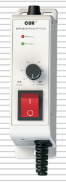
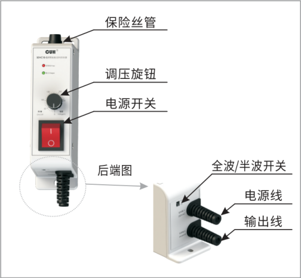
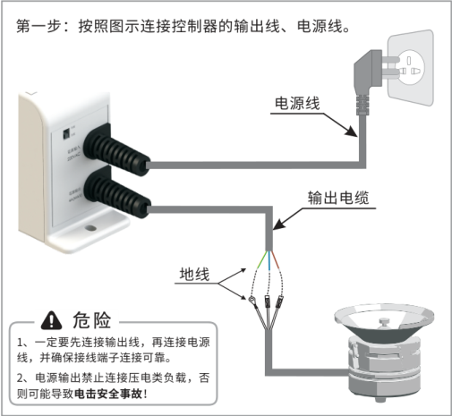
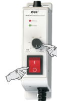
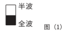
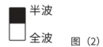

## 目录

> 下列条目来自 PDF 内置书签/大纲；链接指向本批转换生成的整页渲染图（`assets/pages/`），便于与原版 PDF 对照校对。

- [页 1](assets/pages/page-0001.png)（第 1 页）
- [页 2](assets/pages/page-0002.png)（第 2 页）
- [页 3](assets/pages/page-0003.png)（第 3 页）
- [页 4](assets/pages/page-0004.png)（第 4 页）
- [页 5](assets/pages/page-0005.png)（第 5 页）
- [页 6](assets/pages/page-0006.png)（第 6 页）
## 术语与命名

- 侧车：`glossary/terms.yaml`（机读）、`glossary/zh-CN.md`（人读）；候选表，定稿后并入公司级 `glossary/`。

## 适用范围

- 本文档由 PDF 自动转换生成，正文与插图需人工核对。

## 变更记录

- 2026-06-04 09:56:39：由转换工具从源 PDF 生成首版。

## 正文

<!-- auto:ai-body-draft v1 -->
> 以下为**整页视觉转写**的正文草稿（多模态模型直接输出 Markdown，含 GFM 表； 若配置 `[[vcrop:页:序]]` 占位符，裁剪步骤会插入 `assets/images/` 下 PNG）。**请务必人工校对。**

### 第 1 页

# CUH®

## 调压振动送料控制器

**Variable Voltage Controller for Vibratory Feeder**

## 型号：SDVC10-S/SDVC10-XS

### 第 2 页

SDVC10系列调压振动送料控制器

*Variable Voltage Controller for Vibratory Feeder*

## 部件说明

图中标注：

- 保险丝管
- 调压旋钮
- 电源开关
- 后端图
- 全波/半波开关
- 电源线
- 输出线

### 第 3 页

**SDVC10系列调压振动送料控制器**  
*Variable Voltage Controller for Vibratory Feeder*

# 使用方法

第一步：按照图示连接控制器的输出线、电源线。

图中标注：

- 电源线
- 输出电缆
- 地线

> ⚠️ **危险**
>
> 1、一定要先连接输出线，再连接电源线，并确保接线端子连接可靠。  
> 2、电源输出禁止连接压电类负载，否则可能导致**电击安全事故！**

### 第 4 页

SDVC10系列调压振动送料控制器  
*Variable Voltage Controller for Vibratory Feeder*

| 操作步骤 | 示意图 |
|---|---|
| 第二步：调节控制器上的电压旋钮，设置合适的输出电压。  第三步：打开控制器的电源开关，此时，保险丝指示灯和输出指示灯均点亮。 |  |

## 全波/半波的调节方法

可以使用半波/全波开关，设定控制器的输出状态。

| 图示 | 说明 |
|---|---|
|  | 在电源频率为50/60Hz情况下，如图（1）设为“全波”时，输出频率为100/120Hz。 |
|  | 在电源频率为50/60Hz情况下，如图（2）设为“半波”时，输出频率为50/60Hz。 |

### 第 5 页

SDVC10系列调压振动送料控制器

*Variable Voltage Controller for Vibratory Feeder*

## 技术规格

| 项目 | 范围：最小值 | 范围：典型值 | 范围：最大值 | 单位 | 说明 |
|---|---:|---:|---:|---|---|
| 输入电压 | 150 | 220 | 250 | 伏特（V） | 交流有效值 |
| 输出电压调整范围 | 90 | —— | Vin-30 | 伏特（V） | 半波 |
| 输出电压调整范围 | 70 | —— | Vin-10 | 伏特（V） | 全波 |
| 额定输出电流 | 0 | —— | 2.5 | 安培（A） | SDVC10-XS |
| 额定输出电流 | 0 | —— | 4 | 安培（A） | SDVC10-S |
| 输出功率 | 0 | —— | 550 | 伏安（VA） | SDVC10-XS |
| 输出功率 | 0 | —— | 880 | 伏安（VA） | SDVC10-S |
| 输出频率 | 45 | 50/60 | 65 | 赫兹（Hz） | 半波 |
| 输出频率 | 90 | 100/120 | 130 | 赫兹（Hz） | 全波 |
| 输出波形 |  | 正弦相切 |  |  |  |
| 缓启动时间 |  | 0.2 |  | 秒（s） |  |
| 短路保护动作电流 | —— | 6.3 | —— | 安培（A） | 保险丝容量 |
| 保险丝容量 |  | 6.3 |  | 安培（A） |  |
| 工作环境温度 | 0 | 25 | 40 | 摄氏度（℃） |  |
| 工作环境湿度 | 10 | 60 | 85 | 相对湿度（%） | 不结露 |
| 存储环境温度 | -20 | 25 | 85 | 摄氏度（℃） |  |

## 尺寸和重量

尺寸：长154mm×宽42mm×高86.4mm

重量：370g（不含附件）

### 第 6 页

SDVC10系列 调压振动送料控制器  
*Variable Voltage Controller for Vibratory Feeder*

## 性能特点

**缓启动：** 在启动时，输出电压会从零开始逐渐增大到预设电压，以消除对振动盘的冲击。

**优化电路设计：** 稳定可靠，寿命长。

**熔断式短路保护：** 输出端发生短路时，控制器的保险丝会熔断以保护控制器及振动设备。

  
扫描二维码下载说明书

**www.cuhnj.com**

南京创优科技有限责任公司

地址： 南京市江宁区智能路9号启迪城学研园2幢  
销售电话： 400-985-8889  
传真： 025-84730426  
企业邮箱： sales@cuhnj.com  
文档编号： IDP1000350  
该说明书的最终解释权归本公司所有

发布时间： 2024.09

<!-- /auto:ai-body-draft v1 -->

<!-- auto:data-params-summary v1 -->
## 附录 · 参数表（结构化侧车·机器生成）

> 说明：本节由 `data/<doc_key>/params/params.yaml` 自动渲染（展示前若干行），用于校对与二次开发。定稿以层 C 数据为准。

| 参数 | 标志/符号 | 范围 | 默认 | 单位 | 备注 |
| --- | --- | --- | --- | --- | --- |
| 项目 |  |  |  |  |  |
| 项目 |  |  |  |  |  |
| 输入电压 |  |  |  |  |  |
| 输出电压调整范围 |  |  |  |  |  |
| 输出电压调整范围 |  |  |  |  |  |
| 额定输出电流 |  |  |  |  |  |
| 额定输出电流 |  |  |  |  |  |
| 输出功率 |  |  |  |  |  |
| 输出功率 |  |  |  |  |  |
| 输出频率 |  |  |  |  |  |
| 输出频率 |  |  |  |  |  |
| 输出波形 |  |  |  |  |  |
| 缓启动时间 |  |  |  |  |  |
| 短路保护动作电流 |  |  |  |  |  |
| 保险丝容量 |  |  |  |  |  |
| 工作环境温度 |  |  |  |  |  |
| 工作环境湿度 |  |  |  |  |  |

- 完整 YAML：`data/cuh.sdvc.manual.v0.0/params/params.yaml`
- 表格索引：`data/cuh.sdvc.manual.v0.0/index.yaml`
<!-- /auto:data-params-summary v1 -->
