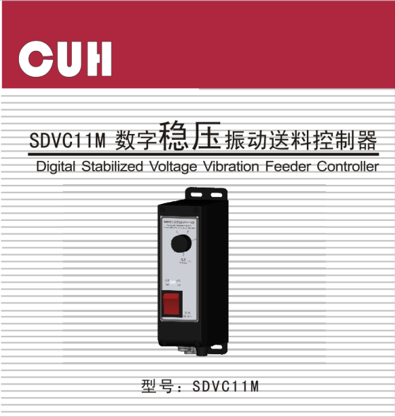
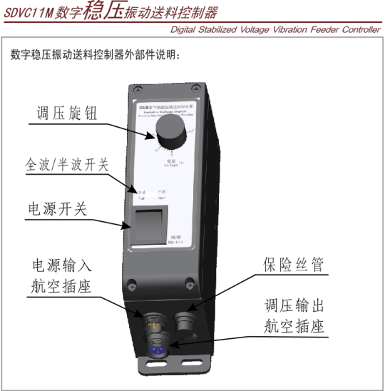
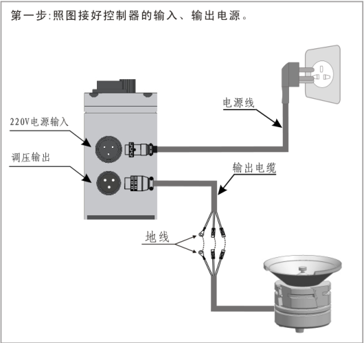
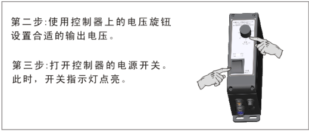
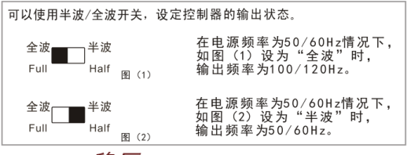

## 目录

> 下列条目来自 PDF 内置书签/大纲；链接指向本批转换生成的整页渲染图（`assets/pages/`），便于与原版 PDF 对照校对。

- [页面 1](assets/pages/page-0001.png)（第 1 页）
## 术语与命名

- 侧车：`glossary/terms.yaml`（机读）、`glossary/zh-CN.md`（人读）；候选表，定稿后并入公司级 `glossary/`。

## 适用范围

- 本文档由 PDF 自动转换生成，正文与插图需人工核对。

## 变更记录

- 2026-06-04 12:50:38：由转换工具从源 PDF 生成首版。

## 正文

<!-- auto:ai-body-draft v1 -->
> 以下为**整页视觉转写**的正文草稿（多模态模型直接输出 Markdown，含 GFM 表； 若配置 `[[vcrop:页:序]]` 占位符，裁剪步骤会插入 `assets/images/` 下 PNG）。**请务必人工校对。**

### 第 1 页

# SDVC11M 数字稳压振动送料控制器

Digital Stabilized Voltage Vibration Feeder Controller

**CUH**

**型号：SDVC11M**

## 产品特点

1. **稳压：** 本控制器内置数字稳压功能，在电源电压变化时可以迅速自动调整使输出电压保持不变，从而保证振动盘在电压变化时保持相同的送料速度。
2. **缓启动：** 在上电启动时，本调速器会从零开始缓慢增大输出电压，以消除对振动盘的冲击。
3. **线性调节规律：** 本机具有线性电压调节规律。即随着调节旋钮角度的增大，输出电压随调节旋钮角度以线性规律增大。因此具有良好的可操作性。
4. **短路保护功能：** 本机设有短路保护功能，短路发生时，控制器会立即停止输出，直到控制器重新启动为止。
5. **过热保护功能：** 本控制器工作温度过高时将停止输出，以保护本机。
6. **优化电路设计：** 稳定可靠，寿命长。

## 产品电气规格

| 项目 | 最小值 | 典型值 | 最大值 | 单位 | 说明 |
|---|---:|---:|---:|---|---|
| 输入电压 | 150 | 220 | 260 | V（伏特） |  |
| 电源频率 | 45 | 50/60 | 65 | Hz（赫兹） |  |
| 输出电流 | 0.1 | — | 5 | A（安培） |  |
| 输出电压（半波） | 6 | — | 电源电压-6 | V（伏特） | 半波 |
| 输出电压（全波） | 12 | — | 电源电压-12 | V（伏特） | 全波 |
| 稳压时间 | 0.5 | 0.65 | 0.7 | S（秒） |  |
| 稳压响应速度 | 0 | 0.01 | 0.02 | S（秒） |  |
| 稳压精度 | 0 | — | 15 | % | ΔVout/ΔVin |
| 工作环境温度 | 0 | 25 | 40 | ℃（摄氏度） | 不结露 |
| 工作环境湿度 | 10 | 60 | 85 | % |  |
| 过热保护温度 | 60 | 65 | 70 | ℃（摄氏度） |  |
| 短路保护动作电流 | — | 6.3 | — | A（安培） | 保险丝容量 |

文档编号：SDVC11MSMSCN_1.03

## 外部件说明

数字稳压振动送料控制器外部件说明：

图中标注部件：

- 调压旋钮
- 全波/半波开关
- 电源开关
- 电源输入航空插座
- 保险丝管
- 调压输出航空插座

## 接线与使用步骤

### 第一步

照图接好控制器的输入、输出电源。

图中标注：220V电源输入、调压输出、电源线、输出电缆、地线。

### 第二步

使用控制器上的电压旋钮设置合适的输出电压。

### 第三步

打开控制器的电源开关。此时，开关指示灯点亮。

## 全波/半波的调节方法

可以使用半波/全波开关，设定控制器的输出状态。

- 如图（1）设为“全波”时，在电源频率为 50/60Hz 情况下，输出频率为 100/120Hz。
- 如图（2）设为“半波”时，在电源频率为 50/60Hz 情况下，输出频率为 50/60Hz。
<!-- /auto:ai-body-draft v1 -->

<!-- auto:data-params-summary v1 -->
## 附录 · 参数表（结构化侧车·机器生成）

> 说明：本节由 `data/<doc_key>/params/params.yaml` 自动渲染（展示前若干行），用于校对与二次开发。定稿以层 C 数据为准。

*（未生成参数条目：可能未导出矢量表，或表头无法映射到参数列。）*
<!-- /auto:data-params-summary v1 -->
