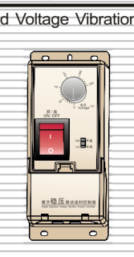
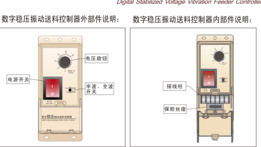
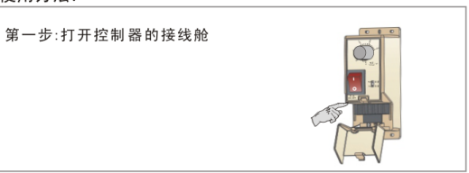
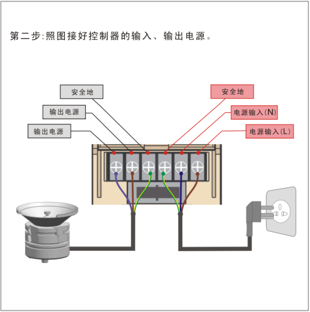
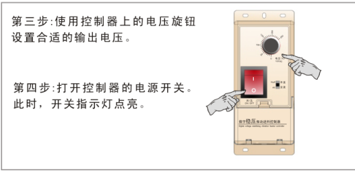
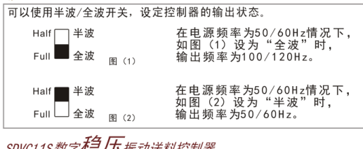

## 目录

> 下列条目来自 PDF 内置书签/大纲；链接指向本批转换生成的整页渲染图（`assets/pages/`），便于与原版 PDF 对照校对。

- [页面 1](assets/pages/page-0001.png)（第 1 页）
## 术语与命名

- 侧车：`glossary/terms.yaml`（机读）、`glossary/zh-CN.md`（人读）；候选表，定稿后并入公司级 `glossary/`。

## 适用范围

- 本文档由 PDF 自动转换生成，正文与插图需人工核对。

## 变更记录

- 2026-06-05 09:13:29：由转换工具从源 PDF 生成首版。

## 正文

<!-- auto:ai-body-draft v1 -->
> 以下为**整页视觉转写**的正文草稿（多模态模型直接输出 Markdown，含 GFM 表； 若配置 `[[vcrop:页:序]]` 占位符，裁剪步骤会插入 `assets/images/` 下 PNG）。**请务必人工校对。**

### 第 1 页

# SDVC11S 数字稳压振动送料控制器

## 产品特点

1. **自动稳压**：内置数字稳压电路，可以减小由于电源电压波动造成的送料速度变化。
2. **缓启动**：在启动时，输出电压会从零开始逐渐增大到预设电压，以消除对振动盘的冲击。
3. **线性调节规律**：输出电压和旋钮旋转角度成线性关系，随着调节旋钮角度的增大，输出电压以线性规律增大。具有良好的操作性。
4. **过热保护**：当控制器工作温度过高时将停止输出，以自我保护。
5. **过流保护**：当控制器工作电流超过额定电流时将停止输出，以保护控制器及振动设备。
6. **熔断式短路保护**：输出端发生短路时，控制器的保险丝会熔断以保护控制器及振动设备。
7. **优化电路设计**：稳定可靠，寿命长。

## 产品电气规格

| 项目 | 最小值 | 典型值 | 最大值 | 单位 | 说明 |
|---|---:|---:|---:|---|---|
| 输入电压 | 150 | 220 | 260 | V（伏特） | 交流有效值 |
| 输出电压调整范围 | 35 | — | Vin-10 | V（伏特） | 半波 |
| 输出电压调整范围 | 45 | — | Vin-5 | V（伏特） | 全波 |
| 稳压精度 | — | — | 30 | V（伏特） | Vset=150V ΔVin+=70V |
| 稳压响应时间 | 0 | 0.01 | 0.02 | s（秒） |  |
| 输出电流调整范围 | 0.1 | — | 4 | A（安培） |  |
| 输出功率 | 22 | — | 880 | VA（伏安） |  |
| 输出频率 | 45 | 50/60 | 65 | Hz（赫兹） | 半波 |
| 输出频率 | 90 | 100/120 | 130 | Hz（赫兹） | 全波 |
| 输出波形 | 正弦相切 |  |  |  |  |
| 缓启动时间 | 0.5 | 0.65 | 0.7 | s（秒） |  |
| 过热保护温度 | 58 | 60 | 66 | ℃（摄氏度） |  |
| 短路保护动作电流 | — | 6.3 | — | A（安培） | 保险丝容量 |
| 保险丝容量 |  | 6.3 |  | A（安培） |  |
| 工作环境温度 | 0 | 25 | 40 | ℃（摄氏度） | 不结露 |
| 工作环境湿度 | 10 | 60 | 85 | ％（相对湿度） | 不结露 |

文档编号：SDVC11SSMS_1.02

## 封面信息

**CUI**

**SDVC11S 数字稳压振动送料控制器**  
Digital Stabilized Voltage Vibration Feeder Controller

型号：**SDVC11S**

## SDVC11S 数字稳压振动送料控制器

Digital Stabilized Voltage Vibration Feeder Controller

### 数字稳压振动送料控制器外部件说明

图中标注部件：

- 电压旋钮
- 电源开关
- 半波、全波开关
- 接线柱
- 保险丝盒

## 使用方法

### 第一步：打开控制器的接线舱

### 第二步：照图接好控制器的输入、输出电源。

图中端子/接线标注：

- 安全地
- 输出电源
- 输出电源
- 安全地
- 电源输入（N）
- 电源输入（L）

### 第三步：使用控制器上的电压旋钮设置合适的输出电压。

### 第四步：打开控制器的电源开关。此时，开关指示灯点亮。

### 全波/半波的调节方法

可以使用半波/全波开关，设定控制器的输出状态。

- 如图（1）设为“全波”时，在电源频率为 50/60Hz 情况下，输出频率为 100/120Hz。
- 如图（2）设为“半波”时，在电源频率为 50/60Hz 情况下，输出频率为 50/60Hz。

SDVC11S 数字稳压振动送料控制器  
Digital Stabilized Voltage Vibration Feeder Controller
<!-- /auto:ai-body-draft v1 -->

<!-- auto:data-params-summary v1 -->
## 附录 · 参数表（结构化侧车·机器生成）

> 说明：本节由 `data/<doc_key>/params/params.yaml` 自动渲染（展示前若干行），用于校对与二次开发。定稿以层 C 数据为准。

| 参数 | 标志/符号 | 范围 | 默认 | 单位 | 备注 |
| --- | --- | --- | --- | --- | --- |
| 项目 |  | 最小值 |  | 最大值 | 最大值 |
| 输入电压 |  | 150 |  | V（伏特） | 交流有效值 |
| 输出电压调整范围 |  | 35 |  | V（伏特） | 半波 |
| 输出电压调整范围 |  | 45 |  | Vin-5 | 全波 |
| 稳压精度 |  | —— |  | V（伏特） | Vset=150V ΔVin+=70V |
| 稳压响应时间 |  | 0 |  | s（秒） |  |
| 输出电流调整范围 |  | 0.1 |  | A（安培） |  |
| 输出功率 |  | 22 |  | VA（伏安） |  |
| 输出频率 |  | 45 |  | Hz（赫兹） | 半波 |
| 输出频率 |  | 90 |  | Hz（赫兹） | 全波 |
| 输出波形 |  | 正弦相切 |  |  |  |
| 缓启动时间 |  | 0.5 |  | s（秒） |  |
| 过热保护温度 |  | 58 |  | ℃（摄氏度） |  |
| 短路保护动作电流 |  | —— |  | A（安培） | 保险丝容量 |
| 保险丝容量 |  | 6.3 |  | A（安培） |  |
| 工作环境温度 |  | 0 |  | ℃（摄氏度） | 不结露 |
| 工作环境湿度 |  | 10 |  | ％（相对湿度） | ％（相对湿度） |

- 完整 YAML：`data/cuh.sdvc.manual.v0.0/params/params.yaml`
- 表格索引：`data/cuh.sdvc.manual.v0.0/index.yaml`
<!-- /auto:data-params-summary v1 -->
