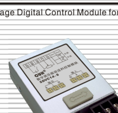
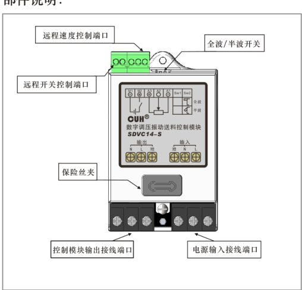
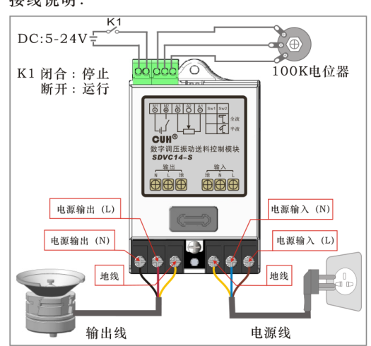
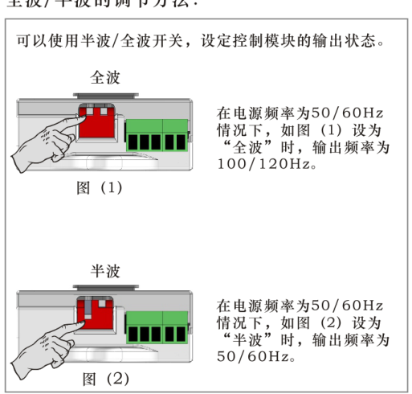

## 目录

> 下列条目来自 PDF 内置书签/大纲；链接指向本批转换生成的整页渲染图（`assets/pages/`），便于与原版 PDF 对照校对。

- [页面 1](assets/pages/page-0001.png)（第 1 页）
## 术语与命名

- 侧车：`glossary/terms.yaml`（机读）、`glossary/zh-CN.md`（人读）；候选表，定稿后并入公司级 `glossary/`。

## 适用范围

- 本文档由 PDF 自动转换生成，正文与插图需人工核对。

## 变更记录

- 2026-06-05 17:19:49：由转换工具从源 PDF 生成首版。

## 正文

<!-- auto:ai-body-draft v1 -->
> 以下为**整页视觉转写**的正文草稿（多模态模型直接输出 Markdown，含 GFM 表； 若配置 `[[vcrop:页:序]]` 占位符，裁剪步骤会插入 `assets/images/` 下 PNG）。**请务必人工校对。**

### 第 1 页

**SDVC14-S数字调压振动送料控制模块**  
*Variable Voltage Digital Control Module for Vibratory Feeder*

## 性能特点：

1、**自动稳压：** 内置数字稳压电路，可以减小由于电源电压波动造成的送料速度变化。

2、**缓启动：** 在启动时，输出电压会从零开始逐渐增大到预设电压，以消除对振动盘的冲击。

3、**线性调节规律：** 输出电压和旋钮旋转角度成线性关系，随着调节旋钮角度的增大，输出电压以线性规律增大。具有良好的操作性。

4、**信号控制端口：** 本控制模块具有远程开关控制端口和远程速度控制端口。

5、**优化电路设计：** 稳定可靠，寿命长。

6、**过热保护：** 当控制模块工作温度过高时将停止输出，以自我保护。

7、**过流保护：** 当控制模块工作电流超过额定电流时将停止输出，以保护控制模块及振动设备。

8、**熔断式短路保护：** 输出端发生短路时，控制模块的保险丝会熔断以保护控制模块及振动设备。

---

**SDVC14-S数字调压振动送料控制模块**  
*Variable Voltage Digital Control Module for Vibratory Feeder*

## 技术规格：

| 项目 | 最小值 | 典型值 | 最大值 | 单位 | 说明 |
|---|---:|---:|---:|---|---|
| 输入电压 | 150 | 220 | 260 | V（伏特） | 交流有效值 |
| 输出电压调整范围 | 35 | —— | Vin-10 | V（伏特） | 半波 |
| 输出电压调整范围 | 45 | —— | Vin-5 | V（伏特） | 全波 |
| 稳压精度 | —— | —— | 30 | V（伏特） | Vset=150V ΔVin+=70V |
| 稳压响应时间 | 0 | 0.01 | 0.02 | s（秒） |  |
| 输出电流调整范围 | 0.1 | —— | 4 | A（安培） |  |
| 输出功率 | 22 | —— | 880 | VA（伏安） |  |
| 输出频率 | 45 | 50/60 | 65 | Hz（赫兹） | 半波 |
| 输出频率 | 90 | 100/120 | 130 | Hz（赫兹） | 全波 |
| 输出波形 | 正弦相切 |  |  |  |  |
| 缓启动时间 | 0.5 | 0.65 | 0.7 | s（秒） |  |
| 过热保护温度 | 58 | 60 | 66 | ℃（摄氏度） |  |
| 远程开关控制电压 | 5 | —— | 24 | V（伏特） |  |
| 保险丝容量 | —— | 6.3 | —— | A（安培） |  |
| 工作环境温度 | 0 | 25 | 40 | ℃（摄氏度） | 不结露 |
| 工作环境湿度 | 10 | 60 | 85 | ％（相对湿度） | 不结露 |

## 尺寸和重量：

尺寸：长102mm×宽63mm×高27mm  
重量：92g

文档编号：SDVC14SSMSCN_1.05

---

## 封面信息

CUH

**数字调压振动送料控制模块**  
*Variable Voltage Digital Control Module for Vibratory Feeder*

型号：**SDVC14-S**

---

**SDVC14-S数字调压振动送料控制模块**  
*Variable Voltage Digital Control Module for Vibratory Feeder*

## 部件说明：

图中标注：

- 远程速度控制端口
- 全波/半波开关
- 远程开关控制端口
- 保险丝夹
- 控制模块输出接线端口
- 电源输入接线端口

---

**SDVC14-S数字调压振动送料控制模块**  
*Variable Voltage Digital Control Module for Vibratory Feeder*

## 接线说明：

- DC：5-24V
- K1闭合：停止
- K1断开：运行
- 100K电位器
- 电源输出（L）
- 电源输出（N）
- 地线
- 输出线
- 电源输入（N）
- 电源输入（L）
- 地线
- 电源线

---

**SDVC14-S数字调压振动送料控制模块**  
*Variable Voltage Digital Control Module for Vibratory Feeder*

## 全波/半波的调节方法：

可以使用半波/全波开关，设定控制模块的输出状态。

### 全波

在电源频率为50/60Hz情况下，如图（1）设为“全波”时，输出频率为100/120Hz。

图（1）

### 半波

在电源频率为50/60Hz情况下，如图（2）设为“半波”时，输出频率为50/60Hz。

图（2）
<!-- /auto:ai-body-draft v1 -->

<!-- auto:data-params-summary v1 -->
## 附录 · 参数表（结构化侧车·机器生成）

> 说明：本节由 `data/<doc_key>/params/params.yaml` 自动渲染（展示前若干行），用于校对与二次开发。定稿以层 C 数据为准。

| 参数 | 标志/符号 | 范围 | 默认 | 单位 | 备注 |
| --- | --- | --- | --- | --- | --- |
| 最小值 |  | 最小值 |  | 最大值 | 最大值 |
| 150 |  | 150 |  | V（伏特） | 交流有效值 |
| 35 |  | 35 |  | V（伏特） | 半波 |
| 45 |  | 45 |  | Vin-5 | 全波 |
| —— |  | —— |  | V（伏特） | Vset=150V ΔVin+=70V |
| 0 |  | 0 |  | s（秒） |  |
| 0.1 |  | 0.1 |  | A（安培） |  |
| 22 |  | 22 |  | VA（伏安） |  |
| 45 |  | 45 |  | Hz（赫兹） | 半波 |
| 90 |  | 90 |  | Hz（赫兹） | 全波 |
| 正弦相切 |  | 正弦相切 |  |  |  |
| 0.5 |  | 0.5 |  | s（秒） |  |
| 58 |  | 58 |  | ℃（摄氏度） |  |
| 5 |  | 5 |  | V（伏特） |  |
| 6.3 |  | 6.3 |  | A（安培） |  |
| 0 |  | 0 |  | ℃（摄氏度） | ℃（摄氏度） |

- 完整 YAML：`data/cuh.sdvc.manual.v1.05/params/params.yaml`
- 表格索引：`data/cuh.sdvc.manual.v1.05/index.yaml`
<!-- /auto:data-params-summary v1 -->
