## 目录

> 下列条目来自 PDF 内置书签/大纲；链接指向本批转换生成的整页渲染图（`assets/pages/`），便于与原版 PDF 对照校对。

- [7: 目录](assets/pages/page-0007.png)（第 7 页）
- [8: 目录2](assets/pages/page-0008.png)（第 8 页）
- [第一章 产品特点](assets/pages/page-0009.png)（第 9 页）
  - [1.1 主要功能特点](assets/pages/page-0009.png)（第 9 页）
  - [1.2 其他功能特点](assets/pages/page-0009.png)（第 9 页）
- [第二章 快速安装指南](assets/pages/page-0010.png)（第 10 页）
  - [2.1 外部部件说明](assets/pages/page-0010.png)（第 10 页）
  - [2.2 快速安装说明](assets/pages/page-0012.png)（第 12 页）
- [第三章 人机交互界面](assets/pages/page-0015.png)（第 15 页）
  - [3.1 待机界面](assets/pages/page-0015.png)（第 15 页）
  - [3.2 监控界面](assets/pages/page-0016.png)（第 16 页）
  - [3.3 设置参数界面](assets/pages/page-0017.png)（第 17 页）
  - [3.4 搜频界面](assets/pages/page-0018.png)（第 18 页）
  - [3.5 界面轮转切换图](assets/pages/page-0020.png)（第 20 页）
- [第四章 工作模式](assets/pages/page-0021.png)（第 21 页）
  - [4.1 持续输出模式](assets/pages/page-0021.png)（第 21 页）
  - [4.2 定时触发模式](assets/pages/page-0022.png)（第 22 页）
  - [4.3 定能量触发模式](assets/pages/page-0022.png)（第 22 页）
  - [4.4 工作模式相关参数说明](assets/pages/page-0023.png)（第 23 页）
- [第五章 端口功能详细说明](assets/pages/page-0024.png)（第 24 页）
  - [5.1 输入端口C](assets/pages/page-0024.png)（第 24 页）
  - [5.2 低压控制输出端口D](assets/pages/page-0026.png)（第 26 页）
  - [5.3 远程遥控电压控制](assets/pages/page-0029.png)（第 29 页）
  - [5.4 恢复出厂默认设置](assets/pages/page-0030.png)（第 30 页）
- [第六章 密码锁功能](assets/pages/page-0031.png)（第 31 页）
  - [6.1 输入密码](assets/pages/page-0031.png)（第 31 页）
  - [6.2 设置密码](assets/pages/page-0031.png)（第 31 页）
- [第七章 安全保护功能](assets/pages/page-0032.png)（第 32 页）
- [附录A：外形尺寸](assets/pages/page-0033.png)（第 33 页）
- [附录B：用户接口定义](assets/pages/page-0033.png)（第 33 页）
- [附录C：技术规格](assets/pages/page-0034.png)（第 34 页）
- [附录D：常见故障现象及排除方法](assets/pages/page-0035.png)（第 35 页）
- [附录E：开关量输入端口与各类开关传感器及PLC的连接示例](assets/pages/page-0036.png)（第 36 页）
- [附录F：参数汇总表](assets/pages/page-0039.png)（第 39 页）
- [附录G：参考标准](assets/pages/page-0041.png)（第 41 页）
## 术语与命名

- 侧车：`glossary/terms.yaml`（机读）、`glossary/zh-CN.md`（人读）；候选表，定稿后并入公司级 `glossary/`。

## 适用范围

- 本文档由 PDF 自动转换生成，正文与插图需人工核对。

## 变更记录

- 2026-06-05 22:19:43：由转换工具从源 PDF 生成首版。

## 正文

<!-- auto:ai-body-draft v1 -->
> 以下为**整页视觉转写**的正文草稿（多模态模型直接输出 Markdown，含 GFM 表； 若配置 `[[vcrop:页:序]]` 占位符，裁剪步骤会插入 `assets/images/` 下 PNG）。**请务必人工校对。**

### 第 1 页

# CUH

## 智能数字超声波焊接控制器

**Intelligent Digital Ultrasonic Welding Controller**

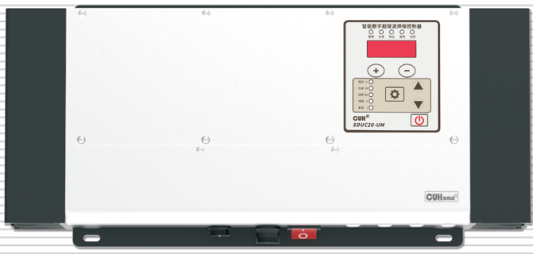

## SDUC20-U系列

# 用户手册

### 第 2 页

## 智能数字振动送料控制器相关产品

| 品名规格 | 特点 | 特点 |
|---|---|---|
| **SDVC34** 智能数字自动调频振动送料控制器系列  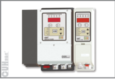 | · 频率调节 · 智能跟踪 · 料满停机 · 控制输出 · 最大输出限定 · 恢复出厂设置 · 过流保护功能 · 加速功能 | · 电压调节 · 计数功能 · 线控调速 · RS485通信 · 波形指数设置 · 过热保护功能 · 短路保护功能 |
| **SDVC31** 数字调频振动送料控制器系列  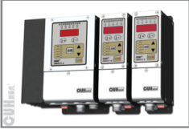 | · 自动稳压 · 缓启动时间设置 · 智能光电传感 · 控制输出 · 最大输出限定 · 恢复出厂设置 · 过流保护功能 | · 缓启动 · 加速功能 · 线控调速 · 键盘锁定 · 波形指数设置 · 过热保护功能 · 短路保护功能 |

## 压电数字调频振动送料控制器

| 品名规格 | 特点 | 特点 |
|---|---|---|
| **SDVC40S系列** 压电数字调频振动送料控制器系列  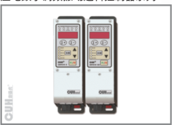 | · 自动稳压 · 缓启动时间设置 · 线控调速 · 键盘锁定 · 波形指数设置 · 过热保护功能 · 短路保护功能 | · 缓启动 · 智能光电传感 · 控制输出 · 最大输出限定 · 恢复出厂设置 · 过流保护功能 |

### 第 3 页

智能数字超声波焊接控制器　　　　　　　　　　　　　　　　　SDUC20-U系列

---

# 序　言

感谢您使用南京创优科技有限责任公司（在本手册中以下简称本公司）出品的SDUC20-U系列智能数字超声波焊接控制器（在本手册中以下简称控制器）。

本手册为用户提供安装调试、参数设置、异常诊断、故障排除及日常维护控制器的相关信息。为了确保正确安装和使用本控制器，请在装机之前仔细阅读本用户手册，并请妥善保存。

## 本说明书适合以下型号控制器:

◆ 智能数字超声波焊接控制器　SDUC20-US（1500V/1.5A）

◆ 智能数字超声波焊接控制器　SDUC20-UM（2000V/3A）

---

2020-06　　　　　　　　　　　　　　　　　SDUC20USMSCN_1.01

### 第 4 页

智能数字超声波焊接控制器　　　　　　　　　　　　　　　　SDUC20-U系列

# 安全与预防措施

## 以下为特别需要注意的事项:

1、本控制器正常工作时会输出危险高电压，请正确连接振子电极和接地线以防触电事故发生。

2、任何情况下都不可以在带电状态下拔插接线或试图触摸插座内各接线点，以防触电和发生意外。

3、本控制器的壳体通过电源线缆的地线连接到大地，请确保为控制器供电的三爪插座已良好接地。

4、切不可将控制器连接380V交流电，这将会造成控制器不可恢复的严重损坏！

5、请避免采用通过继电器等设备切断供电的方式来控制本控制器的输出，这会严重降低控制器的寿命。

6、控制器设计使用于阴凉干燥环境，请不要让本控制器在室外、可能会浸水、阳光暴晒场所工作，也不要在超过本控制器电气特性要求的范围之外工作。

7、任何情况下请勿将控制器在超越设计极限状态下工作。

8、请严格按照本使用说明操作，对于不按照本使用说明所造成的任何设备或人身伤害，本公司不承担任何民事和刑事责任。

任何情况下请不要打开本控制器机壳，以防遭电击。如本控制器出现故障，请致电本公司，我们会尽快协助排除故障。机壳内全部为固态电路，没有可以调节部件和用户可维修部分，请不要试图维修本机。

---

2020-06　　　　　　　　　　　　　　　　　　　　　　　　　SDUC20USMSCN_1.01

### 第 5 页

智能数字超声波焊接控制器　　　　　　　　　　　　　　　　　　　　　　　　　SDUC20-U系列

---

# 工作与储存环境

## 一、使用前的检查

每台控制器在出厂前，均经过严格的品质检验，并经过强化的防撞包装处理。客户在拆箱后，请即刻进行下列检查：

1、检查控制器是否在运输过程中受到损伤。

2、检查控制器型号是否与订货登记资料完全相同。

## 二、工作环境

为使本控制器具有更好的使用效果和更长的使用寿命，请将控制器安装在符合下列条件的环境中：

● 良好的通风散热环境

● 远离水滴、蒸气、灰尘，特别是油性灰尘

● 无腐蚀、易燃性的气体、液体

● 无漂浮性的尘埃及金属微粒

● 安装表面坚固无振动

● 远离电磁噪声干扰

● 使用环境温度为0℃到40℃

● 仅适用于海拔2000m以下地区安全使用

---

2020-06　　　　　　　　　　　　　　　　　　　　　　　　　SDUC20USMSCN_1.01

### 第 6 页

| 智能数字超声波焊接控制器 | SDUC20-U系列 |
|---|---:|

---

---

| 2020-06 | SDUC20USMSCN_1.01 |
|---|---:|

### 第 7 页

智能数字超声波焊接控制器　　　　　　　　　　　　　　　　　　　　　　　　　SDUC20-U系列

# 目　录

第一章 产品特点 -------------------------------------------------------------------------------- 1

　　1.1　主要功能特点 ------------------------------------------------------------------------ 1

　　1.2　其他功能特点 ------------------------------------------------------------------------ 1

第二章 快速安装指南 ---------------------------------------------------------------------------- 2

　　2.1　外部部件说明 ------------------------------------------------------------------------ 2

　　2.2　快速安装说明 ------------------------------------------------------------------------ 4

第三章 人机交互界面 ---------------------------------------------------------------------------- 7

　　3.1　待机界面 ---------------------------------------------------------------------------- 7

　　3.2　监控界面 ---------------------------------------------------------------------------- 8

　　3.3　设置参数界面 ------------------------------------------------------------------------ 9

　　3.4　搜频界面 --------------------------------------------------------------------------- 10

　　3.5　界面轮转切换图 --------------------------------------------------------------------- 12

第四章 工作模式 -------------------------------------------------------------------------------- 13

　　4.1　持续输出模式 ----------------------------------------------------------------------- 13

　　4.2　定时触发模式 ----------------------------------------------------------------------- 14

　　4.3　定能量触发模式 --------------------------------------------------------------------- 14

　　4.4　工作模式相关参数说明 --------------------------------------------------------------- 15

第五章 端口功能详细说明 ---------------------------------------------------------------------- 16

　　5.1　输入端口C -------------------------------------------------------------------------- 16

　　5.2　低压控制输出端口D ------------------------------------------------------------------ 18

　　5.3　远程遥控电压控制 ------------------------------------------------------------------- 21

　　5.4　恢复出厂默认设置 ------------------------------------------------------------------- 22

第六章 密码锁功能 ----------------------------------------------------------------------------- 23

　　6.1　输入密码 ---------------------------------------------------------------------------- 23

　　6.2　设置密码 ---------------------------------------------------------------------------- 23

第七章 安全保护功能 --------------------------------------------------------------------------- 24

---

2020-06　　　　　　　　　　　　　　　　　　　　　　　　　　　　　SDUC20USMSCN_1.01

### 第 8 页

智能数字超声波焊接控制器　　　　　　　　　　　　　　　　SDUC20-U系列

---

附录A： 外形尺寸 --------------------------------------------------------------------25

附录B： 用户接口定义 ----------------------------------------------------------------25

附录C： 技术规格 --------------------------------------------------------------------26

附录D： 常见故障现象及排除方法 ------------------------------------------------------27

附录E： 开关量输入端口与各类开关传感器及PLC的连接示例 ----------------------------28

附录F： 参数汇总表 ------------------------------------------------------------------31

附录G： 参考标准 --------------------------------------------------------------------33

---

2020-06　　　　　　　　　　　　　　　　　　　　　　　　SDUC20USMSCN_1.01

### 第 9 页

智能数字超声波焊接控制器　　　　　　　　　　　　　　　　SDUC20-U系列

# 第一章 产品特点

## 1.1 主要功能特点

**符号显示：** 采用五位八段数码管显示控制器的各项参数值。

**自动搜频：** 自动搜频功能，方便用户查找超声换能器的谐振频率，以及频率跟踪范围。

**自动跟踪：** 自动跟踪换能器的谐振频率，自动稳定换能器振幅（电压）。

**失谐指示：** 用户可以通过失谐指示灯是否亮起判断当前是否在谐振状态。

**持续触发：** 控制器能以恒定的功率持续输出功率给换能器。

**定时触发：** 控制器能以恒定的功率输出一段固定可控的时间。

**定能量触发：** 控制器能驱动换能器一段时间，在此时间内换能器的输出的总能量为固定值。

**触发方式：** 可接收外部NPN或者PNP触发信号，以及面板按键触发。

**遥控电压：** 允许用户通过外接电位器或1～5V控制信号控制输出电压。

**控制输出：** 本控制器可以输出24V控制信号，以同步其它设备协同工作，例如电磁阀。

**输出功率自动调整：** 输出功率可以跟随负载变化，无负载时自动降低输出功率，加上不同的负载后，自动根据负载大小调整输出功率。

## 1.2 其他功能特点

本系列控制器专为自动化设备中超声波焊接控制用，融合最新电子技术，经过精心设计，为用户提供最方便实用的功能，包括：

**传感器自适应：** 控制器可自动适应NPN型和PNP型开关传感器。

**最大输出电压设定：** 本参数可以帮助生产厂家防止用户误操作损害设备。

**最大输出电流设定：** 本参数可以帮助生产厂家防止用户误操作损害设备。

**密码锁功能：** 用户可以设定密码，防止其他未授权人员对控制器参数的修改。

**输出开关：** 面板上设有轻触按键，可以及时开/停机，方便用户操作。

**参数保存功能：** 可将所有可调参数保存，用户下次开机后能快速恢复工作状态。

**恢复出厂设置：** 该功能可以快速将调乱的参数恢复为出厂默认设置，使控制器进入默认出厂工作状态。

**错误报警：** 报警编号可以方便用户快速定位控制器的故障，并排除故障。

**状态指示灯：** 面板上的红色和绿色状态指示灯，明确的表明控制器的当前状态。

**轻触开关：** 多达6个轻触开关，方便用户修改控制器的参数，切换状态，以及监视控制器的输出功率等多项实时数据。

---

2020-06　　　　　　　　　　　　　- 1 -　　　　　　　　　　　　　SDUC20USMSCN_1.01

### 第 10 页

智能数字超声波焊接控制器　　　　　　　　　　　　　　　　　　　　　　　　　SDUC20-U系列

# 第二章 快速安装指南

## 2.1 外部部件说明

### 2.1.1 外观说明

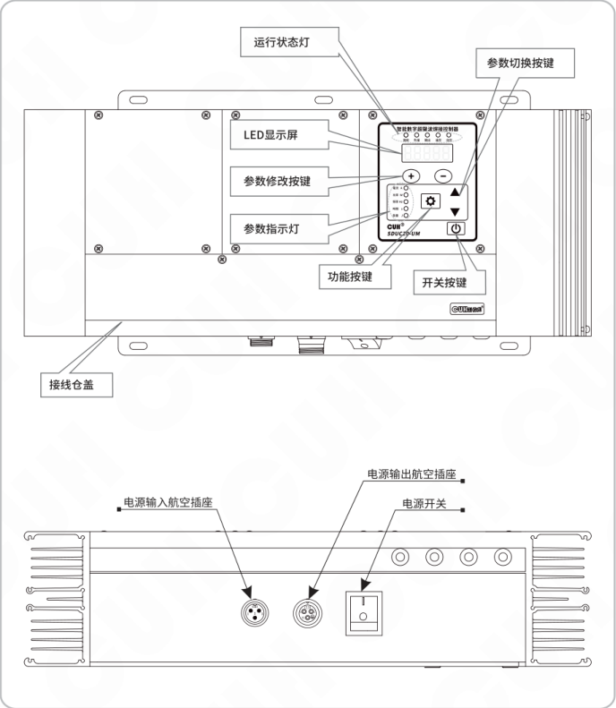

图中标注：

- 运行状态灯
- LED显示屏
- 参数修改按键
- 参数指示灯
- 功能按键
- 开关按键
- 参数切换按键
- 接线仓盖
- 电源输入航空插座
- 电源输出航空插座
- 电源开关

2020-06　　　　　　　　　　　　　　　　　- 2 -　　　　　　　　　　　　　　　　　SDUC20USMSCN_1.01

### 第 11 页

智能数字超声波焊接控制器　　　　　　　　　　　　　　　　　　　　　　　　　SDUC20-U系列

## 2.1.2 人机交互界面说明

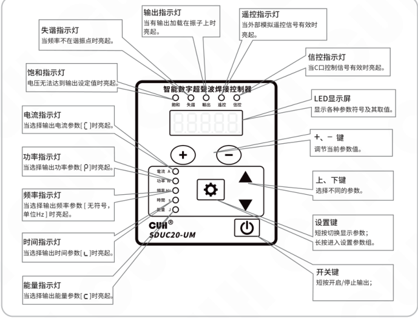

| 部件/指示灯 | 说明 |
|---|---|
| 失谐指示灯 | 当频率不在谐振点时亮起。 |
| 饱和指示灯 | 电压无法达到输出设定值时亮起。 |
| 电流指示灯 | 当选择输出电流参数 `[ ]` 时亮起。 |
| 功率指示灯 | 当选择输出功率参数 `[P]` 时亮起。 |
| 频率指示灯 | 当选择输出频率参数 `[无符号，单位Hz]` 时亮起。 |
| 时间指示灯 | 当选择输出时间参数 `[t]` 时亮起。 |
| 能量指示灯 | 当选择输出能量参数 `[J]` 时亮起。 |
| 输出指示灯 | 当有输出加载在振子上时亮起。 |
| 遥控指示灯 | 当外部模拟遥控信号有效时亮起。 |
| 信控指示灯 | 当C口控制信号有效时亮起。 |
| LED显示屏 | 显示各种参数符号及其取值。 |
| `+`、`-` 键 | 调节当前参数值。 |
| 上、下键 | 选择不同的参数。 |
| 设置键 | 短按切换显示参数；长按进入设置参数组。 |
| 开关键 | 短按开启/停止输出； |

## 2.1.3 信号接线端口说明

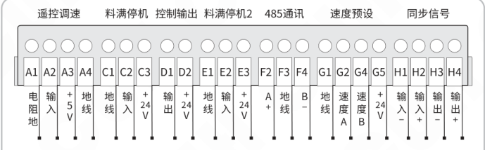

| 功能组 | 端子 | 定义 |
|---|---|---|
| 遥控调速 | A1 | 电阻地 |
| 遥控调速 | A2 | 输入 |
| 遥控调速 | A3 | +5V |
| 遥控调速 | A4 | 地线 |
| 料满停机 | C1 | 地线 |
| 料满停机 | C2 | 输入 |
| 料满停机 | C3 | +24V |
| 控制输出 | D1 | 输出 |
| 控制输出 | D2 | +24V |
| 料满停机2 | E1 | 地线 |
| 料满停机2 | E2 | 输入 |
| 料满停机2 | E3 | +24V |
| 485通讯 | F2 | A+ |
| 485通讯 | F3 | 地线 |
| 485通讯 | F4 | B- |
| 速度预设 | G1 | 地线 |
| 速度预设 | G2 | 速度A |
| 速度预设 | G4 | 速度B |
| 速度预设 | G5 | +24V |
| 同步信号 | H1 | 输入- |
| 同步信号 | H2 | 输入+ |
| 同步信号 | H3 | 输出- |
| 同步信号 | H4 | 输出+ |

备注：目前仅开放料满停机C口、控制输出D口、遥控调速A口。

2020-06　　　　　　　　　　　　　　　　　- 3 -　　　　　　　　　　　　　　　　　SDUC20USMSCN_1.01

### 第 12 页

## 2.2 快速安装说明

**第一步：**

打开控制器的外包装，检查控制器外观及侧标型号，判断是否为所需的型号。

**第二步：**

取出配件包里的输出线，将输出线接线端子接到换能器接线端子上。

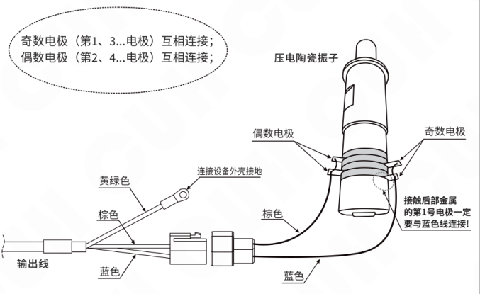

> **注意**
>
> 输出线的蓝色线连接到换能器振子负极（接金属极），棕色线连接到换能器振子正极（高压极），黄绿色线连接设备的外壳。  
> 外壳需要可靠接地，否则将会导致机壳带电，可能发生严重安全事故！

### 第 13 页

智能数字超声波焊接控制器　　　　　　　　　　　　　　　　　SDUC20-U系列

### 第三步：

将输出线航空插头插到控制器上，并锁紧螺母。

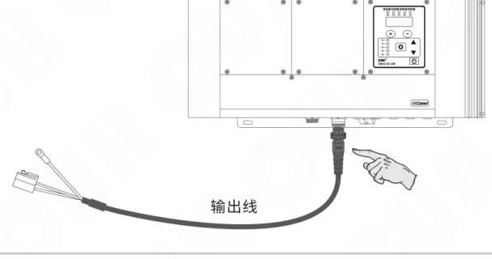

### 第四步：

将输入电源线航空插头插到控制器上，并锁紧螺母。

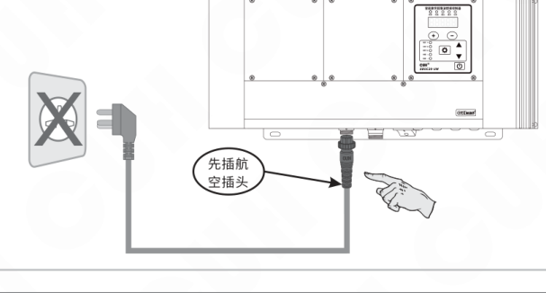

---

2020-06　　　　　　　　　　　　- 5 -　　　　　　　　　　　　SDUC20USMSCN_1.01

### 第 14 页

> 智能数字超声波焊接控制器　　　　　　　　　　　　　　　　　SDUC20-U系列

### 第五步：

将电源线三爪插头插在供电电源插座上。

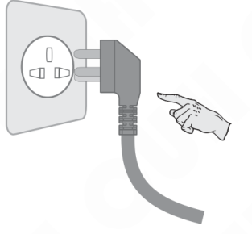

此时，控制器应当启动，显示待机界面，但控制器是没有输出的。

### 第六步：

1、同时按下 ⚙ 和 ▲ 进入搜频界面 `F2000`。

2、短按 ⏻ 启动输出，然后按 ＋ 向上搜频，或按 － 向下搜频。

3、换能器可能有多个谐振点，在找到其中一个谐振点后可以继续按 ＋ 或 － 搜索下一个谐振点。成功搜索到谐振点时，屏幕显示 SUCCE 约1.5秒。

4、选择工作状态最好的一个谐振点，同时按下 ＋ 和 －，屏幕显示 FSAVE 保存当前谐振点。此时控制器会退回到待机界面，再按一次 ⏻ 就可以启动输出了。

5、在待机界面下按 ＋ 或 － 可以调节输出电压 U，根据需要的振子振幅进行调节。

6、在待机界面下按 ▲ 或 ▼ 可以切换显示输出功率 P、输出电压 U、输出电流 C、输出频率等监控参数方便用户监控振子的工作状态。

---

2020-06　　　　　　　　　　　　- 6 -　　　　　　　　　　　　SDUC20USMSCN_1.01

### 第 15 页

智能数字超声波焊接控制器　　　　　　　　　　　　　　　　　SDUC20-U系列

# 第三章 人机交互界面

## 3.1 待机界面

待机界面如下图所示：

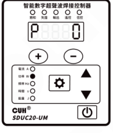

待机界面显示当前控制器的实时输出功率，待机界面是控制器的正常工作界面。在此界面，控制器可通过面板上的 ⏻ 或者通过输入端口C接收外部NPN或者PNP触发信号，来开启或停止控制器的输出。

## 3.1.1 待机界面参数修改方式

在待机界面用户可修改的参数只有输出电压，默认值500，如下图：

**参数修改方式：**

短按（+1）或者长按（持续增加）⊕ 或 ⊖。其中：

⊕ 表示增大输出电压，

⊖ 表示减小输出电压。

当停止修改后，经过2秒钟会自动返回显示输出功率，如下图：

---

2020-06　　　　　　　　　　　　　　- 7 -　　　　　　　　　　　　　　SDUC20USMSCN_1.01

### 第 16 页

## 3.2 监控界面

监控界面，显示控制器的实时工作状态，包括输出电流、输出功率、输出频率、输出时间、输出能量、内阻、实测输出电压、输出有功电压。下图为监控界面的第一个参数：输出电流

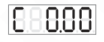

## 3.2.1 监控界面参数修改方式

在监控界面用户可修改的参数只有输出电压，默认值500，如下图：

**参数修改方式：**

短按（+1）或者长按（持续增加）⊕ 或 ⊖。其中：

⊕ 表示增大输出电压，

⊖ 表示减小输出电压。

当停止修改后，经过2秒钟会自动返回显示当前的监视参数。

## 3.2.2 监控界面参数切换

**操作方式：**

短按或长按 ▲ 或 ▼ 调出本组其他参数显示。详细标识符可查看附录F。

### 第 17 页

智能数字超声波焊接控制器　　　　　　　　　　　　　　SDUC20-U系列

---

## 3.3 设置参数界面

设置参数界面是用户修改控制器工作模式和各项参数的界面。下图为设置参数界面的第一个参数：密码输入

### 3.3.1 设置参数界面参数修改方式

在设置参数界面用户可修改的参数共有19个。

**参数修改方式：**

短按或者长按 ⊕ 或 ⊖ 。其中：

⊕ 表示增大该参数值，

⊖ 表示减小该参数值。

### 3.3.2 设置参数界面参数切换

**操作方式：**

短按或长按 ▲ 或 ▼ 调出本组其他参数显示。详细标识符可查看附录F。

---

2020-06　　　　　　　　　　　　　　- 9 -　　　　　　　　　　　　　　SDUC20USMSCN_1.01

### 第 18 页

智能数字超声波焊接控制器　　　　　　　　　　　　　　　　　SDUC20-U系列

---

## 3.4 搜频界面

搜频界面是用户通过修改特定参数后发起一次搜索换能器谐振频率的界面。

下图为搜频界面的第一个参数：自动搜频频率

F20.00

### 3.4.1 搜频界面参数修改方式

在搜频界面用户可修改的参数共有5个。

**参数修改方式：**

短按或者长按 ⊕ 或 ⊖。其中：

⊕ 表示增大该参数值，

⊖ 表示减小该参数值。

### 3.4.2 搜频界面参数切换

**操作方式：**

短按或长按 ▲ 或 ▼ 调出本组其他参数显示。详细标识符可查看附录F。

---

2020-06　　　　　　　　　　　　　-10-　　　　　　　　　　　　　SDUC20USMSCN_1.01

### 第 19 页

### 3.4.3 自动搜频操作方式

自动搜频功能可使用户迅速搜索到换能器的谐振频率，用户需要完成以下步骤即可发起一次自动搜频。

1、进入搜频界面；

2、修改参数“自动搜频电压 d”，因换能器规格不同，请设定参数值为适当值；

3、修改参数“搜频阻抗阈值 n”，可根据搜频效果适当增大或减小该值；

4、按下 ⏻ 启动输出；

5、切换到参数“自动搜频频率 F”，该值显示的是当前的输出频率，出厂默认为20KHz，此时按 ⊕ 表示立即开始向上搜频，按 ⊖ 表示立即开始向下搜频。搜频过程中该值会实时改变，当搜频结束后，该值会不再变化，如果搜索到了谐振频率，屏幕显示SUCCE约1.5秒，表示搜频成功。由于换能器可能存在多个谐振频率，若要继续搜频可重复2~5步骤。

6、搜频结束后，用户不仅可以查看谐振频率（“自动搜频频率”值），还可以查看正常工作时的频率跟踪范围，即本组参数中的“频率上限 u”和“频率下限 u”，当用户认可本次搜频的结果，可在屏幕显示“自动搜频频率”参数时，同时按下 ⊕ 和 ⊖，直到屏幕显示’FSAUE’，表示保存谐振频率。当下次开机后，控制器仍然能够工作在此谐振频率附近。

### 第 20 页

## 3.5 界面轮转切换图

人机交互界面共有4种界面，分别为：待机界面、监控界面、设置参数界面、搜频界面。各界面之间的切换可通过按键，或者组合按键的操作实现。界面轮转切换图如下：

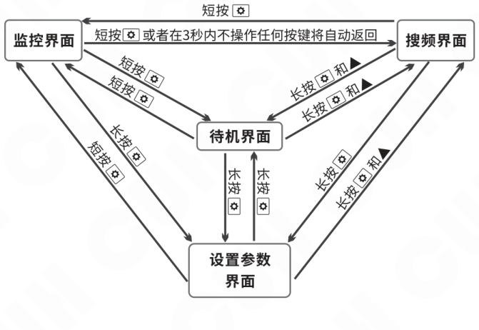

### 第 21 页

智能数字超声波焊接控制器　　　　　　　　　　　　　　　　　　　　　　　　　SDUC20-U系列

# 第四章 工作模式

用户根据应用需求可设置控制器运行在以下三种工作模式之一：

**持续输出模式：** 当控制器接收到外部触发信号，控制器立即持续输出功率给换能器，直到接收到下一次外部触发信号（停止信号），控制器立即停止功率输出。

**定时触发模式：** 当控制器接收到外部触发信号，控制器立即持续输出功率给换能器，直到定时时间到，控制器立即自动停止功率输出。当控制器接收到下一次外部触发信号，控制器会重复此过程。

**定能量触发模式：** 当控制器接收到外部触发信号，控制器立即持续输出功率给换能器，直到输出总能量达到设定值，控制器立即自动停止功率输出。当控制器接收到下一次外部触发信号，控制器会重复此过程。

注：外部触发信号是指，输入端口C信号和控制面板上的“启/停”按键信号电平的逻辑与的结果。

## 4.1 持续输出模式

**持续输出模式设置：**

1、进入设置参数界面；

2、修改“工作模式”参数为持续输出：

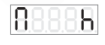

2020-06　　　　　　　　　　　　　　　　-13-　　　　　　　　　　　　　　　　SDUC20USMSCN_1.01

### 第 22 页

智能数字超声波焊接控制器　　　　　　　　　　　　　　　　　　　　SDUC20-U系列

---

## 4.2 定时触发模式

**定时触发模式设置：**

1、进入设置参数界面；

2、修改“工作模式”参数为定时模式：

**定时触发时间设置：**

1、进入设置参数界面；

2、修改“定时触发时间”参数为所需要的值，单位为秒。

## 4.3 定能量触发模式

**定能量触发模式设置：**

1、进入设置参数界面；

2、修改“工作模式”参数为定能量模式：

**定能量触发时间设置：**

1、进入设置参数界面；

2、修改“设置能量”参数为所需要的值，单位为焦耳。

---

2020-06　　　　　　　　　　　　　　　　　-14-　　　　　　　　　　　　　　　　　SDUC20USMSCN_1.01

### 第 23 页

智能数字超声波焊接控制器　　　　　　　　　　　　　　　　　　　　　　　　　SDUC20-U系列

---

## 4.4 工作模式相关参数说明

**输出电压 U**

设定控制器的输出电压有效值。

**最大输出电流 C**

该参数限定了正常工作过程中，控制器的最大输出电流，当输出电流超过该值时，控制器会报Err02错误，并停止输出。

**频率积分 FI**

该参数是调节控制器在正常工作过程中输出频率与负载的谐振频率的静态误差大小，但该值越大会导致输出频率震荡。

**频率比例 FP**

该参数是加快控制器的输出频率跟踪到负载的谐振频率的速度，但该值越大会导致输出频率有较大的过冲。

**振幅积分 AI**

该参数是调节控制器在正常工作过程中设定输出电压与实际输出电压的静态误差大小，但该值越大会导致输出电压震荡。

**振幅比例 AP**

该参数是加快控制器的输出电压达到设定输出电压的速度，但该值越大会导致输出电压有较大的过冲。

---

2020-06　　　　　　　　　　　　　　　　　-15-　　　　　　　　　　　　SDUC20USMSCN_1.01

### 第 24 页

## 第五章 端口功能详细说明

### 5.1 输入端口C

开关量输入端口C可配合各类开关传感器，如接近开关传感器、光电传感器、光纤传感器及PLC等，实现触发控制器启动或停止输出的外部控制功能。

开关量输入端口C与各类开关传感器及PLC的连接示例见附录E。

#### 5.1.1 内部电路简图

输入端口C内部电路简图

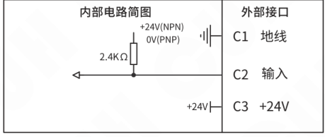

#### 5.1.2 使用方法

本接口可以和大多数开关量信号和传感器相连。与接近开关传感器的接线方式如下图：

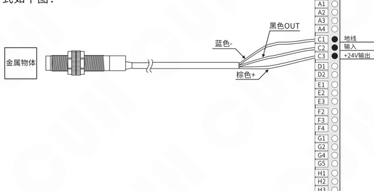

其它开关传感器及PLC的连接请查看附录E。

### 第 25 页

### 5.1.3 信号流框图

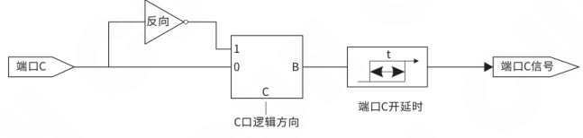

### 5.1.4 相关参数说明

输入端口C的相关参数都在设置参数界面中。

**“C口开延时”参数：**

从施加一个使控制器进入运行状态的信号开始，到此信号被控制器视为有效，期间经历的延迟时间称为开延时。

当使用端口C信号进行触发输出控制时，大多数情况需要在收到信号后延迟一段时间才执行操作，以确保信号是稳定有效的。对于这样的应用，可以通过设置开延时来实现。

**“C口逻辑方向”参数：**

此逻辑方向参数用以切换端口C的逻辑，出厂默认状态为“常通”，当端口C没有输入信号时，C口信号为有效，当端口C有输入信号时，C口信号为无效。

当修改“C口逻辑方向”参数值为“常断”时，当端口C没有输入信号时，C口信号为无效，当端口C有输入信号时，C口信号为有效。

在出厂默认状态，且面板上 <kbd>⏻</kbd> 键状态为“开”，当端口C有输入信号时，控制器立即停止输出。

### 5.1.5 指示灯说明

前面板上的“信控”指示灯，表明C口的输入信号状态，当“信控”指示灯亮起（常亮）时表明C口有信号输入，如果灯灭表示无信号输入。

面板上的“信控”指示灯闪烁时，表示面板上的 <kbd>⏻</kbd> 的状态为关，如果灯灭表示状态为开。

### 第 26 页

智能数字超声波焊接控制器　　　　　　　　　　　　　　　　SDUC20-U系列

---

## 5.2 低压控制输出端口D

本控制器可以输出1路24V直流低电压控制信号，以同步其他设备协同工作，例如电磁阀、PLC等。

### 5.2.1 内部电路简图

端口D输出接口电路简图

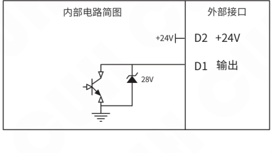

---

2020-06　　　　　　　　　　　　　-18-　　　　　　　　　　　　　SDUC20USMSCN_1.01

### 第 27 页

## 5.2.2 使用方法

端口D直流控制输出的使用方法

控制电磁阀工作的连接方法

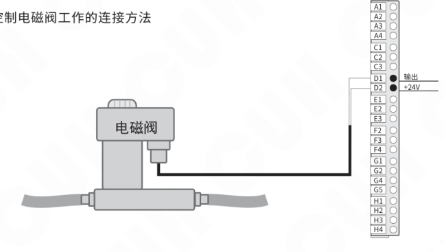

控制继电器工作的连接方法

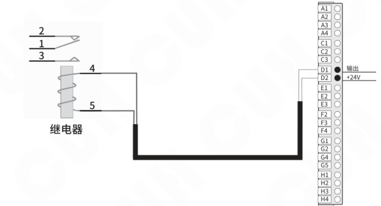

### 第 28 页

### 5.2.3 信号流框图

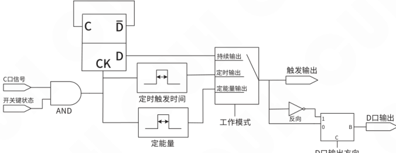

### 5.2.4 相关参数说明

端口D的相关参数都在设置参数界面中。

**“D口输出逻辑方向” 参数**

“D口输出逻辑方向” 参数说明端口D输出信号是否需要被翻转。

当参数值为“常通”时表明端口D输出信号不需要被翻转；

当参数值为“常断”时表明端口D输出信号需要被翻转，也就是当端口D输出信号为关闭端口D直流控制输出，翻转为开启端口D直流控制输出。

出厂默认设置下逻辑方向设置为“常通”，表示D口输出信号与触发输出状态一致（即控制器有输出时，D口有输出信号，否则无信号）。

### 5.2.5 指示灯说明

面板上的“输出”指示灯，表明控制器的输出状态。“输出”指示灯亮起，表明控制器有触发输出，否则无。

出厂默认设置下“D口逻辑方向”为“常通”，此时D口信号状态与控制器的输出状态一致，也与面板上的“输出”指示灯状态一致。

当“D口输出逻辑方向”为“常断”，此时D口信号状态与控制器的输出状态反向。面板上“输出”指示灯的状态也与D口信号状态反向。

### 第 29 页

## 5.3 远程遥控电压控制

控制器的远程电压控制功能，允许用户通过外接电位器或直流电压控制信号，控制控制器的输出电压。这样，用户可以通过电位器、PLC、DDS或其它一些设备方便容易地进行外部远程电压控制。

### 5.3.1 内部电路简图

输入端口C内部电路简图

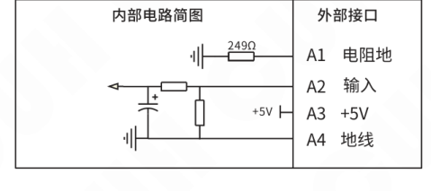

### 5.3.2 遥控信号电压范围

| 遥控信号类型 | 遥控信号电压范围 | 指示灯状态 | 控制器输出电压 |
|---|---|---|---|
| 模拟直流 输入电压 | 小于0.5V | “遥控”指示灯不亮 | 遥控电压信号无效 输出电压由参数“输出电压”设定值控制 |
|  | 0.5V~1V | “遥控”指示灯亮起 | 输出电压=0 |
|  | 1V~5V | “遥控”指示灯亮起 | 输出电压随遥控输入电压线性变化 输出电压=(遥控输入电压-1V)×遥控系数/4 |

### 第 30 页

### 5.3.3 相关参数说明

**“遥控系数” 参数**

“遥控系数”在遥控有效时，该参数用于限定远程遥控电压的最大值，在遥控无效时限定控制器的最大输出电压。

### 5.3.4 指示灯说明

当遥控信号的电压范围在0.5V~5V时，说明遥控信号有效，此时面板上“遥控”指示灯亮起。

## 5.4 恢复出厂默认设置

> 1、进入设置参数界面；
>
> 2、切换到恢复出厂设置参数，闪烁的 `88888`（数码管和LED灯全部闪烁）；
>
> 3、按下 `⊕`，当显示 `-----` 后再松开 `⊕`，控制器回到待机界面，即完成恢复出厂设置操作。

### 第 31 页

# 第六章 密码锁功能

用户可根据应用需求设置密码，锁定控制器的设置参数界面和搜频界面，以防止他人的误操作。

如果输入密码值和设置密码值不一致，用户将无法查看设置参数界面的其它参数以及不能进入搜频界面，用户只能进入待机界面和监控界面。

## 6.1 输入密码

在设置参数界面中第一个参数即“输入密码”参数，如下图

**输入密码的步骤：**

1、进入设置参数界面；

2、切换到“输入密码”参数，短按或者长按 ⊕ 或 ⊖，即可输入密码；

3、输入正确密码后即可使用 ▲ 或 ▼ 调出设置参数界面的其它参数，或者使用组合按键 ⚙ 和 ▲ 进入搜频界面。

注：出厂默认密码为0

## 6.2 设置密码

在设置参数界面中倒数第二个参数即“设置密码”参数，如下图

**设置密码的步骤：**

1、进入设置参数界面，显示“输入密码”参数；

2、出厂默认密码为0，所以不用修改该值；

3、短按或长按 ▼ 调出“设置密码”参数；

4、短按或长按 ⊕ 或 ⊖，即可设定密码。

5、请记住刚才设定的密码，因为一旦关机再开机，再要进入设置参数界面或者搜频界面，必须输入正确的密码，否则无法进入！！！

注：出厂默认“设置密码”参数值为0。

### 第 32 页

# 第七章 安全保护功能

### 电源输入过压保护功能

本控制器支持电源最大输入电压为250V交流有效值，超过该电压本控制器会关闭内部电源熄屏保护以防损坏内部器件。

### 短路保护功能

输出发生短路时，控制器会立即停止输出，同时显示Err01报警信息，直到控制器重新上电为止。

### 过流保护功能

本控制器可以在用户误操作造成输出电流超过额定电流时，停止输出，同时显示Err02报警信息，以保护本机及用户的设备。

### 过热保护功能

当控制器工作温度超过65℃将停止输出，以保护本机，同时显示Err03报警信息。当控制器温度下降到60℃以下时，本机恢复工作。

### 过压保护功能

当控制器输出电压超过“最大输出电压”设定值时，将显示Err04报警信息，并停止输出，以保护本机。

### 通信故障保护功能

此通信指控制器的内部通信过程，当控制器在工作过程中出现通信故障后，将显示Err05报警信息，并停止输出，以保护本机。

### 无负载保护功能

当控制器未接入负载，而用户尝试触发输出时，将显示Err06报警信息，并停止输出，以保护本机。

### 欠压报警功能

当控制器的实际输出电压达不到“输出电压”设定值时，面板上“饱和”指示灯亮起，以提醒用户输出电压不正常。

### 失谐报警功能

当控制器的实际输出频率在设定的“频率上限”和“频率下限”之间不能跟踪到谐振频率点时，面板上“失谐”指示灯亮起，以提醒用户输出频率不正常。

### 第 33 页

## 附录A：外形尺寸

**SDUC20-U系列外形尺寸（单位：mm）**

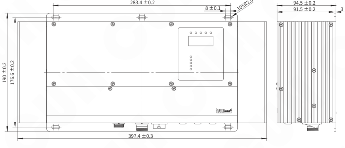

## 附录B：用户接口定义

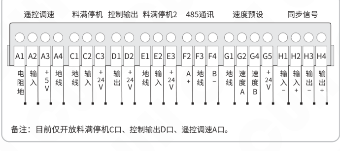

| 接口功能 | 端子 | 定义 |
|---|---|---|
| 遥控调速 | A1 | 电阻地 |
| 遥控调速 | A2 | 输入 |
| 遥控调速 | A3 | +5V |
| 遥控调速 | A4 | 地线 |
| 料满停机 | C1 | 地线 |
| 料满停机 | C2 | 输入 |
| 料满停机 | C3 | +24V |
| 控制输出 | D1 | 输出 |
| 控制输出 | D2 | +24V |
| 料满停机2 | E1 | 地线 |
| 料满停机2 | E2 | 输入 |
| 料满停机2 | E3 | +24V |
| 485通讯 | F2 | A+ |
| 485通讯 | F3 | 地线 |
| 485通讯 | F4 | B- |
| 速度预设 | G1 | 地线 |
| 速度预设 | G2 | 速度A |
| 速度预设 | G4 | 速度B |
| 速度预设 | G5 | +24V |
| 同步信号 | H1 | 输入+ |
| 同步信号 | H2 | 输入- |
| 同步信号 | H3 | 输出- |
| 同步信号 | H4 | 输出+ |

**备注：** 目前仅开放料满停机C口、控制输出D口、遥控调速A口。

### 第 34 页

智能数字超声波焊接控制器　　SDUC20-U系列

## 附录C：技术规格

| 项目 | 最小值 | 典型值 | 最大值 | 单位 | 备注 |
|---|---:|---:|---:|---|---|
| 交流输入电压 | 85 | 220 | 250 | 伏特（V） | 50/60 Hz 交流有效值 |
| 输出电压范围 | 0 | —— | 1500 2000 | 伏特（V） | SDUC20-US SDUC20-UM |
| 输出电流范围 | 0 | —— | 1.5 3.0 | 安培（A） | SDUC20-US SDUC20-UM |
| 持续输出功率 | 0 | —— | 1000 | 瓦特（W） | 环境温度25℃ |
| 强制散热输出功率 | 0 | —— | 1500 | 瓦特（W） |  |
| 峰值输出功率 | 0 | —— | 2250 6000 | 伏安（VA） | SDUC20-US SDUC20-UM |
| 输出频率范围 | 14000 | 20000 | 25000 | 赫兹（Hz） |  |
| 频率调整精度 |  | 1 |  | 赫兹（Hz） |  |
| 输出波形 |  | 正弦 |  |  |  |
| 开延时时间 | 0 | 0 | 10.00 | 秒（s） |  |
| 脉冲输出时间 | 0 | 0.5 | 10.00 | 秒（s） |  |
| 控制输出电流 | 0 | —— | 200 | 毫安（mA） |  |
| 控制输出电压 | 22 | 24 | 26 | 伏特（V） |  |
| 空载功耗 |  | 5 |  | 瓦特（W） |  |
| 负载类型 |  | 超声压电换能器 |  |  |  |
| 显示方式 |  | 5 |  | 位 | LED数码管 |
| 工作环境温度 | 0 | 25 | 40 | 摄氏度（℃） |  |
| 工作环境湿度 | 10 | 60 | 85 | 相对湿度（%） | 不结露 |
| 存储环境温度 | -20 | 25 | 85 | 摄氏度（℃） |  |

2020-06　　SDUC20USMSCN_1.01

### 第 35 页

智能数字超声波焊接控制器　　　　　　　　　　　　　　　　SDUC20-U系列

---

## 附录D：常见故障现象及排除方法

以下一些方法可以帮助您排除使用中可能会遇到的简单问题。

| 故障代码 | 数码管符号图片 | 含义 | 排除方法 |
|---|---|---|---|
| Err01 |  | 短路保护 | 排除输出存在的短路情况； 每次启动输出均出现该故障，联络本公司技术支持。 |
| Err02 |  | 过流保护 | 调小输出电压。 |
| Err03 |  | 过热保护 | 将控制器安装在通风良好的环境中。 |
| Err04 |  | 过压保护 | 调小输出电压并确保负载可靠连接。 |
| Err05 |  | 无通信 | 联络本公司技术支持。 |
| Err06 |  | 无负载 | 确保负载可靠连接。 |
| Err07 |  | 输出变压器偏磁 | 重启控制器输出。 |
| Err08 |  | 功率板自检错误 | 联络本公司技术支持。 |

---

2020-06　　　　　　　　　　　　-27-　　　　　　　　　　　　SDUC20USMSCN_1.01

### 第 36 页

智能数字超声波焊接控制器  
SDUC20-U系列

## 附录E：开关量输入端口与各类开关传感器及PLC的连接示例

### 对射NPN传感器接线方式

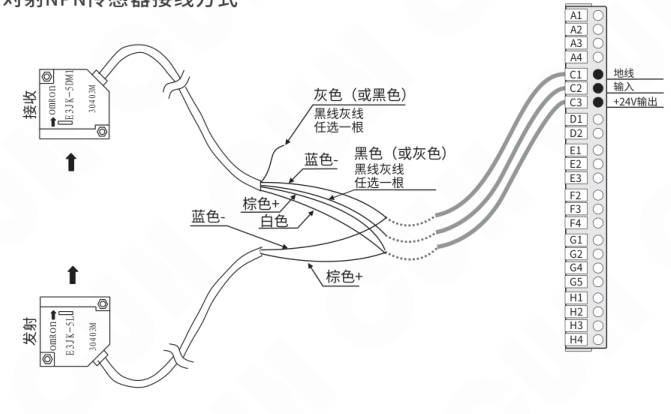

### 对射光电传感器接线方式

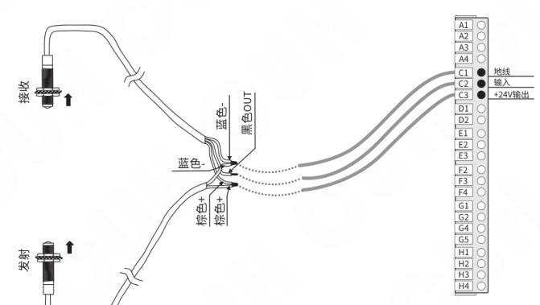

---

2020-06　　-28-　　SDUC20USMSCN_1.01

### 第 37 页

智能数字超声波焊接控制器  
SDUC20-U系列

## 对射式光纤传感器接线方式

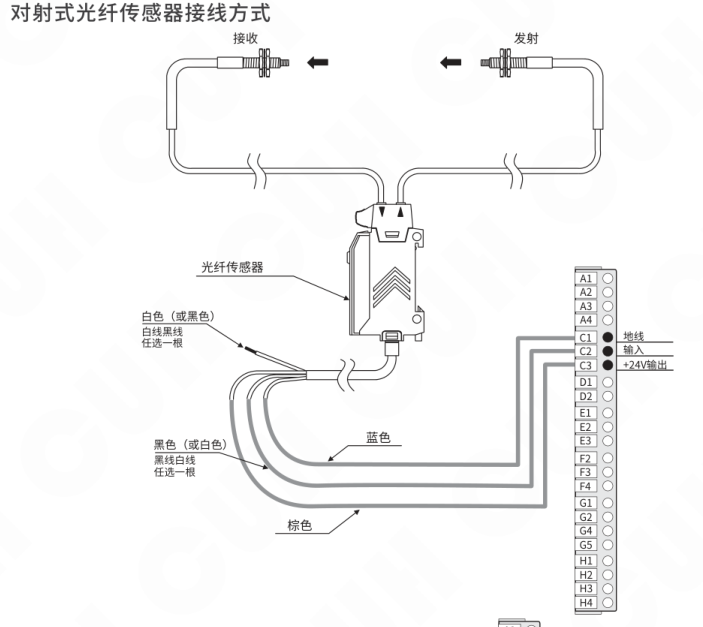

## 反射光电传感器接线方式

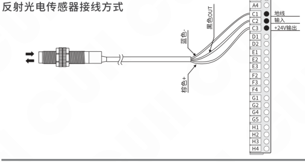

2020-06  
SDUC20USMSCN_1.01

### 第 38 页

智能数字超声波焊接控制器　　　　　　　　　　　　　　　　　　　　SDUC20-U系列

---

## PLC的NPN输出接线方式

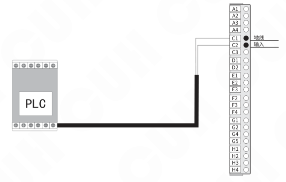

## PLC的PNP输出接线方式

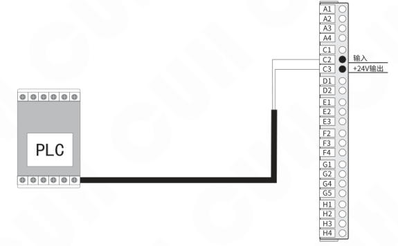

可以使用PLC的继电器输出，也可以使用PLC的NPN或PNP输出。

**注意：** 使用PLC控制信号进行控制器启动和停止控制时，输入信号电压≤24V。

---

2020-06　　　　　　　　　　-30-　　　　　　　　　　SDUC20USMSCN_1.01

### 第 39 页

智能数字超声波焊接控制器　　　　　　　　　　　　　　　　　　　　　SDUC20-U系列

## 附录F：参数汇总表

### 各界面汇总

| 界面名称 | 界面说明 |
|---|---|
| 待机界面 | 开机后正常工作界面 |
| 监控界面 | 查看实时功率、电压、电流等数据 |
| 设置参数界面 | 设置控制器的工作模式、工作条件等参数 |
| 搜频界面 | 设置搜频各项参数，发起搜频 |

### 参数详细说明

| 类别 | 含义 | 参数符号（文字转写） | 数码管符号图片 | 取值范围 | 默认设置 |
|---|---|---|---|---|---|
| 待机参数 | 输出功率 | * 读【P】 | 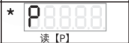 | 0~6000 瓦特（W） |  |
| 待机参数 | 输出电流 | * 读【大C】 | 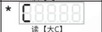 | 0.00~3.00 安培（A） |  |
| 待机参数 | 输出频率 | * | 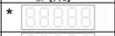 | 14000~25000 赫兹（Hz） |  |
| 待机参数 | *输出时间* | * 读【小L】 | 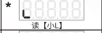 | *0.00~1.00秒（s）* |  |
| 待机参数 | 输出能量 | * 读【小J】 | 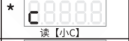 | 0~9999 焦耳（J） |  |
| 待机参数 | 有功电阻 | * 读【小R】 | 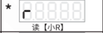 | 0~9999 欧姆（Ω） |  |
| 待机参数 | 输出电压 | 读【大U】 |  | 0~2000 伏特（V） | 500 |
| 待机参数 | 实测输出电压 | * 读【U点】 |  | 0~2000 伏特（V） |  |
| 待机参数 | 输出有功电压 | * 读【小U点】 | 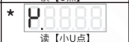 | 0~2000 伏特（V） |  |
| 搜频参数 | 自动搜频频率 | * 读【F】 | 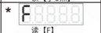 | 14.00~25.00 千赫兹（KHz） |  |
| 搜频参数 | 自动搜频电压 | 读【小D】 | 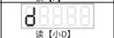 | 0~2000 伏特（V） | 300 |
| 搜频参数 | 阻抗阈值 | 读【小N】 | 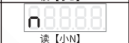 | 1~9999 欧姆（Ω） | 700 |
| 搜频参数 | 频率上限 | 读【U上】 | 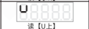 | 14.00~25.00 千赫兹（KHz） | 25.00 |
| 搜频参数 | 频率下限 | 读【U下】 | 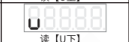 | 14.00~25.00 千赫兹（KHz） | 14.00 |
| 设置参数 | 输入密码 | 读【反F】 | 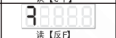 | 0~9999 | 0 |
| 设置参数 | 工作模式 | 读【大N】 | 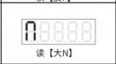 | 持续输出 定时模式 定能量模式 自动触发定时模式 自动触发定能量模式 | 持续输出 |

2020-06　　　　　　　　　　　　　　　　-31-　　　　　　　　　　　　　　　　SDUC20USMSCN_1.01

### 第 40 页

| 类别 | 含义 | 参数符号（读法） | 数码管符号图片 | 取值范围 | 默认设置 |
|---|---|---|---|---|---|
| 设置参数 | 定时触发时间 | t（读【t】） | 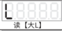 | 0.00~10.00秒（s） | 0.50 |
| 设置参数 | 设置能量 | E（读【E】） | 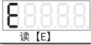 | 0~9999 焦耳（J） | 100 |
| 设置参数 | C口开延时 | 反L（读【反L】） | 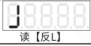 | 0.0~10.0秒（s） | 0.0 |
| 设置参数 | C口逻辑方向 | C1（读【C1】） | 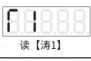 | C1----：常通 C1---：常断 | 常通 |
| 设置参数 | D口输出逻辑方向 | C3（读【C3】） | 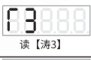 | C3----：常通 C3---：常断 | 常通 |
| 设置参数 | _电流报警容差_ | n（读【万】） |  | _0.1~10.0 安培（A）_ | _0.2_ |
| 设置参数 | _自动触发灵敏度_ | H（读【大H】） |  | _-100~0_ | _0_ |
| 设置参数 | _相位差_ | u（读【小U】） |  | _-180~180 度（°）_ | _0_ |
| 设置参数 | 频率上限 | * |  | 14.00~25.00 千赫兹（KHz） |  |
| 设置参数 | 频率比例 | FP（读【FP】） |  | 0~999 | 10 |
| 设置参数 | 频率积分 | FI（读【FI】） |  | 0~999 | 0 |
| 设置参数 | 振幅比例 | AP（读【AP】） |  | 0~999 | 100 |
| 设置参数 | 振幅积分 | AI（读【AI】） |  | 0~999 | 1 |
| 设置参数 | 最大输出电流 | C（读【下拐】） |  | 0.00~1.50 安培（A） 0.00~3.00 安培（A） | 1.00（SDUC20-US） 2.00（SDUC20-UM） |
| 设置参数 | 遥控系数（电压） | r（读【横T】） |  | 100~1500 100~2000 | 1000（SDUC20-US） 1500（SDUC20-UM） |
| 设置参数 | 控制板版本 | * Ur（读【UR】） |  |  |  |
| 设置参数 | 功率板版本 | * U.r（读【U点R】） |  |  |  |
| 设置参数 | 设置密码 | P（读【反F点】） |  | 0~9999 | 0 |
| 设置参数 | 恢复出厂设置 | 8888（读【全8】） |  | —— | —— |

备注：* 标的参数仅用于显示控制器工作状态，不可调节。  
_斜体字参数待开发。_

### 第 41 页

智能数字超声波焊接控制器　　　　　　　　　　　　　　　　　SDUC20-U系列

---

## 附录G：参考标准

### 参考标准

| 序号 | 参考标准 |
|---|---|
| 1 | T/GDMES 0015-2020 超声波焊接设备 口罩机用焊接机，A.1 |
| 2 | T/GDMES 0016-2020 超声波焊接设备 热塑性织物用焊接机，A.1 |

### 极限参数

**极限参数：超过此指标将会造成严重损坏，必须严格遵守！**

| 项目 | GB标准 | IEC标准 | 标准要求 | 我司产品 达到级别 | 备注说明 |
|---|---|---|---|---|---|
| 静电放电 | GB/T 17626.2-2006 | IEC 61000-4-2:2001 | 4KV | ±8KV | 接触放电 |
| 静电放电 | GB/T 17626.2-2006 | IEC 61000-4-2:2001 | 8KV | ±15KV | 空气放电 |
| 电快速瞬变 脉冲群 | GB/T 17626.4-2008 | IEC 61000-4-4:2004 | 2KV | ±4KV |  |
| 雷击浪涌 | GB/T 17626.5-2008 | IEC 61000-4-5:2005 | 1KV | ±4KV | 线对线耦合 |
| 雷击浪涌 | GB/T 17626.5-2008 | IEC 61000-4-5:2005 | 2KV | ±2KV | 线对地耦合 |

---

2020-06　　　　　　　　　　　　　　　　　-33-　　　　　　　　　　　　　　　　　SDUC20USMSCN_1.01

### 第 42 页

智能数字超声波焊接控制器　　　　　　　　　　　　　　　　SDUC20-U系列

---

---

2020-06　　　　　　　　　　　　　　　　　　　　　　　　　SDUC20USMSCN_1.01

### 第 43 页

数字调压振动送料控制器

| 品名规格 | 特点 | 特点 |
|---|---|---|
| SDVC10、11 数字稳压振动送料控制器系列  | 输入电压范围：150V～260V | 输出电压范围：35V～250V |
|  | 输出电流：0～4A | 输出功率：880VA |
|  | 电源频率范围：40～70Hz |  |
|  | · 自动稳压 · 最大输出比例调节 · 短路保护功能 | · 缓启动 · 线性调节规律 · 过热保护功能 |
| SDVC20、22 智能数字稳压振动送料控制器系列  | 输入电压范围：85V～440V | 输出电压范围：35V～380V |
|  | 输出电流：0～10A | 输出功率：3800VA |
|  | 电源频率范围：40～70Hz |  |
|  | · 自动稳压 · 缓启动时间设置 · 双控制信号输入 · 料满停机 · 线控调速 · 过热保护功能 | · 缓启动 · 信号控制开关 · 输出电压预置功能 · 智能光电传感 · 控制输出 · 过流保护功能 |

### 第 44 页

南京创优科技有限责任公司  
网址:www.cuhnj.com  
电话:025-84730416  
传真:025-84730426  
邮箱:sales@cuhnj.com  
地址:南京市江宁区智能路9号  
启迪城学研园2幢
<!-- /auto:ai-body-draft v1 -->

<!-- auto:data-params-summary v1 -->
## 附录 · 参数表（结构化侧车·机器生成）

> 说明：本节由 `data/<doc_key>/params/params.yaml` 自动渲染（展示前若干行），用于校对与二次开发。定稿以层 C 数据为准。

| 参数 | 标志/符号 | 范围 | 默认 | 单位 | 备注 |
| --- | --- | --- | --- | --- | --- |
|      品名规格 |  |  |  |  |  |
| H CU   C   SDVC34 智能数字自动调频振动送料控制器系列 |  |  |  |  |  |
|   CUH UH SDVC31 数字调频振动送料控制器系列 |  |  |  |  |  |
| U CUH   SDVC40S系列 压电数字调频振动送料控制器系列 |  |  |  |  |  |
| U   模拟直流 输入电压 |  |    小于0.5V  |  |  |  |
| U   模拟直流 输入电压 |  |    0.5V~1V  |  |  |  |
| U   模拟直流 输入电压 |  |    1V~5V  |  |  |  |
|      项目 |  |  |  |  |  |
|      交流输入电压 |  |  |  |  |  |
|      输出电压范围 |  |  |  |  |  |
|      输出电压范围 |  |  |  |  |  |
|        输出电流范围 |  |  |  |  |  |
|        输出电流范围 |  |  |  |  |  |
|        持续输出功率 |  |  |  |  |  |
|        强制散热输出功率 |  |  |  |  |  |
|        峰值输出功率 |  |  |  |  |  |
|        峰值输出功率 |  |  |  |  |  |
|      输出频率范围 |  |  |  |  |  |
|      频率调整精度 |  |  |  |  |  |
|      输出波形 |  |  |  |  |  |
|      开延时时间 |  |  |  |  |  |
|      脉冲输出时间 |  |  |  |  |  |
|      控制输出电流 |  |  |  |  |  |
|    控制输出电压 |  |  |  |  |  |
|    空载功耗 |  |  |  |  |  |
|    负载类型 |  |  |  |  |  |
|    显示方式 |  |  |  |  |  |
|    工作环境温度 |  |  |  |  |  |
|    工作环境湿度 |  |  |  |  |  |
|     |     |  |  |  |  |

*（仅展示前 30 条，共 87 条；完整数据见下方链接。）*

- 完整 YAML：`data/cuh.sdvc.manual.v1.01/params/params.yaml`
- 表格索引：`data/cuh.sdvc.manual.v1.01/index.yaml`
<!-- /auto:data-params-summary v1 -->
