## 目录

> 下列条目来自 PDF 内置书签/大纲；链接指向本批转换生成的整页渲染图（`assets/pages/`），便于与原版 PDF 对照校对。

- [1: 封面](assets/pages/page-0001.png)（第 1 页）
- [3: 序言](assets/pages/page-0003.png)（第 3 页）
- [4: 注意事项](assets/pages/page-0004.png)（第 4 页）
- [5: 工作与储存环境](assets/pages/page-0005.png)（第 5 页）
- [6: 目录](assets/pages/page-0006.png)（第 6 页）
- [第一章 性能特点](assets/pages/page-0007.png)（第 7 页）
- [第二章 安装指南](assets/pages/page-0009.png)（第 9 页）
- [第三章 部件说明](assets/pages/page-0011.png)（第 11 页）
- [第四章 基本操作](assets/pages/page-0013.png)（第 13 页）
- [4.1 输出电压设定](assets/pages/page-0013.png)（第 13 页）
- [4.2 输出频率设定](assets/pages/page-0014.png)（第 14 页）
- [4.3 缓启动功能](assets/pages/page-0015.png)（第 15 页）
- [4.4 输出开关](assets/pages/page-0015.png)（第 15 页）
- [4.5 最大输出电压限制功能](assets/pages/page-0016.png)（第 16 页）
- [4.6 恢复出厂设置](assets/pages/page-0017.png)（第 17 页）
- [第五章 传感器与信号控制](assets/pages/page-0018.png)（第 18 页）
- [5.1 智能光电传感器的使用方法](assets/pages/page-0018.png)（第 18 页）
- [5.2 开关传感器的使用方法](assets/pages/page-0021.png)（第 21 页）
- [5.3 第二个开关传感器的使用方法](assets/pages/page-0024.png)（第 24 页）
- [5.4 控制信号逻辑关系设定](assets/pages/page-0027.png)（第 27 页）
- [5.5 控制输出](assets/pages/page-0028.png)（第 28 页）
- [5.6 远程速度控制](assets/pages/page-0031.png)（第 31 页）
- [5.7 速度档位开关](assets/pages/page-0032.png)（第 32 页）
- [5.8 主控输出分离参数](assets/pages/page-0033.png)（第 33 页）
- [第六章 安全保护功能](assets/pages/page-0034.png)（第 34 页）
- [附录A：外形尺寸](assets/pages/page-0035.png)（第 35 页）
- [附录B：输出接口定义](assets/pages/page-0038.png)（第 38 页）
- [附录C：信号接口定义](assets/pages/page-0038.png)（第 38 页）
- [附录D：功能状态对照表](assets/pages/page-0040.png)（第 40 页）
- [附录E：电气特性](assets/pages/page-0041.png)（第 41 页）
- [附录F：错误信息指示和故障排除](assets/pages/page-0042.png)（第 42 页）
- [未标题](assets/pages/page-0006.png)（第 6 页）
- [警告信息](assets/pages/page-0001.png)（第 1 页）
- [空白页面](assets/pages/page-0039.png)（第 39 页）
## 术语与命名

- 侧车：`glossary/terms.yaml`（机读）、`glossary/zh-CN.md`（人读）；候选表，定稿后并入公司级 `glossary/`。

## 适用范围

- 本文档由 PDF 自动转换生成，正文与插图需人工核对。

## 变更记录

- 2026-06-04 12:18:47：由转换工具从源 PDF 生成首版。

## 正文

<!-- auto:ai-body-draft v1 -->
> 以下为**整页视觉转写**的正文草稿（多模态模型直接输出 Markdown，含 GFM 表； 若配置 `[[vcrop:页:序]]` 占位符，裁剪步骤会插入 `assets/images/` 下 PNG）。**请务必人工校对。**

### 第 1 页

# CUH®

# 数字**稳压**振动送料控制器

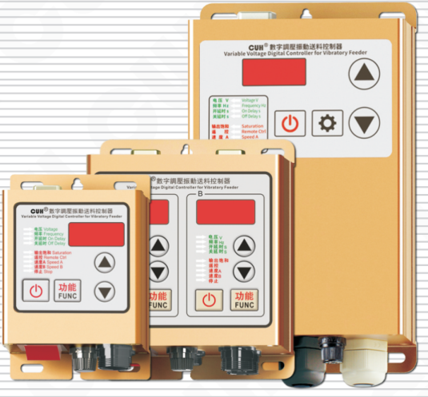

SDVC20S、SDVC20L—智能数字调压振动送料控制器  
SDVC22S—智能数字双调压振动送料控制器

# 用户手册

### 第 2 页

## 智能数字振动送料控制器相关产品

| 品名规格 | 特　点 |  |
|---|---|---|
| **SDVC34** 智能数字自动调频振动送料控制器系列 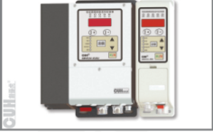 | · 频率调节 · 智能跟踪 · 料满停机 · 控制输出 · 最大输出限定 · 恢复出厂设置 · 过流保护功能 · 加速功能 | · 电压调节 · 计数功能 · 线控调速 · Rs485通信 · 波形指数设置 · 过热保护功能 · 短路保护功能 |
| **SDVC31** 数字调频振动送料控制器系列 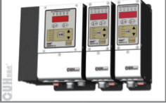 | · 自动稳压 · 缓启动时间设置 · 智能光电传感 · 控制输出 · 最大输出限定 · 恢复出厂设置 · 过流保护功能 | · 缓启动 · 加速功能 · 线控调速 · 键盘锁定 · 波形指数设置 · 过热保护功能 · 短路保护功能 |

## 压电数字调频振动送料控制器

| 品名规格 | 特　点 |  |
|---|---|---|
| **SDVC40** 压电数字调频振动送料控制器系列 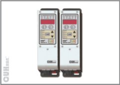 | · 自动稳压 · 缓启动时间设置 · 线控调速 · 键盘锁定 · 波形指数设置 · 过热保护功能 · 短路保护功能 | · 缓启动 · 智能光电传感 · 控制输出 · 最大输出限定 · 恢复出厂设置 · 过流保护功能 |

### 第 3 页

**智能数字稳压振动送料控制器**　　　　　　　　　　　　　　　　　　　　　　　　　**SDVC20系列**

---

## 序　言

感谢您选用我公司出品的**CUH**系列数字振动送料控制器（本手册以下简称控制器）。

本手册提供给使用者安装调试、参数设定、异常诊断、故障排除及日常维护的相关注意事项。为了确保能够正确地安装及操作本控制器，请在装机之前，详细阅读本使用手册，并请妥善保存。

### **本说明书适合以下型号控制器：**

◆ 数字调压振动送料控制器—SDVC20－S（5A输出电流）

◆ 数字调压振动送料控制器—SDVC20－L（10A输出电流）

◆ 数字调压振动送料控制器—SDVC22－S双控（5A输出电流）

---

2025-08　　　　　　　　　　　　　　　　　　　　　　　　　SDVC20SMSCN_6.01

### 第 4 页

**智能数字稳压振动送料控制器** | **SDVC20系列**

---

### 以下为特别需要注意的事项：

1、任何情况下都不可以在带电状态下拔插接线或试图触摸插座内各接点，以防触电和发生意外。

2、切不可将SDVC20S、SDVC22S连接到380V交流电，这将造成本机不可恢复的严重损坏！（如需工作在380V电压下，请选购380V系列产品。）

3、请避免采用通过继电器等设备切断供电的方式来控制本控制器的输出，这会严重降低控制器寿命。

4、本机设计使用于阴凉干燥环境，请不要在室外、可能会浸水、阳光曝晒场所工作，也不要在超过电气特性要求的温度范围之外工作。

5、注意：任何情况下请勿将本控制器在超越设计极限状态下工作。

6、请严格按照本使用说明操作，对于不按照本操作说明所造成的任何设备或人身伤害，本公司不承担任何民事和刑事责任。

> ☺ **任何情况下都请不要打开本机机壳，以防遭电击。如本机出现故障请致电本公司，我们将尽快协助排除故障。**  
> **机壳内全部为固态电路，没有可以调节部件和用户可以维修部分，请不要试图维修本机。**

---

2025-08 | SDVC20SMSCN_6.01

### 第 5 页

**智能数字稳压振动送料控制器**　　　　　　　　　　　　　　　　**SDVC20系列**

---

# 工作与储存环境

## 一、使用前的检查

每部控制器在出厂前，均经过严格的品质检验，并做强化的防撞包装处理。

客户在控制器拆箱后，请即刻进行下列检查。

- 检查控制器是否在运输过程中造成损伤。
- 检查控制器型号是否与订货登记资料完全相同。

## 二、工作环境

为使本控制器具有更好的使用效果和更长的使用寿命，在安装时请注意以下问题：

- ！ 良好的通风散热环境。
- ！ 远离水滴、蒸气、灰尘、特别是油性灰尘。
- ！ 无腐蚀、易燃性的气体、液体。
- ！ 无漂浮性的尘埃及金属微粒。
- ！ 坚固无振动。
- ！ 远离电磁噪声干扰。
- ！ 使用环境温度为0~40摄氏度。
- ！ 仅适用于海拔2000m以下地区安全使用。

---

2025-08　　　　　　　　　　　　　　　　　　　　　　　　　SDVC20SMSCN_6.01

### 第 6 页

智能数字稳压振动送料控制器　　　　　　　　　　　　　　　　　　　　　　　　　SDVC20系列

# 目　录

- 第一章　性能特点 …… 1
- 第二章　安装指南 …… 3
- 第三章　部件说明 …… 5
- 第四章　基本操作 …… 7
  - 4.1　输出电压设定 …… 7
  - 4.2　输出频率设定 …… 8
  - 4.3　缓启动功能 …… 9
  - 4.4　输出开关 …… 9
  - 4.5　最大输出电压限制功能 * …… 10
  - 4.6　恢复出厂设置 * …… 11
- 第五章　传感器与信号控制 …… 12
  - 5.1　智能光电传感器的使用方法 …… 12
  - 5.2　开关传感器的使用方法 …… 15
  - 5.3　第二个开关传感器的使用方法 …… 18
  - 5.4　控制信号逻辑关系设定 * …… 21
  - 5.5　控制输出 …… 22
  - 5.6　远程速度控制（线控调速功能）* …… 25
  - 5.7　速度档位开关 * …… 26
  - 5.8　主控输出分离参数 * …… 27
- 第六章　安全保护功能 …… 28
  - 6.1　稳压功能 …… 28
  - 6.2　短路保护功能 …… 28
  - 6.3　过流保护功能 …… 28
  - 6.4　过热保护功能 …… 28

## 附　录

- 附录A：外形尺寸 …… 29
- 附录B：输出接口定义 …… 32
- 附录C：信号接口定义 …… 33
- 附录D：功能状态对照表 …… 34
- 附录E：电气特性 …… 35
- 附录F：错误信息指示和故障排除 …… 36

**备注：带*符号的功能为高级功能，此功能请在专业电气工程师的指导下操作**

2025-08　　　　　　　　　　　　　　　　　　　　　　　　　SDVC20SMSCN_6.01

### 第 7 页

智能数字稳压振动送料控制器  
SDVC20系列

---

# 第一章 性能特点

本控制器专为自动化设备中振动送料控制用，融合最新电子技术，经过精心设计，为用户提供最方便实用的功能，包括：

**自动稳压：** 内置数字稳压功能，可以消除由于电源电压波动造成的送料速度变化。

**缓启动：** 在启动时，输出电压会从零开始逐渐增大到预设电压。这个功能使得用户可以使振动器柔和地开始工作，这有助于防止工件掉落，同时有效地消除了开机冲击对振动盘造成的损坏。

**可调缓启动：** 缓启动时间可以由数字精确设定。

**开关信号控制（远程开关）：** 本机具有抗干扰的开关信号控制，可以通过外部开关信号控制本机的启闭。

**同时支持三个传感器控制信号输入：** 料空和料满双控制信号输入，支持同时连接3个传感器，并具有逻辑与、或、非、异或等全部控制关系。

**输出电压预置功能（远程速度选择）：** 可以通过外部控制信号直接选择多达4种预先设置的输出电压。

**料满停机：** 通过NPN型传感器实现料满停机控制，并具有可调缓启动时间、开延迟、关延迟、逻辑方向调节等控制功能。

**智能光电传感：** 通过自适应的智能光电对射传感器实现料满或料空停机控制，且具有可调缓启动时间、开延迟、关延迟、逻辑方向调节等控制功能。

**线控调速（远程速度控制）：** 可以直接使用外置的电位器、PLC提供的4~20mA电流或1~5V电压信号控制输出电压。

**控制输出：** 通过晶体管输出控制信号，可直接用于控制电磁阀等外部设备与本控制器协调工作。

---

2025-08　　　- 1 -　　　SDVC20SMSCN_6.01

### 第 8 页

**智能数字稳压振动送料控制器**　　　　　　　　　　　　　　　　**SDVC20系列**

---

本公司对产品质量有着一贯的追求，除在生产阶段采用高品质元器件，严密的质检体系保障外，为了最大程度地提高产品的可用性，对于用户使用中可能发生的意外问题也做了充分的准备，其中包括：

**短路保护：** 本控制器可以在用户误操作造成短路时停止输出，以保护本机及用户的设备。

**过流保护：** 本控制器可以在用户误操作造成输出电流超过额定电流时短暂停止输出，以保护本机及用户的设备。

**过热保护：** 本控制器工作温度超过65°C时将停止输出，以保护本机。

**为**保持产品质量的国际化标准，本公司产品遵守CE认证标准。

---

2025-08　　　　　　　　　　　　　- 2 -　　　　　　　　　　　　　SDVC20SMSCN_6.01

### 第 9 页

智能数字稳压振动送料控制器　　　　　　　　　　　　　　　　　SDVC20系列

---

## 第二章 安装指南

**第一步：** 打开控制器的外包装，取出控制器，使用随机附送的“输出航空插头”连接控制器与振动盘的电磁线圈。取出配件包里的输出线，把航空插头接在控制器的航空插座上。

航空插头端子示意：

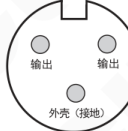

SDVC20系列单控控制器安装示意图：

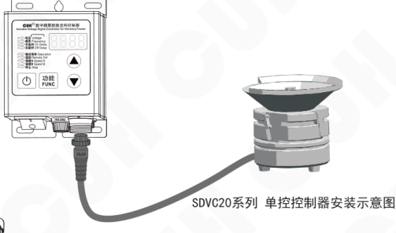

SDVC22S 双控控制器安装示意图：

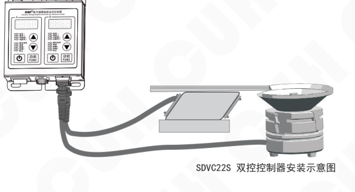

SDVC20-L输出线的端子定义参考附录B。

---

☻ **请注意：**

一定要确认电磁铁线圈接在两个输出引脚上，外壳需要可靠接地。否则机壳可能带电并发生严重安全事故！！！

---

2025-08　　　　　　　　　　　　　　　- 3 -　　　　　　　　　　　　　　　SDVC20SMSCN_6.01

### 第 10 页

智能数字稳压振动送料控制器　　　　　　　　　　　　　　　　　　　　　　　　　SDVC20系列

**第二步：** 将输入电源线航空插头插到控制器上，并锁紧螺母。

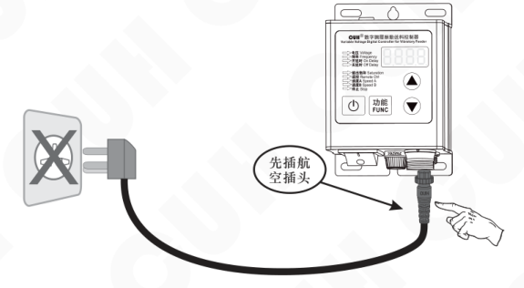

SDVC20-L电源线的端子定义参考附录B。

**第三步：** 将电源线三爪插头插在供电电源插座上。

---

2025-08　　　　　　　　　　　　　- 4 -　　　　　　　　　　　　　SDVC20SMSCN_6.01

### 第 11 页

智能数字稳压振动送料控制器　　　　　　　　　　　　　　　　　　　　　　　　　SDVC20系列

## 第三章 部件说明

本机面板共有四个可供用户操作的按键，它们分别是调整状态的“功能”键，增加设定值的“▲”键，降低设定值的“▼”键及输出“开/关”键。

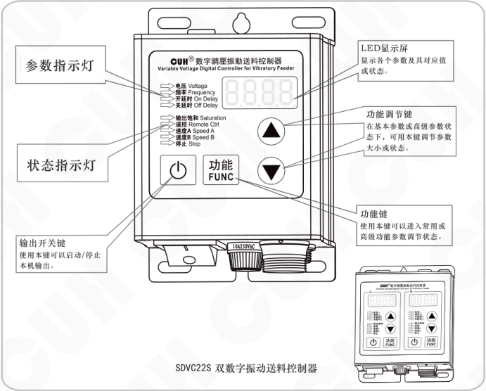

**SDVC22S 双数字振动送料控制器**

图中部件标注：

- 参数指示灯
- 状态指示灯
- 输出开关键：使用本键可以启动/停止本机输出。
- LED显示屏：显示各个参数及其对应值或状态。
- 功能调节键：在基本参数或高级参数状态下，可用本键调节参数大小或状态。
- 功能键：使用本键可以进入常用或高级功能参数调节状态。

指示灯点亮，含义如下：

| 指示灯 | 含义 |
|---|---|
| 电压 Voltage | 电压调节状态（参见：第7页） |
| 频率 Frequency | 频率调节状态（参见：第8页） |
| 开延时 On Delay | 开延时调节状态（参见：第13页） |
| 关延时 Off Delay | 关延时调节状态（参见：第13页） |
| 输出饱和 Saturation | 设定输出电压过高或过低，致使控制器不能达到（参见：第7页） |
| 遥控 Remote Ctrl | 外部速度控制信号有效 |
| 速度A Speed A | 速度A控制信号有效（参见：第26页） |
| 速度B Speed B | 速度B控制信号有效（参见：第26页） |
| 停止 Stop | 控制器输出被关闭（参见：第9页） |

2025-08　　　　　　　　　　　　　　- 5 -　　　　　　　　　　　　　　SDVC20SMSCN_6.01

### 第 12 页

**智能数字稳压振动送料控制器**　　　　　　　　　　　　　　　　　　　　　　　　　**SDVC20系列**

---

## 外部部件说明

### SDVC20-S 数字稳压振动送料控制器外部部件说明

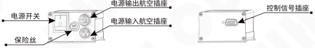

### SDVC22-S 双数字稳压振动送料控制器外部部件说明

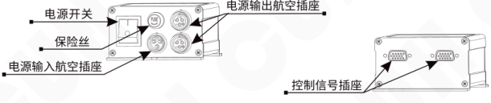

### SDVC20-L 数字稳压振动送料控制器外部部件说明

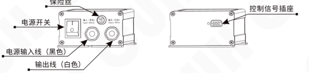

---

2025-08　　　　　　　　　　　　　　　　　- 6 -　　　　　　　　　　　　　　　　　SDVC20SMSCN_6.01

### 第 13 页

智能数字稳压振动送料控制器　　　　　　　　　　　　　　　　　SDVC20系列

# 第四章 基本操作

## 4.1 输出电压设定

本控制器可以直接在面板上以数字方式设定输出电压。由于本控制器特有的稳压功能，输出电压并不会受到输入电压的影响，即使在电压不稳定场合中使用也可以保持振动体稳定工作。同时，直接的电压数值设定也为用户了解设备运行情况提供了准确的数据。

- ▶▶ 打开控制器的电源开关。
- ▶▶ 使用控制面板上的“功能”键切换到电压调整“H”状态，这时电压指示灯点亮。
- ▶▶ 通过“▲”和“▼”可以对电压“H”值进行调整。

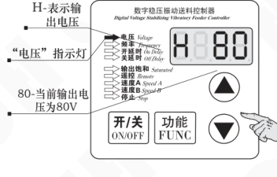

图中标注：H-表示输出电压；“电压”指示灯；80-当前输出电压80V。

- ▶▶ 本控制器的输出电压不能超过输入电压。当设定的电压过于接近输入电压时，控制器将不能进行正常的稳压，此时，面板上饱和指示灯将点亮，表示稳压失效。
- ▶▶ 本控制器也不能输出过低的电压。当输出电压过低时，控制器将不能进行正常的稳压，此时，面板上的饱和指示灯也将点亮，表示稳压失效。

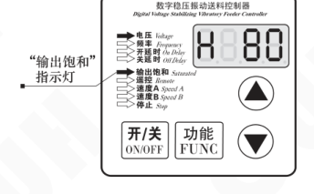

图中标注：“输出饱和”指示灯。

---

2025-08　　　　　　　　　　　　　　- 7 -　　　　　　　　　　　　　　SDVC20SMSCN_6.01

### 第 14 页

智能数字稳压振动送料控制器　　　　　　　　　　　　　　　　SDVC20系列

---

## 4.2 输出频率设定

本控制器可以选择输出电源频率（半波）或电源频率的二倍（全波）

- 使用控制面板上的“功能”键切换到频率调整“E”状态，这时频率指示灯点亮。
- 通过使用“▲”和“▼”键对频率“E”值进行设定。选择为50，也就是半波整流，选择为100，也就是全波整流。

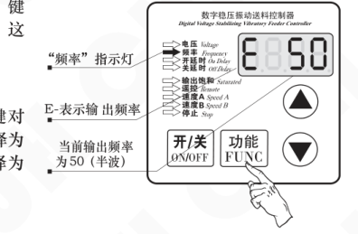

> 🙂 当电源频率为50Hz时，E调整为50时，输出频率为50Hz，E调整为100时，输出频率为100Hz。

- 长按“功能”键切换到频率指示参数“ΓE”。
- 通过使用“▲”和“▼”键对“ΓE”值进行设定。

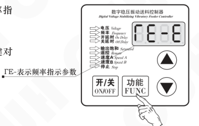

> 🙂 ΓE选择-5表示供电频率是50Hz，输出频率可设置50Hz或100Hz；  
> ΓE选择-6表示供电频率是60Hz，输出频率可设置60Hz或120Hz；  
> ΓE选择-E表示输出频率设置显示为半波 EHF 或全波 EFUL。

---

2025-08　　　　　　　　　　　　- 8 -　　　　　　　　　　　　SDVC20SMSCN_6.01

### 第 15 页

智能数字稳压振动送料控制器　　　　　　　　　　　　　　　　　SDVC20系列

## 4.3 缓启动功能

本控制器从停止状态启动时，输出电压可以平缓提高到设定值，以防止设备工件遭受冲击。

缓启动时间（t）：控制器从停止状态启动时，输出电压从零平滑升高到达设定输出电压所需要的时间称为缓启动时间。

- ▶▶ 长按“功能”键进入缓启动时间设定。
- ▶▶ 短按“功能”键切换到缓启动参数调整状态“ t ”。
- ▶▶ 使用“▲”和“▼”调整该参数。该参数的单位是秒，精度为0.1秒。

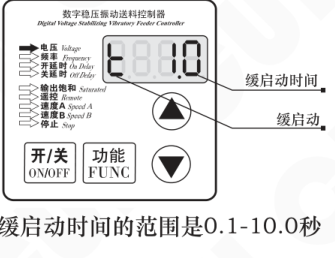

缓启动时间的范围是0.1-10.0秒

## 4.4 输出开关

面板上的轻触式输出开关可以方便快速地开启或停止本机的输出。

- ▶▶ 使用控制器面板上的“开/关”键，可以控制本机启动或停止输出。停止输出时，“停止”指示灯点亮，表示进入“停止”状态。

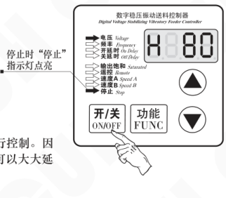

☺ 本功能使用软开关，由数字信号进行控制。因此，不会产生火花烧蚀机械触点的问题，可以大大延长控制器和振动设备的使用寿命。

---

2025-08　　　　　　　　　　　　　- 9 -　　　　　　　　　　　　　SDVC20SMSCN_6.01

### 第 16 页

智能数字稳压振动送料控制器　　　　　　　　　　　　　　　　　SDVC20系列

## 4.5 最大输出电压限制功能（此需要在专业电气工程师的指导下使用）

本控制器可以设定最大输出电压。该参数为隐含参数。设定该参数可以防止用户误操作，输出过大电压而损坏振动设备。速度遥控功能和速度分档功能都受到此参数的限制。

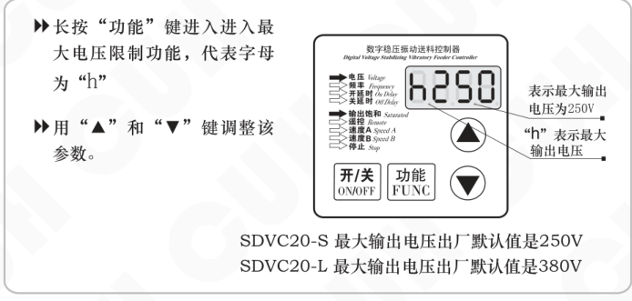

- 长按“功能”键进入进入最大电压限制功能，代表字母为“h”
- 用“▲”和“▼”键调整该参数。

图示说明：

- 表示最大输出电压为 250V
- “h”表示最大输出电压

SDVC20-S 最大输出电压出厂默认值是 250V  
SDVC20-L 最大输出电压出厂默认值是 380V

---

2025-08　　　　　　　　　　　　　　　　　-10-　　　　　　　　　　　　　　　　　SDVC20SMSCN_6.01

### 第 17 页

智能数字稳压振动送料控制器　　　　　　　　　　　　　　　　SDVC20系列

## 4.6 恢复出厂设置（此功能需要在专业电气工程师的指导下使用）

本功能可以使用户快速将控制器设置恢复为出厂默认设置状态。  
由于本控制器功能强大，有数量众多的控制参数可以由用户设定，对于初学者，可能在多次的设定修改后不能恢复控制器的正常工作状态。使用该功能可以快速将调乱的参数状态恢复为出厂默认设置。

- 长按“功能”键2秒进入高级功能的设定状态。

- 短按“功能”键切换到“8888”闪烁状态，此时长按“▲”直到控制器显示“----”，表示控制器已经重设完毕。

- 松开“▲”键，控制器将进入正常的电压调整状态“H”。此时控制器就像刚开始使用一样，所有参数都已经恢复到出厂默认状态。

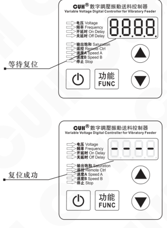

---

2025-08　　　　　　　　　　　　- 11 -　　　　　　　　　　　　SDVC20SMSCN_6.01

### 第 18 页

智能数字稳压振动送料控制器　　　　　　　　　　　　　　　　　SDVC20系列

# 第五章 传感器与信号控制

本机可以接受多种外部信号或传感器控制其运行状态。本节主要介绍智能光电传感器、接近开关传感器和PLC控制等的使用方法。

## 5.1 智能光电传感器的使用方法

本机配合使用本公司提供的SDVC-S1光电对射传感器可以实现智能光电传感功能。SDVC-S1传感器可以自动去除背景光对传感器灵敏度的影响，因而无需人工调节灵敏度即可可靠工作。

### 5.1.1 智能光电传感器连接方法：

SDVC-S1传感器是本公司特地为本系列产品开发的专门的配套传感器。

第一步:插上随机选购的SDVC-S1光电传感器

第二步:把光电传感器精确安装在送料口。

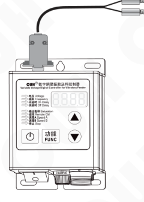

**特点：**

（1）使用简单，即插即用。  
（2）抗干扰能力强，对于干扰信号、背景光去除效果明显。  
（3）反应灵敏迅速，可靠性好。

**注意：**

（1）在出厂默认设置下，本传感器逻辑方向为料空逻辑方向。

（2）为尽量减少振动干扰及延长传感器使用寿命，请尽量安装在稳定可靠的部件上，并妥善固定传感器线缆。

（3）智能光电灵敏度可通过高级参数“P”调节，P取值范围0~999，其中：  
P值越大，作用范围越小，越不灵敏；  
P值越小，作用范围越大，越灵敏。

---

2025-08　　　　　　　　　　　　　　　　　-12-　　　　　　　　　　　　　　　　　SDVC20SMSCN_6.01

### 第 19 页

智能数字稳压振动送料控制器　　　　　　　　　　　　　SDVC20系列

---

### 5.1.2 智能光电传感器开延时、关延时的设定

当使用外部信号进行启动和停止控制时，大多数情况需要在收到指令后延迟一段时间才执行操作。对于这样的应用，可以通过设置开延时和关延时来实现。另外，还可以设定缓启动时间以消除启动时的冲击。

#### 开延时（I）

从施加一个使控制器进入运行状态的控制信号开始，到控制器开始有输出，期间经历的延迟时间称为开延时。

- 短按“功能”键切换到开延时调整“I”状态，这时开延时指示灯点亮。
- 使用“▲”和“▼”调整该参数。该参数的单位是秒，精度为0.1秒。

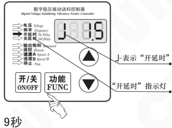

**开延时时间设定范围0.0～9.9秒**

#### 关延时（L）

从施加一个使控制器进入停止状态的控制信号开始，到控制器输出停止，期间经历的延迟时间称为关延时。

- 短按“功能”键切换到关延时调整“L”状态，这时关延时指示灯点亮。
- 使用“▲”和“▼”调整该参数。该参数的单位是秒，精度为0.1秒。

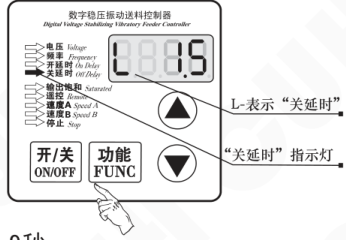

**关延时时间设定范围0.0～9.9秒**

### 第 20 页

智能数字稳压振动送料控制器　　　　　　　　　　　　　　　　　　　　　　　　　SDVC20系列

## 5.1.3 智能光电传感逻辑方向设定

（此功能请在专业电气工程师的指导下操作）

在正常情况下，也就是说接收端没有收到光信号时，控制器处于“运行”状态，即“常通”逻辑方向（出厂默认设置）。但是，对于一些特殊应用，可能需要相反的逻辑，可能会需要在没有收到光信号时，控制器处于“停止”状态。这可以通过修改本参数来实现。

- ▶ 长按“功能”键2秒进入高级功能的设定状态。
- ▶ 短按“功能”键切换到“T2”状态，即智能光电传感逻辑方向参数调整状态。
- ▶ 使用“▲”和“▼”可以改变逻辑方向。

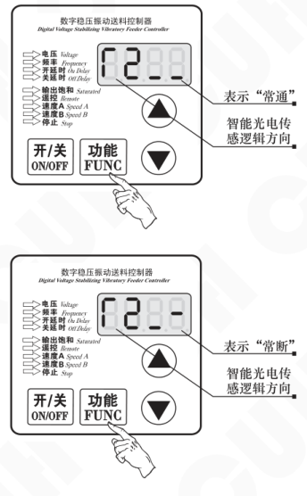

> ● 逻辑方向设置为常通，则没有收到光信号时，控制器处于运行状态。  
> ● 逻辑方向设置为常断，则没有收到光信号时，控制器处于停止状态。

2025-08　　　　　　　　　　　　　　　　　-14-　　　　　　　　　　　　　　　　SDVC20SMSCN_6.01

### 第 21 页

## 5.2 开关传感器的使用方法

配合各类开关传感器，如接近开关传感器、光电开关传感器、光纤传感器等实现自动启动和停止功能。

### 5.2.1 接近开关传感器接线方法：

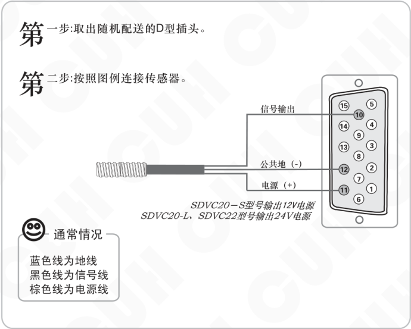

图示步骤：

1. 第一步：取出随机配送的D型插头。
2. 第二步：按照图例连接传感器。

接线标识：

- 信号输出
- 公共地（-）
- 电源（+）

通常情况：

- 蓝色线为地线
- 黑色线为信号线
- 棕色线为电源线

电源说明：

- SDVC20-S型号输出12V电源
- SDVC20-L、SDVC22型号输出24V电源

### 第 22 页

**智能数字稳压振动送料控制器**　　　　　　　　　　　　　　　　　　　　　　　　　**SDVC20系列**

### 5.2.2 开关传感器开延时、关延时时间设定

在默认状态下，智能光电传感器和开关传感器的开延时、关延时时间总是相同的。用户也可以单独为开关传感器设定开延时、关延时时间，此时开关传感器和智能光电传感器具有独立的开延时、关延时时间。

#### 开延时（J-）

从施加一个使控制器进入运行状态的控制信号开始，到控制器开始有输出，期间经历的延迟时间称为开延时。

- 长按“功能”键切换到开延时调整“J-”状态。
- 使用“▲”和“▼”调整该参数。该参数的单位是秒，精度为0.1秒。

开延时时间设定范围0～9.9秒

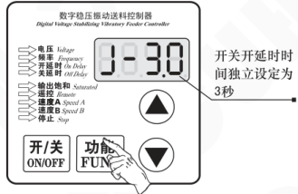

#### 关延时（L-）

从施加一个使控制器进入停止状态的控制信号开始，到控制器输出停止，期间经历的延迟时间称为关延时。

- 长按“功能”键切换到关延时调整“L-”状态。
- 使用“▲”和“▼”调整改参数。该参数的单位是秒，精度为0.1秒。

关延时时间设定范围0～9.9秒

将开关关延时时间调到小于0时，独立开关传感器独立开关延时时间将被关闭。

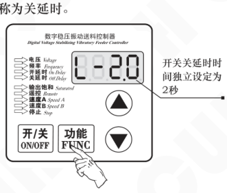

> ● 传感器独立开、关延时关闭时，传感器开、关延时与智能光电传感器开、关延时时间相同。  
> ● 传感器独立开、关延时开启时，传感器开、关延时时间由本参数设定，智能光电传感器开、关延时时间不受影响。

2025-08　　　　　　　　　　　　　　　　　-16-　　　　　　　　　　　　　　　　　SDVC20SMSCN_6.01

### 第 23 页

### 5.2.3 开关传感器逻辑方向设定（此功能请在专业电气工程师的指导下操作）

在正常情况下，也就是说不向开关引脚发任何信号时，该引脚由于内部的上拉电阻，都会呈现为“高”电平。此时，在出厂默认设置下，控制器处于“运行”状态。但是，对于一些特殊应用，可能需要相反的逻辑。也就是说，可能会需要在不施加信号时控制器处于“停止”状态。这可以通过修改本参数来实现。

- 长按“功能”键进入高级功能的设定状态。
- 短按“功能”键切换到“T1”状态，即料满停机逻辑方向参数调整状态。
- 使用“▲”和“▼”可以改变逻辑方向。

**开关传感器逻辑方向：“常通”示意**

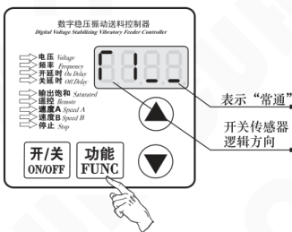

**开关传感器逻辑方向：“常断”示意**

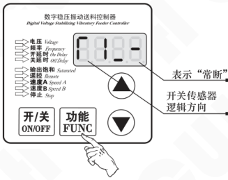

> ● 逻辑方向设置为**常通**，则不连接任何控制信号，控制器处于**运行**状态，也就是我们常说的料满停机  
> ● 逻辑方向设置为**常断**，则不连接任何控制信号，控制器处于**停止**状态，也就是我们常说的料空停机

### 第 24 页

## 5.3 第二个开关传感器的使用方法

本机可以允许客户同时接三个传感器，智能光电和两个开关传感器可以同时实现料空停机和料满停机的自动启停和停止功能。

### 5.3.1 第二个接近开关传感器接线方法：

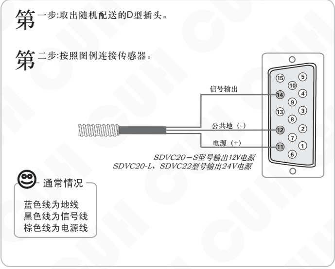

**第一步：**取出随机配送的D型插头。

**第二步：**按照图例连接传感器。

接线标识：

- 信号输出
- 公共地（-）
- 电源（+）

电源说明：

- SDVC20-S型号输出12V电源
- SDVC20-L、SDVC22型号输出24V电源

通常情况：

- 蓝色线为地线
- 黑色线为信号线
- 棕色线为电源线

### 第 25 页

**智能数字稳压振动送料控制器**　　　　　　　　　　　　　　　　　**SDVC20系列**

### 5.3.2 第二个开关传感器开延时、关延时时间设定

在默认状态下，三个开关传感器的开延时、关延时时间总是相同的。用户也可以单独为第二个开关传感器设定开延时、关延时时间，此时第二个开关传感器与其它传感器具有独立的开延时、关延时时间。

**开延时（I_）** 从施加一个使控制器进入运行状态的控制信号开始，到控制器开始有输出，期间经历的延迟时间称为开延时。

- ▶ 长按“功能”键切换到开延时调整“I_”状态。
- ▶ 长按“▲”和“▼”调整该参数。该参数的单位是秒，精度为0.1秒。

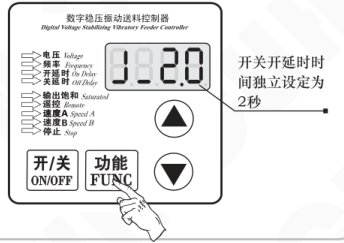

开延时时间设定范围0.0～9.9秒

---

**关延时（L_）** 从施加一个使控制器进入停止状态的控制信号开始，到控制器输出停止，期间经历的延迟时间称为关延时。

- ▶ 长按“功能”键切换到关延时调整“L_”状态。
- ▶ 长按“▲”和“▼”调整该参数。该参数的单位是秒，精度为0.1秒。

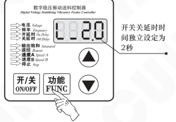

关延时时间设定范围0.0～9.9秒

将开关传感器关延时时间调到小于0时，开关传感器独立开关延时时间将被关闭。

> ● 第二个开关传感器独立开、关延时关闭时，开、关延时与智能光电传感器开、关延时时间相同。  
> ● 第二个开关传感器独立开、关延时开启时，开、关延时时间由本参数设定，智能光电传感器开、关延时时间不受影响。

2025-08　　　　　　　　　　　　　　　　　-19-　　　　　　　　　　　　　　　　　SDVC20SMSCN_6.01

### 第 26 页

智能数字稳压振动送料控制器　　　　　　　　　　　　　　　　　　　　　　　　　　　SDVC20系列

---

### 5.3.3 第二个开关传感器逻辑方向设定（此功能请在专业电气工程师的指导下操作）

在正常情况下，也就是说不向开关引脚发任何信号时，该引脚由于内部的上拉电阻，都会呈现为“高”电平。此时，在出厂默认设置下，控制器处于“运行”状态。但是，对于一些特殊应用，可能需要相反的逻辑。也就是说，可能会需要在不施加信号时控制器处于“停止”状态。这可以通过修改本参数来实现。

- 长按“功能”键进入高级功能的设定状态。
- 短按“功能”键切换到“r3”状态，即料满停机逻辑方向参数调整状态。
- 使用“▲”和“▼”可以改变逻辑方向。

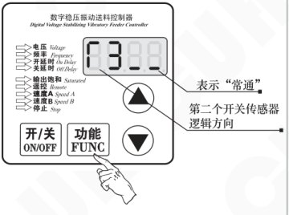

表示“常通”。第二个开关传感器逻辑方向。

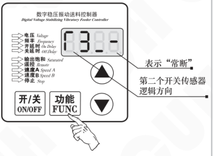

表示“常断”。第二个开关传感器逻辑方向。

> ● 逻辑方向设置为常通，则不连接任何控制信号，控制器处于运行状态，也就是我们常说的料满停机。  
> ● 逻辑方向设置为常断，则不连接任何控制信号，控制器处于停止状态，也就是我们常说的料空停机。

---

2025-08　　　　　　　　　　　　　　　　　-20-　　　　　　　　　　　　　　　　　SDVC20SMSCN_6.01

### 第 27 页

## 5.4 控制信号逻辑关系设定（此需要在专业电气工程师的指导下使用）

本控制器可以设定智能光电传感与开关传感器同时作用时的逻辑关系。

- 长按“功能”键2秒进入高级功能的设定状态。
- 短按“功能”键切换到控制信号逻辑关系设定参数“Ⅱ”。
- 使用“▲”和“▼”键调整该参数。

### 逻辑关系说明

- 逻辑“与”：仅在智能光电传感与开关传感器信号同时要求控制器运行时，控制器才运行。
- 逻辑“或”：只要智能光电传感与开关传感器信号有一个要求控制器运行，控制器就运行。
- 逻辑“异或”：仅在智能光电传感与开关传感器信号要求不同时，控制器才运行。

### 显示示例

- “Ⅱ”表示控制信号逻辑关系。逻辑“或”。

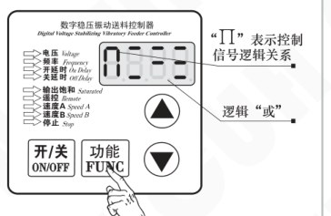

- “Ⅱ”表示控制信号逻辑关系。逻辑“与”。

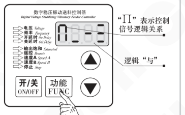

- “Ⅱ”表示控制信号逻辑关系。逻辑“异或”。

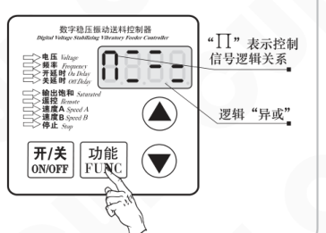

### 第 28 页

智能数字稳压振动送料控制器　　　　　　　　　　　　　　　　　SDVC20系列

## 5.5 控制输出（此需要在专业电气工程师的指导下使用）

本控制器可以输出低电压控制信号，以同步其它设备协同工作，如电磁阀、PLC等。

### 5.5.1 控制输出接线方法

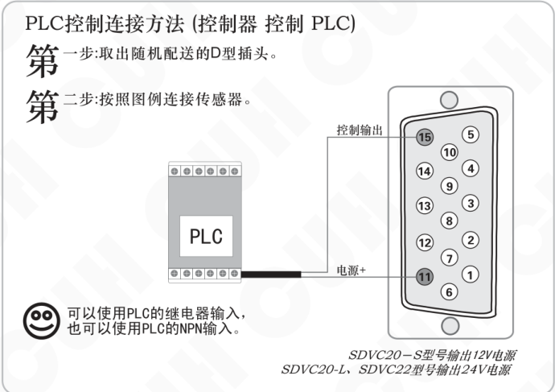

2025-08　　　　　　　　　　　　　　-22-　　　　　　　　　　　　　　SDVC20SMSCN_6.01

### 第 29 页

智能数字稳压振动送料控制器　　　　　　　　　　　　　　　　SDVC20系列

控制电磁阀工作的连接方法：

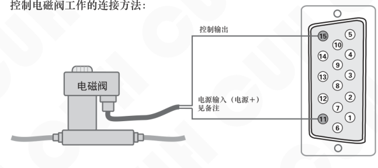

- 本控制器可直接驱动额定电压12V（SDVC20S），功率小于2W或额定电压24V（SDVC20L、SDVC22S），功率小于4W的电磁阀。
- 如电磁阀功率过大则需考虑使用外部电源。

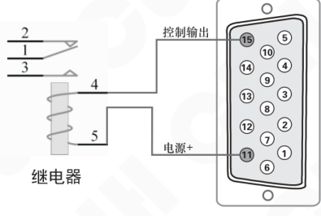

- 本控制器可直接驱动线圈额定电压12V或24V，功率小于4W的继电器。（SDVC20S可驱动功率小于2W的继电器）

**备注：**

SDVC20-S型号输出12V电源  
SDVC20-L、SDVC22-S型号输出24V电源

2025-08　　　　　　　　　　　　　　-23-　　　　　　　　　　　　　　SDVC20SMSCN_6.01

### 第 30 页

**智能数字稳压振动送料控制器**　　　　　　　　　　　　　　　**SDVC20系列**

## 5.5.2 控制输出逻辑方向设定

- ▶▶ 长按“功能”键2秒进入高级功能的设定状态。
- ▶▶ 短按“功能”键切换到“T4”状态，即控制输出逻辑方向设定状态。
- ▶▶ 用“▲”和“▼”键调整该参数。

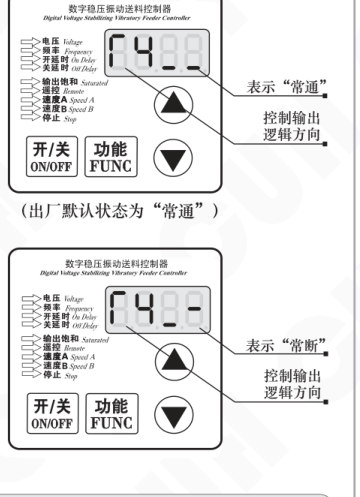

（出厂默认状态为“常通”）

> ● 逻辑方向设置为常通，则控制器输出运行时，控制信号输出为运行状态。  
> ● 逻辑方向设置为常断，则控制器输出运行时，控制信号输出为停止状态。

---

2025-08　　　　　　　　　　　　-24-　　　　　　　　　　　　SDVC20SMSCN_6.01

### 第 31 页

智能数字稳压振动送料控制器　　　　　　　　　　　　　　　　　　　SDVC20系列

## 5.6 远程速度控制（线控调速功能）

（此需要在专业电气工程师的指导下使用）

本控制器远程速度控制允许用户通过外接电位器或1~5V控制电压信号或4~20mA控制电流信号控制输出电压。这样，用户可以通过PLC、DCS或其他一些方法，方便容易地进行外部远程速度控制。

> **当** 控制电压超过0.5V时，线控电压对控制器的控制生效。此时，面板的线控指示灯点亮，同时面板上调整电压的“▲”和“▼”键将失效。如果此时控制器处于电压调节状态，LED显示屏将显示输出电压。

控制电压1~5V线性对应面板设置电压0~250V。

**外接电位器使用方法：**

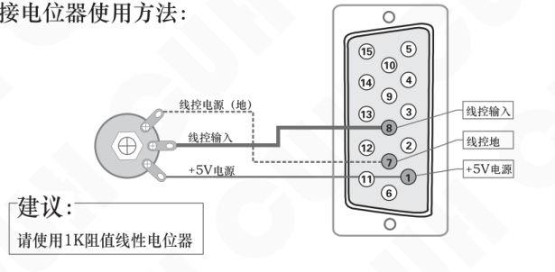

**使用PLC进行输出电压控制的方法：（PLC 控制 控制器）**

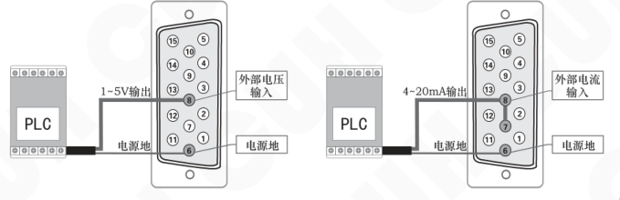

2025-08　　　　　　　　　　　　　-25-　　　　　　　　　　　　　SDVC20SMSCN_6.01

### 第 32 页

智能数字稳压振动送料控制器　　　　　　　　　　　　　　　　　SDVC20系列

## 5.7 速度档位开关（此需要在专业电气工程师的指导下使用）

速度档位开关是通过外部控制信号直接选择预定速度的功能。通过该功能，外部控制设备，如PLC、计算机、传感器或者其他的信号源可以方便地与本控制器组成多档速度送料控制系统。

本机共有两条速度档位开关控制信号线，控制速度开关A和速度开关B，分别对应D型控制插座的9脚和13脚。两条线都是低电平有效。

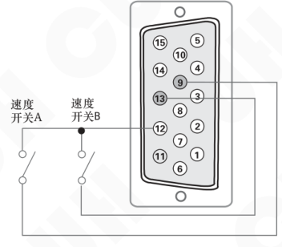

每条控制线的状态在面板上有对应的指示灯显示。当在控制线上施加有效信号时，对应指示灯点亮。

“速度A”指示灯  
“速度B”指示灯

两个灯的亮灭状态组合可以有4种状态（A亮B灭，A灭B亮，AB全亮，AB全灭）。右图，为两条控制线都施加有效信号时的状态。

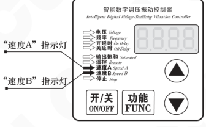

通过控制信号的选择，控制器将进入对应速度档位。此时，控制器输出电压可以通过功能键切换到电压参数状态进行设定。该速度档被自动记忆。任何时刻速度档位控制信号设置控制器进入该档位后都将立刻切换输出到该电压。

2025-08　　　　　　　　　-26-　　　　　　　　　SDVC20SMSCN_6.01

### 第 33 页

**智能数字稳压振动送料控制器**　　　　　　　　　　　　　　　　**SDVC20系列**

## 5.8 主控输出分离参数（此需要在专业电气工程师的指导下使用）

- 长按“功能”键2秒进入高级功能的设定状态。
- 短按“功能”键切换到主控输出分离参数“Γ5”。
- 使用“▲”和“▼”键对“Γ5”的值进行设定。

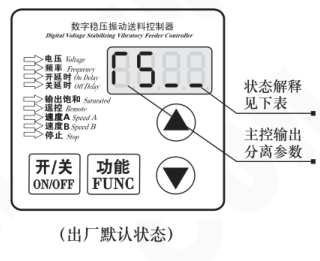

（出厂默认状态）

---

- Γ5 为  表示主输出和控制输出受到面板的启/停键以及智能光电、两个开关传感器三者的信号的逻辑控制。

- Γ5 为  表示主输出受到面板的启/停键，控制输出受到智能光电、两个开关传感器三者的信号的逻辑控制。

- Γ5 为  表示主输出受到面板的启/停键、以及两个开关传感器两者的信号的逻辑控制。控制输出受到智能光电控制。

- Γ5 为  表示主输出受到面板的启/停键、受到智能光电控制。控制输出受两个开关传感器两者的信号的逻辑控制。

---

2025-08　　　　　　　　　　　　　　　SDVC20SMSCN_6.01

### 第 34 页

智能数字稳压振动送料控制器  
SDVC20系列

# 第六章 安全保护功能

## 6.1 稳压功能

内置数字稳压功能，可以消除由于电源电压波动造成的送料速度变化。

## 6.2 短路保护功能

输出发生短路时，控制器会立即停止输出，同时显示Err2，直到控制器重新启动为止。也有可能熔断保险丝，为恢复功能需要更换保险丝。

## 6.3 过流保护功能

本控制器可以在用户误操作造成输出电流超过额定电流时短暂停止输出，同时显示Err2，以保护本机及用户的设备。

## 6.4 过热保护功能

当控制器工作温度过超过60℃将停止输出，以保护本机，同时显示Err3，当温度下降到60℃时，本机恢复输出。

---

2025-08　　　　-28-　　　　SDVC20SMSCN_6.01

### 第 35 页

**智能数字稳压振动送料控制器**  
**SDVC20系列**

## 附录A：外形尺寸

智能数字振动送料控制器SDVC20-S外形尺寸 （单位：mm）

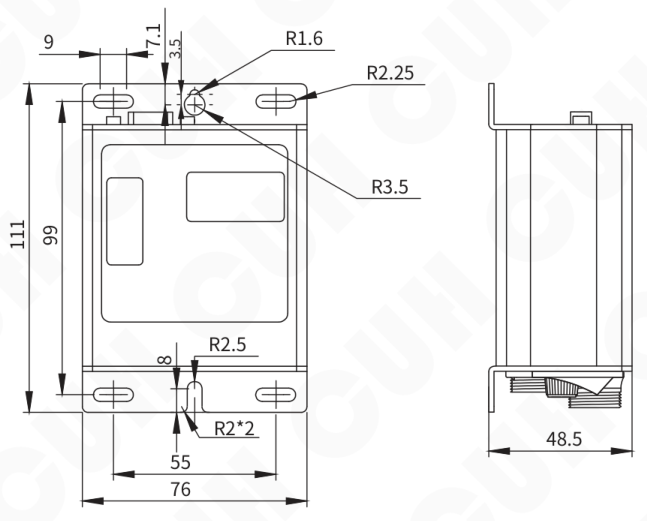

| 公差区间 | 公差值 |
|---|---|
| 0~3 | ±0.05 |
| 3~10 | ±0.1 |
| 10~30 | ±0.15 |
| 30~80 | ±0.2 |
| 80~180 | ±0.3 |

本系列产品均适用此公差表。

---

2025-08　　　　　　　　　　　　　　　　　-29-　　　　　　　　　　　　　　　　　SDVC20SMSCN_6.01

### 第 36 页

**智能数字稳压振动送料控制器**　　　　　　　　　　　　　　　　　　　　　　　　　**SDVC20系列**

---

### 智能数字振动送料控制器SDVC20-L外形尺寸（单位：mm）

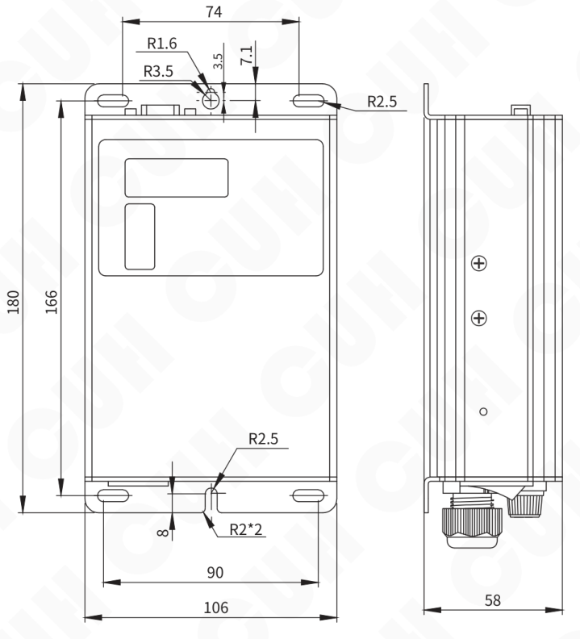

---

2025-08　　　　　　　　　　　　　　　　　-30-　　　　　　　　　　　　　　　　SDVC20SMSCN_6.01

### 第 37 页

智能数字稳压振动送料控制器　　　　　　　　　　　　　　　　　SDVC20系列

---

智能数字振动送料控制器SDVC22-S外形尺寸（单位：mm）

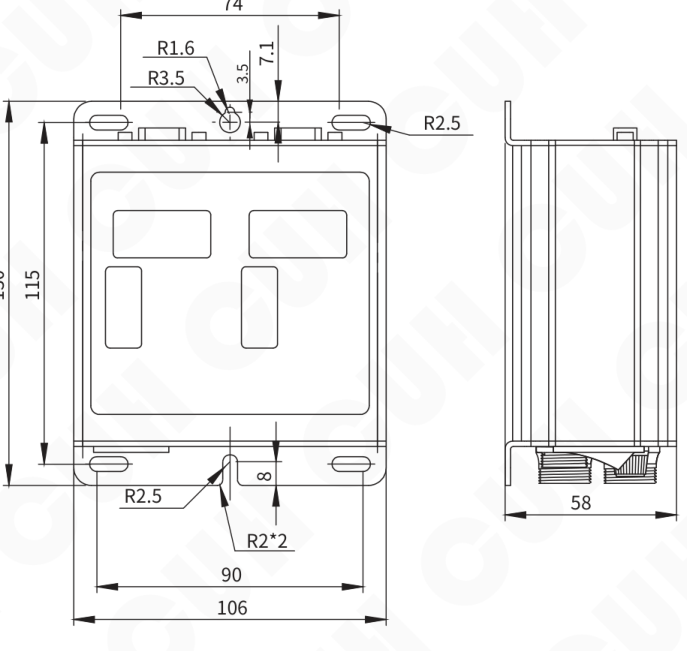

---

2025-08　　　　　　　　　　　　-31-　　　　　　　　　　　　SDVC20SMSCN_6.01

### 第 38 页

**智能数字稳压振动送料控制器**　　　　　　　　　　　　　**SDVC20系列**

## 附录B：输出接口定义

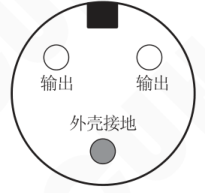

**请注意：**

A：一定要确认电磁铁线圈接在两个输出引脚上，外壳需要可靠接地。否则将会导致机壳带电，发生严重安全事故！！！

B：焊接完成后，一定要用热缩套管或绝缘胶带裹紧接头部分，然后插入航空插头的金属套管中，以免造成漏电和短路事故！！！

### SDVC20-L电源线和输出线端子定义

- 输出线（白色线）：输出线、输出线、地线（黄绿色）
- 电源线（黑色线）：L（棕色）、N（蓝色）、地线（黄绿色）

### 第 39 页

智能数字稳压振动送料控制器　　　　　　　　　　　　　　　　　SDVC20系列

---

## 附录C：信号接口定义

| 引脚 | 信号接口定义 |
|---:|---|
| 1 | 5V电源输出（+） |
| 2 | 智能光电传感器（地） |
| 3 | 智能光电传感器接收信号输入 |
| 4 | 智能光电传感器（地） |
| 5 | 智能光电传感器发射信号输出 |
| 6 | 5V电源输出（本机地-） |
| 7 | 线控调速地 |
| 8 | 4～20mA控制信号输入 |
| 9 | 速度档位A |
| 10 | 料满停机控制信号输入（“低电平”有效） |
| 11 | 控制电源输出（电源地+） |
| 12 | 控制电源输出（电源地-） |
| 13 | 速度档位B |
| 14 | 料空停机控制信号输入（“低电平”有效） |
| 15 | 控制输出 |

**备注：**

- SDVC20-S型号输出12V电源
- SDVC20-L、SDVC22-S型号输出24V电源

---

2025-08　　　　　　　　　　　　-33-　　　　　　　　　　　　SDVC20SMSCN_6.01

### 第 40 页

智能数字稳压振动送料控制器　　　　　　　　　　　　　　　　　　　　　SDVC20系列

## 附录D：功能状态对照表

| 分类/操作 | 含义 | 参数符号 | 数码管符号图片 | 取值范围 | 默认值 |
|---|---|---|---|---|---|
| 常用参数 短按　切换参数 | 输出电压 | H |  | 0~h 伏特（V） | 150 |
| 常用参数 短按　切换参数 | 输出频率 | E |  | 输入50Hz时: 100/50 赫兹（Hz） 输入60Hz时: 120/60 赫兹（Hz） | 全波 |
| 常用参数 短按　切换参数 | 智能光电传感开延时 | 大勾 |  | 0.0~9.9 秒（s） | 0.2 |
| 常用参数 短按　切换参数 | 智能光电传感关延时 | 大L |  | 0.0~9.9 秒（s） | 0.2 |
| 高级参数 长按　进入 短按　切换参数 | 开关传感器开延时 | 勾中 |  | 0.0~9.9 秒（s） | -- （与大勾相同） |
| 高级参数 长按　进入 短按　切换参数 | 开关传感器关延时 | L中 |  | 0.0~9.9 秒（s） | -- （与大L相同） |
| 高级参数 长按　进入 短按　切换参数 | 第二个开关传感器开延时 | 勾下 |  | 0.0~9.9 秒（s） | -- （与大勾相同） |
| 高级参数 长按　进入 短按　切换参数 | 第二个开关传感器关延时 | L下 |  | 0.0~9.9 秒（s） | -- （与大L相同） |
| 高级参数 长按　进入 短按　切换参数 | 最大输出电压限制 | 小H |  | SDVC20-S: 0~250 伏特（V） SDVC20-L: 0~440 伏特（V） | 20S: 250 20L: 380 |
| 高级参数 长按　进入 短按　切换参数 | 缓启动时间 | 小T |  | 0.0~10.0 秒（s） | 1.0 |
| 高级参数 长按　进入 短按　切换参数 | 开关传感器逻辑方向 | r1 |  | 常通，常断 | 常通 |
| 高级参数 长按　进入 短按　切换参数 | 智能光电传感器逻辑方向 | r2 |  | 常通，常断 | 常通 |
| 高级参数 长按　进入 短按　切换参数 | 第二个开关传感器逻辑方向 | r3 |  | 常通，常断 | 常通 |
| 高级参数 长按　进入 短按　切换参数 | 控制输出逻辑方向 | r4 |  | 常通，常断 | 常通 |
| 高级参数 长按　进入 短按　切换参数 | 主控输出分离参数 | r5 |  | 联合，分离 C控主B控D，B控主C控D | 联合 |
| 高级参数 长按　进入 短按　切换参数 | 控制信号逻辑关系 | N |  | 或，与，异或 | 与 |
| 高级参数 长按　进入 短按　切换参数 | 频率指示参数（SDVC20-S） | FE |  | -5: 自动识别输入频率，并数字显示输出频率 -E: 输出频率设置可显示为全波FUL，半波HAF | -5 |
| 高级参数 长按　进入 短按　切换参数 | 频率指示参数（SDVC20-L） | FE |  | -5: 供电频率是50Hz，输出频率可设置为50/100Hz -6: 供电频率是60Hz，输出频率可设置为60/120Hz -E: 输出频率设置可显示为全波FUL，半波HAF | -5 |
| 高级参数 长按　进入 短按　切换参数 | 智能光电灵敏度 | P |  | 0~999 | 80 |
| 高级参数 长按　进入 短按　切换参数 | 恢复出厂设定 | 全8 |  | —— | —— |

备注：主-主输出，B-智能光电信号，C-两个开关传感器的逻辑信号，D-控制输出。

联合：主输出和控制输出受面板的启/停键以及智能光电、两个开关传感器三者的信号的逻辑控制。

分离：主输出受面板的启/停键控制，控制输出受智能光电、两个开关传感器三者的信号的逻辑控制。

C控主B控D：主输出受面板的启/停键及两个开关传感器两者的信号的逻辑控制。控制输出受智能光电控制。

B控主C控D：主输出受面板的启/停键及智能光电控制。控制输出受两个开关传感器两者的信号的逻辑控制。

2025-08　　　　　　　　　　　　-34-　　　　　　　　　　　　SDVC20SMSCN_6.01

### 第 41 页

智能数字稳压振动送料控制器　　　　　　　　　　　　　　　　　　　　　　　　　SDVC20系列

## 附录E： 电气特性

| 项目 | 最小值 | 典型值 | 最大值 | 单位 | 说明 |
|---|---:|---:|---:|---|---|
| 输入电压 | 85 | 220 | 250 | V（伏特） 交流有效值 | SDVC20S SDVC22S |
| 输入电压 | 85 | 380 | 440 | V（伏特） 交流有效值 | SDVC20L |
| 输出电压调整范围 | 35 | —— | Vin-10 | V（伏特） | 半波 |
| 输出电压调整范围 | 45 | —— | Vin-5 | V（伏特） | 全波 |
| 电压调整精度 |  | 1 |  | V（伏特） |  |
| 稳压响应时间 | 0 | 0.01 | 0.02 | s（秒） |  |
| 输出电流调整范围 | 0 | —— | 5 | A（安培） | SDVC20S SDVC22S |
| 输出电流调整范围 | 0 | —— | 10 | A（安培） | SDVC20L |
| 输出功率 | 0 | —— | 1100 | VA（伏安） | SDVC20S SDVC22S |
| 输出功率 | 0 | —— | 3800 | VA（伏安） | SDVC20L |
| 输出频率 | 45 | 50/60 | 65 | Hz（赫兹） | 半波 |
| 输出频率 | 90 | 100/120 | 130 | Hz（赫兹） | 全波 |
| 输出波形 |  | 正弦相切 |  |  |  |
| 缓启动时间 | 0 | —— | 10.0 | s（秒） | 出厂默认 0.5 |
| 延迟时间范围 | 0 | —— | 9.9 | s（秒） | 出厂默认 0.2 |
| 延迟时间精度 |  | 0.1 |  | s（秒） |  |
| 过热保护温度 | 58 | 60 | 66 | ℃（摄氏度） |  |
| 直流控制输出电压 | 11 | 12 | 13 | V（伏特） | SDVC20S |
| 直流控制输出电压 | 22 | 24 | 26 | V（伏特） | SDVC20L SDVC22S |
| 直流控制输出电流 | 0 | —— | 200 | mA（毫安） |  |
| 模拟控制信号 |  | 1~5/4~20 |  | V（伏特）/ mA（毫安） | 远程速度控制 |
| 数字控制信号 |  | TTL 标准电平 |  |  | 开关信号控制 |
| 调整方式&显示方式 |  | 4 键+4 位 LED 数码管 |  |  | SDVC20S SDVC20L |
| 调整方式&显示方式 |  | 8 键+8 位 LED 数码管 |  |  | SDVC22S |
| 保险丝容量 |  | 6.3 |  | A（安培） | SDVC20S SDVC22S |
| 保险丝容量 |  | 10 |  | A（安培） | SDVC20L |
| 空载功耗 | —— | 2 | —— | W（瓦特） | SDVC20S SDVC20L |
| 空载功耗 | —— | 3 | —— | W（瓦特） | SDVC22S |
| 工作环境温度 | 0 | 25 | 40 | ℃（摄氏度） | 不结露 |
| 工作环境湿度 | 10 | 60 | 85 | ％（相对湿度） |  |

2025-08　　　　　　　　　　　　　　　　　-35-　　　　　　　　　　　　　　　SDVC20SMSCN_6.01

### 第 42 页

**智能数字稳压振动送料控制器**　　　　　　　　　　　　　　　　　　　　　　　　　**SDVC20系列**

## 附录F：错误讯息指示和故障排除

以下一些方法可以帮助您排除使用中可能会遇到的简单问题。

| 序号 | 故障现象/故障代码 | 数码管符号图片 | 排除方法 |
|---:|---|---|---|
| 1 | 打开开关，没有显示 |  | ◆ 请检查电源插座是否有电？ ◆ 电源插头是否可靠连接插座？ ◆ 请检查保险丝是否完好？ |
| 2 | 有显示，但是振动盘不动，也没有声音 |  | ◆ 请检查输出电缆是否正确地连接控制器与振动盘？ ◆ 请检查控制器参数，是否输出电压调节的太小？ ◆ 请检查控制信号是否将控制器置于“停止”状态？ ◆ 请检查是否有设置为“常断”的参数，导致控制器被置于“停止”状态？ |
| 3 | 控制信号不起作用 |  | ◆ 请检查控制信号是否正确输入？ ◆ 请检查输入的控制信号的地线是否与本机地正确连接？ ◆ 请检查控制信号逻辑关系设置是否是您期望的设置？ |
| 4 | 有显示，振动盘不动，但是可以听到声音 |  | ◆ 请按照说明书介绍的调节方法逐步调节各参数。 |
| 5 | Err1 |  | ◆ 请检查输出航空插头、电缆线是否有短路的情况？ ◆ 请检查控制器是否可靠接地？ ◆ 请检查振动盘电磁线圈是否有短路、漏电、匝间短路的情况？ |
| 6 | Err2 |  | ◆ 请检查是否使用了超过控制器参数规格限定的振动盘？ ◆ 请检查输出电缆线是否可靠连接？ |
| 7 | Err3 |  | ◆ 温度异常，将本控制器安装在符合产品使用要求的环境中。 |
| 8 | Err5 |  | ◆ 内部通信异常，联系本公司技术支持。 |

> **警告**  
> 在民用环境中，本产品可能产生无线电干扰。在这种情况下，可能需要采取附加抑制措施。

2025-08　　　　　　　　　　　　　　　　　-36-　　　　　　　　　　　　　　　　　SDVC20SMSCN_6.01

### 第 43 页

数字调压振动送料控制器

| 品名规格 | 特点 |  |
|---|---|---|
| SDVC10、11 数字稳压振动送料控制器系列   | 输入电压范围：150V～260V | 输出电压范围：35V～250V |
|  | 输出电流：0～4A | 输出功率：880VA |
|  | 电源频率范围：40～70Hz |  |
|  | · 自动稳压 · 最大输出比例调节 · 短路保护功能 | · 缓启动 · 线性调节规律 · 过热保护功能 |
| SDVC20、22 智能数字稳压振动送料控制器系列   | 输入电压范围：85V～440V | 输出电压范围：35V～380V |
|  | 输出电流：0～10A | 输出功率：3800VA |
|  | 电源频率范围：40～70Hz |  |
|  | · 自动稳压 · 缓启动时间设置 · 双控制信号输入 · 料满停机 · 线控调速 · 过热保护功能 | · 缓启动 · 信号控制开关 · 输出电压预置功能 · 智能光电传感 · 控制输出 · 过流保护功能 |

### 第 44 页

南京创优科技有限责任公司  
网址:www.cuhnj.com  
电话:400-985-8889  
传真:025-84730426  
邮箱:sales@cuhnj.com  
地址:南京市江宁区智能路9号  
启迪城学研园2幢

文档编号：IDP1000318
<!-- /auto:ai-body-draft v1 -->

<!-- auto:data-params-summary v1 -->
## 附录 · 参数表（结构化侧车·机器生成）

> 说明：本节由 `data/<doc_key>/params/params.yaml` 自动渲染（展示前若干行），用于校对与二次开发。定稿以层 C 数据为准。

| 参数 | 标志/符号 | 范围 | 默认 | 单位 | 备注 |
| --- | --- | --- | --- | --- | --- |
|      品名规格 |  |  |  |  |  |
| U  UH     SDVC34 智能数字自动调频振动送料控制器系列 |  |  |  |  |  |
| H C H CU   SDVC31 数字调频振动送料控制器系列 |  |  |  |  |  |
|      品名规格 |  |  |  |  |  |
|  H CU C SDVC40 压电数字调频振动送料控制器系列 |  |  |  |  |  |
|     |     |      0~h 伏特（V） |    150 |  |  |
|     |     |      输入50Hz时: 100/50 赫兹（Hz） 输入60Hz时: 120/60 赫兹（Hz） |    全波 |  |  |
|     |     |      0.0~9.9 秒（s）  |    0.2 |  |  |
|      【 】 大L |      【 】 大L |      0.0~9.9 秒（s） |    0.2 |  |  |
|      【勾中】 |      【勾中】 |      0.0~9.9 秒（s）   |    （与     相同） |  |  |
|      【中】 L |      【中】 L |      0.0~9.9 秒（s）  |    （与     相同） |  |  |
|      【 】 勾下 |      【 】 勾下 |      0.0~9.9 秒（s）   |    （与     相同） |  |  |
|       |       |        0.0~9.9 秒（s）  |      （与     相同） |  |  |
|         【小H】 |         【小H】 |        SDVC20-S: 0~250 伏特（V） SDVC20-L: 0~440 伏特（V）   |      20S: 250 20L: 380  |  |  |
|       |       |        0.0~10.0 秒（s） |      1.0 |  |  |
|       |       |        常通      ，常断 |      常通 |  |  |
|         【涛2】 |         【涛2】 |        常通      ，常断 |      常通 |  |  |
|       【涛3】 |       【涛3】 |      常通      ，常断 |      常通 |  |  |
|          |          |      常通      ，常断 |      常通 |  |  |
|      【 】 涛4 【 】 涛5 |      【 】 涛4 【 】 涛5 |     U    联合      ，分离 C控主B控D      ，B控主C控D 注 |       联合 |  |  |
|      【 】 涛E 【大N】 |      【 】 涛E 【大N】 |        -5: -E:输出频率设置可显示为全波FUL 半波HAF 自动识别输入频率，并数字显示输出频率 或        ，与        ，异或 |       -5 与 |  |  |
|      【 】 涛E |      【 】 涛E |        , -5: 50 -6:供电频率是60Hz，输出频率可设置为60/120Hz -E:输出频率设置可显示为全波FUL, 半波HAF 供电频率是 Hz，输出频率可设置为50/100Hz |       -5 |  |  |
|   |   |     0~999 |     80 |  |  |
|   |   |     —— |     —— |  |  |
|   |   |   |   |  |  |
| H     项目 |  |  |  |  |  |
| H     项目 |  |  |  |  |  |
|      输入电压 |  |  |  |  |  |
|      输入电压 |  |  |  |  |  |
|        输出电压调整范围 |  |  |  |  |  |

*（仅展示前 30 条，共 73 条；完整数据见下方链接。）*

- 完整 YAML：`data/cuh.sdvc.manual.v0.0/params/params.yaml`
- 表格索引：`data/cuh.sdvc.manual.v0.0/index.yaml`
<!-- /auto:data-params-summary v1 -->
