## 目录

> 下列条目来自 PDF 内置书签/大纲；链接指向本批转换生成的整页渲染图（`assets/pages/`），便于与原版 PDF 对照校对。

- [页 1](assets/pages/page-0001.png)（第 1 页）
- [页 2](assets/pages/page-0002.png)（第 2 页）
- [页 3](assets/pages/page-0003.png)（第 3 页）
- [页 4](assets/pages/page-0004.png)（第 4 页）
- [页 5](assets/pages/page-0005.png)（第 5 页）
- [页 6](assets/pages/page-0006.png)（第 6 页）
- [页 7](assets/pages/page-0007.png)（第 7 页）
- [页 8](assets/pages/page-0008.png)（第 8 页）
## 术语与命名

- 侧车：`glossary/terms.yaml`（机读）、`glossary/zh-CN.md`（人读）；候选表，定稿后并入公司级 `glossary/`。

## 适用范围

- 本文档由 PDF 自动转换生成，正文与插图需人工核对。

## 变更记录

- 2026-06-06 00:43:31：由转换工具从源 PDF 生成首版。

## 正文

<!-- auto:ai-body-draft v1 -->
> 以下为**整页视觉转写**的正文草稿（多模态模型直接输出 Markdown，含 GFM 表； 若配置 `[[vcrop:页:序]]` 占位符，裁剪步骤会插入 `assets/images/` 下 PNG）。**请务必人工校对。**

### 第 1 页

**CUH® 创优虎**

# 数字调压振动送料控制器

## SDVC201-L&SDVC20-XL简易操作指南

**www.cuhnj.com**

扫描二维码下载详细说明书

---

*Variable Voltage Digital Controller for Vibratory Feeder*

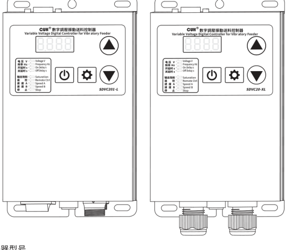

### 适用控制器型号

SDVC201-L (220V/10A)  
SDVC20-XL (380V/15A)

**南京创优科技有限责任公司**

地址：南京市江宁区智能路9号启迪城学研园2幢  
销售电话：400-985-8889  
传真：025-84730426  
企业邮箱：sales@cuhnj.com  
文档编号：IDP1000507_A.2

### 第 2 页

_SDVC201-L&SDVC20-XL数字调压振动送料控制器_

## 指示灯及按键说明

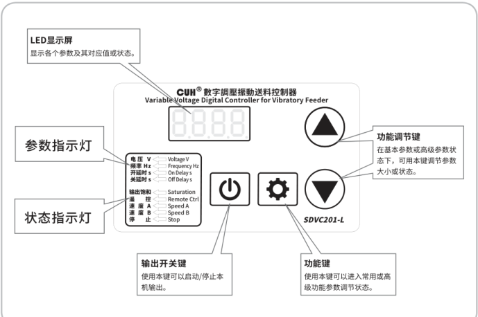

| 标注 | 说明 |
|---|---|
| LED显示屏 | 显示各个参数及其对应值或状态。 |
| 参数指示灯 | 指示当前参数类别。 |
| 状态指示灯 | 指示当前工作状态。 |
| 输出开关键 | 使用本键可以启动/停止本机输出。 |
| 功能调节键 | 在基本参数或高级参数状态下，可用本键调节参数大小或状态。 |
| 功能键 | 使用本键可以进入常用或高级功能参数调节状态。 |

### 指示灯点亮，含义如下：

| 指示灯 | 含义 |
|---|---|
| 电压 Voltage | 电压调节状态 |
| 频率 Frequency | 频率调节状态 |
| 开延时 On Delay | 开延时调节状态 |
| 关延时 Off Delay | 关延时调节状态 |
| 输出饱和 Saturation | 设定输出电压过高或过低，致使控制器不能达到 |
| 遥控 Remote Ctrl | 外部速度控制信号有效 |
| 速度A Speed A | 速度A控制信号有效 |
| 速度B Speed B | 速度B控制信号有效 |
| 停止 Stop | 控制器输出被关闭 |

发布时间：2025.10

该说明书的最终解释权归本公司所有

### 第 3 页

*SDVC201-L&SDVC20-XL数字调压振动送料控制器*

## 外部部件说明

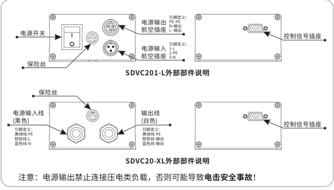

### SDVC201-L外部部件说明

| 部件/接口 | 图中说明 |
|---|---|
| 电源开关 | 位于前面板 |
| 保险丝 | 位于前面板 |
| 电源输出航空插座 | 引脚定义：PE-PE；N-输出；L-输出 |
| 电源输入航空插座 | 引脚定义：1-L；2-PE；3-N |
| 控制信号插座 | 位于后面板 |

### SDVC20-XL外部部件说明

| 部件/接口 | 图中说明 |
|---|---|
| 保险丝 | 位于面板 |
| 电源输入线（黑色） | 引脚定义：黄绿线-PE；棕色线-L；蓝色线-N |
| 输出线（白色） | 引脚定义：黄绿线-PE；棕色线-输出；蓝色线-输出 |
| 控制信号插座 | 位于后面板 |

**注意：** 电源输出禁止连接压电类负载，否则可能导致**电击安全事故**！

## 信号接口定义

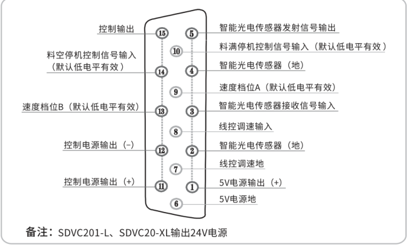

| 引脚 | 信号定义 |
|---:|---|
| 1 | 5V电源输出（+） |
| 2 | 智能光电传感器（地） |
| 3 | 智能光电传感器接收信号输入 |
| 4 | 智能光电传感器（地） |
| 5 | 智能光电传感器发射信号输出 |
| 6 | 5V电源地 |
| 7 | 线控调速地 |
| 8 | 线控调速输入 |
| 9 | 速度档位A（默认低电平有效） |
| 10 | 料满停机控制信号输入（默认低电平有效） |
| 11 | 控制电源输出（+） |
| 12 | 控制电源输出（-） |
| 13 | 速度档位B（默认低电平有效） |
| 14 | 料空停机控制信号输入（默认低电平有效） |
| 15 | 控制输出 |

**备注：** SDVC201-L、SDVC20-XL输出24V电源

### 第 4 页

<u><em>SDVC201-L&SDVC20-XL数字调压振动送料控制器</em></u>

## 技术规格

| 项目 | 最小值 | 典型值 | 最大值 | 单位 | 说明 |
|---|---:|---:|---:|---|---|
| 输入电压 | 85 | 220 | 250 | 伏特（V） | SDVC201-L交流有效值 |
| 输入电压 | 85 | 380 | 440 | 伏特（V） | SDVC20-XL交流有效值 |
| 输出电压调整范围 | 35 | —— | Vin-10 | 伏特（V） | 半波 |
| 输出电压调整范围 | 45 | —— | Vin-5 | 伏特（V） | 全波 |
| 电压调整精度 |  | 1 |  | 伏特（V） |  |
| 稳压精度 | —— | —— | 30 | 伏特（V） | Vset = 150V ΔVin+ = 70V |
| 稳压响应时间 | 0 | 0.01 | 0.02 | 秒（s） |  |
| 输出电流调整范围 | 0 | —— | 10 | 安培（A） | SDVC201-L |
| 输出电流调整范围 | 0 | —— | 15 | 安培（A） | SDVC20-XL |
| 输出功率 | 0 | —— | 2200 | 伏安（VA） | SDVC201-L |
| 输出功率 | 0 | —— | 5700 | 伏安（VA） | SDVC20-XL |
| 输出频率 | 90 | 100/120 | 130 | 赫兹（Hz） | 全波 |
| 输出频率 | 45 | 50/60 | 65 | 赫兹（Hz） | 半波 |
| 输出频率 | 30 | 33/40 | 43 | 赫兹（Hz） | 三分之一波 |
| 输出频率 | 22 | 25/30 | 32 | 赫兹（Hz） | 四分之一波 |
| 输出波形 |  | 正弦相切 |  |  |  |
| 缓启动时间 | 0 | —— | 10.0 | 秒（s） | 出厂默认0.5 |
| 延迟时间范围 | 0 | —— | 9.9 | 秒（s） | 出厂默认0.2 |
| 延迟时间精度 |  | 0.1 |  | 秒（s） |  |
| 过热保护温度 | 58 | 60 | 66 | 摄氏度（℃） |  |
| 直流控制输出电压 | 22 | 24 | 26 | 伏特（V） |  |
| 直流控制输出电流 | 0 | —— | 200 | 毫安（mA） |  |
| 模拟控制信号 |  | 1~5/4~20 |  | 伏特(V)/毫安(mA) | 远程速度控制电压/电流 |
| 数字控制信号 |  | 24 |  | 伏特（V） | 开关信号控制 |
| 调整方式 |  | 4 |  | 键（Button） |  |
| 保险丝容量 |  | 15 |  | 安培（A） | SDVC201-L |
| 保险丝容量 |  | 20 |  | 安培（A） | SDVC20-XL |
| 空载功耗 | —— | 2 | —— | 瓦特（W） |  |
| 显示方式 |  | 4 |  | 位（Digit） | LED数码管 |
| 工作环境温度 | 0 | 25 | 40 | 摄氏度（℃） |  |
| 工作环境湿度 | 10 | 60 | 85 | 相对湿度（%） | 不结露 |
| 存储环境温度 | -20 | 25 | 85 | 摄氏度（℃） |  |

### 第 5 页

_SDVC201-L&SDVC20-XL数字调压振动送料控制器_

## 功能特点

本系列控制器可以实现以下功能：

A：可以用电位器或PLC模拟量远程控制输出电压。

B：可以同时接2个NPN传感器实现料满停机控制。

C：可以实现4种速度档位的切换。

D：可以实现停机报警。

E：配合相应传感器可以实现颜色、倒角、缺陷等分选功能。

## 恢复出厂设置

本功能可以使用户快速将控制器设置恢复为出厂默认设置状态。

由于本控制器功能强大，有数量众多的控制参数可以由用户设定，对于初学者，可能在多次的设定修改后不能恢复控制器的正常工作状态。使用该功能可以快速将调乱的参数状态恢复为出厂默认设置。

» 长按「⚙」2秒进入高级功能的设定状态。

» 短按「⚙」切换到全屏闪烁状态，此时长按「▲」直到控制器显示“----”，表示控制器已经重设完毕。

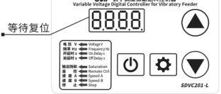

» 松开「▲」，控制器将进入正常的电压调整状态“H”。

此时控制器就像刚开始使用一样，所有参数都已经恢复到出厂默认状态。

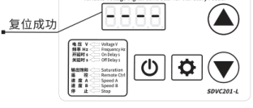

### 第 6 页

_SDVC201-L&SDVC20-XL数字调压振动送料控制器_

## 功能参数表

| 类别 | 含义 | 参数符号 | 数码管符号图片 | 取值范围 | 默认值 |
|---|---|---|---|---|---|
| 常用参数 短按（键）切换参数 | 输出电压 | H［H］ |  | 0~h 伏特（V） | 150 |
|  | 输出频率 | E［E］ | 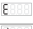 | `rE=5` 时：输入50Hz时：100/50/33/25 赫兹（Hz） 输入60Hz时：120/60/40/30 赫兹（Hz） `rE=E` 时：输入50Hz时：FUL/HAF/thr/Fou 赫兹（Hz） 输入60Hz时：FUL/HAF/thr/Fou 赫兹（Hz） | 全波 |
|  | 智能光电传感开延时 | J［大勾］ | 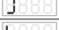 | 0.0~9.9 秒（s） | 0.2 |
|  | 智能光电传感关延时 | L［大L］ |  | 0.0~9.9 秒（s） | 0.2 |
| 高级参数 长按（键）进入 短按（键）切换参数 | 开关传感器开延时 | J［勾中］ | 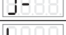 | 0.0~9.9 秒（s） | —— （与 J 相同） |
|  | 开关传感器关延时 | L［L中］ | 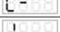 | 0.0~9.9 秒（s） | —— （与 L 相同） |
|  | 第二个开关传感器开延时 | J［勾下］ |  | 0.0~9.9 秒（s） | —— （与 J 相同） |
|  | 第二个开关传感器关延时 | L［L下］ |  | 0.0~9.9 秒（s） | —— （与 L 相同） |
|  | 最大输出电压限制 | h［小H］ | 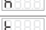 | SDVC201-L：0~250 伏特（V） SDVC20-XL：0~440 伏特（V） | 201-L：250 20-XL：380 |
|  | 缓启动时间 | t［小T］ |  | 0.0~10.0 秒（s） | 1.0 |
|  | 开关传感器逻辑方向 | r1［涛1］ | 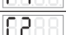 | 常通 `--`，常断 `-` | 常通 `--` |
|  | 智能光电传感器逻辑方向 | r2［涛2］ | 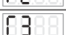 | 常通 `--`，常断 `-` | 常通 `--` |
|  | 第二个开关传感器逻辑方向 | r3［涛3］ | 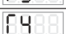 | 常通 `--`，常断 `-` | 常通 `--` |
|  | 控制输出逻辑方向 | r4［涛4］ | 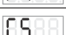 | 常通 `--`，常断 `-` | 常通 `--` |
|  | 主控输出分离参数 | r5［涛5］ | 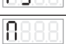 | 联合 `--`，分离 `-`（注） C控主B控D `-`，B控主C控D `--` | 联合 `--` |
|  | 控制信号逻辑关系 | N［大N］ | 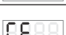 | 或、与、异或 | 与 |
|  | 频率指示参数 | rE［涛E］ | 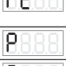 | `-5`：自动识别输入频率，并数字显示输出频率 `-E`：输出频率设置可显示为全波 FUL、半波 HAF、三分之一波 thr、四分之一波 Fou | -5 |
|  | 智能光电灵敏度 | P［P］ | 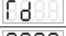 | 0~999 | 80 |
|  | 开机运行状态 | rd［涛d］ | 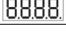 | 开机运行 `--`，开机停止 `-`，开机跟随 `-:` | 开机运行 |
|  | 恢复出厂设定 | 8.8.8.8.［全8］ |  | —— | —— |

备注：主-主输出，B-智能光电信号，C-两个开关传感器的逻辑信号，D-控制输出。

联合：主输出和控制输出受面板的启/停键以及智能光电、两个开关传感器三者的信号的逻辑控制。

分离：主输出受面板的启/停键控制，控制输出受智能光电、两个开关传感器三者的信号的逻辑控制。

C控主B控D：主输出受面板的启/停键及两个开关传感器两者的信号的逻辑控制。控制输出受智能光电控制。

B控主C控D：主输出受面板的启/停键及智能光电控制。控制输出受两个开关传感器两者的信号的逻辑控制。

### 第 7 页

*SDVC201-L&SDVC20-XL数字调压振动送料控制器*

## 错误讯息指示和故障排除

| 故障现象/故障代码 | 数码管符号图片 | 含义 | 排除方法 |
|---|---|---|---|
| 打开开关，没有显示 |  |  | ◆请检查电源插座是否有电？ ◆电源插头是否可靠连接插座？ ◆请检查保险丝是否完好？ |
| 有显示，但是振动盘不动，也没有声音 |  |  | ◆请检查输出电缆是否正确地连接控制器与振动盘？ ◆请检查控制器参数，是否输出电压调节的太小？ ◆请检查控制信号是否将控制器置于“停止”状态？ ◆请检查是否有设置为“常断”的参数，导致控制器被置于 　“停止”状态？ |
| 控制信号不起作用 |  |  | ◆请检查控制信号是否正确输入？ ◆请检查输入的控制信号的地线是否与本机地正确连接？ ◆请检查控制信号逻辑关系设置是否是您期望的设置？ |
| 有显示，振动盘不动，但是可以听到声音 |  |  | ◆请按照说明书介绍的调节方法逐步调节各参数。 |
| Err1 |  | 短路保护 | ◆请检查输出航空插头、电缆线是否有短路的情况？ ◆请检查控制器是否可靠接地？ ◆请检查振动盘电磁线圈是否有短路、漏电、匝间短路的情况？ |
| Err2 |  | 过流保护 | ◆请检查是否使用了超过控制器参数规格限定的振动盘？ ◆请检查输出电缆线是否可靠连接？ |
| Err3 | 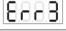 | 温度异常 | ◆将本控制器安装在符合产品使用要求的环境中。 |
| Err4 | 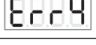 | 输入电压偏低 | ◆请检查输入电压。 |
| Err4. | 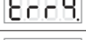 | 输入电压偏高 | ◆请检查输入电压。 |
| Err5 |  | 内部通信异常 | ◆联系本公司技术支持。 |

**警告**

在民用环境中，本产品可能产生无线电干扰。在这种情况下，可能需要采取附加抑制措施。

### 第 8 页

*SDVC201-L&SDVC20-XL数字调压振动送料控制器*

## 安装尺寸

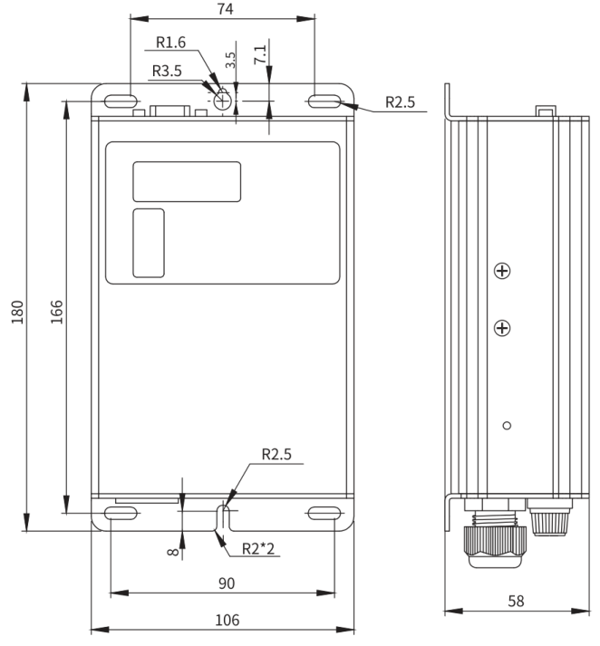

**单位：毫米（mm）**

| 公差区间 | 公差值 |
|---|---|
| 0~3 | ±0.05 |
| 3~10 | ±0.1 |
| 10~30 | ±0.15 |
| 30~80 | ±0.2 |
| 80~180 | ±0.3 |
| >180 | ±0.5 |

本系列产品均适用此公差表。
<!-- /auto:ai-body-draft v1 -->

<!-- auto:data-params-summary v1 -->
## 附录 · 参数表（结构化侧车·机器生成）

> 说明：本节由 `data/<doc_key>/params/params.yaml` 自动渲染（展示前若干行），用于校对与二次开发。定稿以层 C 数据为准。

| 参数 | 标志/符号 | 范围 | 默认 | 单位 | 备注 |
| --- | --- | --- | --- | --- | --- |
| 输入电压 |  |  |  | 伏特（V） | SDVC201-L交流有效值 |
| 输入电压 |  |  |  | 440 | SDVC20-XL交流有效值 |
| 输出电压调整范围 |  |  |  | 伏特（V） | 半波 |
| 输出电压调整范围 |  |  |  | Vin-5 | 全波 |
| 电压调整精度 |  |  |  | 伏特（V） |  |
| 稳压精度 |  |  |  | 伏特（V） | Vset = 150V ΔVin+ = 70V |
| 稳压响应时间 |  |  |  | 秒（s） |  |
| 输出电流调整范围 |  |  |  | 安培（A） | SDVC201-L |
| 输出电流调整范围 |  |  |  | 15 | SDVC20-XL |
| 输出功率 |  |  |  | 伏安（VA） | SDVC201-L |
| 输出功率 |  |  |  | 5700 | SDVC20-XL |
| 输出频率 |  |  |  | 赫兹（Hz） | 全波 |
| 输出频率 |  |  |  | 65 | 半波 |
| 输出频率 |  |  |  | 43 | 三分之一波 |
| 输出频率 |  |  |  | 32 | 四分之一波 |
| 输出波形 |  |  |  |  |  |
| 缓启动时间 |  |  |  | 秒（s） | 出厂默认0.5 |
| 延迟时间范围 |  |  |  | 秒（s） | 出厂默认0.2 |
| 延迟时间精度 |  |  |  | 秒（s） |  |
| 过热保护温度 |  |  |  | 摄氏度（℃） |  |
| 直流控制输出电压 |  |  |  | 伏特（V） |  |
| 直流控制输出电流 |  |  |  | 毫安（mA） |  |
| 模拟控制信号 |  |  |  | 伏特(V)/毫安(mA) | 远程速度控制电压/电流 |
| 数字控制信号 |  |  |  | 伏特（V） | 开关信号控制 |
| 调整方式 |  |  |  | 键（Button） |  |
| 保险丝容量 |  |  |  | 安培（A） | SDVC201-L |
| 保险丝容量 |  |  |  | 20 | SDVC20-XL |
| 空载功耗 |  |  |  | 瓦特（W） |  |
| 显示方式 |  |  |  | 位（Digit） | LED数码管 |
| 工作环境温度 |  |  |  | 摄氏度（℃） | 不结露 |

*（仅展示前 30 条，共 58 条；完整数据见下方链接。）*

- 完整 YAML：`data/cuh.sdvc.manual.v1.01/params/params.yaml`
- 表格索引：`data/cuh.sdvc.manual.v1.01/index.yaml`
<!-- /auto:data-params-summary v1 -->
