## 目录

> 下列条目来自 PDF 内置书签/大纲；链接指向本批转换生成的整页渲染图（`assets/pages/`），便于与原版 PDF 对照校对。

- [1: 封面](assets/pages/page-0001.png)（第 1 页）
- [2: 封2](assets/pages/page-0002.png)（第 2 页）
- [3: 序言](assets/pages/page-0003.png)（第 3 页）
- [4: 注意事项](assets/pages/page-0004.png)（第 4 页）
- [5: 工作与储存环境](assets/pages/page-0005.png)（第 5 页）
- [6: 空白](assets/pages/page-0006.png)（第 6 页）
- [7: 目录](assets/pages/page-0007.png)（第 7 页）
- [8: 空白](assets/pages/page-0008.png)（第 8 页）
- [9: 1](assets/pages/page-0009.png)（第 9 页）
- [10: 2](assets/pages/page-0010.png)（第 10 页）
- [11: 3](assets/pages/page-0011.png)（第 11 页）
- [12: 4](assets/pages/page-0012.png)（第 12 页）
- [13: 5](assets/pages/page-0013.png)（第 13 页）
- [14: 6](assets/pages/page-0014.png)（第 14 页）
- [15: 7](assets/pages/page-0015.png)（第 15 页）
- [16: 8](assets/pages/page-0016.png)（第 16 页）
- [17: 9](assets/pages/page-0017.png)（第 17 页）
- [18: 10](assets/pages/page-0018.png)（第 18 页）
- [19: 11](assets/pages/page-0019.png)（第 19 页）
- [20: 12](assets/pages/page-0020.png)（第 20 页）
- [21: 13](assets/pages/page-0021.png)（第 21 页）
- [22: 14](assets/pages/page-0022.png)（第 22 页）
- [23: 15](assets/pages/page-0023.png)（第 23 页）
- [24: 16](assets/pages/page-0024.png)（第 24 页）
- [25: 17](assets/pages/page-0025.png)（第 25 页）
- [26: 18](assets/pages/page-0026.png)（第 26 页）
- [27: 19](assets/pages/page-0027.png)（第 27 页）
- [28: 20](assets/pages/page-0028.png)（第 28 页）
- [29: 21](assets/pages/page-0029.png)（第 29 页）
- [30: 22](assets/pages/page-0030.png)（第 30 页）
- [31: 23](assets/pages/page-0031.png)（第 31 页）
- [32: 24](assets/pages/page-0032.png)（第 32 页）
- [33: 25](assets/pages/page-0033.png)（第 33 页）
- [34: 26](assets/pages/page-0034.png)（第 34 页）
- [35: 27](assets/pages/page-0035.png)（第 35 页）
- [36: 28](assets/pages/page-0036.png)（第 36 页）
- [37: 29](assets/pages/page-0037.png)（第 37 页）
- [38: 30](assets/pages/page-0038.png)（第 38 页）
- [39: 31](assets/pages/page-0039.png)（第 39 页）
- [40: 32](assets/pages/page-0040.png)（第 40 页）
- [41: 33](assets/pages/page-0041.png)（第 41 页）
- [42: 34](assets/pages/page-0042.png)（第 42 页）
- [43: 35](assets/pages/page-0043.png)（第 43 页）
- [44: 36](assets/pages/page-0044.png)（第 44 页）
- [45: 37](assets/pages/page-0045.png)（第 45 页）
- [46: 空白](assets/pages/page-0046.png)（第 46 页）
- [47: 封3](assets/pages/page-0047.png)（第 47 页）
- [页面 48](assets/pages/page-0048.png)（第 48 页）
## 术语与命名

- 侧车：`glossary/terms.yaml`（机读）、`glossary/zh-CN.md`（人读）；候选表，定稿后并入公司级 `glossary/`。

## 适用范围

- 本文档由 PDF 自动转换生成，正文与插图需人工核对。

## 变更记录

- 2026-06-05 15:12:04：由转换工具从源 PDF 生成首版。

## 正文

<!-- auto:ai-body-draft v1 -->
> 以下为**整页视觉转写**的正文草稿（多模态模型直接输出 Markdown，含 GFM 表； 若配置 `[[vcrop:页:序]]` 占位符，裁剪步骤会插入 `assets/images/` 下 PNG）。**请务必人工校对。**

### 第 1 页

# CUH

## 数字稳压振动送料控制器

**IP67**

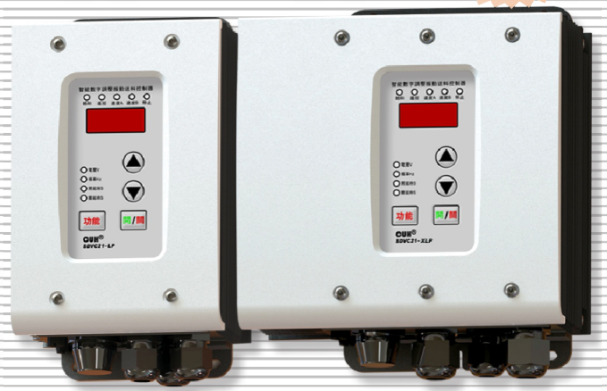

防油防水SDVC21P系列  
智能数字调压振动送料控制器

# 用户手册

### 第 2 页

## 智能数字振动送料控制器相关产品

| 品名规格 | 特点 |
|---|---|
| SDVC34 智能数字自动调频振动送料控制器系列 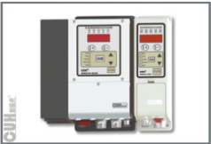 | · 频率调节　　　　· 电压调节 · 智能跟踪　　　　· 计数功能 · 料满停机　　　　· 线控调速 · 控制输出　　　　· Rs485通信 · 最大输出限定　　· 波形指数设置 · 恢复出厂设置　　· 过热保护功能 · 过流保护功能　　· 短路保护功能 · 加速功能 |
| SDVC31 数字调频振动送料控制器系列 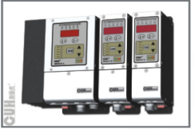 | · 自动稳压　　　　· 缓启动 · 缓启动时间设置　· 加速功能 · 智能光电传感　　· 线控调速 · 控制输出　　　　· 键盘锁定 · 最大输出限定　　· 波形指数设置 · 恢复出厂设置　　· 过热保护功能 · 过流保护功能　　· 短路保护功能 |

## 压电数字调频振动送料控制器

| 品名规格 | 特点 |
|---|---|
| SDVC40 压电数字调频振动送料控制器系列 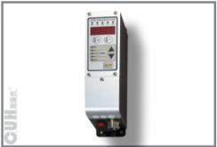 | · 自动稳压　　　　· 缓启动 · 缓启动时间设置　· 智能光电传感 · 线控调速　　　　· 控制输出 · 键盘锁定　　　　· 最大输出限定 · 波形指数设置　　· 恢复出厂设置 · 过热保护功能　　· 过流保护功能 · 短路保护功能 |

### 第 3 页

智能数字稳压振动送料控制器　　　　　　　　　　　　　　　　SDVC21P系列

---

# 序　言

感谢您选用我公司出品的 **CUH** 系列数字振动送料控制器（本手册以下简称控制器）。

本手册提供给使用者安装调试、参数设定、异常诊断、故障排除及日常维护的相关注意事项。为了确保能够正确地安装及操作本控制器，请在装机之前，详细阅读本使用手册，并请妥善保存。

**_本说明书适合以下型号控制器：_**

◆ 数字调压振动送料控制器—SDVC21-LP（10A输出电流）

◆ 数字调压振动送料控制器—SDVC21-XLP（25A输出电流）

---

2019-10　　　　　　　　　　　　　　　　　　　　　　　　　SDVC21PSMSCN_4.02

### 第 4 页

智能数字稳压振动送料控制器　　　　　　　　　　　　　　　SDVC21P系列

---

## *以下为特别需要注意的事项：*

1、任何情况下都不可以在带电状态下拔插接线或试图触摸插座内各接点，以防触电和发生意外。

2、请避免采用通过继电器等设备切断供电的方式来控制本控制器的输出，这会严重降低控制器寿命。

3、请不要擅自打开壳体，以免破坏壳体密封性能，从而影响控制器防尘、防油、防水的防护等级。

4、注意：任何情况下请勿将本控制器在超越设计极限状态下工作。

5、请严格按照本使用说明操作，对于不按照本操作说明所造成的任何设备或人身伤害，本公司不承担任何民事和刑事责任。

> ☺ 任何情况下都请不要打开本机机壳，以防遭电击。如本机出现故障请致电本公司，我们将尽快协助排除故障。  
> 机壳内全部为固态电路，没有可以调节部件和用户可以维修部分，请不要试图维修本机。

---

2019-10　　　　　　　　　　　　　　　　　　　　　　　　　SDVC21PSMSCN_4.02

### 第 5 页

智能数字稳压振动送料控制器　　　　　　　　　　　　　　　　　SDVC21P系列

---

## 工作与储存环境

### 一、 使用前的检查

每部控制器在出厂前，均经过严格的品质检验，并做强化的防撞包装处理。

客户在控制器拆箱后，请即刻进行下列检查。

- 检查控制器是否在运输过程中造成损伤。
- 检查控制器型号是否与订货登记资料完全相同。

### 二、 工作环境

为使本控制器具有更好的使用效果和更长的使用寿命，在安装时请注意以下问题：

- ❗ 良好的通风散热环境。
- ❗ 无腐蚀、易燃性的气体、液体。
- ❗ 坚固无振动。
- ❗ 远离电磁噪声干扰。
- ❗ 使用环境温度为0摄氏度到40摄氏度。
- ❗ 仅适用于海拔2000m以下地区安全使用。

---

2019-10　　　　　　　　　　　　　　　　　　　　　　　　　SDVC21PSMSCN_4.02

### 第 6 页

智能数字稳压振动送料控制器                                               SDVC21P系列

---

---

2019-10                                               SDVC21PSMSCN_4.02

### 第 7 页

**智能数字稳压振动送料控制器**　　　　　　　　　　　　　　　　**SDVC21P系列**

# 目　录

第一章　性能特点 ........................................................ 1

第二章　安装指南 ........................................................ 3

第三章　部件说明 ........................................................ 4

第四章　基本操作 ........................................................ 6

4.1　输出电压设定 ...................................................... 6

4.2　输出频率设定 ...................................................... 7

4.3　频率指示参数设定 .................................................. 7

4.4　缓启动功能 ........................................................ 8

4.5　输出开关 .......................................................... 8

4.6　最大输出电压限制功能 \* ............................................ 9

4.7　恢复出厂设定 \* ................................................... 10

第五章　传感器与信号控制 ............................................... 11

5.1　智能光电传感器的使用方法 ......................................... 11

5.2　开关传感器的使用方法 ............................................. 15

5.3　第二个开关传感器的使用方法 ....................................... 18

5.4　控制信号逻辑关系设定 \* ........................................... 21

5.5　控制输出 ......................................................... 22

5.6　远程速度控制（线控调速功能）\* ................................... 26

5.7　速度档位开关 \* ................................................... 27

第六章　安全保护功能 ................................................... 28

6.1　雷击保护功能 ..................................................... 28

6.2　短路保护功能 ..................................................... 28

6.3　过流保护功能 ..................................................... 28

6.4　过热保护功能 ..................................................... 28

6.5　环境温度降额曲线 ................................................. 28

附　录

附录A：外形尺寸 ........................................................ 29

附录B：接口定义 ........................................................ 31

附录C：信号接口定义 .................................................... 31

附录D：功能状态对照表 .................................................. 34

附录E：技术规格 ........................................................ 35

附录F：错误讯息指示和故障排除 .......................................... 36

附录G：极限参数 ........................................................ 37

**备注：带\*符号的功能为高级功能，此功能请在专业电气工程师的指导下操作**

---

2019-10　　　　　　　　　　　　　　　　　　　　　　　　　SDVC21PSMSCN_4.02

### 第 8 页

智能数字稳压振动送料控制器　　　　　　　　　　　　　　　　　　　　　　　　　SDVC21P系列

---

2019-10　　　　　　　　　　　　　　　　　　　　　　　　　　　　　　SDVC21PSMSCN_4.02

### 第 9 页

智能数字稳压振动送料控制器　　　　　　　　　　　　　　　　SDVC21P系列

---

# 第一章 性能特点

本控制器专为自动化设备中振动送料控制用，融合最新电子技术,经过精心设计,为用户提供最方便实用的功能,包括:

**防护等级：** IP67，本控制器可以长期工作在恶劣环境中，如：潮湿、油污、灰尘严重的环境等。

**超宽工作电压范围：** 本控制器可以工作在电源电压AC 85-440V。

**自动稳压：** 内置数字稳压功能，可以消除由于电源电压波动造成的送料速度变化。

**缓启动：** 在启动时，输出电压会从零开始逐渐增大到预设电压。这个功能使得用户可以使振动器柔和地开始工作，这有助于防止工件掉落，同时有效地消除了开机冲击对振动盘造成的损坏。

**可调缓启动：** 缓启动时间可以由数字精确设定。

**开关信号控制（远程开关）：** 本机具有抗干扰的开关信号控制，可以通过外部开关信号控制本机的启闭。

**同时支持三个传感器控制信号输入：** 料空和料满双控制信号输入，支持同时连接3个传感器，并具有逻辑与、或、非、异或等全部控制关系。

**输出电压预置功能（远程速度选择）：** 可以通过外部控制信号直接选择多达4种预先设置的输出电压。

**料满停机：** 通过NPN型传感器实现料满停机控制,并具有可调缓启动时间、开延迟、关延迟、逻辑方向调节等控制功能。

**智能光电传感：** 通过自适应的智能光电对射传感器实现料满或料空停机控制,且具有可调缓启动时间、开延迟、关延迟、逻辑方向调节等控制功能。

**线控调速（远程速度控制）：** 可以直接使用外置的电位器、PLC提供的4~20mA电流或1~5V电压信号控制输出电压。

**控制输出：** 通过晶体管输出控制信号，可直接用于控制电磁阀等外部设备与本控制器协调工作。

---

2019-10　　　　　　　　　- 1 -　　　　　　　　　SDVC21PSMSCN_4.02

### 第 10 页

**智能数字稳压振动送料控制器**　　　　　　　　　　　　　　　　**SDVC21P系列**

---

　　本公司对产品质量有着一贯的追求,除在生产阶段采用高品质元器件,严密的质检体系保障外,为了最大程度地提高产品的可用性,对于用户使用中可能发生的意外问题也做了充分的准备,其中包括:

**短路保护：**　本控制器可以在用户误操作造成短路时停止输出，以保护本机及用户的设备。

**过流保护：**　本控制器可以在用户误操作造成输出电流超过额定电流时短暂停止输出,以保护本机及用户的设备。

**过热保护：**　本控制器工作温度超过65°C时将停止输出,以保护本机。

　　为保持产品质量的国际化标准,本公司产品遵守CE认证标准。

---

2019-10　　　　　　　　　　　　　　- 2 -　　　　　　　　　　　　　　SDVC21PSMSCN_4.02

### 第 11 页

**智能数字稳压振动送料控制器**　　　　　　　　　　　　　　　　　　　　　　　**SDVC21P系列**

---

## 第二章 安装指南

### 第一步：将输出线的接线端子接到振动盘的电磁线圈上。

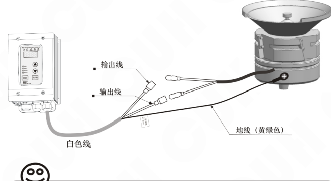

> ☺ **请注意：**
>
> 一定要确认电磁铁线圈接在两个输出引脚上，外壳需要可靠接地。否则机壳可能带电并发生严重安全事故！！！
>
> 请使用随机附送的子弹头插头连接振动盘出线，并使用专用压线钳压紧端子。
>
> 一定要确认与控制器输出线牢固连接，并且不可多次插拔。

### 第二步：

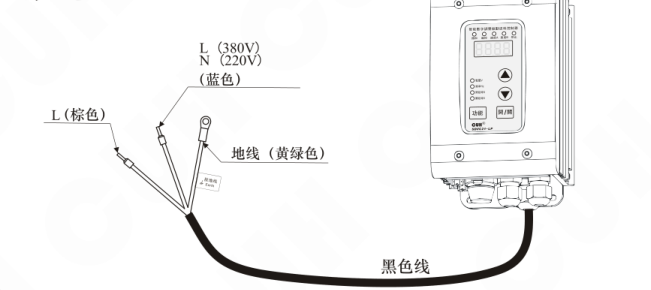

---

2019-10　　　　　　　　　　　　　　　- 3 -　　　　　　　　　　　　　　　SDVC21PSMSCN_4.02

### 第 12 页

智能数字稳压振动送料控制器　　　　　　　　　　　　　　　　　　　　　　　　　SDVC21P系列

## 第三章 部件说明

本机面板共有四个可供用户操作的按键，它们分别是调整状态的“功能”键，增加设定值的“▲”键，降低设定值的“▼”键及输出“开/关”键。

### 按键及参数指示灯说明

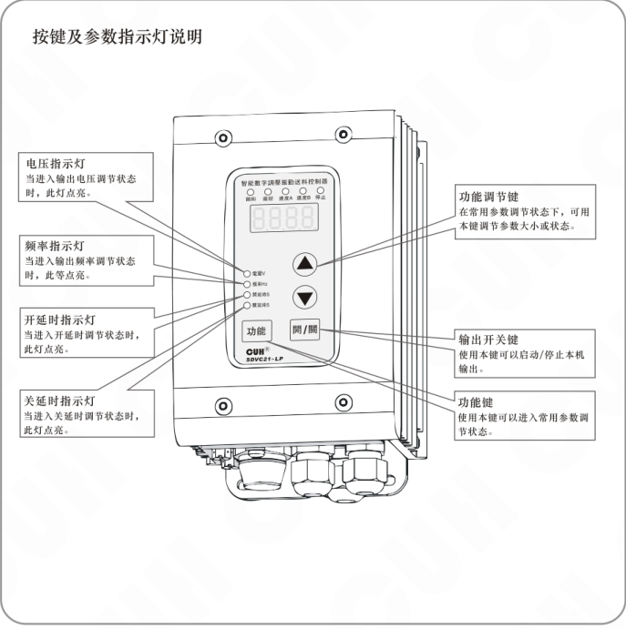

| 项目 | 说明 |
|---|---|
| 电压指示灯 | 当进入输出电压调节状态时，此灯点亮。 |
| 频率指示灯 | 当进入输出频率调节状态时，此灯点亮。 |
| 开延时指示灯 | 当进入开延时调节状态时，此灯点亮。 |
| 关延时指示灯 | 当进入关延时调节状态时，此灯点亮。 |
| 功能调节键 | 在常用参数调节状态下，可用本键调节参数大小或状态。 |
| 输出开关键 | 使用本键可以启动/停止本机输出。 |
| 功能键 | 使用本键可以进入常用参数调节状态。 |

2019-10　　　　　　　　　　　　　　　　　- 4 -　　　　　　　　　　　　　　　　　SDVC21PSMSCN_4.02

### 第 13 页

**智能数字稳压振动送料控制器**　　　　　　　　　　　　　　　　　　　　　　　　　**SDVC21P系列**

## 状态指示灯说明

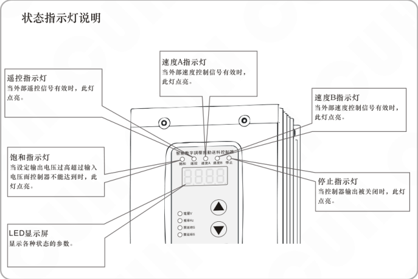

- **遥控指示灯**：当外部遥控信号有效时，此灯点亮。
- **饱和指示灯**：当设定输出电压过高超过输入电压而控制器不能达到时，此灯点亮。
- **LED显示屏**：显示各种状态的参数。
- **速度A指示灯**：当外部速度控制信号有效时，此灯点亮。
- **速度B指示灯**：当外部速度控制信号有效时，此灯点亮。
- **停止指示灯**：当控制器输出被关闭时，此灯点亮。

## 外部部件说明

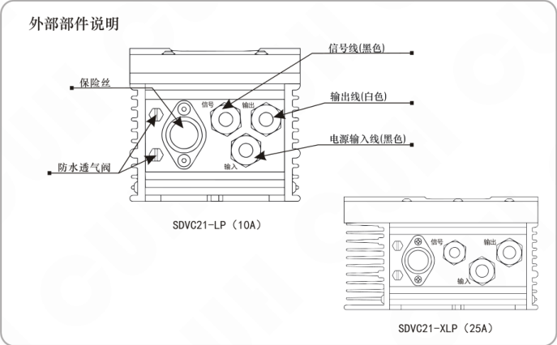

- **保险丝**
- **防水透气阀**
- **信号线（黑色）**
- **输出线（白色）**
- **电源输入线（黑色）**
- 接口标识：**信号**、**输出**、**输入**
- 型号标注：**SDVC21-LP（10A）**、**SDVC21-XLP（25A）**

---

2019-10　　　　　　　　　　　　　　- 5 -　　　　　　　　　　　　　　SDVC21PSMSCN_4.02

### 第 14 页

**智能数字稳压振动送料控制器**　　　　　　　　　　　　　　　　**SDVC21P系列**

---

# 第四章 基本操作

## 4.1 输出电压设定

本控制器可以直接在面板上以数字方式设定输出电压。由于本控制器特有的稳压功能，输出电压并不会受到输入电压的影响，即使在电压不稳定场合中使用也可以保持振动体稳定工作。同时，直接的电压数值设定也为用户了解设备运行情况提供了准确的数据。

- ▶▶连接电源线给控制器供电。
- ▶▶使用控制面板上的“功能”键切换到电压调整“H”状态，这时电压指示灯点亮。
- ▶▶通过“▲”和“▼”可以对电压“H”值进行调整。

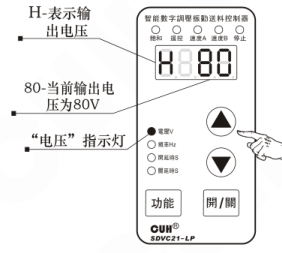

- ▶▶本控制器的输出电压不能超过输入电压。当设定的电压过于接近输入电压时，控制器将不能进行正常的稳压，此时，面板上饱和指示灯将点亮，表示稳压失效。
- ▶▶本控制器也不能输出过低的电压。当输出电压过低时，控制器将不能进行正常的稳压，此时，面板上的饱和指示灯也将点亮，表示稳压失效。

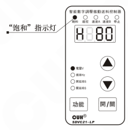

---

2019-10　　　　　　　　　　　　- 6 -　　　　　　　　　　　　SDVC21PSMSCN_4.02

### 第 15 页

**智能数字稳压振动送料控制器**　　　　　　　　　　　　　　　　　　　　　**SDVC21P系列**

---

## 4.2 输出频率设定

SDVC21-LP控制器可以选择输出电源频率的二倍（全波）或电源频率（半波）

SDVC21-XLP控制器可以选择输出全波、半波、三分之一波（电源频率二倍除三）、四分之一波（电源频率二倍除四）

- 使用控制面板上的“功能”键切换到频率调整“E”状态，这时频率指示灯点亮。
- 通过使用“▲”和“▼”键对频率“E”值进行设定。选择为100，也就是全波整流，选择50，也就是半波整流。  
  对于SDVC21-XLP还可以选择33，也就是三分之一波，选择25，也就是四分之一波。

图示标注：

- E-表示输出频率
- 当前输出频率为50（半波）
- “频率”指示灯

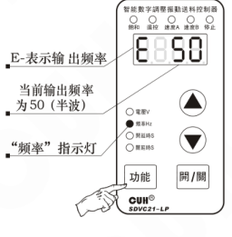

> 🙂 本参数还可以根据电源频率设定输出频率显示格式，详细可通过4.3频率指示参数设定。

## 4.3 频率指示参数设定

- 长按“功能”键2秒进入高级功能的设定状态。
- 短按“功能”键切换到频率指示参数设定状态，代表字母为“TE”。
- 用“▲”和“▼”键调整该参数。

图示标注：

- “TE”表示频率指示参数
- 表示频率指示状态

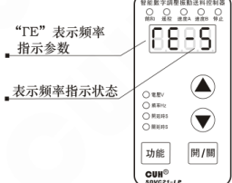

> TE-5，频率E全波100、半波50、三分之一波33、四分之一波25；  
> TE-6，频率E全波120、半波60、三分之一波40、四分之一波30；  
> TE-E，频率E全波FUL、半波HAF、三分之一波trd、四分之一波FoH。

---

2019-10　　　　　　　　　　　　　　　　　- 7 -　　　　　　　　　　　　　　　　　SDVC21PSMSCN_4.02

### 第 16 页

**智能数字稳压振动送料控制器**　　　　　　　　　　　　　　　　　　　　　　　　　**SDVC21P系列**

---

## 4.4 缓启动功能

本控制器从停止状态启动时，输出电压可以平缓提高到设定值，以防止设备工件遭受冲击。

缓启动时间（t）：控制器从停止状态启动时，输出电压从零平滑升高到达设定输出电压所需要的时间称为缓启动时间。

> ▶▶长按“功能”键2秒进入高级功能的设定状态。
>
> ▶▶短按“功能”键切换到缓启动参数设定状态，代表字母为“t”。
>
> ▶▶用“▲”和“▼”键调整该参数。该参数的单位是秒，精度为0.1秒。
>
> 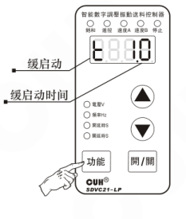
>
> 缓启动时间的范围是0.1-10.0秒

## 4.5 输出开关

面板上的轻触式输出开关可以方便快速地开启或停止本机的输出。

> ▶▶使用控制器面板上的“开/关”键，可以控制本机启动或停止输出。停止输出时，“停止”指示灯点亮，表示进入“停止”状态。
>
> 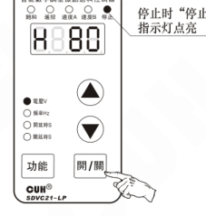
>
> ☺ 本功能使用软开关，由数字信号进行控制。因此，不会产生火花烧蚀机械触点的问题，可以大大延长控制器和振动设备的使用寿命。

---

2019-10　　　　　　　　　　　- 8 -　　　　　　　　　　　SDVC21PSMSCN_4.02

### 第 17 页

智能数字稳压振动送料控制器　　　　　　　　　　　　　　　　　　　　　　SDVC21P系列

---

## 4.6 最大输出电压限制功能（此需要在专业电气工程师的指导下使用）

本控制器可以设定最大输出电压。该参数为隐含参数。设定该参数可以防止用户误操作，输出过大电压而损坏振动设备。速度遥控功能和速度分档功能都受到此参数的限制。

> ▶▶ 长按“功能”键2秒进入高级功能的设定状态。
>
> ▶▶ 短按“功能”键切换到最大输出电压参数设定状态，代表字母为“h”。
>
> ▶▶ 用“▲”和“▼”键调整该参数。
>
> 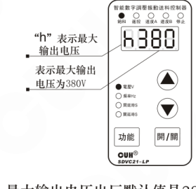
>
> “h”表示最大输出电压  
> 表示最大输出电压为380V
>
> 最大输出电压出厂默认值是380V

---

2019-10　　　　　　　　　　　　　　　- 9 -　　　　　　　　　　　　　　　SDVC21PSMSCN_4.02

### 第 18 页

**智能数字稳压振动送料控制器**　　　　　　　　　　　　　　　　　　　　　　　　　**SDVC21P系列**

## 4.7 恢复出厂设定（此功能需要在专业电气工程师的指导下使用）

本功能可以使用户快速将控制器设置恢复为出厂默认设置状态。  
由于本控制器功能强大，有数量众多的控制参数可以由用户设定，对于初学者，可能在多次的设定修改后不能恢复控制器的正常工作状态。使用该功能可以快速将调试的参数状态恢复为出厂默认设置。

- 长按“功能”键2秒进入高级功能的设定状态。
- 连续短按“功能”键切换到全屏闪烁状态，此时长按“▲”键直到控制器显示“----”，表示控制器已经重设完毕。
- 松开“▲”键，控制器将进入正常的电压调整状态“H”。此时控制器就像刚开始使用一样，所有参数都已经恢复到出厂默认状态。

示意图：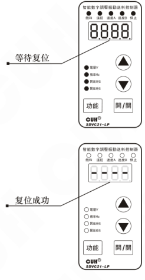

---

2019-10　　　　　　　　　　　　　　　　- 10 -　　　　　　　　　　　　　　　　SDVC21PSMSCN_4.02

### 第 19 页

**智能数字稳压振动送料控制器**　　　　　　　　　　　　　　　　　　　　　　　　　**SDVC21P系列**

# 第五章 传感器与信号控制

本机可以接受多种外部信号或传感器控制其运行状态。本节主要介绍智能光电传感器、接近开关传感器和PLC控制等的使用方法。

## 5.1　智能光电传感器的使用方法

本机配合使用本公司提供的SDVC-S1光电对射传感器可以实现智能光电传感功能。SDVC-S1传感器可以自动去除背景光对传感器灵敏度的影响，因而无需人工调节灵敏度即可可靠工作。

### 5.1.1 智能光电传感器连接方法：

SDVC-S1传感器是本公司特地为本系列产品开发的专门的配套传感器。

按照图例连接传感器。

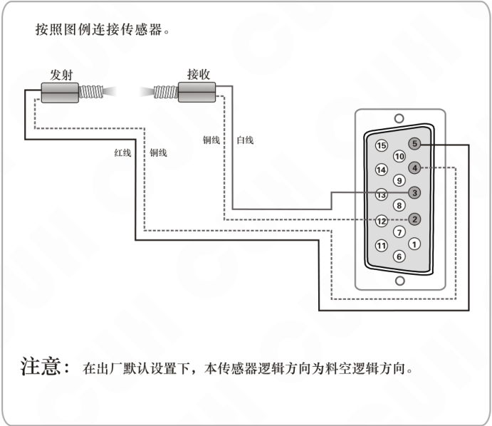

**注意：** 在出厂默认设置下，本传感器逻辑方向为料空逻辑方向。

---

2019-10　　　　　　　　　　　　　　　　　- 11 -　　　　　　　　　　　　　　　　SDVC21PSMSCN_4.02

### 第 20 页

**智能数字稳压振动送料控制器**　　　　　　　　　　　　　　　　　　　　　　　　　**SDVC21P系列**

---

### 5.1.2　智能光电传感器开延时、关延时的设定

当使用外部信号进行启动和停止控制时，大多数情况需要在收到指令后延迟一段时间才执行操作。对于这样的应用，可以通过设置开延时和关延时来实现。另外，还可以设定缓启动时间以消除启动时的冲击。

#### 开延时（J）

从施加一个使控制器进入运行状态的控制信号开始，到控制器开始有输出，期间经历的延迟时间称为开延时。

- 短按“功能”键切换到开延时调整“J”状态，这时开延时指示灯点亮。
- 通过“▲”和“▼”调整该参数。该参数的单位是秒，精度为0.1秒。

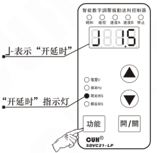

**开延时时间设定范围0.0～9.9秒**

#### 关延时（L）

从施加一个使控制器进入停止状态的控制信号开始，到控制器输出停止，期间经历的延迟时间称为关延时。

- 短按“功能”键切换到关延时调整“L”状态，这时关延时指示灯点亮。
- 通过“▲”和“▼”调整该参数。该参数的单位是秒，精度为0.1秒。

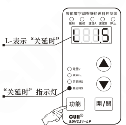

**关延时时间设定范围0.0～9.9秒**

---

2019-10　　　　　　　　　　　　　　　- 12 -　　　　　　　　　　　　　　　SDVC21PSMSCN_4.02

### 第 21 页

**智能数字稳压振动送料控制器**　　　　　　　　　　　　　　　　　　　　　　　　　**SDVC21P系列**

### 5.1.3 智能光电传感逻辑方向设定（此功能请在专业电气工程师的指导下操作）

在正常情况下，也就是接收端没有收到光信号时，控制器处于“运行”状态，即“常通”逻辑方向（出厂默认设置）。但是，对于一些特殊应用，可能需要相反的逻辑，可能会需要在没有收到光信号时，控制器处于“停止”状态。这可以通过修改本参数来实现。

- ▶ 长按“功能”键2秒进入高级功能的设定状态。
- ▶ 短按“功能”键切换到“T2”状态，即智能光电传感逻辑方向参数调整状态。
- ▶ 使用“▲”和“▼”可以改变逻辑方向。

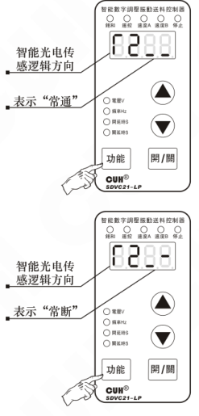

图示标注：

- 智能光电传感逻辑方向
- 表示“常通”
- 智能光电传感逻辑方向
- 表示“常断”

> ● 逻辑方向设置为常通，则没有收到光信号时，控制器处于运行状态。  
> ● 逻辑方向设置为常断，则没有收到光信号时，控制器处于停止状态。

---

2019-10　　　　　　　　　　　　　　　　　- 13 -　　　　　　　　　　　　　　　　　SDVC21PSMSCN_4.02

### 第 22 页

**智能数字稳压振动送料控制器**　　　　　　　　　　　　　　　　　　　　　　　　　**SDVC21P系列**

### 5.1.4 智能光电灵敏度参数设定

参数P是指智能光电传感器的灵敏度，也就是智能光电的接收距离参数。  
参数值越小智能光电越灵敏，也就是接收距离可以越大，反之接收距离会越小。

▶▶ 长按“功能”键2秒进入高级功能的设定状态。

▶▶ 短按“功能”键切换到智能光电灵敏度参数设定状态，代表字母为“P”。

▶▶ 用“▲”和“▼”键调整该参数。

右侧示意图标注：

- “P”表示智能光电灵敏度
- 表示默认值为80

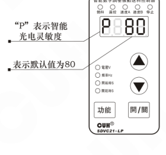

参数值的可调范围为0~999，默认值为80，其中：  
P值越大，作用范围越小，越不灵敏；  
P值越小，作用范围越大，越灵敏。

---

2019-10　　　　　　　　　　　　　　　　- 14 -　　　　　　　　　　　　　　　　SDVC21PSMSCN_4.02

### 第 23 页

智能数字稳压振动送料控制器  
SDVC21P系列

## 5.2 开关传感器的使用方法

配合各类开关传感器，如接近开关传感器、光电开关传感器、光纤传感器等实现自动启动和停止功能。

### 5.2.1 接近开关传感器接线方法：

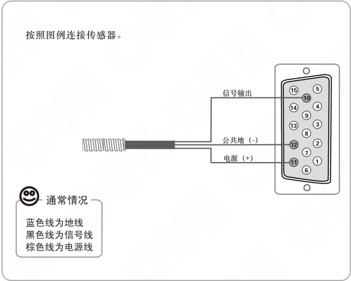

2019-10　　　　　　　　　　　　　- 15 -　　　　　　　　　　　　　SDVC21PSMSCN_4.02

### 第 24 页

**智能数字稳压振动送料控制器**　　　　　　　　　　　　　　　　　　　**SDVC21P系列**

### 5.2.2 开关传感器开延时、关延时时间设定

在默认状态下，智能光电传感器和开关传感器的开延时、关延时时间总是相同的。用户也可以单独为开关传感器设定开延时、关延时时间，此时开关传感器和智能光电传感器具有独立的开延时、关延时时间。

#### 开延时（J）

从施加一个使控制器进入运行状态的控制信号开始，到控制器开始有输出，期间经历的延迟时间称为开延时。

▶▶ 长按“功能”键2秒进入高级功能的设定状态。

▶▶ 短按“功能”键切换到开延时调整“J-”状态。

▶▶ 用“▲”和“▼”键调整该参数。该参数的单位是秒，精度为0.1秒。

开延时时间设定范围0～9.9秒

右侧示意图标注：

- `J-` 表示开关开延时
- 开关开延时时间独立设定为3秒

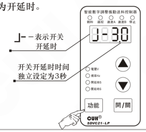

#### 关延时（L）

从施加一个使控制器进入停止状态的控制信号开始，到控制器输出停止，期间经历的延迟时间称为关延时。

▶▶ 长按“功能”键2秒进入高级功能的设定状态。

▶▶ 短按“功能”键切换到关延时调整“L-”状态。

▶▶ 用“▲”和“▼”键调整该参数。该参数的单位是秒，精度为0.1秒。

关延时时间设定范围0～9.9秒

将开关关延时时间调到小于0时，独立开关传感器独立开关延时时间将被关闭。

右侧示意图标注：

- `L-` 表示开关关延时
- 开关关延时时间独立设定为2秒

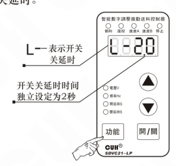

> ● 开关独立开、关延时关闭时，开关开、关延时与智能光电传感器开、关延时时间相同。  
> ● 开关独立开、关延时开启时，开关开、关延时时间由本参数设定，智能光电传感器开、关延时时间不受影响。

2019-10　　　　　　　　　　　　　　-16-　　　　　　　　　　　　　　SDVC21PSMSCN_4.02

### 第 25 页

**智能数字稳压振动送料控制器**　　　　　　　　　　　　　　　　　　　　　　　　　**SDVC21P系列**

---

### 5.2.3 开关传感器逻辑方向设定

（此功能请在专业电气工程师的指导下操作）

在正常情况下，也就是说不同开关引脚发生任何信号时，该引脚由于内部的上拉电阻，都会呈现为“高”电平。此时，在出厂默认设置下，控制器处于“运行”状态。但是，对于一些特殊应用，可能需要相反的逻辑。也就是说，可能会需要在不施加信号时控制器处于“停止”状态。这可以通过修改本参数来实现。

> » 长按“功能”键进入高级功能的设定状态。
>
> » 短按“功能”键切换到“T1”状态，即料满停机逻辑方向参数调整状态。
>
> » 使用“▲”和“▼”可以改变逻辑方向。

右侧示意图：开关传感器逻辑方向——表示“常通”。

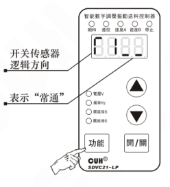

右侧示意图：开关传感器逻辑方向——表示“常断”。

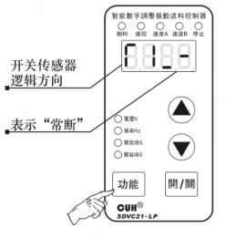

> ● 逻辑方向设置为**常通**，则**不连接**任何控制信号，控制器处于**运行**状态，也就是我们常说的**料满停机**
>
> ● 逻辑方向设置为**常断**，则**不连接**任何控制信号，控制器处于**停止**状态，也就是我们常说的**料空停机**

---

2019-10　　　　　　　　　　　　　　　　- 17 -　　　　　　　　　　　　　　　　SDVC21PSMSCN_4.02

### 第 26 页

**智能数字稳压振动送料控制器**　　　　　　　　　　　　　　　　　　　　　　　　　**SDVC21P系列**

## 5.3 第二个开关传感器的使用方法

本机可以允许客户同时接三个传感器，智能光电和两个开关传感器可以同时实现料空停机和料满停机的自动启动和停止功能。

### 5.3.1 第二个接近开关传感器接线方法：

按照图例连接传感器。

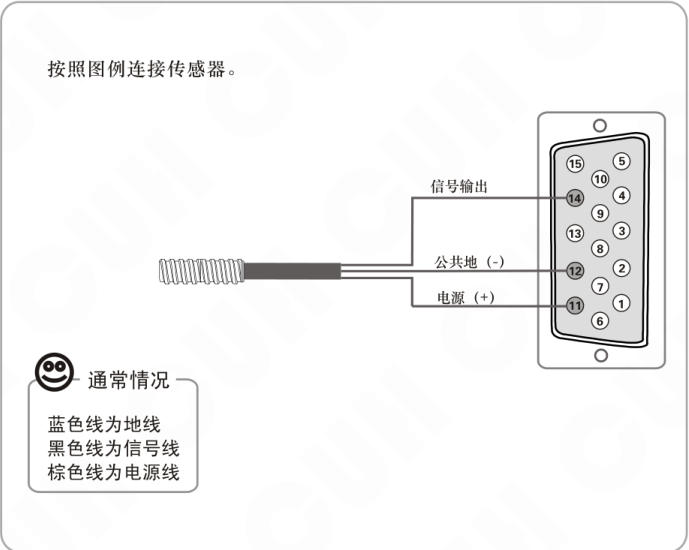

通常情况：

- 蓝色线为地线
- 黑色线为信号线
- 棕色线为电源线

---

2019-10　　　　　　　　　　　　　　　　　- 18 -　　　　　　　　　　　　　　　　　SDVC21PSMSCN_4.02

### 第 27 页

**智能数字稳压振动送料控制器**　　　　　　　　　　　　　　　　　　　　　　　　　**SDVC21P系列**

---

### 5.3.2 第二个开关传感器开延时、关延时时间设定

在默认状态下，三个开关传感器的开延时、关延时时间总是相同的。用户也可以单独为第二个开关传感器设定开延时、关延时时间，此时第二个开关传感器其它传感器具有独立的开延时、关延时时间。

**开延时（J）**　从施加一个使控制器进入运行状态的控制信号开始，到控制器开始有输出，期间经历的延迟时间称为开延时。

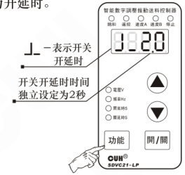

▶▶ 长按“功能”键2秒进入高级功能的设定状态。

▶▶ 短按“功能”键切换到开延时调整“J-”状态。

▶▶ 用“▲”和“▼”键调整该参数。该参数的单位是秒，精度为0.1秒。

开延时时间设定范围0.0～9.9秒

**关延时（L）**　从施加一个使控制器进入停止状态的控制信号开始，到控制器输出停止，期间经历的延迟时间称为关延时。

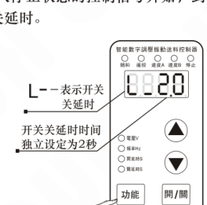

▶▶ 长按“功能”键2秒进入高级功能的设定状态。

▶▶ 短按“功能”键切换到关延时调整“L-”状态。

▶▶ 用“▲”和“▼”键调整该参数。该参数的单位是秒，精度为0.1秒。

关延时时间设定范围0.0～9.9秒

将开关传感器关延时时间调到小于0时，开关传感器独立开关延时时间将被关闭。

> ● 第二个开关传感器独立开、关延时关闭时，开、关延时与智能光电传感开、关延时时间相同。  
> ● 第二个开关传感器独立开、关延时开启时，开、关延时时间由本参数设定，智能光电传感开、关延时时间不受影响。

---

2019-10　　　　　　　　　　　　　　- 19 -　　　　　　　　　　　　　　SDVC21PSMSCN_4.02

### 第 28 页

**智能数字稳压振动送料控制器**　　　　　　　　　　　　　　　　　　　　　　**SDVC21P系列**

### 5.3.3 第二个开关传感器逻辑方向设定（此功能请在专业电气工程师的指导下操作）

在正常情况下，也就是说不同开关引脚发生任何信号时，该引脚由于内部的上拉电阻，都会呈现为“高”电平。此时，在出厂默认设置下，控制器处于“运行”状态。但是，对于一些特殊应用，可能需要相反的逻辑。也就是说，可能会需要在不施加信号时控制器处于“停止”状态。这可以通过修改本参数来实现。

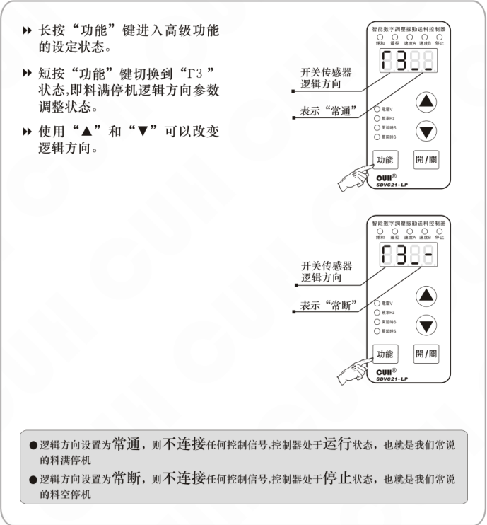

示意图中文字：

- 长按“功能”键进入高级功能的设定状态。
- 短按“功能”键切换到“T3”状态，即料满停机逻辑方向参数调整状态。
- 使用“▲”和“▼”可以改变逻辑方向。

右侧上方示意：

- 开关传感器逻辑方向
- 表示“常通”

右侧下方示意：

- 开关传感器逻辑方向
- 表示“常断”

> ● 逻辑方向设置为**常通**，则不连接任何控制信号，控制器处于**运行**状态，也就是我们常说的料满停机  
> ● 逻辑方向设置为**常断**，则不连接任何控制信号，控制器处于**停止**状态，也就是我们常说的料空停机

2019-10　　　　　　　　　　　　　　　-20-　　　　　　　　　　　　　　　SDVC21PSMSCN_4.02

### 第 29 页

**智能数字稳压振动送料控制器**　　　　　　　　　　　　　　　　　　　　　　　**SDVC21P系列**

## 5.4 控制信号逻辑关系设定（此需要在专业电气工程师的指导下使用）

本控制器可以设定智能光电传感与开关传感器同时作用时的逻辑关系。

- ▶ 长按“功能”键进入高级功能的设定状态。
- ▶ 短按“功能”键切换到“Π”状态，即控制信号逻辑关系设定功能。
- ▶ 使用“▲”和“▼”可以改变逻辑方向。

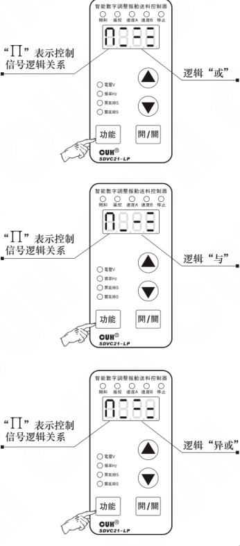

- ● 逻辑“与”：仅在智能光电传感与开关传感器信号同时要求控制器运行时，控制器才运行。
- ● 逻辑“或”：只要智能光电传感与开关传感器信号有一个要求控制器运行，控制器就运行。
- ● 逻辑“异或”：仅在智能光电传感与开关传感器信号要求不同时，控制器才运行。

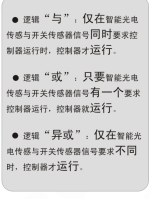

---

2019-10　　　　　　　　　　　　　　-21-　　　　　　　　　　　　　　SDVC21PSMSCN_4.02

### 第 30 页

智能数字稳压振动送料控制器　　　　　　　　　　　　　　　　　SDVC21P系列

---

## 5.5 控制输出（此需要在专业电气工程师的指导下使用）

本控制器可以输出低电压控制信号，以同步其它设备协同工作，如电磁阀、PLC等。

### 5.5.1 控制输出接线方法

#### PLC控制连接方法（控制器 控制 PLC）

按照图例连接传感器。

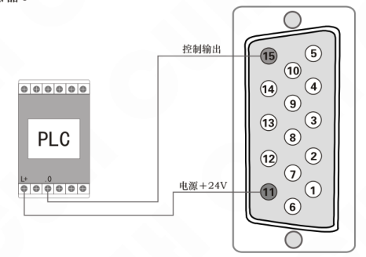

☺ 可以使用PLC的继电器输入，该继电器的线圈电压为24V，也可以使用PLC的源型输入。

---

2019-10　　　　　　　　　　　　-22-　　　　　　　　　　　　SDVC21PSMSCN_4.02

### 第 31 页

**智能数字稳压振动送料控制器**　　　　　　　　　　　　　　　　　　　　　　　　　**SDVC21P系列**

---

控制电磁阀工作的连接方法：

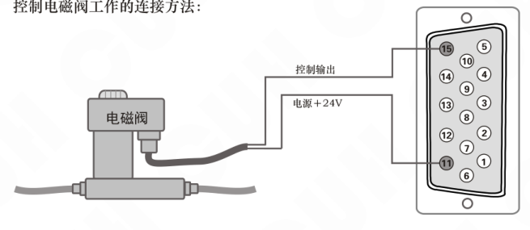

● 本控制器可直接驱动额定电压 24V，功率小于4W的电磁阀。

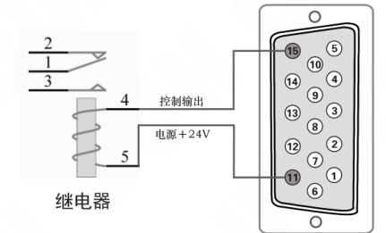

● 本控制器可直接驱动线圈额定电压24V，功率小于4W的继电器。

---

2019-10　　　　　　　　　　　　　　　-23-　　　　　　　　　　　　　　　SDVC21PSMSCN_4.02

### 第 32 页

**智能数字稳压振动送料控制器**　　　　　　　　　　　　　　　　　**SDVC21P系列**

## 5.5.2 控制输出逻辑方向设定

▶ 长按“功能”键2秒进入高级功能的设定状态。

▶ 短按“功能”键切换到“T4”状态，即控制输出逻辑方向设定状态。

▶ 用“▲”和“▼”键调整该参数。

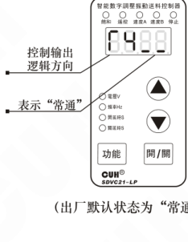

（出厂默认状态为“常通”）

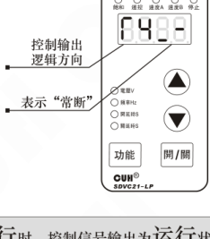

- 逻辑方向设置为**常通**，则控制器输出**运行**时，控制信号输出为**运行**状态。
- 逻辑方向设置为**常断**，则控制器输出**运行**时，控制信号输出为**停止**状态。

---

2019-10　　　　　　　　　　　　- 24 -　　　　　　　　　　　　SDVC21PSMSCN_4.02

### 第 33 页

**智能数字稳压振动送料控制器**　　　　　　　　　　　　　　　　　　　　　　　　　**SDVC21P系列**

## 5.5.3 主控输出分离参数设定

▶ 长按“功能”键2秒进入高级功能的设定状态。

▶ 短按“功能”键切换到“F5”状态，即主控输出分离参数设定状态。

▶ 用“▲”和“▼”键调整该参数。

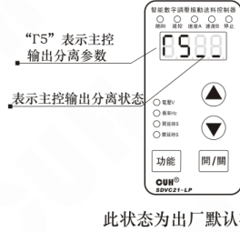

此状态为出厂默认状态。

- F5为“▁ ▁”表示控制器的输出和控制输出受到面板的启/停键以及智能光电、两个开关传感器三者的信号的逻辑控制。

- F5为“▁ ¯”表示控制器的输出受到面板的启/停键，控制输出受到智能光电、两个开关传感器三者的信号的逻辑控制。

- F5为“¯ ▁”表示控制器的输出受到面板的启/停键、以及两个开关传感器两者的信号的逻辑控制。24V控制输出受到智能光电控制。

- F5为“¯ ¯”表示控制器的输出受到面板的启/停键、受到智能光电控制。24V控制输出受两个开关传感器两者的信号的逻辑控制。

---

2019-10　　　　　　　　　　　　　　　　　-25-　　　　　　　　　　　　　　　　　SDVC21PSMSCN_4.02

### 第 34 页

智能数字稳压振动送料控制器　　　　　　　　　　　　　　　　　　　SDVC21P系列

## 5.6 远程速度控制（线控调速功能）

（此需要在专业电气工程师的指导下使用）

本控制器远程速度控制允许用户通过外接电位器或1~5V控制电压信号或4~20mA控制电流信号控制输出电压。这样，用户可以通过PLC、DCS或其他一些方法，方便容易地进行外部远程速度控制。

> **当** 控制电压超过0.5V时，线控电压对控制器的控制生效。此时，面板的遥控指示灯点亮，同时面板上调整电压的“▲”和“▼”键将失效。如果此时控制器处于电压调节状态，LED显示屏将显示输出电压。
>
> 控制电压1~5V线性对应输出电压0~440V（受参数h限制）
>
> **外接电位器使用方法：**
>
> 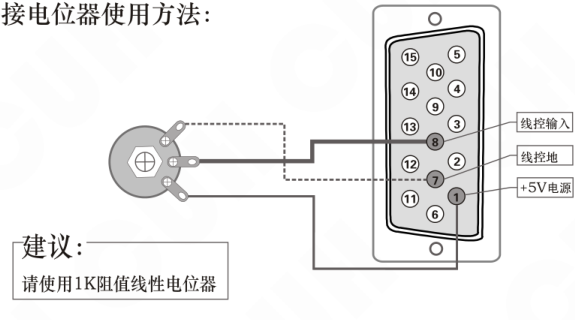
>
> 建议：
>
> 请使用1K阻值线性电位器
>
> **使用PLC进行输出电压控制的方法：（PLC控制 控制器）**
>
> 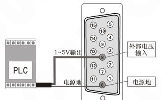
>
> 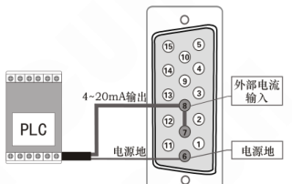

2019-10　　　　　　　　　　　　　　-26-　　　　　　　　　　　　　　SDVC21PSMSCN_4.02

### 第 35 页

**智能数字稳压振动送料控制器**　　　　　　　　　　　　　　　　　　　　　　　　　**SDVC21P系列**

## 5.7 速度档位开关（此需要在专业电气工程师的指导下使用）

速度档位开关是通过外部控制信号直接选择预定速度的功能。通过该功能，外部控制设备，如PLC、计算机、传感器或者其他的信号源可以方便地与本控制器组成多档速度送料控制系统。

本机共有两条速度档位开关控制信号线，控制速度开关A和速度开关B，分别对应D型控制插座的9脚和13脚。两条线都是低电平有效。

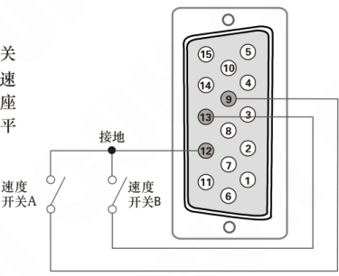

每条控制线的状态在面板上有对应的指示灯显示。当在控制线上施加有效信号时，对应指示灯点亮。

两个灯的亮灭状态组合可以有4种状态（A亮B灭，A灭B亮，AB全亮，AB全灭）。右图，为两条控制线都施加有效信号时的状态。

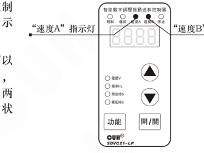

通过控制信号的选择，控制器将进入对应速度档位。此时，控制器输出电压可以通过功能键切换到电压参数状态进行设定。该速度档被自动记忆。任何时刻速度档位控制信号设置控制器进入该档位后都将立刻切换输出到该电压。

---

2019-10　　　　　　　　　　　　　　　　-27-　　　　　　　　　　　　　　　　SDVC21PSMSCN_4.02

### 第 36 页

智能数字稳压振动送料控制器　　　　　　　　　　　　　　　　　　　　　SDVC21P系列

---

## 第六章 安全保护功能

### 6.1 雷击保护功能

本控制器可以承受不超过4KV的雷击冲击。

### 6.2 短路保护功能

输出发生短路时，控制器会立即停止输出，同时显示Err2，直到控制器断电重新启动为止。也有可能熔断保险丝，为恢复功能需要更换保险丝。

### 6.3 过流保护功能

本控制器可以在用户误操作造成输出电流超过额定电流时短暂停止输出，同时显示Err2，以保护本机及用户的设备。

### 6.4 过热保护功能

当控制器工作温度超过60℃将停止输出，以保护本机，同时显示Err3，当温度下降到60℃时，本机恢复输出。

### 6.5 环境温度降额曲线（仅限SDVC21-XLP）

在竖直自然对流状态下，当环境温度升高时，由于控制器散热能力的限制，控制器不能持续输出25A电流，参考下图曲线进行降额使用。

如果客户希望能以25A电流持续工作，请提供更好的散热条件。

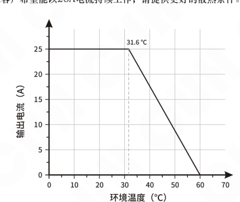

---

2019-10　　　　　　　　　　　　　　　-28-　　　　　　　　　　　　　　　SDVC21PSMSCN_4.02

### 第 37 页

智能数字稳压振动送料控制器　　　　　　　　　　　　　　　　　SDVC21P系列

---

## 附录A：外形尺寸

智能数字稳压振动送料控制器SDVC21-LP外形尺寸（单位：mm）

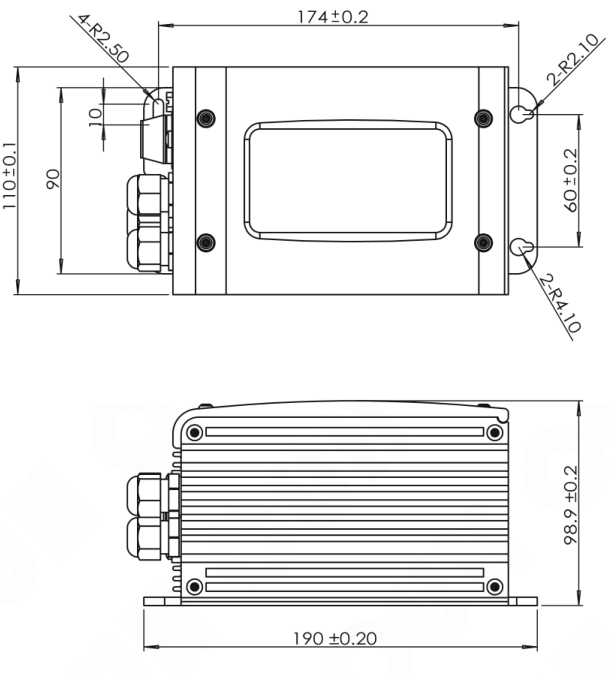

---

2019-10　　　　　　　　　　　　　　-29-　　　　　　　　　　　　　　SDVC21PSMSCN_4.02

### 第 38 页

**智能数字稳压振动送料控制器**  
**SDVC21P系列**

智能数字振动送料控制器SDVC21-XLP外形尺寸（单位：mm）

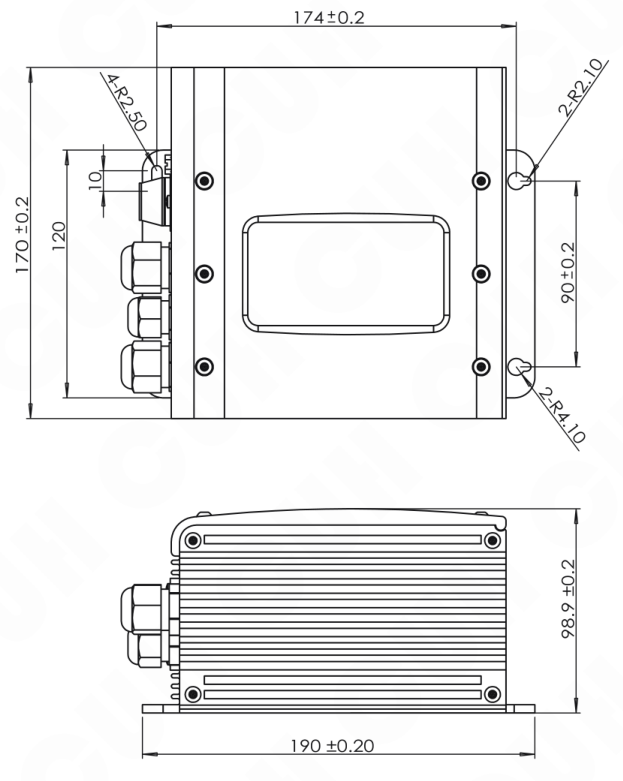

2019-10　　　　　　　　　　　　　　　　　-30-　　　　　　　　　　　　　　　　　SDVC21PSMSCN_4.02

### 第 39 页

智能数字稳压振动送料控制器　　　　　　　　　　　　　　　　SDVC21P系列

---

## 附录B：接口定义

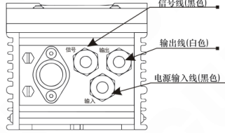

横截面视图：

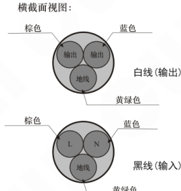

- 白线（输出）：棕色、蓝色、黄绿色；内部标识为“输出、输出、地线”。
- 黑线（输入）：棕色、蓝色、黄绿色；内部标识为“L、N、地线”。

### ☺ 请注意：

A: 一定要确认电磁铁线圈接在两个输出引脚上，振动本体的机械外壳需要可靠接地，否则将会导致机壳带电，可能发生严重的安全事故!!!

B: 电源端子和输出端子一定要确认连接可靠，防止接触电阻过大导致的异常发热或火灾隐患。

## 附录C：信号接口定义

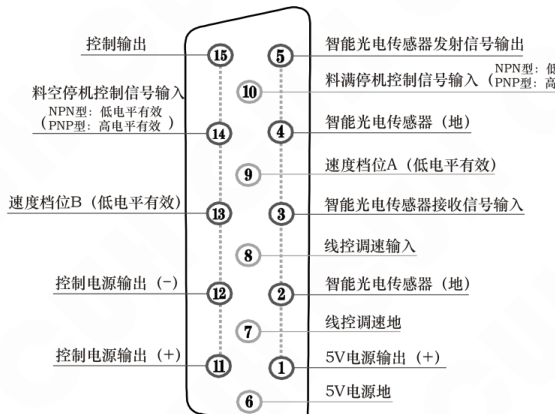

| 引脚 | 信号定义 |
|---:|---|
| 15 | 控制输出 |
| 14 | 料空停机控制信号输入 NPN型：低电平有效 PNP型：高电平有效 |
| 13 | 速度档位B（低电平有效） |
| 12 | 控制电源输出（－） |
| 11 | 控制电源输出（＋） |
| 10 | 料满停机控制信号输入 NPN型：低电平有效 PNP型：高电平有效 |
| 9 | 速度档位A（低电平有效） |
| 8 | 线控调速输入 |
| 7 | 线控调速地 |
| 6 | 5V电源地 |
| 5 | 智能光电传感器发射信号输出 |
| 4 | 智能光电传感器（地） |
| 3 | 智能光电传感器接收信号输入 |
| 2 | 智能光电传感器（地） |
| 1 | 5V电源输出（＋） |

---

2019-10　　　　　　　　　　　　　　-31-　　　　　　　　　　　　　　SDVC21PSMSCN_4.02

### 第 40 页

**智能数字稳压振动送料控制器**　　　　　　　　　　　　　　　　　　　　　　　　　**SDVC21P系列**

---

### 端口A：遥控调速

| 端子 | 编号 | 功能 |
|---|---:|---|
| A3 | ① | +5V |
| A2 | ⑧ | 输入 |
| A1 | ⑦ | 电阻地 |

### 端口B：智能光电

| 端子 | 编号 | 功能 |
|---|---:|---|
| B4 | ⑤ | 发射 |
| B3 | ④ | 地线 |
| B2 | ③ | 接收 |
| B1 | ② | 地线 |

### 端口C：料满停机C

| 端子 | 编号 | 功能 |
|---|---:|---|
| C1 | ⑫ | 地线 |
| C2 | ⑩ | 输入 |
| C3 | ⑪ | +24V |

### 端口D：控制输出

| 端子 | 编号 | 功能 |
|---|---:|---|
| D1 | ⑮ | 输出 |
| D2 | ⑪ | +24V |
| D3 | ⑫ | 地线 |

---

2019-10　　　　　　　　　　　　　-32-　　　　　　　　　　　　　SDVC21PSMSCN_4.02

### 第 41 页

**智能数字稳压振动送料控制器**　　　　　　　　　　　　　　　　　　　　　　　　　**SDVC21P系列**

### 端口E：料满停机E

| 端子 | DB-15 引脚编号 | 功能 |
|---|---:|---|
| E1 | 12 | 地线 |
| E2 | 14 | 输入 |
| E3 | 11 | +24V |

### 端口G：速度预设

| 端子 | DB-15 引脚编号 | 功能 |
|---|---:|---|
| G1 | 12 | 地线 |
| G2 | 9 | 速度A |
| G3 | 12 | 地线 |
| G4 | 13 | 速度B |

### 端口I：24V电源

| 端子 | DB-15 引脚编号 | 功能 |
|---|---:|---|
| I1 | 12 | 地线 |
| I2 | 11 | +24V |

**注：** 圆圈中的数字代表DB-15信号插座上对应的引脚编号。

---

2019-10　　　　　　　　　　　　　　　　　-33-　　　　　　　　　　　　　　　　　SDVC21PSMSCN_4.02

### 第 42 页

智能数字稳压振动送料控制器　　　　　　　　　　　　　　　　　　　　SDVC21P系列

## 附录D：功能状态对照表

| 显示 | 数码管符号图片 | 读音 | 含义 |
|---|---|---|---|
| `H` |  | H | 输出电压（参见：第6页） |
| `E` |  | E | 输出频率（参见：第7页） |
| `t` |  | 小T | 缓启动（参见：第8页） |
| `J` |  | 大勾 | 智能光电传感开延时（参见：第12页） |
| `J-` |  | 勾中 | 开关传感器开延时（参见：第16页） |
| `J_` |  | 勾下 | 第二个开关传感器开延时（参见：第19页） |
| `L` |  | 大L | 智能光电传感关延时（参见：第12页） |
| `L-` |  | L中 | 开关传感器关延时（参见：第16页） |
| `L_` |  | L下 | 第二个开关传感器关延时（参见：第19页） |
| `r1` |  | 涛1 | 开关传感器逻辑方向（参见：第17页） |
| `r2` |  | 涛2 | 智能光电传感器逻辑方向（参见：第13页） |
| `r3` |  | 涛3 | 第二个开关传感器逻辑方向（参见：第20页） |
| `r4` |  | 涛4 | 控制输出逻辑方向（参见：第24页） |
| `r5` |  | 涛5 | 主控输出分离参数（参见：第25页） |
| `rE` |  | 涛E | 频率指示参数（参见：第7页） |
| `h` |  | 小H | 最大输出电压（参见：第9页） |
| `n` |  | 大恩 | 控制信号逻辑关系（参见：第21页） |
| `P` |  | P | 智能光电灵敏度（参见：第14页） |
| `8.8.8.8.` |  | 全8 | 恢复出厂设定（参见：第10页） |
| `----` |  | 全杠 | 恢复出厂设定设置成功（参见：第10页） |
| `Err` |  | error | 错误信息（参见：第36页） |

2019-10　　　　　　　　　　　　　　　　　　　　-34-　　　　　　　　　　　　　　　　　　　　SDVC21PSMSCN_4.02

### 第 43 页

**智能数字稳压振动送料控制器**  
**SDVC21P系列**

## 附录E：技术规格

| 项目 | 范围（最小值） | 范围（典型值） | 范围（最大值） | 单位 | 说明 |
|---|---:|---:|---:|---|---|
| 输入电压 | 85 | 380 | 440 | V（伏特） | 交流有效值 |
| 输出电压调整范围 | 35 | —— | Vin-10 | V（伏特） | 半波 |
|  | 45 | —— | Vin-5 | V（伏特） | 全波 |
| 电压调整精度 |  | 1 |  | V（伏特） |  |
| 稳压精度 | —— | —— | 30 | V（伏特） | Vset=150V ΔVin+=70V |
| 稳压响应时间 | 0 | 0.01 | 0.02 | s（秒） |  |
| 输出电流调整范围 | 0 | —— | 10 | A（安培） | SDVC21-LP |
|  |  |  | 25 | A（安培） | SDVC21-XLP |
| 输出功率 | 0 | —— | 3800 | VA（伏安） | SDVC21-LP |
|  |  |  | 9500 | VA（伏安） | SDVC21-XLP |
| 输出频率 | 90 | 100/120 | 130 | Hz（赫兹） | 全波 |
|  | 45 | 50/60 | 65 | Hz（赫兹） | 半波 |
|  | 30 | 33/40 | 43 | Hz（赫兹） | 三分之一波 （仅限SDVC21-XLP） |
|  | 22 | 25/30 | 32 | Hz（赫兹） | 四分之一波 （仅限SDVC21-XLP） |
| 输出波形 |  | 正弦相切 |  |  |  |
| 缓启动时间 | 0 | —— | 9.9 | s（秒） | 出厂默认 0.5 |
| 延迟时间范围 | 0 | —— | 9.9 | s（秒） | 出厂默认 0.2 |
| 延迟时间精度 |  | 0.1 |  | s（秒） |  |
| 过热保护温度 | 58 | 60 | 66 | ℃（摄氏度） |  |
| 直流控制输出电压 | 22 | 24 | 26 | V（伏特） |  |
| 直流控制输出电流 | 0 | —— | 200 | mA（毫安） |  |
| 模拟控制信号 |  | 1-5 |  | V（伏特） | 远程速度控制电压 |
| 数字控制信号 |  | 24 |  | V（伏特） | 开关信号控制 |
| 调整方式 |  | 4 |  | 键 |  |
| 保险丝容量 |  | 16 |  | A（安培） | SDVC21-LP |
|  |  | 30 |  | A（安培） | SDVC21-XLP |
| 空载功耗 | —— | 4 | —— | W（瓦特） |  |
| 显示方式 |  | 4 |  | 位 | LED 数码管 |
| 防护等级 |  | IP67 |  |  |  |
| 重量 |  | 4600 |  | g（克） | SDVC21-LP |
|  |  | 5800 |  | g（克） | SDVC21-XLP |
| 工作环境温度 | 0 | 25 | 40 | ℃（摄氏度） |  |

---

2019-10    -35-    SDVC21PSMSCN_4.02

### 第 44 页

智能数字稳压振动送料控制器　　　　　　　　　　　　　　　　　　　　　　　　　SDVC21P系列

## 附录F：错误讯息指示和故障排除

以下一些方法可以帮助您排除使用中可能会遇到的简单问题。

|  | 故障现象 | 故障排除建议 |
|---|---|---|
| 1 | 打开开关，没有显示 | ◆ 请检查电源插座是否有电？ ◆ 电源插头是否可靠连接插座？ ◆ 请检查保险丝是否完好？ |
| 2 | 有显示，但是振动盘不动，也没有声音。 | ◆ 请检查输出电缆是否正确地连接控制器与振动盘？ ◆ 请检查控制器参数，是否输出电压调节的太小？ ◆ 请检查控制信号是否将控制器置于“停止”状态？ ◆ 请检查是否有设置为“常断”的参数，导致控制器被置于“停止”状态？ |
| 3 | 控制信号不起作用？ | ◆ 请检查控制信号是否正确输入？ ◆ 请检查输入的控制信号的地线是否与本机地正确连接？ ◆ 请检查控制信号逻辑关系设置是否是您期望的设置？ |
| 4 | 有显示，振动盘不动，但是可以听到声音。 | ◆ 请按照说明书介绍的调节方法逐步调节各参数。 |
| 5 |  | ◆ 请检查是否使用了超过控制器参数规格限定的振动盘？ ◆ 请检查输出电缆线和接头是否有短路的情况？ ◆ 请检查输出电缆线是否可靠连接？ ◆ 请检查控制器是否可靠接地？ ◆ 请检查振动盘电磁线圈是否有短路、漏电、匝间短路的情况？ |
| 6 |  | ◆ 系统过热，将控制器安装在通风散热良好的工作环境中 |

2019-10　　　　　　　　　　　　　　　　　-36-　　　　　　　　　　　　　　　　　SDVC21PSMSCN_4.02

### 第 45 页

智能数字稳压振动送料控制器  
SDVC21P系列

## 附录G：极限参数

| 极限参数：超过此指标将会造成严重损坏，必须严格遵守！ |  |  |  |  |  |
|---|---|---|---|---|---|
| 项目 | GB 标准 | IEC 标准 | 等级 | 指标 | 备注说明 |
| 静电放电 | GB/T 17626.2-2006 | IEC 61000-4-2:2001 | 4 | ±8 kV | 接触放电 |
| 静电放电 | GB/T 17626.2-2006 | IEC 61000-4-2:2001 | 4 | ±15 kV | 空气放电 |
| 电快速瞬变脉冲群 | GB/T 17626.4-2008 | IEC 61000-4-4:2004 | 4 | ±4 kV | 直接耦合 |
| 雷击浪涌 | GB/T 17626.5-2008 | IEC 61000-4-5:2005 | 4 | ±4 kV | 线对线耦合 |
| 雷击浪涌 | GB/T 17626.5-2008 | IEC 61000-4-5:2005 | 4 | ±4 kV | 线对地耦合 |

2019-10  
-37-  
SDVC21PSMSCN_4.02

### 第 46 页

智能数字稳压振动送料控制器　　　　　　　　　　　　　　　　SDVC21P系列

---

---

2019-10　　　　　　　　　　　　　　　　　　　　　　　　　SDVC21PSMSCN_4.02

### 第 47 页

## 数字调压振动送料控制器

| 品名规格 | 特点 | 特点 |
|---|---|---|
| SDVC10、11 数字稳压振动送料控制器系列  | 输入电压范围：150V～260V | 输出电压范围：35V～250V |
|  | 输出电流：0～4A | 输出功率：880VA |
|  | 电源频率范围：40～70Hz |  |
|  | ・自动稳压 ・最大输出比例调节 ・短路保护功能 | ・缓启动 ・线性调节规律 ・过热保护功能 |
| SDVC20、22 智能数字稳压振动送料控制器系列  | 输入电压范围：85V～440V | 输出电压范围：35V～380V |
|  | 输出电流：0～10A | 输出功率：3800VA |
|  | 电源频率范围：40～70Hz |  |
|  | ・自动稳压 ・缓启动时间设置 ・双控制信号输入 ・料满停机 ・线控调速 ・过热保护功能 | ・缓启动 ・信号控制开关 ・输出电压预置功能 ・智能光电传感 ・控制输出 ・过流保护功能 |

### 第 48 页

## 南京创优科技有限责任公司

地址： 南京市江宁区麒麟门晨光村校东路1号  
销售电话： 025-84730416  
传真： 025-84730426  
企业邮箱： sales@cuhnj.com  
网址： www.cuhnj.com

<!-- /auto:ai-body-draft v1 -->

<!-- auto:data-params-summary v1 -->
## 附录 · 参数表（结构化侧车·机器生成）

> 说明：本节由 `data/<doc_key>/params/params.yaml` 自动渲染（展示前若干行），用于校对与二次开发。定稿以层 C 数据为准。

| 参数 | 标志/符号 | 范围 | 默认 | 单位 | 备注 |
| --- | --- | --- | --- | --- | --- |
|     |  |  |  |  |  |
| H CU   C  |  |  |  |  |  |
|   CUH UH |  |  |  |  |  |
|     |  |  |  |  |  |
| U CUH  |  |  |  |  |  |
|     |  |  |  |  |  |
|       |  |  |  |  |  |
|       |  |  |  |  |  |
|       |  |  |  |  |  |
|     |  |  |  |  |  |
|       |  |  |  |  |  |
|       |  |  |  |  |  |
|  H    |  |  |  |  |  |
| U    |  |  |  |  |  |
|   |  |  |  |  |  |
|     |  |  |  |  |  |
|   |  |  |  |  |  |
|      项目 |  |  |  |  |  |
|      项目 |  |  |  |  |  |
|      输入电压 |  |  |  |  |  |
|      输出电压调整范围 |  |  |  |  |  |
|      输出电压调整范围 |  |  |  |  |  |
|      电压调整精度 |  |  |  |  |  |
|      稳压精度 |  |  |  |  |  |
|        稳压响应时间 |  |  |  |  |  |
|        输出电流调整范围 |  |  |  |  |  |
|        输出电流调整范围 |  |  |  |  |  |
|        输出功率 |  |  |  |  |  |
|        输出功率 |  |  |  |  |  |
| U     输出频率 |  |  |  |  |  |

*（仅展示前 30 条，共 73 条；完整数据见下方链接。）*

- 完整 YAML：`data/cuh.sdvc.manual.v0.0/params/params.yaml`
- 表格索引：`data/cuh.sdvc.manual.v0.0/index.yaml`
<!-- /auto:data-params-summary v1 -->
