## 目录

> 下列条目来自 PDF 内置书签/大纲；链接指向本批转换生成的整页渲染图（`assets/pages/`），便于与原版 PDF 对照校对。

- [1: 封面](assets/pages/page-0001.png)（第 1 页）
- [2: 封二版权与免责](assets/pages/page-0002.png)（第 2 页）
- [3: 序言](assets/pages/page-0003.png)（第 3 页）
- [4: 安全与预防措施](assets/pages/page-0004.png)（第 4 页）
- [5: 工作与储存环境](assets/pages/page-0005.png)（第 5 页）
- [7: 目录](assets/pages/page-0007.png)（第 7 页）
- [8: 目录2](assets/pages/page-0008.png)（第 8 页）
- [第一章 使用前须知](assets/pages/page-0009.png)（第 9 页）
  - [1.1 检查包装内容](assets/pages/page-0009.png)（第 9 页）
  - [1.2 指示灯、按键及外部部件说明](assets/pages/page-0010.png)（第 10 页）
  - [1.3 接线端口说明](assets/pages/page-0011.png)（第 11 页）
  - [1.4 控制器铭牌说明](assets/pages/page-0011.png)（第 11 页）
- [第二章 性能特点](assets/pages/page-0012.png)（第 12 页）
- [第三章 安装及使用指南](assets/pages/page-0014.png)（第 14 页）
  - [3.1 控制器使用条件](assets/pages/page-0014.png)（第 14 页）
  - [3.2 按键基本操作](assets/pages/page-0014.png)（第 14 页）
  - [3.3 安装使用](assets/pages/page-0015.png)（第 15 页）
- [第四章 基本操作](assets/pages/page-0017.png)（第 17 页）
  - [4.1 输出电压设定](assets/pages/page-0017.png)（第 17 页）
  - [4.2 输出频率设定](assets/pages/page-0018.png)（第 18 页）
  - [4.3 缓启动功能](assets/pages/page-0019.png)（第 19 页）
  - [4.4 输出开关](assets/pages/page-0019.png)（第 19 页）
  - [4.5 最大输出电压限制功能](assets/pages/page-0020.png)（第 20 页）
  - [4.6 键盘锁定功能](assets/pages/page-0020.png)（第 20 页）
  - [4.7 恢复出厂设置](assets/pages/page-0021.png)（第 21 页）
- [第五章 传感器与信号控制](assets/pages/page-0022.png)（第 22 页）
  - [5.1 智能光电传感器的使用方法](assets/pages/page-0022.png)（第 22 页）
    - [5.1.1 智能光电传感器的接线方法](assets/pages/page-0022.png)（第 22 页）
    - [5.1.2 智能光电传感器开延时、关延时时间设定](assets/pages/page-0023.png)（第 23 页）
    - [5.1.3 智能光电传感器逻辑方向设定](assets/pages/page-0024.png)（第 24 页）
  - [5.2 开关传感器的使用方法](assets/pages/page-0025.png)（第 25 页）
    - [5.2.1 开关传感器的接线方法](assets/pages/page-0025.png)（第 25 页）
    - [5.2.2 开关传感器开延时、关延时时间设定](assets/pages/page-0026.png)（第 26 页）
    - [5.2.3 开关传感器逻辑方向设定](assets/pages/page-0027.png)（第 27 页）
  - [5.3 第二个开关传感器的使用方法](assets/pages/page-0028.png)（第 28 页）
    - [5.3.1 第二个开关传感器的接线方法](assets/pages/page-0028.png)（第 28 页）
    - [5.3.2 第二个开关传感器开延时、关延时时间设定](assets/pages/page-0029.png)（第 29 页）
    - [5.3.3 第二个开关传感器逻辑方向设定](assets/pages/page-0030.png)（第 30 页）
  - [5.4 控制信号逻辑关系设定](assets/pages/page-0031.png)（第 31 页）
  - [5.5 控制输出](assets/pages/page-0032.png)（第 32 页）
    - [5.5.1 控制输出的接线方法](assets/pages/page-0032.png)（第 32 页）
    - [5.5.2 控制输出逻辑方向设定](assets/pages/page-0034.png)（第 34 页）
  - [5.6 远程速度控制](assets/pages/page-0035.png)（第 35 页）
  - [5.7 速度预置功能](assets/pages/page-0036.png)（第 36 页）
- [第六章 安全保护功能](assets/pages/page-0037.png)（第 37 页）
  - [6.1 稳压功能](assets/pages/page-0037.png)（第 37 页）
  - [6.2 短路保护功能](assets/pages/page-0037.png)（第 37 页）
  - [6.3 过流保护功能](assets/pages/page-0037.png)（第 37 页）
  - [6.4 过热保护功能](assets/pages/page-0037.png)（第 37 页）
- [第七章 技术规格](assets/pages/page-0038.png)（第 38 页）
  - [7.1 外形尺寸](assets/pages/page-0038.png)（第 38 页）
  - [7.2 技术规格表](assets/pages/page-0039.png)（第 39 页）
  - [7.3 参考标准](assets/pages/page-0040.png)（第 40 页）
  - [7.4 参数列表](assets/pages/page-0041.png)（第 41 页）
  - [7.5 故障诊断](assets/pages/page-0042.png)（第 42 页）
- [第八章 产品质保信息](assets/pages/page-0043.png)（第 43 页）
  - [8.1 质保期](assets/pages/page-0043.png)（第 43 页）
  - [8.2 保修范围](assets/pages/page-0043.png)（第 43 页）
  - [8.3 产品适用性](assets/pages/page-0043.png)（第 43 页）
- [44: 封底](assets/pages/page-0044.png)（第 44 页）
## 术语与命名

- 侧车：`glossary/terms.yaml`（机读）、`glossary/zh-CN.md`（人读）；候选表，定稿后并入公司级 `glossary/`。

## 适用范围

- 本文档由 PDF 自动转换生成，正文与插图需人工核对。

## 变更记录

- 2026-06-05 12:38:23：由转换工具从源 PDF 生成首版。

## 正文

<!-- auto:ai-body-draft v1 -->
> 以下为**整页视觉转写**的正文草稿（多模态模型直接输出 Markdown，含 GFM 表； 若配置 `[[vcrop:页:序]]` 占位符，裁剪步骤会插入 `assets/images/` 下 PNG）。**请务必人工校对。**

### 第 1 页

# CUH®

## 数字调压振动送料控制器

**Variable Voltage Digital Controller for Vibratory Feeder**

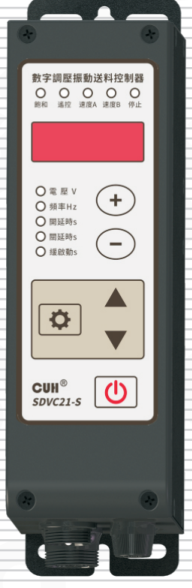

## SDVC21-S

# 用户手册

### 第 2 页

数字调压振动送料控制器　　　　　　　　　　　　　　　　　　　　　　　　　SDVC21-S

---

## 版权说明

南京创优科技有限责任公司保留所有权利。

本用户手册上包含的所有信息是属于本公司的知识，受著作权法及所有法律的保护。本公司根据著作权法及其他法律享有并保留所有著作权和其他法律赋予的权利，未经本公司书面同意不得以任何形式对本用户手册的部分或全部进行抄袭、翻译、转译、仿制或其他利用。

## 免责声明

本用户手册的所有内容仅说明本公司生产的相关产品的使用方法，并且是根据现有技术和提供给您使用时的状态进行描述的，在您使用本产品时必须自行承担相关风险。除法律强制规定外，本公司不因本用户手册对产品负有任何明示或暗示的责任，包括但不限于人身伤害、财产损失、机会丧失。

您明确了解上述风险并同意，除法律强制规定外，本公司无须为您的任何直接、间接的损害或损失负责（包括但不限于人员、财物、数据等有形损失和名誉、机会等无形损失）。

本公司保留对本用户手册中所适用的产品进行修改而不预先及事后通知的权利。

---

2023-11　　　　　　　　　　　　　　　　　　　　　　　　　SDVC21SMSCN_4.01

### 第 3 页

数字调压振动送料控制器　　　　　　　　　　　　　　　　　　　　　　　　　SDVC21-S

---

# 序言

感谢您使用南京创优科技有限责任公司（在本手册中以下简称本公司）出品的SDVC21-S数字调压振动送料控制器（在本手册中以下简称本产品、本控制器或控制器）。

本手册介绍了本产品的基本操作方法和功能技术说明。为用户提供安装调试、参数设置、异常诊断、故障排除及日常维护控制器的相关信息。为了确保正确安装和使用本控制器，请在装机之前仔细阅读本用户手册，并请妥善保存。

以下符号提醒您注意有关防止人身伤害和产品损坏的事项，请务必阅读。

| 符号 | 说明 |
|---|---|
| ⚠ 危险 | 表示若不遵守该事项，将导致人员伤亡。 |
| ⚠ 警告 | 表示若不遵守该事项，可能导致人员伤亡。 |
| ⚠ 小心 | 表示若不遵守该事项，可能导致人员遭受中度或轻微伤害。 |
| 注意 | 表示若不遵守该事项，将导致本产品损坏及财产损失。 |
| ！要点 | 表示在使用过程中必须要遵守的注意事项和使用限制等。 |

## 本说明书适合以下型号控制器：

◆ 数字调压振动送料控制器　SDVC21-S（5A）

---

2023-11　　　　　　　　　　　　　　　　　　　　　　　　　　　　SDVC21SMSCN_4.01

### 第 4 页

数字调压振动送料控制器　　　　　　　　　　　　　　　　　　　　　　　　　SDVC21-S

---

# 安全与预防措施

1. **【危险】** 本产品用于驱动基于电磁铁的振动送料设备，请勿将本产品用于保护人体或人体部位等目的。

2. **【危险】** 本产品不得作为防爆产品使用，请勿在危险场所和/或潜在爆炸气体环境中使用本产品。

3. **【警告】** 本产品是采用交流市电供电的设备，请勿施加交流电压超过260Vac。施加过大的输入电压如380Vac，则可能导致产品爆炸或者着火，造成严重的安全事故。

4. **【警告】** 本产品是通过电源线进行接地的，请确保为控制器供电的配电设施具备良好的接地，否则可能导致控制器外壳带电，造成触电事故。

5. **【警告】** 请勿输入交流电源到本控制器的输出端，这会损坏控制器。

6. **【警告】** 请勿在带电的情况下插拔接线或触摸接线仓内各接线端子触点，以防发生触电事故。

7. **【注意】** 请避免采用通过继电器等设备切断供电的方式来控制本产品的输出，这会严重降低本控制器的寿命。

8. **【注意】** 本产品设计使用于阴凉干燥环境，请勿将本产品置于室外、可能会浸水、阳光暴晒场所工作，也不要在超过本产品电气特性要求的温度和湿度范围之外工作。

9. **【要点】** 请务必将本产品固定在可靠接地的坚固平台上, 并远离振动设备。

10. **【要点】** 任何情况下请勿将本产品在超越设计极限状态下工作。

11. **【要点】** 请严格按照本手册的说明操作，对于违反这些操作说明所造成的任何人身伤害或财产损失，本公司不承担任何民事和刑事责任。

12. **【要点】** 任何情况下请不要打开本控制器机壳，以防遭到电击。机壳内部没有可以调节和用户维修部分，请不要试图维修本机，出现故障请致电本公司。

---

2023-11　　　　　　　　　　　　　　　　　　　　　　　　　SDVC21SMSCN_4.01

### 第 5 页

数字调压振动送料控制器　　　　　　　　　　　　　　　　　　　　　　　　　SDVC21-S

---

# 工作与储存环境

## 一、使用前的检查

每台控制器在出厂前，均经过严格的品质检验，并经过强化的防撞包装处理。客户在拆箱后，请即刻进行下列检查：

1、检查控制器是否在运输过程中受到损伤。

2、检查控制器型号是否与订货登记资料完全相同。

## 二、工作环境

为使本控制器具有更好的使用效果和更长的使用寿命，请将控制器安装在符合下列条件的环境中：

● 良好的通风散热环境

● 远离水滴、蒸气、灰尘，（特别是油性灰尘）

● 无腐蚀、易燃性的气体、液体

● 无漂浮性的尘埃及金属微粒

● 安装表面坚固无振动

● 远离电磁噪声干扰

● 使用环境温度为0℃到40℃

● 仅适用于海拔2000m以下地区安全使用

---

2023-11　　　　　　　　　　　　　　　　　　　　　　　　　SDVC21SMSCN_4.01

### 第 6 页

数字调压振动送料控制器　　　　　　　　　　　　　　　　　　　　　　　　　SDVC21-S

---

2023-11　　　　　　　　　　　　　　　　　　　　　　　　　　　　　　SDVC21SMSCN_4.01

### 第 7 页

数字调压振动送料控制器　　　　　　　　　　　　　　　　　　　　　　　　　SDVC21-S

---

# 目　录

**第一章 使用前须知** ------------------------------------------------------------------- 1

　　1.1　检查包装内容 ------------------------------------------------------------------ 1

　　1.2　指示灯、按键及外部部件说明 ---------------------------------------------- 2

　　1.3　接线端口说明 ------------------------------------------------------------------ 3

　　1.4　控制器铭牌说明 -------------------------------------------------------------- 3

**第二章 性能特点** ---------------------------------------------------------------------- 4

**第三章 安装及使用指南** -------------------------------------------------------------- 6

　　3.1　控制器使用条件 -------------------------------------------------------------- 6

　　3.2　按键基本操作 ------------------------------------------------------------------ 6

　　3.3　安装使用 ---------------------------------------------------------------------- 7

**第四章 基本操作** ---------------------------------------------------------------------- 9

　　4.1　输出电压设定 ------------------------------------------------------------------ 9

　　4.2　输出频率设定 ---------------------------------------------------------------- 10

　　4.3　缓启动功能 ------------------------------------------------------------------- 11

　　4.4　输出开关 --------------------------------------------------------------------- 11

　　4.5　最大输出电压限制功能 ------------------------------------------------------ 12

　　4.6　键盘锁定功能 ---------------------------------------------------------------- 12

　　4.7　恢复出厂设置 ---------------------------------------------------------------- 13

**第五章 传感器与信号控制** --------------------------------------------------------- 14

　　5.1　智能光电传感器的使用方法 ------------------------------------------------ 14

　　　　5.1.1　智能光电传感器的接线方法 ---------------------------------------- 14

　　　　5.1.2　智能光电传感器开延时、关延时时间设定 -------------------------- 15

　　　　5.1.3　智能光电传感器逻辑方向设定 ------------------------------------- 16

　　5.2　开关传感器的使用方法 ----------------------------------------------------- 17

　　　　5.2.1　开关传感器的接线方法 -------------------------------------------- 17

　　　　5.2.2　开关传感器开延时、关延时时间设定 ------------------------------ 18

　　　　5.2.3　开关传感器逻辑方向设定 ----------------------------------------- 19

---

2023-11　　　　　　　　　　　　　　　　　　　　　　　　　SDVC21SMSCN_4.01

### 第 8 页

数字调压振动送料控制器　　　　　　　　　　　　　　　　　　　　　　　　　SDVC21-S

---

| 章节 | 页码 |
|---|---:|
| 5.3 第二个开关传感器的使用方法 | 20 |
| 5.3.1 第二个开关传感器的接线方法 | 20 |
| 5.3.2 第二个开关传感器开延时、关延时时间设定 | 21 |
| 5.3.3 第二个开关传感器逻辑方向设定 | 22 |
| 5.4 控制信号逻辑关系设定 | 23 |
| 5.5 控制输出 | 24 |
| 5.5.1 控制输出的接线方法 | 24 |
| 5.5.2 控制输出逻辑方向设定 | 26 |
| 5.6 远程速度控制 | 27 |
| 5.7 速度预置功能 | 28 |
| **第六章 安全保护功能** | **29** |
| 6.1 稳压功能 | 29 |
| 6.2 短路保护功能 | 29 |
| 6.3 过流保护功能 | 29 |
| 6.4 过热保护功能 | 29 |
| **第七章 技术规格** | **30** |
| 7.1 外形尺寸 | 30 |
| 7.2 技术规格表 | 31 |
| 7.3 参考标准 | 32 |
| 7.4 参数列表 | 33 |
| 7.5 故障诊断 | 34 |
| **第八章 产品质保信息** | **35** |
| 8.1 质保期 | 35 |
| 8.2 保修范围 | 35 |
| 8.3 产品适用性 | 35 |

---

2023-11　　　　　　　　　　　　　　　　　　　　　　　　　SDVC21SMSCN_4.01

### 第 9 页

数字调压振动送料控制器  
SDVC21-S

# 第一章 使用前须知

本章节介绍产品包装内容、控制器外观说明和控制器铭牌信息。

## 1.1 检查包装内容

使用本产品之前，请检查控制器及附件的完整性。如果发现产品有缺陷或已损坏、附件缺失等问题，请与本公司联系。

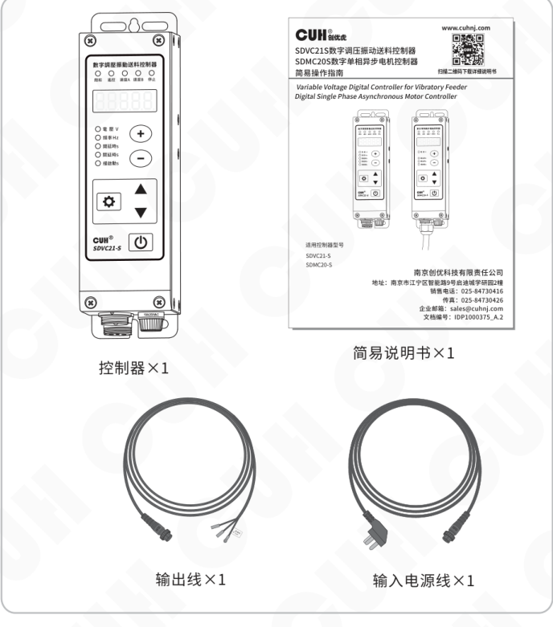

包装内容：

- 控制器×1
- 简易说明书×1
- 输出线×1
- 输入电源线×1

---

2023-11　　　　　- 1 -　　　　　SDVC21SMSCN_4.01

### 第 10 页

数字调压振动送料控制器　　　　　　　　　　　　　　　　　　　　　　　　　SDVC21-S

## 1.2 指示灯、按键及外部部件说明

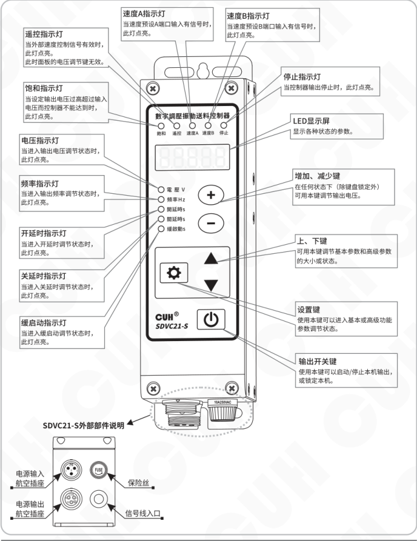

**图：SDVC21-S 外部部件说明**

### 外部部件

- 电源输入航空插座
- 电源输出航空插座
- 保险丝
- 信号线入口

### 显示与指示灯说明

| 名称 | 说明 |
|---|---|
| 遥控指示灯 | 当外部速度控制信号有效时，此灯点亮。此时面板的电压调节键无效。 |
| 饱和指示灯 | 当设定输出电压过高超过输入电压而控制器不能达到时，此灯点亮。 |
| 电压指示灯 | 当进入输出电压调节状态时，此灯点亮。 |
| 频率指示灯 | 当进入输出频率调节状态时，此灯点亮。 |
| 开延时指示灯 | 当进入开延时调节状态时，此灯点亮。 |
| 关延时指示灯 | 当进入关延时调节状态时，此灯点亮。 |
| 缓启动指示灯 | 当进入缓启动调节状态时，此灯点亮。 |
| 速度A指示灯 | 当速度预设A端口输入有信号时，此灯点亮。 |
| 速度B指示灯 | 当速度预设B端口输入有信号时，此灯点亮。 |
| 停止指示灯 | 当控制器输出停止时，此灯点亮。 |
| LED显示屏 | 显示各种状态的参数。 |

### 按键说明

| 名称 | 说明 |
|---|---|
| 增加、减少键 | 在任何状态下（除键盘锁定外）可用本键调节输出电压。 |
| 上、下键 | 可用本键调节基本参数和高级参数的大小或状态。 |
| 设置键 | 使用本键可以进入基本或高级功能参数调节状态。 |
| 输出开关键 | 使用本键可以启动/停止本机输出，或锁定本机。 |

### 面板与标识文字

- 数字调压振动送料控制器
- SDVC21-S
- 电压 V
- 频率 Hz
- 开延时 s
- 关延时 s
- 缓启动 s
- 遥控、速度A、速度B、饱和、停止
- 保险丝标识：10A250VAC

2023-11　　　　　　　　　　　　　　　　　　　　　　　　　SDVC21SMSCN_4.01

### 第 11 页

## 1.3 接线端口说明

接线端口位于面板背面，拆装示意如下：

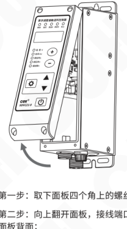

- 第一步：取下面板四个角上的螺丝；
- 第二步：向上翻开面板，接线端口在面板背面；

| 功能 | 英文标识 | 端子 | 中文 | 英文 |
|---|---|---|---|---|
| 料满停机Ⅱ | SensorⅡ | A1 | 地线 | GND |
| 料满停机Ⅱ | SensorⅡ | A2 | 输入 | Input |
| 料满停机Ⅱ | SensorⅡ | A3 | +24V | +24V |
| 速度预设 | Preset | B1 | 地线 | GND |
| 速度预设 | Preset | B2 | 速度A | Pset A |
| 速度预设 | Preset | B3 | 地线 | GND |
| 速度预设 | Preset | B4 | 速度B | Pset B |
| 控制输出 | Ctrl Out | C1 | 输出 | Output |
| 控制输出 | Ctrl Out | C2 | +24V | +24V |
| 料满停机Ⅰ | SensorⅠ | D1 | 地线 | GND |
| 料满停机Ⅰ | SensorⅠ | D2 | 输入 | Input |
| 料满停机Ⅰ | SensorⅠ | D3 | +24V | +24V |
| 智能光电 | Photosensor | E1 | 地线 | GND |
| 智能光电 | Photosensor | E2 | 接收 | Rx |
| 智能光电 | Photosensor | E3 | 地线 | GND |
| 智能光电 | Photosensor | E4 | 发射 | Tx |
| 遥控调速 | Speed Ctrl | F1 | +5V | +5V |
| 遥控调速 | Speed Ctrl | F2 | 输入 | Input |
| 遥控调速 | Speed Ctrl | F3 | 电阻地 | RGND |

## 1.4 控制器铭牌说明

铭牌及标注示意如下：

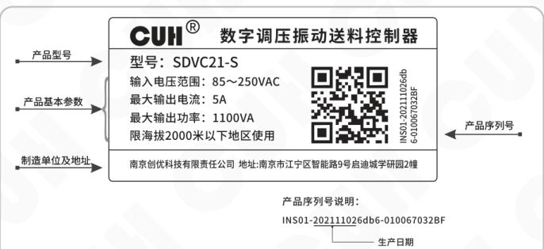

| 标注项目 | 铭牌内容 |
|---|---|
| 产品型号 | 型号：SDVC21-S |
| 产品基本参数 | 输入电压范围：85～250VAC 最大输出电流：5A 最大输出功率：1100VA 限海拔2000米以下地区使用 |
| 制造单位及地址 | 南京创优科技有限责任公司　地址：南京市江宁区智能路9号启迪城学研园2幢 |
| 产品序列号 | INS01-202111026db6-010067032BF |

产品序列号说明：

`INS01-202111026db6-010067032BF`

图中用括号标出序列号中的生产日期位置。

### 第 12 页

数字调压振动送料控制器　　　　　　　　　　　　　　　　　　　　　SDVC21-S

---

## 第二章 性能特点

SDVC21-S控制器拥有丰富的端口及逻辑功能，其功能特点包括：

- **自动稳压：** 内置数字稳压功能，可以消除由于电源电压波动造成的送料速度变化。

- **可调缓启动：** 在启动时，输出电压会从零开始逐渐增大到预设电压，以消除对振动设备的冲击，缓启动时间可以由数字精确设定。

- **料满停机：** 通过NPN型传感器实现料满停机控制，并具有可调缓启动时间、开延时、关延时、逻辑方向调节等控制功能。

- **控制输出：** 通过晶体管输出控制信号，可直接用于控制电磁阀等外部设备与本控制器协调工作。

以下功能可定制：

- **双控制信号输入：** 料空和料满双控制信号输入，且具有逻辑与、或、非、异或等全部控制关系。

- **输出电压预置功能：** 可以通过外部控制信号直接选择多达4种预先设置的输出电压。

- **智能光电：** 通过自适应的智能光电对射传感器实现料满或料空停机控制，并具有可调缓启动时间、开延时、关延时、逻辑方向调节等控制功能。

- **线控调速：** 可以直接使用外置的电位器、PLC提供的4~20mA电流或1~5V电压信号控制输出电压。

---

2023-11　　　　　　　　　　　　　- 4 -　　　　　　　　　　　　　SDVC21SMSCN_4.01

### 第 13 页

数字调压振动送料控制器　　　　　　　　　　　　　　　　　　　　　　　　　SDVC21-S

本公司对产品质量有着一贯的追求，除在生产阶段采用高品质元器件，严密的质检体系保障外，为了最大程度地提高产品的可用性，对于用户使用中可能发生的意外问题也做了充分的准备，其中包括：

- **熔断式短路保护：** 本控制器可以在用户误操作造成短路时熔断保险丝，以保护本机及设备。

- **过流保护：** 本控制器可以在电压调节过大造成输出电流超过额定电流时，暂时停止输出，以保护本机及设备。

- **过热保护：** 本控制器工作温度超过65℃时将停止输出，以保护本机。

- **过压保护：** 当输入电压过高时，电源将自动关闭，以自我保护。

为保持产品质量的国际化标准，本公司产品遵守CE认证标准。

2023-11　　　　　　　　　　　　　　　　　　　　　　　　　SDVC21SMSCN_4.01

### 第 14 页

数字调压振动送料控制器　　　　　　　　　　　　　　　　　　　　　　　　　SDVC21-S

---

# 第三章 安装及使用指南

本章节介绍本产品使用所必须具备的条件以及如何正确进行安装与连接。

## 3.1 控制器使用条件

本产品是使用交流110/220V供电的设备，且通过电源线三爪插头进行保护接地连接，请提供符合标准的110V或220V，50Hz/60Hz市电供电配电设施并确保保护地线已正确连接。

> ⚠️ **警告**　切不可将控制器连接到380V交流电，这将造成控制器不可恢复的严重损坏，有可能导致爆炸、火灾等安全事故。

> ⚠️ **警告**　确保供电侧可靠接地，控制器的金属外壳是与保护接地线直接连接的，接地不良会导致控制器外壳带电，引发触电事故。

> **注意**　控制器长时间工作会产生热量致使外壳温度升高，请将控制器安装在通风良好的环境中，并将其固定良好，远离振动源。

> **注意**　本产品的输出是市电经过切相形成的，中间没有隔离环节。因此输出端子不可以与保护接地连接，在连接电机或者电磁铁时也要确保线圈与外壳之间具备基本的绝缘能力。否则会导致漏电，可能产生触电和控制器损坏的事故。

> **注意**　本产品是用来驱动电磁铁的控制器，切不可连接压电振动盘。

## 3.2 按键基本操作

a. 任何界面下短按 ⊕ 或 ⊖ 调节电压参数。

b. 长按 ⚙ 进入/退出基本参数界面，短按 ⚙ 选择基本参数，短按 ▼ 或 ▲ 调节参数值。

c. 长按 ⚙ 加 ▲ 进入/退出高级参数界面，短按 ⚙ 选择高级参数，短按 ▼ 或 ▲ 调节参数值。

d. 短按 ⏻ 暂停/恢复输出，长按 ⏻ 锁定/解锁键盘。

e. 在恢复出厂设置参数下，长按 ▲ 显示  恢复到传统参数界面，长按 ▼ 显示 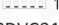 恢复到现代参数界面。

f. SDVC21-S默认为传统参数界面。

---

2023-11　　　　　　　　　　　　　　　　　- 6 -　　　　　　　　　　　　SDVC21SMSCN_4.01

### 第 15 页

数字调压振动送料控制器　　　　　　　　　　　　　　　　　　　　　　　　　SDVC21-S

---

## 3.3 安装使用

**第一步：**

打开控制器的外包装，检查控制器外观及侧标型号，判断是否为所需的型号。

**第二步：**

取出输出线，将输出线两个子弹头接线端子连接到振动盘的电磁线圈上，并确认黄绿双色的地线与振动盘金属外壳可靠连接。

将输出线航空插头上的缺口，对准控制器输出插座上的三角形标记，正确连接输出线后锁紧螺母。

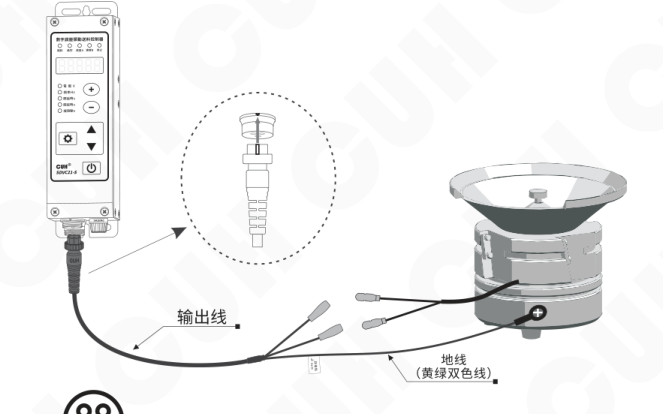

> **注意**
>
> 1、一定要确认电磁铁线圈接在两个输出引脚上，外壳需要可靠接地。  
> 否则将会导致机壳带电，可能发生严重安全事故。
>
> 2、电源输出禁止连接压电类负载，否则可能导致**电击安全事故！**

---

2023-11　　　　　　　　　　　　　　　　　- 7 -　　　　　　　　　　　　　　　SDVC21SMSCN_4.01

### 第 16 页

数字调压振动送料控制器　　　　　　　　　　　　　　　　　　　　　　　　　SDVC21-S

---

### 第三步：

将输入电源线航空插头插入控制器电源输入插座，并锁紧螺母。

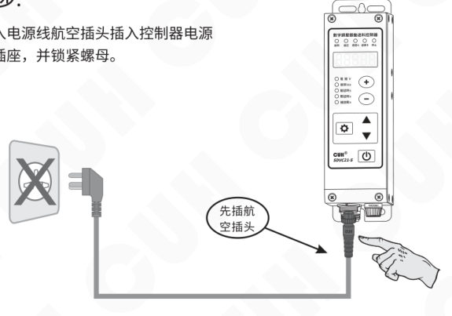

### 第四步：

将电源线三爪插头插在供电电源插座上。

### 第 17 页

数字调压振动送料控制器　　　　　　　　　　　　　　　　　　　　　　　　　SDVC21-S

---

# 第四章　基本操作

## 4.1 输出电压设定

本控制器可以直接在面板上以数字方式设定输出电压。由于本控制器特有的稳压功能，输出电压并不会受到输入电压波动的影响，即使在电压不稳定场合中使用也可以保持振动体稳定工作。同时，直接的电压数值设定也为用户了解设备运行情况提供了准确的数据。

- 控制器上电。
- 控制器进入输出电压 U 调整状态，此时电压指示灯点亮。
- 通过 `+` 和 `−` 调整参数值。

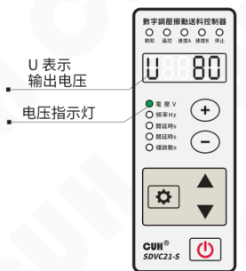

- 本控制器的输出电压不能超过输入电压。当设定的输出电压过于接近输入电压时，控制器将不能进行正常的稳压，此时，面板上饱和指示灯点亮，表示稳压失效。
- 本控制器也不能输出过低的电压。当输出电压过低时，控制器将不能进行正常的稳压，此时，面板上饱和指示灯点亮，表示稳压失效。

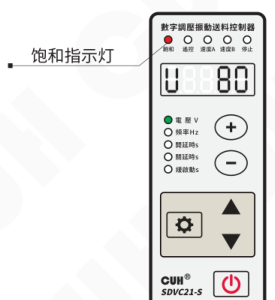

---

2023-11　　　　　　　　　　　　　　　- 9 -　　　　　　　　　　　　　　　SDVC21SMSCN_4.01

### 第 18 页

数字调压振动送料控制器　　　　　　　　　　　　　　　　　　　　　　　　　　　　　SDVC21-S

## 4.2 输出频率设定

本控制器可以选择输出全波（电源频率的二倍）或半波（电源频率）。

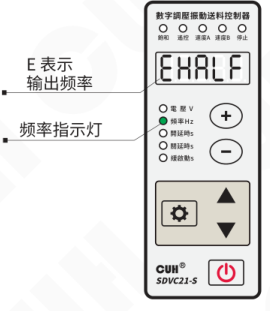

- 长按设置键（齿轮键）2秒，进入基本参数设置界面。
- 短按设置键（齿轮键）切换到输出频率 E 调整状态，此时频率指示灯点亮。
- 通过 ▼ 和 ▲ 调整参数值。

> E 表示输出频率；频率指示灯点亮。

- 当电源频率为 50Hz，将 E 调整为 HALF 时，输出频率为 50Hz；将 E 调整为 FULL 时，输出频率为 100Hz。
- 当电源频率为 60Hz，将 E 调整为 HALF 时，输出频率为 60Hz；将 E 调整为 FULL 时，输出频率为 120Hz。

2023-11　　　　　　　　　　　　　　　　　-10-　　　　　　　　　　　　　　　SDVC21SMSCN_4.01

### 第 19 页

数字调压振动送料控制器  
SDVC21-S

---

## 4.3 缓启动功能

本控制器从停止状态启动时，输出电压可以从0平缓提高到设定值，以防止设备和控制器遭受冲击。

**缓启动时间（t）：** 控制器从停止状态启动时，输出电压从0平滑升高达到设定输出电压所需要的时间称为缓启动时间。

» 长按“⚙”2秒，进入基本参数设置界面。

» 短按“⚙”切换到缓启动时间 t 调整状态，此时缓启动指示灯点亮。

» 通过 ▼ 和 ▲ 调整参数值。该参数的单位是秒，精度是0.1秒。

面板示意及标注（t 表示缓启动时间、缓启动指示灯）：

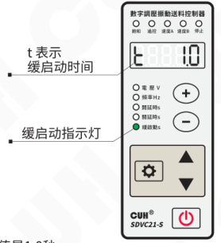

缓启动时间范围是0.0～9.9秒，出厂默认值是1.0秒。

## 4.4 输出开关

面板上的轻触式输出开关可以方便快速地开启或停止本机的输出。

» 使用控制器面板上的“⏻”，可以控制本机启动或停止输出。停止输出时，“停止”指示灯点亮，表示进入“停止”状态。

面板示意及标注（停止指示灯）：

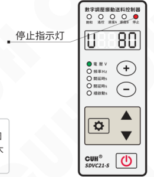

> ☺  
> 本功能使用软开关，由数字信号进行控制。因此，不会产生火花烧蚀机械触点的问题，可以大大延长控制器和振动设备的使用寿命。

### 第 20 页

数字调压振动送料控制器　　　　　　　　　　　　　　　　　　　SDVC21-S

---

## 4.5 最大输出电压限制功能

本控制器可以设定最大输出电压。设定该参数可以防止用户误操作导致输出过大电压而损毁振动设备。速度遥控功能和速度预设功能都受到此参数的限制。

- 长按 **设置键（⚙）** 和 **▲** 2秒，进入高级参数设置界面。
- 短按 **设置键（⚙）** 切换到最大输出电压限制 **h** 调整状态。
- 通过 **▼** 和 **▲** 调整参数值。

最大输出电压出厂默认值是250V。

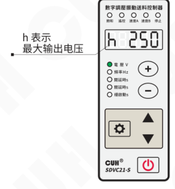

## 4.6 键盘锁定功能

- 通过长按 **开关键（⏻）** 2秒可以锁定除 **开关键（⏻）** 之外所有按键，此时界面第一位数码管显示“锁定标志”。
- 再次长按 **开关键（⏻）** 2秒可以解除锁定。

> 🙂 锁定状态下，开关键仍然有效。

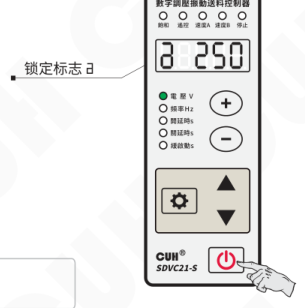

---

2023-11　　　　　　　　　　　　-12-　　　　　　　　　　　　SDVC21SMSCN_4.01

### 第 21 页

## 4.7 恢复出厂设置

本功能可以使用户快速将控制器设置为出厂默认设置状态。

由于本控制器功能强大，有数量众多的控制参数可以由用户设定，对于初学者，可能在多次的设定修改后不能恢复控制器的正常工作状态。使用该功能可以快速将调乱的参数状态恢复为出厂默认设置。

- 长按 **⚙** 和 **▲** 2秒，进入高级参数设置界面。

- 短按 **⚙** 切换到全屏闪烁状态，此时长按 **▲** 直到控制器显示 “-----”，表示控制器已经重设完毕。

- 松开 **▲**，控制器将进入正常的电压调整状态 “U”。此时控制器就像刚开始使用一样，所有参数都已经恢复到出厂默认状态。

操作示意（等待复位 / 复位成功）：

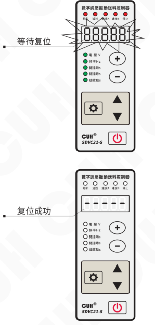

### 第 22 页

# 第五章 传感器与信号控制

本机可以接受多种外部信号或传感器控制其运行状态。本章主要介绍智能光电传感器、接近开关传感器和PLC等的使用方法。

## 5.1 智能光电传感器的使用方法

本机配合使用本公司提供的SDVC-S1智能光电对射传感器，可以实现智能光电传感功能。SDVC-S1传感器可以自动去除背景光对传感器工作的影响，因而无需人工调节灵敏度即可可靠工作。

### 5.1.1 智能光电传感器的接线方法

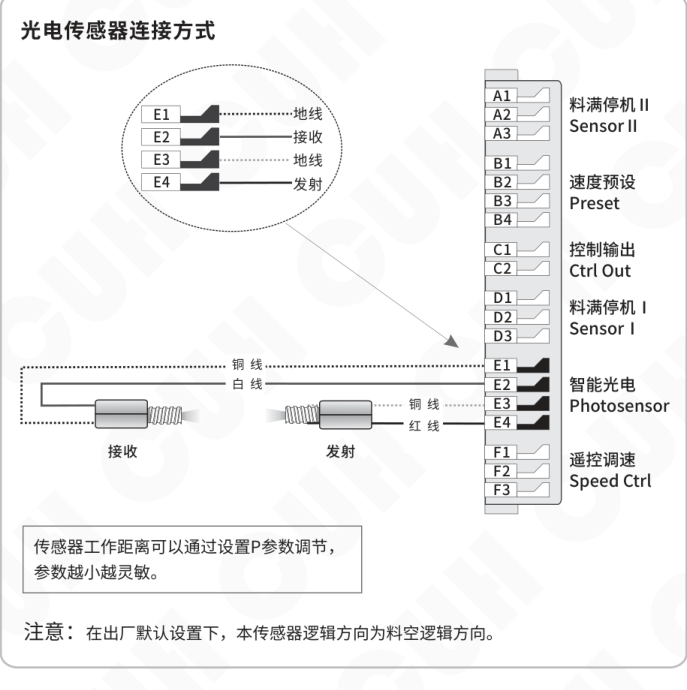

### 第 23 页

数字调压振动送料控制器　　　　　　　　　　　　　　　　　　　　　　　　　SDVC21-S

## 5.1.2 智能光电传感器开延时、关延时时间设定

当使用外部信号进行启动和停止控制时，大多数情况需要在收到指令后延迟一段时间才执行操作。对于这样的应用需求，可以通过设置开延时和关延时来满足。另外，还可以设定缓启动时间以消除启动时的冲击。

### 开延时

**开延时：** 从施加一个使控制器进入运行状态的控制信号开始，到控制器开始有输出，期间经历的延迟时间称为开延时。

- 长按 ⚙ 2秒，进入基本参数设置界面。
- 短按 ⚙ 切换到智能光电开延时调整状态，此时开延时指示灯点亮。
- 通过 ▼ 和 ▲ 调整参数值。该参数的单位是秒，精度是0.1秒。

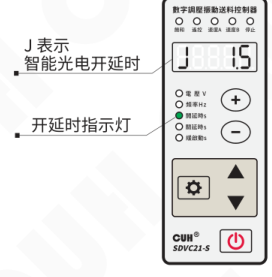

开延时时间范围是0.0～9.9秒，出厂默认值是0.2秒。

### 关延时

**关延时：** 从施加一个使控制器进入停止状态的控制信号开始，到控制器输出停止，期间经历的延迟时间称为关延时。

- 长按 ⚙ 2秒，进入基本参数设置界面。
- 短按 ⚙ 切换到智能光电关延时调整状态，此时关延时指示灯点亮。
- 通过 ▼ 和 ▲ 调整参数值。该参数的单位是秒，精度是0.1秒。

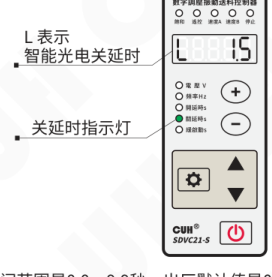

关延时时间范围是0.0～9.9秒，出厂默认值是0.2秒。

---

2023-11　　　　　　　　　　　　　　-15-　　　　　　　　　　　　　　SDVC21SMSCN_4.01

### 第 24 页

## 5.1.3 智能光电传感器逻辑方向设定

通常情况下，不连接任何控制信号或控制信号无效时，控制器处于运行状态，这定义为常通（NC, Normal Close）。但是，对于一些应用需要相反的逻辑，在不连接任何控制信号或控制信号无效时，控制器处于停止状态，当控制信号接入并且有效时，控制器运行，这定义为常断（NO, Normal Open）。这可以通过修改本参数实现。

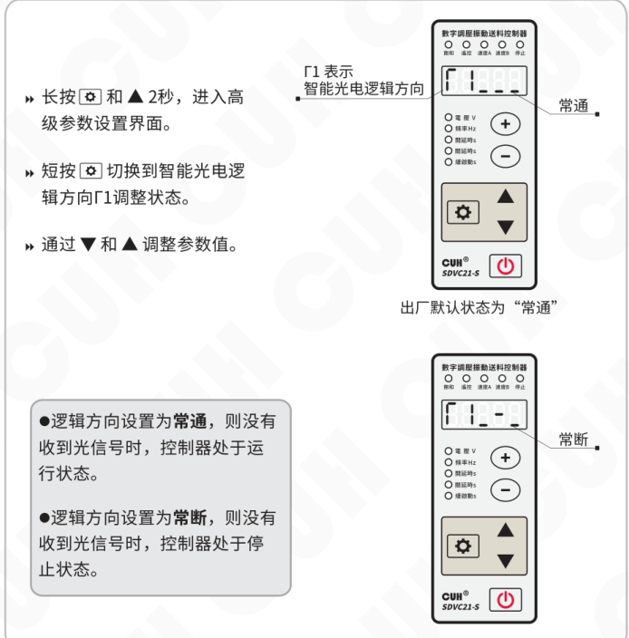

- 长按 **⚙** 和 **▲** 2秒，进入高级参数设置界面。
- 短按 **⚙** 切换到智能光电逻辑方向 **Γ1** 调整状态。
- 通过 **▼** 和 **▲** 调整参数值。

**Γ1 表示：** 智能光电逻辑方向

- **常通**：出厂默认状态为“常通”。
- **常断**。

> ● 逻辑方向设置为**常通**，则没有收到光信号时，控制器处于运行状态。  
> ● 逻辑方向设置为**常断**，则没有收到光信号时，控制器处于停止状态。

### 第 25 页

## 5.2 开关传感器的使用方法

配合各类开关传感器，如接近开关传感器、光纤传感器等实现自动启动和停止功能。

### 5.2.1 开关传感器的接线方法

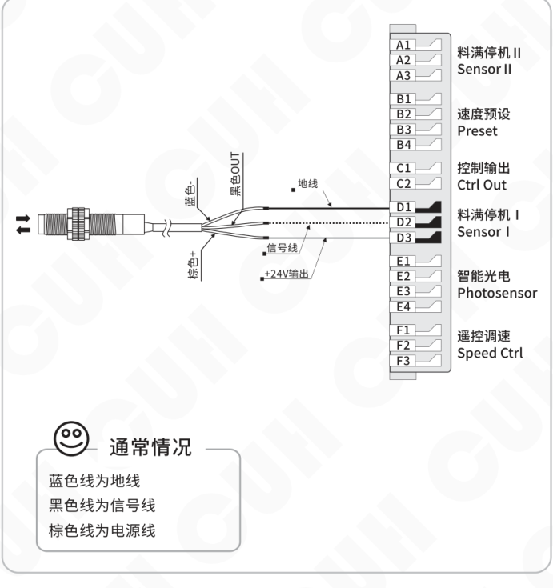

### 第 26 页

### 5.2.2 开关传感器开延时、关延时时间设定

在默认状态下，智能光电传感器和开关传感器的开延时、关延时时间总是相同的。用户也可以单独为开关传感器设定开延时、关延时时间。此时，开关传感器和智能光电传感器具有独立的开延时、关延时时间。

#### 开延时

**开延时：** 从施加一个使控制器进入运行状态的控制信号开始，到控制器开始有输出，期间经历的延迟时间称为开延时。

- 长按 ⚙ 和 ▲ 2 秒，进入高级参数设置界面。
- 短按 ⚙ 切换到开关传感器开延时 **J-** 调整状态。
- 通过 ▼ 和 ▲ 调整参数值。该参数的单位是秒，精度是 0.1 秒。

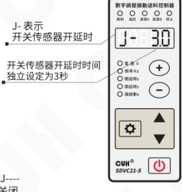

开关传感器开延时时间范围是 0.0～9.9 秒，出厂默认值是 **J----**。  
将此参数调整到小于 0 时，开关传感器独立延时时间将被关闭。

#### 关延时

**关延时：** 从施加一个使控制器进入停止状态的控制信号开始，到控制器输出停止，期间经历的延迟时间称为关延时。

- 长按 ⚙ 和 ▲ 2 秒，进入高级参数设置界面。
- 短按 ⚙ 切换到开关传感器关延时 **L-** 调整状态。
- 通过 ▼ 和 ▲ 调整参数值。该参数的单位是秒，精度是 0.1 秒。

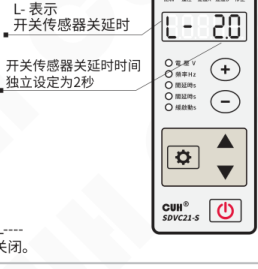

开关传感器关延时时间范围是 0.0～9.9 秒，出厂默认值是 **L----**。  
将此参数调整到小于 0 时，开关传感器独立延时时间将被关闭。

- 开关传感器独立开、关延时关闭时，开、关延时与智能光电开、关延时时间相同。
- 开关传感器独立开、关延时开启时，开、关延时时间由本参数设定，智能光电开、关延时时间不受影响，出厂默认设置为关闭独立设置。

### 第 27 页

数字调压振动送料控制器　　　　　　　　　　　　　　　　　　　　SDVC21-S

---

### 5.2.3 开关传感器逻辑方向设定

通常情况下，不向开关引脚发任何信号时，该引脚由于内部的上拉电阻，都会呈现为“高”电平。此时，在出厂默认设置下，控制器处于“运行”状态。但是，对于一些特殊应用，可能需要相反的逻辑，也就是说，可能会需要在不施加信号时，控制器处于“停止”状态。这可以通过修改本参数实现。

- 长按 **⚙** 和 **▲** 2秒，进入高级参数设置界面。
- 短按 **⚙** 切换到开关传感器逻辑方向 **Γ2** 调整状态。
- 通过 **▼** 和 **▲** 调整参数值。

**Γ2** 表示开关传感器逻辑方向。

常通（出厂默认状态为“常通”）界面示意：

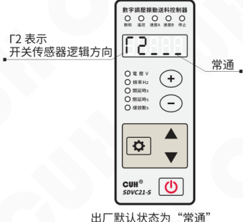

常断界面示意：

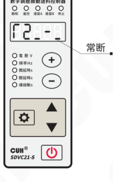

> ● 逻辑方向设置为**常通**，则不连接任何控制信号，控制器处于运行状态，也就是我们常说的料满停机。
>
> ● 逻辑方向设置为**常断**，则不连接任何控制信号，控制器处于停止状态，也就是我们常说的料空停机。

---

2023-11　　　　　　　　　　　　　　　　　-19-　　　　　　　　　　　　　SDVC21SMSCN_4.01

### 第 28 页

## 5.3 第二个开关传感器的使用方法

本控制器允许同时连接三个传感器：一个智能光电传感器和两个开关传感器，可同时实现料空停机和料满停机的自动启动和停止功能。

### 5.3.1 第二个开关传感器的接线方法

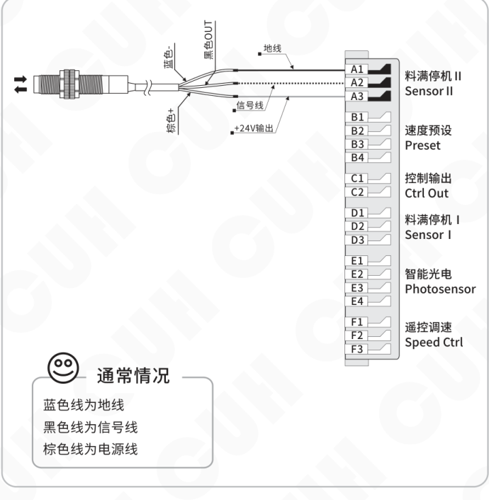

通常情况：

- 蓝色线为地线
- 黑色线为信号线
- 棕色线为电源线

接线端子标识：

| 端子 | 中文标识 | 英文标识 |
|---|---|---|
| A1 / A2 / A3 | 料满停机Ⅱ | Sensor II |
| B1 / B2 / B3 / B4 | 速度预设 | Preset |
| C1 / C2 | 控制输出 | Ctrl Out |
| D1 / D2 / D3 | 料满停机Ⅰ | Sensor I |
| E1 / E2 / E3 / E4 | 智能光电 | Photosensor |
| F1 / F2 / F3 | 遥控调速 | Speed Ctrl |

图中线缆标注：地线、信号线、+24V输出。传感器导线颜色标注：蓝色、黑色OUT、棕色+。

### 第 29 页

数字调压振动送料控制器　　　　　　　　　　　　　　　　　　　　SDVC21-S

## 5.3.2 第二个开关传感器开延时、关延时时间设定

在默认状态下，三个传感器的开延时、关延时时间总是相同的。用户也可以单独为第二个开关传感器设定开延时、关延时时间，此时第二个开关传感器具有独立的开延时、关延时时间。

### 开延时

**开延时：** 从施加一个使控制器进入运行状态的控制信号开始，到控制器开始有输出，期间经历的延迟时间称为开延时。

- 长按 **⚙** 和 **▲** 2秒，进入高级参数设置界面。
- 短按 **⚙** 切换到第二个开关传感器开延时 **J_** 调整状态。
- 通过 **▼** 和 **▲** 调整参数值。该参数的单位是秒，精度是0.1秒。

**示例标注：** **J_** 表示第二个开关传感器开延时；开关传感器开延时时间独立设定为3秒。

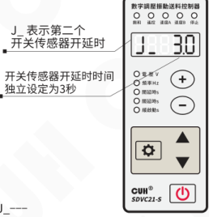

开关传感器开延时时间范围是0.0～9.9秒，出厂默认值是 **J_---**。  
将此参数调整到小于0时，开关传感器独立延时时间将被关闭。

### 关延时

**关延时：** 从施加一个使控制器进入停止状态的控制信号开始，到控制器输出停止，期间经历的延迟时间称为关延时。

- 长按 **⚙** 和 **▲** 2秒，进入高级参数设置界面。
- 短按 **⚙** 切换到第二个开关传感器关延时 **L_** 调整状态。
- 通过 **▼** 和 **▲** 调整参数值。该参数的单位是秒，精度是0.1秒。

**示例标注：** **L_** 表示开关传感器关延时；开关传感器关延时时间独立设定为2秒。

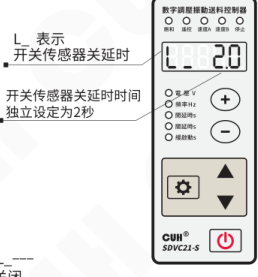

开关传感器关延时时间范围是0.0～9.9秒，出厂默认值是 **L_---**。  
将此参数调整到小于0时，开关传感器独立延时时间将被关闭。

---

- 第二个开关传感器独立开、关延时关闭时，开、关延时与智能光电开、关延时时间相同。
- 第二个开关传感器独立开、关延时开启时，开、关延时时间由本参数设定，智能光电开、关延时时间不受影响，出厂默认设置为关闭独立设置。

2023-11　　　　　　　　　　　　-21-　　　　　　　　　　　　SDVC21SMSCN_4.01

### 第 30 页

数字调压振动送料控制器　　　　　　　　　　　　　　　　　　　　　　　　　SDVC21-S

## 5.3.3 第二个开关传感器逻辑方向设定

通常情况下，不向开关引脚发任何信号时，该引脚由于内部的上拉电阻，都会呈现为“高”电平。此时，在出厂默认设置下，控制器处于“运行”状态。但是，对于一些特殊应用，可能需要相反的逻辑，也就是说，可能会需要在不施加信号时，控制器处于“停止”状态。这可以通过修改本参数实现。

- 长按 ⚙ 和 ▲ 2秒，进入高级参数设置界面。
- 短按 ⚙ 切换到第二个开关传感器逻辑方向 Γ4 调整状态。
- 通过 ▼ 和 ▲ 调整参数值。

Γ4 表示第二个开关传感器逻辑方向。

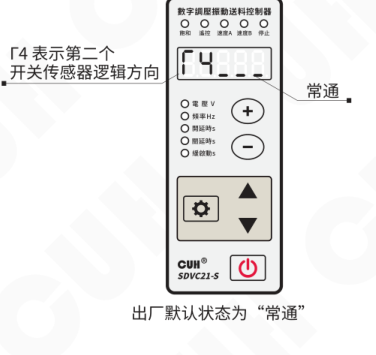

出厂默认状态为“常通”。

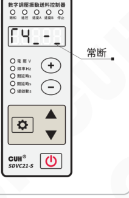

> ● 逻辑方向设置为**常通**，则不连接任何控制信号，控制器处于运行状态，也就是我们常说的料满停机。  
> ● 逻辑方向设置为**常断**，则不连接任何控制信号，控制器处于停止状态，也就是我们常说的料空停机。

---

2023-11　　　　　　　　　　　　　　　　　-22-　　　　　　　　　　　　　　　　　SDVC21SMSCN_4.01

### 第 31 页

数字调压振动送料控制器　　　　　　　　　　　　　　　　　　　　　　　SDVC21-S

## 5.4 控制信号逻辑关系设定

本控制器可以设定智能光电传感器和两个开关传感器同时作用时的逻辑关系。

- 长按 **设置键（齿轮键）** 和 **▲** 2秒，进入高级参数设置界面。
- 短按 **设置键（齿轮键）** 切换到控制信号逻辑关系 **Π** 调整状态。
- 通过 **▼** 和 **▲** 调整参数值。

**Π 表示控制信号逻辑关系。**

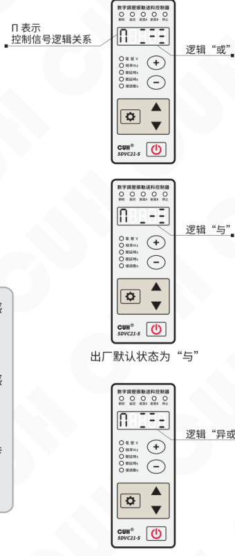

- **逻辑“与”**：仅在智能光电传感器与料满停机信号同时要求控制器运行时，控制器才运行。
- **逻辑“或”**：只要智能光电传感器与料满停机信号有一个要求控制器运行，控制器就运行。
- **逻辑“异或”**：仅在智能光电传感器与料满停机信号要求不同时，控制器才运行。

出厂默认状态为 **“与”**。

### 第 32 页

数字调压振动送料控制器　　　　　　　　　　　　　　　　　　　　　　　　　SDVC21-S

## 5.5 控制输出

本控制器可以输出低电压控制信号，以同步其它设备协同工作，如电磁阀、PLC、继电器等。

### 5.5.1 控制输出的接线方法

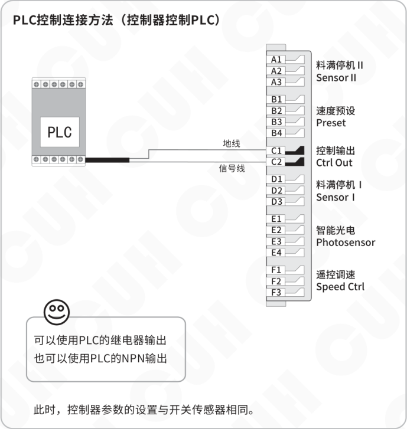

2023-11　　　　　　　　　　　　　　　　　-24-　　　　　　　　　　　　　　　　SDVC21SMSCN_4.01

### 第 33 页

数字调压振动送料控制器　　　　　　　　　　　　　　　　　SDVC21-S

## 控制电磁阀工作的连接方法

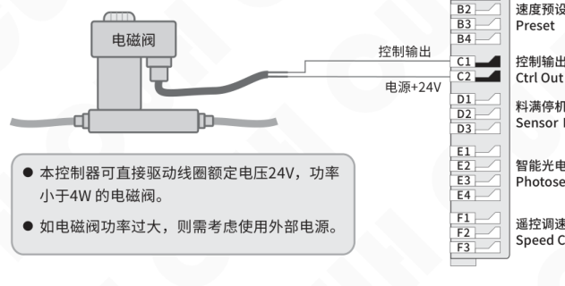

- 本控制器可直接驱动线圈额定电压 24V，功率小于 4W 的电磁阀。
- 如电磁阀功率过大，则需考虑使用外部电源。

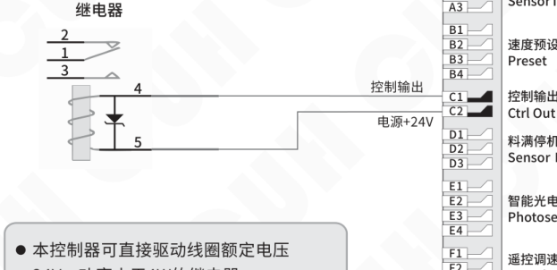

- 本控制器可直接驱动线圈额定电压 24V，功率小于 4W 的继电器。

---

2023-11　　　　　　　　　　　　　　　　　-25-　　　　　　　　　　　　　　　　　SDVC21SMSCN_4.01

### 第 34 页

数字调压振动送料控制器　　　　　　　　　　　　　　　　SDVC21-S

## 5.5.2 控制输出逻辑方向设定

- 长按 ⚙ 和 ▲ 2秒，进入高级参数设置界面。
- 短按 ⚙ 切换到控制输出逻辑方向 Γ3 调整状态。
- 通过 ▼ 和 ▲ 调整参数值。

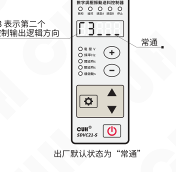

出厂默认状态为“常通”。

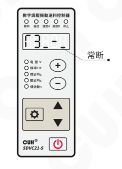

> ● 逻辑方向设置为**常通**，则控制器输出运行时，控制信号输出为运行状态。  
> ● 逻辑方向设置为**常断**，则控制器输出运行时，控制信号输出为停止状态。

2023-11　　　　　　　　　　-26-　　　　　　　　　　SDVC21SMSCN_4.01

### 第 35 页

数字调压振动送料控制器　　　　　　　　　　　　　　　　SDVC21-S

---

## 5.6 远程速度控制

本控制器远程速度控制允许用户通过外接电位器或1~5V控制电压信号或4~20mA控制电流信号控制输出电压。这样，用户可以通过PLC、DCS或其他一些方法，方便容易地进行外部远程速度控制。

### 外接电位器的连接方法

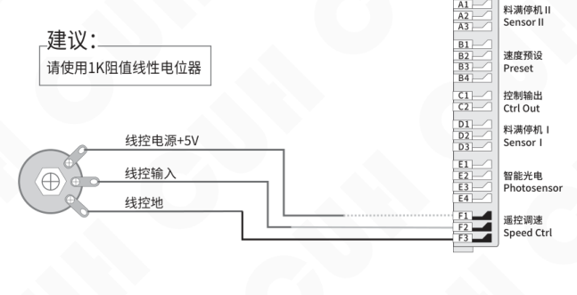

### 使用PLC进行输出电压控制的连接方法

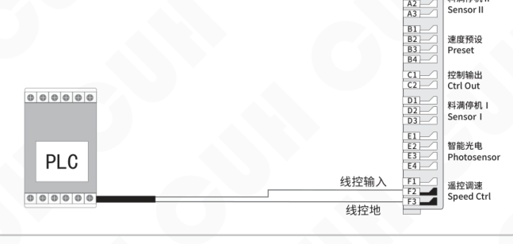

> 当线控电压对控制器的控制生效时，面板的遥控指示灯点亮，同时在面板上调整电压将失效。如果此时控制器处于电压调节状态，LED显示屏将显示输出电压。

---

2023-11　　　　　　　　　-27-　　　　　　　　　SDVC21SMSCN_4.01

### 第 36 页

## 5.7 速度预置功能

速度预置功能是通过外部控制信号直接选择预定速度的功能。通过该功能，外部控制设备，如PLC、计算机、传感器等其他的信号源可以方便地与本控制器组成多档速度送料控制系统。

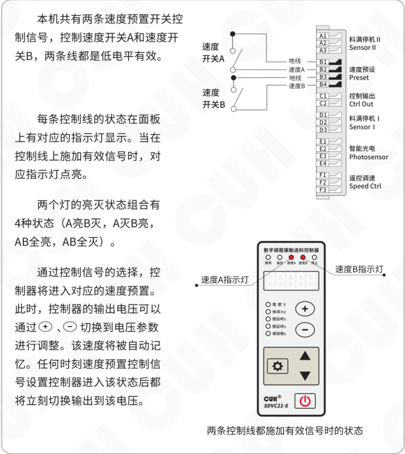

本机共有两条速度预置开关控制信号，控制速度开关A和速度开关B，两条线都是低电平有效。

每条控制线的状态在面板上有对应的指示灯显示。当在控制线上施加有效信号时，对应指示灯点亮。

两个灯的亮灭状态组合有4种状态（A亮B灭，A灭B亮，AB全亮，AB全灭）。

通过控制信号的选择，控制器将进入对应的速度预置。此时，控制器的输出电压可以通过 `+`、`−` 切换到电压参数进行调整。该速度将被自动记忆。任何时刻速度预置控制信号设置控制器进入该状态后都将立刻切换输出到该电压。

两条控制线都施加有效信号时的状态

### 第 37 页

数字调压振动送料控制器　　　　　　　　　　　　　　　　　　　　　　　　　SDVC21-S

---

# 第六章 安全保护功能

## 6.1 稳压功能

内置数字稳压功能，可以消除由于电源电压波动造成的送料速度变化。

## 6.2 短路保护功能

输出发生短路时，控制器会立即停止输出，同时显示Err01，直到控制器重新启动为止。也有可能熔断保险丝，为恢复功能需要更换保险丝。

## 6.3 过流保护功能

本控制器可以在用户误操作造成输出电流超过额定电流时，暂时停止输出，同时显示Err02，以保护本机及用户的设备。

## 6.4 过热保护功能

当控制器工作温度超过65℃时，将停止输出，以保护本机，同时显示Err03，当温度下降到60℃以下时，本机恢复输出。

---

2023-11　　　　　　　　　　　　　　　　　-29-　　　　　　　　　　　　　　SDVC21SMSCN_4.01

### 第 38 页

数字调压振动送料控制器　　　　　　　　　　　　　　　　　　　　　　　　　SDVC21-S

# 第七章 技术规格

## 7.1 外形尺寸

外形尺寸图（单位：毫米mm）

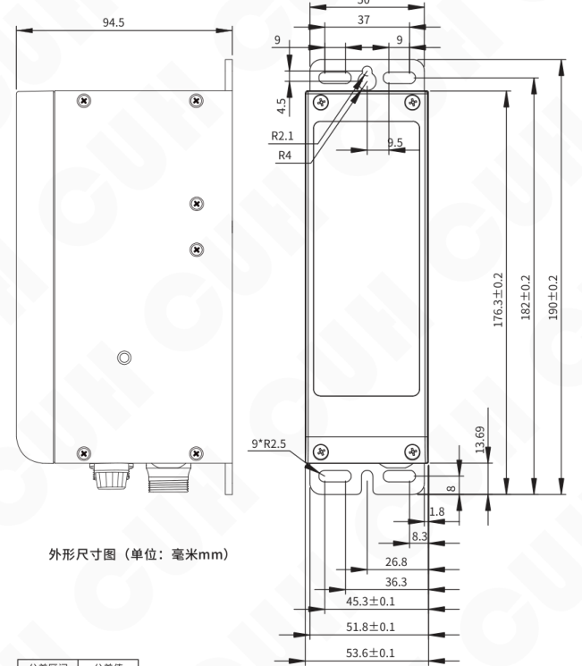

| 公差区间 | 公差值 |
|---|---:|
| 0~3 | ±0.05 |
| 3~10 | ±0.1 |
| 10~30 | ±0.15 |
| 30~80 | ±0.2 |
| 80~180 | ±0.3 |
| >180 | ±0.5 |

本系列产品均适用此公差表。

2023-11　　　　　　　　　　　　　　　　　-30-　　　　　　　　　　　　　　　　　SDVC21SMSCN_4.01

### 第 39 页

## 7.2 技术规格表

| 项目 | 最小值 | 典型值 | 最大值 | 单位 | 备注 |
|---|---:|---:|---:|---|---|
| 输入电压 | 85 | 220 | 250 | 伏特（V） | 交流有效值 |
| 输出电压调整范围 | 35 | — | Vin-10 | 伏特（V） | 半波 |
| 输出电压调整范围 | 45 | — | Vin-5 | 伏特（V） | 全波 |
| 电压调整精度 | 1 |  |  | 伏特（V） |  |
| 稳压精度 | — | — | 30 | 伏特（V） | Vset = 150V △Vin+ = 70V |
| 稳压响应时间 | 0 | 0.01 | 0.02 | 秒（s） |  |
| 输出电流调整范围 | 0 | — | 5 | 安培（A） |  |
| 输出功率 | 0 | — | 1100 | 伏安（VA） |  |
| 输出频率 | 45 | 50/60 | 65 | 赫兹（Hz） | 半波 |
| 输出频率 | 90 | 100/120 | 130 | 赫兹（Hz） | 全波 |
| 输出波形 | 正弦相切 |  |  |  |  |
| 缓启动时间 | 0 | — | 9.9 | 秒（s） | 出厂默认1.0 |
| 延迟时间范围 | 0 | — | 9.9 | 秒（s） | 出厂默认0.2 |
| 延迟时间精度 | 0.1 |  |  | 秒（s） |  |
| 过热保护温度 | 58 | 60 | 66 | 摄氏度（℃） |  |
| 短路保护动作电流 | — | 6.3 | — | 安培（A） | 保险丝容量 |
| 直流控制输出电压 | 22 | 24 | 26 | 伏特（V） |  |
| 直流控制输出电流 | 0 | — | 400 | 毫安（mA） |  |
| 模拟控制信号 | 1~5/4~20 |  |  | 伏特（V）/毫安（mA） | 远程速度控制电压/电流 |
| 数字控制信号 | 24 |  |  | 伏特（V） | 开关信号控制 |
| 调整方式 | 6 |  |  | 键（Button） |  |
| 保险丝容量 | 6.3 |  |  | 安培（A） |  |
| 空载功耗 | — | 2 | — | 瓦特（W） |  |
| 显示方式 | 5 |  |  | 位（Digit） | LED数码管 |
| 工作环境温度 | 0 | 25 | 40 | 摄氏度（℃） |  |
| 工作环境湿度 | 10 | 60 | 85 | 相对湿度（%） | 不结露 |
| 存储环境温度 | -20 | 25 | 85 | 摄氏度（℃） |  |

### 第 40 页

数字调压振动送料控制器　　　　　　　　　　　　　　　　　　　　　　　　　　　　SDVC21-S

## 7.3 参考标准

**极限参数：超过此指标将会造成严重损坏，必须严格遵守！**

| 项目 | GB 标准 | IEC 标准 | 等级 | 标准要求 | 备注说明 |
|---|---|---|---|---|---|
| 静电放电 | GB/T 17626.2-2006 | IEC 61000-4-2:2001 | 4 | ±8 kV | 接触放电 |
| 静电放电 | GB/T 17626.2-2006 | IEC 61000-4-2:2001 | 4 | ±15 kV | 空气放电 |
| 电快速瞬变 脉冲群 | GB/T 17626.4-2008 | IEC 61000-4-4:2004 | 4 | ±4 kV |  |
| 直流电源纹 波抗扰度 | GB/T 17626.17-2005 | IEC 61000-4-17:2002 | 4 | 15% | 评价 A |

> **警告**  
> 在民用环境中，本产品可能产生无线电干扰。在这种情况下，可能需要采取附加抑制措施。

2023-11　　　　　　　　　　　　　　　　　-32-　　　　　　　　　　　　　　SDVC21SMSCN_4.01

### 第 41 页

数字调压振动送料控制器　　　　　　　　　　　　　　　　　　　　　　　　　SDVC21-S

## 7.4 参数列表

| 类别 | 含义 | 参数符号 | 数码管符号图片 | 取值范围 | 默认设置 |
|---|---|---|---|---|---|
| 常用参数 | 输出电压 | 【U】 |  | 0~250 伏特（V） | 150 |
|  | 输出频率 | 【E】 |  | FULL，HALF | FULL |
| 基本参数 | 智能光电开延时 | 【大勾】 |  | 0.0~9.9 秒（s） | 0.2 |
|  | 智能光电关延时 | 【大L】 |  | 0.0~9.9 秒（s） | 0.2 |
|  | 缓启动时间 | 【小T】 |  | 0.0~9.9 秒（s） | 1.0 |
| 高级参数 | 开关传感器开延时 | 【勾中】 |  | 0.0~9.9 秒（s） | ---（与【大勾】相同） |
|  | 开关传感器关延时 | 【L中】 |  | 0.0~9.9 秒（s） | ---（与【大L】相同） |
|  | 第二个开关传感器开延时 | 【勾下】 |  | 0.0~9.9 秒（s） | ---（与【大勾】相同） |
|  | 第二个开关传感器关延时 | 【L下】 |  | 0.0~9.9 秒（s） | ---（与【大L】相同） |
|  | 智能光电逻辑方向 | 【清1】 |  | 常通---，常断-- | 常通--- |
|  | 开关传感器逻辑方向 | 【清2】 |  | 常通---，常断-- | 常通--- |
|  | 控制输出逻辑方向 | 【清3】 |  | 常通---，常断-- | 常通--- |
|  | 第二个开关传感器逻辑方向 | 【清4】 |  | 常通---，常断-- | 常通--- |
|  | 控制信号逻辑关系 | 【大恩】 |  | 或---，与---，异或--- | 与--- |
|  | 最大输出电压限制 | 【小H】 |  | 0~250 伏特（V） | 220 |
|  | 智能光电灵敏度 | 【P】 |  | 0~1000 | 80 |
|  | 恢复出厂设置 | 【全8】 |  | —— | —— |

2023-11　　　　　　　　　　　　　　　　　　　-33-　　　　　　　　　　　　　　　　　　　SDVC21SMSCN_4.01

### 第 42 页

数字调压振动送料控制器　　　　　　　　　　　　　　　　　　　　　　　　　SDVC21-S

## 7.5 故障诊断

以下一些方法可以帮助您排除使用中可能会遇到的简单问题。

| 故障现象/故障代码 | 数码管符号图片 | 含义 | 排除方法 |
|---|---|---|---|
| 打开开关，没有显示 |  |  | ◆ 请检查电源插座是否有电？ ◆ 电源插头是否可靠连接插座？ |
| 有显示，但是振动盘不动，也没有声音 |  |  | ◆ 请检查输出电缆是否正确地连接控制器与振动盘？ ◆ 请检查控制器参数，是否输出电压调节的太小？ ◆ 请检查控制信号是否将控制器置于“停止”状态？ ◆ 请检查是否有设置为“常断”的参数，导致控制器被置于“停止”状态？ |
| 控制信号不起作用 |  |  | ◆ 请检查控制信号是否正确输入？ ◆ 请检查输入的控制信号的地线是否与本机地正确连接？ ◆ 请检查控制信号逻辑关系设置是否是您期望的设置？ |
| 周期性忽大忽小 （拍频现象） |  |  | ◆ 请检查多个振动体间的振动耦合问题。 ◆ 调整相互耦合的振动设备的工作频率，使频率差更大。 |
| 有显示，振动盘不动， 但是可以听到声音 |  |  | ◆ 请按照说明书介绍的调节方法逐步调节各参数。 |
| Err01 |  | 短路保护 | ◆ 确保负载未短路，重新上电以后启动输出。 |
| Err02 |  | 过流保护 | ◆ 适当降低输出电压，然后尝试重新启动输出。 |
| Err03 |  | 过热保护 | ◆ 将本控制器安装在通风良好的环境中。 |
| Err04 |  |  | ◆ 保留，联系本公司技术支持。 |
| Err05 |  |  | ◆ 保留，联系本公司技术支持。 |

2023-11　　　　　　　　　　　　　　　　　-34-　　　　　　　　　　　　　　　　　SDVC21SMSCN_4.01

### 第 43 页

数字调压振动送料控制器　　　　　　　　　　　　　　　　　　　　　SDVC21-S

---

# 第八章 产品质保信息

## 8.1 质保期

本公司为本产品提供的质保期为三年，从产品发送到购买方指定地点之日算起。

## 8.2 保修范围

（一）如果在上述质保期内出现本公司造成的故障，我们将免费维修产品。但是以下情况不属于保修范围：

 a、 未按照简易说明书、用户手册或购买方与本公司专门达成的技术要求中规定的条件、环境下的不正确操作，或不正确使用造成的故障。

 b、 故障不是因产品缺陷，而是购买方设备或软件设计造成的。

 c、 非本公司人员进行的修改或修理而造成的故障。

 d、 按照简易操作指南或用户手册正确维修或更换易损部件等规定可以完全避免的故障。

 e、 产品从本公司发货后，因无法预料的科学技术水平变化等因素而造成的故障。

 f、 由于火灾、地震、洪水等自然灾害，或异常电压等外部因素造成的故障，本公司不负责保修。

（二）保修范围仅限于（一）中规定的情况，本公司对该设备造成的购买方间接损失（如设备损坏、机会丧失、利润损失等）或其他损失，不承担任何责任。

## 8.3 产品适用性

本公司的该控制器是针对振动送料行业的通用产品而设计生产的。因此，本公司的该控制器不得用于下列应用且不适合其使用。

（一） 对生命和财产有严重影响的设施，如核发电厂、机场、铁路、轮船、机动装置及医疗设备。

（二） 公共事业，包括电力、气体、供水等。

（三） 相似条件或环境的户外使用。

---

2023-11　　　　　　　　　　　　　　　-35-　　　　　　　　　　　　　　　SDVC21SMSCN_4.01

### 第 44 页

南京创优科技有限责任公司  
网址:www.cuhnj.com  
电话:025-84730416  
传真:025-84730426  
邮箱:sales@cuhnj.com  
地址:南京市江宁区智能路9号  
启迪城学研园2幢

文档编号： IDP1000377
<!-- /auto:ai-body-draft v1 -->

<!-- auto:data-params-summary v1 -->
## 附录 · 参数表（结构化侧车·机器生成）

> 说明：本节由 `data/<doc_key>/params/params.yaml` 自动渲染（展示前若干行），用于校对与二次开发。定稿以层 C 数据为准。

| 参数 | 标志/符号 | 范围 | 默认 | 单位 | 备注 |
| --- | --- | --- | --- | --- | --- |
|    **警告** |  |  |  |  |  |
|    **小心** |  |  |  |  |  |
|    **注意** |  |  |  |  |  |
|  **要点** ！ |  |  |  |  |  |
|  A1 |  |  |  |  |  |
|  A2 |  |  |  |  |  |
|    A3 |  |  |  |  |  |
|   |  |  |  |  |  |
|    B1 |  |  |  |  |  |
|    B2 |  |  |  |  |  |
|    B3 |  |  |  |  |  |
|    B4 |  |  |  |  |  |
|   |  |  |  |  |  |
|    C1 |  |  |  |  |  |
|    C2 |  |  |  |  |  |
|   |  |  |  |  |  |
|    D1 |  |  |  |  |  |
|    D2 |  |  |  |  |  |
|    D3 |  |  |  |  |  |
|     |  |  |  |  |  |
|      E1 |  |  |  |  |  |
|    E2 |  |  |  |  |  |
|    E3 |  |  |  |  |  |
|    E4 |  |  |  |  |  |
|   |  |  |  |  |  |
|    F1 |  |  |  |  |  |
|    F2 |  |  |  |  |  |
|    F3 |  |  |  |  |  |
|  0~3 |  |  |  |  |  |
|  3~10 |  |  |  |  |  |

*（仅展示前 30 条，共 93 条；完整数据见下方链接。）*

- 完整 YAML：`data/cuh.sdvc.manual.v4.01/params/params.yaml`
- 表格索引：`data/cuh.sdvc.manual.v4.01/index.yaml`
<!-- /auto:data-params-summary v1 -->
