## 目录

> 下列条目来自 PDF 内置书签/大纲；链接指向本批转换生成的整页渲染图（`assets/pages/`），便于与原版 PDF 对照校对。

- [1: 封面](assets/pages/page-0001.png)（第 1 页）
- [2: 封二版权与免责](assets/pages/page-0002.png)（第 2 页）
- [3: 序言](assets/pages/page-0003.png)（第 3 页）
- [4: 安全与预防措施](assets/pages/page-0004.png)（第 4 页）
- [5: 工作与储存环境](assets/pages/page-0005.png)（第 5 页）
- [7: 目录](assets/pages/page-0007.png)（第 7 页）
- [8: 目录2](assets/pages/page-0008.png)（第 8 页）
- [第一章 性能特点](assets/pages/page-0009.png)（第 9 页）
- [第二章 安装指南](assets/pages/page-0011.png)（第 11 页）
- [第三章 部件说明](assets/pages/page-0013.png)（第 13 页）
  - [3.1 指示灯及按键说明](assets/pages/page-0013.png)（第 13 页）
  - [3.2 外部部件说明](assets/pages/page-0014.png)（第 14 页）
  - [3.3 信号接口定义](assets/pages/page-0014.png)（第 14 页）
- [第四章 基本操作](assets/pages/page-0015.png)（第 15 页）
  - [4.1 输出电压设定](assets/pages/page-0015.png)（第 15 页）
  - [4.2 输出频率设定](assets/pages/page-0016.png)（第 16 页）
  - [4.3 缓启动功能](assets/pages/page-0017.png)（第 17 页）
  - [4.4 输出开关](assets/pages/page-0017.png)（第 17 页）
  - [4.5 最大输出电压限制功能](assets/pages/page-0018.png)（第 18 页）
  - [4.6 恢复出厂设置](assets/pages/page-0019.png)（第 19 页）
- [第五章 传感器与信号控制](assets/pages/page-0020.png)（第 20 页）
  - [5.1 智能光电传感器的使用方法](assets/pages/page-0020.png)（第 20 页）
    - [5.1.1 智能光电传感器的接线方法](assets/pages/page-0020.png)（第 20 页）
    - [5.1.2 智能光电传感器开延时、关延时设定](assets/pages/page-0021.png)（第 21 页）
    - [5.1.3 智能光电传感器逻辑方向设定](assets/pages/page-0022.png)（第 22 页）
  - [5.2 开关传感器的使用方法](assets/pages/page-0023.png)（第 23 页）
    - [5.2.1 开关传感器的接线方法](assets/pages/page-0023.png)（第 23 页）
    - [5.2.2 开关传感器开延时、关延时时间设定](assets/pages/page-0024.png)（第 24 页）
    - [5.2.3 开关传感器逻辑方向设定](assets/pages/page-0025.png)（第 25 页）
  - [5.3 第二个开关传感器的使用方法](assets/pages/page-0026.png)（第 26 页）
    - [5.3.1 第二个开关传感器的接线方法](assets/pages/page-0026.png)（第 26 页）
    - [5.3.2 第二个开关传感器开延时、关延时时间设定](assets/pages/page-0027.png)（第 27 页）
    - [5.3.3 第二个开关传感器逻辑方向设定](assets/pages/page-0028.png)（第 28 页）
  - [5.4 控制信号逻辑关系设定](assets/pages/page-0029.png)（第 29 页）
  - [5.5 控制输出](assets/pages/page-0030.png)（第 30 页）
    - [5.5.1 控制输出的接线方法](assets/pages/page-0030.png)（第 30 页）
    - [5.5.2 控制输出逻辑方向设定](assets/pages/page-0032.png)（第 32 页）
  - [5.6 远程速度控制](assets/pages/page-0033.png)（第 33 页）
  - [5.7 速度档位开关](assets/pages/page-0035.png)（第 35 页）
  - [5.8 主控输出分离参数](assets/pages/page-0036.png)（第 36 页）
- [第六章 安全保护功能](assets/pages/page-0037.png)（第 37 页）
  - [6.1 稳压功能](assets/pages/page-0037.png)（第 37 页）
  - [6.2 短路保护功能](assets/pages/page-0037.png)（第 37 页）
  - [6.3 过流保护功能](assets/pages/page-0037.png)（第 37 页）
  - [6.4 过热保护功能](assets/pages/page-0037.png)（第 37 页）
- [第七章 技术规格](assets/pages/page-0038.png)（第 38 页）
  - [7.1 外形尺寸](assets/pages/page-0038.png)（第 38 页）
  - [7.2 技术规格表](assets/pages/page-0039.png)（第 39 页）
  - [7.3 参考标准](assets/pages/page-0040.png)（第 40 页）
  - [7.4 参数列表](assets/pages/page-0041.png)（第 41 页）
  - [7.5 故障诊断](assets/pages/page-0042.png)（第 42 页）
- [第八章 产品质保信息](assets/pages/page-0043.png)（第 43 页）
  - [8.1 质保期](assets/pages/page-0043.png)（第 43 页）
  - [8.2 保修范围](assets/pages/page-0043.png)（第 43 页）
  - [8.3 产品适用性](assets/pages/page-0043.png)（第 43 页）
## 术语与命名

- 侧车：`glossary/terms.yaml`（机读）、`glossary/zh-CN.md`（人读）；候选表，定稿后并入公司级 `glossary/`。

## 适用范围

- 本文档由 PDF 自动转换生成，正文与插图需人工核对。

## 变更记录

- 2026-06-05 11:44:21：由转换工具从源 PDF 生成首版。

## 正文

<!-- auto:ai-body-draft v1 -->
> 以下为**整页视觉转写**的正文草稿（多模态模型直接输出 Markdown，含 GFM 表； 若配置 `[[vcrop:页:序]]` 占位符，裁剪步骤会插入 `assets/images/` 下 PNG）。**请务必人工校对。**

### 第 1 页

# CUH®

## 双路数字调压振动送料控制器

**Dual Channel Variable Voltage Digital Controller for Vibratory Feeder**

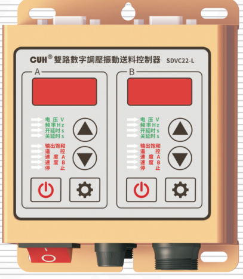

## SDVC22 系列

# 用户手册

### 第 2 页

双路数字调压振动送料控制器　　　　　　　　　　　　　　　SDVC22 系列

---

## 版权说明

南京创优科技有限责任公司保留所有权利。

本用户手册上包含的所有信息是属于本公司的知识，受著作权法及所有法律的保护。本公司根据著作权法及其他法律享有并保留所有著作权和其他法律赋予的权利，未经本公司书面同意不得以任何形式对本用户手册的部分或全部进行抄袭、翻译、转译、仿制或其他利用。

## 免责声明

本用户手册的所有内容仅说明本公司生产的相关产品的使用方法，并且是根据现有技术和提供给您使用时的状态进行描述的，在您使用本产品时必须自行承担相关风险。除法律强制规定外，本公司不因本用户手册对产品负有任何明示或暗示的责任，包括但不限于人身伤害、财产损失、机会丧失。

您明确了解上述风险并同意，除法律强制规定外，本公司无须为您的任何直接、间接的损害或损失负责（包括但不限于人员、财物、数据等有形损失和名誉、机会等无形损失）。

本公司保留对本用户手册中所适用的产品进行修改而不预先及事后通知的权利。

---

2024-04　　　　　　　　　　　　　　　　　　　　　　　　　SDVC22SMSCN_1.01

### 第 3 页

双路数字调压振动送料控制器　　　　　　　　　　　　　　　　　　　　　　　　　　　SDVC22 系列

# 序言

感谢您使用南京创优科技有限责任公司（在本手册中以下简称本公司）出品的SDVC22 系列双路数字调压振动送料控制器（在本手册中以下简称本产品、本控制器或控制器）。

本手册介绍了本产品的基本操作方法和功能技术说明。为用户提供安装调试、参数设置、异常诊断、故障排除及日常维护控制器的相关信息。为了确保正确安装和使用本控制器，请在装机之前仔细阅读本用户手册，并请妥善保存。

以下符号提醒您注意有关防止人身伤害和产品损坏的事项，请务必阅读。

| 符号 | 说明 |
|---|---|
| ⚠ 危险 | 表示若不遵守该事项，将导致人员伤亡。 |
| ⚠ 警告 | 表示若不遵守该事项，可能导致人员伤亡。 |
| ⚠ 小心 | 表示若不遵守该事项，可能导致人员遭受中度或轻微伤害。 |
| 注意 | 表示若不遵守该事项，将导致本产品损坏及财产损失。 |
| ! 要点 | 表示在使用过程中必须要遵守的注意事项和使用限制等。 |

## 本说明书适合以下型号控制器：

- 双路数字调压振动送料控制器　SDVC22-S（双控5A）
- 双路数字调压振动送料控制器　SDVC22-L（双控10A）

2024-04　　　　　　　　　　　　　　　　　　　　　　　　　　　　　　　SDVC22SMSCN_1.01

### 第 4 页

双路数字调压振动送料控制器　　　　　　　　　　　　　　　　　SDVC22 系列

# 安全与预防措施

1. **⚠ 危险** 本产品仅用于驱动基于电磁铁的振动送料设备，请勿将本产品用于保护人体或人体部位等目的。

2. **⚠ 危险** 本产品不得作为防爆产品使用，请勿在危险场所和/或潜在爆炸气体环境中使用本产品。

3. **⚠ 警告** 本产品是采用交流市电供电的设备，请勿施加交流电压超过 260Vac。施加过大的输入电压如380Vac，则可能导致产品爆炸或者着火，造成严重的安全事故。

4. **⚠ 警告** 本产品是通过电源线进行接地的，请确保为控制器供电的配电设施具备良好的接地，否则可能导致控制器外壳带电，造成触电事故。

5. **⚠ 警告** 请勿输入交流电源到本控制器的输出端，这会损坏控制器。

6. **⚠ 警告** 请勿在带电的情况下插拔接线或触摸接线仓内各接线端子触点，以防发生触电事故。

7. **注意** 请避免采用通过继电器等设备切断供电的方式来控制本产品的输出，这会严重降低本控制器的寿命。

8. **注意** 本产品设计使用于阴凉干燥环境，请勿将本产品置于室外、可能会浸水、阳光暴晒场所工作，也不要在超过本产品电气特性要求的温度和湿度范围之外工作。

9. **要点** 请务必将本产品固定在可靠接地的坚固平台上, 并远离振动设备。

10. **要点** 任何情况下请勿将本产品在超越设计极限状态下工作。

11. **要点** 请严格按照本手册的说明操作，对于违反这些操作说明所造成的任何人身伤害或财产损失，本公司不承担任何民事和刑事责任。

12. **要点** 任何情况下请不要打开本控制器机壳，以防遭到电击。机壳内部没有可以调节和用户维修部分，请不要试图维修本机，出现故障请致电本公司。

---

2024-04　　　　　　　　　　　　　　　　　　　　　　　　　SDVC22SMSCN_1.01

### 第 5 页

双路数字调压振动送料控制器　　　　　　　　　　　　　　　　SDVC22 系列

# 工作与储存环境

## 一、使用前的检查

每台控制器在出厂前，均经过严格的品质检验，并经过强化的防撞包装处理。客户在拆箱后，请即刻进行下列检查：

1. 检查控制器是否在运输过程中受到损伤。
2. 检查控制器型号是否与订货登记资料完全相同。

## 二、工作环境

为使本控制器具有更好的使用效果和更长的使用寿命，请将控制器安装在符合下列条件的环境中：

- 良好的通风散热环境
- 远离水滴、蒸气、灰尘，（特别是油性灰尘）
- 无腐蚀、易燃性的气体、液体
- 无漂浮性的尘埃及金属微粒
- 安装表面坚固无振动
- 远离电磁噪声干扰
- 使用环境温度为0°C到40°C
- 仅适用于海拔2000m以下地区安全使用

2024-04　　　　　　　　　　　　　　　　　　　　　　　　　SDVC22SMSCN_1.01

### 第 6 页

双路数字调压振动送料控制器　　　　　　　　　　　　　　　　　　　　　　　　　SDVC22 系列

---

---

2024-04　　　　　　　　　　　　　　　　　　　　　　　　　　　　　　SDVC22SMSCN_1.01

### 第 7 页

双路数字调压振动送料控制器　　　　　　　　　　　　　　　　　　　　　　　　　SDVC22 系列

---

# 目　录

**第一章 性能特点** ----------------------------------------------------------------------------------- 1

**第二章 安装指南** ----------------------------------------------------------------------------------- 3

**第三章 部件说明** ----------------------------------------------------------------------------------- 5

　　3.1　指示灯及按键说明 --------------------------------------------------------------------------- 5

　　3.2　外部部件说明 --------------------------------------------------------------------------------- 6

　　3.3　信号接口定义 --------------------------------------------------------------------------------- 6

**第四章 基本操作** ----------------------------------------------------------------------------------- 7

　　4.1　输出电压设定 --------------------------------------------------------------------------------- 7

　　4.2　输出频率设定 --------------------------------------------------------------------------------- 8

　　4.3　缓启动功能 ----------------------------------------------------------------------------------- 9

　　4.4　输出开关 ------------------------------------------------------------------------------------- 9

　　4.5　最大输出电压限制功能 ---------------------------------------------------------------------- 10

　　4.6　恢复出厂设置 ------------------------------------------------------------------------------- 11

**第五章 传感器与信号控制** ---------------------------------------------------------------------- 12

　　5.1　智能光电传感器的使用方法 --------------------------------------------------------------- 12

　　　5.1.1　智能光电传感器的接线方法 ---------------------------------------------------------- 12

　　　5.1.2　智能光电传感器开延时、关延时时间设定 ------------------------------------------ 13

　　　5.1.3　智能光电传感器逻辑方向设定 ------------------------------------------------------- 14

　　5.2　开关传感器的使用方法 -------------------------------------------------------------------- 15

　　　5.2.1　开关传感器的接线方法 --------------------------------------------------------------- 15

　　　5.2.2　开关传感器开延时、关延时时间设定 ----------------------------------------------- 16

　　　5.2.3　开关传感器逻辑方向设定 ------------------------------------------------------------ 17

　　5.3　第二个开关传感器的使用方法 ------------------------------------------------------------ 18

　　　5.3.1　第二个开关传感器的接线方法 ------------------------------------------------------- 18

　　　5.3.2　第二个开关传感器开延时、关延时时间设定 --------------------------------------- 19

　　　5.3.3　第二个开关传感器逻辑方向设定 ---------------------------------------------------- 20

---

2024-04　　　　　　　　　　　　　　　　　　　　　　　　　　　　　SDVC22SMSCN_1.01

### 第 8 页

双路数字调压振动送料控制器　　　　　　　　　　　　　　　　SDVC22 系列

---

5.4　控制信号逻辑关系设定 ---------------------------------------------------------------- 21

5.5　控制输出 ------------------------------------------------------------------------------ 22

5.5.1　控制输出的接线方法 -------------------------------------------------------------- 22

5.5.2　控制输出逻辑方向设定 ------------------------------------------------------------ 24

5.6　远程速度控制 -------------------------------------------------------------------------- 25

5.7　速度档位开关 -------------------------------------------------------------------------- 27

5.8　主控输出分离参数 ---------------------------------------------------------------------- 28

**第六章 安全保护功能** -------------------------------------------------------------------- 29

6.1　稳压功能 ------------------------------------------------------------------------------ 29

6.2　短路保护功能 -------------------------------------------------------------------------- 29

6.3　过流保护功能 -------------------------------------------------------------------------- 29

6.4　过热保护功能 -------------------------------------------------------------------------- 29

**第七章 技术规格** ------------------------------------------------------------------------ 30

7.1　外形尺寸 ------------------------------------------------------------------------------ 30

7.2　技术规格表 ---------------------------------------------------------------------------- 31

7.3　参考标准 ------------------------------------------------------------------------------ 32

7.4　参数列表 ------------------------------------------------------------------------------ 33

7.5　故障诊断 ------------------------------------------------------------------------------ 34

**第八章 产品质保信息** -------------------------------------------------------------------- 35

8.1　质保期 -------------------------------------------------------------------------------- 35

8.2　保修范围 ------------------------------------------------------------------------------ 35

8.3　产品适用性 ---------------------------------------------------------------------------- 35

---

2024-04　　　　　　　　　　　　　　　　　　　　　　　　　SDVC22SMSCN_1.01

### 第 9 页

双路数字调压振动送料控制器　　　　　　　　　　　　　　　　　SDVC22 系列

---

# 第一章 性能特点

本章节主要内容包括本产品的简单介绍和特色功能。

SDVC22 系列控制器拥有丰富的端口及逻辑功能，其功能特色包括：

- **自动稳压：** 内置数字稳压功能，可以消除由于电源电压波动造成的送料速度变化。

- **可调缓启动：** 在启动时，输出电压会从零开始逐渐增大到预设电压，以消除对振动设备的冲击，缓启动时间可以由数字精确设定。

- **开关信号控制（远程开关）：** 本机具有抗干扰的开关信号控制，可以通过外部开关信号控制本机的启闭。

- **同时支持三个传感器控制信号输入：** 料满和料空双控信号输入，支持同时连接三个传感器，并具有逻辑与、或、非、异或等全部控制关系。

- **输出电压预置功能（远程速度选择）：** 可以通过外部控制信号直接选择多达4种预先设置的输出电压。

- **料满停机：** 支持2路NPN或PNP传感器实现料满停机控制，并具有开延时、关延时、逻辑方向调节等控制功能。

- **智能光电传感：** 通过自适应的智能光电对射传感器实现料满或料空停机控制，并具有开延时、关延时、逻辑方向调节等控制功能。

- **线控调速（远程速度控制）：** 可以直接使用外置的电位器、PLC提供的4~20mA电流或1~5V电压信号控制输出电压。

- **控制输出：** 通过晶体管输出控制信号，可直接用于控制电磁阀等外部设备与本控制器协同工作。

---

2024-04　　　　　　　　　　　　　- 1 -　　　　　　　　　　　　　SDVC22SMSCN_1.01

### 第 10 页

双路数字调压振动送料控制器　　　　　　　　　　　　　　　　　　　　　　　　　SDVC22 系列

---

本公司对产品质量有着一贯的追求，除在生产阶段采用高品质元器件，严密的质检体系保障外，为了最大程度地提高产品的可用性，对于用户使用中可能发生的意外问题也做了充分的准备，其中包括：

● **熔断式短路保护：** 本控制器可以在用户误操作造成短路时熔断保险丝，以保护本机及设备。

● **过流保护：** 本控制器可以在电压调节过大造成输出电流超过额定电流时，暂时停止输出，以保护本机及设备。

● **过热保护：** 本控制器工作温度超过65℃时将停止输出，以保护本机。

为保持产品质量的国际化标准，本公司产品遵守CE认证标准。

---

2024-04　　　　　　　　　　　　　　　　　- 2 -　　　　　　　　　　　　　　　　　SDVC22SMSCN_1.01

### 第 11 页

双路数字调压振动送料控制器　　　　　　　　　　　　　　　　　SDVC22 系列

# 第二章　安装指南

## 第一步：

打开控制器的外包装，检查控制器外观及侧标型号，判断是否为所需的型号。

## 第二步：

取出输出线，将输出线两个子弹头接线端子连接到振动盘的电磁线圈上，并确认黄绿双色的地线与振动盘金属外壳可靠连接。

将输出线航空插头上的缺口，对准控制器输出插座上的三角形标记，正确连接输出线后锁紧螺母。

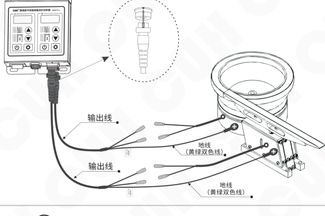

## 注意

1、一定要确认电磁铁线圈接在两个输出引脚上，外壳需要可靠接地。否则将会导致机壳带电，可能发生严重安全事故。

2、电源输出禁止连接压电类负载，否则可能导致**电击安全事故！**

---

2024-04　　　　　　　　　　　　　　　　　- 3 -　　　　　　　　　　　　　　　　　SDVC22SMSCN_1.01

### 第 12 页

双路数字调压振动送料控制器　　　　　　　　　　　　　　　　SDVC22 系列

---

### 第三步：

将输入电源线航空插头插入控制器电源  
输入插座，并锁紧螺母。

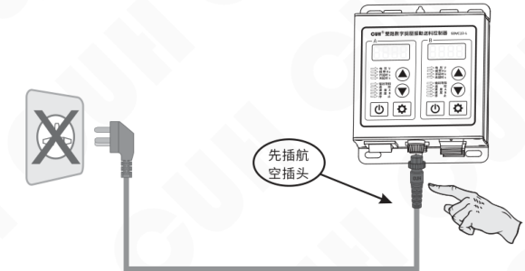

### 第四步：

确认开关处于关闭位置后，将电源线三爪插头插在供电电源插座上。

---

2024-04　　　　　　　　　　　　　　- 4 -　　　　　　　　　　　　　　SDVC22SMSCN_1.01

### 第 13 页

双路数字调压振动送料控制器　　　　　　　　　　　　　　　　　SDVC22 系列

# 第三章 部件说明

## 3.1 指示灯及按键说明

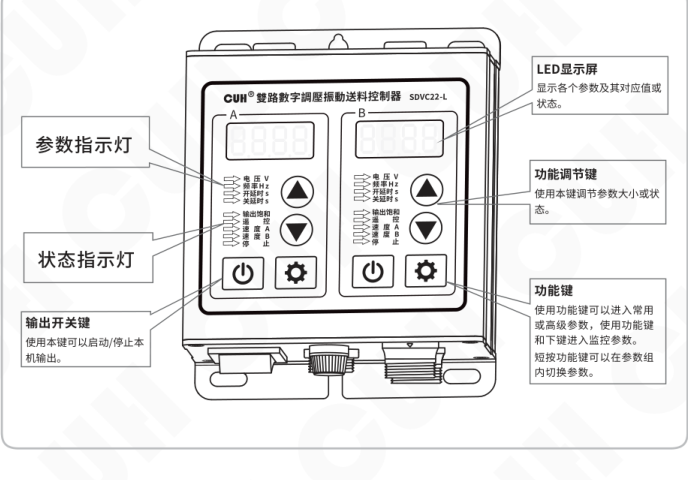

**指示灯点亮，含义如下：**

电压 Voltage - 电压调节状态

频率 Frequency - 频率调节状态

开延时 On Delay - 开延时时间节状态

关延时 Off Delay - 关延时时间节状态

输出饱和 Saturation - 设定输出电压过高或过低，致使控制器不能达到

遥控 Remote Ctrl - 外部速度控制信号有效

速度A Speed A - 速度A控制信号有效

速度B Speed B - 速度B控制信号有效

停止 Stop - 控制器输出被关闭

---

2024-04　　　　　　　　　　　　　　- 5 -　　　　　　　　　　　　　　SDVC22SMSCN_1.01

### 第 14 页

双路数字调压振动送料控制器　　　　　　　　　　　　　　　　SDVC22 系列

## 3.2 外部部件说明

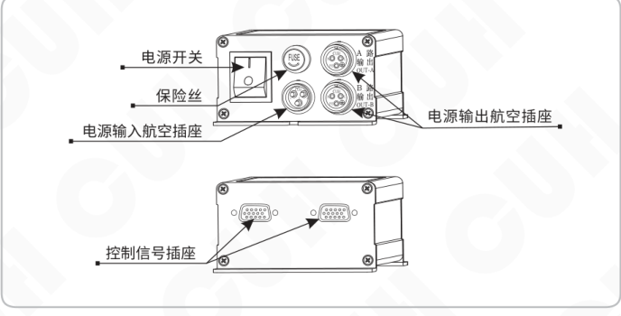

外部部件标注：

- 电源开关
- 保险丝
- 电源输入航空插座
- 电源输出航空插座
- 控制信号插座

## 3.3 信号接口定义

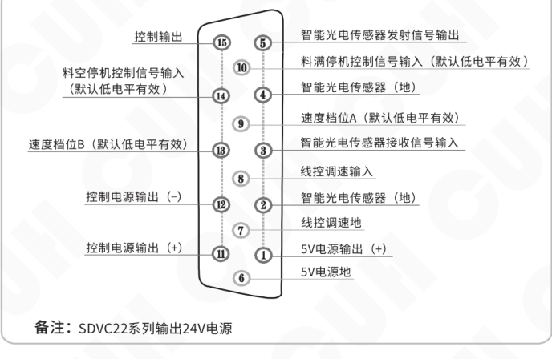

| 引脚 | 信号定义 |
|---:|---|
| 1 | 5V电源输出（+） |
| 2 | 智能光电传感器（地） |
| 3 | 智能光电传感器接收信号输入 |
| 4 | 智能光电传感器（地） |
| 5 | 智能光电传感器发射信号输出 |
| 6 | 5V电源地 |
| 7 | 线控调速地 |
| 8 | 线控调速输入 |
| 9 | 速度档位A（默认低电平有效） |
| 10 | 料满停机控制信号输入（默认低电平有效） |
| 11 | 控制电源输出（+） |
| 12 | 控制电源输出（-） |
| 13 | 速度档位B（默认低电平有效） |
| 14 | 料空停机控制信号输入（默认低电平有效） |
| 15 | 控制输出 |

备注：SDVC22系列输出24V电源

---

2024-04　　　　　　　　　　　　　　　　　- 6 -　　　　　　　　　　　　　SDVC22SMSCN_1.01

### 第 15 页

双路数字调压振动送料控制器　　　　　　　　　　　　　　　SDVC22 系列

# 第四章　基本操作

## 4.1 输出电压设定

本控制器可以直接在面板上以数字方式设定输出电压。由于本控制器特有的稳压功能，输出电压并不会受到输入电压波动的影响，即使在电压不稳定场合中使用也可以保持振动体稳定工作。同时，直接的电压数值设定也为用户了解设备运行情况提供了准确的数据。

- 控制器上电。
- 通过 ⚙ 切换到电压调整 H 参数，这时电压指示灯点亮。
- 通过 ▲ 和 ▼ 调整参数值。

图示标注：H 表示输出电压；电压指示灯。

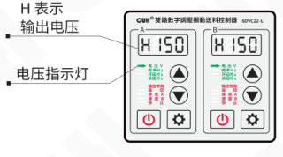

- 本控制器的输出电压不能超过输入电压。当设定的电压过于接近输入电压时，控制器将不能进行正常的稳压，此时，面板上饱和指示灯点亮，表示稳压失效。
- 本控制器也不能输出过低电压。当输出电压过低时，控制器将不能进行正常的稳压，此时，面板上饱和指示灯点亮，表示稳压失效。

图示标注：输出饱和指示灯。

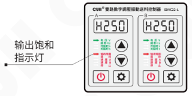

---

2024-04　　　　　　　　　　- 7 -　　　　　　　　　　SDVC22SMSCN_1.01

### 第 16 页

双路数字调压振动送料控制器　　　　　　　　　　　　　　　　　　　　　　　　　SDVC22 系列

## 4.2 输出频率设定

本控制器可以选择输出全波（电源频率的二倍）、半波（电源频率）。

- » 短按【⚙】切换到频率调整 **E** 参数，这时频率指示灯点亮。
- » 通过【▲】和【▼】调整参数值。选择 **100**，也就是全波整流；选择 **50**，也就是半波整流。

右侧示意：**E** 表示输出频率；频率指示灯点亮。

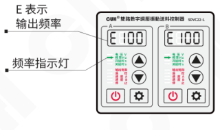

> ☺
>
> 当电源频率为 50Hz 时，E 调整为 50 时，输出频率为 50Hz，E 调整为 100 时，输出频率为 100Hz。
>
> 当电源频率为 60Hz 时，E 调整为 50 时，输出频率为 60Hz，E 调整为 100 时，输出频率为 120Hz。

- » 长按【⚙】2 秒进入高级参数设置界面。
- » 短按【⚙】切换到频率指示参数 **ΓE**。
- » 通过【▲】和【▼】调整参数值。

右侧示意：**ΓE** 表示频率指示参数。

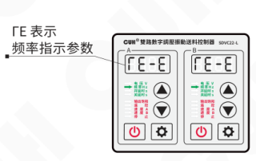

> ☺
>
> ΓE 选择 -5 时，控制器可自动识别输入频率，并数字显示输出频率。
>
> ΓE 选择 -E 时，输出频率设置显示为全波 FUL，半波 HAF。

2024-04　　　　　　　　　　　　　　　　　　　- 8 -　　　　　　　　　　　　　　　　　　　SDVC22SMSCN_1.01

### 第 17 页

双路数字调压振动送料控制器　　　　　　　　　　　　　　　　　　　SDVC22 系列

## 4.3 缓启动功能

本控制器从停止状态启动时，输出电压可以平缓提高到设定值，以防止设备和控制器遭受冲击。

**缓启动时间（t）：** 控制器从停止状态启动时，输出电压从0平滑升高达到设定输出电压所需要的时间称为缓启动时间。

- 长按 **[设置键]** 2秒进入高级参数设置界面。
- 短按 **[设置键]** 切换到缓启动时间参数 **t**。
- 通过 **▲** 和 **▼** 调整参数值。该参数的单位是秒，精度是0.1秒。

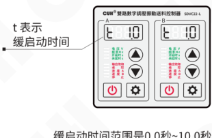

缓启动时间范围是0.0秒~10.0秒

## 4.4 输出开关

面板上的轻触式输出开关可以方便快速地开启或停止本机的输出。

- 使用控制器面板上的 **⏻**，可以控制本机启动或停止输出。停止输出时，“停止”指示灯点亮，表示进入“停止”状态。

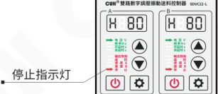

> ☺ 本功能使用软开关，由数字信号进行控制。因此，不会产生火花烧蚀机械触点的问题，可以大大延长控制器和振动设备的使用寿命。

---

2024-04　　　　　　　　　　　　　　　　　- 9 -　　　　　　　　　　　　　　SDVC22SMSCN_1.01

### 第 18 页

双路数字调压振动送料控制器　　　　　　　　　　　　　　　　　SDVC22 系列

---

## 4.5 最大输出电压限制功能

本控制器可以设定最大输出电压。设定该参数可以防止用户误操作，输出过大电压而损毁振动设备。速度遥控功能和速度预设功能都受到此参数的限制。

- 长按 ⚙ 2秒进入高级参数设置界面。
- 短按 ⚙ 切换到最大输出电压限制参数 h。
- 通过 ▲ 和 ▼ 调整参数值。

h 表示最大输出电压限制。

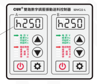

最大输出电压出厂默认值是250V

---

2024-04　　　　　　　　　　　　　　　　　-10-　　　　　　　　　　　　　　　　　SDVC22SMSCN_1.01

### 第 19 页

**双路数字调压振动送料控制器**　　　　　　　　　　　　　　　　**SDVC22 系列**

## 4.6 恢复出厂设置

本功能可以使用户快速将控制器设置为出厂默认设置状态。

由于本控制器功能强大，有数量众多的控制参数可以由用户设定，对于初学者，可能在多次的设定修改后不能恢复控制器的正常工作状态。使用该功能可以快速将调乱的参数状态恢复为出厂默认设置。

- 长按 **⚙** 2秒进入高级参数设置界面。

- 短按 **⚙** 切换到全屏闪烁状态，此时长按 **▲** 直到控制器显示 “----”，表示控制器已经重设完毕。

- 松开 **▲**，控制器将进入正常的电压调整状态“H”。此时控制器就像刚开始使用一样，所有参数都已经恢复到出厂默认状态。

状态示意：

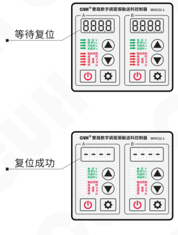

---

2024-04　　　　　　　　　　　　-11-　　　　　　　　　　　　SDVC22SMSCN_1.01

### 第 20 页

双路数字调压振动送料控制器　　　　　　　　　　　　　　　SDVC22 系列

# 第五章 传感器与信号控制

本机可以接受多种外部信号或传感器控制其运行状态。本章节主要介绍智能光电传感器、接近开关传感器和PLC控制等的使用方法。

## 5.1 智能光电传感器的使用方法

本机配合使用本公司提供的SDVC-S1光电对射传感器可以实现智能光电传感功能。SDVC-S1传感器可以自动去除背景光对传感器灵敏度的影响，因而无需人工调节灵敏度即可可靠工作。

### 5.1.1 智能光电传感器的接线方法

SDVC-S1传感器是本公司特地为本系列产品开发的专门的配套传感器。

**第一步：**

将随机选购的SDVC-S1光电传感器安装在控制器的控制信号插座上。

**第二步：**

将光电传感器精确安装在送料口。

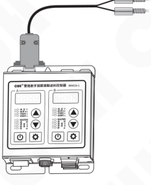

**特点：**

1、使用简单，即插即用。

2、抗干扰能力强，对于干扰信号、背景光去除效果明显。

3、反应灵敏迅速，可靠性好。

**注意：**

1、在出厂默认设置下，本传感器逻辑方向为料空逻辑方向。

2、为尽量减少振动干扰及延长传感器使用寿命，请尽量安装在稳定可靠的部件上，并妥善固定传感器线缆。

3、智能光电灵敏度可通过高级参数“P”调节，P取值范围0~999，其中：

P值越大，作用范围越小，越不灵敏；

P值越小，作用范围越大，越灵敏。

2024-04　　　　　　　　　　　　-12-　　　　　　　　　　　　SDVC22SMSCN_1.01

### 第 21 页

> 双路数字调压振动送料控制器　　　　　　　　　　　　　　　　SDVC22 系列

## 5.1.2 智能光电传感器开延时、关延时设定

当使用外部信号进行启动和停止控制时，大多数情况需要在收到指令后延迟一段时间才执行操作。对于这样的应用，可以通过设置开延时和关延时来实现。另外，还可以设定缓启动时间以消除启动时的冲击。

### 开延时

**开延时：** 从施加一个使控制器进入运行状态的控制信号开始，到控制器开始有输出，期间经历的延迟时间称为开延时。

- 短按 **⚙** 切换到智能光电开延时 **J** 参数。
- 通过 **▲** 和 **▼** 调整参数值。该参数的单位是秒，精度是 **0.1秒**。
- **J 表示：** 智能光电开延时
- **指示灯：** 开延时指示灯
- 开延时时间范围是 **0.0秒~9.9秒**

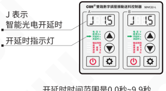

### 关延时

**关延时：** 从施加一个使控制器进入停止状态的控制信号开始，到控制器输出停止，期间经历的延迟时间称为关延时。

- 短按 **⚙** 切换到智能光电关延时 **L** 参数。
- 通过 **▲** 和 **▼** 调整参数值。该参数的单位是秒，精度是 **0.1秒**。
- **L 表示：** 智能光电关延时
- **指示灯：** 关延时指示灯
- 关延时时间范围是 **0.0秒~9.9秒**

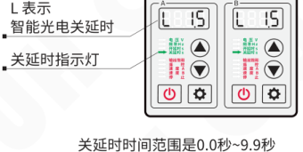

---

2024-04　　　　　　　　　　　　　　　-13-　　　　　　　　　　　　　　　SDVC22SMSCN_1.01

### 第 22 页

双路数字调压振动送料控制器　　　　　　　　　　　　　　　　　SDVC22 系列

---

### 5.1.3 智能光电传感器逻辑方向设定

在正常情况下，也就是说接收端没有收到光信号时，控制器处于“运行”状态，即“常通”逻辑方向（出厂默认设置）。但是，对于一些特殊应用，可能需要相反的逻辑，可能会需要在没有收到光信号时，控制器处于“停止”状态。这可以通过修改本参数实现。

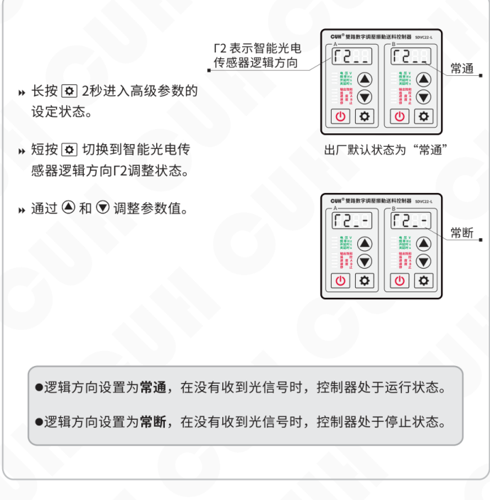

- 长按 ⚙ 2秒进入高级参数的设定状态。
- 短按 ⚙ 切换到智能光电传感器逻辑方向 Γ2 调整状态。
- 通过 ▲ 和 ▼ 调整参数值。

图示说明：

- Γ2 表示智能光电传感器逻辑方向。
- 出厂默认状态为“常通”。
- 可设置为：常通 / 常断。

> ● 逻辑方向设置为**常通**，在没有收到光信号时，控制器处于运行状态。  
> ● 逻辑方向设置为**常断**，在没有收到光信号时，控制器处于停止状态。

---

2024-04　　　　　　　　　　　　　　　　-14-　　　　　　　　　　　　　　　　SDVC22SMSCN_1.01

### 第 23 页

## 5.2 开关传感器的使用方法

配合各类开关传感器，如接近开关传感器、光电开关传感器、光纤传感器等实现自动启动和停止功能。

通过高级参数Γ，即“传感器类型”参数设置传感器类型。本控制器料满停机端口可以支持NPN、PNP、Ut1、Ut0模式。其中：

**Ut1模式为单次扫描**，即传感器信号无效前一直通过变换高低电平检测端口是否有效，发现有效信号后确定端口传感器类型且不再扫描。

**Ut0模式为连续扫描**，不管传感器类型如何始终通过变换高低电平检测端口是否接入有效信号。

### 5.2.1 开关传感器的接线方法

**第一步：** 取出随机配送的D型插头。

**第二步：** 按照图例连接传感器。

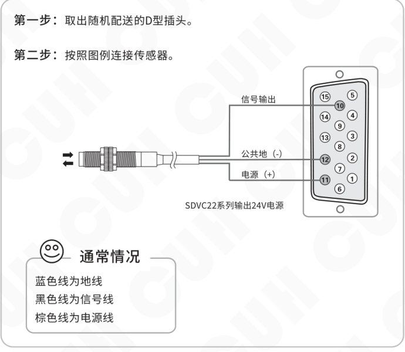

图中标注：

- 信号输出
- 公共地（-）
- 电源（+）
- SDVC22系列输出24V电源

通常情况：

- 蓝色线为地线
- 黑色线为信号线
- 棕色线为电源线

### 第 24 页

双路数字调压振动送料控制器 | SDVC22 系列

## 5.2.2 开关传感器开延时、关延时时间设定

在默认状态下，智能光电传感器和开关传感器的开延时、关延时时间总是相同的。用户也可以单独为开关传感器设定开延时、关延时时间。此时，开关传感器和智能光电传感器具有独立的开延时、关延时时间。

### 开延时

**开延时：** 从施加一个使控制器进入运行状态的控制信号开始，到控制器开始有输出，期间经历的延迟时间称为开延时。

- 长按 ⚙ 2秒进入高级参数的设定状态。
- 短按 ⚙ 切换到开关传感器开延时 **J-** 参数。
- 通过 ▲ 和 ▼ 调整参数值。该参数的单位是秒，精度是 0.1秒。

**J-** 表示开关传感器开延时。

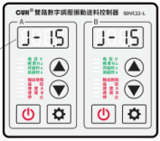

开延时时间范围是 **0.0秒~9.9秒**。

### 关延时

**关延时：** 从施加一个使控制器进入停止状态的控制信号开始，到控制器输出停止，期间经历的延迟时间称为关延时。

- 长按 ⚙ 2秒进入高级参数的设定状态。
- 短按 ⚙ 切换到开关传感器关延时 **L-** 参数。
- 通过 ▲ 和 ▼ 调整参数值。该参数的单位是秒，精度是 0.1秒。

**L-** 表示开关传感器关延时。

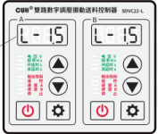

关延时时间范围是 **0.0秒~9.9秒**。

---

- 开关传感器独立开、关延时关闭时，开、关延时与智能光电传感器开、关延时时间相同。
- 开关传感器独立开、关延时开启时，开、关延时时间由本参数设定，智能光电传感器开、关延时时间不受影响，出厂默认设置为关闭独立设置。

2024-04 | -16- | SDVC22SMSCN_1.01

### 第 25 页

双路数字调压振动送料控制器　　　　　　　　　　　　　　　　　SDVC22 系列

---

### 5.2.3 开关传感器逻辑方向设定

在正常情况下，也就是说不向开关引脚发任何信号时，该引脚由于内部的上拉电阻，都会呈现为“高”电平。此时，在出厂默认设置下，控制器处于“运行”状态。但是，对于一些特殊应用，可能需要相反的逻辑。也就是说，可能会需要在不施加信号时，控制器处于“停止”状态。这可以通过修改本参数实现。

- 长按设置键（⚙）2秒进入高级参数的设定状态。
- 短按设置键（⚙）切换到开关传感器逻辑方向 Γ1 调整状态。
- 通过 ▲ 和 ▼ 调整参数值。

图示说明：Γ1 表示开关传感器逻辑方向；可设为“常通”或“常断”，出厂默认状态为“常通”。

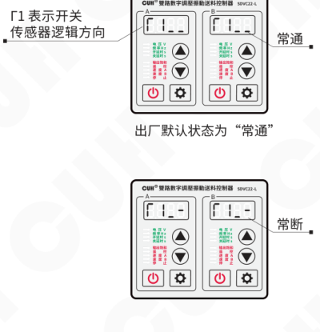

> ● 逻辑方向设置为**常通**，则不连接任何控制信号，控制器处于运行状态，也就是我们常说的料满停机。  
> ● 逻辑方向设置为**常断**，则不连接任何控制信号，控制器处于停止状态，也就是我们常说的料空停机。

---

2024-04　　　　　-17-　　　　　SDVC22SMSCN_1.01

### 第 26 页

双路数字调压振动送料控制器　　　　　　　　　　　　　　　　　SDVC22 系列

## 5.3 第二个开关传感器的使用方法

本控制器允许同时连接三个传感器，智能光电和两个开关传感器可以同时实现料空停机和料满停机的自动启动和停止功能。

### 5.3.1 第二个开关传感器的接线方法

**第一步：** 取出随机配送的D型插头。

**第二步：** 按照图例连接传感器。

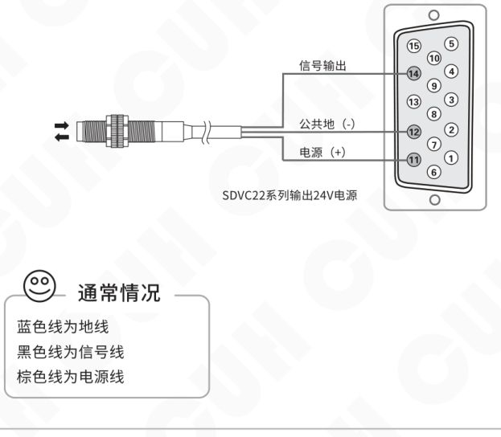

通常情况：

- 蓝色线为地线
- 黑色线为信号线
- 棕色线为电源线

2024-04　　　　　　　　　　　　　　　　　-18-　　　　　　　　　　　　　　　　　SDVC22SMSCN_1.01

### 第 27 页

双路数字调压振动送料控制器　　　　　　　　　　　　　　SDVC22 系列

---

### 5.3.2 第二个开关传感器开延时、关延时时间设定

在默认状态下，三个传感器的开延时、关延时时间总是相同的。用户也可以单独为第二个开关传感器设定开延时、关延时时间。此时，第二个开关传感器和其他传感器具有独立的开延时、关延时时间。

**开延时：** 从施加一个使控制器进入运行状态的控制信号开始，到控制器开始有输出，期间经历的延迟时间称为开延时。

- 长按 ⚙ 2秒进入高级参数的设定状态。
- 短按 ⚙ 切换到第二个开关传感器开延时 `J_` 参数。
- 通过 ▲ 和 ▼ 调整参数值。该参数的单位是秒，精度是0.1秒。

`J_` 表示第二个开关传感器开延时。

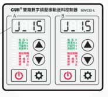

开延时时间范围是0.0秒~9.9秒。

**关延时：** 从施加一个使控制器进入停止状态的控制信号开始，到控制器输出停止，期间经历的延迟时间称为关延时。

- 长按 ⚙ 2秒进入高级参数的设定状态。
- 短按 ⚙ 切换到第二个开关传感器关延时 `L_` 参数。
- 通过 ▲ 和 ▼ 调整参数值。该参数的单位是秒，精度是0.1秒。

`L_` 表示第二个开关传感器关延时。

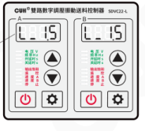

关延时时间范围是0.0秒~9.9秒。

- 第二个开关传感器独立开、关延时关闭时，开、关延时与智能光电传感器开、关延时时间相同。
- 第二个开关传感器独立开、关延时开启时，开、关延时时间由本参数设定，智能光电传感器开、关延时时间不受影响，出厂默认设置为关闭独立设置。

---

2024-04　　　　　　　　　　　　　　-19-　　　　　　　　　　　　　　SDVC22SMSCN_1.01

### 第 28 页

双路数字调压振动送料控制器　　　　　　　　　　　　　　　　　　　　SDVC22 系列

## 5.3.3 第二个开关传感器逻辑方向设定

在正常情况下，也就是说不向开关引脚发任何信号时，该引脚由于内部的上拉电阻，都会呈现为“高”电平。此时，在出厂默认设置下，控制器处于“运行”状态。但是，对于一些特殊应用，可能需要相反的逻辑。也就是说，可能会需要在不施加信号时，控制器处于“停止”状态。这可以通过修改本参数实现。

- 长按 **⚙** 2秒进入高级参数的设定状态。
- 短按 **⚙** 切换到第二个开关传感器逻辑方向 **Γ3** 调整状态。
- 通过 **▲** 和 **▼** 调整参数值。

界面示意：

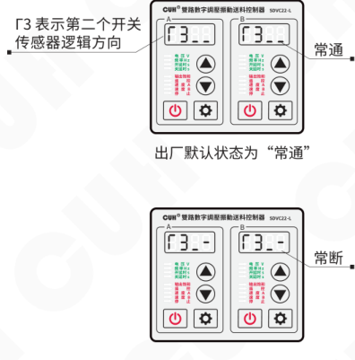

- **Γ3** 表示第二个开关传感器逻辑方向。
- 出厂默认状态为“**常通**”。
- 可调整为“**常断**”。

> ● 逻辑方向设置为**常通**，则不连接任何控制信号，控制器处于运行状态，也就是我们常说的料满停机。  
> ● 逻辑方向设置为**常断**，则不连接任何控制信号，控制器处于停止状态，也就是我们常说的料空停机。

---

2024-04　　　　　　　　　　　　　　　　　-20-　　　　　　　　　　　　　　　　　SDVC22SMSCN_1.01

### 第 29 页

双路数字调压振动送料控制器　　　　　　　　　　　　　　　SDVC22 系列

## 5.4 控制信号逻辑关系设定

本控制器可以设定智能光电传感器与两个开关传感器同时作用时的逻辑关系。

`Π` 表示：控制信号逻辑关系。

**操作方法**

- 长按 `⚙` 2秒进入高级参数的设定状态。
- 短按 `⚙` 切换到控制信号逻辑关系 `Π` 调整状态。
- 通过 `▲` 和 `▼` 调整参数值。

**逻辑关系说明**

- 逻辑“与”：仅在智能光电传感与开关传感器信号同时要求控制器运行时，控制器才运行。
- 逻辑“或”：只要智能光电传感与开关传感器信号有一个要求控制器运行，控制器就运行。
- 逻辑“异或”：仅在智能光电传感与开关传感器信号要求不同时，控制器才运行。

**显示示例**

逻辑“或”：

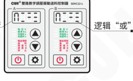

逻辑“与”：

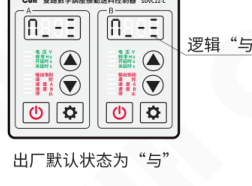

出厂默认状态为“与”

逻辑“异或”：

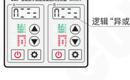

---

2024-04　　　　　　　　　　-21-　　　　　　　　　　SDVC22SMSCN_1.01

### 第 30 页

双路数字调压振动送料控制器　　　　　　　　　　　　　　　　SDVC22 系列

## 5.5 控制输出

本控制器可以输出低电压控制信号，以同步其它设备协同工作，如电磁阀、PLC等。

### 5.5.1 控制输出的接线方法

**PLC控制连接方法（控制器控制PLC）**

**第一步：** 取出随机配送的D型插头。

**第二步：** 按照图例连接PLC。

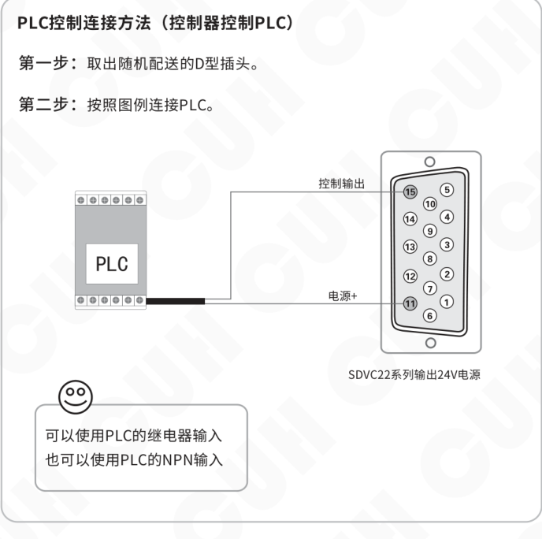

---

2024-04　　　　　　　　　　　　-22-　　　　　　　　　　　　SDVC22SMSCN_1.01

### 第 31 页

双路数字调压振动送料控制器　　　　　　　　　　　　　　　SDVC22 系列

## 控制电磁阀工作的连接方法

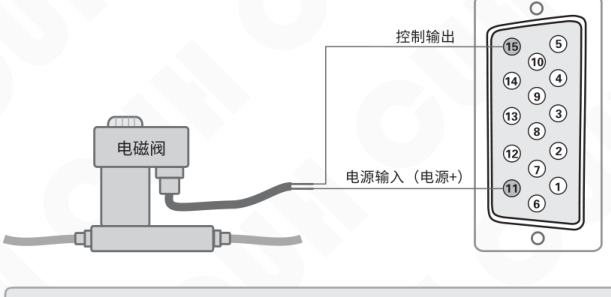

- 本控制器可直接驱动线圈额定电压24V，功率小于4W的电磁阀。
- 如电磁阀功率过大，则需考虑使用外部电源。

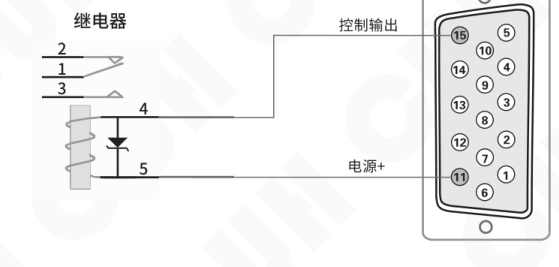

- 本控制器可直接驱动线圈额定电压12V或24V，功率小于4W的继电器。

备注：SDVC22系列输出24V电源。

---

2024-04　　　　　　　　　　-23-　　　　　　　　　　SDVC22SMSCN_1.01

### 第 32 页

双路数字调压振动送料控制器　　　　　　　　　　　　　　　　　　　　　　　　　SDVC22 系列

---

## 5.5.2 控制输出逻辑方向设定

Γ4 表示控制输出逻辑方向。

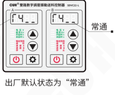

- » 长按 ⚙ 进入高级参数设置界面。
- » 短按 ⚙ 切换到控制输出逻辑方向 Γ4 调整状态。
- » 通过 ▲ 和 ▼ 调整参数值。

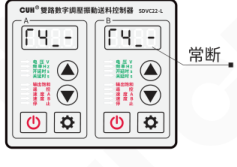

- ● 逻辑方向设置为**常通**，则控制器输出运行时，控制信号输出为运行状态。
- ● 逻辑方向设置为**常断**，则控制器输出运行时，控制信号输出为停止状态。

---

2024-04　　　　　　　　　　　　　　　　　-24-　　　　　　　　　　　　　　　　　SDVC22SMSCN_1.01

### 第 33 页

双路数字调压振动送料控制器　　　　　　　　　　　　　　　SDVC22 系列

## 5.6 远程速度控制

本控制器远程速度控制允许用户通过外接电位器或1~5V控制电压信号或4~20mA控制电流信号控制输出电压。这样，用户可以通过PLC、DCS或其他一些方法，方便容易地进行外部远程速度控制。

> 当控制电压超过0.5V时，线控电压对控制器的控制生效。此时，面板的遥控指示灯点亮，同时面板上调节电压的 ▲ 和 ▼ 将失效。如果此时控制器处于电压调节状态，LED显示屏将显示输出电压。
>
> 控制电压1~5V线性对应面板设置电压0~250V。

### 外接电位器的连接方法

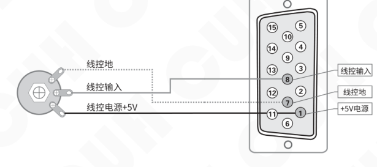

建议：

请使用1K阻值线性电位器

---

2024-04　　　　　　　　　　　　-25-　　　　　　　　　　　　SDVC22SMSCN_1.01

### 第 34 页

双路数字调压振动送料控制器 | SDVC22 系列

## 使用PLC进行输出电压控制的方法（PLC控制控制器）

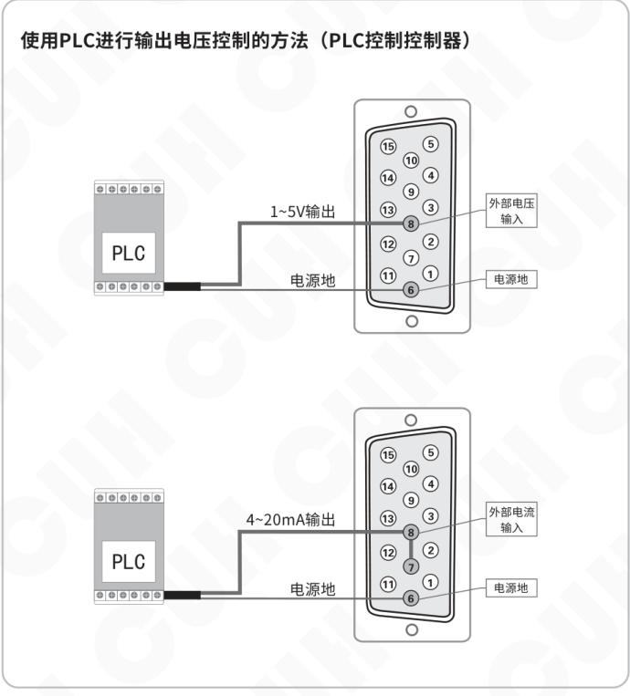

图中包含两种 PLC 控制器接线方式：

- **1~5V输出**：PLC 的 1~5V 输出接至控制器“外部电压输入”，电源地接至“电源地”。
- **4~20mA输出**：PLC 的 4~20mA 输出接至控制器“外部电流输入”，电源地接至“电源地”。

### 第 35 页

双路数字调压振动送料控制器　　　　　　　　　　　　　　　　　　　　　　SDVC22 系列

## 5.7 速度档位开关

速度档位开关是通过外部控制信号直接选择预定速度的功能。通过该功能，外部控制设备，如PLC、计算机、传感器等其他的信号源可以方便地与本控制器组成多档速度送料控制系统。

本机共有两条速度档位开关控制信号线，控制速度开关A和速度开关B，分别对应D型控制插座的9脚和13脚。两条线都是低电平有效。

速度档位开关接线示意：

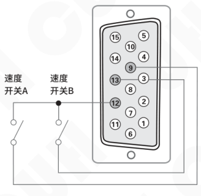

每条控制线的状态在面板上有对应的指示灯显示。当在控制线上施加有效信号时，对应指示灯点亮。

两个灯的亮灭状态组合有4种状态（A亮B灭，A灭B亮，AB全亮，AB全灭）。右图，为两条控制线都施加有效信号时的状态。

两条控制线都施加有效信号时的面板状态示意：

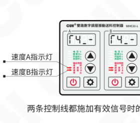

通过控制信号的选择，控制器将进入对应的速度档位。此时，控制器的输出电压可以通过功能键切换到电压参数H进行设定。该速度将被自动记忆。任何时刻速度档位控制信号设置控制器进入该档位后都将立刻切换输出到该电压。

---

2024-04　　　　　　　　　　　　　　　　　-27-　　　　　　　　　　　　　　　　SDVC22SMSCN_1.01

### 第 36 页

双路数字调压振动送料控制器  
SDVC22 系列

## 5.8 主控输出分离参数

**Γ5 表示主控输出分离参数**

- 长按 **设置键** 进入高级参数设置界面。
- 短按 **设置键** 切换到控制输出逻辑方向 **Γ5** 调整状态。
- 通过 **▲** 和 **▼** 调整参数值。

参数显示及面板状态示意：

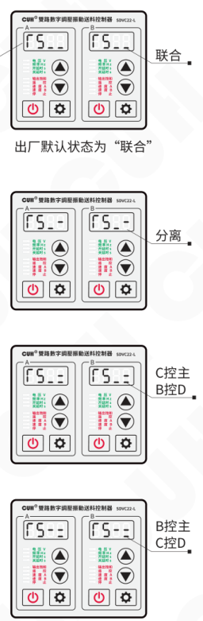

出厂默认状态为“联合”。

主-主输出，B-智能光电信号，C-两个开关传感器的逻辑信号，D-控制输出。

- **Γ5 为“联合”**，表示主输出和控制输出受面板的启/停键以及智能光电、两个开关传感器三者的信号的逻辑控制。
- **Γ5 为“分离”**，表示主输出受面板的启/停键控制，控制输出受智能光电、两个开关传感器三者的信号的逻辑控制。
- **Γ5 为“C控主B控D”**，表示主输出受面板的启/停键及两个开关传感器两者的信号的逻辑控制。控制输出受智能光电控制。
- **Γ5 为“B控主C控D”**，表示主输出受面板的启/停键及智能光电控制。控制输出受两个开关传感器两者的信号的逻辑控制。

2024-04  
SDVC22SMSCN_1.01

### 第 37 页

双路数字调压振动送料控制器　　　　　　　　　　　　　　　　　　　　　SDVC22 系列

# 第六章 安全保护功能

## 6.1 稳压功能

内置数字稳压功能，可以消除由于电源电压波动造成的送料速度变化。

## 6.2 短路保护功能

输出发生短路时，控制器会立即停止输出，同时显示Err1，直到控制器重新启动为止。也有可能熔断保险丝，为恢复功能需要更换保险丝。

## 6.3 过流保护功能

本控制器可以在用户误操作造成输出电流超过额定电流时，短暂停止输出，同时显示Err2，以保护本机及用户的设备。

## 6.4 过热保护功能

当控制器工作温度超过60℃时，将停止输出，以保护本机，同时显示Err3，当温度下降到60℃以下时，本机恢复输出。

---

2024-04　　　　　　　　　　　　　　　　　-29-　　　　　　　　　　　　　　SDVC22SMSCN_1.01

### 第 38 页

双路数字调压振动送料控制器　　　　　　　　　　　　　　　　　　　SDVC22 系列

# 第七章 技术规格

## 7.1 外形尺寸

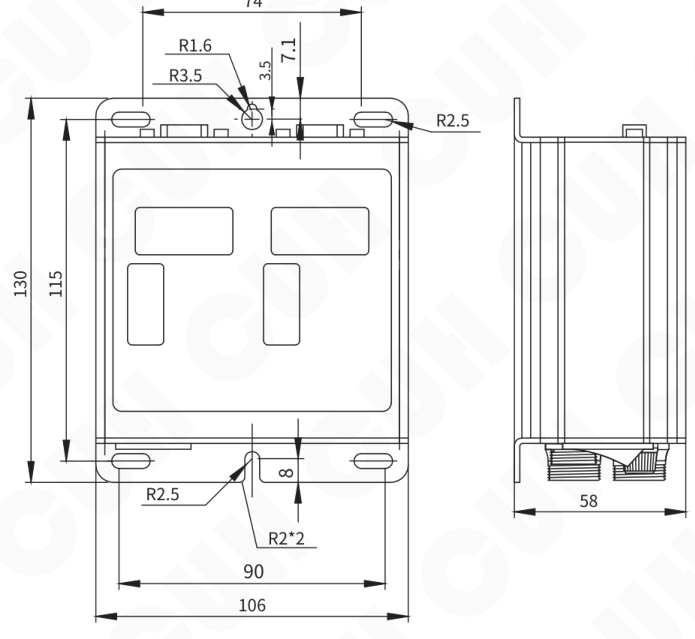

单位：毫米（mm）

| 公差区间 | 公差值 |
|---|---|
| 0~3 | ±0.05 |
| 3~10 | ±0.1 |
| 10~30 | ±0.15 |
| 30~80 | ±0.2 |
| 80~180 | ±0.3 |
| >180 | ±0.5 |

本系列产品均适用此公差表。

2024-04　　　　　　　　　　　　　　　　　-30-　　　　　　　　　　　　　　　　　SDVC22SMSCN_1.01

### 第 39 页

双路数字调压振动送料控制器　　　　　　　　　　　　　　　　　　　　SDVC22 系列

## 7.2 技术规格表

| 项目 | 最小值 | 典型值 | 最大值 | 单位 | 说明 |
|---|---:|---:|---:|---|---|
| 输入电压 | 85 | 220 | 250 | 伏特（V） | 交流有效值 |
| 输出电压调整范围 | 35 | — | Vin-10 | 伏特（V） | 半波 |
|  | 45 | — | Vin-5 | 伏特（V） | 全波 |
| 电压调整精度 |  | 1 |  | 伏特（V） |  |
| 稳压精度 | 33 | — | 61 | 伏特（V） | Vset = 150V △Vin+ = 70V |
| 稳压响应时间 | 0 | 0.01 | 0.02 | 秒（s） |  |
| 输出电流调整范围 | 0 | — | 5 | 安培（A） | SDVC22-S两路总和 |
|  | 0 | — | 10 | 安培（A） | SDVC22-L两路总和 |
| 输出功率 | 0 | — | 1100 | 伏安（VA） | SDVC22-S两路总和 |
|  | 0 | — | 2200 | 伏安（VA） | SDVC22-L两路总和 |
| 输出频率 | 45 | 50/60 | 65 | 赫兹（Hz） | 半波 |
|  | 90 | 100/120 | 130 | 赫兹（Hz） | 全波 |
| 输出波形 |  | 正弦相切 |  |  |  |
| 缓启动时间 | 0 | — | 10.0 | 秒（s） | 出厂默认1.0 |
| 延迟时间范围 | 0 | — | 9.9 | 秒（s） | 出厂默认0.2 |
| 延迟时间精度 |  | 0.1 |  | 秒（s） |  |
| 过热保护温度 | 58 | 60 | 66 | 摄氏度（℃） |  |
| 直流控制输出电压 | 22 | 24 | 26 | 伏特（V） |  |
| 直流控制输出电流 | 0 | — | 400 | 毫安（mA） |  |
| 模拟控制信号 |  | 1~5/4~20 |  | 伏特（V）/毫安（mA） | 远程速度控制电压/电流 |
| 数字控制信号 |  | 24 |  | 伏特（V） | 开关信号控制 |
| 调整方式 |  | 8 |  | 键（Button） |  |
| 保险丝容量 |  | 6.3 |  | 安培（A） | SDVC22-S |
|  |  | 16 |  | 安培（A） | SDVC22-L |
| 空载功耗 | — | 3 | — | 瓦特（W） |  |
| 显示方式 |  | 4+4 |  | 位（Digit） | LED数码管 |
| 工作环境温度 | 0 | 25 | 40 | 摄氏度（℃） |  |
| 工作环境湿度 | 10 | 60 | 85 | 相对湿度（%） | 不结露 |
| 存储环境温度 | -20 | 25 | 85 | 摄氏度（℃） |  |

2024-04　　　　　　　　　　　　　　　　　-31-　　　　　　　　　　　　　SDVC22SMSCN_1.01

### 第 40 页

双路数字调压振动送料控制器　　　　　　　　　　　　　　　　　SDVC22 系列

## 7.3 参考标准

**极限参数：超过此指标将会造成严重损坏，必须严格遵守！**

| 项目 | GB 标准 | IEC 标准 | 等级 | 标准要求 | 备注说明 |
|---|---|---|---|---|---|
| 静电放电 | GB/T 17626.2-2006 | IEC 61000-4-2:2001 | 4 | ±8 kV | 接触放电 |
| 静电放电 | GB/T 17626.2-2006 | IEC 61000-4-2:2001 | 4 | ±15 kV | 空气放电 |
| 电快速瞬变 脉冲群 | GB/T 17626.4-2008 | IEC 61000-4-4:2004 | 4 | ±4 kV |  |
| 直流电源纹 波抗扰度 | GB/T 17626.17-2005 | IEC 61000-4-17:2002 | 4 | 15% | 评价 A |

> **警告**  
> 在民用环境中，本产品可能产生无线电干扰。在这种情况下，可能需要采取附加抑制措施。

2024-04　　　　　　　　　　　　　　-32-　　　　　　　　　　　　　　SDVC22SMSCN_1.01

### 第 41 页

*整页视觉 JSON 解析失败，请查看该文件内 `assistant_text`。*

### 第 42 页

双路数字调压振动送料控制器　　　　　　　　　　　　　　　　　　　　　　　　　SDVC22 系列

## 7.5 故障诊断

以下一些方法可以帮助您排除使用中可能会遇到的简单问题。

| 故障现象/故障代码 | 数码管符号图片 | 含义 | 排除方法 |
|---|---|---|---|
| 打开开关，没有显示 |  |  | ◆ 请检查电源插座是否有电？ ◆ 电源插头是否可靠连接插座？ ◆ 请检查保险丝是否完好？ |
| 有显示，但是振动盘 不动，也没有声音 |  |  | ◆ 请检查输出电缆是否正确地连接控制器与振动盘？ ◆ 请检查控制器参数，是否输出电压调节的太小？ ◆ 请检查控制信号是否将控制器置于“停止”状态？ ◆ 请检查是否有设置为“常断”的参数，导致控制器被置于“停止”状态？ |
| 控制信号不起作用 |  |  | ◆ 请检查控制信号是否正确输入？ ◆ 请检查输入的控制信号的地线是否与本机地正确连接？ ◆ 请检查控制信号逻辑关系设置是否是您期望的设置？ |
| 周期性忽大忽小 （拍频现象） |  |  | ◆ 请检查多个振动体间的振动耦合问题。 ◆ 调整相互耦合的振动设备的工作频率，使频率差更大。 |
| 有显示，振动盘不动， 但是可以听到声音 |  |  | ◆ 请按照说明书介绍的调节方法逐步调节各参数。 |
| Err1 |  | 短路保护 | ◆ 请检查输出航空插头、电缆线是否有短路的情况？ ◆ 请检查控制器是否可靠接地？ ◆ 请检查振动盘电磁线圈是否有短路、漏电、匝间短路的情况？ |
| Err2 |  | 过流保护 | ◆ 请检查是否使用了超过控制器参数规格限定的振动盘？ ◆ 请检查输出电缆线是否可靠连接？ |
| Err2. |  | 主输出和过流 | ◆ 确保通道A、B和电流不超过10A。 |
| Err3 |  | 温度异常 | ◆ 将本控制器安装在符合产品使用要求的环境中。 |
| Err5 |  | 内部通信异常 | ◆ 确保未在24V电源端口接入任何外部电源或联系本公司技术支持。 |
| Err7 |  | 控制输出过流 | ◆ 确保控制输出负载未短路且电流未超过400mA，然后尝试重新启动输出。 |
| Er11 |  | 5V电源输出异常 | ◆ 确保5V电源输出未被短路或接入高于5V的电压。 |

2024-04　　　　　　　　　　　　　　　　　-34-　　　　　　　　　　　　　　　　　SDVC22SMSCN_1.01

### 第 43 页

双路数字调压振动送料控制器  
SDVC22 系列

---

# 第八章 产品质保信息

## 8.1 质保期

本公司为本产品提供的质保期为三年，从产品发送到购买方指定地点之日算起。

## 8.2 保修范围

（一）如果在上述质保期内出现本公司造成的故障，我们将免费维修产品。但是以下情况不属于保修范围：

 a、未按照简易说明书、用户手册或购买方与本公司专门达成的技术要求中规定的条件、环境下的不正确操作，或不正确使用造成的故障。

 b、故障不是因产品缺陷，而是购买方设备或软件设计造成的。

 c、非本公司人员进行的修改或修理而造成的故障。

 d、按照简易操作指南或用户手册正确维修或更换易损部件等规定可以完全避免的故障。

 e、产品从本公司发货后，因无法预料的科学技术水平变化等因素而造成的故障。

 f、由于火灾、地震、洪水等自然灾害，或异常电压等外部因素造成的故障，本公司不负责保修。

（二）保修范围仅限于（一）中规定的情况，本公司对该设备造成的购买方间接损失（如设备损坏、机会丧失、利润损失等）或其他损失，不承担任何责任。

## 8.3 产品适用性

本公司的该控制器是针对振动送料行业的通用产品而设计生产的。因此，本公司的该控制器不得用于下列应用且不适合其使用。

（一）对生命和财产有严重影响的设施，如核发电厂、机场、铁路、轮船、机动装置及医疗设备。

（二）公共事业，包括电力、气体、供水等。

（三）相似条件或环境的户外使用。

---

2024-04　　　　　　　　　　　　-35-　　　　　　　　　　　　SDVC22SMSCN_1.01

### 第 44 页

|  |  |
|---|---|
|  | 南京创优科技有限责任公司 网址:www.cuhnj.com 电话:025-84730416 传真:025-84730426 邮箱:sales@cuhnj.com 地址:南京市江宁区智能路9号 启迪城学研园2幢 |

文档编号：IDP1000332
<!-- /auto:ai-body-draft v1 -->

<!-- auto:data-params-summary v1 -->
## 附录 · 参数表（结构化侧车·机器生成）

> 说明：本节由 `data/<doc_key>/params/params.yaml` 自动渲染（展示前若干行），用于校对与二次开发。定稿以层 C 数据为准。

| 参数 | 标志/符号 | 范围 | 默认 | 单位 | 备注 |
| --- | --- | --- | --- | --- | --- |
|    **警告** |  |  |  |  |  |
|    **小心** |  |  |  |  |  |
|    **注意** |  |  |  |  |  |
|  公差区间 |  |  |  |  |  |
|  0~3 |  |  |  |  |  |
|  3~10 |  |  |  |  |  |
|  10~30 |  |  |  |  |  |
|  30~80 |  |  |  |  |  |
|  80~180 |  |  |  |  |  |
|  >180 |  |  |  |  |  |
|      输入电压 |  |  |  |      伏特（V） |    交流有效值 |
|      输出电压调整范围 |  |  |  |     U   伏特（V） |    半波 |
|      输出电压调整范围 |  |  |  |      Vin-5 |    全波 |
|      电压调整精度 |  |  |  |      伏特（V） |   |
|      稳压精度 |  |  |  |      伏特（V） |    Vset = 150V △Vin+ = 70V |
|      稳压响应时间 |  |  |  |      秒（s） |   |
|      输出电流调整范围 |  |  |  |      安培（A） |    SDVC22-S两路总和 |
|      输出电流调整范围 |  |  |  |      10 |    SDVC22-L两路总和 |
|        输出功率 |  |  |  |        伏安（VA） |      SDVC22-S两路总和 |
|        输出功率 |  |  |  |        2200 |      SDVC22-L两路总和 |
|        输出频率 |  |  |  |        赫兹（Hz） |      半波 |
|        输出频率 |  |  |  |        130 |      全波 |
|        输出波形 |  |  |  |       |     |
|        缓启动时间 |  |  |  |        秒（s） |      出厂默认1.0 |
|      延迟时间范围 |  |  |  |      秒（s） |      出厂默认0.2 |
|      延迟时间精度 |  |  |  |      秒（s） |     |
|      过热保护温度 |  |  |  |      摄氏度（℃） |     |
|      直流控制输出电压 |  |  |  |        伏特（V） |       |
|      直流控制输出电流 |  |  |  |        毫安（mA） |       |
|      模拟控制信号 |  |  |  |        伏特(V)/毫安(mA) |        远程速度控制电压/电流 |

*（仅展示前 30 条，共 62 条；完整数据见下方链接。）*

- 完整 YAML：`data/cuh.sdvc.manual.v1.01/params/params.yaml`
- 表格索引：`data/cuh.sdvc.manual.v1.01/index.yaml`
<!-- /auto:data-params-summary v1 -->
