## 目录

> 下列条目来自 PDF 内置书签/大纲；链接指向本批转换生成的整页渲染图（`assets/pages/`），便于与原版 PDF 对照校对。

- [1: 封面](assets/pages/page-0001.png)（第 1 页）
- [2: 封二版权与免责](assets/pages/page-0002.png)（第 2 页）
- [3: 序言](assets/pages/page-0003.png)（第 3 页）
- [4: 安全与预防措施](assets/pages/page-0004.png)（第 4 页）
- [5: 工作与储存环境](assets/pages/page-0005.png)（第 5 页）
- [7: 目录](assets/pages/page-0007.png)（第 7 页）
- [8: 目录2](assets/pages/page-0008.png)（第 8 页）
- [第一章 使用前须知](assets/pages/page-0009.png)（第 9 页）
  - [1.1 检查包装内容](assets/pages/page-0009.png)（第 9 页）
  - [1.2 指示灯及按键说明](assets/pages/page-0010.png)（第 10 页）
  - [1.3 接线端口说明](assets/pages/page-0011.png)（第 11 页）
  - [1.4 控制器铭牌说明](assets/pages/page-0012.png)（第 12 页）
- [第二章 性能特点](assets/pages/page-0013.png)（第 13 页）
- [第三章 安装及使用指南](assets/pages/page-0015.png)（第 15 页）
  - [3.1 控制器使用条件](assets/pages/page-0015.png)（第 15 页）
  - [3.2 按键基本操作](assets/pages/page-0015.png)（第 15 页）
  - [3.3 安装使用](assets/pages/page-0016.png)（第 16 页）
- [第四章 基本功能说明](assets/pages/page-0020.png)（第 20 页）
  - [4.1 输出电压设置](assets/pages/page-0020.png)（第 20 页）
  - [4.2 输出频率设置](assets/pages/page-0021.png)（第 21 页）
  - [4.3 料满停机传感器开、关延时时间设定（仅SDVC301系列）](assets/pages/page-0022.png)（第 22 页）
  - [4.4 智能光电传感器开、关延时时间设定（仅SDVC302系列）](assets/pages/page-0023.png)（第 23 页）
  - [4.5 缓启动时间](assets/pages/page-0024.png)（第 24 页）
  - [4.6 键盘锁定功能](assets/pages/page-0024.png)（第 24 页）
- [第五章 高级功能说明](assets/pages/page-0025.png)（第 25 页）
  - [5.1 开关传感器的使用方法（仅SDVC301系列）](assets/pages/page-0025.png)（第 25 页）
    - [5.1.1 开关传感器的接线方法](assets/pages/page-0025.png)（第 25 页）
    - [5.1.2 开关传感器逻辑方向设定](assets/pages/page-0026.png)（第 26 页）
  - [5.2 智能光电传感器的使用方法（仅SDVC302系列）](assets/pages/page-0027.png)（第 27 页）
    - [5.2.1 智能光电传感器的接线方法](assets/pages/page-0027.png)（第 27 页）
    - [5.2.2 智能光电传感逻辑方向设定](assets/pages/page-0029.png)（第 29 页）
  - [5.3 控制输出功能](assets/pages/page-0030.png)（第 30 页）
    - [5.3.1 控制输出的接线方法](assets/pages/page-0030.png)（第 30 页）
    - [5.3.2 控制输出D口逻辑方向设定](assets/pages/page-0031.png)（第 31 页）
    - [5.3.3 控制输出D口开、关延时时间设定（仅SDVC302系列）](assets/pages/page-0032.png)（第 32 页）
    - [5.3.4 主控分离参数](assets/pages/page-0033.png)（第 33 页）
  - [5.4 最大输出电压限制](assets/pages/page-0034.png)（第 34 页）
  - [5.5 最低输出频率限制（仅SDVC302系列）](assets/pages/page-0035.png)（第 35 页）
  - [5.6 开机运行状态（仅SDVC302系列）](assets/pages/page-0036.png)（第 36 页）
  - [5.7 恢复出厂设置](assets/pages/page-0037.png)（第 37 页）
  - [5.8 参数监控功能](assets/pages/page-0038.png)（第 38 页）
- [第六章 技术规格](assets/pages/page-0039.png)（第 39 页）
  - [6.1 外形尺寸](assets/pages/page-0039.png)（第 39 页）
  - [6.2 技术规格表](assets/pages/page-0040.png)（第 40 页）
  - [6.3 参考标准](assets/pages/page-0041.png)（第 41 页）
- [第七章 附录](assets/pages/page-0042.png)（第 42 页）
  - [7.1 参数列表](assets/pages/page-0042.png)（第 42 页）
  - [7.2 输入输出电路图](assets/pages/page-0043.png)（第 43 页）
  - [7.3 故障诊断](assets/pages/page-0044.png)（第 44 页）
- [第八章 产品质保信息](assets/pages/page-0045.png)（第 45 页）
  - [8.1 质保期](assets/pages/page-0045.png)（第 45 页）
  - [8.2 保修范围](assets/pages/page-0045.png)（第 45 页）
  - [8.3 产品适用性](assets/pages/page-0045.png)（第 45 页）
- [空白页面](assets/pages/page-0032.png)（第 32 页）
- [空白页面](assets/pages/page-0035.png)（第 35 页）
- [空白页面](assets/pages/page-0047.png)（第 47 页）
- [空白页面](assets/pages/page-0046.png)（第 46 页）
## 术语与命名

- 侧车：`glossary/terms.yaml`（机读）、`glossary/zh-CN.md`（人读）；候选表，定稿后并入公司级 `glossary/`。

## 适用范围

- 本文档由 PDF 自动转换生成，正文与插图需人工核对。

## 变更记录

- 2026-06-06 00:40:05：由转换工具从源 PDF 生成首版。

## 正文


<!-- auto:ai-body-draft v1 -->
> 以下为**整页视觉转写**的正文草稿（多模态模型直接输出 Markdown，含 GFM 表； 若配置 `[[vcrop:页:序]]` 占位符，裁剪步骤会插入 `assets/images/` 下 PNG）。**请务必人工校对。**

### 第 1 页


# 数字调频振动送料控制器

**Variable Frequency Digital Controller**  
**for Vibratory Feeder**

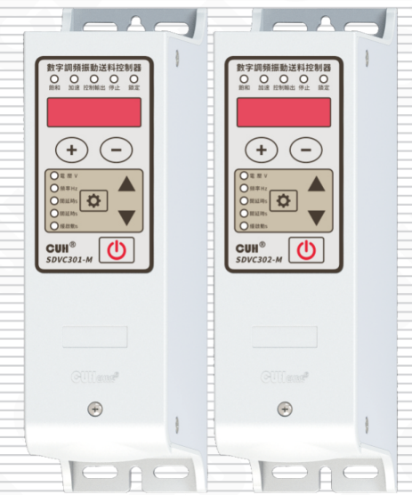

## SDVC301&302 系列

# 用户手册


### 第 2 页

*（本页 `page_markdown` 为空。）*


### 第 3 页

数字调频振动送料控制器　　　　　　　　　　　　　　　　　SDVC301&302 系列

---

## 版权说明

南京创优科技有限责任公司保留所有权利。

本用户手册上包含的所有信息是属于本公司的知识，受著作权法及所有法律的保护。本公司根据著作权法及其他法律享有并保留所有著作权和其他法律赋予的权利，未经本公司书面同意不得以任何形式对本用户手册的部分或全部进行抄袭、翻译、转译、仿制或其他利用。

## 免责声明

本用户手册的所有内容仅说明本公司生产的相关产品的使用方法，并且是根据现有技术和提供给您使用时的状态进行描述的，在您使用本产品时必须自行承担相关风险。除法律强制规定外，本公司不因本用户手册对产品负有任何明示或暗示的责任，包括但不限于人身伤害、财产损失、机会丧失。

您明确了解上述风险并同意，除法律强制规定外，本公司无须为您的任何直接、间接的损害或损失负责（包括但不限于人员、财物、数据等有形损失和名誉、机会等无形损失）。

本公司保留对本用户手册中所适用的产品进行修改而不预先及事后通知的权利。

---

2025-11　　　　　　　　　　　　　　　　　　　　　　　　　SDVC301&302SMSCN_6.01


### 第 4 页

数字调频振动送料控制器　　　　　　　　　　　　　　　　　SDVC301&302 系列

---

# 序　言

感谢您使用南京创优科技有限责任公司（在本手册中以下简称本公司）出品的SDVC301&302系列数字调频振动送料控制器（在本手册中以下简称本产品、本控制器或控制器）。本系列控制器是采用高品质元件并融合了最新的电子技术，采用高性能的数字信号处理器经过精心的设计而成。

本手册介绍了本产品的基本操作方法、功能技术说明和典型应用示例。为用户提供安装调试、参数设置、异常诊断、故障排除及日常维护控制器的相关信息。为了确保正确安装和使用本控制器，请在装机之前仔细阅读本用户手册，并请妥善保存。

以下符号提醒您注意有关防止人身伤害和产品损坏的事项，请务必阅读。

|  |  |
|---|---|
| ⚠ 危险 | 表示若不遵守该事项，将导致人员伤亡。 |
| ⚠ 警告 | 表示若不遵守该事项，可能导致人员伤亡。 |
| ⚠ 小心 | 表示若不遵守该事项，可能导致人员遭受中度或轻微伤害。 |
| 注意 | 表示若不遵守该事项，将导致本产品损坏及财产损失。 |
| ！要点 | 表示在使用过程中必须要遵守的注意事项和使用限制等。 |

**本说明书适合以下型号控制器：**

◆　数字调频振动送料控制器　SDVC301-S（1.5A）

◆　数字调频振动送料控制器　SDVC301-M（3.0A）

◆　数字调频振动送料控制器　SDVC302-S（1.5A）

◆　数字调频振动送料控制器　SDVC302-M（3.0A）

---

2025-11　　　　　　　　　　　　　　　　　　　　　　SDVC301&302SMSCN_6.01


### 第 5 页

数字调频振动送料控制器　　　　　　　　　　　　　　　　　SDVC301&302 系列

# 安全与预防措施

1、**⚠ 危险** 本产品仅用于驱动基于电磁铁的振动送料设备，请勿将本产品用于保护人体或人体部位等目的。

2、**⚠ 危险** 本产品不得作为防爆产品使用，请勿在危险场所和/或潜在爆炸气体环境中使用本产品。

3、**⚠ 警告** 本产品是采用交流市电供电的设备，请勿施加交流电压超过 260Vac。施加过大的输入电压如380Vac，则可能导致产品爆炸或者着火，造成严重的安全事故。

4、**⚠ 警告** 本产品是通过电源线进行接地的，请确保为控制器供电的配电设施具备良好的接地，否则可能导致控制器外壳带电，造成触电事故。

5、**⚠ 警告** 请勿输入交流电源到本控制器的输出端，这会损坏控制器。

6、**⚠ 警告** 请勿在带电的情况下插拔接线或触摸接线仓内各接线端子触点，以防发生触电事故。

7、**注意** 请避免采用通过继电器等设备切断供电的方式来控制本产品的输出，这会严重降低本控制器的寿命。

8、**注意** 本产品设计使用于阴凉干燥环境，请勿将本产品置于室外、可能会浸水、阳光暴晒场所工作，也不要在超过本产品电气特性要求的温度和湿度范围之外工作。

9、**要点** 请务必将本产品固定在可靠接地的坚固平台上，并远离振动设备。

10、**要点** 任何情况下请勿将本产品在超越设计极限状态下工作。

11、**要点** 请严格按照本手册的说明操作，对于违反这些操作说明所造成的任何人身伤害或财产损失，本公司不承担任何民事和刑事责任。

12、**要点** 任何情况下请不要打开本控制器机壳，以防遭到电击。机壳内部没有可以调节和用户维修部分，请不要试图维修本机，出现故障请致电本公司。

---

2025-11　　　　　　　　　　　　　　　　　　　　　　SDVC301&302SMSCN_6.01


### 第 6 页

数字调频振动送料控制器　　　　　　　　　　　　　　　　SDVC301&302 系列

# 工作与储存环境

## 一、使用前的检查

每台控制器在出厂前，均经过严格的品质检验，并经过强化的防撞包装处理。客户在拆箱后，请即刻进行下列检查：

1、检查控制器是否在运输过程中受到损伤。

2、检查控制器型号是否与订货登记资料完全相同。

## 二、工作环境

为使本控制器具有更好的使用效果和更长的使用寿命，请将控制器安装在符合下列条件的环境中：

- 良好的通风散热环境
- 远离水滴、蒸气、灰尘，（特别是油性灰尘）
- 无腐蚀、易燃性的气体、液体
- 无漂浮性的尘埃及金属微粒
- 安装表面坚固无振动
- 远离电磁噪声干扰
- 使用环境温度为0℃到40℃
- 仅适用于海拔2000m以下地区安全使用

2025-11　　　　　　　　　　　　　　　　　　　　　　SDVC301&302SMSCN_6.01


### 第 7 页

数字调频振动送料控制器　　　　　　　　　　　　　　　　　　　　　　　　　SDVC301&302 系列

---

# 目　录

**第一章 使用前须知** --------------------------------------------------------------------- 1

　　1.1　检查包装内容 --------------------------------------------------------------------- 1

　　1.2　指示灯及按键说明 --------------------------------------------------------------- 2

　　1.3　接线端口说明 --------------------------------------------------------------------- 3

　　1.4　控制器铭牌说明 ------------------------------------------------------------------- 4

**第二章 性能特点** ----------------------------------------------------------------------- 5

**第三章 安装及使用指南** --------------------------------------------------------------- 7

　　3.1　控制器使用条件 ------------------------------------------------------------------- 7

　　3.2　按键基本操作 --------------------------------------------------------------------- 7

　　3.3　安装使用 -------------------------------------------------------------------------- 8

**第四章 基本功能说明** ---------------------------------------------------------------- 12

　　4.1　输出电压设置 -------------------------------------------------------------------- 12

　　4.2　输出频率设置 -------------------------------------------------------------------- 13

　　4.3　料满停机传感器开、关延时时间设定（仅SDVC301系列） ------------------- 14

　　4.4　智能光电传感器开、关延时时间设定（仅SDVC302系列） ------------------- 15

　　4.5　缓启动时间 ----------------------------------------------------------------------- 16

　　4.6　键盘锁定功能 -------------------------------------------------------------------- 16

**第五章 高级功能说明** ---------------------------------------------------------------- 17

　　5.1　开关传感器的使用方法（仅SDVC301系列） --------------------------------- 17

　　　　5.1.1 开关传感器的接线方法 --------------------------------------------------- 17

　　　　5.1.2 开关传感器逻辑方向设定 ------------------------------------------------ 18

　　5.2　智能光电传感器的使用方法（仅SDVC302系列） ----------------------------- 19

　　　　5.2.1 智能光电传感器的接线方法 --------------------------------------------- 19

　　　　5.2.2 智能光电传感器逻辑方向设定 ------------------------------------------- 21

　　5.3　控制输出功能 -------------------------------------------------------------------- 22

　　　　5.3.1 控制输出的接线方法 ------------------------------------------------------ 22

　　　　5.3.2 控制输出D口逻辑方向设定 ----------------------------------------------- 23

---

2025-11　　　　　　　　　　　　　　　　　　　　　　　　　　　SDVC301&302SMSCN_6.01


### 第 8 页

数字调频振动送料控制器　　　　　　　　　　　　　　　　　　　　　　　　　SDVC301&302 系列

---

5.3.3 控制输出D口开、关延时时间设定（仅SDVC302系列） ------------------24

5.3.4 主控分离参数 ----------------------------------------------------------------------25

5.4　最大输出电压限制 ----------------------------------------------------------------------26

5.5　最低输出频率限制（仅SDVC302系列） -------------------------------------------27

5.6　开机运行状态（仅SDVC302系列） -------------------------------------------------28

5.7　恢复出厂设置 ----------------------------------------------------------------------------29

5.8　参数监控功能 ----------------------------------------------------------------------------30

**第六章 技术规格** -------------------------------------------------------------------------31

6.1　外形尺寸 ----------------------------------------------------------------------------------31

6.2　技术规格表 -------------------------------------------------------------------------------32

6.3　参考标准 ----------------------------------------------------------------------------------33

**第七章 附录** -------------------------------------------------------------------------------34

7.1　参数列表 ----------------------------------------------------------------------------------34

7.2　输入输出电路图 -------------------------------------------------------------------------35

7.3　故障诊断 ----------------------------------------------------------------------------------36

**第八章 产品质保信息** --------------------------------------------------------------------37

8.1　质保期 ------------------------------------------------------------------------------------37

8.2　保修范围 ----------------------------------------------------------------------------------37

8.3　产品适用性 -------------------------------------------------------------------------------37

---

2025-11　　　　　　　　　　　　　　　　　　　　　　　　　SDVC301&302SMSCN_6.01


### 第 9 页

数字调频振动送料控制器　　　　　　　　　　　　　　　　　　　　　　　　　SDVC301&302 系列

# 第一章 使用前须知

本章节介绍产品包装内容、控制器外观说明和控制器铭牌信息。

## 1.1 检查包装内容

使用本产品之前，请检查控制器及附件的完整性。如果发现产品有缺陷或已损坏、附件缺失等问题，请与本公司联系。

包装内容图示：

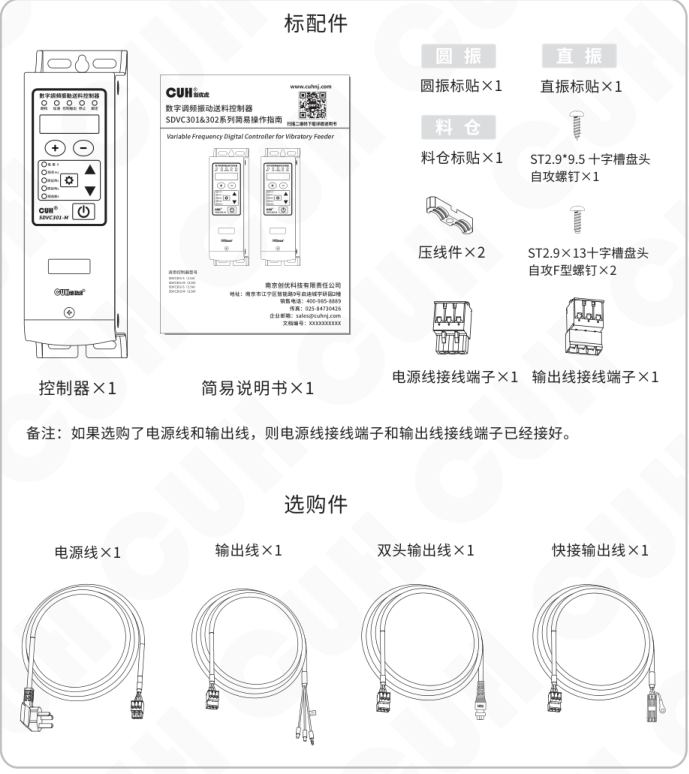

### 标配件

- 控制器×1
- 简易说明书×1
- 圆振标贴×1
- 直振标贴×1
- 料仓标贴×1
- 压线件×2
- ST2.9*9.5 十字槽盘头自攻螺钉×1
- ST2.9×13 十字槽盘头自攻F型螺钉×2
- 电源线接线端子×1
- 输出线接线端子×1

备注：如果选购了电源线和输出线，则电源线接线端子和输出线接线端子已经接好。

### 选购件

- 电源线×1
- 输出线×1
- 双头输出线×1
- 快接输出线×1

---

2025-11　　　　　　　　　　　　　　　　- 1 -　　　　　　　　　　　　　　　　SDVC301&302SMSCN_6.01


### 第 10 页

数字调频振动送料控制器　　　　　　　　　　　　　　　　　　　　SDVC301&302 系列

## 1.2 指示灯及按键说明

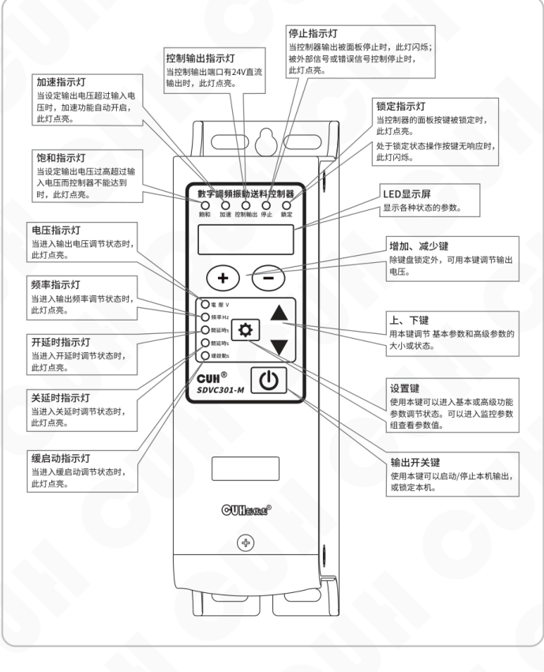

| 名称 | 说明 |
|---|---|
| 加速指示灯 | 当设定输出电压超过输入电压时，加速功能自动开启，此灯点亮。 |
| 饱和指示灯 | 当设定输出电压过高超过输入电压而控制器不能达到时，此灯点亮。 |
| 电压指示灯 | 当进入输出电压调节状态时，此灯点亮。 |
| 频率指示灯 | 当进入输出频率调节状态时，此灯点亮。 |
| 开延时指示灯 | 当进入开延时调节状态时，此灯点亮。 |
| 关延时指示灯 | 当进入关延时调节状态时，此灯点亮。 |
| 缓启动指示灯 | 当进入缓启动调节状态时，此灯点亮。 |
| 控制输出指示灯 | 当控制输出端口有24V直流输出时，此灯点亮。 |
| 停止指示灯 | 当控制器输出被面板停止时，此灯闪烁；被外部信号或错误信号控制停止时，此灯点亮。 |
| 锁定指示灯 | 当控制器的面板按键被锁定时，此灯点亮。处于锁定状态操作按键无响应时，此灯闪烁。 |
| LED显示屏 | 显示各种状态的参数。 |
| 增加、减少键 | 除键盘锁定外，可用本键调节输出电压。 |
| 上、下键 | 用本键调节基本参数和高级参数的大小或状态。 |
| 设置键 | 使用本键可以进入基本或高级功能参数调节状态。可以进入监控参数组查看参数值。 |
| 输出开关键 | 使用本键可以启动/停止本机输出，或锁定本机。 |

2025-11　　　　　　　　　　　　　　- 2 -　　　　　　　　　　　　　　SDVC301&302SMSCN_6.01


### 第 11 页

数字调频振动送料控制器　　　　　　　　　　　　　　　SDVC301&302 系列

## 1.3 接线端口说明

打开仓盖，按照下图接线。

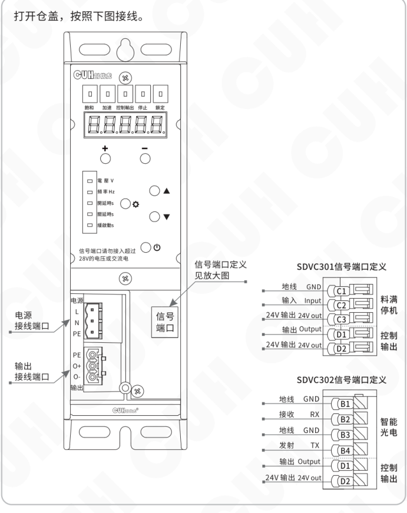

### 接线端口

| 端口 | 端子标识 |
|---|---|
| 电源接线端口 | L、N、PE |
| 输出接线端口 | PE、O+、O- |
| 信号端口 | 信号端口定义见放大图 |

> 信号端口请勿接入超过 28V 的电压或交流电。

### SDVC301 信号端口定义

| 功能分组 | 端子 | 中文标识 | 英文标识 |
|---|---|---|---|
| 料满停机 | C1 | 地线 | GND |
| 料满停机 | C2 | 输入 | Input |
| 料满停机 | C3 | 24V 输出 | 24V out |
| 控制输出 | D1 | 输出 | Output |
| 控制输出 | D2 | 24V 输出 | 24V out |

### SDVC302 信号端口定义

| 功能分组 | 端子 | 中文标识 | 英文标识 |
|---|---|---|---|
| 智能光电 | B1 | 地线 | GND |
| 智能光电 | B2 | 接收 | RX |
| 智能光电 | B3 | 地线 | GND |
| 智能光电 | B4 | 发射 | TX |
| 控制输出 | D1 | 输出 | Output |
| 控制输出 | D2 | 24V 输出 | 24V out |

2025-11　　　　　　　　　- 3 -　　　　　　　　　SDVC301&302SMSCN_6.01


### 第 12 页

数字调频振动送料控制器　　　　　　　　　　　　　　　　SDVC301&302 系列

## 1.4 控制器铭牌说明

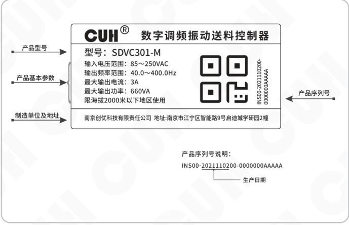

铭牌文字内容转写：

- **CUH®　数字调频振动送料控制器**
- **型号：** SDVC301-M
- **输入电压范围：** 85～250VAC
- **输出频率范围：** 40.0～400.0Hz
- **最大输出电流：** 3A
- **最大输出功率：** 660VA
- **限海拔2000米以下地区使用**
- **制造单位及地址：** 南京创优科技有限责任公司　地址:南京市江宁区智能路9号启迪城学研园2幢
- **产品序列号：** INS00-2021110200-0000000AAAAA

产品序列号说明：

```text
INS00-2021110200-0000000AAAAA
      └────────┘
        生产日期
```

---

2025-11　　　　　　　　　- 4 -　　　　　　　　　SDVC301&302SMSCN_6.01


### 第 13 页

数字调频振动送料控制器　　　　　　　　　　　　　　　　SDVC301&302 系列

---

## 第二章 性能特点

SDVC301&302系列数字调频振动送料控制器是一款高性价比的通用型调频控制器，通过采用最新的电子技术和精心的设计，提供独特的功能。

其特色包括：

- 电源输入和功率输出采用一体化接线端子，特别适合电气柜安装环境。
- 设计了可快速拆装的整体面板，提供整洁的外观，并配有锁紧螺丝。
- 随机附赠“圆振”、“直振”、“料仓”标贴，可以贴在面板上，方便区分并联的多台控制器。
- 频率调节：输出频率的调节范围是40.0Hz~400.0Hz。
- 电压调节：输出电压的调节范围是0~260V。
- 自动稳压：本功能可以自动消除由于电源电压波动造成的送料速度的变化，还可以消除工频交流电造成的拍频效应。
- 料满停机（仅SDVC301系列）：具有开关传感器信号输入接口，通过NPN型开关传感器实现料满停机控制，并且具有可调缓启动时间、开延时、关延时、逻辑方向设置等控制功能。
- 智能光电（仅SDVC302系列）：具有智能光电信号输入端口，该端口支持配置为电位器输入、NPN输入、PNP输入、光电输入。
- SDVC302还支持频率下限设置与控制输出D口开、关延时设置。
- 缓启动：在启动时，输出电压会从0开始逐渐增大到预设值，消除了开机冲击对振动盘造成的损害。
- 最大可输出电压设定：本功能可以帮助振动盘生产厂家防止用户误操作损害振动设备。
- 24V直流控制输出：通过晶体管输出控制信号，可直接用于控制电磁阀等外部设备与本控制器协调工作。
- 输出开关：面板上设有轻触按键，可以即时开停机，方便用户调试设备。
- 键盘锁定：通过长按开/关键可以锁定所有按键，防止用户误操作。
- 恢复出厂设置：该功能可以快速将调乱的参数恢复为出厂默认设置，使控制器进入默认出厂工作状态。

---

2025-11　　　　　　　　　　- 5 -　　　　　　　　　　SDVC301&302SMSCN_6.01


### 第 14 页

数字调频振动送料控制器　　　　　　　　　　　　　　　　　SDVC301&302 系列

本公司对产品质量有着一贯的追求，除在生产阶段采用高品质元器件，严密的质检体系保障外，为了最大程度地提高产品的可用性，对于用户使用中可能发生的意外问题也做了充分的准备，其中包括：

- **短路保护：** 本控制器可以在用户误操作造成短路时停止输出，以保护本机及设备。

- **过流保护：** 本控制器可以在用户误操作引起输出电流超过额定电流时停止输出，以保护本机及设备。

- **过热保护：** 本控制器工作温度超过65℃时将停止输出，以保护本机。

- **过压或欠压保护：** 电源电压过低或过高，控制器会显示Err04指示。

- **D口短路保护：** 当控制输出D口被短路时，控制器不会损坏，显示Err07提示。

- **24V输出短路保护：** 24V输出被短路、或接入电源时会显示Err10提示。

---

2025-11　　　　　　　　　　　　　　　- 6 -　　　　　　　　　　　　　　　SDVC301&302SMSCN_6.01


### 第 15 页

数字调频振动送料控制器　　　　　　　　　　　　　　　　　　　　　　　　　SDVC301&302 系列

---

# 第三章　安装及使用指南

本章节介绍本产品使用所必须具备的条件以及如何正确进行安装与连接。

## 3.1 控制器使用条件

本产品是使用交流110/220V供电的设备，且通过电源线三爪插头进行保护接地连接，请提供符合标准的110V或220V，50Hz/60Hz市电供电配电设施并确保保护地线已正确连接。

⚠️ **警告**　切不可将控制器连接到380V交流电，这将造成控制器不可恢复的严重损坏，有可能导致爆炸、火灾等安全事故。

⚠️ **警告**　确保供电侧可靠接地，控制器的金属外壳是与保护接地线直接连接的，接地不良会导致控制器外壳带电，引发触电事故。

**注意**　控制器长时间工作会产生热量致使外壳温度升高，请将控制器安装在通风良好的环境中，并将其固定良好，远离振动源。

**注意**　本产品的输出是市电经过整流、逆变形成的，中间没有隔离环节。因此输出两极不可以与保护接地连接，在连接电磁铁时也要确保电磁铁线圈与外壳之间具备基本的绝缘能力。否则会导致漏电，可能产生触电和控制器损坏的事故。

**注意**　本产品是用来驱动电磁铁的控制器，切不可连接压电振动盘。

## 3.2 按键基本操作

孙. 任何界面下短按 ⊕ 或 ⊖ 调节电压参数。

b. 长按 ⚙ 进入/退出基本参数界面，短按 ⚙ 选择基本参数，短按 ▼ 或 ▲ 调节参数值。

c. 长按 ⚙ 加 ▲ 进入/退出高级参数界面，短按 ⚙ 选择高级参数，短按 ▼ 或 ▲ 调节参数值。

d. 长按 ⚙ 加 ▼ 进入/退出监控参数界面，短按 ⚙ 选择监控参数，参数值不可调节。

e. 短按 ⏻ 暂停/恢复输出，长按 ⏻ 锁定/解锁键盘。

f. 恢复出厂设置参数下，长按 ▲ 显示 `-----`，表示控制器重设完成。

---

2025-11　　　　　　　　　　　　　　　　　- 7 -　　　　　　　　　　　　　SDVC301&302SMSCN_6.01


### 第 16 页

数字调频振动送料控制器　　　　　　　　　　　　　　　SDVC301&302 系列

---

## 3.3 安装使用

> **第一步：**
>
> 打开控制器的外包装，检查控制器外观及侧标型号，判断是否为所需的型号。

> **第二步：**
>
> 取出输出线接线端子，并按如下线序图，与自备的输出线连接好。
>
> 将输出线的另一端连到振动盘的电磁线圈上，并确认黄绿双色的地线与振动盘金属外壳可靠连接。
>
> 将输出线接线端子插到控制器的**输出接线端口**上。

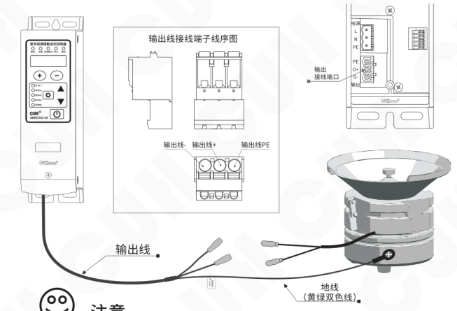

> ☺ **注意**
>
> 1、一定要确认电磁铁线圈接在两个输出引脚上，外壳需要可靠接地。  
> 否则将会导致机壳带电，可能发生严重安全事故。
>
> 2、电源输出禁止连接压电类负载，否则可能导致**电击安全事故！**

---

2025-11　　　　　　　　　　　　　　- 8 -　　　　　　　　　　　　　　SDVC301&302SMSCN_6.01


### 第 17 页

数字调频振动送料控制器　　　　　　　　　　　　　　　SDVC301&302 系列

### 第三步：

注意：务必在断电状态下为控制器电源进行配线。

取出电源线接线端子，并按如下线序图，与自备的电源线连接好。

将电源线接线端子插到控制器的**电源接线端口**上。

使用压线件及螺丝将电源线和输出线压紧在控制器壳体上。

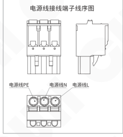

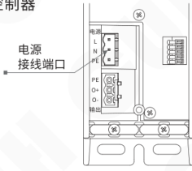

> **注意**  
> 电源线接线端子和输出线接线端子不可混用。

### 第四步：

将电源线三爪插头插在供电电源插座上，或将电源线与控制柜连接。


---

2025-11　　　　　　　　　　　　- 9 -　　　　　　　　　　　　SDVC301&302SMSCN_6.01


### 第 18 页

数字调频振动送料控制器　　　　　　　　　　　　　　　　　SDVC301&302 系列

---

## 第五步：

确认好接线后给控制器上电。
此时应该显示电压“U 150”，
振动盘应该有振动。

右侧示意：

- U 表示输出电压
- 电压指示灯

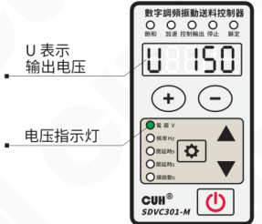

---

## 第六步：

按住 <kbd>−</kbd> 调节电压至30~50V 之间，再按 <kbd>⚙</kbd> 2秒进入频率“E”调整状态；使用 <kbd>▼</kbd> 和 <kbd>▲</kbd> 来寻找振动体的固有频率，也就是谐振频率。

右侧示意：

- E 表示输出频率
- 频率指示灯

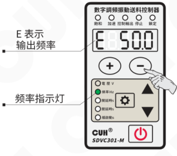

> ☺
>
> - 振动最大时的频率为振动体的固有频率。
> - 每个振动体都有固有的振动频率，为了能达到最佳的工作状态，请调整本参数使振动体工作在合适的工作频率上。

---

2025-11　　　　　　　　　　　　　　-10-　　　　　　　　　　　　　　SDVC301&302SMSCN_6.01


### 第 19 页

数字调频振动送料控制器　　　　　　　　　　　　　　　　　SDVC301&302 系列

---

**第七步：**

使用 **＋** 和 **－** 调节电压达到最佳的送料速度。

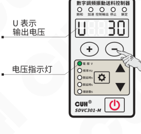

调整完毕，可初步工作后，如还需其它控制功能，请参见本说明书其他部分。

---

2025-11　　　　　　　　　　　　-11-　　　　　　　　　　　　SDVC301&302SMSCN_6.01


### 第 20 页

# 第四章　基本功能说明

本章节介绍本产品基本参数功能的使用方法。

## 4.1 输出电压设置

本控制器可以直接在面板上以数字方式设置输出电压。由于本控制器具备稳压功能，该数值为输出电压整流平均值，并且不会受到输入电压的影响，即使在电网电压不稳定场合中也可以保持稳定工作。同时，直接的电压数值设置也为用户了解设备运行情况提供了准确的数据。

> - 打开控制器的电源开关。
>
> - 控制器进入输出电压状态，控制器上电压指示灯点亮，LED显示屏显示电压参数U和电压值（默认值为150）。
>
> - 通过 **+** 和 **−** 可以对电压“U”值进行调整。
>
> 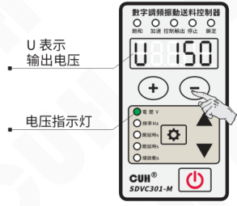
>
> 本系列控制器的输出电压范围是0～260V，调整精度1V。

> 🙂
>
> - 本控制器没有升压功能，当因输入电源电压限制，控制器无法达到设定电压时饱和灯会点亮，此时自动稳压功能失效。


### 第 21 页

数字调频振动送料控制器　　　　　　　　　　　　　　　　　SDVC301&302 系列

## 4.2 输出频率设置

本控制器采用直接数字频率合成技术（DDS），具有非常高的频率精度和稳定性，不随时间和温度的改变而变化。

> - 按住“⚙”2秒，进入基本参数界面。
>
> - 控制器上LED显示输出频率参数“E”和频率值（默认值为50.0）。
>
> - 通过 ▲ 或 ▼ 可以对频率“E”值进行设定。
>
> 操作示意：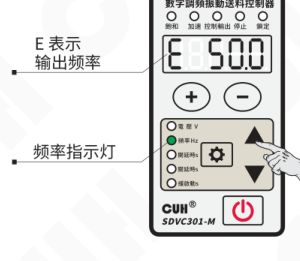
>
> 图中标注：
>
> - E 表示输出频率
> - 频率指示灯
>
> 本系列控制器的输出频率范围是40.0～400.0Hz，调整精度0.1Hz。

2025-11　　　　　　　　　　　-13-　　　　　　　　　　　SDVC301&302SMSCN_6.01


### 第 22 页

数字调频振动送料控制器　　　　　　　　　　　　　　　　　　　　　　　　　SDVC301&302 系列

## 4.3 料满停机传感器开、关延时时间设定（仅SDVC301系列）

当使用传感器或者 PLC 等其他外部信号进行启动和停止控制时，大多数情况需要在给出信号或者恢复信号后延迟一段时间才执行操作。对于这样的应用，可以通过设置开延时和关延时的时间来实现。

**开延时（J-）：** 从施加一个使控制器进入运行状态的控制信号开始，到控制器输出启动，期间经历的延迟时间称为开延时。

- 按住 ⚙ 2秒，进入基本参数界面。
- 短按 ⚙ 切换到传感器 C 口开延时参数调整状态“J-”（默认值为0.2）。
- 通过 ▲ 或 ▼ 调整参数值。

图示标注：J- 表示传感器 C 口开延时；开延时指示灯。

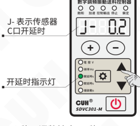

本系列控制器的开延时时间范围是 0.0～20.0 秒，调整精度 0.1 秒。

**关延时（L-）：** 从施加一个使控制器进入停止状态的控制信号开始，到控制器输出停止，期间经历的延迟时间称为关延时。

- 按住 ⚙ 2秒，进入基本参数界面。
- 使用 ⚙ 切换到传感器 C 口关延时参数调整状态“L-”（默认值为0.2）。
- 通过 ▲ 或 ▼ 调整参数值。

图示标注：L- 表示传感器 C 口关延时；关延时指示灯。

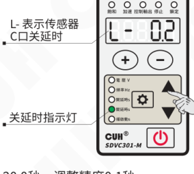

本系列控制器的关延时时间范围是 0.0～20.0 秒，调整精度 0.1 秒。

---

2025-11　　　　　　　　　　　　　　-14-　　　　　　　　　　　　　　SDVC301&302SMSCN_6.01


### 第 23 页

数字调频振动送料控制器　　　　　　　　　　　　　　SDVC301&302 系列

## 4.4 智能光电传感器开、关延时时间设定（仅SDVC302系列）

当使用传感器或者PLC等其他外部信号进行启动和停止控制时，大多数情况需要在给出信号或者恢复信号后延迟一段时间才执行操作。对于这样的应用，可以通过设置开延时和关延时的时间来实现。

### 开延时（J）

从施加一个使控制器进入运行状态的控制信号开始，到控制器输出启动，期间经历的延迟时间称为开延时。

- 按住 `⚙` 2秒，进入基本参数界面。
- 短按 `⚙` 切换到智能光电开延时参数调整状态 “J”（默认值为0.2）。
- 通过 ▲ 或 ▼ 调整参数值。

示意图：

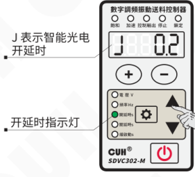

本系列控制器的开延时时间范围是0.0～20.0秒，调整精度0.1秒。

### 关延时（L）

从施加一个使控制器进入停止状态的控制信号开始，到控制器输出停止，期间经历的延迟时间称为关延时。

- 按住 `⚙` 2秒，进入基本参数界面。
- 使用 `⚙` 切换到智能光电关延时参数调整状态 “L”（默认值为0.2）。
- 通过 ▲ 或 ▼ 调整参数值。

示意图：

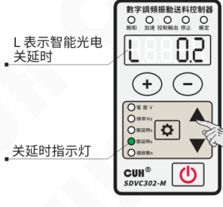

本系列控制器的关延时时间范围是0.0～20.0秒，调整精度0.1秒。

---

2025-11　　　　　　　　　　-15-　　　　　　　　　　SDVC301&302SMSCN_6.01


### 第 24 页

数字调频振动送料控制器　　　　　　　　　　　　　　　　　SDVC301&302 系列

## 4.5 缓启动时间

本控制器从停止状态启动时，输出电压可以平缓提高到设定值，以防止振动设备和控制器遭受冲击。

**缓启动时间（t）：** 控制器从停止状态启动时，输出电压从0V平滑升高到达设定输出电压所需要的时间称为缓启动时间。

- 按住**设置键（⚙）**2秒，进入基本参数界面。
- 使用**设置键（⚙）**切换到缓启动参数调整状态“t”（默认值为0.5）。
- 通过 ▲ 或 ▼ 调整参数值。

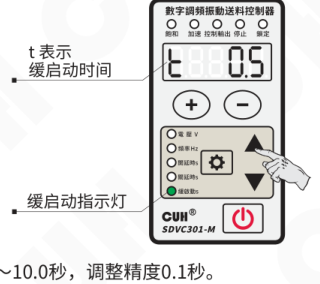

本系列控制器的缓启动时间范围是0.0～10.0秒，调整精度0.1秒。

## 4.6 键盘锁定功能

为了防止误操作，本机设定了键盘锁。这样当控制器各项参数设置好后，可以有效避免其他人的误动作影响本机正常工作。即使关机后重新开机，键盘锁状态依然保持上次关机时的状态。

- 通过长按**电源键（⏻）**2秒可以锁定所有按键，此时面板上锁定指示灯点亮。
- 再次长按**电源键（⏻）**2秒可以解除锁定。

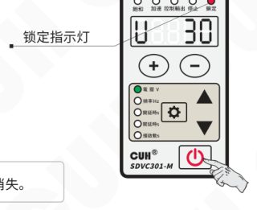

> ☺ 键盘锁定状态不会因断电关机而消失。

---

2025-11　　　　　　　　　　　　　　　　　-16-　　　　　　　　　　　　　　　　　SDVC301&302SMSCN_6.01


### 第 25 页

数字调频振动送料控制器　　　　　　　　　　　　　　　　SDVC301&302 系列

# 第五章 高级功能说明

本章节主要介绍本产品高级功能的使用方法。

## 5.1 开关传感器的使用方法（仅SDVC301系列）

料满停机端口仅支持NPN模式。

### 5.1.1 开关传感器的接线方法

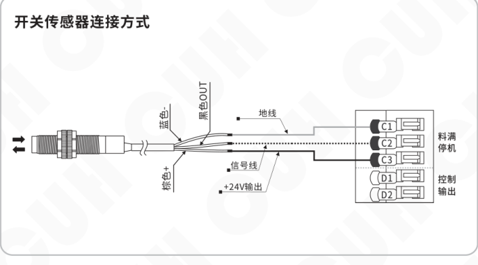

> ● 当使用传感器等其他外部信号通过控制器C口进行启动和停止操作时，如需在给出信号或者恢复信号后延迟一段时间才执行操作，可以通过设置高级参数“传感器C口开延时”和“传感器C口关延时”的时间来实现，操作方法参考4.3章节。

2025-11　　　　　　　　　　　　-17-　　　　　　　　　　　　SDVC301&302SMSCN_6.01


### 第 26 页

数字调频振动送料控制器　　　　　　　　　　　　　　　　　SDVC301&302 系列

## 5.1.2 开关传感器逻辑方向设定

通常情况下，不向开关引脚发任何信号时，该引脚由于内部的上拉电阻，都会呈现为“高”电平。此时，在出厂默认设置下，控制器处于“运行”状态。但是，对于一些特殊应用，可能需要相反的逻辑，也就是说，可能会需要在不施加信号时，控制器处于“停止”状态。这可以通过修改本参数实现。

- 长按 ⚙ 和 ▲ 2秒，进入高级参数设置界面。
- 短按 ⚙ 切换到传感器C口逻辑方向 Γ2 调整状态。
- 通过 ▼ 和 ▲ 调整参数值。

“Γ2”表示传感器C口逻辑方向。

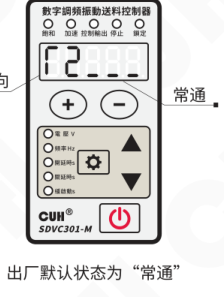

出厂默认状态为“常通”。

- 逻辑方向设置为**常通**，在没有收到光信号时，控制器处于运行状态。
- 逻辑方向设置为**常断**，在没有收到光信号时，控制器处于停止状态。

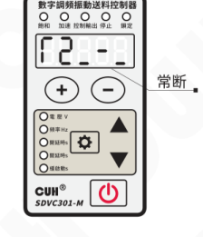

2025-11　　　　　　　　　-18-　　　　　　　　　SDVC301&302SMSCN_6.01


### 第 27 页

## 5.2 智能光电传感器的使用方法（仅SDVC302系列）

本控制器的智能光电端口支持发光二极管和光电三极管构成的光电对射或反射传感器，也可以设置为支持开关传感器或电位器调速。具体接线图如下：

### 5.2.1 智能光电传感器的接线方法

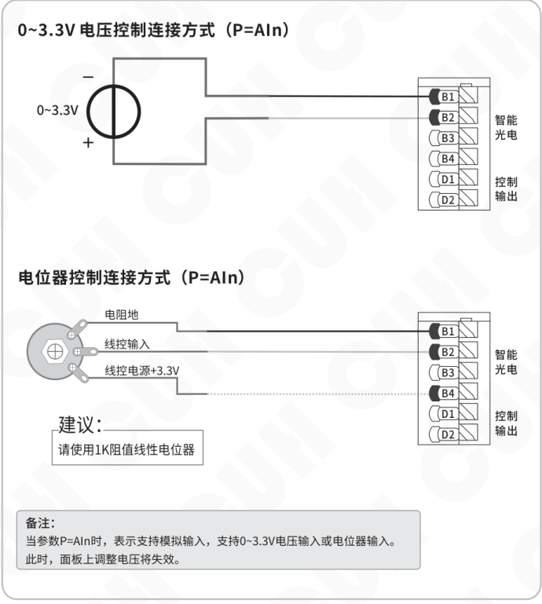


### 第 28 页

数字调频振动送料控制器　　　　　　　　　　　　　　　　　SDVC301&302 系列

### 光电传感器连接方式（P=1~1000）

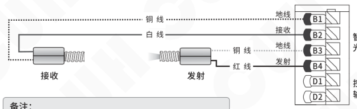

**备注：**

当参数 P=1~1000 时，表示支持光电传感器输入，传感器工作距离可以通过设置 P 参数调节，参数越小越灵敏。

### 开关传感器连接方式（P=NPN或PNP）

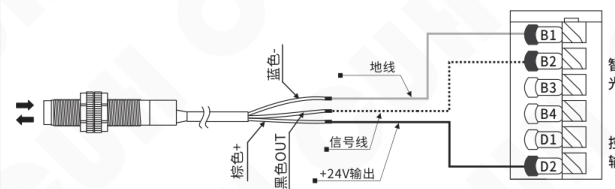

**备注：**

当参数 P=NPN 或者 PNP 时，表示支持 NPN 或 PNP 开关传感器输入。  
P=NPN 和 PNP 时，B4 输出 8mA 有效信号；  
P=1~1000 时，B4 输出 8mA 调制信号，频率约 200Hz。  
控制器出现错误时，B4 不输出。此为就绪信号功能。

### 就绪信号使用接线案例

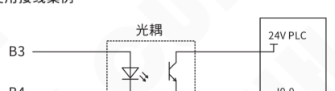

---

2025-11　　　　　　　　　　　　　　　　　-20-　　　　　　　　　　　　　　　　　SDVC301&302SMSCN_6.01


### 第 29 页

数字调频振动送料控制器　　　　　　　　　　　　　　　　SDVC301&302 系列

## 5.2.2 智能光电传感逻辑方向设定

通常情况下，不连接任何控制信号或控制信号无效时，控制器处于运行状态，这定义为常通（NC, Normal Close）。但是，对于一些应用需要相反的逻辑，在不连接任何控制信号或控制信号无效时，控制器处于停止状态，当控制信号接入并且有效时，控制器运行，这定义为常断（NO, Normal Open）。这可以通过修改本参数实现。

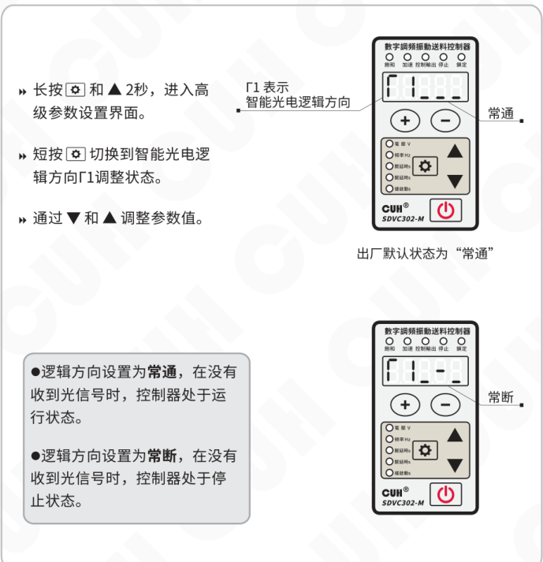

- 长按 ⚙ 和 ▲ 2秒，进入高级参数设置界面。
- 短按 ⚙ 切换到智能光电逻辑方向 Γ1 调整状态。
- 通过 ▼ 和 ▲ 调整参数值。

> Γ1 表示智能光电逻辑方向

出厂默认状态为“常通”

- 逻辑方向设置为**常通**，在没有收到光信号时，控制器处于运行状态。
- 逻辑方向设置为**常断**，在没有收到光信号时，控制器处于停止状态。

2025-11　　　　　　　　　　　　-21-　　　　　　　　　　　　SDVC301&302SMSCN_6.01


### 第 30 页

## 5.3 控制输出功能

本控制器可以输出低电压控制信号，以同步其它设备协同工作，如电磁阀、PLC、继电器等。

### 5.3.1 控制输出的接线方法

**NPN输出的连接方式**

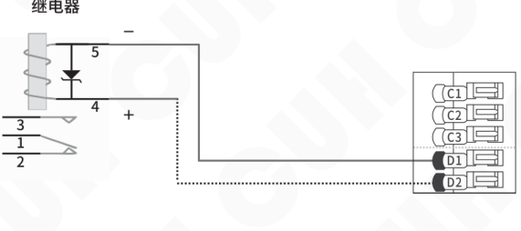

如果连接24V继电器，一定要确认线圈的正极和负极，确保正确连接。因为本端口的输出电流能力为200mA，接反后继电器的内部保护二极管会将本控制器端口短路，触发短路保护Err07。


### 第 31 页

数字调频振动送料控制器　　　　　　　　　　　　　　　　　SDVC301&302 系列

### 5.3.2 控制输出D口逻辑方向设定

- 长按 **设置键（⚙）** 和 **▲** 2秒，进入高级参数设置界面。
- 短按 **设置键（⚙）** 切换到控制输出D口逻辑方向 **Γ3** 调整状态。
- 通过 **▼** 和 **▲** 调整参数值。

> **Γ3** 表示控制输出D口逻辑方向。

**常通**  
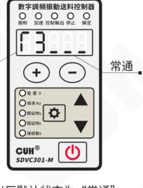

出厂默认状态为“常通”。

**常断**  
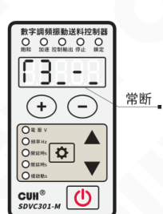

- 逻辑方向设置为 **常通**，  
  控制器输出运行，控制输出也为运行状态；  
  控制器输出停止，控制输出也为停止状态。

- 逻辑方向设置为 **常断**，  
  控制器输出运行，控制输出则为停止状态；  
  控制器输出停止，控制输出则为运行状态。

---

2025-11　　　　　　　　　　　　-23-　　　　　　　　　　　　SDVC301&302SMSCN_6.01


### 第 32 页

数字调频振动送料控制器  SDVC301&302 系列

## 5.3.3 控制输出D口开、关延时时间设定（仅SDVC302系列）

### 控制输出D口开延时时间设定

- 长按 **⚙** 和 **▲** 2秒，进入高级参数设置界面。
- 短按 **⚙** 切换到控制输出D口开延时 **d** 调整状态（默认值为0.0）。
- 通过 **▼** 和 **▲** 调整参数值。

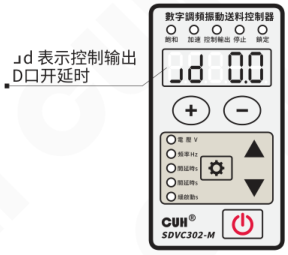

控制输出D口开延时时间范围是0.0～99.9秒，调整精度0.1秒。

### 控制输出D口关延时时间设定

- 长按 **⚙** 和 **▲** 2秒，进入高级参数设置界面。
- 短按 **⚙** 切换到控制输出D口关延时 **Ld** 调整状态（默认值为0.0）。
- 通过 **▼** 和 **▲** 调整参数值。

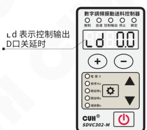

控制输出D口关延时时间范围是0.0～99.9秒，调整精度0.1秒。

---

2025-11  -24-  SDVC301&302SMSCN_6.01


### 第 33 页

数字调频振动送料控制器　　　　　　　　　　　　　　　　　　　　　　SDVC301&302 系列

## 5.3.4 主控分离参数

- 长按 **设置键（⚙）** 和 **▲** 2 秒，进入高级参数设置界面。
- 短按 **设置键（⚙）** 切换到主控分离参数 **Γ4** 调整状态。
- 通过 **▼** 和 **▲** 调整参数值。

**Γ4** 表示主控分离参数。

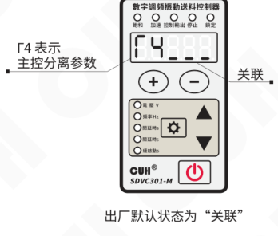

出厂默认状态为“**关联**”。

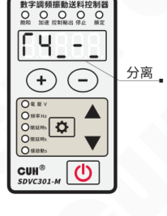

**关联：** 主输出和控制输出受面板的启/停键以及开关传感器信号的逻辑控制。

**分离：** 主输出受面板的启/停键控制，控制输出受开关传感器信号的逻辑控制。

---

2025-11　　　　　　　　　　　　　　　　　-25-　　　　　　　　　　　　　　　　　SDVC301&302SMSCN_6.01


### 第 34 页

数字调频振动送料控制器　　　　　　　　　　　　　　　　SDVC301&302 系列

## 5.4 最大输出电压限制

本控制器可以设置高级参数“最大输出电压限制 h”来设定最大输出电压，
可以防止用户误操作输出过大电压而损坏振动设备。

面板设置电压和遥控电压均不会超过该值。

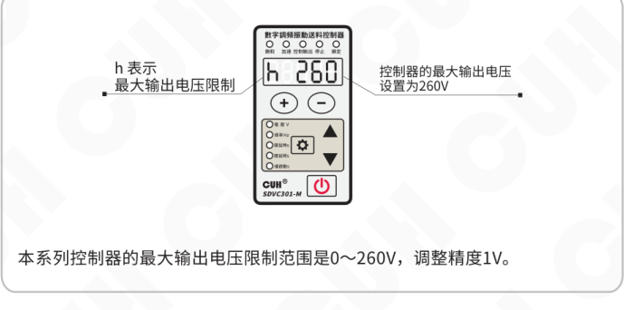

本系列控制器的最大输出电压限制范围是0～260V，调整精度1V。

> ● 任何情况下，控制器的输出电压不能也不会超过本参数设定值。  
> ● 本参数出厂默认设置为本机的最大可能输出电压。

---

2025-11　　　　　　　　　　　　-26-　　　　　　　　　　　　SDVC301&302SMSCN_6.01


### 第 35 页

数字调频振动送料控制器　　　　　　　　　　　　　　　　　　　　　SDVC301&302 系列

---

## 5.5 最低输出频率限制（仅SDVC302系列）

本控制器可以设置高级参数“频率下限”来限制最低输出频率，可以防止用户误操作输出频率过低而损坏电磁铁。

面板设置频率不会低于该值。

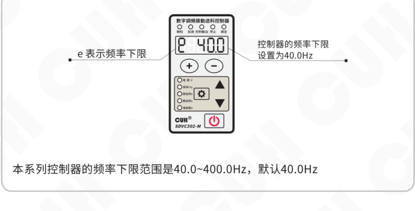

---

2025-11　　　　　　　　　　　　　　　-27-　　　　　　　　　　　　　　　SDVC301&302SMSCN_6.01


### 第 36 页

数字调频振动送料控制器　　　　　　　　　　　　　　　　　　　　　　　　　SDVC301&302 系列

## 5.6 开机运行状态（仅SDVC302系列）

开机运行状态设置功能，可以指定开机后电源键的状态。通过参数开机运行状态Γd调整。

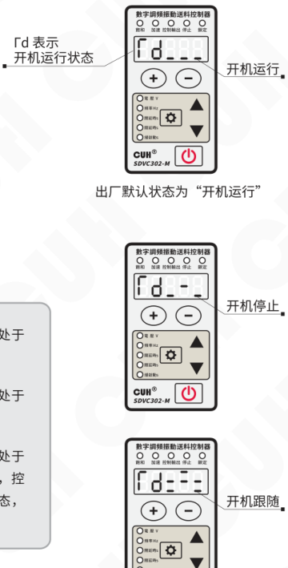

- 长按 ⚙ 和 ▲ 2秒，进入高级参数设置界面。
- 短按 ⚙ 切换到开机运行状态Γd调整状态。
- 通过 ▼ 和 ▲ 调整参数值。

Γd 表示开机运行状态。

出厂默认状态为“开机运行”。

- **开机运行**：表示开机后控制器电源键处于运行状态。
- **开机停止**：表示开机后控制器电源键处于停止状态。
- **开机跟随**：表示开机后控制器电源键处于跟随上次掉电前的状态。如果掉电前，控制器处于停止灯闪烁的开关键停止状态，则再次上电依然维持该状态。

2025-11　　　　　　　　　　　　　　　　　-28-　　　　　　　　　　　　　　　　　SDVC301&302SMSCN_6.01


### 第 37 页

## 5.7 恢复出厂设置

本功能可以使用户快速将控制器设置为出厂默认设置状态。

由于本控制器功能强大，有数量众多的控制参数可以由用户设定，对于初学者，可能在多次的设定修改后不能恢复控制器的正常工作状态。使用该功能可以快速将调乱的参数状态恢复为出厂默认设置。

操作示意图：

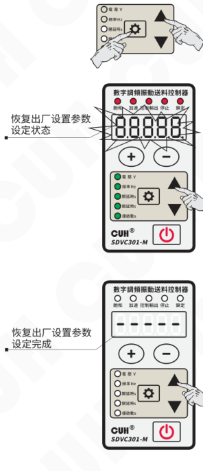

- 长按“设置”键（齿轮）和 ▲，进入高级参数界面。

- 短按“设置”键（齿轮）切换到全屏闪烁状态，即“恢复出厂设置”参数，此时长按 ▲，直到控制器显示“------”，表示控制器已经重设完毕。

- 松开 ▲，控制器显示 CUH 后，随即进入正常的电压调整状态“U”，此时控制器就像刚开始使用一样，所有参数都已经恢复到出厂默认状态。


### 第 38 页

数字调频振动送料控制器　　　　　　　　　　　　　　　　　SDVC301&302 系列

---

## 5.8 参数监控功能

本控制器专门设计了一组监控参数组用于监控控制器的状态。

- 长按 ⚙ 和 ▼，进入/退出监控参数界面。
- 短按 ▲ 或 ▼ 选择需要监控的参数。
- 监控参数的参数值不可修改。

**本控制器的监控参数包括：**

输出电流AC、温度显示C

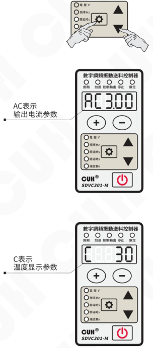

图中说明：

- AC表示输出电流参数
- C表示温度显示参数

---

2025-11　　　　　　　　　　　　　　　　　-30-　　　　　　　　　　　　SDVC301&302SMSCN_6.01


### 第 39 页

数字调频振动送料控制器　　　　　　　　　　　　　　SDVC301&302 系列

# 第六章 技术规格

## 6.1 外形尺寸 （单位：毫米mm）

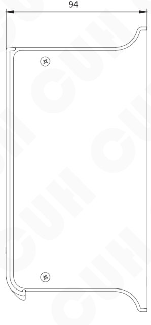

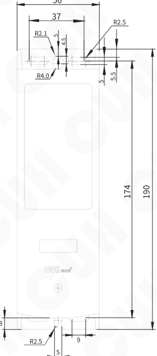

SDVC301/302-S（1.5A）  
SDVC301/302-M（3.0A）

| 公差区间 | 公差值 |
|---|---|
| 0~3 | ±0.05 |
| 3~10 | ±0.1 |
| 10~30 | ±0.15 |
| 30~80 | ±0.2 |
| 80~180 | ±0.3 |
| >180 | ±0.5 |

本系列产品均适用此公差表。

备注：建议使用M4带平垫螺丝紧固，扭矩不超过0.8N·m。

---

2025-11　　　　　　　　　-31-　　　　　　　　　SDVC301&302SMSCN_6.01


### 第 40 页

数字调频振动送料控制器　　　　　　　　　　　　　　　　　　　　　　　SDVC301&302 系列

---

## 6.2 技术规格表

| 项目 | 最小值 | 典型值 | 最大值 | 单位 | 备注 |
|---|---:|---:|---:|---|---|
| 输入电压 | 85 | 220 | 250 | 伏特（V） | 交流有效值 |
| 输出电压调整范围 | 0 | —— | 260 | 伏特（V） | 小于输入电压的150% |
| 电压调整精度 |  | 1 |  | 伏特（V） |  |
| 稳压精度 | 0 | —— | 10 | % | ΔVout/ΔVin |
| 输出电流调整范围 | 0 | —— | 1.5 | 安培（A） | SDVC301/302-S |
| 输出电流调整范围 |  |  | 3.0 | 安培（A） | SDVC301/302-M |
| 输出功率 | 0 | —— | 330 | 伏安（VA） | SDVC301/302-S |
| 输出功率 |  |  | 660 | 伏安（VA） | SDVC301/302-M |
| 输出频率 | 40.0 | —— | 400.0 | 赫兹（Hz） |  |
| 频率调整精度 |  | 0.1 |  | 赫兹（Hz） |  |
| 输出波形 |  | 正弦 |  |  |  |
| 缓启动时间 | 0 | —— | 10 | 秒（s） | 出厂默认0.5 |
| 延迟时间范围 | 0 | —— | 20.0/99.9 | 秒（s） | 出厂默认0.2/0.0 |
| 延迟时间精度 |  | 0.1 |  | 秒（s） |  |
| 过热保护温度 | 58 | 60 | 66 | 摄氏度（℃） |  |
| 直流控制输出电流 | 0 | —— | 200 | 毫安（mA） |  |
| 直流控制输出电压 | 22 | 24 | 26 | 伏特（V） |  |
| 数字控制信号 |  | 24 |  | 伏特（V） | 开关信号控制 |
| 模拟控制信号 |  | 电位器或0~3.3V电压 |  | 伏特（V） | 仅SDVC302系列 |
| 调整方式 |  | 6 |  | 键（Button） |  |
| 空载功耗 | —— | 3 | —— | 瓦特（W） |  |
| 显示方式 |  | 5 |  | 位（Digit） | LED数码管 |
| 工作环境温度 | 0 | 25 | 40 | 摄氏度（℃） |  |
| 工作环境湿度 | 10 | 60 | 85 | 相对湿度（%） | 不结露 |
| 存储环境温度 | -20 | 25 | 85 | 摄氏度（℃） |  |

---

2025-11　　　　　　　　　　　　　　　　　-32-　　　　　　　　　　SDVC301&302SMSCN_6.01


### 第 41 页

数字调频振动送料控制器　　　　　　　　　　　　　　　　　SDVC301&302 系列

## 6.3 参考标准

|  |  |  |  |  |  |
|---|---|---|---|---|---|
| **极限参数：超过此指标将会造成严重损坏，必须严格遵守！** ||||||
| 项目 | GB 标准 | IEC 标准 | 等级 | 标准要求 | 备注说明 |
| 静电放电 | GB/T 17626.2-2006 | IEC 61000-4-2:2001 | 4 | ±8 kV | 接触放电 |
|  |  |  | 4 | ±15 kV | 空气放电 |
| 电快速瞬变<br>脉冲群 | GB/T 17626.4-2008 | IEC 61000-4-4:2004 | 4 | ±4 kV |  |
| 直流电源纹<br>波抗扰度 | GB/T 17626.17-2005 | IEC 61000-4-17:2002 | 4 | 15% | 评价 A |

> **警告**  
> 在民用环境中，本产品可能产生无线电干扰。在这种情况下，可能需要采取附加抑制措施。

---

2025-11　　　　　　　　　　　　　　　　　-33-　　　　　　　　　　　　　　　　　SDVC301&302SMSCN_6.01


### 第 42 页

数字调频振动送料控制器　　　　　　　　　　　　　　　　　　　　　　　　　SDVC301&302 系列

# 第七章 附录

## 7.1 参数列表

| 参数类别 | 含义 | 参数符号 | 数码管符号图片 | 取值范围 | 默认设置 |
|---|---|---|---|---|---|
| 常用参数 | 输出电压 | `U` |  | 0~260 伏特（V） | 150 |
|  | 输出频率 | `E` |  | 40.0~400.0 赫兹（Hz） | 50.0 |
| 基本参数<br>长按设置键 | 传感器C口开延时<br>（仅SDVC301系列） | `J-` | 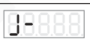 | 0.0~20.0 秒（s） | 0.2 |
|  | 传感器C口关延时<br>（仅SDVC301系列） | `L-` |  | 0.0~20.0 秒（s） | 0.2 |
|  | 智能光电开延时<br>（仅SDVC302系列） | `J` | 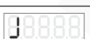 | 0.0~20.0 秒（s） | 0.2 |
|  | 智能光电关延时<br>（仅SDVC302系列） | `L` | 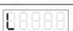 | 0.0~20.0 秒（s） | 0.2 |
|  | 缓启动时间 | `t` |  | 0.0~10.0 秒（s） | 0.5 |
| 高级参数<br>长按设置键加▲ | 智能光电逻辑方向<br>（仅SDVC302系列） | `F1` | 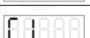 | 常通---，常断-- | 常通--- |
|  | 传感器C口逻辑方向<br>（仅SDVC301系列） | `F2` | 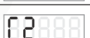 | 常通---，常断-- | 常通--- |
|  | 控制输出D口逻辑方向 | `F3` | 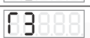 | 常通---，常断-- | 常通--- |
|  | 主控分离参数 | `F4` |  | 关联---，分离-- | 关联--- |
|  | 最大输出电压限制 | `h` |  | 0~260 伏特（V） | 260 |
|  | 智能光电灵敏度<br>（仅SDVC302系列） | `P` |  | AIn, PNP, NPN, 1~1000 | 80 |
|  | 开机运行状态<br>（仅SDVC302系列） | `rd` |  | 开机运行---　开机停止---<br>开机跟随--- | 开机运行--- |
|  | 控制输出D口开延时<br>（仅SDVC302系列） | `Jd` |  | 0.0~99.9 秒（s） | 0.0 |
|  | 控制输出D口关延时<br>（仅SDVC302系列） | `Ld` |  | 0.0~99.9 秒（s） | 0.0 |
|  | 频率下限<br>（仅SDVC302系列） | `E` |  | 40.0~400.0 赫兹（Hz） | 40.0 |
|  | 恢复出厂设置 | `8888.8` |  | —— | —— |
| 监控参数<br>长按设置键加▼ | 输出电流 | `AC` | 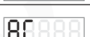 | 0.00~1.60 安培 (A)-SDVC301/302-S<br>0.00~3.50 安培 (A)-SDVC301/302-M | —— |
|  | 温度显示 | `C` |  | -20~85 摄氏度（℃） | —— |

2025-11　　　　　　　　　　　　　　-34-　　　　　　　　　　　　　　SDVC301&302SMSCN_6.01


### 第 43 页

数字调频振动送料控制器　　　　　　　　　　　　　　　　SDVC301&302 系列

---

## 7.2 输入输出电路图

### 智能光电B端口

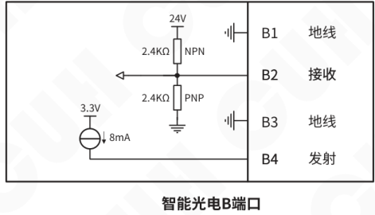

端子标识：B1 地线；B2 接收；B3 地线；B4 发射。

### 料满停机C端口

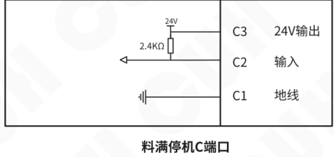

端子标识：C3 24V输出；C2 输入；C1 地线。

### 控制输出D端口


端子标识：D2 24V输出；D1 输出。

---

2025-11　　　　　　　　　　　　　-35-　　　　　　　　　　　　　SDVC301&302SMSCN_6.01


### 第 44 页

数字调频振动送料控制器　　　　　　　　　　　　　　　　　　　　　　　　　SDVC301&302 系列

## 7.3 故障诊断

| 故障现象/故障代码 | 数码管符号图片 | 含义 | 排除方法 |
|---|---|---|---|
| 接通电源，没有显示 |  |  | ◆ 请检查电源插座是否有电？<br>◆ 电源插头是否可靠连接插座？ |
| 有显示，但是振动盘不动，也没有声音 |  |  | ◆ 请检查输出电缆是否正确地连接控制器与振动盘？<br>◆ 请检查控制器参数，是否输出电压调节的太小？<br>◆ 请检查控制信号是否将控制器置于“停止”状态？<br>◆ 请检查是否有设置为“常断”的参数，导致控制器被置于“停止”状态？ |
| 控制信号不起作用 |  |  | ◆ 请检查控制信号是否正确输入？<br>◆ 请检查输入的控制信号的地线是否与本机地正确连接？<br>◆ 请检查控制信号逻辑关系设置是否是您期望的设置？ |
| 周期性忽大忽小<br>（拍频现象） |  |  | ◆ 请检查多个振动体间的振动耦合问题。<br>◆ 调整相互耦合的振动设备的工作频率，使频率差更大。 |
| 有显示，振动盘不动，<br>但是可以听到声音 |  |  | ◆ 请按照说明书介绍的调节方法逐步调节各参数。 |
| Err01 |  | 短路保护 | ◆ 确保负载未短路，短按两次开关键或重新上电以启动输出。 |
| Err02 |  | 过流保护 | ◆ 适当降低输出电压，然后尝试重新启动输出。 |
| Err03 |  | 过热保护 | ◆ 将本控制器安装在通风良好的环境中。 |
| Err04 |  | 过压或欠压保护 | ◆ 确保输入电压在85V~250V之间。 |
| Err05 |  | 内部通信异常 | ◆ 确保未在24V电源端口接入任何外部电源或联系本公司技术支持。 |
| Err06 |  | 温度传感器异常 | ◆ 确保不在-20摄氏度以下工作或联系本公司技术支持。 |
| Err07 |  | D口短路保护 | ◆ 确保D口负载未短路且电流未超过200mA，然后尝试重新启动输出。 |
| Err10 |  | 24V电源输出异常 | ◆ 确保24V输出未被短路或超过200mA电流。 |

注意：智能光电发射端口在控制器有任何故障时，此为就绪信号功能。

2025-11　　　　　　　　　　　　　　　　　-36-　　　　　　　　　　　　　　　　　SDVC301&302SMSCN_6.01


### 第 45 页

# 第八章 产品质保信息

## 8.1 质保期

本公司为本产品提供的质保期为三年，从产品发送到购买方指定地点之日算起。

## 8.2 保修范围

（一）如果在上述质保期内出现本公司造成的故障，我们将免费维修产品。但是以下情况不属于保修范围：

- a、未按照简易说明书、用户手册或购买方与本公司专门达成的技术要求中规定的条件、环境下的不正确操作，或不正确使用造成的故障。
- b、故障不是因产品缺陷，而是购买方设备或软件设计造成的。
- c、非本公司人员进行的修改或修理而造成的故障。
- d、按照简易操作指南或用户手册正确维修或更换易损部件等规定可以完全避免的故障。
- e、产品从本公司发货后，因无法预料的科学技术水平变化等因素而造成的故障。
- f、由于火灾、地震、洪水等自然灾害，或异常电压等外部因素造成的故障，本公司不负责保修。

（二）保修范围仅限于（一）中规定的情况，本公司对该设备造成的购买方间接损失（如设备损坏、机会丧失、利润损失等）或其他损失，不承担任何责任。

## 8.3 产品适用性

本公司的该控制器是针对振动送料行业的通用产品而设计生产的。因此，本公司的该控制器不得用于下列应用且不适合其使用。

（一）对生命和财产有严重影响的设施，如核发电厂、机场、铁路、轮船、机动装置及医疗设备。

（二）公共事业，包括电力、气体、供水等。

（三）相似条件或环境的户外使用。


### 第 46 页

*（本页 `page_markdown` 为空。）*


### 第 47 页

*（本页 `page_markdown` 为空。）*


### 第 48 页


南京创优科技有限责任公司  
网址:www.cuhnj.com  
电话:400-985-8889  
传真:025-84730426  
邮箱:sales@cuhnj.com  
地址:南京市江宁区智能路9号  
启迪城学研园2幢

文档编号：IDP1000491
<!-- /auto:ai-body-draft v1 -->

<!-- auto:data-params-summary v1 -->
## 附录 · 参数表（结构化侧车·机器生成）

> 说明：本节由 `data/<doc_key>/params/params.yaml` 自动渲染（展示前若干行），用于校对与二次开发。定稿以层 C 数据为准。

| 参数 | 标志/符号 | 范围 | 默认 | 单位 | 备注 |
| --- | --- | --- | --- | --- | --- |
| <br>**警告** |  |  |  |  |  |
| <br>**小心** |  |  |  |  |  |
| <br>**注意** |  |  |  |  |  |
| <br>**要点**<br>！ |  |  |  |  |  |
| <br>3~10 |  |  |  |  |  |
| <br>10~30 |  |  |  |  |  |
| <br><br>30~80 |  |  |  |  |  |
| <br><br>80~180 |  |  |  |  |  |
| <br><br>>180 |  |  |  |  |  |
| <br> <br> <br>输入电压 |  |  |  | <br> <br> <br>伏特（V） | <br> <br>交流有效值 |
| <br> <br> <br>输出电压调整范围 |  |  |  | <br> <br> <br>伏特（V） | <br> <br>小于输入电压的150% |
| <br> <br> <br>电压调整精度 |  |  |  | <br> <br> <br>伏特（V） | <br> |
| <br> <br> <br>稳压精度 |  |  |  | <br> <br> <br>% | <br> <br>ΔVout/ Vin<br>Δ |
| <br> <br> <br>输出电流调整范围 |  |  |  | <br> <br> <br>安培（A） | <br> <br>SDVC301/302-S |
| <br> <br> <br>输出电流调整范围 |  |  |  | <br> <br> <br>3.0 | <br> <br>SDVC301/302-M |
| <br> <br> <br>输出功率 |  |  |  | <br> <br> <br> <br>伏安（VA） | <br> <br>SDVC301/302-S |
| <br> <br> <br>输出功率 |  |  |  | <br> <br> <br> <br>660 | <br> <br> <br>SDVC301/302-M |
| <br> <br> <br>输出频率 |  |  |  | <br> <br> <br> <br>赫兹（Hz） | <br> <br> |
| <br> <br> <br>频率调整精度 |  |  |  | <br> <br> <br> <br>赫兹（Hz） | <br> <br> |
| <br> <br> <br>输出波形 |  |  |  | <br> <br> <br> | <br> <br> |
| <br> <br> <br>缓启动时间 |  |  |  | <br> <br> <br> <br>秒（s） | <br> <br> <br>出厂默认0.5 |
| <br> <br> <br>延迟时间范围 |  |  |  | <br> <br> <br> <br>秒（s） | <br> <br> <br>出厂默认0.2/0.0 |
| <br> <br>延迟时间精度 |  |  |  | <br> <br> <br>秒（s） | <br> <br> |
| <br> <br>过热保护温度 |  |  |  | <br> <br> <br>摄氏度（℃） | <br> <br> |
| <br> <br>直流控制输出电流 |  |  |  | <br> <br> <br>毫安（mA） | <br> <br> |
| <br> <br>直流控制输出电压 |  |  |  | <br> <br> <br> <br>伏特（V） | <br> <br> <br> |
| <br> <br>数字控制信号 |  |  |  | <br> <br> <br> <br>伏特（V） | <br> <br> <br> <br>开关信号控制 |
| <br> <br>模拟控制信号 |  |  |  | <br> <br> <br> <br>伏特（V） | <br> <br> <br> <br>仅SDVC302系列 |
| <br> <br>调整方式 |  |  |  | <br> <br> <br> <br>键（Button） | <br> <br> <br> |
| <br>空载功耗 |  |  |  | <br> <br> <br>瓦特（W） | <br> <br> |

*（仅展示前 30 条，共 77 条；完整数据见下方链接。）*

- 完整 YAML：`data/cuh.sdvc.manual.v6.01/params/params.yaml`
- 表格索引：`data/cuh.sdvc.manual.v6.01/index.yaml`
<!-- /auto:data-params-summary v1 -->
