## 目录

> 下列条目来自 PDF 内置书签/大纲；链接指向本批转换生成的整页渲染图（`assets/pages/`），便于与原版 PDF 对照校对。

- [2: 封二版权与免责](assets/pages/page-0002.png)（第 2 页）
- [3: 序言](assets/pages/page-0003.png)（第 3 页）
- [4: 安全与预防措施](assets/pages/page-0004.png)（第 4 页）
- [5: 工作与储存环境](assets/pages/page-0005.png)（第 5 页）
- [7: 目录](assets/pages/page-0007.png)（第 7 页）
- [8: 目录2](assets/pages/page-0008.png)（第 8 页）
- [第一章 使用前须知](assets/pages/page-0009.png)（第 9 页）
  - [1.1 检查包装内容](assets/pages/page-0009.png)（第 9 页）
  - [1.2 指示灯及按键说明](assets/pages/page-0010.png)（第 10 页）
  - [1.3 外部部件说明](assets/pages/page-0011.png)（第 11 页）
  - [1.4 接线端口说明](assets/pages/page-0012.png)（第 12 页）
  - [1.5 控制器铭牌说明](assets/pages/page-0012.png)（第 12 页）
- [第二章 产品介绍](assets/pages/page-0013.png)（第 13 页）
  - [2.1 产品简介](assets/pages/page-0013.png)（第 13 页）
  - [2.2 产品性能提升](assets/pages/page-0013.png)（第 13 页）
  - [2.3 产品现代/传统界面](assets/pages/page-0014.png)（第 14 页）
- [第三章 安装及使用指南](assets/pages/page-0015.png)（第 15 页）
  - [3.1 控制器使用条件](assets/pages/page-0015.png)（第 15 页）
  - [3.2 按键基本操作](assets/pages/page-0015.png)（第 15 页）
  - [3.3 安装使用](assets/pages/page-0016.png)（第 16 页）
- [第四章 基本功能说明](assets/pages/page-0020.png)（第 20 页）
  - [4.1 输出电压设置](assets/pages/page-0020.png)（第 20 页）
  - [4.2 输出频率设置](assets/pages/page-0021.png)（第 21 页）
  - [4.3 智能光电传感器开延时、关延时时间设定](assets/pages/page-0022.png)（第 22 页）
  - [4.4 缓启动时间](assets/pages/page-0023.png)（第 23 页）
  - [4.5 刹车周数/缓关闭时间](assets/pages/page-0023.png)（第 23 页）
  - [4.6 键盘锁定功能](assets/pages/page-0025.png)（第 25 页）
- [第五章 高级功能说明](assets/pages/page-0026.png)（第 26 页）
  - [5.1 遥控调速功能](assets/pages/page-0026.png)（第 26 页）
  - [5.2 智能光电功能](assets/pages/page-0028.png)（第 28 页）
  - [5.3 料满停机功能](assets/pages/page-0029.png)（第 29 页）
  - [5.4 控制输出功能](assets/pages/page-0030.png)（第 30 页）
    - [5.4.1 控制输出的接线方法](assets/pages/page-0030.png)（第 30 页）
    - [5.4.2 控制输出信号源和逻辑图](assets/pages/page-0031.png)（第 31 页）
    - [5.4.3 控制输出模式说明](assets/pages/page-0033.png)（第 33 页）
    - [5.4.4 控制输出逻辑方向](assets/pages/page-0034.png)（第 34 页）
    - [5.4.5 主输出信号控制功能](assets/pages/page-0034.png)（第 34 页）
  - [5.5 最大输出电压限制](assets/pages/page-0035.png)（第 35 页）
  - [5.6 最低输出频率限制](assets/pages/page-0035.png)（第 35 页）
  - [5.7 加速指数](assets/pages/page-0036.png)（第 36 页）
  - [5.8 波形指数](assets/pages/page-0037.png)（第 37 页）
  - [5.9 参数密码锁功能](assets/pages/page-0038.png)（第 38 页）
  - [5.10 恢复出厂设置/恢复出厂方式](assets/pages/page-0039.png)（第 39 页）
  - [5.11 参数监控功能](assets/pages/page-0040.png)（第 40 页）
- [第六章 技术规格](assets/pages/page-0041.png)（第 41 页）
  - [6.1 外形尺寸](assets/pages/page-0041.png)（第 41 页）
  - [6.2 技术规格表](assets/pages/page-0043.png)（第 43 页）
  - [6.3 参考标准](assets/pages/page-0044.png)（第 44 页）
- [第七章 附录](assets/pages/page-0045.png)（第 45 页）
  - [7.1 参数列表](assets/pages/page-0045.png)（第 45 页）
  - [7.2 输入输出电路图](assets/pages/page-0047.png)（第 47 页）
  - [7.3 故障诊断](assets/pages/page-0048.png)（第 48 页）
- [第八章 产品质保信息](assets/pages/page-0049.png)（第 49 页）
  - [8.1 质保期](assets/pages/page-0049.png)（第 49 页）
  - [8.2 保修范围](assets/pages/page-0049.png)（第 49 页）
  - [8.3 产品适用性](assets/pages/page-0049.png)（第 49 页）
## 术语与命名

- 侧车：`glossary/terms.yaml`（机读）、`glossary/zh-CN.md`（人读）；候选表，定稿后并入公司级 `glossary/`。

## 适用范围

- 本文档由 PDF 自动转换生成，正文与插图需人工核对。

## 变更记录

- 2026-06-07 18:04:50：由转换工具从源 PDF 生成首版。

## 正文

<!-- auto:ai-body-draft v1 -->
> 以下为**整页视觉转写**的正文草稿（多模态模型直接输出 Markdown，含 GFM 表； 若配置 `[[vcrop:页:序]]` 占位符，裁剪步骤会插入 `assets/images/` 下 PNG）。**请务必人工校对。**

### 第 1 页

# 数字调频振动送料控制器

**Variable Frequency Digital Controller  
for Vibratory Feeder**

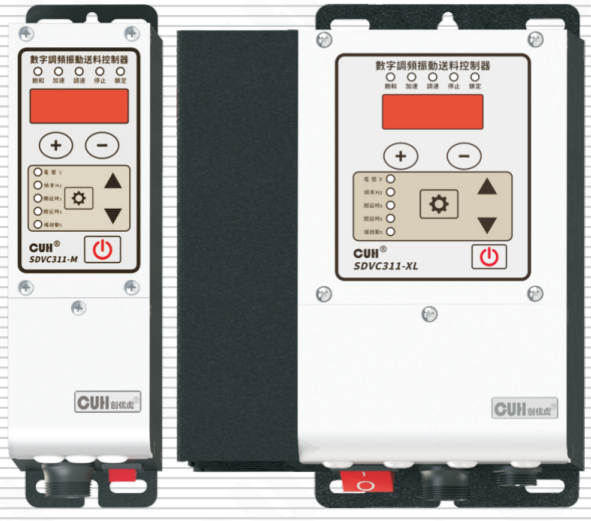

## SDVC311 系列

# 用户手册

### 第 2 页

数字调频振动送料控制器　　　　　　　　　　　　　　　　SDVC311 系列

---

## 版权说明

南京创优科技有限责任公司保留所有权利。

本用户手册上包含的所有信息是属于本公司的知识，受著作权法及所有法律的保护。本公司根据著作权法及其他法律享有并保留所有著作权和其他法律赋予的权利，未经本公司书面同意不得以任何形式对本用户手册的部分或全部进行抄袭、翻译、转译、仿制或其他利用。

## 免责声明

本用户手册的所有内容仅说明本公司生产的相关产品的使用方法，并且是根据现有技术和提供给您使用时的状态进行描述的，在您使用本产品时必须自行承担相关风险。除法律强制规定外，本公司不因本用户手册对产品负有任何明示或暗示的责任，包括但不限于人身伤害、财产损失、机会丧失。

您明确了解上述风险并同意，除法律强制规定外，本公司无须为您的任何直接、间接的损害或损失负责（包括但不限于人员、财物、数据等有形损失和名誉、机会等无形损失）。

本公司保留对本用户手册中所适用的产品进行修改而不预先及事后通知的权利。

---

2026-03　　　　　　　　　　　　　　　　　　　　　　SDVC311SMSCN_8.01

### 第 3 页

数字调频振动送料控制器　　　　　　　　　　　　　　　　　　　　SDVC311 系列

---

## 序　言

感谢您使用南京创优科技有限责任公司（在本手册中以下简称本公司）出品的 SDVC311 系列数字调频振动送料控制器（在本手册中以下简称本产品、本控制器或控制器）。本系列控制器是采用高品质元件并融合了最新的电子技术，采用高性能的数字信号处理器经过精心的设计而成。

本手册介绍了本产品的基本操作方法、功能技术说明和典型应用示例。为用户提供安装调试、参数设置、异常诊断、故障排除及日常维护控制器的相关信息。为了确保正确安装和使用本控制器，请在装机之前仔细阅读本用户手册，并请妥善保存。

以下符号提醒您注意有关防止人身伤害和产品损坏的事项，请务必阅读。

| 标志 | 说明 |
|---|---|
| 危险 | 表示若不遵守该事项，将导致人员伤亡。 |
| 警告 | 表示若不遵守该事项，可能导致人员伤亡。 |
| 小心 | 表示若不遵守该事项，可能导致人员遭受中度或轻微伤害。 |
| 注意 | 表示若不遵守该事项，将导致本产品损坏及财产损失。 |
| 要点 | 表示在使用过程中必须要遵守的注意事项和使用限制等。 |

**本说明书适合以下型号控制器：**

◆　数字调频振动送料控制器　SDVC311-S（1.5A）

◆　数字调频振动送料控制器　SDVC311-M（3.0A）

◆　数字调频振动送料控制器　SDVC311-XL（6.0A）

---

2026-03　　　　　　　　　　　　　　　　　　　　　　　　　SDVC311SMSCN_8.01

### 第 4 页

数字调频振动送料控制器　　　　　　　　　　　　　　　　　　　　　　　　　SDVC311 系列

---

# 安全与预防措施

1. **【危险】** 本产品仅用于驱动基于电磁铁的振动送料设备，请勿将本产品用于保护人体或人体部位等目的。

2. **【危险】** 本产品不得作为防爆产品使用，请勿在危险场所和/或潜在爆炸气体环境中使用本产品。

3. **【警告】** 本产品是采用交流市电供电的设备，请勿施加交流电压超过 260Vac。施加过大的输入电压如 380Vac，则可能导致产品爆炸或者着火，造成严重的安全事故。

4. **【警告】** 本产品是通过电源线进行接地的，请确保为控制器供电的配电设施具备良好的接地，否则可能导致控制器外壳带电，造成触电事故。

5. **【警告】** 请勿输入交流电源到本控制器的输出端，这会损坏控制器。

6. **【警告】** 请勿在带电的情况下插拔接线或触摸接线仓内各接线端子触点，以防发生触电事故。

7. **【注意】** 请避免采用通过继电器等设备切断供电的方式来控制本产品的输出，这会严重降低本控制器的寿命。

8. **【注意】** 本产品设计使用于阴凉干燥环境，请勿将本产品置于室外、可能会浸水、阳光暴晒场所工作，也不要在超过本产品电气特性要求的温度和湿度范围之外工作。

9. **【要点】** 请务必将本产品固定在可靠接地的坚固平台上, 并远离振动设备。

10. **【要点】** 任何情况下请勿将本产品在超越设计极限状态下工作。

11. **【要点】** 请严格按照本手册的说明操作，对于违反这些操作说明所造成的任何人身伤害或财产损失，本公司不承担任何民事和刑事责任。

12. **【要点】** 任何情况下请不要打开本控制器机壳，以防遭到电击。机壳内部没有可以调节和用户维修部分，请不要试图维修本机，出现故障请致电本公司。

---

2026-03　　　　　　　　　　　　　　　　　　　　　　　　　SDVC311SMSCN_8.01

### 第 5 页

数字调频振动送料控制器　　　　　　　　　　　　　　　　　　　　　　　　　SDVC311 系列

---

# 工作与储存环境

## 一、使用前的检查

每台控制器在出厂前，均经过严格的品质检验，并经过强化的防撞包装处理。客户在拆箱后，请即刻进行下列检查：

1、检查控制器是否在运输过程中受到损伤。

2、检查控制器型号是否与订货登记资料完全相同。

## 二、工作环境

为使本控制器具有更好的使用效果和更长的使用寿命，请将控制器安装在符合下列条件的环境中：

● 良好的通风散热环境

● 远离水滴、蒸气、灰尘，（特别是油性灰尘）

● 无腐蚀、易燃性的气体、液体

● 无漂浮性的尘埃及金属微粒

● 安装表面坚固无振动

● 远离电磁噪声干扰

● 使用环境温度为0℃到40℃

● 仅适用于海拔2000m以下地区安全使用

---

2026-03　　　　　　　　　　　　　　　　　　　　　　　　　SDVC311SMSCN_8.01

### 第 6 页

数字调频振动送料控制器　　　　　　　　　　　　　　　　SDVC311 系列

---

---

2026-03　　　　　　　　　　　　　　　　　　　　　　　　SDVC311SMSCN_8.01

### 第 7 页

数字调频振动送料控制器　　　　　　　　　　　　　　　　　　　　　　　　　SDVC311 系列

---

# 目　录

**第一章 使用前须知** ------------------------------------------------------------------------------ 1

1.1　检查包装内容 ------------------------------------------------------------------------------ 1

1.2　指示灯及按键说明 ------------------------------------------------------------------------ 2

1.3　外部部件说明 ------------------------------------------------------------------------------ 3

1.4　接线端口说明 ------------------------------------------------------------------------------ 4

1.5　控制器铭牌说明 -------------------------------------------------------------------------- 4

**第二章 产品介绍** -------------------------------------------------------------------------------- 5

2.1　产品简介 ------------------------------------------------------------------------------------ 5

2.2　产品性能提升 ------------------------------------------------------------------------------ 5

2.3　产品现代/传统界面 ----------------------------------------------------------------------- 6

**第三章 安装及使用指南** ------------------------------------------------------------------------ 7

3.1　控制器使用条件 -------------------------------------------------------------------------- 7

3.2　按键基本操作 ------------------------------------------------------------------------------ 7

3.3　安装使用 ------------------------------------------------------------------------------------ 8

**第四章 基本功能说明** ------------------------------------------------------------------------- 12

4.1　输出电压设置 ----------------------------------------------------------------------------- 12

4.2　输出频率设置 ----------------------------------------------------------------------------- 13

4.3　智能光电传感器开延时、关延时时间设定 ----------------------------------------- 14

4.4　缓启动时间 -------------------------------------------------------------------------------- 15

4.5　刹车周数/缓关闭时间 ------------------------------------------------------------------ 15

4.6　键盘锁定功能 ----------------------------------------------------------------------------- 17

**第五章 高级功能说明** ------------------------------------------------------------------------- 18

5.1　遥控调速功能 ----------------------------------------------------------------------------- 18

5.2　智能光电功能 ----------------------------------------------------------------------------- 20

5.3　料满停机功能 ----------------------------------------------------------------------------- 21

---

2026-03　　　　　　　　　　　　　　　　　　　　　　　　　　　　　SDVC311SMSCN_8.01

### 第 8 页

数字调频振动送料控制器　　　　　　　　　　　　　　　　　　　　　　　　　SDVC311 系列

---

5.4　控制输出功能 ----------------------------------------------------------------22  
　5.4.1 控制输出的接线方法 --------------------------------------------------------22  
　5.4.2 控制输出信号源和逻辑图 ----------------------------------------------------23  
　5.4.3 控制输出模式说明 ----------------------------------------------------------25  
　5.4.4 控制输出逻辑方向 ----------------------------------------------------------26  
　5.4.5 主输出信号控制功能 --------------------------------------------------------26  
5.5　最大输出电压限制 ------------------------------------------------------------27  
5.6　最低输出频率限制 ------------------------------------------------------------27  
5.7　加速指数 --------------------------------------------------------------------28  
5.8　波形指数 --------------------------------------------------------------------29  
5.9　参数密码锁功能 --------------------------------------------------------------30  
5.10　恢复出厂设置/恢复出厂方式 --------------------------------------------------31  
5.11　参数监控功能 ---------------------------------------------------------------32  
**第六章 技术规格** -------------------------------------------------------------33  
　6.1　外形尺寸 ------------------------------------------------------------------33  
　6.2　技术规格表 ----------------------------------------------------------------35  
　6.3　参考标准 ------------------------------------------------------------------36  
**第七章 附录** -----------------------------------------------------------------37  
　7.1　参数列表 ------------------------------------------------------------------37  
　7.2　输入输出电路图 ------------------------------------------------------------39  
　7.3　故障诊断 ------------------------------------------------------------------40  
**第八章 产品质保信息** ---------------------------------------------------------41  
　8.1　质保期 --------------------------------------------------------------------41  
　8.2　保修范围 ------------------------------------------------------------------41  
　8.3　产品适用性 ----------------------------------------------------------------41

---

2026-03　　　　　　　　　　　　　　　　　　　　　　　　　SDVC311SMSCN_8.01

### 第 9 页

数字调频振动送料控制器　　　　　　　　　　　　　　SDVC311 系列

# 第一章 使用前须知

本章节介绍产品包装内容、控制器外观说明和控制器铭牌信息。

## 1.1 检查包装内容

使用本产品之前，请检查控制器及附件的完整性。如果发现产品有缺陷或已损坏、附件缺失等问题，请与本公司联系。

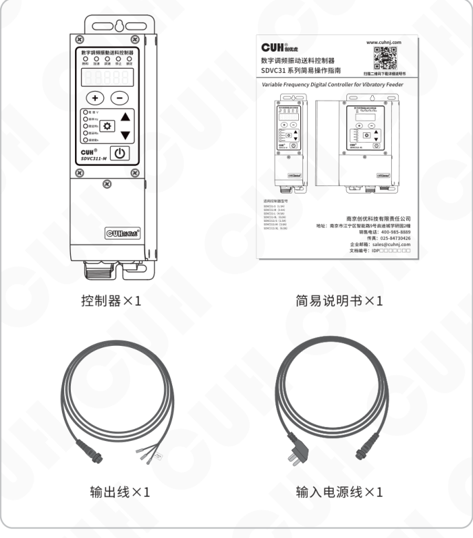

包装内容：

| 名称 | 数量 |
|---|---:|
| 控制器 | ×1 |
| 简易说明书 | ×1 |
| 输出线 | ×1 |
| 输入电源线 | ×1 |

### 第 10 页

数字调频振动送料控制器　　　　　　　　　　　　　　　　　SDVC311 系列

## 1.2 指示灯及按键说明

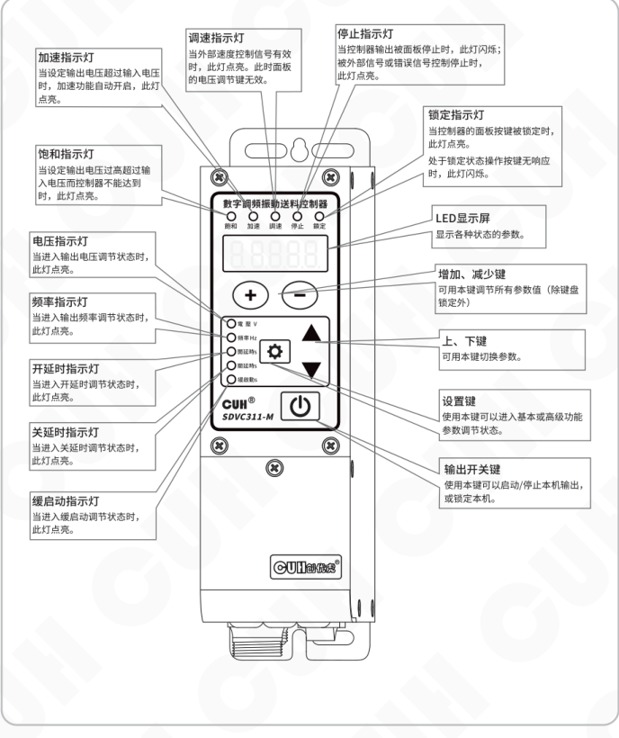

| 名称 | 说明 |
|---|---|
| 加速指示灯 | 当设定输出电压超过输入电压时，加速功能自动开启，此灯点亮。 |
| 饱和指示灯 | 当设定输出电压过高超过输入电压而控制器不能达到时，此灯点亮。 |
| 电压指示灯 | 当进入输出电压调节状态时，此灯点亮。 |
| 频率指示灯 | 当进入输出频率调节状态时，此灯点亮。 |
| 开延时指示灯 | 当进入开延时调节状态时，此灯点亮。 |
| 关延时指示灯 | 当进入关延时调节状态时，此灯点亮。 |
| 缓启动指示灯 | 当进入缓启动调节状态时，此灯点亮。 |
| 调速指示灯 | 当外部速度控制信号有效时，此灯点亮。此时面板的电压调节键无效。 |
| 停止指示灯 | 当控制器输出被面板停止时，此灯闪烁；被外部信号或错误信号控制停止时，此灯点亮。 |
| 锁定指示灯 | 当控制器的面板按键被锁定时，此灯点亮。处于锁定状态操作按键无响应时，此灯闪烁。 |
| LED显示屏 | 显示各种状态的参数。 |
| 增加、减少键 | 可用本键调节所有参数值（除键盘锁定外） |
| 上、下键 | 可用本键切换参数。 |
| 设置键 | 使用本键可以进入基本或高级功能参数调节状态。 |
| 输出开关键 | 使用本键可以启动/停止本机输出，或锁定本机。 |

2026-03　　　　　　　　　　　　　　　　　- 2 -　　　　　　　　　　　　　　　　　SDVC311SMSCN_8.01

### 第 11 页

数字调频振动送料控制器　　　　　　　　　　　　　　　　　　　　　　　　　SDVC311 系列

## 1.3 外部部件说明

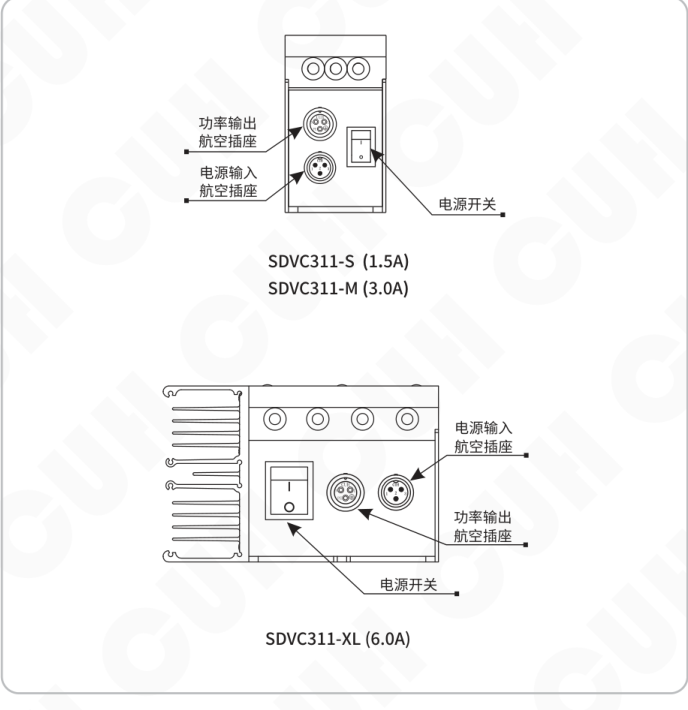

图中标注：

- **SDVC311-S（1.5A） / SDVC311-M（3.0A）**
  - 功率输出航空插座
  - 电源输入航空插座
  - 电源开关
- **SDVC311-XL（6.0A）**
  - 电源输入航空插座
  - 功率输出航空插座
  - 电源开关

2026-03　　　　　　　　　　　　　　　　　- 3 -　　　　　　　　　　　　　　　　SDVC311SMSCN_8.01

### 第 12 页

## 1.4 接线端口说明

接线端口示意图：

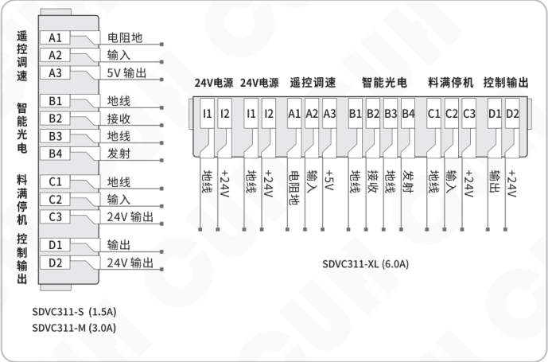

### SDVC311-S（1.5A）/ SDVC311-M（3.0A）端子说明

| 功能组 | 端子 | 说明 |
|---|---|---|
| 遥控调速 | A1 | 电阻地 |
| 遥控调速 | A2 | 输入 |
| 遥控调速 | A3 | 5V 输出 |
| 智能光电 | B1 | 地线 |
| 智能光电 | B2 | 接收 |
| 智能光电 | B3 | 地线 |
| 智能光电 | B4 | 发射 |
| 料满停机 | C1 | 地线 |
| 料满停机 | C2 | 输入 |
| 料满停机 | C3 | 24V 输出 |
| 控制输出 | D1 | 输出 |
| 控制输出 | D2 | 24V 输出 |

### SDVC311-XL（6.0A）端子说明

| 功能组 | 端子 | 说明 |
|---|---|---|
| 24V电源 | I1 | 地线 |
| 24V电源 | I2 | +24V |
| 24V电源 | I1 | 地线 |
| 24V电源 | I2 | +24V |
| 遥控调速 | A1 | 电阻地 |
| 遥控调速 | A2 | 输入 |
| 遥控调速 | A3 | +5V |
| 智能光电 | B1 | 地线 |
| 智能光电 | B2 | 接收 |
| 智能光电 | B3 | 地线 |
| 智能光电 | B4 | 发射 |
| 料满停机 | C1 | 地线 |
| 料满停机 | C2 | 输入 |
| 料满停机 | C3 | +24V |
| 控制输出 | D1 | 输出 |
| 控制输出 | D2 | +24V |

## 1.5 控制器铭牌说明

控制器铭牌示意图：

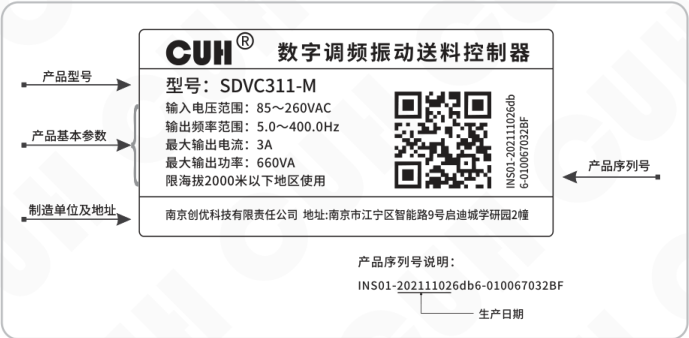

| 标注项 | 铭牌内容 |
|---|---|
| 产品型号 | 型号：SDVC311-M |
| 产品基本参数 | 输入电压范围：85～260VAC 输出频率范围：5.0～400.0Hz 最大输出电流：3A 最大输出功率：660VA 限海拔2000米以下地区使用 |
| 制造单位及地址 | 南京创优科技有限责任公司 地址：南京市江宁区智能路9号启迪城学研园2幢 |
| 产品序列号 | INS01-202111026db6-010067032BF |
| 生产日期 | 产品序列号中下方括号标示部分 |

产品序列号说明：

`INS01-202111026db6-010067032BF`

### 第 13 页

数字调频振动送料控制器　　　　　　　　　　　　　　　　　　　　　　　　　SDVC311 系列

---

# 第二章 产品介绍

本章节主要内容包括本产品的简单介绍和主要特色功能。

## 2.1 产品简介

SDVC311系列数字调频振动送料控制器是一款紧凑的通用型调频输出控制器，通过采用最新的电子技术和精心的设计，提供独特的性能。其特色功能包括：

- 输出频率范围覆盖5.0Hz至400.0Hz，精度为0.1Hz。
- 刹车功能，通过在缓关闭过程中将电流移相180°快速停止振动盘。
- 智能光电端口支持光电传感器、NPN或PNP开关传感器。
- 就绪信号功能，通过智能光电B4发射端口输出调制信号或有效信号指示控制器处于就绪状态，控制器出现错误时就绪信号变为无效。
- 料满停机端口支持NPN、PNP或自动适应类型。
- 控制输出端口支持NPN、PNP或推挽输出模式。
- 完整的保护功能包括：主输出的短路保护、过流保护、过热保护、电源欠压/过压保护、控制输出短路保护、24V输出短路保护、调速5V输出短路保护。

## 2.2 产品性能提升

本产品与SDVC31系列控制器相比，有较大幅度的性能提升。主要包括：

- 输出频率由40.0Hz~400.0Hz提升至5.0Hz~400.0Hz。
- 智能光电、料满停机端口开/关延时最大值由20.0秒提升至99.9秒。
- 新增缓关闭功能，可以设置0.0~10.0秒，用于缓慢停止振动盘振动。
- 新增刹车功能，可以设置0~100次刹车周数，用于快速停止振动盘振动。
- 智能光电端口新增PNP传感器支持。
- 料满停机端口由NPN、PNP选择提升为软件可设置，并提供自动模式。
- 控制输出端口类型由NPN输出提升为可设置NPN、PNP、推挽三种类型。
- 新增控制输出端口开/关延时，可以设置0.0~99.9秒。
- 新增控制输出模式，可以设置延时模式和保持模式。
- 新增测量功能，可以监控温度显示、母线电压、母线纹波电压、输出电流、模拟调速A口电压、B口信号电压、C口信号电压、D口输出电压、24V输出电压。

---

2026-03　　　　　　　　　　　　　　　　　- 5 -　　　　　　　　　　　　　　　SDVC311SMSCN_8.01

### 第 14 页

数字调频振动送料控制器　　　　　　　　　　　　　　　SDVC311 系列

---

## 2.3 产品现代/传统界面

本产品创新性的引入现代参数界面，在现代参数界面下具有更宽的频率调节范围，更便捷的参数设置和调节，新增十余项高级参数设置及八项监控参数。同时兼顾老客户使用习惯可以在高级参数设置内实现自由切换现代或传统界面。

**现代参数界面调整至传统参数界面**

在现代参数界面（默认）恢复出厂设置参数下，长按 ⊕ 显示  恢复到传统参数界面，长按 ⊖ 显示  恢复出厂设置（仍为现代参数界面），详见“恢复出厂设置”章节。

**传统参数界面调整至现代参数界面**

在传统参数界面恢复出厂设置参数下，长按 ▼ 显示  恢复到现代参数界面，长按 ▲ 显示 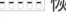 恢复出厂设置（仍为传统参数界面）

本说明书将详细介绍现代参数界面下的各种参数设置；传统参数界面的设置方法请参考SDVC31系列说明书。

---

2026-03　　　　　　　　　　　　　- 6 -　　　　　　　　　　　　　SDVC311SMSCN_8.01

### 第 15 页

数字调频振动送料控制器　　　　　　　　　　　　　　　　　　　　SDVC311 系列

# 第三章 安装及使用指南

本章节介绍本产品使用所必须具备的条件以及如何正确进行安装与连接。

## 3.1 控制器使用条件

本产品是使用交流110/220V供电的设备，且通过电源线三爪插头进行保护接地连接，请提供符合标准的110V或220V，50Hz/60Hz市电供电配电设施并确保保护地线已正确连接。

- ⚠️ **警告**　切不可将控制器连接到380V交流电，这将造成控制器不可恢复的严重损坏，有可能导致爆炸、火灾等安全事故。
- ⚠️ **警告**　确保供电侧可靠接地，控制器的金属外壳是与保护接地线直接连接的，接地不良会导致控制器外壳带电，引发触电事故。
- **注意**　控制器长时间工作会产生热量致使外壳温度升高，请将控制器安装在通风良好的环境中，并将其固定良好，远离振动源。
- **注意**　本产品的输出是市电经过整流、逆变形成的，中间没有隔离环节。因此输出两极不可以与保护接地连接，在连接电磁铁时也要确保电磁铁线圈与外壳之间具备基本的绝缘能力。否则会导致漏电，可能产生触电和控制器损坏的事故。
- **注意**　本产品是用来驱动电磁铁的控制器，切不可连接压电振动盘。

## 3.2 按键基本操作

相比传统界面，现代界面的各参数间具有分级、分类，各参数代表的功能更加明确清晰，便于后期的功能扩展和维护。控制器参数的详细说明见第四章及第五章，参数列表见第七章附录。

按键基本操作：

a. 短按定义按下时间大于0.1小于2秒，长按定义按下时间大于2秒。  
b. 待机界面下短按 `＋` 或 `－` 调节电压参数。  
c. 长按 `⚙` 进入/退出基本参数界面，短按 `▼` 或 `▲` 选择基本参数，短按 `＋` 或 `－` 调节参数值。  
d. 长按 `⚙` 加 `▲` 进入/退出高级参数界面，短按 `▼` 或 `▲` 选择高级参数，短按 `＋` 或 `－` 调节参数值。  
e. 长按 `⚙` 加 `▼` 进入/退出监控参数界面，短按 `▼` 或 `▲` 选择监控参数，参数值不可调节。  
f. 短按 `⏻` 开关键暂停/恢复输出，长按 `⏻` 键锁定/解锁键盘。  
g. 恢复出厂设置参数下，长按 `＋` 显示  恢复到传统参数界面，长按 `－` 显示 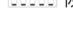 恢复到现代参数界面。

---

2026-03　　　　　　　　　　　　- 7 -　　　　　　　　　　　　SDVC311SMSCN_8.01

### 第 16 页

## 3.3 安装使用

**第一步：**

打开控制器的外包装，检查控制器外观及侧标型号，判断是否为所需的型号。

**第二步：**

取出输出线，将输出线两个子弹头接线端子连接到振动盘的电磁线圈上，并确认黄绿双色的地线与振动盘金属外壳可靠连接。

将输出线航空插头上的缺口，对准控制器输出插座上的三角形标记，正确连接输出线后锁紧螺母。

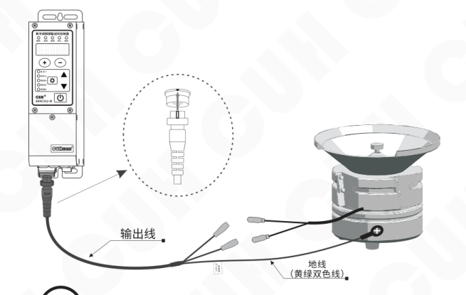

**注意**

1、一定要确认电磁铁线圈接在两个输出引脚上，外壳需要可靠接地。

否则将会导致机壳带电，可能发生严重安全事故。

2、电源输出禁止连接压电类负载，否则可能导致**电击安全事故！**

### 第 17 页

数字调频振动送料控制器　　　　　　　　　　　　　　　　　SDVC311 系列

---

### 第三步:

将输入电源线航空插头插入控制器电源  
输入插座，并锁紧螺母。

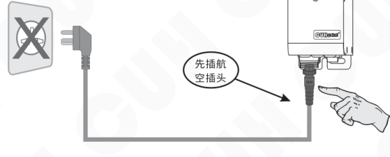

### 第四步:

确认开关处于关闭位置后，将电源线三爪插头插在供电电源插座上。

---

2026-03　　　　　　　　　　　　　　　　　- 9 -　　　　　　　　　　　　　　　　　SDVC311SMSCN_8.01

### 第 18 页

**数字调频振动送料控制器**　　　　　　　　　　　　　　　　　　　　　　　　　**SDVC311 系列**

### 第五步：

打开控制器电源开关，此时应该显示电压 **“U 150”**，振动盘应该有振动。

- **U 表示输出电压**
- **电压指示灯**

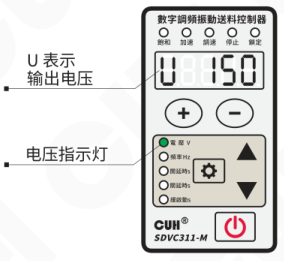

### 第六步：

按住 **－** 调节电压至 **30~50V** 之间，再按 **⚙** 2 秒进入频率 **“E”** 调整状态；使用 **＋** 和 **－** 来寻找振动体的固有频率，也就是谐振频率。

- **E 表示输出频率**
- **频率指示灯**

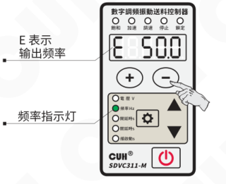

> ☺
>
> - 振动最大时的频率为振动体的固有频率。
> - 每个振动体都有固有的振动频率，为了能达到最佳的工作状态，请调整本参数使振动体工作在合适的工作频率上。

---

2026-03　　　　　　　　　　　　　　　　　-10-　　　　　　　　　　　　　　　　　SDVC311SMSCN_8.01

### 第 19 页

数字调频振动送料控制器  
SDVC311 系列

---

### 第七步：

长按 ⚙ 退出频率“E”调整参数回到电压调节参数，也可以短按 ▲ 切换到电压调节参数，使用 ＋ 和 － 调节电压达到最佳的送料速度。

- U 表示输出电压
- 电压指示灯

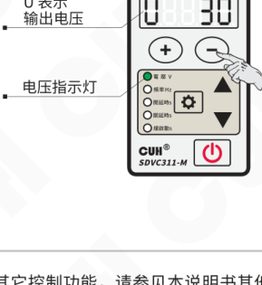

调整完毕，可初步工作后，如还需其它控制功能，请参见本说明书其他部分。

---

2026-03　　　　　-11-　　　　　SDVC311SMSCN_8.01

### 第 20 页

数字调频振动送料控制器　　　　　　　　　　　　　　　　　　　　　　　　　SDVC311 系列

---

# 第四章 基本功能说明

本章节介绍本产品在现代参数界面（默认）状态下，基本功能的使用方法。

## 4.1 输出电压设置

本控制器可以直接在面板上以数字方式设置输出电压。由于本控制器具备稳压功能，该数值为输出电压整流平均值，并且不会受到输入电压的影响，即使在电网电压不稳定场合中也可以保持稳定工作。同时，直接的电压数值设置也为用户了解设备运行情况提供了准确的数据。

- » 打开控制器的电源开关。

- » 控制器进入输出电压状态，控制器上电压指示灯点亮，LED显示屏显示电压参数U和电压值（默认值为150）。

- » 通过 `+` 和 `−` 可以对电压“Ｕ”值进行调整。

示意图：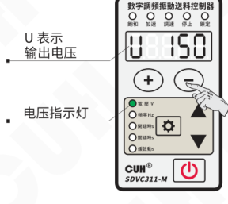

本系列控制器的输出电压范围是0～260V，调整精度1V。

> ☺
>
> ● 本控制器没有升压功能，当因输入电源电压限制，控制器无法达到设定电压时饱和灯会点亮，此时自动稳压功能失效。
>
> ● 本控制器可以通过牺牲输出波形的正弦特性达到一定程度的加速效果，由参数“加速指数y”决定。进入加速状态时输出电流波形由正弦波变成三角波，加速指示灯点亮。具体介绍参考高级功能说明章节。

---

2026-03　　　　　　　　　　　　　　　　　-12-　　　　　　　　　　　　　　　　　SDVC311SMSCN_8.01

### 第 21 页

## 4.2 输出频率设置

本控制器采用直接数字频率合成技术（DDS），具有非常高的频率精度和稳定性，不随时间和温度的改变而变化。

- 按住 **⚙** 2秒，进入基本参数界面。
- 控制器上LED显示输出频率参数“E”和频率值（默认值为50.0）。
- 通过 **＋** 和 **－** 可以对频率“E”值进行设定。

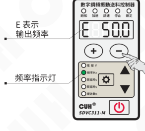

图示标注：

- E 表示输出频率
- 频率指示灯

本系列控制器的输出频率范围是5.0~400.0Hz，调整精度0.1Hz。

### 第 22 页

数字调频振动送料控制器　　　　　　　　　　　　　　　　　　　　　　　SDVC311 系列

## 4.3 智能光电传感器开延时、关延时时间设定

当使用传感器或者PLC等其他外部信号进行启动和停止控制时，大多数情况需要在给出信号或者恢复信号后延迟一段时间才执行操作。对于这样的应用，可以通过设置开延时和关延时的时间来实现。

**开延时（J）：** 从施加一个使控制器进入运行状态的控制信号开始，到控制器输出启动，期间经历的延迟时间称为开延时。

- 按住 **⚙** 2秒，进入基本参数界面。
- 使用 **▲** 或 **▼** 切换到开延时参数调整状态 **“J”**（默认值为0.2）。
- 通过 **＋** 和 **－** 调整参数值。

图示：**J** 表示智能光电开延时；开延时指示灯。

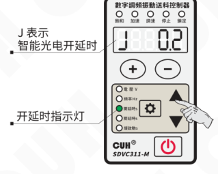

本系列控制器的开延时时间范围是0.0～99.9秒，调整精度0.1秒。

**关延时（L）：** 从施加一个使控制器进入停止状态的控制信号开始，到控制器输出停止，期间经历的延迟时间称为关延时。

- 按住 **⚙** 2秒，进入基本参数界面。
- 使用 **▲** 或 **▼** 切换到关延时参数调整状态 **“L”**（默认值为0.2）。
- 通过 **＋** 和 **－** 调整参数值。

图示：**L** 表示智能光电关延时；关延时指示灯。

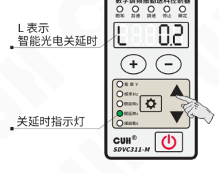

本系列控制器的关延时时间范围是0.0～99.9秒，调整精度0.1秒。

备注：在默认设置下，智能光电开/关延时控制主输出开/关延时。若主输出逻辑方向同相或取反向信号源后，智能光电开/关延时含义交换。C口开/关延时与智能光电开/关延时一致。

---

2026-03　　　　　　　　　　　　-14-　　　　　　　　　　　　SDVC311SMSCN_8.01

### 第 23 页

数字调频振动送料控制器　　　　　　　　　　　　　　　　　　　　　　　　　SDVC311 系列

---

## 4.4 缓启动时间

本控制器从停止状态启动时，输出电压可以平缓提高到设定值，以防止振动设备和控制器遭受冲击。

**缓启动时间（t）：** 控制器从停止状态启动时，输出电压从0V平滑升高到达设定输出电压所需要的时间称为缓启动时间。

- 按住 `⚙` 2秒，进入基本参数界面。
- 使用 ▲ 或 ▼ 切换到缓启动参数调整状态 “t”（默认值为0.5）。
- 通过 ＋ 和 － 调整参数值。

`t` 表示缓启动时间

缓启动指示灯

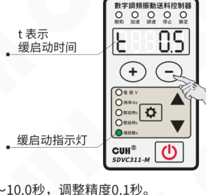

本系列控制器的缓启动时间范围是0.0～10.0秒，调整精度0.1秒。

## 4.5 刹车周数/缓关闭时间

由于振动盘在控制器停止输出后还会自由振动一段时间，这段时间物料还继续运动。这对于某些物料精密计量包装的应用会产生误差，因此需要快速停止振动。本控制器可以通过调整刹车周数/缓关闭时间（反t）实现振动盘快速平稳的关闭。

**刹车功能：** 通过将缓关闭的开始点延迟180°相位，达到驱动力与振动盘自由振动相位相反的效果从而快速停止振动。通过设置缓关闭时间（反t）为负值实现，单位为周，即刹车时反向驱动的电流周数。

本控制器从运行状态停止时，输出电压可以平缓降低到0，以防止振动设备遭受冲击。

**缓关闭时间（反t）：** 控制器从运行状态停止时，输出电压从设定值平滑降低到0所需要的时间称为缓关闭时间。

---

2026-03　　　　　　　　　　　　　　　　　-15-　　　　　　　　　　　　　　　　　SDVC311SMSCN_8.01

### 第 24 页

数字调频振动送料控制器　　　　　　　　　　　　　　　　SDVC311 系列

- 按住 ⚙ 2秒，进入基本参数界面。
- 使用 ▲ 或 ▼ 切换到刹车周数/缓关闭时间参数调整状态“反t”（默认值为0.0）。
- 通过 ＋ 调整缓关闭时间参数值。
- 通过 － 调整刹车周期参数值。

反t 表示刹车周数/缓关闭时间。

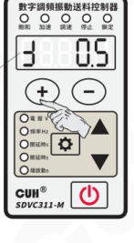

本系列控制器的缓关闭时间范围是0.0～10.0秒，调整精度0.1秒。

本系列控制器的刹车周数范围是-100～0周，调整精度1周。

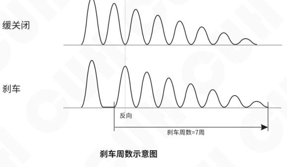

**刹车周数示意图**

### 第 25 页

数字调频振动送料控制器　　　　　　　　　　　　　　　　　　　　　　　　　SDVC311 系列

## 4.6 键盘锁定功能

为了防止误操作，本机设定了键盘锁。这样当控制器各项参数设置好后，可以有效避免其他人的误动作影响本机正常工作。即使关机后重新开机，键盘锁状态依然保持上次关机时的状态。

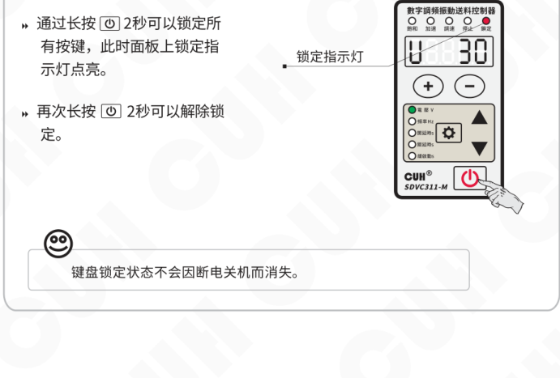

- 通过长按电源键（⏻）2秒可以锁定所有按键，此时面板上锁定指示灯点亮。
- 再次长按电源键（⏻）2秒可以解除锁定。

> 键盘锁定状态不会因断电关机而消失。

2026-03　　　　　　　　　　　　　　　　　-17-　　　　　　　　　　　　　　　SDVC311SMSCN_8.01

### 第 26 页

数字调频振动送料控制器　　　　　　　　　　　　　　　　　SDVC311 系列

# 第五章 高级功能说明

本章节主要介绍本产品在现代参数界面（默认）下，高级功能的使用方法。

## 5.1 遥控调速功能

本控制器支持外部模拟信号控制输出电压，模拟信号支持电位器、1~5V电压、4~20mA电流。

### 电位器控制连接方式

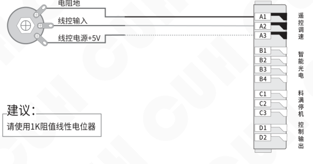

图中接线标注：

- 电阻地
- 线控输入
- 线控电源+5V
- 端子分组：
  - 遥控调速：A1、A2、A3
  - 智能光电：B1、B2、B3、B4
  - 料满停机：C1、C2、C3
  - 控制输出：D1、D2

**建议：**

请使用1K阻值线性电位器

> 当线控电压对控制器的控制生效时，面板的调速指示灯点亮，同时在面板上调整电压将失效。

---

2026-03　　　　　　　　　　　　　-18-　　　　　　　　　　　　　SDVC311SMSCN_8.01

### 第 27 页

> 数字调频振动送料控制器　　　　　　　　　　　　　　　　　SDVC311 系列

## 1~5V 电压控制连接方式

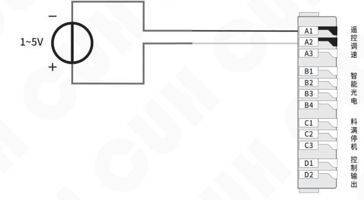

## 4~20mA 电流控制连接方式

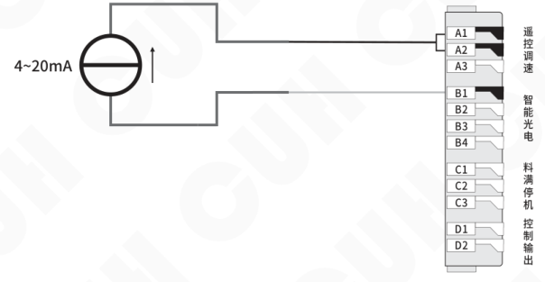

---

2026-03　　　　　　　　　　　　　-19-　　　　　　　　　　　　　SDVC311SMSCN_8.01

### 第 28 页

## 5.2 智能光电功能

本控制器的智能光电端口支持发光二极管和光电三极管构成的光电对射或反射传感器，也可以设置为支持 NPN 或 PNP 开关传感器。具体接线图如下：

### 光电传感器连接方式

传感器工作距离可以通过设置 P 参数调节，参数越小越灵敏。

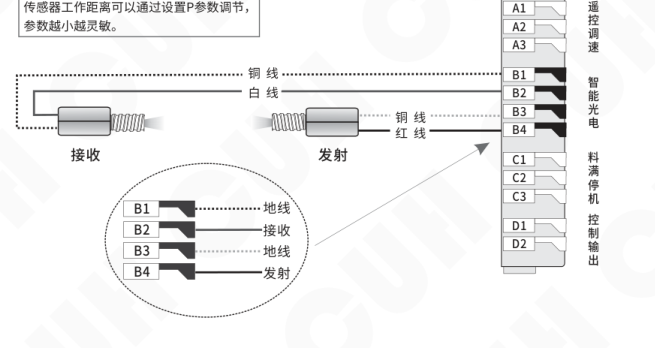

### 开关传感器连接方式

通过参数 P 设置 NPN 或 PNP 类型。

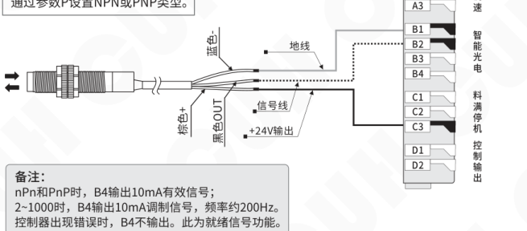

备注：

- nPn 和 PnP 时，B4 输出 10mA 有效信号；
- 2~1000 时，B4 输出 10mA 调制信号，频率约 200Hz。
- 控制器出现错误时，B4 不输出。此为就绪信号功能。

### 第 29 页

## 5.3 料满停机功能

料满停机端口可以支持NPN、PNP、Ut1、Ut0模式。其中：

**Ut1模式为单次扫描**，即传感器信号无效前一直通过变换高低电平检测端口是否有效，发现有效信号后确定端口传感器类型且不再扫描。

**Ut0模式为连续扫描**，不管传感器类型如何始终通过变换高低电平检测端口是否接入有效信号。

**开关传感器连接方式**

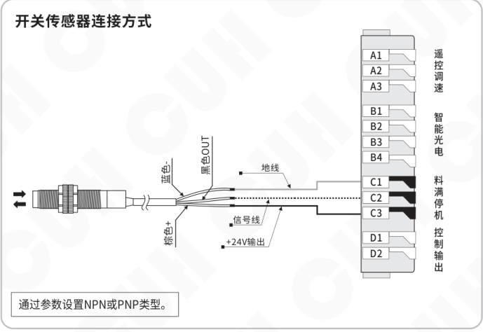

- 通过高级参数ΓA，即“C口传感器类型”参数设置传感器类型。
- 当使用传感器等其他外部信号通过控制器C口进行启动和停止操作时，如需在给出信号或者恢复信号后延迟一段时间才执行操作，可以通过设置高级参数“传感器C口开延时”和“传感器C口关延时”的时间来实现，操作方法参考“4.3 智能光电传感器开延时、关延时时间设定”章节。

### 第 30 页

## 5.4 控制输出功能

控制输出端口可以支持 NPN 输出、PNP 输出和推挽输出。可通过高级参数 Γd，即“控制输出类型”参数设置，其中：

- NPN 输出有效为低电平，输出无效为高阻态；
- PNP 输出有效为高电平，输出无效为高阻态；
- 推挽输出有效为高电平，无效为低电平。

### 5.4.1 控制输出的接线方法

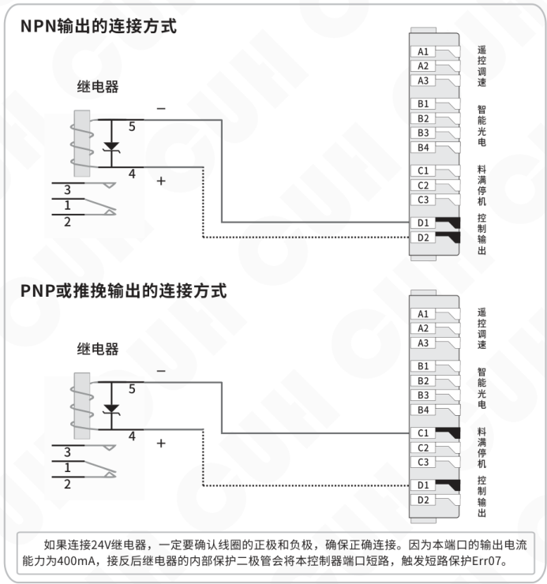

> 如果连接 24V 继电器，一定要确认线圈的正极和负极，确保正确连接。因为本端口的输出电流能力为 400mA，接反后继电器的内部保护二极管会将本控制器端口短路，触发短路保护 Err07。

### 第 31 页

## 5.4.2 控制输出信号源和逻辑图

主输出和控制输出的控制是由两个信号源逻辑关系的结果控制。

通过设置高级参数“D口逻辑关系选择 Πd”、“主输出逻辑关系选择 Πq”的参数值来设定两个信号源的逻辑关系；

通过设置高级参数“D口第一信号源 E.d”、“D口第二信号源 Ed”、“主输出第一信号源 E.q”、“主输出第二信号源 Eq”的参数值来选择下列信号源：

| 信号源 | 含义 |
|---|---|
| 0 | 无效信号 |
| 1 | 有效信号 |
| b | 智能光电端口信号 |
| -b | 智能光电端口信号取反 |
| C | 料满停机端口信号 |
| -C | 料满停机端口信号取反 |
| od | D口控制输出端口信号 |
| -od | D口控制输出端口信号取反 |
| oq | 主输出端口信号 |
| -oq | 主输出端口信号取反 |

### 第 32 页

数字调频振动送料控制器　　　　　　　　　　　　　　　　　SDVC311 系列

---

### 控制输出逻辑图：

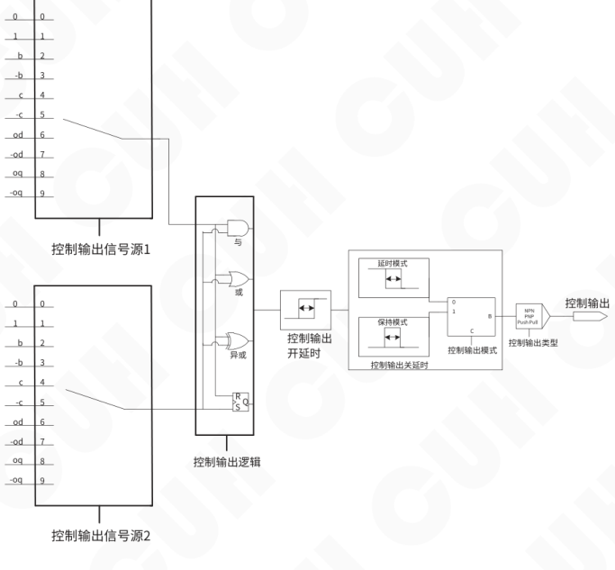

---

2026-03　　　　　　　　　　　　　　　　　SDVC311SMSCN_8.01

### 第 33 页

## 5.4.3 控制输出模式说明

客户可通过设置高级参数“控制输出模式Fd”来选择4种控制输出模式：延时模式、保持模式、周期信号输出模式Fn1/Fn2。

**延时模式：** 指驱动控制输出的信号由有效变为无效后，控制输出经过一段关延时时间后变为关闭状态。

**保持模式：** 指驱动控制输出的信号变为有效后，控制输出在关延时时间内保持打开，超过关延时时间后变为关闭的状态。

**周期信号输出模式Fn1/Fn2：** 高电平信号持续时间由控制输出D口开延时设定，低电平信号持续时间由控制输出D口关延时设定。

在Fn1模式下开关键不可以停止控制输出，Fn2模式下开关键可以停止控制输出。

将四种模式的差别以时序图的形式表达如下，其中输入信号是逻辑关系选择器后输出的信号。

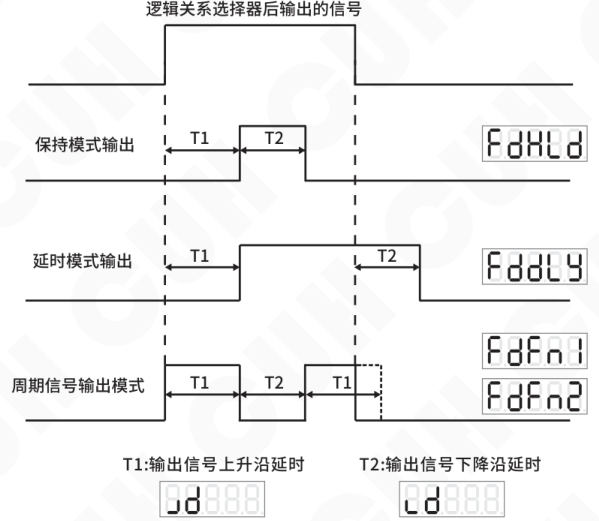

### 第 34 页

数字调频振动送料控制器　　　　　　　　　　　　　　　SDVC311 系列

## 5.4.4 控制输出逻辑方向

客户可通过设置高级参数“控制输出逻辑方向ɔd”来选择4种逻辑方向：

**同相___：** 表示输出信号有效状态不改变。  
**取反_ _：** 表示输出信号有效状态反转。  
**常开on：** 表示信号一直有效，不受控制。  
**常关oFF：** 表示信号一直无效，不受控制。

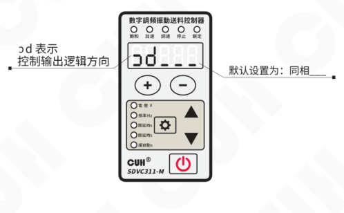

## 5.4.5 主输出信号控制功能

主输出的信号控制功能与控制输出相似，选择两个信号源进行逻辑关系运算后经过开关延时和模式选择及逻辑方向控制得到控制信号，该控制信号与面板的启停信号进行逻辑与操作后发送给功率板进行输出启停的控制。

主输出信号控制的接线方法、信号源及逻辑图、逻辑方向，可参考控制输出功能。

---

2026-03　　　　　　　　　-26-　　　　　　　　　SDVC311SMSCN_8.01

### 第 35 页

数字调频振动送料控制器　　　　　　　　　　　　　　　　SDVC311 系列

## 5.5 最大输出电压限制

本控制器可以设置高级参数“最大输出电压限制 h”来设定最大输出电压，可以防止用户误操作输出过大电压而损坏振动设备。

面板设置电压和遥控电压均不会超过该值。

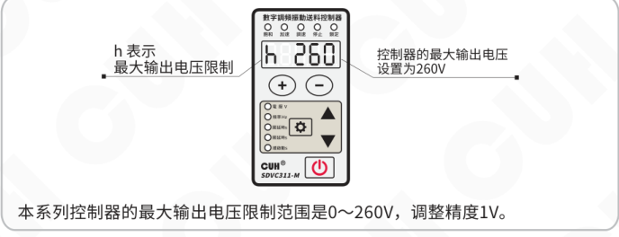

本系列控制器的最大输出电压限制范围是0～260V，调整精度1V。

> ☺
>
> - 任何情况下，控制器的输出电压不能也不会超过本参数设定值。
> - 本参数出厂默认设置为本机的最大可能输出电压。

## 5.6 最低输出频率限制

本控制器可以设置高级参数“频率下限e”来限制最低输出频率，可以防止用户误操作输出频率过低而损坏电磁铁。

面板设置频率不会低于该值。

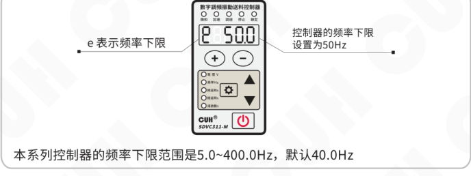

本系列控制器的频率下限范围是5.0~400.0Hz，默认40.0Hz

### 第 36 页

数字调频振动送料控制器　　　　　　　　　　　　　　　　　SDVC311 系列

## 5.7 加速指数

本控制器可以通过牺牲输出波形的正弦特性达到一定程度的加速效果，进入加速状态时输出电流波形由正弦波变成三角波，加速指示灯点亮。可以通过设置高级参数“加速指数 y”的参数值，来控制加速功能作用的发挥。

**加速指数（y）：** 表示输出电压最大可以达到输入电压的百分比。

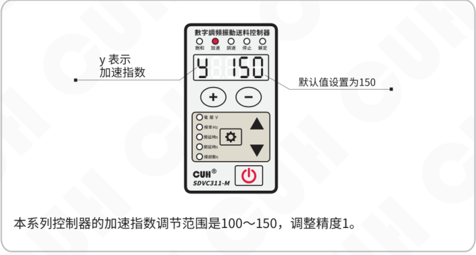

本系列控制器的加速指数调节范围是100～150，调整精度1。

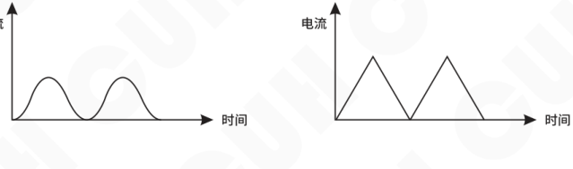

**加速指数设置为150示意图**

---

2026-03　　　　　　　　　　　　-28-　　　　　　　　　　　　SDVC311SMSCN_8.01

### 第 37 页

数字调频振动送料控制器　　　　　　　　　　　　　　　　　　　SDVC311 系列

## 5.8 波形指数

本控制器可以在最高效率-最大功率和最小噪音的性能间进行连续的平衡，以满足客户更高的需求。可通过设置高级参数“波形指数 r”的参数值来实现。

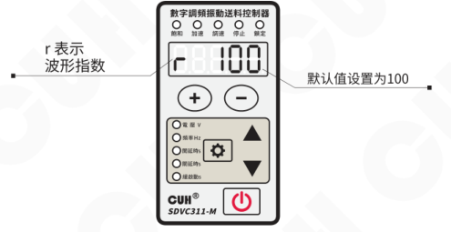

本系列控制器的波形指数调节范围是0～100，调整精度1。

> - 波形指数取值0时具有最高效率，弹簧受到的应力最小。
> - 取值为100时可以取得最大额定输出功率和最小噪音，但弹簧将会受到较大的应力。

### 波形指数示意图

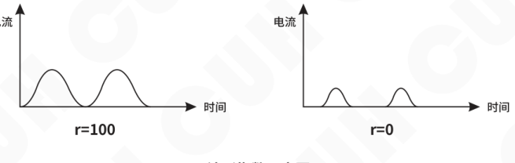

### 第 38 页

数字调频振动送料控制器　　　　　　　　　　　　　　　　　　　　　　　　　SDVC311 系列

## 5.9 参数密码锁功能

本控制器可对关键参数进行锁定，防止用户误操作。参数表中带“*”标注的参数，可使用参数密码锁进行锁定。

- 长按 ⚙ 和 ▲，进入高级参数界面。
- 短按 ▲ 或 ▼ 切换到“密码锁定参数范围”参数，该参数用来设置密码。
- 通过 ⊕ 和 ⊖ 调整参数值。
- 设定好参数密码后，退出当前界面再进入，可以看到参数值消失。
- 进入高级参数界面，切换到“密码锁”参数，输入之前录入的密码，即可看到消失的设置密码参数，进而修改密码。

密码锁参数值遵循421码规则：

| 锁定参数项 | 波形指数 | 加速指数 | 最大输出电压限制 | 主输出逻辑关系选择 | 主输出第二信号源 | 主输出第一信号源 | D口逻辑关系选择 | D口第二信号源 | D口第一信号源 | C口传感器类型 | 刹车周数/缓关闭时间 | 输出频率 |
|---|---|---|---|---|---|---|---|---|---|---|---|---|
| 1：锁定 | 1 | 1 | 1 | 1 | 1 | 1 | 1 | 1 | 1 | 1 | 1 | 1 |
| 0：不锁定 | 0 | 0 | 0 | 0 | 0 | 0 | 0 | 0 | 0 | 0 | 0 | 0 |
| 乘系数 | 4 | 2 | 1 | 4 | 2 | 1 | 4 | 2 | 1 | 4 | 2 | 1 |
| 密码值范围 （求和） |  | 0~7 （密码值第1位） |  |  | 0~7 （密码值第2位） |  |  | 0~7 （密码值第3位） |  |  | 0~7 （密码值第4位） |  |
| 举例1 | 0 | 0 | 0 | 0 | 0 | 0 | 0 | 0 | 0 | 0 | 0 | 1 |
| 举例1（求和） |  | 0 |  |  | 0 |  |  | 0 |  |  | 1*1=1 |  |
| 举例2 | 1 | 0 | 0 | 0 | 0 | 1 | 0 | 0 | 0 | 0 | 0 | 1 |
| 举例2（求和） |  | 1*4=4 |  |  | 1*1=1 |  |  | 0 |  |  | 1*1=1 |  |
| 举例3 | 0 | 0 | 0 | 0 | 0 | 0 | 0 | 0 | 0 | 1 | 1 | 1 |
| 举例3（求和） |  | 0 |  |  | 0 |  |  | 0 |  |  | 1*4+1*2+1*1=7 |  |

举例1：锁定输出频率，12组二进制编码为000000000001，设定密码值为0001。

举例2：锁定输出频率，波形指数和主输出第一信号源，12组二进制编码为100001000001，设定密码值为4101。

举例3：锁定输出频率，刹车周数/缓关闭时间和C口传感器类型，12组二进制编码为000000000111，设定密码值为0007。

“密码锁定参数范围”设置为9999时，锁定所有“*”标参数。

---

2026-03　　　　　　　　　　　　　　　　　-30-　　　　　　　　　　　　　SDVC311SMSCN_8.01

### 第 39 页

**数字调频振动送料控制器**  
**SDVC311 系列**

## 5.10 恢复出厂设置/恢复出厂方式

本功能可以使用户快速将控制器设置为出厂默认设置状态。

由于本控制器功能强大，有数量众多的控制参数可以由用户设定，对于初学者，可能在多次的设定修改后不能恢复控制器的正常工作状态。使用该功能可以快速将调乱的参数状态恢复为出厂默认设置。

恢复出厂设置需要结合恢复出厂方式参数（Pin）联合使用，恢复出厂方式参数说明如下：

0：将工作参数组恢复为用户参数组。

5：将工作参数组保存至用户参数组。

35：将工作参数组恢复为创优出厂值。

55：将工作参数组和用户参数组恢复为创优出厂值。

- 长按“设置”键和 ▲，进入高级参数界面。
- 短按 ▲ 切换到全屏闪烁状态，即“恢复出厂设置”参数，此时长按“－”键，直到控制器显示“----”，表示控制器已经重设完毕。
- 松开“－”键，控制器显示 CUH 后，随即进入正常的电压调整状态“U”，此时控制器就像刚开始使用一样，所有参数都已经恢复到出厂默认状态。

操作示意：

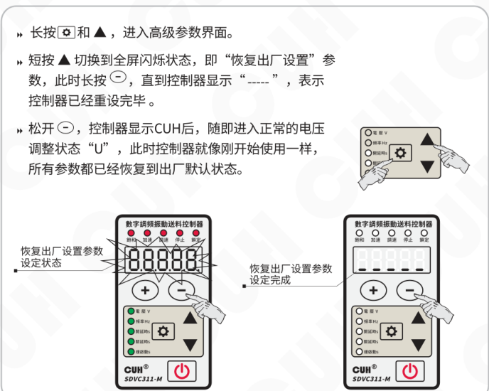

2026-03　　　　　　　　　　　　　　　　　SDVC311SMSCN_8.01

### 第 40 页

数字调频振动送料控制器　　　　　　　　　　　　　　　　　SDVC311 系列

## 5.11 参数监控功能

本控制器专门设计了一套监控参数组用于监控控制器的状态。

- 长按 **⚙** 和 **▼**，进入/退出监控参数界面。
- 短按 **▲** 或 **▼** 选择需要监控的参数。
- 监控参数的参数值不可修改。

示例：**C** 表示温度显示参数。

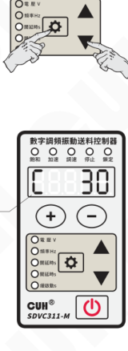

**本控制器的监控参数包括：**

温度显示 C、母线电压 PU、母线纹波电压 rU、输出电流 AC、模拟调速 A 口电压 AU、B 口信号电压 bU、C 口信号电压 cU、D 口输出电压 dU、24V 输出电压 nU

---

2026-03　　　　　　　　　　　　　　　　　-32-　　　　　　　　　　　　　　　　　SDVC311SMSCN_8.01

### 第 41 页

# 第六章 技术规格

## 6.1 外形尺寸 （单位：毫米mm）

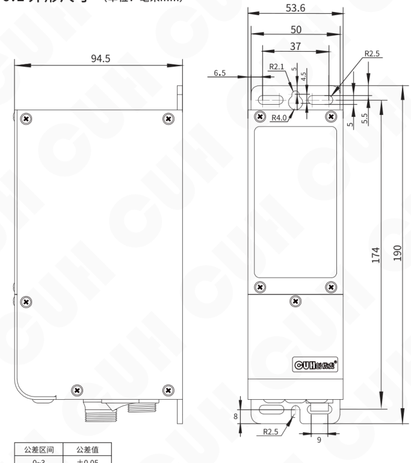

SDVC311-S（1.5A）  
SDVC311-M（3.0A）

| 公差区间 | 公差值 |
|---|---|
| 0~3 | ±0.05 |
| 3~10 | ±0.1 |
| 10~30 | ±0.15 |
| 30~80 | ±0.2 |
| 80~180 | ±0.3 |
| >180 | ±0.5 |

本系列产品均适用此公差表。

### 第 42 页

## 6.1 外形尺寸

### SDVC311-XL (6.0A)

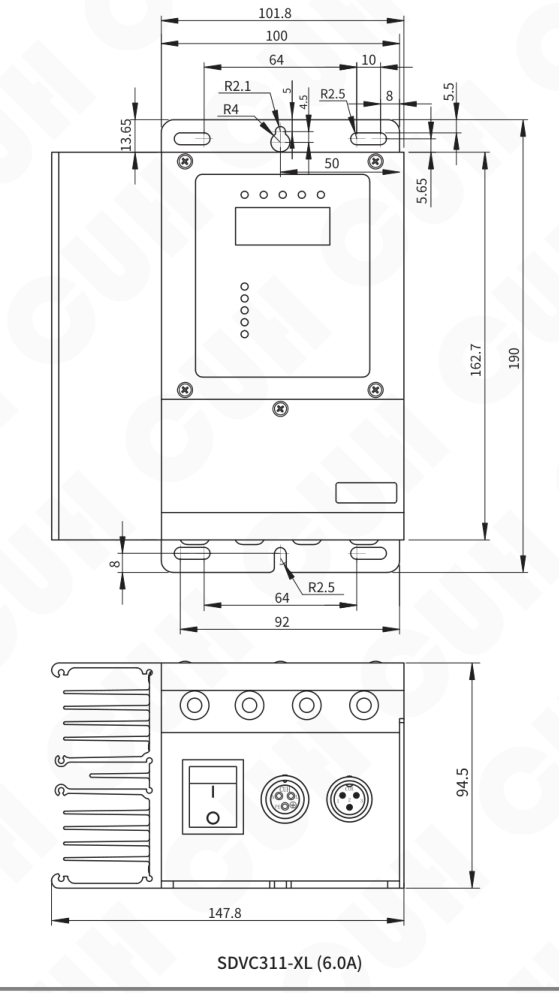

### 第 43 页

## 6.2 技术规格表

| 项目 | 最小值 | 典型值 | 最大值 | 单位 | 备注 |
|---|---:|---:|---:|---|---|
| 输入电压 | 85 | 220 | 250 | 伏特（V） | 交流有效值 |
| 输出电压调整范围 | 0 | — | 260 | 伏特（V） | 小于输入电压的150% |
| 电压调整精度 |  | 1 |  | 伏特（V） |  |
| 稳压精度 | 0 | — | 10 | % | ΔVout/ΔVin |
| 输出电流调整范围 | 0 | — | 1.5 | 安培（A） | SDVC311-S |
|  |  |  | 3.0 | 安培（A） | SDVC311-M |
|  |  |  | 6.0 | 安培（A） | SDVC311-XL |
| 输出功率 | 0 | — | 330 | 伏安（VA） | SDVC311-S |
|  |  |  | 660 | 伏安（VA） | SDVC311-M |
|  |  |  | 1320 | 伏安（VA） | SDVC311-XL |
| 输出频率 | 5.0 | — | 400.0 | 赫兹（Hz） |  |
| 频率调整精度 |  | 0.1 |  | 赫兹（Hz） |  |
| 输出波形 |  | 正弦 |  |  |  |
| 缓启动时间 | 0 | — | 10.0 | 秒（s） | 出厂默认0.5 |
| 延迟时间范围 | 0 | — | 99.9 | 秒（s） | 出厂默认0.2 |
| 延迟时间精度 |  | 0.1 |  | 秒（s） |  |
| 过热保护温度 | 58 | 60 | 66 | 摄氏度（℃） |  |
| 直流控制输出电流 | 0 | — | 400 | 毫安（mA） |  |
| 直流控制输出电压 | 22 | 24 | 26 | 伏特（V） |  |
| 模拟控制信号 |  | 1~5/4~20 |  | 伏特（V）/毫安（mA） | 远程速度控制电压/电流 |
| 数字控制信号 |  | 24 |  | 伏特（V） | 开关信号控制 |
| 调整方式 |  | 6 |  | 键（Button） |  |
| 空载功耗 | — | 3 | — | 瓦特（W） |  |
| 显示方式 |  | 5 |  | 位（Digit） | LED数码管 |
| 工作环境温度 | 0 | 25 | 40 | 摄氏度（℃） |  |
| 工作环境湿度 | 10 | 60 | 85 | 相对湿度（%） | 不结露 |
| 存储环境温度 | -20 | 25 | 65 | 摄氏度（℃） |  |

### 第 44 页

数字调频振动送料控制器  
SDVC311 系列

## 6.3 参考标准

**极限参数：超过此指标将会造成严重损坏，必须严格遵守！**

| 项目 | GB 标准 | IEC 标准 | 等级 | 标准要求 | 备注说明 |
|---|---|---|---|---|---|
| 静电放电 | GB/T 17626.2-2006 | IEC 61000-4-2:2001 | 4 | ±8 kV | 接触放电 |
|  |  |  | 4 | ±15 kV | 空气放电 |
| 电快速瞬变 脉冲群 | GB/T 17626.4-2008 | IEC 61000-4-4:2004 | 4 | ±4 kV |  |
| 直流电源纹 波抗扰度 | GB/T 17626.17-2005 | IEC 61000-4-17:2002 | 4 | 15% | 评价 A |

**警告**

在民用环境中，本产品可能产生无线电干扰。在这种情况下，可能需要采取附加抑制措施。

---

2026-03　　　　　　　　　　　　　　　　　-36-　　　　　　　　　　　　　　　　　SDVC311SMSCN_8.01

### 第 45 页

数字调频振动送料控制器　　　　　　　　　　　　　　　　　　　　　　　　　SDVC311 系列

# 第七章 附录

## 7.1 参数列表

| 分类 | 含义 | 参数符号 | 数码管符号图片 | 取值范围 | 默认设置 |
|---|---|---|---|---|---|
| 常用参数 | 输出电压 | [U] |  | 0~260 伏特（V） | 150 |
| 基本参数 | 输出频率 * | [E] |  | 5.0~400.0 赫兹（Hz） | 50.0 |
|  | 智能光电开延时 | [大勾] |  | 0.0~99.9 秒（s） | 0.2 |
|  | 智能光电关延时 | [大L] |  | 0.0~99.9 秒（s） | 0.2 |
|  | 缓启动时间 | [小T] |  | 0.0~10.0 秒（s） | 0.5 |
|  | 刹车周数/缓关闭时间 * | [反T] |  | -100~0 周（cycle）-刹车周数 0.0~10.0 秒（s）-缓关闭时间 | 0.0 |
|  | 输出电压 | [U] |  | 0~260 伏特（V） | 150 |
| 高级参数 | 智能光电灵敏度 | [P] |  | PnP, nPn, 1~1000 | 80 |
|  | C口传感器类型 * | [涛A] |  | nPn, PnP ut1（单次扫描）, ut0（连续扫描） | ut0 |
|  | 传感器C口开延时 | [勾中] |  | 0.0~99.9 秒（s） | 与 J 相同 |
|  | 传感器C口关延时 | [L中] |  | 0.0~99.9 秒（s） | 与 L 相同 |
|  | 主输出第一信号源 * | [E点Q] |  | 0, 1, b, -b, C, -C, od, -od, oq, -oq | b |
|  | 主输出第二信号源 * | [EQ] |  | 0, 1, b, -b, C, -C, od, -od, oq, -oq | C |
|  | 主输出逻辑关系选择* | [大恩Q] |  | And与, or或, Xor异或, rS触发器 | or |
|  | 主输出开延时 | [小JQ] |  | 0.0~99.9 秒（s） | 0.0 |
|  | 主输出关延时 | [小LQ] |  | 0.0~99.9 秒（s） | 0.0 |
|  | 主输出模式 | [FQ] |  | dLy 延时模式，HLd 保持模式 | dLy |
|  | 主输出逻辑方向 | [反小CQ] | 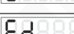 | 同相---，取反-.- 常开 on，常关 oFF | 取反-.- |
|  | D口第一信号源 * | [E点D] |  | 0, 1, b, -b, C, -C, od（d口输出状态）, -od, oq（主输出状态）, -oq | 0 |
|  | D口第二信号源 * | [ED] |  | 0, 1, b, -b, C, -C, od（d口输出状态）, -od, oq（主输出状态）, -oq | oq |
|  | D口逻辑关系选择 * | [大ND] |  | And与, or或, Xor异或, rS触发器 | or |
|  | 控制输出D口开延时 | [小JD] |  | 0.0~99.9 秒（s） | 0.0 |

2026-03　　　　　　　　　　　　　　　-37-　　　　　　　　　　　　　　　SDVC311SMSCN_8.01

### 第 46 页

数字调频振动送料控制器　　　　　　　　　　　　　　　　　　　　　　　　　SDVC311 系列

| 类别 | 含义 | 数码管符号图片 | 参数符号 | 取值范围 | 默认设置 |
|---|---|---|---|---|---|
| 高级参数 | 控制输出D口关延时 |  | 【小LD】 | 0.0~99.9 秒（s） | 0.0 |
|  | 控制输出模式 |  | 【FD】 | dLy 延时模式，HLd 保持模式 Fn1 周期信号输出模式1 Fn2 周期信号输出模式2 | dLy |
|  | 控制输出逻辑方向 |  | 【反小CD】 | 同相 ---，取反 --- 常开 on，常关 oFF | 同相--- |
|  | 控制输出类型 |  | 【小tD】 | nPn, PnP, PSP（推挽） | nPn |
|  | 最大输出电压限制 * |  | 【小H】 | 0~260 伏特（V） | 260 |
|  | 频率下限 |  | 【小E】 | 5.0~400.0 赫兹（Hz） | 40.0 |
|  | 加速指数 * |  | 【小Y】 | 100~150 | 150 |
|  | 波形指数 * |  | 【小R】 | 0~100 | 100 |
|  | 密码锁定参数范围 |  | 【反F点】 | 0~9999 | 0 |
|  | 密码锁 |  | 【反F】 | 0~9999 | 0 |
|  | 恢复出厂设置 |  | 【全8】 | 和 Pin 参数联合使用 | —— |
|  | 恢复出厂方式 |  | 【Pin】 | 0：将工作参数组恢复为用户参数组 5：将工作参数组保存至用户参数组 35：将工作参数组恢复为创优出厂值 55：将工作参数组和用户参数组恢复为创优出厂值 | 0 |
| 监控参数 | 温度显示 |  | 【大C】 | -20~85 摄氏度（℃） | —— |
|  | 母线电压 |  | 【PU】 | 0~400 伏特（V） | —— |
|  | 母线纹波电压 |  | 【RU】 | 0~200 伏特（V） | —— |
|  | 输出电流 |  | 【AC】 | 0.00~1.60 安培（A）-SDVC31S/311S 0.00~3.20 安培（A）-SDVC31M/311M | —— |
|  | 模拟调速A口电压 |  | 【AU】 | 0.00~5.00 伏特（V） | —— |
|  | B口信号电压 |  | 【bU】 | 0~999 | —— |
|  | C口信号电压 |  | 【cU】 | 0.0~28.0 伏特（V） | —— |
|  | D口输出电压 |  | 【dU】 | 0.0~28.0 伏特（V） | —— |
|  | 24V口电压 |  | 【nU】 | 0.0~28.0 伏特（V） | —— |
|  | 控制板软件版本 |  | 【UC】 | —— | —— |
|  | 功率板软件版本 |  | 【UQ】 | —— | —— |

备注：1. “*” 标参数（共12个）为密码锁定对象。  
2. “密码锁定参数范围” 设置为9999时，锁定所有 “*” 标参数。

2026-03　　　　　　　　　　　　　　　　　-38-　　　　　　　　　　　　　　SDVC311SMSCN_8.01

### 第 47 页

数字调频振动送料控制器　　　　　　　　　　　　　　　　　　　　　　SDVC311 系列

---

## 7.2 输入输出电路图

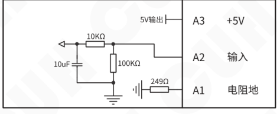

**遥控调速A端口**

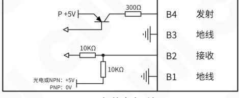

**智能光电B端口**

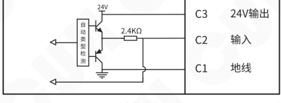

**料满停机C端口**

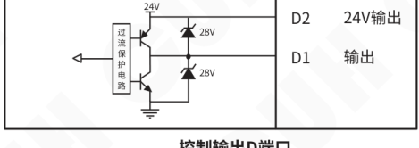

**控制输出D端口**

---

2026-03　　　　　　　　　　　　　-39-　　　　　　　　　　　　　SDVC311SMSCN_8.01

### 第 48 页

数字调频振动送料控制器　　　　　　　　　　　　　　　　SDVC311 系列

## 7.3 故障诊断

| 故障现象/故障代码 | 数码管符号图片 | 含义 | 排除方法 |
|---|---|---|---|
| 打开开关，没有显示 |  |  | ◆ 请检查电源插座是否有电？ ◆ 电源插头是否可靠连接插座？ |
| 有显示，但是振动盘不动，也没有声音 |  |  | ◆ 请检查输出电缆是否正确地连接控制器与振动盘？ ◆ 请检查控制器参数，是否输出电压调节的太小？ ◆ 请检查控制信号是否将控制器置于“停止”状态？ ◆ 请检查是否有设置为“常断”的参数，导致控制器被置于“停止”状态？ |
| 控制信号不起作用 |  |  | ◆ 请检查控制信号是否正确输入？ ◆ 请检查输入的控制信号的地线是否与本机地正确连接？ ◆ 请检查控制信号逻辑关系设置是否是您期望的设置？ |
| 周期性忽大忽小 （拍频现象） |  |  | ◆ 请检查多个振动体间的振动耦合问题。 ◆ 调整相互耦合的振动设备的工作频率，使频率差更大。 |
| 有显示，振动盘不动， 但是可以听到声音 |  |  | ◆ 请按照说明书介绍的调节方法逐步调节各参数。 |
| Err01 |  | 短路保护 | ◆ 确保负载未短路，短按两次开关键或重新上电以启动输出。 |
| Err02 |  | 过流保护 | ◆ 适当降低输出电压，然后尝试重新启动输出。 |
| Err03 |  | 过热保护 | ◆ 将本控制器安装在通风良好的环境中。 |
| Err04 |  | 过压或欠压保护 | ◆ 确保输入电压在85V~250V之间。 |
| Err05 |  | 内部通信异常 | ◆ 确保未在24V电源端口接入任何外部电源或联系本公司技术支持。 |
| Err06 | 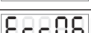 | 温度传感器异常 | ◆ 确保不在-20摄氏度以下工作或联系本公司技术支持。 |
| Err07 | 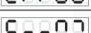 | D口短路保护 | ◆ 确保D口负载未短路且电流未超过400mA，然后尝试重新启动输出。 |
| Err10 |  | 24V电源输出异常 | ◆ 确保24V输出未被短路或超过400mA电流。 |
| Err11 |  | 调速A口5V输出异常 | ◆ 确保调速端口A3的5V输出未被短路或接入高于5V的电压。 |

注意：智能光电发射端口在控制器有任何故障时，不再发光。

2026-03　　　　　　　　　　　　-40-　　　　　　　　　　　　SDVC311SMSCN_8.01

### 第 49 页

数字调频振动送料控制器　　　　　　　　　　　　　　　　　　　　　　　　　SDVC311 系列

# 第八章 产品质保信息

## 8.1 质保期

本公司为本产品提供的质保期为三年，从产品发送到购买方指定地点之日算起。

## 8.2 保修范围

（一）如果在上述质保期内出现本公司造成的故障，我们将免费维修产品。但是以下情况不属于保修范围：

 a、未按照简易说明书、用户手册或购买方与本公司专门达成的技术要求中规定的条件、环境下的不正确操作，或不正确使用造成的故障。

 b、故障不是因产品缺陷，而是购买方设备或软件设计造成的。

 c、非本公司人员进行的修改或修理而造成的故障。

 d、按照简易操作指南或用户手册正确维修或更换易损部件等规定可以完全避免的故障。

 e、产品从本公司发货后，因无法预料的科学技术水平变化等因素而造成的故障。

 f、由于火灾、地震、洪水等自然灾害，或异常电压等外部因素造成的故障，本公司不负责保修。

（二）保修范围仅限于（一）中规定的情况，本公司对该设备造成的购买方间接损失（如设备损坏、机会丧失、利润损失等）或其他损失，不承担任何责任。

## 8.3 产品适用性

本公司的该控制器是针对振动送料行业的通用产品而设计生产的。因此，本公司的该控制器不得用于下列应用且不适合其使用。

（一）对生命和财产有严重影响的设施，如核发电厂、机场、铁路、轮船、机动装置及医疗设备。

（二）公共事业，包括电力、气体、供水等。

（三）相似条件或环境的户外使用。

2026-03　　　　　　　　　　　　　　　-41-　　　　　　　　　　　　　　　SDVC311SMSCN_8.01

### 第 50 页

*（本页 `page_markdown` 为空。）*

### 第 51 页

*（本页 `page_markdown` 为空。）*

### 第 52 页

|  |  |
|---|---|
|  | 南京创优科技有限责任公司 网址:www.cuhnj.com 电话:400-985-8889 传真:025-84730426 邮箱:sales@cuhnj.com 地址:南京市江宁区智能路9号 启迪城学研园2幢 |

文档编号：IDP1000361
<!-- /auto:ai-body-draft v1 -->

<!-- auto:data-params-summary v1 -->
## 附录 · 参数表（结构化侧车·机器生成）

> 说明：本节由 `data/<doc_key>/params/params.yaml` 自动渲染（展示前若干行），用于校对与二次开发。定稿以层 C 数据为准。

| 参数 | 标志/符号 | 范围 | 默认 | 单位 | 备注 |
| --- | --- | --- | --- | --- | --- |
|    **危险** |  |  |  |  |  |
|    **警告** |  |  |  |  |  |
|    **小心** |  |  |  |  |  |
|  **注意** |  |  |  |  |  |
|  **要点** ！ |  |  |  |  |  |
|    **1: 锁定** **0: 不锁定** |  |  |  |  |  |
|    **1: 锁定** **0: 不锁定** |  |  |  |  |  |
|    **乘系数** |  |  |  |  |  |
|    **密码值范围** **(求和)** |  |  |  |  |  |
|    **举例1** |  |  |  |  |  |
|    **举例1** |  |  |  |  |  |
|  **举例2** |  |  |  |  |  |
|  **举例2** |  |  |  |  |  |
|  **举例3** |  |  |  |  |  |
|  **举例3** |  |  |  |  |  |
|  0~3 |  |  |  |  |  |
|  3~10 |  |  |  |  |  |
|  10~30 |  |  |  |  |  |
|   30~80 |  |  |  |  |  |
|   80~180 |  |  |  |  |  |
|   >180 |  |  |  |  |  |
|      输入电压 |  |  |  |      伏特（V） |    交流有效值 |
|      输出电压调整范围 |  |  |  |      伏特（V） |    小于输入电压的150% |
|      电压调整精度 |  |  |  |      伏特（V） |   |
|      稳压精度 |  |  |  |      % |    ΔVout/ Vin Δ |
|      输出电流调整范围 |  |  |  |      安培（A） |    SDVC311-S |
|      输出电流调整范围 |  |  |  |      3.0 |    SDVC311-M |
|      输出电流调整范围 |  |  |  |      6.0 |    SDVC311-XL |
|        输出功率 |  |  |  |        伏安（VA） |    SDVC311-S |
|        输出功率 |  |  |  |        660 |      SDVC311-M |

*（仅展示前 30 条，共 119 条；完整数据见下方链接。）*

- 完整 YAML：`data/cuh.sdvc.manual.v0.0/params/params.yaml`
- 表格索引：`data/cuh.sdvc.manual.v0.0/index.yaml`
<!-- /auto:data-params-summary v1 -->
