## 目录

> 下列条目来自 PDF 内置书签/大纲；链接指向本批转换生成的整页渲染图（`assets/pages/`），便于与原版 PDF 对照校对。

- [1: 封面](assets/pages/page-0001.png)（第 1 页）
- [2: 版权与免责](assets/pages/page-0002.png)（第 2 页）
- [3: 序言](assets/pages/page-0003.png)（第 3 页）
- [4: 安全与预防措施](assets/pages/page-0004.png)（第 4 页）
- [5: 目录](assets/pages/page-0005.png)（第 5 页）
- [6: 目录2](assets/pages/page-0006.png)（第 6 页）
- [第一章 使用前须知](assets/pages/page-0007.png)（第 7 页）
  - [1.1 检查包装内容](assets/pages/page-0007.png)（第 7 页）
  - [1.2 控制器部件说明](assets/pages/page-0009.png)（第 9 页）
  - [1.3 选购部件代码](assets/pages/page-0010.png)（第 10 页）
- [第二章 产品介绍](assets/pages/page-0012.png)（第 12 页）
  - [2.1 产品简介](assets/pages/page-0012.png)（第 12 页）
  - [2.2 主要功能特点](assets/pages/page-0012.png)（第 12 页）
  - [2.3 产品适用范围](assets/pages/page-0013.png)（第 13 页）
- [第三章 安装与连接](assets/pages/page-0014.png)（第 14 页）
  - [3.1 控制器使用条件](assets/pages/page-0014.png)（第 14 页）
  - [3.2 控制器安装固定](assets/pages/page-0014.png)（第 14 页）
  - [3.3 输入输出气管安装](assets/pages/page-0015.png)（第 15 页）
  - [3.4 输出流量调节](assets/pages/page-0015.png)（第 15 页）
  - [3.5 光纤传感器安装](assets/pages/page-0016.png)（第 16 页）
  - [3.6 电源连接](assets/pages/page-0017.png)（第 17 页）
- [第四章 基本使用方法](assets/pages/page-0018.png)（第 18 页）
  - [4.1 基本操作](assets/pages/page-0018.png)（第 18 页）
  - [4.2 使用方法](assets/pages/page-0019.png)（第 19 页）
- [第五章 高级功能说明](assets/pages/page-0024.png)（第 24 页）
  - [5.1 参数列表](assets/pages/page-0024.png)（第 24 页）
    - [5.1.1 参数含义列表](assets/pages/page-0024.png)（第 24 页）
    - [5.1.2 重要参数详细释义及注意事项](assets/pages/page-0026.png)（第 26 页）
    - [5.1.3 控制器使用过程中的注意事项与异常情况解决方法](assets/pages/page-0028.png)（第 28 页）
  - [5.2 输入输出逻辑图](assets/pages/page-0029.png)（第 29 页）
  - [5.3 输出模式说明](assets/pages/page-0030.png)（第 30 页）
  - [5.4 外接光纤传感器和电磁阀](assets/pages/page-0031.png)（第 31 页）
  - [5.5 选配光纤支架安装](assets/pages/page-0033.png)（第 33 页）
- [第六章 技术规格](assets/pages/page-0035.png)（第 35 页）
  - [6.1 技术规格表](assets/pages/page-0035.png)（第 35 页）
  - [6.2 输入输出电路图](assets/pages/page-0036.png)（第 36 页）
- [第七章 附录A：不适配的典型物料特征](assets/pages/page-0037.png)（第 37 页）
  - [7.1 无法以相对确定的形状/图案通过光纤检测区域的物料](assets/pages/page-0037.png)（第 37 页）
  - [7.2 物料特征过小的物料](assets/pages/page-0038.png)（第 38 页）
- [第八章 附录B：光纤安装调试方法](assets/pages/page-0039.png)（第 39 页）
  - [8.1 颜色料道调整](assets/pages/page-0039.png)（第 39 页）
  - [8.2 光纤固定支架安装](assets/pages/page-0039.png)（第 39 页）
  - [8.3 光纤的合适高度](assets/pages/page-0040.png)（第 40 页）
  - [8.4 光纤的布置方式](assets/pages/page-0040.png)（第 40 页）
- [第九章 附录C](assets/pages/page-0044.png)（第 44 页）
  - [9.1 外形尺寸](assets/pages/page-0044.png)（第 44 页）
  - [9.2 故障诊断](assets/pages/page-0045.png)（第 45 页）
  - [9.3 参考标准](assets/pages/page-0045.png)（第 45 页）
- [第十章 产品质保信息](assets/pages/page-0046.png)（第 46 页）
  - [10.1 质保期](assets/pages/page-0046.png)（第 46 页）
  - [10.2 保修范围](assets/pages/page-0046.png)（第 46 页）
  - [10.3 产品适用性](assets/pages/page-0046.png)（第 46 页）
- [空白页面](assets/pages/page-0020.png)（第 20 页）
- [空白页面](assets/pages/page-0023.png)（第 23 页）
- [空白页面](assets/pages/page-0022.png)（第 22 页）
- [空白页面](assets/pages/page-0021.png)（第 21 页）
- [空白页面](assets/pages/page-0026.png)（第 26 页）
- [空白页面](assets/pages/page-0028.png)（第 28 页）
- [空白页面](assets/pages/page-0027.png)（第 27 页）
- [空白页面](assets/pages/page-0047.png)（第 47 页）
## 术语与命名

- 侧车：`glossary/terms.yaml`（机读）、`glossary/zh-CN.md`（人读）；候选表，定稿后并入公司级 `glossary/`。

## 适用范围

- 本文档由 PDF 自动转换生成，正文与插图需人工核对。

## 变更记录

- 2026-06-05 22:48:54：由转换工具从源 PDF 生成首版。

## 正文

<!-- auto:ai-body-draft v1 -->
> 以下为**整页视觉转写**的正文草稿（多模态模型直接输出 Markdown，含 GFM 表； 若配置 `[[vcrop:页:序]]` 占位符，裁剪步骤会插入 `assets/images/` 下 PNG）。**请务必人工校对。**

### 第 1 页

# CUH®

# 智能双光纤线扫分选控制器

**Intelligent Dual-Fiber Line-Scan Sorting Controller**

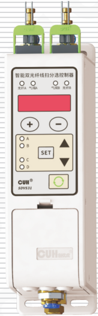

## SDVS31 系列

# 用户手册

### 第 2 页

智能双光纤线扫分选控制器                SDVS31 系列

---

## 版权说明

南京创优科技有限责任公司保留所有权利。

本用户手册上包含的所有信息是属于本公司的知识，受著作权法及所有法律的保护。本公司根据著作权法及其他法律享有并保留所有著作权和其他法律赋予的权利，未经本公司书面同意不得以任何形式对本用户手册的部分或全部进行抄袭、翻译、转译、仿制或其他利用。

## 免责声明

本用户手册的所有内容仅说明本公司生产的相关产品的使用方法，并且是根据现有技术和提供给您使用时的状态进行描述的，在您使用本产品时必须自行承担相关风险。除法律强制规定外，本公司不因本用户手册对产品负有任何明示或暗示的责任，包括但不限于人身伤害、财产损失、机会丧失。

您明确了解上述风险并同意，除法律强制规定外，本公司无须为您的任何直接、间接的损害或损失负责（包括但不限于人员、财物、数据等有形损失和名誉、机会等无形损失）。

本公司保留对本用户手册中所适用的产品进行修改而不预先及事后通知的权利。

---

2025-04                SDVS31SMSCN_2.01

### 第 3 页

智能双光纤线扫分选控制器　　　　　　　　　　　　　　　　　SDVS31 系列

---

# 序　言

感谢您使用南京创优科技有限责任公司（在本手册中以下简称本公司）出品的SDVS31系列智能双光纤线扫分选控制器（在本手册中以下简称本产品、本控制器或控制器）。

本手册介绍了本产品的基本操作方法、功能技术说明和典型应用示例。为用户提供安装调试、参数设置、异常诊断、故障排除及日常维护控制器的相关信息。为了确保正确安装和使用本控制器，请在装机之前仔细阅读本用户手册，并请妥善保存。

以下符号提醒您注意有关防止人身伤害和产品损坏的事项，请务必阅读。

| 符号 | 说明 |
|---|---|
| ⚠ 危险 | 表示若不遵守该事项，将导致人员伤亡。 |
| ⚠ 警告 | 表示若不遵守该事项，可能导致人员伤亡。 |
| ⚠ 小心 | 表示若不遵守该事项，可能导致人员遭受中度或轻微伤害。 |
| 注意 | 表示若不遵守该事项，将导致本产品损坏及财产损失。 |
| ！要点 | 表示在使用过程中必须要遵守的注意事项和使用限制等。 |

## 本说明书适合以下型号控制器：

◆ 智能双光纤线扫分选控制器　SDVS31

---

2025-04　　　　　　　　　　　　　　　　　　　SDVS31SMSCN_2.01

### 第 4 页

智能双光纤线扫分选控制器　　　　　　　　　　　　　　　　　SDVS31 系列

## 安全与预防措施

1. **【危险】** 本产品仅供物料分选之用，请勿将本产品用于保护人体或人体部位等目的。

2. **【危险】** 本产品不得作为防爆产品使用，请勿在危险场所和/或潜在爆炸气体环境中使用本产品。

3. **【警告】** 本产品是采用直流供电的设备，请勿施加交流电压。如果施加交流电压则可能导致产品爆炸或者着火，造成严重的安全事故。

4. **【警告】** 请勿在带电的情况下拔插接线或试图触摸接线仓内各接线点，以防发生触电意外事故。

5. **【小心】** 请务必根据控制器所接负载选择合理功率的电源，推荐24V/1A规格且符合IEC标准的ClassⅡ类电源。

6. **【注意】** 请勿将所有连接线与交流电源线或振动盘电磁铁线圈引出线使用同一配线，否则可能因噪声导致内部电路发生故障或受损。

7. **【注意】** 本产品设计使用于阴凉干燥环境，请勿将本产品置于室外、可能会浸水、阳光暴晒场所工作，也不要在超过本产品电气特性要求的温度和湿度范围之外工作。

8. **【注意】** 请确认使用的气源气压未超出本产品技术规格表中规定的最高工作气压，且压缩空气净化等级满足3.1节中规定的要求，否则可能损坏产品或造成使用寿命的极大下降。

9. **【要点】** 请务必将本产品固定在可靠接地的坚固平台上。

10. **【要点】** 任何情况下请勿将本产品在超越设计极限状态下工作。

11. **【要点】** 请严格按照本手册和简易操作指南的说明操作，对于违反这些操作说明所造成的任何人身伤害或财产损失，本公司不承担任何民事和刑事责任。

12. 本手册的最终解释权归本公司所有。

---

2025-04　　　　　　　　　　　　　　　　　　　　　　　　　SDVS31SMSCN_2.01

### 第 5 页

智能双光纤线扫分选控制器　　　　　　　　　　　　　　　　　　　　　　　　　　　　SDVS31 系列

---

# 目　录

**第一章 使用前须知** -------------------------------------------------------------- 1

　　1.1　检查包装内容 -------------------------------------------------------------- 1

　　1.2　控制器部件说明 ------------------------------------------------------------ 3

　　1.3　选购部件代码 -------------------------------------------------------------- 4

**第二章 产品介绍** ---------------------------------------------------------------- 6

　　2.1　产品简介 ------------------------------------------------------------------ 6

　　2.2　主要功能特点 -------------------------------------------------------------- 6

　　2.3　产品适用范围 -------------------------------------------------------------- 7

**第三章 安装与连接** -------------------------------------------------------------- 8

　　3.1　控制器使用条件 ------------------------------------------------------------ 8

　　3.2　控制器安装固定 ------------------------------------------------------------ 8

　　3.3　输入输出气管安装 ---------------------------------------------------------- 9

　　3.4　输出流量调节 -------------------------------------------------------------- 9

　　3.5　光纤传感器安装 ----------------------------------------------------------- 10

　　3.6　电源连接 ----------------------------------------------------------------- 11

**第四章 基本使用方法** ----------------------------------------------------------- 12

　　4.1　基本操作 ----------------------------------------------------------------- 12

　　4.2　使用方法 ----------------------------------------------------------------- 13

**第五章 高级功能说明** ----------------------------------------------------------- 18

　　5.1　参数列表 ----------------------------------------------------------------- 18

　　　　5.1.1　参数含义列表 ------------------------------------------------------- 18

　　　　5.1.2　重要参数详细释义及注意事项 ----------------------------------------- 20

　　　　5.1.3　控制器使用过程中的注意事项与异常情况解决方法 ----------------------- 22

　　5.2　输入输出逻辑图 ----------------------------------------------------------- 23

　　5.3　输出模式说明 ------------------------------------------------------------- 24

　　5.4　外接光纤传感器和电磁阀 --------------------------------------------------- 25

　　5.5　选配光纤支架安装 --------------------------------------------------------- 27

---

2025-04　　　　　　　　　　　　　　　　　　　　　　　　　　　　　　　　SDVS31SMSCN_2.01

### 第 6 页

智能双光纤线扫分选控制器　　　　　　　　　　　　　　　　SDVS31 系列

---

**第六章 技术规格** ---------------------------------------------------------------- 29

　　6.1　技术规格表 -------------------------------------------------------------- 29

　　6.2　输入输出电路图 ---------------------------------------------------------- 30

**第七章 附录A：不适配的典型物料特征** ------------------------------------------- 31

　　7.1　无法以相对确定的形状/图案通过光纤检测区域的物料 ------------------------- 31

　　7.2　物料特征过小的物料 ------------------------------------------------------ 32

**第八章 附录B：光纤安装调试方法** ----------------------------------------------- 33

　　8.1　颜色料道调整 ------------------------------------------------------------ 33

　　8.2　光纤固定支架安装 -------------------------------------------------------- 33

　　8.3　光纤的合适高度 ---------------------------------------------------------- 34

　　8.4　光纤的布置方式 ---------------------------------------------------------- 34

**第九章 附录C** ------------------------------------------------------------------- 38

　　9.1　外形尺寸 ---------------------------------------------------------------- 38

　　9.2　故障诊断 ---------------------------------------------------------------- 39

　　9.3　参考标准 ---------------------------------------------------------------- 39

**第十章 产品质保信息** ----------------------------------------------------------- 40

　　10.1　质保期 ----------------------------------------------------------------- 40

　　10.2　保修范围 --------------------------------------------------------------- 40

　　10.3　产品适用性 ------------------------------------------------------------- 40

---

2025-04　　　　　　　　　　　　　　　　　　　　　　　　　SDVS31SMSCN_2.01

### 第 7 页

# 第一章 使用前须知

本章节介绍产品包装内容、控制器各零部件的名称、选配部件代码。

## 1.1 检查包装内容

使用本产品之前，请检查以下设备和附件完整。如果发现产品有缺陷或已损坏，请与我司联系。

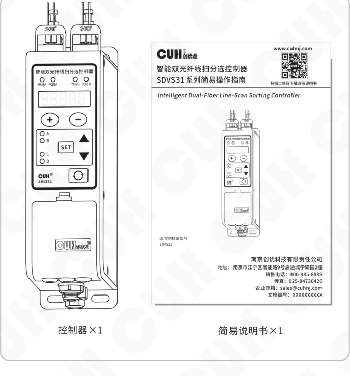

控制器×1　　　　简易说明书×1

### 第 8 页

智能双光纤线扫分选控制器　　　　　　　　　　　　　　　　　SDVS31 系列

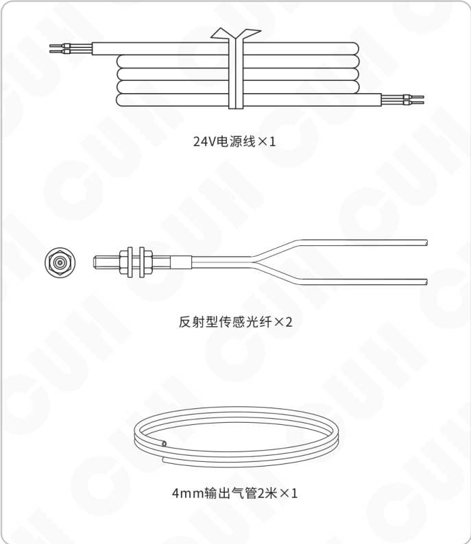

- 24V电源线×1
- 反射型传感光纤×2
- 4mm输出气管2米×1

---

2025-04　　　　　　　　　　　　　　　　　- 2 -　　　　　　　　　　　　　　　　　SDVS31SMSCN_2.01

### 第 9 页

智能双光纤线扫分选控制器　　　　　　　　　　　　　　　　　　　SDVS31 系列

## 1.2 控制器部件说明

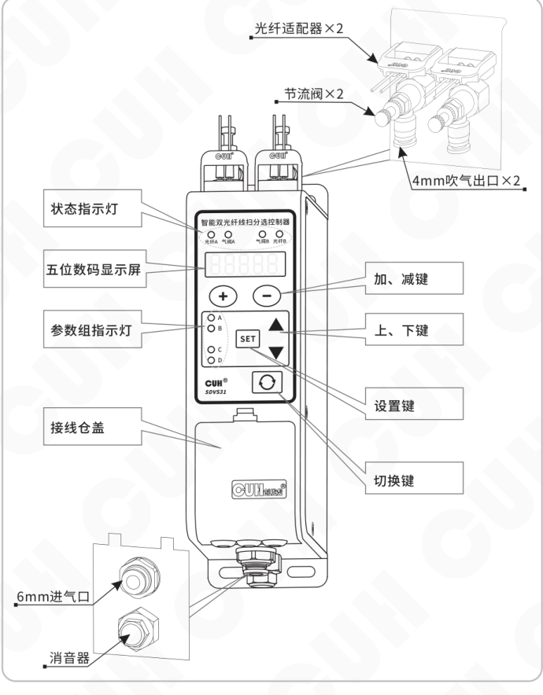

图中标注的控制器部件包括：

- 光纤适配器×2
- 节流阀×2
- 4mm吹气出口×2
- 状态指示灯
- 五位数码显示屏
- 参数组指示灯
- 接线仓盖
- 6mm进气口
- 消音器
- 加、减键
- 上、下键
- 设置键
- 切换键

控制器面板上可见标识：

- 智能双光纤线扫分选控制器
- 光纤A、气阀A、气阀B、光纤B
- A、B、C、D
- SET
- CUH SDVS31

2025-04　　　　　　　　　　　　　　　　　- 3 -　　　　　　　　　　　　　　　　　SDVS31SMSCN_2.01

### 第 10 页

智能双光纤线扫分选控制器　　　　　　　　　　　　　　　　　　　　SDVS31 系列

## 1.3 选购部件代码

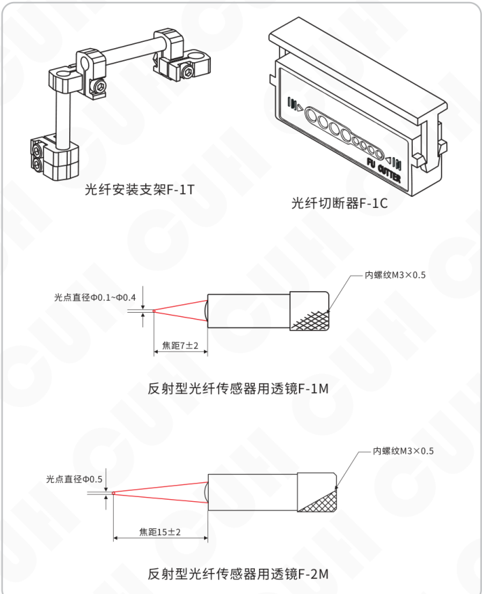

- 光纤安装支架F-1T
- 光纤切断器F-1C
- 反射型光纤传感器用透镜F-1M
  - 光点直径Ф0.1~Ф0.4
  - 焦距7±2
  - 内螺纹M3×0.5
- 反射型光纤传感器用透镜F-2M
  - 光点直径Ф0.5
  - 焦距15±2
  - 内螺纹M3×0.5

2025-04　　　　　　　　　　　　- 4 -　　　　　　　　　　　　SDVS31SMSCN_2.01

### 第 11 页

![反射型光纤传感器用透镜F-3M示意图]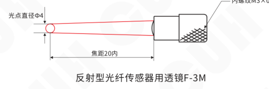

反射型光纤传感器用透镜F-3M

- 光点直径Φ4
- 焦距20内
- 内螺纹M3×0.5

![反射型光纤传感器用透镜F-4M示意图]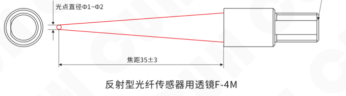

反射型光纤传感器用透镜F-4M

- 光点直径Φ1~Φ2
- 焦距35±3
- 内螺纹M3×0.5

![反射型光纤传感器用透镜F-5M示意图]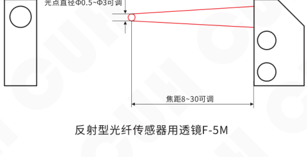

反射型光纤传感器用透镜F-5M

- 光点直径Φ0.5~Φ3可调
- 焦距8~30可调

如需要对射型光纤传感器、区域型光纤传感器、耐高温或其他特殊用途的光纤传感器，请联系我们。

### 第 12 页

智能双光纤线扫分选控制器　　　　　　　　　　　　　　　　　　　　　　　　　SDVS31 系列

---

# 第二章 产品介绍

本章节主要内容包括本产品的简单介绍、主要特色功能和适用范围。

## 2.1 产品简介

SDVS31智能双光纤线扫分选控制器是本公司针对自动化物料分选市场开发的一款通用型产品，是本公司开发的SDVS30智能光纤分选控制器的升级产品。本产品基于获取物料的双光纤信号的特征对物料的姿态进行推理计算并给出结果，通过控制内部电磁阀在喷嘴处形成气流，剔除异常状态物料以实现物料分选的目的。

相较于本公司的SDVS30系列控制器，本产品可适用于更广范围的物料种类，可识别更多的物料姿态，并且调试过程更加简单。

本产品最多可支持具有四种姿态的物料识别，并基于识别得到的姿态决定是否将其从料道剔除。相比于市场上现有的图像分选控制器具有极佳的性价比优势。另外，相比市场上现有的光纤放大器和电磁阀分体式解决方案，本产品提供的一体化解决方案更加便捷。该控制器可以与我司开发的SDVC系列振动送料控制器协同工作，包括供电、信号输入、控制输出连接，为客户提供自动送料与分选的整体解决方案。

## 2.2 主要功能特点

- 双路光纤放大器和气阀集成的一体化物料分选方案。
- 依靠光纤信号的时域特征对物料进行识别，适用于形状较为复杂的物料。
- 对料与训练过程简单易操作，免去复杂的参数设置与调试。
- 光纤放大器具有很强的日光和白炽灯光抑制能力。
- 两路气嘴输出口可独立调节出气流量。
- 双通道自适应开关传感器支持NPN和PNP两种类型。
- 双通道对称推挽控制输出可驱动24V/400mA负载。
- 具有完善的保护功能，包括欠压、过压、反接、过流、短路等。
- 参数组切换设计，可实现参数快速设置。
- 输入输出之间的交叉选择矩阵和逻辑组合可灵活设置控制器的功能。
- 输出模式选择，可定义输出与输入之间的时序关系。
- 独立的参数组恢复出厂设置功能，避免所有参数重设。
- 内部电磁阀计数功能，可以对电磁阀的寿命进行有效评估。
- 双路抗干扰允许两路光纤在相互靠近的情况下协同工作。
- 具有学习物料特征分布的能力，可显著提高分选可靠性。

---

2025-04　　　　　　　　　　　　　　　　　- 6 -　　　　　　　　　　　　　SDVS31SMSCN_2.01

### 第 13 页

智能双光纤线扫分选控制器　　　　　　　　　　　　　　　　　　　　　　　SDVS31 系列

---

## 2.3 产品适用范围

本产品适用于大多数常见物料的姿态分选。不适用于：（1）无法以相对确定的形态或者图案经过光纤检测区域的物料。（2）特征尺寸过小的物料。本产品难以分辨姿态的物料的典型特征详见本手册的附录A。

本产品要求依次经过光纤信号检测范围的物料首尾分开并保持一定的距离。推荐物料之间的间距不小于2倍光斑直径。

本产品不适用于质量检测，如贴片电容裂纹缺陷剔除、大米色选、水果精选等应用。

---

2025-04　　　　　　　　　　　　　　　　　- 7 -　　　　　　　　　　　　　SDVS31SMSCN_2.01

### 第 14 页

智能双光纤线扫分选控制器　　　　　　　　　　　　　　　　　　　　　　　　　SDVS31 系列

# 第三章 安装与连接

本章节介绍本产品使用所必须具备的条件以及如何正确进行安装与连接。

## 3.1 控制器使用条件

**⚠ 警告** 本产品是使用直流24V供电的设备，为确保操作者的人身安全请务必使用符合IEC标准的CLASS Ⅱ类电源，以在电网与直流输出线之间满足加强绝缘的要求。

**▾ 要点** 本产品的内部功率消耗包括电路静态功率1.2W、2个1.6W电磁阀，总功率约4.4W。本公司出品的振动送料控制器SDVC31系列或SDVC34系列均可以提供24V/4.8W的电源输出，所以可以直接为本产品供电。如果需要外接电磁阀，电源选择请参考5.4节。

**注意** 本产品工作时需要输入压缩空气，且对压缩空气的气压和净化等级具有较严格的要求。本产品的内部电磁阀最高工作气压为7Bar，所有任何情况下气源气压不可超过该值，建议用独立调压阀调节至5Bar使用。压缩空气净化等级按照《GB/T13277.1-2008压缩空气质量标准》中规定的固体颗粒等级2、湿度等级3、含油等级2或相比前述要求更优。

对于工作环境温湿度的要求请参考技术规格表。

## 3.2 控制器安装固定

请将本产品固定在可靠接地的坚固金属平台上，推荐用M4螺栓以0.6N*m扭矩在4角位置固定，如下图所示。

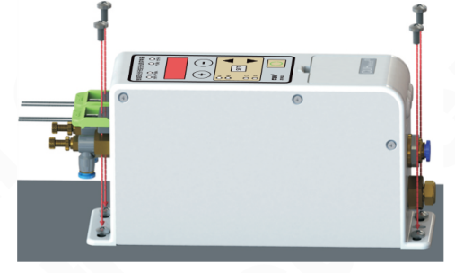

---

2025-04　　　　　　　　　　　　　　　　　- 8 -　　　　　　　　　　　　　　　　　SDVS31SMSCN_2.01

### 第 15 页

## 3.3 输入输出气管安装

输入气管接头配置为Φ6的快插端子，匹配外径6mm、内径4mm的PU气管，插入深度约17mm。

输出气管接头配置为Φ4的快插端子，匹配外径4mm、内径2.5mm的PU气管，插入深度约15mm。该快插端子可以旋转至任意角度以方便插管。

> **注意** 插管时注意应握紧快插端子本体，防止损坏节流阀，如下图所示。

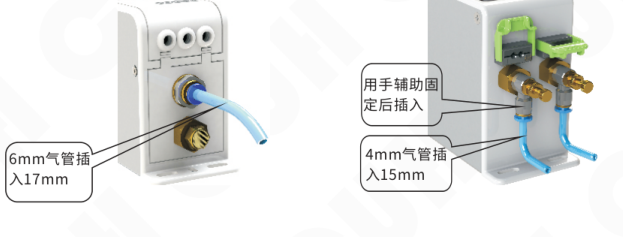

## 3.4 输出流量调节

本产品为每个电磁阀输出配置了单独的流量调节阀，可以控制气流流量进而调节吹气力量，可以防止物料因力量过大被吹出料盘。

每个节流阀具有调节手柄和锁定螺母两部分，调节流量分3步：

第1步：逆时针旋松流量锁定螺母；

第2步：旋转流量调节旋钮，顺时针为减小流向、逆时针为增大流量；

第3步：顺时针旋紧流量锁定螺母，如下图所示。

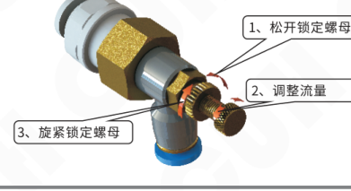

### 第 16 页

智能双光纤线扫分选控制器　　　　　　　　　　　　　　　　　SDVS31 系列

---

## 3.5 光纤传感器安装

本产品的光纤适配器是按照兼容大部分光纤传感器原则设计的，所以可以支持多种类型的光纤传感器，产品标准配置两套反射式光纤传感器方便用户使用。安装步骤如下：

1、首先将光纤传感器附带的转接头连接至光纤尾部至齐平；  
2、向上拨起光纤适配器锁定杆；  
3、将已经连接转接头的光纤按单芯对准T孔，多芯对准R孔插入15mm；  
4、向下转动锁定杆直至水平状态并检查光纤是否锁紧。

如下图所示。

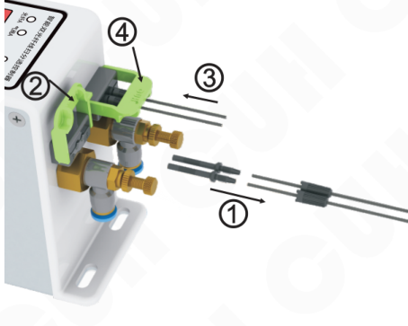

本产品的光纤适配器可接受2.1mm至2.3mm之间直径的光纤或转接头，客户如果需要可以使用其他尺寸兼容的反射、对射光纤传感器。

> **要点** 光纤纤芯越粗，耦合进入光纤的光功率越大，对于检测亮度值较小的物料越有帮助。

---

2025-04　　　　　　　　　　　　-10-　　　　　　　　　　　　SDVS31SMSCN_2.01

### 第 17 页

## 3.6 电源连接

本产品可由独立的电源适配器供电或由SDVC系列振动送料控制器供电。

> **注意** 如果使用SDVC系列振动送料控制器提供的电源，请确认其输出功率是否满足本产品实际应用负载要求。

本产品标准配置一根电源连接线，可以通过该电源线从具备24V输出的SDVC系列振动送料控制器连接取电。实现方法是：将电源线一端红色端子插入I2，黑色端子插入I1；另一端红色端子插入SDVC系列振动送料控制器+24V端子，黑色端子插入地线端子。

下图给出了使用SDVC34-M控制器为本产品供电的情形，在SDVC34-M控制器接线仓内选择空闲的+24V端子连接红色电源线、空闲的接地端子连接黑色电源线即可完成对本控制器的供电。

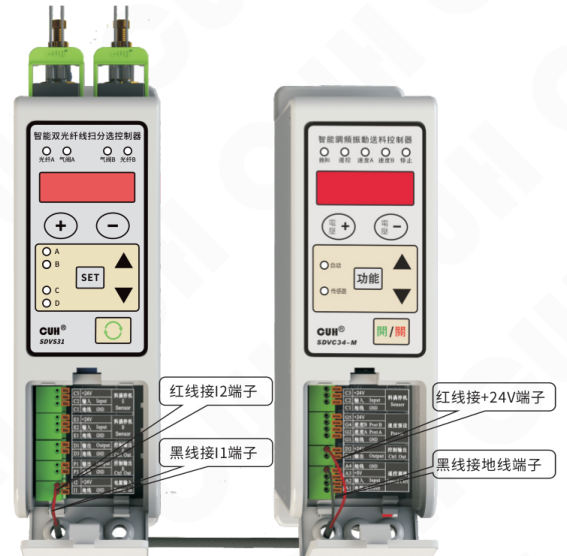

### 第 18 页

> 智能双光纤线扫分选控制器　　　　　　　　　　　　　　　　　　　　　　　　　SDVS31 系列

# 第四章　基本使用方法

本章节介绍本产品的面板功能、按键操作和基本使用方法。

## 4.1 基本操作

### 面板功能示意图

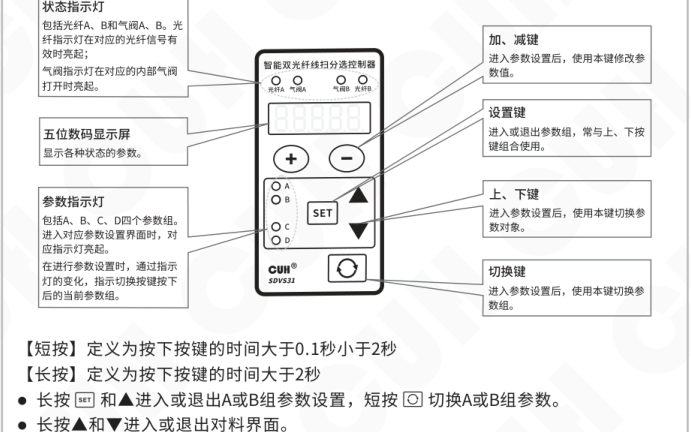

图中标注说明：

- **状态指示灯**：包括光纤A、B和气阀A、B。光纤指示灯在对应的光纤信号有效时亮起；气阀指示灯在对应的内部气阀打开时亮起。
- **五位数码显示屏**：显示各种状态的参数。
- **参数指示灯**：包括A、B、C、D四个参数组。进入对应参数设置界面时，对应指示灯亮起。在进行参数设置时，通过指示灯的变化，指示切换按键按下后的当前参数组。
- **加、减键**：进入参数设置后，使用本键修改参数值。
- **设置键**：进入或退出参数组，常与上、下按键组合使用。
- **上、下键**：进入参数设置后，使用本键切换参数对象。
- **切换键**：进入参数设置后，使用本键切换参数组。

【短按】定义为按下按键的时间大于0.1秒小于2秒  
【长按】定义为按下按键的时间大于2秒

- 长按 <kbd>SET</kbd> 和 <kbd>▲</kbd> 进入或退出A或B组参数设置，短按 <kbd>↻</kbd> 切换A或B组参数。
- 长按 <kbd>▲</kbd> 和 <kbd>▼</kbd> 进入或退出对料界面。
- 长按 <kbd>SET</kbd> 和 <kbd>▼</kbd> 进入或退出监测界面。
- 长按 <kbd>↻</kbd> 和 <kbd>▲</kbd> 进入或退出C或D组参数设置，短按 <kbd>↻</kbd> 切换C或D组参数。
- 进入参数设置后，使用 <kbd>▲</kbd> 和 <kbd>▼</kbd> 切换参数对象，使用 <kbd>＋</kbd> 和 <kbd>－</kbd> 修改参数值。
- A、B、C、D四组参数均包含自身的恢复出厂设置功能，即需要对每个参数组单独进行恢复出厂设置操作，无法一次实现将所有的参数组恢复出厂设置。

具体实现方法为：

1. 进入参数设置界面，选择需要恢复出厂设置的参数组；
2. 通过 <kbd>▼</kbd> 切换至恢复出厂参数：闪烁的 `88888`（数码管和LED灯全部闪烁）；
3. 长按 <kbd>＋</kbd>，显示 `-----` 后，松开 <kbd>＋</kbd>，控制器回到待机界面，即完成该组参数恢复出厂设置操作。

注：刚上电且未对料过，处于监测界面，且机器不工作；上电且完成过对料，处于待机界面；退出任意参数组后回到待机界面；任意界面在无操作三分钟后自动回到待机界面。

除对料界面，均可通过组合键实现界面的直接切换，对料界面只能通过 <kbd>▲</kbd>+<kbd>▼</kbd> 组合键退出并回到待机界面后，才可通过组合键进入相应参数设置界面。

---

2025-04　　　　　　　　　　　　　　　　　-12-　　　　　　　　　　　　　　　　　SDVS31SMSCN_2.01

### 第 19 页

智能双光纤线扫分选控制器          SDVS31 系列

## 4.2 使用方法

拿到待分选的物料后按如下5步进行操作：

**第一步：** 枚举物料可能存在的所有姿态，并确定分别需要保留和剔除的姿态特征。确认能够保证物料在依次经过光纤照射区域时，能够首尾分开并保持一定的间隔。

**第二步：** 按照本说明书的第三章安装与连接部分的内容，固定好控制器、安装输入输出气管、调节气体输出流量、连接电源。

**第三步：** 根据物料特征进一步对光纤的架设位置进行微调，以便本产品能够以更高的准确率分辨物料姿态。具体的光纤架设指导请见本说明书的附录B中的内容。

**第四步：** 确保光纤下方的料道清空，无物料或其他杂物通过，准备进行对料操作。同时长按▲和▼进入对料界面。

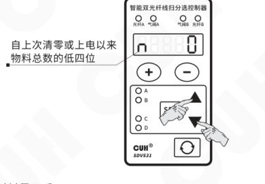

视觉标注：自上次清零或上电以来，物料总数的低四位。

**a. 进入对料界面后，**

- 数码管第1位数字代表当前对料的姿态号（最大不超过4）；
- 数码管第2位代表此姿态的物料应当剔除还是让其通过，“P”代表保留（Pass），“A”代表剔除（Abandon），可通过长按 `SET` 将数码管第2位设置为“P”或“A”；
- 数码管第5位代表物料该姿态信号的样本编号（最大不超过10）；数码管右下角的小数点闪烁时代表等待采样。

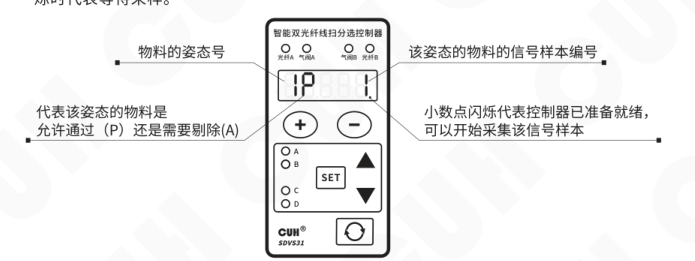

视觉标注：

- 物料的姿态号；
- 代表该姿态的物料是允许通过（P）还是需要剔除(A)；
- 该姿态的物料的信号样本编号；
- 小数点闪烁代表控制器已准备就绪，可以开始采集该信号样本。

---

2025-04          -13-          SDVS31SMSCN_2.01

### 第 20 页

智能双光纤线扫分选控制器　　　　　　　　　　　　　　　　　　　　　　　　　SDVS31 系列

---

b. 在振动盘上放置对应的姿态的物料并通过光纤下方后，数码第5位右下角小数点消失，数码管第5位数字闪烁，提示用户选择保留此数据或者删除此条编号的样本数据。

图示说明：

- 短按「＋」，则保留该样本数据。否则短按「－」。
- 信号采集完成后，小数点消失，样本编号开始闪烁，提示您选择是否需要保留该样本数据。

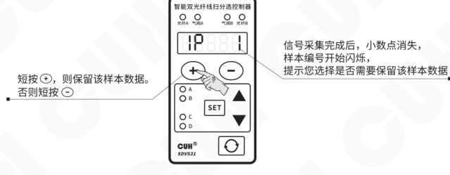

c. 短按「＋」保存此次采样数据，数码显示屏变为“1P 2”（小数点闪烁），表示可进行当前姿态第二个样本数据的采集。

图示说明：

- 该姿态的物料的信号样本编号。
- 小数点闪烁代表控制器已准备就绪，可以开始采集该信号样本。

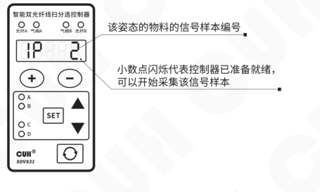

---

2025-04　　　　　　　　　　　　　　　　　-14-　　　　　　　　　　　　　　　　　SDVS31SMSCN_2.01

### 第 21 页

智能双光纤线扫分选控制器　　　　　　　　　　　　　　　　SDVS31 系列

---

d. 若想要将姿态1的物料设定为剔除，可通过长按 `SET` 将数码管第2位改为 “A”。

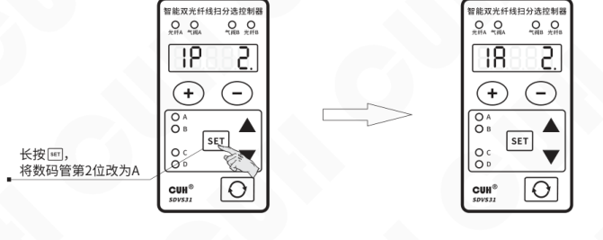

长按 `SET`，将数码管第2位改为A。

e. 当对当前姿态（示例为姿态1）采样了足够的次数（上限为10）后，短按▼进入姿态2的对料界面。

**【注意】：** 在对料界面中，短按▲或▼切换姿态号（最大为4）。

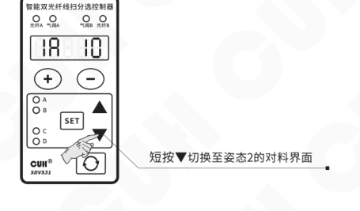

短按▼切换至姿态2的对料界面。

---

2025-04　　　　　　　　　　　　　-15-　　　　　　　　　　　　　SDVS31SMSCN_2.01

### 第 22 页

智能双光纤线扫分选控制器　　　　　　　　　　　　　　　　　　　　　　　　　SDVS31 系列

---

f. 进入姿态2的对料界面后，重复上述步骤，直至物料的所有姿态数据采集完毕。

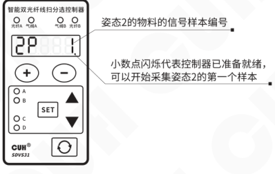

图示标注：

- 姿态2的物料的信号样本编号
- 小数点闪烁代表控制器已准备就绪，可以开始采集姿态2的第一个样本

g. 若该物料每个姿态都采集了足够的数据，同时长按▲和▼退出对料界面。

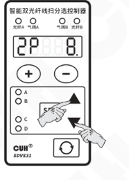

---

2025-04　　　　　　　　　　　　　　　　　-16-　　　　　　　　　　　　　　　　　SDVS31SMSCN_2.01

### 第 23 页

智能双光纤线扫分选控制器　　　　　　　　　　　　　　　　　　　　　　　　　SDVS31 系列

---

h. 退出对料后，数码管显示屏会显示预估的分选正确率，若分选正确率没有达到要求，请检查光纤安装方式是否合适，然后长按▲和▼再次进入对料界面，增加或删除相关样本数据，重新训练。

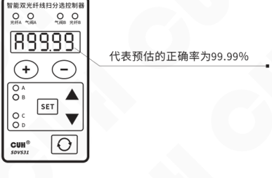

**第五步：** 检查并设置控制器的吹气逻辑。手动放置已知姿态的物料检查是否能够触发正确的吹气逻辑。

完成上述操作步骤后控制器即可进行物料分选。

---

2025-04　　　　　　　　　　　　　　　　　- 17 -　　　　　　　　　　　　　　　SDVS31SMSCN_2.01

### 第 24 页

智能双光纤线扫分选控制器　　　　　　　　　　　　　　　　　SDVS31 系列

# 第五章 高级功能说明

本章节介绍本产品的全部参数信息、输入输出逻辑图、外接光纤传感器和电磁阀及光纤支架的安装指导。

## 5.1 参数说明

### 5.1.1 参数含义列表

| 参数类别 | 含义 | 参数符号 | 数码管符号图片 | 取值范围 | 默认设置 |
|---|---|---|---|---|---|
| 待机参数 | 显示当前物料的姿态数以及 剔除还是通过 | 【NP】 【NA】 |  | n∈[1,4] A（剔除），P（允许通过） | / |
|  | 检测到当前物料的长度或者 通过时间高于/低于容差 | 【流LH】 【流LL】 |  | / | / |
| 监测参数 长按 SET 加 ▼ | A发光A接收信号值 | 【AA】 |  | 0~999 | / |
|  | B发光B接收信号值 | 【BB】 |  | 0~999 | / |
|  | A发光B接收信号值 | 【AB】 |  | 0~999 | / |
|  | B发光A接收信号值 | 【BA】 |  | 0~999 | / |
|  | 当前物料速度与对料时物料速度的比率 | 【RU】 |  | 0.01~9.99 | / |
|  | 单个物料推理置信度 | 【R】 |  | 0~99.99 | / |
|  | 预测的分选准确率 | 【A】 |  | 0~99.99 | / |
|  | 物料平均相对速度 | 【倒A】 |  | 0~9999 每分钟个数 | / |
|  | 振动盘上每个姿态的占比 | 【PN】 |  | 0~100（n∈[1,4]） | / |
|  | 物料总数的高四位 | 【下N点】 |  | 0~9999 万 | / |
|  | 物料总数的低四位 | 【下N】 |  | 0~9999 个 | / |
|  | 产率 | 【PR】 |  | 0~100（通过姿态数量占总个数比例） | / |
|  | 输入电压 | 【NU】 |  | 0~28 伏特（V） | / |
|  | C口信号电压 | 【CU】 |  | 0~28 伏特（V） | / |
|  | E口信号电压 | 【eU】 |  | 0~28 伏特（V） | / |
|  | 控制输出D口输出电压 | 【DU】 |  | 0~28 伏特（V） | / |
|  | 控制输出P口输出电压 | 【PU】 |  | 0~28 伏特（V） | / |
|  | 电磁阀动作亿次 | 【亿】 |  | 0~9999 亿次 | 0 |
|  | 电磁阀动作万次 | 【万】 |  | 0~9999 万次 | 0 |
|  | 电磁阀动作次 | 【次】 |  | 0~9999 次 | 0 |
|  | 软件版本号 | 【UR】 |  | / | / |

2025-04　　　　　　　　　　　　　　　　　-18-　　　　　　　　　　　　　　　　　SDVS31SMSCN_2.01

### 第 25 页

智能双光纤线扫分选控制器　　　　　　　　　　　　　　　　　　　　　　　　　SDVS31 系列

| 参数组 | 含义 | 参数符号（按数码管字形转写） | 数码管符号图片 | 取值范围 | 默认设置 |
|---|---|---|---|---|---|
| A/B参数组 长按 SET 加▲ | 物料编号 | nO. |  | 1~9 | 1 |
|  | 工作模式下物料速度与对料时物料速度的比率设定 | rU. |  | 0.01~9.99 | 1.00 |
|  | 物料信号长度的容差百分比设定 | tL. |  | 0.1~99.9 | 20.0 |
|  | 单个物料可接受的推理置信度 | r. | 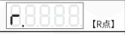 | 0~99 | 80 |
|  | 第一信号源选择 | E. | 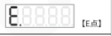 | 0, 1, Ab, C, E, -Ab, -C, -E, OA, Ob, Od, OP, -OA, -Ob, -Od, -OP, ΓLH, ΓLL | 气阀A: ΓLH 气阀B: 0 |
|  | 第二信号源选择 | E | 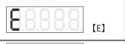 | 0, 1, Ab, C, E, -Ab, -C, -E, OA, Ob, Od, OP, -OA, -Ob, -Od, -OP, ΓLH, ΓLL | 气阀A: Ab 气阀B: ΓLH |
|  | 信号源逻辑关系选择 | n | 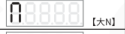 | And与, or或, Xor异或, rS触发器 | or |
|  | 输出信号上升沿延时 | J | 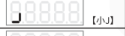 | 0.00~10.00 秒（s） | AB组: 0.00 |
|  | 输出信号下降沿延时 | L | 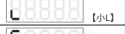 | 0.00~10.00 秒（s） | AB组: 0.10 |
|  | 输出信号的模式选择 | F |  | HoLd 保持模式, dLAy 延时模式 | dLAy |
|  | 输出逻辑方向选择 | ↄ | 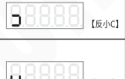 | 同相 ---，取反 -.- 输出常开 On，输出常关 OFF | 同相 --- |
|  | 气阀强制输出设定选项 | U | 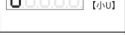 | A0b0：气阀A关，气阀B关 A0b1：气阀A关，气阀B开 A1b0：气阀A开，气阀B关 A1b1：气阀A开，气阀B开 | A1b1 |
|  | 是否允许不在已经训练的姿态中的物料或模糊的物料通过 | bLr |  | 0（剔除），1（允许通过） | 0 |
|  | 恢复出厂设置 | 88888 | 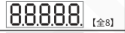 | / | / |
| C/D参数组 长按 SET 加▲ | 开关传感器型号选择（仅CD组） | tA | 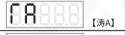 | PnP, nPn, Uto（自动适应） | Uto |
|  | 输入信号上升沿延时 | J | 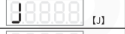 | 0.00~10.00 秒（s） | 0.05 |
|  | 输入信号下降沿延时 | L | 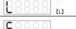 | 0.00~10.00 秒（s） | 0.05 |
|  | 第一信号源选择 | E. | 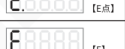 | 0, 1, Ab, C, E, -Ab, -C, -E, OA, Ob, Od, OP, -OA, -Ob, -Od, -OP, ΓLH, ΓLL | C组: 0 D组: 0 |
|  | 第二信号源选择 | E | 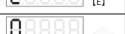 | 0, 1, Ab, C, E, -Ab, -C, -E, OA, Ob, Od, OP, -OA, -Ob, -Od, -OP, ΓLH, ΓLL | C组: C D组: E |
|  | 信号源逻辑关系选择 | n | 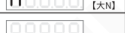 | And与, or或, Xor异或, rS触发器 | or |
|  | 输出信号上升沿延时 | J | 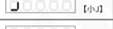 | 0.00~10.00 秒（s） | C组: 0.00 D组: 0.00 |
|  | 输出信号下降沿延时 | L | 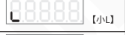 | 0.00~10.00 秒（s） | C组: 0.10 D组: 0.10 |
|  | 输出信号的模式选择 | F |  | HoLd 保持模式, dLAy 延时模式 | dLAy |
|  | D口模式切换 | td |  |  |  |
|  | P口模式切换 | tP | 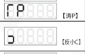 | PSP（推挽）, PnP, nPn | nPn |
|  | 输出逻辑方向选择 | ↄ |  | 同相 ---，取反 -.- 输出常开 On，输出常关 OFF | 同相 --- |
|  | 恢复出厂设置 | 88888 | 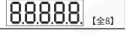 | / | / |

2025-04　　　　　　　　　　　　　　　　　　　　-19-　　　　　　　　　　　　　　　　　　　　SDVS31SMSCN_2.01

### 第 26 页

智能双光纤线扫分选控制器　　　　　　　　　　　　　　　SDVS31 系列

---

## 5.1.2 重要参数详细释义及注意事项

`AA`、`bb`、`Ab` 以及 `bA`：此为监测参数，能够实时反应光纤反射值的大小。`AA`、`bb`、`Ab` 以及 `bA` 分别代表光纤A发光-A接收、光纤B发光-B接收、光纤A发光-B接收以及光纤B发光-A接收的实时光强度。

当需要分选正反面颜色不同或者带有倒角的物料的姿态，可以在架设光纤时参考此组监测参数，若光纤在照射不同特征时的反射光强度具有显著区别，则说明光纤架设位置正确，可以固定光纤后进行对料操作。

`r.`：物料姿态判断的置信度，此为监测值。在控制器处于工作状态时，光纤下每经过一个物料，控制器会根据光纤信号推理其姿态，并且给出推理的置信度（可理解为相似度），代表控制器对此次判断的把握。该参数可以在监测参数界面实时显示。

若用户认为可以稍微牺牲少量出料速度以换取更加有保障的物料分选精度，可提高A/B参数组中的 `r.` 参数。`r.` 代表用户可接受的置信度，该参数的出厂默认值为80%。若用户将 `r.` 设置为98%，则代表所有实时推理置信度小于98%的物料都会被当作模糊物料被剔除，这将会导致少部分应当通过的物料被剔除。

`no.`：物料编号。适用于具有相似特征但具有不同长度、颜色等规格的物料之间的切换。当不同规格的该种物料共用同一个振动盘时，可使用该参数。

**注意：不同规格的该种物料应当共用同一种光纤架设方式，在切换物料编号时不应当更改光纤的架设位置。** 控制器最多可支持8种规格的同种物料之间的切换。若需要切换物料编号，长按 <kbd>SET</kbd> 和 ▲ 进入A/B参数组，短按 ＋ 或 － 调整至想要切换的物料编号，再长按 <kbd>SET</kbd> 后完成切换。

`rU`：物料当前行进速度与对料时的物料速度的比率。该参数会随着料空或者料满时的料速变化而自适应调整，也会随着人为调整了振动盘的振幅和频率而导致的料速变化而变化。该参数也可以短按 ＋ 或 － 调整，手动设置至与监测参数“`cU`”一致。但是对料后调整振动盘的振幅和频率可能会对物料在振动盘上的跳动量产生较大影响，可能会对控制器的分选准确率产生影响。因此在对料后通常不建议再对振动盘的振幅和频率进行调整。

---

2025-04　　　　　　　　　　　　-20-　　　　　　　　　　　　SDVS31SMSCN_2.01

### 第 27 页

智能双光纤线扫分选控制器　　　　　　　　　　　　　　　　　　　　　　　　　SDVS31 系列

---

ΓL：物料长度的容差设置。考虑到在进行物料分选工作时物料的速度会不可避免地波动，可能会影响控制器判断物料是否首尾相接或者出现异常姿态（物料信号长度过短），此参数设定值的大小可以理解为对物料速度波动的容忍程度。该参数默认设定值为20%，设定值过大可能会导致控制器无法准确判断物料是否首尾相接或者物料长度过短；相应地，设定值过小会导致控制器过于敏感，将正常通过的物料认定为信号长度异常的物料从而剔除。

E1 以及 E2：第一信号源以及第二信号源选择。本控制器的气阀A与B的 E1 默认设定值均为0，而 E2 的默认设定值分别为Ab和ΓLH，信号逻辑关系的默认值为或。这意味着，**在默认情况下，当需要剔除的物料经过时，气阀A负责开启将物料吹掉；当物料首尾相接时，气阀A和B将会同时打开吹气直至首尾相接的物料完全通过为止。**因此，在振动盘上安排吹气位置时，应当注意将A气阀对应的吹气位置安排在距离光纤照射的光斑边缘前方半个物料身位的距离，而B气阀应当安排在距离A气阀前方一个物料身位的位置（此语境下的“前方”是指物料前进的方向）。物料首尾相接时需要同时打开A与B气阀吹气是为了防止未完成物料姿态判断的物料漏过。

J：信号上升沿延时。请注意，**该参数不代表控制器完成姿态推理后触发电磁阀动作的开延时时间，而代表气阀A/B的触发信号的最小保持时间。**当气阀的信号源包含 Ab / ΓLH / ΓLL 时，该气阀的 J 将会被锁定为0，不可调节。只有当气阀的信号源全部为外部触发信号时，才可以设置该参数，以适配外部触发信号的最小保持时间。

L：输出信号下降沿延时，与 J 类似，代表关信号的最小保持时间。**在默认设置下，该参数就代表剔除反料时气阀吹气的持续时间。**若气阀的信号源包含 Ab / ΓLH / ΓLL，那么参数 L 即代表气阀吹气的持续时间，可以根据物料的长度和物料的重量综合考量。若气阀的信号源为外部触发信号，则该参数不再表示气阀吹气的持续时间。假设外部触发信号的持续时间为0.01s，输出信号下降沿延时 L 为0.02s，那么气阀的吹气持续时间为0.01s+0.02s=0.03s。

---

2025-04　　　　　　　　　　　　　　　　　-21-　　　　　　　　　　　　　　　　　SDVS31SMSCN_2.01

### 第 28 页

智能双光纤线扫分选控制器　　　　　　　　　　　　　　　SDVS31 系列

---

### 5.1.3 控制器使用过程中的注意事项与异常情况解决方法

1. 应当尽量避免触碰或者调节光纤支架、光纤与控制器的连接处，否则会造成光路的改变，从而影响物料分选的准确性。

2. 若无必要，尽量不要较大幅度地修改振动控制器的频率与电压。因为小尺寸精密物料的特征捕捉对于振动幅度比较敏感，频率与电压调节后容易造成物料分选精度下降。

3. 当振动盘正常上料时，若某个 SDVS31 分选控制器出现气阀常开或者面板上方四个指示灯全亮的现象，可以采取如下措施：暂时拦截住该控制器对应的料道上的物料，同时长按住 SDVS31 控制器面板上的 ▲ 和 ▼ 2 秒以上，进入对料界面，所述异常情况消除。再次同时长按住 SDVS31 控制器面板上的 ▲ 和 ▼，退出对料界面。此时，一般情况下控制器可以正常继续工作。

4. 如果某个 SDVS31 控制器从某时刻起开始将正料与反料全都吹气剔除，表明此时振动盘由于长时间工作，送料速度已经发生显著变化。应对这种情况，可采取下列措施：（1）将整个振动盘设备断电后重启。（2）同时长按出问题的控制器面板上的 <kbd>SET</kbd> 与 ▼，进入监控参数界面。找到 `rU` 参数，记住该参数界面显示的参数数值（例如 0.72）。再同时长按 <kbd>SET</kbd> 与 ▲，进入调试参数组，找到参数 `rU`，按 ⊕ 或 ⊖ 将该参数对应的数值更改至监控界面下的参数值（0.72）。

5. 若控制器长时间工作后，分料准确率有所下降，可重新进行对料操作，让控制器重新学习物料的信号特征。具体措施：拦截住该控制器对应的料道上的物料，同时长按住 SDVS31 控制器面板上的 ▲ 和 ▼ 2 秒以上，进入对料界面，重新对料。具体操作可参考本控制器的说明书。

---

2025-04　　　　　　　　　　　　-22-　　　　　　　　　　　　SDVS31SMSCN_2.01

### 第 29 页

智能双光纤线扫分选控制器　　　　　　　　　　　　　　　　　　　SDVS31 系列

## 5.2 输入输出逻辑图

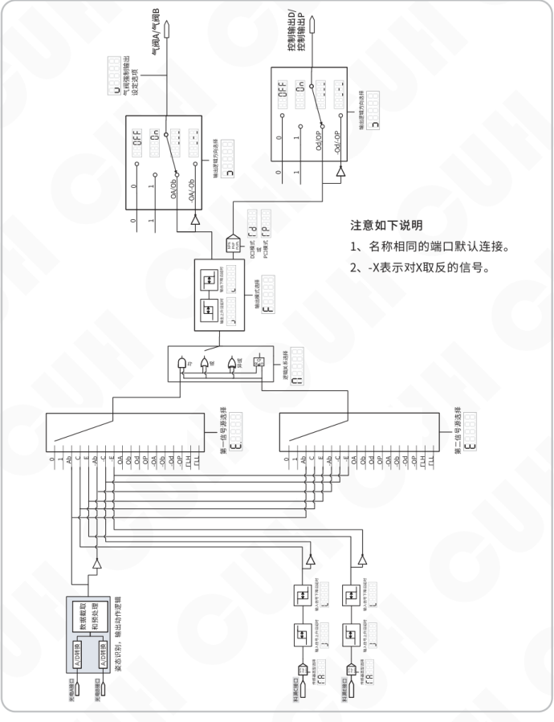

注意如下说明

1、名称相同的端口默认连接。

2、-X表示对X取反的信号。

2025-04　　　　　　　　　　　　　　　　　-23-　　　　　　　　　　　　　　　　　SDVS31SMSCN_2.01

### 第 30 页

## 5.3 输出模式说明

本控制器包含四个输出端口，分别是：气阀A、气阀B、控制输出D、控制输出P。其中：控制输出D端口在参数组C中设置；控制输出P端口在参数组D中设置。

每个输出可以单独设置输出模式，包含：保持模式、延时模式。每个模式的解释如下：

**a) 保持模式：**使输出的信号保持设定的时间。即当驱动输出的信号由无效变为有效后，输出保持开启状态并持续设定的时间，超过此时间后输出信号自动关闭。在此模式下参数“输出信号上升沿延时”用于设定开延时，参数“输出信号下降沿延时”用于设定输出信号保持时间。

**b) 延时模式：**是指驱动输出的信号由有效变为无效后，输出延时一段时间后才关闭。输出信号的持续时间由驱动输出的信号（即逻辑关系选择器后输出的信号）持续时间和输出关延时时间决定。此模式下参数“输出信号上升沿延时”用于设定开延时，参数“输出信号下降沿延时”用于设定关延时。

将两种模式的差别以时序图的形式表达如下，其中输入信号是逻辑关系选择器后输出的信号。

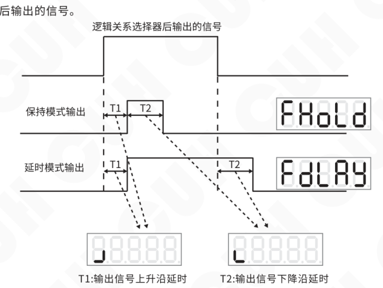

### 第 31 页

智能双光纤线扫分选控制器　　　　　　　　　　　　　　　　　SDVS31 系列

## 5.4 外接光纤传感器和电磁阀

本控制器内部除了集成两路光纤传感器和两路电磁阀外，还设计了两个数字输入端口C和E及两个控制输出端口D和P。其中C、E端口支持PNP和NPN类型选择和自动识别，每个可以支持最大1.2W的传感器；D、P两个控制输出端口每个可以支持最大9.6W的阻性或感性负载，如电磁阀、继电器。

**要点** 用户应该根据外接传感器及外接电磁阀的功率和数量，选择输出功率不小于总消耗功率的电源。例如外接2个0.8W的光纤传感器和2个4W的电磁阀，则电源输出功率应不小于2x0.8W+2x4W+4.4W=14W。因此，这种情况下SDVC系列振动送料控制器的电源功率将不能满足该应用的要求，用户应额外配备单独的供电电源。

下图是外接光纤传感器和外接电磁阀的示例，分别连接在C端口和D端口。如果再连接一套在E端口和P端口，则本产品结合自身的2路光纤传感器和电磁阀可以构成4路光纤检测与电磁阀分选系统。

2025-04　　　　　　　　　　　　　　　　　　　　　　　　　SDVS31SMSCN_2.01

### 第 32 页

### 5.4 外接光纤传感器和电磁阀

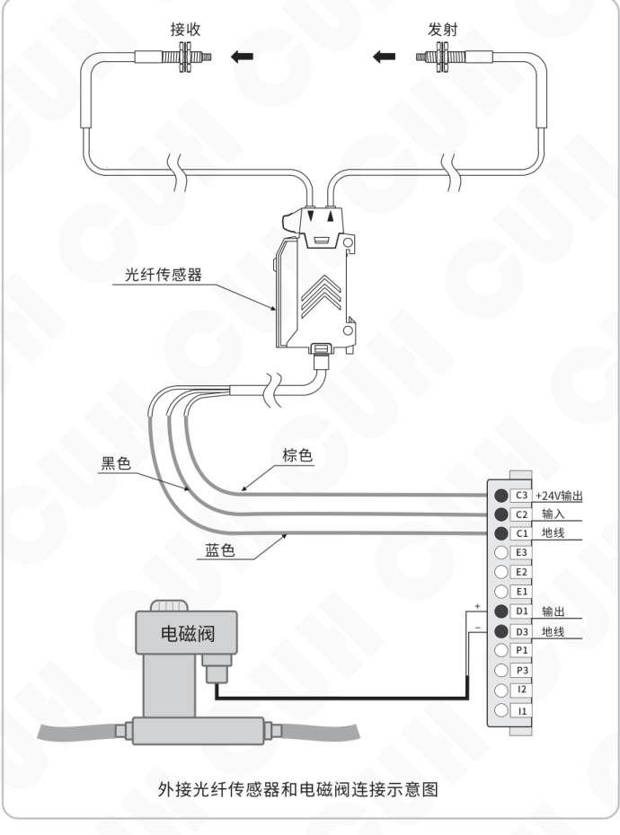

外接光纤传感器和电磁阀连接示意图

### 第 33 页

智能双光纤线扫分选控制器　　　　　　　　　　　　　　　　　　　　　　　SDVS31 系列

---

## 5.5 选配光纤支架安装

为方便用户安装光纤传感器，可选购专用支架用于固定光纤传感头。该支架由轻质铝合金关节和碳纤杆构成，可多自由度调整，具有安装方便、重量轻、固定牢固等优点。光纤支架安装方法如下：

第1步：按照图中顺序组装好关节和碳纤杆。

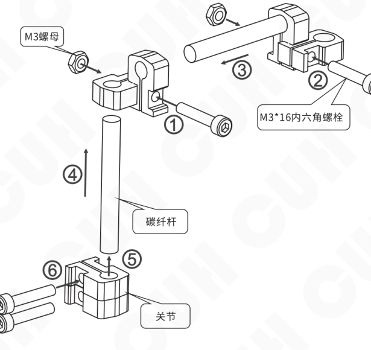

光纤支架连接示意图

---

2025-04　　　　　　　　　　　　　　　　　- 27 -　　　　　　　　　　　　　SDVS31SMSCN_2.01

### 第 34 页

智能双光纤线扫分选控制器

SDVS31 系列

第2步：将传感光纤头用螺母固定到支架上并将组装好的支架安装到振动盘外壁上。

安装完成后还可以根据物料的位置对每个关节进行调整，以获得更好的检测效果。

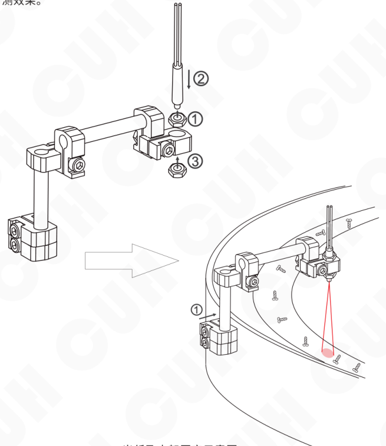

光纤及支架固定示意图

2025-04　　　　　　　　　　　　　　　　　-28-　　　　　　　　　　　　　　　　　SDVS31SMSCN_2.01

### 第 35 页

智能双光纤线扫分选控制器　　　　　　　　　　　　　　　　　　　　　　　　　SDVS31 系列

# 第六章 技术规格

## 6.1 技术规格表

| 项目 | 最小值 | 典型值 | 最大值 | 单位 | 备注 |
|---|---:|---:|---:|---|---|
| 直流输入电压 | 22 | 24 | 26 | 伏特（V） | 注1 |
| 控制输出电流 | —— | —— | 400 | 毫安（mA） | 注2 |
| NPN剩余电压 | —— | —— | 1.0 | 伏特（V） | 400mA |
| PNP剩余电压 | —— | —— | 1.5 | 伏特（V） | 400mA |
| 响应时间 | 2 | 3 | 5 | 毫秒（ms） | 气压5bar |
| 电磁阀控制精度 | 10 | —— | —— | 毫秒（ms） |  |
| 流量调节范围 | 0 | —— | 20 | 升/分（L/min） |  |
| 数字光电增益 | —— | 7.8×105 | —— | 无量纲 | 注3 |
| 光电分辨率 | —— | 4096:1 | —— | 无量纲 |  |
| 静态功耗 | —— | —— | 1.2 | 瓦（W） | 注4 |
| 适用光纤直径 | 2.1 | 2.2 | 2.3 | 毫米（mm） |  |
| 输入气压范围 | —— | 5 | 7 | 巴（Bar） | 注5 |
| 输入气管外径 | —— | 6 | —— | 毫米（mm） |  |
| 输出气管外径 | —— | 4 | —— | 毫米（mm） |  |
| 抗日光干扰 | —— | —— | 50000 | 勒克斯（Lux） |  |
| 抗白炽灯干扰 | —— | —— | 30000 | 勒克斯（Lux） | 注6 |
| 工作环境温度 | 0 | 25 | 45 | 摄氏度（℃） |  |
| 工作环境湿度 | 10 | 60 | 85 | 相对湿度（%） | 不结露 |
| 储藏环境温度 | -40 | 25 | 85 | 摄氏度（℃） |  |

**小心** 注1：超过30V控制器屏幕熄灭进入保护状态，最大不可超过36V。  
**小心** 注2：不可连接容性负载。  
**要点** 注3：数字光电增益定义为发射光平均功率和接收灵敏度的乘积，使用纤芯直径0.5mm的光纤测量得到。  
**要点** 注4：静态功耗为内部电磁阀不动作时的功耗。  
**注意** 注5：控制器不通电时最大气压不可超过10Bar。  
**要点** 注6：不可在强光LED照明灯下工作。

2025-04　　　　　　　　　　　　　　　　　-29-　　　　　　　　　　　　　　　　　SDVS31SMSCN_2.01

### 第 36 页

智能双光纤线扫分选控制器　　　　　　　　　　　　　　　　　SDVS31 系列

## 6.2 输入输出电路图

传感器输入输出电路图见下图所示。其中C端口与E端口相同，仅画出C端口；D端口与P端口相同，仅画出D端口。

C、E端口支持各种类型的开关传感器，如接近开关、光电开关、光纤放大器、激光传感器、超声传感器、压力传感器、触碰传感器、PLC数字输出等。

D、P端口支持各种类型的负载，如电磁阀、继电器、警报器、直流风扇、PLC数字输入等。

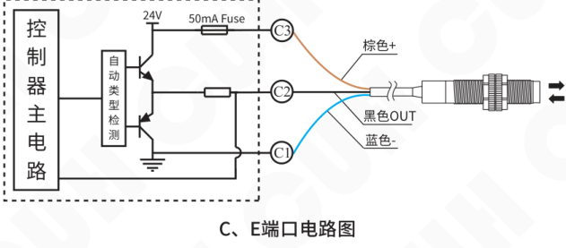

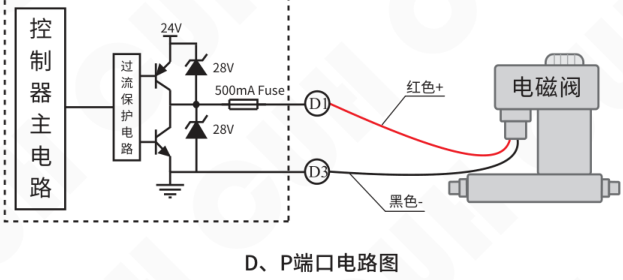

2025-04　　　　　　　　　　　　　　-30-　　　　　　　　　　　　　　SDVS31SMSCN_2.01

### 第 37 页

智能双光纤线扫分选控制器　　　　　　　　　　　　　　　SDVS31 系列

# 第七章 附录A：不适配的典型物料特征

## 7.1 无法以相对确定的形状/图案通过光纤检测区域的物料

使双光纤能够检测到相对确定的物料特征是保证分选准确率的关键因素之一。如图(a)所示，由于该物料表面图案较为复杂，并且其圆柱形的形状导致不能保证物料在每次经过光纤下方时光纤照射到的区域一致且确定，所以即使是相同的物料姿态也不能保证其光纤信号具有确定的信号特征。故本产品无法辨识该种典型物料的不同姿态。

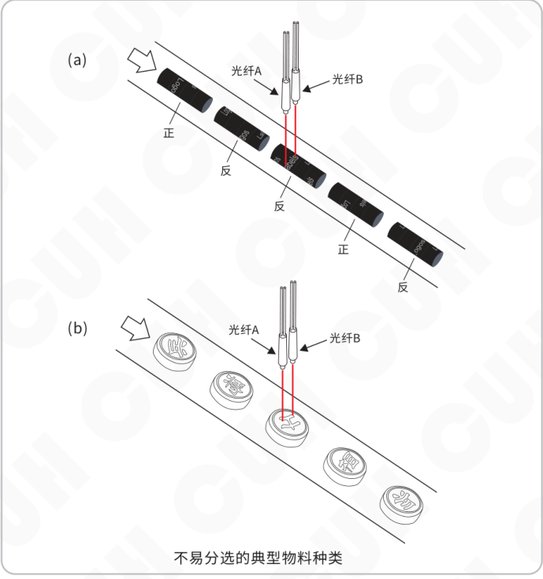

2025-04　　　　　　　　　　　　　-31-　　　　　　　　　　　　　SDVS31SMSCN_2.01

### 第 38 页

智能双光纤线扫分选控制器　　　　　　　　　　　　　　　　　　　　　　　　　SDVS31 系列

---

图(b)展示了另一种典型的本产品无法胜任的工况。一方面，物料模式种类过多，超出了本产品的辨识能力；另一方面，该种物料无法每次以确定的文字方向经过光纤检测区域，导致采集到的信号特征不确定。

## 7.2 物料特征过小的物料

若物料不同姿态之间的差异特征的尺寸占物料整体尺寸的比例过小，则也可能导致双光纤方法无法分选该物料。如下图所示，记物料总长度为L，特征尺寸为l，若l/L过小，则会由于光纤信号在时间上的分辨率不足，导致该物料不适用于双光纤方法。

特征尺寸过小的典型物料示意图

通常，本公司建议物料的特征尺寸占比l/L >> 1/64。

---

2025-04　　　　　　　　　　　　　-32-　　　　　　　　　　　　　SDVS31SMSCN_2.01

### 第 39 页

智能双光纤线扫分选控制器　　　　　　　　　　　　　　　　　　　　　　　　　SDVS31 系列

# 第八章 附录B：光纤安装调试方法

本产品的基本工作原理是利用双路光纤向料道不断地发射检测光和接收光电信号，并依据接收到的光电信号来判断光纤照射区域是否来料以及物料特征的提取和物料模式（姿态、种类）的推理。记两根光纤分别为A和B，它们都具有同时发射检测光和接收反射光信号的功能。当光纤A发射检测光时，光纤A本身接收到的反射光和光纤B接收到的反射光信号分别记为AA和AB。同样地，当光纤B发射检测光时，光纤A本身接收到的反射光和光纤B接收到的反射光信号分别记为BA和BB。本控制器基于AA, AB, BA, BB通道的信号对物料进行模式的推理。因此，如何合理地安装和调试光纤，使得四个通道的信号能够凸显出物料不同模式间的差异，是正确使用本控制器的前提条件。

## 8.1 颜色料道调整

推荐光纤下方的料道颜色为吸光度较高的黑色或深灰色，这样能够使得控制器判断光纤下方是否来料更加精准。

或者在不影响物料前进的基础上，将振动盘料道上光纤照射的两点做镂空处理。当光纤下方无物料时，控制器采集得到很小的反光值；当有物料时，控制器将会采集到较大的反射值。这样，控制器可以较为灵敏地识别来料。

## 8.2 光纤固定支架安装

光纤固定支架的安装方式可参考本说明书5.5节部分的内容。

注意：控制器接收到的光电信号对光纤所处的位置非常敏感。当控制器开始进入对料模式或者工作状态后，就不应当再对光纤的位置进行任何调整。每次光纤的位置及其下方的料道发生任何物理上的改变之后，都应当重新对料，对控制器进行数据训练。

2025-04　　　　　　　　　　　　　　　　　-33-　　　　　　　　　　　　　　SDVS31SMSCN_2.01

### 第 40 页

智能双光纤线扫分选控制器　　　　　　　　　　　　　　　SDVS31 系列

## 8.3 光纤的合适高度

在平行放置光纤的情况下，光纤高度位置调试安装的总体原则是光纤发射接收端部尽可能地接近物料上表面（在不影响物料顺利通过光纤照射区域的前提下）。假设光纤头距离料道表面的高度为H，待检测物料的本体最大高度为h，物料在料道上的最大跳跃高度为Δh，则H应当充分接近于h+Δh。

在某些特殊情况下，两光纤需要不平行放置，以更好地获取物料的光电信号特征。此时，光纤距离料道表面的高度H则等于相对更低的那一根光纤头的高度。

## 8.4 光纤的布置方式

### 8.4.1 平行放置的光纤

（1）首先需确定物料的行进路径经过每根光纤的照射区域，即光纤头对准了物料的送料路径。

（2）光纤A与光纤B投射在料道上的光斑允许重叠。

（3）若两个光斑不重叠，则两个光斑的最小边缘间距不得大于物料本身的宽度。

（4）平行的光纤A与光纤B所构成的平面应当垂直于物料的送料方向，不宜偏转较大角度。

（5）光纤A与B应当分别照射在物料不同模式间差异较为显著的地方。本控制器依据光纤信号AA, BB, AB以及BA综合评判当前物料所属的姿态，因此，必须保证物料不同姿态间四通道的信号存在显著的差异。具体而言，本文以下列所述的物料为例说明平行放置的光纤的布置方式。

2025-04　　　　　　　　　　　　-34-　　　　　　　　　　　　SDVS31SMSCN_2.01

### 第 41 页

下图中物料的各姿态之间的显著差异主要为两处，一处为物料的斜边一端的朝向，另一处为物料的通孔位置。将二者结合便可顺利辨识物料的当前模式。图中展示了正确的光纤AB照射位置。一方面，两个光斑应当适当拉开距离，使得物料斜边处的信号特征更加明显（光纤A与B的信号时间差）；另一方面，两光斑也不宜相隔过远导致无法照射到物料通孔的位置。

平行放置的双光纤适用的典型物料以及光斑线扫路径说明

### 第 42 页

智能双光纤线扫分选控制器　　　　　　　　　　　　　　　　　　　　　　　SDVS31 系列

另一典型物料分选工况如下图所示。该种物料具有四个姿态，不同姿态间的主要特征差异一处为物料边缘的锯齿形状，另一处为中间的通孔。物料的锯齿边缘反映在光纤信号上主要表现为信号幅值的上下波动，本控制器可以捕捉这一特征。物料的中间通孔反映在光纤信号上主要是信号在此处的信号幅值的增加或者减少，也是本控制器辨识物料的重要依据之一。因此光纤A与B所投射的光斑位置应当照射到这两处特征。

*平行放置的双光纤适用的典型物料以及光斑线扫路径说明*

2025-04　　　　　　　　　　　　　　　　　-36-　　　　　　　　　　　　　SDVS31SMSCN_2.01

### 第 43 页

智能双光纤线扫分选控制器　　　　　　　　　　　　　　　　　　　　　　　　　SDVS31 系列

## 8.4.2 非平行放置的光纤

针对一些具有特殊形状或特征的物料，需要将双光纤非平行架设。例如，如以下示意图所示的带倒角的物料。针对该种物料，若光纤平行放置，将导致倒角特征在光电信号上反映得不够明显，从而可能进一步导致物料模式判断的准确率下降。

设双光纤的对称轴为m，倒角轮廓的法向量为n，则应当尽量保证m与n共线。假设单根光纤与对称轴m的夹角为θ，则在客观条件允许的情况下应该尽量保证θ趋近于0。

---

2025-04　　　　　　　　　　　　　　　　　-37-　　　　　　　　　　　　　　　　　SDVS31SMSCN_2.01

### 第 44 页

智能双光纤线扫分选控制器　　　　　　　　　　　　　　　SDVS31 系列

# 第九章 附录C

## 9.1 外形尺寸　（单位：毫米mm）

外形尺寸图：

| 公差区间 | 公差值 |
|---|---|
| 0~3 | ±0.05 |
| 3~10 | ±0.1 |
| 10~30 | ±0.15 |
| 30~80 | ±0.2 |
| 80~180 | ±0.3 |
| >180 | ±0.5 |

本系列产品均适用此公差表。

2025-04　　　　　　　　　　　　　　　　　-38-　　　　　　　　　　　　　　　　　SDVS31SMSCN_2.01

### 第 45 页

智能双光纤线扫分选控制器　　　　　　　　　　　　　　　　　　　　　　　　　SDVS31 系列

## 9.2 故障诊断

| 故障代码 | 数码管符号图片 | 含义 | 排除方法 |
|---|---|---|---|
| Err01 |  | 输入电压过高 | 确保输入电压在22V至26V之间 |
| Err02 |  | 输入电压过低 | 确保输入电压在22V至26V之间 |
| Err78 |  | D端口输出过流 | 确保负载电流不超过400mA |
| Err79 |  | P端口输出过流 | 确保负载电流不超过400mA |
| Err20 |  | 气阀A输入信号逻辑错误 | 确保rs触发器输入不同时有效 |
| Err21 |  | 气阀B输入信号逻辑错误 | 确保rs触发器输入不同时有效 |
| Err22 |  | D端口输入信号逻辑错误 | 确保rs触发器输入不同时有效 |
| Err23 |  | P端口输入信号逻辑错误 | 确保rs触发器输入不同时有效 |

## 9.3 参考标准

| 极限参数：超过此指标将会造成严重损坏，必须严格遵守！ |  |  |  |  |  |
|---|---|---|---|---|---|
| 项目 | GB 标准 | IEC 标准 | 等级 | 标准要求 | 备注说明 |
| 静电放电 | GB/T 17626.2-2006 | IEC 61000-4-2:2001 | 4 | ±8 kV | 接触放电 |
| 静电放电 | GB/T 17626.2-2006 | IEC 61000-4-2:2001 | 4 | ±15 kV | 空气放电 |
| 电快速瞬变脉冲群 | GB/T 17626.4-2008 | IEC 61000-4-4:2004 | 4 | ±4 kV |  |
| 直流电源纹波抗扰度 | GB/T 17626.17-2005 | IEC 61000-4-17:2002 | 4 | 15% | 评价 A |

---

2025-04　　　　　　　　　　　　　　　　　　-39-　　　　　　　　　　　　　　SDVS31SMSCN_2.01

### 第 46 页

智能双光纤线扫分选控制器　　　　　　　　　　　　　　　　　SDVS31 系列

---

# 第十章 产品质保信息

## 10.1 质保期

本公司为本产品提供的质保期为三年，从产品发送到购买方指定地点之日算起。

## 10.2 保修范围

（一）如果在上述质保期内出现本公司造成的故障，我们将免费维修产品。但是以下情况不属于保修范围：

 a、未按照简易说明书、用户手册或购买方与本公司专门达成的技术要求中规定的条件、环境下的不正确操作，或不正确使用造成的故障。

 b、故障不是因产品缺陷，而是购买方设备或软件设计造成的。

 c、非本公司人员进行的修改或修理而造成的故障。

 d、按照简易操作指南或用户手册正确维修或更换易损部件等规定可以完全避免的故障。

 e、产品从本公司发货后，因无法预料的科学技术水平变化等因素而造成的故障。

 f、由于火灾、地震、洪水等自然灾害，或异常电压等外部因素造成的故障，本公司不负责保修。

（二）保修范围仅限于（一）中规定的情况，本公司对该设备造成的购买方间接损失（如设备损坏、机会丧失、利润损失等）或其他损失，不承担任何责任。

## 10.3 产品适用性

本公司的该控制器是针对物料分选行业的通用产品而设计生产的。因此，本公司的该控制器不得用于下列应用且不适合其使用。

（一）对生命和财产有严重影响的设施，如核发电厂、机场、铁路、轮船、机动装置及医疗设备。

（二）公共事业，包括电力、气体、供水等。

（三）相似条件或环境的户外使用。

---

2025-04　　　　　　　　　　　　　　　　　-40-　　　　　　　　　　　　　　　　　SDVS31SMSCN_2.01

### 第 47 页

*（本页 `page_markdown` 为空。）*

### 第 48 页

南京创优科技有限责任公司  
网址:www.cuhnj.com  
电话:400-985-8889  
传真:025-84730426  
邮箱:sales@cuhnj.com  
地址:南京市江宁区智能路9号  
启迪城学研园2幢

文档编号：IDP1000450
<!-- /auto:ai-body-draft v1 -->

<!-- auto:data-params-summary v1 -->
## 附录 · 参数表（结构化侧车·机器生成）

> 说明：本节由 `data/<doc_key>/params/params.yaml` 自动渲染（展示前若干行），用于校对与二次开发。定稿以层 C 数据为准。

| 参数 | 标志/符号 | 范围 | 默认 | 单位 | 备注 |
| --- | --- | --- | --- | --- | --- |
|    **小心** |  |  |  |  |  |
|    **注意** |  |  |  |  |  |
|  **要点** ！ |  |  |  |  |  |
|     |     |    n ∈[1,4]  A (剔除),  P (允许通过) |  |  |  |
|     |     |     |  |  |  |
|     |     |    / |  |  |  |
|     |     |     |  |  |  |
|     |     |    0~999 |  |  |  |
|       |       |      0~999 |  |  |  |
|       |       |      0~999 |  |  |  |
|       |       |      0~999 |  |  |  |
|       |       |      0.01~9.99 |  |  |  |
|       |       |      0~99.99 |  |  |  |
|       |       |      0~99.99 |  |  |  |
|     |     |      0~9999 每分钟个数 |  |  |  |
|     |     |      0~100（n ∈[1,4]） |  |  |  |
|       |       |        0~9999 万  |  |  |  |
|       |       |        0~9999 个 |  |  |  |
|       |       |        0~100（通过姿态数量占总个数比例） |  |  |  |
|       |       |        0~28 伏特（V） |  |  |  |
|     |     |      0~28 伏特（V） |  |  |  |
|     |     |      0~28 伏特（V） |  |  |  |
|     |     |      0~28 伏特（V） |  |  |  |
|     |     |        0~28 伏特（V） |  |  |  |
|     |     |        0~9999 亿次 |  |  |  |
|     |     |        0~9999 万次 |  |  |  |
|     |     |        0~9999 次 |  |  |  |
|     |     |        / |  |  |  |
|     |     |    1~9  |  |  |  |
|     |     |    0.01~9.99  |  |  |  |

*（仅展示前 30 条，共 86 条；完整数据见下方链接。）*

- 完整 YAML：`data/cuh.sdvc.manual.v2.01/params/params.yaml`
- 表格索引：`data/cuh.sdvc.manual.v2.01/index.yaml`
<!-- /auto:data-params-summary v1 -->
