## 目录

> 下列条目来自 PDF 内置书签/大纲；链接指向本批转换生成的整页渲染图（`assets/pages/`），便于与原版 PDF 对照校对。

- [2: 版权与免责](assets/pages/page-0002.png)（第 2 页）
- [3: 序言](assets/pages/page-0003.png)（第 3 页）
- [4: 安全与预防措施](assets/pages/page-0004.png)（第 4 页）
- [5: 工作与储存环境](assets/pages/page-0005.png)（第 5 页）
- [7: 目录](assets/pages/page-0007.png)（第 7 页）
- [8: 目录2](assets/pages/page-0008.png)（第 8 页）
- [第一章 使用前须知](assets/pages/page-0009.png)（第 9 页）
  - [1.1 检查包装内容](assets/pages/page-0009.png)（第 9 页）
  - [1.2 指示灯、按键及外部部件说明](assets/pages/page-0010.png)（第 10 页）
  - [1.3 接线端口说明](assets/pages/page-0011.png)（第 11 页）
  - [1.4 控制器铭牌说明](assets/pages/page-0011.png)（第 11 页）
- [第二章 产品介绍](assets/pages/page-0012.png)（第 12 页）
  - [2.1 产品简介](assets/pages/page-0012.png)（第 12 页）
  - [2.2 产品性能提升](assets/pages/page-0012.png)（第 12 页）
  - [2.3 双路输出联合使用](assets/pages/page-0013.png)（第 13 页）
- [第三章 安装及使用指南](assets/pages/page-0014.png)（第 14 页）
  - [3.1 控制器使用条件](assets/pages/page-0014.png)（第 14 页）
  - [3.2 按键基本操作](assets/pages/page-0014.png)（第 14 页）
  - [3.3 安装使用](assets/pages/page-0015.png)（第 15 页）
- [第四章 基本功能说明](assets/pages/page-0019.png)（第 19 页）
  - [4.1 输出电压设置](assets/pages/page-0019.png)（第 19 页）
  - [4.2 输出频率设置](assets/pages/page-0020.png)（第 20 页）
  - [4.3 缓启动功能](assets/pages/page-0020.png)（第 20 页）
  - [4.4 缓关闭功能](assets/pages/page-0021.png)（第 21 页）
  - [4.5 刹车功能](assets/pages/page-0021.png)（第 21 页）
  - [4.6 输出开关](assets/pages/page-0022.png)（第 22 页）
  - [4.7 键盘锁定功能](assets/pages/page-0022.png)（第 22 页）
  - [4.8 恢复出厂设置](assets/pages/page-0023.png)（第 23 页）
- [第五章 高级功能说明](assets/pages/page-0025.png)（第 25 页）
  - [5.1 遥控调速功能](assets/pages/page-0025.png)（第 25 页）
  - [5.2 智能光电功能](assets/pages/page-0027.png)（第 27 页）
  - [5.3 料满停机功能](assets/pages/page-0028.png)（第 28 页）
  - [5.4 控制输出功能](assets/pages/page-0029.png)（第 29 页）
    - [5.4.1 控制输出的接线方法](assets/pages/page-0029.png)（第 29 页）
    - [5.4.2 控制输出信号源和逻辑图](assets/pages/page-0030.png)（第 30 页）
    - [5.4.3 控制输出模式说明](assets/pages/page-0032.png)（第 32 页）
    - [5.4.4 主输出信号控制功能](assets/pages/page-0032.png)（第 32 页）
  - [5.5 最大电压限制功能](assets/pages/page-0033.png)（第 33 页）
  - [5.6 可调过流保护功能](assets/pages/page-0033.png)（第 33 页）
  - [5.7 面板亮度调整功能](assets/pages/page-0034.png)（第 34 页）
  - [5.8 输出监控功能](assets/pages/page-0034.png)（第 34 页）
  - [5.9 双路联合控制功能](assets/pages/page-0035.png)（第 35 页）
  - [5.10 用户参数保存与恢复功能](assets/pages/page-0036.png)（第 36 页）
- [第六章 技术规格](assets/pages/page-0037.png)（第 37 页）
  - [6.1 外形尺寸](assets/pages/page-0037.png)（第 37 页）
  - [6.2 技术规格表](assets/pages/page-0038.png)（第 38 页）
  - [6.3 参考标准](assets/pages/page-0039.png)（第 39 页）
- [第七章 附录](assets/pages/page-0040.png)（第 40 页）
  - [7.1 参数列表](assets/pages/page-0040.png)（第 40 页）
  - [7.2 输入输出电路图](assets/pages/page-0043.png)（第 43 页）
  - [7.3 故障诊断](assets/pages/page-0044.png)（第 44 页）
- [第八章 产品质保信息](assets/pages/page-0045.png)（第 45 页）
  - [8.1 质保期](assets/pages/page-0045.png)（第 45 页）
  - [8.2 保修范围](assets/pages/page-0045.png)（第 45 页）
  - [8.3 产品适用性](assets/pages/page-0045.png)（第 45 页）
## 术语与命名

- 侧车：`glossary/terms.yaml`（机读）、`glossary/zh-CN.md`（人读）；候选表，定稿后并入公司级 `glossary/`。

## 适用范围

- 本文档由 PDF 自动转换生成，正文与插图需人工核对。

## 变更记录

- 2026-06-05 13:38:52：由转换工具从源 PDF 生成首版。

## 正文

<!-- auto:ai-body-draft v1 -->
> 以下为**整页视觉转写**的正文草稿（多模态模型直接输出 Markdown，含 GFM 表； 若配置 `[[vcrop:页:序]]` 占位符，裁剪步骤会插入 `assets/images/` 下 PNG）。**请务必人工校对。**

### 第 1 页

## 双路数字调频振动送料控制器

**Dual Channel Digital Variable Frequency**  
**Vibratory Feeder Controller**

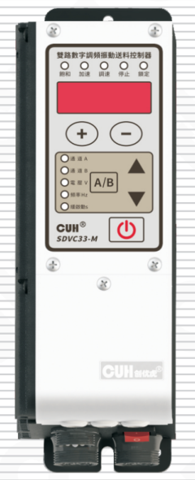

## SDVC33 系列

# 用户手册

### 第 2 页

双路数字调频振动送料控制器　　　　　　　　　　　　　　　　　　　　　　　　　SDVC33 系列

---

## 版权说明

南京创优科技有限责任公司保留所有权利。

本用户手册上包含的所有信息是属于本公司的知识，受著作权法及所有法律的保护。本公司根据著作权法及其他法律享有并保留所有著作权和其他法律赋予的权利，未经本公司书面同意不得以任何形式对本用户手册的部分或全部进行抄袭、翻译、转译、仿制或其他利用。

## 免责声明

本用户手册的所有内容仅说明本公司生产的相关产品的使用方法，并且是根据现有技术和提供给您使用时的状态进行描述的，在您使用本产品时必须自行承担相关风险。除法律强制规定外，本公司不因本用户手册对产品负有任何明示或暗示的责任，包括但不限于人身伤害、财产损失、机会丧失。

您明确了解上述风险并同意，除法律强制规定外，本公司无须为您的任何直接、间接的损害或损失负责（包括但不限于人员、财物、数据等有形损失和名誉、机会等无形损失）。

本公司保留对本用户手册中所适用的产品进行修改而不预先及事后通知的权利。

---

2023-12　　　　　　　　　　　　　　　　　　　　　　　　　　　　　SDVC33SMSCN_3.01

### 第 3 页

双路数字调频振动送料控制器　　　　　　　　　　　　　　　　　　　　　　　　　SDVC33 系列

---

# 序　言

感谢您使用南京创优科技有限责任公司（在本手册中以下简称本公司）出品的SDVC33系列双路数字调频振动送料控制器（在本手册中以下简称本产品、本控制器或控制器）。本系列控制器是采用高品质元件并融合了最新的电子技术，采用高性能的数字信号处理器经过精心的设计而成。

本手册介绍了本产品的基本操作方法、功能技术说明和典型应用示例。为用户提供安装调试、参数设置、异常诊断、故障排除及日常维护控制器的相关信息。为了确保正确安装和使用本控制器，请在装机之前仔细阅读本用户手册，并请妥善保存。

以下符号提醒您注意有关防止人身伤害和产品损坏的事项，请务必阅读。

| 标志 | 说明 |
|---|---|
| ⚠️ **危险** | 表示若不遵守该事项，将导致人员伤亡。 |
| ⚠️ **警告** | 表示若不遵守该事项，可能导致人员伤亡。 |
| ⚠️ **小心** | 表示若不遵守该事项，可能导致人员遭受中度或轻微伤害。 |
| **注意** | 表示若不遵守该事项，将导致本产品损坏及财产损失。 |
| **要点** | 表示在使用过程中必须要遵守的注意事项和使用限制等。 |

**本说明书适合以下型号控制器：**

◆ 双路数字调频振动送料控制器 SDVC33-M（合电流最大3.5A）

---

2023-12　　　　　　　　　　　　　　　　　　　　　　　　　　　　　　SDVC33SMSCN_3.01

### 第 4 页

双路数字调频振动送料控制器　　　　　　　　　　　　　　　　　SDVC33 系列

# 安全与预防措施

1. **【危险】** 本产品仅用于驱动基于电磁铁的振动送料设备，请勿将本产品用于保护人体或人体部位等目的。

2. **【危险】** 本产品不得作为防爆产品使用，请勿在危险场所和/或潜在爆炸气体环境中使用本产品。

3. **【警告】** 本产品是采用交流市电供电的设备，请勿施加交流电压超过 260Vac。施加过大的输入电压如380Vac，则可能导致产品爆炸或者着火，造成严重的安全事故。

4. **【警告】** 本产品是通过电源线进行接地的，请确保为控制器供电的配电设施具备良好的接地，否则可能导致控制器外壳带电，造成触电事故。

5. **【警告】** 请勿输入交流电源到本控制器的输出端，这会损坏控制器。

6. **【警告】** 请勿在带电的情况下插拔接线或触摸接线仓内各接线端子触点，以防发生触电事故。

7. **【注意】** 请避免采用通过继电器等设备切断供电的方式来控制本产品的输出，这会严重降低本控制器的寿命。

8. **【注意】** 本产品设计使用于阴凉干燥环境，请勿将本产品置于室外、可能会浸水、阳光暴晒场所工作，也不要在超过本产品电气特性要求的温度和湿度范围之外工作。

9. **【要点】** 请务必将本产品固定在可靠接地的坚固平台上，并远离振动设备。

10. **【要点】** 任何情况下请勿将本产品在超越设计极限状态下工作。

11. **【要点】** 请严格按照本手册的说明操作，对于违反这些操作说明所造成的任何人身伤害或财产损失，本公司不承担任何民事和刑事责任。

12. **【要点】** 任何情况下请不要打开本控制器机壳，以防遭到电击。机壳内部没有可以调节和用户维修部分，请不要试图维修本机，出现故障请致电本公司。

---

2023-12　　　　　　　　　　　　　　　　　　　　　　　　　SDVC33SMSCN_3.01

### 第 5 页

双路数字调频振动送料控制器　　　　　　　　　　　　　　　　　　　　　SDVC33 系列

---

# 工作与储存环境

## 一、使用前的检查

每台控制器在出厂前，均经过严格的品质检验，并经过强化的防撞包装处理。客户在拆箱后，请即刻进行下列检查：

1、检查控制器是否在运输过程中受到损伤。

2、检查控制器型号是否与订货登记资料完全相同。

## 二、工作环境

为使本控制器具有更好的使用效果和更长的使用寿命，请将控制器安装在符合下列条件的环境中：

- 良好的通风散热环境
- 远离水滴、蒸气、灰尘，（特别是油性灰尘）
- 无腐蚀、易燃性的气体、液体
- 无漂浮性的尘埃及金属微粒
- 安装表面坚固无振动
- 远离电磁噪声干扰
- 使用环境温度为0℃到40℃
- 仅适用于海拔2000m以下地区安全使用

---

2023-12　　　　　　　　　　　　　　　　　　　　　　　　　　　SDVC33SMSCN_3.01

### 第 6 页

双路数字调频振动送料控制器　　　　　　　　　　　　　　　　SDVC33 系列

---

---

2023-12　　　　　　　　　　　　　　　　　　　　　　　　SDVC33SMSCN_3.01

### 第 7 页

双路数字调频振动送料控制器　　　　　　　　　　　　　　　　　　　　　　SDVC33 系列

---

# 目　录

**第一章 使用前须知** -------------------------------------------------------------------------------1 
　　1.1　检查包装内容 -----------------------------------------------------------------------------1 
　　1.2　指示灯、按键及外部部件说明 ---------------------------------------------------------2 
　　1.3　接线端口说明 -----------------------------------------------------------------------------3 
　　1.4　控制器铭牌说明 --------------------------------------------------------------------------3 

**第二章 产品介绍** -----------------------------------------------------------------------------------4 
　　2.1　产品简介 -----------------------------------------------------------------------------------4 
　　2.2　产品性能提升 -----------------------------------------------------------------------------4 
　　2.3　双路输出联合使用 ------------------------------------------------------------------------5 

**第三章 安装及使用指南** ------------------------------------------------------------------------6 
　　3.1　控制器使用条件 --------------------------------------------------------------------------6 
　　3.2　按键基本操作 -----------------------------------------------------------------------------6 
　　3.3　安装使用 -----------------------------------------------------------------------------------7 

**第四章 基本功能说明** -------------------------------------------------------------------------11 
　　4.1　输出电压设置 ----------------------------------------------------------------------------11 
　　4.2　输出频率设置 ----------------------------------------------------------------------------12 
　　4.3　缓启动功能 -------------------------------------------------------------------------------12 
　　4.4　缓关闭功能 -------------------------------------------------------------------------------13 
　　4.5　刹车功能 ----------------------------------------------------------------------------------13 
　　4.6　输出开关 ----------------------------------------------------------------------------------14 
　　4.7　键盘锁定功能 ----------------------------------------------------------------------------14 
　　4.8　恢复出厂设置 ----------------------------------------------------------------------------15 

**第五章 高级功能说明** -------------------------------------------------------------------------17 
　　5.1　遥控调速功能 ----------------------------------------------------------------------------17 
　　5.2　智能光电功能 ----------------------------------------------------------------------------19 
　　5.3　料满停机功能 ----------------------------------------------------------------------------20

---

2023-12　　　　　　　　　　　　　　　　　　　　　　　　　　SDVC33SMSCN_3.01

### 第 8 页

**双路数字调频振动送料控制器**　　　　　　　　　　　　　　　　　　　　　　　　　**SDVC33 系列**

---

5.4　控制输出功能 ------------------------------------------------------------------ 21

　　5.4.1 控制输出的接线方法 ------------------------------------------------------ 21

　　5.4.2 控制输出信号源和逻辑图 -------------------------------------------------- 22

　　5.4.3 控制输出模式说明 -------------------------------------------------------- 24

　　5.4.4 主输出信号控制功能 ------------------------------------------------------ 24

5.5　最大电压限制功能 -------------------------------------------------------------- 25

5.6　可调过流保护功能 -------------------------------------------------------------- 25

5.7　面板亮度调整功能 -------------------------------------------------------------- 26

5.8　输出监控功能 ------------------------------------------------------------------ 26

5.9　双路联合控制功能 -------------------------------------------------------------- 27

5.10　用户参数保存与恢复功能 ------------------------------------------------------- 28

**第六章 技术规格** ---------------------------------------------------------------- 29

　　6.1　外形尺寸 ------------------------------------------------------------------ 29

　　6.2　技术规格表 ---------------------------------------------------------------- 30

　　6.3　参考标准 ------------------------------------------------------------------ 31

**第七章 附录** -------------------------------------------------------------------- 32

　　7.1　参数列表 ------------------------------------------------------------------ 32

　　7.2　输入输出电路图 ------------------------------------------------------------ 35

　　7.3　故障诊断 ------------------------------------------------------------------ 36

**第八章 产品质保信息** ------------------------------------------------------------ 37

　　8.1　质保期 -------------------------------------------------------------------- 37

　　8.2　保修范围 ------------------------------------------------------------------ 37

　　8.3　产品适用性 ---------------------------------------------------------------- 37

---

2023-12　　　　　　　　　　　　　　　　　　　　　　　　　　　　　SDVC33SMSCN_3.01

### 第 9 页

双路数字调频振动送料控制器　　　　　　　　　　　　　　　　　　　　　　　SDVC33 系列

---

# 第一章 使用前须知

本章节介绍产品包装内容、控制器外观说明和控制器铭牌信息。

## 1.1 检查包装内容

使用本产品之前，请检查控制器及附件的完整性。如果发现产品有缺陷或已损坏、附件缺失等问题，请与本公司联系。

|  |  |
|---|---|
| 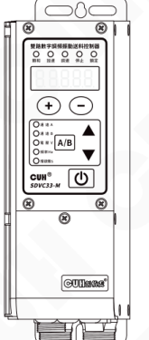 控制器×1 | 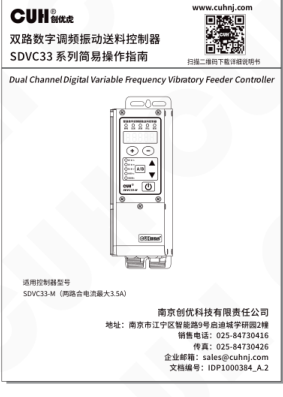 简易说明书×1 |
| 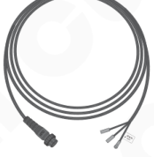 输出线×2 | 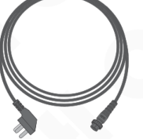 输入电源线×1 |

---

2023-12　　　　　　　　　　　　　　　　　- 1 -　　　　　　　　　　　　　　　　　SDVC33SMSCN_3.01

### 第 10 页

双路数字调频振动送料控制器　　　　　　　　　　　　　　　　　　　　　　　　　　　SDVC33 系列

## 1.2 指示灯、按键及外部部件说明

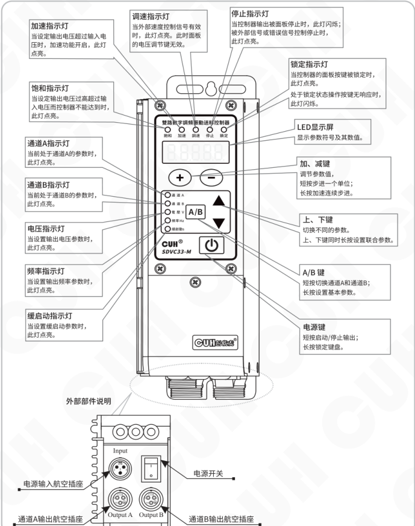

### 指示灯及按键说明

| 名称 | 说明 |
|---|---|
| 加速指示灯 | 当设定输出电压超过输入电压时，加速功能开启，此灯点亮。 |
| 饱和指示灯 | 当设定输出电压过高超过输入电压而控制器不能达到时，此灯点亮。 |
| 通道 A 指示灯 | 当前处于通道 A 的参数时，此灯点亮。 |
| 通道 B 指示灯 | 当前处于通道 B 的参数时，此灯点亮。 |
| 电压指示灯 | 当设置输出电压参数时，此灯点亮。 |
| 频率指示灯 | 当设置输出频率参数时，此灯点亮。 |
| 缓启动指示灯 | 当设置缓启动参数时，此灯点亮。 |
| 调速指示灯 | 当外部速度控制信号有效时，此灯点亮。此时面板的电压调节键无效。 |
| 停止指示灯 | 当控制器输出被面板停止时，此灯闪烁；被外部信号或错误信号控制停止时，此灯点亮。 |
| 锁定指示灯 | 当控制器的面板按键被锁定时，此灯点亮。处于锁定状态操作按键无响应时，此灯闪烁。 |
| LED 显示屏 | 显示参数符号及其数值。 |
| 加、减键 | 调节参数值，短按步进一个单位；长按加速连续步进。 |
| 上、下键 | 切换不同的参数。上、下键同时长按设置联合参数。 |
| A/B 键 | 短按切换通道 A 和通道 B；长按设置基本参数。 |
| 电源键 | 短按启动/停止输出；长按锁定键盘。 |

### 外部部件说明

| 名称 | 图中标注 |
|---|---|
| 电源输入航空插座 | Input |
| 通道 A 输出航空插座 | Output A |
| 通道 B 输出航空插座 | Output B |
| 电源开关 | 电源开关 |

### 面板文字标识

- 雙路數字調頻振動送料控制器
- 通道 A
- 通道 B
- 電壓 V
- 頻率 Hz
- 緩啟動 s
- SDVC33-M
- A/B
- 鎖定
- 停止
- 調速
- 加速
- 飽和
- CUH 创优虎

---

2023-12　　　　　　　　　　　　　　　　　- 2 -　　　　　　　　　　　　　　　　　SDVC33SMSCN_3.01

### 第 11 页

双路数字调频振动送料控制器　　　　　　　　　　　　　　　　　　　　　　　　　SDVC33 系列

## 1.3 接线端口说明

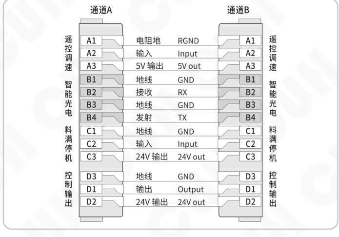

通道 A 与通道 B 的接线端口定义相同：

| 功能组 | 端子 | 中文标注 | 英文标注 |
|---|---:|---|---|
| 遥控调速 | A1 | 电阻地 | RGND |
| 遥控调速 | A2 | 输入 | Input |
| 遥控调速 | A3 | 5V 输出 | 5V out |
| 智能光电 | B1 | 地线 | GND |
| 智能光电 | B2 | 接收 | RX |
| 智能光电 | B3 | 地线 | GND |
| 智能光电 | B4 | 发射 | TX |
| 料满停机 | C1 | 地线 | GND |
| 料满停机 | C2 | 输入 | Input |
| 料满停机 | C3 | 24V 输出 | 24V out |
| 控制输出 | D3 | 地线 | GND |
| 控制输出 | D1 | 输出 | Output |
| 控制输出 | D2 | 24V 输出 | 24V out |

## 1.4 控制器铭牌说明

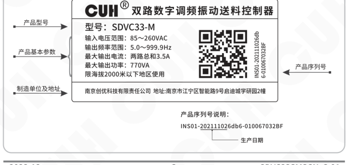

| 标注区域 | 铭牌内容 |
|---|---|
| 产品型号 | 型号：SDVC33-M |
| 产品基本参数 | 输入电压范围：85～260VAC 输出频率范围：5.0～999.9Hz 最大输出电流：两路总和3.5A 最大输出功率：770VA 限海拔2000米以下地区使用 |
| 制造单位及地址 | 南京创优科技有限责任公司　地址:南京市江宁区智能路9号启迪城学研园2幢 |
| 产品序列号 | INS01-202111026db6-010067032BF |
| 产品序列号说明 | INS01-202111026db6-010067032BF，其中标示段用于表示生产日期 |

---

2023-12　　　　　　　　　　　　　　　- 3 -　　　　　　　　　　　　　　　SDVC33SMSCN_3.01

### 第 12 页

双路数字调频振动送料控制器　　　　　　　　　　　　　　　　　　　　　SDVC33 系列

# 第二章 产品介绍

本章节主要内容包括本产品的简单介绍和主要特色功能。

## 2.1 产品简介

SDVC33系列双路数字调频振动送料控制器是一款紧凑的通用型两路调频输出控制器，通过采用最新的电子技术和精心的设计，提供独特的性能。其特色功能包括：

- 可任意分配电流的双通道功率输出，支持设置每通道的过流保护电流。
- 双路工作模式可以选择频率跟踪、电压跟踪或频率电压双跟踪。
- 频率跟踪时，可以设置两路输出的相位差-180°~180°。
- 输出频率范围覆盖5Hz至999.9Hz，精度为0.1Hz。
- 刹车功能，通过在缓关闭过程中将电流移相180°快速停止振动盘。
- 智能光电端口支持光电传感器、NPN或PNP开关传感器。
- 就绪信号功能：通过智能光电B4发射端口输出调制信号或有效信号指示控制器处于就绪状态，控制器出现错误时就绪信号变为无效。
- 料满停机端口支持NPN、PNP或自动适应类型。
- 控制输出端口支持NPN、PNP或推挽输出模式。
- 遥控调速端口可以交叉选择，允许一个电位器同时控制两路输出。
- 遥控系数功能，可以将遥控电压的控制效果放大1倍或缩小1倍。
- 面板亮度调节功能支持32级亮度调整。
- 用户参数保存与恢复功能，允许用户设置参数后保存在用户组中方便恢复。
- 恢复出厂设置功能支持分通道A/B恢复或整机恢复。
- 完整的保护功能包括：主输出的短路保护、过流保护、过热或过冷保护、电源欠压/过压保护、控制输出短路保护、24V输出短路保护、调速5V输出短路保护。

## 2.2 产品性能提升

本产品与SDVC31-M控制器相比，有较大幅度的性能提升。主要包括：

- 输出频率由40.0Hz~400.0Hz提升至5.0Hz~999.9Hz。
- 智能光电、料满停机端口开/关延时最大值由20.0秒提升至99.9秒。
- 新增缓关闭功能，可以设置0.0~10.0秒，用于缓慢停止振动盘振动。

2023-12　　　　　　　　　　　　　　- 4 -　　　　　　　　　　　　　　SDVC33SMSCN_3.01

### 第 13 页

双路数字调频振动送料控制器　　　　　　　　　　　　　　　　　　　　　　　　　SDVC33 系列

---

- 新增刹车功能，可以设置0~10次刹车周数，用于快速停止振动盘振动。
- 智能光电端口新增PNP传感器支持。
- 料满停机端口由NPN、PNP选择提升为软件可设置，并提供自动模式。
- 控制输出端口类型由NPN输出提升为可设置NPN、PNP、推挽三种类型。
- 新增控制输出端口开/关延时，可以设置0.0~99.9秒。
- 新增控制输出模式，可以设置延时模式和保持模式。
- 新增可调节过流保护电流参数，用于保护电磁铁避免烧毁。
- 新增遥控系数，可以放大或缩小遥控电压的控制效果。
- 新增面板亮度调整功能，可以分别设置A/B组的显示亮度。
- 新增测量功能，可以监控输出电流、调速电压、智能光电端口信号电压、料满停机端口输入电压、控制输出端口输出电压、温度显示、母线电压、24V输出电压。
- 新增参数保存和恢复功能，除工作组参数会自动保存外，还可以将工作组的参数保存在用户组中，并在需要时可以从用户组中灵活恢复A组参数和B组参数。

## 2.3 双路输出联合使用

本控制器提供了联合控制通道A/B的参数，可以用于控制双轴矢量振动盘或一个圆振一个直振接力的送料系统。

默认通道A、B独立工作，联合时可以设置B路跟踪A路，包括电压跟踪、频率跟踪、电压频率双跟踪。在频率一致时，两路输出相位锁定，用户可以调节相位差-180°~180°。

在设置好B路电压频率双跟踪A路后，只需要调节A路的电压、频率就可以实现A/B输出电压和输出频率的同时改变。

---

2023-12　　　　　　　　　　　　　　　　　- 5 -　　　　　　　　　　　　　　　　　SDVC33SMSCN_3.01

### 第 14 页

双路数字调频振动送料控制器　　　　　　　　　　　　　　　　　　　　　　　　　SDVC33 系列

# 第三章 安装及使用指南

本章节介绍本产品使用所必须具备的条件以及如何正确进行安装与连接。

## 3.1 控制器使用条件

本产品是使用交流110/220V供电的设备，且通过电源线三爪插头进行保护接地连接，请提供符合标准的110V或220V，50Hz/60Hz市电供电配电设施并确保保护地线已正确连接。

> ⚠️ **警告**　切不可将控制器连接到380V交流电，这将造成控制器不可恢复的严重损坏，有可能导致爆炸、火灾等安全事故。

> ⚠️ **警告**　确保供电侧可靠接地，控制器的金属外壳是与保护接地线直接连接的，接地不良会导致控制器外壳带电，引发触电事故。

> **注意**　控制器长时间工作会产生热量致使外壳温度升高，请将控制器安装在通风良好的环境中，并将其固定良好，远离振动源。

> **注意**　本产品的通道A/B输出是市电经过整流、逆变形成的，中间没有隔离环节。因此输出两极不可以与保护接地连接，在连接电磁铁时也要确保电磁铁线圈与外壳之间具备基本的绝缘能力。否则会导致漏电，可能产生触电和控制器损坏的事故。

> **注意**　本产品是用来驱动电磁铁的控制器，切不可连接压电振动盘。

## 3.2 按键基本操作

 a. 按键动作根据按下时间分为短按、长按（一级加速、二级加速）。

 b. 短按定义按下时间大于0.1小于2秒，长按定义按下时间大于2秒。

 c. 长按 <kbd>A/B</kbd> 进入/退出基本参数界面。

 d. 长按 <kbd>A/B</kbd> 加 ▲ 进入/退出高级参数界面。

 e. 长按 <kbd>A/B</kbd> 加 ▼ 进入/退出监控参数界面。

 f. 长按 ▲ 加 ▼ 进入/退出联合参数界面。

 g. 恢复出厂参数下长按 <kbd>+</kbd> 显示  后松开显示CUH即恢复出厂设置。

 h. 用户参数保存时选择uP1，同时长按 <kbd>+</kbd> 和 <kbd>-</kbd>，保存成功显示SAU。

 i. 用户参数恢复时，选择恢复方式后同时长按 <kbd>+</kbd> 和 <kbd>-</kbd>，恢复成功显示rES。

 m. 锁定状态下操作非停止键，锁定灯闪烁。

---

2023-12　　　　　　　　　　　　　- 6 -　　　　　　　　　　　　　SDVC33SMSCN_3.01

### 第 15 页

双路数字调频振动送料控制器　　　　　　　　　　　　　　　　SDVC33 系列

## 3.3 安装使用

**第一步:**

打开控制器的外包装，检查控制器外观及侧标型号，判断是否为所需的型号。

**第二步:**

取出输出线，将输出线两个子弹头接线端子连接到振动盘的电磁线圈上。并确认黄绿双色的地线与振动盘金属外壳可靠连接。

将A/B两路输出线航空插头上的缺口，对准控制器输出插座上的三角形标记，正确连接输出线后锁紧螺母。

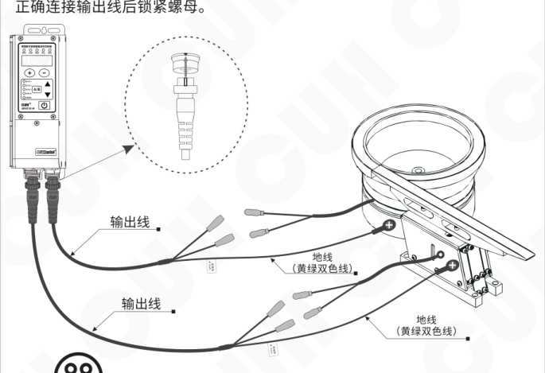

**注意**

1、一定要确认电磁铁线圈接在两个输出引脚上，外壳需要可靠接地。否则将会导致机壳带电，可能发生**严重安全事故**。

2、电源输出禁止连接压电类负载，否则可能导致**电击安全事故！**

---

2023-12　　　　　　　　　　- 7 -　　　　　　　　　　SDVC33SMSCN_3.01

### 第 16 页

双路数字调频振动送料控制器　　　　　　　　　　　　　　　　　　　　SDVC33 系列

## 第三步：

将输入电源线航空插头插入控制器电源  
输入插座，并锁紧螺母。

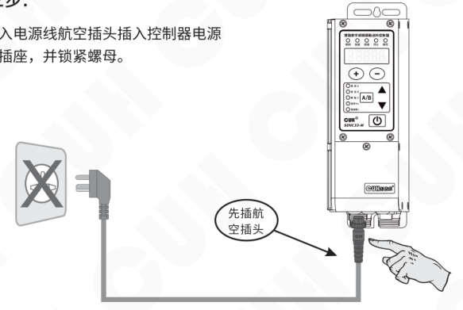

## 第四步：

确认开关处于关闭位置后，将电源线三爪插头插在供电电源插座上。

### 第 17 页

双路数字调频振动送料控制器　　　　　　　　　　　　　　　　　　　　　　　　　SDVC33 系列

---

### 第五步：

打开控制器电源开关，此时应该显示电压 “U 150” 且通道A亮起，两个振动盘应该都有振动。

图示标注：

- U 表示输出电压
- 通道A指示灯
- 电压指示灯

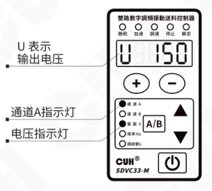

### 第六步：

按住 <kbd>−</kbd> 键调节通道A的电压至30~50V之间，再按 <kbd>A/B</kbd> 键2秒进入频率 “E” 调整状态；使用 <kbd>＋</kbd> 和 <kbd>−</kbd> 键来寻找振动体的固有频率，也就是谐振频率。

图示标注：

- E 表示输出频率
- 通道A指示灯
- 频率指示灯

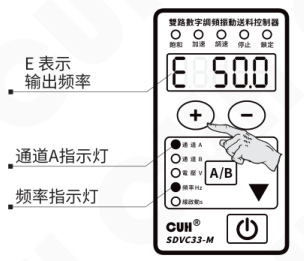

> ☺
>
> - 振动最大时的频率为振动体的固有频率。
> - 每个振动体都有固有的振动频率，为了能达到最佳的工作状态，请调整本参数使振动体工作在合适的工作频率上。

---

2023-12　　　　　　　　　　　　　　　　　- 9 -　　　　　　　　　　　　　　　　　SDVC33SMSCN_3.01

### 第 18 页

双路数字调频振动送料控制器　　　　　　　　　　　　　　　　　SDVC33 系列

---

### 第七步：

长按 **A/B** 键退出频率 “**E**” 调整参数回到电压调节参数，使用 **+** 和 **−** 键调节电压达到最佳的送料速度。

- **U** 表示输出电压
- 通道A指示灯
- 电压指示灯

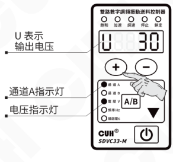

---

### 通道B设置：

短按 **A/B** 键切换到通道B，重复第六步和第七步完成通道B的调节。

- **U** 表示输出电压
- 通道B指示灯
- 电压指示灯

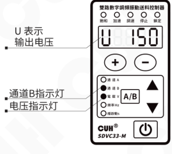

---

2023-12　　　　　　　　　　　　　　　　　-10-　　　　　　　　　　　　　　　　　SDVC33SMSCN_3.01

### 第 19 页

双路数字调频振动送料控制器　　　　　　　　　　　　　　　　　SDVC33 系列

# 第四章　基本功能说明

本章节介绍本产品基本功能的使用方法。

## 4.1 输出电压设置

本控制器可以直接在面板上以数字方式设置输出电压。由于本控制器具备稳压功能，该数值为输出电压整流平均值，并且不会受到输入电压的影响，即使在电网电压不稳定场合中也可以保持稳定工作。同时，直接的电压数值设置也为用户了解设备运行情况提供了准确的数据。

- 打开控制器的电源开关。
- 控制器进入输出电压状态，控制器上通道A指示灯和电压指示灯点亮，LED显示屏显示电压参数U和电压值。
- 通过 ＋ 和 － 键可以对电压“U”值进行调整。

图示标注：

- U 表示输出电压
- 当前输出电压为30V
- 通道A指示灯
- 电压指示灯

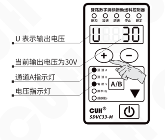

> ☺
>
> - 本控制器没有升压功能，当因输入电源电压限制，控制器无法达到设定电压时饱和灯会点亮，此时自动稳压功能失效。
> - 本控制器可以通过牺牲输出波形的正弦特性达到一定程度的加速效果，由参数“加速指数y”决定。进入加速状态时输出电流波形由正弦波变成三角波，加速指示灯点亮。

2023-12　　　　　　　　　　　　　　　　　-11-　　　　　　　　　　　　　　　　　SDVC33SMSCN_3.01

### 第 20 页

双路数字调频振动送料控制器　　　　　　　　　　　　　　　　　SDVC33 系列

## 4.2 输出频率设置

本控制器采用直接数字频率合成技术（DDS），具有非常高的频率精度和稳定性，不随时间和温度的改变而变化。

- 按住 <kbd>A/B</kbd> 键2秒，进入基本参数界面。
- 控制器上LED显示输出频率参数“E”和频率值。
- 通过 <kbd>+</kbd> 和 <kbd>-</kbd> 键可以对频率“E”值进行设定。

右侧示意：

- E 表示输出频率
- 当前输出频率为50.0Hz
- 通道A指示灯
- 频率指示灯

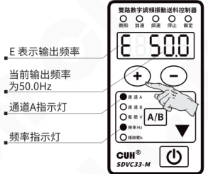

本系列控制器的输出频率范围是5.0～999.9Hz

## 4.3 缓启动功能

本控制器从停止状态启动时，输出电压可以平缓提高到设定值，以防止振动设备和控制器遭受冲击。  
缓启动时间（t）：控制器从停止状态启动时，输出电压从0V平滑升高到达设定输出电压所需要的时间称为缓启动时间。

- 按住 <kbd>A/B</kbd> 键2秒，进入基本参数界面。
- 使用 ▲ 和 ▼ 键切换到缓启动参数调整状态“t”。
- 通过 <kbd>+</kbd> 和 <kbd>-</kbd> 键调整参数值。该参数的单位是秒，精度是0.1秒。

右侧示意：

- t 表示缓启动时间
- 当前缓启动时间为0.5s
- 通道A指示灯
- 缓启动指示灯

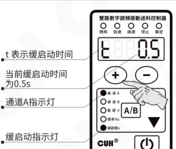

缓启动过程的时间范围是0.0秒-10.0秒

---

2023-12　　　　　　　　　　　　　-12-　　　　　　　　　　　　　SDVC33SMSCN_3.01

### 第 21 页

双路数字调频振动送料控制器　　SDVC33 系列

## 4.4 缓关闭功能

本控制器从运行状态停止时，输出电压可以平缓降低到0，以防止振动设备遭受冲击。

缓关闭时间（反t）：控制器从运行状态停止时，输出电压从设定值平滑降低到0所需要的时间称为缓关闭时间。

- 按住 `A/B` 键2秒，进入基本参数界面。
- 使用 ▲ 和 ▼ 键切换到缓关闭参数调整状态“反t”。
- 通过 `+` 和 `−` 键调整参数值。该参数的单位是秒，精度是0.1秒。

图中标注：

- `反` 表示缓关闭时间
- 当前缓关闭时间为0.5s
- 通道A指示灯
- 缓关闭过程的时间范围是0.0秒-10.0秒

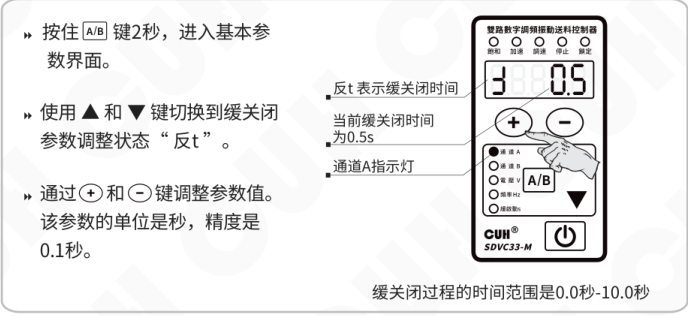

## 4.5 刹车功能

由于振动盘在控制器停止输出后还会自由振动一段时间，这段时间物料还继续运动。这对于某些物料精密计量包装的应用会产生误差，因此需要快速停止振动。

刹车功能是通过将缓关闭的开始点延迟180°相位，达到驱动力与振动盘自由振动相位相反的效果从而快速停止振动。通过设置缓关闭时间（反t）为负值实现，单位为周，即刹车时反向驱动的电流周数。

示意图标注：

- 缓关闭
- 刹车
- 反向
- 刹车周数=7周

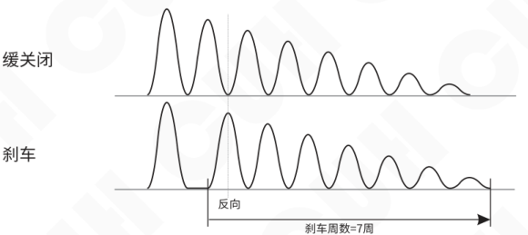

### 第 22 页

## 4.6 输出开关

面板上的轻触式输出开关可以方便快速地开启或停止本机的输出。

- 使用控制器面板上的 <kbd>⏻</kbd> 键，可以控制本机启动或停止输出。停止输出时，“停止”指示灯点亮，表示进入“停止”状态。

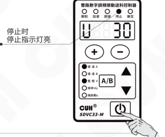

> 控制器默认启停键独立控制通道A/B，如果需要同时控制通道A/B的启停，请将联合参数中的启停键控制方式（OF）由Ind独立设置为Cob联合。  
> 当停止键停止输出时停止灯闪烁，当外部信号使控制器停止时停止灯常亮。

## 4.7 键盘锁定功能

为了防止误操作，本机设定了键盘锁。这样当控制器各项参数设置好后，可以有效避免其他人的误动作影响本机正常工作。即使关机后重新开机，键盘锁状态依然保持上次关机时的状态。

- 通过长按 <kbd>⏻</kbd> 键2秒可以锁定所有按键，此时键盘锁定指示灯点亮。
- 再次长按 <kbd>⏻</kbd> 键2秒可以解除锁定。

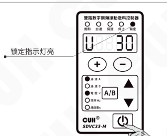

> 锁定是区分通道的锁定，需独立对通道A和通道B的键盘进行单独操作。

### 第 23 页

双路数字调频振动送料控制器　　　　　　　　　　　　　　　　　　　　　　　　　SDVC33 系列

## 4.8 恢复出厂设置

本功能可以使用户快速将控制器设置为出厂默认设置状态。

由于本控制器功能强大，有数量众多的控制参数可以由用户设定，对于初学者，可能在多次的设定修改后不能恢复控制器的正常工作状态。使用该功能可以快速将调乱的参数状态恢复为出厂默认设置。

本控制器可以将整机恢复出厂设置，也可以将单个通道单独恢复出厂设置。

**整机恢复出厂设置：**

- 长按 ▲ 和 ▼，进入联合参数界面。
- 短按 ▼ 切换到数码管全闪状态即“整机恢复出厂设置”参数，此时长按 **+**，直到控制器显示“-----”，表示控制器已经重设完毕。
- 松开 **+**，控制器显示 CUH 后，随即进入正常的电压调整状态“U”，此时控制器就像刚开始使用一样，所有参数都已经恢复到出厂默认状态。

示意图标注：

- 恢复出厂设置参数设定状态
- 恢复出厂设置参数设定完成

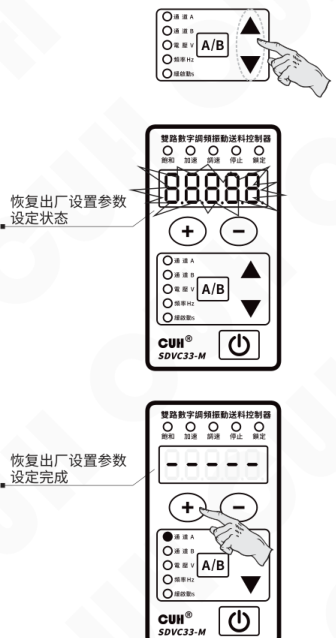

2023-12　　　　　　　　　　　　　　　　　-15-　　　　　　　　　　　　　　　　　SDVC33SMSCN_3.01

### 第 24 页

双路数字调频振动送料控制器　　　　　　　　　　　　　　　　　SDVC33 系列

## 通道A/B单独恢复出厂设置：

- 长按 <kbd>A/B</kbd> 和 ▲，进入高级参数界面。

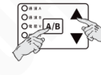

- 短按 ▲ 切换到“当前通道恢复出厂设置”参数，此时长按 <kbd>＋</kbd>，直到控制器显示“-----”，表示当前通道已经重设完毕。

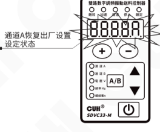

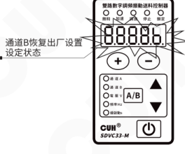

- 松开 <kbd>＋</kbd>，控制器显示 CUH 后，随即进入正常的电压调整状态“U”，此时当前通道就像刚开始使用一样，所有参数都已经恢复到出厂默认状态。

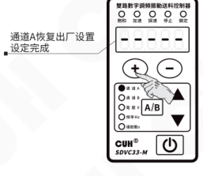

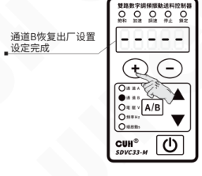

---

2023-12　　　　　　　　　　　　　-16-　　　　　　　　　　　　　SDVC33SMSCN_3.01

### 第 25 页

双路数字调频振动送料控制器　　　　　　　　　　　　　　SDVC33 系列

---

# 第五章 高级功能说明

本章节主要介绍本产品高级功能的使用方法。

## 5.1 遥控调速功能

本控制器支持外部模拟信号控制输出电压，模拟信号支持电位器、1~5V电压、4~20mA电流。在端口上有两个模拟调试端口AA和bA，默认AA控制通道A，bA控制通道B，还可通过参数cS调整，实现一个信号同时控制两个通道输出电压的目的。

本控制器还设计了遥控系数c参数用于放大或缩小遥控电压的效果，可以从0.5~2.0范围调节。当设置为0.5时表示遥控电压控制输出电压的效果缩小一半，即最大只能遥控到最大输出电压h的一半。当设置为2.0时表示遥控电压控制输出电压的效果放大一倍，即遥控电压达到3V时输出电压已经达到h，再增加遥控电压，输出电压也无法增大。

### 电位器控制连接方式

建议：请使用1K阻值线性电位器

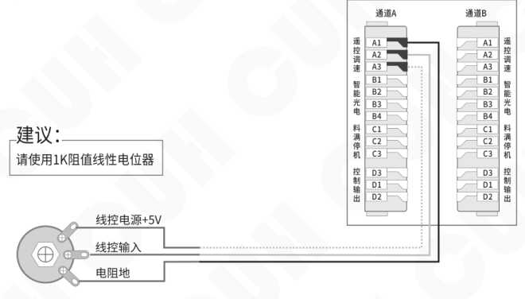

当线控电压对控制器的控制生效时，面板的调速指示灯点亮，同时在面板上调整电压将失效。

---

2023-12　　　　　　　　　　　　　-17-　　　　　　　　　　　　　SDVC33SMSCN_3.01

### 第 26 页

双路数字调频振动送料控制器  SDVC33 系列

## 1~5V 电压控制连接方式

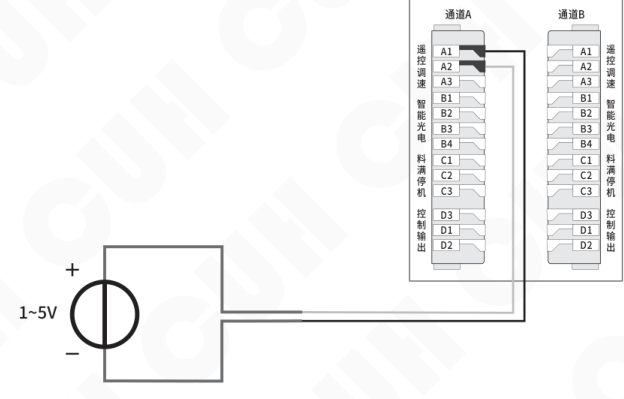

## 4~20mA 电流控制连接方式

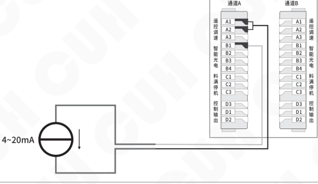

2023-12  -18-  SDVC33SMSCN_3.01

### 第 27 页

双路数字调频振动送料控制器　　　　　　　　　　　　　　　　　　　　　　　SDVC33 系列

## 5.2 智能光电功能

本控制器的智能光电端口支持发光二极管和光电三极管构成的光电对射或反射传感器，也可以设置为支持 NPN 或 PNP 开关传感器。具体接线图如下：

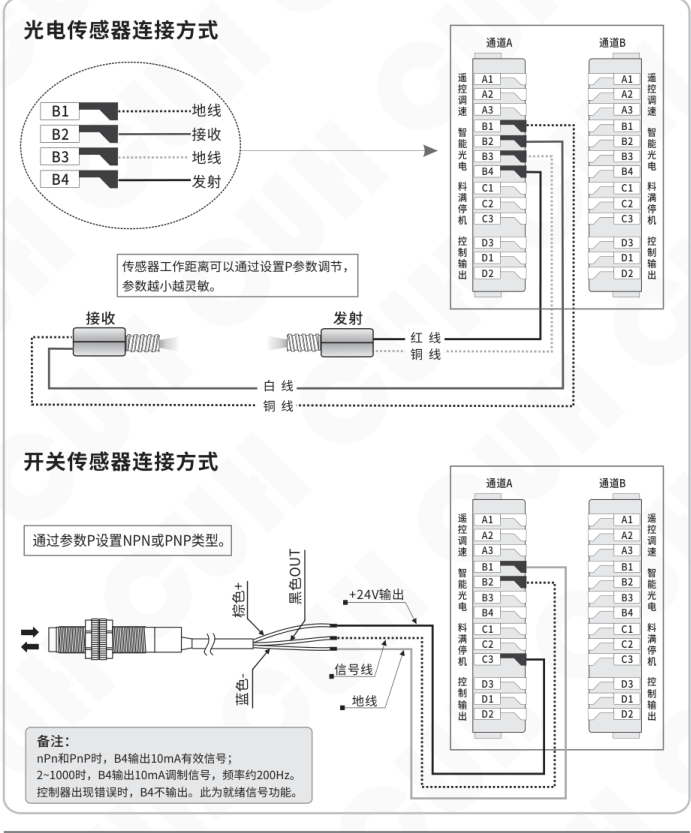

2023-12　　　　　　　　　　　　　　　　　-19-　　　　　　　　　　　　　　　SDVC33SMSCN_3.01

### 第 28 页

双路数字调频振动送料控制器                                      SDVC33 系列

## 5.3 料满停机功能

料满停机端口可以支持NPN、PNP、Ut1、Ut0模式，且通道A、B独立控制。
其中：

**Ut1模式为单次扫描**，即传感器信号无效前一直通过变换高低电平检测端口是否有效，发现有效信号后确定端口传感器类型且不再扫描。

**Ut0模式为连续扫描**，不管传感器类型如何始终通过变换高低电平检测端口是否接入有效信号。

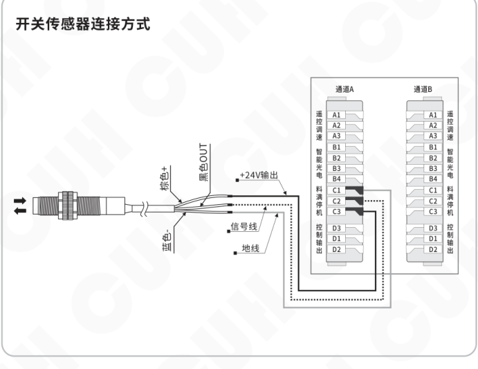

2023-12                                      -20-                                      SDVC33SMSCN_3.01

### 第 29 页

## 5.4 控制输出功能

控制输出端口可以支持NPN输出、PNP输出和推挽输出。其中：

- NPN输出有效为低电平，输出无效为高阻态；
- PNP输出有效为高电平，输出无效为高阻态；
- 推挽输出有效为高电平，无效为低电平。

### 5.4.1 控制输出的接线方法

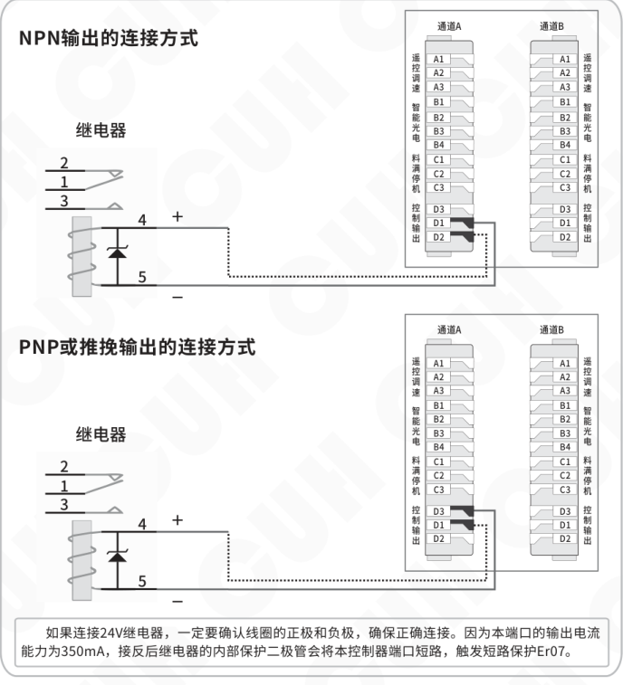

如果连接24V继电器，一定要确认线圈的正极和负极，确保正确连接。因为本端口的输出电流能力为350mA，接反后继电器的内部保护二极管会将本控制器端口短路，触发短路保护Er07。

### 第 30 页

### 5.4.2 控制输出信号源和逻辑图

主输出和控制输出的控制是由两个信号源逻辑关系的结果控制，可以从信号源列表中选择下列信号源：

| 信号源 | 含义 |
|---|---|
| 0 | 无效信号 |
| 1 | 有效信号 |
| Ab | 通道A的智能光电端口信号 |
| -Ab | 通道A的智能光电端口信号取反 |
| Ac | 通道A的料满停机端口信号 |
| -Ac | 通道A的料满停机端口信号取反 |
| Ad | 通道A的控制输出端口信号 |
| -Ad | 通道A的控制输出端口信号取反 |
| Aq | 通道A的功率主输出端口信号 |
| -Aq | 通道A的功率主输出端口信号取反 |
| bb | 通道B的智能光电端口信号 |
| -bb | 通道B的智能光电端口信号取反 |
| bc | 通道B的料满停机端口信号 |
| -bc | 通道B的料满停机端口信号取反 |
| bd | 通道B的控制输出端口信号 |
| -bd | 通道B的控制输出端口信号取反 |
| bq | 通道B的功率主输出端口信号 |
| -bq | 通道B的功率主输出端口信号取反 |

### 第 31 页

双路数字调频振动送料控制器  
SDVC33 系列

### 控制输出逻辑图：

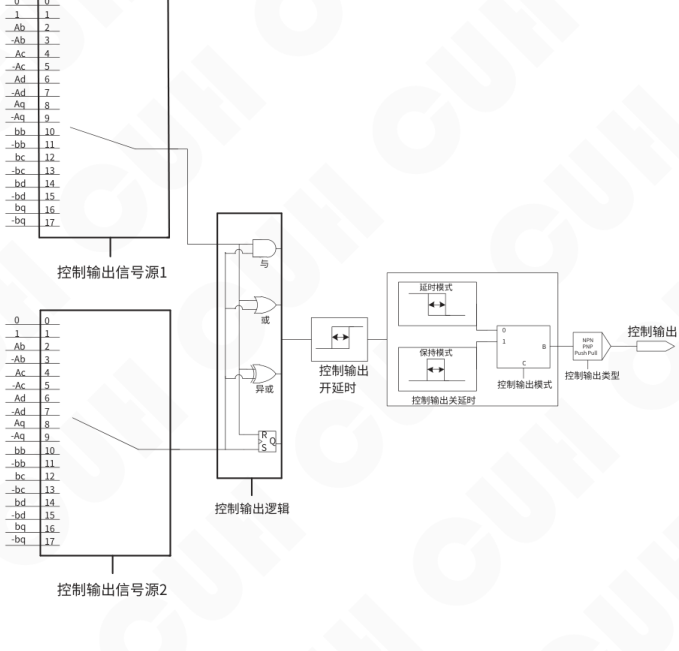

控制输出信号源1、控制输出信号源2的标志与编号如下：

| 标志 | 编号 |
|---|---:|
| 0 | 0 |
| 1 | 1 |
| Ab | 2 |
| -Ab | 3 |
| Ac | 4 |
| -Ac | 5 |
| Ad | 6 |
| -Ad | 7 |
| Aq | 8 |
| -Aq | 9 |
| bb | 10 |
| -bb | 11 |
| bc | 12 |
| -bc | 13 |
| bd | 14 |
| -bd | 15 |
| bq | 16 |
| -bq | 17 |

图中包含：控制输出信号源1、控制输出信号源2、控制输出逻辑（与、或、异或、R/S/Q）、控制输出开延时、控制输出关延时、延时模式、保持模式、控制输出模式、控制输出类型（NPN、PNP、Push Pull）及控制输出。

2023-12　　-23-　　SDVC33SMSCN_3.01

### 第 32 页

## 5.4.3 控制输出模式说明

客户可选择2种控制输出模式：延时模式、保持模式。

**延时模式：** 指驱动控制输出的信号由有效变为无效后，控制输出经过一段关延时时间后变为关闭状态。

**保持模式：** 指驱动控制输出的信号变为有效后，控制输出在关延时时间内保持打开，超过关延时时间后变为关闭的状态。

将两种模式的差别以时序图的形式表达如下，其中输入信号是逻辑关系选择器后输出的信号。

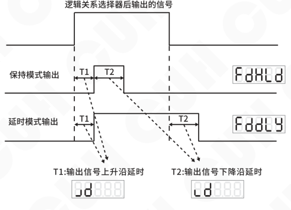

## 5.4.4 主输出信号控制功能

主输出的信号控制功能与控制输出相似，选择两个信号源进行逻辑关系运算后经过开关延时和模式选择及逻辑方向控制得到控制信号，该控制信号与面板的启停信号进行逻辑与操作后发送给功率板进行输出启停的控制。

主输出信号控制接线方法、信号源及逻辑图可参考控制输出功能。

### 第 33 页

## 5.5 最大电压限制功能

本控制器每个通道均可以设置最大输出电压限制参数 h，面板设置电压和遥控电压均不会超过该值。

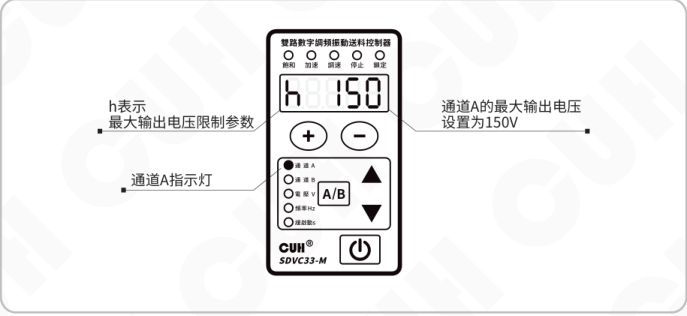

图示说明：

- h 表示最大输出电压限制参数。
- 通道 A 指示灯。
- 通道 A 的最大输出电压设置为 150V。

## 5.6 可调过流保护功能

本控制器为了保护电磁线圈，设计了用户可以调节的过流保护电流参数 oc，可以在 0.5A~3.5A 范围调节。

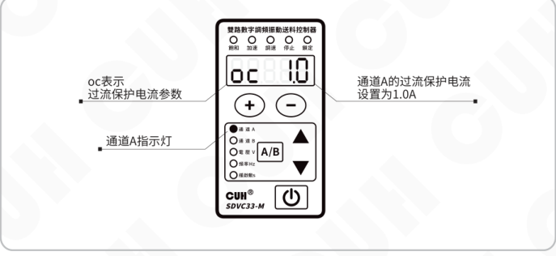

图示说明：

- oc 表示过流保护电流参数。
- 通道 A 指示灯。
- 通道 A 的过流保护电流设置为 1.0A。

### 第 34 页

## 5.7 面板亮度调整功能

本控制器采用了全新的数码显示驱动芯片，支持用户调节显示亮度值，通过参数LED在1~32之间调节。

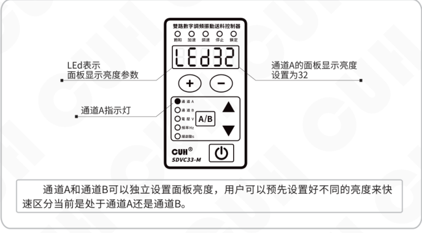

图示说明：

- LEd表示面板显示亮度参数。
- 通道A的面板显示亮度设置为32。
- 通道A指示灯。
- 通道A和通道B可以独立设置面板亮度，用户可以预先设置好不同的亮度来快速区分当前是处于通道A还是通道B。

## 5.8 输出监控功能

本控制器专门设计了一套监控参数组用于监控控制器的状态。

**区分通道A和通道B的监控参数包括：**

输出电流AC、模拟调速端口电压AU、智能光电端口信号电压bU、料满停机端口cU、控制输出端口电压dU。

**不区分通道A和通道B的监控参数包括：**

温度显示C、母线电压PU、24V输出电压nU、控制板软件版本uc、功率板软件版本uq。

### 第 35 页

双路数字调频振动送料控制器　　　　　　　　　　　　　　　　　　　　　SDVC33 系列

## 5.9 双路联合控制功能

本控制器的通道A和通道B的输出可以联合控制，在联合参数中使用Cb参数可以控制通道B：独立工作、跟踪通道A的频率、跟踪通道A的电压、跟踪通道A的电压和频率。

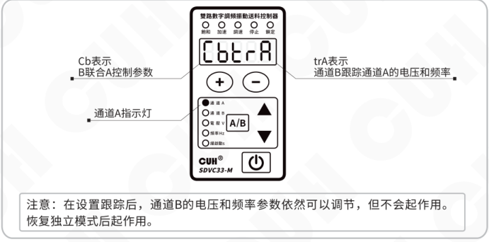

图中说明：

- **Cb表示**：B联合A控制参数
- **trA表示**：通道B跟踪通道A的电压和频率
- **通道A指示灯**

> 注意：在设置跟踪后，通道B的电压和频率参数依然可以调节，但不会起作用。恢复独立模式后起作用。

不管是独立设置通道A和通道B输出相同的频率，还是设置通道B的频率跟踪通道A，这两个通道输出的相位总是锁定的。可以通过联合参数中的B参考A路相位μ控制相位差，调节范围-180°~180°。该功能可以用于控制一个矢量振动盘或一个圆振和一个直振接力送料的场合。

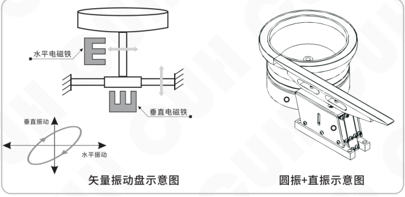

**矢量振动盘示意图**

- 水平电磁铁
- 垂直电磁铁
- 垂直振动
- 水平振动

**圆振+直振示意图**

2023-12　　　　　　　　　　　　　　　　　-27-　　　　　　　　　　　　　　　　　SDVC33SMSCN_3.01

### 第 36 页

双路数字调频振动送料控制器　　　　　　　　　　　　　　　　　　　　　　　　　SDVC33 系列

---

## 5.10 用户参数保存与恢复功能

本控制器除了工作参数会自动保存外，还设计了一组用户参数组用于保存所有用户可设置参数。通过用户参数的保存与恢复实现不同于恢复出厂设置功能的恢复。

联合参数中调节到 SP 参数，显示 uP1，在该界面下同时长按 ⊕ 和 ⊖ 显示 SAU 表示保存成功。这会将通道 A、通道 B、联合参数均保存在用户组中。

如果需要从保存的用户组参数中恢复工作组，可以有多种恢复方式：

**rP=1Ab：** 用户组参数同时恢复 A 组参数和 B 组参数。

**rP=1bA：** 用户组参数同时恢复 A 组参数和 B 组参数，但恢复时交叉选择。即保存在用户组中 A 组的数据恢复到工作组 B 中，保存在用户组中 B 组的数据恢复到工作组 A 中。

**rP=1A0：** 用户组参数仅恢复 A 组，且使用用户组中 A 组的数据恢复。

**rP=10A：** 用户组参数仅恢复 A 组，且使用用户组中 B 组的数据恢复。

**rP=1b0：** 用户组参数仅恢复 B 组，且使用用户组中 B 组的数据恢复。

**rP=10b：** 用户组参数仅恢复 B 组，且使用用户组中 A 组的数据恢复。

选择需要恢复的模式，同时长按 ⊕ 和 ⊖ 显示 rES 表示恢复成功。

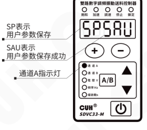

保存成功示意图

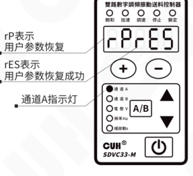

恢复成功示意图

---

2023-12　　　　　　　　　　　　　　　　-28-　　　　　　　　　　　　　　　　SDVC33SMSCN_3.01

### 第 37 页

双路数字调频振动送料控制器　　　　　　　　　　　　　SDVC33 系列

# 第六章 技术规格

## 6.1 外形尺寸

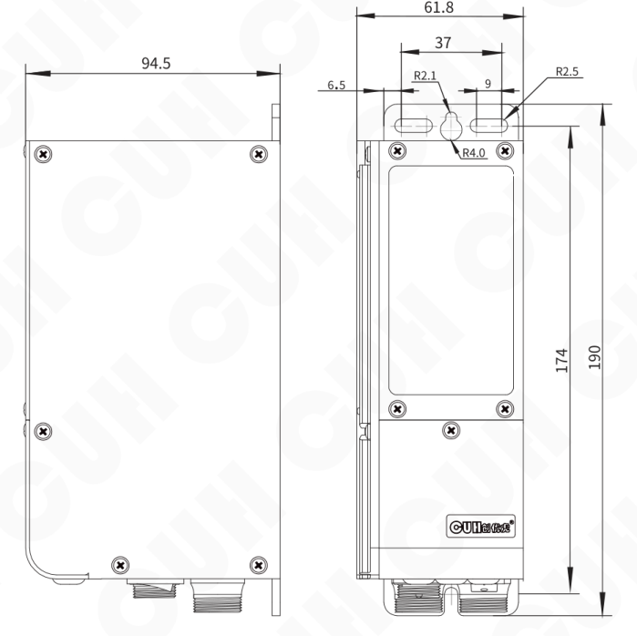

**外形尺寸图（单位：毫米mm）**

| 公差区间 | 公差值 |
|---|---:|
| 0~3 | ±0.05 |
| 3~10 | ±0.1 |
| 10~30 | ±0.15 |
| 30~80 | ±0.2 |
| 80~180 | ±0.3 |
| >180 | ±0.5 |

本系列产品均适用此公差表。

2023-12　　　　　　　　　　　　　SDVC33SMSCN_3.01

### 第 38 页

双路数字调频振动送料控制器　　　　　　　　　　　　　　　　　　　　　　　　　SDVC33 系列

## 6.2 技术规格表

| 项目 | 最小值 | 典型值 | 最大值 | 单位 | 备注 |
|---|---:|---:|---:|---|---|
| 输入电压 | 85 | 220 | 260 | 伏特（V） | 交流有效值 |
| 输出电压调整范围 | 0 | —— | 260 | 伏特（V） | 小于输入电压的150% |
| 电压调整精度 |  | 1 |  | 伏特（V） |  |
| 稳压精度 | 0 | —— | 10 | % | ΔVout/ΔVin |
| 输出电流调整范围 | 0 | —— | 3.5 | 安培（A） | 总电流可任意分配 |
| 输出功率 | 0 | —— | 770 | 伏安（VA） |  |
| 输出频率 | 5.0 | —— | 999.9 | 赫兹（Hz） |  |
| 频率调整精度 |  | 0.1 |  | 赫兹（Hz） |  |
| 输出波形 |  | 正弦 |  |  |  |
| 缓启动时间 | 0 | —— | 10 | 秒（s） | 出厂默认0.5 |
| 延迟时间范围 | 0 | —— | 99.9 | 秒（s） | 出厂默认0.2 |
| 延迟时间精度 |  | 0.1 |  | 秒（s） |  |
| 过热保护温度 | —— | 65 | —— | 摄氏度（℃） | 60℃恢复正常 |
| 直流控制输出电流 | 0 | —— | 350 | 毫安（mA） | 通道A、B均支持 |
| 24V输出电流 | —— | —— | 700 | 毫安（mA） | 通道A、B输出总和 |
| 直流控制输出电压 | 22 | 24 | 26 | 伏特（V） |  |
| 模拟控制信号 |  | 4~20 / 1~5 |  | 毫安（mA） / 伏特（V） |  |
| 数字控制信号 |  | 24 |  | 伏特（V） | 开关信号控制 |
| 调整方式 |  | 6 |  | 键 |  |
| 空载功耗 | —— | 3 | —— | 瓦特（W） |  |
| 显示方式 |  | 5 |  | 位（Digit） | LED数码管 |
| 重量 |  | 850 |  | 克（g） | 不含附件 |
| 产品尺寸 |  | 长\*宽\*高：190\*61.8\*94.5 |  | 毫米（mm） |  |
| 防护等级 |  | IP20 |  |  |  |
| 工作环境温度 | 0 | 25 | 40 | 摄氏度（℃） |  |
| 工作环境湿度 | 10 | 60 | 85 | 相对湿度（%） | 不结露 |
| 存储环境温度 | -20 | 25 | 85 | 摄氏度（℃） |  |
| 适用海拔高度 |  | ＜2000 |  | 米（m） |  |

2023-12　　　　　　　　　　　　　　　　　-30-　　　　　　　　　　　　　　　　　SDVC33SMSCN_3.01

### 第 39 页

# 6.3 参考标准

**极限参数：超过此指标将会造成严重损坏，必须严格遵守！**

| 项目 | GB 标准 | IEC 标准 | 等级 | 标准要求 | 备注说明 |
|---|---|---|---|---|---|
| 静电放电 | GB/T 17626.2-2006 | IEC 61000-4-2:2001 | 4 | ±8 kV | 接触放电 |
| 静电放电 | GB/T 17626.2-2006 | IEC 61000-4-2:2001 | 4 | ±15 kV | 空气放电 |
| 电快速瞬变 脉冲群 | GB/T 17626.4-2008 | IEC 61000-4-4:2004 | 4 | ±4 kV |  |
| 直流电源纹 波抗扰度 | GB/T 17626.17-2005 | IEC 61000-4-17:2002 | 4 | 15% | 评价 A |

> **警告**  
> 在民用环境中，本产品可能产生无线电干扰。在这种情况下，可能需要采取附加抑制措施。

### 第 40 页

双路数字调频振动送料控制器　　　　　　　　　　　　　　　SDVC33 系列

# 第七章　附录

## 7.1 参数列表

|  | 含义 | 参数符号 | 数码管符号图片 | 取值范围 | 默认设置 |
|---|---|---|---|---|---|
| 待机参数 | 输出电压 | 【U】 |  | 0~260 伏特（V） | 150 |
| 基本参数 长按 A/B | 输出频率 | 【E】 |  | 5.0~999.9 赫兹（Hz） | 50.0 |
|  | 智能光电开延时 | 【大勾】 |  | 0.0~99.9 秒（s） | 0.2 |
|  | 智能光电关延时 | 【大L】 |  | 0.0~99.9 秒（s） | 0.2 |
|  | 缓启动时间 | 【小T】 |  | 0.0~10.0 秒（s） | 0.5 |
|  | 刹车周数/缓关闭时间 | 【反T】 |  | -10~0 周（cycle）-刹车周数 0.0~10.0 秒（s）-缓关闭时间 | 0.0 |
| 高级参数 长按 A/B 加▲ | 智能光电灵敏度 | 【P】 |  | nPn, PnP, 2~1000 | 80 |
|  | C口传感器类型 | 【涛A】 |  | nPn, PnP ut1（单次扫描）, ut0（连续扫描） | ut0 |
|  | 传感器C口开延时 | 【勾中】 |  | 0.0~99.9 秒（s） | 0.2 |
|  | 传感器C口关延时 | 【L中】 |  | 0.0~99.9 秒（s） | 0.2 |
|  | D口第一信号源 | 【E点D】 |  | 0, 1, Ab, -Ab, Ac, -Ac, Ad, -Ad, Aq, -Aq, bb, -bb, bc, -bc, bd, -bd, bq, -bq | A路：0 B路：0 |
|  | D口第二信号源 | 【ED】 |  | 0, 1, Ab, -Ab, Ac, -Ac, Ad, -Ad, Aq, -Aq, bb, -bb, bc, -bc, bd, -bd, bq, -bq | A路：Aq B路：bq |
|  | D口逻辑关系选择 | 【大ND】 |  | And与, or或, Hor异或, rS触发器 | or |
|  | 控制输出D口开延时 | 【小JD】 |  | 0.0~99.9 秒（s） | 0.0 |
|  | 控制输出D口关延时 | 【小LD】 |  | 0.0~99.9 秒（s） | 0.0 |
|  | 控制输出模式 | 【FD】 |  | dLy 延时模式，HLd 保持模式 | dLy |
|  | 控制输出逻辑方向 | 【反小CD】 |  | 同相---，取反- - 常开 on，常关 oFF | 同相--- |
|  | 控制输出类型 | 【涛D】 |  | nPn, PnP, PSP（推挽） | nPn |
|  | 主输出第一信号源 | 【E点Q】 |  | 0, 1, Ab, -Ab, Ac, -Ac, Ad, -Ad, Aq, -Aq, bb, -bb, bc, -bc, bd, -bd, bq, -bq | A路：Ab B路：bb |
|  | 主输出第二信号源 | 【EQ】 |  | 0, 1, Ab, -Ab, Ac, -Ac, Ad, -Ad, Aq, -Aq, bb, -bb, bc, -bc, bd, -bd, bq, -bq | A路：Ac B路：bc |
|  | 主输出逻辑关系选择 | 【大恩Q】 |  | And与, or或, Hor异或, rS触发器 | or |
|  | 主输出开延时 | 【小JQ】 |  | 0.0~99.9 秒（s） | 0.0 |

---

2023-12　　　　　　　　　　　　　　　　-32-　　　　　　　　　　　　　　　　SDVC33SMSCN_3.01

### 第 41 页

双路数字调频振动送料控制器　　　　　　　　　　　　　　　　　　　　　　　　　SDVC33 系列

| 类别/操作 | 含义 | 数码管符号图片 | 参数符号 | 取值范围 | 默认设置 |
|---|---|---|---|---|---|
| 高级参数 长按 A/B 加▲ | 主输出关延时 |  | [小LQ] | 0.0~99.9 秒（s） | 0.0 |
|  | 主输出模式 |  | [FQ] | dLy 延时模式，HLd 保持模式 | dLy |
|  | 主输出逻辑方向 |  | [反小CQ] | 同相 -.-，取反 -.- 常开 on，常关 oFF | 取反 -.- |
|  | 最大输出电压限制 |  | [小H] | 0~260 伏特（V） | 260 |
|  | 过流保护电流 |  | [OC] | 0.5~3.5 安培（A） | 3.5 |
|  | 加速指数 |  | [小Y] | 100~150 | 150 |
|  | 波形指数 |  | [小R] | 0~100 | 100 |
|  | 遥控调速源 |  | [CS] | AA（A路A口），bA（B路A口） | A路：AA B路：bA |
|  | 遥控调速系数 |  | [小C] | 0.5~2.0 | 1.0 |
|  | 面板显示亮度 |  | [LED] | 1~32 | 16 |
|  | 恢复当前通道出厂设置 | 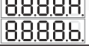 | [全8A] [全8b] | —— | —— |
| 监控参数 长按 A/B 加▼ | 输出电流 |  | [AC] | 0.00~3.50 安培（A） | —— |
|  | 模拟调速A口电压 |  | [AU] | 0.00~5.00 伏特（V） | —— |
|  | B口信号电压 |  | [bU] | 0.00~5.00 伏特（V） | —— |
|  | C口信号电压 |  | [cU] | 0.0~28.0 伏特（V） | —— |
|  | D口输出电压 |  | [dU] | 0.0~28.0 伏特（V） | —— |
|  | 温度显示 # |  | [大C] | -20.0~85.0 摄氏度（℃） | —— |
|  | 母线电压 # |  | [PU] | 0~400 伏特（V） | —— |
|  | 24V输出电压 # |  | [nU] | 0.0~28.0 伏特（V） | —— |
|  | 控制板软件版本 # |  | [UC] | —— | —— |
|  | 功率板软件版本 # |  | [UQ] | —— | —— |

2023-12　　　　　　　　　　　　　　　　　-33-　　　　　　　　　　　　　　　　　SDVC33SMSCN_3.01

### 第 42 页

双路数字调频振动送料控制器 ｜ SDVC33 系列

| 联合参数/操作 | 含义 | # | 参数符号 | 数码管符号图片 | 取值范围 | 默认设置 |
|---|---|---|---|---|---|---|
| 联合参数 长按▲加▼ | B联合A控制 | # | Cb [CB] | 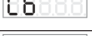 | Ind (独立), trF (B频率跟踪A), trU (B电压跟踪A), trA (B电压频率双跟踪A) | Ind |
|  | B参考A路相位 | # | U [小U] |  | -180~180 度（°） | 0 |
|  | 启停键控制方式 | # | OF [OF] |  | Ind (独立), Cob (联合) | Ind |
|  | 用户参数保存 | # | SP [SP] |  | uP1 (保存用户组1) | uP1 |
|  | 用户参数恢复 | # | rP [RP] |  | 1Ab (用户组1恢复A和B组), 1bA (用户组1交叉恢复A和B组), 1A0 (用户组1仅恢复A组), 10A (用户组1交叉仅恢复A组), 1b0 (用户组1仅恢复B组), 10b (用户组1交叉仅恢复B组) | 1Ab |
|  | 整机恢复出厂设置 | # | 88888 [全8] |  | —— | —— |

备注：“ # ”标参数不区分A、B组。

### 第 43 页

双路数字调频振动送料控制器　　　　　　　　　　　　　　　　　　　　　　　　　SDVC33 系列

## 7.2 输入输出电路图

### 遥控调速A端口

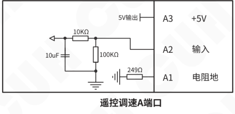

| 端口 | 说明 |
|---|---|
| A3 | +5V |
| A2 | 输入 |
| A1 | 电阻地 |

电路标注：5V输出、10uF、10KΩ、100KΩ、249Ω。

### 智能光电B端口

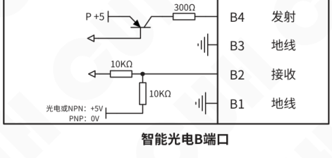

| 端口 | 说明 |
|---|---|
| B4 | 发射 |
| B3 | 地线 |
| B2 | 接收 |
| B1 | 地线 |

电路标注：P +5、300Ω、10KΩ、10KΩ；光电或NPN：+5V，PNP：0V。

### 料满停机C端口

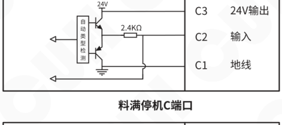

| 端口 | 说明 |
|---|---|
| C3 | 24V输出 |
| C2 | 输入 |
| C1 | 地线 |

电路标注：自动类型检测、24V、2.4KΩ。

### 控制输出D端口

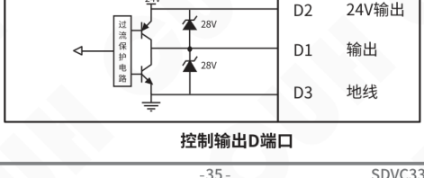

| 端口 | 说明 |
|---|---|
| D2 | 24V输出 |
| D1 | 输出 |
| D3 | 地线 |

电路标注：过流保护电路、24V、28V、28V。

---

2023-12　　　　　　　　　　　　　　　　　-35-　　　　　　　　　　　　　　　　　SDVC33SMSCN_3.01

### 第 44 页

## 7.3 故障诊断

| 故障代码 | 含义（现象） | 排除方法 |
|---|---|---|
| Er01A/Er01b | 通道A/B短路保护 （两路停止输出） | ◆ 确保负载未短路，短按两次开关键或重新上电以启动输出。 |
| Er02 | 通道AB合电流过流 （两路暂停输出，2s重启） | ◆ 适当降低输出电压，然后尝试重新启动输出。 |
| Er02A/Er02b | 通道A/B单独过流保护 （过流通道停止输出，2s重启） | ◆ 适当降低输出电压，然后尝试重新启动输出。 |
| Er02A./Er02b. | 通道A/B单独过流保护达到设置最大点 | ◆ 适当降低输出电压，然后尝试重新启动输出。 |
| Er03 | 过热或过冷保护 （两路停止输出，在-20℃~60℃自动恢复） | ◆ 将本控制器安装在通风良好或避免极寒的环境中。 |
| Er041/Er042 | 电源欠压/过压保护 （两路停止输出，自动恢复） | ◆ 确保输入电压在85V~260V之间。 |
| Er05 | 内部通信异常（两路停止输出） | ◆ 确保未在24V电源端口接入任何外部电源或联系本公司技术支持。 |
| Er06 | 温度传感器异常（两路停止输出） | ◆ 确保不在-20摄氏度以下工作或联系本公司技术支持。 |
| Er07A/Er07b | 通道A/B控制输出D口短路保护 （对应通道控制输出停止，2s尝试重启） | ◆ 确保D口负载未短路且电流未超过350mA。 |
| Er10 | 24V电源输出短路/过流保护 （关闭24V 输出，2s尝试重启） | ◆ 确保24V电源输出未被短路或输出超过700mA电流。 |
| Er11 | 调速5V输出异常保护 （模拟调速功能暂时关闭，自动重启恢复） | ◆ 确保调速端口A3的5V输出未被短路或接入高于5V的电压。 |
| Er12 | 24V电源电压异常 （两路停止输出，控制输出高阻，自动恢复） | ◆ 确保未在24V电源输出端口接入任何外部电源。 |

### 第 45 页

| 双路数字调频振动送料控制器 | SDVC33 系列 |
|---|---:|

# 第八章 产品质保信息

## 8.1 质保期

本公司为本产品提供的质保期为三年，从产品发送到购买方指定地点之日算起。

## 8.2 保修范围

（一）如果在上述质保期内出现本公司造成的故障，我们将免费维修产品。但是以下情况不属于保修范围：

 a、未按照简易说明书、用户手册或购买方与本公司专门达成的技术要求中规定的条件、环境下的不正确操作，或不正确使用造成的故障。

 b、故障不是因产品缺陷，而是购买方设备或软件设计造成的。

 c、非本公司人员进行的修改或修理而造成的故障。

 d、按照简易操作指南或用户手册正确维修或更换易损部件等规定可以完全避免的故障。

 e、产品从本公司发货后，因无法预料的科学技术水平变化等因素而造成的故障。

 f、由于火灾、地震、洪水等自然灾害，或异常电压等外部因素造成的故障，本公司不负责保修。

（二）保修范围仅限于（一）中规定的情况，本公司对该设备造成的购买方间接损失（如设备损坏、机会丧失、利润损失等）或其他损失，不承担任何责任。

## 8.3 产品适用性

本公司的该控制器是针对振动送料行业的通用产品而设计生产的。因此，本公司的该控制器不得用于下列应用且不适合其使用。

（一）对生命和财产有严重影响的设施，如核发电厂、机场、铁路、轮船、机动装置及医疗设备。

（二）公共事业，包括电力、气体、供水等。

（三）相似条件或环境的户外使用。

| 2023-12 | -37- | SDVC33SMSCN_3.01 |
|---|:---:|---:|

### 第 46 页

*（本页 `page_markdown` 为空。）*

### 第 47 页

*（本页 `page_markdown` 为空。）*

### 第 48 页

| 二维码 | 联系方式 |
|---|---|
|  | 南京创优科技有限责任公司 网址:www.cuhnj.com 电话:025-84730416 传真:025-84730426 邮箱:sales@cuhnj.com 地址:南京市江宁区智能路9号 启迪城学研园2幢 |

文档编号：IDP1000298
<!-- /auto:ai-body-draft v1 -->

<!-- auto:data-params-summary v1 -->
## 附录 · 参数表（结构化侧车·机器生成）

> 说明：本节由 `data/<doc_key>/params/params.yaml` 自动渲染（展示前若干行），用于校对与二次开发。定稿以层 C 数据为准。

| 参数 | 标志/符号 | 范围 | 默认 | 单位 | 备注 |
| --- | --- | --- | --- | --- | --- |
|    **危险** |  |  |  |  |  |
|    **警告** |  |  |  |  |  |
|    **小心** |  |  |  |  |  |
|  **注意** |  |  |  |  |  |
|  **要点** ！ |  |  |  |  |  |
|    0 |  |  |  |  |  |
|      1 |  |  |  |  |  |
|      Ab |  |  |  |  |  |
|      -Ab |  |  |  |  |  |
|      Ac |  |  |  |  |  |
|      -Ac |  |  |  |  |  |
|    Ad |  |  |  |  |  |
|    -Ad |  |  |  |  |  |
|    Aq |  |  |  |  |  |
|    -Aq |  |  |  |  |  |
|    bb |  |  |  |  |  |
|    -bb |  |  |  |  |  |
|    bc |  |  |  |  |  |
|    -bc |  |  |  |  |  |
|    bd |  |  |  |  |  |
|  -bd |  |  |  |  |  |
|  bq |  |  |  |  |  |
|  -bq |  |  |  |  |  |
|  公差值 |  |  |  |  |  |
|  ±0.05 |  |  |  |  |  |
|  ±0.1 |  |  |  |  |  |
|  ±0.15 |  |  |  |  |  |
|   ±0.2 |  |  |  |  |  |
|   ±0.3 |  |  |  |  |  |
|   ±0.5 |  |  |  |  |  |

*（仅展示前 30 条，共 133 条；完整数据见下方链接。）*

- 完整 YAML：`data/cuh.sdvc.manual.v3.01/params/params.yaml`
- 表格索引：`data/cuh.sdvc.manual.v3.01/index.yaml`
<!-- /auto:data-params-summary v1 -->
