## 目录

> 下列条目来自 PDF 内置书签/大纲；链接指向本批转换生成的整页渲染图（`assets/pages/`），便于与原版 PDF 对照校对。

- [1: 封面](assets/pages/page-0001.png)（第 1 页）
- [2: 封二版权与免责](assets/pages/page-0002.png)（第 2 页）
- [3: 序言](assets/pages/page-0003.png)（第 3 页）
- [4: 安全与预防措施](assets/pages/page-0004.png)（第 4 页）
- [5: 工作与存储环境](assets/pages/page-0005.png)（第 5 页）
- [6: 目录](assets/pages/page-0006.png)（第 6 页）
- [7: 目录](assets/pages/page-0007.png)（第 7 页）
- [8: 目录](assets/pages/page-0008.png)（第 8 页）
- [第一章 使用前须知](assets/pages/page-0009.png)（第 9 页）
  - [1.1 检查包装内容](assets/pages/page-0009.png)（第 9 页）
  - [1.2 指示灯说明](assets/pages/page-0010.png)（第 10 页）
  - [1.3 按键说明](assets/pages/page-0012.png)（第 12 页）
  - [1.4 外部部件说明](assets/pages/page-0012.png)（第 12 页）
  - [1.5 接线端口说明](assets/pages/page-0013.png)（第 13 页）
  - [1.6 控制器铭牌说明](assets/pages/page-0014.png)（第 14 页）
- [第二章 性能特点](assets/pages/page-0015.png)（第 15 页）
  - [2.1 性能总述](assets/pages/page-0015.png)（第 15 页）
  - [2.2 选型指南](assets/pages/page-0016.png)（第 16 页）
    - [2.2.1 型号说明](assets/pages/page-0016.png)（第 16 页）
    - [2.2.2 功能说明](assets/pages/page-0016.png)（第 16 页）
- [第三章 安装及使用指南](assets/pages/page-0017.png)（第 17 页）
  - [3.1 控制器使用条件](assets/pages/page-0017.png)（第 17 页）
  - [3.2 按键基本操作](assets/pages/page-0017.png)（第 17 页）
  - [3.3 安装使用](assets/pages/page-0018.png)（第 18 页）
- [第四章 参数调整方法](assets/pages/page-0020.png)（第 20 页）
  - [4.1 常用参数](assets/pages/page-0020.png)（第 20 页）
  - [4.2 基本参数](assets/pages/page-0020.png)（第 20 页）
  - [4.3 高级参数](assets/pages/page-0021.png)（第 21 页）
  - [4.4 自动/同步参数](assets/pages/page-0026.png)（第 26 页）
- [第五章 工作模式](assets/pages/page-0030.png)（第 30 页）
  - [5.1 手动模式](assets/pages/page-0030.png)（第 30 页）
    - [5.1.1 手动模式下输出电压的设定](assets/pages/page-0031.png)（第 31 页）
    - [5.1.2 手动模式下输出频率的设定](assets/pages/page-0031.png)（第 31 页）
  - [5.2 自动模式](assets/pages/page-0032.png)（第 32 页）
    - [5.2.1 振动传感器的安装](assets/pages/page-0032.png)（第 32 页）
    - [5.2.2 自动模式下送料速度的设定](assets/pages/page-0034.png)（第 34 页）
    - [5.2.3 自动搜频](assets/pages/page-0034.png)（第 34 页）
  - [5.3 半自动模式](assets/pages/page-0035.png)（第 35 页）
    - [5.3.1 振动传感器的安装](assets/pages/page-0035.png)（第 35 页）
    - [5.3.2 半自动模式的设定](assets/pages/page-0035.png)（第 35 页）
    - [5.3.3 半自动模式下送料速度的设定](assets/pages/page-0036.png)（第 36 页）
    - [5.3.4 半自动模式下输出频率的设定](assets/pages/page-0036.png)（第 36 页）
  - [5.4 同步模式](assets/pages/page-0037.png)（第 37 页）
    - [5.4.1 主从控制器同步信号线的连接方法](assets/pages/page-0038.png)（第 38 页）
    - [5.4.2 同步模式的应用](assets/pages/page-0039.png)（第 39 页）
  - [5.5 计数模式](assets/pages/page-0043.png)（第 43 页）
    - [5.5.1 使用方法](assets/pages/page-0044.png)（第 44 页）
    - [5.5.2 接线方法](assets/pages/page-0045.png)（第 45 页）
    - [5.5.3 计数脉冲逻辑方向设定](assets/pages/page-0046.png)（第 46 页）
    - [5.5.4 计数复位逻辑方向设定](assets/pages/page-0046.png)（第 46 页）
    - [5.5.5 计数相关参数设定](assets/pages/page-0047.png)（第 47 页）
- [第六章 信号控制](assets/pages/page-0049.png)（第 49 页）
  - [6.1 开关量输入端口C料满/料空停机控制](assets/pages/page-0049.png)（第 49 页）
    - [6.1.1 开关量输入端口C的接线方法](assets/pages/page-0049.png)（第 49 页）
    - [6.1.2 开关量输入端口C开延时、关延时设定](assets/pages/page-0054.png)（第 54 页）
    - [6.1.3 开关量输入端口C逻辑方向设定](assets/pages/page-0055.png)（第 55 页）
  - [6.2 开关量输入端口E料满/料空停机控制](assets/pages/page-0056.png)（第 56 页）
    - [6.2.1 开关量输入端口E的接线方法](assets/pages/page-0056.png)（第 56 页）
    - [6.2.2 开关量输入端口E开延时、关延时设定](assets/pages/page-0057.png)（第 57 页）
    - [6.2.3 开关量输入端口E逻辑方向设定](assets/pages/page-0058.png)（第 58 页）
  - [6.3 开关量输入端口C、输入端口E共同参数设定](assets/pages/page-0059.png)（第 59 页）
    - [6.3.1 开关量输入端口C、输入端口E逻辑关系设定](assets/pages/page-0059.png)（第 59 页）
    - [6.3.2 开关传感器类型设定](assets/pages/page-0060.png)（第 60 页）
    - [6.3.3 主输出逻辑关系设定](assets/pages/page-0061.png)（第 61 页）
  - [6.4 远程速度控制](assets/pages/page-0062.png)（第 62 页）
  - [6.5 控制输出](assets/pages/page-0064.png)（第 64 页）
    - [6.5.1 控制输出的接线方法](assets/pages/page-0064.png)（第 64 页）
    - [6.5.2 控制输出逻辑方向设定](assets/pages/page-0065.png)（第 65 页）
    - [6.5.3 控制输出逻辑关系设定](assets/pages/page-0066.png)（第 66 页）
  - [6.6 预置速度的保存和调出](assets/pages/page-0067.png)（第 67 页）
  - [6.7 485通信](assets/pages/page-0069.png)（第 69 页）
    - [6.7.1 通信地址设定](assets/pages/page-0069.png)（第 69 页）
    - [6.7.2 通信波特率设定](assets/pages/page-0069.png)（第 69 页）
    - [6.7.3 通信协议](assets/pages/page-0070.png)（第 70 页）
- [第七章 安全保护功能](assets/pages/page-0071.png)（第 71 页）
- [第八章 附录](assets/pages/page-0072.png)（第 72 页）
  - [8.1 外形尺寸](assets/pages/page-0072.png)（第 72 页）
  - [8.2 用户接口定义](assets/pages/page-0075.png)（第 75 页）
  - [8.3 技术规格](assets/pages/page-0078.png)（第 78 页）
  - [8.4 故障排除指南](assets/pages/page-0079.png)（第 79 页）
- [第九章 产品质保信息](assets/pages/page-0081.png)（第 81 页）
  - [9.1 质保期](assets/pages/page-0081.png)（第 81 页）
  - [9.2 保修范围](assets/pages/page-0081.png)（第 81 页）
  - [9.3 产品适用性](assets/pages/page-0081.png)（第 81 页）
  - [84: 封底](assets/pages/page-0084.png)（第 84 页）
## 术语与命名

- 侧车：`glossary/terms.yaml`（机读）、`glossary/zh-CN.md`（人读）；候选表，定稿后并入公司级 `glossary/`。

## 适用范围

- 本文档由 PDF 自动转换生成，正文与插图需人工核对。

## 变更记录

- 2026-06-08 00:59:43：由转换工具从源 PDF 生成首版。

## 正文

<!-- auto:ai-body-draft v1 -->
> 以下为**整页视觉转写**的正文草稿（多模态模型直接输出 Markdown，含 GFM 表； 若配置 `[[vcrop:页:序]]` 占位符，裁剪步骤会插入 `assets/images/` 下 PNG）。**请务必人工校对。**

### 第 1 页

# 智能调频振动送料控制器

**Variable Frequency Intelligent Controller  
for Vibratory Feeder**

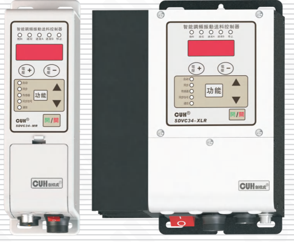

## SDVC34 系列

# 用户手册

### 第 2 页

智能调频振动送料控制器　　　　　　　　　　　　　　　　　　　　　SDVC34 系列

---

## 版权说明

南京创优科技有限责任公司保留所有权利。

本用户手册上包含的所有信息是属于本公司的知识，受著作权法及所有法律的保护。本公司根据著作权法及其他法律享有并保留所有著作权和其他法律赋予的权利，未经本公司书面同意不得以任何形式对本用户手册的部分或全部进行抄袭、翻译、转译、仿制或其他利用。

## 免责声明

本用户手册的所有内容仅说明本公司生产的相关产品的使用方法，并且是根据现有技术和提供给您使用时的状态进行描述的，在您使用本产品时必须自行承担相关风险。除法律强制规定外，本公司不因本用户手册对产品负有任何明示或暗示的责任，包括但不限于人身伤害、财产损失、机会丧失。

您明确了解上述风险并同意，除法律强制规定外，本公司无须为您的任何直接、间接的损害或损失负责（包括但不限于人员、财物、数据等有形损失和名誉、机会等无形损失）。

本公司保留对本用户手册中所适用的产品进行修改而不预先及事后通知的权利。

---

2026-03　　　　　　　　　　　　　　　　　　　　　　　　SDVC34SMSCN_10.01

### 第 3 页

智能调频振动送料控制器　　　　　　　　　　　　　　　　　　　　　　　　　SDVC34 系列

---

# 序　言

感谢您使用南京创优科技有限责任公司（在本手册中以下简称本公司）出品的SDVC34系列智能调频振动送料控制器（在本手册中以下简称本产品、本控制器或控制器）。本系列控制器是采用高品质元件并融合了最新的电子技术，采用高性能的数字信号处理器经过精心的设计而成。

本手册介绍了本产品的基本操作方法、功能技术说明和典型应用示例。为用户提供安装调试、参数设置、异常诊断、故障排除及日常维护控制器的相关信息。为了确保正确安装和使用本控制器，请在装机之前仔细阅读本用户手册，并请妥善保存。

以下符号提醒您注意有关防止人身伤害和产品损坏的事项，请务必阅读。

| 符号 | 说明 |
|---|---|
| ⚠️ 危险 | 表示若不遵守该事项，将导致人员伤亡。 |
| ⚠️ 警告 | 表示若不遵守该事项，可能导致人员伤亡。 |
| ⚠️ 小心 | 表示若不遵守该事项，可能导致人员遭受中度或轻微伤害。 |
| 注意 | 表示若不遵守该事项，将导致本产品损坏及财产损失。 |
| ！要点 | 表示在使用过程中必须要遵守的注意事项和使用限制等。 |

**本说明书适合以下型号控制器：**

◆ 智能调频振动送料控制器　SDVC34-MR（通讯型）

◆ 智能调频振动送料控制器　SDVC34-MRJ（通讯、计数型）

◆ 智能调频振动送料控制器　SDVC34-XLR（通讯型）

◆ 智能调频振动送料控制器　SDVC34-XLRJ（通讯、计数型）

---

2026-03　　　　　　　　　　　　　　　　　　　　　　　　　SDVC34SMSCN_10.01

### 第 4 页

智能调频振动送料控制器　　　　　　　　　　　　　　　　　SDVC34 系列

---

# 安全与预防措施

1、**⚠ 危险** 本产品仅用于驱动基于电磁铁的振动送料设备，请勿将本产品用于保护人体或人体部位等目的。

2、**⚠ 危险** 本产品不得作为防爆产品使用，请勿在危险场所和/或潜在爆炸气体环境中使用本产品。

3、**⚠ 警告** 本产品是采用交流市电供电的设备，请勿施加交流电压超过260Vac。施加过大的输入电压如380Vac，则可能导致产品爆炸或者着火，造成严重的安全事故。

4、**⚠ 警告** 本产品是通过电源线进行接地的，请确保为控制器供电的配电设施具备良好的接地，否则可能导致控制器外壳带电，造成触电事故。

5、**⚠ 警告** 请勿输入交流电源到本控制器的输出端，这会损坏控制器。

6、**⚠ 警告** 请勿在带电的情况下插拔接线或触摸接线仓内各接线端子触点，以防发生触电事故。

7、**注意** 请避免采用通过继电器等设备切断供电的方式来控制本产品的输出，这会严重降低本控制器的寿命。

8、**注意** 本产品设计使用于阴凉干燥环境，请勿将本产品置于室外、可能会浸水、阳光暴晒场所工作，也不要在超过本产品电气特性要求的温度和湿度范围之外工作。

9、**要点** 请务必将本产品固定在可靠接地的坚固平台上, 并远离振动设备。

10、**要点** 任何情况下请勿将本产品在超越设计极限状态下工作。

11、**要点** 请严格按照本手册的说明操作，对于违反这些操作说明所造成的任何人身伤害或财产损失，本公司不承担任何民事和刑事责任。

12、**要点** 任何情况下请不要打开本控制器机壳，以防遭到电击。机壳内部没有可以调节和用户维修部分，请不要试图维修本机，出现故障请致电本公司。

---

2026-03　　　　　　　　　　　　　　　　　　　　　　　　　SDVC34SMSCN_10.01

### 第 5 页

智能调频振动送料控制器　　　　　　　　　　　　　　　　　　　　SDVC34 系列

---

# 工作与储存环境

## 一、使用前的检查

每台控制器在出厂前，均经过严格的品质检验，并经过强化的防撞包装处理。客户在拆箱后，请即刻进行下列检查：

1. 检查控制器是否在运输过程中受到损伤。
2. 检查控制器型号是否与订货登记资料完全相同。

## 二、工作环境

为使本控制器具有更好的使用效果和更长的使用寿命，请将控制器安装在符合下列条件的环境中：

- 良好的通风散热环境
- 远离水滴、蒸气、灰尘，（特别是油性灰尘）
- 无腐蚀、易燃性的气体、液体
- 无漂浮性的尘埃及金属微粒
- 安装表面坚固无振动
- 远离电磁噪声干扰
- 使用环境温度为0℃到40℃
- 仅适用于海拔2000m以下地区安全使用

---

2026-03　　　　　　　　　　　　　　　　　　　　　　　　　SDVC34SMSCN_10.01

### 第 6 页

智能调频振动送料控制器　　　　　　　　　　　　　　　　　　　　　　　　　SDVC34 系列

---

# 目　录

**第一章 使用前须知** ------------------------------------------------------------------------ 1

　　1.1　检查包装内容 ---------------------------------------------------------------------- 1

　　1.2　指示灯说明 ------------------------------------------------------------------------ 2

　　1.3　按键说明 -------------------------------------------------------------------------- 4

　　1.4　外部部件说明 ---------------------------------------------------------------------- 4

　　1.5　接线端口说明 ---------------------------------------------------------------------- 5

　　1.6　控制器铭牌说明 -------------------------------------------------------------------- 6

**第二章 性能特点** -------------------------------------------------------------------------- 7

　　2.1　性能总述 -------------------------------------------------------------------------- 7

　　2.2　选型指南 -------------------------------------------------------------------------- 8

　　　　2.2.1 型号说明 -------------------------------------------------------------------- 8

　　　　2.2.2 功能说明 -------------------------------------------------------------------- 8

**第三章 安装及使用指南** -------------------------------------------------------------------- 9

　　3.1　控制器使用条件 -------------------------------------------------------------------- 9

　　3.2　按键基本操作 ---------------------------------------------------------------------- 9

　　3.3　安装使用 ------------------------------------------------------------------------- 10

**第四章 参数调整方法** --------------------------------------------------------------------- 12

　　4.1　常用参数 ------------------------------------------------------------------------- 12

　　4.2　基本参数 ------------------------------------------------------------------------- 12

　　4.3　高级参数 ------------------------------------------------------------------------- 13

　　4.4　自动/同步参数 -------------------------------------------------------------------- 18

**第五章 工作模式** ------------------------------------------------------------------------- 22

　　5.1　手动模式 ------------------------------------------------------------------------- 22

　　　　5.1.1 手动模式下输出电压的设定 --------------------------------------------------- 23

　　　　5.1.2 手动模式下输出频率的设定 --------------------------------------------------- 23

　　5.2　自动模式 ------------------------------------------------------------------------- 24

　　　　5.2.1 振动传感器的安装 ----------------------------------------------------------- 24

---

2026-03　　　　　　　　　　　　　　　　　　　　　　　　　　　　　　SDVC34SMSCN_10.01

### 第 7 页

智能调频振动送料控制器　　　　　　　　　　　　　　　　　　　　　　　　　SDVC34 系列

5.2.2 自动模式下送料速度的设定 -----------------------------------------------------26

5.2.3 自动搜频 --------------------------------------------------------------------26

5.3 半自动模式 --------------------------------------------------------------------27

5.3.1 振动传感器的安装 -------------------------------------------------------------27

5.3.2 半自动模式的设定 -------------------------------------------------------------27

5.3.3 半自动模式下送料速度的设定 --------------------------------------------------28

5.3.4 半自动模式下输出频率的设定 --------------------------------------------------28

5.4 同步模式 ----------------------------------------------------------------------29

5.4.1 主从控制器同步信号线的连接方法 --------------------------------------------30

5.4.2 同步模式的应用 ---------------------------------------------------------------31

5.5 计数模式 ----------------------------------------------------------------------35

5.5.1 使用方法 --------------------------------------------------------------------36

5.5.2 接线方法 --------------------------------------------------------------------37

5.5.3 计数脉冲逻辑方向设定 --------------------------------------------------------38

5.5.4 计数复位逻辑方向设定 --------------------------------------------------------38

5.5.5 计数相关参数设定 ------------------------------------------------------------39

**第六章 信号控制** ---------------------------------------------------------------41

6.1 开关量输入端口C料满/料空停机控制 ---------------------------------------------41

6.1.1 开关量输入端口C的接线方法 --------------------------------------------------41

6.1.2 开关量输入端口C开延时、关延时设定 ----------------------------------------46

6.1.3 开关量输入端口C逻辑方向设定 ------------------------------------------------47

6.2 开关量输入端口E料满/料空停机控制 ---------------------------------------------48

6.2.1 开关量输入端口E的接线方法 --------------------------------------------------48

6.2.2 开关量输入端口E开延时、关延时设定 ----------------------------------------49

6.2.3 开关量输入端口E逻辑方向设定 ------------------------------------------------50

6.3 开关量输入端口C、输入端口E共同参数设定 --------------------------------------51

6.3.1 开关量输入端口C、输入端口E逻辑关系设定 ----------------------------------51

6.3.2 开关传感器类型设定 ----------------------------------------------------------52

6.3.3 主输出逻辑关系设定 ----------------------------------------------------------53

6.4 远程速度控制 ------------------------------------------------------------------54

2026-03　　　　　　　　　　　　　　　　　　　　　　　　　SDVC34SMSCN_10.01

### 第 8 页

智能调频振动送料控制器　　　　　　　　　　　　　　　　　　　　　　　　　SDVC34 系列

---

　　6.5　控制输出 ------------------------------------------------------------------56

　　　6.5.1 控制输出的接线方法 --------------------------------------------------56

　　　6.5.2 控制输出逻辑方向设定 ------------------------------------------------57

　　　6.5.3 控制输出逻辑关系设定 ------------------------------------------------58

　　6.6　预置速度的保存和调出 ----------------------------------------------------59

　　6.7　485通信 ------------------------------------------------------------------61

　　　6.7.1 通信地址设定 --------------------------------------------------------61

　　　6.7.2 通信波特率设定 ------------------------------------------------------61

　　　6.7.3 通信协议 ------------------------------------------------------------62

**第七章 安全保护功能** ----------------------------------------------------------63

**第八章 附录** ------------------------------------------------------------------64

　　8.1　外形尺寸 ----------------------------------------------------------------64

　　8.2　用户接口定义 ------------------------------------------------------------67

　　8.3　技术规格 ----------------------------------------------------------------70

　　8.4　故障排除指南 ------------------------------------------------------------71

**第九章 产品质保信息** ----------------------------------------------------------73

　　9.1　质保期 ------------------------------------------------------------------73

　　9.2　保修范围 ----------------------------------------------------------------73

　　9.3　产品适用性 --------------------------------------------------------------73

---

2026-03　　　　　　　　　　　　　　　　　　　　　　　　　SDVC34SMSCN_10.01

### 第 9 页

智能调频振动送料控制器　　　　　　　　　　　　　　　SDVC34 系列

# 第一章 使用前须知

本章节介绍产品包装内容、控制器外观说明和控制器铭牌信息。

## 1.1 检查包装内容

使用本产品之前，请检查控制器及附件的完整性。如果发现产品有缺陷或已损坏、附件缺失等问题，请与本公司联系。

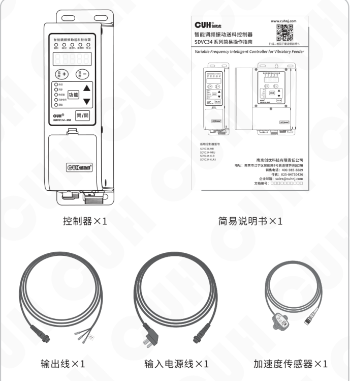

| 包装内容 | 数量 |
|---|---:|
| 控制器 | 1 |
| 简易说明书 | 1 |
| 输出线 | 1 |
| 输入电源线 | 1 |
| 加速度传感器 | 1 |

---

2026-03　　　　　　　　　　　　　- 1 -　　　　　　　　　　　　　SDVC34SMSCN_10.01

### 第 10 页

智能调频振动送料控制器　　SDVC34 系列

## 1.2 指示灯说明

**具有通信功能控制器的指示灯：**

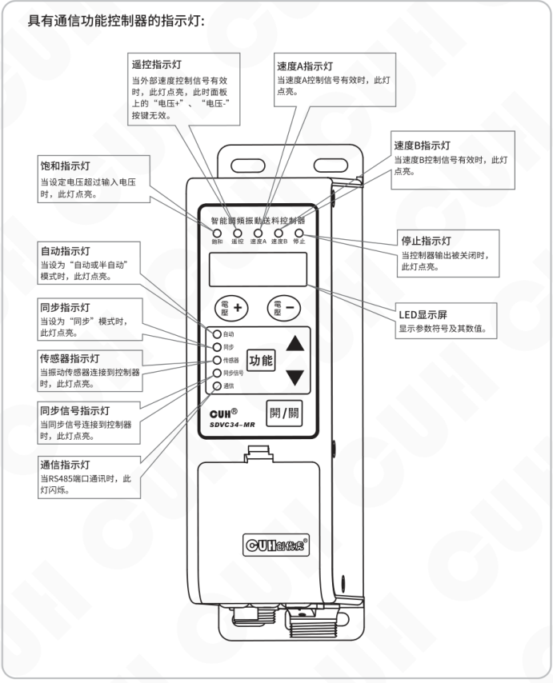

| 指示灯/显示 | 说明 |
|---|---|
| 遥控指示灯 | 当外部速度控制信号有效时，此灯点亮，此时面板上的“电压+”、“电压-”按键无效。 |
| 速度A指示灯 | 当速度A控制信号有效时，此灯点亮。 |
| 速度B指示灯 | 当速度B控制信号有效时，此灯点亮。 |
| 饱和指示灯 | 当设定电压超过输入电压时，此灯点亮。 |
| 停止指示灯 | 当控制器输出被关闭时，此灯点亮。 |
| 自动指示灯 | 当设为“自动或半自动”模式时，此灯点亮。 |
| 同步指示灯 | 当设为“同步”模式时，此灯点亮。 |
| 传感器指示灯 | 当振动传感器连接到控制器时，此灯点亮。 |
| 同步信号指示灯 | 当同步信号连接到控制器时，此灯点亮。 |
| 通信指示灯 | 当RS485端口通讯时，此灯闪烁。 |
| LED显示屏 | 显示参数符号及其数值。 |

### 第 11 页

智能调频振动送料控制器　　　　　　　　　　　　　　　　　　　　　　　　　SDVC34 系列

## 具有通信和计数功能控制器的指示灯：

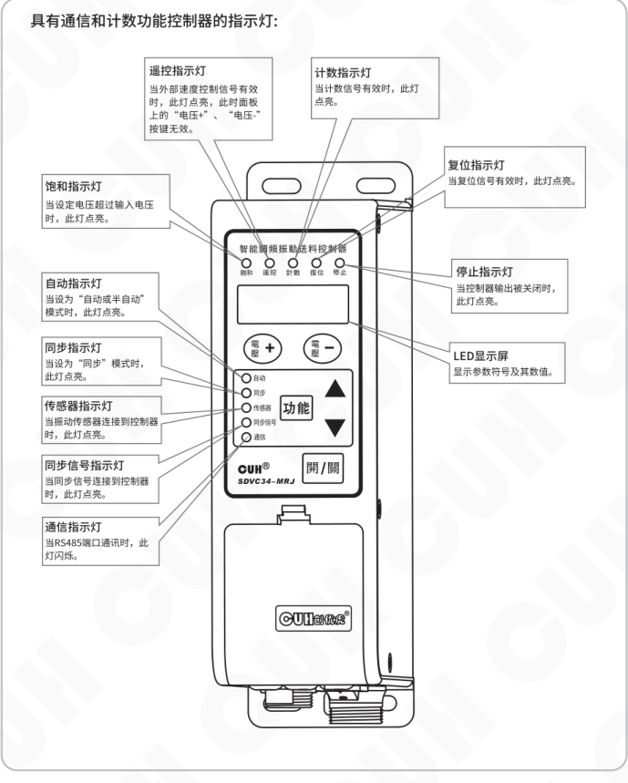

| 指示灯/显示 | 说明 |
|---|---|
| 遥控指示灯 | 当外部速度控制信号有效时，此灯点亮，此时面板上的“电压+”、“电压-”按键无效。 |
| 计数指示灯 | 当计数信号有效时，此灯点亮。 |
| 复位指示灯 | 当复位信号有效时，此灯点亮。 |
| 饱和指示灯 | 当设定电压超过输入电压时，此灯点亮。 |
| 自动指示灯 | 当设为“自动或半自动”模式时，此灯点亮。 |
| 同步指示灯 | 当设为“同步”模式时，此灯点亮。 |
| 传感器指示灯 | 当振动传感器连接到控制器时，此灯点亮。 |
| 同步信号指示灯 | 当同步信号连接到控制器时，此灯点亮。 |
| 通信指示灯 | 当RS485端口通讯时，此灯闪烁。 |
| 停止指示灯 | 当控制器输出被关闭时，此灯点亮。 |
| LED显示屏 | 显示参数符号及其数值。 |

---

2026-03　　　　　　　　　　　　　　　　　- 3 -　　　　　　　　　　　　　　　　　SDVC34SMSCN_10.01

### 第 12 页

## 1.3 按键说明

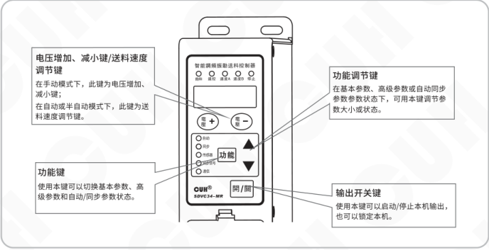

- **电压增加、减小键/送料速度调节键**
  - 在手动模式下，此键为电压增加、减小键；
  - 在自动或半自动模式下，此键为送料速度调节键。
- **功能键**
  - 使用本键可以切换基本参数、高级参数和自动/同步参数状态。
- **功能调节键**
  - 在基本参数、高级参数或自动同步参数参数状态下，可用本键调节参数大小或状态。
- **输出开关键**
  - 使用本键可以启动/停止本机输出，也可以锁定本机。

## 1.4 外部部件说明

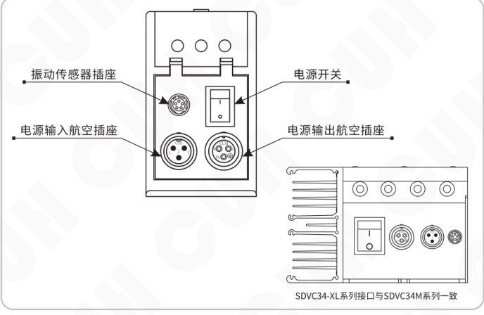

- 振动传感器插座
- 电源开关
- 电源输入航空插座
- 电源输出航空插座

SDVC34-XL系列接口与SDVC34M系列一致

### 第 13 页

## 1.5 接线端口说明

### SDVC34-MR信号端口：

| 功能 | 端子 | 定义 |
|---|---|---|
| 料满停机 | C3 | +24V |
| 料满停机 | C2 | 输入 |
| 料满停机 | C1 | 地线 |
| 料满停机2 | E3 | +24V |
| 料满停机2 | E2 | 输入 |
| 料满停机2 | E1 | 地线 |
| 控制输出 | D2 | +24V |
| 控制输出 | D1 | 输出 |
| 485通讯 | F4 | B- |
| 485通讯 | F3 | 地线 |
| 485通讯 | F2 | A+ |
| 遥控调速 | A1 | 电阻地 |
| 遥控调速 | A2 | 输入 |
| 遥控调速 | A3 | +5V |
| 遥控调速 | A4 | 地线 |
| 同步信号 | H1 | 输入- |
| 同步信号 | H2 | 输入+ |
| 同步信号 | H3 | 输出- |
| 同步信号 | H4 | 输出+ |
| 速度预设 | G1 | 地线 |
| 速度预设 | G2 | 速度A |
| 速度预设 | G5 | +24V |
| 速度预设 | G4 | 速度B |
| 速度预设 | G3 | 地线 |

### SDVC34-MRJ信号端口：

| 功能 | 端子 | 定义 |
|---|---|---|
| 料满停机 | C3 | +24V |
| 料满停机 | C2 | 输入 |
| 料满停机 | C1 | 地线 |
| 料满停机2 | E3 | +24V |
| 料满停机2 | E2 | 输入 |
| 料满停机2 | E1 | 地线 |
| 控制输出 | D2 | +24V |
| 控制输出 | D1 | 输出 |
| 485通讯 | F4 | B- |
| 485通讯 | F3 | 地线 |
| 485通讯 | F2 | A+ |
| 遥控调速 | A1 | 电阻地 |
| 遥控调速 | A2 | 输入 |
| 遥控调速 | A3 | +5V |
| 遥控调速 | A4 | 地线 |
| 同步信号 | H1 | 输入- |
| 同步信号 | H2 | 输入+ |
| 同步信号 | H3 | 输出- |
| 同步信号 | H4 | 输出+ |
| 计数 | N1 | 地线 |
| 计数 | N2 | 输入 |
| 计数 | N3 | 复位 |
| 计数 | N4 | +24V |

### 第 14 页

智能调频振动送料控制器　　　　　　　　　　　　　　　　　　　　　　　　　SDVC34 系列

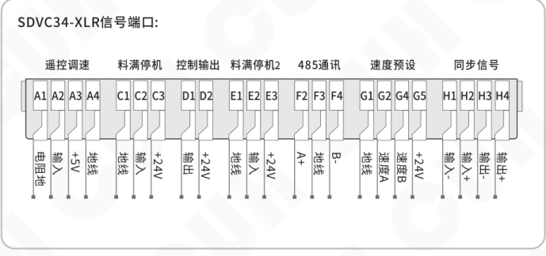

**SDVC34-XLR信号端口：**

| 功能 | 端子 | 说明 |
|---|---|---|
| 遥控调速 | A1 | 电阻地 |
| 遥控调速 | A2 | 输入 |
| 遥控调速 | A3 | +5V |
| 遥控调速 | A4 | 地线 |
| 料满停机 | C1 | 地线 |
| 料满停机 | C2 | 输入 |
| 料满停机 | C3 | +24V |
| 控制输出 | D1 | 输出- |
| 控制输出 | D2 | +24V |
| 料满停机2 | E1 | 地线 |
| 料满停机2 | E2 | 输入 |
| 料满停机2 | E3 | +24V |
| 485通讯 | F2 | A+ |
| 485通讯 | F3 | 地线 |
| 485通讯 | F4 | B- |
| 速度预设 | G1 | 地线 |
| 速度预设 | G2 | 速度A |
| 速度预设 | G4 | 速度B |
| 速度预设 | G5 | +24V |
| 同步信号 | H1 | 输入- |
| 同步信号 | H2 | 输入+ |
| 同步信号 | H3 | 输出- |
| 同步信号 | H4 | 输出+ |

## 1.6 控制器铭牌说明

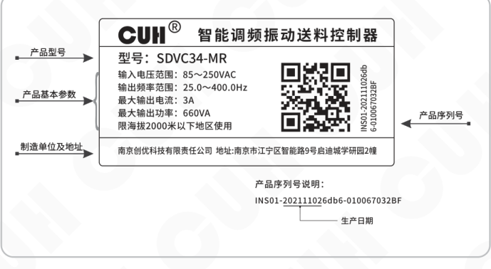

铭牌示例内容：

**CUH®　智能调频振动送料控制器**

型号：SDVC34-MR

- 输入电压范围：85～250VAC
- 输出频率范围：25.0～400.0Hz
- 最大输出电流：3A
- 最大输出功率：660VA
- 限海拔2000米以下地区使用

南京创优科技有限责任公司　地址：南京市江宁区智能路9号启迪城学研园2幢

图中标注项：

- 产品型号
- 产品基本参数
- 制造单位及地址
- 产品序列号
- 生产日期

产品序列号说明：

`INS01-202111026db6-010067032BF`

2026-03　　　　　　　　　　　　　　　　　- 6 -　　　　　　　　　　　　　　　　　SDVC34SMSCN_10.01

### 第 15 页

# 第二章 性能特点

## 2.1 性能总述

本系列控制器专为自动化设备中振动送料控制用，融合最新电子技术，经过精心设计，为用户提供最方便实用的功能，包括：

- 自动调频：自动实时调整输出频率，使送料器总是保持工作在最佳工作频率。
- 自动稳速：自动实时调整输出电压，使送料器无论工件多少，总是保持相同的送料速度。
- 自动搜频：傻瓜式的自动搜频功能，快速确定最佳工作频率及其他相关参数，方便用户使用。
- 自动稳压：即使不开启自动稳速功能，也可以自动消除由于电源电压波动造成的送料速度变化，还可以消除工频交流电造成的拍频效应。
- 同步输出：可以将多个控制器的输出同步锁定在相同的频率和相位上，防止拍频等现象的产生。
- 料满/料空停机：具有开关传感器信号输入接口，通过开关传感器实现料满/料空停机控制，并具有可调缓启动时间、开延时、关延时、逻辑方向设置等控制功能。
- 传感器自适应：控制器可自动适应NPN型和PNP型开关传感器。
- 缓启动：在启动时输出电压/送料速度会从0开始逐渐增大到预设值，消除了开机冲击对振动设备造成的损害。
- 速度预置：可以通过外部控制信号直接选择输出多达4种预先设置的送料速度。
- 加速功能：本功能可将最大输出电压提高到输入电压的150%。
- 最大可输出电压设定：本参数可以帮助生产厂家防止用户误操作损害振动设备。
- 波形指数：用户可以通过该参数平衡控制器效率与最大功率。
- 远程速度控制：可以直接使用外置的电位器、PLC、1~5V电压信号或4~20mA电流信号控制输出电压或送料速度。
- 控制输出：通过晶体管输出控制信号，可直接用于控制电磁阀等外部设备与本控制器协调工作。
- 计数功能：对输送的料件进行计数，在达到设定数值后减速或停机。
- 输出开关：面板上设有轻触按键，可以即时开/停机，方便用户调试设备。
- 键盘锁定：长按开/关键以锁定所有按键，防止用户误操作。
- 参数密码：用户可以自行设置参数密码，以锁定输出电压/送料速度以外的其它参数，以防未经授权的更改。
- 恢复出厂设置：该功能可以快速将调乱的参数恢复为出厂默认设置，使控制器进入默认出厂工作状态。
- 485通信：通过485通信可以远程调整控制器的各项参数。

### 第 16 页

智能调频振动送料控制器  
SDVC34 系列

## 2.2 选型指南

### 2.2.1 型号说明

| 控制器型号 | 功率（VA） | 功能 |
|---|---:|---|
| SDVC34-MR | 660 | 通信 |
| SDVC34-MRJ | 660 | 计数、通信 |
| SDVC34-XLR | 1320 | 通信 |
| SDVC34-XLRJ | 1320 | 计数、通信 |

### 2.2.2 功能说明

| 功能 | 普通 | 计数 | 通信 | 计数、通信 |
|---|---|---|---|---|
| 料满停机 | √ | √ | √ | √ |
| 远程速度控制 | √ | √ | √ | √ |
| 控制输出 | √ | √ | √ | √ |
| 速度预置 | √ |  | √ |  |
| 计数功能 |  | √ |  | √ |
| 料满停机2 |  |  | √ | √ |
| 同步功能 |  |  | √ | √ |
| 485通讯 |  |  | √ | √ |
| 振动传感器 | √ | √ | √ | √ |

2026-03　　- 8 -　　SDVC34SMSCN_10.01

### 第 17 页

智能调频振动送料控制器　　　　　　　　　　　　　　　　　　　　　　　　　SDVC34 系列

# 第三章　安装及使用指南

本章节介绍本产品使用所必须具备的条件以及如何正确进行安装与连接。

## 3.1 控制器使用条件

本产品是使用交流110/220V供电的设备，且通过电源线三爪插头进行保护接地连接，请提供符合标准的110V或220V，50Hz/60Hz市电供电配电设施并确保保护地线已正确连接。

**⚠ 警告**　切不可将控制器连接到380V交流电，这将造成控制器不可恢复的严重损坏，有可能导致爆炸、火灾等安全事故。

**⚠ 警告**　确保供电侧可靠接地，控制器的金属外壳是与保护接地线直接连接的，接地不良会导致控制器外壳带电，引发触电事故。

**注意**　控制器长时间工作会产生热量致使外壳温度升高，请将控制器安装在通风良好的环境中，并将其固定良好，远离振动源。

**注意**　本产品的输出是市电经过整流、逆变形成的，中间没有隔离环节。因此输出两极不可以与保护接地连接，在连接电磁铁时也要确保电磁铁线圈与外壳之间具备基本的绝缘能力。否则会导致漏电，可能产生触电和控制器损坏的事故。

**注意**　本产品是用来驱动电磁铁的控制器，切不可连接压电振动盘。

## 3.2 按键基本操作

印. 按键动作根据按下时间分为短按、长按（一级加速、二级加速）。

b. 短按定义按下时间大于0.1小于2秒，长按定义按下时间大于2秒。

c. 在任何工作模式和参数调整状态下都可以通过 <kbd>U</kbd> 和 <kbd>F</kbd> 直接调整常用参数 `U` 和 `F`，调整结束后控制器将自动返回到之前的参数状态。

d. 长按 <kbd>开/关</kbd> 可以锁定所有按键，再次长按 <kbd>开/关</kbd> 可以解除锁定，键盘锁定时，所有按键不可调节。

e. 长按 <kbd>功能</kbd> 进入/退出基本参数界面，短按 <kbd>功能</kbd> 切换基本参数，通过▲和▼调整参数值。

f. 长按 <kbd>功能</kbd> 加 ▲ 进入/退出高级参数界面，短按 <kbd>功能</kbd> 切换高级参数，通过▲和▼调整参数值。

g. 长按 <kbd>功能</kbd> 加 ▼ 进入/退出自动/同步参数界面，短按 <kbd>功能</kbd> 切换自动/同步参数，通过▲和▼调整参数值。

---

2026-03　　　　　　　　　　　　　　- 9 -　　　　　　　　　　　　　　SDVC34SMSCN_10.01

### 第 18 页

## 3.3 安装使用

**第一步：**

打开控制器的外包装，检查控制器外观及侧标型号，判断是否为所需的型号。

**第二步：**

取出输出线，将输出线两个子弹头接线端子连接到振动盘的电磁线圈上，并确认黄绿双色的地线与振动盘金属外壳可靠连接。

将输出线航空插头上的缺口，对准控制器输出插座上的三角形标记，正确连接输出线后锁紧螺母。

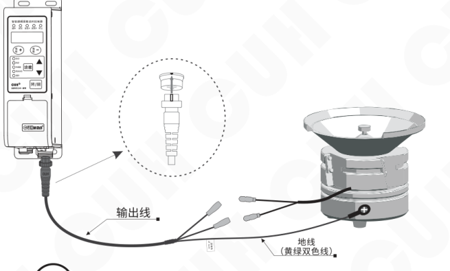

> **注意**
>
> 1、一定要确认电磁铁线圈接在两个输出引脚上，外壳需要可靠接地。  
> 否则将会导致机壳带电，可能发生严重安全事故。
>
> 2、电源输出禁止连接压电类负载，否则可能导致**电击安全事故！**

### 第 19 页

智能调频振动送料控制器　　　　　　　　　　　　　　　　　　　　　　　　　SDVC34 系列

---

### 第三步：

将输入电源线航空插头插入控制器电源  
输入插座，并锁紧螺母。

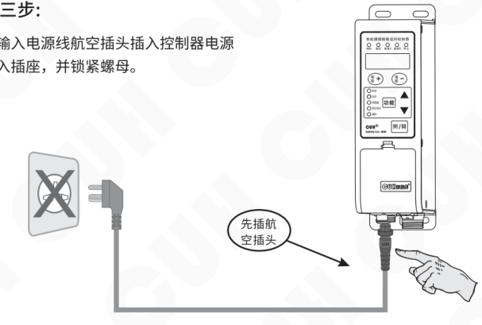

---

### 第四步：

确认开关处于关闭位置后，将电源线三爪插头插在供电电源插座上。

---

2026-03　　　　　　　　　　　　　　- 11 -　　　　　　　　　　　　　　SDVC34SMSCN_10.01

### 第 20 页

智能调频振动送料控制器　　　　　　　　　　　　　　　　　　　　　　　　　SDVC34 系列

# 第四章 参数调整方法

根据不同的参数调整方法，控制器的参数分为常用参数、基本参数、高级参数和自动/同步参数四类。

## 4.1 常用参数

- 直接使用 <kbd>速＋</kbd> 和 <kbd>速－</kbd> 对参数的数值进行调整。
- <kbd>速＋</kbd> 和 <kbd>速－</kbd> 是专门用来调整常用参数 U 和 A 的按钮。
- 在任何工作模式和参数调整状态下都可以通过它们直接调整常用参数，调整结束后控制器将自动返回到之前的参数状态。
- 长按 <kbd>开/关</kbd> 可以锁定所有按钮，再次长按 <kbd>开/关</kbd> 可以解除锁定，键盘锁定时，所有按键不可调节。

操作示意图：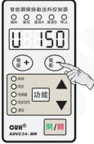

| 参数类别 | 含义 | 参数符号 | 数码管符号图片 | 取值范围 | 默认设置 |
|---|---|---|---|---|---|
| 常用参数 | 输出电压 | [U] | 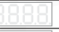 | 0~250 伏特（V） | 150 |
| 常用参数 | 送料速度 | [A] |  | 0~3200 | 200 |
| 常用参数 | 键盘锁定 | [反6] |  | —— | 当前电压值/当前送料速度 |

## 4.2 基本参数

- 按住 <kbd>功能</kbd> 保持2秒，进入基本参数的调整状态。
- 短按 <kbd>功能</kbd> 可以在各基本参数之间进行循环切换。
- 通过使用 ▲ 和 ▼ 可以对参数数值进行调整。
- 再次长按 <kbd>功能</kbd> 保持2秒，可以退出基本参数设定状态。

操作示意图：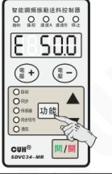

| 参数类别 | 含义 | 参数符号 | 数码管符号图片 | 取值范围 | 默认设置 |
|---|---|---|---|---|---|
| 基本参数（长按 <kbd>功能</kbd>） | 输出频率 | [E] |  | 25.0~400.0 赫兹（Hz） | 50.0 |
| 基本参数（长按 <kbd>功能</kbd>） | C口开延时 | [大勾] |  | 0.0~99.9 秒（s） | 0.2 |
| 基本参数（长按 <kbd>功能</kbd>） | C口关延时 | [大L] |  | 0.0~99.9 秒（s） | 0.2 |
| 基本参数（长按 <kbd>功能</kbd>） | 缓启动时间 | [小T] |  | 0.0~10.0 秒（s） | 0.5 |
| 基本参数（长按 <kbd>功能</kbd>） | 最大计数限制（适合具有计数功能的控制器） | [反C] |  | 0~9999 | 0 |

2026-03　　　　　　　　　　　　　　　　　-12-　　　　　　　　　　　　　　　　　SDVC34SMSCN_10.01

### 第 21 页

## 4.3 高级参数

- 同时长按 **功能** 和 **▲** 保持2秒，进入高级参数调整状态。
- 短按 **功能** 可以在各高级参数之间进行循环切换。
- 通过使用 **▲** 和 **▼** 可以对参数数值进行调整。
- 再次同时长按 **功能** 和 **▲** 保持2秒，可以退出高级参数设定状态。

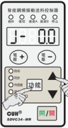

| 类别/操作 | 含义 | 参数符号 | 数码管符号图片 | 取值范围 | 默认设置 |
|---|---|---|---|---|---|
| 高级参数 长按 **功能** 加 **▲** | E口开延时 | J- |  | 0.0~99.9 秒（s） | 0.0 |
| 高级参数 长按 **功能** 加 **▲** | E口关延时 | L- |  | 0.0~99.9 秒（s） | 0.0 |
| 高级参数 长按 **功能** 加 **▲** | D口开延时 | Jd |  | 0.0~99.9 秒（s） | 0.0 |
| 高级参数 长按 **功能** 加 **▲** | D口关延时 | Ld |  | 0.0~99.9 秒（s） | 0.0 |
| 高级参数 长按 **功能** 加 **▲** | D口模式 | rd |  | nPn、PnP、PSP（推挽） | nPn |
| 高级参数 长按 **功能** 加 **▲** | C口逻辑方向 | r2 |  | `---` 常通，`- -` 常断 | `---` |
| 高级参数 长按 **功能** 加 **▲** | E口逻辑方向 | r7 |  | `---` 常通，`- -` 常断 | `---` |
| 高级参数 长按 **功能** 加 **▲** | 控制输出逻辑方向 | r3 |  | `---` 常通，`- -` 常断，`¬` 受报警信号控制 | `---` |
| 高级参数 长按 **功能** 加 **▲** | 主输出逻辑关系 | r4 |  | `---` 常通，`- -` 常断，`- -` C控主、E控D，`---` C控D、E控主 | `---` |
| 高级参数 长按 **功能** 加 **▲** | 控制输出逻辑关系 | r8 |  | `---` 主逻辑，`- -` 副逻辑 | `---` |
| 高级参数 长按 **功能** 加 **▲** | 开关传感器型号选择 （适合不具有计数功能的控制器） | rA | 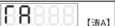 | Uto（自动适应）、nPn、PnP | Uto |
| 高级参数 长按 **功能** 加 **▲** | 开关传感器型号选择 （适合具有计数功能的控制器） | rA |  | nPn、PnP | nPn |
| 高级参数 长按 **功能** 加 **▲** | C口和E口的逻辑关系 | n |  | `- -` 与，`---` 或，`- -` 异或 | `- -` |
| 高级参数 长按 **功能** 加 **▲** | 计数脉冲逻辑方向 （适合具有计数功能的控制器） | rB |  | `└` 下降沿计数，`┌` 上升沿计数 | `└` |
| 高级参数 长按 **功能** 加 **▲** | 计数复位逻辑方向 （适合具有计数功能的控制器） | rC |  | `└` 下降沿复位，`┌` 上升沿复位 | `└` |
| 高级参数 长按 **功能** 加 **▲** | 计数末端速度比例 （适合具有计数功能的控制器） | U |  | 0~100 | 30 |
| 高级参数 长按 **功能** 加 **▲** | 计数末端数量 （适合具有计数功能的控制器） | n |  | 0~255 | 3 |
| 高级参数 长按 **功能** 加 **▲** | 计数抗抖时间 （适合具有计数功能的控制器） | d |  | 0.001~2.000 秒（s） | 0.010 |

### 第 22 页

智能调频振动送料控制器  
SDVC34 系列

| 类别 | 含义 | 参数符号 | 数码管符号图片 | 取值范围 | 默认设置 |
|---|---|---|---|---|---|
| 高级参数 长按回加 ▲ | 最大可设定输出电压 | 【小H】 | 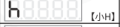 | 0~250 伏特（V） | 250 |
| 高级参数 长按回加 ▲ | 输出频率下限 | 【小E点】 |  | 25.0~390.0 赫兹（Hz） | 40.0 |
| 高级参数 长按回加 ▲ | 加速指数 | 【小Y】 | 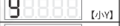 | 100~150 % | 120 |
| 高级参数 长按回加 ▲ | 波形指数 | 【小R】 | 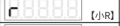 | 0~100 | 100 |
| 高级参数 长按回加 ▲ | 温度显示 | 【大C】 |  | -10.0~80.0 摄氏度（℃） | 当前温度 |
| 高级参数 长按回加 ▲ | 通信协议选择 | 【上拐】 | 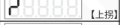 | ASC（ASC通信协议），rtu（RTU通信协议） | rtu |
| 高级参数 长按回加 ▲ | 通信地址 | 【万】 |  | 1~31 | 1 |
| 高级参数 长按回加 ▲ | 通信波特率 | 【下拐】 |  | 0.3~115.2 kbps | 9.6 |
| 高级参数 长按回加 ▲ | 参数密码 | 【反F】 | 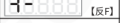 | 0~999 | --- |
| 高级参数 长按回加 ▲ | 开机运行状态 | 【涛D】 | 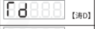 | --- 开机运行，- = 开机停止，--- 开机跟随 | --- |
| 高级参数 长按回加 ▲ | 软件版本 | 【UR】 |  | —— | 当前软件版本 |
| 高级参数 长按回加 ▲ | 计数满定时清零延迟时间 （适合具有计数功能的控制器） | 【涛E】 |  | 0.0~99.9 秒（s） | 0.0 |
| 高级参数 长按回加 ▲ | 恢复出厂设置 | 【全8】 | 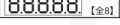 | —— | —— |

2026-03　　-14-　　SDVC34SMSCN_10.01

### 第 23 页

## 部分高级参数说明

**最大可设定输出电压：h**

可调输出电压的范围为0~250V，设定该参数以限制最大可输出电压，防止用户误操作输出过大电压而损坏振动设备，远程速度控制时输出电压也受此参数限制。

**输出频率下限：E.**

输出频率下限参数范围为25.0Hz~390.0Hz。参数 E. 将最小输出频率限制为指定值，以防止振动给料机误操作。

**计数末端速度比例：u**

表示进入末段状态时，控制器的送料速度降为初始速度的百分比。

**计数末端数量：n**

表示在计数状态时，控制器的计数值距离最大计数限制参数规定的数量。当计数值与最大计数限制参数值的差值小于计数末段数量时，控制器进入末段状态。

**计数抗抖时间：J**

表示计数状态高电平或低电平的有效稳定时间。

**加速指数：y**

表示输出电压最高可以达到输入电压的百分比，用户可以通过本参数控制加速功能的发挥。最大输出电压仍将受参数 h 的限制。

**波形指数：r**

本参数可以使用户在最高效率—最大功率和最小噪音的性能间进行连续地平衡，以满足客户更高的需求。

**D口开延时/D口关延时：Jd和Ld**

表示控制输出端口的延时时间。范围0.0~99.9秒，默认0.0秒。

**D口模式：rd**

表控制输出端口可以支持NPN输出、PNP输出和推挽输出。其中：

NPN输出有效为低电平，输出无效为高阻态；  
PNP输出有效为高电平，输出无效为高阻态；  
推挽输出有效为高电平，无效为低电平。

### 第 24 页

智能调频振动送料控制器  SDVC34 系列

---

**控制输出逻辑关系：Γ8**

表示控制输出与主输出的逻辑关系，用户可以设定控制输出信号和主输出是否保持一致。

**温度显示：C**

实时显示控制器内部的温度，方便用户了解控制器的运行状况。该值只能读取。

**键盘密码：-F**

键盘密码可以锁定高级功能参数不被修改。在锁定状态时，只有输出电压和送料速度可以被修改，其它参数不能修改。

通过设置 -F 激活键盘密码功能，此参数重新上电后依然有效。当用户进入高级参数设置时屏幕会提示用户输入密码 -F，此时修改该值与设置密码相同，再短按 <kbd>功能</kbd> 进入高级设置。如果该参数值不等于 -F，那么短按 <kbd>功能</kbd> 不会进入高级功能。

**开机运行状态：Γd**

表示控制器上电后的运行状态。

**软件版本：Ur**

显示控制器当前软件版本。该值只能读取。

**计数满定时清零延迟时间：ΓE**

本参数用来设置计数值满后自动清零计数值的延迟时间。当延迟时间到后，计数值自动清零，且计数和复位灯都亮。（效果与手动清零计数值的效果一样）

---

2026-03  -16-  SDVC34SMSCN_10.01

### 第 25 页

智能调频振动送料控制器  
SDVC34 系列

**恢复出厂设置：8.8.8.8.8.**

本参数可以使用户快速将控制器设置为出厂默认状态。由于本控制器功能强大，有数量众多的控制参数可以由用户设定，对于初学者，可能在多次的设定修改后不能使控制器处于正常工作状态。使用该功能可以快速将调乱的参数状态恢复为出厂默认状态。

> **注：恢复出厂默认设置的方法**
>
> - 同时长按 `功能` 和 ▲ 保持2秒，进入高级参数的调整状态。
> - 短按 `功能` 切换到恢复出厂设置参数8.8.8.8.8.。
> - 此时LED和指示灯都处于闪烁状态。
> - 按下 ▲ 并保持1秒，直至LED显示为-----。
> - 松开 ▲，此时已完成恢复出厂默认设置操作，LED显示U150。

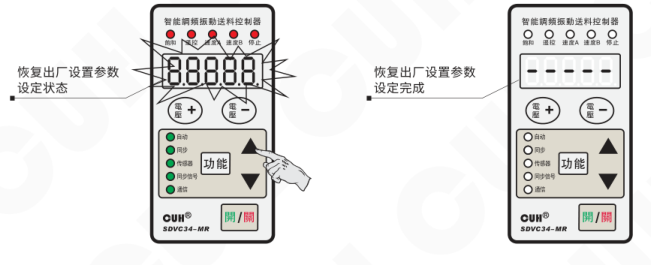

2026-03　　　　　　　　- 17 -　　　　　　　　SDVC34SMSCN_10.01

### 第 26 页

智能调频振动送料控制器　　　　　　　　　　　　　　　　　　　　　　　　　SDVC34 系列

## 4.4 自动/同步参数

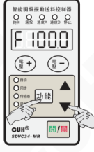

- 同时长按 `功能` 和 ▼ 保持2秒，进入自动/同步参数的调整状态。
- 短按 `功能` 可以在各自动/同步参数之间进行循环切换。
- 通过使用 ▲ 和 ▼ 可以对参数数值进行调整。
- 再次同时长按 `功能` 和 ▼ 保持2秒，可以退出自动/同步参数设定状态。

| 参数组/操作 | 含义 | 参数符号 | 数码管符号图片 | 取值范围 | 默认设置 |
|---|---|---|---|---|---|
| 自动/同步参数 长按 `功能` 加 ▼ | 中心频率 | `F`（[F]） |  | 25.0~400.0 赫兹（Hz） | 100.0 |
|  | 自动调频最大偏移量 | `n`（[下恩]） |  | 0.0~180.0 赫兹（Hz） | 30.0 |
|  | 输出电压调整方式 | `T5` |  | `---` 自动，`--` 手动 | `---` |
|  | 输出频率调整方式 | `T6` |  | `---` 自动，`--` 手动，`==` 跟随 | `---` |
|  | 频率自动调整系数 | `1F`（[1F]） |  | 0~200 | 20 |
|  | 振幅自动调整系数 | `PA`（[PA]） |  | 0~999 | 60 |
|  | 振幅自动调整系数 | `1A`（[1A]） |  | 0~999 | 50 |
|  | 送料速度显示 | `U`（[倒A]） |  | 0~H | 0 |
|  | 输出电压显示 | `G`（[大G]） |  | 0~h 伏特（V） | 150 |
|  | 电压下限 | `UL`（[GL]） |  | 0~250 伏特（V） | 0 |
|  | 频率下限 | `E`（[反9]） |  | 25.0~400.0 赫兹（Hz） | 40.0 |
|  | 最大振幅指数 | `P`（[P]） |  | 0~500 | 500 |
|  | 最大可设定送料速度 | `H`（[H]） |  | 0~3200 | 1500 |
|  | 相位差 | `φ` |  | -180~180 ° | 0 |
|  | 最大搜频电压 | `b`（[小B]） |  | 0~250 伏特（V） | 100 |
|  | 频率搜索速度 | `SP`（[SP]） |  | 1~7 | 5 |
|  | 送料速度最小调整量 | `c`（[小C]） |  | 1~10 | 1 |
|  | 振动传感器编号 | `t`（[横T]） |  | 0，1，2，3，4，203，204，205，206 | 205 |

2026-03　　　　　　　　　　　　　　　　　-18-　　　　　　　　　　　　　　　　　SDVC34SMSCN_10.01

### 第 27 页

## 自动/同步参数说明

### 输出电压调整方式：Γ5

当参数 Γ5 设置为 `_-_` 时，输出电压参数 U 可见，送料速度参数 A 隐藏。输出电压 U 由手动调整。

当参数 Γ5 设置为 `___` 时，并且连接振动传感器，送料速度参数 A 可见，输出电压 U 隐藏。控制器将根据振动传感器的反馈信号自动调整输出电压 U，以使得送料速度 A 始终稳定在用户设定值上。

> 如果未连接振动传感器，即使参数 Γ5 设为 `___`，参数 U 仍可见。输出电压由手动调整。

### 输出频率调整方式：Γ6

当参数 Γ6 设置为 `_-_` 时，输出频率参数 E 由手动调整。

当参数 Γ6 设置为 `___` 时，并且连接振动传感器，控制器将根据振动传感器的反馈信号自动调整输出频率 E 到振动设备的谐振频率（最佳工作频率），此时，输出频率 E 不可手动调整。

当参数 Γ6 设置为 `‾‾‾` 时，并且连接同步信号线，“从控制器”的输出频率始终保持与“主控制器”的频率一致，此时，输出频率 E 不可手动调整。

> 如果未连接振动传感器，即使参数 Γ6 设为 `___`，输出频率 E 仍然将由手动调整。

### 中心频率：F

控制器可自动调整的频率范围为中心频率±自动调频最大偏移量。

应把中心频率调整到振动设备的谐振点附近，以利于控制器在自动调整频率时尽快地调整到最佳工作点。

### 自动调频最大偏移量：n

控制器可自动调整的频率范围为中心频率±自动调频最大偏移量。一般此值在30.0Hz左右即可。过大可能使振动设备工作在不合适的工作点，过小可能会降低振动设备的适应能力。

### 第 28 页

**频率自动调整系数：1F**

控制器通过PID算法来自动调整输出频率，“1F”为频率积分参数。此值越大，则控制器能越快地调整输出频率，但过大可能会造成输出频率的振荡。

**振幅自动调整系数：PA**

控制器通过PID控制来自动调整输出电压，“PA”为速度比例参数。此值越大，则控制器能越快地调整输出电压，但过大会造成输出电压的频繁振荡。

**振幅自动调整系数：1A**

控制器通过PID控制来自动调整输出电压，“1A”为速度积分参数。此值越大，则控制器能越快地调整输出电压，减小输出电压的振荡幅度和次数，但过大反而会造成输出电压的振荡幅度变大。

**送料速度显示：凵**

该参数用于显示当前送料速度，以帮助用户了解设备的工作情况，该参数不能调整。

**输出电压显示：G**

该参数用于显示当前输出电压，以帮助用户了解设备的工作情况，该参数不能调整。

**电压下限和频率下限：GL 和 E**

当Γ3设置为--时，当控制器处于自动状态（包括仅电压自动、仅频率自动、全自动），且正常工作时（不处于外部信号和手动停止控制器输出，不处于缓启动以及故障状态），输出电压低于由 GL 设置的下限参数，或者输出频率低于 E 设置的下限参数，则24V控制输出有效（D1口输出为低电平）。两种情况都没有发生时输出为无效（D1口输出为高阻）。

以上三个参数Γ3、GL 和 E 都可以在设置后自动保存，且都可以在485通讯中设置和读取。

**最大振幅指数：P**

该参数可限制设备能够承受的最大振动强度，以防止用户误操作而损坏设备。

**最大可设定送料速度：H**

可调送料速度范围为0~H，设定该参数以限制最大可设定送料速度，防止用户误操作输出过大电压而损坏振动设备，远程速度控制时送料速度也受此参数影响。

**相位差：μ**

该参数可修改输出波形的相位，控制器出厂时相位默认为0°。

### 第 29 页

智能调频振动送料控制器　　　　　　　　　　　　　　　　　　　　　　　　　SDVC34 系列

---

**最大搜频电压：b**

自动搜频时控制器的输出电压不会超过该值，以保护振动设备的安全。

**频率搜索速度：SP**

表示频率搜索速度，该值越高，频率搜索进度越快。范围：1~7。

**送料速度最小调整量：c**

手动调整送料速度时，一次可改变的参数值大小。范围：1~10。

**振动传感器编号：├**

控制器支持不同量程的振动传感器。为了使得控制器在相同的送料速度下，不同量程振动传感器的输出电压不同，用户应当按照实际振动传感器型号设置该参数。范围为：1~4，203~206，分别表示不同的振动传感器：

| 参数值 | 对应型号 | 规格（X轴 / Y轴 / Z轴 加速度） |
|---|---|---|
| 1 | SDVS20-1 | 16g/16g/16g |
| 2 | SDVS20-2 | 35g/35g/—— |
| 3 | SDVS20-3 | 50g/50g/—— |
| 4 | SDVS20-4 | 70g/70g/—— |
| 203 | SDVS203 | 8g/8g/8g |
| 204 | SDVS204 | 16g/16g/16g |
| 205 | SDVS205 | 32g/32g/32g |
| 206 | SDVS206 | 64g/64g/64g |

---

2026-03　　　　　　　　　　　　　　　　　-21-　　　　　　　　　　　　　　　　SDVC34SMSCN_10.01

### 第 30 页

## 第五章 工作模式

用户根据应用需求可设置控制器运行在以下五种工作模式之一：

- **手动模式：** 完全手动设定输出电压 U 和输出频率 E。
- **自动模式：** 控制器根据振动传感器的反馈信号自动调整输出电压 U 和输出频率 E，使得送料速度 A 始终稳定在用户设定值上，输出频率 E 始终为振动设备的最佳工作频率。
- **半自动模式：** 控制器根据振动传感器的反馈信号自动调整输出电压 U 使得送料速度 A 始终稳定在用户设定值上，输出频率 E 由手动设定。
- **同步模式：** 当“控制器B”设置为输出频率始终保持与“控制器A”一致时，我们称“控制器B”为从控制器，“控制器A”为主控制器。此时“控制器B”工作的模式称为同步模式。
- **计数模式：** 控制器对输送料件进行计数，在达到设定数值后减速或停止的工作模式称为计数模式。

| 工作模式 | 输出电压 U：调整方法 | 输出电压 U：Γ5参考值 | 输出频率 E：调整方法 | 输出频率 E：Γ6参考值 |
|---|---|---|---|---|
| 手动模式 | 手动 | `- -` | 手动 | `- -` |
| 自动模式 | 自动 | `---` | 自动 | `---` |
| 半自动模式 | 自动 | `---` | 手动 | `- -` |
| 同步模式 | 手动或自动 | `- -` 或 `---` | 自动与 主控制器同步 | `≡` |

### 5.1 手动模式

此模式下，控制器的输出电压和输出频率均由手动调整。

| 工作模式 | 输出电压 U：调整方法 | 输出电压 U：Γ5参考值 | 输出频率 E：调整方法 | 输出频率 E：Γ6参考值 |
|---|---|---|---|---|
| 手动模式 | 手动 | `- -` | 手动 | `- -` |

为了简化用户操作，在出厂默认状态下，参数 Γ5 和 Γ6 均被设置为（自动），此时，如果不连接振动传感器，控制器将工作在手动模式下；如果连接振动传感器，控制器将工作在自动模式下。

> ☺
>
> - 如果参数 Γ5 和 Γ6 均被设置为 `- -`，无论是否连接振动传感器，控制器都将工作在手动模式下。
> - 如果控制器未连接振动传感器，无论参数 Γ5 和 Γ6 如何设置，控制器都将工作在手动模式下。

### 第 31 页

智能调频振动送料控制器　　　　　　　　　　　　　　　SDVC34 系列

## 5.1.1 手动模式下输出电压的设定

本控制器可以直接在控制面板上以数字方式设定输出电压。由于本控制器特有的稳压功能，该数值为输出电压的绝对值，并不会受到输入电压的影响，即使在电压不稳定的场合中使用也可以保证送料设备稳定工作。同时，直接的电压数值设定也为用户了解设备运行情况提供了准确的数据。

- 在控制器未连接振动传感器的情况下打开控制器的电源开关。
- 控制器进入输出电压 U 参数。
- 通过使用 <kbd>速度 +</kbd> 和 <kbd>速度 −</kbd> 可以对输出电压 U 的值进行调整。

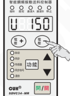

## 5.1.2 手动模式下输出频率的设定

本控制器采用直接数字频率合成技术（DDS）, 具有非常高的频率精度和稳定性，不随时间和温度的变化而变化。

- 按住 <kbd>功能</kbd> 保持2秒，进入基本参数的调整状态。
- 控制器进入输出频率 E 参数。
- 通过使用 ▲ 和 ▼ 可以对输出频率 E 的值进行调整。

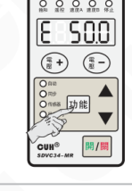

---

2026-03　　　　　　　　　　-23-　　　　　　　　　　SDVC34SMSCN_10.01

### 第 32 页

## 5.2 自动模式

此模式下，控制器必须连接振动传感器，控制器会根据振动传感器反馈的数据，自行调整输出电压 U 和输出频率 E，保证振动设备的送料速度 A 稳定在设定数值上，并使振动频率处于振动设备的最佳工作频率，输出电压和输出频率不可手动调整。

出厂默认设置下，振动传感器连接到控制器上后，控制器会自动进入自动模式。

| 工作模式 | 输出电压 U | 输出电压 U | 输出频率 E | 输出频率 E |
|---|---|---|---|---|
|  | 调整方法 | Γ5参考值 | 调整方法 | Γ6参考值 |
| 自动模式 | 自动 | --- | 自动 | --- |

> 若未连接振动传感器，控制器仍将处于手动模式。

### 5.2.1 振动传感器的安装

#### 5.2.1.1 振动传感器的接入方法

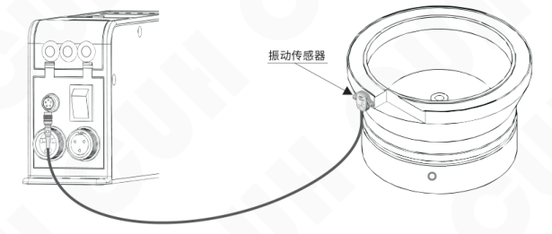

将振动传感器上的航空插头接在控制器的振动传感器插座上。

**注意：** 请在控制器断电状态下插拔振动传感器。

### 第 33 页

智能调频振动送料控制器　　　　　　　　　　　　　　　　　　　　　　　　　SDVC34 系列

### 5.2.1.2 振动传感器安装指南

用螺丝将振动传感器安装在牢固、平整的表面，方向角度等可以任意选择。建议安装位置及安装方法如下：

- 方式1，见图 1。  
  优点：安装简便。

- 方式2，见图 2。  
  注意事项：需避免料盘压到振动传感器。

- 方式3，在料盘上焊接一个支架，将振动传感器安装在支架上，见图 3。  
  振动传感器支架建议尺寸见图 4。

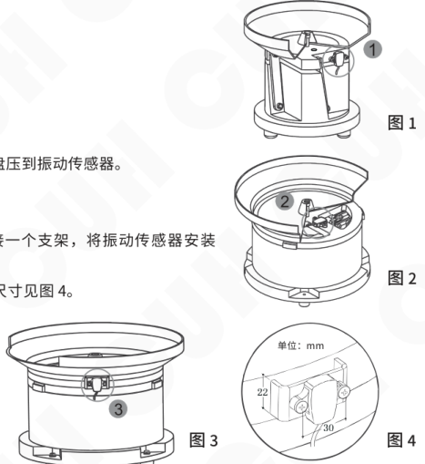

- 不推荐安装方式，见图 5、图 6。  
  原因：容易受物料、料盘干扰，不能准确的反映出振动盘谐振点，控制器可能会一直处于搜频状态，导致无法稳定送料。

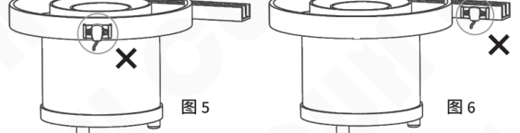

---

2026-03　　　　　　　　　　　　　　　　　-25-　　　　　　　　　　　　　　　　　SDVC34SMSCN_10.01

### 第 34 页

智能调频振动送料控制器　　　　　　　　　　　　　　　　　　　　　　　　　SDVC34 系列

---

## 5.2.2 自动模式下送料速度的设定

- 打开控制器电源开关。
- 此时控制面板上的“传感器”指示灯点亮，表示振动传感器已经连接到控制器。
- 控制器进入送料速度 A 参数。
- 通过使用“速度 +”和“速度 -”可以对送料速度 A 的值进行调整。

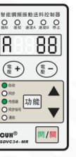

## 5.2.3 自动搜频

通过自动搜频，控制器会搜索到振动设备的最佳工作频率并输出该频率值，同时控制器会自动设定各项相关参数。用户只需要设定需要的送料速度 A 参数值，控制器即可工作在最佳状态。当控制器的输出频率，偏移振动盘的谐振频率30HZ以上时，控制器自动重新搜频。

- 正确连接振动传感器后长按 ▲ 和 ▼ 3秒，即可启动自动搜频，自动搜频过程中控制器将实时显示当前的输出频率 E 值。
- 待搜索结束后，控制器会自动设置中心频率 F、自动调频最大偏移量 n、频率自动调整系数 1F、振幅自动调整系数 PA、振幅自动调整系数 1A、相位差 φ。并将电压调整方式 Γ5 和频率调整方式 Γ6 设为自动。

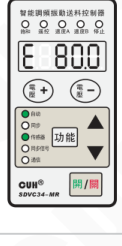

> 若在刚启动搜频时出现 Err02，则说明最大搜频电压设置过高，但这不会影响控制器工作。  
> 若想在搜频中途取消自动搜频，短按“开/关”即可，此后会重新回到自动搜频前的工作状态。

🙂

> 通过设定送料速度和自动搜频两个步骤，振动设备将以最佳状态工作在用户需要的送料速度上。

---

2026-03　　　　　　　　　　　　　　　　　-26-　　　　　　　　　　　　　　　　　SDVC34SMSCN_10.01

### 第 35 页

智能调频振动送料控制器　　　　　　　　　　　　　　　　　　　　　　　SDVC34 系列

## 5.3 半自动模式

此模式下，控制器必须连接振动传感器，控制器会根据振动传感器反馈的数据，自行调整输出电压 U，保证振动设备的送料速度 A 稳定在设定数值上，输出频率 E 由手动设定。

| 工作模式 | 输出电压 U：调整方法 | 输出电压 U：Γ5参考值 | 输出频率 E：调整方法 | 输出频率 E：Γ6参考值 |
|---|---|---|---|---|
| 半自动模式 | 自动 | `---` | 手动 | `- -` |

> ☺ 若未连接振动传感器，控制器仍将处于手动模式。

### 5.3.1 振动传感器的安装

振动传感器的连接方式和自动模式相同。

### 5.3.2 半自动模式的设定

- 在连接振动传感器的情况下打开控制器电源开关。此时控制面板上的“传感器”指示灯点亮。
- 同时长按 **功能** 和 ▼ 保持2秒，进入自动/同步参数的调整状态。
- 短按 **功能** 切换到频率调整方式 Γ6 参数。
- 通过使用 ▲ 和 ▼ 设定 Γ6 参数为 `- -`（输出频率手动调整）。

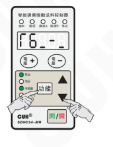

### 第 36 页

### 5.3.3 半自动模式下送料速度的设定

- 通过使用 `速度+` 和 `速度−` 可以对送料速度 A 的值进行调整。

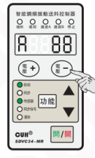

### 5.3.4 半自动模式下输出频率的设定

- 按住 `功能` 保持2秒，进入基本参数的调整状态。
- 控制器进入输出频率 E 参数。
- 通过使用 ▲ 和 ▼ 可以对输出频率 E 的值进行调整。

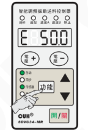

### 第 37 页

## 5.4 同步模式

此模式下，控制器必须与另一台主控制器的同步信号相连接，控制器的输出频率始终保持与主控制器的输出频率一致。控制器的输出电压可以手动或自动调整。

| 工作模式 | 输出电压 U 调整方法 | 输出电压 U Γ5参考值 | 输出频率 E 调整方法 | 输出频率 E Γ6参考值 |
|---|---|---|---|---|
| 同步模式 | 手动或自动 | － － 或 －－－ | 自动与 主控制器同步 | － － |

同步工作模式应用于一个送料系统中有多台控制器，如果它们输出不同步，将造成相互干扰（拍频效应）的场合。通过同步模式从主控制器的组合可输出完全同步的波形，从而消除控制器输出间的相互干扰。

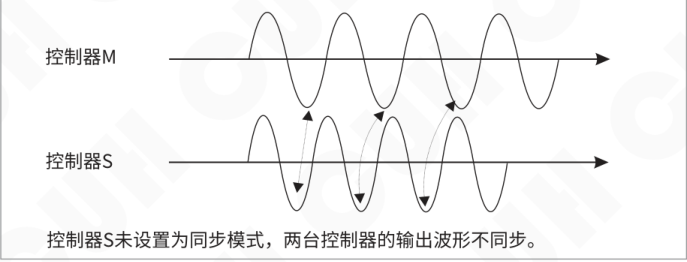

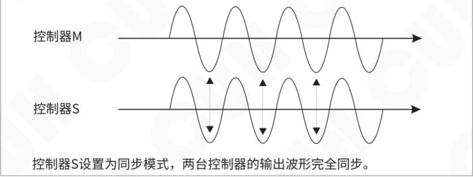

### 第 38 页

智能调频振动送料控制器　　　　　　　　　　　　　　　　　　　　　　　　　　　SDVC34 系列

## 5.4.1 主从控制器同步信号线的连接方法

**第一步：**

打开控制器的接线仓的仓盖。

**第二步：**

按照图例连接主控制器和从控制器的同步信号。

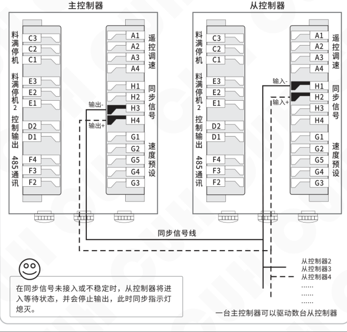

> 在同步信号未接入或不稳定时，从控制器将进入等待状态，并会停止输出，此时同步指示灯熄灭。

一台主控制器可以驱动数台从控制器

---

2026-03　　　　　　　　　　　　　　　　　-30-　　　　　　　　　　　　　　　　　SDVC34SMSCN_10.01

### 第 39 页

智能调频振动送料控制器　　　　　　　　　　　　　　　SDVC34 系列

## 5.4.2 同步模式的应用

- 主手动-从手动

| 控制器 | 输出电压 U | 输出电压 U | 输出频率 E | 输出频率 E |
|---|---|---|---|---|
|  | 调整方法 | Γ5参考值 | 调整方法 | Γ6参考值 |
| 主控制器 | 手动 | - - | 手动 | - - |
| 从控制器 | 手动 | - - | 自动与 主控制器同步 | = = |

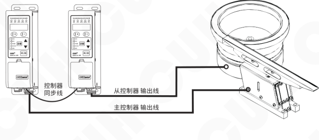

2026-03　　　　　　　　　　　　　　-31-　　　　　　　　　　　　　　SDVC34SMSCN_10.01

### 第 40 页

- 主自动-从手动

| 控制器 | 输出电压 U |  | 输出频率 E |  |
|---|---|---|---|---|
|  | 调整方法 | Γ5参考值 | 调整方法 | Γ6参考值 |
| 主控制器 | 自动 | - - - | 自动 | - - - |
| 从控制器 | 手动 | - - | 自动与 主控制器同步 | - - - |

- 主半自动-从手动

| 控制器 | 输出电压 U |  | 输出频率 E |  |
|---|---|---|---|---|
|  | 调整方法 | Γ5参考值 | 调整方法 | Γ6参考值 |
| 主控制器 | 自动 | - - - | 手动 | - - |
| 从控制器 | 手动 | - - | 自动与 主控制器同步 | - - - |

接线示意图：

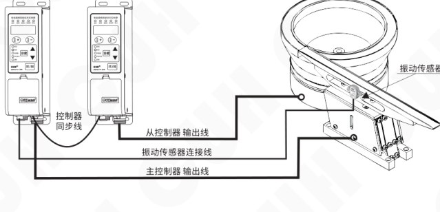

### 第 41 页

- 主手动-从自动

| 控制器 | 输出电压 U：调整方法 | 输出电压 U：Γ5参考值 | 输出频率 E：调整方法 | 输出频率 E：Γ6参考值 |
|---|---|---|---|---|
| 主控制器 | 手动 | - - | 手动 | - - |
| 从控制器 | 自动 | - - | 自动与 主控制器同步 | ≡ |

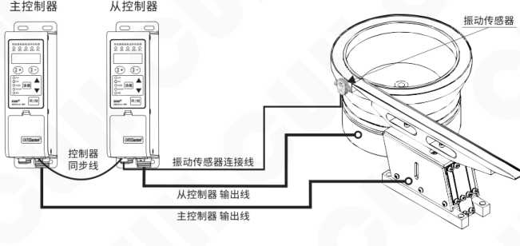

### 第 42 页

- 主自动-从自动

| 控制器 | 输出电压 U |  | 输出频率 E |  |
|---|---|---|---|---|
|  | 调整方法 | Γ5参考值 | 调整方法 | Γ6参考值 |
| 主控制器 | 自动 | - - - | 自动 | - - - |
| 从控制器 | 自动 | - - - | 自动与 主控制器同步 | - - - |

- 主半自动-从自动

| 控制器 | 输出电压 U |  | 输出频率 E |  |
|---|---|---|---|---|
|  | 调整方法 | Γ5参考值 | 调整方法 | Γ6参考值 |
| 主控制器 | 自动 | - - - | 手动 | - - |
| 从控制器 | 自动 | - - - | 自动与 主控制器同步 | - - - |

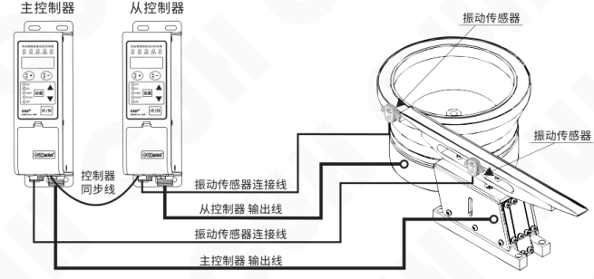

### 第 43 页

智能调频振动送料控制器　　　　　　　　　　　　　　　　SDVC34 系列

## 5.5 计数模式

如果您选择的控制器不具有此功能，无需阅读本小节内容。

本控制器具有内建的计数功能，可以对计数脉冲进行计数，并在脉冲个数达到设定数值后自动减速或停机。使用内建的技术功能很简便且几乎不增加成本，这受益于本机超强抗抖和末段减速防过冲功能。

**末段减速功能：** 开始时，控制器以用户设定的正常速度运行、送料。当计数过程接近完成时，为了防止物料高速运动不能及时停止而造成计数的过冲，控制器自动把速度降为用户设定的末段较慢的速度。当计数数值达到设定值后，控制器立刻停止输出，送料器就可以获得精确的计数控制。示意图见下图。

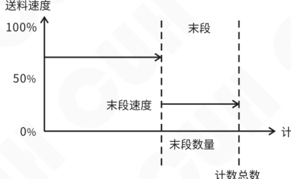

**超强抗抖功能：** 是本机计数功能的另一个特点，专门针对控制送料计数失误的问题。由于振动送料装置的工作过程是在振动中完成，非常容易发生误计数的现象。通过设置一段计数信号稳定时间，使得计数脉冲在经过足够长的稳定时间 b 后，信号才被确认，从而有效提高了计数可靠性。见下图。

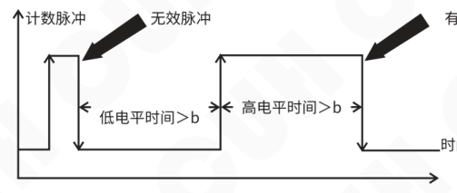

应当注意：

抗抖稳定时间是指高电平和低电平各自的稳定时间。一个有效计数脉冲需要包括前后连续有效的低电平和高电平两个状态，之后控制器进行一次加 1 的计数。

2026-03　　　　　　　　　　　　-35-　　　　　　　　　　　　SDVC34SMSCN_10.01

### 第 44 页

## 5.5.1 使用方法

短暂置计数复位信号“N3”为无效后再恢复有效，则计数值被清零，计数重新开始，也就是复位。在短暂离开计数状态的时间内（不超过2秒时间），控制器会暂时关闭输出。所以，可以根据需要，把该信号作为计数复位信号。

在正常计数状态，使用面板上的 ▲ 或 ▼ 都可以复位计数器。计数脉冲信号通过控制器接口的“N2”口输入，计数的数值以“0”状态显示。如果使用 `功能` 进入其他参数调节状态，计数工作不会停止，计数值也不会丢失。

> 控制器进入计数状态只有一种方法，就是保持计数控制信号（使能/复位信号“N3”）有效，进入计数状态后显示初始状态为“0 0”，同时计数指示灯和复位指示灯点亮，表示可以接受计数脉冲信号，开始计数。
>
> 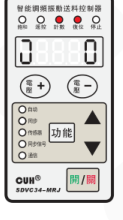

### 第 45 页

智能调频振动送料控制器　　　　　　　　　　　　　　SDVC34 系列

## 5.5.2 接线方法

「A为NPN时的接线方法

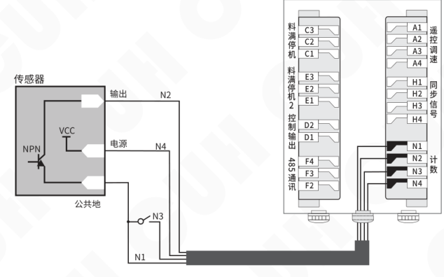

「A为PNP时的接线方法

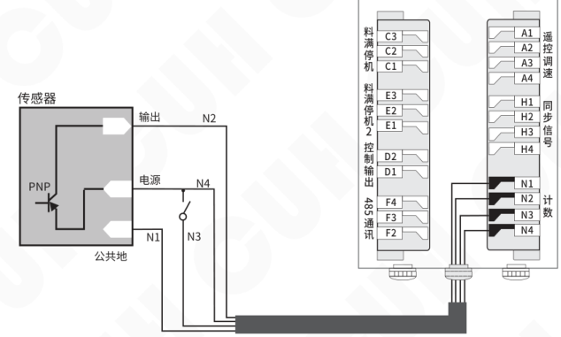

### 第 46 页

## 5.5.3 计数脉冲逻辑方向设定

- 同时长按 <kbd>功能</kbd> 和 ▲ 保持2秒，进入高级参数的调整状态。
- 短按 <kbd>功能</kbd> 切换到计数脉冲逻辑方向 Γb 参数。
- 通过使用 ▲ 和 ▼ 调整参数状态。

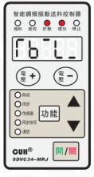

> - 「Γb 逻辑方向设置为 `¯|_` 时，计数脉冲在由“高电平”变为“低电平”的下降沿进行计数。
> - 「Γb 逻辑方向设置为 `_|¯` 时，计数脉冲在由“低电平”变为“高电平”的上升沿进行计数。

## 5.5.4 计数复位逻辑方向设定

- 同时长按 <kbd>功能</kbd> 和 ▲ 保持2秒，进入高级参数的调整状态。
- 短按 <kbd>功能</kbd> 切换到计数复位逻辑方向 Γc 参数。
- 通过使用 ▲ 和 ▼ 调整参数状态。

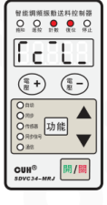

> - 「Γc 逻辑方向设置为 `L` 时，计数控制引脚不接任何信号时，本控制器不进入“计数”状态；当该引脚的信号被拉为“低电平”时，控制器进入“计数”状态。
> - 「Γc 逻辑方向设置为 `H` 时，计数控制引脚不接任何信号时，本控制器进入“计数”状态；当该引脚的信号被拉为“低电平”时，控制器脱离“计数”状态。

### 第 47 页

> 智能调频振动送料控制器　　　　　　　　　　　　　　　　　　　　　　　　　SDVC34 系列

## 5.5.5 计数相关参数设定

### 计数最大限制：」

- 在计数状态下，短按 <kbd>功能</kbd>，进入参数 `」` 的设置状态。
- 通过使用 ▲ 和 ▼ 调整参数值。

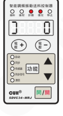

当计数值达到该门限值后，控制器计数饱和，控制器输出被停止，送料也被停止，直到计数器被复位。进入计数饱和状态后，如果继续发送计数脉冲，则计数还会继续，但是控制器的输出一直保持停止状态。

### 计数末段数量：n

- 同时长按 <kbd>功能</kbd> 和 ▲ 保持2秒，进入高级参数的调整状态。
- 短按 <kbd>功能</kbd> 切换到计数末端数量 `n` 参数。
- 通过使用 ▲ 和 ▼ 调整参数值。

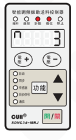

当计数值距离计数限制数量的个数达到计数末段数量后，控制器进入末段状态，送料速度降为末段速度。

不使用末段减速功能时，将该参数设置为0，可以使减速功能不起作用。

---

2026-03　　　　　　　　　　　　　　　　-39-　　　　　　　　　　　　　　　　SDVC34SMSCN_10.01

### 第 48 页

智能调频振动送料控制器  SDVC34 系列

## 计数末段速度比例：u

- 同时长按 <kbd>功能</kbd> 和 ▲ 保持2秒，进入高级参数的调整状态。
- 短按 <kbd>功能</kbd> 切换到计数末端速度比例 u 参数。
- 通过使用 ▲ 和 ▼ 调整参数值。

当计数进入末段计数状态时，控制器的送料速度将降为初始速度的百分比。

## 计数抗抖时间：J

- 同时长按 <kbd>功能</kbd> 和 ▲ 保持2秒，进入高级参数的调整状态。
- 短按 <kbd>功能</kbd> 切换到计数抗抖时间 J 参数。
- 通过使用 ▲ 和 ▼ 调整参数值。

由于抗抖稳定时间是高电平和低电平各自的稳定时间，因此，该参数取值应当小于：

$$
\frac{1}{2} \times \frac{1}{\text{每秒最大计数个数}}
$$

其中，每秒最大计数个数应当按照实际情况取具体设备工作时的最大可能速度。过高的估计该速度会使得抗抖功能达不到理想效果，过低的取值会导致漏计数。

---

2026-03  -40-  SDVC34SMSCN_10.01

### 第 49 页

# 第六章 信号控制

信号控制包括：开关量输入端口C料满/料空停机控制、开关量输入端口E料满/料空停机控制、远程速度控制、预置速度的保存和调出、485通讯、24V直流控制输出。

## 6.1 开关量输入端口C料满/料空停机控制

开关量输入端口C可配合各类开关传感器，如接近开关传感器、光电传感器、光纤传感器及PLC等实现控制器启动和停止的外部控制功能。

### 6.1.1 开关量输入端口C的接线方法

#### 接近开关传感器的连接

### 第 50 页

## 对射光电传感器的连接

### 第 51 页

智能调频振动送料控制器

SDVC34 系列

### 对射光电传感器的连接

图中接线标注：

- 棕色+：接 `C3`（+24V输出）
- 黑色 OUT：接 `C2`（输入）
- 蓝色-：接 `C1`（地线）

端子排中还可见：`E3`、`E2`、`E1`、`D2`、`D1`、`F4`、`F3`、`F2`。

---

2026-03　　　　　　　　　-43-　　　　　　　　　SDVC34SMSCN_10.01

### 第 52 页

### 对射式光纤传感器的连接

端子连接关系：

| 端子 | 功能 |
|---|---|
| C3 | +24V输出 |
| C2 | 输入 |
| C1 | 地线 |

线色标注：棕色、蓝色、白色（或黑色）、黑色（或白色）。白线、黑线任选一根接收/发射侧连接。

### 第 53 页

## PLC的连接

### PLC的NPN输出的连接

### PLC的PNP输出的连接

可以使用PLC的继电器输出，也可以使用PLC的NPN或PNP输出。

注意：使用PLC控制信号进行控制器启动和停止控制时，输入信号电压值≤24V。

### 第 54 页

智能调频振动送料控制器　　　　　　　　　　　　　　　　　　　　　　　　　SDVC34 系列

---

## 6.1.2 开关量输入端口C开延时、关延时设定

当使用外部信号进行启动和停止控制时，大多数情况需要在收到指令后延迟一段时间才执行操作。对于这样的应用，可以通过设置开延时和关延时来实现。另外，还可以设定缓启动时间以消除启动时的冲击。

### 开关量输入端口C开延时

从施加一个使控制器进入运行状态的信号开始，到控制器输出启动，期间经历的延迟时间称为开延时。

- 按住 <kbd>功能</kbd> 保持2秒，进入基本参数的调整状态。
- 短按 <kbd>功能</kbd> 切换到C口开延时 **J** 参数。
- 通过使用 ▲ 和 ▼ 可以调整参数值。

### 开关量输入端口C关延时

从施加一个使控制器进入停止状态的信号开始，到控制器输出停止，期间经历的延迟时间称为关延时。

- 按住 <kbd>功能</kbd> 保持2秒，进入基本参数的调整状态。
- 短按 <kbd>功能</kbd> 切换到C口关延时 **L** 参数。
- 通过使用 ▲ 和 ▼ 可以调整参数值。

---

2026-03　　　　　　　　　　　　　　　　-46-　　　　　　　　　　　　　　　　SDVC34SMSCN_10.01

### 第 55 页

智能调频振动送料控制器　　　　　　　　　　　　　　　　　　　　　　　　　SDVC34 系列

## 6.1.3 开关量输入端口C逻辑方向设定

此逻辑方向参数用以切换控制器是“料满停机”还是“料空停机”。在出厂默认设置下开关量输入端口C没有收到任何信号时，控制器处于“运行”料满停机状态。但是，对于一些特殊应用，可能需要相反的逻辑。也就是说，可能会需要在端口C没有收到任何信号时，控制器处于“停止”状态（如料空停机）。这可以通过修改本参数来实现。

- 同时长按 <kbd>功能</kbd> 和 ▲ 保持2秒，进入高级参数的调整状态。
- 短按 <kbd>功能</kbd> 切换到C口逻辑方向 Γ2 参数。
- 通过使用 ▲ 和 ▼ 调整参数值。

> ☺
>
> - 逻辑方向设置为**常通**，则不连接任何控制信号时，控制器处于运行状态。
> - 逻辑方向设置为**常断**，则不连接任何控制信号时，控制器处于停止状态。

---

2026-03　　　　　　　　　　　　　　　　　-47-　　　　　　　　　　　　　　　　　SDVC34SMSCN_10.01

### 第 56 页

## 6.2 开关量输入端口E料满/料空停机控制

此功能适合具有料满停机II功能的控制器。

开关量输入端口可配合各类开关传感器，如接近开关传感器、光电传感器、光纤传感器及PLC等实现控制器启动、停止的外部控制功能。

开关量输入端口C和开关量输入端口E可以同时实现控制器启动和停止的外部控制功能。

### 6.2.1 开关量输入端口E的接线方法

**接近开关传感器的连接**

**第一步：**

打开控制器的接线仓的仓盖。

**第二步：**

按照图例连接传感器。

- E3：+24V
- E2：输入
- E1：地线

通常情况：

- 蓝色线为地线
- 黑色线为信号线
- 棕色线为电源线

开关量输入端口E其它类型传感器及PLC的连接方法参考开关量输入端口C。

### 第 57 页

智能调频振动送料控制器　　　　　　　　　　　　　　　　　　　　　SDVC34 系列

## 6.2.2 开关量输入端口E开延时、关延时设定

当使用外部信号进行启动和停止控制时，大多数情况需要在收到指令后延迟一段时间才执行操作。对于这样的应用，可以通过设置开延时和关延时来实现。另外，还可以设定缓启动时间以消除启动时的冲击。

### 开关量输入端口E开延时

从施加一个使控制器进入运行状态的信号开始，到控制器输出启动，期间经历的延迟时间称为开延时。

- 同时长按 <kbd>功能</kbd> 和 ▲ 保持2秒，进入高级参数的调整状态。
- 短按 <kbd>功能</kbd> 切换到E口开延时 J- 参数。
- 通过使用 ▲ 和 ▼ 调整参数值。

### 开关量输入端口E关延时

从施加一个使控制器进入停止状态的信号开始，到控制器输出停止，期间经历的延迟时间称为关延时。

- 同时长按 <kbd>功能</kbd> 和 ▲ 保持2秒，进入高级参数的调整状态。
- 短按 <kbd>功能</kbd> 切换到E口关延时 L- 参数。
- 通过使用 ▲ 和 ▼ 调整参数值。

> 🙂 J- 和 L- 参数在“---”状态下，不受此延时控制，只受开关量输入端口C开延时/关延时时间的控制。

2026-03　　　　　　　　　　　　　　　　　-49-　　　　　　　　　　　　　　　SDVC34SMSCN_10.01

### 第 58 页

### 6.2.3 开关量输入端口E逻辑方向设定

此逻辑方向参数用以切换控制器是“料满停机”还是“料空停机”。在出厂默认设置下开关量输入端口E没有收到任何信号时，控制器处于“运行”料满停机状态。但是，对于一些特殊应用，可能需要相反的逻辑。也就是说，可能会需要在端口E没有收到任何信号时，控制器处于“停止”状态（如料空停机）。这可以通过修改本参数来实现。

- 同时长按 <kbd>功能</kbd> 和 ▲ 保持2秒，进入高级参数的调整状态。
- 短按 <kbd>功能</kbd> 切换到E口逻辑方向 **F7** 参数。

> - 逻辑方向设置为**常通**，则不连接任何控制信号时，控制器处于运行状态。
> - 逻辑方向设置为**常断**，则不连接任何控制信号时，控制器处于停止状态。

### 第 59 页

## 6.3 开关量输入端口C、输入端口E共同参数设定

此功能适合具有料满停机II功能的控制器。

### 6.3.1 开关量输入端口C、输入端口E逻辑关系设定

此参数决定了开关量输入端口C和输入端口E同时作用的结果。

- 同时长按 `功能` 和 ▲ 保持2秒，进入高级参数的调整状态。
- 短按 `功能` 切换到C口和E口逻辑关系 `Π` 参数。
- 通过使用 ▲ 和 ▼ 调整参数值。

- 逻辑“或”，只要开关量输入端口C与开关量输入端口E信号有一个要求控制器运行，控制器就运行。
- 逻辑“与”，仅在开关量输入端口C与开关量输入端口E信号同时要求控制器运行，控制器才运行。
- 逻辑“异或”，仅在开关量输入端口C与开关量输入端口E信号要求不同时，控制器才运行。

出厂默认状态为“与”。

### 第 60 页

## 6.3.2 开关传感器类型设定

控制器可以自动识别开关传感器的类型为“NPN”型还是“PNP”型，若无法识别也可以手动设定。

> - 同时长按 `功能` 和 ▲ 保持2秒，进入高级参数的调整状态。
> - 短按 `功能` 切换到开关传感器型号选择 ΓA 参数。
> - 通过使用 ▲ 和 ▼ 调整参数值。
>
> 
>
> 🙂
>
> - Ut0：由控制器自动识别开关传感器类型。
> - nPn：NPN型传感器。
> - PnP：PNP型传感器。
>
> **注：在具有计数功能的控制器中，「ΓA 只有两种状态，nPn 和 PnP。**

### 第 61 页

## 6.3.3 主输出逻辑关系设定

- 同时长按 **功能** 和 **▲** 保持2秒，进入高级参数的调整状态。
- 短按 **功能** 切换到主输出逻辑关系 **F4** 参数。
- 通过使用 **▲** 和 **▼** 调整参数值。

出厂默认状态为“常通”。

可选状态：

- 常通
- 常断
- C控主，E控D
- C控D，E控主

---

- 主输出逻辑关系设置为**常通**，控制器主输出和控制输出相关联，同时受料满停机端口C和E的逻辑结果及开关键控制。

- 主输出逻辑关系设置为**常断**，控制器主输出和控制输出不关联，主输出仅受开关键控制，控制输出受料满停机端口C和E的逻辑结果控制。

- 主输出逻辑关系设置为**C控主，E控D**，控制器主输出受开关键和料满停机端口C信号控制，控制输出受料满停机端口E信号控制。

- 主输出逻辑关系设置为**C控D，E控主**，控制器主输出受开关键和料满停机端口E信号控制，控制输出受料满停机端口C信号控制。

### 第 62 页

## 6.4 远程速度控制

控制器的远程速度控制功能允许用户通过外接电位器或 1~5V/4~20mA 控制信号控制输出电压（在“自动工作模式”和“半自动工作模式”下调节送料速度）。这样，用户可以通过电位器、PLC、DDS 或其它一些设备方便容易地进行外部远程速度控制。

当远程速度控制电压超过 0.5V 时，对控制器的控制生效。此时面板的遥控指示灯点亮，同时面板上“+”和“-”将失效。控制器 LED 屏幕将根据实际设置状态显示输出电压 U 或送料速度 A 值。

### 远程速度控制电位器的连接

**建议：**

请使用 1K 阻值线性电位器

### 第 63 页

### 远程速度控制PLC的连接

| 远程速度控制信号 | 输出电压 U/送料速度 A |
|---|---|
| 小于0.5V | 受“+”和“-”控制 |
| 0.5V~1V | 输出电压 U=0V 或送料速度 A=0， 受远程速度控制信号控制 |
| 1~5V/4~20mA | 输出电压 U 或送料速度 A 按比例 受远程速度控制信号控制 |

### 第 64 页

## 6.5 控制输出

本控制器可以输出24V直流低电压控制信号，以同步其它设备协同工作，如电磁阀、PLC等。

### 6.5.1 控制输出的接线方法

#### 控制电磁阀工作的连接方法

- 本控制器可直接驱动额定电压24V，功率小于4W的电磁阀。

#### 控制继电器工作的连接方法

- 本控制器可直接驱动线圈额定电压24V，功率小于4W的继电器。

**注意：** 请正确连接继电器或电磁阀的正负极：D2接正极、D1接负极。接反会有导致控制输出短路损坏的风险。

### 第 65 页

## 6.5.2 控制输出逻辑方向设定

- 同时长按 <kbd>功能</kbd> 和 ▲ 保持2秒，进入高级参数的调整状态。
- 短按 <kbd>功能</kbd> 切换到控制输出逻辑方向 Γ3 参数。
- 通过使用 ▲ 和 ▼ 调整参数值。

出厂默认状态为“常通”。

- **常通**
- **常断**
- **受报警信号控制**

---

- 逻辑方向设置为**常通**，  
  控制器输出运行，控制输出也为运行状态；  
  控制器输出停止，控制输出也为停止状态。

- 逻辑方向设置为**常断**，  
  控制器输出运行，控制输出则为停止状态；  
  控制器输出停止，控制输出则为运行状态。

- 逻辑方向设置为**受报警信号控制**，则控制输出只和电压下限、频率下限这两个参数所定义的报警信号相关。详细说明参考4.4 章节中，电压下限和频率下限的参数说明。

### 第 66 页

智能调频振动送料控制器 | SDVC34 系列

## 6.5.3 控制输出逻辑关系设定

- 同时长按 `功能` 和 ▲ 保持 2 秒，进入高级参数的调整状态。
- 短按 `功能` 切换到控制输出逻辑关系 F8 参数。
- 通过使用 ▲ 和 ▼ 调整参数值。

出厂默认状态为“主逻辑”。

> - 控制输出逻辑关系设置为**主逻辑**，控制输出与主输出共享一套控制逻辑。
> - 控制输出逻辑关系设置为**副逻辑**，控制输出受副逻辑控制，主输出受主逻辑控制。

---

2026-03　　-58-　　SDVC34SMSCN_10.01

### 第 67 页

## 6.6 预置速度的保存和调出

此功能适合没有计数功能的控制器。

控制器可以保存和输出4个不同的预置速度。速度A灯和速度B灯的4种亮、灭组合，分别对应速度1、速度2、速度3和速度4。对应关系如下表：

| 预置速度 | G1、G2端口：速度A灯状态 | G1、G2端口：K1状态 | G3、G4端口：速度B灯状态 | G3、G4端口：K2状态 |
|---|---|---|---|---|
| 速度1 | 亮 | 闭合 | 灭 | 断开 |
| 速度2 | 灭 | 断开 | 亮 | 闭合 |
| 速度3 | 亮 | 闭合 | 亮 | 闭合 |
| 速度4 | 灭 | 断开 | 灭 | 断开 |

> 电压手动模式下，4种速度对应4种输出电压 U。
> 频率手动模式下，4种速度对应4种输出频率 E。
> 电压自动模式下，4种速度对应4种送料速度 A。
> 频率自动模式下，4种速度对应4种中心频率 F。

**ΓA为NPN时速度预置的接线方法**

### 第 68 页

智能调频振动送料控制器  
SDVC34 系列

「A为PNP时速度预置的接线方法

## 预置速度的保存

以速度1的保存为例，步骤如下：

- 闭合K1，对应的速度A指示灯点亮，断开K2，对应的速度B指示灯熄灭。
- 为获得理想的送料速度  
  在手动模式下，调整输出电压 U 和输出频率 E。  
  在自动模式下，调整送料速度 A。  
  在半自动模式下，调整送料速度 A 和输出频率 E。
- 在控制器输出稳定后，同时按下 `下翻` 和 ▼ 保持2秒，此时LED屏幕上显示 SAVE说明速度1的相关参数已经被保存。

## 预置速度的输出

以速度1的输出为例，步骤如下：

- 再次闭合K1，对应的速度A指示灯点亮，断开K2，对应的速度B指示灯熄灭。
- 控制器将迅速输出之前预置的速度1。

2026-03  -60-  SDVC34SMSCN_10.01

### 第 69 页

## 6.7 485通信

此功能适合具有通信功能的控制器。

本控制器具有485通信功能，使得控制器所有参数可以远程修改。

### 6.7.1 通信地址设定

- 同时长按 <kbd>功能</kbd> 和 ▲ 保持2秒，进入高级参数的调整状态。
- 短按 <kbd>功能</kbd> 切换到通信地址 `厂` 参数。
- 通过使用 ▲ 和 ▼ 调整参数值。

### 6.7.2 通信波特率设定

本参数为485通信时的波特率，有如下几种：3，12，24，96，192，576，1152；单位为：0.1kbps，出厂默认值：9.6kbps。

同一网络中的控制器通信波特率应设置为相同值。

- 同时长按 <kbd>功能</kbd> 和 ▲ 保持2秒，进入高级参数的调整状态。
- 短按 <kbd>功能</kbd> 切换到通信波特率 `C` 参数。
- 通过使用 ▲ 和 ▼ 调整参数值。

### 第 70 页

智能调频振动送料控制器  
SDVC34 系列

---

### 6.7.3 通信协议

本控制器支持485通信协议包括：ASC通信协议和RTU通信协议，出厂默认：RTU通信协议。

- 同时长按 <kbd>功能</kbd> 和 ▲ 保持2秒，进入高级参数的调整状态。
- 短按 <kbd>功能</kbd> 切换到通信协议选择 P 参数。
- 通过使用 ▲ 和 ▼ 调整参数值。

485通信协议在本公司网站：[www.cuhnj.com](http://www.cuhnj.com) 下载区下载。

**备注：** 因控制器芯片擦写次数有限，485保存指令需要修改参数后手动执行，避免通过程序频繁发送保存指令。

---

2026-03　　-62-　　SDVC34SMSCN_10.01

### 第 71 页

## 第七章 安全保护功能

### 稳压功能

内置数字稳压功能，可以消除由于电源电压波动造成的送料速度变化。

### 短路保护功能

输出发生短路时，控制器会立即停止输出，同时显示Err01，直到控制器重新启动为止。

### 过流保护

本控制器可以在用户误操作造成输出电流超过额定电流时短暂停止输出，同时显示Err02，以保护本机及用户的设备。

### 过热保护功能

当控制器工作温度超过65℃将停止输出，以保护本机，同时显示Err03，当温度下降到60℃以下时，本机恢复输出。

### 过载保护功能

在振动传感器正确安装后，如振动设备振动强度超过用户设定值时（对应参数P），控制器将减小输出以保护振动设备。

### 过压保护功能

当控制器被输入过高电压而不能承受时，将熔断内部保险丝，以防止故障，发生这种情况后，控制器将不能正常工作，面板指示灯全灭，需联系生产厂家进行维修。

### 第 72 页

# 第八章 附录

## 8.1 外形尺寸

SDVC34-M 系列外形尺寸（单位：mm）

| 公差区间 | 公差值 |
|---|---|
| 0~3 | ±0.05 |
| 3~10 | ±0.1 |
| 10~30 | ±0.15 |
| 30~80 | ±0.2 |
| 80~180 | ±0.3 |
| >180 | ±0.5 |

本系列产品均适用此公差表。

### 第 73 页

智能调频振动送料控制器　　　　　　　　　　　　　　　　　SDVC34 系列

## SDVC34-XL 系列外形尺寸（单位：mm）

2026-03　　　　　　　　　　　　　　　-65-　　　　　　　　　　　　　　　SDVC34SMSCN_10.01

### 第 74 页

智能调频振动送料控制器　　　　　　　　　　　　　　　　　SDVC34 系列

---

## SDVC34-U 系列外形尺寸（单位：mm）

---

2026-03　　　　　　　　　　　　　　　　　-66-　　　　　　　　　　　　　　　　　SDVC34SMSCN_10.01

### 第 75 页

## 8.2 用户接口定义

### 端口A：遥控调速

| 端子 | 定义 |
|---|---|
| A1 | 电阻地 |
| A2 | 输入 |
| A3 | +5V |
| A4 | 地线 |

### 端口C：料满停机

| 端子 | 定义 |
|---|---|
| C1 | 地线 |
| C2 | 输入 |
| C3 | +24V |

### 端口D：控制输出

| 端子 | 定义 |
|---|---|
| D2 | +24V |
| D1 | 输出 |

### 第 76 页

### 端口E：料满停机2

端口定义：

- E1：地线
- E2：输入
- E3：+24V

### 端口F：485通信

端口定义：

- F2：A+
- F3：地线
- F4：B-

### 端口G：速度预设

端口定义：

- G1：地线
- G2：速度A
- G5：+24V
- G4：速度B
- G3：地线

### 第 77 页

智能调频振动送料控制器　　　　　　　　　　　　　　　　　SDVC34 系列

## 端口H：同步功能

| 端子 | 定义 |
|---|---|
| H2 | 输入+ |
| H1 | 输入- |
| H4 | 输出+ |
| H3 | 输出- |

## 端口N：计数功能

| 端子 | 定义 |
|---|---|
| N1 | 地线 |
| N2 | 输入 |
| N3 | 复位 |
| N4 | +24V |

---

2026-03　　　　　　　　　　　　　　　　　SDVC34SMSCN_10.01

### 第 78 页

智能调频振动送料控制器　　　　　　　　　　　　　　　　　　　　　　　　　SDVC34 系列

## 8.3 技术规格

| 项目 | 最小值 | 典型值 | 最大值 | 单位 | 说明 |
|---|---:|---:|---:|---|---|
| 输入电压 | 85 | 220 | 250 | 伏特（V） | 交流有效值 |
| 输出电压调整范围 | 0 | —— | 250 | 伏特（V） | 小于输入电压的150% |
| 电压调整精度 |  | 1 |  | 伏特（V） |  |
| 稳压精度 | 0 | —— | 10 | % | ΔVout/ΔVin |
| 输出电流调整范围 | 0 | —— | 3 | 安培（A） | SDVC34-MR/MRJ |
| 输出电流调整范围 | 0 | —— | 6 | 安培（A） | SDVC34-XLR/XLRJ |
| 输出功率 | 0 | —— | 660 | 伏安（VA） | SDVC34-MR/MRJ |
| 输出功率 | 0 | —— | 1320 | 伏安（VA） | SDVC34-XLR/XLRJ |
| 输出频率 | 25 | —— | 400 | 赫兹（Hz） |  |
| 频率调整精度 |  | 0.1 |  | 赫兹（Hz） |  |
| 输出波形 |  | 正弦 |  |  |  |
| 缓启动时间 | 0 | —— | 10.0 | 秒（s） | 出厂默认0.5 |
| 延迟时间范围 | 0 | —— | 99.9 | 秒（s） | 出厂默认0.2 |
| 延迟时间精度 |  | 0.1 |  | 秒（s） |  |
| 过热保护温度 | 60 | 65 | 65 | 摄氏度（℃） |  |
| 数字通讯 |  | ModBus 485 通讯 |  |  |  |
| 直流控制输出电压 | 22 | 24 | 26 | 伏特（V） |  |
| 直流控制输出电流 | 0 | —— | 350 | 毫安（mA） |  |
| 模拟控制信号 |  | 1~5/4~20 |  | 伏特(V) / 毫安(mA) | 远程速度控制电压/电流 |
| 数字控制信号 |  | 24 |  | 伏特（V） | 开关信号控制 |
| 调整方式 |  | 6 |  | 键（Button） |  |
| 空载功耗 | —— | 5 | —— | 瓦特（W） |  |
| 显示方式 |  | 5 |  | 位（Digit） | LED数码管 |
| 工作环境温度 | 0 | 25 | 40 | 摄氏度（℃） |  |
| 工作环境湿度 | 10 | 60 | 85 | 相对湿度（%） | 不结露 |
| 存储环境温度 | -20 | 25 | 65 | 摄氏度（℃） |  |

> **警告**  
> 在民用环境中，本产品可能产生无线电干扰。在这种情况下，可能需要采取附加抑制措施。

2026-03　　　　　　　　　　　　　　　　　-70-　　　　　　　　　　　　　　SDVC34SMSCN_10.01

### 第 79 页

## 8.4 故障排除指南

以下一些方法可以帮助您排除使用中可能会遇到的简单问题。

| 故障现象/故障代码 | 数码管符号图片 | 含义 | 排除方法 |
|---|---|---|---|
| 打开开关，没有显示 |  |  | ◆ 请检查电源插座是否有电？ ◆ 请确保控制器电源线可靠连接 |
| 有显示，但是振动盘没有输出 |  |  | ◆ 请确保控制器输出线可靠连接 ◆ 请确保输出电压不是过低 ◆ 请检查面板或者控制信号是否将控制器置于“停止”状态，此时停止指示灯点亮 ◆ 请检查是否有设置为“常断”的参数，导致控制器被置于“停止”状态，此时停止指示灯点亮 ◆ 恢复出厂默认设置 |
| 料满/料空停机无法正常工作 |  |  | ◆ 请检查料满/料空停机控制信号是否正确输入？ ◆ 请检查控制信号逻辑关系设置是否是您期望的设置？ ◆ 恢复出厂默认设置 |
| 拍频效应 |  |  | ◆ 在主从控制器间连接同步信号线，并将从控制器设为同步模式。 |
| 有显示，振动盘有声音，但没有输出 |  |  | ◆ 请确保控制器输出频率不要大幅度偏离振动盘谐振频率。 ◆ 恢复出厂默认设置 |
| Err01 |  | 短路保护 | ◆ 请确保输出线和振动体电磁铁线圈没有短路。 ◆ 断开输出线和振动器的连接，再次打开控制器开关，如果故障仍然存在，联系本公司技术支持。 |
| Err02 |  | 过流保护 | ◆ 适当降低输出电压。 ◆ 请确保振动体电磁铁衔铁间隙不能太大。 |
| Err03 |  | 过热保护 | ◆ 将本控制器安装在通风良好的环境中。 |
| Err04 |  | 保留 | ◆ 联系本公司技术支持。 |
| Err05 |  | 内部通信异常 | ◆ 联系本公司技术支持。 |
| Err06 |  | 温度传感器异常 | ◆ 联系本公司技术支持。 |
| Err07 |  | 控制输出D口过流 | ◆ 请确保本控制器D口输出未被短路。 ◆ 请确保本控制器D口所带负载电流小于350mA。 |
| Err08 |  | 控制器内部同步信号异常 | ◆ 联系本公司技术支持。 |

### 第 80 页

智能调频振动送料控制器　　　　　　　　　　　　　　　　　　　　　　　　　SDVC34 系列

---

| 故障现象/故障代码 | 数码管符号图片 | 含义 | 排除方法 |
|---|---|---|---|
| Err09 |  | 传感器类型不适用 | ◆ 请确保连接本控制器的加速度传感器类型和“传感器类型”参数值一致。 |
| Err10 |  | 24V电源异常 | ◆ 请确保本控制器24V电源未被外部倒灌电流。 ◆ 请确保本控制器24V电源所带负载未超过350mA。 |
| Err11 |  | 5V电源异常 | ◆ 请确保本控制器5V电源未被外部倒灌电流。 ◆ 请确保外接可调电位器未将5V电源和地线短路。 |

---

2026-03　　　　　　　　　　　　　　　　　-72-　　　　　　　　　　　　　　　SDVC34SMSCN_10.01

### 第 81 页

智能调频振动送料控制器　　　　　　　　SDVC34 系列

# 第九章 产品质保信息

## 9.1 质保期

本公司为本产品提供的质保期为三年，从产品发送到购买方指定地点之日算起。

## 9.2 保修范围

（一）如果在上述质保期内出现本公司造成的故障，我们将免费维修产品。但是以下情况不属于保修范围：

 a、未按照简易说明书、用户手册或购买方与本公司专门达成的技术要求中规定的条件、环境下的不正确操作，或不正确使用造成的故障。

 b、故障不是因产品缺陷，而是购买方设备或软件设计造成的。

 c、非本公司人员进行的修改或修理而造成的故障。

 d、按照简易操作指南或用户手册正确维修或更换易损部件等规定可以完全避免的故障。

 e、产品从本公司发货后，因无法预料的科学技术水平变化等因素而造成的故障。

 f、由于火灾、地震、洪水等自然灾害，或异常电压等外部因素造成的故障，本公司不负责保修。

（二）保修范围仅限于（一）中规定的情况，本公司对该设备造成的购买方间接损失（如设备损坏、机会丧失、利润损失等）或其他损失，不承担任何责任。

## 9.3 产品适用性

本公司的该控制器是针对振动送料行业的通用产品而设计生产的。因此，本公司的该控制器不得用于下列应用且不适合其使用。

（一）对生命和财产有严重影响的设施，如核发电厂、机场、铁路、轮船、机动装置及医疗设备。

（二）公共事业，包括电力、气体、供水等。

（三）相似条件或环境的户外使用。

---

2026-03　　　　　　　　-73-　　　　　　　　SDVC34SMSCN_10.01

### 第 82 页

*（本页 `page_markdown` 为空。）*

### 第 83 页

*（本页 `page_markdown` 为空。）*

### 第 84 页

南京创优科技有限责任公司  
网址:www.cuhnj.com  
电话:400-985-8889  
传真:025-84730426  
邮箱:sales@cuhnj.com  
地址:南京市江宁区智能路9号  
启迪城学研园2幢

文档编号：IDP1000382
<!-- /auto:ai-body-draft v1 -->

<!-- auto:data-params-summary v1 -->
## 附录 · 参数表（结构化侧车·机器生成）

> 说明：本节由 `data/<doc_key>/params/params.yaml` 自动渲染（展示前若干行），用于校对与二次开发。定稿以层 C 数据为准。

| 参数 | 标志/符号 | 范围 | 默认 | 单位 | 备注 |
| --- | --- | --- | --- | --- | --- |
|  **警告** |  |  |  |  |  |
|  **小心** |  |  |  |  |  |
|  **注意** |  |  |  |  |  |
|  **要点** ！ |  |  |  |  |  |
|    SDVC34-MRJ |  |  |  |  |  |
|    SDVC34-XLR |  |  |  |  |  |
|    SDVC34-XLRJ |  |  |  |  |  |
|    远程速度控制 |  |  |  |  |  |
|    控制输出 |  |  |  |  |  |
|    速度预置 |  |  |  |  |  |
|    计数功能 |  |  |  |  |  |
|    料满停机2 |  |  |  |  |  |
|    同步功能 |  |  |  |  |  |
|    485通讯 |  |  |  |  |  |
|    振动传感器 |  |  |  |  |  |
|   |  |  0~250 伏特（V） |   150 |  |  |
|   |  |  0~3200 |   200 |  |  |
|   |  |  |  |  |  |
|    输出频率 |  |     25.0~400.0 赫兹（Hz） |   50.0 |  |  |
|    C口开延时 |  |     0.0~99.9 秒（s）  |   0.2 |  |  |
|    C口关延时 |  |     0.0~99.9 秒（s） |   0.2 |  |  |
|    缓启动时间 |  |     0.0~10.0 秒（s） |   0.5 |  |  |
|    缓启动时间 |  |  |  |  |  |
|     |     |      0.0~99.9 秒（s）  |  0.0 |  |  |
|     |     |      0.0~99.9 秒（s） |  0.0 |  |  |
|     |     |      0.0~99.9 秒（s）  |  0.0 |  |  |
|     |     |      0.0~99.9 秒（s） |  0.0 |  |  |
|     |     |      nPn,  PnP，PSP (推挽) |  nPn |  |  |
|     |     |      常通， 常断 |  |  |  |
|     |     |      常通， 常断 |  |  |  |

*（仅展示前 30 条，共 143 条；完整数据见下方链接。）*

- 完整 YAML：`data/cuh.sdvc34.manual.v10.01/params/params.yaml`
- 表格索引：`data/cuh.sdvc34.manual.v10.01/index.yaml`
<!-- /auto:data-params-summary v1 -->
