## 目录

> 下列条目来自 PDF 内置书签/大纲；链接指向本批转换生成的整页渲染图（`assets/pages/`），便于与原版 PDF 对照校对。

- [1: 封面](assets/pages/page-0001.png)（第 1 页）
- [2: 封2](assets/pages/page-0001.png)（第 1 页）
- [3: 序言](assets/pages/page-0002.png)（第 2 页）
- [4: 注意事项](assets/pages/page-0003.png)（第 3 页）
- [5: 工作与存储环境](assets/pages/page-0004.png)（第 4 页）
- [7: 目录](assets/pages/page-0005.png)（第 5 页）
- [8: 目录](assets/pages/page-0006.png)（第 6 页）
- [第一章 性能特点](assets/pages/page-0007.png)（第 7 页）
  - [1.1 性能总述](assets/pages/page-0007.png)（第 7 页）
  - [1.2 选型指南](assets/pages/page-0008.png)（第 8 页）
    - [1.2.1 型号说明](assets/pages/page-0008.png)（第 8 页）
    - [1.2.2 功能说明](assets/pages/page-0008.png)（第 8 页）
- [第二章 快速安装及使用指南](assets/pages/page-0009.png)（第 9 页）
- [第三章 部件说明](assets/pages/page-0011.png)（第 11 页）
  - [3.1 指示灯说明](assets/pages/page-0011.png)（第 11 页）
  - [3.2 按键说明](assets/pages/page-0013.png)（第 13 页）
  - [3.3 输入、输出接口及附件说明](assets/pages/page-0013.png)（第 13 页）
- [第四章 参数调整方法](assets/pages/page-0014.png)（第 14 页）
  - [4.1常用参数](assets/pages/page-0014.png)（第 14 页）
  - [4.2 基本参数](assets/pages/page-0014.png)（第 14 页）
  - [4.3 高级参数](assets/pages/page-0015.png)（第 15 页）
  - [4.4 自动/同步参数](assets/pages/page-0019.png)（第 19 页）
- [第五章 工作模式](assets/pages/page-0024.png)（第 24 页）
  - [5.1 手动模式](assets/pages/page-0024.png)（第 24 页）
    - [5.1.1 手动模式下输出电压设定](assets/pages/page-0025.png)（第 25 页）
    - [5.1.2 手动模式下输出频率设定](assets/pages/page-0025.png)（第 25 页）
  - [5.2 自动模式](assets/pages/page-0026.png)（第 26 页）
    - [5.2.1 振动传感器的安装](assets/pages/page-0026.png)（第 26 页）
    - [5.2.2 自动模式下送料速度的设定](assets/pages/page-0028.png)（第 28 页）
    - [5.2.3 自动搜频](assets/pages/page-0028.png)（第 28 页）
  - [5.3 半自动模式](assets/pages/page-0029.png)（第 29 页）
    - [5.3.1 振动传感器的安装](assets/pages/page-0029.png)（第 29 页）
    - [5.3.2 半自动模式的设定](assets/pages/page-0029.png)（第 29 页）
    - [5.3.3 半自动模式下送料速度的设定](assets/pages/page-0029.png)（第 29 页）
    - [5.3.4 半自动模式下输出频率的设定](assets/pages/page-0030.png)（第 30 页）
  - [5.4 同步模式](assets/pages/page-0031.png)（第 31 页）
    - [5.4.1 主从控制器同步信号线的连接方法](assets/pages/page-0032.png)（第 32 页）
    - [5.4.2 同步模式的应用](assets/pages/page-0033.png)（第 33 页）
  - [5.5 计数模式](assets/pages/page-0037.png)（第 37 页）
    - [5.5.1 使用方法](assets/pages/page-0038.png)（第 38 页）
    - [5.5.2 接线方法](assets/pages/page-0039.png)（第 39 页）
    - [5.5.3 计数脉冲逻辑方向设定](assets/pages/page-0040.png)（第 40 页）
    - [5.5.4 计数复位逻辑方向设定](assets/pages/page-0040.png)（第 40 页）
    - [5.5.5 计数相关参数设定](assets/pages/page-0041.png)（第 41 页）
- [第六章 信号控制](assets/pages/page-0043.png)（第 43 页）
  - [6.1 开关量输入端口C料满/料空停机控制](assets/pages/page-0043.png)（第 43 页）
    - [6.1.1 开关量输入端口C各类开关传感器及PLC的连接](assets/pages/page-0043.png)（第 43 页）
    - [6.1.2 开关量输入端口C开延时、关延时设定](assets/pages/page-0048.png)（第 48 页）
    - [6.1.3 开关量输入端口C逻辑方向设定](assets/pages/page-0049.png)（第 49 页）
  - [6.2 开关量输入端口E料满/料空停机控制](assets/pages/page-0050.png)（第 50 页）
    - [6.2.1 开关量输入端口E各类开关传感器及PLC的连接](assets/pages/page-0050.png)（第 50 页）
    - [6.2.2 开关量输入端口E开延时、关延时设定](assets/pages/page-0051.png)（第 51 页）
    - [6.2.3 开关量输入端口E逻辑方向设定](assets/pages/page-0052.png)（第 52 页）
  - [6.3 开关量输入端口C、输入端口E共同参数设定](assets/pages/page-0053.png)（第 53 页）
    - [6.3.1 开关量输入端口C、输入端口E逻辑设定](assets/pages/page-0053.png)（第 53 页）
    - [6.3.2 开关传感器类型设定](assets/pages/page-0054.png)（第 54 页）
    - [6.3.3 主输出逻辑关系设定](assets/pages/page-0055.png)（第 55 页）
  - [6.4 远程速度控制](assets/pages/page-0056.png)（第 56 页）
  - [6.5 24V直流控制输出](assets/pages/page-0058.png)（第 58 页）
    - [6.5.1 24V直流控制输出的连接方法](assets/pages/page-0058.png)（第 58 页）
    - [6.5.2 24V直流控制输出的逻辑方向设定](assets/pages/page-0059.png)（第 59 页）
  - [6.6 预置速度的保存和调出](assets/pages/page-0060.png)（第 60 页）
  - [6.7 485通信](assets/pages/page-0062.png)（第 62 页）
    - [6.7.1 通信地址设定](assets/pages/page-0062.png)（第 62 页）
    - [6.7.2 通信波特率设定](assets/pages/page-0062.png)（第 62 页）
    - [6.7.3 通信协议](assets/pages/page-0062.png)（第 62 页）
- [第七章 安全保护功能](assets/pages/page-0063.png)（第 63 页）
- [附录A：外形尺寸](assets/pages/page-0064.png)（第 64 页）
- [附录B：信号端口说明](assets/pages/page-0067.png)（第 67 页）
- [附录B：用户接口定义](assets/pages/page-0069.png)（第 69 页）
- [附录C：用户接口定义](assets/pages/page-0072.png)（第 72 页）
- [附录E：故障排除指南](assets/pages/page-0073.png)（第 73 页）
- [76: 封底](assets/pages/page-0076.png)（第 76 页）
- [空白页面](assets/pages/page-0068.png)（第 68 页）
- [空白页面](assets/pages/page-0067.png)（第 67 页）
## 术语与命名

- 侧车：`glossary/terms.yaml`（机读）、`glossary/zh-CN.md`（人读）；候选表，定稿后并入公司级 `glossary/`。

## 适用范围

- 本文档由 PDF 自动转换生成，正文与插图需人工核对。

## 变更记录

- 2026-06-05 23:42:06：由转换工具从源 PDF 生成首版。

## 正文

<!-- auto:ai-body-draft v1 -->
> 以下为**整页视觉转写**的正文草稿（多模态模型直接输出 Markdown，含 GFM 表； 若配置 `[[vcrop:页:序]]` 占位符，裁剪步骤会插入 `assets/images/` 下 PNG）。**请务必人工校对。**

### 第 1 页

# CUH®

## 智能调频振动送料控制器

**Variable Frequency Intelligent Controller**  
**for Vibratory Feeder**

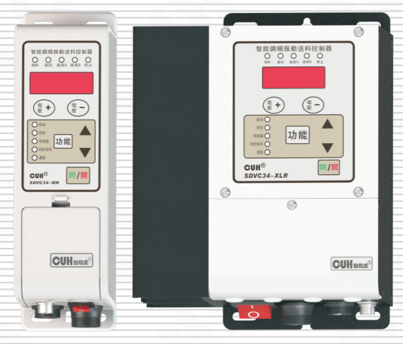

## SDVC34 系列

# 用户手册

### 第 2 页

智能调频振动送料控制器　　　　　　　　　　　　　　　　SDVC34 系列

---

# 序　言

感谢您使用我公司出品的 **CUH®** 系列数字振动送料控制器（本手册以下简称控制器）。

本手册提供给使用者安装调试、参数设定、异常诊断、故障排除及日常维护控制器的相关注意事项。为了确保能够正确地安装和操作本控制器，请在装机之前，详细阅读本使用手册，并请妥善保存。

## 本说明书适合以下型号控制器

- SDVC34-MR
- SDVC34-MRJ
- SDVC34-XLJ
- SDVC34-XLR
- SDVC34-XLRJ
- SDVC34-UR

---

2025-09　　　　　　　　　　　　　　　　　　　　　　　　SDVC34SMSCN_9.01

### 第 3 页

智能调频振动送料控制器　　　　　　　　　　　　　　　　　SDVC34 系列

## 以下为特别需要注意的事项：

1、任何情况下都不可以在带电状态下拔插接线或试图触摸插座内各接线点，以防触电和发生意外。

2、切不可将控制器连接380V交流电，这将会造成控制器不可恢复的严重损坏！（如需工作在380V电压下，请选购本公司380V系列产品。）

3、请避免采用通过继电器等设备切断供电的方式来控制本控制器的输出，这会严重降低控制器的寿命。

4、控制器设计使用于阴凉干燥环境，请不要让本控制器在室外、可能会浸水、阳光暴晒场所工作,也不要在超过本控制器电气特性要求的温度范围之外工作。

5、任何情况下请勿将控制器在超越设计极限状态下工作。

6、请严格按照本使用说明操作，对于不按照本使用说明工作所造成的任何设备或人身伤害，本公司不承担任何民事和刑事责任。

> ☺
>
> 任何情况下请不要打开本控制器机壳,以防遭电击。如本控制器出现故障，请致电本公司，我们会尽快协助排除故障。机壳内全部为固态电路，没有可以调节部件和用户维修部分，请不要试图维修本机。

2025-09　　　　　　　　　　　　　　　　　　　　　　　　　SDVC34SMSCN_9.01

### 第 4 页

智能调频振动送料控制器　　　　　　　　　　　　　　　　　　　　　　　　　SDVC34 系列

---

# 工作与储存环境

## 一、使用前的检查

每部控制器在出厂前，均经过严格的品质检验，并做强化的防撞包装处理，客户在控制器拆箱后，请即刻进行下列检查：

1、检查控制器是否在运输过程中造成损伤。

2、检查控制器型号是否与订货登记资料完全相同。

## 二、工作环境

为使本控制器具有更好的使用效果和更长的使用寿命，在安装时请注意以下问题：

⚠️ 良好的通风散热环境。

⚠️ 远离水滴、蒸气、灰尘、特别是油性灰尘。

⚠️ 无腐蚀、易燃性的气体、液体。

⚠️ 无漂浮性的尘埃及金属颗粒。

⚠️ 坚固无振动。

⚠️ 远离电磁噪音干扰。

⚠️ 使用环境温度为0℃~40℃。

⚠️ 仅适用于海拔2000m以下地区安全使用。

---

2025-09　　　　　　　　　　　　　　　　　　　　　　　　　SDVC34SMSCN_9.01

### 第 5 页

智能调频振动送料控制器　　　　　　　　　　　　　　　　　　　　　　SDVC34 系列

# 目　录

| 条目 | 页码 |
|---|---:|
| 第一章　性能特点 | 1 |
| 　1.1 性能总述 | 1 |
| 　1.2 选型指南 | 2 |
| 　　1.2.1 型号说明 | 2 |
| 　　1.2.2 功能说明 | 2 |
| 第二章　快速安装及使用指南 | 3 |
| 第三章　部件说明 | 5 |
| 　3.1 指示灯说明 | 5 |
| 　3.2 按键说明 | 7 |
| 　3.3 输入、输出接口及附件说明 | 7 |
| 第四章　参数调整方法 | 8 |
| 　4.1 常用参数 | 8 |
| 　4.2 基本参数 | 8 |
| 　4.3 高级参数 | 9 |
| 　4.4 自动/同步参数 | 13 |
| 第五章　工作模式 | 18 |
| 　5.1 手动模式 | 18 |
| 　　5.1.1 手动模式下输出电压设定 | 19 |
| 　　5.1.2 手动模式下输出频率设定 | 19 |
| 　5.2 自动模式 | 20 |
| 　　5.2.1 振动传感器的安装 | 20 |
| 　　5.2.2 自动模式下送料速度的设定 | 22 |
| 　　5.2.3 自动搜频 | 22 |
| 　5.3 半自动模式 | 23 |
| 　　5.3.1 振动传感器的安装 | 23 |
| 　　5.3.2 半自动模式的设定 | 23 |
| 　　5.3.3 半自动模式下送料速度的设定 | 23 |
| 　　5.3.4 半自动模式下输出频率的设定 | 24 |
| 　5.4 同步模式 | 25 |
| 　　5.4.1 主从控制器同步信号线的连接方法 | 26 |
| 　　5.4.2 同步模式的应用 | 27 |
| 　5.5 计数模式 | 31 |
| 　　5.5.1 使用方法 | 32 |
| 　　5.5.2 接线方法 | 33 |
| 　　5.5.3 计数脉冲逻辑方向设定 | 34 |

---

2025-09　　　　　　　　　　　　　　　　　　　　　　　　　SDVC34SMSCN_9.01

### 第 6 页

**智能调频振动送料控制器**　　　　　　　　　　　　　　　　　　　　　　　　　**SDVC34 系列**

| 条目 | 页码 |
|---|---:|
| 5.5.4 计数复位逻辑方向设定 | 34 |
| 5.5.5 计数相关参数设定 | 35 |
| **第六章 信号控制** | **37** |
| 6.1 开关量输入端口C料满/料空停机控制 | 37 |
| 6.1.1 开关量输入端口C各类开关传感器及PLC的连接 | 37 |
| 6.1.2 开关量输入端口C开延时、关延时设定 | 42 |
| 6.1.3 开关量输入端口C逻辑方向设定 | 43 |
| 6.2 开关量输入端口E料满/料空停机控制 | 44 |
| 6.2.1 开关量输入端口E各类开关传感器及PLC的连接 | 44 |
| 6.2.2 开关量输入端口E开延时、关延时设定 | 45 |
| 6.2.3 开关量输入端口E逻辑方向设定 | 46 |
| 6.3 开关量输入端口C、输入端口E共同参数设定 | 47 |
| 6.3.1 开关量输入端口C、输入端口E逻辑设定 | 47 |
| 6.3.2 开关传感器类型设定 | 48 |
| 6.3.3 主输出逻辑关系设定 | 49 |
| 6.4 远程速度控制 | 50 |
| 6.5 24V直流控制输出 | 52 |
| 6.5.1 24V直流控制输出的连接方法 | 52 |
| 6.5.2 24V直流控制输出的逻辑方向设定 | 53 |
| 6.6 预置速度的保存和调出 | 54 |
| 6.7 485通信 | 56 |
| 6.7.1 通信地址设定 | 56 |
| 6.7.2 通信波特率设定 | 56 |
| 6.7.3 通信协议 | 56 |
| **第七章 安全保护功能** | **57** |
| **附录A： 外形尺寸** | **58** |
| **附录B： 信号端口说明** | **61** |
| **附录C： 用户接口定义** | **63** |
| **附录D： 技术规格** | **66** |
| **附录E： 故障排除指南** | **66** |

2025-09　　　　　　　　　　　　　　　　　　　　　　　　　　　　　　SDVC34SMSCN_9.01

### 第 7 页

智能调频振动送料控制器  
SDVC34 系列

# 第一章 性能特点

## 1.1 性能总述:

本系列控制器专为自动化设备中振动送料控制用，融合最新电子技术，经过精心设计,为用户提供最方便实用的功能，包括:

- 自动调频：自动实时调整输出频率，使送料器总是保持工作在最佳工作频率。
- 自动稳速：自动实时调整输出电压，使送料器无论工件多少，总是保持相同的送料速度。
- 自动搜频：傻瓜式的自动搜频功能，快速确定最佳工作频率及其他相关参数，方便用户使用。
- 自动稳压：即使不开启自动稳速功能，也可以自动消除由于电源电压波动造成的送料速度变化，还可以消除工频交流电造成的拍频效应。
- 同步输出：可以将多个控制器的输出同步锁定在相同的频率和相位上，防止拍频等现象的产生。
- 料满/料空停机：具有开关传感器信号输入接口，通过开关传感器实现料满/料空停机控制，并具有可调缓启动时间、开延时、关延时、逻辑方向设置等控制功能。
- 传感器自适应：控制器可自动适应NPN型和PNP型开关传感器。
- 缓启动：在启动时输出电压/送料速度会从0开始逐渐增大到预设值，消除了开机冲击对振动设备造成的损害。
- 速度预置：可以通过外部控制信号直接选择输出多达4种预先设置的送料速度。
- 加速功能：本功能可将最大输出电压提高到输入电压的150%。
- 最大可输出电压设定：本参数可以帮助生产厂家防止用户误操作损害振动设备。
- 波形指数：用户可以通过该参数平衡控制器效率与最大功率。
- 远程速度控制：可以直接使用外置的电位器、PLC、1~5V电压信号或4~20mA电流信号控制输出电压或送料速度。
- 24V直流控制输出：通过晶体管输出控制信号，可直接用于控制电磁阀等外部设备与本控制器协调工作。
- 计数功能：对输送的料件进行计数，在达到设定数值后减速或停机。
- 输出开关：面板上设有轻触按键，可以即时开/停机，方便用户调试设备。
- 键盘锁定：长按开/关键以锁定所有按键，防止用户误操作。
- 参数密码：用户可以自行设置参数密码，以锁定输出电压/送料速度以外的其它参数，以防未经授权的更改。
- 恢复出厂设置：该功能可以快速将调乱的参数恢复为出厂默认设置，使控制器进入默认出厂工作状态。
- 485通讯：通过485通讯可以远程调整控制器的各项参数。

2025-09　　　　　　　　　- 1 -　　　　　　　　　SDVC34SMSCN_9.01

### 第 8 页

智能调频振动送料控制器　　　　　　　　　　　　　　　　　　　　　　　　　SDVC34 系列

---

## 1.2 选型指南：

### 1.2.1 型号说明：

| 控制器型号 | 功率（VA） | 功能 |
|---|---:|---|
| SDVC34-MR | 660 | 通信 |
| SDVC34-MRJ | 660 | 计数、通信 |
| SDVC34-XLJ | 1320 | 计数 |
| SDVC34-XLR | 1320 | 通信 |
| SDVC34-XLRJ | 1320 | 计数、通信 |
| SDVC34-UR | 2200 | 通信 |

### 1.2.2 功能说明：

| 功能 | 计数 | 通信 | 计数、通信 |
|---|---:|---:|---:|
| 料满停机 | √ | √ | √ |
| 远程速度控制 | √ | √ | √ |
| 24V直流控制输出 | √ | √ | √ |
| 速度预置 |  | √ |  |
| 计数功能 | √ |  | √ |
| 料满停机2 |  | √ | √ |
| 同步功能 |  | √ | √ |
| 485通信 |  | √ | √ |
| 振动传感器 | √ | √ | √ |

---

2025-09　　　　　　　　　　　　　　　　- 2 -　　　　　　　　　　　　　　　　SDVC34SMSCN_9.01

### 第 9 页

智能调频振动送料控制器　　　　　　　　　　　　　　　　　　　　　　　　　SDVC34 系列

# 第二章 快速安装及使用指南

## 第一步:

打开控制器的外包装，检查控制器外观及侧标型号，判断是否为所需的型号。

## 第二步:

取出配件包里的输出线，将输出线接线端子接到振动盘的电磁线圈上。

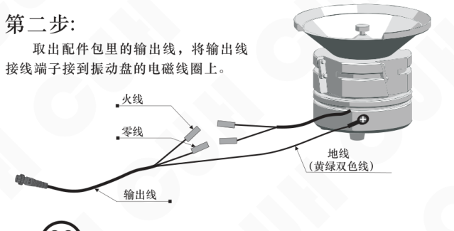

图中标注：

- 火线
- 零线
- 输出线
- 地线（黄绿双色线）

> **注意**
>
> 一定要确认电磁铁线圈接在两个输出引脚上，外壳需要可靠接地。否则将会导致机壳带电，可能发生严重安全事故！！！

## 第三步:

将输出线航空插头插到控制器的航空插座上，并锁紧螺母。

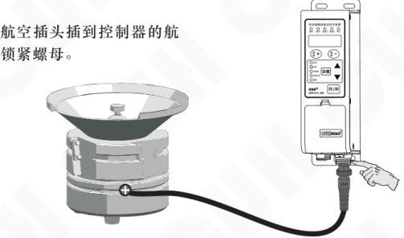

2025-09　　　　　　　　　　　　　　　　　- 3 -　　　　　　　　　　　　　　　　　SDVC34SMSCN_9.01

### 第 10 页

智能调频振动送料控制器  
SDVC34 系列

---

### 第四步：

将输入电源线航空插头插到控制器上，并锁紧螺母。

提示：先插航空插头。

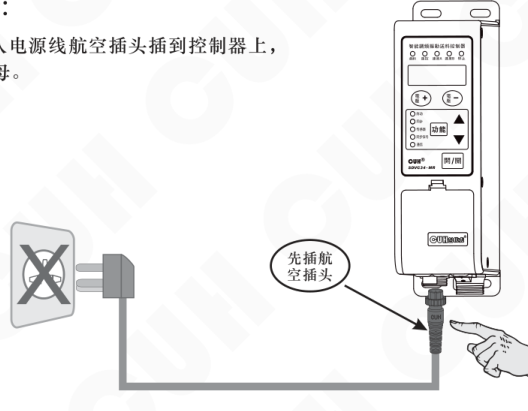

### 第五步：

将电源线三爪插头插在供电电源插座上。

---

2025-09　　　　　　　　　- 4 -　　　　　　　　　SDVC34SMSCN_9.01

### 第 11 页

智能调频振动送料控制器　　　　　　　　　　　　　　　　　SDVC34 系列

# 第三章 部件说明

## 3.1 指示灯说明

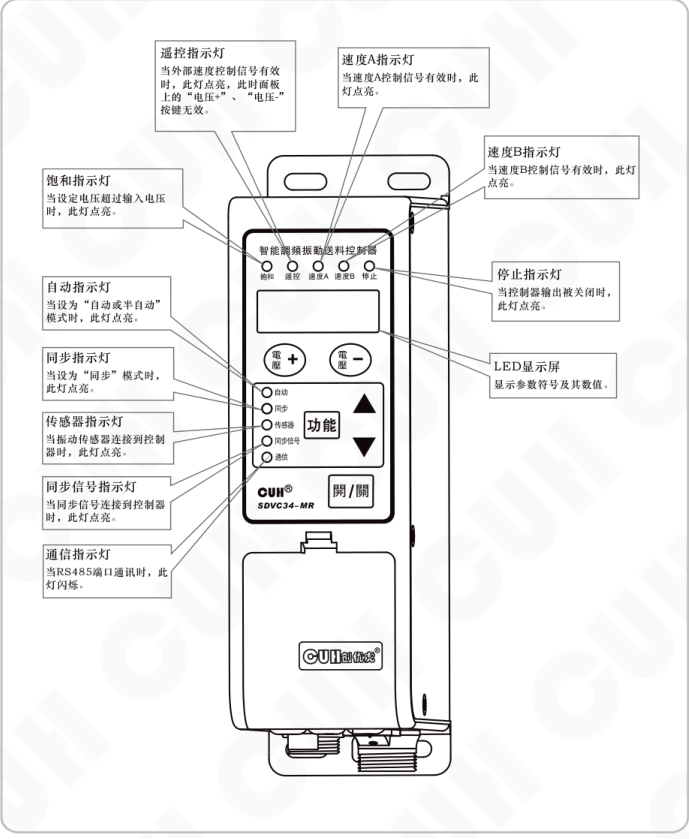

| 指示灯/部件 | 说明 |
|---|---|
| 遥控指示灯 | 当外部速度控制信号有效时，此灯点亮，此时面板上的“电压+”、“电压-”按键无效。 |
| 速度A指示灯 | 当速度A控制信号有效时，此灯点亮。 |
| 速度B指示灯 | 当速度B控制信号有效时，此灯点亮。 |
| 饱和指示灯 | 当设定电压超过输入电压时，此灯点亮。 |
| 自动指示灯 | 当设为“自动或半自动”模式时，此灯点亮。 |
| 同步指示灯 | 当设为“同步”模式时，此灯点亮。 |
| 传感器指示灯 | 当振动传感器连接到控制器时，此灯点亮。 |
| 同步信号指示灯 | 当同步信号连接到控制器时，此灯点亮。 |
| 通信指示灯 | 当RS485端口通讯时，此灯闪烁。 |
| 停止指示灯 | 当控制器输出被关闭时，此灯点亮。 |
| LED显示屏 | 显示参数符号及其数值。 |

2025-09　　　　　　　　　　　　　　　　　SDVC34SMSCN_9.01

### 第 12 页

智能调频振动送料控制器　　　　　　　　　　　　　　　　　SDVC34 系列

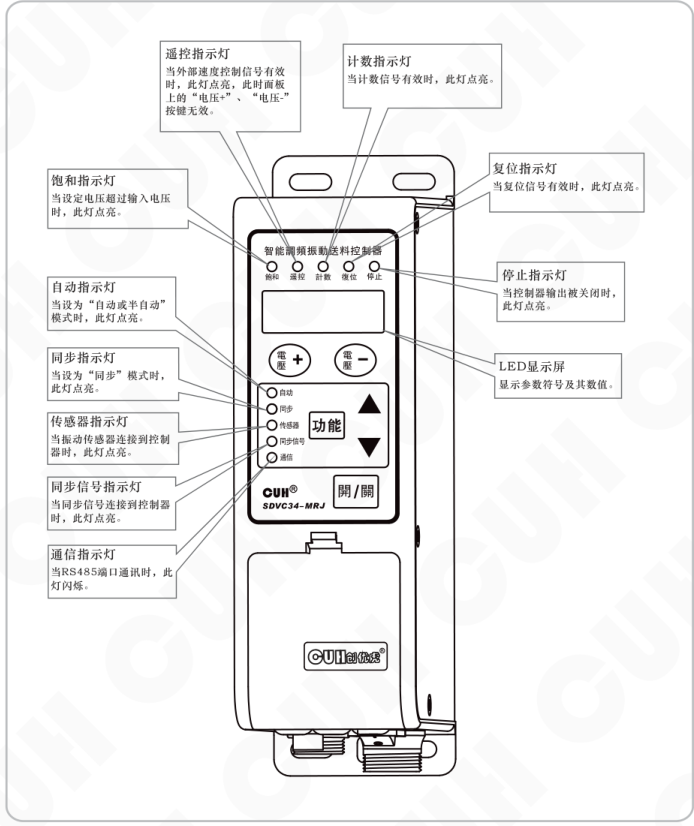

### 指示灯说明

| 名称 | 说明 |
|---|---|
| 饱和指示灯 | 当设定电压超过输入电压时，此灯点亮。 |
| 自动指示灯 | 当设为“自动或半自动”模式时，此灯点亮。 |
| 同步指示灯 | 当设为“同步”模式时，此灯点亮。 |
| 传感器指示灯 | 当振动传感器连接到控制器时，此灯点亮。 |
| 同步信号指示灯 | 当同步信号连接到控制器时，此灯点亮。 |
| 通信指示灯 | 当 RS485 端口通讯时，此灯闪烁。 |
| 遥控指示灯 | 当外部速度控制信号有效时，此灯点亮，此时面板上的“电压+”、“电压-”按键无效。 |
| 计数指示灯 | 当计数信号有效时，此灯点亮。 |
| 复位指示灯 | 当复位信号有效时，此灯点亮。 |
| 停止指示灯 | 当控制器输出被关闭时，此灯点亮。 |
| LED显示屏 | 显示参数符号及其数值。 |

2025-09　　　　　　　　　　　　　　　　　- 6 -　　　　　　　　　　　　　　　　　SDVC34SMSCN_9.01

### 第 13 页

智能调频振动送料控制器　　　　　　　　　　　　　　　SDVC34 系列

## 3.2 按键说明

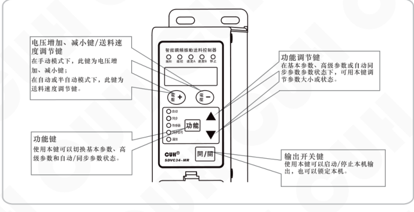

- **电压增加、减小键/送料速度调节键**  
  在手动模式下，此键为电压增加、减小键；  
  在自动或半自动模式下，此键为送料速度调节键。

- **功能键**  
  使用本键可以切换基本参数、高级参数和自动/同步参数状态。

- **功能调节键**  
  在基本参数、高级参数或自动/同步参数参数状态下，可用本键调节参数大小或状态。

- **输出开关键**  
  使用本键可以启动/停止本机输出，也可以锁定本机。

## 3.3 输入、输出接口及附件说明

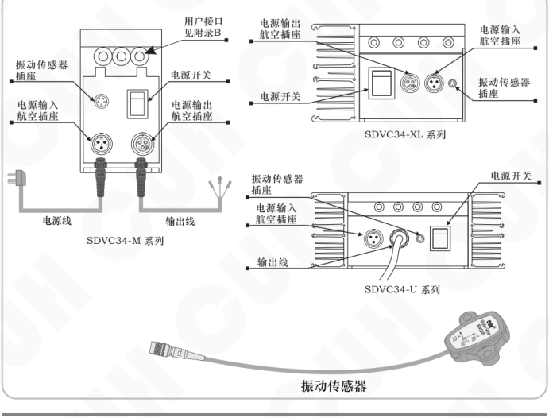

### SDVC34-M 系列

- 用户接口（见附录B）
- 振动传感器插座
- 电源输入航空插座
- 电源开关
- 电源输出航空插座
- 电源线
- 输出线

### SDVC34-XL 系列

- 电源输出航空插座
- 电源开关
- 电源输入航空插座
- 振动传感器插座

### SDVC34-U 系列

- 振动传感器插座
- 电源输入航空插座
- 输出线
- 电源开关

### 附件

- 振动传感器

---

2025-09　　　　　　　　　SDVC34SMSCN_9.01

### 第 14 页

智能调频振动送料控制器　　　　　　　　　　　　　　　　　SDVC34 系列

# 第四章 参数调整方法

根据不同的参数调整方法，控制器的参数分为常用参数、基本参数、高级参数和自动/同步参数四类。

## 4.1 常用参数

- 直接使用“电压+”和“电压-”键对参数的数值进行调整。
- “电压+”和“电压-”键是专门用来调整常用参数“U”和“A”的按钮。
- 在任何工作模式和参数调整状态下都可以通过它们直接调整常用参数，调整结束后控制器将自动返回到之前的参数状态。
- 长按开/关键可以锁定所有按键，再次长按开/关键可以解除锁定，键盘锁定时，所有按键不可调节。

操作示意图：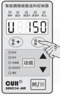

| 常用参数 | 标志符号 | 数码管符号图片 | 参数范围 | 默认状态 |
|---|---|---|---|---|
| 输出电压 | U `[U]` |  | 0~260V | 150 |
| 送料速度 | A `[A]` | 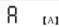 | 0~3200 | 200 |
| 键盘锁定 | 反6 `[反6]` | 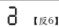 | \ | 当前电压值/当前送料速度 |

## 4.2 基本参数

- 按住“功能”键2秒，进入基本参数的调整状态。
- 短按“功能”键可以在各基本参数之间进行循环切换。
- 通过使用“▲”和“▼”键可以对参数数值进行调整。
- 再次长按“功能”键2秒可以退出基本参数设定状态。

操作示意图：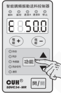

| 基本参数 | 标志符号 | 数码管符号图片 | 参数范围 | 默认状态 |
|---|---|---|---|---|
| 输出频率 | E `[E]` | 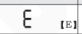 | 25.0~400.0Hz | 50.0 |
| 开关量输入端口C开延时 | J `[大勾]` | 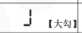 | 0.0~20.0s | 0.2 |
| 开关量输入端口C关延时 | L `[大L]` | 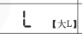 | 0.0~20.0s | 0.2 |
| 缓启动时间 | t `[小T]` | 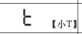 | 0.0~10.0s | 0.5 |
| 最大计数限制 （适合具有计数功能的控制器） | 反C `[反C]` | 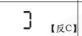 | 0~9999 | 0 |

2025-09　　　　　　　　　　　　　　　　　- 8 -　　　　　　　　　　　　　　　　　SDVC34SMSCN_9.01

### 第 15 页

智能调频振动送料控制器　　　　　　　　　　　　　　　　SDVC34 系列

## 4.3 高级参数

- 按下“功能”键的同时，按下“▲”键保持 2 秒，进入高级参数调整状态。
- 短按“功能”键可以在各高级参数之间进行循环切换。
- 通过使用“▲”和“▼”键可以对参数的数值进行调整。
- 再次按下“功能”键的同时，按下“▲”键保持 2 秒，可以退出高级参数设定状态。

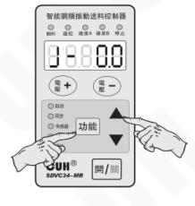

| 高级参数 | 标志符号 | 数码管符号图片 | 参数范围 | 默认状态 |
|---|---|---|---|---|
| 开关量输入端口E开延时 （适合具有料满停机II功能的控制器） | J-【勾中】 |  | 0.0~20.0s | 0.0 |
| 开关量输入端口E关延时 （适合具有料满停机II功能的控制器） | L-【L中】 |  | 0.0~20.0s | 0.0 |
| 计数末端速度比例 （适合具有计数功能的控制器） | u【小U】 |  | 0~100 | 30 |
| 计数末端数量 （适合具有计数功能的控制器） | n【上恩】 |  | 0~255 | 3 |
| 计数抗抖时间 （适合具有计数功能的控制器） | U【弯勾】 |  | 0.001~2.000s | 0.010 |
| 最大可设定输出电压 | h【小H】 |  | 0~260V | 260 |
| 输出频率下限 | E.【小E点】 | 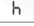 | 25.0~390.0Hz | 40.0 |
| 加速指数 | y【小Y】 | 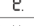 | 100~150% | 120 |
| 波形指数 | r【小R】 | 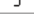 | 0~100 | 100 |
| 温度显示 | C【大C】 | 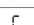 | \ | 当前温度 |
| 通信协议选择 （适合具有通信功能的控制器） | ?【上拐】 | 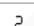 | ASC, rtu | rtu |
| 通信地址 （适合具有通信功能的控制器） | ┘【万】 |  | 1~31 | 1 |
| 通信波特率 （适合具有通信功能的控制器） | └【下拐】 |  | 0.3~115.2Kbps | 9.6 |
| 参数密码 | 7-【反F】 | 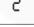 | 0~999 | --- |
| 软件版本 | Ur【UR】 | 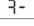 | \ | 显示当前 软件版本 |
| 计数满定时清零延迟时间 （适合具有计数功能的控制器） | rE【涛E】 |  | 0.0~99.9s | 0.0 |

2025-09　　　　　　　　　- 9 -　　　　　　　　　SDVC34SMSCN_9.01

### 第 16 页

智能调频振动送料控制器　　　　　　　　　　　　　　　　　SDVC34 系列

| 高级参数 | 标志符号（转写） | 数码管符号图片 | 参数范围 | 默认状态 |
|---|---|---|---|---|
| 开关量输入端口C逻辑方向 | F2 |  | `---`：常通，`--`：常断 | `---` |
| 开关量输入端口E逻辑方向 （适合具有料满停机II功能的控制器） | F7 |  | `---`：常通，`--`：常断 | `---` |
| 24V直流控制输出逻辑方向 | F3 |  | `---`：常通，`--`：常断，`-`：受报警信号控制 | `---` |
| 主输出逻辑关系 | F4 |  | `---`：常通，`--`：常断 | `---` |
| 控制输出逻辑关系 | F8 |  | `---`：主逻辑，`--`：副逻辑， `-`：副逻辑参数设置 | `---` |
| 开关传感器型号选择 （适合不具有计数功能的控制器） | FA |  | Uto，nPn，PnP | Uto |
| 开关传感器型号选择 （适合具有计数功能的控制器） | FA |  | nPn，PnP | nPn |
| 端口C和端口E的逻辑关系 （适合具有料满停机II功能的控制器） | A |  | 与，或，异或 | 与 |
| 计数脉冲逻辑方向 （适合具有计数功能的控制器） | Fb |  | 下降沿计数，上升沿计数 | 下降沿计数 |
| 计数复位逻辑方向 （适合具有计数功能的控制器） | Fc |  | 下降沿复位，上升沿复位 | 下降沿复位 |
| 开机运行状态 | Fd | 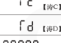 | `---`：开机运行，`--`：开机停止，`==`：开机跟随 | `---` |
| 恢复出厂设置 | 8.8.8.8.8. | 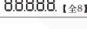 | `\` | `\` |

2025-09　　　　　　　　　　　　　　　　　-10-　　　　　　　　　　　　　　　　　SDVC34SMSCN_9.01

### 第 17 页

智能调频振动送料控制器　　　　　　　　　　　　　　　　　　　　　　　　　SDVC34 系列

---

## 部分高级参数说明

- **最大可设定输出电压：h**  
  可调输出电压的范围为 0~h，设定该参数以限制最大可输出电压，防止用户误操作输出过大电压而损坏振动设备，远程速度控制时输出电压也受此参数限制。

- **输出频率下限：E.**  
  输出频率下限参数范围为25.0Hz~390.0Hz。参数 E. 将最小输出频率限制为指定值，以防止振动给料机误操作。

- **计数末段数量：n**  
  表示在计数状态时，控制器的计数值距离最大计数限制参数规定的数量。当计数值与最大计数限制参数值的差值小于计数末段数量时，控制器进入末段状态。

- **计数末段速度比例：u**  
  表示进入末段状态时，控制器的送料速度降为初始速度的百分比。

- **计数抗抖时间：J**  
  表示计数状态高电平或低电平的有效稳定时间。

- **加速指数：y**  
  表示输出电压最高可以达到输入电压的百分比，用户可以通过本参数控制加速功能的发挥。最大输出电压仍将受参数 h 的限制。

- **波形指数：r**  
  本参数可以使用户在最高效率—最大功率和最小噪音的性能间进行连续地平衡，以满足客户更高的需求。

- **温度显示：C**  
  实时显示控制器内部的温度，方便用户了解控制器的运行状况。该值只能读取。

- **控制输出逻辑选择：「8**  
  表示控制输出与主输出的逻辑关系，用户可以设定控制输出信号和主输出是否保持一致。

---

2025-09　　　　　　　　　　　　　　　　　- 11 -　　　　　　　　　　　　　　　　　SDVC34SMSCN_9.01

### 第 18 页

智能调频振动送料控制器　　　　　　　　　　　　　　　　　SDVC34 系列

- **键盘密码：** `3-`

  键盘密码可以锁定高级功能参数不被修改。在锁定状态时，只有输出电压和送料速度可以被修改，其它参数不能修改。

  当用户需要使用键盘密码功能时，只需修改 `3-` 的值即可，设定此值后关机再开机。当用户需要进入高级功能时屏幕会提示用户输入键盘密码 `-----`，此时用户修改该参数值等于 `3-` 参数值后，再短按“功能键”即可进入高级功能。如果该参数值不等于 `3-`，那么短按“功能键”不会进入高级功能。

- **计数满定时清零延迟时间：** `tE`

  本参数用来设置计数值满后自动清零计数值的延迟时间。当延迟时间到后，计数值自动清零，且计数和复位灯都亮。（效果与手动清零计数值的效果一样）

- **开机运行状态：** `rd`

  表示控制器上电后的运行状态。

- **恢复出厂设置：** `00000.`

  本参数可以使用户快速将控制器设置为出厂默认状态。由于本控制器功能强大，有数量众多的控制参数可以由用户设定，对于初学者，可能在多次的设定修改后不能使控制器处于正常工作状态。使用该功能可以快速将调乱的参数状态恢复为出厂默认状态。

> **注：恢复出厂默认设置的方法**
>
> - 按下“功能”键的同时按下“▲”键保持2秒，进入高级参数设定状态
> - 短按数下“功能”键切换到恢复出厂默认设置参数 `00000.`
> - LED屏幕和指示灯处于闪烁状态
> - 按下“▲”键并保持1秒直至LED屏幕显示为 `-----`
> - 松开“▲”键已完成恢复出厂默认设置操作，LED屏幕显示 `U150`

2025-09　　　　　　　　　　　　　　-12-　　　　　　　　　　　　　　SDVC34SMSCN_9.01

### 第 19 页

## 4.4 自动/同步参数

- 按下“功能”键的同时，按下“▼”键保持 2 秒，进入自动/同步参数调整状态。
- 短按“功能”键可以在自动/同步参数之间进行循环切换。
- 通过使用“▲”和“▼”键可以对参数的数值进行调整。
- 再次按下“功能”键的同时，按下“▼”键保持 2 秒，可以退出自动/同步参数设定状态。

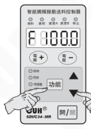

| 自动/同步参数 | 标志符号 | 数码管符号图片 | 参数范围 | 默认状态 |
|---|---|---|---|---|
| 中心频率 | F【F】 | 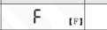 | 25.0~400.0Hz | 100.0 |
| 自动调频最大偏移量 | n【下恩】 | 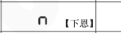 | 0.0~180.0Hz | 30.0 |
| 频率自动调整系数 | 1F【1F】 | 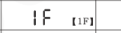 | 0~200 | 20 |
| 振幅自动调整系数 | PA【PA】 | 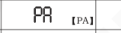 | 0~999 | 60 |
| 振幅自动调整系数 | 1A【1A】 | 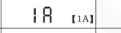 | 0~999 | 50 |
| 送料速度显示 | 倒A【倒A】 | 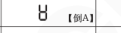 | 0~H | 0 |
| 输出电压显示 | G【大G】 | 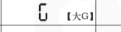 | 0~h V | 150 |
| 电压下限 | GL【GL】 | 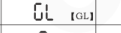 | 0~260V | 0 |
| 频率下限 | E【小E】 | 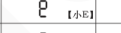 | 25.0~400.0Hz | 25.0 |
| 最大振幅指数 | P【P】 | 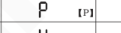 | 0~500 | 500 |
| 最大可设定送料速度 | H【H】 | 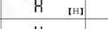 | 0~3200 | 1500 |
| 相位差 | φ【φ】 | 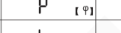 | -180~180° | 0 |
| 最大搜频电压 | b【小B】 | 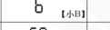 | 0~260V | 100 |
| 频率搜索速度 | SP【SP】 | 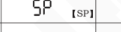 | 1~5 | 5 |
| 送料速度最小调整量 | C【小C】 | 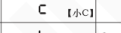 | 1~10 | 1 |
| 振动传感器编号 | T【横T】 | 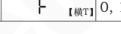 | 0, 1, 2, 3, 4, 203, 204, 205, 206 | 205 |

### 第 20 页

| 自动/同步参数 | 标志符号 | 数码管符号图片 | 参数范围 | 默认状态 |
|---|---|---|---|---|
| 输出电压调整方式 | `r5` |  | `---`自动，`--`手动 | `---` |
| 输出频率调整方式 （适合具有通信功能的控制器） | `r6` |  | `---`自动，`--`手动，`==`跟随 | `---` |
| 输出频率调整方式 （适合不具有通信功能的控制器） | `r6` | 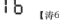 | `---`自动，`--`手动 | `---` |

### 第 21 页

# 自动/同步参数说明

- 输出电压调整方式：r5

  当参数“r5”设置为--时，输出电压参数“U”可见，送料速度参数“A”隐藏。输出电压“U”由手动调整。

  当参数“r5”设置为---时，并且连接振动传感器，送料速度参数“A”可见，输出电压“U”隐藏。控制器将根据振动传感器的反馈信号自动调整输出电压“U”，以使得送料速度“A”始终稳定在用户设定值上。

> 🙂 如果未连接振动传感器，即使参数“r5”设为---，参数“U”仍可见。输出电压由手动调整。

- 输出频率调整方式：r6

  当参数“r6”设置为--时，输出频率“E”可由手动调整。

  当参数“r6”设置为---时，并且连接振动传感器，控制器将根据振动传感器的反馈自动调整输出频率“E”到振动设备的谐振频率（最佳工作频率）。此时，输出频率“E”不可手动调整。

  当参数“r6”设置为==时，并且连接同步信号线，“从控制器”的输出频率始终保持与“主控制器”的频率一致，此时，输出频率“E”不可手动调整。

> 🙂 如果未连接振动传感器，即使参数“r6”设为---，输出频率“E”仍将由手动调整。

- 中心频率：F

  控制器可自动调整的频率范围为中心频率±自动调频最大偏移量。

  应把中心频率调整到振动设备的谐振点附近，以利于控制器在自动调整频率时尽快地调整到最佳工作点。

- 自动调频最大偏移量：n

  控制器可自动调整的频率范围为中心频率±自动调频最大偏移量。一般此值在30.0Hz左右即可。过大可能使振动设备工作在不合适的工作点，过小可能会降低振动设备的适应能力。

### 第 22 页

智能调频振动送料控制器　　　　　　　　　　　　　　　SDVC34 系列

---

- **频率自动调整系数：iF**  
  控制器通过PID算法来自动调整输出频率，“iF”为频率积分参数。此值越大，则控制器能越快地调整输出频率，但过大可能会造成输出频率的振荡。

- **振幅自动调整系数：PA**  
  控制器通过PID控制来自动调整输出电压，“PA”为速度比例参数。此值越大，则控制器能越快地调整输出电压，但过大会造成输出电压的频繁振荡。

- **振幅自动调整系数：iA**  
  控制器通过PID控制来自动调整输出电压，“iA”为速度积分参数。此值越大，则控制器能越快地调整输出电压，减小输出电压的振荡幅度和次数，但过大反而会造成输出电压的振荡幅度变大。

- **送料速度显示：U**  
  该参数用于显示当前送料速度，以帮助用户了解设备的工作情况，该参数不能调整。

- **输出电压显示：C**  
  该参数用于显示当前输出电压，以帮助用户了解设备的工作情况，该参数不能调整。

- **电压下限和频率下限：UL 和 P**  
  当“3”设置为“1”时，当控制器处于自动状态（包括仅电压自动、仅频率自动或全自动），且正常工作时（不处于外部信号和手动停止控制器输出，不处于缓启动以及故障状态），输出电压低于由 UL 设置的下限参数，或者输出频率低于 P 设置的下限参数，则24V控制输出有效（D1口输出为低电平）。两种情况都没有发生时恢复输出为无效（D1口输出为高阻）。  
  以上三个参数 3、UL 和 P 都可以在设置后自动保存，且都可以在RS485通讯中设置和读取。

- **最大振幅指数：P**  
  该参数可限制设备能够承受的最大振动强度，以防止用户误操作而损坏设备。

---

2025-09　　　　　　　　　　　　-16-　　　　　　　　　　　　SDVC34SMSCN_9.01

### 第 23 页

智能调频振动送料控制器　　　　　　　　　　　　　　　　　　　　　SDVC34 系列

- **相位差：μ**  
  该参数可修改输出波形的相位，控制器出厂时相位默认为0°。

- **最大可设定送料速度：H**  
  可调送料速度范围为0~H，设定该参数以限制最大可设定送料速度，防止用户误操作输出过大电压而损坏振动设备，远程速度控制时送料速度也受此参数影响。

- **最大搜频电压：b**  
  自动搜频时控制器的输出电压不会超过该值，以保护振动设备的安全。

- **送料速度最小调整量：C**  
  手动调整送料速度时，一次可改变的参数值大小。范围：1~10。

- **振动传感器编号：F**  
  控制器支持不同量程的振动传感器。为了使得控制器在相同的送料速度下，不同量程振动传感器的输出电压不同，用户应当按照实际振动传感器型号设置该参数。范围为：1~4，203~206，分别表示不同的振动传感器：

| 参数值 | 对应型号 | 规格（X轴/Y轴/Z轴加速度） |
|---|---|---|
| 1 | SDVS20-1 | 16g/16g/16g |
| 2 | SDVS20-2 | 35g/35g/- |
| 3 | SDVS20-3 | 50g/50g/- |
| 4 | SDVS20-4 | 70g/70g/- |
| 203 | SDVS203 | 8g/8g/8g |
| 204 | SDVS204 | 16g/16g/16g |
| 205 | SDVS205 | 32g/32g/32g |
| 206 | SDVS206 | 64g/64g/64g |

2025-09　　　　　　　　　　　　　　　　　-17-　　　　　　　　　　　　　　　SDVC34SMSCN_9.01

### 第 24 页

智能调频振动送料控制器　　　　　　　　　　　　　　　　　　　　　　　　　SDVC34 系列

# 第五章 工作模式

用户根据应用需求可设置控制器运行在以下五种工作模式之一：

- 手动模式：完全手动设定输出电压“U”和输出频率“E”。
- 自动模式：控制器根据振动传感器的反馈信号自动调整输出电压“U”和输出频率“E”，使得送料速度“A”始终稳定在用户设定值上，输出频率“E”始终为振动设备的最佳工作频率。
- 半自动模式：控制器根据振动传感器的反馈信号自动调整输出电压“U”使得送料速度“A”始终稳定在用户设定值上，输出频率“E”由手动设定。
- 同步模式：当“控制器B”设置为输出频率始终保持与“控制器A”一致时，我们称“控制器B”为从控制器，“控制器A”为主控制器。此时“控制器B”工作的模式称为同步模式。
- 计数模式：控制器对输送料件进行计数，在达到设定数值后减速或停止的工作模式称为计数模式。

| 工作模式 | 输出电压 U |  | 输出频率 E |  |
|---|---|---|---|---|
|  | 调整方法 | F5 参考值 | 调整方法 | F6 参考值 |
| 手动模式 | 手动 | -- | 手动 | -- |
| 自动模式 | 自动 | --- | 自动 | --- |
| 半自动模式 | 自动 | --- | 手动 | -- |
| 同步模式 | 手动或自动 | -- 或 --- | 自动与主控制器同步 | SYN |

## 5.1 手动模式

此模式下，控制器的输出电压和输出频率均由手动调整。

| 工作模式 | 输出电压 U |  | 输出频率 E |  |
|---|---|---|---|---|
|  | 调整方法 | F5 参考值 | 调整方法 | F6 参考值 |
| 手动模式 | 手动 | -- | 手动 | -- |

为了简化用户操作在出厂默认状态下，参数“F5”和“F6”均被设置为 ---（自动），此时，如果不连接振动传感器，控制器将工作在手动模式下；如果连接振动传感器，控制器将工作在自动模式下。

> ☺
>
> 如果参数“F5”和“F6”均被设置为 --，无论是否连接振动传感器，控制器都将工作在手动模式下。
>
> 如果控制器未连接振动传感器，无论参数“F5”和“F6”如何设置，控制器都将工作在手动模式下。

2025-09　　　　　　　　　　　　　　　　-18-　　　　　　　　　　　　　　　　SDVC34SMSCN_9.01

### 第 25 页

智能调频振动送料控制器  
SDVC34 系列

## 5.1.1 手动模式下输出电压设定

本控制器可以直接在控制面板上以数字方式设定输出电压。由于本控制器特有的稳压功能，该数值为输出电压的绝对值，并不会受到输入电压的影响，即使在电压不稳定的场合中使用也可以保证送料设备稳定工作。同时，直接的电压数值设定也为用户了解设备运行情况提供了准确的数据。

- 在控制器未连接振动传感器的情况下打开控制器的电源开关。

- 控制器进入输出电压“U”参数。

- 通过使用“电压+”和“电压-”键可以对输出电压“U”值进行调整。

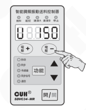

## 5.1.2 手动模式下输出频率设定

本控制器采用直接数字频率合成技术（DDS），具有非常高的频率精度和稳定性，不随时间和温度的变化而变化。

- 按住“功能”键 2 秒，进入基本参数的调整状态。

- 控制器进入输出频率“E”参数。

- 通过使用“▲”和“▼”键可以对输出频率“E”值进行调整。

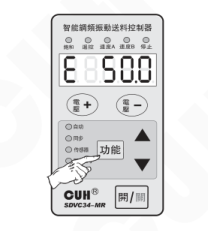

2025-09　　-19-　　SDVC34SMSCN_9.01

### 第 26 页

## 5.2 自动模式

此模式下，控制器必须连接振动传感器，控制器会根据振动传感器反馈的数据，自行调整输出电压“U”和输出频率“F”，保证振动设备的送料速度稳定在设定数值上，并使振动频率处于振动设备的最佳工作频率，输出电压和输出频率不可手动调整。

出厂默认设置下，振动传感器连接到控制器上后，控制器会自动进入自动模式。

| 工作模式 | 输出电压 U |  | 输出频率 F |  |
|---|---|---|---|---|
|  | 调整方法 | F5 参考值 | 调整方法 | F6 参考值 |
| 自动模式 | 自动 | --- | 自动 | ---- |

> ☺ 若未连接振动传感器，控制器仍将处于手动模式。

## 5.2.1 振动传感器的安装

### 5.2.1.1振动传感器的接入方法

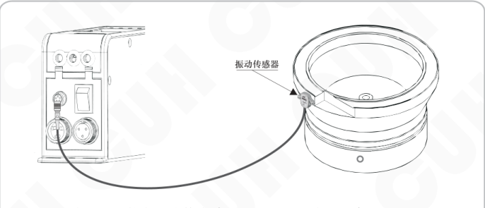

将振动传感器上的航空插头接在控制器的振动传感器插座上。

注意：请在控制器断电状态下插拔振动传感器。

### 第 27 页

智能调频振动送料控制器　　　　　　　　　　　　　　　　　　　　　　　　　SDVC34 系列

## 5.2.1.2 振动传感器安装指南

用螺丝将振动传感器安装在牢固、平整的表面，方向角度等可以任意选择。建议安装位置及安装方法如下：

- 方式1，见图5.2.1。  
  优点：安装简便。

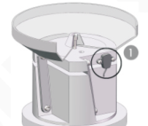

*图5.2.1*

- 方式2，见图5.2.2。  
  注意事项：需避免料盘压到振动传感器。

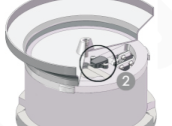

*图5.2.2*

- 方式3，在料盘上焊接一个支架，将振动传感器安装在支架上，见图5.2.3。  
  振动传感器支架建议尺寸见图5.2.4。

*图5.2.3*

*图5.2.4*  
单位：mm

- 不推荐安装方式，见图5.2.5、图5.2.6。  
  原因：容易受物料、料盘干扰，不能准确的反映出振动盘谐振点，控制器可能会一直处于搜频状态，导致无法稳定送料。

*图5.2.5*

*图5.2.6*

2025-09　　　　　　　　　　　　　　　　　　-21-　　　　　　　　　　　　　　　　SDVC34SMSCN_9.01

### 第 28 页

智能调频振动送料控制器  
SDVC34 系列

---

## 5.2.2 自动模式下送料速度的设定

- 打开控制器电源开关。
- 此时控制面板上的“振动传感器”指示灯亮，表示振动传感器已经连接到控制器。
- 控制器会进入送料速度“A”参数状态。
- 通过“电压+”和“电压-”键可以设定需要的送料速度“A”的值。

## 5.2.3 自动搜频

通过自动搜频，控制器会搜索到振动设备的最佳工作频率并输出该频率值，同时控制器会自动设定各项相关参数。用户只需要设定需要的送料速度“A”参数值，控制器即可工作在最佳状态。当控制器的输出频率，偏移振动盘的谐振频率30HZ以上时，控制器自动重新搜频。

- 正确连接振动传感器后长按“▲”和“▼”键3秒，即可启动自动搜频，自动搜频过程中控制器将实时显示当前的输出频率“E”值。
- 待搜索结束后，控制器会自动设置中心频率“F”、自动调频最大偏移量“n”、频率自动调整系数“IF”、振幅自动调整系数“PA”、振幅自动调整系数“IA”、相位差“P”。并将电压调整方式“U5”和频率调整方式“F6”设为自动。

> 若在刚启动搜频时出现“Fsc?”，则说明最大搜频电压设置过高，但这不会影响控制器工作。  
> 若想在搜频中途取消自动搜频，短按“开关”键即可，此后会重新回到自动搜频前的工作状态。

☺

> 通过设定送料速度和自动搜频两个步骤，振动设备将以最佳状态工作在用户需要的送料速度上。

---

2025-09 &emsp;&emsp; -22- &emsp;&emsp; SDVC34SMSCN_9.01

### 第 29 页

智能调频振动送料控制器　　　　　　　　　　　　　　　　　　　　　　　　　SDVC34 系列

## 5.3 半自动模式

此模式下,控制器必须连接振动传感器，控制器会根据振动传感器反馈的数据，自行调整输出电压“U”，保证振动设备的送料速度“A”稳定在设定数值上，输出频率“E”由手动设定。

| 工作模式 | 输出电压 U | 输出电压 U | 输出频率 E | 输出频率 E |
|---|---|---|---|---|
|  | 调整方法 | F5 参考值 | 调整方法 | F6 参考值 |
| 半自动模式 | 自动 | --- | 手动 | -- |

> 🙂 若未连接振动传感器，控制器仍将处于手动模式。

### 5.3.1 振动传感器的安装

振动传感器的连接方式和自动模式相同。

### 5.3.2 半自动模式的设定

- 在连接振动传感器的情况下打开控制器电源开关。此时控制面板上的“振动传感器”指示灯点亮。
- 按下“功能”键的同时，按下“▼”键保持2秒，进入自动/同步参数调整状态。
- 短按几下“功能”键切换到频率调整方式“F6”参数。
- 通过使用“▲”和“▼”键设定“F6”参数为 `--`（输出频率手动调整）。

### 5.3.3 半自动模式下送料速度的设定

- 通过使用“电压+”和“电压-”键可以设定需要的送料速度“A”值。

2025-09　　　　　　　　　　　　　　　　-23-　　　　　　　　　　　　　　　　SDVC34SMSCN_9.01

### 第 30 页

## 5.3.4 半自动模式下输出频率的设定

- 按住“功能”键2秒，进入基本参数调整状态。
- 控制器进入输出频率“E”参数设定状态。
- 通过使用“▲”和“▼”键可以对输出频率“E”值进行设定。

### 第 31 页

智能调频振动送料控制器　　　　　　　　　　　　　　　　　　　　　　　　　　　SDVC34 系列

## 5.4 同步模式

在此模式下，控制器必须与另一台主控制器的同步信号相连接，控制器的输出频率始终保持与主控制器的输出频率一致。控制器的输出电压可以手动或自动调整。

| 工作模式 | 输出电压 U |  | 输出频率 F |  |
|---|---|---|---|---|
|  | 调整方法 | 「5 参考值 | 调整方法 | 「6 参考值 |
| 同步模式 | 手动或自动 | -：- 或 --- | 自动与主控制器同步 | -：- |

同步工作模式应用于一个送料系统中有多台控制器，如果它们输出不同步，将造成相互干扰（拍频效应）的场合。通过同步模式从主控制器的组合可输出完全同步的波形，从而消除控制器输出间的相互干扰。

---

2025-09　　　　　　　　　　　　　　　-25-　　　　　　　　　　　　　　　SDVC34SMSCN_9.01

### 第 32 页

智能调频振动送料控制器　　　　　　　　　　　　　　　　　　　　　　　　　SDVC34 系列

## 5.4.1 主从控制器同步信号线的连接方法

**第一步：** 打开控制器接线仓的仓门。

**第二步：** 按照图例连接主控制器和从控制器的同步信号。

在同步信号未接入或不稳定时，从控制器将进入等待状态，并会停止输出，此时同步信号灯熄灭。

一台主控制器可以驱动数台从控制器

2025-09　　　　　　　　　　　　　　　　　-26-　　　　　　　　　　　　　　　　　SDVC34SMSCN_9.01

### 第 33 页

智能调频振动送料控制器　　　　　　　　　　　　　　　　SDVC34 系列

## 5.4.2 同步模式的应用

- 主手动-从手动

| 控制器 | 输出电压 U |  | 输出频率 F |  |
|---|---|---|---|---|
|  | 调整方法 | F5 参考值 | 调整方法 | F6 参考值 |
| 主控制器 | 手动 | -.- | 手动 | -.- |
| 从控制器 | 手动 | -.- | 自动与主控制器同步 | -=- |

2025-09　　　　　　　　　　　　　　-27-　　　　　　　　　　　　　　SDVC34SMSCN_9.01

### 第 34 页

● 主自动-从手动

| 控制器 | 输出电压 U | 输出电压 U | 输出频率 F | 输出频率 F |
|---|---|---|---|---|
|  | 调整方法 | 「5 参考值 | 调整方法 | 「6 参考值 |
| 主控制器 | 自动 | --- | 自动 | --- |
| 从控制器 | 手动 | -.- | 自动与主 控制器同步 | =:= |

● 主半自动-从手动

| 控制器 | 输出电压 U | 输出电压 U | 输出频率 F | 输出频率 F |
|---|---|---|---|---|
|  | 调整方法 | 「5 参考值 | 调整方法 | 「6 参考值 |
| 主控制器 | 自动 | --- | 手动 | -.- |
| 从控制器 | 手动 | -.- | 自动与主 控制器同步 | =:= |

### 第 35 页

● 主手动-从自动

| 控制器 | 输出电压 U：调整方法 | 输出电压 U：F5 参考值 | 输出频率 F：调整方法 | 输出频率 F：F6 参考值 |
|---|---|---|---|---|
| 主控制器 | 手动 | `- -` | 手动 | `- -` |
| 从控制器 | 自动 | `- - -` | 自动与主控制器同步 | `==` |

### 第 36 页

智能调频振动送料控制器　　　　　　　　　　　　　　SDVC34 系列

- 主自动-从自动

| 控制器 | 输出电压 U：调整方法 | 输出电压 U：F5 参考值 | 输出频率 F：调整方法 | 输出频率 F：F6 参考值 |
|---|---|---|---|---|
| 主控制器 | 自动 | --- | 自动 | --- |
| 从控制器 | 自动 | --- | 自动与主控制器同步 | -=- |

- 主半自动-从自动

| 控制器 | 输出电压 U：调整方法 | 输出电压 U：F5 参考值 | 输出频率 F：调整方法 | 输出频率 F：F6 参考值 |
|---|---|---|---|---|
| 主控制器 | 自动 | --- | 手动 | -- |
| 从控制器 | 自动 | --- | 自动与主控制器同步 | -=- |

---

2025-09　　　　　　　　　　-30-　　　　　　　　　　SDVC34SMSCN_9.01

### 第 37 页

智能调频振动送料控制器　　　　　　　　　　　　　　　　　　　　　　　　　SDVC34 系列

---

## 5.5 计数模式

如果您选择的控制器不具有此功能，无需阅读本小节内容。

本控制器具有内建的计数功能，可以对计数脉冲进行计数，并在脉冲个数达到设定数值后自动减速或停机。使用内建的计数功能很简便且几乎不增加成本，这受益于本机超强抗抖和末段减速防过冲功能。

末段减速功能：示意图见下图。开始时，控制器以用户设定的正常速度运行、送料。当计数过程接近完成时，为了防止物料高速运动不能及时停止而造成计数的过冲，控制器自动把速度降为用户设定的末段较慢的速度。当计数数值达到设定值后，控制器立刻停止输出，送料器就可以获得精确的计数控制。

超强抗抖功能是本机计数功能的另一个特点，专门针对控制送料计数失误的问题。由于振动送料装置的工作过程是在振动中完成，非常容易发生误计数的现象。通过设置一段计数信号稳定时间，使得计数脉冲在经过足够长的稳定时间 b 后，信号才被确认，从而有效提高了计数可靠性。见下图。

应当注意：

抗抖稳定时间是指高电平和低电平各自的稳定时间。一个有效计数脉冲需要包括前后连续有效的低电平和高电平两个状态，之后控制器进行一次加 1 的计数。

---

2025-09　　　　　　　　　　　　-31-　　　　　　　　　　　　SDVC34SMSCN_9.01

### 第 38 页

智能调频振动送料控制器　　　　　　　　　　　　　　　　　　　　　　　　　SDVC34 系列

---

### 5.5.1 使用方法

短暂置计数复位信号“N3”为无效后再恢复有效，则计数值被清零，计数重新开始，也就是复位。在短暂离开计数状态的时间内（不超过2秒时间）,控制器会暂时关闭输出。所以，可以根据需要，把该信号作为计数复位信号。

在正常计数状态，使用面板上的“▲”或“▼”键都可以复位计数器。计数脉冲信号通过控制器接口的“N2”口输入，计数的数值以“`C`”状态显示。如果使用“功能”键进入其他参数调节状态，计数工作不会停止，计数值也不会丢失。

> 控制器进入计数状态只有一种方法，就是保持计数控制信号（使能/复位信号“N3”）有效，进入计数状态后显示初始状态为“`C    0`”，同时计数指示灯和复位指示灯点亮，表示可以接受计数脉冲信号，开始计数。
>
> 

---

2025-09　　　　　　　　　　　　　　　-32-　　　　　　　　　　　　　　　SDVC34SMSCN_9.01

### 第 39 页

智能调频振动送料控制器　　　　　　　　　　　　　　　　　SDVC34 系列

---

## 5.5.2 接线方法

### 状态为NPN状态时的接线方法

### 状态为PNP状态时的接线方法

---

2025-09　　　　　　　　　　　　-33-　　　　　　　　　　　　SDVC34SMSCN_9.01

### 第 40 页

智能调频振动送料控制器　　　　　　　　　　　　　　　　　　　　　　　SDVC34 系列

## 5.5.3 计数脉冲逻辑方向设定

- 按住“功能”键的同时，按下“▲”保持2秒，进入高级参数调整状态。
- 短按几下“功能”键切换到“b”参数。用“▲”和“▼”键调整该参数。
- “b”逻辑方向设置为“L”时，计数脉冲在由“高电平”变为“低电平”的下降沿进行计数。
- “b”逻辑方向设置为“H”时，计数脉冲在由“低电平”变为“高电平”的上升沿进行计数。

## 5.5.4 计数复位逻辑方向设定

- 按住“功能”键的同时，按下“▲”保持2秒，进入高级参数调整状态。
- 短按几下“功能”键切换到“c”参数。用“▲”和“▼”键调整该参数。
- “c”逻辑方向设置为“L”时，计数控制引脚不接任何信号时，本控制器不进入“计数”状态；当该引脚的信号被拉为“低电平”时，控制器进入“计数”状态。
- “c”逻辑方向设置为“H”时，计数控制引脚不接任何信号时，本控制器进入“计数”状态；当该引脚的信号被拉为“低电平”时，控制器脱离“计数”状态。

---

2025-09　　　　　　　　　　　　　　-34-　　　　　　　　　　　　　　SDVC34SMSCN_9.01

### 第 41 页

智能调频振动送料控制器　　　　　　　　　　　　　　　　　　　　　　　　　SDVC34 系列

---

## 5.5.5 计数相关参数设定

计数最大限制：`」`

- 在计数状态下，短按“功能”键，进入参数“`」`”设置状态。
- 用“▲”和“▼”键调整该参数。

当计数值达到该门限值后，控制器计数饱和，控制器输出被停止，送料也被停止，直到计数器被复位。进入计数饱和状态后，如果继续发送计数脉冲，则计数还会继续，但是控制器的输出一直保持停止状态。

计数末段数量：`n`

- 按住“功能”键的同时，按下“▲”保持2秒，进入高级参数调整状态。
- 短按几下“功能”键切换到“`n`”参数。用“▲”和“▼”键调整该参数。

当计数值距离计数限制数量的个数达到计数末段数量后，控制器进入末段状态，送料速度降为末段速度。

不使用末段减速功能时，将该参数设置为0，可以使减速功能不起作用。

---

2025-09　　　　　　　　　　　　　　　　　-35-　　　　　　　　　　　　　　　SDVC34SMSCN_9.01

### 第 42 页

智能调频振动送料控制器　　　　　　　　　　　　　　　　　SDVC34 系列

---

### 计数末段速度：`u`

● 按住“功能”键的同时，按下“▲”保持2秒，进入高级参数调整状态。

● 短按几下“功能”键切换到“`u`”参数。用“▲”和“▼”键调整该参数。

当计数进入末段计数状态时，控制器的送料速度将降为初始速度的百分比。

### 计数抗抖时间：`∪`

● 按住“功能”键的同时，按下“▲”保持2秒，进入高级参数调整状态。

● 短按几下“功能”键切换到“`∪`”参数。用“▲”和“▼”键调整该参数。

由于抗抖稳定时间是高电平和低电平各自的稳定时间，因此，该参数取值应当小于：

$$
\frac{1}{2} \times \frac{1}{\text{每秒最大计数个数}}
$$

其中，每秒最大计数个数应当按照实际情况取具体设备工作时的最大可能速度。过高的估计该速度会使得抗抖功能达不到理想效果，过低的取值会导致漏计数。

---

2025-09　　　　　　　　　　-36-　　　　　　　　　　SDVC34SMSCN_9.01

### 第 43 页

# 第六章 信号控制

信号控制包括：开关量输入端口C料满/料空停机控制、开关量输入端口E料满/料空停机控制、远程速度控制、预置速度的保存和调出、485通讯、24V直流控制输出。

## 6.1 开关量输入端口C料满/料空停机控制

开关量输入端口C可配合各类开关传感器，如接近开关传感器、光电传感器、光纤传感器及PLC等实现控制器启动和停止的外部控制功能。

### 6.1.1 开关量输入端口C各类开关传感器及PLC的连接

接近开关传感器的连接

### 第 44 页

智能调频振动送料控制器　　　　　　　　　　　　　　　　　　　　　　　　　SDVC34 系列

## 对射光电传感器的连接

2025-09　　　　　　　　　　　　　　　　　-38-　　　　　　　　　　　　　　SDVC34SMSCN_9.01

### 第 45 页

## 反射光电传感器的连接

### 第 46 页

智能调频振动送料控制器　　　　　　　　　　　　　　　　　　　　　　　　　SDVC34 系列

## 对射式光纤传感器的连接

2025-09　　　　　　　　　　　　　　-40-　　　　　　　　　　　　　　SDVC34SMSCN_9.01

### 第 47 页

# PLC的连接

## PLC的NPN输出的连接

## PLC的PNP输出的连接

可以使用PLC的继电器输出，也可以使用PLC的NPN或PNP输出。

**注意：** 使用PLC控制信号进行控制器启动和停止控制时，输入信号电压值≤24V。

### 第 48 页

智能调频振动送料控制器　　　　　　　　　　　　　　　　　　　　　　　　　SDVC34 系列

---

## 6.1.2 开关量输入端口C开延时、关延时设定

当使用外部信号进行启动和停止控制时，大多数情况需要在收到指令后延迟一段时间才执行操作。对于这样的应用，可以通过设置开延时和关延时来实现。另外，还可以设定缓启动时间以消除启动时的冲击。

### 开关量输入端口C开延时

从施加一个使控制器进入运行状态的信号开始，到控制器输出启动，期间经历的延迟时间称为开延时。

- 长按“功能”键2秒进入基本参数调整状态。
- 短按几下“功能”键切换到“J”参数。用“▲”和“▼”键调整该参数。

### 开关量输入端口C关延时

从施加一个使控制器进入停止状态的信号开始，到控制器输出停止，期间经历的延迟时间称为关延时。

- 长按“功能”键2秒进入基本参数调整状态。
- 短按几下“功能”键切换到“L”参数。用“▲”和“▼”键调整该参数。

---

2025-09　　　　　　　　　　　　　　　　　-42-　　　　　　　　　　　　　　　　　SDVC34SMSCN_9.01

### 第 49 页

智能调频振动送料控制器　　　　　　　　　　　　　　　　　　　　　　　　　SDVC34 系列

---

## 6.1.3 开关量输入端口C逻辑方向设定

此逻辑方向参数用以切换控制器是“料满停机”还是“料空停机”。在出厂默认设置下开关量输入端口C没有收到任何信号时，控制器处于“运行”料满停机状态。但是，对于一些特殊应用，可能需要相反的逻辑。也就是说，可能会需要在端口C没有收到任何信号时，控制器处于“停止”状态（如料空停机）。这可以通过修改本参数来实现。

- 按住“功能”键的同时，按下“▲”保持2秒，进入高级参数调整状态。
- 短按几下“功能”键切换到“r2”参数。
- 用“▲”和“▼”键调整该参数。

> ☺
>
> - 逻辑方向设置为常通，则不连接任何控制信号时，控制器处于运行状态。
> - 逻辑方向设置为常断，则不连接任何控制信号时，控制器处于停止状态。

---

2025-09　　　　　　　　　　　　　　　　　-43-　　　　　　　　　　　　　　　　　SDVC34SMSCN_9.01

### 第 50 页

## 6.2 开关量输入端口E料满/料空停机控制

此功能适合具有料满停机II功能的控制器。

开关量输入端口可配合各类开关传感器，如接近开关传感器、光电传感器、光纤传感器及PLC等实现控制器启动、停止的外部控制功能。

开关量输入端口C和开关量输入端口E可以同时实现控制器启动和停止的外部控制功能。

### 6.2.1 开关量输入端口E各类开关传感器及PLC的连接

接近开关传感器的连接

开关量输入端口E其它类型传感器及PLC的连接方法参考开关量输入端口C，连接至端口E。

### 第 51 页

智能调频振动送料控制器　　　　　　　　　　　　　　　SDVC34 系列

## 6.2.2 开关量输入端口E开延时、关延时设定

当使用外部信号进行启动和停止控制时，大多数情况需要在收到指令后延迟一段时间才执行操作。对于这样的应用，可以通过设置开延时和关延时来实现。另外，还可以设定缓启动时间以消除启动时的冲击。

### 开关量输入端口E开延时

从施加一个使控制器进入运行状态的信号开始，到控制器输出启动，期间经历的延迟时间称为开延时。

- 按住“功能”键的同时，按下“▲”保持2秒，进入高级参数调整状态。
- 短按几下“功能”键切换到“J-”参数。用“▲”和“▼”键调整该参数。

### 开关量输入端口E关延时

从施加一个使控制器进入停止状态的信号开始，到控制器输出停止，期间经历的延迟时间称为关延时。

- 按住“功能”键的同时，按下“▲”保持2秒，进入高级参数调整状态。
- 短按几下“功能”键切换到“L-”参数。用“▲”和“▼”键调整该参数。

> ☺ “J-”参数和“L-”参数在“---”状态下，不受此延时控制，只受开关量输入端口C开/关延时的时间控制。

2025-09　　　　　　　　　　　　-45-　　　　　　　　　　　　SDVC34SMSCN_9.01

### 第 52 页

智能调频振动送料控制器　　　　　　　　　　　　　　　　　　　　　　　　　SDVC34 系列

## 6.2.3 开关量输入端口E逻辑方向设定

此逻辑方向参数用以切换控制器是“料满停机”还是“料空停机”。在出厂默认设置下开关量输入端口E没有收到任何信号时，控制器处于“运行”料满停机状态。但是，对于一些特殊应用，可能需要相反的逻辑。也就是说，可能会需要在端口E没有收到任何信号时，控制器处于“停止”状态（如料空停机）。这可以通过修改本参数来实现。

- 按住“功能”键的同时，按下“▲”保持2秒，进入高级参数调整状态。

- 短按几下“功能”键切换到“E1”参数。

- 用“▲”和“▼”键调整该参数。

> ☺
>
> - 逻辑方向设置为常通，则不连接任何控制信号时，控制器处于运行状态。
> - 逻辑方向设置为常断，则不连接任何控制信号时，控制器处于停止状态。

2025-09　　　　　　　　　　　　　　　　　-46-　　　　　　　　　　　　　　　　　SDVC34SMSCN_9.01

### 第 53 页

智能调频振动送料控制器　　　　　　　　　　　　　　　　　　　　　　　　　SDVC34 系列

## 6.3 开关量输入端口C、输入端口E共同参数设定

此功能适合具有料满停机II功能的控制器。

### 6.3.1 开关量输入端口C、输入端口E逻辑设定

此参数决定了开关量输入端口C和输入端口E同时作用的结果。

- 按住“功能”键的同时，按下“▲”保持2秒，进入高级参数调整状态。
- 短按几下“功能”键切换到“∩”参数。
- 用“▲”和“▼”键调整该参数。

> ☺
>
> - 逻辑“或--”：只要开关量输入端口C与开关量输入端口E信号有一个要求控制器运行，控制器就运行。
> - 逻辑“与--”：仅在开关量输入端口C与开关量输入端口E信号同时要求控制器运行时，控制器才运行。
> - 逻辑“异或--”：仅在开关量输入端口C与开关量输入端口E信号要求不同时，控制器才运行。

“∩”参数出厂默认设置为：--

---

2025-09　　　　　　　　　　　　　　　　-47-　　　　　　　　　　　　　　　　SDVC34SMSCN_9.01

### 第 54 页

## 6.3.2 开关传感器类型设定

控制器可以自动识别开关传感器的类型为“NPN”型还是“PNP”型，若无法识别也可以手动设定。

- 按住“功能”键的同时，按下“▲”保持2秒，进入高级参数调整状态。
- 短按几下“功能”键切换到“rA”参数。
- 用“▲”和“▼”键调整该参数。

`AUto`：由控制器自动识别开关传感器类型。  
`nPn`：NPN型传感器。  
`PnP`：PNP型传感器。

注：在具有计数功能的控制器中，“rA”只有两种状态：`nPn` 和 `PnP`。

### 第 55 页

## 6.3.3 主输出逻辑关系设定

- 按下“功能”键的同时，按下“▲”键保持2秒钟，进入高级参数设定状态。

  

- 短按“功能”键切换到“F4”状态，即24V直流控制输出与主输出逻辑关系设定状态。

  

- 用“▲”和“▼”键调整该参数。

  

- 逻辑关系（F4）设置为常通，控制器主输出和控制控制器输出的外部输入信号关联。即，开关量输出端口C料满/料空信号、开关量输出端口E料满/料空信号均可以对控制器主输出产生影响。24V直流控制输出信号与控制器主输出关联动作。

- 逻辑关系（F4）设置为常断，控制器主输出和控制控制器输出的外部输入信号不关联。即，开关量输出端口C料满/料空信号、开关量输出端口E料满/料空信号均不可以对控制器主输出产生影响。24V直流控制输出信号不与控制器主输出关联动作。

- 逻辑关系（F4）设置为常断，控制器主输出只受电源开关和控制器面板上“开/关”键控制。

### 第 56 页

## 6.4 远程速度控制

控制器的远程速度控制功能允许用户通过外接电位器或1~5V/4~20mA控制信号控制输出电压（在“自动工作模式”和“半自动工作模式”下调节送料速度）。这样，用户可以通过电位器、PLC、DDS或其它一些设备方便容易地进行外部远程速度控制。

当远程速度控制电压超过0.5V时，对控制器的控制生效。此时面板的遥控指示灯点亮，同时面板上“电压+”和“电压-”键将失效。控制器LED屏幕将根据实际设置状态显示输出电压“U”或送料速度“A”值。

远程速度控制电位器的连接：

### 第 57 页

智能调频振动送料控制器　　　　　　　　　　　　　　　　　　　　　　　　　SDVC34 系列

### 远程速度控制PLC的连接：

| 远程速度控制信号 | 输出电压 U / 送料速度 R |
|---|---|
| 小于0.5V | 受“电压+”和“电压-”键控制 |
| 0.5V-1V | 输出电压 U=0V或送料速度 R=0， 受远程速度控制信号控制 |
| 1-5V/4~20mA | 输出电压 U 或送料速度 R 按比例 受远程速度控制信号控制 |

### 第 58 页

## 6.5 24V直流控制输出

本控制器可以输出24V直流低电压控制信号，以同步其它设备协同工作，如电磁阀、PLC等。

### 6.5.1 24V直流控制输出的连接方法

注意：请正确连接继电器或电磁阀的正负极：D2接正极、D1接负极。接反会有导致控制输出短路损坏的风险。

### 第 59 页

智能调频振动送料控制器　　　　　　　　　　　　　　　　　　　SDVC34 系列

## 6.5.2 24V直流控制输出的逻辑方向设定

- 按下“功能”键的同时，按下“▲”键保持2秒钟，进入高级参数设定状态。

  

- 短按“功能”键切换到“F3”状态，即24V直流控制输出逻辑方向设定状态。

  

- 用“▲”和“▼”键调整该参数。

  

> 在逻辑方向（F3）设置为常通的情况下，  
> 控制器输出运行，控制输出也为运行状态；  
> 控制器输出停止，控制输出也为停止状态。  
> 在逻辑方向（F3）设置为常断的情况下，  
> 控制器输出运行，控制输出则为停止状态；  
> 控制器输出停止，控制输出则为运行状态。

---

2025-09　　　　　　　　　　　　-53-　　　　　　　　　　　　SDVC34SMSCN_9.01

### 第 60 页

## 6.6 预置速度的保存和调出

此功能适合没有计数功能的控制器。

控制器可以保存和输出4个不同的预置速度。速度A灯和速度B灯的4种亮、灭组合，分别对应速度1、速度2、速度3和速度4。对应关系如下表：

| 预置速度 | G1、G2端口：速度A灯状态 | G1、G2端口：K1状态 | G3、G4端口：速度B灯状态 | G3、G4端口：K2状态 |
|---|---|---|---|---|
| 速度1 | 亮 | 闭合 | 灭 | 断开 |
| 速度2 | 灭 | 断开 | 亮 | 闭合 |
| 速度3 | 亮 | 闭合 | 亮 | 闭合 |
| 速度4 | 灭 | 断开 | 灭 | 断开 |

> 电压手动模式下，4种速度对应4种输出电压U。  
> 频率手动模式下，4种速度对应4种输出频率E。  
> 电压自动模式下，4种速度对应4种送料速度A。  
> 频率自动模式下，4种速度对应4种中心频率F。

### 第 61 页

### `rA`为`PnP`时速度预置的连接方式：

### 预置速度的保存：

以速度1的保存为例，步骤如下：

- 闭合K1，对应的速度A灯点亮，断开K2，对应的速度B灯熄灭。
- 为获得理想的送料速度  
  在手动模式下，调整“输出电压U”和“输出频率E”。  
  在自动模式下，调整“送料速度A”  
  在半自动模式下，调整“送料速度A”和“输出频率E”
- 在控制器输出稳定后，按下“开/关”键的同时按下“▼”键保持2秒，此时LED屏幕显示SAVE说明速度1的相关参数已经被保存。

### 预置速度的输出：

以速度1的输出为例，步骤如下：

- 再次闭合K1，对应的速度A灯点亮，断开K2，对应的速度B灯熄灭
- 控制器将迅速输出之前预置的速度1

### 第 62 页

智能调频振动送料控制器　　　　　　　　　　　　　　　　　　　　　　　　　SDVC34 系列

---

## 6.7 485通信

此功能适合具有通信功能的控制器。  
本控制器具有485通信功能，使得控制器所有参数可以远程修改。

### 6.7.1 通信地址设定

- 按下“功能”键的同时，按下“▲”键保持2秒，进入高级参数调整状态。
- 短按“功能”键几下切换到“P”参数。
- 通过使用“▲”和“▼”键可以对参数的数值进行调整。

### 6.7.2 通信波特率设定

本参数为485通信时的波特率，有如下几种：3，12，24，96，192，576，1152；单位为：0.1kbps，出厂默认值：9.6kbps  
同一网络中的控制器通信波特率应设置为相同值。

- 按下“功能”键的同时，按下“▲”键保持2秒，进入高级参数调整状态。
- 短按“功能”键几下切换到“C”参数。
- 通过使用“▲”和“▼”键可以对参数的数值进行调整。

### 6.7.3 通信协议

485通信协议在本公司网站：**www.cuhnj.com** 下载区下载。

备注：因控制器芯片擦写次数有限，485保存指令需要修改参数后手动执行，避免通过程序频繁发送保存指令。

---

2025-09　　　　　　　　　　　　　　　　　-56-　　　　　　　　　　　　　　　　　SDVC34SMSCN_9.01

### 第 63 页

智能调频振动送料控制器　　　　　　　　　　　　　　　　　　　　　　　　　SDVC34 系列

# 第七章 安全保护功能

- **稳压功能**

  内置数字稳压功能，可以消除由于电源电压波动造成的送料速度变化。

- **短路保护功能**

  输出发生短路时，控制器会立即停止输出，同时显示 Err01，直到控制器重新启动为止。

- **过流保护**

  本控制器可以在用户误操作造成输出电流超过额定电流时短暂停止输出，同时显示 Err02，以保护本机及用户的设备。

- **过热保护功能**

  当控制器工作温度超过 65℃ 将停止输出，以保护本机，同时显示 Err03，当温度下降到 60℃ 以下时，本机恢复输出。

- **过载保护功能**

  在振动传感器正确安装后，如振动设备振动强度超过用户设定值时（对应参数 P），控制器将减小输出以保护振动设备。

- **过压保护功能**

  当控制器被输入过高电压而不能承受时，将熔断内部保险丝，以防止故障，发生这种情况后，控制器将不能正常工作，面板指示灯为全灭，需联系生产厂家进行维修。

---

2025-09　　　　　　　　　　　　　　　　　-57-　　　　　　　　　　　　　　　　SDVC34SMSCN_9.01

### 第 64 页

智能调频振动送料控制器　　　　　　　　　　　　　　　　　　　　　　　　　SDVC34 系列

## 附录A：外形尺寸

### SDVC34-M系列外形尺寸（单位：mm）

| 公差区间 | 公差值 |
|---|---|
| 0~3 | ±0.05 |
| 3~10 | ±0.1 |
| 10~30 | ±0.15 |
| 30~80 | ±0.2 |
| 80~180 | ±0.3 |
| >180 | ±0.5 |

本系列产品均适用此公差表。

2025-09　　　　　　　　　　　　　　　　　-58-　　　　　　　　　　　　　　　　SDVC34SMSCN_9.01

### 第 65 页

智能调频振动送料控制器  
SDVC34 系列

---

## SDVC34-XL系列外形尺寸（单位：mm）

---

2025-09  -59-  SDVC34SMSCN_9.01

### 第 66 页

智能调频振动送料控制器　　　　　　　　　　　　　　　　SDVC34 系列

## SDVC34-U 系列外形尺寸（单位：mm）

2025-09　　　　　　　　　-60-　　　　　　　　　SDVC34SMSCN_9.01

### 第 67 页

智能调频振动送料控制器　　　　　　　　　　　　　　　　SDVC34 系列

# 附录B：信号端口说明

## SDVC34-MR信号端口:

**左侧端子**

| 功能 | 端子 | 信号 |
|---|---|---|
| 料满停机 | C3 | +24V |
| 料满停机 | C2 | 输入 |
| 料满停机 | C1 | 地线 |
| 料满停机2 | E3 | +24V |
| 料满停机2 | E2 | 输入 |
| 料满停机2 | E1 | 地线 |
| 控制输出 | D2 | +24V |
| 控制输出 | D1 | 输出 |
| 485通讯 | F4 | B- |
| 485通讯 | F3 | 地线 |
| 485通讯 | F2 | A+ |

**右侧端子**

| 功能 | 端子 | 信号 |
|---|---|---|
| 遥控调速 | A1 | 电阻地 |
| 遥控调速 | A2 | 输入 |
| 遥控调速 | A3 | +5V |
| 遥控调速 | A4 | 地线 |
| 同步信号 | H1 | 输入- |
| 同步信号 | H2 | 输入+ |
| 同步信号 | H3 | 输出- |
| 同步信号 | H4 | 输出+ |
| 速度预设 | G1 | 地线 |
| 速度预设 | G2 | 速度A |
| 速度预设 | G5 | +24V |
| 速度预设 | G4 | 速度B |
| 速度预设 | G3 | 地线 |

## SDVC34-MRJ信号端口:

**左侧端子**

| 功能 | 端子 | 信号 |
|---|---|---|
| 料满停机 | C3 | +24V |
| 料满停机 | C2 | 输入 |
| 料满停机 | C1 | 地线 |
| 料满停机2 | E3 | +24V |
| 料满停机2 | E2 | 输入 |
| 料满停机2 | E1 | 地线 |
| 控制输出 | D2 | +24V |
| 控制输出 | D1 | 输出 |
| 485通讯 | F4 | B- |
| 485通讯 | F3 | 地线 |
| 485通讯 | F2 | A+ |

**右侧端子**

| 功能 | 端子 | 信号 |
|---|---|---|
| 遥控调速 | A1 | 电阻地 |
| 遥控调速 | A2 | 输入 |
| 遥控调速 | A3 | +5V |
| 遥控调速 | A4 | 地线 |
| 同步信号 | H1 | 输入- |
| 同步信号 | H2 | 输入+ |
| 同步信号 | H3 | 输出- |
| 同步信号 | H4 | 输出+ |
| 计数 | N1 | 地线 |
| 计数 | N2 | 输入 |
| 计数 | N3 | 复位 |
| 计数 | N4 | +24V |

---

2025-09　　　　　　　　　　　　-61-　　　　　　　　　　　　SDVC34SMSCN_9.01

### 第 68 页

智能调频振动送料控制器  SDVC34 系列

### SDVC34-XLR信号端口：

| 功能 | 引脚 | 信号 |
|---|---|---|
| 遥控调速 | A1 | 电阻地 |
| 遥控调速 | A2 | 输入 |
| 遥控调速 | A3 | +5V |
| 遥控调速 | A4 | 地线 |
| 料满停机 | C1 | 地线 |
| 料满停机 | C2 | 输入 |
| 料满停机 | C3 | +24V |
| 控制输出 | D1 | 输出 |
| 控制输出 | D2 | +24V |
| 料满停机2 | E1 | 地线 |
| 料满停机2 | E2 | 输入 |
| 料满停机2 | E3 | +24V |
| 485通讯 | F2 | A+ |
| 485通讯 | F3 | 地线 |
| 485通讯 | F4 | B- |
| 速度预设 | G1 | 地线 |
| 速度预设 | G2 | 速度A |
| 速度预设 | G4 | 速度B |
| 速度预设 | G5 | +24V |
| 同步信号 | H1 | 输入- |
| 同步信号 | H2 | 输入+ |
| 同步信号 | H3 | 输出- |
| 同步信号 | H4 | 输出+ |

### SDVC34-XLJ信号端口：

| 功能 | 引脚 | 信号 |
|---|---|---|
| 遥控调速 | A1 | 电阻地 |
| 遥控调速 | A2 | 输入 |
| 遥控调速 | A3 | +5V |
| 遥控调速 | A4 | 地线 |
| 料满停机 | C1 | 地线 |
| 料满停机 | C2 | 输入 |
| 料满停机 | C3 | +24V |
| 控制输出 | D1 | 输出 |
| 控制输出 | D2 | +24V |
| 计数 | N1 | 地线 |
| 计数 | N2 | 输入 |
| 计数 | N3 | 复位 |
| 计数 | N4 | +24V |

### SDVC34-UR信号端口：

| 功能 | 引脚 | 信号 |
|---|---|---|
| 料满停机2 | E3 | +24V |
| 料满停机2 | E2 | 输入 |
| 料满停机2 | E1 | 地线 |
| 料满停机 | C3 | +24V |
| 料满停机 | C2 | 输入 |
| 料满停机 | C1 | 地线 |
| 速度预设 | G1 | 地线 |
| 速度预设 | G2 | 速度A |
| 速度预设 | G5 | +24V |
| 速度预设 | G4 | 速度B |
| 速度预设 | G3 |  |
| 控制输出 | D2 | +24V |
| 控制输出 | D1 | 输出 |
| 485通讯 | F4 | B- |
| 485通讯 | F3 | 地线 |
| 485通讯 | F2 | A+ |
| 同步信号 | H4 | 输出+ |
| 同步信号 | H3 | 输出- |
| 同步信号 | H2 | 输入+ |
| 同步信号 | H1 | 输入- |
| 遥控调速 | A4 | 地线 |
| 遥控调速 | A3 | +5V |
| 遥控调速 | A2 | 输入 |
| 遥控调速 | A1 | 电阻地 |

2025-09  -62-  SDVC34SMSCN_9.01

### 第 69 页

智能调频振动送料控制器　　　　　　　　　　　　　　　　SDVC34 系列

## 附录C： 用户接口定义

### 端口A：遥控调速

接口标识：A1 电阻地；A2 输入；A3 +5V；A4 地线。

### 端口C：料满停机

接口标识：C1 地线；C2 输入；C3 +24V。

### 端口D：控制输出

接口标识：D2 +24V；D1 输出。

---

2025-09　　　　　　　　　　　　-63-　　　　　　　　　　　　SDVC34SMSCN_9.01

### 第 70 页

智能调频振动送料控制器　　　　　　　　　　　　　　　　　SDVC34 系列

### 端口E：料满停机 2

端子标识：

| 端子 | 说明 |
|---|---|
| E1 | 地线 |
| E2 | 输入 |
| E3 | +24V |

### 端口F：485通讯

端子标识：

| 端子 | 说明 |
|---|---|
| F2 | A+ |
| F3 | 地线 |
| F4 | B- |

### 端口G：速度预设

端子标识：

| 端子 | 说明 |
|---|---|
| G1 | 地线 |
| G2 | 速度A |
| G5 | +24V |
| G4 | 速度B |
| G3 | 地线 |

2025-09　　　　　　　　　　　　　　　　　-64-　　　　　　　　　　　　　　　　　SDVC34SMSCN_9.01

### 第 71 页

**端口H：同步功能**

**端口N：计数功能**

### 第 72 页

智能调频振动送料控制器　　　　　　　　　　　　　　　　　　　　　　　　　SDVC34 系列

## 附录D：技术规格

| 项目 | 最小值 | 典型值 | 最大值 | 单位 | 说明 |
|---|---:|---:|---:|---|---|
| 输入电压 | 85 | 220 | 250 | 伏特（V） | 交流有效值 |
| 输出电压调整范围 | 0 | —— | 260 | 伏特（V） | 小于输入电压的150% |
| 电压调整精度 |  | 1 |  | 伏特（V） |  |
| 稳压精度 | 0 | —— | 10 | % | ΔVout/ΔVin |
| 稳压响应时间 | 0.0025 | —— | 0.04 | 秒（s） | 输出电压周期分之一 |
| 输出电流调整范围 | 0 | —— | 3 | 安培（A） | SDVC34-M系列 |
|  |  |  | 6 | 安培（A） | SDVC34-XL系列 |
|  |  |  | 10 | 安培（A） | SDVC34-U系列 |
| 输出功率 | 0 | —— | 660 | 伏安（VA） | SDVC34-M系列 |
|  |  |  | 1320 | 伏安（VA） | SDVC34-XL系列 |
|  |  |  | 2200 | 伏安（VA） | SDVC34-U系列 |
| 输出频率 | 25 | —— | 400 | 赫兹（Hz） |  |
| 频率调整精度 |  | 0.1 |  | 赫兹（Hz） |  |
| 输出波形 |  | 正弦 |  |  |  |
| 缓启动时间 | 0 | —— | 10 | 秒（s） | 出厂默认0.5 |
| 延迟时间范围 | 0 | —— | 20 | 秒（s） | 出厂默认0.2 |
| 延迟时间精度 |  | 0.1 |  | 秒（s） |  |
| 过热保护温度 | 60 | 65 | 65 | 摄氏度（℃） |  |
| 数字通讯 |  | ModBus 485 通讯 |  |  |  |
| 直流控制输出电压 | 22 | 24 | 26 | 伏特（V） |  |
| 直流控制输出电流 | 0 | —— | 200 | 毫安（mA） |  |
| 模拟控制信号 |  | 1~5/4~20 |  | 伏特(V) / 毫安(mA) | 远程速度控制电压/电流 |
| 数字控制信号 |  | 24 |  | 伏特（V） | 开关信号控制 |
| 调整方式 |  | 6 |  | 键（Button） |  |
| 空载功耗 | —— | 5 | —— | 瓦特（W） | SDVC34-M&U系列 |
|  |  | 7 |  | 瓦特（W） | SDVC34-XL系列 |
| 显示方式 |  | 5 |  | 位（Digit） | LED数码管 |
| 工作环境温度 | 0 | 25 | 40 | 摄氏度（℃） |  |
| 工作环境湿度 | 10 | 60 | 85 | 相对湿度（%） | 不结露 |
| 存储环境温度 | -20 | 25 | 85 | 摄氏度（℃） |  |

2025-09　　　　　　　　　　　　　　　　　-66-　　　　　　　　　　　　　　　　　SDVC34SMSCN_9.01

### 第 73 页

智能调频振动送料控制器　　　　　　　　　　　　　　　　　SDVC34 系列

## 附录E：故障排除指南

以下一些方法可以帮助您排除使用中可能会遇到的简单问题。

| 序号 | 故障现象 | 数码管符号图片 | 故障排除建议 |
|---|---|---|---|
| 1 | 通电后LED屏幕没有显示 |  | ● 请确保电源插座有电 ● 请确保控制器电源线可靠连接 |
| 2 | LED屏幕显示正常但振动盘没有输出 |  | ● 请确保控制器输出线可靠连接 ● 请确保输出电压不是过低 ● 请确保控制器没有被面板上的“开/关”按钮停机，此时面板上停止灯点亮 ● 请确保控制器没有被料满/料空停机信号停机，此时面板上停止灯点亮 ● 请确保控制器没有被T2或T7参数停机，此时面板上停止灯点亮 ● 恢复出厂默认设置 |
| 3 | 料满/料空停机无法正常工作 |  | ● 请确保料满/料空停机信号正确地连接到对应信号端口 ● 请确保参数T2、T7和I1是依照您想要的控制结果设置 ● 恢复出厂默认设置 |
| 4 | 拍频效应 |  | ● 在主从控制器间连接同步信号线并将从控制器设为同步模式 |
| 5 | LED屏幕显示正常，振动盘有声音，但没有输出 |  | ● 请确保控制器输出频率不要大幅度偏离振动盘谐振频率 ● 恢复出厂默认设置 |
| 6 | LED屏显示 Err01 |  | 短路保护 ● 请确保输出线和振动体电磁铁线圈没有短路 ● 断开输出线与控制器的链接，再次打开控制器开关 如果LED屏幕仍然显示Error1，请与我们联系维修 |
| 7 | LED屏显示 Err02 |  | 过流保护 ● 减小输出电压 ● 请确保振动体电磁铁衔铁间隙不能太大 |
| 8 | LED屏显示 Err03 |  | 过热保护 ● 请确保控制器在通风散热良好的环境中运行 |
| 9 | LED屏显示 Err04 |  | ● 保留，联系本公司技术支持 |
| 10 | LED屏显示 Err05 |  | ● 内部通信异常，联系本公司技术支持 |

2025-09　　　　　　　　　　　　　　　　　-67-　　　　　　　　　　　　　　　　　SDVC34SMSCN_9.01

### 第 74 页

智能调频振动送料控制器　　　　　　　　　　　　　　　　　　　　　　　　　SDVC34 系列

| 序号 | 故障现象 | 数码管符号图片 | 故障排除建议 |
|---:|---|---|---|
| 11 | LED屏显示：Err06 |  | ● 温度传感器异常，联系本公司技术支持 |
| 12 | LED屏显示：Err07 |  | ● 保留，联系本公司技术支持 |
| 13 | LED屏显示：Err08 |  | ● 控制器内部同步信号异常，联系本公司技术支持 |
| 14 | LED屏显示：Err09 |  | ● 传感器类型不适用，请确保连接本控制器的加速度传感器类型和“传感器类型 L”参数值一致。 |

2025-09　　　　　　　　　　　　　　　　　-68-　　　　　　　　　　　　　　　　　SDVC34SMSCN_9.01

### 第 75 页

*（本页 `page_markdown` 为空。）*

### 第 76 页

南京创优科技有限责任公司  
网址:www.cuhnj.com  
电话:400-985-8889  
传真:025-84730426  
邮箱:sales@cuhnj.com  
地址:南京市江宁区智能路9号  
启迪城学研园2幢

文档编号：IDP1000003
<!-- /auto:ai-body-draft v1 -->

<!-- auto:data-params-summary v1 -->
## 附录 · 参数表（结构化侧车·机器生成）

> 说明：本节由 `data/<doc_key>/params/params.yaml` 自动渲染（展示前若干行），用于校对与二次开发。定稿以层 C 数据为准。

| 参数 | 标志/符号 | 范围 | 默认 | 单位 | 备注 |
| --- | --- | --- | --- | --- | --- |
|    SDVC34-MRJ |  |  |  |  |  |
|    SDVC34-XLJ |  |  |  |  |  |
|    SDVC34-XLR |  |  |  |  |  |
|    SDVC34-XLRJ |  |  |  |  |  |
|  SDVC34-UR |  |  |  |  |  |
|  远程速度控制 |  |  |  |  |  |
|  24V直流控制输出 |  |  |  |  |  |
|  速度预置 |  |  |  |  |  |
|  计数功能 |  |  |  |  |  |
|  料满停机2 |  |  |  |  |  |
|  同步功能 |  |  |  |  |  |
|  485通信 |  |  |  |  |  |
|  振动传感器 |  |  |  |  |  |
|    送料速度 |  |  |  |  |  |
|    键盘锁定 |  |  |  |  |  |
|    输出频率 开关量输入端口C开延时 |    【】 E 【 】 大勾 |    25.0~400.0Hz 0.0~20.0s   |  |  |  |
|    开关量输入端口C关延时 |    【 】 大L |    0.0~20.0s  |  |  |  |
|    缓启动时间 |    【 】 小T |    0.0~10.0s  |  |  |  |
|        开关量输入端口E关延时 （适合具有料满停机II功能的控制器） |  |  |  |  |  |
|        计数末端速度比例 （适合具有计数功能的控制器） |  |  |  |  |  |
|        计数末端数量 （适合具有计数功能的控制器） |  |  |  |  |  |
|      计数抗抖时间 （适合具有计数功能的控制器） |  |  |  |  |  |
|      最大可设定输出电压 |  |  |  |  |  |
|      输出频率下限 |  |  |  |  |  |
|      加速指数 |  |  |  |  |  |
|      波形指数 |  |  |  |  |  |
|      温度显示 |  |  |  |  |  |
|    通信协议选择 （适合具有通信功能的控制器） |  |  |  |  |  |
|    通信地址 （适合具有通信功能的控制器） |  |  |  |  |  |
|    通信波特率 （适合具有通信功能的控制器） |  |  |  |  |  |

*（仅展示前 30 条，共 142 条；完整数据见下方链接。）*

- 完整 YAML：`data/cuh.sdvc34.manual.v9.01/params/params.yaml`
- 表格索引：`data/cuh.sdvc34.manual.v9.01/index.yaml`
<!-- /auto:data-params-summary v1 -->
