## 目录

> 下列条目来自 PDF 内置书签/大纲；链接指向本批转换生成的整页渲染图（`assets/pages/`），便于与原版 PDF 对照校对。

- [1: 封面](assets/pages/page-0001.png)（第 1 页）
- [2: 封二版权与免责](assets/pages/page-0002.png)（第 2 页）
- [3: 序言](assets/pages/page-0003.png)（第 3 页）
- [4: 安全与预防措施](assets/pages/page-0004.png)（第 4 页）
- [5: 工作与储存环境](assets/pages/page-0005.png)（第 5 页）
- [6: 目录](assets/pages/page-0006.png)（第 6 页）
- [7: 目录2](assets/pages/page-0007.png)（第 7 页）
- [8: 目录3](assets/pages/page-0008.png)（第 8 页）
- [第一章 使用前须知](assets/pages/page-0009.png)（第 9 页）
  - [1.1 检查包装内容](assets/pages/page-0009.png)（第 9 页）
  - [1.2 视窗、按键及外部部件说明](assets/pages/page-0010.png)（第 10 页）
  - [1.3 主页参数说明](assets/pages/page-0011.png)（第 11 页）
  - [1.4 接线端口说明](assets/pages/page-0011.png)（第 11 页）
  - [1.5 控制器铭牌说明](assets/pages/page-0012.png)（第 12 页）
- [第二章 性能特点](assets/pages/page-0013.png)（第 13 页）
- [第三章 安装及使用指南](assets/pages/page-0015.png)（第 15 页）
  - [3.1 控制器使用条件](assets/pages/page-0015.png)（第 15 页）
  - [3.2 按键基本操作](assets/pages/page-0015.png)（第 15 页）
  - [3.3 安装使用](assets/pages/page-0016.png)（第 16 页）
- [第四章 简要功能说明](assets/pages/page-0020.png)（第 20 页）
  - [4.1 输出电压设定](assets/pages/page-0020.png)（第 20 页）
  - [4.2 输出频率设定](assets/pages/page-0021.png)（第 21 页）
  - [4.3 缓启动功能](assets/pages/page-0022.png)（第 22 页）
  - [4.4 输出开关](assets/pages/page-0022.png)（第 22 页）
  - [4.5 最大输出电压限制功能](assets/pages/page-0023.png)（第 23 页）
  - [4.6 键盘锁定功能](assets/pages/page-0024.png)（第 24 页）
  - [4.7 开机运行状态](assets/pages/page-0025.png)（第 25 页）
  - [4.8 恢复出厂设定](assets/pages/page-0026.png)（第 26 页）
- [第五章 传感器与信号控制](assets/pages/page-0027.png)（第 27 页）
  - [5.1 智能光电传感功能](assets/pages/page-0027.png)（第 27 页）
    - [5.1.1 智能光电传感器（SDVC-S1）接线方法](assets/pages/page-0027.png)（第 27 页）
    - [5.1.2 智能光电传感器开延时、关延时时间的设定](assets/pages/page-0028.png)（第 28 页）
    - [5.1.3 智能光电传感器逻辑方向设定](assets/pages/page-0029.png)（第 29 页）
  - [5.2 三线NPN型开关传感器（料满停机）的使用方法](assets/pages/page-0030.png)（第 30 页）
    - [5.2.1 三线NPN型开关传感器接线方法](assets/pages/page-0030.png)（第 30 页）
    - [5.2.2 三线NPN型开关传感器开延时、关延时时间设定](assets/pages/page-0034.png)（第 34 页）
    - [5.2.3 三线NPN型开关传感器逻辑方向设定](assets/pages/page-0035.png)（第 35 页）
    - [5.2.4 端口类型](assets/pages/page-0036.png)（第 36 页）
  - [5.3 控制输出功能](assets/pages/page-0037.png)（第 37 页）
  - [5.4 远程速度控制](assets/pages/page-0038.png)（第 38 页）
- [第六章 详细功能说明](assets/pages/page-0040.png)（第 40 页）
  - [6.1 自定义主页](assets/pages/page-0041.png)（第 41 页）
  - [6.2 常用参数功能设置](assets/pages/page-0042.png)（第 42 页）
    - [6.2.1 电压](assets/pages/page-0042.png)（第 42 页）
    - [6.2.2 频率](assets/pages/page-0042.png)（第 42 页）
    - [6.2.3 缓启动时间/缓关闭时间](assets/pages/page-0043.png)（第 43 页）
    - [6.2.4 最大电压/最小电压](assets/pages/page-0043.png)（第 43 页）
    - [6.2.5 频率上限/频率下限](assets/pages/page-0043.png)（第 43 页）
    - [6.2.6 熄屏时间](assets/pages/page-0044.png)（第 44 页）
    - [6.2.7 语言](assets/pages/page-0044.png)（第 44 页）
  - [6.3 控制输出功能](assets/pages/page-0045.png)（第 45 页）
    - [6.3.1 主输出参数](assets/pages/page-0045.png)（第 45 页）
      - [6.3.1.1 主输出源1/主输出源2](assets/pages/page-0045.png)（第 45 页）
      - [6.3.1.2 主输出逻辑](assets/pages/page-0047.png)（第 47 页）
      - [6.3.1.3 主开延时/主关延时](assets/pages/page-0048.png)（第 48 页）
      - [6.3.1.4 主输出模式](assets/pages/page-0048.png)（第 48 页）
      - [6.3.1.5 主输出方向](assets/pages/page-0049.png)（第 49 页）
      - [6.3.1.6 开机状态](assets/pages/page-0049.png)（第 49 页）
    - [6.3.2 控制输出参数](assets/pages/page-0050.png)（第 50 页）
      - [6.3.2.1 D口模式](assets/pages/page-0052.png)（第 52 页）
      - [6.3.2.2 D口类型](assets/pages/page-0053.png)（第 53 页）
  - [6.4 信号控制功能](assets/pages/page-0054.png)（第 54 页）
    - [6.4.1 B口阈值](assets/pages/page-0055.png)（第 55 页）
    - [6.4.2 B口方向/C口方向](assets/pages/page-0055.png)（第 55 页）
    - [6.4.3 B口开延时/B口关延时和C口开延时/C口关延时](assets/pages/page-0055.png)（第 55 页）
  - [6.5 用户参数保存功能](assets/pages/page-0056.png)（第 56 页）
    - [6.5.1 读出参数](assets/pages/page-0056.png)（第 56 页）
    - [6.5.2 保存参数](assets/pages/page-0056.png)（第 56 页）
    - [6.5.3 复位参数](assets/pages/page-0057.png)（第 57 页）
    - [6.5.4 本机标识和标识编号](assets/pages/page-0057.png)（第 57 页）
    - [6.5.5 用户密码](assets/pages/page-0057.png)（第 57 页）
  - [6.6 系统运行监控功能](assets/pages/page-0058.png)（第 58 页）
- [第七章 附录](assets/pages/page-0059.png)（第 59 页）
  - [7.1 外形尺寸图](assets/pages/page-0059.png)（第 59 页）
  - [7.2 技术规格表](assets/pages/page-0060.png)（第 60 页）
  - [7.3 参考标准](assets/pages/page-0061.png)（第 61 页）
  - [7.4 参数列表](assets/pages/page-0062.png)（第 62 页）
  - [7.5 输入输出电路图](assets/pages/page-0064.png)（第 64 页）
  - [7.6 故障与警告信息](assets/pages/page-0065.png)（第 65 页）
- [第八章 产品质保信息](assets/pages/page-0066.png)（第 66 页）
  - [8.1 质保期](assets/pages/page-0066.png)（第 66 页）
  - [8.2 保修范围](assets/pages/page-0066.png)（第 66 页）
  - [8.3 产品适用性](assets/pages/page-0066.png)（第 66 页）
- [67: 空白页](assets/pages/page-0067.png)（第 67 页）
- [68: 封底](assets/pages/page-0068.png)（第 68 页）
## 术语与命名

- 侧车：`glossary/terms.yaml`（机读）、`glossary/zh-CN.md`（人读）；候选表，定稿后并入公司级 `glossary/`。

## 适用范围

- 本文档由 PDF 自动转换生成，正文与插图需人工核对。

## 变更记录

- 2026-06-06 00:04:27：由转换工具从源 PDF 生成首版。

## 正文


<!-- auto:ai-body-draft v1 -->
> 以下为**整页视觉转写**的正文草稿（多模态模型直接输出 Markdown，含 GFM 表； 若配置 `[[vcrop:页:序]]` 占位符，裁剪步骤会插入 `assets/images/` 下 PNG）。**请务必人工校对。**

### 第 1 页

# CUH®

## 数字调频压电振动送料控制器

**Variable Frequency Digital Controller for Piezo Vibratory Feeder**

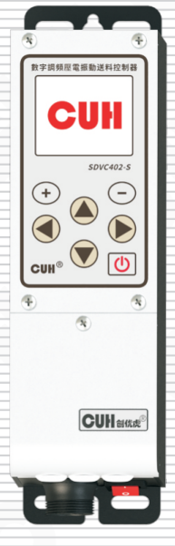

**SDVC402-S**

# 用户手册


### 第 2 页

数字调频压电振动送料控制器  
SDVC402-S

---

## 版权说明

南京创优科技有限责任公司保留所有权利。

本用户手册上包含的所有信息是属于本公司的知识，受著作权法及所有法律的保护。本公司根据著作权法及其他法律享有并保留所有著作权和其他法律赋予的权利，未经本公司书面同意不得以任何形式对本用户手册的部分或全部进行抄袭、翻译、转译、仿制或其他利用。

## 免责声明

本用户手册的所有内容仅说明本公司生产的相关产品的使用方法，并且是根据现有技术和提供给您使用时的状态进行描述的，在您使用本产品时必须自行承担相关风险。除法律强制规定外，本公司不因本用户手册对产品负有任何明示或暗示的责任，包括但不限于人身伤害、财产损失、机会丧失。

您明确了解上述风险并同意，除法律强制规定外，本公司无须为您的任何直接、间接的损害或损失负责（包括但不限于人员、财物、数据等有形损失和名誉、机会等无形损失）。

本公司保留对本用户手册中所适用的产品进行修改而不预先及事后通知的权利。

---

2025-10  
SDVC402SSMSCN_1.01


### 第 3 页

数字调频压电振动送料控制器　　　　　　　　　　　　　　　SDVC402-S

---

# 序　言

感谢您使用南京创优科技有限责任公司（在本手册中以下简称本公司）出品的SDVC402-S数字调频压电振动送料控制器（在本手册中以下简称本产品、本控制器或控制器）。本系列控制器是采用高品质元件并融合了最新的电子技术，采用高性能的数字信号处理器经过精心的设计而成。

本手册介绍了本产品的基本操作方法、功能技术说明和典型应用示例。为用户提供安装调试、参数设置、异常诊断、故障排除及日常维护控制器的相关信息。为了确保正确安装和使用本控制器，请在装机之前仔细阅读本用户手册，并请妥善保存。

以下符号提醒您注意有关防止人身伤害和产品损坏的事项，请务必阅读。

| 标志 | 说明 |
|---|---|
| ⚠️ 危险 | 表示若不遵守该事项，将导致人员伤亡。 |
| ⚠️ 警告 | 表示若不遵守该事项，可能导致人员伤亡。 |
| ⚠️ 小心 | 表示若不遵守该事项，可能导致人员遭受中度或轻微伤害。 |
| 注意 | 表示若不遵守该事项，将导致本产品损坏及财产损失。 |
| 要点 | 表示在使用过程中必须要遵守的注意事项和使用限制等。 |

**本说明书适合以下型号控制器：**

◆ 数字调频压电振动送料控制器 SDVC402-S（150mA）

---

2025-10　　　　　　　　　　　　　　　　　　　　　　SDVC402SSMSCN_1.01


### 第 4 页

数字调频压电振动送料控制器　　　　　　　　　　　　　　　　　　　　　　SDVC402-S

# 安全与预防措施

1、**【危险】** 本产品仅用于驱动基于压电陶瓷的振动送料设备，请勿将本产品用于保护人体或人体部位等目的。

2、**【危险】** 本产品不得作为防爆产品使用，请勿在危险场所和/或潜在爆炸气体环境中使用。

3、**【警告】** 本产品是采用交流市电供电的设备，请勿施加交流电压超过250Vac。施加过大的输入电压如300Vac，则可能导致产品爆炸或者着火，造成严重的安全事故。

4、**【警告】** 本产品是通过电源线进行接地的，请确保为控制器供电的配电设施具备良好的接地，否则可能导致控制器外壳带电，造成触电事故。

5、**【警告】** 请勿输入交流电源到本控制器的输出端，这会损坏控制器。

6、**【警告】** 请勿在带电的情况下插拔接线或触摸接线仓内各接线端子触点，以防发生触电事故。

7、**【注意】** 请避免采用通过继电器等设备切断供电的方式来控制本产品的输出，这会严重降低本控制器的寿命。

8、**【注意】** 本产品设计使用于阴凉干燥环境，请勿将本产品置于室外、可能会浸水、阳光暴晒场所工作，也不要在超过本产品电气特性要求的温度和湿度范围之外工作。

9、**【要点】** 请务必将本产品固定在可靠接地的坚固平台上，并远离振动设备。

10、**【要点】** 任何情况下请勿将本产品在超越设计极限状态下工作。

11、**【要点】** 任何情况下请不要打开本控制器机壳，以防遭到电击。机壳内部没有可以调节和用户维修部分，请不要试图维修本机，出现故障请致电本公司。

12、**【要点】** 请严格按照本手册的说明操作，对于违反这些操作说明所造成的任何人身伤害或财产损失，本公司不承担任何民事和刑事责任。

---

2025-10　　　　　　　　　　　　　　　　　　　　　　　　　　SDVC402SSMSCN_1.01


### 第 5 页

数字调频压电振动送料控制器  
SDVC402-S

# 工作与储存环境

## 一、使用前的检查

每台控制器在出厂前，均经过严格的品质检验，并经过强化的防撞包装处理。客户在拆箱后，请即刻进行下列检查：

1. 检查控制器是否在运输过程中受到损伤。
2. 检查控制器型号是否与订货登记资料完全相同。

## 二、工作环境

为使本控制器具有更好的使用效果和更长的使用寿命，请将控制器安装在符合下列条件的环境中：

- 良好的通风散热环境
- 远离水滴、蒸气、灰尘，特别是油性灰尘
- 无腐蚀、易燃性的气体、液体
- 无漂浮性的尘埃及金属微粒
- 安装表面坚固无振动
- 远离电磁噪声干扰
- 使用环境温度为0℃到40℃
- 仅适用于海拔2000m以下地区安全使用

---

2025-10  
SDVC402SSMSCN_1.01


### 第 6 页

数字调频压电振动送料控制器　　　　　　　　　　　　　　　　　　　　　　　　　SDVC402-S

---

# 目　录

**第一章 使用前须知** ---------------------------------------------------------------- 1

　　1.1　检查包装内容 ---------------------------------------------------------------- 1

　　1.2　视窗、按键及外部部件说明 ------------------------------------------------ 2

　　1.3　主页参数说明 ---------------------------------------------------------------- 3

　　1.4　接线端口说明 ---------------------------------------------------------------- 3

　　1.5　控制器铭牌说明 ------------------------------------------------------------ 4

**第二章 性能特点** ------------------------------------------------------------------ 5

**第三章 安装及使用指南** ------------------------------------------------------------ 7

　　3.1　控制器使用条件 ------------------------------------------------------------ 7

　　3.2　按键基本操作 -------------------------------------------------------------- 7

　　3.3　安装使用 -------------------------------------------------------------------- 8

**第四章 简要功能说明** ------------------------------------------------------------- 12

　　4.1　输出电压设定 ------------------------------------------------------------- 12

　　4.2　输出频率设定 ------------------------------------------------------------- 13

　　4.3　缓启动功能 ----------------------------------------------------------------- 14

　　4.4　输出开关 ------------------------------------------------------------------- 14

　　4.5　最大输出电压限制功能 ----------------------------------------------------- 15

　　4.6　键盘锁定功能 ------------------------------------------------------------- 16

　　4.7　开机运行状态 ------------------------------------------------------------- 17

　　4.8　恢复出厂设定 ------------------------------------------------------------- 18

**第五章 传感器与信号控制** -------------------------------------------------------- 19

　　5.1　智能光电传感功能 --------------------------------------------------------- 19

　　　　5.1.1　智能光电传感器（SDVC-S1）接线方法 ------------------------------- 19

　　　　5.1.2　智能光电传感器开延时、关延时时间的设定 ------------------------- 20

　　　　5.1.3　智能光电传感器逻辑方向设定 --------------------------------------- 21

　　5.2　三线NPN型开关传感器（料满停机）的使用方法 ----------------------------- 22

　　　　5.2.1　三线NPN型开关传感器接线方法 ------------------------------------- 22

　　　　5.2.2　三线NPN型开关传感器开延时、关延时时间设定 --------------------- 26

　　　　5.2.3　三线NPN型开关传感器逻辑方向设定 --------------------------------- 27

　　　　5.2.4　端口类型 ----------------------------------------------------------- 28

---

2025-10　　　　　　　　　　　　　　　　　　　　　　　　　SDVC402SSMSCN_1.01


### 第 7 页

数字调频压电振动送料控制器　　　　　　　　　　　　　　　　SDVC402-S

---

5.3　控制输出功能 ----------------------------------------------------------------------------- 29

5.4　远程速度控制 ----------------------------------------------------------------------------- 30

**第六章 详细功能说明** ---------------------------------------------------------------------- 32

6.1　自定义主页 ------------------------------------------------------------------------------- 33

6.2　常用参数功能设置 ------------------------------------------------------------------------ 34

　　6.2.1　电压 ------------------------------------------------------------------------------- 34

　　6.2.2　频率 ------------------------------------------------------------------------------- 34

　　6.2.3　缓启动时间/缓关闭时间 ------------------------------------------------------------ 35

　　6.2.4　最大电压/最小电压 ---------------------------------------------------------------- 35

　　6.2.5　频率上限/频率下限 ---------------------------------------------------------------- 35

　　6.2.6　熄屏时间 --------------------------------------------------------------------------- 36

　　6.2.7　语言 ------------------------------------------------------------------------------- 36

6.3　控制输出功能 ----------------------------------------------------------------------------- 37

　　6.3.1　主输出参数 ------------------------------------------------------------------------ 37

　　　　6.3.1.1　主输出源1/主输出源2 ------------------------------------------------------ 37

　　　　6.3.1.2　主输出逻辑 ----------------------------------------------------------------- 39

　　　　6.3.1.3　主开延时/主关延时 -------------------------------------------------------- 40

　　　　6.3.1.4　主输出模式 ----------------------------------------------------------------- 40

　　　　6.3.1.5　主输出方向 ----------------------------------------------------------------- 41

　　　　6.3.1.6　开机状态 -------------------------------------------------------------------- 41

　　6.3.2　控制输出参数 --------------------------------------------------------------------- 42

　　　　6.3.2.1　D口模式 --------------------------------------------------------------------- 44

　　　　6.3.2.2　D口类型 --------------------------------------------------------------------- 45

6.4　信号控制功能 ----------------------------------------------------------------------------- 46

　　6.4.1　B口阈值 --------------------------------------------------------------------------- 47

　　6.4.2　B口方向/C口方向 ------------------------------------------------------------------ 47

　　6.4.3　B口开延时/B口关延时和C口开延时/C口关延时 ------------------------------- 47

6.5　用户参数保存功能 ------------------------------------------------------------------------ 48

　　6.5.1　读出参数 --------------------------------------------------------------------------- 48

　　6.5.2　保存参数 --------------------------------------------------------------------------- 48

　　6.5.3　复位参数 --------------------------------------------------------------------------- 49

---

2025-10　　　　　　　　　　　　　　　　　　　　　　　　　SDVC402SSMSCN_1.01


### 第 8 页

数字调频压电振动送料控制器　　　　　　　　　　　　　　　　　　　　　　　　　SDVC402-S

---

6.5.4　本机标识和标识编号 ----------------------------------------------------------------49

6.5.5　用户密码 ---------------------------------------------------------------------------49

6.6　系统运行监控功能 ----------------------------------------------------------------------50

**第七章 附录** --------------------------------------------------------------------------51

7.1　外形尺寸图 ---------------------------------------------------------------------------51

7.2　技术规格表 ---------------------------------------------------------------------------52

7.3　参考标准 -----------------------------------------------------------------------------53

7.4　参数列表 -----------------------------------------------------------------------------54

7.5　输入输出电路图 -----------------------------------------------------------------------56

7.6　故障与警告信息 -----------------------------------------------------------------------57

**第八章 产品质保信息** ------------------------------------------------------------------58

8.1　质保期 -------------------------------------------------------------------------------58

8.2　保修范围 -----------------------------------------------------------------------------58

8.3　产品适用性 ---------------------------------------------------------------------------58

---

2025-10　　　　　　　　　　　　　　　　　　　　　　　　　　　SDVC402SSMSCN_1.01


### 第 9 页

数字调频压电振动送料控制器　　　　　　　　　　　　　　　　　　　　　　　　　SDVC402-S

---

# 第一章 使用前须知

本章节介绍产品包装内容、控制器外观说明和控制器铭牌信息。

## 1.1 检查包装内容

使用本产品之前，请检查控制器及附件的完整性。如果发现产品有缺陷或已损坏、附件缺失等问题，请与本公司联系。

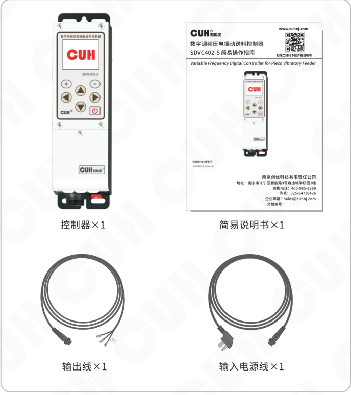

包装内容：

- 控制器×1
- 简易说明书×1
- 输出线×1
- 输入电源线×1

---

2025-10　　　　　　　　　　　　　　　　　- 1 -　　　　　　　　　　　　　　　　　SDVC402SSMSCN_1.01


### 第 10 页

数字调频压电振动送料控制器　　　　　　　　　　　　　　　　　　　　　　　　　SDVC402-S

## 1.2 视窗、按键及外部部件说明

### 视窗及按键说明

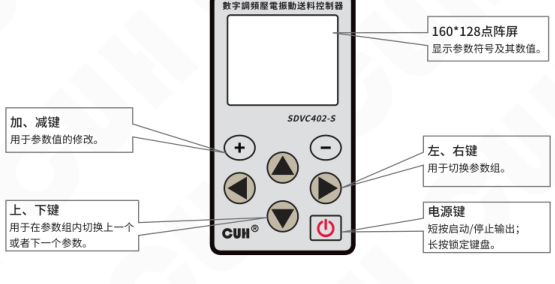

- **160*128点阵屏**：显示参数符号及其数值。
- **加、减键**：用于参数值的修改。
- **上、下键**：用于在参数组内切换上一个或者下一个参数。
- **左、右键**：用于切换参数组。
- **电源键**：短按启动/停止输出；长按锁定键盘。

### 外部部件说明

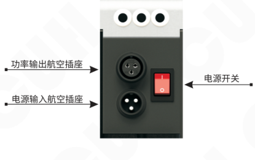

- **功率输出航空插座**
- **电源输入航空插座**
- **电源开关**

---

2025-10　　　　　　　　　　　　　　　　　- 2 -　　　　　　　　　　　　　　　　　SDVC402SSMSCN_1.01


### 第 11 页

数字调频压电振动送料控制器　　　　　　　　　　　　　　　　　　　　　　　　　SDVC402-S

## 1.3 主页参数说明

控制器在主页下能够显示主输出状态、键盘锁状态、端口状态、监控参数和界面名称等状态。其中端口状态内：

X高亮表示该端口有效，X表该端口低电平有效，X表该端口高电平有效。

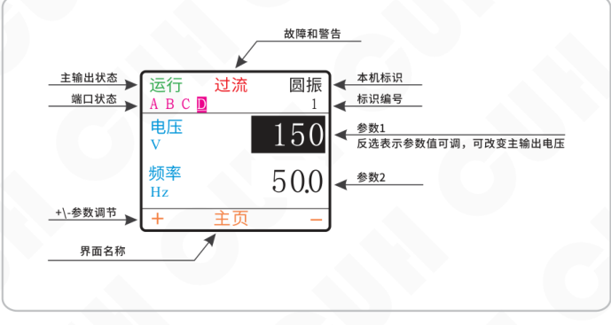

图中主页界面标注包含：主输出状态、端口状态、+\-参数调节、界面名称、故障和警告、本机标识、标识编号、参数1、参数2；示例显示内容包括“运行”“过流”“圆振”“A B C D”“电压 V”“频率 Hz”“150”“50.0”“+ 主页 -”。

## 1.4 接线端口说明

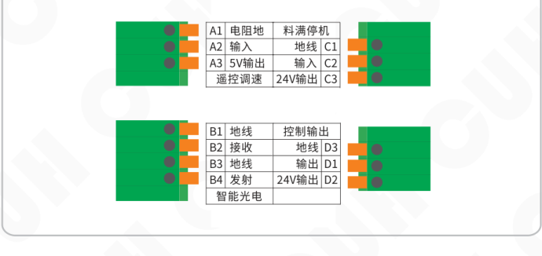

| 功能 | 引脚 | 端子说明 | 功能 | 引脚 | 端子说明 |
|---|---|---|---|---|---|
| 遥控调速 | A1 | 电阻地 | 料满停机 | C1 | 地线 |
| 遥控调速 | A2 | 输入 | 料满停机 | C2 | 输入 |
| 遥控调速 | A3 | 5V输出 | 料满停机 | C3 | 24V输出 |
| 智能光电 | B1 | 地线 | 控制输出 | D3 | 地线 |
| 智能光电 | B2 | 接收 | 控制输出 | D1 | 输出 |
| 智能光电 | B3 | 地线 | 控制输出 | D2 | 24V输出 |
| 智能光电 | B4 | 发射 |  |  |  |

2025-10　　　　　　　　　　　　　　　　　　　SDVC402SSMSCN_1.01


### 第 12 页

数字调频压电振动送料控制器　　　　　　　　　　　　　　　　　　　　　　　　　SDVC402-S

---

## 1.5 控制器铭牌说明

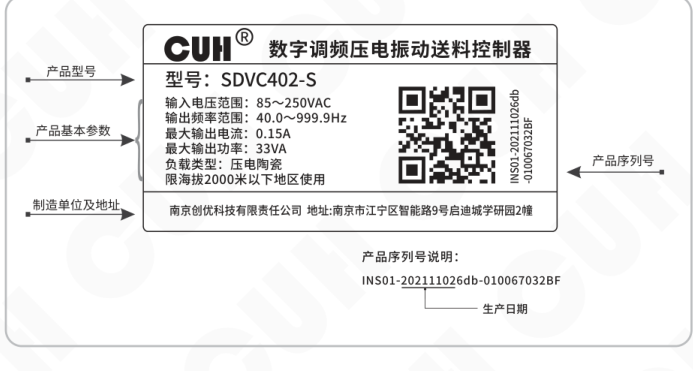

铭牌标注内容说明：

| 标注项 | 内容 |
|---|---|
| 产品型号 | 型号：SDVC402-S |
| 产品基本参数 | 输入电压范围：85～250VAC<br>输出频率范围：40.0～999.9Hz<br>最大输出电流：0.15A<br>最大输出功率：33VA<br>负载类型：压电陶瓷<br>限海拔2000米以下地区使用 |
| 制造单位及地址 | 南京创优科技有限责任公司　地址:南京市江宁区智能路9号启迪城学研园2幢 |
| 产品序列号 | INS01-202111026db-010067032BF |
| 生产日期 | 产品序列号中的 `202111026db` 部分 |

铭牌示例文字：

> CUH®　数字调频压电振动送料控制器  
> 型号：SDVC402-S

产品序列号说明：

`INS01-202111026db-010067032BF`

---

2025-10　　　　　　　　　　　　　　　　　- 4 -　　　　　　　　　　　　　　　　　SDVC402SSMSCN_1.01


### 第 13 页

数字调频压电振动送料控制器　　　　　　　　　　　　　　　　　　　　　　　　　SDVC402-S

---

## 第二章 性能特点

本控制器专为自动化设备中振动送料控制用，融合最新电子技术，经过精心设计，为用户提供最方便实用的功能，包括：

- **频率调节：** 输出频率范围40.0~999.9Hz。
- **电压调节：** 输出电压范围0~220V。
- **自动稳压：** 本功能可以消除由于电源电压波动造成的送料速度变化。稳压还可以消除工频交流电造成的拍频效应。
- **智能光电传感：** 通过自适应的智能光电对射传感器实现料满停机控制，且具有可调缓启动时间、开延时、关延时、逻辑方向调节等控制功能。
- **料满停机：** 通过NPN/PNP型传感器实现料满停机控制，并具有可调缓启动时间、开延时、关延时、逻辑方向调节等控制功能。
- **线控调速：** 可以直接使用外置的电位器、PLC或1~5V电压、4~20mA直流信号控制输出电压。
- **输出开关：** 面板上设有轻触按键，可以即时开停机，方便用户调试设备。
- **键盘锁定：** 通过长按开关键2秒可以锁定所有按键，防止用户误操作。
- **开机运行状态：** 通过设置本参数，可以方便的由用户来决定控制器的开机运行状态。
- **控制输出：** 通过晶体管输出控制信号，可直接用于控制电磁阀等外部设备与本控制器协调工作。
- **最大输出限定：** 本参数可以帮助生产厂家防止用户误操作损害设备。
- **恢复出厂设置：** 该功能可以快速将调乱的状态参数恢复为出厂默认设置，使控制器进入默认出厂工作状态。
- **液晶显示：** 采用160*128分辨率彩色显示屏，并支持中、英文界面。
- **参数组保存和读取：** 可保存和读取多达4组用户参数组。

---

2025-10　　　　　　　　　　　　　　　　- 5 -　　　　　　　　　　　　　　　　SDVC402SSMSCN_1.01


### 第 14 页

数字调频压电振动送料控制器                                           SDVC402-S

---

本公司对产品质量有着一贯的追求，除在生产阶段采用高品质元器件，严密的质检体系保障外，为了最大程度地提高产品的可用性，对于用户使用中可能发生的意外问题也做了充分的准备，其中包括：

- **短路保护：** 本控制器可以在用户误操作造成短路时停止输出，以保护本机及用户的设备。
- **过流保护：** 本控制器可以在用户误操作造成输出电流超过额定电流时短暂停止输出，以保护本机及用户设备。
- **过热保护：** 本控制器工作温度超过65℃时将停止输出，以保护本机。

为保证产品质量的国际化标准，本公司产品遵守CE认证标准。

---

2025-10　　　　　　　　　　　　　　　- 6 -　　　　　　　　　　　　　　　SDVC402SSMSCN_1.01


### 第 15 页

数字调频压电振动送料控制器　　　　　　　　　　　　　　　　　　　　　　　　　SDVC402-S

# 第三章 安装及使用指南

本章节介绍本产品使用所必须具备的条件以及如何正确进行安装与连接。

## 3.1 控制器使用条件

本产品是使用交流85V~250V供电的设备，且通过电源线三爪插头进行保护接地连接，请使用符合标准的市电供电，并确保保护地线已正确连接。

**⚠ 警告** 切不可将控制器连接到380V交流电，这将造成控制器不可恢复的严重损坏，有可能导致爆炸、火灾等安全事故。

**⚠ 警告** 确保供电侧可靠接地，控制器的金属外壳是与保护接地线直接连接的，接地不良会导致控制器外壳带电，引发触电事故。

**注意** 控制器长时间工作会产生热量致使外壳温度升高，当温度超过65℃后控制器将过热保护，停止主输出，请将控制器安装在通风良好的环境中，并将其固定好，远离振动源。

**注意** 本产品是用来驱动压电陶瓷的控制器。

## 3.2 按键基本操作

 a. 按键动作根据按下时间分为短按、长按（一级加速、二级加速）。

 b. 短按定义按下时间大于0.2小于2秒，长按定义按下时间大于2秒。

 c. ⊕ 和 ⊖ 用于修改参数值，▲ 和 ▼ 用于选择不同参数。

 d. 短按 ◀ 或 ▶，在参数设置界面内切换上/下个参数组。

 e. 短按 ▲ 或 ▼，在参数设置界面内切换本组参数的上/下个参数。

 f. 短按 ⏻ 暂停/恢复主输出，长按锁定/解锁键盘。

 j. 任意界面下超过5分钟无任何动作，进入主页界面。

---

2025-10　　　　　　　　　　　　　　　　- 7 -　　　　　　　　　　　　　　　　SDVC402SSMSCN_1.01


### 第 16 页

数字调频压电振动送料控制器  
SDVC402-S

---

## 3.3 安装使用

**第一步：**

打开控制器的外包装，检查控制器外观及侧标型号，判断是否为所需的型号。

**第二步：**

取出输出线，将输出线两个子弹头接线端子连接到振动盘的压电陶瓷电极上。并确认黄绿双色的地线与振动盘金属外壳可靠连接。

将输出线航空插头上的缺口，对准控制器输出插座上的三角形标记，正确连接输出线后锁紧螺母。

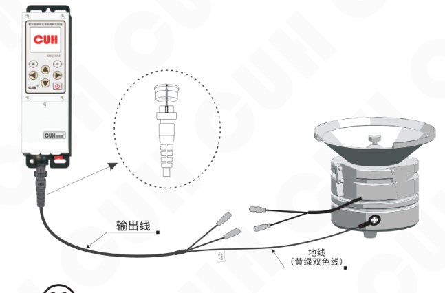

**注意**

1、一定要确认压电陶瓷的电极接在两个输出引脚上，外壳需要可靠接地。否则将会导致机壳带电，可能发生严重安全事故。

---

2025-10  
- 8 -  
SDVC402SSMSCN_1.01


### 第 17 页

数字调频压电振动送料控制器　　　　　　　　　　　　　　　　　　　　　　　　　SDVC402-S

---

### 第三步：

将输入电源线航空插头插入控制器电源输入插座，并锁紧螺母。

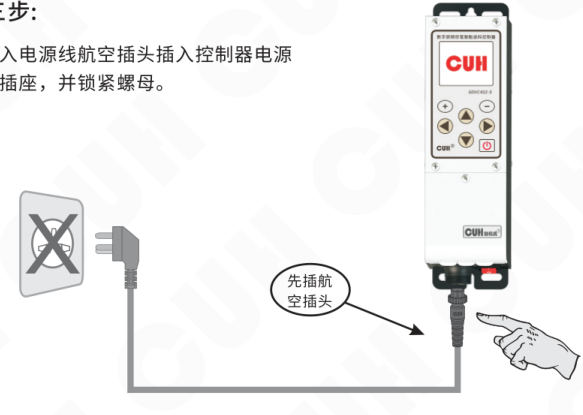

### 第四步：

确认开关处于关闭位置后，将电源线三爪插头插在供电电源插座上。


---

2025-10　　　　　　　　　　　　　　　　　- 9 -　　　　　　　　　　　　　　　　　SDVC402SSMSCN_1.01


### 第 18 页

数字调频压电振动送料控制器　　　　　　　　　　　　　　　　　　　　　　　　　SDVC402-S

---

### 第五步：

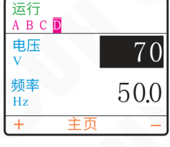

- 打开控制器电源开关，控制器显示主页界面。
- 通过 ⊕ 和 ⊖ 增加或者减小参数值，将输出电压“电压”值调整到30~80之间。

**注：** 参数值被反选表示该数值可以修改。

---

### 第六步：

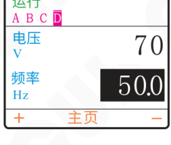

- 在主页界面，短按 ▼ 进入输出频率“频率”调整状态。
- 通过 ⊕ 和 ⊖ 来寻找振动体的固有频率，也就是我们常说的谐振点。

> ☺
>
> - 振动最大时的频率为振动体的固有频率。
> - 每个振动体都有固有的振动频率，为了能达到最佳的工作状态，请调整控制器参数使振动体工作在合适的工作频率上。

---

2025-10　　　　　　　　　　　　　　　　　-10-　　　　　　　　　　　　　　　　SDVC402SSMSCN_1.01


### 第 19 页

数字调频压电振动送料控制器　　　　　　　　　　　　　　　　　　　　　　　　　SDVC402-S

---

**第七步：**

➽ 当找到振动体的固有频率后，再使用电压调整功能，通过 **+** 和 **-** 调到最佳的送料速度。

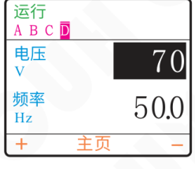

调整完毕，可初步工作后，如还需其它控制功能，请参见本说明书其他部分。

---

2025-10　　　　　　　　　　　　　　　　　- 11 -　　　　　　　　　　　　　　　SDVC402SSMSCN_1.01


### 第 20 页

数字调频压电振动送料控制器  
SDVC402-S

---

# 第四章 简要功能说明

本章节介绍本产品基本参数功能的使用方法。

## 4.1 输出电压设定

本控制器可以直接在面板上以数字方式设置输出电压。由于本控制器特有的稳压功能，该数值为输出电压的有效值，并不会受到输入电压的影响，即使在电压不稳定场合中使用也可以保持稳定工作。同时，直接的电压数值设定也为用户了解设备运行情况提供了准确的数据。

> - 打开控制器的电源开关。
>
> - 控制器进入输出电压状态，显示屏显示输出电压标志“电压”和上次设置的电压值（默认值为150）。
>
> - 通过 `+` 和 `−` 可以对“电压”值进行调整。
>
> 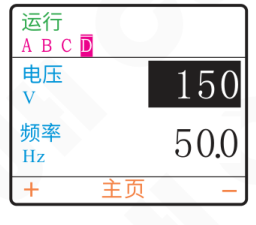
>
> 本控制器的输出电压范围是0～220V，调整精度1V。

---

2025-10　　　　　-12-　　　　　SDVC402SSMSCN_1.01


### 第 21 页

数字调频压电振动送料控制器　　　　　　　　　　　　　　　　　　　　　　　　　SDVC402-S

---

## 4.2 输出频率设定

本控制器采用直接数字频率合成技术（DDS），具有非常高的频率精度和稳定性，不随时间和温度的改变而变化。

> - 在主页界面，短按 `▼` 进入输出频率“频率”调整状态。
> - 显示屏显示“频率”和频率值（默认值为50.0）。
> - 通过 `⊕` 和 `⊖` 可以对“频率”值进行设定。
>
> 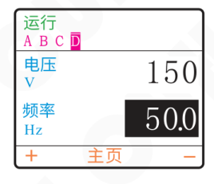
>
> 本控制器的输出频率范围是40.0～999.9Hz，调整精度0.1Hz。

> ☺ **提示**
>
> - 在主页状态下短按 `◀` 和 `▶` 可以切换到其它参数组。
> - 在非监控参数组，当操作结束三分钟后，控制器自动退出到主页界面。
> - 在监控参数组，当操作结束十分钟后，控制器自动退出到主页界面。

---

2025-10　　　　　　　　　　　　　　　　　-13-　　　　　　　　　　　　　　　　　SDVC402SSMSCN_1.01


### 第 22 页

**数字调频压电振动送料控制器**　　　　　　　　　　　　　　　　　　　　　　　　　**SDVC402-S**

## 4.3 缓启动功能

本控制器从停止状态启动时，输出电压可以平缓提高到设定值，以防止振动设备和控制器遭受冲击。

**缓启动时间：** 控制器从停止状态启动时，输出电压从0V平滑升高达到设定输出电压所需要的时间称为缓启动时间。

- 短按 ▶，进入参数组二，常用参数组。
- 短按 ▼ 切换到“缓启动时间”参数调整状态（默认值为0.5）。
- 通过 ⊕ 和 ⊖ 调整参数值。

界面示意：

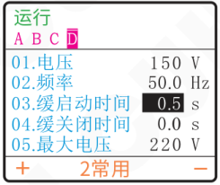

本控制器的缓启动时间范围是0.0～10.0秒，调整精度0.1秒。

## 4.4 输出开关

本面板上的轻触式输出开关可以方便快速地开启或停止本机的输出。

- 使用控制器面板上的 ⏻，可以控制本机启动或停止输出。停止输出时，屏幕显示“手停”标志，表示进入停止状态。

界面示意：

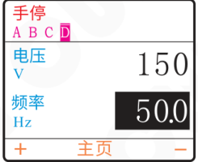

> 本功能使用软开关，由数字信号进行控制。因此，不会产生火花烧蚀机械触点的问题，可以大大延长控制器和振动设备的使用寿命。

**2025-10**　　　　　　　　　　　　　　　　**-14-**　　　　　　　　　　　　　　　　**SDVC402SSMSCN_1.01**


### 第 23 页

> 数字调频压电振动送料控制器　　　　　　　　　　　　　　　　　SDVC402-S

## 4.5 最大输出电压限制功能

本控制器可以设定最大输出电压。设定该参数可以防止用户误操作输出过大电压而损坏振动设备。

线控调速功能也受此参数限制。

- » 进入参数组二，常用参数组。
- » 短按 ▼ 切换到“最大电压”参数调整状态（默认值为220）。
- » 通过 ＋ 和 － 调整参数值。

参数界面示意：

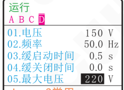

本控制器的最大输出电压限制范围是0～220V，调整精度1V。

> ☺
>
> - 任何情况下，控制器的输出电压不能也不会超过本参数设定值。
> - 本参数出厂默认设置为本机的最大可能输出电压。

---

2025-10　　　　　　　　　　　　　　　-15-　　　　　　　　　　　　　　　SDVC402SSMSCN_1.01


### 第 24 页

数字调频压电振动送料控制器  
SDVC402-S

## 4.6 键盘锁定功能

为了防止误操作，本机设定了键盘锁。这样当控制器各项参数设置好后，可以有效避免其他人的误动作影响本机正常工作。即使关机后重新开机，键盘锁状态依然保持上次关机时的状态。

- 通过长按 **⏻** 2秒可以锁定所有按键，此时屏幕显示“锁”标志。
- 再次长按 **⏻** 2秒可以解除锁定。

屏幕显示示意：

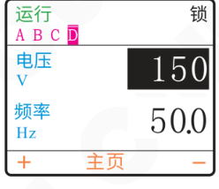

> ☺ 键盘锁定状态不会因断电关机而消失。


### 第 25 页

数字调频压电振动送料控制器　　　　　　　　　　　　　　　　　　　　　　　　　SDVC402-S

## 4.7 开机运行状态

为了防止在正常情况下突然停电然后来电或者对本控制器的上电状态有特殊的要求，可以通过设定该参数，来设定本控制器的上电状态是开、关、保持上次关机时的状态。

- 进入参数组三，主输出参数组。

- 短按 ▼ 切换到“开机状态”参数，即开机运行状态设定（默认状态为开）。

- 通过 ＋ 和 － 调整参数设置。

控制器显示示意：

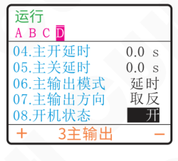

> **开：** 表示开机运行状态是开启输出。  
> **关：** 表示开机运行状态是关闭输出。  
> **保持：** 表示开机运行状态是跟随上次关机时的状态（如果上次关机时控制器是停止输出的，那么下次上电的时候控制器会保持停止输出状态，反之如果上次关机时控制器是开启输出的，那么下次上电的时候控制器会保持开启输出状态）。

2025-10　　　　　　　　　　　　　　　　-17-　　　　　　　　　　　　　　　　SDVC402SSMSCN_1.01


### 第 26 页

数字调频压电振动送料控制器　　　　　　　　　　　　　　　　　　　　　　　　　SDVC402-S

---

## 4.8 恢复出厂设定

本功能可以使用户快速将控制器设置为出厂默认设置状态。

由于本控制器功能强大，有数量众多的控制参数可以由用户设定，对于初学者，可能在多次的设定修改后不能恢复控制器的正常工作状态。使用该功能可以快速将调乱的参数状态恢复为出厂默认设置。

- 进入参数组七，保存参数组。
- 短按“▼”切换到“复位参数”参数，即恢复出厂参数设定状态（默认状态为无效）。
- 短按“＋”修改参数值为“工作组”
- 同时按下“＋”和“－”2秒后，控制器将复位所有参数，并重启。

运行  
A　B　C　D

| 参数 | 参数值 |
|---|---|
| 01.读出参数 | 无效 |
| 02.保存参数 | 无效 |
| 03.复位参数 | **无效** |
| 04.本机标识 | 无 |
| 05.标识编号 | 无 |

＋　　7保存　　－

运行  
A　B　C　D

| 参数 | 参数值 |
|---|---|
| 01.读出参数 | 无效 |
| 02.保存参数 | 无效 |
| 03.复位参数 | **工作组** |
| 04.本机标识 | 无 |
| 05.标识编号 | 无 |

＋　　7保存　　－

---

2025-10　　　　　　　　　　　　　　　　　-18-　　　　　　　　　　　　　　　　　SDVC402SSMSCN_1.01


### 第 27 页

数字调频压电振动送料控制器　　　　　　　　　　　　　　　　　　　　　　　　　SDVC402-S

# 第五章 传感器与信号控制

本机可以接受多种外部信号或传感器控制其运行状态。本章节主要介绍智能光电传感器、料满停机传感器和PLC控制等的使用方法。

## 5.1 智能光电传感功能

本机配合使用本公司生产的SDVC-S1光电对射传感器可以实现智能光电传感功能，以自动去除背景光对传感器灵敏度的影响，使传感器无需人工调节灵敏度即可可靠工作。

### 5.1.1 智能光电传感器（SDVC-S1）接线方法

**第一步：**

打开控制器的接线仓的仓盖。

**第二步：**

按照图例连接SDVC-S1光电传感器。

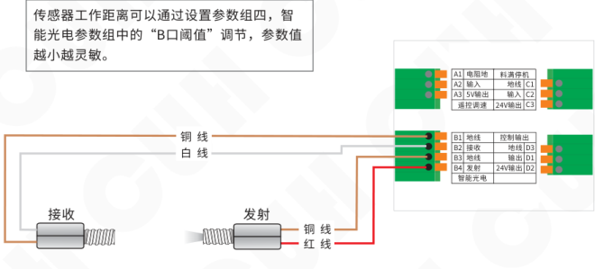

**注意：在出厂默认设置下，本传感器逻辑方向“B口方向”为常通。**

---

2025-10　　　　　　　　　　　　　　　　　-19-　　　　　　　　　　　　　　　　　SDVC402SSMSCN_1.01


### 第 28 页

### 5.1.2 智能光电传感器开延时、关延时时间的设定

当使用传感器，或者 PLC 等其它外部信号进行启动和停止控制时，大多数情况需要在给出信号或者恢复信号后延迟一段时间才执行操作。对于这样的应用，可以通过设置开延时和关延时时间来实现。另外，还可以设定缓启动时间以防止启动时的冲击。

> **B口开延时：** 从施加一个使控制器进入运行状态的控制信号开始，到控制器输出启动，期间经历的延迟时间称为开延时。
>
> - 进入参数组四，智能光电参数组。
> - 短按 `▼` 切换到“B口开延时”参数（默认值为 0.2）。
> - 通过 `+` 和 `−` 调整参数值。
>
> 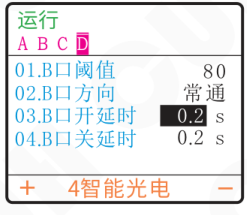
>
> 本控制器的 B口开延时范围是 0.0～99.9s，调整精度 0.1s。

> **B口关延时：** 从施加一个使控制器进入停止状态的控制信号开始，到控制器输出停止，期间经历的延迟时间称为关延时。
>
> - 进入参数组四，智能光电参数组。
> - 短按 `▼` 切换到“B口关延时”参数（默认值为 0.2）。
> - 通过 `+` 和 `−` 调整参数值。
>
> 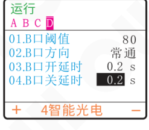
>
> 本控制器的 B口关延时范围是 0.0～99.9s，调整精度 0.1s。


### 第 29 页

数字调频压电振动送料控制器　　　　　　　　　　　　　　　　　　　　SDVC402-S

---

### 5.1.3 智能光电传感器逻辑方向设定

在正常情况下，也就是说对射的光电传感器没有收到光信号时，在出厂默认设置，即常通逻辑方向状态下，控制器处于“运行”状态。但是，对于一些特殊应用，可能需要相反的逻辑。也就是说，可能会需要在没有收到光信号时，控制器处于“停止”状态。这可以通过修改本参数来实现。

- 进入参数组四，智能光电参数组。
- 短按 **▼** 切换到“B口方向”参数，即智能光电传感逻辑方向（默认状态为常通）。
- 通过 **＋** 和 **－** 调整参数设置。

屏幕示例：

**逻辑方向：常通**

运行　A B C D

| 参数 | 设置值 |
|---|---:|
| 01.B口阈值 | 80 |
| 02.B口方向 | 常通 |
| 03.B口开延时 | 0.2 s |
| 04.B口关延时 | 0.2 s |

＋　4智能光电　－

**逻辑方向：常断**

运行　A B C D

| 参数 | 设置值 |
|---|---:|
| 01.B口阈值 | 80 |
| 02.B口方向 | 常断 |
| 03.B口开延时 | 0.2 s |
| 04.B口关延时 | 0.2 s |

＋　4智能光电　－

- 逻辑方向设置为常通，则没有收到光信号时，控制器处于运行状态。
- 逻辑方向设置为常断，则没有收到光信号时，控制器处于停止状态。

---

2025-10　　　　　　　　　- 21 -　　　　　　　　　SDVC402SSMSCN_1.01


### 第 30 页

数字调频压电振动送料控制器　　　　　　　　　　　　　　　　　　　　　　　　　SDVC402-S

---

## 5.2 三线NPN型开关传感器（料满停机）的使用方法

配合各类开关传感器，如接近开关传感器、光电传感器、光纤传感器等实现自动启动和停止功能。

### 5.2.1 三线NPN型开关传感器接线方法

**第一步：**

打开控制器的接线仓的仓盖。

**第二步：**

按照图例连接传感器。

**通常情况**

- 蓝色线为地线
- 黑色线为信号线
- 棕色线为电源线

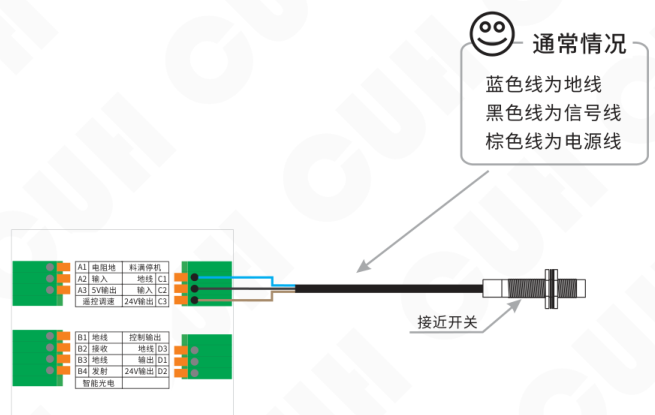

---

2025-10　　　　　　　　　　　　　　　-22-　　　　　　　　　　　　　　　SDVC402SSMSCN_1.01


### 第 31 页

数字调频压电振动送料控制器  
SDVC402-S

### 对射NPN型传感器接线方法

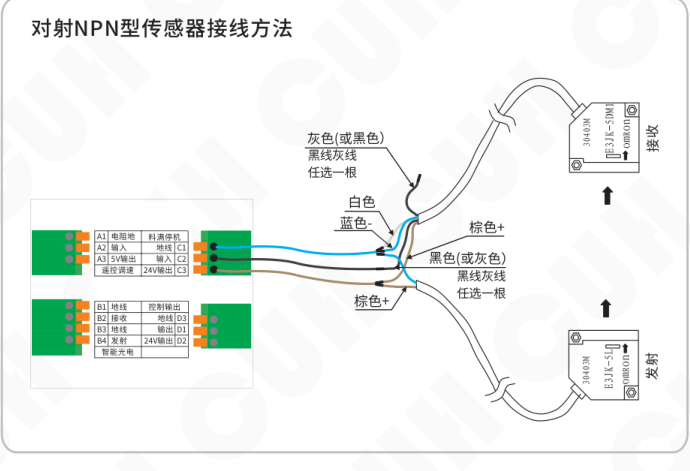

### 对射光电传感器接线方法

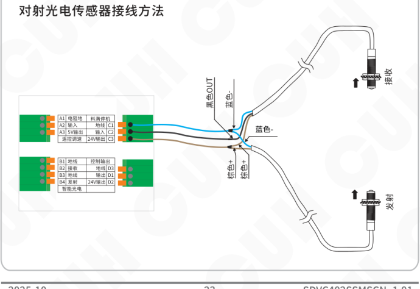

---

2025-10  -23-  SDVC402SSMSCN_1.01


### 第 32 页

数字调频压电振动送料控制器　　　　　　　　　　　　　　　　　SDVC402-S

## 对射式光纤传感器接线方法

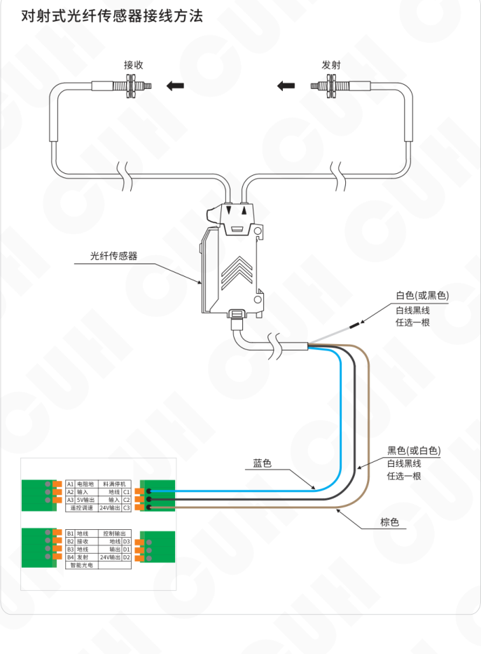

图中主要标注：

- 光纤传感器
- 接收
- 发射
- 蓝色
- 棕色
- 白色（或黑色）：白线黑线任选一根
- 黑色（或白色）：白线黑线任选一根

图中端子示意：

| 端子 | 信号 | 信号/功能 | 端子 |
|---|---|---|---|
| A1 | 电阻地 | 料满停机 |  |
| A2 | 输入 | 地线 | C1 |
| A3 | 5V输出 | 输入 | C2 |
| 遥控调速 |  | 24V输出 | C3 |

| 端子 | 信号 | 信号/功能 | 端子 |
|---|---|---|---|
| B1 | 地线 | 控制输出 |  |
| B2 | 接收 | 地线 | D3 |
| B3 | 地线 | 输出 | D1 |
| B4 | 发射 | 24V输出 | D2 |
| 智能光电 |  |  |  |

2025-10　　　　　　　　　　　　　　　　　-24-　　　　　　　　　　　　　　　　　SDVC402SSMSCN_1.01


### 第 33 页

数字调频压电振动送料控制器　　　　　　　　　　　　　　　SDVC402-S

## 反射光电传感器接线方法

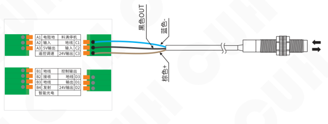

## PLC控制振动送料控制器启停的接线方法

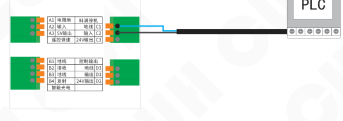

> 可以使用PLC的继电器输出，也可以使用PLC的NPN输出。

2025-10　　　　　　　　　-25-　　　　　　　　　SDVC402SSMSCN_1.01


### 第 34 页

## 5.2.2 三线NPN型开关传感器开延时、关延时时间设定

在出厂默认状态下，智能光电传感器和开关传感器的开延时、关延时时间相同。用户也可以单独为开关传感器设定开延时、关延时时间，此时开关传感器和智能光电传感器具有独立的开延时、关延时时间。

**C口开延时：** 从施加一个使控制器进入运行状态的控制信号开始，到控制器开始有输出，期间经历的延迟时间称为开延时。

- 进入参数组五，料满停机参数组。
- 短按 `▼` 切换到“C口开延时”参数（默认值为0.2）。
- 通过 `＋` 和 `－` 调整参数值。

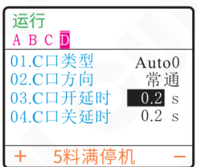

本控制器的C口开延时范围是0.0～99.9s，调整精度0.1s。

**C口关延时：** 从施加一个使控制器进入停止状态的控制信号开始，到控制器输出停止，期间经历的延迟时间称为关延时。

- 进入参数组五，料满停机参数组。
- 短按 `▼` 切换到“C口关延时”参数（默认值为0.2）。
- 通过 `＋` 和 `－` 调整参数值。

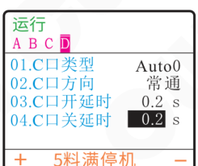

本控制器的C口关延时范围是0.0～99.9s，调整精度0.1s。


### 第 35 页

数字调频压电振动送料控制器　　　　　　　　　　　　　　　　　SDVC402-S

---

## 5.2.3 三线NPN型开关传感器逻辑方向设定

在正常情况下，也就是说不向引脚发任何信号时，由于内部的上拉电阻，都会呈现为“高”电平。此时，在出厂默认设置下，控制器处于“运行”状态。但是，对于一些特殊应用，可能需要相反的逻辑。也就是说，可能会需要在不施加信号时控制器处于“停止”状态。这可以通过修改本参数来实现。

| 操作步骤 | 显示示例 |
|---|---|
| » 进入参数组五，料满停机参数组。<br><br>» 短按 `▼` 切换到“C口方向”参数，即端口C逻辑方向（默认状态为常通）。<br><br>» 通过 `+` 和 `−` 调整参数设置。 | **运行**<br>A　B　C　D<br>01.C口类型　　Auto0<br>02.C口方向　　**常通**<br>03.C口开延时　0.2 s<br>04.C口关延时　0.2 s<br><br>`+`　5料满停机　`−`<br><br>**运行**<br>A　B　C　D<br>01.C口类型　　Auto0<br>02.C口方向　　**常断**<br>03.C口开延时　0.2 s<br>04.C口关延时　0.2 s<br><br>`+`　5料满停机　`−` |

- 逻辑方向设置为常通，则不连接任何控制信号，控制器处于运行状态。
- 逻辑方向设置为常断，则不连接任何控制信号，控制器处于停止状态。

---

2025-10　　　　　　　　　　　-27-　　　　　　　　　　　SDVC402SSMSCN_1.01


### 第 36 页

## 5.2.4 端口类型

控制器可以设置开关传感器的类型为“NPN”型、“PNP”型，“Auto1”、“Auto0”可以根据传感器类型手动设定。

**NPN：** NPN型传感器。

**PNP：** PNP型传感器。

**Auto1：** 单次扫描，即传感器信号无效前一直通过变换高低电平检测端口是否有效，发现有效信号后确定端口传感器类型且不再扫描。

**Auto0：** 连续扫描，不管传感器类型如何始终通过变换高低电平检测端口是否接入有效信号。

» 进入参数组五，料满停机参数组。

» 默认“C口类型”参数，即C口传感器类型（默认状态为Auto0）。

» 通过 ⊕ 和 ⊖ 调整参数设置。

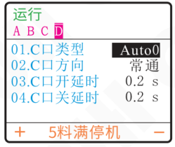


### 第 37 页

数字调频压电振动送料控制器  
SDVC402-S

## 5.3 控制输出功能

本控制器可以输出低电压控制信号，以同步其它设备协同工作，如电磁阀、PLC、继电器等。

控制输出端口可以支持NPN输出、PNP输出和推挽输出，接线方法如下：

### NPN输出的连接方式

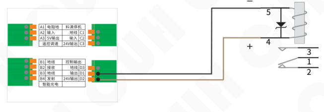

### PNP或推挽输出的连接方式

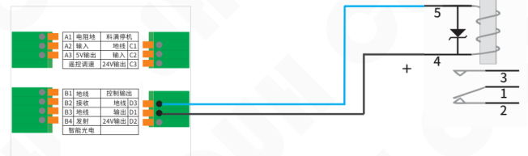

> 如果连接24V继电器，一定要确认线圈的正极和负极，确保正确连接。因为本端口的输出电流能力为350mA，接反后继电器的内部保护二极管会将本控制器端口短路，触发短路保护。

---

2025-10　　　　　-29-　　　　　SDVC402SSMSCN_1.01


### 第 38 页

数字调频压电振动送料控制器　　　　　　　　　　　　　　　　　　　　　　　　　SDVC402-S

## 5.4 远程速度控制

本控制器远程速度控制允许用户通过外接电位器，1～5V，或者4~20mA直流输入控制信号控制输出电压。这样，用户可以通过PLC、DCS或其它一些方法方便容易地进行外部远程速度控制。

- 当输入小于0.5V时，远程速度控制无效。
- 当输入大于0.5V小于1V时，远程速度控制有效，输出电压为“最小输出电压”（默认为0V）
- 当输入大于1V小于5V时，输出电压按比例受远程遥控信号控制0%~100%，且最大电压不超过“最大输出电压”（默认为220V）

### 外接电位器连接方式

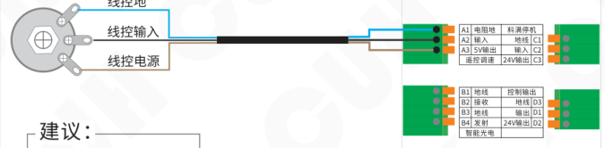

> 建议：  
> 请使用1K阻值线性电位器

### 1~5V 直流输入进行输出电压控制的连接方式

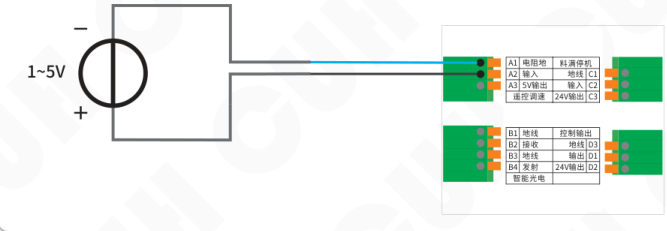

---

2025-10　　　　　　　　　　　　　　　　　-30-　　　　　　　　　　　　　　　　SDVC402SSMSCN_1.01


### 第 39 页

数字调频压电振动送料控制器　　　　　　　　　　　　　　　　　　　　　　　　　SDVC402-S

---

### 4~20mA 直流输入进行输出电压控制的连接方式

- 当输入小于2mA时，远程速度控制无效。
- 当输入大于2mA小于4mA时，远程速度控制有效，输出电压为“最小输出电压”（默认为0V）
- 当输入大于4mA小于20mA时，输出电压按比例受远程遥控信号控制0%~100%，且最大电压不超过“最大输出电压”（默认为220V）

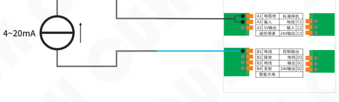

---

2025-10　　　　　　　　　　　　　　　　　-31-　　　　　　　　　　　　　　　　　SDVC402SSMSCN_1.01


### 第 40 页

数字调频压电振动送料控制器　　　　　　　　　　　　　　　　　　　　　　　　　SDVC402-S

---

# 第六章 详细功能说明

本章节介绍本产品全部详细功能及设置。

主页界面下短按 ▶ 进入【参数设置界面】。在参数设置界面内包含如下八个参数组，通过短按 ◀ 或 ▶ 切换不同参数组。

## 参数组间轮转图

| 短按 ▶ | 参数组 | 短按 ◀ |
|---|---|---|
| ↓ | 1界面 | ↑ |
| ↓ | 2常用 | ↑ |
| ↓ | 3主输出 | ↑ |
| ↓ | 4智能光电 | ↑ |
| ↓ | 5料满停机 | ↑ |
| ↓ | 6控制输出 | ↑ |
| ↓ | 7保存 | ↑ |
| ↓ | 8监控 | ↑ |

---

2025-10　　　　　　　　　　　　　　　　　-32-　　　　　　　　　　　　　　　　　SDVC402SSMSCN_1.01


### 第 41 页

数字调频压电振动送料控制器　　　　　　　　　　　　　　　　　　　　　　　　　SDVC402-S

## 6.1 自定义主页

为方便用户后续高效快速使用控制器，用户可以在界面参数组内进行客制化操作。通过提取所有参数中的最多16个参数置于主页上显示，用户便可在主界面进行快速操作。

例：选中1. 电压、2. 频率、3. 输出电流、4. 缓启动时间、5. 缓关闭时间，共五个参数于主界面下。操作步骤如下：

> ▸ 主页界面下，短按 ▶ 进入参数设置界面，直接进入到界面参数组。
>
> ▸ 短按 ▲ 或 ▼ 切换不同的监控项目。
>
> ▸ 通过 ＋ 和 － 分别选中需要设置的功能标签。
>
> ```text
> ┌──────────────────┐
> │ 运行             │
> │ A  B  C  D       │
> ├──────────────────┤
> │ 监测项 1  电压   │
> │ 监测项 2  频率   │
> │ 监测项 3  输出电流│
> │ 监测项 4  缓启动时间│
> │ 监测项 5  缓关闭时间│
> ├──────────────────┤
> │ ＋      1界面     －│
> └──────────────────┘
> ```
>
> 注：功能标签通过《参数列表》章节查询。  
> 如果监测项的值为空白，表示无监测项目。

操作结束后，用户如需调整和查看电压、频率、输出电流、缓启动时间和缓关闭时间的参数值，进入“主页”界面参数组内具体监控项目下，通过 ＋ 或 － 即可完成参数调整和查看。

2025-10　　　　　　　　　　　　　　-33-　　　　　　　　　　　　　　SDVC402SSMSCN_1.01


### 第 42 页

## 6.2 常用参数功能设置

本章节主要介绍控制器常用参数的设置和调整。

### 6.2.1 电压

本控制器可以直接在面板上以数字方式设置输出电压有效值。本功能可以消除由于电源电压波动造成的送料速度变化。稳压还可以消除工频交流电造成的拍频效应。

> » 进入常用参数组，找到电压  
> 设置参数。
>
> » 通过 ⊕ 和 ⊖ 调整参数值。

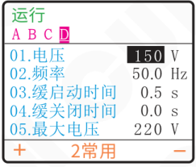

电压范围0~220V，默认150V，调整精度1V。

### 6.2.2 频率

本控制器具有非常高的频率精度和稳定性，不随时间和温度的改变而变化。

> » 进入常用参数组，找到频率  
> 设置参数。
>
> » 通过 ⊕ 和 ⊖ 调整参数值。

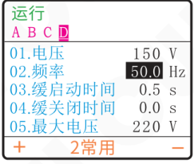

频率范围40.0~999.9Hz，默认50.0Hz，调整精度0.1Hz。

**本参数组的其他参数均可按照以上的操作步骤调节参数值。**


### 第 43 页

## 6.2.3 缓启动时间/缓关闭时间

**缓启动时间：** 控制器从停止状态启动时，输出电压从0V平滑升高到达设定输出电压所需要的时间称为缓启动时间。

缓启动时间范围0.0~10.0s，默认0.5s，调整精度0.1s。

**缓关闭时间：** 控制器从运行状态停止时，输出电压从设定输出电压平滑下降到达0V所需要的时间称为缓关闭时间。

缓关闭时间范围0.0~10.0s，默认0.0s，调整精度0.1s。

本控制器启动或停止时，输出电压可以平缓提高或降低，以防止振动设备遭受冲击而损坏。

## 6.2.4 最大电压/最小电压

**最大电压：** 控制器输出最大电压值。

最大电压范围0~220V，默认220V，调整精度1V。

**最小电压：** 控制器输出最小电压值。。

最小电压范围0~220V，默认0V，调整精度1V。

本控制器可以设置最大输出电压和最小输出电压限制值，可以防止用户误操作输出过大电压而损坏振动设备。

## 6.2.5 频率上限/频率下限

**频率上限：** 限制“频率”参数的上限值。

最大输出频率范围40.0~999.9Hz，默认999.9Hz，调整精度0.1Hz。

**频率下限：** 限制“频率”参数的下限值。

最低输出频率范围40.0~999.9Hz，默认40.0Hz，调整精度0.1Hz。


### 第 44 页

数字调频压电振动送料控制器  
SDVC402-S

---

## 6.2.6 熄屏时间

**熄屏时间：** 即背光熄灭时间，当控制器持续一段时间未进行任何操作，控制器将熄灭屏幕背光。通过按任意键可触发屏幕背光再次亮起。

熄屏时间范围 1~30 M（分钟），默认常开，调整精度 1 M（分钟）。

## 6.2.7 语言

**语言：** 即控制器操作面板显示语言。控制器内置中文和英文两种语言，方便不同地区用户进行切换。默认中文。

| 参数名 | 含义 |
|---|---|
| 英文 | 英文界面 |
| 中文 | 中文界面 |

---

2025-10　　-36-　　SDVC402SSMSCN_1.01


### 第 45 页

数字调频压电振动送料控制器　　　　　　　　　　　　　　　　　　　SDVC402-S

---

## 6.3 控制输出功能

本章节用于介绍控制器主输出参数和控制输出参数的设置及使用，实现控制器达到理想输出功能。

### 6.3.1 主输出参数

本小结主要介绍控制器主输出参数设置。

| 操作步骤 | 显示示意 |
|---|---|
| - 短按 `▶` 切换到 主输出参数组。<br><br>- 短按 `▲` 或 `▼`，切换主输出参数组中各参数。<br><br>- 通过 `+` 或 `−` 调整参数值。 | 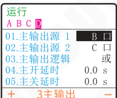 |

**本参数组的参数均可按照以上的操作步骤调节参数值。**

### 6.3.1.1 主输出源1/主输出源2

“主输出源1”和“主输出源2”是指“主输出第一信号源”和“主输出第二信号源”，可通过这两个参数分别设定主输出逻辑源信号。主输出源1和主输出源2信号先经过端口信号类型判断，然后经过逻辑方向判断，最后经过开延迟和关延迟后，成为主输出逻辑源1/2结果信号。

---

2025-10　　　　　　　　　　　　　　　-37-　　　　　　　　　　　　　　　SDVC402SSMSCN_1.01


### 第 46 页

数字调频压电振动送料控制器　　　　　　　　　　　　　　　　　　　SDVC402-S

信号流示意图如下：

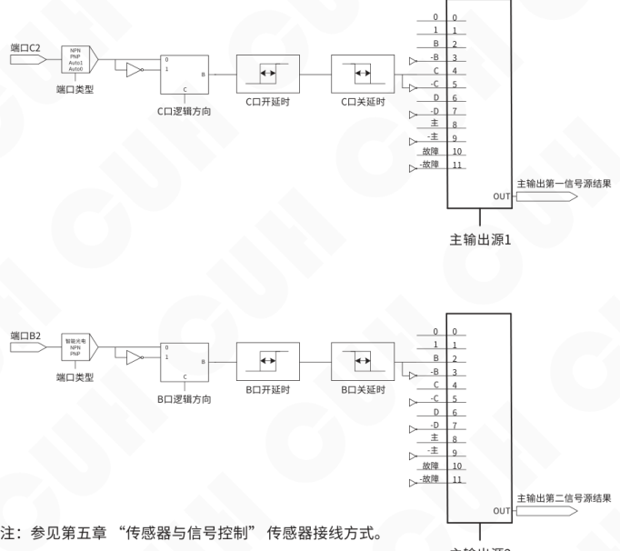

注：参见第五章“传感器与信号控制”传感器接线方式。

图 6.3.1.1

注：主输出状态也同时被启停键或控制器自身是否处于故障状态控制，启停键或控制器自身故障控制等级高于主输出逻辑信号。即：当启停按键为停止时，控制器会立即进入停止状态；当控制器出现短路、过温、过流等故障时也会立即进入停止状态。此时主输出逻辑信号也无法开启控制器的主输出。

2025-10　　　　　　　　　　　　-38-　　　　　　　　　　　　SDVC402SSMSCN_1.01


### 第 47 页

数字调频压电振动送料控制器　　　　　　　　　　　　　　　　　　　　　　　　　　　　SDVC402-S

---

## 6.3.1.2 主输出逻辑

主输出源1结果和主输出源2结果通过主输出逻辑进行逻辑运算后，经过主输出方向，然后经过主输出开延迟和关延迟，最后经过主输出模式后，用来驱动主输出启停状态。

信号流示意图如下：

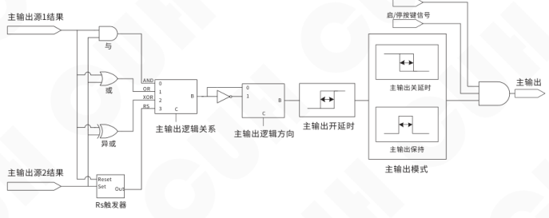

**图 6.3.1.2**

本控制器可以设定主输出源1和主输出源2的逻辑关系表如下，默认或：

| 参数名 | 含义 |
|---|---|
| 与 | 逻辑与，主输出源1和主输出源2都有效时输出无效 |
| 或 | 逻辑或，主输出源1或者主输出源2至少一个有效时输出无效 |
| 异或 | 逻辑异或，主输出源1和主输出源2状态不同时输出无效，反之有效 |
| RS | RS触发器 |

---

2025-10　　　　　　　　　　　　　　-39-　　　　　　　　　　　　　　SDVC402SSMSCN_1.01


### 第 48 页

### 6.3.1.3 主开延时/主关延时

当使用传感器等其他外部信号控制设备的主输出状态时，大多数情况需要在给出信号或者恢复信号后延迟一段时间才能执行操作。对于这样的应用，可以通过设置开延时和关延时的时间值来实现。信号流示意图参考图 6.3.1.2。

**主开延时：** 即主输出开延时，从施加一个使控制器进入运行状态的控制信号开始，到控制器实际的输出启动，期间经历的延迟时间称为开延时。

**主关延时：** 即主输出关延时，从施加一个使控制器进入停止状态的控制信号开始，到控制器实际的输出停止，期间经历的延迟时间称为关延时。

主开延时/主关延时范围 0.0~99.9s，默认 0.0s，调整精度 0.1s。

### 6.3.1.4 主输出模式

可选择 2 种主输出模式：延时模式、保持模式。信号流示意图参考图 6.3.1.2。默认延时。

| 参数名 | 含义 |
|---|---|
| 延时模式 | 指主输出逻辑运算后的状态，经过开延迟和关延迟后再驱动主输出的状态 |
| 保持模式 | 指主输出逻辑运算后的状态，经过开延迟后，保持停止状态的时间为关延迟时间，然后立即变为有输出状态 |

将两种模式的差别以时序图的形式表达如下，其中输入信号是逻辑关系选择器后输出的信号。

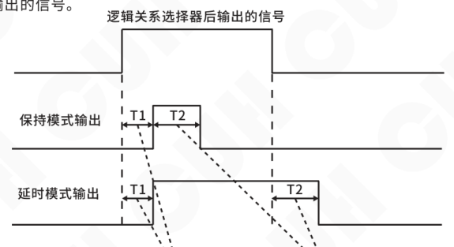


### 第 49 页

## 6.3.1.5 主输出方向

即主输出逻辑方向，信号经逻辑组合后可以设定具体输出方向。信号流示意图参考图 6.3.1.2。默认取反。

| 参数名 | 含义 |
|---|---|
| 同相 | 经过主输出逻辑运算后的状态不取反 |
| 取反 | 经过主输出逻辑运算后的状态取反 |
| 常开 | 经过主输出逻辑运算后的状态始终为运行 |
| 常关 | 经过主输出逻辑运算后的状态始终为停止 |

## 6.3.1.6 开机状态

设定控制器上电后的运行状态。默认开。

| 参数名 | 含义 |
|---|---|
| 开 | 设备上电后开关键的状态为运行 |
| 关 | 设备上电后开关键的状态为停止 |
| 保持 | 设备上电后开关键的状态保持为上次关机前的状态 |


### 第 50 页

数字调频压电振动送料控制器　　　　　　　　　　　　　　　　　SDVC402-S

## 6.3.2 控制输出参数

本小结主要介绍控制器控制输出参数设置。控制输出信号流示意图如下：

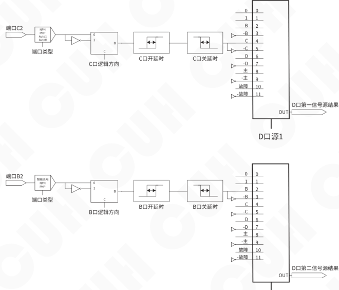

注：参见第五章 “传感器与信号控制” 传感器接线方式。

2025-10　　　　　　　　　-42-　　　　　　　　　SDVC402SSMSCN_1.01


### 第 51 页

数字调频压电振动送料控制器　　　　　　　　　　　　　　　　　　　　　　　　　SDVC402-S

---

D口源1结果和D口源2结果通过D口逻辑进行逻辑运算后，经过D口方向，然后经过D口开延迟和关延迟，经过D口模式，最后经过D口类型后，用来驱动控制输出启停状态。

信号流示意图如下：

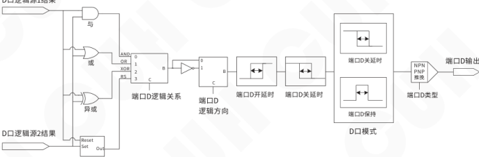

控制输出参数设置方法如下：

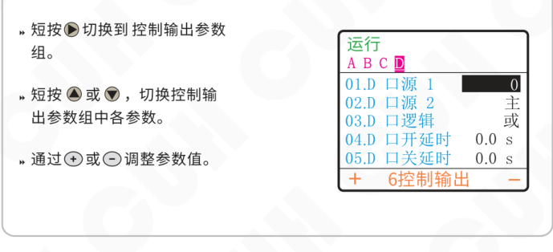

- 短按 ▶ 切换到控制输出参数组。
- 短按 ▲ 或 ▼，切换控制输出参数组中各参数。
- 通过 ＋ 或 － 调整参数值。

显示示意内容：

```text
运行
A  B  C  D
01.D 口源 1        0
02.D 口源 2        主
03.D 口逻辑         或
04.D 口开延时    0.0 s
05.D 口关延时    0.0 s
＋   6控制输出    －
```

本参数组的参数均可按照以上的操作步骤调节参数值。

“D口源1”、“D口源2”、“D口逻辑”、“D口方向”、“D口开延时”和“D口关延时”，以上参数均可参考主输出参数设置。

---

2025-10　　　　　　　　　　　　　　　　　-43-　　　　　　　　　　　　　　SDVC402SSMSCN_1.01


### 第 52 页

数字调频压电振动送料控制器　　　　　　　　　　　　　　　　　　　　　　　　　SDVC402-S

### 6.3.2.1 D口模式

D口输出可选择4种输出模式：延时模式、保持模式、周期信号输出模式1、周期信号输出模式2。默认延时。

| 参数名 | 含义 |
|---|---|
| 延时模式 | 指控制输出逻辑运算后的状态，经过开延迟和关延迟后再驱动控制输出的状态 |
| 保持模式 | 指控制输出逻辑运算后的状态，经过开延迟后，保持停止状态的时间为关延迟时间，然后立即变为有输出状态 |
| 周期1/周期2 | 高电平信号持续时间由控制输出“D口开延时”设定，低电平信号持续时间由控制输出“D口关延时”设定。 |

周期1模式下，开关键不可以停止控制输出。

周期2模式下，开关键可以直接停止控制输出。

将四种模式的差别以时序图的形式表达如下，其中输入信号是逻辑关系选择器后输出的信号。

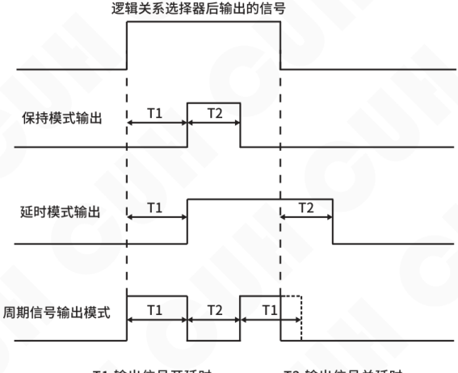

2025-10　　　　　　　　　　　　　　　　　-44-　　　　　　　　　　　　　　　SDVC402SSMSCN_1.01


### 第 53 页

## 6.3.2.2 D口类型

D口输出可以支持NPN输出、PNP输出和推挽输出三种类型。默认推挽。

| 参数名 | 含义 |
|---|---|
| Ou_NPN | 在端口D输出信号有效时，端口D输出低电平信号(0V)，<br>无效时为高阻 |
| Ou_PNP | 在端口D输出信号有效时，端口D输出高电平信号(24V)，<br>无效时为高阻 |
| Ou_P&P(推挽) | 在端口D输出信号有效时，端口D输出高电平信号(24V)<br>在端口D输出信号无效时，端口D输出低电平信号(0V) |

图示如下：

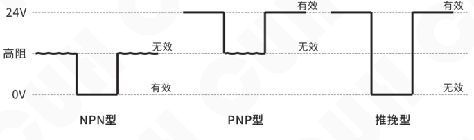


### 第 54 页

数字调频压电振动送料控制器　　　　　　　　　　　　　　　　　　　　　　　　　SDVC402-S

---

## 6.4 信号控制功能

控制器可以通过外接传感器判断振动盘内物料状态，实现控制器的“料满停机”还是“料空停机”。端口信号流示意图如下：

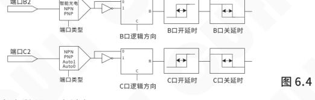

智能光电参数设置方法如下：

- 短按 ▶ 切换到智能光电参数组。
- 短按 ▲ 或 ▼，切换智能光电参数组中各参数。
- 通过 ＋ 或 － 调整参数值。

**智能光电参数组显示示例**

运行　A B C D

| 序号 | 参数 | 参数值 |
|---|---|---|
| 01 | B口阈值 | 80 |
| 02 | B口方向 | 常通 |
| 03 | B口开延时 | 0.2 s |
| 04 | B口关延时 | 0.2 s |

＋　4智能光电　－

料满停机参数设置方法如下：

- 短按 ▶ 切换到料满停机参数组。
- 短按 ▲ 或 ▼，切换料满停机参数组中各参数。
- 通过 ＋ 或 － 调整参数值。

**料满停机参数组显示示例**

运行　A B C D

| 序号 | 参数 | 参数值 |
|---|---|---|
| 01 | C口类型 | Auto0 |
| 02 | C口方向 | 常通 |
| 03 | C口开延时 | 0.2 s |
| 04 | C口关延时 | 0.2 s |

＋　5料满停机　－

本参数组的参数均可按照以上的操作步骤调节参数值。

---

2025-10　　　　　　　　　　　　　　　-46-　　　　　　　　　　　　　　　SDVC402SSMSCN_1.01


### 第 55 页

## 6.4.1 B口阈值

控制器可以设置B口信号类型为1~1000（智能光电信号输入阈值）、“NPN”型和“PNP”型开关传感器。默认80。

| 参数名 | 含义 |
|---|---|
| 1~1000 | B口接入智能光电信号，信号阈值范围1~1000，数值越小表示能够识别光信号强度越弱，发射和接收端口间隔可以越远。 |
| NPN | NPN型传感器 |
| PNP | PNP型传感器 |

## 6.4.2 B口方向/C口方向

此参数用于切换控制器输入端口B和输入端口C是“料满停机”还是“料空停机”。默认常通。

在出厂默认设置下输入端口B/端口C没有收到任何信号时，控制器处于“运行”状态（即料满停机）。一些特殊的应用需要在端口B/端口C没有收到任何信号时，控制器处于“停止”状态（即料空停机）。可以通过修改本参数来实现。信号流示意图参考图6.4。

| 参数名 | 含义 |
|---|---|
| 常通 | 没有控制信号时，控制器处于运行状态（料满停机） |
| 常断 | 没有控制信号时，控制器处于停止状态（料空停机） |

## 6.4.3 B口开延时/B口关延时和C口开延时/C口关延时

从施加一个使控制器进入运行状态的信号开始到此信号被控制器视为有效，期间的延迟时间称为开延时。

从施加一个使控制器进入停止状态的信号开始到此信号被控制器视为有效，期间的延迟时间称为关延时。信号流示意图参考图6.4。

开/关延时范围0.0~99.9s，默认0.2s，调整精度0.1s。

**注：** 当使用端口B、C进行启动/停止控制时，如果需要在收到信号后延迟一段时间才执行操作，以确保信号是稳定的，可以通过设置开延时和关延时来实现。


### 第 56 页

数字调频压电振动送料控制器　　　　　　　　　　　　　　　　　　　　　　　　　SDVC402-S

---

## 6.5 用户参数保存功能

本章节主要介绍如何使用控制器的参数存储及调用参数功能。

### 6.5.1 读出参数

控制器可以读出除工作组以外的3套不同的预置参数，分别命名为“用户组1”、“用户组2”、“用户组3”。默认无效。

当用户修改参数后，控制器的参数默认保存在工作组，当控制器重新上电后，将自动从工作组中读出参数，恢复上次关机前的参数值。同时用户可以手动从“用户组1”、“用户组2”、“用户组3”读出用户手动保存的另外3组数据到控制器内的工作组，使控制器立即切换工作状态。

| 参数名 | 含义 |
|---|---|
| 无效 | 无效 |
| 用户组1 | 用户设定参数1 |
| 用户组2 | 用户设定参数2 |
| 用户组3 | 用户设定参数3 |

### 6.5.2 保存参数

控制器可以保存4套不同的预置参数，分别名为“工作组”、“用户组1”、“用户组2”、“用户组3”。默认无效。

当用户修改参数后，控制器的参数默认自动保存在“工作组”内，当控制器重新上电后，将自动从工作组中读出参数，恢复上次关机前的参数值。用户可以手动将工作组中的参数保存到“用户组1”、“用户组2”、“用户组3”中。

| 参数名 | 含义 |
|---|---|
| 无效 | 无效 |
| 工作组 | 默认工作组 |
| 用户组1 | 用户设定参数1 |
| 用户组2 | 用户设定参数2 |
| 用户组3 | 用户设定参数3 |

---

2025-10　　　　　　　　　　　　　　　　　-48-　　　　　　　　　　　　　　　SDVC402SSMSCN_1.01


### 第 57 页

数字调频压电振动送料控制器　　　　　　　　　　　　　　　　　　　　　　　　　SDVC402-S

### 6.5.3 复位参数

使用复位参数，将工作组参数全部恢复到出厂默认值。默认无效。

“复位参数”选中“工作组”后，同时长按 ⊕ 和 ⊖ 两秒以上，显示界面切换到待机界面，此时恢复参数成功。

| 参数名 | 含义 |
|---|---|
| 无效 | 无效 |
| 工作组 | 将工作组参数恢复至出厂设置。（用户组1、用户组2和用户组3不做恢复） |

### 6.5.4 本机标识和标识编号

**本机标识：** 用于在主页上显示本机的标识。

本机标识可选项为“圆振”、“直振”、“料仓”，默认无。

**标识编号：** 用于编号本机。

标识编号的选择范围1~1000，默认无。

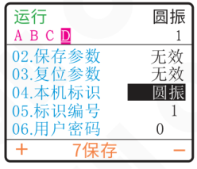

### 6.5.5 用户密码

用户可以自行设置参数密码，锁定后用户仅可在“输入密码”和“主页”下进行操作。

当用户设置了非0的“用户密码”时，表示启用高级参数锁功能，此时在主页要进入参数组时就需要输入密码。用户“输入密码”后，同时长按 ⊕ 和 ⊖ 两秒以上，确认输入的密码。只有密码正确后才能进入其它参数组。

用户密码的选择范围0~9999，默认0。

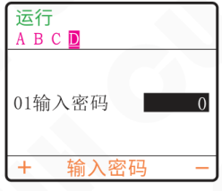

2025-10　　　　　　　　　　　　　　　　-49-　　　　　　　　　　　　　　　　SDVC402SSMSCN_1.01


### 第 58 页

数字调频压电振动送料控制器　　　　　　　　　　　　　　　　　SDVC402-S

## 6.6 系统运行监控功能

在监控参数组内可以实时读取控制器运行状态及参数值。

可读取参数条目参考《参数列表》章节，参数组八，监控参数组。

**监控界面示意：**

| 状态/项目 | 数值 |
|---|---:|
| 运行 |  |
| A B C D |  |
| 01.温度 | 50 ℃ |
| 02.输出电流 | 20 mA |
| 03.遥控输入 | 0.5 V |
| 04.B口信号值 | 100 |
| 05.电压-C口 | 0.5 V |
| +　8监控　- |  |

2025-10　　　　　　　　　　　　　　　　　-50-　　　　　　　　　　　　　　　　　SDVC402SSMSCN_1.01


### 第 59 页

# 第七章 附录

## 7.1 外形尺寸图

单位：毫米（mm）


| 公差区间 | 公差值 |
|---|---:|
| 0~3 | ±0.05 |
| 3~10 | ±0.1 |
| 10~30 | ±0.15 |
| 30~80 | ±0.2 |
| 80~180 | ±0.3 |
| >180 | ±0.5 |

本系列产品均适用此公差表。


### 第 60 页

数字调频压电振动送料控制器　　　　　　　　　　　　　　　SDVC402-S

## 7.2 技术规格表

| 项目 | 最小值 | 典型值 | 最大值 | 单位 | 备注 |
|---|---:|---:|---:|---|---|
| 输入电压 | 85 | 220 | 250 | 伏特（V） | 交流有效值 |
| 输出电压调整范围 | 0 | —— | 220 | 伏特（V） | 交流有效值 |
| 电压调整精度 |  | 1 |  | 伏特（V） |  |
| 输出电流调整范围 | 0 | —— | 150 | 毫安（mA） |  |
| 输出功率 | 0 | —— | 33 | 伏安（VA） |  |
| 输出频率 | 40.0 | —— | 999.9 | 赫兹（Hz） |  |
| 频率调整精度 |  | 0.1 |  | 赫兹（Hz） |  |
| 输出电流波形 |  | 正弦 |  |  |  |
| 缓启动时间 | 0 | —— | 10.0 | 秒（s） | 出厂默认0.5 |
| 延迟时间范围 | 0.0 | —— | 99.9 | 秒（s） | 出厂默认0.2 |
| 延迟时间精度 |  | 0.1 |  | 秒（s） |  |
| 过热保护温度 | 60 | 65 | 65 | 摄氏度（℃） |  |
| 直流控制输出电流 | 0 | —— | 350 | 毫安（mA） |  |
| 直流控制输出电压 | 22 | 24 | 26 | 伏特（V） |  |
| 模拟控制信号 |  | 1~5 |  | 伏特（V） | 远程速度控制电压 |
|  |  | 4~20 |  | 毫安（mA） | 远程速度控制电流 |
| 数字控制信号 |  | 24 |  | 伏特（V） | 开关信号控制 |
| 调整方式 |  | 7 |  | 键（button） |  |
| 空载功耗 | —— | —— | 5 | 瓦特（W） |  |
| 显示方式 |  | 160*128 |  |  | 点阵屏 |
| 防护等级 |  | IP20 |  |  |  |
| 工作环境温度 | 0 | 25 | 40 | 摄氏度（℃） |  |
| 工作环境湿度 | 10 | 60 | 85 | 相对湿度（%） | 不结露 |
| 存储环境温度 | -20 | 25 | 85 | 摄氏度（℃） |  |

2025-10　　　　　　　　　　-52-　　　　　　　　　　SDVC402SSMSCN_1.01


### 第 61 页

数字调频压电振动送料控制器　　　　　　　　　　　　　　　　　　　　　　　　　SDVC402-S

## 7.3 参考标准

| 极限参数：超过此指标将会造成严重损坏，必须严格遵守！ ||||||
|---|---|---|---|---|---|
| 项目 | GB 标准 | IEC 标准 | 等级 | 标准要求 | 备注说明 |
| 静电放电 | GB/T 17626.2-2006 | IEC 61000-4-2:2001 | 4 | ±8 kV | 接触放电 |
|  |  |  | 4 | ±15 kV | 空气放电 |
| 电快速瞬变<br>脉冲群 | GB/T 17626.4-2008 | IEC 61000-4-4:2004 | 4 | ±4 kV |  |
| 直流电源纹<br>波抗扰度 | GB/T 17626.17-2005 | IEC 61000-4-17:2002 | 4 | 15% | 评价 A |

> **警告**  
> 在民用环境中，本产品可能产生无线电干扰。在这种情况下，可能需要采取附加抑制措施。

2025-10　　　　　　　　　　　　　　　　　-53-　　　　　　　　　　　　　　　　SDVC402SSMSCN_1.01


### 第 62 页

数字调频压电振动送料控制器　　　　　　　　　　　　　　　　　　　　　　　　　SDVC402-S

## 7.4 参数列表

| 参数组 | 参数名 | 显示参数 | 取值范围/枚举项 | 默认值 |
|---|---|---|---|---|
| 参数组一<br>界面<br>参数组 | 监测项目一 | 监测项 1 | 参数组二~参数组八 | 电压 |
|  | 监测项目二 | 监测项 2 | 参数组二~参数组八 | 频率 |
|  | 监测项目三 | 监测项 3 | 参数组二~参数组八 | 输出电流 |
|  | 监测项目四 | 监测项 4 | 参数组二~参数组八 |  |
|  | 监测项目五 | 监测项 5 | 参数组二~参数组八 |  |
|  | 监测项目六 | 监测项 6 | 参数组二~参数组八 |  |
|  | 监测项目七 | 监测项 7 | 参数组二~参数组八 |  |
|  | 监测项目八 | 监测项 8 | 参数组二~参数组八 |  |
|  | 监测项目九 | 监测项 9 | 参数组二~参数组八 |  |
|  | 监测项目十 | 监测项 10 | 参数组二~参数组八 |  |
|  | 监测项目十一 | 监测项 11 | 参数组二~参数组八 |  |
|  | 监测项目十二 | 监测项 12 | 参数组二~参数组八 |  |
|  | 监测项目十三 | 监测项 13 | 参数组二~参数组八 |  |
|  | 监测项目十四 | 监测项 14 | 参数组二~参数组八 |  |
|  | 监测项目十五 | 监测项 15 | 参数组二~参数组八 |  |
|  | 监测项目十六 | 监测项 16 | 参数组二~参数组八 |  |
| 参数组二<br>常用<br>参数组 | 用户设定电压 | 01.电压 | 0~220 V | 150 |
|  | 用户设定频率 | 02.频率 | 40.0~999.9 Hz | 50.0 |
|  | 缓启动时间 | 03.缓启动时间 | 0.0~10.0 s | 0.5 |
|  | 缓关闭时间 | 04.缓关闭时间 | 0.0~10.0 s | 0.0 |
|  | 最大输出电压 | 05.最大电压 | 0~220 V | 220 |
|  | 最小输出电压 | 06.最小电压 | 0~220 V | 0 |
|  | 频率上限 | 07.频率上限 | 40.0~999.9 Hz | 999.9 |
|  | 频率下限 | 08.频率下限 | 40.0~999.9 Hz | 40.0 |
|  | 熄屏时间 | 09.熄屏时间 | 常开，1~30 M（分钟） | 常开 |
|  | 语言 | 10.语言 | 中文，英文 | 中文 |
| 参数组三<br>主输出<br>参数组 | 主输出第一信号源 | 01.主输出源1 | 0, 1, b口, -b口, C口, -C口, D口, -D口, 主, -主, 故障, -故障 | b口 |
|  | 主输出第二信号源 | 02.主输出源2 | 0, 1, b口, -b口, C口, -C口, D口, -D口, 主, -主, 故障, -故障 | C口 |
|  | 主输出逻辑关系 | 03.主输出逻辑 | 与，或，异或，RS | 或 |
|  | 主输出开延时 | 04.主开延时 | 0.0~99.9 s | 0.0 |
|  | 主输出关延时 | 05.主关延时 | 0.0~99.9 s | 0.0 |
|  | 主输出模式 | 06.主输出模式 | 延时，保持 | 延时 |
|  | 主输出逻辑方向 | 07.主输出方向 | 同相，取反，常开，常关 | 取反 |
|  | 开机状态 | 08.开机状态 | 开，关，保持 | 开 |

2025-10　　　　　　　　　　　　　　　　　　　　-54-　　　　　　　　　　　　　　　　　　　　SDVC402SSMSCN_1.01


### 第 63 页

数字调频压电振动送料控制器　　　　　　　　　　　　　　　　　　　　　　　　　SDVC402-S

|  | 参数名 | 显示参数 | 取值范围/枚举项 | 默认值 |
|---|---|---|---|---|
| 参数组四<br>智能光电<br>参数组 | 智能光电灵敏度 | 01.B口阈值 | PNP, NPN, 1~1000 | 80 |
|  | 智能光电B逻辑方向 | 02.B口方向 | 常通，常断 | 常通 |
|  | 智能光电B开延时 | 03.B口开延时 | 0.0~99.9 s | 0.2 |
|  | 智能光电B关延时 | 04.B口关延时 | 0.0~99.9 s | 0.2 |
| 参数组五<br>料满停机<br>参数组 | C口传感器类型 | 01.C口类型 | NPN, PNP, Auto1, Auto0 | Auto0 |
|  | 端口C逻辑方向 | 02.C口方向 | 常通，常断 | 常通 |
|  | 端口C开延时 | 03.C口开延时 | 0.0~99.9 s | 0.2 |
|  | 端口C关延时 | 04.C口关延时 | 0.0~99.9 s | 0.2 |
| 参数组六<br>控制输出<br>参数组 | D口第一信号源 | 01.D口源1 | 0, 1, b口, -b口, C口, -C口, D口, -D口, 主, -主, 故障, -故障 | 0 |
|  | D口第二信号源 | 02.D口源2 | 0, 1, b口, -b口, C口, -C口, D口, -D口, 主, -主, 故障, -故障 | 主 |
|  | 端口D逻辑关系 | 03.D口逻辑 | 与，或，异或，RS | 或 |
|  | 端口D开延时 | 04.D口开延时 | 0.0~99.9 s | 0.0 |
|  | 端口D关延时 | 05.D口关延时 | 0.0~99.9 s | 0.0 |
|  | 控制输出模式 | 06.D口模式 | 延时，保持，周期1，周期2 | 延时 |
|  | 端口D逻辑方向 | 07.D口方向 | 同相，取反，常开，常关 | 同相 |
|  | 控制输出类型 | 08.D口类型 | Ou_NPN, Ou_PNP, Ou_P&P | Ou_NPN |
| 参数组七<br>保存<br>参数组 | 从用户组读出参数 | 01.读出参数 | 无效，用户组1，用户组2，用户组3 | 无效 |
|  | 将当前参数保存到用户组 | 02.保存参数 | 无效，工作组，用户组1，用户组2，用户组3 | 无效 |
|  | 复位工作组参数 | 03.复位参数 | 无效，工作组 | 无效 |
|  | 本机标识 | 04.本机标识 | 无，圆振，直振，料仓 | 无 |
|  | 标识编号 | 05.标识编号 | 无，1~1000 | 无 |
|  | 用户密码 | 06.用户密码 | 0~9999 | 0 |
| 参数组八<br>监控<br>参数组 | 温度显示 | 01.温度 | -20~85 ℃ | —— |
|  | 输出电流 | 02.输出电流 | 0.0~150 mA | —— |
|  | 模拟调速A口电压 | 03.遥控输入 | 0.0~5.0 V | —— |
|  | B口信号值 | 04.B口信号值 | 0~999 | —— |
|  | C口信号电压 | 05.电压-C口 | 0.0~26.0 V | —— |
|  | D口输出电压 | 06.电压-D口 | 0.0~26.0 V | —— |
|  | 5V电压 | 07.5V电压 | 0.0~6.0 V | —— |
|  | 24V电压 | 08.24V电压 | 0.0~26.0 V | —— |
|  | 控制板软件版本 | 09.版本号 | 0~99.99 | —— |

|  | 参数名 | 显示参数 | 取值范围/枚举项 | 默认值 |
|---|---|---|---|---|
| 输入密码<br>界面 | 输入密码 | 01输入密码 | 0~9999 | 0 |

2025-10　　　　　　　　　　　　　　　　　-55-　　　　　　　　　　　　　　　　　SDVC402SSMSCN_1.01


### 第 64 页

数字调频压电振动送料控制器　　　　　　　　　　　　　　　　　　　　　　　　　SDVC402-S

## 7.5 输入输出电路图


### 遥控调速A端口

| 端子 | 功能 |
|---|---|
| A3 | +5V |
| A2 | 输入 |
| A1 | 电阻地 |

### 智能光电B端口

| 端子 | 功能 |
|---|---|
| B4 | 发射 |
| B3 | 地线 |
| B2 | 接收 |
| B1 | 地线 |

注：光电或NPN：+5V；PNP：0V。

### 料满停机C端口

| 端子 | 功能 |
|---|---|
| C3 | 24V输出 |
| C2 | 输入 |
| C1 | 地线 |

### 控制输出D端口

| 端子 | 功能 |
|---|---|
| D2 | 24V输出 |
| D1 | 输出 |
| D3 | 地线 |

2025-10　　　　　　　　　　　　　　　　　-56-　　　　　　　　　　　　　　　　　SDVC402SSMSCN_1.01


### 第 65 页

数字调频压电振动送料控制器　　　　　　　　　　　　　　　　　　　　　　　　　SDVC402-S

## 7.6 故障与警告信息

| 故障显示 | 排除方法 |
|---|---|
| 短路 | 确认主输出线是否短路并重新接线 |
| 过流 | 减小输出电压或者提高输出频率 |
| 过热 | 把控制器置于通风良好散热的地方 |
| 过冷 | 把控制器置于环境温度高于-20℃的地方 |
| 温度错误 | 联系公司技术支持 |
| D口过流 | 确保D口负载未短路且电流未超过350mA，然后尝试重新启动输出 |
| 24V错误 | 确保24V输出未被短路或超过400mA电流 |
| 5V错误 | 确保调速端口A3的5V输出未被短路或接入高于5V的电压 |
| 主RS错误 | 确保RS触发器两个输入信号不同时有效 |
| D口RS错误 | 确保RS触发器两个输入信号不同时有效 |

2025-10　　　　　　　　　　　　　　-57-　　　　　　　　　　　　　　SDVC402SSMSCN_1.01


### 第 66 页

数字调频压电振动送料控制器　　　　　　　　　　　　　　　　　　　　　　　SDVC402-S

---

# 第八章 产品质保信息

## 8.1 质保期

本公司为本产品提供的质保期为三年，从产品发送到购买方指定地点之日算起。

## 8.2 保修范围

（一）如果在上述质保期内出现本公司造成的故障，我们将免费维修产品。但是以下情况不属于保修范围：

&nbsp;&nbsp;&nbsp;&nbsp;a、未按照简易说明书、用户手册或购买方与本公司专门达成的技术要求中规定的条件、环境下的不正确操作，或不正确使用造成的故障。

&nbsp;&nbsp;&nbsp;&nbsp;b、故障不是因产品缺陷，而是购买方设备或软件设计造成的。

&nbsp;&nbsp;&nbsp;&nbsp;c、非本公司人员进行的修改或修理而造成的故障。

&nbsp;&nbsp;&nbsp;&nbsp;d、按照简易操作指南或用户手册正确维修或更换易损部件等规定可以完全避免的故障。

&nbsp;&nbsp;&nbsp;&nbsp;e、产品从本公司发货后，因无法预料的科学技术水平变化等因素而造成的故障。

&nbsp;&nbsp;&nbsp;&nbsp;f、由于火灾、地震、洪水等自然灾害，或异常电压等外部因素造成的故障，本公司不负责保修。

（二）保修范围仅限于（一）中规定的情况，本公司对该设备造成的购买方间接损失（如设备损坏、机会丧失、利润损失等）或其他损失，不承担任何责任。

## 8.3 产品适用性

本公司的该控制器是针对振动送料行业的通用产品而设计生产的。因此，本公司的该控制器不得用于下列应用且不适合其使用。

（一）对生命和财产有严重影响的设施，如核发电厂、机场、铁路、轮船、机动装置及医疗设备。

（二）公共事业，包括电力、气体、供水等。

（三）相似条件或环境的户外使用。

---

2025-10　　　　　　　　　　　　　　-58-　　　　　　　　　　　　　　SDVC402SSMSCN_1.01


### 第 67 页

*（本页 `page_markdown` 为空。）*


### 第 68 页


南京创优科技有限责任公司  
网址:www.cuhnj.com  
电话:400-985-8889  
传真:025-84730426  
邮箱:sales@cuhnj.com  
地址:南京市江宁区智能路9号  
启迪城学研园2幢

文档编号: IDP1000512
<!-- /auto:ai-body-draft v1 -->

<!-- auto:data-params-summary v1 -->
## 附录 · 参数表（结构化侧车·机器生成）

> 说明：本节由 `data/<doc_key>/params/params.yaml` 自动渲染（展示前若干行），用于校对与二次开发。定稿以层 C 数据为准。

| 参数 | 标志/符号 | 范围 | 默认 | 单位 | 备注 |
| --- | --- | --- | --- | --- | --- |
| <br> <br>**危险** |  |  |  |  |  |
| <br> <br>**警告** |  |  |  |  |  |
| <br> <br>**小心** |  |  |  |  |  |
| <br>**注意** |  |  |  |  |  |
| <br>参数名 |  |  |  |  |  |
| <br>英文 |  |  |  |  |  |
| <br>中文 |  |  |  |  |  |
| <br>与 |  |  |  |  |  |
| <br>或 |  |  |  |  |  |
| <br>异或 |  |  |  |  |  |
| <br>RS |  |  |  |  |  |
| <br>延时模式 |  |  |  |  |  |
| <br>同相 |  |  |  |  |  |
| <br>取反 |  |  |  |  |  |
| <br>常开 |  |  |  |  |  |
| <br>常关 |  |  |  |  |  |
| <br>开 |  |  |  |  |  |
| <br>关 |  |  |  |  |  |
| <br>保持 |  |  |  |  |  |
| <br>Ou_NPN |  |  |  |  |  |
| <br>Ou_PNP |  |  |  |  |  |
| <br>Ou_P&P(推挽) |  |  |  |  |  |
| <br>1~1000 |  |  |  |  |  |
| <br>NPN |  |  |  |  |  |
| <br>PNP |  |  |  |  |  |
| 常通 |  |  |  |  |  |
| <br>无效 |  |  |  |  |  |
| <br>用户<br>1<br>组 |  |  |  |  |  |
| <br>用户<br>2<br>组 |  |  |  |  |  |
| <br>用户<br>3<br>组 |  |  |  |  |  |

*（仅展示前 30 条，共 145 条；完整数据见下方链接。）*

- 完整 YAML：`data/cuh.sdvc40.manual.v0.0/params/params.yaml`
- 表格索引：`data/cuh.sdvc40.manual.v0.0/index.yaml`
<!-- /auto:data-params-summary v1 -->
