## 目录

> 下列条目来自 PDF 内置书签/大纲；链接指向本批转换生成的整页渲染图（`assets/pages/`），便于与原版 PDF 对照校对。

- [1: 封面](assets/pages/page-0001.png)（第 1 页）
- [2: 封2](assets/pages/page-0002.png)（第 2 页）
- [3: 序言](assets/pages/page-0003.png)（第 3 页）
- [4: 注意事项](assets/pages/page-0004.png)（第 4 页）
- [5: 工作与存储环境](assets/pages/page-0005.png)（第 5 页）
- [7: 目录](assets/pages/page-0007.png)（第 7 页）
- [目录2](assets/pages/page-0008.png)（第 8 页）
- [第一章 性能特点](assets/pages/page-0009.png)（第 9 页）
- [第二章 快速安装及使用指南](assets/pages/page-0011.png)（第 11 页）
- [第三章 部件说明](assets/pages/page-0015.png)（第 15 页）
- [第四章 功能说明](assets/pages/page-0017.png)（第 17 页）
  - [4.1 输出电压设定](assets/pages/page-0017.png)（第 17 页）
  - [4.2 输出频率设定](assets/pages/page-0018.png)（第 18 页）
  - [4.3 缓启动功能](assets/pages/page-0019.png)（第 19 页）
  - [4.4 输出开关](assets/pages/page-0019.png)（第 19 页）
  - [4.5 最大输出电压限制功能](assets/pages/page-0020.png)（第 20 页）
  - [4.6 键盘锁定功能](assets/pages/page-0021.png)（第 21 页）
  - [4.7 开机运行状态设定](assets/pages/page-0022.png)（第 22 页）
  - [4.8 恢复出厂设定](assets/pages/page-0023.png)（第 23 页）
- [第五章 传感器与信号控制](assets/pages/page-0024.png)（第 24 页）
  - [5.1 智能光电传感功能](assets/pages/page-0024.png)（第 24 页）
    - [5.1.1 智能光电传感器接线方法](assets/pages/page-0024.png)（第 24 页）
    - [5.1.2 智能光电传感器开延时、关延时时间的设定](assets/pages/page-0025.png)（第 25 页）
    - [5.1.3 智能光电传感逻辑方向设定](assets/pages/page-0026.png)（第 26 页）
  - [5.2三线NPN型开关传感器（料满停机）的使用方法](assets/pages/page-0027.png)（第 27 页）
    - [5.2.1 三线NPN型接近开关传感器接线方法](assets/pages/page-0027.png)（第 27 页）
    - [5.2.2 对射NPN型传感器接线方法](assets/pages/page-0028.png)（第 28 页）
    - [5.2.3 对射光电传感器接线方法](assets/pages/page-0028.png)（第 28 页）
    - [5.2.4 对射式光纤传感器接线方法](assets/pages/page-0029.png)（第 29 页）
    - [5.2.5 反射光电传感器接线方法](assets/pages/page-0030.png)（第 30 页）
  - [5.3 三线NPN型开关传感器开延时、关延时时间设定](assets/pages/page-0031.png)（第 31 页）
  - [5.4 三线NPN型开关传感器（料满停机）逻辑方向设定](assets/pages/page-0032.png)（第 32 页）
  - [5.5 控制信号逻辑关系设定](assets/pages/page-0033.png)（第 33 页）
  - [5.6 PLC 控制振动送料控制器启停的接线方法](assets/pages/page-0034.png)（第 34 页）
  - [5.7 控制输出功能](assets/pages/page-0035.png)（第 35 页）
    - [5.7.1 控制输出连接方法](assets/pages/page-0035.png)（第 35 页）
    - [5.7.2 控制输出逻辑方向设定](assets/pages/page-0036.png)（第 36 页）
    - [5.7.3 主控分离参数](assets/pages/page-0037.png)（第 37 页）
  - [5.8 远程速度控制](assets/pages/page-0038.png)（第 38 页）
- [第六章 安全保护功能](assets/pages/page-0039.png)（第 39 页）
- [附录A](assets/pages/page-0040.png)（第 40 页）
- [附录B](assets/pages/page-0041.png)（第 41 页）
- [附录C](assets/pages/page-0042.png)（第 42 页）
- [附录D](assets/pages/page-0044.png)（第 44 页）
- [附录E](assets/pages/page-0045.png)（第 45 页）
- [附录F](assets/pages/page-0047.png)（第 47 页）
## 术语与命名

- 侧车：`glossary/terms.yaml`（机读）、`glossary/zh-CN.md`（人读）；候选表，定稿后并入公司级 `glossary/`。

## 适用范围

- 本文档由 PDF 自动转换生成，正文与插图需人工核对。

## 变更记录

- 2026-06-05 23:15:59：由转换工具从源 PDF 生成首版。

## 正文

<!-- auto:ai-body-draft v1 -->
> 以下为**整页视觉转写**的正文草稿（多模态模型直接输出 Markdown，含 GFM 表； 若配置 `[[vcrop:页:序]]` 占位符，裁剪步骤会插入 `assets/images/` 下 PNG）。**请务必人工校对。**

### 第 1 页

# CUH®

## 数字调频压电振动送料控制器

**Variable Frequency Digital Controller for Piezo Vibratory Feeder**

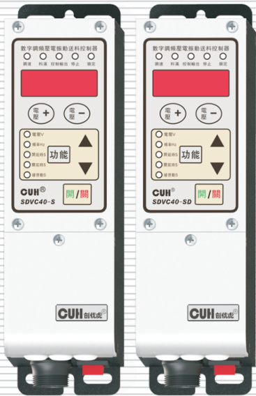

## SDVC40 系列

# 用户手册

### 第 2 页

数字调频压电振动送料控制器　　　　　　　　　　　　　　　　　　　　　　　　　SDVC40 系列

---

## 版权说明

南京创优科技有限责任公司保留所有权利。

本用户手册上包含的所有信息是属于本公司的知识，受著作权法及所有法律的保护。本公司根据著作权法及其他法律享有并保留所有著作权和其他法律赋予的权利，未经本公司书面同意不得以任何形式对本用户手册的部分或全部进行抄袭、翻译、转译、仿制或其他利用。

## 免责声明

本用户手册的所有内容仅说明本公司生产的相关产品的使用方法，并且是根据现有技术和提供给您使用时的状态进行描述的，在您使用本产品时必须自行承担相关风险。除法律强制规定外，本公司不因本用户手册对产品负有任何明示或暗示的责任，包括但不限于人身伤害、财产损失、机会丧失。

您明确了解上述风险并同意，除法律强制规定外，本公司无须为您的任何直接、间接的损害或损失负责（包括但不限于人员、财物、数据等有形损失和名誉、机会等无形损失）。

本公司保留对本用户手册中所适用的产品进行修改而不预先及事后通知的权利。

---

2024-03　　　　　　　　　　　　　　　　　　　　　　　　　　　　　　　SDVC40SMSCN_4.01

### 第 3 页

数字调频压电振动送料控制器　　　　　　　　　　　　　　　　　　　　　　　　　SDVC40 系列

---

# 序　言

感谢您选用我公司出品的 **CUH** 品牌 SDVC 系列振动送料控制器（本手册以下简称控制器）。

本手册提供使用者安装调试、参数设定、异常诊断、故障排除及日常维护控制器的相关注意事项。为了确保能够正确安装及操作本控制器，请在装机之前，详细阅读本用户手册，并请妥善保存。

本说明书适合以下型号控制器：

◆ 数字调频压电振动送料控制器-SDVC40-S（输出220V，150mA）

◆ 数字调频压电振动送料控制器-SDVC40-SD（输出50V，600mA）

---

2024-03　　　　　　　　　　　　　　　　　　　　　　　　　　　　　SDVC40SMSCN_4.01

### 第 4 页

数字调频压电振动送料控制器　　　　　　　　　　　　　　　　　　　　　　　　　SDVC40 系列

---

## 以下为特别需要注意的事项：

1、任何情况下都不可以在带电状态下拔插接线或试图触摸插座内各接点，以防触电和发生意外。

2、切不可将控制器连接到380V交流电，这将造成控制器不可恢复的严重损坏！（如需工作在380V电压下，请选购支持380V的产品。）

3、严禁通过继电器等设备切断供电的方式来控制本控制器输出的启动和停止，这将严重降低控制器寿命。

4、任何情况下请勿让控制器在超越控制器其设计极限的状态下工作。

5、请严格按照本用户手册操作，对于不按照本用户手册操作所造成的任何设备或人身伤害，本公司不承担任何民事和刑事责任。

> **注意**
>
> 1、任何情况下都不得打开控制器机壳，以防遭电击。
>
> 2、机壳内全部为固态电路，没有可以调节的部件和用户可以自行维修的部分，请不要试图维修控制器。
>
> 3、如控制器出现故障，请致电本公司，我们将尽快协助您排除故障。

---

2024-03　　　　　　　　　　　　　　　　　　　　　　　　　　　　　　　SDVC40SMSCN_4.01

### 第 5 页

数字调频压电振动送料控制器　　　　　　　　　　　　　　　　SDVC40 系列

---

# 工作与储存环境

## 一、使用前的检查

每台控制器在出厂前，均经过严格的品质检验，并经过强化的防撞包装处理。客户在拆箱后，请即刻进行下列检查：

1、检查控制器是否在运输过程中受到损伤。

2、检查控制器型号是否与订货登记资料完全相同。

## 二、工作环境

为使本控制器具有更好的使用效果和更长的使用寿命，请将控制器安装在符合下列条件的环境中：

- 良好的通风散热环境
- 远离水滴、蒸气、灰尘，（特别是油性灰尘）
- 无腐蚀、易燃性的气体、液体
- 无漂浮性的尘埃及金属微粒
- 安装表面坚固无振动
- 远离电磁噪声干扰
- 使用环境温度为0℃到40℃
- 仅适用于海拔2000m以下地区安全使用

---

2024-03　　　　　　　　　　　　　　　　　　　　　　　　　SDVC40SMSCN_4.01

### 第 6 页

数字调频压电振动送料控制器　　　　　　　　　　　　　　　　　　　　　　　　　SDVC40 系列

---

---

2024-03　　　　　　　　　　　　　　　　　　　　　　　　　　　　SDVC40SMSCN_4.01

### 第 7 页

数字调频压电振动送料控制器　　　　　　　　　　　　　　　　　　　　　　SDVC40 系列

---

# 目　录

第一章　性能特点------------------------------------------------------------1

第二章　快速安装及使用指南----------------------------------------------3

第三章　部件说明----------------------------------------------------------7

第四章　功能说明----------------------------------------------------------9

　　4.1 输出电压设定------------------------------------------------------9

　　4.2 输出频率设定----------------------------------------------------10

　　4.3 缓启动功能------------------------------------------------------11

　　4.4 输出开关--------------------------------------------------------11

　　4.5 最大输出电压限制功能--------------------------------------------12

　　4.6 键盘锁定功能----------------------------------------------------13

　　4.7 开机运行状态设定------------------------------------------------14

　　4.8 恢复出厂设定----------------------------------------------------15

第五章　传感器与信号控制------------------------------------------------16

　　5.1 智能光电传感功能------------------------------------------------16

　　　　5.1.1 智能光电传感器接线方法------------------------------------16

　　　　5.1.2 智能光电传感器开延时、关延时时间设定----------------------17

　　　　5.1.3 智能光电传感器逻辑方向设定--------------------------------18

　　5.2 三线NPN型开关传感器（料满停机）的使用方法----------------------19

　　　　5.2.1 三线NPN型开关传感器接线方法------------------------------19

　　　　5.2.2 对射NPN型开关传感器接线方法------------------------------20

　　　　5.2.3 对射光电传感器接线方法------------------------------------20

　　　　5.2.4 对射式光纤传感器接线方法----------------------------------21

　　　　5.2.5 反射光电传感器接线方法------------------------------------22

　　5.3 三线NPN型开关传感器开延时、关延时时间设定--------------------23

　　5.4 三线NPN型开关传感器（料满停机）逻辑方向设定------------------24

　　5.5 控制信号逻辑关系设定--------------------------------------------25

　　5.6 PLC控制振动送料控制器接线方法----------------------------------26

　　5.7 控制输出功能----------------------------------------------------27

　　　　5.7.1 控制输出接线方法------------------------------------------27

　　　　5.7.2 控制输出逻辑方向设定--------------------------------------28

　　　　5.7.3 主控分离参数----------------------------------------------29

　　5.8 远程速度控制----------------------------------------------------30

---

2024-03　　　　　　　　　　　　　　　　　　　　　　　　　　　　SDVC40SMSCN_4.01

### 第 8 页

数字调频压电振动送料控制器　　　　　　　　　　　　　　　　　　　　　SDVC40 系列

---

第六章　安全保护功能 ---------------------------------------------------------------- 31

附　录

　　附录 A　外形尺寸 -------------------------------------------------------------- 32

　　附录 B　输出接口定义 ---------------------------------------------------------- 33

　　附录 C　信号接口定义 ---------------------------------------------------------- 34

　　附录 D　各功能对照表 ---------------------------------------------------------- 36

　　附录 E　电器特性 -------------------------------------------------------------- 37

　　附录 F　错误讯息指示和故障排除 ------------------------------------------------ 39

---

2024-03　　　　　　　　　　　　　　　　　　　　　　　　　　　　　　SDVC40SMSCN_4.01

### 第 9 页

数字调频压电振动送料控制器　　　　　　　　　　　　　　　　　　　　　　　　　SDVC40 系列

# 第一章 性能特点

本控制器专为自动化设备中振动送料控制用，融合最新电子技术，经过精心设计，为用户提供最方便实用的功能，包括：

- **频　率　调　节：** 输出频率范围40.0~400.0HZ。

- **电　压　调　节：** SDVC40-S输出电压范围0~220V；  
  SDVC40-SD输出电压范围0.0~50.0V。

- **自　动　稳　压：** 本功能可以消除由于电源电压波动造成的送料速度变化。稳压还可以消除工频交流电造成的拍频效应。

- **智能光电传感：** 通过自适应的智能光电对射传感器实现料满停机控制，且具有可调缓启动时间、开延时、关延时、逻辑方向调节等控制功能。

- **料　满　停　机：** 通过NPN型传感器实现料满停机控制，并具有可调缓启动时间、开延时、关延时、逻辑方向调节等控制功能。

- **线　控　调　速：** 可以直接使用外置的电位器、PLC或1~5V电压信号控制输出电压。

- **输　出　开　关：** 面板上设有轻触按键，可以即时开停机，方便用户调试设备。

- **键　盘　锁　定：** 通过长按开关健2秒钟可以锁定所有按键，防止用户误操作。

- **开机运行状态：** 通过设置本参数，可以方便的由用户来决定控制器的开机运行状态。

- **控　制　输　出：** 通过晶体管输出控制信号，可直接用于控制电磁阀等外部设备与本控制器协调工作。

- **最大输出限定：** 本参数可以帮助生产厂家防止用户误操作损害设备。

- **恢复出厂设置：** 该功能可以快速将调乱的状态参数恢复为出厂默认设置，使控制器进入默认出厂工作状态。

---

2024-03　　　　　　　　　　　　　　　　　- 1 -　　　　　　　　　　　　　　　　　SDVC40SMSCN_4.01

### 第 10 页

数字调频压电振动送料控制器　　　　　　　　　　　　　　　　　　　　　　　　　SDVC40 系列

---

本公司对产品质量有着一贯的追求，除在生产阶段采用高品质元器件，严密的质检体系保障外，为了最大程度地提高产品的可用性，对于用户使用中可能发生的意外问题也做了充分的准备，其中包括：

**短路保护：** 本控制器可以在用户误操作造成短路时停止输出，以保护本机及用户的设备。

**过流保护：** 本控制器可以在用户误操作造成输出电流超过额定电流时短暂停止输出，以保护本机及用户设备。

**过热保护：** 本控制器工作温度超过65℃时将停止输出，以保护本机。为保证产品质量的国际化标准，本公司产品遵守CE认证标准。

---

2024-03　　　　　　　　　　　　　　　　　- 2 -　　　　　　　　　　　　　　　　　SDVC40SMSCN_4.01

### 第 11 页

数字调频压电振动送料控制器　　　　　　　　　　　　　　　　　SDVC40 系列

# 第二章 快速安装及使用指南

## 第一步：

打开控制器的外包装，检查控制器外观及侧标型号，判断是否为所需的型号。

## 第二步：

取出输出线，将输出线两个子弹头接线端子连接到振动盘的压电陶瓷电极上，并确认黄绿双色的地线与振动盘金属外壳可靠连接。

将输出线航空插头上的缺口，对准控制器输出插座上的三角形标记，正确连接输出线后锁紧螺母。

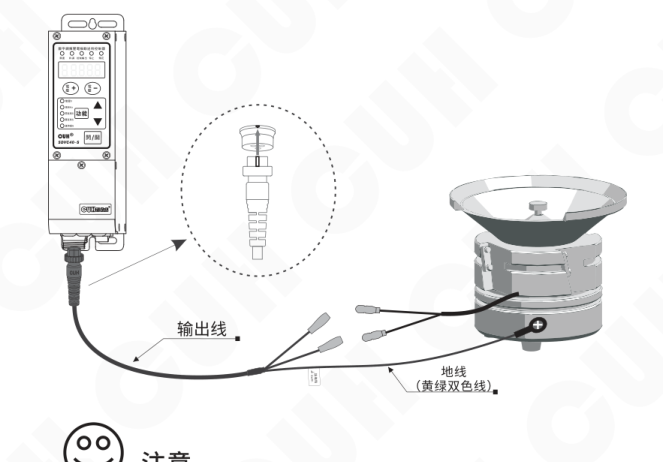

## 注意

一定要确认压电陶瓷的电极接在两个输出引脚上，外壳需要可靠接地。

否则将会导致机壳带电，可能发生严重安全事故。

---

2024-03　　　　　　　　　　　　　　- 3 -　　　　　　　　　　　　　　SDVC40SMSCN_4.01

### 第 12 页

数字调频压电振动送料控制器　　　　　　　　　　　　　　　SDVC40 系列

### 第三步：

将输入电源线航空插头插入控制器电源  
输入插座，并锁紧螺母。

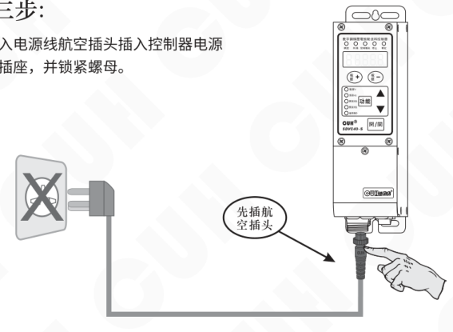

### 第四步：

确认开关处于关闭位置后，将电源线三爪插头插在供电电源插座上。

---

2024-03　　　　　　　　　　　　- 4 -　　　　　　　　　　　　SDVC40SMSCN_4.01

### 第 13 页

数字调频压电振动送料控制器　　　　　　　　　　　　　　　　　　　　　　　　　SDVC40 系列

## 第五步：

把输出电压“U”调整到 30~80之间。

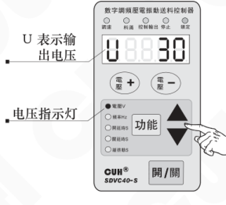

图中标注：

- U 表示输出电压
- 电压指示灯

## 第六步：

按住“功能”键2秒，进入频率“E”调整状态；使用“▲”和“▼”键来寻找振动体的固有频率，也就是我们常说的谐振点。

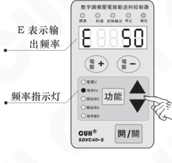

图中标注：

- E 表示输出频率
- 频率指示灯

> ☺
>
> - 振动最大时的频率为振动体的固有频率。
> - 每个振动体都有固有的振动频率，为了能达到最佳的工作状态，请调整本参数使振动体工作在合适的工作频率上。

2024-03　　　　　　　　　　　　　　　　　　　　- 5 -　　　　　　　　　　　　　　　　　　　　SDVC40SMSCN_4.01

### 第 14 页

数字调频压电振动送料控制器　　　　　　　　　　　　　　　　SDVC40 系列

---

### 第七步：

当找到振动体的固有频率后，  
再使用电压调整功能“电压＋”  
和“电压－”调到最佳的送料速度。

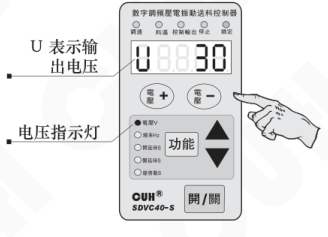

图中标注：

- U 表示输出电压
- 电压指示灯

调整完毕，可初步工作后，如还需其它控制功能，请参见  
本说明书其他部分。

---

2024-03　　　　　　　　　　　　- 6 -　　　　　　　　　　　　SDVC40SMSCN_4.01

### 第 15 页

# 第三章 部件说明

## 3.1 键盘及指示灯说明

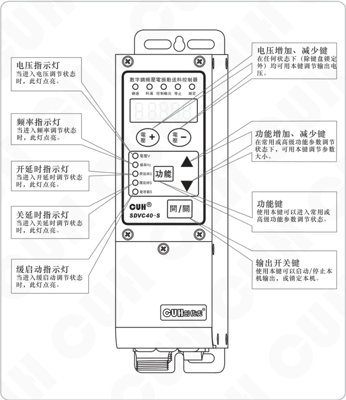

### 指示灯说明

- **电压指示灯**  
  当进入电压调节状态时，此灯点亮。

- **频率指示灯**  
  当进入频率调节状态时，此灯点亮。

- **开延时指示灯**  
  当进入开延时调节状态时，此灯点亮。

- **关延时指示灯**  
  当进入关延时调节状态时，此灯点亮。

- **缓启动指示灯**  
  当进入缓启动调节状态时，此灯点亮。

### 按键说明

- **电压增加、减少键**  
  在任何状态下（除键盘锁定外）均可用本键调节输出电压。

- **功能增加、减少键**  
  在常用或高级功能参数调节状态下，可用本键调节参数大小。

- **功能键**  
  使用本键可以进入常用或高级功能参数调节状态。

- **输出开关键**  
  使用本键可以启动/停止本机输出，或锁定本机。

### 面板标识

- 顶部状态指示：调谐、料满、控制输出、停止、锁定。
- 参数指示：电压 V、频率 Hz、开延时 S、关延时 S、缓启动 S。
- 机型标识：SDVC40-S。

### 第 16 页

数字调频压电振动送料控制器　　　　　　　　　　　　　　　　SDVC40 系列

## 3.2 指示灯说明

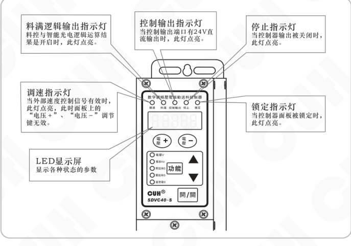

- **料满逻辑输出指示灯**：料控与智能光电逻辑运算结果是开启时，此灯点亮。
- **控制输出指示灯**：当控制输出端口有 24V 直流输出时，此灯点亮。
- **停止指示灯**：当控制器输出被关闭时，此灯点亮。
- **调速指示灯**：当外部速度控制信号有效时，此灯点亮，此时面板上的“电压＋”、“电压－”调节键无效。
- **锁定指示灯**：当控制器面板被锁定时，此灯点亮。
- **LED 显示屏**：显示各种状态的参数。

## 3.3 外部部件说明

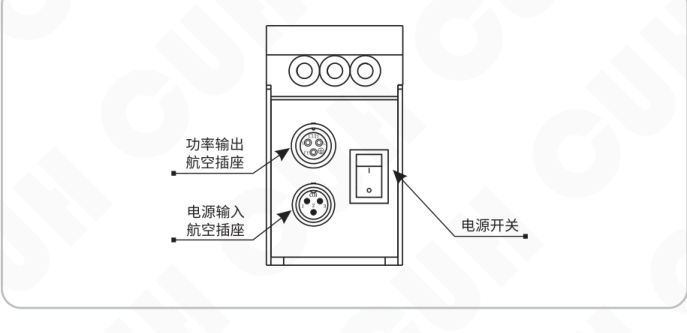

- **功率输出航空插座**
- **电源输入航空插座**
- **电源开关**

### 第 17 页

数字调频压电振动送料控制器　　　　　　　　　　　　　　　　　　　SDVC40 系列

# 第四章 功能说明

## 4.1 输出电压设定

本控制器可以直接在控制面板上以数字方式设定输出电压。由于本控制器特有的稳压功能，该数值为输出电压的绝对值，并不会受到输入电压的影响，即使在电压不稳定场合中使用也可以保持稳定工作。同时，直接的电压数值设定也为用户了解设备运行情况提供了准确的数据。

▶ 打开控制器的电源开关。

▶ 控制器进入输出电压状态，控制器上电压指示灯点亮，LED显示屏显示电压标志“U”和上次设置的电压值。

▶ 通过电压“＋”和电压“－”可以对电压“U”值进行调整。

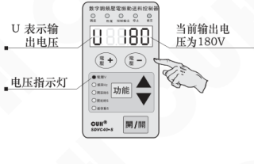

SDVC40S：输出电压设定范围0～220V  
SDVC40SD：输出电压设定范围0.0～50.0V

> 在任何基本或高级功能调整状态下，使用“＋”或者“－”均可以进行输出电压“U”的调节。待设定结束后控制器会自动返回原参数调整状态。

2024-03　　　　　　　　　　　　　　　　　- 9 -　　　　　　　　　　　　　　SDVC40SMSCN_4.01

### 第 18 页

数字调频压电振动送料控制器　　　　　　　　　　　　　　　　　　　　　　　　　SDVC40 系列

---

## 4.2 输出频率设定

本控制器采用直接数字频率合成技术（DDS），具有非常高的频率精度和稳定性，不随时间和温度的改变而变化。

▶ 按住“功能”键2秒，进入基本功能的调整状态。

▶ 控制器上频率指示灯点亮，LED显示频率标志“E”和频率值。

▶ 通过使用“▲”和“▼”键可以对频率“E”值进行设定。

操作示意图：

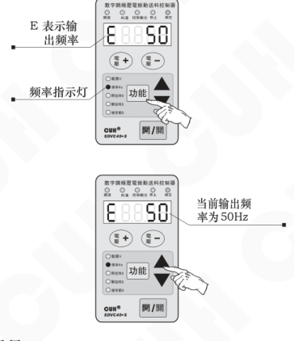

本系列控制器的输出频率范围是40～400Hz

☺

- 基本功能调整状态下可以通过按“功能”键分别进行频率（E）、开延迟（J）、关延迟（L）、缓启动时间（t）等设定。
- 再次长按“功能”键2秒可以退出常用功能调整状态。
- 操作结束一分钟后控制器自动退出到电压调整状态。

---

2024-03　　　　　　　　　　　　　　　　　- 10 -　　　　　　　　　　　　　　　SDVC40SMSCN_4.01

### 第 19 页

数字调频压电振动送料控制器　　　　　　　　　　　　　　　　　SDVC40 系列

## 4.3 缓启动功能

本控制器从停止状态启动时，输出电压可以平缓提高到设定值，以防止振动设备和控制器遭受冲击。

缓启动时间（t）：控制器从停止状态启动时，输出电压从0V平滑升高到达设定输出电压所需要的时间称为缓启动时间。

> ▶ 长按“功能”键2秒进入基本功能调整状态。
>
> ▶ 使用“功能”键切换到缓启动参数调整状态“t”，此时面板的“缓启动”指示灯点亮。
>
> ▶ 使用“▲”、“▼”调整该参数。该参数的单位是秒，精度为0.1秒。
>
> 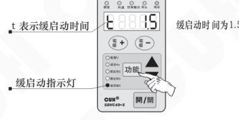
>
> 缓启动过程的时间范围是0.1秒-10.0秒

## 4.4 输出开关

面板上的轻触式输出开关可以方便快速地开启或停止本机的输出。

> ▶ 使用控制器面板上的“开/关”键，可以控制本机启动或停止输出。停止输出时，“停止”指示灯点亮，表示进入“停止”状态。
>
> 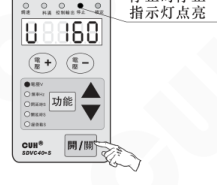

> 🙂
>
> 本功能使用软开关，由数字信号进行控制。因此，不会产生火花烧蚀机械触点的问题，可以大大延长控制器和振动设备的使用寿命。

2024-03　　　　　　　　　　　　　- 11 -　　　　　　　　　　　　　SDVC40SMSCN_4.01

### 第 20 页

数字调频压电振动送料控制器  
SDVC40 系列

## 4.5 最大输出电压限制功能（此功能请在专业电气工程师的指导下使用）

本控制器可以设定最大输出电压。设定该参数可以防止用户误操作输出过大电压而损坏振动设备。  
线控调速功能也受此参数限制。

- 按下“功能”键不放开，再按“▲”键保持2秒，进入高级功能设定状态。
- 短按“功能”键切换到“h”状态，即最大输出电压参数设定状态。
- 用“▲”和“▼”键调整该参数。

图示说明：h 表示最大设定电压；最大输出电压为50V。

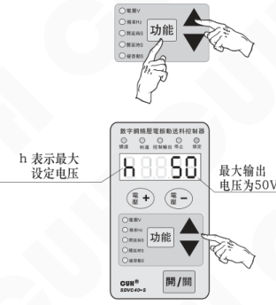

> ● 任何情况下控制器的输出电压不能也不会超过本参数设定值。  
> ● 本参数出厂默认设置为本机的最大可能输出电压。

## 高级功能调整状态的退出方法

> ● 操作结束一分钟后控制器自动退出到电压调整状态。  
> ● 再次长按“功能”键2秒后不放开并按“▲”键退出到电压调整状态。  
> ● 长按“功能”键2秒后退出到基本功能调整状态。

2024-03　　　　　　　　- 12 -　　　　　　　　SDVC40SMSCN_4.01

### 第 21 页

数字调频压电振动送料控制器　　　　　　　　　　　　　　　　　　　　　　SDVC40 系列

## 4.6 键盘锁定功能

为了防止误操作，本机设定了键盘锁。这样当控制器各项参数设置好后，可以有效避免其他人的误动作影响本机正常工作。即使关机后重新开机，键盘锁状态依然保持上次关机时的状态。

> - 通过长按开关键2秒可以锁定所有按键，此时键盘锁定指示灯点亮。
> - 再次长按开关键2秒可以解除锁定。
>
> 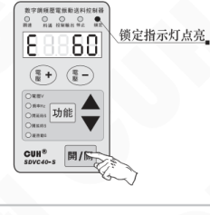

2024-03　　　　　　　　　　　　　　　　　- 13 -　　　　　　　　　　　　　SDVC40SMSCN_4.01

### 第 22 页

## 4.7 开机运行状态设定

为了防止在正常情况下突然停电然后来电或者对本控制器的上电状态有特殊的要求，可以通过设定该参数，来设定本控制器的上电状态是运行、停止、跟随上次关机时的状态。

- ▶ 按下“功能”键不放开，再按“▲”键保持2秒，进入高级功能设定状态。
- ▶ 短按“功能”键切换到“「d」”状态，即开机运行状态参数设定。
- ▶ 用“▲”和“▼”键调整该参数。

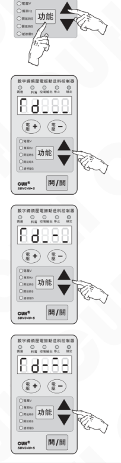

> 「d___」表示开机运行状态是开启输出。  
>  
> 「d---」表示开机运行状态是关闭输出。  
>  
> 「d===」表示开机运行状态是跟随上次关机时的状态（如果上次关机时控制器是停止输出的，那么下次上电的时候控制器会保持停止输出状态，反之如果上次关机时控制器是开启输出的，那么下次上电的时候控制器会保持开启输出状态）。

### 第 23 页

数字调频压电振动送料控制器　　　　　　　　　　　　　　　　　　　　　　　　　SDVC40 系列

## 4.8 恢复出厂设定（此功能请在专业电气工程师的指导下使用）

本功能可以使用户快速将控制器设置为出厂默认设置状态。

由于本控制器功能强大，有数量众多的控制参数可以由用户设定，对于初学者，可能在多次的设定修改后不能恢复控制器的正常工作状态。使用该功能可以快速将调乱的参数状态恢复为出厂默认设置。

- ▶▶ 按下“功能”键不放开，再按“▲”键保持 2 秒，进入高级功能设定状态。

  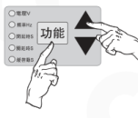

- ▶▶ 短按“功能”键切换到全屏闪烁状态，此时长按“▲”键，直到控制器显示“-----”，表示控制器已经重设完毕。

  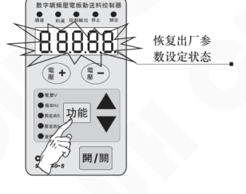

- ▶▶ 松开“▲”键，控制器将进入正常的电压调整状态“U”。此时控制器就像刚开始使用一样，所有参数都已经恢复到出厂默认状态。

  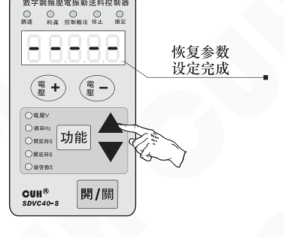

---

2024-03　　　　　　　　　　　　　　　　　- 15 -　　　　　　　　　　　　　　　　　SDVC40SMSCN_4.01

### 第 24 页

数字调频压电振动送料控制器　　　　　　　　　　　　　　　　　SDVC40 系列

# 第五章 传感器与信号控制

本机可以接受多种外部信号或传感器控制其运行状态。本节主要介绍智能光电传感器、料满停机传感器和PLC控制等的使用方法。

## 5.1 智能光电传感功能

本机配合使用本公司生产的SDVC-S1光电对射传感器可以实现智能光电传感功能，以自动去除背景光对传感器灵敏度的影响，使传感器无需人工调节灵敏度即可可靠工作。

### 5.1.1 智能光电传感器（SDVC-S1）接线方法

第一步：打开控制器接线仓的仓门。

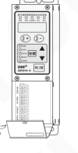

第二步：按照图例连接SDVC-S1光电传感器。

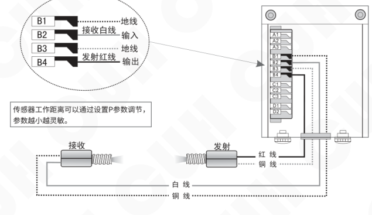

传感器工作距离可以通过设置P参数调节，参数越小越灵敏。

注意：在出厂默认设置下，本传感器逻辑方向为料空逻辑方向。

---

2024-03　　　　　　　　　　　　　　　　-16-　　　　　　　　　　　　　　　　SDVC40SMSCN_4.01

### 第 25 页

数字调频压电振动送料控制器　　　　　　　　　　　　　　　　　　　　　SDVC40 系列

---

## 5.1.2 智能光电传感器开延时、关延时时间的设定

当使用传感器，或者 PLC 等其它外部信号进行启动和停止控制时，大多数情况需要在给出信号或者恢复信号后延迟一段时间才执行操作。对于这样的应用，可以通过设置开延时和关延时的时间来实现。另外，还可以设定缓启动时间以防止启动时的冲击。

### 开延时（J）

从施加一个使控制器进入运行状态的控制信号开始，到控制器输出启动，期间经历的延迟时间称为开延时。

- 长按“功能”键 2 秒进入基本功能的调整状态。
- 使用“功能”键切换到开延时参数调整状态“J”。此时面板的“开延时”指示灯点亮。
- 使用“▲”、“▼”调整该参数。该参数的单位是秒，精度为 0.1 秒。

示意图标注：J 表示开延时；开延时指示灯；开延时时间为 2.0 秒。

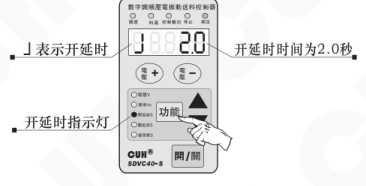

### 关延时（L）

从施加一个使控制器进入停止状态的控制信号开始，到控制器输出停止，期间经历的延迟时间称为关延时。

- 长按“功能”键 2 秒进入基本功能参数调整状态。
- 使用“功能”键切换到关延时参数调整状态“L”，此时面板的“关延时”指示灯点亮。
- 使用“▲”、“▼”调整该参数。该参数的单位是秒，精度为 0.1 秒。

示意图标注：L 表示关延时；关延时指示灯；关延时时间为 1.5 秒。

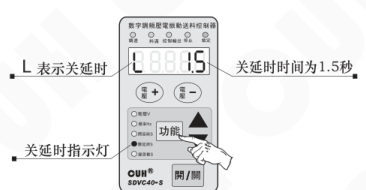

---

2024-03　　　　　　　　　　　　　　　- 17 -　　　　　　　　　　　　　　　SDVC40SMSCN_4.01

### 第 26 页

数字调频压电振动送料控制器　　　　　　　　　　　　　　　　　　　　　　　　　SDVC40 系列

## 5.1.3 智能光电传感逻辑方向设定（此功能请在专业电气工程师的指导下使用）

在正常情况下，也就是说对射的光电传感器没有收到光信号时，在出厂默认设置，即常通逻辑方向状态下，控制器处于“运行”状态。但是，对于一些特殊应用，可能需要相反的逻辑。也就是说，可能会需要在没有收到光信号时，控制器处于“停止”状态。这可以通过修改本参数来实现。

- 按下“功能”键不放开，再按“▲”键保持2秒，进入高级功能设定状态。
- 短按“功能”键切换到“1”状态，即智能光电传感逻辑方向参数调整状态。
- 使用“▲”和“▼”可以改变逻辑方向。

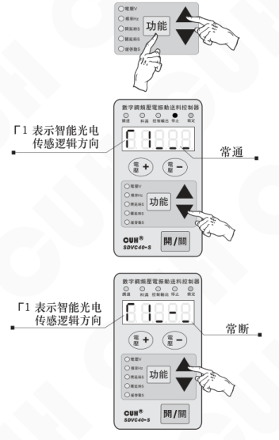

- 逻辑方向设置为常通，则没有收到光信号时，控制器处于运行状态。
- 逻辑方向设置为常断，则没有收到光信号时，控制器处于停止状态。

---

2024-03　　　　　　　　　　　　　　　-18-　　　　　　　　　　　　　　　SDVC40SMSCN_4.01

### 第 27 页

数字调频压电振动送料控制器　　　　　　　　　　　　　　　　　　　　　　　SDVC40 系列

---

## 5.2 三线NPN型开关传感器（料满停机）的使用方法

配合各类开关传感器，如接近开关传感器、光电传感器、光纤传感器等实现自动启动和停止功能。

### 5.2.1 三线NPN型接近开关传感器接线方法

第一步：打开控制器接线仓的仓门。

第二步：按照图例连接传感器。

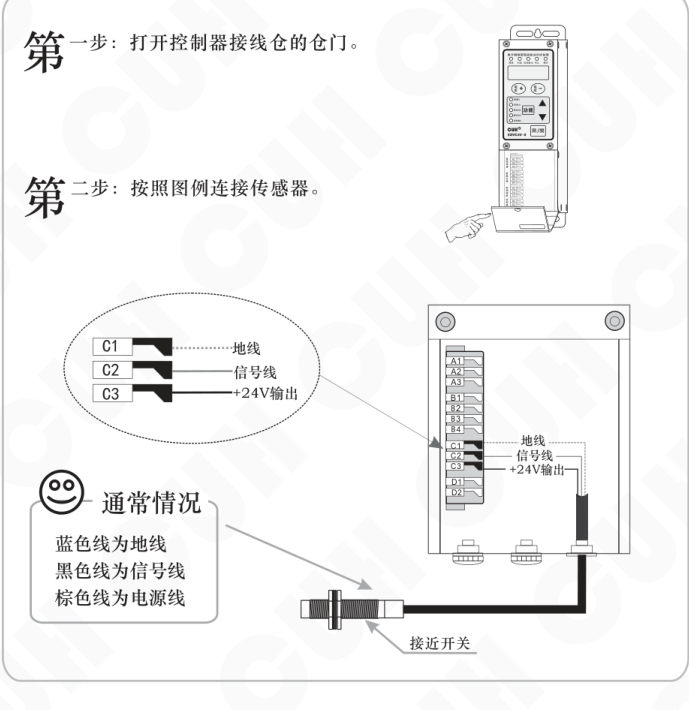

通常情况：

- 蓝色线为地线
- 黑色线为信号线
- 棕色线为电源线

端子对应关系：

| 端子 | 说明 |
|---|---|
| C1 | 地线 |
| C2 | 信号线 |
| C3 | +24V输出 |

接近开关

---

2024-03　　　　　　　　　　　　　　　　　- 19 -　　　　　　　　　　　　　　　　　SDVC40SMSCN_4.01

### 第 28 页

数字调频压电振动送料控制器　　　　　　　　　　　　　　　SDVC40 系列

---

## 5.2.2 对射NPN型传感器接线方法

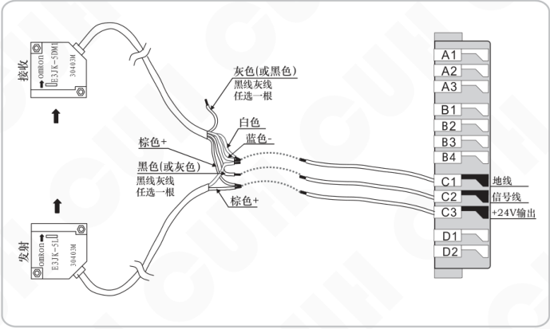

## 5.2.3 对射光电传感器接线方法

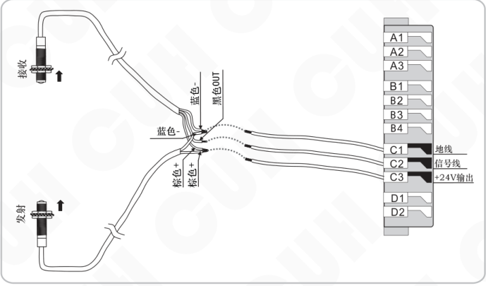

---

2024-03　　　　　　　　　　　　-20-　　　　　　　　　　　　SDVC40SMSCN_4.01

### 第 29 页

数字调频压电振动送料控制器　　　　　　　　　　　　　　　　SDVC40 系列

## 5.2.4 对射式光纤传感器接线方法

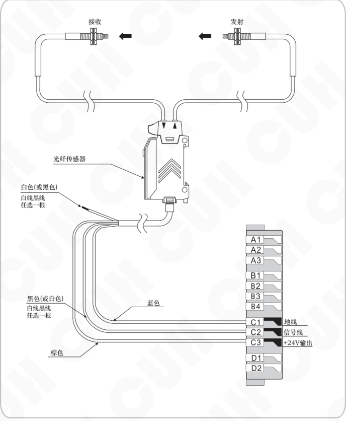

2024-03　　　　　　　　　- 21 -　　　　　　　　　SDVC40SMSCN_4.01

### 第 30 页

数字调频压电振动送料控制器　　　　　　　　　　　　　　　　　　　　　　　　　SDVC40 系列

## 5.2.5 反射光电传感器接线方法

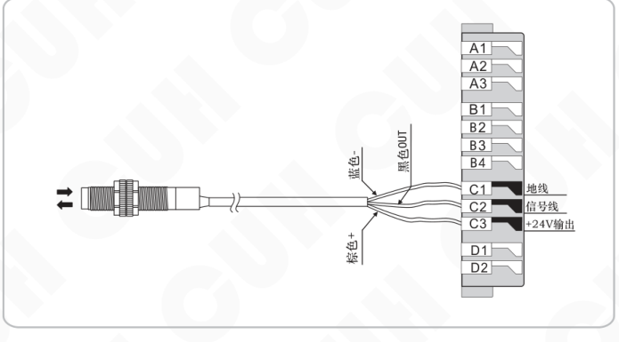

图中端子与线色标注：

| 传感器线色/信号 | 控制器端子 | 控制器端子功能 |
|---|---|---|
| 蓝色 - | C1 | 地线 |
| 黑色 OUT | C2 | 信号线 |
| 棕色 + | C3 | +24V输出 |

图中端子排标号：A1、A2、A3、B1、B2、B3、B4、C1、C2、C3、D1、D2。

---

2024-03　　　　　　　　　　　　　-22-　　　　　　　　　　　　　SDVC40SMSCN_4.01

### 第 31 页

数字调频压电振动送料控制器　　　　　　　　　　　　　　　SDVC40 系列

## 5.3　三线NPN型开关传感器开延时、关延时时间设定

在默认状态下，智能光电传感器和开关传感器的开延时、关延时时间总是相同的。用户也可以单独为开关传感器设定开延时、关延时时间，此时开关传感器和智能光电传感器具有独立的开延时、关延时时间。

### 开延时（J-）

从施加一个使控制器进入运行状态的控制信号开始，到控制器开始有输出，期间经历的延迟时间称为开延时。

- 按下“功能”键不放开，再按“▲”键保持2秒，进入高级功能设定状态。
- 使用“功能”键切换到关延时参数调整状态“J-”。
- 使用“▲”和“▼”调整该参数。该参数的单位是秒，精度为0.1秒。

示意图：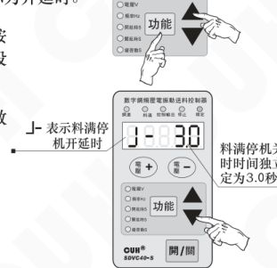

开延时出厂默认值是：`J----`

### 关延时（L-）

从施加一个使控制器进入停止状态的控制信号开始，到控制器输出停止，期间经历的延迟时间称为关延时。

- 按下“功能”键不放开，再按“▲”键保持2秒，进入高级功能设定状态。
- 使用“功能”键切换到关延时参数调整状态“L-”。
- 使用“▲”和“▼”调整该参数。该参数的单位是秒，精度为0.1秒。

示意图：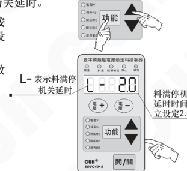

关延时出厂默认值是：`L----`

---

- 将开关关延时时间调到小于0时，开关传感器独立延时时间将被关闭。
- 开关传感器独立开、关延时关闭时，开、关延时与智能光电传感开、关延时时间相同。
- 开关传感器独立开、关延时开启时，开、关延时时间由本参数设定，智能光电传感开、关延时时间不受影响。出厂默认设置为关闭独立设置。

2024-03　　　　　　　　　　　　-23-　　　　　　　　　　　　SDVC40SMSCN_4.01

### 第 32 页

数字调频压电振动送料控制器　　　　　　　　　　　　　　　　　　　　　　　　　SDVC40 系列

---

## 5.4 三线NPN型开关传感器（料满停机）逻辑方向设定

（此功能请在专业电气工程师的指导下使用）

在正常情况下，也就是说不向引脚发任何信号时，由于内部的上拉电阻，都会呈现为“高”电平。此时，在出厂默认设置下，控制器处于“运行”状态。但是，对于一些特殊应用，可能需要相反的逻辑。也就是说，可能会需要在不施加信号时控制器处于“停止”状态。这可以通过修改本参数来实现。

- 按下“功能”键不放开，再按“▲”键保持2秒，进入高级功能设定状态。
- 短按“功能”键切换到“F2”状态，即料满停机逻辑方向参数调整状态。
- 使用“▲”和“▼”可以改变逻辑方向。

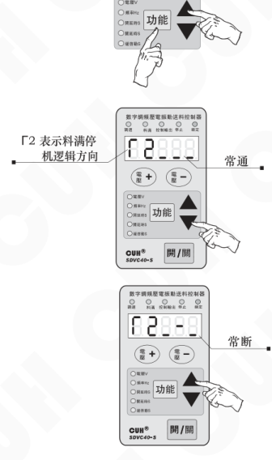

> - 逻辑方向设置为常通，则不连接任何控制信号，控制器处于运行状态。
> - 逻辑方向设置为常断，则不连接任何控制信号，控制器处于停止状态。

---

2024-03　　　　　　　　　　　　　　　　　- 24 -　　　　　　　　　　　　　　　　　SDVC40SMSCN_4.01

### 第 33 页

数字调频压电振动送料控制器　　　　　　　　　　　　　　　　　　　SDVC40 系列

## 5.5 控制信号逻辑关系设定（此功能请在专业电气工程师的指导下使用）

本控制器可以设定智能光电传感与料满停机同时作用时的逻辑关系。

- 按下“功能”键不放开，再按“▲”键保持2秒，进入高级功能设定状态。
- 短按“功能”键切换到“□”状态，即控制信号逻辑关系参数调整状态。
- 用“▲”和“▼”键调整该参数。

操作示意：

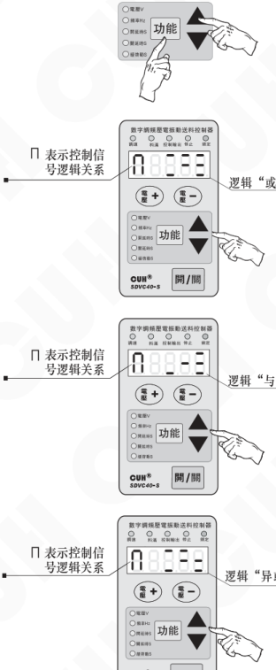

> ● 逻辑“或”：仅在智能光电传感与料满停机信号同时要求控制器运行时，控制器才运行。
>
> ● 逻辑“与”：只要智能光电传感与料满停机信号有一个要求控制器运行，控制器就运行。
>
> ● 逻辑“异或”：仅在智能光电传感与料满停机信号要求不同时，控制器才运行。

---

2024-03　　　　　　　　　　　　　　-25-　　　　　　　　　　　　　　SDVC40SMSCN_4.01

### 第 34 页

数字调频压电振动送料控制器　　　　　　　　　　　　　　　SDVC40 系列

---

## 5.6 PLC 控制振动送料控制器启停的接线方法

### PLC控制控制器连接方法

**第一步：** 打开控制器接线仓的仓门。

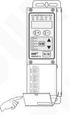

**第二步：** 按照图例连接PLC信号线。

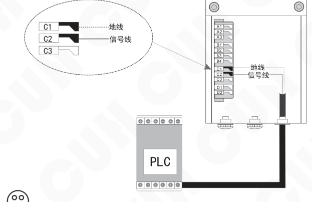

> 可以使用PLC的继电器输出，也可以使用PLC的NPN输出。

---

2024-03　　　　　　　　　　-26-　　　　　　　　　　SDVC40SMSCN_4.01

### 第 35 页

## 5.7 控制输出功能

（此功能请在专业电气工程师的指导下使用）

本控制器可以输出低电压控制信号，以同步其它设备协同工作，如电磁阀、PLC 等。

### 5.7.1 控制输出连接方法

控制电磁阀工作的连接方法：

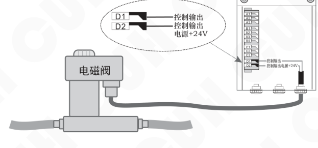

- 本控制器可直接驱动额定电压24V，功率小于4W的电磁阀。
- 如电磁阀功率过大则需考虑使用外部电源。

控制继电器工作的连接方法：

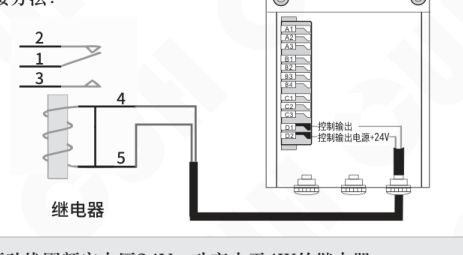

- 本控制器可直接驱动线圈额定电压24V，功率小于4W的继电器。

### 第 36 页

数字调频压电振动送料控制器　　　　　　　　　　　　　　　　　　　　SDVC40 系列

## 5.7.2 控制输出逻辑方向设定

- 按下“功能”键不放开，再按“▲”键保持2秒，进入高级功能设定状态。
- 短按“功能”键切换到“「3”状态，即控制输出逻辑方向设定状态。
- 用“▲”和“▼”键调整该参数。

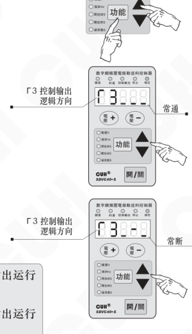

> ● 逻辑方向设置为常通，则控制器输出运行时，控制输出也为运行状态。  
> ● 逻辑方向设置为常断，则控制器输出运行时，控制输出为停止状态。

---

2024-03　　　　　　　　　　　　　　　　　-28-　　　　　　　　　　　　　　　　SDVC40SMSCN_4.01

### 第 37 页

数字调频压电振动送料控制器　　　　　　　　　　　　　　　　　　　　SDVC40 系列

## 5.7.3 主控分离参数

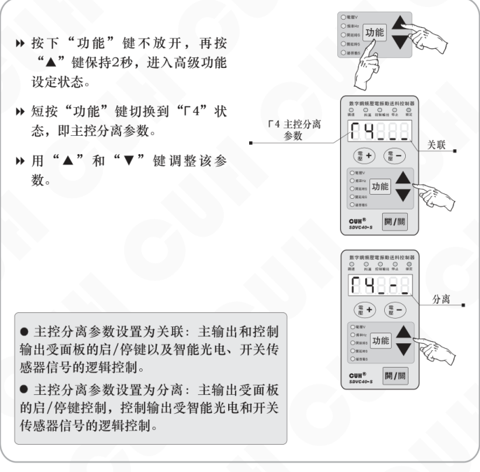

- 按下“功能”键不放开，再按“▲”键保持2秒，进入高级功能设定状态。
- 短按“功能”键切换到“F4”状态，即主控分离参数。
- 用“▲”和“▼”键调整该参数。

> ● 主控分离参数设置为**关联**：主输出和控制输出受面板的启/停键以及智能光电、开关传感器信号的逻辑控制。  
> ● 主控分离参数设置为**分离**：主输出受面板的启/停键控制，控制输出受智能光电和开关传感器信号的逻辑控制。

2024-03　　　　　　　　　　　　　　　　　-29-　　　　　　　　　　　　　　　　　SDVC40SMSCN_4.01

### 第 38 页

数字调频压电振动送料控制器　　　　　　　　　　　　　　　　　SDVC40 系列

---

## 5.8 远程速度控制（线控调速功能）（此功能请在专业电气工程师的指导下使用）

本控制器远程速度控制允许用户通过外接电位器或1～5V控制信号控制输出电压。这样，用户可以通过PLC、DCS或其它一些方法方便容易地进行外部远程速度控制。

> 当控制电压超过0.5V时，线控电压对控制器的控制生效。此时，面板的线控指示灯点亮，同时面板上调整电压的“电压+”和“电压-”键将失效。如果此时控制器处于电压调节状态，LED显示屏将显示输出电压。

### 外接电位器使用方法：

**建议：**  
请使用1K阻值线性电位器

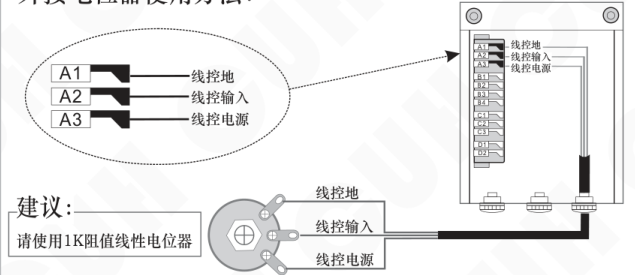

### 使用PLC进行输出电压控制的方法：

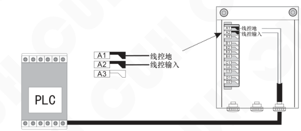

---

2024-03　　　　　　　　　　　　　　　　　-30-　　　　　　　　　　　　　　　　　SDVC40SMSCN_4.01

### 第 39 页

# 第六章 安全保护功能

## 6.1 稳压功能

内置数字稳压功能，可以消除由于电源电压波动造成的送料速度变化。

## 6.2 短路过流保护功能

输出发生短路时，控制器会立即停止输出，直到控制器重新启动为止。在用户误操作造成输出电流超过额定电流时短暂停止输出，同时显示 Err02，以保护本机及用户的设备。

## 6.3 过热保护功能

当控制器工作温度超过 65°C 将停止输出，以保护本机，同时显示 Err03，

当温度下降到 60°C 以下时，本机恢复输出。

### 第 40 页

数字调频压电振动送料控制器SDVC40 系列

## 附录A：SDVC40系列数字调频压电振动送料控制器外形尺寸（单位：mm）

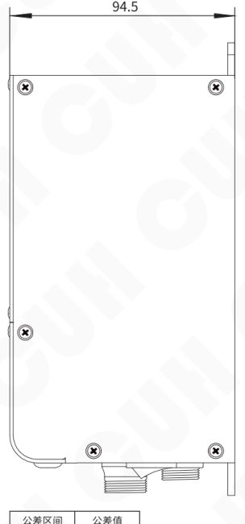

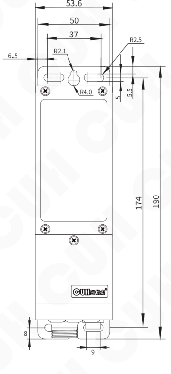

| 公差区间 | 公差值 |
|---|---|
| 0~3 | ±0.05 |
| 3~10 | ±0.1 |
| 10~30 | ±0.15 |
| 30~80 | ±0.2 |
| 80~180 | ±0.3 |
| >180 | ±0.5 |

本系列产品均适用此公差表。

---

2024-03　　　　　　　　　　　　-32-　　　　　　　　　　　　SDVC40SMSCN_4.01

### 第 41 页

## 附录B：SDVC40系列数字调频压电控制器输出接口定义

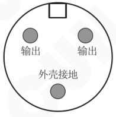

### ☺ 请注意：

A：一定要确认压电陶瓷电极接在两个输出引脚上，外壳需要可靠接地。否则将会导致机壳带电，发生严重安全事故！！！

B：焊接完成后，一定要用热缩套管或绝缘胶带裹紧接头部分，然后插入航空插头的金属套管中，以免造成漏电和短路事故！！！

### 第 42 页

数字调频压电振动送料控制器　　　　　　　　　　　　　　　　　SDVC40 系列

## 附录C：SDVC40系列数字调频压电控制器用户接口定义

### 端口A：遥控调速

| 端子 | 定义 |
|---|---|
| A1 | 电阻地 |
| A2 | 输入 |
| A3 | +5V |
| A4 | 地线 |

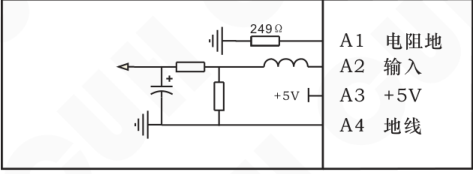

### 端口C：料满停机

#### NPN型

| 端子 | 定义 |
|---|---|
| C1 | 地线 |
| C2 | 输入 |
| C3 | +24V |

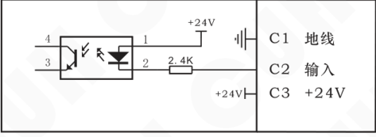

#### PNP型

| 端子 | 定义 |
|---|---|
| C1 | 地线 |
| C2 | 输入 |
| C3 | +24V |

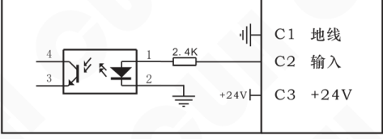

### 第 43 页

数字调频压电振动送料控制器　　　　　　　　　　　　　　　　　SDVC40 系列

## 端口B：智能光电

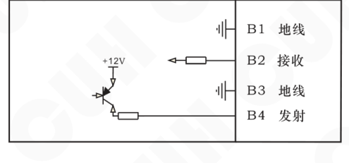

| 端口 | 功能 |
|---|---|
| B1 | 地线 |
| B2 | 接收 |
| B3 | 地线 |
| B4 | 发射 |

图中标注：+12V

## 端口D：控制输出

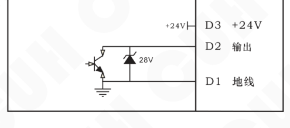

| 端口 | 功能 |
|---|---|
| D3 | +24V |
| D2 | 输出 |
| D1 | 地线 |

图中标注：+24V、28V

2024-03　　　　　　　　　　　　　　　　　-35-　　　　　　　　　　　　　　　　　SDVC40SMSCN_4.01

### 第 44 页

数字调频压电振动送料控制器　　　　　　　　　　　　　　　　　　　　　　　　　SDVC40 系列

## 附录D：SDVC40系列数字调频压电系列控制器各功能参数对照表

| 显示（转写） | 数码管符号图片 | 读音 | 含义 |
|---|---|---|---|
| U |  | U | 输出电压 |
| E |  | E | 输出频率 |
| 大勾 |  | 大勾 | 智能光电传感开延时 |
| L |  | 大L | 智能光电传感关延时 |
| t |  | 小T | 缓启动时间 |
| L中 |  | L中 | 料满停机关延时 |
| 勾中 |  | 勾中 | 料满停机开延时 |
| b1 |  | 涛1 | 智能光电传感逻辑方向 |
| b2 |  | 涛2 | 料满停机逻辑方向 |
| b3 |  | 涛3 | 控制输出逻辑方向 |
| b4 |  | 涛4 | 主控分离参数 |
| N |  | 大恩 | 控制信号逻辑关系 |
| h |  | 小H | 最大输出电压 |
| C |  | 大C | 温度显示 |
| bD |  | 涛D | 开机运行状态 |
| P |  | P | 智能光电灵敏度 |
| 8.8.8.8.8. |  | 全8 | 恢复出厂设定 |

2024-03　　　　　　　　　　　　　　　　　-36-　　　　　　　　　　　　　　　　　SDVC40SMSCN_4.01

### 第 45 页

数字调频压电振动送料控制器　　　　　　　　　　　　　　　　　SDVC40 系列

---

## 附录E：SDVC40系列数字调频压电控制器参考标准

| 项目 | GB 标准 | IEC 标准 | 等级 | 标准要求 | 备注说明 |
|---|---|---|---|---|---|
| 极限参数：超过此指标将会造成严重损坏，必须严格遵守！ |  |  |  |  |  |
| 静电放电 | GB/T 17626.2-2006 | IEC 61000-4-2:2001 | 4 | ±8 kV | 接触放电 |
|  |  |  | 4 | ±15 kV | 空气放电 |
| 电快速瞬变 脉冲群 | GB/T 17626.4-2008 | IEC 61000-4-4:2004 | 4 | ±4 kV |  |
| 直流电源纹 波抗扰度 | GB/T 17626.17-2005 | IEC 61000-4-17:2002 | 4 | 15% | 评价 A |

**警告**

在民用环境中，本产品可能产生无线电干扰。在这种情况下，可能需要采取附加抑制措施。

---

2024-03　　　　　　　　　　　　　　　　　-37-　　　　　　　　　　　　　　　　　SDVC40SMSCN_4.01

### 第 46 页

**数字调频压电振动送料控制器**  
**SDVC40 系列**

### SDVC40系列数字调频压电控制器参数规格（测试条件：输入电压AC220V）

| 项目 | 范围：最小值 | 范围：典型值 | 范围：最大值 | 单位 | 说明 |
|---|---:|---:|---:|---|---|
| 输入电压 | 85 | 220 | 250 | 伏特（V） | 交流有效值 |
| 输出电压调整范围 | 0 | —— | 220 | 伏特（V） | SDVC40-S |
| 输出电压调整范围 | 0.0 | —— | 50.0 | 伏特（V） | SDVC40-SD |
| 电压调整精度 |  | 1 |  | 伏特（V） | SDVC40-S |
| 电压调整精度 |  | 0.1 |  | 伏特（V） | SDVC40-SD |
| 稳压精度 | 0 | —— | 10 | % | ΔVout/ΔVin |
| 稳压响应时间 | 0.0025 | —— | 0.025 | 秒（s） | 输出电压周期分之一 |
| 输出电流调整范围 | 0 | —— | 150 | 毫安（mA） | SDVC40-S |
| 输出电流调整范围 | 0 | —— | 600 | 毫安（mA） | SDVC40-SD |
| 输出功率 | 0 | —— | 33 | 伏安（VA） | SDVC40-S |
| 输出功率 | 0 | —— | 30 | 伏安（VA） | SDVC40-SD |
| 输出频率 | 40 | —— | 400 | 赫兹（Hz） |  |
| 频率调整精度 |  | 0.1 |  | 赫兹（Hz） |  |
| 输出波形 |  | 正弦 |  |  |  |
| 缓启动时间 | 0.1 | —— | 10.0 | 秒（s） | 出厂默认0.5 |
| 延迟时间范围 | 0.0 | —— | 20.0 | 秒（s） | 出厂默认0.2 |
| 延迟时间精度 |  | 0.1 |  | 秒（s） |  |
| 过热保护温度 | 60 | 65 | 65 | 摄氏度（℃） |  |
| 直流控制输出电压 | 22 | 24 | 26 | 伏特（V） |  |
| 直流控制输出电流 | 0 | —— | 200 | 毫安（mA） |  |
| 模拟控制信号 |  | 1~5 / 4~20 |  | 伏特（V）/ 毫安（mA） | 远程速度控制电压/电流 |
| 数字控制信号 |  | 24 |  | 伏特（V） | 开关信号控制 |
| 调整方式 |  | 6 |  | 键（Button） |  |
| 空载功耗 | —— | 4 | —— | 瓦特（W） |  |
| 显示方式 |  | 5 |  | 位（Digit） | LED数码管 |
| 工作环境温度 | 0 | 25 | 40 | 摄氏度（℃） |  |
| 工作环境湿度 | 10 | 60 | 85 | 相对湿度（%） | 不结露 |
| 存储环境温度 | -20 | 25 | 85 | 摄氏度（℃） |  |

2024-03  
-38-  
SDVC40SMSCN_4.01

### 第 47 页

数字调频压电振动送料控制器　　　　　　　　　　　　　　　　　　　　　SDVC40 系列

## 附录F：错误讯息指示和故障排除

以下一些方法可以帮助您排除使用中可能会遇到的简单问题。

| 序号 | 错误讯息/现象 | 数码管符号图片 | 故障排除 |
|---|---|---|---|
| 1 | 打开开关，没有显示 |  | ◆ 请检查电源插座是否有电 ◆ 电源插头是否可靠连接插座 |
| 2 | 有显示，但是振动盘不动，也没有声音 |  | ◆ 请检查输出电缆是否正确地连接控制器与振动盘 ◆ 请检查控制器参数，是否输出电压调节得太小 ◆ 请检查控制信号是否将控制器置于“停止”状态 ◆ 请检查是否有设置为“常断”的参数，导致控制器被置于“停止”状态 |
| 3 | 控制信号不起作用 |  | ◆ 请检查控制信号是否正确输入 ◆ 请检查输入的控制信号的地线是否与本机地正确连接 ◆ 请检查控制信号逻辑关系设置是否是您期望的设置 |
| 4 | 周期性忽大忽小 （拍频现象） |  | ◆ 请检查多个振动体间的振动耦合问题 ◆ 请调整相互耦合的振动设备的工作频率，使其频率差更大 |
| 5 | 有显示，振动盘不动 但是可以听到声音 |  | ◆ 请按照本说明书介绍的调节方法逐步调节各参数 |
| 6 | Err02 |  | ◆ 输出短路，检查连线及振动盘线圈等是否短路 ◆ 输出过流，减小输出电压设定，检查振动设备中压电陶瓷间隙是否过大 |
| 7 | Err03 | 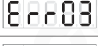 | ◆ 系统过热，将控制器安装在通风散热良好的工作环境中 |
| 8 | Err04 |  | ◆ 保留，联络本公司技术支持 |
| 9 | Err05 |  | ◆ 保留，联络本公司技术支持 |

2024-03　　　　　　　　　　　　　　　　-39-　　　　　　　　　　　　　　　　SDVC40SMSCN_4.01

### 第 48 页

南京创优科技有限责任公司  
网址:www.cuhnj.com  
电话:025-84730416  
传真:025-84730426  
邮箱:sales@cuhnj.com  
地址:南京市江宁区智能路9号  
启迪城学研园2幢

文档编号：IDP1000396
<!-- /auto:ai-body-draft v1 -->

<!-- auto:data-params-summary v1 -->
## 附录 · 参数表（结构化侧车·机器生成）

> 说明：本节由 `data/<doc_key>/params/params.yaml` 自动渲染（展示前若干行），用于校对与二次开发。定稿以层 C 数据为准。

| 参数 | 标志/符号 | 范围 | 默认 | 单位 | 备注 |
| --- | --- | --- | --- | --- | --- |
|  0~3 |  |  |  |  |  |
|  3~10 |  |  |  |  |  |
|  10~30 |  |  |  |  |  |
|   30~80 |  |  |  |  |  |
|   80~180 |  |  |  |  |  |
|   >180 |  |  |  |  |  |
|   CUH UH C H CU H |  |  |  |  |  |
|     极限参数：超过此指标将会造成严重损坏，必须严格遵守！ |  |  |  |  |  |
|  项目 |  |  |  |  |  |
|  静电放电 |  |  |  |  |  |
|  静电放电 |  |  |  |  |  |
|  电快速瞬变 脉冲群 |  |  |  |  |  |
|  直流电源纹 波抗扰度 |  |  |  |  |  |
|        范围 |  |  |  |  |  |
|        最小值 |  |  |  |  |  |
|        85 |  |  |  |  |  |
|        0 |  |  |  |  |  |
|        0.0 |  |  |  |  |  |
|        1 |  |  |  |  |  |
|      0.1 |  |  |  |  |  |
|      0 |  |  |  |  |  |
|      0.0025 |  |  |  |  |  |
|        0 |  |  |  |  |  |
|        0 |  |  |  |  |  |
|        0 |  |  |  |  |  |
|        0 |  |  |  |  |  |
|        40 |  |  |  |  |  |
|        0. 1 |  |  |  |  |  |
|      正弦 |  |  |  |  |  |
|      0.1 |  |  |  |  |  |

*（仅展示前 30 条，共 50 条；完整数据见下方链接。）*

- 完整 YAML：`data/cuh.sdvc40.manual.v4.01/params/params.yaml`
- 表格索引：`data/cuh.sdvc40.manual.v4.01/index.yaml`
<!-- /auto:data-params-summary v1 -->
