## 目录

> 下列条目来自 PDF 内置书签/大纲；链接指向本批转换生成的整页渲染图（`assets/pages/`），便于与原版 PDF 对照校对。

- [1: 封面](assets/pages/page-0001.png)（第 1 页）
- [2: 封2](assets/pages/page-0002.png)（第 2 页）
- [3: 序言](assets/pages/page-0003.png)（第 3 页）
- [4: 安全与预防措施](assets/pages/page-0004.png)（第 4 页）
- [5: 工作与储存环境](assets/pages/page-0005.png)（第 5 页）
- [7: 目录](assets/pages/page-0007.png)（第 7 页）
- [8: 目录2](assets/pages/page-0008.png)（第 8 页）
- [第一章 使用前须知](assets/pages/page-0009.png)（第 9 页）
- [1.1 检查包装内容](assets/pages/page-0009.png)（第 9 页）
- [1.2 指示灯、按键及外部部件说明](assets/pages/page-0010.png)（第 10 页）
- [第二章 产品介绍](assets/pages/page-0011.png)（第 11 页）
- [2.1 产品简介](assets/pages/page-0011.png)（第 11 页）
- [第三章 安装及使用指南](assets/pages/page-0012.png)（第 12 页）
- [3.1 控制器使用条件](assets/pages/page-0012.png)（第 12 页）
- [3.2 按键基本操作](assets/pages/page-0012.png)（第 12 页）
- [3.3 安装使用](assets/pages/page-0013.png)（第 13 页）
- [第四章 基本参数设置方法](assets/pages/page-0017.png)（第 17 页）
- [4.1 输出电压设定](assets/pages/page-0017.png)（第 17 页）
- [4.2 输出频率设定](assets/pages/page-0018.png)（第 18 页）
- [4.3 缓启动功能](assets/pages/page-0019.png)（第 19 页）
- [4.4 输出开关](assets/pages/page-0019.png)（第 19 页）
- [4.5 主输出开延时功能](assets/pages/page-0020.png)（第 20 页）
- [4.6 键盘锁定功能](assets/pages/page-0021.png)（第 21 页）
- [4.7 开机运行状态设定](assets/pages/page-0022.png)（第 22 页）
- [4.8 恢复出厂设定](assets/pages/page-0023.png)（第 23 页）
- [第五章 端口功能说明](assets/pages/page-0026.png)（第 26 页）
- [5.1 料满停机端口使用方法](assets/pages/page-0026.png)（第 26 页）
- [5.1.1 三线接近开关传感器接线方法](assets/pages/page-0026.png)（第 26 页）
- [5.1.2 对射传感器接线方法](assets/pages/page-0027.png)（第 27 页）
- [5.1.3光电传感器接线方法](assets/pages/page-0027.png)（第 27 页）
- [5.1.4 光纤放大器接线方法](assets/pages/page-0028.png)（第 28 页）
- [5.1.5 反射光电传感器接线方法](assets/pages/page-0029.png)（第 29 页）
- [5.1.6 PLC控制振动送料控制器启停的接线方法](assets/pages/page-0029.png)（第 29 页）
- [5.1.7 料满输入逻辑图](assets/pages/page-0030.png)（第 30 页）
- [5.1.8 三线开关传感器类型设定](assets/pages/page-0031.png)（第 31 页）
- [5.1.9 三线开关传感器开延时、关延时时间设定](assets/pages/page-0032.png)（第 32 页）
- [5.2 控制输出端口使用方法](assets/pages/page-0033.png)（第 33 页）
- [5.2.1 控制输出的接线方法](assets/pages/page-0033.png)（第 33 页）
- [5.2.2 控制输出逻辑图](assets/pages/page-0034.png)（第 34 页）
- [5.2.3 控制输出逻辑关系设定](assets/pages/page-0035.png)（第 35 页）
- [5.3 主输出端口使用方法](assets/pages/page-0036.png)（第 36 页）
- [5.3.1 主输出逻辑图](assets/pages/page-0036.png)（第 36 页）
- [5.3.2 主输出逻辑关系设定](assets/pages/page-0037.png)（第 37 页）
- [5.4 遥控调速端口使用方法](assets/pages/page-0038.png)（第 38 页）
- [5.5 RS485通讯端口使用方法](assets/pages/page-0039.png)（第 39 页）
- [5.5.1 通信协议设定](assets/pages/page-0039.png)（第 39 页）
- [5.5.2 通信地址设定](assets/pages/page-0039.png)（第 39 页）
- [5.5.3 通信波特率设定](assets/pages/page-0040.png)（第 40 页）
- [5.5.4 详细通信协议](assets/pages/page-0040.png)（第 40 页）
- [5.6 24V电源输出端口使用方法](assets/pages/page-0040.png)（第 40 页）
- [第六章 技术规格](assets/pages/page-0041.png)（第 41 页）
- [6.1 外形尺寸](assets/pages/page-0041.png)（第 41 页）
- [6.2 技术规格表](assets/pages/page-0042.png)（第 42 页）
- [6.3 参考标准](assets/pages/page-0043.png)（第 43 页）
- [第七章 附录](assets/pages/page-0044.png)（第 44 页）
- [7.1 参数列表](assets/pages/page-0044.png)（第 44 页）
- [7.2 接线端口说明](assets/pages/page-0046.png)（第 46 页）
- [7.3 输入输出电路图](assets/pages/page-0046.png)（第 46 页）
- [7.4 故障诊断](assets/pages/page-0047.png)（第 47 页）
- [第八章 产品保证信息](assets/pages/page-0048.png)（第 48 页）
- [8.1 保质期](assets/pages/page-0048.png)（第 48 页）
- [8.2 保修范围](assets/pages/page-0048.png)（第 48 页）
- [8.3 产品适用性](assets/pages/page-0048.png)（第 48 页）
## 术语与命名

- 侧车：`glossary/terms.yaml`（机读）、`glossary/zh-CN.md`（人读）；候选表，定稿后并入公司级 `glossary/`。

## 适用范围

- 本文档由 PDF 自动转换生成，正文与插图需人工核对。

## 变更记录

- 2026-06-05 14:46:27：由转换工具从源 PDF 生成首版。

## 正文

<!-- auto:ai-body-draft v1 -->
> 以下为**整页视觉转写**的正文草稿（多模态模型直接输出 Markdown，含 GFM 表； 若配置 `[[vcrop:页:序]]` 占位符，裁剪步骤会插入 `assets/images/` 下 PNG）。**请务必人工校对。**

### 第 1 页

# CUH®

## 多路数字调频压电振动送料控制器

**Multi-channel Variable Frequency Digital Controller**  
**for Piezo Vibratory Feeder**

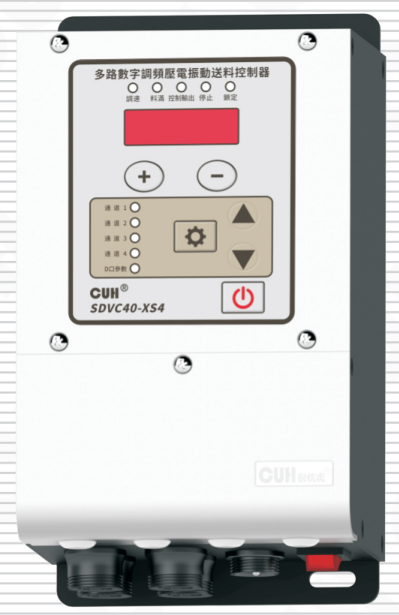

## SDVC40-XS系列

# 用户手册

### 第 2 页

多路数字调频压电振动送料控制器　　　　　　　　　　　　　　　　　SDVC40-XS系列

---

## 版权说明

南京创优科技有限责任公司保留所有权利。

本用户手册上包含的所有信息是属于本公司的知识，受著作权法及所有法律的保护。本公司根据著作权法及其他法律享有并保留所有著作权和其他法律赋予的权利，未经本公司书面同意不得以任何形式对本用户手册的部分或全部进行抄袭、翻译、转译、仿制或其他利用。

## 免责声明

本用户手册的所有内容仅说明本公司生产的相关产品的使用方法，并且是根据现有技术和提供给您使用时的状态进行描述的，在您使用本产品时必须自行承担相关风险。除法律强制规定外，本公司不因本用户手册对产品负有任何明示或暗示的责任，包括但不限于人身伤害、财产损失、机会丧失。

您明确了解上述风险并同意，除法律强制规定外，本公司无须为您的任何直接、间接的损害或损失负责（包括但不限于人员、财物、数据等有形损失和名誉、机会等无形损失）。

本公司保留对本用户手册中所适用的产品进行修改而不预先及事后通知的权利。

---

2024-03　　　　　　　　　　　　　　　　　　　　　　　　　SDVC40XSSMSCN_2.01

### 第 3 页

多路数字调频压电振动送料控制器　　　　　　　　　　　　　　SDVC40-XS系列

---

## 序　言

感谢您使用南京创优科技有限责任公司（在本手册中以下简称本公司）出品的SDVC40-XS系列多路数字调频压电振动送料控制器（在本手册中以下简称本产品、本控制器或控制器）。

本手册介绍了本产品的基本操作方法、功能技术说明和典型应用示例，为用户提供安装调试、参数设置、异常诊断、故障排除及日常维护控制器的相关信息。为了确保正确安装和使用本控制器，请在装机之前仔细阅读本用户手册，并请妥善保存。

以下符号提醒您注意有关防止人身伤害和产品损坏的事项，请务必阅读。

| 标志 | 说明 |
|---|---|
| ⚠️ **危险** | 表示若不遵守该事项，将导致人员伤亡。 |
| ⚠️ **警告** | 表示若不遵守该事项，可能导致人员伤亡。 |
| ⚠️ **小心** | 表示若不遵守该事项，可能导致人员遭受中度或轻微伤害。 |
| **注意** | 表示若不遵守该事项，将导致本产品损坏及财产损失。 |
| **要点** | 表示在使用过程中必须要遵守的注意事项和使用限制等。 |

### 本说明书适合以下型号控制器：

- 多路数字调频压电振动送料控制器 SDVC40-XS2（50mA * 2）
- 多路数字调频压电振动送料控制器 SDVC40-XS3（50mA * 3）
- 多路数字调频压电振动送料控制器 SDVC40-XS4（50mA * 4）

---

2024-03　　　　　　　　　　　　　　SDVC40XSSMSCN_2.01

### 第 4 页

**多路数字调频压电振动送料控制器**  
**SDVC40-XS系列**

# 安全与预防措施

1. **【危险】** 本产品仅供驱动压电型振动盘之用，请勿将本产品用于保护人体或人体部位等目的。

2. **【危险】** 本产品不得作为防爆产品使用，请勿在危险场所和/或潜在爆炸气体环境中使用本产品。

3. **【警告】** 本产品是采用交流市电供电的设备，请勿施加交流电压超过260V。如果施加过大电压则可能导致产品爆炸或着火。

4. **【警告】** 请勿在带电的情况下拔插接线或试图触摸接线仓内各接线点，以防发生触电意外事故。

5. **【注意】** 本产品设计使用于阴凉干燥环境，请勿将本产品置于室外、可能会浸水、阳光暴晒场所工作，也不要在超过本产品电气特性要求的温度和湿度范围之外工作。

6. **【要点】** 请务必将本产品固定在可靠接地的坚固平台上。

7. **【要点】** 任何情况下请勿将本产品在超越设计极限状态下工作。

8. **【要点】** 请严格按照本手册的说明操作，对于违反这些操作说明所造成的任何设备损失或人身伤害，本公司不承担任何民事和刑事责任。

9. 本手册的最终解释权归本公司所有。

---

2024-03  
SDVC40XSSMSCN_2.01

### 第 5 页

多路数字调频压电振动送料控制器　　　　　　　　　　　　　　　SDVC40-XS系列

---

# 工作与储存环境

## 一、使用前的检查

每台控制器在出厂前，均经过严格的品质检验，并经过强化的防撞包装处理。客户在拆箱后，请即刻进行下列检查：

1. 检查控制器是否在运输过程中受到损伤。
2. 检查控制器型号是否与订货登记资料完全相同。

## 二、工作环境

为使本控制器具有更好的使用效果和更长的使用寿命，请将控制器安装在符合下列条件的环境中：

- 良好的通风散热环境
- 远离水滴、蒸气、灰尘，（特别是油性灰尘）
- 无腐蚀、易燃性的气体、液体
- 无漂浮性的尘埃及金属微粒
- 安装表面坚固无振动
- 远离电磁噪声干扰
- 使用环境温度为0℃到40℃
- 仅适用于海拔2000m以下地区安全使用

---

2024-03　　　　　　　　　　　　　　　　　　　　　　　　　SDVC40XSSMSCN_2.01

### 第 6 页

多路数字调频压电振动送料控制器                                      SDVC40-XS系列

---

---

2024-03                                      SDVC40XSSMSCN_2.01

### 第 7 页

多路数字调频压电振动送料控制器  
SDVC40-XS系列

# 目 录

| 条目 | 页码 |
|---|---:|
| 第一章 使用前须知 | 1 |
| 1.1 检查包装内容 | 1 |
| 1.2 指示灯、按键及外部部件说明 | 2 |
| 第二章 产品介绍 | 3 |
| 2.1 产品简介 | 3 |
| 第三章 安装及使用指南 | 4 |
| 3.1 控制器使用条件 | 4 |
| 3.2 按键基本操作 | 4 |
| 3.3 安装使用 | 5 |
| 第四章 基本参数设置方法 | 9 |
| 4.1 输出电压设定 | 9 |
| 4.2 输出频率设定 | 10 |
| 4.3 缓启动功能 | 11 |
| 4.4 输出开关 | 11 |
| 4.5 主输出开延时功能 | 12 |
| 4.6 键盘锁定功能 | 13 |
| 4.7 开机运行状态设定 | 14 |
| 4.8 恢复出厂设定 | 15 |
| 第五章 端口功能说明 | 18 |
| 5.1 料满停机端口使用方法 | 18 |
| 5.1.1 三线接近开关传感器接线方法 | 18 |
| 5.1.2 对射传感器接线方法 | 19 |
| 5.1.3 光电传感器接线方法 | 19 |
| 5.1.4 光纤放大器接线方法 | 20 |
| 5.1.5 反射光电传感器接线方法 | 21 |
| 5.1.6 PLC控制振动送料控制器启停的接线方法 | 21 |
| 5.1.7 料满输入逻辑图 | 22 |
| 5.1.8 三线开关传感器类型设定 | 23 |
| 5.1.9 三线开关传感器开延时、关延时时间设定 | 24 |

2024-03  
SDVC40XSSMSCN_2.01

### 第 8 页

多路数字调频压电振动送料控制器　　　　　　　　　　　　　　　　　　　　　　SDVC40-XS系列

---

5.2  控制输出端口使用方法 --------------------------------------------------------------25

5.2.1 控制输出的接线方法 --------------------------------------------------------------25

5.2.2 控制输出逻辑图 --------------------------------------------------------------------26

5.2.3 控制输出逻辑关系设定 ------------------------------------------------------------27

5.3  主输出端口使用方法 -------------------------------------------------------------------28

5.3.1 主输出逻辑图 ----------------------------------------------------------------------28

5.3.2 主输出逻辑关系设定 --------------------------------------------------------------29

5.4  遥控调速端口使用方法 ----------------------------------------------------------------30

5.5  RS485通讯端口使用方法 ------------------------------------------------------------31

5.5.1 通信协议设定 ----------------------------------------------------------------------31

5.5.2 通信地址设定 ----------------------------------------------------------------------31

5.5.3 通信波特率设定 -------------------------------------------------------------------32

5.5.4 详细通信协议 ----------------------------------------------------------------------32

5.6  24V电源输出端口使用方法 ----------------------------------------------------------32

第六章 技术规格 ---------------------------------------------------------------------------33

6.1  外形尺寸 -------------------------------------------------------------------------------33

6.2  技术规格表 ----------------------------------------------------------------------------34

6.3  参考标准 -------------------------------------------------------------------------------35

第七章 附录 --------------------------------------------------------------------------------36

7.1  参数列表 -------------------------------------------------------------------------------36

7.2  接线端口说明 -------------------------------------------------------------------------38

7.3  输入输出电路图 -----------------------------------------------------------------------38

7.4  故障诊断 -------------------------------------------------------------------------------39

第八章 产品保证信息 ----------------------------------------------------------------------40

8.1  保质期 ----------------------------------------------------------------------------------40

8.2  保修范围 -------------------------------------------------------------------------------40

8.3  产品适用性 ----------------------------------------------------------------------------40

---

2024-03　　　　　　　　　　　　　　　　　　　　　　　　　　　　　SDVC40XSSMSCN_2.01

### 第 9 页

多路数字调频压电振动送料控制器　　　　　　　　　　　　　　　　　SDVC40-XS系列

---

# 第一章 使用前须知

本章节介绍产品包装内容、控制器各零部件的名称、选配部件代码。

## 1.1 检查包装内容

使用本产品之前，请检查以下设备和附件完整。如果发现产品有缺陷或已损坏，请与我司联系。

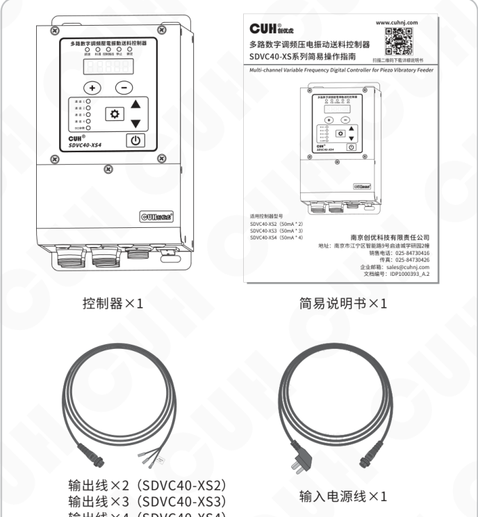

包装内容：

- 控制器×1
- 简易说明书×1
- 输出线×2（SDVC40-XS2）
- 输出线×3（SDVC40-XS3）
- 输出线×4（SDVC40-XS4）
- 输入电源线×1

---

2024-03　　　　　　　　　　　　　　　　　- 1 -　　　　　　　　　　　　　　　　　SDVC40XSSMSCN_2.01

### 第 10 页

页眉：多路数字调频压电振动送料控制器　　　　　　　　　　　　　　　　　SDVC40-XS系列

## 1.2 指示灯、按键及外部部件说明

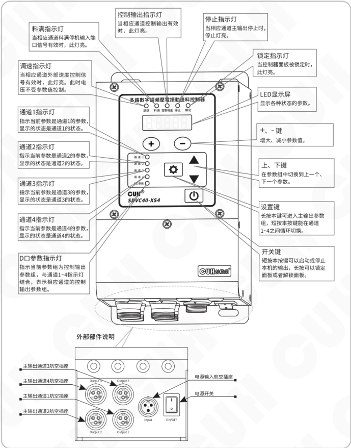

### 面板指示灯与按键说明

- **通道1指示灯**：指示当前参数是通道1的参数，显示的状态是通道1的状态。
- **通道2指示灯**：指示当前参数是通道2的参数，显示的状态是通道2的状态。
- **通道3指示灯**：指示当前参数是通道3的参数，显示的状态是通道3的状态。
- **通道4指示灯**：指示当前参数是通道4的参数，显示的状态是通道4的状态。
- **D口参数指示灯**：指示当前参数组为控制输出参数组，与通道1~4指示灯结合，表示相应通道的控制输出参数组。
- **料满指示灯**：当相应通道料满停机输入端口信号有效时，此灯亮。
- **调速指示灯**：当相应通道外部速度控制信号有效时，此灯亮。此时电压不受参数值控制。
- **控制输出指示灯**：当相应通道控制输出有效时，此灯亮。
- **停止指示灯**：当相应通道主输出停止时，停止灯亮。
- **锁定指示灯**：当控制器面板被锁定时，此灯亮。
- **LED显示屏**：显示各种状态的参数。
- **+、- 键**：增大、减小参数值。
- **上、下键**：在参数组中切换到上一个、下一个参数。
- **设置键**：长按本键可进入主输出参数组，短按本按键能在通道1~4之间循环切换。
- **开关键**：短按本按键可以启动或停止本机的输出，长按可以锁定面板或者解锁面板。

### 面板文字标识

- CUH创优虎
- SDVC40-XS4
- 通道：4、3、2、1
- D口参数
- 锁定、停止、料满、调速
- 多路数字调频压电振动送料控制器
- 控制输出

### 外部部件说明

- 主输出通道3航空插座（Output 4）
- 主输出通道4航空插座（Output 3）
- 主输出通道1航空插座（Output 2）
- 主输出通道2航空插座（Output 1）
- 电源输入航空插座（Input）
- 电源开关（ON/OFF）

页脚：2024-03　　　　　　　　　　　　- 2 -　　　　　　　　　　　　SDVC40XSSMSCN_2.01

### 第 11 页

多路数字调频压电振动送料控制器　　　　　　　　　　　　　　　　　　　　SDVC40-XS系列

# 第二章　产品介绍

本章节主要内容包括本产品的简单介绍和主要特色功能。

## 2.1 产品简介

SDVC40-XS系列多路数字调频压电振动送料控制器是本公司针对自动化送料市场开发的一款通用型产品，融合最新电子技术，经过精心设计，为用户提供最方便实用的功能，包括主要功能特点：

**频率调节：** 输出频率范围40.0~400.0Hz。

**电压调节：** 输出电压范围0~220V。

**相位差调节：** 在主输出频率相同时，调节各通道之间的相位差的范围是±180°。

**自动稳压：** 可消除由于电源电压波动造成的送料速度变化。还可以消除工频交流电造成的拍频效应。

**料满停机：** 通过自动识别NPN或者PNP型传感器实现料满停机控制，并具有可调缓启动时间、开延时、关延时、逻辑方向调节等控制功能。

**远程速度控制：** 控制器可以接受1~5V电压信号或4~20mA电流信号控制其输出电压，使用外置的电位器、PLC或其他设备实现。

**输出开关：** 面板上设有轻触按键，可以即时开停机，方便用户调试设备。

**键盘锁定：** 通过长按开关键2秒钟可以锁定所有按键，防止用户误操作。

**开机运行状态：** 用户可以选择开机时控制器输出状态：开机运行、开机停止或者开机跟随上次关机前的状态。

**控制输出：** 通过晶体管输出控制信号，可直接用于控制电磁阀等外部设备与本控制器协调工作。

**RS485通信：** 支持ModBus ASCII和ModBus RTU两种通信协议。

**控制逻辑可编程：** 可通过参数设定控制信号、控制逻辑、延时时间等。

**保护功能：** 包括整机过热保护，主输出和控制输出的短路保护、过流保护。

**恢复出厂设置：** 可以快速将调乱的状态参数恢复为出厂默认设置，使控制器进入默认出厂工作状态。

---

2024-03　　　　　　　　　　　　　　　　　- 3 -　　　　　　　　　　　　　　　　　SDVC40XSSMSCN_2.01

### 第 12 页

多路数字调频压电振动送料控制器　　　　　　　　　　　　　　　SDVC40-XS系列

---

# 第三章　安装及使用指南

本章节介绍本产品使用所必须具备的条件以及如何正确进行安装与连接。

## 3.1 控制器使用条件

⚠️ **警告**　本产品是使用交流220V市电供电的设备。切不可将控制器连接到380V交流电，这将造成控制器不可恢复的严重损坏。

⚠️ **警告**　严禁通过继电器等设备切断供电的方式来控制本控制器输出的启动和停止，这将严重降低控制器寿命。

**注意**　任何情况下都不可以在带电状态下拔插接线或试图触摸插座内各接点，以防触电和发生意外。

**注意**　本机壳内全部为固态电路，没有可以调节的部件和用户可以自行维修的部分，请不要试图维修控制器。

## 3.2 按键基本操作

【短按】定义为按下按键的时间大于0.1秒小于2秒  
【长按】定义为按下按键的时间大于2秒

设置参数的入口：

- 长按 ⚙ 进入或退出主输出参数组。
- 长按 ⚙ 和 ▲ 进入或退出控制输出参数组。
- 长按 ⚙ 和 ▲ 以及 ▼ 进入或退出共用参数组。

通道切换方式：

- 短按 ⚙ 可在通道1~4之间循环切换。

---

2024-03　　　　　　　　　　　　- 4 -　　　　　　　　　　　　SDVC40XSSMSCN_2.01

### 第 13 页

多路数字调频压电振动送料控制器　　　　　　　　　　　　　　　　　SDVC40-XS系列

## 3.3 安装使用

**第一步：**

打开控制器的外包装，检查控制器外观及侧标型号，判断是否为所需的型号。

**第二步：**

取出配件包里的输出线，将输出线接线端子接到振动盘的压电陶瓷电极上。

将输出线航空插头上的缺口，对准控制器输出插座上的三角形标记，正确连接输出线后锁紧螺母。

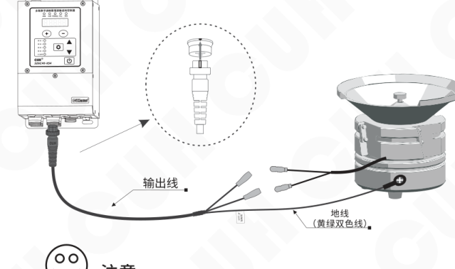

**注意**

确保压电陶瓷的电极接在两个输出引脚上。外壳需要可靠接地。

否则可能导致机壳带电，发生严重安全事故。

2024-03　　　　　　　　　　　　- 5 -　　　　　　　　　　　　SDVC40XSSMSCN_2.01

### 第 14 页

多路数字调频压电振动送料控制器　　　　　　　　　　　　　　　　　SDVC40-XS系列

---

### 第三步：

将输入电源线航空插头插到控制器上，  
并锁紧螺母。

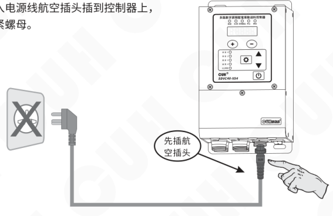

### 第四步：

将电源线三爪插头插在供电电源插座上。

---

2024-03　　　　　　　　　　　　　- 6 -　　　　　　　　　　　　　SDVC40XSSMSCN_2.01

### 第 15 页

多路数字调频压电振动送料控制器　　　　　　　　　　　　　　　　　SDVC40-XS系列

---

### 第五步：

打开控制器电源开关，把输出电压“U”调整到30~80之间。

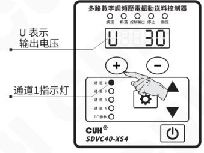

### 第六步：

按住 ⚙ 键2秒，进入频率“E”调整状态；使用 ＋ 和 － 键来寻找振动体的固有频率，也就是我们常说的谐振点。

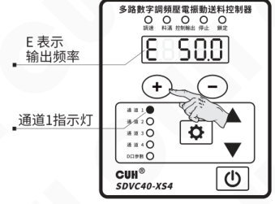

> ☺
>
> - 振动最大时的频率为振动体的固有频率。
> - 每个振动体都有固有的振动频率，为了能达到最佳的工作状态，请调整本参数使振动体工作在合适的工作频率上。

---

2024-03　　　　　　　　　　　　　- 7 -　　　　　　　　　　　　　SDVC40XSSMSCN_2.01

### 第 16 页

多路数字调频压电振动送料控制器　　　　　　　　　　　　　　　　　SDVC40-XS系列

---

**第七步：**

当找到振动体的固有频率后，  
再进入电压调整状态功能，使用 **＋** 和 **－** 键，调到最佳的送料速度。

图示说明：

- **U** 表示输出电压
- 通道1指示灯

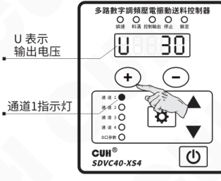

---

2024-03　　　　　　　　　　　　　　- 8 -　　　　　　　　　　　　　　SDVC40XSSMSCN_2.01

### 第 17 页

多路数字调频压电振动送料控制器　　　　　　　　　　　　　　　　　SDVC40-XS系列

# 第四章　基本参数设置方法

本章节介绍本产品的典型功能使用方法。

## 4.1 输出电压设定

本控制器可以直接在控制面板上以数字方式设定输出电压。由于本控制器特有的稳压功能，该数值为输出电压的有效值，并不会受到输入电压的影响，即使在电压不稳定场合中使用也可以保持稳定工作。同时，直接的电压数值设定也为用户了解设备运行情况提供了准确的数据。

- 打开控制器的电源开关。
- 控制器进入输出电压状态，控制器上通道1指示灯点亮，LED显示屏显示电压标志“U”和上次设置的电压值。
- 通过 `+` 和 `−` 键可以对电压“U”值进行调整。

示意图：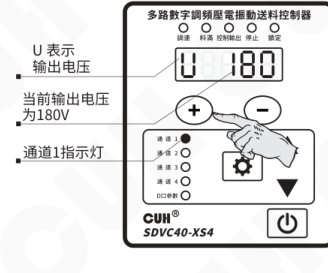

---

2024-03　　　　　　　　　　　　- 9 -　　　　　　　　　　　　SDVC40XSSMSCN_2.01

### 第 18 页

多路数字调频压电振动送料控制器　　　　　　　　　　　　　　　　　SDVC40-XS系列

---

## 4.2 输出频率设定

本控制器采用直接数字频率合成技术（DDS），具有非常高的频率精度和稳定性，不随时间和温度的改变而变化。

- 按住 <kbd>⚙</kbd> 键2秒，进入主输出参数的调整状态。
- 控制器上LED显示频率标志“E”和频率值。
- 通过 <kbd>＋</kbd> 和 <kbd>－</kbd> 键可以对频率“E”值进行设定。

控制器面板示意图：

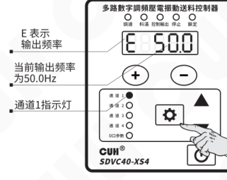

本系列控制器的输出频率范围是40.0～400.0Hz

> ☺
>
> - 基本功能调整状态下可以通过按 <kbd>＋</kbd> 和 <kbd>－</kbd> 键分别进行频率（E）、开延时（J）、关延时（L）、缓启动时间（t）等设定。
> - 再次长按 <kbd>⚙</kbd> 键2秒可以退出主输出参数组到电压调整状态。
> - 操作结束一分钟后控制器自动退出到电压调整状态。

---

2024-03　　　　　　　　　　　　　　　　　-10-　　　　　　　　　　　　　　　　　SDVC40XSSMSCN_2.01

### 第 19 页

多路数字调频压电振动送料控制器　　　　　　　　　　　　　　　　　　　　　　　　　SDVC40-XS系列

---

## 4.3 缓启动功能

本控制器从停止状态启动时，输出电压可以平缓提高到设定值，以防止振动设备和控制器遭受冲击。  
缓启动时间（t）：控制器从停止状态启动时，输出电压从0V平滑升高到达设定输出电压所需要的时间称为缓启动时间。

- 按住 **⚙** 键2秒，进入主输出参数的调整状态。
- 使用 **▲** 和 **▼** 键切换到缓启动参数调整状态 “**t**”。
- 通过 **＋** 和 **－** 键调整参数值。该参数的单位是秒，精度是0.1秒。

示意图标注：

- **t** 表示缓启动时间
- 缓启动时间为 **1.5秒**
- 通道1指示灯

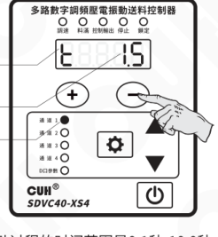

缓启动过程的时间范围是 **0.1秒-10.0秒**

## 4.4 输出开关

面板上的轻触式输出开关可以方便快速地开启或停止本机的输出。

- 使用控制器面板上的 **⏻** 键，可以控制本机启动或停止输出。停止输出时，“停止”指示灯点亮，表示进入“停止”状态。

示意图标注：

- 停止时停止指示灯亮

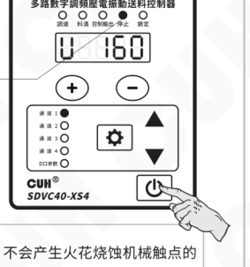

> 本功能使用软开关，由数字信号进行控制。因此，不会产生火花烧蚀机械触点的问题，可以大大延长控制器和振动设备的使用寿命。

---

2024-03　　　　　　　　　　　　　　　　　-11-　　　　　　　　　　　　　　　　　SDVC40XSSMSCN_2.01

### 第 20 页

**多路数字调频压电振动送料控制器**　　　　　　　　　　　　　　　　　　　　　　　　　**SDVC40-XS系列**

---

## 4.5 主输出开延时功能

本控制器可以设定主输出的开延时时间。主输出的开延时时间是指料满信号由关闭主输出状态变为开启主输出状态，直到主输出端口有输出的时间。

- 按住 **⚙** 键不放开，保持2秒，进入主输出参数设定状态。
- 短按 **▲** 和 **▼** 键切换到“**L**”状态，即主输出开延时参数设定状态。
- 通过 **＋** 和 **－** 键调整参数值。该参数单位是秒，精度为0.1秒。

图示标注：

- **L** 表示主输出开延时
- 开延时时间为0.1秒
- 通道1指示灯

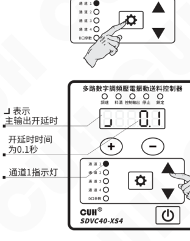

> 🙂 控制输出也具有开延时功能，操作如下：  
> 按住 **⚙** 键不放开，再按 **▲** 键保持2秒，进入控制输出参数设定状态。  
> 后续参数调整和主输出开延时参数调整操作一致。

---

2024-03　　　　　　　　　　　　　　　　　-12-　　　　　　　　　　　　　　　　　SDVC40XSSMSCN_2.01

### 第 21 页

多路数字调频压电振动送料控制器　　　　　　　　　　　　　　　　　SDVC40-XS系列

## 4.6 键盘锁定功能

为了防止误操作，本机设定了键盘锁。这样当控制器各项参数设置好后，可以有效避免其他人的误动作影响本机正常工作。即使关机后重新开机，键盘锁状态依然保持上次关机时的状态。

- 通过长按 `⏻` 键2秒可以锁定所有按键，此时键盘锁定指示灯点亮。
- 再次长按 `⏻` 键2秒可以解除锁定。

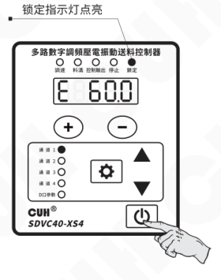

2024-03　　　　　　　　　　　　　　　　　-13-　　　　　　　　　　　　　　　　SDVC40XSSMSCN_2.01

### 第 22 页

多路数字调频压电振动送料控制器　　　　　　　　　　　　　　　　　SDVC40-XS系列

---

## 4.7 开机运行状态设定

为了防止在正常情况下突然停电然后来电或者对本控制器的上电状态有特殊的要求，可以通过设定该参数，来设定本控制器的上电状态是运行、停止、跟随上次关机时的状态。

- » 按住 <kbd>⚙</kbd> 键不放开，再按 <kbd>▲</kbd> 和 <kbd>▼</kbd> 键保持2秒，进入共用参数设定状态。
- » 短按 <kbd>▼</kbd> 键切换到“`Γd`”状态，即开机运行状态参数设定。
- » 通过 <kbd>＋</kbd> 和 <kbd>－</kbd> 键调整该参数。

操作示意图：

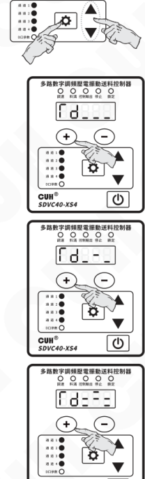

> `Γd___` 表示开机运行状态是开启输出。
>
> `Γd_-_` 表示开机运行状态是关闭输出。
>
> `Γd=_` 表示开机运行状态是跟随上次关机时的状态：如果上次关机时控制器是停止输出的，那么下次上电的时候控制器会保持停止输出状态；反之如果上次关机时控制器是开启输出的，那么下次上电的时候控制器会保持开启输出状态。

---

2024-03　　　　　　　　　　　　-14-　　　　　　　　　　　　SDVC40XSSMSCN_2.01

### 第 23 页

多路数字调频压电振动送料控制器　　　　　　　　　　　　　　　　　SDVC40-XS系列

---

## 4.8 恢复出厂设定

本功能可以使用户快速将控制器设置为出厂默认设置状态。

由于本控制器功能强大，有数量众多的控制参数可以由用户设定，对于初学者，可能在多次的设定修改后不能恢复控制器的正常工作状态。使用该功能可以快速将调乱的参数状态恢复为出厂默认设置。

本控制器可以将所有通道的所有参数，某个通道的主输出参数和某个通道的控制输出参数恢复出厂设置。

### 将所有通道的所有参数恢复出厂设置：

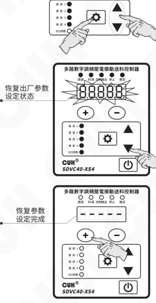

» 按住 ⚙ 键不放开，再按 ▲ 和 ▼ 键保持2秒，进入共用参数设定状态。

» 短按 ▼ 键切换到全屏闪烁状态，此时长按 ＋ 键，直到控制器显示“-----”，表示控制器已经重设完毕。

» 松开 ＋ 键，控制器将进入正常的电压调整状态“U”此时控制器就像刚开始使用一样，所有参数都已经恢复到出厂默认状态。

图中状态标注：

- 恢复出厂参数设定状态
- 恢复参数设定完成

---

2024-03　　　　　　　　　　　　　-15-　　　　　　　　　　　　　SDVC40XSSMSCN_2.01

### 第 24 页

多路数字调频压电振动送料控制器　　　　　　　　　　　　　　　　　SDVC40-XS系列

---

### 将某一通道的主输出恢复出厂设置：

- 选择需要恢复出厂设置的通道。

- 按住 **⚙** 键不放开，保持2秒，进入主输出参数设定状态。

- 短按 **▼** 键切换到全屏闪烁状态，此时长按 **＋** 键，直到控制器显示“-----”，表示该通道主输出参数已经重设完毕。

- 松开 **＋** 键，控制器将进入正常的电压调整状态“U”此时当前通道的主输出恢复出厂设置。

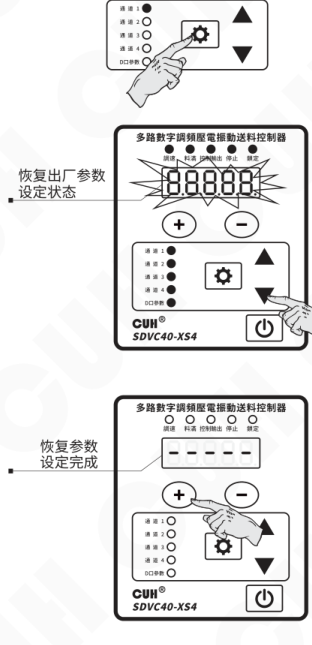

---

2024-03　　　　　　　　　　　　　　　　　-16-　　　　　　　　　　　　　　　　　SDVC40XSSMSCN_2.01

### 第 25 页

多路数字调频压电振动送料控制器  
SDVC40-XS系列

## 将某一通道的控制输出恢复出厂设置：

- 选择需要恢复出厂设置的通道。

- 按住 `⚙` 键不放开，再按 ▲ 键保持2秒，进入控制输出参数设定状态。

恢复出厂参数设定状态：

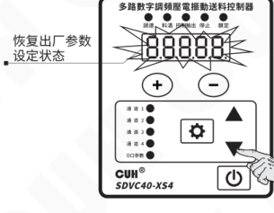

- 短按 ▼ 键切换到全屏闪烁状态，此时长按 `＋` 键，直到控制器显示“-----”，表示该通道控制输出参数已经重设完毕。

恢复参数设定完成：

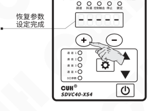

- 松开 `＋` 键，控制器将进入正常的电压调整状态“U”，此时当前通道的控制输出恢复出厂设置。

---

2024-03　　　　　　　　　　　　-17-　　　　　　　　　　　　SDVC40XSSMSCN_2.01

### 第 26 页

多路数字调频压电振动送料控制器　　　　　　　　　　　　　　　SDVC40-XS系列

# 第五章 端口功能说明

本机可以接受多种外部信号或传感器控制其运行状态。本节主要介绍料满停机传感器和PLC控制等的使用方法。

## 5.1 料满停机端口使用方法

本控制器可以自动识别NPN和PNP型开关传感器，配合使用各类开关传感器，如接近开关传感器、光电传感器、光纤传感器等可以实现自动启动和停止功能。

### 5.1.1 三线接近开关传感器接线方法

**第一步：**

打开控制器接线仓的仓门。

**第二步：**

按照图例连接传感器。

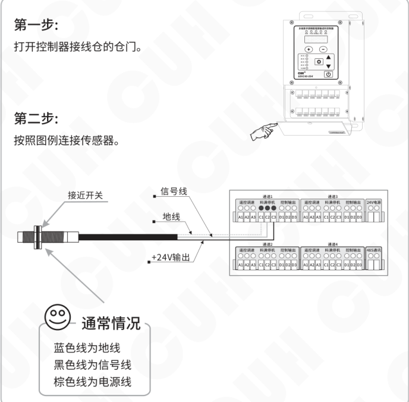

2024-03　　　　　　　　　　　　　　　　-18-　　　　　　　　　　　　　　　　SDVC40XSSMSCN_2.01

### 第 27 页

多路数字调频压电振动送料控制器　　　　　　　　　　　　　　　　SDVC40-XS系列

---

## 5.1.2 对射传感器接线方法

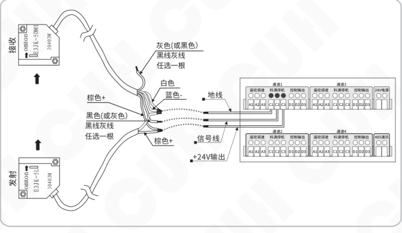

## 5.1.3光电传感器接线方法

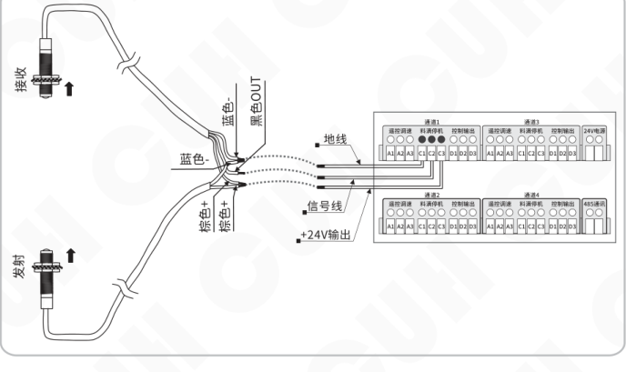

---

2024-03　　　　　　　　　　　　-19-　　　　　　　　　　　　SDVC40XSSMSCN_2.01

### 第 28 页

多路数字调频压电振动送料控制器　　　　　　　　　　　　　　　　SDVC40-XS系列

## 5.1.4 光纤放大器接线方法

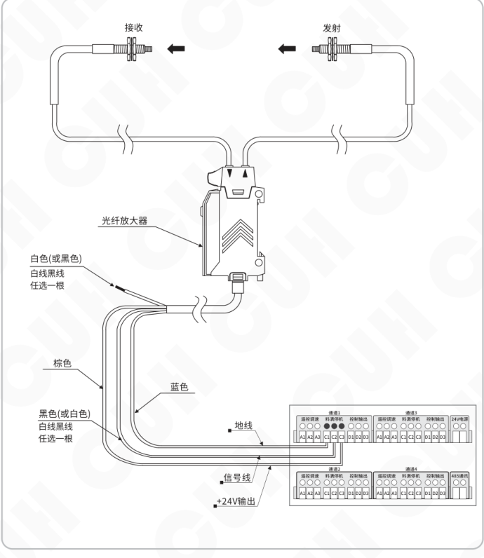

2024-03　　　　　　　　　-20-　　　　　　　　　SDVC40XSSMSCN_2.01

### 第 29 页

### 5.1.5 反射光电传感器接线方法

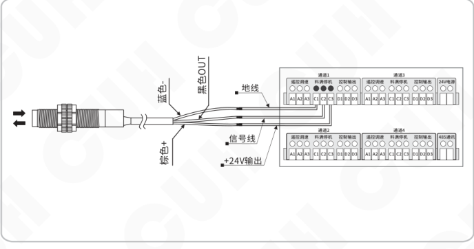

### 5.1.6 PLC控制振动送料控制器启停的接线方法

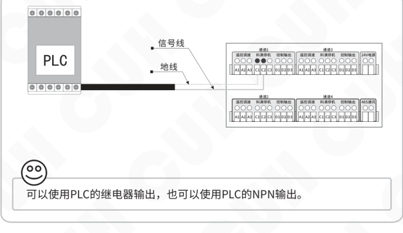

可以使用PLC的继电器输出，也可以使用PLC的NPN输出。

### 第 30 页

**多路数字调频压电振动送料控制器**　　　　　　　　　　　　　　　　**SDVC40-XS系列**

## 5.1.7 料满输入逻辑图

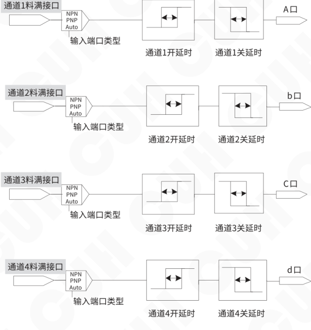

| 通道 | 料满接口 | 输入端口类型 | 开延时 | 关延时 | 输出口 |
|---|---|---|---|---|---|
| 通道1 | 通道1料满接口 | NPN / PNP / Auto | 通道1开延时 | 通道1关延时 | A口 |
| 通道2 | 通道2料满接口 | NPN / PNP / Auto | 通道2开延时 | 通道2关延时 | b口 |
| 通道3 | 通道3料满接口 | NPN / PNP / Auto | 通道3开延时 | 通道3关延时 | C口 |
| 通道4 | 通道4料满接口 | NPN / PNP / Auto | 通道4开延时 | 通道4关延时 | d口 |

2024-03　　　　　　　　　　　　　　-22-　　　　　　　　　　　　　　SDVC40XSSMSCN_2.01

### 第 31 页

多路数字调频压电振动送料控制器　　　　　　　　　　　　　　　　　SDVC40-XS系列

## 5.1.8 三线开关传感器类型设定

本控制器默认传感器类型为自动识别，用户也可以根据需要指定类型，具体操作方式如下：

- 按住 `⚙` 键不放开，再按 ▲ 和 ▼ 键保持 2 秒，进入共用参数设定状态。
- 短按 ▼ 键切换到“ΓA”状态，即传感器类型参数设定。
- 通过 `+` 和 `−` 键调整该参数。

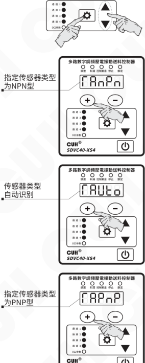

2024-03　　　　　　　　　　　　　　　-23-　　　　　　　　　　　　　　　SDVC40XSSMSCN_2.01

### 第 32 页

### 5.1.9 三线开关传感器开延时、关延时时间设定

在默认状态下，开关传感器的开延时、关延时时间总是相同的。用户也可以单独为开关传感器设定开延时、关延时时间，此时开关传感器具有独立的开延时、关延时时间。

#### 开延时设定

开延时（┘）从施加一个使控制器进入运行状态的控制信号开始，到控制器开始有输出，期间经历的延迟时间称为开延时。

- 按住 <kbd>⚙</kbd> 键不放开，保持2秒，进入主输出参数设定状态。
- 使用 <kbd>▼</kbd> 键切换到开延时参数调整状态“┘”。
- 通过 <kbd>+</kbd> 和 <kbd>-</kbd> 键调整参数值。该参数单位是秒，精度为0.1秒。

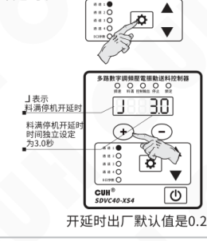

开延时出厂默认值是0.2秒。

#### 关延时设定

关延时（L）从施加一个使控制器进入停止状态的控制信号开始，到控制器输出停止，期间经历的延迟时间称为关延时。

- 按住 <kbd>⚙</kbd> 键不放开，保持2秒，进入主输出参数设定状态。
- 使用 <kbd>▼</kbd> 键切换到关延时参数调整状态“L”。
- 通过 <kbd>+</kbd> 和 <kbd>-</kbd> 键调整参数值。该参数单位是秒，精度为0.1秒。

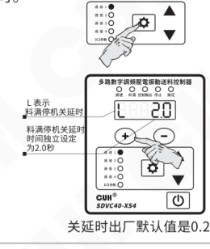

关延时出厂默认值是0.2秒。

注：将开、关延时时间调到小于0时，开关传感器独立延时时间将被关闭。

### 第 33 页

## 5.2 控制输出端口使用方法

### 5.2.1 控制输出的接线方法

本控制器可以输出低电压控制信号，以同步其它设备协同工作，如电磁阀、PLC等。

#### 控制电磁阀工作的连接方法

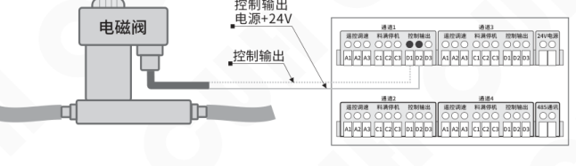

- 本控制器可直接驱动额定电压24V，功率小于4W的电磁阀。
- 如电磁阀功率过大则需考虑使用外部电源。

#### 控制继电器工作的连接方法

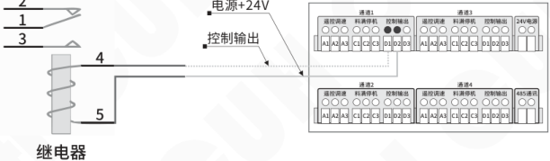

- 本控制器可直接驱动线圈额定电压24V，功率小于4W的继电器。

注：每个控制输出端口的最大输出能力为200mA，四路控制输出的总电流限制为500mA。

### 第 34 页

### 5.2.2 控制输出逻辑图

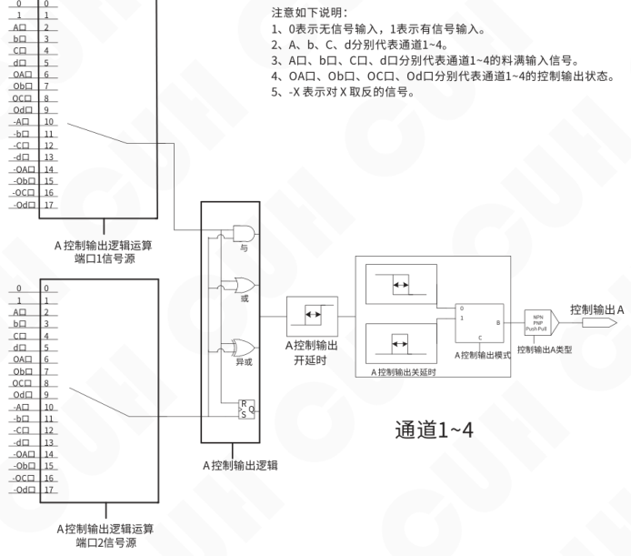

注意如下说明：

1. 0表示无信号输入，1表示有信号输入。
2. A、b、C、d分别代表通道1~4。
3. A口、b口、C口、d口分别代表通道1~4的料满输入信号。
4. OA口、Ob口、OC口、Od口分别代表通道1~4的控制输出状态。
5. -X表示对 X 取反的信号。

为了使控制输出端口逻辑关系的结果，能够延时一段时间再影响控制输出，可以使用控制输出端口延时功能，控制输出端口延时时间包括开延时时间和关延时时间，都可通过参数修改。

控制输出端口开延时时间，指控制输出端口逻辑关系的结果为有效信号时，经过的一段延时打开控制输出的时间。

控制输出端口关延时时间，指控制输出端口逻辑关系的结果为无效信号时，经过的一段延时关闭控制输出的时间。

客户可选择2种控制输出模式：延时模式、保持模式。

延时模式：指驱动控制输出的信号由有效变为无效后，控制输出经过一段关延时时间后变为关闭状态。

保持模式：指驱动控制输出的信号变为有效后，控制输出在关延时时间内保持打开，超过关延时的时间后变为关闭的状态。

### 第 35 页

多路数字调频压电振动送料控制器　　　　　　　　　　　　　　　　　SDVC40-XS系列

## 5.2.3 控制输出逻辑关系设定

本控制器可设定控制输出逻辑关系。可方便的控制输入料满信号对控制输出的影响。

- 按住 ⚙ 键不放开，再按 ▲ 键，保持2秒，进入控制输出参数设定状态。
- 短按 ▼ 键切换到 “Π” 状态，即控制输出逻辑关系参数调整状态。
- 通过 ＋ 和 － 键调整该参数。

操作与显示示意：

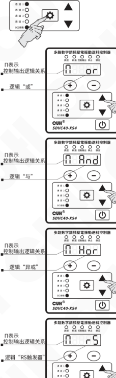

> 逻辑 “or”：当有一路料满停机信号要求控制输出有信号时，控制输出就有信号。
>
> 逻辑 “And”：当有两路料满停机信号都要求控制输出有信号时，控制输出才有信号。
>
> 逻辑 “Xor”：仅在两路料满停机信号一个要求控制输出有信号，另一个要求控制输出无信号时控制输出才有信号。
>
> 逻辑 “rS”：将两路料满停机信号用做RS触发器，来控制控制输出的状态。

2024-03　　　　　　　　　　　　　　　　　-27-　　　　　　　　　　　　　　　　　SDVC40XSSMSCN_2.01

### 第 36 页

## 5.3 主输出端口使用方法

### 5.3.1 主输出逻辑图

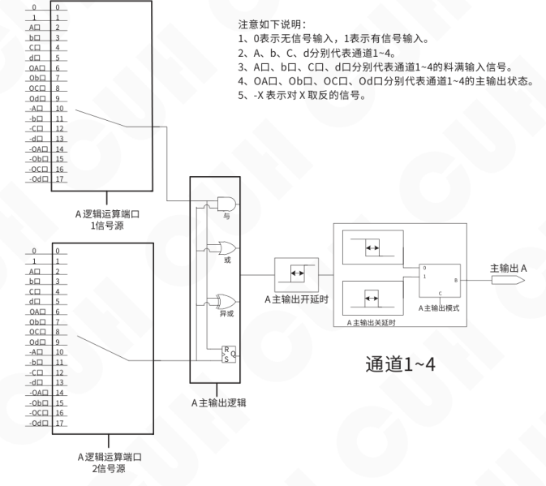

为了使得主输出逻辑关系的结果能够延时一段时间再影响控制器的输出，可以使用主输出延时功能，主输出延时时间包括主输出开延时时间和主输出关延时时间，都可通过参数修改。

主输出开延时时间，指主输出逻辑关系结果为有效信号时，经过的一段延时打开控制器输出的时间。

主输出关延时时间，指主输出逻辑关系结果为无效信号时，经过的一段延时关闭控制器输出的时间。

客户可选择2种输出模式：延时模式、保持模式。

延时模式：指驱动主输出的信号由有效变为无效后，主输出经过一段关延时时间后变为关闭状态。

保持模式：指驱动主输出的信号变为有效后，主输出在关延时时间内保持打开，超过关延时时间后变为关闭的状态。

### 第 37 页

多路数字调频压电振动送料控制器　　　　　　　　　　　　　　　　　SDVC40-XS系列

## 5.3.2 主输出逻辑关系设定

本控制器可设定主输出逻辑关系。可方便的控制输入料满信号对主输出的影响。

- 按住 ⚙ 键不放开，保持2秒，进入主输出参数设定状态。

- 短按 ▼ 键切换到“Π”状态，即主输出逻辑关系参数调整状态。

- 通过 ＋ 和 － 键调整该参数。

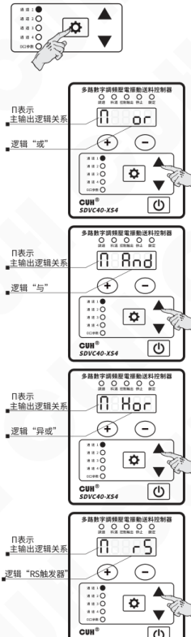

逻辑“or”：当有一路料满停机信号要求控制器停止运行时，控制就停止运行。

逻辑“And”：当有两路料满停机信号都要求控制器停止运行时，控制器才停止运行。

逻辑“Xor”：仅在两路料满停机信号一个要求控制器停止运行时，另一个要求控制器运行时，控制器才停止运行。

逻辑“rS”：将两路料满停机信号用做RS触发器，来控制主输出的状态。

2024-03　　　　　　　　　　　　　　-29-　　　　　　　　　　　　　　SDVC40XSSMSCN_2.01

### 第 38 页

多路数字调频压电振动送料控制器　　　　　　　　　　　　　　　SDVC40-XS系列

---

## 5.4 遥控调速端口使用方法

本控制器远程速度控制允许用户通过外接电位器或1～5V或4~20mA控制信号控制输出电压。这样，用户可以通过PLC、DCS或其它一些方法方便容易地进行外部远程速度控制。

> 当控制电压超过0.5V时，线控电压对控制器的控制生效。此时，面板的调速指示灯点亮，同时在面板上调整电压将失效。如果此时控制器处于电压调节状态，LED显示屏将显示输出电压。

### 外接电位器使用方法

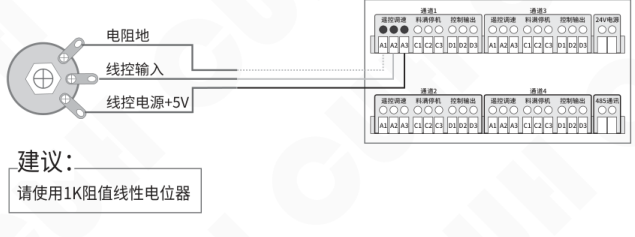

### 使用PLC进行输出电压控制的方法

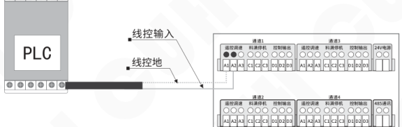

---

2024-03　　　　　　　　　　　　　-30-　　　　　　　　　　　　　SDVC40XSSMSCN_2.01

### 第 39 页

## 5.5 RS485通讯端口使用方法

本控制器具有RS485通信功能，并同时支持Modbus RTU与ASCII两种通信协议，控制器默认通信协议为ASCII协议。

### 5.5.1 通信协议设定

- 按住 ⚙ 键不放开，再按 ▲ 和 ▼ 键保持2秒，进入共用参数设定状态。
- 短按 ▼ 键切换到“P”参数。
- 通过 + 和 − 键调整该参数。

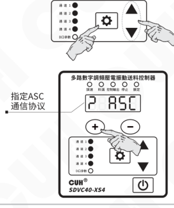

### 5.5.2 通信地址设定

- 按住 ⚙ 键不放开，再按 ▲ 和 ▼ 键保持2秒，进入共用参数设定状态。
- 短按 ▼ 键切换到“A”参数。
- 通过 + 和 − 键调整该参数。

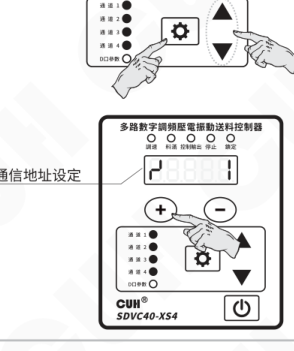

### 第 40 页

### 5.5.3 通信波特率设定

- 按住设置（齿轮）键不放开，再按 ▲ 和 ▼ 键保持2秒，进入共用参数设定状态。
- 短按 ▼ 键切换到“c”参数。
- 通过 ＋ 和 － 键调整该参数。

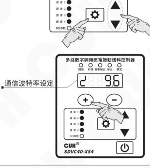

### 5.5.4 详细通信协议

通信协议示例1：通过ASCII通信协议设定控制器的通道1电压为220V。

| 起始 | 地址 | 地址 | 功能 | 功能 | 寄存器地址 | 寄存器地址 | 寄存器地址 | 寄存器地址 | 数据 | 数据 | 数据 | 数据 | LRC | LRC | 结束 | 结束 |
|---|---|---|---|---|---|---|---|---|---|---|---|---|---|---|---|---|
| 3A | 30 | 31 | 30 | 36 | 30 | 30 | 30 | 34 | 30 | 30 | 44 | 43 | 31 | 39 | 0D | 0A |

通信协议示例2：通过RTU通信协议设定控制器的通道一频率为400Hz。

| 地址 | 功能 | 寄存器地址 | 寄存器地址 | 数据 | 数据 | CRC | CRC |
|---|---|---|---|---|---|---|---|
| 01 | 06 | 00 | 00 | 0F | A0 | 8C | 42 |

详细的485通信协议请在本公司网站：www.cuhnj.com下载区下载。

### 5.6 24V电源输出端口使用方法

本控制器有24V电源输出端口，最大供电电流500mA，并具有过流保护功能。

### 第 41 页

多路数字调频压电振动送料控制器　　　　　　　　　　　　　　　　　SDVC40-XS系列

# 第六章 技术规格

## 6.1 外形尺寸

外形尺寸图（单位：毫米mm）

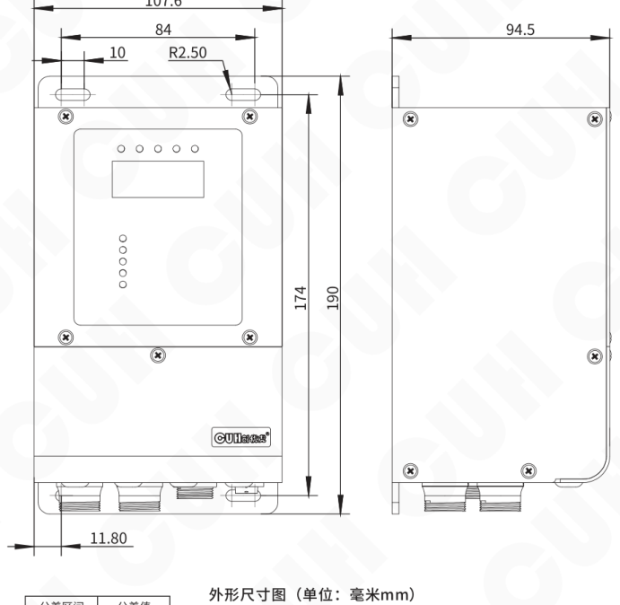

| 公差区间 | 公差值 |
|---|---|
| 0~3 | ±0.05 |
| 3~10 | ±0.1 |
| 10~30 | ±0.15 |
| 30~80 | ±0.2 |
| 80~180 | ±0.3 |
| >180 | ±0.5 |

本系列产品均适用此公差表。

2024-03　　　　　　　　　　　　　　　　　-33-　　　　　　　　　　　　　　　　　SDVC40XSSMSCN_2.01

### 第 42 页

多路数字调频压电振动送料控制器　　　　　　　　　　　　　　　　　SDVC40-XS系列

## 6.2 技术规格表

| 项目 | 最小值 | 典型值 | 最大值 | 单位 | 备注 |
|---|---:|---:|---:|---|---|
| 输入电压 | 85 | 220 | 250 | 伏特（V） | 交流有效值 |
| 输出电压调整范围 | 0 | —— | 220 | 伏特（V） |  |
| 输出电流调整范围 | 0 | —— | 50 | 毫安（mA） |  |
| 单通道输出功率 | 0 | —— | 11 | 伏安（VA） |  |
| 电压设定精度 |  | 1 |  | 伏特（V） |  |
| 稳压精度 | 0 | —— | 0.1 | % | ΔVout/ΔVin |
| 输出频率 | 40.0 | —— | 400.0 | 赫兹（Hz） |  |
| 频率调整精度 |  | 0.1 |  | 赫兹（Hz） |  |
| 输出波形 |  | 正弦 |  | 无量纲 |  |
| 直流控制输出电流 | 0 | —— | 200 | 毫安（mA） | 4路总输出最大500mA |
| 直流控制输出电压 | 22 | 24 | 26 | 伏特（V） |  |
| 模拟控制信号 |  | 1~5 |  | 伏特（V） | 远程速度控制电压 |
|  |  | 4~20 |  | 毫安（mA） |  |
| 数字控制信号 |  | 24 |  | 伏特（V） | 开关信号控制 |
| 调整方式 |  | 6 |  | 键（Button） |  |
| 空载功耗 | —— | 2.5 | —— | 瓦特（W） | 在控制器停止输出时 |
| 显示方式 |  | 5 |  | 位（Digit） | LED数码管 |
| 缓启动时间 | 0.1 | —— | 10.0 | 秒（s） | 出厂默认0.5 |
| 缓关闭时间 | 0.1 | —— | 10.0 | 秒（s） | 出厂默认0.1 |
| 延迟时间范围 | 0 | —— | 20.0 | 秒（s） | 出厂默认0.2 |
| 延迟时间精度 |  | 0.1 |  | 秒（s） |  |
| 过热保护温度 | 60 | —— | 65 | 摄氏度（℃） |  |
| 工作环境温度 | 0 | 25 | 40 | 摄氏度（℃） |  |
| 工作环境湿度 | 10 | 60 | 85 | 相对湿度（%） | 不结露 |
| 储藏环境温度 | -20 | 25 | 85 | 摄氏度（℃） |  |

2024-03　　　　　　　　　　　　　　　　　-34-　　　　　　　　　　　　　　　　　SDVC40XSSMSCN_2.01

### 第 43 页

多路数字调频压电振动送料控制器　　　　　　　　　　　　　　　　　　　　　　　　　SDVC40-XS系列

## 6.3 参考标准

**极限参数：超过此指标将会造成严重损坏，必须严格遵守！**

| 项目 | GB 标准 | IEC 标准 | 等级 | 标准要求 | 备注说明 |
|---|---|---|---|---|---|
| 静电放电 | GB/T 17626.2-2006 | IEC 61000-4-2:2001 | 4 | ±8 kV | 接触放电 |
| 静电放电 | GB/T 17626.2-2006 | IEC 61000-4-2:2001 | 4 | ±15 kV | 空气放电 |
| 电快速瞬变 脉冲群 | GB/T 17626.4-2008 | IEC 61000-4-4:2004 | 4 | ±4 kV |  |
| 直流电源纹 波抗扰度 | GB/T 17626.17-2005 | IEC 61000-4-17:2002 | 4 | 15% | 评价 A |

**警告**

在民用环境中，本产品可能产生无线电干扰。在这种情况下，可能需要采取附加抑制措施。

2024-03　　　　　　　　　　　　　　　　　-35-　　　　　　　　　　　　　　　　　SDVC40XSSMSCN_2.01

### 第 44 页

多路数字调频压电振动送料控制器　　　　　　　　　　　　　　　　　SDVC40-XS系列

# 第七章　附录

## 7.1 参数列表

| 数码管符号图片 | 参数符号 | 含义 | 取值范围 | 默认设置 |
|---|---|---|---|---|
|  | 读【U】 | 输出电压 | 0~220 | 150 |
|  | 读【E】 | 频率 | 40.0~400.0Hz | 50.0 |
|  | 读【小T】 | 缓启动 | 0.1~10.0秒 | 0.5 |
|  | 读【T点】 | 缓关闭 | 0.1~10.0秒 | 0.1 |
|  | 读【Φ】 | 相位差 | -180°~180° | 0 |
|  | 读【大勾】 | 开延时 | 0.0~20.0秒 | 0.2 |
|  | 读【大L】 | 关延时 | 0.0~20.0秒 | 0.2 |
|  | 读【小H】 | 最大输出电压 | 0~220V | 220 |
|  | 读【全8】 | 恢复本通道参数为出厂默认值 | —— | —— |
|  | 读【P】 | 主输出逻辑运算端口1信号源 控制输出逻辑运算端口1信号源（仅当 D口参数指示灯亮） | 0、1、A口、b口、C口、d口、OA口、Ob口、OC口、Od口、-A口、-b口、-C口、-d口、-OA口、-Ob口、-OC口、-Od口 | 0 |
|  | 读【P点】 | 主输出逻辑运算端口2信号源 控制输出逻辑运算端口2信号源（仅当 D口参数指示灯亮） | 0、1、A口、b口、C口、d口、OA口、Ob口、OC口、Od口、-A口、-b口、-C口、-d口、-OA口、-Ob口、-OC口、-Od口 | 主输出 \ 控制输出 A（A路 \ OA路） B（b路 \ Ob路） C（C路 \ OC路） D（d路 \ Od路） |
|  | 读【大恩】 | 主输出逻辑关系 控制输出逻辑关系（仅当 D口参数指示灯亮） |  与  或  异或  rs触发器 | 或 |

2024-03　　　　　　　　　　　　　　　-36-　　　　　　　　　　　　　　　SDVC40XSSMSCN_2.01

### 第 45 页

| 参数符号 | 数码管符号图片 | 含义 | 取值范围 | 默认设置 |
|---|---|---|---|---|
| 读【小勾】 | 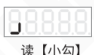 | 主输出开延时 控制输出开延时（仅当 D口参数指示灯亮） | 0.0~20.0秒 | 0.0 |
| 读【小L】 | 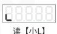 | 主输出关延时 控制输出关延时（仅当 D口参数指示灯亮） | 0.0~20.0秒 | 0.0 |
| 读【F】 | 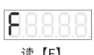 | 主输出模式 控制输出模式（仅当 D口参数指示灯亮） | ASC　延时模式 hLd　保持模式 | 延时模式 |
| 读【涛】 | 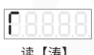 | 控制输出类型（仅当 D口参数指示灯亮） | nPn　NPN型 PnP　PNP型 PSH　推挽型 | 推挽型 |
| * 读【涛A】 | 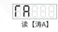 | 料满信号类型 | nPn　NPN型 AUto　自动 PnP　PNP型 | 自动 |
| * 读【涛D】 | 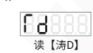 | 开机运行状态 | 开机运行 开机停止 开机跟随 | 开机运行 |
| * 读【上拐】 | 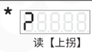 | Modbus通信协议 | ASC rtu | ASC |
| * 读【万】 | 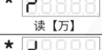 | Modbus通信地址 | 1~31 | 1 |
| * 读【下拐】 | 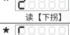 | Modbus通信波特率 | 0.3、1.2、2.4、9.6、19.2、 57.6、115.2Kbps | 9.6 |
| * 读【大C】 |  | 温度 | 非可调参数 |  |

注：* 标的参数为共用参数，此时通道1~4的指示灯全亮；  
仅当 D口参数指示灯亮时显示的参数为控制输出参数；  
其余参数为主输出参数，此时通道1~4的指示灯只有一个点亮。

### 第 46 页

多路数字调频压电振动送料控制器　　　　　　　　　　　　　　　　　　　SDVC40-XS系列

## 7.2 接线端口说明

| 通道 | 端口 | 端子 1 | 端子 2 | 端子 3 |
|---|---|---|---|---|
| 通道1 | 遥控调速 | A1：电阻地 | A2：输入 | A3：+5V |
| 通道1 | 料满停机 | C1：地线 | C2：输入 | C3：+24V |
| 通道1 | 控制输出 | D1：输出 | D2：+24V | D3：地线 |
| 通道2 | 遥控调速 | A1：电阻地 | A2：输入 | A3：+5V |
| 通道2 | 料满停机 | C1：地线 | C2：输入 | C3：+24V |
| 通道2 | 控制输出 | D1：输出 | D2：+24V | D3：地线 |
| 通道3 | 遥控调速 | A1：电阻地 | A2：输入 | A3：+5V |
| 通道3 | 料满停机 | C1：地线 | C2：输入 | C3：+24V |
| 通道3 | 控制输出 | D1：输出 | D2：+24V | D3：地线 |
| 通道4 | 遥控调速 | A1：电阻地 | A2：输入 | A3：+5V |
| 通道4 | 料满停机 | C1：地线 | C2：输入 | C3：+24V |
| 通道4 | 控制输出 | D1：输出 | D2：+24V | D3：地线 |

| 端口 | 端子 1 | 端子 2 |
|---|---|---|
| 24V电源 | 地线 | +24V |
| 485通讯 | A+ | B- |

## 7.3 输入输出电路图

### 料满停机C端口

图中标注：控制器主电路、自动类型检测、24V；端子 C3、C2、C1；传感器接线为棕色+、黑色OUT、蓝色-。

### 控制输出D端口

图中标注：控制器主电路、过流保护电路、24V、28V、200mA Fuse；端子 D2、D1、D3；负载接线为红色+、黑色-。

---

2024-03　　　　　　　　　　　　　　-38-　　　　　　　　　　　　　　SDVC40XSSMSCN_2.01

### 第 47 页

## 7.4 故障诊断

| 故障代码 | 数码管符号图片 | 含义 | 排除方法 |
|---|---|---|---|
| 打开开关，没有显示 |  |  | 请检查电源插座是否有电 电源插头是否可靠连接插座 |
| 有显示，但是振动盘不动，也没有声音 |  |  | 请检查输出电缆是否正确地连接控制器与振动盘 请检查控制器参数，是否输出电压调节得太小 请检查控制信号是否将控制器置于“停止”状态 请检查是否有设置为“常断”的参数，导致控制器被置于“停止”状态 |
| 控制信号不起作用 |  |  | 请检查控制信号是否正确输入 请检查输入的控制信号的地线是否与本机地正确连接 请检查控制信号逻辑关系设置是否是您期望的设置 |
| 有显示，振动盘不动，但可以听到声音 |  |  | 请按照本说明书介绍的调节方法逐步调节各参数 |
| 通道灯闪烁 |  | 内部通道连接错误 | 在共用参数组中恢复出厂设置，即可屏蔽当前故障通道 修复故障通道请联络本公司技术支持 |
| Err03 |  | 系统过热 | 将控制器安装在通风散热良好的工作环境中 |
| Err06 |  | 保留 | 联络本公司技术支持 |
| Err11 |  | 通道1主输出过流 | 减小对应通道输出电压设定 检查连线及振动盘线圈等是否短路 |
| Err12 |  | 通道2主输出过流 | 减小对应通道输出电压设定 检查连线及振动盘线圈等是否短路 |
| Err13 |  | 通道3主输出过流 | 减小对应通道输出电压设定 检查连线及振动盘线圈等是否短路 |
| Err14 |  | 通道4主输出过流 | 减小对应通道输出电压设定 检查连线及振动盘线圈等是否短路 |
| Err21 |  | 通道1控制输出过流 | 减小对应通道控制输出端负载功耗 判断控制输出是否短路 |
| Err22 |  | 通道2控制输出过流 | 减小对应通道控制输出端负载功耗 判断控制输出是否短路 |
| Err23 |  | 通道3控制输出过流 | 减小对应通道控制输出端负载功耗 判断控制输出是否短路 |
| Err24 |  | 通道4控制输出过流 | 减小对应通道控制输出端负载功耗 判断控制输出是否短路 |
| Err25 |  | 内部24V电源故障 | 联络本公司技术支持 |
| Err26 |  | rs逻辑故障 | 逻辑端口源信号1和2不能同时都为有效 |

### 第 48 页

多路数字调频压电振动送料控制器　　　　　　　　　　　　　　　　　SDVC40-XS系列

---

# 第八章 产品保证信息

## 8.1 保质期

本公司为本产品提供的保质期为三年，从产品发送到购买方指定地点之日算起。

## 8.2 保修范围

（一）如果在上述保质期内出现本公司造成的故障，我们将免费维修产品。但是以下情况不属于保修范围：

　　a、未按照简易说明书、用户手册或购买方与本公司专门达成的技术要求中规定的条件、环境下的不正确操作，或不正确使用造成的故障。

　　b、故障不是因产品缺陷，而是购买方设备或软件设计造成的。

　　c、非本公司人员进行的修改或修理而造成的故障。

　　d、按照简易操作指南或用户手册正确维修或更换易损部件等规定可以完全避免的故障。

　　e、产品从本公司发货后，因无法预料的科学技术水平变化等因素而造成的故障。

　　f、由于火灾、地震、洪水等自然灾害，或异常电压等外部因素造成的故障，本公司不负责保修。

（二）保修范围仅限于（一）中规定的情况，本公司对该设备造成的购买方间接损失（如设备损坏、机会丧失、利润损失等）或其他损失，不承担任何责任。

## 8.3 产品适用性

本公司的该控制器是针对振动送料行业的通用产品而设计生产的。因此，本公司的该控制器不得用于下列应用且不适合其使用。

（一）对生命和财产有严重影响的设施，如核发电厂、机场、铁路、轮船、机动装置及医疗设备。

（二）公共事业，包括电力、气体、供水等。

（三）相似条件或环境的户外使用。

---

2024-03　　　　　　　　　　　　　　　　　-40-　　　　　　　　　　　　SDVC40XSSMSCN_2.01

### 第 49 页

*（本页 `page_markdown` 为空。）*

### 第 50 页

*（本页 `page_markdown` 为空。）*

### 第 51 页

*（本页 `page_markdown` 为空。）*

### 第 52 页

|  |  |
|---|---|
|  | 南京创优科技有限责任公司 网址:www.cuhnj.com 电话:025-84730416 传真:025-84730426 邮箱:sales@cuhnj.com 地址:南京市江宁区智能路9号 启迪城学研园2幢 |

文档编号：IDP1000408

<!-- /auto:ai-body-draft v1 -->

<!-- auto:data-params-summary v1 -->
## 附录 · 参数表（结构化侧车·机器生成）

> 说明：本节由 `data/<doc_key>/params/params.yaml` 自动渲染（展示前若干行），用于校对与二次开发。定稿以层 C 数据为准。

| 参数 | 标志/符号 | 范围 | 默认 | 单位 | 备注 |
| --- | --- | --- | --- | --- | --- |
|    **小心** |  |  |  |  |  |
|    **注意** |  |  |  |  |  |
|  **要点** ！ |  |  |  |  |  |
|  0~3 |  |  |  |  |  |
|  3~10 |  |  |  |  |  |
|  10~30 |  |  |  |  |  |
|   30~80 |  |  |  |  |  |
|   80~180 |  |  |  |  |  |
|   >180 |  |  |  |  |  |
|      输入电压 |  |  |  |      伏特（V） |  |
|      输出电压调整范围 |  |  |  |      伏特（V） |  |
|      输出电流调整范围 |  |  |  |      毫安（mA） |  |
|      单通道输出功率 |  |  |  |      伏安（VA） |  |
|      电压设定精度 |  |  |  |      伏特（V） |  |
|      稳压精度 |  |  |  |      % |  |
|      输出频率 |  |  |  |      赫兹（Hz） |  |
|      频率调整精度 |  |  |  |      赫兹（Hz） |  |
|      输出波形 |  |  |  |        无量纲 |  |
|      直流控制输出电流 |  |  |  |        毫安（mA） |  |
|      直流控制输出电压 |  |  |  |        伏特（V） |  |
|      模拟控制信号 |  |  |  |        伏特（V） |  |
|      模拟控制信号 |  |  |  |        毫安（mA） |  |
|      数字控制信号 |  |  |  |        伏特（V） |  |
|    调整方式 |  |  |  |      键（Button） |  |
|    空载功耗 |  |  |  |      瓦特（W） |  |
|    显示方式 |  |  |  |        位（Digit） |  |
|    缓启动时间 |  |  |  |        秒（s） |  |
|    缓关闭时间 |  |  |  |        秒（s） |  |
|    延迟时间范围 |  |  |  |        秒（s） |  |
|    延迟时间精度 |  |  |  |        秒（s） |  |

*（仅展示前 30 条，共 75 条；完整数据见下方链接。）*

- 完整 YAML：`data/cuh.sdvc40.manual.v2.01/params/params.yaml`
- 表格索引：`data/cuh.sdvc40.manual.v2.01/index.yaml`
<!-- /auto:data-params-summary v1 -->
